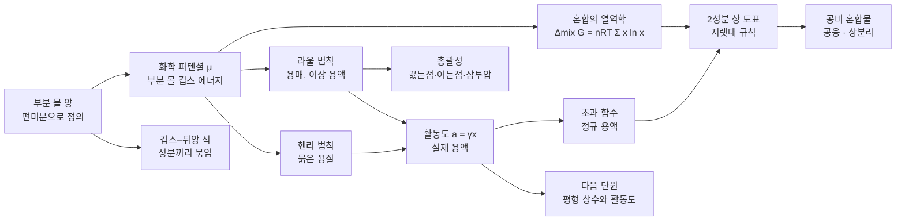

# 물리화학 5. 혼합물과 용액의 열역학 — 화학 퍼텐셜 하나로 읽는 섞임의 규칙
<!-- prev: pchem-4, uchem-6 -->
<!-- next: pchem-6 -->

> [!NOTE]
> **이 단원의 범위**
> - 부분 몰 양(부분 몰 부피, 부분 몰 깁스 에너지)과 깁스–뒤앙 식
> - 혼합의 열역학: 이상 기체 혼합물과 이상 용액의 $\Delta_\text{mix}G$, $\Delta_\text{mix}S$, $\Delta_\text{mix}H$, $\Delta_\text{mix}V$
> - 라울 법칙과 헨리 법칙, 이상 용액과 이상 묽은 용액
> - 총괄성(끓는점 오름·어는점 내림·삼투압)과 이상 용해도의 열역학적 유도
> - 활동도와 활동도 계수(라울 기준·헨리 기준·몰랄 농도 기준)
> - 2성분 상 도표: 증기압–조성·온도–조성 도표, 지렛대 규칙, 분별 증류, 공비 혼합물, 부분 섞임 액체, 공융
> - 초과 함수와 정규 용액(마굴레스 식, 상분리와 임계 용해 온도)

**학습 목표**

1. 부분 몰 양을 편미분으로 정의하고, 실험 자료(부피–조성 맞춤식)에서 부분 몰 부피를 구하며, 깁스–뒤앙 식으로 한 성분의 성질에서 다른 성분의 성질을 끌어낼 수 있다.
2. 이상 기체 혼합물과 이상 용액의 혼합 깁스 에너지·엔트로피·엔탈피·부피를 유도하고, 혼합이 엔트로피가 이끄는 과정임을 설명할 수 있다.
3. 용액 속 성분의 화학 퍼텐셜을 증기 압력과 연결하여 라울 법칙과 헨리 법칙을 열역학적으로 해석하고, 두 법칙이 어떤 농도 영역에서 성립하는지 판단할 수 있다.
4. 용매의 화학 퍼텐셜이 낮아지는 것에서 출발하여 끓는점 오름·어는점 내림·삼투압·이상 용해도의 식을 가정과 근사를 밝히며 유도하고, 그 식으로 몰질량·용해도·역삼투 압력을 계산할 수 있다.
5. 활동도와 활동도 계수를 라울 기준과 헨리 기준으로 정의하고, 증기 압력 자료에서 계산할 수 있다.
6. 증기압–조성·온도–조성·고체–액체 상 도표를 읽고 지렛대 규칙으로 각 상의 양을 계산하며, 분별 증류·공비 혼합물·공융을 상 도표로 설명할 수 있다.
7. 초과 함수를 정의하고 정규 용액 모형으로 활동도 계수, 공비점, 상분리와 임계 용해 온도를 정량적으로 예측할 수 있다.

**이 단원의 학습 사다리**

| 단계 | 무엇을 하나? |
|---|---|
| STEP 1. 이전 학습 다시 보기 | 일반화학의 라울·헨리 법칙과 총괄성 공식, 물리화학의 화학 퍼텐셜·상평형 조건 |
| STEP 2. 기초 다지기 | 크기 성질과 오일러 정리, 화학 퍼텐셜과 기본 방정식, $x\ln x$ 함수, 묽은 용액의 근사 |
| STEP 3. 핵심 개념 | 부분 몰 양 → 깁스–뒤앙 → 혼합의 열역학 → 라울·헨리 → 총괄성 → 활동도 → 2성분 상 도표 → 초과 함수와 정규 용액 |
| STEP 4. 오개념 바로잡기 | "부분 몰 부피는 늘 양수이다", "공비 혼합물은 화합물이다", "삼투압은 용질이 미는 힘이다" 같은 착각 |
| STEP 5. 대학원·연구로 | 국소 조성 모형(윌슨·NRTL·UNIFAC), 플로리–허긴스 이론, 카크우드–버프 이론 |
| STEP 6. 생활·산업·진로 | 증류탑과 공비 증류, 역삼투 담수화, 땜납과 합금, 고분자 블렌드와 약물 제형 |

---

## 🗺️ 단원 들어가기

물 50 mL와 에탄올 50 mL를 섞으면 100 mL가 되지 않는다. 약 96~97 mL 남짓이다. 소금물은 0 ℃에서 얼지 않고, 바닷물을 마시면 오히려 목이 마른다. 에탄올 수용액을 아무리 정성껏 증류해도 질량 백분율 약 95.6 %(1기압)에서 더 진해지지 않는다. 주석과 납을 섞은 땜납은 두 금속 어느 쪽보다도 낮은 온도에서 녹는다.

일반화학에서 이 현상들을 하나씩 따로 배웠다. 라울 법칙, 헨리 법칙, $\Delta T_f = K_f m$, $\Pi = MRT$는 각각의 공식이었다. 물리화학에서는 이것들이 **모두 같은 한 문장**에서 나온다는 것을 보인다.

> 평형에서 각 성분의 화학 퍼텐셜은 그 성분이 존재하는 모든 상에서 같다. 그리고 섞이면 각 성분의 화학 퍼텐셜은 순수할 때보다 $RT\ln a$만큼 달라진다.

앞 단원 「순물질의 상평형」에서는 성분이 하나뿐이었다. 상 도표의 두 축은 온도와 압력이었고, 상 경계는 두 상의 $\mu$가 같아지는 곳이었다. 이 단원에서는 성분이 둘 이상이 되면서 **조성**이라는 새 변수가 들어온다. 그 대가로 상 도표에 조성 축이 생기고, 액체와 증기가 서로 다른 조성으로 공존하며, 그 차이가 증류·정제·합금 설계의 원리가 된다. 이 단원을 마치면 증기 압력 자료 한 줄에서 활동도 계수를 뽑고, 그것으로 공비점과 상분리 온도를 예측할 수 있다. 그리고 다음 단원 「화학 평형과 전기화학」에서 평형 상수를 활동도로 쓰는 일이 자연스럽게 이어진다.

---

## STEP 1. 🔙 이전 학습 다시 보기

### 연계 개념표

| 이전 단원 | 그때 배운 것 | 이 단원에서 확장되는 것 |
|---|---|---|
| 일반화학 「분자 간 힘과 액체·고체·용액」 '라울 법칙과 총괄성' | $P_A = X_AP_A^\circ$, 벤젠–톨루엔 증기의 조성, 양·음의 벗어남(정성적), $\Delta T_b = iK_bm$, $\Pi = iMRT$, 클라우지우스–클라페이롱 식으로 $K_b$ 어림 | 라울 법칙을 화학 퍼텐셜의 같음으로 **유도**, 벗어남을 활동도 계수로 **정량화**, 총괄성을 $\mu_A$의 내림으로 통일 |
| 일반화학 「분자 간 힘과 액체·고체·용액」 '헨리 법칙' | 기체 용해도는 부분 압력에 비례($C = k_\mathrm{H}P$) | 헨리 법칙이 **용질의 극한 법칙**임을 보이고, 깁스–뒤앙 식으로 라울 법칙과 짝을 이룸을 증명 |
| 일반화학 「화학 열역학」 | 이상 기체 혼합의 $\Delta S = nR\ln(V_2/V_1)$(문제로), $\Delta G = \Delta G^\circ + RT\ln Q$ | 혼합 깁스 에너지 $\Delta_\text{mix}G = nRT\sum x_i\ln x_i$, 초과 함수 |
| 물리화학 「자유 에너지와 화학 퍼텐셜」 | $dG = V\,dP - S\,dT + \sum\mu_i\,dn_i$, 화학 퍼텐셜, $\mu = \mu^\circ + RT\ln(p/p^\circ)$, 퓨가시티 | 부분 몰 양의 일반 이론, 액체 속 성분의 $\mu$, 활동도(퓨가시티의 용액판) |
| 물리화학 「순물질의 상평형」 | 상평형 조건 $\mu^\alpha = \mu^\beta$, 상 도표, 클라페이롱 식, 깁스의 상 규칙 $F = C - P + 2$ | 성분이 2개($C = 2$)인 상 도표, 지렛대 규칙, 공비점과 공융점 |

### 준비 운동 (사전 진단)

**Q1.** 깁스의 상 규칙 $F = C - P + 2$에서 2성분계의 두 상(액체와 증기)이 공존할 때 자유도는 몇인가? 온도를 고정하면 몇이 남는가?

**Q2.** $G(T, P, n_A, n_B)$의 전미분 $dG$를 쓰고, $\mu_A$를 편미분으로 정의하시오.

**Q3.** 이상 기체 1 mol의 압력을 일정한 온도 298 K에서 1 bar에서 0.50 bar로 낮추면 화학 퍼텐셜은 얼마나 변하는가?

**Q4.** 25 ℃에서 벤젠의 몰 분율이 0.50인 벤젠–톨루엔 이상 용액이 있다(순수한 증기 압력: 벤젠 12.7 kPa, 톨루엔 3.79 kPa). 증기 속 벤젠의 몰 분율은 액체 속보다 큰가, 작은가?

정답 및 해설

**Q1.** $F = 2 - 2 + 2 = 2$. 온도를 고정하면 1이 남는다. 즉 일정한 온도에서 액체 조성을 하나 정하면 증기 압력과 증기 조성이 저절로 정해진다. STEP 3 ⑨의 증기압–조성 도표가 이 '자유도 1'을 그림으로 그린 것이다.

**Q2.** $dG = V\,dP - S\,dT + \mu_A\,dn_A + \mu_B\,dn_B$, $\mu_A = \left(\dfrac{\partial G}{\partial n_A}\right)_{T,P,n_B}$.

**Q3.** $\Delta\mu = RT\ln(0.50/1) = 8.314\times298\times(-0.693) = -1.72\ \mathrm{kJ/mol}$. 압력(퍼진 정도)이 낮아지면 화학 퍼텐셜이 내려간다. 섞여서 '묽어지는' 것도 같은 효과를 낸다는 것이 이 단원의 출발점이다.

**Q4.** 크다. $P = 0.50(12.7) + 0.50(3.79) = 8.25\ \mathrm{kPa}$, $y_\text{벤젠} = 6.35/8.25 = 0.77$. 휘발성이 큰 성분이 증기에 농축된다.

---

## STEP 2. 🧱 기초 다지기

### 디딤돌 1. 크기 성질과 오일러 정리 — 전체는 '부분 몰 양 × 몰수'의 합

부피·내부 에너지·깁스 에너지 같은 **크기 성질(extensive property)** 은 온도와 압력을 고정한 채 모든 성분의 양을 $\lambda$배 하면 그 값도 $\lambda$배가 된다. 수학적으로 $V(n_A, n_B)$는 몰수에 대한 **1차 동차 함수**이다.

$$
V(\lambda n_A, \lambda n_B) = \lambda V(n_A, n_B)
$$

양변을 $\lambda$로 미분하고 $\lambda = 1$로 두면(연쇄 법칙, 수학 도구 1 '연쇄 법칙과 순환 관계'에서 익힌 방법) **오일러 정리**가 나온다.

$$
\frac{d}{d\lambda}V(\lambda n_A, \lambda n_B)\bigg|_{\lambda=1} = n_A\frac{\partial V}{\partial n_A} + n_B\frac{\partial V}{\partial n_B} = V
$$

편미분 $\partial V/\partial n_A$가 STEP 3 ①의 **부분 몰 부피**이다. 즉 "전체 부피 = 각 성분의 부분 몰 부피 × 몰수의 합"은 가정이 아니라 크기 성질이라는 사실에서 바로 나오는 수학적 결과이다.

#### 예제 1 — 오일러 정리 확인하기

어떤 2성분 혼합물의 부피가 $V = a\,n_A + b\,n_B + c\,\dfrac{n_An_B}{n_A + n_B}$로 주어진다($a$, $b$, $c$는 상수). $n_A\,\partial V/\partial n_A + n_B\,\partial V/\partial n_B = V$임을 확인하시오.

**풀이**
$N = n_A + n_B$라 하자. 몫의 미분으로

$$
\frac{\partial V}{\partial n_A} = a + c\,\frac{n_B N - n_An_B}{N^2} = a + c\,\frac{n_B^2}{N^2}, \qquad \frac{\partial V}{\partial n_B} = b + c\,\frac{n_A^2}{N^2}
$$

$$
n_A\frac{\partial V}{\partial n_A} + n_B\frac{\partial V}{\partial n_B} = a\,n_A + b\,n_B + c\,\frac{n_An_B(n_B + n_A)}{N^2} = a\,n_A + b\,n_B + c\,\frac{n_An_B}{N} = V
$$

**의미** 마지막 항은 '섞여서 생기는 부피 변화'를 나타낸다. 부분 몰 부피 $a + c\,x_B^2$는 조성에 따라 변하지만, 몰수를 곱해 더하면 정확히 전체 부피가 된다.

### 디딤돌 2. 화학 퍼텐셜과 기본 방정식 — 「자유 에너지와 화학 퍼텐셜」 되짚기

조성이 변하는 계의 깁스 에너지 전미분은 다음과 같다.

$$
dG = V\,dP - S\,dT + \sum_i \mu_i\,dn_i, \qquad \mu_i = \left(\frac{\partial G}{\partial n_i}\right)_{T,P,n_{j\ne i}}
$$

| 사실 | 식 | 이 단원에서의 쓰임 |
|---|---|---|
| 이상 기체의 화학 퍼텐셜 | $\mu = \mu^\circ + RT\ln(p/p^\circ)$ | 증기와 평형인 액체의 $\mu$를 구하는 다리 |
| 순물질의 $\mu$는 몰 깁스 에너지 | $\mu^* = G_\mathrm{m}^*$ | 위첨자 $*$는 '순수한'을 뜻한다 |
| 상평형 조건 | $\mu_i^\alpha = \mu_i^\beta$ (모든 성분 $i$) | 라울·헨리 법칙, 총괄성, 상 도표 |
| 온도·압력 의존 | $(\partial\mu/\partial T)_P = -S_\mathrm{m}$, $(\partial\mu/\partial P)_T = V_\mathrm{m}$ | 총괄성의 유도, 삼투압 |
| 물질은 $\mu$가 높은 곳에서 낮은 곳으로 | $dG = (\mu^\beta - \mu^\alpha)dn < 0$ | 삼투, 확산의 방향 |

#### 예제 2 — 압력이 낮아질 때의 화학 퍼텐셜

25 ℃에서 질소의 부분 압력이 1.00 bar에서 0.20 bar로 낮아지면 질소 1 mol의 화학 퍼텐셜은 얼마나 변하는가? (이상 기체)

**풀이**
$\Delta\mu = RT\ln(0.20/1.00) = 8.314\times298.15\times\ln 0.20 = -3.99\times10^3\ \mathrm{J/mol} = -3.99\ \mathrm{kJ/mol}$

**의미** STEP 3 ③에서 보듯, 순수한 기체를 다른 기체와 섞어 그 분율을 0.20으로 만드는 것은 부분 압력을 0.20배로 낮추는 것과 같은 효과를 낸다. 섞이면 각 성분의 $\mu$가 내려간다. 이것이 혼합이 저절로 일어나는 이유의 핵심이다.

### 디딤돌 3. $x\ln x$ 함수 — 혼합 엔트로피의 모양

혼합의 엔트로피와 깁스 에너지에는 늘 다음 함수가 나온다.

$$
f(x) = x\ln x + (1 - x)\ln(1 - x), \qquad 0 < x < 1
$$

| 성질 | 내용 | 물리적 의미 |
|---|---|---|
| 부호 | $0 < x < 1$에서 늘 $f(x) < 0$ | 이상 혼합의 $\Delta_\text{mix}G = nRTf < 0$: 늘 자발적 |
| 대칭과 최솟값 | $x = 1/2$에서 최소, $f(1/2) = -\ln 2 = -0.693$ | 반반 섞일 때 혼합 엔트로피가 가장 크다 |
| 기울기 | $f'(x) = \ln\dfrac{x}{1 - x}$, $x \to 0$에서 $-\infty$ | 아주 조금 섞을 때 깁스 에너지가 '무한히 가파르게' 내려간다 |
| 곡률 | $f''(x) = \dfrac{1}{x(1 - x)} > 0$ | 아래로 볼록: 이상 혼합물은 상분리하지 않는다(⑫에서 다시) |

기울기가 끝에서 무한대라는 것은 실용적으로 중요하다. **순수한 물질에 불순물이 아주 조금 녹아 들어가는 것은 언제나 자발적**이고, 거꾸로 마지막 한 줌의 불순물을 제거하는 일은 점점 더 어렵다. 반도체용 실리콘을 99.9999999 % 이상으로 정제하는 데 많은 에너지가 드는 근본 이유이다.

#### 예제 3 — 소량 혼합의 엔트로피

$x = 0.01$일 때 $f(x)$의 값을 구하고, $x = 1/2$의 값과 비교하시오.

**풀이**
$f(0.01) = 0.01\ln 0.01 + 0.99\ln 0.99 = -0.0461 - 0.0099 = -0.0560$
$f(0.5) = -0.693$이므로 약 8 %이다. 그런데 몰 분율로는 1 %만 섞였는데 혼합 엔트로피는 최댓값의 8 %나 된다. 처음 조금 섞일 때의 효과가 유난히 크다는 것을 수치로 볼 수 있다.

### 디딤돌 4. 묽은 용액의 근사 — 테일러 전개 세 가지

총괄성의 유도에는 다음 세 근사가 반복해 쓰인다(수학 도구 2 '테일러 급수와 근사').

| 근사 | 조건 | 쓰이는 곳 |
|---|---|---|
| $\ln(1 - x_B) \approx -x_B$ | $x_B \ll 1$ | $\ln x_A = \ln(1 - x_B)$ |
| $\dfrac{1}{T} - \dfrac{1}{T^*} = \dfrac{T^* - T}{TT^*} \approx \dfrac{T^* - T}{T^{*2}}$ | $\lvert T - T^* \rvert \ll T^*$ | 끓는점 오름·어는점 내림 |
| $x_B = \dfrac{n_B}{n_A + n_B} \approx \dfrac{n_B}{n_A} = M_A\,b_B$ | $n_B \ll n_A$ | 몰 분율 → 몰랄 농도 $b_B$ ($M_A$는 kg/mol) |

#### 예제 4 — 근사의 오차

$x_B = 0.010$과 $x_B = 0.10$에서 $\ln(1 - x_B)$와 $-x_B$를 비교하여 상대 오차를 구하시오.

**풀이**
$x_B = 0.010$: $\ln 0.990 = -0.010\,05$, 상대 오차 약 0.5 %.
$x_B = 0.10$: $\ln 0.90 = -0.1054$, 상대 오차 약 5 %.
**의미** 묽은 용액의 총괄성 식은 용질의 몰 분율이 수 % 이하일 때 잘 맞고, 진한 용액에서는 근사 자체가 수 % 오차를 만든다. 진한 용액에서는 비이상성(활동도 계수)까지 겹치므로 ⑧의 활동도로 다루어야 한다.

---

## STEP 3. 📘 핵심 개념
