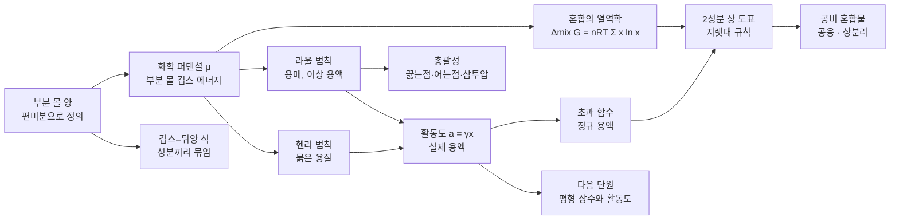

# 물리화학 5. 혼합물과 용액의 열역학 — 화학 퍼텐셜 하나로 읽는 섞임의 규칙
<!-- prev: pchem-4, uchem-6 -->
<!-- next: pchem-6 -->

> [!NOTE]
> **이 단원의 범위**
> - 부분 몰 양(부분 몰 부피, 부분 몰 깁스 에너지)과 깁스–뒤앙 식
> - 혼합의 열역학: 이상 기체 혼합물과 이상 용액의 $\Delta_\text{mix}G$, $\Delta_\text{mix}S$, $\Delta_\text{mix}H$, $\Delta_\text{mix}V$
> - 라울 법칙과 헨리 법칙, 이상 용액과 이상 묽은 용액
> - 총괄성(끓는점 오름·어는점 내림·삼투압)과 이상 용해도의 열역학적 유도
> - 활동도와 활동도 계수(라울 기준·헨리 기준·몰랄 농도 기준)
> - 2성분 상 도표: 증기압–조성·온도–조성 도표, 지렛대 규칙, 분별 증류, 공비 혼합물, 부분 섞임 액체, 공융
> - 초과 함수와 정규 용액(마굴레스 식, 상분리와 임계 용해 온도)

**학습 목표**

1. 부분 몰 양을 편미분으로 정의하고, 실험 자료(부피–조성 맞춤식)에서 부분 몰 부피를 구하며, 깁스–뒤앙 식으로 한 성분의 성질에서 다른 성분의 성질을 끌어낼 수 있다.
2. 이상 기체 혼합물과 이상 용액의 혼합 깁스 에너지·엔트로피·엔탈피·부피를 유도하고, 혼합이 엔트로피가 이끄는 과정임을 설명할 수 있다.
3. 용액 속 성분의 화학 퍼텐셜을 증기 압력과 연결하여 라울 법칙과 헨리 법칙을 열역학적으로 해석하고, 두 법칙이 어떤 농도 영역에서 성립하는지 판단할 수 있다.
4. 용매의 화학 퍼텐셜이 낮아지는 것에서 출발하여 끓는점 오름·어는점 내림·삼투압·이상 용해도의 식을 가정과 근사를 밝히며 유도하고, 그 식으로 몰질량·용해도·역삼투 압력을 계산할 수 있다.
5. 활동도와 활동도 계수를 라울 기준과 헨리 기준으로 정의하고, 증기 압력 자료에서 계산할 수 있다.
6. 증기압–조성·온도–조성·고체–액체 상 도표를 읽고 지렛대 규칙으로 각 상의 양을 계산하며, 분별 증류·공비 혼합물·공융을 상 도표로 설명할 수 있다.
7. 초과 함수를 정의하고 정규 용액 모형으로 활동도 계수, 공비점, 상분리와 임계 용해 온도를 정량적으로 예측할 수 있다.

**이 단원의 학습 사다리**

| 단계 | 무엇을 하나? |
|---|---|
| STEP 1. 이전 학습 다시 보기 | 일반화학의 라울·헨리 법칙과 총괄성 공식, 물리화학의 화학 퍼텐셜·상평형 조건 |
| STEP 2. 기초 다지기 | 크기 성질과 오일러 정리, 화학 퍼텐셜과 기본 방정식, $x\ln x$ 함수, 묽은 용액의 근사 |
| STEP 3. 핵심 개념 | 부분 몰 양 → 깁스–뒤앙 → 혼합의 열역학 → 라울·헨리 → 총괄성 → 활동도 → 2성분 상 도표 → 초과 함수와 정규 용액 |
| STEP 4. 오개념 바로잡기 | "부분 몰 부피는 늘 양수이다", "공비 혼합물은 화합물이다", "삼투압은 용질이 미는 힘이다" 같은 착각 |
| STEP 5. 대학원·연구로 | 국소 조성 모형(윌슨·NRTL·UNIFAC), 플로리–허긴스 이론, 카크우드–버프 이론 |
| STEP 6. 생활·산업·진로 | 증류탑과 공비 증류, 역삼투 담수화, 땜납과 합금, 고분자 블렌드와 약물 제형 |

---

## 🗺️ 단원 들어가기

물 50 mL와 에탄올 50 mL를 섞으면 100 mL가 되지 않는다. 약 96~97 mL 남짓이다. 소금물은 0 ℃에서 얼지 않고, 바닷물을 마시면 오히려 목이 마른다. 에탄올 수용액을 아무리 정성껏 증류해도 질량 백분율 약 95.6 %(1기압)에서 더 진해지지 않는다. 주석과 납을 섞은 땜납은 두 금속 어느 쪽보다도 낮은 온도에서 녹는다.

일반화학에서 이 현상들을 하나씩 따로 배웠다. 라울 법칙, 헨리 법칙, $\Delta T_f = K_f m$, $\Pi = MRT$는 각각의 공식이었다. 물리화학에서는 이것들이 **모두 같은 한 문장**에서 나온다는 것을 보인다.

> 평형에서 각 성분의 화학 퍼텐셜은 그 성분이 존재하는 모든 상에서 같다. 그리고 섞이면 각 성분의 화학 퍼텐셜은 순수할 때보다 $RT\ln a$만큼 달라진다.

앞 단원 「순물질의 상평형」에서는 성분이 하나뿐이었다. 상 도표의 두 축은 온도와 압력이었고, 상 경계는 두 상의 $\mu$가 같아지는 곳이었다. 이 단원에서는 성분이 둘 이상이 되면서 **조성**이라는 새 변수가 들어온다. 그 대가로 상 도표에 조성 축이 생기고, 액체와 증기가 서로 다른 조성으로 공존하며, 그 차이가 증류·정제·합금 설계의 원리가 된다. 이 단원을 마치면 증기 압력 자료 한 줄에서 활동도 계수를 뽑고, 그것으로 공비점과 상분리 온도를 예측할 수 있다. 그리고 다음 단원 「화학 평형과 전기화학」에서 평형 상수를 활동도로 쓰는 일이 자연스럽게 이어진다.

---

## STEP 1. 🔙 이전 학습 다시 보기

### 연계 개념표

| 이전 단원 | 그때 배운 것 | 이 단원에서 확장되는 것 |
|---|---|---|
| 일반화학 「분자 간 힘과 액체·고체·용액」 '라울 법칙과 총괄성' | $P_A = X_AP_A^\circ$, 벤젠–톨루엔 증기의 조성, 양·음의 벗어남(정성적), $\Delta T_b = iK_bm$, $\Pi = iMRT$, 클라우지우스–클라페이롱 식으로 $K_b$ 어림 | 라울 법칙을 화학 퍼텐셜의 같음으로 **유도**, 벗어남을 활동도 계수로 **정량화**, 총괄성을 $\mu_A$의 내림으로 통일 |
| 일반화학 「분자 간 힘과 액체·고체·용액」 '헨리 법칙' | 기체 용해도는 부분 압력에 비례($C = k_\mathrm{H}P$) | 헨리 법칙이 **용질의 극한 법칙**임을 보이고, 깁스–뒤앙 식으로 라울 법칙과 짝을 이룸을 증명 |
| 일반화학 「화학 열역학」 | 이상 기체 혼합의 $\Delta S = nR\ln(V_2/V_1)$(문제로), $\Delta G = \Delta G^\circ + RT\ln Q$ | 혼합 깁스 에너지 $\Delta_\text{mix}G = nRT\sum x_i\ln x_i$, 초과 함수 |
| 물리화학 「자유 에너지와 화학 퍼텐셜」 | $dG = V\,dP - S\,dT + \sum\mu_i\,dn_i$, 화학 퍼텐셜, $\mu = \mu^\circ + RT\ln(p/p^\circ)$, 퓨가시티 | 부분 몰 양의 일반 이론, 액체 속 성분의 $\mu$, 활동도(퓨가시티의 용액판) |
| 물리화학 「순물질의 상평형」 | 상평형 조건 $\mu^\alpha = \mu^\beta$, 상 도표, 클라페이롱 식, 깁스의 상 규칙 $F = C - P + 2$ | 성분이 2개($C = 2$)인 상 도표, 지렛대 규칙, 공비점과 공융점 |

### 준비 운동 (사전 진단)

**Q1.** 깁스의 상 규칙 $F = C - P + 2$에서 2성분계의 두 상(액체와 증기)이 공존할 때 자유도는 몇인가? 온도를 고정하면 몇이 남는가?

**Q2.** $G(T, P, n_A, n_B)$의 전미분 $dG$를 쓰고, $\mu_A$를 편미분으로 정의하시오.

**Q3.** 이상 기체 1 mol의 압력을 일정한 온도 298 K에서 1 bar에서 0.50 bar로 낮추면 화학 퍼텐셜은 얼마나 변하는가?

**Q4.** 25 ℃에서 벤젠의 몰 분율이 0.50인 벤젠–톨루엔 이상 용액이 있다(순수한 증기 압력: 벤젠 12.7 kPa, 톨루엔 3.79 kPa). 증기 속 벤젠의 몰 분율은 액체 속보다 큰가, 작은가?

정답 및 해설

**Q1.** $F = 2 - 2 + 2 = 2$. 온도를 고정하면 1이 남는다. 즉 일정한 온도에서 액체 조성을 하나 정하면 증기 압력과 증기 조성이 저절로 정해진다. STEP 3 ⑨의 증기압–조성 도표가 이 '자유도 1'을 그림으로 그린 것이다.

**Q2.** $dG = V\,dP - S\,dT + \mu_A\,dn_A + \mu_B\,dn_B$, $\mu_A = \left(\dfrac{\partial G}{\partial n_A}\right)_{T,P,n_B}$.

**Q3.** $\Delta\mu = RT\ln(0.50/1) = 8.314\times298\times(-0.693) = -1.72\ \mathrm{kJ/mol}$. 압력(퍼진 정도)이 낮아지면 화학 퍼텐셜이 내려간다. 섞여서 '묽어지는' 것도 같은 효과를 낸다는 것이 이 단원의 출발점이다.

**Q4.** 크다. $P = 0.50(12.7) + 0.50(3.79) = 8.25\ \mathrm{kPa}$, $y_\text{벤젠} = 6.35/8.25 = 0.77$. 휘발성이 큰 성분이 증기에 농축된다.

---

## STEP 2. 🧱 기초 다지기

### 디딤돌 1. 크기 성질과 오일러 정리 — 전체는 '부분 몰 양 × 몰수'의 합

부피·내부 에너지·깁스 에너지 같은 **크기 성질(extensive property)** 은 온도와 압력을 고정한 채 모든 성분의 양을 $\lambda$배 하면 그 값도 $\lambda$배가 된다. 수학적으로 $V(n_A, n_B)$는 몰수에 대한 **1차 동차 함수**이다. $V(\lambda n_A, \lambda n_B) = \lambda V(n_A, n_B)$

양변을 $\lambda$로 미분하고 $\lambda = 1$로 두면(연쇄 법칙, 수학 도구 1 '연쇄 법칙과 순환 관계'에서 익힌 방법) **오일러 정리**가 나온다.

$$
\frac{d}{d\lambda}V(\lambda n_A, \lambda n_B)\bigg|_{\lambda=1} = n_A\frac{\partial V}{\partial n_A} + n_B\frac{\partial V}{\partial n_B} = V
$$

편미분 $\partial V/\partial n_A$가 STEP 3 ①의 **부분 몰 부피**이다. 즉 "전체 부피 = 각 성분의 부분 몰 부피 × 몰수의 합"은 가정이 아니라 크기 성질이라는 사실에서 바로 나오는 수학적 결과이다.

#### 예제 1 — 오일러 정리 확인하기

어떤 2성분 혼합물의 부피가 $V = a\,n_A + b\,n_B + c\,\dfrac{n_An_B}{n_A + n_B}$로 주어진다($a$, $b$, $c$는 상수). $n_A\,\partial V/\partial n_A + n_B\,\partial V/\partial n_B = V$임을 확인하시오.

**풀이**
$N = n_A + n_B$라 하자. 몫의 미분으로

$$
\frac{\partial V}{\partial n_A} = a + c\,\frac{n_B N - n_An_B}{N^2} = a + c\,\frac{n_B^2}{N^2}, \qquad \frac{\partial V}{\partial n_B} = b + c\,\frac{n_A^2}{N^2}
$$

$$
n_A\frac{\partial V}{\partial n_A} + n_B\frac{\partial V}{\partial n_B} = a\,n_A + b\,n_B + c\,\frac{n_An_B(n_B + n_A)}{N^2} = a\,n_A + b\,n_B + c\,\frac{n_An_B}{N} = V
$$

**의미** 마지막 항은 '섞여서 생기는 부피 변화'를 나타낸다. 부분 몰 부피 $a + c\,x_B^2$는 조성에 따라 변하지만, 몰수를 곱해 더하면 정확히 전체 부피가 된다.

### 디딤돌 2. 화학 퍼텐셜과 기본 방정식 — 「자유 에너지와 화학 퍼텐셜」 되짚기

조성이 변하는 계의 깁스 에너지 전미분은 다음과 같다.

$$
dG = V\,dP - S\,dT + \sum_i \mu_i\,dn_i, \qquad \mu_i = \left(\frac{\partial G}{\partial n_i}\right)_{T,P,n_{j\ne i}}
$$

| 사실 | 식 | 이 단원에서의 쓰임 |
|---|---|---|
| 이상 기체의 화학 퍼텐셜 | $\mu = \mu^\circ + RT\ln(p/p^\circ)$ | 증기와 평형인 액체의 $\mu$를 구하는 다리 |
| 순물질의 $\mu$는 몰 깁스 에너지 | $\mu^* = G_\mathrm{m}^*$ | 위첨자 $*$는 '순수한'을 뜻한다 |
| 상평형 조건 | $\mu_i^\alpha = \mu_i^\beta$ (모든 성분 $i$) | 라울·헨리 법칙, 총괄성, 상 도표 |
| 온도·압력 의존 | $(\partial\mu/\partial T)_P = -S_\mathrm{m}$, $(\partial\mu/\partial P)_T = V_\mathrm{m}$ | 총괄성의 유도, 삼투압 |
| 물질은 $\mu$가 높은 곳에서 낮은 곳으로 | $dG = (\mu^\beta - \mu^\alpha)dn < 0$ | 삼투, 확산의 방향 |

#### 예제 2 — 압력이 낮아질 때의 화학 퍼텐셜

25 ℃에서 질소의 부분 압력이 1.00 bar에서 0.20 bar로 낮아지면 질소 1 mol의 화학 퍼텐셜은 얼마나 변하는가? (이상 기체)

**풀이**
$\Delta\mu = RT\ln(0.20/1.00) = 8.314\times298.15\times\ln 0.20 = -3.99\times10^3\ \mathrm{J/mol} = -3.99\ \mathrm{kJ/mol}$

**의미** STEP 3 ③에서 보듯, 순수한 기체를 다른 기체와 섞어 그 분율을 0.20으로 만드는 것은 부분 압력을 0.20배로 낮추는 것과 같은 효과를 낸다. 섞이면 각 성분의 $\mu$가 내려간다. 이것이 혼합이 저절로 일어나는 이유의 핵심이다.

### 디딤돌 3. $x\ln x$ 함수 — 혼합 엔트로피의 모양

혼합의 엔트로피와 깁스 에너지에는 늘 다음 함수가 나온다.

$$
f(x) = x\ln x + (1 - x)\ln(1 - x), \qquad 0 < x < 1
$$

| 성질 | 내용 | 물리적 의미 |
|---|---|---|
| 부호 | $0 < x < 1$에서 늘 $f(x) < 0$ | 이상 혼합의 $\Delta_\text{mix}G = nRTf < 0$: 늘 자발적 |
| 대칭과 최솟값 | $x = 1/2$에서 최소, $f(1/2) = -\ln 2 = -0.693$ | 반반 섞일 때 혼합 엔트로피가 가장 크다 |
| 기울기 | $f'(x) = \ln\dfrac{x}{1 - x}$, $x \to 0$에서 $-\infty$ | 아주 조금 섞을 때 깁스 에너지가 '무한히 가파르게' 내려간다 |
| 곡률 | $f''(x) = \dfrac{1}{x(1 - x)} > 0$ | 아래로 볼록: 이상 혼합물은 상분리하지 않는다(⑫에서 다시) |

기울기가 끝에서 무한대라는 것은 실용적으로 중요하다. **순수한 물질에 불순물이 아주 조금 녹아 들어가는 것은 언제나 자발적**이고, 거꾸로 마지막 한 줌의 불순물을 제거하는 일은 점점 더 어렵다. 반도체용 실리콘을 99.9999999 % 이상으로 정제하는 데 많은 에너지가 드는 근본 이유이다.

#### 예제 3 — 소량 혼합의 엔트로피

$x = 0.01$일 때 $f(x)$의 값을 구하고, $x = 1/2$의 값과 비교하시오.

**풀이**
$f(0.01) = 0.01\ln 0.01 + 0.99\ln 0.99 = -0.0461 - 0.0099 = -0.0560$
$f(0.5) = -0.693$이므로 $f(0.01)$은 최댓값(절댓값)의 약 8 %이다.
**의미** 몰 분율로는 1 %만 섞었는데 혼합의 효과는 최댓값의 8 %나 된다. 처음 조금 섞일 때의 효과가 유난히 크다는 것을 수치로 볼 수 있다.

### 디딤돌 4. 묽은 용액의 근사 — 테일러 전개 세 가지

총괄성의 유도에는 다음 세 근사가 반복해 쓰인다(수학 도구 2 '테일러 급수와 근사').

| 근사 | 조건 | 쓰이는 곳 |
|---|---|---|
| $\ln(1 - x_B) \approx -x_B$ | $x_B \ll 1$ | $\ln x_A = \ln(1 - x_B)$ |
| $\dfrac{1}{T} - \dfrac{1}{T^*} = \dfrac{T^* - T}{TT^*} \approx \dfrac{T^* - T}{T^{*2}}$ | $\lvert T - T^* \rvert \ll T^*$ | 끓는점 오름·어는점 내림 |
| $x_B = \dfrac{n_B}{n_A + n_B} \approx \dfrac{n_B}{n_A} = M_A\,b_B$ | $n_B \ll n_A$ | 몰 분율 → 몰랄 농도 $b_B$ ($M_A$는 kg/mol) |

#### 예제 4 — 근사의 오차

$x_B = 0.010$과 $x_B = 0.10$에서 $\ln(1 - x_B)$와 $-x_B$를 비교하여 상대 오차를 구하시오.

**풀이**
$x_B = 0.010$: $\ln 0.990 = -0.010\,05$, 상대 오차 약 0.5 %.
$x_B = 0.10$: $\ln 0.90 = -0.1054$, 상대 오차 약 5 %.
**의미** 묽은 용액의 총괄성 식은 용질의 몰 분율이 수 % 이하일 때 잘 맞고, 진한 용액에서는 근사 자체가 수 % 오차를 만든다. 진한 용액에서는 비이상성(활동도 계수)까지 겹치므로 ⑧의 활동도로 다루어야 한다.

---

## STEP 3. 📘 핵심 개념

### ① 부분 몰 양 — 섞인 물질 1 mol이 '차지하는' 몫

#### 정의

순수한 물 1 mol의 부피는 $18.07\ \mathrm{cm^3}$이다. 그런데 커다란 에탄올 통에 물 1 mol을 부으면 전체 부피는 약 $14\ \mathrm{cm^3}$ 남짓만 늘어난다. 물 분자가 에탄올 분자 사이에 들어가 수소 결합으로 촘촘히 자리를 잡기 때문이다. 이처럼 **혼합물 속에서 한 성분이 실제로 기여하는 몫**은 그 성분이 순수할 때의 몰 성질과 다르고, 주변 조성에 따라 달라진다. 이것을 편미분으로 정의한 것이 **부분 몰 양(partial molar quantity)** 이다.

$$
V_J = \left(\frac{\partial V}{\partial n_J}\right)_{T,\,P,\,n'} \qquad (n'\text{: J 이외의 모든 성분의 몰수를 고정})
$$

$V_J$를 성분 J의 **부분 몰 부피(partial molar volume)** 라 한다. 뜻은 두 가지로 읽을 수 있다.

1. **무한히 큰 계**에 J를 1 mol 더 넣었을 때의 부피 증가(조성이 사실상 변하지 않으므로).
2. 유한한 계에서는 J를 아주 조금 $dn_J$ 넣을 때의 부피 증가 $dV$를 $dn_J$로 나눈 값.

같은 방식으로 부분 몰 엔탈피 $H_J$, 부분 몰 엔트로피 $S_J$, 부분 몰 깁스 에너지 $G_J$를 정의한다. STEP 2 디딤돌 1의 오일러 정리에 의해 전체 양은 다음과 같다. $V = n_AV_A + n_BV_B, \qquad G = n_A\mu_A + n_B\mu_B$

여기서 둘째 식의 $\mu_J = G_J$가 화학 퍼텐셜이다(②). 이 식은 조성이 바뀌어도 그때그때의 부분 몰 양으로 늘 성립한다. 그러나 **부분 몰 양 자체는 조성의 함수**이므로, $V_A$와 $V_B$를 상수로 두고 적분하면 안 된다.

#### 부분 몰 부피의 실험값

| 계 (25 ℃, 약) | 성분 | 순수할 때 $V_\mathrm{m}^*$ ($\mathrm{cm^3/mol}$) | 혼합물 속 부분 몰 부피 ($\mathrm{cm^3/mol}$) | 해석 |
|---|---|---|---|---|
| 물–에탄올 | 에탄올 | 58.4 | 물에 아주 묽을 때 약 55 | 물의 수소 결합망 빈틈에 들어간다 |
| 물–에탄올 | 물 | 18.07 | 에탄올 속에 아주 묽을 때 약 14 | 에탄올 사이에서 촘촘히 수소 결합 |
| 물–황산 마그네슘 | $\mathrm{MgSO_4}$ | (고체) | 무한 묽힘에서 약 $-1.4$ | 전하가 큰 이온이 주변 물 분자를 강하게 끌어당겨 수축(전기 수축) |

마지막 줄이 보여 주듯 **부분 몰 부피는 음수일 수도 있다.** $\mathrm{MgSO_4}$를 물에 조금 넣으면 전체 부피가 오히려 줄어든다. 이온 자체의 부피보다 이온이 주변 물을 압축하는 효과가 더 크기 때문이다. 부분 몰 양은 '분자의 크기'가 아니라 '넣었을 때 계 전체가 어떻게 변하는가'를 재는 양이다.

<!-- 그림 요청: 부분 몰 부피의 뜻을 보여 주는 두 칸 모식도. 왼쪽: 큰 물탱크에 에탄올 1 mol(58.4 cm³ 눈금 실린더)을 부었더니 수위가 약 55 cm³만큼 올라간 모습(수위 눈금선 두 개, "증가량 ≈ 55 cm³"). 오른쪽: 큰 에탄올 탱크에 물 1 mol(18.07 cm³)을 부었더니 수위가 약 14 cm³만 오른 모습. 아래 제목 "부분 몰 부피 = 큰 계에 1 mol 넣을 때의 부피 증가". -->

#### 예제 5 — 맞춤식에서 부분 몰 부피 구하기

25 ℃에서 어떤 염 X를 물 1.000 kg에 녹인 용액의 부피가 몰랄 농도 $b$(mol/kg)에 대해 다음 맞춤식으로 주어진다(가상의 자료). $V/\mathrm{cm^3} = 1002.9 + 17.4\,b + 1.5\,b^2$

$b = 0.50\ \mathrm{mol/kg}$에서 (1) X의 부분 몰 부피, (2) 물의 부분 몰 부피를 구하시오. ($M_\text{물} = 18.015\ \mathrm{g/mol}$)

**풀이**
(1) 물 1 kg을 고정했으므로 $n_X = b$(mol)이고, 부분 몰 부피는 $b$에 대한 미분이다. $V_X = \left(\frac{\partial V}{\partial b}\right)_{n_\text{물}} = 17.4 + 3.0\,b = 17.4 + 1.5 = 18.9\ \mathrm{cm^3/mol}$

(2) $n_\text{물} = 1000/18.015 = 55.51\ \mathrm{mol}$. $b = 0.50$에서 $V = 1002.9 + 8.70 + 0.375 = 1011.98\ \mathrm{cm^3}$이므로 $V_\text{물} = \frac{V - n_XV_X}{n_\text{물}} = \frac{1011.98 - 0.50\times18.9}{55.51} = 18.06\ \mathrm{cm^3/mol}$

**의미** 순수한 물의 몰 부피는 $1002.9/55.51 = 18.07\ \mathrm{cm^3/mol}$이다. X가 녹으면서 물의 부분 몰 부피가 아주 조금(약 $0.007\ \mathrm{cm^3/mol}$) 줄었다. 물의 양이 압도적으로 많아서 한 분자당 변화는 작지만, 55.5 mol을 곱하면 무시할 수 없는 양이 된다. 또 무한 묽힘($b \to 0$)에서 X의 부분 몰 부피는 $17.4\ \mathrm{cm^3/mol}$이며, 이것이 '이온 하나가 물속에서 차지하는 몫'의 실험적 척도이다.

> [!TIP]
> 💡 **비유** — 부분 몰 부피는 '단체 사진에 한 사람이 더 들어올 때 늘어나는 사진의 폭'이다. 혼자 찍을 때의 어깨너비(순수한 몰 부피)와 다르다. 친한 사람들 사이에서는 어깨를 겹쳐 서서 폭이 조금만 늘고(음의 부피 변화), 서로 어색한 사람들 사이에서는 간격을 띄워 폭이 더 늘어난다. 그리고 그 폭은 **누가 이미 서 있는가**(조성)에 따라 달라진다.

#### ✔ 바로 확인

1. (O/X) 부분 몰 부피는 그 성분 분자의 실제 부피이므로 항상 양수이다.
2. 빈칸: 일정한 $T$, $P$에서 2성분 혼합물의 부피는 $V = n_AV_A + (\quad)$이다.
3. 예제 5의 맞춤식에서 $b = 1.00\ \mathrm{mol/kg}$일 때 X의 부분 몰 부피는?

정답

1. X — 계 전체의 부피 변화를 재는 양이다. 무한 묽힘의 $\mathrm{MgSO_4}$처럼 음수일 수 있다.
2. $n_BV_B$ — 크기 성질이므로 오일러 정리가 성립한다.
3. $20.4\ \mathrm{cm^3/mol}$ — $V_X = 17.4 + 3.0\times1.00$.

### ② 화학 퍼텐셜과 깁스–뒤앙 식 — 성분들은 따로 움직이지 않는다

#### 화학 퍼텐셜은 부분 몰 깁스 에너지이다

일정한 $T$, $P$에서 $\mu_J = (\partial G/\partial n_J)_{T,P,n'} = G_J$이다. 그래서 화학 퍼텐셜은 부분 몰 양의 성질을 모두 가진다. 기본 방정식 $dG = V\,dP - S\,dT + \sum\mu_J\,dn_J$에서 교차 미분이 같다는 조건(수학 도구 1 '고계 편미분과 교차 미분의 같음')을 쓰면

$$
\left(\frac{\partial\mu_J}{\partial P}\right)_{T,n} = \left(\frac{\partial V}{\partial n_J}\right)_{T,P,n'} = V_J, \qquad \left(\frac{\partial\mu_J}{\partial T}\right)_{P,n} = -S_J
$$

순물질에서 $(\partial\mu/\partial P)_T = V_\mathrm{m}$, $(\partial\mu/\partial T)_P = -S_\mathrm{m}$이었던 것(「자유 에너지와 화학 퍼텐셜」)이 혼합물에서는 **부분 몰** 부피와 엔트로피로 바뀐다. ⑦의 삼투압 유도에 바로 쓰인다.

#### 깁스–뒤앙 식의 유도

**가정**: 일정한 $T$, $P$.
**1단계** 오일러 정리로 $G = \sum_J n_J\mu_J$. 이것을 전미분하면 $dG = \sum_J \mu_J\,dn_J + \sum_J n_J\,d\mu_J$

**2단계** 기본 방정식에서 일정한 $T$, $P$이면 $dG = \sum_J\mu_J\,dn_J$이다.
**3단계** 두 식을 비교하면 둘째 합이 0이어야 한다.

$$
\boxed{\;\sum_J n_J\,d\mu_J = 0 \qquad (T,\,P\text{ 일정})\;}
$$

이것이 **깁스–뒤앙 식(Gibbs–Duhem equation)** 이다. 온도와 압력이 변하는 경우까지 포함한 일반형은 $S\,dT - V\,dP + \sum_J n_J\,d\mu_J = 0$이다. 같은 논리는 모든 부분 몰 양에 성립하므로 $\sum_J n_J\,dV_J = 0$도 참이다.

#### 2성분계에서의 뜻

2성분계에서는 $d\mu_A = -\frac{n_B}{n_A}\,d\mu_B = -\frac{x_B}{x_A}\,d\mu_B$

- 한 성분의 화학 퍼텐셜이 올라가면 다른 성분의 화학 퍼텐셜은 **반드시** 내려간다.
- 한 성분의 $\mu$(또는 $V_J$)를 조성 전체에서 알면 다른 성분의 것은 적분으로 **계산된다**. 측정은 하나만 하면 된다.
- 한 성분의 부분 몰 부피가 극값을 가지는 조성에서 다른 성분도 같은 조성에서 (반대 방향의) 극값을 가진다. $dV_B/dx = 0$이면 $dV_A/dx = 0$이기 때문이다.

<!-- 그림 요청: 25 ℃ 물–에탄올 혼합물의 부분 몰 부피를 에탄올 몰 분율 x(0~1)에 대해 그린 두 개의 세로축 그래프(개형). 왼쪽 축: 에탄올의 부분 몰 부피(52~59 cm³/mol), x=1에서 58.4, x≈0.08 부근에 최솟값(약 54), x→0에서 약 55. 오른쪽 축: 물의 부분 몰 부피(14~18.5 cm³/mol), x=0에서 18.07, x≈0.08 부근에서 작은 최댓값, x가 커질수록 줄어 x→1에서 약 14. 에탄올 곡선의 최솟값과 물 곡선의 최댓값이 같은 조성에 있음을 세로 점선으로 표시하고 "깁스–뒤앙 식: 극값의 위치가 같다"고 적는다. 수치는 '약'으로 표시한 개형 그래프이다. -->

#### 절편법 — 평균 몰 부피 그래프에서 부분 몰 부피 읽기

평균 몰 부피 $V_\mathrm{m} = V/(n_A + n_B) = x_AV_A + x_BV_B$를 $x_B$로 미분하면, 깁스–뒤앙 식 $x_A\,dV_A + x_B\,dV_B = 0$ 때문에 두 항이 사라져

$$
\frac{dV_\mathrm{m}}{dx_B} = V_B - V_A + \underbrace{\left(x_A\frac{dV_A}{dx_B} + x_B\frac{dV_B}{dx_B}\right)}_{=\,0} = V_B - V_A
$$

조성 $x_B$에서 $V_\mathrm{m}$ 곡선에 그은 **접선**은 $x_B = 0$에서 $V_\mathrm{m} - x_B(V_B - V_A) = V_A$, $x_B = 1$에서 $V_B$를 지난다. 즉 접선의 두 절편이 그 조성의 두 부분 몰 부피이다. 같은 방법은 평균 몰 깁스 에너지 곡선에도 쓰이며, ⑫의 상분리와 공통 접선 작도가 바로 이것이다.

<!-- 그림 요청: 절편법 그래프. 가로축 x_B(0~1), 세로축 평균 몰 부피 V_m. 두 끝점 V_A*(x_B=0)와 V_B*(x_B=1)를 잇는 직선(점선, "이상 혼합")보다 아래로 처진 곡선(실선, 실제 V_m). 곡선 위 x_B=0.4인 점에서 접선을 그어 x_B=0 축과 만나는 점에 "V_A(0.4)", x_B=1 축과 만나는 점에 "V_B(0.4)"라고 이름표를 붙인다. -->

#### 예제 6 — 깁스–뒤앙 식으로 물의 부분 몰 부피 구하기

예제 5의 맞춤식에서 $V_X = 17.4 + 3.0\,b$였다. 깁스–뒤앙 식만 써서 물의 부분 몰 부피를 $b$의 함수로 구하고, $b = 0.50$에서 예제 5의 결과와 비교하시오.

**풀이**
**1단계** 일정한 $T$, $P$에서 $n_\text{물}\,dV_\text{물} + n_X\,dV_X = 0$, $n_X = b$, $dV_X = 3.0\,db$이므로 $dV_\text{물} = -\frac{b}{n_\text{물}}\times3.0\,db$

**2단계** $b = 0$(순수한 물, $V_\text{물}^* = 18.067\ \mathrm{cm^3/mol}$)에서 $b$까지 적분한다. $V_\text{물}(b) = V_\text{물}^* - \frac{3.0}{n_\text{물}}\int_0^b b'\,db' = V_\text{물}^* - \frac{1.5\,b^2}{n_\text{물}}$

**3단계** $b = 0.50$: $V_\text{물} = 18.067 - \dfrac{1.5\times0.25}{55.51} = 18.067 - 0.0068 = 18.060\ \mathrm{cm^3/mol}$

**의미** 예제 5에서 전체 부피를 써서 구한 값(18.06)과 같다. 용질의 부분 몰 부피만 측정해도 용매의 것이 정해진다. 거꾸로, 두 성분을 따로 측정했는데 깁스–뒤앙 식을 만족하지 않으면 자료에 오류가 있다는 뜻이다. 이것을 **열역학적 일관성 검사**라 하며, 증기–액체 평형 자료의 품질을 판정하는 표준 방법이다.

#### ✔ 바로 확인

1. 빈칸: 일정한 $T$, $P$에서 2성분계의 깁스–뒤앙 식은 $n_A\,d\mu_A + (\quad) = 0$이다.
2. (O/X) 2성분 용액에서 성분 A의 화학 퍼텐셜이 조성에 따라 증가하는 구간에서는 성분 B의 화학 퍼텐셜도 증가한다.
3. 빈칸: $(\partial\mu_J/\partial P)_{T,n}$는 성분 J의 (    )이다.
4. 2성분계에서 $x_A = 0.25$인 조성에서 조성을 조금 바꿨더니 $d\mu_B = +0.30\ \mathrm{J/mol}$이었다. $d\mu_A$는?

정답

1. $n_B\,d\mu_B$
2. X — $d\mu_A = -(x_B/x_A)\,d\mu_B$이므로 반대로 움직인다.
3. 부분 몰 부피 $V_J$ — 교차 미분이 같다는 조건에서 나온다.
4. $-0.90\ \mathrm{J/mol}$ — $d\mu_A = -(0.75/0.25)\times0.30$.

### ③ 혼합의 열역학 Ⅰ — 이상 기체 혼합물

#### 유도

**가정**: 온도 $T$, 압력 $p$가 같은 순수한 이상 기체 A($n_A$ mol)와 B($n_B$ mol)가 칸막이로 나뉘어 있다. 칸막이를 열어 섞은 뒤에도 전체 압력은 $p$, 온도는 $T$이다.

**1단계 — 처음 상태** 각 기체의 화학 퍼텐셜은 $\mu = \mu^\circ + RT\ln(p/p^\circ)$이므로

$$
G_\text{처음} = n_A\left(\mu_A^\circ + RT\ln\frac{p}{p^\circ}\right) + n_B\left(\mu_B^\circ + RT\ln\frac{p}{p^\circ}\right)
$$

**2단계 — 나중 상태** 섞인 뒤 각 기체는 부분 압력 $p_A = x_Ap$, $p_B = x_Bp$를 가진다(돌턴 법칙). 이상 기체는 서로 상호작용하지 않으므로 각 성분의 $\mu$는 자기 부분 압력만으로 정해진다.

$$
G_\text{나중} = n_A\left(\mu_A^\circ + RT\ln\frac{x_Ap}{p^\circ}\right) + n_B\left(\mu_B^\circ + RT\ln\frac{x_Bp}{p^\circ}\right)
$$

**3단계 — 빼기** $\ln(x_Ap/p^\circ) - \ln(p/p^\circ) = \ln x_A$이므로, $n = n_A + n_B$로 쓰면

$$
\boxed{\;\Delta_\text{mix}G = nRT\,(x_A\ln x_A + x_B\ln x_B)\;}
$$

**4단계 — 다른 혼합 함수** 기본 방정식의 편미분으로 나머지가 모두 나온다.

$$
\Delta_\text{mix}S = -\left(\frac{\partial\Delta_\text{mix}G}{\partial T}\right)_{p,n} = -nR\,(x_A\ln x_A + x_B\ln x_B), \qquad \Delta_\text{mix}V = \left(\frac{\partial\Delta_\text{mix}G}{\partial p}\right)_{T,n} = 0, \qquad \Delta_\text{mix}H = \Delta_\text{mix}G + T\Delta_\text{mix}S = 0
$$

**적용 한계** 처음 두 기체의 압력과 온도가 같아야 한다(압력이 다르면 팽창 항이 더해진다. 개념 확인 문제 참고). 실제 기체는 분자 사이 힘 때문에 $\Delta_\text{mix}H$와 $\Delta_\text{mix}V$가 0에서 조금 벗어난다.

| 혼합 함수 | 이상 기체 혼합 | 부호 | 뜻 |
|---|---|---|---|
| $\Delta_\text{mix}G$ | $nRT\sum x_i\ln x_i$ | − | 모든 조성에서 자발적 |
| $\Delta_\text{mix}S$ | $-nR\sum x_i\ln x_i$ | + | 혼합의 원동력 전부 |
| $\Delta_\text{mix}H$ | 0 | 0 | 열 출입 없음 |
| $\Delta_\text{mix}V$ | 0 | 0 | 부피 변화 없음 |

이상 기체의 혼합은 **순전히 엔트로피가 이끄는 과정**이다. 에너지는 전혀 낮아지지 않지만, 각 분자가 쓸 수 있는 공간이 전체 부피로 넓어지면서 미시 상태 수가 늘어난다(「열역학 제2·3법칙과 엔트로피」의 혼합 엔트로피).

<!-- 그림 요청: 이상 혼합의 Δmix G/(nRT) = x ln x + (1−x) ln(1−x) 를 x_A(0~1)에 대해 그린 그래프. 곡선은 양 끝에서 0, x_A=0.5에서 최솟값 −0.693(점과 이름표 "−ln 2"), 양 끝에서 기울기가 수직에 가까워짐을 강조. 같은 그림 위쪽에 Δmix S/(nR) = −(x ln x + (1−x) ln(1−x)) 곡선(최댓값 0.693)을 점선으로 함께 그린다. -->

#### 깁스의 역설 — 같은 기체를 '섞으면'

같은 기체 A를 두 칸에 나누어 두었다가 칸막이를 열면, 위 식을 기계적으로 적용해 $\Delta S = -nR\sum x\ln x > 0$을 얻을 것 같다. 그러나 실제로는 처음과 나중이 '같은 기체가 같은 $T$, $p$로 전체 부피를 채운' 같은 상태이므로 $\Delta S = 0$이다. 혼합 엔트로피는 **구별할 수 있는** 입자가 섞일 때만 생긴다. 이 역설은 통계 열역학에서 같은 입자의 구별 불가능성($N!$로 나누기)으로 해결된다(「통계 열역학」).

#### 예제 7 — 공기를 섞고 나누는 데 드는 에너지

25 ℃, 1 bar의 순수한 $\mathrm{N_2}$, $\mathrm{O_2}$, Ar을 몰 분율 0.78, 0.21, 0.01로 섞어 공기 1.00 mol을 만든다(이상 기체). (1) $\Delta_\text{mix}S$와 $\Delta_\text{mix}G$를 구하시오. (2) 거꾸로 공기 1.00 mol을 세 성분으로 완전히 나누는 데 필요한 최소 일은? (3) 아주 많은 공기에서 순수한 $\mathrm{O_2}$ 1.00 mol만 뽑아내는 데 필요한 최소 일은?

**풀이**
(1) $\Delta_\text{mix}S = -R\,(0.78\ln 0.78 + 0.21\ln 0.21 + 0.01\ln 0.01) = -8.314\times(-0.1938 - 0.3277 - 0.0461) = +4.72\ \mathrm{J/K}$
$\Delta_\text{mix}G = -T\Delta_\text{mix}S = -298.15\times4.72 = -1.41\ \mathrm{kJ}$
(2) 분리는 혼합의 역과정이다. 가역적으로 해도 $\Delta G = +1.41\ \mathrm{kJ}$만큼의 일을 해 주어야 한다. 최소 일 $= 1.41\ \mathrm{kJ}$.
(3) 공기가 아주 많으면 $\mathrm{O_2}$를 조금 빼도 조성이 변하지 않는다. 부분 압력 0.21 bar의 $\mathrm{O_2}$ 1 mol을 1 bar의 순수한 $\mathrm{O_2}$로 바꾸는 것이므로
$w_\text{최소} = \mu_{\mathrm{O_2}}^* - \mu_{\mathrm{O_2}}(\text{공기}) = -RT\ln 0.21 = 8.314\times298.15\times1.561 = 3.87\ \mathrm{kJ}$

**의미** (2)는 공기 1 mol 전체(그 가운데 $\mathrm{O_2}$는 0.21 mol)를 나누는 데 1.41 kJ, (3)은 $\mathrm{O_2}$ 1 mol을 얻는 데 3.87 kJ이다. 실제 공기 분리 공정(심랭 분리, 막 분리)은 이 열역학적 최소의 여러 배를 쓴다. 이 최소 일은 공정 효율을 평가하는 기준선이며, 대기 중 $\mathrm{CO_2}$(몰 분율 약 0.0004)를 직접 포집하는 일이 어려운 까닭도 보여 준다. $-RT\ln 0.0004 \approx 19\ \mathrm{kJ/mol}$로, 묽을수록 모으는 데 드는 최소 일이 로그로 커진다.

#### ✔ 바로 확인

1. (O/X) 같은 $T$, $p$의 두 이상 기체가 섞일 때 엔탈피는 감소한다.
2. 이상 기체 A 1.0 mol과 B 1.0 mol을 같은 $T$, $p$에서 섞을 때 $\Delta_\text{mix}S$는?
3. 빈칸: $\Delta_\text{mix}V = (\partial\Delta_\text{mix}G/\partial\,(\quad))_{T,n}$이다.

정답

1. X — $\Delta_\text{mix}H = 0$. 혼합은 엔트로피만으로 일어난다.
2. $+11.5\ \mathrm{J/K}$ — $-2.0\times8.314\times\ln 0.5$.
3. $p$ — 이상 기체 혼합에서는 $\Delta_\text{mix}G$가 $p$에 무관하므로 0이다.

### ④ 혼합의 열역학 Ⅱ — 액체의 화학 퍼텐셜, 라울 법칙과 이상 용액

#### 액체 속 성분의 화학 퍼텐셜을 증기로 재기

액체 속 성분 A의 화학 퍼텐셜은 직접 잴 수 없다. 대신 액체와 평형을 이룬 증기를 이용한다. 평형에서 A의 화학 퍼텐셜은 두 상에서 같고, 증기를 이상 기체로 보면 $\mu_A(\text{l}) = \mu_A(\text{g}) = \mu_A^\circ + RT\ln\frac{p_A}{p^\circ}$

순수한 액체 A에 대해서도 같은 식이 성립한다: $\mu_A^*(\text{l}) = \mu_A^\circ + RT\ln(p_A^*/p^\circ)$. 두 식을 빼면 기체의 표준 상태가 사라진다.

$$
\mu_A(\text{l}) = \mu_A^*(\text{l}) + RT\ln\frac{p_A}{p_A^*}
$$

**용액 속 성분의 화학 퍼텐셜은 그 성분의 증기 압력이 순수할 때보다 얼마나 낮아졌는가로 정해진다.** 이 식은 증기가 이상 기체라는 것 말고는 아무 가정도 없다.

#### 라울 법칙과 이상 용액의 정의

프랑스의 라울(F.-M. Raoult)은 서로 비슷한 액체들의 혼합물에서 각 성분의 부분 증기 압력이 몰 분율에 비례함을 발견했다. $p_A = x_Ap_A^*$ (**라울 법칙, Raoult's law**)

이것을 위 식에 넣으면

$$
\boxed{\;\mu_A(\text{l}) = \mu_A^*(\text{l}) + RT\ln x_A\;}
$$

모든 조성에서 모든 성분이 이 식을 따르는 용액을 **이상 용액(ideal solution)** 이라 정의한다. 이상 기체 혼합물의 $\mu_A = \mu_A^* + RT\ln x_A$와 **똑같은 꼴**이다. 따라서 ③의 결과가 그대로 옮겨 온다. $\Delta_\text{mix}G = nRT\sum x_i\ln x_i, \quad \Delta_\text{mix}S = -nR\sum x_i\ln x_i, \quad \Delta_\text{mix}H = 0, \quad \Delta_\text{mix}V = 0$

#### 이상 기체 혼합과 이상 용액은 무엇이 다른가

| 비교 | 이상 기체 혼합물 | 이상 용액 |
|---|---|---|
| 분자 사이 힘 | 없다 | **있다**. 다만 A–A, B–B, A–B 상호작용이 평균적으로 같다 |
| $\Delta_\text{mix}H = 0$인 까닭 | 상호작용이 없어서 | A–B로 바뀌어도 에너지가 같아서 |
| 분자 크기 | 무관(점 입자) | 비슷해야 한다(다르면 혼합 엔트로피가 달라진다, STEP 5) |
| 예 | 낮은 압력의 공기 | 벤젠–톨루엔, 헥세인–헵테인, 브로모벤젠–클로로벤젠 |

이상 용액에서도 액체 분자들은 강하게 끌어당기고 있다. 액체가 증발하지 않고 액체로 있는 것이 그 증거이다. '이상'은 상호작용이 없다는 뜻이 아니라, **섞여도 각 분자가 느끼는 이웃이 에너지 면에서 달라지지 않는다**는 뜻이다.

<!-- 그림 요청: 25 ℃ 벤젠–톨루엔 이상 용액의 증기 압력–조성 그래프. 가로축 벤젠 몰 분율 x_B(0~1), 세로축 압력(kPa, 0~14). 세 직선: 톨루엔 부분 압력 p_T = (1−x_B)×3.79 (x_B=0에서 3.79, x_B=1에서 0), 벤젠 부분 압력 p_B = x_B×12.7 (0에서 12.7), 전체 압력 p = 3.79 + 8.91 x_B. 각 선에 이름표를 달고 양 끝 값을 표시한다. -->

#### 예제 8 — 벤젠–톨루엔 이상 용액의 혼합 함수

25 ℃에서 벤젠 1.00 mol과 톨루엔 3.00 mol을 섞어 이상 용액을 만든다. (1) $\Delta_\text{mix}G$, $\Delta_\text{mix}S$, $\Delta_\text{mix}H$, $\Delta_\text{mix}V$를 구하시오. (2) 이 용액과 평형을 이루는 증기의 전체 압력과 벤젠의 몰 분율을 구하시오. (순수한 증기 압력: 벤젠 12.7 kPa, 톨루엔 3.79 kPa)

**풀이**
(1) $x_\text{벤젠} = 0.250$, $x_\text{톨루엔} = 0.750$, $n = 4.00\ \mathrm{mol}$
$\Delta_\text{mix}S = -nR\,(0.250\ln 0.250 + 0.750\ln 0.750) = -4.00\times8.314\times(-0.3466 - 0.2158) = +18.7\ \mathrm{J/K}$
$\Delta_\text{mix}G = -T\Delta_\text{mix}S = -298.15\times18.70 = -5.58\ \mathrm{kJ}$, $\Delta_\text{mix}H = 0$, $\Delta_\text{mix}V = 0$
(2) $p = 0.250\times12.7 + 0.750\times3.79 = 3.18 + 2.84 = 6.02\ \mathrm{kPa}$
$y_\text{벤젠} = 3.18/6.02 = 0.528$

**의미** 액체에서 25 %였던 벤젠이 증기에서는 53 %이다. 실제 벤젠–톨루엔 혼합물의 혼합 엔탈피는 수십 J/mol 정도로, $T\Delta_\text{mix}S$(수 kJ)에 비해 매우 작다. 이상 용액 모형이 잘 맞는 대표적인 계이다.

> [!TIP]
> 💡 **요령** — 이상 용액의 모든 혼합 함수는 "이상 기체 혼합물과 같다"고 기억하면 된다. 차이는 그 까닭(상호작용이 같다)뿐이다. 비이상 용액은 이 이상값에 **초과 함수**(⑫)를 더해 표현한다.

#### ✔ 바로 확인

1. 빈칸: 이상 용액에서 성분 A의 화학 퍼텐셜은 $\mu_A = \mu_A^* + (\quad)$이다.
2. (O/X) 이상 용액은 분자 사이에 힘이 작용하지 않는 용액이다.
3. 순수한 A의 증기 압력이 20.0 kPa이고, 용액 위 A의 부분 증기 압력이 15.0 kPa이다. 25 ℃에서 $\mu_A - \mu_A^*$는?

정답

1. $RT\ln x_A$
2. X — 힘은 있지만 A–A, B–B, A–B 상호작용이 같아 섞여도 에너지가 변하지 않는다.
3. $-713\ \mathrm{J/mol}$ — $RT\ln(15.0/20.0) = 2479\times(-0.2877)$. 이상 용액인지와 관계없이 성립한다.

### ⑤ 헨리 법칙과 이상 묽은 용액

#### 실제 용액의 두 극한

실제 용액에서 성분 B의 부분 증기 압력을 $x_B$에 대해 그리면, 두 끝에서 서로 다른 직선에 붙는다.

- $x_B \to 1$(B가 거의 순수): $p_B \approx x_Bp_B^*$. B가 **용매**일 때는 라울 법칙을 따른다.
- $x_B \to 0$(B가 묽은 용질): $p_B \approx x_BK_B$. 기울기 $K_B$는 $p_B^*$와 다르다.

둘째 관계가 **헨리 법칙(Henry's law)** 이며, $K_B$를 (몰 분율 기준) **헨리 상수**라 한다. 단위는 압력이다. $p_B = x_BK_B$ ($x_B \to 0$)

분자 수준의 까닭은 간단하다. 아주 묽은 용질 분자 B는 **사방이 용매 A로 둘러싸여** 있다. 그 환경은 순수한 B 속의 환경(B로 둘러싸임)과 전혀 다르므로 증기로 빠져나가려는 경향(비례 상수)이 $p_B^*$와 다르다. 그러나 B 분자들이 서로 멀리 떨어져 있는 한 각 B 분자의 환경은 농도와 관계없이 같으므로, 증기 압력은 B의 수에 **비례**한다. 반대로 거의 순수한 용매 A의 분자는 대부분 A로 둘러싸여 있어 순수할 때와 환경이 같고, 그 수에 비례해 라울 법칙을 따른다.

<!-- 그림 요청: 양의 벗어남을 보이는 실제 2성분 용액에서 성분 B의 부분 증기 압력 p_B를 x_B(0~1)에 대해 그린 그래프. 실선 곡선은 x_B=0에서 0, x_B=1에서 p_B*에 도달하며 전체적으로 라울 직선보다 위에 있다. x_B=1 쪽 끝에서 곡선에 접하는 점선 직선 "라울 법칙 p_B = x_B p_B*"(원점과 (1, p_B*)를 잇는 직선), x_B=0 쪽 끝에서 곡선에 접하는 점선 직선 "헨리 법칙 p_B = x_B K_B"(기울기가 더 가파르고 x_B=1에서 K_B > p_B*에 닿음). 아래쪽에 "이상 묽은 용액 영역(헨리)", 오른쪽 끝에 "라울 영역"이라는 띠를 표시한다. -->

#### 이상 묽은 용액 — 라울과 헨리는 짝이다

용매는 라울 법칙, 용질은 헨리 법칙을 따르는 용액을 **이상 묽은 용액(ideal-dilute solution)** 이라 한다. 두 법칙이 따로따로 성립하는 우연이 아니라, 깁스–뒤앙 식이 둘을 묶고 있음을 보이자.

**가정**: 일정한 $T$, $P$, 증기는 이상 기체, 어떤 농도 범위에서 용질이 헨리 법칙을 따른다.
**1단계** 용질의 화학 퍼텐셜은 $\mu_B = \mu_B^\circ(\text{g}) + RT\ln(x_BK_B/p^\circ)$이므로 $d\mu_B = RT\,dx_B/x_B$.
**2단계** 깁스–뒤앙 식 $x_A\,d\mu_A = -x_B\,d\mu_B = -RT\,dx_B = RT\,dx_A$ ($dx_B = -dx_A$).
**3단계** $d\mu_A = RT\,dx_A/x_A = RT\,d\ln x_A$를 $x_A = 1$(순수한 A, $\mu_A^*$)에서 적분하면 $\mu_A = \mu_A^* + RT\ln x_A$, 즉 용매는 라울 법칙을 따른다.

**결론**: 같은 농도 범위에서 용질이 헨리 법칙을 따르면 용매는 반드시 라울 법칙을 따른다. 두 법칙은 한 묶음이다.

#### 기체의 헨리 상수

| 기체 (25 ℃, 물) | $K$ (몰 분율 기준, bar, 약) | 몰 농도 기준 용해도 상수 ($\mathrm{mol/(L\cdot bar)}$, 약) |
|---|---|---|
| He | $1.5\times10^5$ | $3.7\times10^{-4}$ |
| $\mathrm{N_2}$ | $9.0\times10^4$ | $6.1\times10^{-4}$ |
| $\mathrm{O_2}$ | $4.2\times10^4$ | $1.3\times10^{-3}$ |
| $\mathrm{CH_4}$ | $3.9\times10^4$ | $1.4\times10^{-3}$ |
| $\mathrm{CO_2}$ | $1.6\times10^3$ | $3.4\times10^{-2}$ |

$K$가 **클수록 덜 녹는다**($x_B = p_B/K_B$). 일반화학의 $C = k_\mathrm{H}P$에서는 $k_\mathrm{H}$가 클수록 잘 녹았으므로, 같은 '헨리 상수'라는 이름으로 서로 역수 관계인 두 정의가 쓰인다는 점에 주의한다. $\mathrm{CO_2}$가 유난히 잘 녹는 것은 물과의 상호작용(그리고 일부가 탄산이 되는 반응)이 크기 때문이다. 대부분의 기체는 온도가 오르면 $K$가 커져(용해가 발열) 덜 녹는다.

#### 예제 9 — 물속의 산소와 탄산음료의 이산화 탄소

(1) 25 ℃에서 $\mathrm{O_2}$ 분압 0.21 bar인 공기와 평형을 이룬 물에 녹은 $\mathrm{O_2}$의 몰 분율, 몰 농도, mg/L 농도를 구하시오. (2) 탄산음료 병 속 $\mathrm{CO_2}$ 분압이 4.0 bar일 때 녹은 $\mathrm{CO_2}$의 몰 농도를 구하시오. (표의 $K$를 쓰고, 물 1 L는 55.5 mol로 본다.)

**풀이**
(1) $x_{\mathrm{O_2}} = 0.21/(4.2\times10^4) = 5.0\times10^{-6}$. 묽으므로 $c \approx x\times55.5\ \mathrm{mol/L} = 2.8\times10^{-4}\ \mathrm{mol/L}$, 질량 농도 $2.8\times10^{-4}\times32.00\times10^3 = 8.9\ \mathrm{mg/L}$
(2) $x_{\mathrm{CO_2}} = 4.0/(1.6\times10^3) = 2.5\times10^{-3}$, $c \approx 2.5\times10^{-3}\times55.5 = 0.14\ \mathrm{mol/L}$ (약 6 g/L)

**의미** (1)은 실측값(25 ℃에서 약 8 mg/L대)과 잘 맞는다. 몰 분율 $5\times10^{-6}$은 '이상 묽은' 조건을 충분히 만족한다. 물고기가 사는 물의 산소는 공기 중 산소의 극히 일부에 불과하며, 수온이 오르면 $K$가 커져 더 줄어든다. (2)에서 병을 열면 $\mathrm{CO_2}$ 분압이 약 0.0004 bar로 떨어지므로, 녹아 있던 $\mathrm{CO_2}$ 대부분이 과포화 상태가 되어 거품으로 빠져나온다.

#### ✔ 바로 확인

1. (O/X) 헨리 상수 $K_B$는 순수한 B의 증기 압력 $p_B^*$와 같다.
2. 빈칸: 이상 묽은 용액에서 용매는 (    ) 법칙을, 용질은 (    ) 법칙을 따른다.
3. 어떤 기체의 25 ℃ 헨리 상수(몰 분율 기준)가 $5.0\times10^4\ \mathrm{bar}$이다. 분압 2.0 bar에서 녹은 기체의 몰 분율은?

정답

1. X — 묽은 용질 분자는 용매로 둘러싸여 있어 환경이 다르므로 $K_B \ne p_B^*$이다.
2. 라울, 헨리 — 깁스–뒤앙 식이 두 법칙을 묶는다.
3. $4.0\times10^{-5}$ — $x = p/K = 2.0/(5.0\times10^4)$.

### ⑥ 총괄성의 열역학 Ⅰ — 끓는점 오름, 어는점 내림, 이상 용해도

#### 모든 총괄성의 뿌리: 용매의 화학 퍼텐셜이 내려간다

비휘발성 용질이 녹은 이상 묽은 용액에서 용매의 화학 퍼텐셜은 $\mu_A(\text{l}) = \mu_A^*(\text{l}) + RT\ln x_A < \mu_A^*(\text{l})$

용질이 무엇이든 $\ln x_A$만큼 내려간다. 여기서 **용질의 종류가 들어가지 않는다**는 것이 총괄성의 본질이다. 그리고 이 내림은 엔탈피가 아니라 **엔트로피**에서 나온다. 이상 용액에서 $\Delta_\text{mix}H = 0$이므로 $RT\ln x_A$는 전부 혼합 엔트로피 항 $-T(-R\ln x_A)$이다. 용질이 녹은 액체는 '섞인 상태의 엔트로피'를 가지므로 증기나 고체(순수한 용매)로 빠져나가려는 경향이 줄어든다.

<!-- 그림 요청: 화학 퍼텐셜 μ–온도 T 그래프(일정 압력). 세 직선: 순수한 고체 용매(기울기 가장 완만, 왼쪽 위에서 오른쪽 아래), 순수한 액체 용매(중간 기울기), 기체(가장 가파른 기울기). 고체–액체 교점에 T_f*, 액체–기체 교점에 T_b*. 순수한 액체 직선을 아래로 평행 이동한 점선 "용액 속 용매: μ* + RT ln x_A". 점선과 고체 직선의 교점이 T_f*보다 왼쪽(낮은 온도) T_f, 점선과 기체 직선의 교점이 T_b*보다 오른쪽 T_b. 두 이동 폭에 "ΔT_f", "ΔT_b" 화살표, ΔT_f가 ΔT_b보다 크게 보이도록(고체 직선이 완만해서) 그린다. -->

위 그림이 보여 주듯, 액체의 $\mu$가 내려가면 고체 직선과의 교점(어는점)은 낮은 온도로, 기체 직선과의 교점(끓는점)은 높은 온도로 옮겨 간다. 고체와 액체의 기울기 차이($\Delta S_\text{fus}$)가 액체와 기체의 차이($\Delta S_\text{vap}$)보다 작으므로 **어는점 내림이 끓는점 오름보다 크다.**

#### 유도 — 끓는점 오름

**가정**: 용질은 비휘발성(증기는 순수한 A), 용액은 이상 묽은 용액, $\Delta_\text{vap}H$는 좁은 온도 범위에서 일정.
**1단계 — 평형 조건** 끓는점 $T$에서 $\mu_A^*(\text{g}, T) = \mu_A^*(\text{l}, T) + RT\ln x_A$이므로 $\ln x_A = \frac{\mu_A^*(\text{g}) - \mu_A^*(\text{l})}{RT} = \frac{\Delta_\text{vap}G(T)}{RT}$

**2단계 — 온도로 미분** 깁스–헬름홀츠 식 $d(\Delta G/T)/dT = -\Delta H/T^2$(「자유 에너지와 화학 퍼텐셜」)을 쓰면 $\frac{d\ln x_A}{dT} = -\frac{\Delta_\text{vap}H}{RT^2}$

**3단계 — 적분** $x_A = 1$일 때 $T = T^*$(순수한 용매의 끓는점)이므로

$$
\ln x_A = \frac{\Delta_\text{vap}H}{R}\left(\frac{1}{T} - \frac{1}{T^*}\right)
$$

**4단계 — 묽은 용액 근사**(STEP 2 디딤돌 4) $\ln x_A = \ln(1 - x_B) \approx -x_B$, $1/T - 1/T^* \approx -\Delta T/T^{*2}$ ($\Delta T = T - T^*$)

$$
\Delta T_b = \frac{RT^{*2}}{\Delta_\text{vap}H}\,x_B, \qquad x_B \approx M_A b_B \quad\Longrightarrow\quad \boxed{\;\Delta T_b = K_b\,b_B,\quad K_b = \frac{RT_b^{*2}M_A}{\Delta_\text{vap}H}\;}
$$

#### 유도 — 어는점 내림

**가정**: 용질은 고체 용매에 녹지 않는다(얼음은 순수한 A), 나머지는 같다.
같은 방법으로 $\mu_A^*(\text{s}, T) = \mu_A^*(\text{l}, T) + RT\ln x_A$에서 $\ln x_A = -\Delta_\text{fus}G/RT$, 미분하면 $d\ln x_A/dT = +\Delta_\text{fus}H/RT^2$, 적분하면

$$
\ln x_A = -\frac{\Delta_\text{fus}H}{R}\left(\frac{1}{T} - \frac{1}{T^*}\right) \quad\Longrightarrow\quad \boxed{\;\Delta T_f = T^* - T = K_f\,b_B,\quad K_f = \frac{RT_f^{*2}M_A}{\Delta_\text{fus}H}\;}
$$

**적용 한계** ① 묽은 용액($x_B$ 수 % 이하) ② 이상 묽은 용액(진한 전해질은 활동도로) ③ 용질이 고체 용매에 녹으면(고용체) 어는점 내림이 작아진다 ④ 용질이 해리·회합하면 $b_B$를 실제 입자 수로(반트호프 인자 $i$).

| 용매 | $T^*$ (K) | 상전이 엔탈피 (kJ/mol, 약) | 열역학 식으로 계산한 상수 (K·kg/mol) |
|---|---|---|---|
| 물 (끓는점) | 373.15 | $\Delta_\text{vap}H = 40.66$ | $K_b = 0.513$ |
| 물 (어는점) | 273.15 | $\Delta_\text{fus}H = 6.01$ | $K_f = 1.86$ |
| 벤젠 (어는점) | 278.7 | $\Delta_\text{fus}H = 9.87$ | $K_f = 5.11$ |
| 사이클로헥세인 (어는점) | 279.6 | $\Delta_\text{fus}H = 2.68$ | $K_f = 20.4$ |
| 장뇌 (어는점) | 약 452 | $\Delta_\text{fus}H \approx 6.8$ | $K_f \approx 38$ |

용매의 상수에는 **용매의 성질만** 들어 있다. 융해 엔탈피가 작고 녹는점이 높으며 몰질량이 큰 용매(사이클로헥세인, 장뇌)일수록 $K_f$가 커서 몰질량 측정에 유리하다.

#### 예제 10 — 벤젠의 $K_f$와 몰질량 결정

(1) 벤젠의 어는점 278.7 K, 융해 엔탈피 9.87 kJ/mol, 몰질량 78.11 g/mol로 $K_f$를 계산하시오. (2) 어떤 비전해질 고체 0.500 g을 벤젠 25.0 g에 녹였더니 어는점이 0.800 K 내려갔다. 이 고체의 몰질량을 구하시오.

**풀이**
(1) $K_f = \dfrac{RT^{*2}M_A}{\Delta_\text{fus}H} = \dfrac{8.314\times(278.7)^2\times0.07811}{9870} = 5.11\ \mathrm{K\cdot kg/mol}$
(2) $b_B = \Delta T_f/K_f = 0.800/5.11 = 0.1566\ \mathrm{mol/kg}$, 녹은 몰수 $= 0.1566\times0.0250 = 3.91\times10^{-3}\ \mathrm{mol}$
$M = 0.500/(3.91\times10^{-3}) = 128\ \mathrm{g/mol}$

**의미** 나프탈렌($\mathrm{C_{10}H_8}$, 128.2 g/mol)일 가능성이 있다. 측정한 $K_f$(약 5.1)와 계산값이 일치하는 것은 이 유도가 실제로 맞다는 실험적 근거이다. 벤젠 속의 아세트산처럼 용질이 이량체를 이루면 겉보기 몰질량이 약 2배로 나와 **회합**을 알아낼 수도 있다.

#### 이상 용해도 — 같은 식을 용질에 적용하기

이번에는 고체 용질 B가 녹아 포화 용액을 이룬다고 하자. 평형 조건은 $\mu_B^*(\text{s}) = \mu_B(\text{용액})$이다. 용액을 이상 용액으로 보면 $\mu_B = \mu_B^*(\text{l}) + RT\ln x_B$이고, 어는점 내림과 똑같은 계산으로

$$
\boxed{\;\ln x_B = -\frac{\Delta_\text{fus}H_B}{R}\left(\frac{1}{T} - \frac{1}{T_{f,B}}\right)\;}
$$

이것이 **이상 용해도(ideal solubility)** 이다. 놀랍게도 **용매의 성질이 들어 있지 않다.** 이상 용액이라면 용해도는 용질의 녹는점과 융해 엔탈피만으로 정해진다. 녹는점이 높고 융해 엔탈피가 클수록(결정이 단단할수록) 덜 녹는다. 실제로는 용매와의 상호작용이 이상에서 벗어나는 만큼 용해도가 달라지며, 그 차이가 ⑧의 활동도 계수이다. 이 식은 어는점 내림과 같은 식이다. 상 도표에서는 둘이 같은 곡선의 두 끝(⑪의 액상선)이다.

#### 예제 11 — 나프탈렌의 이상 용해도

나프탈렌의 녹는점은 353.4 K, 융해 엔탈피는 약 19.0 kJ/mol이다. 이상 용액을 가정하여 25 ℃와 50 ℃에서 나프탈렌의 용해도(몰 분율)를 구하시오.

**풀이**
25 ℃: $\ln x_B = -\dfrac{19\,000}{8.314}\left(\dfrac{1}{298.15} - \dfrac{1}{353.4}\right) = -2285\times5.243\times10^{-4} = -1.198$, $x_B = 0.30$
50 ℃: $\ln x_B = -2285\times\left(\dfrac{1}{323.15} - \dfrac{1}{353.4}\right) = -0.605$, $x_B = 0.55$

**의미** 벤젠·톨루엔처럼 나프탈렌과 비슷한 방향족 용매에서 측정한 용해도는 25 ℃에서 약 0.3으로 이상 용해도와 잘 맞는다. 반면 물에서는 이보다 수만 배 이상 작다. 물–나프탈렌은 이상 용액과 거리가 멀기 때문이다. 녹는점이 216 ℃로 훨씬 높은 안트라센은 같은 방법으로 25 ℃ 이상 용해도가 약 0.01에 불과하다. 의약품 개발에서 녹는점이 높은 결정형이 잘 녹지 않아 흡수가 나쁜 문제가 바로 이 식으로 설명된다.

#### ✔ 바로 확인

1. (O/X) 총괄성은 용질과 용매 사이 상호작용의 세기로 생긴다.
2. 빈칸: 어는점 내림 상수는 $K_f = RT_f^{*2}M_A/(\quad)$이다.
3. 같은 용질 몰랄 농도의 수용액에서 끓는점 오름과 어는점 내림 중 어느 쪽이 더 큰가? 그 까닭을 엔트로피로 한 문장으로 쓰시오.
4. 이상 용해도 식에 들어 있지 않은 것은? (가) 용질의 녹는점 (나) 용질의 융해 엔탈피 (다) 용매의 종류

정답

1. X — 이상 묽은 용액에서도 생긴다. 용매의 $\mu$가 혼합 엔트로피 때문에 $RT\ln x_A$만큼 내려가는 것이 원인이다.
2. $\Delta_\text{fus}H$ — 용매의 융해 엔탈피.
3. 어는점 내림(1.86 대 0.513) — 고체와 액체의 엔트로피 차가 액체와 기체의 차보다 작아 $\mu$–$T$ 직선의 교점이 더 많이 움직인다.
4. (다) — 이상 용액이면 용매와 무관하다.

### ⑦ 총괄성의 열역학 Ⅱ — 삼투압

#### 현상과 평형 조건

용매는 통과시키고 용질은 막는 **반투막(semipermeable membrane)** 으로 순수한 용매와 용액을 나누면, 용매가 용액 쪽으로 흘러 들어간다. 용액 쪽에 압력 $\Pi$를 더 걸어 주면 이 흐름을 멈출 수 있다. 이 압력이 **삼투압(osmotic pressure)** 이다.

용매가 흘러 들어가는 까닭은 용액 속 용매의 화학 퍼텐셜이 $RT\ln x_A$만큼 낮기 때문이다. 용질이 막을 '미는' 것이 아니라, **용매가 화학 퍼텐셜이 낮은 쪽으로 이동하는 것**이다. 용액 쪽 압력을 올리면 $(\partial\mu/\partial P)_T = V$에 따라 용매의 $\mu$가 다시 올라가고, 두 쪽이 같아지는 압력에서 평형이 된다.

<!-- 그림 요청: 삼투압 장치 모식도. U자관 가운데를 반투막(점선 세로선)이 나누고, 왼쪽은 순수한 용매(물 분자만), 오른쪽은 용액(물 분자 + 큰 용질 입자). 물 분자가 막을 지나 오른쪽으로 가는 화살표. 오른쪽 위에 피스톤이 있고 "추가 압력 Π를 걸면 흐름이 멈춘다". 아래에 두 상의 조건을 적은 상자: 왼쪽 "μ_A*(p)", 오른쪽 "μ_A*(p+Π) + RT ln x_A", 가운데 "평형: 두 값이 같다". -->

#### 유도 — 반트호프 식

**가정**: 일정한 $T$, 용액은 이상 묽은 용액, 액체 용매는 압축되지 않는다($V_\mathrm{m}$ 일정).
**1단계 — 평형 조건**

$$
\mu_A^*(p) = \mu_A(x_A,\, p + \Pi) = \mu_A^*(p + \Pi) + RT\ln x_A
$$

**2단계 — 압력 효과** $\mu_A^*(p + \Pi) = \mu_A^*(p) + \displaystyle\int_p^{p+\Pi}V_\mathrm{m}\,dP = \mu_A^*(p) + \Pi V_\mathrm{m}$

**3단계 — 정리** 두 식에서 $\Pi V_\mathrm{m} = -RT\ln x_A$

**4단계 — 묽은 용액** $-\ln x_A \approx x_B \approx n_B/n_A$, $n_AV_\mathrm{m} \approx V$(용액의 부피)이므로

$$
\boxed{\;\Pi = [\mathrm{B}]\,RT\;} \qquad (\textbf{반트호프 식, van 't Hoff equation})
$$

모양이 이상 기체 상태 방정식 $p = (n/V)RT$와 같지만, 물리적 그림은 전혀 다르다. 용질 분자가 막에 부딪쳐 압력을 만드는 것이 아니라, 용매의 화학 퍼텐셜 차이를 압력으로 메운 것이다. 3단계의 정확한 식에서 $x_A$를 활동도 $a_A$로 바꾼 $\Pi = -RT\ln a_A/V_\mathrm{m}$은 진한 용액에도 쓸 수 있다.

진한 고분자 용액에서는 비리얼 전개를 쓴다. $\frac{\Pi}{c} = \frac{RT}{M}\left(1 + B'c + \cdots\right) \qquad (c\text{: 질량 농도})$

$\Pi/c$를 $c$에 대해 그리면 절편에서 몰질량 $M$을, 기울기에서 용매와 고분자의 상호작용(제2 비리얼 계수)을 얻는다. 탐구 활동 B에서 직접 해 본다.

#### 예제 12 — 바닷물의 삼투압과 역삼투의 최소 에너지

바닷물을 25 ℃의 0.55 mol/L NaCl 수용액으로 본다. (1) 반트호프 식($i = 2$)으로 삼투압을 구하시오. (2) 바닷물 속 물의 활동도는 약 0.981이다. 정확한 식 $\Pi = -RT\ln a_A/V_\mathrm{m}$($V_\mathrm{m} = 18.07\ \mathrm{cm^3/mol}$)으로 다시 구하시오. (3) 역삼투로 담수 $1.0\ \mathrm{m^3}$를 얻는 데 드는 최소 일을 kWh로 어림하시오(바닷물이 아주 많아 농도가 변하지 않는다고 본다).

**풀이**
(1) $\Pi = icRT = 2\times550\ \mathrm{mol/m^3}\times8.314\times298.15 = 2.73\times10^6\ \mathrm{Pa} = 27.3\ \mathrm{bar}$
(2) $\Pi = \dfrac{-8.314\times298.15\times\ln 0.981}{18.07\times10^{-6}\ \mathrm{m^3/mol}} = \dfrac{2478.9\times0.01918}{1.807\times10^{-5}} = 2.63\times10^6\ \mathrm{Pa} = 26.3\ \mathrm{bar}$
(3) 압력 $\Pi$를 이기며 부피 $V$의 물을 막 너머로 밀어내는 일은 $\Pi V = 2.6\times10^6\ \mathrm{Pa}\times1.0\ \mathrm{m^3} = 2.6\times10^6\ \mathrm{J}$이다. $1\ \mathrm{kWh} = 3.6\times10^6\ \mathrm{J}$이므로 약 $0.73\ \mathrm{kWh}$.

**의미** (1)과 (2)의 차이 약 4 %는 이온 사이 상호작용(활동도 계수 < 1)의 효과이다. 실제 역삼투 공장은 물을 회수할수록 남은 바닷물이 진해져 압력을 50~80 bar까지 올리고, 펌프·막의 손실이 더해져 담수 $1\ \mathrm{m^3}$당 수 kWh(약 3~4 kWh)를 쓴다. 열역학적 최소와의 차이가 기술 개선의 여지이다.

#### ✔ 바로 확인

1. (O/X) 삼투압은 용질 분자가 반투막에 부딪쳐 생기는 압력이다.
2. 빈칸: 삼투 평형에서 $\Pi V_\mathrm{m} = -RT\ln(\quad)$이다.
3. 25 ℃에서 0.010 mol/L 포도당 수용액의 삼투압은 몇 kPa인가?

정답

1. X — 용매의 화학 퍼텐셜 차이를 메우는 압력이다. 용매는 $\mu$가 낮은 용액 쪽으로 이동한다.
2. $x_A$ (진한 용액에서는 $a_A$)
3. 24.8 kPa — $\Pi = 10\ \mathrm{mol/m^3}\times8.314\times298.15 = 2.48\times10^4\ \mathrm{Pa}$.

### ⑧ 활동도와 활동도 계수 — 실제 용액을 이상 용액의 꼴로 쓰기

#### 용매의 활동도 (라울 기준)

④에서 증기가 이상 기체이기만 하면 $\mu_A = \mu_A^* + RT\ln(p_A/p_A^*)$가 늘 성립함을 보였다. 이상 용액이면 $p_A/p_A^* = x_A$였다. 실제 용액에서는 이 비를 **활동도(activity)** $a_A$라 부르고, 이상 용액의 꼴을 그대로 유지한다.

$$
\mu_A = \mu_A^* + RT\ln a_A, \qquad a_A = \frac{p_A}{p_A^*}, \qquad a_A = \gamma_Ax_A
$$

$\gamma_A$가 **활동도 계수(activity coefficient)** 이다. 라울 기준에서는 순수한 A가 기준이므로 $x_A \to 1$에서 $a_A \to 1$, $\gamma_A \to 1$이다. 「자유 에너지와 화학 퍼텐셜」의 퓨가시티가 실제 기체를 이상 기체의 꼴로 쓰는 장치였듯, 활동도는 실제 용액을 이상 용액의 꼴로 쓰는 장치이다.

- $\gamma_A > 1$: 라울 법칙보다 증기 압력이 크다(**양의 벗어남**). A가 용액에서 '덜 편안해' 빠져나가려 한다. A–B 인력이 A–A, B–B보다 약하다.
- $\gamma_A < 1$: **음의 벗어남**. A–B 인력이 더 강하다(예: 수소 결합을 새로 이루는 아세톤–클로로폼).

#### 용질의 활동도 (헨리 기준)

용질은 순수한 상태가 실험적으로 의미가 없거나(고체, 기체) 묽은 영역에서만 다루므로, 헨리 법칙을 기준으로 삼는 것이 편하다.

$$
\mu_B = \mu_B^\dagger + RT\ln a_B, \qquad a_B = \frac{p_B}{K_B}, \qquad a_B = \gamma_Bx_B, \qquad x_B \to 0\text{에서 } \gamma_B \to 1
$$

기준 상태 $\mu_B^\dagger$는 '헨리 법칙을 $x_B = 1$까지 연장한 가상의 순수 B'이다. 실제로 존재하지 않는 상태이지만, 묽은 영역의 성질을 기준으로 삼는다는 점에서 자연스럽다. 화학에서 더 자주 쓰는 것은 몰랄 농도 기준이다. $\mu_B = \mu_B^\circ + RT\ln a_B, \qquad a_B = \gamma_B\frac{b_B}{b^\circ}, \qquad b^\circ = 1\ \mathrm{mol/kg}, \qquad b_B \to 0\text{에서 } \gamma_B \to 1$

이때 표준 상태는 '1 mol/kg이면서 이상 묽은 용액처럼 행동하는 가상의 용액'이다. 다음 단원 「화학 평형과 전기화학」에서 평형 상수와 전해질의 평균 활동도 계수는 모두 이 기준으로 쓴다.

| 기준 | 쓰는 대상 | $a$의 정의 | $\gamma \to 1$이 되는 극한 | 기준(표준) 상태 |
|---|---|---|---|---|
| 라울 | 용매, 두 액체의 혼합물 | $p_A/p_A^*$ | $x_A \to 1$ | 순수한 액체 A (실재) |
| 헨리(몰 분율) | 묽은 용질 | $p_B/K_B$ | $x_B \to 0$ | 헨리 직선의 $x_B = 1$ (가상) |
| 헨리(몰랄 농도) | 수용액의 용질, 전해질 | $\gamma_Bb_B/b^\circ$ | $b_B \to 0$ | 이상 묽은 1 mol/kg 용액 (가상) |

> [!IMPORTANT]
> 활동도와 활동도 계수의 **값**은 어떤 기준을 고르느냐에 따라 달라진다. 그러나 화학 퍼텐셜 $\mu_B$ 자체는 물리량이므로 기준과 무관하다. 기준을 바꾸면 $\mu^\circ$와 $RT\ln a$가 같은 양만큼 반대로 바뀔 뿐이다. 그래서 "활동도 계수가 얼마인가"에 답할 때는 반드시 어떤 기준인지 함께 말해야 한다.

<!-- 그림 요청: 같은 용액에서 성분 B의 활동도를 두 기준으로 비교하는 그래프. 가로축 x_B(0~1), 세로축 부분 증기 압력 p_B. 음의 벗어남 곡선(실선, 라울 직선 아래로 처짐)과 두 점선: 원점–(1, p_B*)의 라울 직선, x_B=0에서 곡선에 접하는 헨리 직선(기울기 K_B가 p_B*보다 작음). x_B=0.6인 점을 찍고, 이 점에서 "라울 기준 a_B = p_B/p_B*", "헨리 기준 a_B = p_B/K_B"를 각각 세로 길이의 비로 나타내는 보조선을 그린다. -->

#### 예제 13 — 증기 압력 자료로 활동도 구하기

35 ℃에서 순수한 A와 B의 증기 압력은 각각 46.0 kPa, 39.0 kPa이다. $x_A = 0.400$인 용액 위의 부분 증기 압력은 $p_A = 12.4\ \mathrm{kPa}$, $p_B = 19.6\ \mathrm{kPa}$였다(가상의 자료). 또 B가 아주 묽을 때의 측정으로 B의 헨리 상수는 $K_B = 13.0\ \mathrm{kPa}$였다. (1) 라울 기준으로 두 성분의 활동도와 활동도 계수를 구하시오. (2) 헨리 기준으로 B의 활동도와 활동도 계수를 구하시오. (3) 이 용액은 어느 쪽으로 벗어나는가?

**풀이**
(1) $a_A = 12.4/46.0 = 0.270$, $\gamma_A = 0.270/0.400 = 0.674$
$a_B = 19.6/39.0 = 0.503$, $\gamma_B = 0.503/0.600 = 0.838$
(2) $a_B = 19.6/13.0 = 1.51$, $\gamma_B = 1.51/0.600 = 2.51$
(3) 라울 기준 활동도 계수가 둘 다 1보다 작으므로 **음의 벗어남**이다. A–B 사이의 인력이 같은 분자끼리보다 강하다. 헨리 상수가 $p_B^*$보다 작은 것($13.0 < 39.0$)도 같은 사실을 말한다. B는 A에 둘러싸일 때 더 붙잡혀 있다.

**의미** 같은 B의 활동도가 기준에 따라 0.503도 되고 1.51도 된다. 헨리 기준의 활동도가 1을 넘는 것은 이상하지 않다. 기준 상태 자체가 가상의 상태이기 때문이다. ⑫에서 이 자료 하나로 전체 조성의 증기 압력과 공비점을 예측한다.

#### ✔ 바로 확인

1. (O/X) 라울 기준에서 $x_A \to 1$이면 $\gamma_A \to 1$이다.
2. 순수한 A의 증기 압력이 80.0 kPa이고 $x_A = 0.50$인 용액 위 A의 부분 증기 압력이 50.0 kPa이다. $a_A$와 $\gamma_A$는? 어느 쪽 벗어남인가?
3. 빈칸: 헨리 기준의 기준 상태는 헨리 법칙을 $x_B = (\quad)$까지 연장한 가상의 상태이다.

정답

1. O — 순수한 A가 기준이다.
2. $a_A = 0.625$, $\gamma_A = 1.25$, 양의 벗어남 — $\gamma_A > 1$이므로 A가 이상 용액보다 잘 빠져나간다.
3. 1

### ⑨ 2성분 상 도표 Ⅰ — 증기압–조성 도표와 지렛대 규칙

#### 무엇을 그리는가

2성분계에서 상 규칙은 $F = C - P + 2 = 4 - P$이다. 한 상이면 자유도가 3($T$, $p$, 조성 하나)이어서 3차원 그림이 필요하다. 그래서 보통 **온도를 고정**하여 압력–조성 도표를 그리거나(⑨), **압력을 고정**하여 온도–조성 도표를 그린다(⑩). 이때 자유도는 $F' = 3 - P$이고, 두 상이 공존하면 $F' = 1$이다.

#### 이상 용액의 두 선

A가 더 휘발성인 이상 용액($p_A^* > p_B^*$)을 생각하자. 액체 조성 $x_A$에서 전체 증기 압력은 라울 법칙으로

$$
p = x_Ap_A^* + (1 - x_A)p_B^* = p_B^* + (p_A^* - p_B^*)\,x_A \qquad (\textbf{거품점 선, 액상선})
$$

로 $x_A$에 대한 직선이다. 증기 조성은 $y_A = x_Ap_A^*/p$이다. 이 두 식에서 $x_A$를 없애면 증기 조성 $y_A$에 대한 압력이 나온다. $x_A = y_Ap/p_A^*$를 첫 식에 넣으면 $p = p_B^* + (p_A^* - p_B^*)\,y_Ap/p_A^*$, 정리하면

$$
p = \frac{p_A^*p_B^*}{p_A^* - (p_A^* - p_B^*)\,y_A} \qquad (\textbf{이슬점 선, 증기상선})
$$

이 선은 직선이 아니라 아래로 처진 곡선이며, 양 끝에서 거품점 선과 만난다. 두 선 사이가 **액체와 증기가 공존하는 영역**이다.

| 영역 | 존재하는 상 | 자유도 $F'$ (온도 고정) | 뜻 |
|---|---|---|---|
| 거품점 선 위 | 액체 한 상 | 2 ($p$, 조성) | 압력이 높아 모두 액체 |
| 두 선 사이 | 액체 + 증기 | 1 | 압력을 정하면 두 상의 조성이 정해진다 |
| 이슬점 선 아래 | 증기 한 상 | 2 | 압력이 낮아 모두 증기 |

#### 압력을 낮춰 가며 읽기 — 연결선

전체 조성 $z_A$인 액체를 일정한 온도에서 천천히 감압하자. 압력이 거품점 선에 닿으면 첫 증기 방울이 생기는데, 그 조성은 같은 압력의 이슬점 선 위의 점, 즉 $z_A$보다 A가 풍부한 증기이다. 두 상 영역 안의 한 점에서 수평선(같은 압력)을 그어 양쪽 선과 만나는 두 점이 각각 공존하는 **액체의 조성 $x_A$**와 **증기의 조성 $y_A$**이다. 이 수평선을 **연결선(tie line)** 이라 한다. 압력이 이슬점 선에 닿으면 마지막 액체 방울(B가 풍부)이 사라진다.

<!-- 그림 요청: 25 ℃ 벤젠–톨루엔 이상 용액의 압력–조성 도표. 가로축 벤젠 몰 분율(0~1, 액체 x와 증기 y 공통), 세로축 압력 3~13 kPa. 거품점 직선 p = 3.79 + 8.91x(위쪽 선, "액상선"), 이슬점 곡선 p = 48.1/(12.7 − 8.91y)(아래쪽 선, "증기상선"). 위 영역 "액체", 아래 영역 "증기", 가운데 렌즈 모양 영역 "액체 + 증기". 전체 조성 z=0.40에 세로 점선, p=6.00 kPa에서 수평 연결선을 그어 왼쪽 끝 x=0.248(액상선), 오른쪽 끝 y=0.525(증기상선)에 점을 찍고, z 점에서 양쪽까지의 길이를 l_액, l_증으로 표시한다. -->

#### 지렛대 규칙의 유도

두 상 영역의 한 점(전체 조성 $z_A$, 전체 몰수 $n$)에서 액체 $n_\text{액}$ mol(조성 $x_A$)과 증기 $n_\text{증}$ mol(조성 $y_A$)이 공존한다.

**1단계 — 전체 물질 수지** $n = n_\text{액} + n_\text{증}$
**2단계 — A의 물질 수지** $nz_A = n_\text{액}x_A + n_\text{증}y_A$
**3단계** 1단계에 $z_A$를 곱해 2단계에서 빼면 $n_\text{액}(z_A - x_A) = n_\text{증}(y_A - z_A)$, 즉

$$
\boxed{\;n_\text{액}\,l_\text{액} = n_\text{증}\,l_\text{증}\;}, \qquad l_\text{액} = z_A - x_A,\quad l_\text{증} = y_A - z_A
$$

받침점이 전체 조성 $z_A$에 있는 지렛대처럼, **연결선의 반대쪽 팔이 긴 상이 더 많다.** 이것이 **지렛대 규칙(lever rule)** 이다. 물질 수지만으로 유도했으므로 액체–증기뿐 아니라 액체–액체, 고체–액체 등 **모든 2상 영역**에 그대로 쓰인다.

#### 예제 14 — 감압 중인 벤젠–톨루엔 혼합물

25 ℃에서 벤젠 몰 분율 0.400인 벤젠–톨루엔 혼합물 2.00 mol을 일정한 온도에서 감압한다. (1) 첫 증기가 생기는 압력과 마지막 액체가 사라지는 압력을 구하시오. (2) 압력이 6.00 kPa일 때 두 상의 조성과 몰수를 구하시오. (순수한 증기 압력: 벤젠 12.7 kPa, 톨루엔 3.79 kPa)

**풀이**
(1) 거품점: $p = 3.79 + 8.91\times0.400 = 7.35\ \mathrm{kPa}$
이슬점: $y = 0.400$을 이슬점 식에 넣으면 $p = \dfrac{12.7\times3.79}{12.7 - 8.91\times0.400} = \dfrac{48.13}{9.136} = 5.27\ \mathrm{kPa}$
(2) 6.00 kPa는 두 값 사이이므로 두 상이 공존한다.
액체: $x = (6.00 - 3.79)/8.91 = 0.248$, 증기: $y = 0.248\times12.7/6.00 = 0.525$
지렛대 규칙: $\dfrac{n_\text{액}}{n_\text{증}} = \dfrac{0.525 - 0.400}{0.400 - 0.248} = \dfrac{0.125}{0.152} = 0.823$
$n_\text{액} = 2.00\times\dfrac{0.823}{1.823} = 0.90\ \mathrm{mol}$, $n_\text{증} = 1.10\ \mathrm{mol}$

**의미** 검산: 벤젠의 양은 $0.90\times0.248 + 1.10\times0.525 = 0.223 + 0.578 = 0.80\ \mathrm{mol} = 2.00\times0.400$. 감압하는 동안 액체는 점점 톨루엔이 풍부해지고(0.400 → 0.248 → …), 증기도 처음 조성에서 점점 톨루엔 쪽으로 옮겨 간다. 두 상의 조성은 **연결선의 양 끝**을 따라 움직인다.

#### ✔ 바로 확인

1. (O/X) 이상 용액의 압력–조성 도표에서 이슬점 선은 직선이다.
2. 빈칸: 온도를 고정한 2성분계에서 두 상이 공존하면 자유도는 (    )이다.
3. 연결선 위에서 전체 조성 점이 액상선 쪽 끝에 매우 가깝다면, 액체와 증기 중 어느 쪽이 훨씬 많은가?

정답

1. X — 거품점 선(액상선)이 직선이고, 이슬점 선은 아래로 처진 곡선이다.
2. 1 — $F' = C - P + 1 = 2 - 2 + 1$.
3. 액체 — 액체 쪽 팔 $l_\text{액}$이 짧으므로 $n_\text{액} = n_\text{증}l_\text{증}/l_\text{액}$이 크다.

### ⑩ 2성분 상 도표 Ⅱ — 온도–조성 도표, 분별 증류, 공비 혼합물, 부분 섞임 액체

#### 온도–조성 도표

실험실과 공장의 증류는 대개 일정한 압력(대기압)에서 한다. 압력을 고정하고 끓기 시작하는 온도를 조성에 대해 그리면 **온도–조성 도표**가 된다. 휘발성이 큰 성분일수록 끓는점이 낮으므로 그림은 압력–조성 도표를 위아래로 뒤집은 모양이다. 아래 곡선이 **거품점 곡선**(액체 조성), 위 곡선이 **이슬점 곡선**(증기 조성)이고, 둘 다 곡선이다. 거품점 계산에는 각 성분의 증기 압력이 온도에 따라 어떻게 변하는지(「순물질의 상평형」의 클라우지우스–클라페이롱 식)가 필요하다.

#### 예제 15 — 벤젠–톨루엔 혼합물의 끓는점과 증기 조성

1.000 atm에서 벤젠 몰 분율 0.500인 액체가 끓기 시작하는 온도와 첫 증기의 조성을 구하시오. 각 증기 압력은 클라우지우스–클라페이롱 식 $p^* = (1\ \mathrm{atm})\exp\!\left[-\dfrac{\Delta_\text{vap}H}{R}\left(\dfrac{1}{T} - \dfrac{1}{T_b}\right)\right]$로 나타낸다. (벤젠: $T_b = 353.2\ \mathrm{K}$, $\Delta_\text{vap}H = 30.7\ \mathrm{kJ/mol}$, 톨루엔: $T_b = 383.8\ \mathrm{K}$, $\Delta_\text{vap}H = 33.2\ \mathrm{kJ/mol}$) 이어서 이 증기를 모두 응축해 다시 끓이면 그 증기의 조성은?

**풀이**
**1단계 — 풀어야 할 식** $0.500\,p_\text{벤}^*(T) + 0.500\,p_\text{톨}^*(T) = 1.000\ \mathrm{atm}$. $T$에 대한 비선형 방정식이므로 몇 개의 온도를 넣어 좁혀 간다(스프레드시트의 목표값 찾기, 또는 이분법).
**2단계 — 시행** $T = 365\ \mathrm{K}$: $p_\text{벤}^* = 1.40$, $p_\text{톨}^* = 0.586\ \mathrm{atm}$, 합의 절반 0.993 atm(조금 부족). $T = 365.2\ \mathrm{K}$: $p_\text{벤}^* = 1.410$, $p_\text{톨}^* = 0.589\ \mathrm{atm}$, $0.5\times(1.410 + 0.589) = 0.999 \approx 1.000\ \mathrm{atm}$.
**3단계** 끓는 온도 $T \approx 365.2\ \mathrm{K}$ (약 92 ℃), 첫 증기 $y_\text{벤} = 0.500\times1.410/1.000 = 0.705 \approx 0.71$
**4단계 — 두 번째 증발** 조성 0.71인 액체에 같은 계산을 하면 끓는 온도 약 86.6 ℃, 증기 조성 약 0.85.

**의미** 실측(1 atm, $x_\text{벤} = 0.5$에서 약 92 ℃)과 잘 맞는다. 이 온도에서 두 증기 압력의 비 $\alpha = p_\text{벤}^*/p_\text{톨}^* \approx 2.4$를 **상대 휘발도**라 한다. 증발–응축을 한 번 할 때마다 벤젠 분율이 0.50 → 0.71 → 0.85로 높아진다. 이 '한 번의 평형 단계'를 **이론단(theoretical plate)** 이라 한다.

#### 분별 증류 — 연결선을 계단처럼 오르기

분별 증류탑에서는 올라가는 증기와 내려오는 액체가 탑 안의 여러 단에서 거듭 평형을 이룬다. 온도–조성 도표에서는 액체 조성에서 수평으로(연결선) 이슬점 곡선까지, 다시 수직으로(응축) 거품점 곡선까지 내려가는 **계단**이 한 이론단이다. 계단을 오를수록 증기는 휘발성 성분의 순수한 끝으로 다가간다. 상대 휘발도가 1에 가까울수록 계단이 잘아져 더 많은 단이 필요하다.

<!-- 그림 요청: 1 atm 벤젠–톨루엔의 온도–조성 도표. 가로축 벤젠 몰 분율 0~1, 세로축 온도 78~112 ℃. 아래 곡선 "거품점(액체)", 위 곡선 "이슬점(증기)", 양 끝 x=0에서 110.6 ℃(톨루엔), x=1에서 80.1 ℃(벤젠). x=0.50, 92 ℃에서 시작해 수평으로 이슬점 곡선(y≈0.71)까지 → 수직으로 거품점 곡선(86.6 ℃)까지 → 수평으로 y≈0.85까지 이어지는 계단 3단을 화살표로 그리고 각 단에 ①②③ 번호를 단다. -->

<!-- 시뮬레이션 요청: 분별 증류 계단 그리기. 조작 변수: 상대 휘발도 α(1.2~5, 이상 용액 y = αx/(1+(α−1)x)), 시작 액체 조성 x0, 목표 증류액 조성 x_D. 보여 줄 것: y–x 도표(또는 온도–조성 도표) 위에 전환류 조건의 계단을 자동으로 그리고, 필요한 이론단 수를 숫자로 표시. α가 1에 가까워질수록 단 수가 급격히 늘어나는 것, 공비점이 있으면 계단이 공비 조성을 넘지 못하는 것을 보여 준다. -->

#### 공비 혼합물 — 증기와 액체의 조성이 같아지는 점

라울 법칙에서 크게 벗어나는 용액은 증기 압력–조성 곡선에 **극대 또는 극소**가 생긴다. 그 극값에서 무슨 일이 일어나는지 깁스–뒤앙 식으로 보자.

**가정**: 일정한 $T$, 증기는 이상 기체, 액체의 부피 효과는 무시한다.
**1단계** $\mu_J = \mu_J^* + RT\ln(p_J/p_J^*)$를 깁스–뒤앙 식 $x_A\,d\mu_A + x_B\,d\mu_B = 0$에 넣으면 (**뒤앙–마굴레스 식**)

$$
x_A\frac{d\ln p_A}{dx_A} = x_B\frac{d\ln p_B}{dx_B}, \qquad\text{즉}\qquad \frac{d\ln p_B}{dx_A} = -\frac{x_A}{x_B}\frac{d\ln p_A}{dx_A}
$$

**2단계** 전체 압력 $p = p_A + p_B$를 미분하면

$$
\frac{dp}{dx_A} = p_A\frac{d\ln p_A}{dx_A} + p_B\frac{d\ln p_B}{dx_A} = \frac{d\ln p_A}{dx_A}\left(p_A - \frac{x_A}{x_B}p_B\right) = \frac{d\ln p_A}{dx_A}\cdot\frac{p}{x_B}\,(y_A - x_A)
$$

(마지막 단계는 $p_A = py_A$, $p_B = p(1 - y_A)$를 넣어 정리한 것이다.)
**3단계** 안정한 용액에서는 성분을 더 넣으면 그 성분의 증기 압력이 커지므로 $d\ln p_A/dx_A > 0$이다. 따라서 $\frac{dp}{dx_A} = 0 \quad\Longleftrightarrow\quad y_A = x_A$

**결론**: 증기 압력이 극값인 조성에서는 **증기와 액체의 조성이 같다.** 이런 혼합물을 끓이면 조성이 변하지 않은 채 끓어 마치 순물질처럼 행동한다. 이것이 **공비 혼합물(azeotrope)** 이다. 또 $y_A > x_A$이면 $dp/dx_A > 0$이므로, 증기에 농축되는 성분은 넣을수록 전체 증기 압력을 높이는 쪽이라는 **코노발로프 규칙**도 함께 얻는다.

| 벗어남 | 압력–조성 곡선 | 온도–조성 곡선 | 예 (1 atm, 약) |
|---|---|---|---|
| 강한 양의 벗어남($\gamma > 1$) | 극대 | **최저 끓는점** 공비 | 에탄올–물: 78.2 ℃, 에탄올 질량 약 95.6 % |
| 강한 음의 벗어남($\gamma < 1$) | 극소 | **최고 끓는점** 공비 | 염화 수소–물: 약 108.6 ℃, HCl 질량 약 20.2 % / 아세톤–클로로폼: 약 64.5 ℃ |

최저 끓는점 공비계를 분별 증류하면 탑 꼭대기로는 **공비 혼합물**이, 바닥으로는 처음 조성 쪽의 순수한 성분이 나온다. 묽은 에탄올 수용액을 아무리 증류해도 질량 약 95.6 %를 넘을 수 없는 까닭이다. 공비점을 넘으려면 압력을 바꿔 공비 조성을 옮기거나(압력 변동 증류), 제3의 성분을 넣어 활동도 계수를 바꾸거나(공비 증류), 분자체로 물만 흡착한다.

<!-- 그림 요청: 1 atm 에탄올–물 계의 온도–조성 도표(최저 끓는점 공비, 개형). 가로축 에탄올 몰 분율 0~1, 세로축 온도 76~102 ℃. x=0에서 100 ℃(물), x=1에서 78.4 ℃(에탄올), 공비점 x≈0.89에서 78.2 ℃로 두 곡선(거품점 아래, 이슬점 위)이 서로 접하며 최저점을 이룬다. 공비점에 "공비 혼합물: 증기 조성 = 액체 조성"이라는 이름표. 묽은 쪽(x=0.1)에서 출발한 증류 계단이 공비점에 다가가며 멈추는 모습을 점선으로 그린다. 공비점 부근은 확대 상자로 보여 준다. -->

#### 부분 섞임 액체

양의 벗어남이 더 커지면 두 액체가 아예 **두 액체 상으로 갈라진다.** 물과 페놀을 실온에서 섞으면 '페놀이 조금 녹은 물' 층과 '물이 녹은 페놀' 층으로 나뉜다. 온도를 올리면 서로 더 녹아 두 층의 조성이 가까워지다가, 약 66 ℃ 이상에서는 모든 조성에서 한 상이 된다. 이 온도를 **상부 임계 용해 온도(upper critical solution temperature, UCST)** 라 한다. 거꾸로 물–트라이에틸아민처럼 온도를 **낮추면** 섞이는 계도 있다(하부 임계 용해 온도 약 18 ℃). 낮은 온도에서 두 분자가 수소 결합으로 약한 복합체를 이루어 잘 섞이다가, 온도가 오르면 이 결합이 깨지기 때문이다.

두 액체 상 영역 안에서도 연결선과 지렛대 규칙이 그대로 쓰인다. 두 층의 조성은 연결선의 양 끝(공존 곡선)이 정하고, 두 층의 양은 지렛대 규칙이 정한다. 서로 거의 섞이지 않는 두 액체를 함께 끓이면 각자의 증기 압력이 더해지므로($p = p_A^* + p_B^*$) 어느 쪽보다도 낮은 온도에서 끓는다. 끓는점이 높거나 높은 온도에서 분해되는 유기물을 물과 함께 증류하는 **수증기 증류**가 이 원리이다(개념 확인 문제 13).

<!-- 그림 요청: 물–페놀 계의 액체–액체 상 도표(개형). 가로축 페놀 질량 백분율 0~100 %, 세로축 온도 0~80 ℃. 위로 볼록한 돔 모양 공존 곡선, 꼭대기(상부 임계 용해 온도) 약 66 ℃, 페놀 질량 약 34 % 부근에 점과 이름표 "UCST". 돔 바깥 "한 액체 상", 돔 안 "두 액체 상(물층 + 페놀층)". 돔 안 40 ℃에서 수평 연결선을 긋고 왼쪽 끝 "물이 풍부한 층", 오른쪽 끝 "페놀이 풍부한 층", 전체 조성 점 하나와 지렛대 두 팔을 표시한다. -->

#### ✔ 바로 확인

1. (O/X) 공비 혼합물은 일정한 조성으로 끓으므로 화합물이다.
2. 빈칸: 일정한 온도에서 전체 증기 압력이 조성에 대해 극값을 가지는 점에서는 $y_A = (\quad)$이다.
3. 최고 끓는점 공비계는 라울 법칙에서 어느 쪽으로 벗어난 계인가?
4. 상대 휘발도가 2.4인 이상 용액에서 액체 조성이 $x = 0.50$이면 증기 조성 $y = \alpha x/[1 + (\alpha - 1)x]$는?

정답

1. X — 공비 조성은 압력에 따라 달라진다. 화합물이라면 조성이 압력에 따라 변하지 않는다.
2. $x_A$ — 뒤앙–마굴레스 식에서 유도된다.
3. 음의 벗어남 — 증기 압력이 극소가 되어 끓는점이 극대가 된다.
4. 약 0.71 — $2.4\times0.50/(1 + 1.4\times0.50) = 1.2/1.7$.

### ⑪ 2성분 상 도표 Ⅲ — 고체–액체 상 도표와 공융

#### 액상선은 이상 용해도 곡선이다

두 성분 A, B가 액체에서는 완전히 섞이고 고체에서는 전혀 섞이지 않는(각자 순수한 결정으로 석출되는) 계를 생각하자. A가 풍부한 쪽에서 액체를 식히면 순수한 고체 A가 석출되기 시작하는 온도가 있다. 이것은 ⑥의 어는점 내림(용매 A의 관점) 또는 이상 용해도(고체 A가 액체에 녹는 관점)와 **같은 식**이다.

$$
\ln x_A = -\frac{\Delta_\text{fus}H_A}{R}\left(\frac{1}{T} - \frac{1}{T_{f,A}}\right), \qquad \ln x_B = -\frac{\Delta_\text{fus}H_B}{R}\left(\frac{1}{T} - \frac{1}{T_{f,B}}\right)
$$

첫 식은 A의 녹는점에서 내려오는 곡선, 둘째 식은 B의 녹는점에서 내려오는 곡선이다. 두 **액상선(liquidus)** 이 만나는 점에서는 액체가 고체 A와 고체 B 둘 다와 평형을 이룬다. 이 점이 **공융점(eutectic point)** 이고, 그 조성의 액체가 **공융 혼합물**이다. 압력을 고정했을 때 공융점에서는 세 상(액체, 고체 A, 고체 B)이 공존하므로 $F' = C - P + 1 = 2 - 3 + 1 = 0$, 온도와 조성이 모두 정해진 **불변점**이다.

| 영역 | 존재하는 상 | 냉각할 때 일어나는 일 |
|---|---|---|
| 두 액상선 위 | 액체 한 상 | 그냥 식는다 |
| A 쪽 액상선 아래, 공융 온도 위 | 고체 A + 액체 | 고체 A가 석출되며 액체는 B가 풍부해져 액상선을 따라 내려간다 |
| B 쪽 액상선 아래, 공융 온도 위 | 고체 B + 액체 | 고체 B가 석출된다 |
| 공융 온도 아래 | 고체 A + 고체 B | 남은 액체가 공융 온도에서 한꺼번에 굳는다(미세한 두 결정의 혼합 조직) |

<!-- 그림 요청: 단순 공융계의 온도–조성 도표와 냉각 곡선을 나란히 그린 그림. 왼쪽: 가로축 x_B(0~1), 세로축 온도. A의 녹는점 T_f,A(왼쪽 위)와 B의 녹는점 T_f,B(오른쪽 위)에서 각각 내려오는 두 액상선이 공융점 E(x_E, T_E)에서 만나 V자 모양. T_E에 수평선(공융선). 영역 이름표 "액체", "고체 A + 액체", "고체 B + 액체", "고체 A + 고체 B". 세 조성 a(순수 A), b(x_B=0.2), c(x_E)에 세로 화살표. 오른쪽: 시간–온도 냉각 곡선 세 개. a: T_f,A에서 수평 정지 하나. b: 액상선 온도에서 기울기가 완만해지는 꺾임, T_E에서 수평 정지. c: T_E에서 긴 수평 정지 하나만. -->

#### 냉각 곡선 — 상 도표를 실험으로 그리는 법

액체를 일정한 속도로 식히며 온도를 시간에 대해 기록하면 상 도표의 선을 실험으로 찾을 수 있다. 순물질은 녹는점에서 **수평 정지**(융해열이 방출되는 동안 온도가 일정)를 보인다. 혼합물은 액상선 온도에서 고체가 석출되기 시작하며 방출되는 열 때문에 식는 속도가 느려지는 **꺾임**을 보이고, 공융 온도에서 수평 정지를 보인다. 공융 조성에서는 꺾임 없이 긴 정지만 나타난다. 정지 시간의 길이는 공융으로 굳는 액체의 양에 비례하므로, 여러 조성의 정지 시간을 그리면 공융 조성을 찾을 수 있다(**타만 도시**).

#### 예제 16 — 나프탈렌–바이페닐 계의 공융점 예측

나프탈렌(N: 녹는점 353.4 K, $\Delta_\text{fus}H \approx 19.0\ \mathrm{kJ/mol}$)과 바이페닐(B: 녹는점 342.4 K, $\Delta_\text{fus}H \approx 18.6\ \mathrm{kJ/mol}$)이 액체에서 이상 용액을 이루고 고체에서는 섞이지 않는다고 하자. (1) 공융 온도와 공융 조성을 구하시오. (2) $x_\text{N} = 0.80$인 액체를 식힐 때 고체가 처음 생기는 온도는? (3) 45 ℃에서 고체와 액체의 몰 비율을 구하시오.

**풀이**
(1) 공융점에서는 두 액상선의 조성이 서로 맞아떨어져야 하므로 $x_\text{N}(T) + x_\text{B}(T) = 1$을 푼다.

$$
\exp\!\left[-\frac{19\,000}{8.314}\left(\frac{1}{T} - \frac{1}{353.4}\right)\right] + \exp\!\left[-\frac{18\,600}{8.314}\left(\frac{1}{T} - \frac{1}{342.4}\right)\right] = 1
$$

$T = 314\ \mathrm{K}$에서 첫 항 0.445, 둘째 항 0.555로 합이 1이다. 공융점은 약 314 K(41 ℃), $x_\text{N} \approx 0.45$.
(2) $x_\text{N} = 0.80$: $\dfrac{1}{T} = \dfrac{1}{353.4} - \dfrac{8.314\ln 0.80}{19\,000}$, $T = 341.6\ \mathrm{K}$ (약 68 ℃)에서 고체 나프탈렌이 석출되기 시작한다.
(3) 45 ℃(318.15 K)에서 나프탈렌 액상선의 조성: $x_\text{N} = \exp[-2285\times(1/318.15 - 1/353.4)] = 0.488$. 고체는 순수한 나프탈렌($x_\text{N} = 1$)이므로 지렛대 규칙으로 $\frac{n_\text{고}}{n_\text{전체}} = \frac{0.80 - 0.488}{1 - 0.488} = 0.61$

**의미** 전체의 약 61 %(몰 기준)가 순수한 나프탈렌 결정으로 석출되었다. 41 ℃까지 식히면 남은 액체의 조성이 0.45에 이르고(그때 액체 분율 $0.20/0.555 = 0.36$), 이 액체가 공융 혼합물로 한꺼번에 굳는다. 두 성분이 비슷한 비극성 방향족이어서 이상 용액 근사가 비교적 잘 맞는 계이다. 녹는점이 70~80 ℃인 두 물질의 혼합물이 40 ℃ 근처에서 녹는다는 것은 공융의 위력이다.

#### 생활과 산업의 공융

| 계 (약) | 공융점 | 공융 조성 | 쓰임 |
|---|---|---|---|
| 염화 나트륨–물 | 약 −21 ℃ | NaCl 질량 약 23 % | 도로 제설: 약 −21 ℃까지는 소금이 얼음을 녹일 수 있다 |
| 납–주석 | 183 ℃ | 주석 질량 약 62 % | 전통적인 땜납(두 금속의 녹는점 327 ℃, 232 ℃보다 낮다) |
| 염화 칼슘–물 | 약 −50 ℃ | — | 더 추운 곳의 제설제 |

실제 계에는 이 단원의 단순 공융 말고도, 두 성분이 고체에서도 섞이는 **고용체**(구리–니켈은 모든 조성에서 고체가 섞여 증기압–조성 도표와 닮은 렌즈 모양이 된다)와 두 성분이 **화합물**을 만드는 경우(녹는점 극대가 생기고 도표가 두 개의 공융계를 이어 붙인 모양이 된다)가 있다. 납–주석계도 엄밀히는 양 끝에 좁은 고용체 영역이 있다. 반도체 정제에 쓰는 **띠 녹임 정제(zone refining)** 는 불순물이 고체보다 액체에 잘 녹는다는 고체–액체 상평형의 성질을 이용해, 녹은 띠를 한쪽으로 거듭 훑어 불순물을 막대 끝으로 몰아낸다.

#### ✔ 바로 확인

1. 빈칸: 압력을 고정한 2성분계의 공융점에서 자유도는 (    )이다.
2. (O/X) 공융 조성의 액체를 식히면 냉각 곡선에 꺾임이 먼저 나타나고 나중에 수평 정지가 나타난다.
3. 예제 16에서 $x_\text{N} = 0.30$인 액체를 식히면 처음 석출되는 고체는 무엇인가?

정답

1. 0 — 액체, 고체 A, 고체 B 세 상이 공존한다.
2. X — 공융 조성에서는 꺾임 없이 공융 온도의 긴 수평 정지만 나타난다.
3. 바이페닐 — 공융 조성(0.45)보다 나프탈렌이 적으므로 바이페닐 쪽 액상선에 먼저 닿는다.

### ⑫ 초과 함수와 정규 용액

#### 초과 함수 — 이상에서 얼마나 벗어났는가

실제 혼합의 열역학 함수에서 같은 조성의 이상 용액 값을 뺀 것을 **초과 함수(excess function)** 라 한다. $X^\mathrm{E} = \Delta_\text{mix}X(\text{실제}) - \Delta_\text{mix}X(\text{이상}), \qquad X = G,\ H,\ S,\ V$

이상 용액의 $\Delta_\text{mix}H$와 $\Delta_\text{mix}V$는 0이므로 $H^\mathrm{E} = \Delta_\text{mix}H$, $V^\mathrm{E} = \Delta_\text{mix}V$이다(물–에탄올의 부피 수축은 $V^\mathrm{E} < 0$). 초과 깁스 에너지는 활동도 계수와 직접 연결된다. $\mu_J = \mu_J^* + RT\ln x_J + RT\ln\gamma_J$에서 마지막 항이 이상에서 벗어난 몫이므로

$$
G^\mathrm{E} = RT\,(n_A\ln\gamma_A + n_B\ln\gamma_B), \qquad \mu_J^\mathrm{E} = \left(\frac{\partial G^\mathrm{E}}{\partial n_J}\right)_{T,P,n'} = RT\ln\gamma_J
$$

그리고 다른 초과 함수는 $S^\mathrm{E} = -(\partial G^\mathrm{E}/\partial T)_P$, $H^\mathrm{E} = G^\mathrm{E} + TS^\mathrm{E}$로 얻는다.

| 계 (25 ℃ 부근, 부호) | $G^\mathrm{E}$ | $H^\mathrm{E}$ | $TS^\mathrm{E}$ | 해석 |
|---|---|---|---|---|
| 벤젠–사이클로헥세인 | + | + | + | 서로 다른 분자 사이 인력이 약해 흡열. 엔탈피가 벗어남을 지배 |
| 물–에탄올 (에탄올이 묽은 쪽) | + | − | − (더 크게 음수) | 섞일 때 발열인데도 $G^\mathrm{E} > 0$. 물이 에탄올의 탄화수소 부분 주위에 구조를 만들어 엔트로피가 크게 줄어든다 |
| 아세톤–클로로폼 | − | − | − | A–B 수소 결합으로 발열, 음의 벗어남 |

#### 정규 용액 모형

가장 간단한 비이상 모형은 **엔트로피는 이상 혼합 그대로**($S^\mathrm{E} = 0$, 분자가 무작위로 섞인다), **엔탈피만 0이 아니다**라고 보는 것이다. 이것을 **정규 용액(regular solution)** 이라 한다. 격자 위에 A와 B가 무작위로 놓인다고 보고 이웃 사이 상호작용 에너지만 세면(배위수 $z$, 짝 에너지 $\varepsilon_{AA}$, $\varepsilon_{BB}$, $\varepsilon_{AB}$, 인력이면 음수)

$$
H^\mathrm{E} = nWx_Ax_B, \qquad W = zN_\mathrm{A}\left(\varepsilon_{AB} - \frac{\varepsilon_{AA} + \varepsilon_{BB}}{2}\right)
$$

$W > 0$이면 A–B 짝이 같은 분자끼리의 평균보다 덜 안정하다(양의 벗어남), $W < 0$이면 더 안정하다(음의 벗어남). 무차원 매개변수 $\xi = W/RT$를 쓰면

$$
\boxed{\;G^\mathrm{E} = n\,\xi RT\,x_Ax_B, \qquad \Delta_\text{mix}G = nRT\,\big(x_A\ln x_A + x_B\ln x_B + \xi\,x_Ax_B\big)\;}
$$

**활동도 계수의 유도** $G^\mathrm{E} = W\dfrac{n_An_B}{n_A + n_B}$를 $n_A$로 편미분하면(STEP 2 예제 1과 같은 계산) $\mu_A^\mathrm{E} = W\dfrac{n_B^2}{n^2} = Wx_B^2$이다. 따라서

$$
\ln\gamma_A = \xi\,x_B^2, \qquad \ln\gamma_B = \xi\,x_A^2 \qquad (\textbf{한 매개변수 마굴레스 식})
$$

이 두 식이 깁스–뒤앙 식 $x_A\,d\ln\gamma_A + x_B\,d\ln\gamma_B = 0$을 만족함은 직접 미분해 확인할 수 있다($x_A\cdot2\xi x_B(-1) + x_B\cdot2\xi x_A = 0$). 부분 증기 압력은 $p_A = x_A\,e^{\xi x_B^2}\,p_A^*$이고, $x_A \to 0$에서 $p_A \to x_A\,e^{\xi}\,p_A^*$이므로 헨리 상수는 $K_A = e^{\xi}p_A^*$이다.

#### 예제 17 — 한 점의 자료로 공비점 예측하기

예제 13의 계(35 ℃, $p_A^* = 46.0$, $p_B^* = 39.0\ \mathrm{kPa}$, $x_A = 0.400$에서 $\gamma_A = 0.674$, $\gamma_B = 0.838$)가 정규 용액이라고 하자. (1) 두 활동도 계수에서 각각 $\xi$를 구해 비교하시오. (2) $\xi = -1.10$으로 B의 헨리 상수를 예측하고 예제 13의 측정값(13.0 kPa)과 비교하시오. (3) 공비 조성과 공비 압력을 구하시오. (4) $x_A = 0.400$에서 1 mol당 $G^\mathrm{E}$와 $H^\mathrm{E}$를 구하시오.

**풀이**
(1) $\xi = \ln\gamma_A/x_B^2 = \ln 0.674/0.360 = -1.10$, $\xi = \ln\gamma_B/x_A^2 = \ln 0.838/0.160 = -1.10$. 거의 같으므로 정규 용액 모형과 일관된다.
(2) $K_B = e^{\xi}p_B^* = e^{-1.10}\times39.0 = 13.0\ \mathrm{kPa}$. 측정값과 일치한다.
(3) 공비점에서는 $y_A = x_A$, 즉 $p_A/x_A = p_B/x_B$이므로 $\gamma_Ap_A^* = \gamma_Bp_B^*$:

$$
\ln\frac{p_A^*}{p_B^*} + \xi\,(x_B^2 - x_A^2) = 0 \quad\Longrightarrow\quad \ln\frac{p_A^*}{p_B^*} + \xi\,(1 - 2x_A) = 0 \quad\Longrightarrow\quad x_A = \frac{1}{2}\left(1 + \frac{\ln(p_A^*/p_B^*)}{\xi}\right)
$$

$\ln(46.0/39.0) = 0.1651$, $x_A = \dfrac{1}{2}\left(1 - \dfrac{0.1651}{1.10}\right) = 0.425$
$p = \gamma_Ap_A^* = 46.0\times\exp(-1.10\times0.575^2) = 46.0\times0.695 = 32.0\ \mathrm{kPa}$
(4) $G^\mathrm{E}/n = \xi RTx_Ax_B = -1.10\times8.314\times308.15\times0.400\times0.600 = -676\ \mathrm{J/mol}$. 정규 용액이므로 $S^\mathrm{E} = 0$, $H^\mathrm{E} = G^\mathrm{E} = -676\ \mathrm{J/mol}$.

**의미** 두 순수 성분의 증기 압력(46.0, 39.0 kPa)보다 낮은 32.0 kPa에서 극소가 생긴다. 즉 **최저 압력(최고 끓는점) 공비 혼합물**이다. 음의 벗어남이 $\lvert\xi\rvert > \lvert\ln(p_A^*/p_B^*)\rvert$일 만큼 크면 공비점이 생긴다(이 조건에서 $0 < x_A < 1$). 두 성분의 증기 압력이 비슷할수록 작은 비이상성으로도 공비점이 생긴다. 한 점의 측정으로 전체 상 도표를 예측하는 것, 이것이 활동도 계수 모형의 실용적 가치이다. (4)는 실제로는 혼합할 때 발열(약 0.68 kJ/mol)이 측정되어야 함을 뜻하므로, 열량 측정으로 모형을 검증할 수 있다.

#### 상분리와 임계 용해 온도

$W > 0$이 충분히 크면 섞이지 않는 편이 깁스 에너지가 낮아진다. 평균 몰 혼합 깁스 에너지

$$
g(x) = \frac{\Delta_\text{mix}G}{nRT} = x\ln x + (1 - x)\ln(1 - x) + \xi\,x(1 - x) \qquad (x = x_B)
$$

의 곡률을 보자. $g''(x) = \dfrac{1}{x(1 - x)} - 2\xi$. 이것이 가장 작은 곳은 $x = 1/2$이고 그 값은 $4 - 2\xi$이다.

- $\xi < 2$: 모든 조성에서 $g'' > 0$(아래로 볼록). 어느 조성에서나 한 상이 안정하다.
- $\xi > 2$: 가운데에서 $g'' < 0$인 구간이 생기고, $g$ 곡선에 두 개의 극소가 나타난다. 이 구간의 조성은 두 상으로 갈라지는 편이 $G$가 낮다.

두 상의 조성은 $g$ 곡선에 **공통 접선**을 그어 접점으로 정한다(②의 절편법: 접선의 절편이 두 성분의 화학 퍼텐셜이므로, 공통 접선은 두 상에서 $\mu_A$와 $\mu_B$가 각각 같다는 상평형 조건 그 자체이다). 대칭인 정규 용액에서는 공통 접선이 수평이고, 접점(**공존 곡선, binodal**)은 $g'(x) = 0$에서 $\ln\frac{x}{1 - x} + \xi\,(1 - 2x) = 0$이다. 곡률이 0인 점 $x(1 - x) = 1/(2\xi)$은 **스피노달(spinodal)** 이라 하며, 그 안쪽은 아주 작은 조성 요동에도 불안정해 저절로 갈라진다. 곡률이 처음 0이 되는 $\xi = 2$, 즉 $\boxed{T_c = W/2R}$가 **상부 임계 용해 온도**이다. 온도가 $T_c$보다 높으면 $\xi = W/RT < 2$가 되어 엔트로피($-T\Delta S$ 항)가 이겨 섞이고, 낮으면 엔탈피가 이겨 갈라진다. ⑩의 물–페놀 같은 UCST 현상을 이 모형이 정성적으로 설명한다.

<!-- 그림 요청: 정규 용액의 평균 몰 혼합 깁스 에너지 g(x) = x ln x + (1−x) ln(1−x) + ξ x(1−x)를 x(0~1)에 대해 ξ = 0, 1.0, 2.0, 2.5, 3.0 다섯 곡선으로 그린 그래프(세로축 −0.75~+0.1). ξ=2.0은 가운데가 평평해지는 임계 곡선으로 굵게. ξ=3.0 곡선에는 두 극소(x≈0.07, 0.93)와 그 두 점을 잇는 수평 공통 접선을 점선으로, 접점에 "공존 조성", 곡률이 0인 두 변곡점(x≈0.21, 0.79)에 "스피노달"이라는 이름표를 단다. -->

<!-- 시뮬레이션 요청: 정규 용액 탐색기. 조작 변수: 상호작용 매개변수 W(−6~+8 kJ/mol), 온도 T(200~400 K), 두 순수 성분의 증기 압력 비 p_A*/p_B*(0.5~3). 보여 줄 것: ① g(x) 곡선과 공통 접선(ξ = W/RT > 2이면 공존 조성 자동 표시), ② 같은 조건의 압력–조성 도표(p_A = x_A e^{ξ x_B²} p_A*, p_B 마찬가지, 이슬점 선 포함)에서 양·음의 벗어남과 공비점의 등장, ③ W를 고정했을 때의 T–x 공존 돔과 T_c = W/(2R) 표시. -->

#### 예제 18 — 상분리 온도와 두 상의 조성

어떤 2성분 액체 혼합물이 $W = 5.00\ \mathrm{kJ/mol}$인 정규 용액이다. (1) 상부 임계 용해 온도를 구하시오. (2) 250 K에서 공존하는 두 상의 조성과 스피노달 조성을 구하시오. (3) 250 K에서 전체 조성 $x_B = 0.30$인 혼합물 1.00 mol은 두 상으로 어떻게 나뉘는가?

**풀이**
(1) $T_c = W/2R = 5000/(2\times8.314) = 301\ \mathrm{K}$ (약 28 ℃)
(2) $\xi = 5000/(8.314\times250) = 2.41$. $\ln[x/(1 - x)] + 2.41(1 - 2x) = 0$을 수치로 풀면($x = 0.170$: $-1.586 + 1.588 = +0.002$, $x = 0.168$: $-1.600 + 1.597 = -0.003$) $x_B \approx 0.169 \approx 0.17$과 대칭인 0.83.
스피노달: $x(1 - x) = 1/(2\times2.41) = 0.208$, $x = \dfrac{1 \pm \sqrt{1 - 4\times0.208}}{2} = 0.29,\ 0.71$
(3) $x_B = 0.30$은 공존 영역(0.17~0.83) 안이므로 두 상으로 갈라진다. 지렛대 규칙으로 B가 적은 상(0.17)의 몰수 $= \dfrac{0.83 - 0.30}{0.83 - 0.17} = 0.80\ \mathrm{mol}$, B가 많은 상(0.83)은 $0.20\ \mathrm{mol}$.

**의미** $x_B = 0.30$은 스피노달(0.29)의 바로 바깥이어서 이론적으로는 **준안정** 상태로 잠시 한 상을 유지할 수 있다(핵 생성이 필요). 0.29~0.71 사이라면 저절로 미세한 조성 요동이 커지며 갈라진다(스피노달 분해). 고분자 블렌드와 합금의 미세 조직이 이 두 방식 중 어느 쪽으로 생기느냐에 따라 전혀 다른 모양이 된다(STEP 5).

#### ✔ 바로 확인

1. (O/X) 정규 용액의 초과 엔트로피는 0이다.
2. 빈칸: 한 매개변수 마굴레스 식에서 $\ln\gamma_A = (\quad)$이다.
3. $W = 3.00\ \mathrm{kJ/mol}$인 정규 용액의 상부 임계 용해 온도는?
4. 고르기: 정규 용액에서 $W < 0$이면 (가) 양의 벗어남, 상분리 가능 (나) 음의 벗어남, 상분리 없음

정답

1. O — 무작위 혼합을 가정하므로 엔트로피는 이상 혼합 그대로이다.
2. $\xi x_B^2$ ($\xi = W/RT$)
3. 약 180 K — $3000/(2\times8.314) = 180.4\ \mathrm{K}$.
4. (나) — $W < 0$이면 $g''$가 늘 양수여서 모든 조성에서 섞인다.

---

## STEP 4. ⚠️ 오개념 바로잡기

| 오개념 | 왜 틀렸나 | 바른 이해 |
|---|---|---|
| 부분 몰 부피는 그 성분 분자의 부피이므로 늘 양수이고 조성과 무관하다 | 부분 몰 양은 '넣었을 때 계 전체가 어떻게 변하는가'를 잰다 | 조성에 따라 변하며 음수일 수도 있다(무한 묽힘의 $\mathrm{MgSO_4}$) |
| 이상 용액은 분자 사이에 힘이 없는 용액이다 | 액체가 액체로 있는 것 자체가 인력의 증거이다 | A–A, B–B, A–B 상호작용이 같아 섞여도 에너지가 변하지 않는 용액이다 |
| 헨리 상수는 순수한 용질의 증기 압력과 같다 | 묽은 용질은 용매로 둘러싸여 환경이 다르다 | $K_B \ne p_B^*$. 정규 용액이면 $K_B = e^{\xi}p_B^*$ |
| 총괄성은 용질과 용매가 서로 끌어당겨서 생긴다 | 이상 묽은 용액에서도 같은 크기로 생긴다 | 용매의 $\mu$가 혼합 **엔트로피** 때문에 $RT\ln x_A$만큼 내려가는 것이 원인이다 |
| 삼투압은 용질 분자가 막을 미는 압력이다 | 막을 지나는 것은 용매이다 | 용매가 $\mu$가 낮은 용액 쪽으로 이동하며, 삼투압은 그 $\mu$ 차이를 메우는 압력이다 |
| 활동도 계수는 물질마다 정해진 하나의 값이다 | 기준(라울·헨리·몰랄 농도)에 따라 값이 다르고 조성·온도에 따라 변한다 | 기준을 함께 밝혀야 하며, 기준과 무관한 것은 $\mu$뿐이다 |
| 공비 혼합물은 일정한 조성으로 끓으므로 화합물이다 | 압력을 바꾸면 공비 조성이 변한다 | 증기 압력의 극값에서 $y = x$가 되는 혼합물이다(뒤앙–마굴레스 식) |
| 지렛대 규칙에서 전체 조성에 가까운 쪽 상이 적다 | 팔의 길이와 양은 반비례한다 | 전체 조성에 **가까운** 쪽 상이 **많다**: $n_\alpha l_\alpha = n_\beta l_\beta$ |

---

## STEP 5. 🎓 다음 단계로 한 걸음 더

> [!CAUTION]
> 여기부터는 학부 과정의 범위를 넘는 대학원·연구 수준 맛보기이다. 정규 용액보다 정교한 용액 모형과 고분자 용액 이론이 어떤 생각으로 만들어졌는지 보여 주기 위한 것으로, 평가 대상이 아니다.

### 대학원 과목·연구 분야와의 연결

| 대학원 과목·연구 분야 | 이어지는 내용 |
|---|---|
| 화학공학 열역학·분리 공정 | 국소 조성 모형(윌슨, NRTL, UNIQUAC), 원자단 기여법(UNIFAC), 다성분 증류 설계 |
| 고분자 물리화학 | 플로리–허긴스 이론, $\chi$ 매개변수, 고분자 블렌드의 상분리와 스피노달 분해 |
| 통계 역학·액체 이론 | 카크우드–버프 이론(활동도 계수를 분자 분포 함수로), 분자 시뮬레이션으로 자유 에너지 계산 |
| 재료과학(상변태) | CALPHAD 방법으로 다성분 합금 상 도표 계산, 칸–힐리어드 방정식 |
| 약학·생물물리 | 무정형 고체 분산체의 용해도, 단백질 용액의 액–액 상분리(세포 속 응축체) |

### 맛보기 ① 국소 조성 모형

정규 용액은 분자가 **무작위로** 섞인다고 가정했다. 그러나 A–B 인력이 약하면 A 분자 주위에는 A가, B 주위에는 B가 더 많이 모일 것이다. 국소 조성 모형은 분자 $i$ 주위의 $j$ 분자 분율을 볼츠만 인자 $e^{-\Delta\varepsilon/RT}$로 보정한다. 그 결과 $S^\mathrm{E} \ne 0$이 되고, 매개변수 두세 개로 물–알코올처럼 강하게 비대칭인 계까지 맞출 수 있다. 원자단 기여법은 분자를 $-\mathrm{CH_3}$, $-\mathrm{OH}$ 같은 원자단으로 쪼개 원자단 사이 상호작용표만으로 **측정한 적 없는** 혼합물의 활동도 계수를 예측한다. 화학 공장의 공정 설계 소프트웨어가 기본으로 쓰는 방법이다.

### 맛보기 ② 플로리–허긴스 이론 — 크기가 다른 분자의 혼합

고분자 사슬 하나가 격자 칸 $N$개를 차지하면, 같은 몰 분율이라도 섞이는 방법의 수가 훨씬 적다. 격자 모형으로 세면 혼합 깁스 에너지가 몰 분율이 아니라 **부피 분율** $\phi$로 표현된다(격자 칸 한 개당).

$$
\frac{\Delta_\text{mix}G}{RT} = \frac{\phi}{N}\ln\phi + (1 - \phi)\ln(1 - \phi) + \chi\,\phi(1 - \phi)
$$

$\chi$는 정규 용액의 $\xi$에 해당한다. 고분자 항의 엔트로피가 $1/N$로 작아지므로 임계값이 $\chi_c = \frac{1}{2}(1 + 1/\sqrt{N})^2$로 낮아진다. 두 고분자의 블렌드에서는 $\chi_c$가 $2/N$ 정도로 아주 작아져, 대부분의 고분자 쌍이 서로 섞이지 않는다. 플라스틱 재활용에서 서로 다른 고분자를 녹여 섞기 어려운 근본 이유이다.

### 학부 vs 대학원·연구

| 주제 | 학부 (이 단원) | 대학원·연구 |
|---|---|---|
| 비이상성 모형 | 한 매개변수 마굴레스(정규 용액), $S^\mathrm{E} = 0$ | 국소 조성 모형, 원자단 기여법, 상태 방정식 기반 모형 |
| 분자 크기 | 비슷하다고 가정 | 플로리–허긴스(부피 분율), 고분자·콜로이드 |
| 상 도표 | 2성분, 손 계산과 지렛대 규칙 | 다성분 계산(CALPHAD), 3성분 상 도표, 임계 현상 |
| 상분리의 동역학 | 공존·스피노달 조성의 위치 | 핵 생성 이론, 스피노달 분해의 칸–힐리어드 방정식 |
| 근거 | 증기 압력·어는점·삼투압 측정 | 분자 시뮬레이션, 산란 실험, 카크우드–버프 적분 |

---

## STEP 6. 🏭 생활·산업·진로 연결

### 사례 1. 증류탑과 바이오에탄올의 무수화

- **원리** 상대 휘발도와 이론단(⑩), 공비 혼합물(⑩·⑫).
- **어디에 쓰이나** 정유·석유화학 공장의 증류탑은 수십~수백 단으로 원유와 혼합물을 나눈다. 발효로 얻은 에탄올은 증류로 질량 약 95 %까지만 진해지므로, 연료용 무수 에탄올은 분자체 흡착이나 제3 성분을 넣는 공비 증류로 마지막 물을 제거한다. 분리 공정은 화학 산업 에너지 소비의 큰 몫을 차지하므로, 활동도 계수 모형으로 단 수와 환류비를 최적화하는 일이 곧 에너지 절약이다.

### 사례 2. 역삼투 해수 담수화와 정밀 여과

- **원리** 삼투압과 $\Pi = -RT\ln a_A/V_\mathrm{m}$(⑦, 예제 12).
- **어디에 쓰이나** 중동·도서 지역의 담수화 공장은 50~80 bar로 바닷물을 고분자 막에 밀어 담수를 얻는다. 열역학적 최소 에너지(약 1 kWh/m³ 안팎)에 다가가기 위해 농축수의 압력 에너지를 되찾는 장치와 투과도가 높은 막이 개발되고 있다. 반도체 공장의 초순수, 과일즙 농축도 같은 원리이다.

### 사례 3. 땜납과 합금 설계

- **원리** 공융과 고체–액체 상 도표(⑪).
- **어디에 쓰이나** 전자 부품 땜납은 낮은 온도에서 한꺼번에 녹고 굳는 공융 조성을 쓴다. 납의 독성 때문에 지금은 주석–은–구리계 무연 땜납(녹는 온도 약 217 ℃)이 주로 쓰인다. 다성분 합금의 상 도표를 열역학 모형으로 계산해 새 합금을 설계하는 것이 재료 공학의 표준 방법이 되었다.

### 사례 4. 약물 제형 — 잘 녹지 않는 약을 녹이기

- **원리** 이상 용해도(⑥)와 활동도, 공융.
- **어디에 쓰이나** 신약 후보의 상당수는 녹는점이 높고 물에 잘 녹지 않는다. 결정 대신 고분자 속에 분자를 흩어 놓은 무정형 고체 분산체, 두 성분의 공융을 이용한 저융점 혼합물(예: 국소 마취 크림에 쓰이는 두 마취제의 공융 혼합물) 등으로 겉보기 용해도와 흡수를 높인다. 어떤 고분자와 섞일지 판단하는 데 플로리–허긴스 $\chi$가 쓰인다.

### 관련 진로

| 진로 | 하는 일 | 관련 학과 |
|---|---|---|
| 분리 공정 엔지니어 | 증류·추출·막 분리 공정 설계, 상평형 자료 측정과 모형화 | 화학공학과, 화학과 |
| 수처리·담수화 연구원 | 역삼투막 개발, 공정 에너지 분석 | 환경공학과, 화학공학과 |
| 금속·전자 재료 엔지니어 | 땜납·합금 상 도표 해석, 열처리 공정 | 신소재공학과, 금속공학과 |
| 제형 과학자 | 약물 용해도·안정성 평가, 고체 분산체 설계 | 약학과, 화학과 |
| 고분자 연구원 | 블렌드·공중합체 상분리 제어, 막 소재 | 고분자공학과, 화학과 |
| 열역학 자료·계산 연구원 | 물성 자료 구축, 분자 시뮬레이션으로 활동도 계수 예측 | 화학과, 화학공학과 |

---

## 🔬 탐구 활동

### 활동 A. (계산 실습) 증기 압력 자료로 활동도 계수를 맞추고 상 도표 그리기

**목표** 2성분 용액의 부분 증기 압력 자료에서 활동도 계수를 계산하고, 정규 용액 모형(한 매개변수 마굴레스 식)으로 맞추어 압력–조성 도표와 공비점을 예측한다.

**준비물** 스프레드시트 프로그램, 아래 자료(35 ℃, 가상의 A–B 계, $p_A^* = 46.0\ \mathrm{kPa}$, $p_B^* = 39.0\ \mathrm{kPa}$)

| $x_A$ | 0.100 | 0.300 | 0.500 | 0.700 | 0.900 |
|---|---|---|---|---|---|
| $p_A$ (kPa) | 1.89 | 8.05 | 17.5 | 29.2 | 40.9 |
| $p_B$ (kPa) | 34.7 | 24.7 | 14.8 | 6.83 | 1.60 |

**과정**
1. 각 조성에서 $\gamma_A = p_A/(x_Ap_A^*)$, $\gamma_B = p_B/(x_Bp_B^*)$와 $\ln\gamma_A$, $\ln\gamma_B$를 계산한다.
2. $\ln\gamma_A$를 $x_B^2$에 대해, $\ln\gamma_B$를 $x_A^2$에 대해 그리고 원점을 지나는 추세선의 기울기로 $\xi$를 구한다. 두 값이 비슷한지 확인한다(깁스–뒤앙 일관성).
3. 1 mol당 $G^\mathrm{E}/RT = x_A\ln\gamma_A + x_B\ln\gamma_B$를 계산해 $x_Ax_B$에 대해 그린다. 기울기는 무엇인가?
4. 구한 $\xi$로 $x_A = 0, 0.05, \ldots, 1$에서 $p$와 $y_A$를 계산해 거품점 선과 이슬점 선을 그린다.
5. 공비 조성을 그래프에서 읽고 예제 17의 식과 비교한다.

**결과 기록**

| 구한 값 | $\ln\gamma_A$–$x_B^2$에서 | $\ln\gamma_B$–$x_A^2$에서 | $G^\mathrm{E}/RT$–$x_Ax_B$에서 | 공비 조성 $x_A$ | 공비 압력 (kPa) |
|---|---|---|---|---|---|
| $\xi$ 또는 값 | | | | | |

**생각해 보기**
1. 자료 가운데 한 점의 $p_A$가 실수로 10 % 크게 기록되었다면 2단계의 두 기울기는 어떻게 달라지겠는가? 깁스–뒤앙 일관성 검사가 왜 쓸모 있는지 토의해 보자.
2. 35 ℃의 $\xi$로 25 ℃의 상 도표를 예측하려면 어떤 가정이 필요한가($W$가 일정? $\xi$가 일정?)

### 활동 B. (자료 분석) 삼투압으로 고분자의 몰질량과 제2 비리얼 계수 구하기

**목표** 여러 농도의 삼투압 자료에서 $\Pi/c$–$c$ 그래프를 그려 몰질량과 용매–고분자 상호작용을 구한다.

**자료** 25 ℃에서 한 합성 고분자를 톨루엔에 녹인 용액의 삼투압(가상의 자료)

| $c$ (g/L) | 2.00 | 4.00 | 6.00 | 8.00 |
|---|---|---|---|---|
| $\Pi$ (Pa) | 51.6 | 107.1 | 166.6 | 230.0 |

**과정**
1. 각 농도에서 $\Pi/c$를 Pa·L/g 단위로 계산한다.
2. $\Pi/c$를 $c$에 대해 그리고 직선으로 맞추어 절편과 기울기를 구한다.
3. 절편 $= RT/M$에서 $M$을 구한다($c$를 kg/m³로 보면 g/L와 같다. $R = 8.314\ \mathrm{J/(mol\cdot K)}$).
4. 기울기/절편 $= B'$(L/g)를 구한다.
5. 반트호프 식만 쓰고 $c = 8.00\ \mathrm{g/L}$ 한 점으로 몰질량을 구하면 얼마나 틀리는지 계산한다.

**결과 기록**

| 절편 (Pa·L/g) | 기울기 (Pa·L²/g²) | $M$ (g/mol) | $B'$ (L/g) | 한 점 계산의 $M$ (g/mol) |
|---|---|---|---|---|
| | | | | |

**생각해 보기**
1. $B' > 0$은 용매와 고분자 사이에 어떤 상호작용이 우세하다는 뜻인가? 정규 용액의 $W$와 부호를 연결해 보자.
2. 같은 용액의 어는점 내림은 얼마일지 어림하고(톨루엔의 $K_f \approx 3.6\ \mathrm{K\cdot kg/mol}$로 본다), 왜 고분자에는 삼투압법을 쓰는지 설명해 보자.

> [!WARNING]
> **안전 수칙** 실제로 고분자 용액을 만들어 측정한다면 톨루엔은 인화성이고 흡입 독성이 있으므로 후드 안에서 다루고, 니트릴 장갑과 보안경을 착용하며, 불꽃·전열기 근처에서 쓰지 않는다. 폐용매는 할로젠 없는 유기 폐액 용기에 모은다.

---

## ✅ 개념 확인 문제

### 기본

**1.** 300 K, 같은 압력에서 이상 기체 A 3.00 mol과 B 1.00 mol을 섞는다. $\Delta_\text{mix}G$, $\Delta_\text{mix}S$, $\Delta_\text{mix}H$를 구하시오.

정답 및 해설

**정답** $\Delta_\text{mix}G = -5.61\ \mathrm{kJ}$, $\Delta_\text{mix}S = +18.7\ \mathrm{J/K}$, $\Delta_\text{mix}H = 0$

$\Delta_\text{mix}G = nRT\sum x_i\ln x_i = 4.00\times8.314\times300\times(0.75\ln 0.75 + 0.25\ln 0.25) = 9977\times(-0.5623) = -5.61\times10^3\ \mathrm{J}$, $\Delta_\text{mix}S = -\Delta_\text{mix}G/T = +18.7\ \mathrm{J/K}$. 이상 기체는 상호작용이 없으므로 $\Delta_\text{mix}H = 0$.

**2.** 25 ℃에서 용매 A의 몰 분율이 0.900인 이상 용액이 있다. (1) 용매의 화학 퍼텐셜은 순수할 때보다 얼마나 낮은가? (2) 순수한 A의 증기 압력이 8.00 kPa이면 용액 위 A의 부분 증기 압력은?

정답 및 해설

**정답** (1) $261\ \mathrm{J/mol}$ 낮다 (2) 7.20 kPa

(1) $\mu_A - \mu_A^* = RT\ln x_A = 8.314\times298.15\times\ln 0.900 = -261\ \mathrm{J/mol}$ (2) 라울 법칙 $p_A = 0.900\times8.00 = 7.20\ \mathrm{kPa}$. 두 답은 $RT\ln(p_A/p_A^*)$라는 같은 식의 두 얼굴이다.

**3. [생명과학 연계]** 잠수부가 수심 약 30 m(전체 압력 4.0 bar)에서 공기를 마신다. 25 ℃ 물에 대한 $\mathrm{N_2}$의 헨리 상수(몰 분율 기준)를 $9.0\times10^4\ \mathrm{bar}$, 공기 중 $\mathrm{N_2}$ 몰 분율을 0.78로 보고, 수면(1.0 bar)과 이 깊이에서 물에 녹는 $\mathrm{N_2}$의 농도(mg/L)를 각각 구하시오(물 1 L = 55.5 mol).

정답 및 해설

**정답** 수면 약 13 mg/L, 30 m 약 54 mg/L

수면: $x = 0.78/(9.0\times10^4) = 8.7\times10^{-6}$, $c = 8.7\times10^{-6}\times55.5\times28.0\times10^3\ \mathrm{mg/mol} = 13\ \mathrm{mg/L}$. 30 m: 분압이 $0.78\times4.0 = 3.12\ \mathrm{bar}$로 4배이므로 약 54 mg/L. 너무 빨리 올라오면 과포화된 $\mathrm{N_2}$가 혈액과 조직에서 거품을 만든다(감압병).

**4.** 사이클로헥세인($K_f = 20.4\ \mathrm{K\cdot kg/mol}$) 20.0 g에 나프탈렌(128.2 g/mol) 0.200 g을 녹였다. 어는점은 몇 K 내려가는가? 같은 용액을 벤젠($K_f = 5.11$)으로 만들었다면?

정답 및 해설

**정답** 1.59 K, 벤젠이면 0.399 K

$b = \dfrac{0.200/128.2}{0.0200} = 0.0780\ \mathrm{mol/kg}$, $\Delta T_f = 20.4\times0.0780 = 1.59\ \mathrm{K}$, 벤젠이면 $5.11\times0.0780 = 0.399\ \mathrm{K}$. 융해 엔탈피가 작은 사이클로헥세인이 4배 민감하다.

**5.** 25 ℃에서 0.050 mol/L 설탕 수용액의 삼투압을 bar로 구하고, 이 압력이 물기둥 몇 m에 해당하는지 쓰시오($\rho = 1.00\times10^3\ \mathrm{kg/m^3}$, $g = 9.81\ \mathrm{m/s^2}$).

정답 및 해설

**정답** 1.24 bar, 물기둥 약 12.6 m

$\Pi = cRT = 50\ \mathrm{mol/m^3}\times8.314\times298.15 = 1.24\times10^5\ \mathrm{Pa}$. $h = \Pi/(\rho g) = 1.24\times10^5/9810 = 12.6\ \mathrm{m}$. 묽은 용액도 상당한 삼투압을 가진다.

### 응용

**6.** 일정한 $T$, $P$에서 2성분 용액의 B의 활동도 계수(라울 기준)가 $\ln\gamma_B = 0.90\,x_A^2$로 측정되었다. 깁스–뒤앙 식으로 $\ln\gamma_A$를 구하시오.

정답 및 해설

**정답** $\ln\gamma_A = 0.90\,x_B^2$

$x_A\,d\ln\gamma_A = -x_B\,d\ln\gamma_B = -x_B(1.80\,x_A\,dx_A)$이므로 $d\ln\gamma_A = -1.80\,x_B\,dx_A = 1.80\,x_B\,dx_B$. $x_B = 0$에서 $\ln\gamma_A = 0$(라울 기준)으로 적분하면 $\ln\gamma_A = 0.90\,x_B^2$. 정규 용액의 마굴레스 식이 열역학적으로 일관됨을 보여 준다.

**7.** 같은 온도에서 3.00 bar의 이상 기체 A 1.00 mol이 든 용기와 1.00 bar의 이상 기체 B 1.00 mol이 든 용기를 연결해 두 기체가 전체 부피에 고르게 섞였다. 계의 $\Delta S$를 구하시오. (③의 식을 그대로 쓰면 왜 안 되는가?)

정답 및 해설

**정답** $+13.9\ \mathrm{J/K}$

처음 부피는 $V_A = RT/3.00$, $V_B = RT/1.00$이므로 전체 $V = 4RT/3$. 각 기체는 자기 부피에서 전체 부피로 등온 팽창한 것과 같다. $\Delta S = R\ln\dfrac{V}{V_A} + R\ln\dfrac{V}{V_B} = R\ln 4 + R\ln\dfrac{4}{3} = 11.53 + 2.39 = 13.9\ \mathrm{J/K}$. ③의 식은 처음 압력이 같을 때만 쓴다. 압력이 다르면 혼합 엔트로피($2R\ln 2 = 11.5$)와 다른 팽창 효과가 함께 들어간다.

**8.** 어떤 온도에서 순수한 A, B의 증기 압력이 80.0 kPa, 20.0 kPa인 이상 용액이 있다. 전체 조성 $z_A = 0.500$인 혼합물을 이 온도에서 40.0 kPa로 두었다. 두 상의 조성과, 액체와 증기의 몰 비를 구하시오.

정답 및 해설

**정답** $x_A = 0.333$, $y_A = 0.667$, $n_\text{액} : n_\text{증} = 1 : 1$

$x_A = (40.0 - 20.0)/(80.0 - 20.0) = 0.333$, $y_A = 0.333\times80.0/40.0 = 0.667$. 지렛대 규칙 $n_\text{액}/n_\text{증} = (0.667 - 0.500)/(0.500 - 0.333) = 1.00$.

**9.** 어떤 비휘발성 비전해질의 1.00 mol/kg 수용액이 −2.00 ℃에서 얼었다. 물의 $\Delta_\text{fus}H = 6.01\ \mathrm{kJ/mol}$(일정)로 보고, 정확한 식 $\ln a_A = -\dfrac{\Delta_\text{fus}H}{R}\left(\dfrac{1}{T} - \dfrac{1}{T^*}\right)$으로 물의 활동도와 활동도 계수(라울 기준)를 구하시오.

정답 및 해설

**정답** $a_\text{물} = 0.981$, $\gamma_\text{물} = 0.998$

$\ln a = -\dfrac{6010}{8.314}\left(\dfrac{1}{271.15} - \dfrac{1}{273.15}\right) = -722.9\times2.700\times10^{-5} = -0.0195$, $a = 0.9807$. $x_\text{물} = 55.51/56.51 = 0.9823$, $\gamma = 0.9807/0.9823 = 0.998$. 이상 묽은 용액이었다면 $\Delta T_f \approx 1.86\ \mathrm{K}$였을 것이다. 물의 활동도 계수가 1에서 0.2 %만 벗어나도 어는점 내림은 약 8 % 커진다. 용매의 활동도는 1에 아주 가까운 값이어서, 작은 차이가 총괄성에 크게 드러난다.

### 융합·서술형

**10. [생명과학 연계]** 사람의 혈장과 적혈구 속의 총 용질 농도는 약 0.29 mol/L(삼투 활성 입자 기준)이다. (1) 37 ℃에서 이 용액의 삼투압을 구하시오. (2) 적혈구를 증류수에 넣을 때와 3 % NaCl 용액에 넣을 때 각각 어떤 일이 일어나는지 화학 퍼텐셜로 설명하시오. (3) 수액으로 0.9 % NaCl(0.154 mol/L)을 쓰는 까닭을 쓰시오.

정답 및 해설

**정답** (1) 약 7.5 bar (2)·(3) 서술

(1) $\Pi = 290\ \mathrm{mol/m^3}\times8.314\times310.15 = 7.5\times10^5\ \mathrm{Pa}$
(2) **예시 답안** 증류수 속 물의 $\mu$는 순수한 물의 $\mu^*$로, 세포 속 물($\mu^* + RT\ln a$, $a < 1$)보다 높다. 물이 세포 안으로 들어가 세포가 부풀다 터진다(용혈). 3 % NaCl(약 1.0 mol/L 입자)에서는 바깥 물의 $\mu$가 더 낮아 물이 빠져나가 세포가 쭈그러든다.
(3) 0.154 mol/L NaCl은 이온 수로 약 0.31 mol/L이고, 이온 사이 상호작용으로 실제 삼투 활성은 약 0.29 mol/L 정도가 되어 세포 속과 화학 퍼텐셜이 같다(등장액). 물의 알짜 이동이 없다.

**채점 포인트** ① $\Pi = cRT$ 계산 ② 물이 $\mu$가 높은 쪽에서 낮은 쪽으로 이동함을 근거로 방향 판단 ③ 등장액을 이온 수(반트호프 인자)와 함께 설명

**11. [지구과학·환경 연계]** 겨울철 도로에 뿌리는 염화 나트륨은 약 −21 ℃보다 추운 날에는 얼음을 거의 녹이지 못한다. (1) NaCl–물 상 도표의 어떤 특징 때문인지 설명하시오. (2) −10 ℃에서 얼음 1.00 kg을 모두 녹이는 데 필요한 NaCl의 질량을 묽은 용액 근사($\Delta T_f = iK_fb$, $i = 2$)로 어림하고, 이 근사가 왜 거친지 쓰시오.

정답 및 해설

**정답** (1) 공융점(약 −21 ℃) (2) 약 0.16 kg

(1) **예시 답안** NaCl–물계는 약 −21 ℃, NaCl 질량 약 23 %에서 공융점을 가진다. 이 온도 아래에서는 어떤 조성의 소금물도 액체로 있을 수 없고 얼음과 고체 염(수화물)으로 굳으므로, 소금이 얼음을 녹여 액체 상을 만들 수 없다.
(2) $b = \Delta T_f/(iK_f) = 10/(2\times1.86) = 2.69\ \mathrm{mol/kg}$, $m = 2.69\times58.44 = 157\ \mathrm{g}$. 약 2.7 mol/kg은 묽은 용액이 아니어서 $\ln(1 - x)\approx -x$와 $x \approx M_Ab$ 근사가 수 % 어긋나고, 이온 사이 상호작용으로 활동도 계수가 1에서 벗어난다. 실제로는 상 도표(액상선)에서 읽어야 한다. 더 추운 곳에서는 공융점이 낮은 염화 칼슘을 쓴다.

**채점 포인트** ① 공융점 아래에서 액체가 존재할 수 없음 ② $b$와 질량 계산 ③ 근사의 한계(진한 용액, 활동도)

### 실력 다지기

**12.** 어떤 온도에서 용매 A($p_A^* = 30.0\ \mathrm{kPa}$)에 휘발성 용질 B를 조금씩 녹이며 부분 증기 압력을 쟀다.

| $x_B$ | 0.005 | 0.010 | 0.020 | 0.040 |
|---|---|---|---|---|
| $p_B$ (kPa) | 0.82 | 1.62 | 3.17 | 6.04 |
| $p_A$ (kPa) | 29.85 | 29.70 | 29.41 | 28.86 |

(1) B의 헨리 상수를 구하시오. (2) 이 범위에서 용매가 라울 법칙을 따르는지 판단하시오. (3) 순수한 B의 증기 압력이 50.0 kPa라면 이 계는 어느 쪽으로 벗어나는가?

정답 및 해설

**정답** (1) 약 166 kPa (2) 따른다(0.2 % 이내) (3) 양의 벗어남

<!-- 그림 요청: (풀이용) 가로축 x_B(0~0.045), 세로축 p_B/x_B(kPa, 145~170). 네 점 (0.005, 164.0), (0.010, 162.0), (0.020, 158.5), (0.040, 151.0)과 최소 제곱 직선 p_B/x_B = 165.8 − 370 x_B, 세로축 절편 166에 화살표와 "헨리 상수 K_B". -->

(1) $p_B/x_B$ = 164, 162, 158.5, 151 kPa로 $x_B$가 커질수록 줄어든다. $x_B$에 대해 직선으로 맞추면 절편 $K_B \approx 166\ \mathrm{kPa}$. 헨리 상수는 **극한값**이므로 외삽해야 한다.
(2) $x_Ap_A^*$ = 29.85, 29.70, 29.40, 28.80 kPa로 측정값과 0.2 % 이내로 같다. 용질이 헨리 영역에 가까운 동안 용매는 라울 법칙을 따른다(⑤).
(3) $K_B = 166 > p_B^* = 50.0$이므로 $\gamma_B^\infty = 166/50.0 = 3.3 > 1$, 양의 벗어남이다. 정규 용액이면 $\xi = \ln 3.3 \approx 1.2$.

**13.** 물과 톨루엔은 서로 거의 섞이지 않는다. 1.000 atm에서 두 액체를 함께 끓이는 수증기 증류를 생각하자. 증기 압력을 클라우지우스–클라페이롱 식으로 나타낸다(물: $T_b = 373.15\ \mathrm{K}$, $\Delta_\text{vap}H = 40.66\ \mathrm{kJ/mol}$, 톨루엔: $T_b = 383.8\ \mathrm{K}$, $\Delta_\text{vap}H = 33.2\ \mathrm{kJ/mol}$). (1) 혼합물이 끓는 온도를 구하시오. (2) 증류액 속 톨루엔과 물의 질량비를 구하시오.

정답 및 해설

**정답** (1) 약 83.5 ℃ (2) 톨루엔 : 물 ≈ 4.2 : 1

(1) 섞이지 않으므로 각 액체가 자기 증기 압력을 그대로 낸다. $p_\text{물}^*(T) + p_\text{톨}^*(T) = 1.000\ \mathrm{atm}$을 풀면 $T \approx 356.7\ \mathrm{K}$(83.5 ℃)에서 $p_\text{물}^* = 0.546$, $p_\text{톨}^* = 0.454\ \mathrm{atm}$. 두 순수 액체의 끓는점(100 ℃, 110.6 ℃)보다 낮다.
(2) 증기의 몰 비 = 증기 압력의 비이므로 질량비 $= \dfrac{0.454\times92.14}{0.546\times18.02} = 4.2$. 끓는점이 높은 유기물도 물과 함께 낮은 온도에서 증류해 낼 수 있다(향료 추출).

**14.** $\xi = +1.50$인 정규 용액에서 순수한 A, B의 증기 압력이 30.0 kPa, 24.0 kPa이다. (1) A의 무한 묽힘 활동도 계수와 헨리 상수를 구하시오. (2) 공비 조성과 공비 압력을 구하고, 최저 끓는점과 최고 끓는점 중 어느 공비인지 쓰시오.

정답 및 해설

**정답** (1) $\gamma_A^\infty = 4.48$, $K_A = 134\ \mathrm{kPa}$ (2) $x_A = 0.574$, 39.4 kPa, 최저 끓는점 공비

(1) $\ln\gamma_A^\infty = \xi = 1.50$, $\gamma_A^\infty = 4.48$, $K_A = 4.48\times30.0 = 134\ \mathrm{kPa}$
(2) $x_A = \dfrac{1}{2}\left(1 + \dfrac{\ln(30.0/24.0)}{1.50}\right) = \dfrac{1}{2}(1 + 0.1488) = 0.574$, $p = 30.0\exp(1.50\times0.426^2) = 30.0\times1.312 = 39.4\ \mathrm{kPa}$. 두 순수 성분보다 증기 압력이 큰 **극대**이므로 일정한 압력에서는 끓는점이 가장 낮다.

**15.** 벤젠(어는점 278.7 K, $\Delta_\text{fus}H = 9.87\ \mathrm{kJ/mol}$)과 나프탈렌(녹는점 353.4 K, $\Delta_\text{fus}H \approx 19.0\ \mathrm{kJ/mol}$)이 이상 용액을 이룬다고 하자. (1) 나프탈렌의 몰 분율이 0.050인 용액의 어는점 내림을 정확한 식과 $\Delta T_f = K_fb$($K_f = 5.11$)로 각각 구해 비교하시오. (2) 이 계의 공융 온도와 조성을 예측하시오.

정답 및 해설

**정답** (1) 정확한 식 3.32 K, 근사 3.44 K (2) 약 −3.6 ℃, $x_\text{나프} \approx 0.13$

(1) $\dfrac{1}{T} = \dfrac{1}{278.7} - \dfrac{8.314\ln 0.950}{9870}$, $T = 275.38\ \mathrm{K}$, $\Delta T_f = 3.32\ \mathrm{K}$. 근사: $b = \dfrac{0.050}{0.950\times0.07811} = 0.674\ \mathrm{mol/kg}$, $\Delta T_f = 5.11\times0.674 = 3.44\ \mathrm{K}$. $x_B = 0.05$에서 근사가 약 4 % 크게 준다.
(2) $x_\text{벤}(T) + x_\text{나프}(T) = 1$을 풀면 $T \approx 269.6\ \mathrm{K}$, 이때 $x_\text{나프} = 0.13$. 벤젠 쪽 액상선이 어는점 내림 곡선이고 나프탈렌 쪽 액상선이 이상 용해도 곡선이다. 같은 식의 두 얼굴이 공융점에서 만난다.

### 도전

**16. [유도·공정 설계]** 상대 휘발도 $\alpha$가 일정한 이상 2성분계를 전환류(응축액을 모두 탑으로 되돌림)로 증류한다. 각 이론단에서 증기와 액체는 $\dfrac{y_n}{1 - y_n} = \alpha\dfrac{x_n}{1 - x_n}$의 평형을 이루고, 전환류에서는 한 단의 증기 조성이 바로 위 단의 액체 조성과 같다($y_n = x_{n+1}$). (1) 바닥 액체 조성 $x_W$에서 꼭대기 조성 $x_D$에 이르는 최소 이론단 수가 $N_\text{min} = \dfrac{\ln\left[\dfrac{x_D}{1 - x_D}\cdot\dfrac{1 - x_W}{x_W}\right]}{\ln\alpha}$임을 보이시오(펜스키 식). (2) 벤젠–톨루엔($\alpha = 2.4$)을 $x_W = 0.05$에서 $x_D = 0.95$까지 분리하는 데 필요한 최소 이론단 수를 구하시오. (3) $\alpha = 1.1$이면? 결과로부터 공비점 근처에서 분리가 어려운 까닭을 설명하시오.

정답 및 해설

**정답** (1) 유도 (2) 약 6.7, 즉 7단 (3) 약 62단

(1) $r_n = x_n/(1 - x_n)$이라 하면 평형식은 $y_n/(1 - y_n) = \alpha r_n$이고, $y_n = x_{n+1}$이므로 $r_{n+1} = \alpha r_n$. 단을 하나 오를 때마다 비가 $\alpha$배가 되므로 $N$단 뒤에는 $r_D = \alpha^Nr_W$. 로그를 취하면 $N = \ln(r_D/r_W)/\ln\alpha$.
(2) $r_D/r_W = 19\times19 = 361$, $N = \ln 361/\ln 2.4 = 5.89/0.875 = 6.7$ → 7단(재비기 포함).
(3) $N = 5.89/\ln 1.1 = 5.89/0.0953 = 62$단. $\alpha$가 1에 가까우면 한 단에서 얻는 농축이 거의 없어 단 수가 $1/\ln\alpha \approx 1/(\alpha - 1)$로 급격히 늘어난다. 공비점에서는 $y = x$, 즉 국소적인 $\alpha = 1$이어서 단을 아무리 늘려도 공비 조성을 넘을 수 없다.

**채점 포인트** ① $r_{n+1} = \alpha r_n$의 점화식 세우기 ② 로그로 $N$ 유도 ③ 수치 계산 ④ $\alpha \to 1$의 의미를 공비점과 연결

**17. [실험 설계·오류 찾기]** 몰질량이 약 $5\times10^4\ \mathrm{g/mol}$로 예상되는 고분자의 몰질량을 25 ℃ 수용액(10.0 g/L)으로 측정하려 한다. (1) 어는점 내림($K_f = 1.86$, 용액 1 L ≈ 물 1 kg)과 삼투압의 예상 크기를 각각 구하고, 어느 방법이 알맞은지 판단하시오. (2) 시료에 몰질량 100 g/mol인 저분자 불순물이 고분자 질량의 0.10 %만큼 섞여 있었다. 두 방법 각각에서 측정한 몰질량은 어떻게 틀어지는가? (삼투막은 저분자를 통과시킨다.) (3) 한 학생이 한 농도에서만 측정해 $\Pi = cRT/M$으로 계산했다. 어떤 오차가 생기며 어떻게 고쳐야 하는가?

정답 및 해설

**정답** (1) $\Delta T_f \approx 3.7\times10^{-4}\ \mathrm{K}$, $\Pi \approx 496\ \mathrm{Pa}$(물기둥 약 5 cm) → 삼투압법 (2) 어는점법은 몰질량이 약 3분의 2로 작게 나오고, 삼투압법은 거의 영향이 없다 (3) 비리얼 효과 무시

(1) $b = 10.0/50\,000 = 2.0\times10^{-4}\ \mathrm{mol/kg}$, $\Delta T_f = 1.86\times2.0\times10^{-4} = 3.7\times10^{-4}\ \mathrm{K}$로 측정이 매우 어렵다. $\Pi = cRT/M = 10.0\times2478.9/50.0 = 496\ \mathrm{Pa}$로 충분히 잴 수 있다.
(2) 불순물 0.0100 g/L는 $1.0\times10^{-4}\ \mathrm{mol/kg}$로, 고분자 몰수의 **절반**에 이른다. 어는점 내림은 1.5배가 되어 겉보기 몰질량이 $5\times10^4/1.5 \approx 3.3\times10^4\ \mathrm{g/mol}$로 나온다. 삼투막은 저분자를 통과시키므로 양쪽 농도가 같아져 삼투압에 기여하지 않는다. 몰질량이 큰 쪽만 '세는' 것이 삼투압법의 장점이다.
(3) $\Pi/c = (RT/M)(1 + B'c)$에서 $B'c$ 항을 무시했으므로 좋은 용매($B' > 0$)에서는 $M$이 작게 나온다(탐구 활동 B: 8.00 g/L 한 점으로는 약 14 % 작다). 여러 농도에서 재어 $\Pi/c$를 $c \to 0$으로 외삽해야 한다.

**채점 포인트** ① 두 총괄성 크기의 정량 비교 ② 불순물이 몰수에 주는 기여 계산과 막의 선택성 ③ 비리얼 보정과 외삽의 필요성

---

## 📝 한눈에 정리

### 핵심 요약

- **부분 몰 양** $V_J = (\partial V/\partial n_J)_{T,P,n'}$은 조성에 따라 변하며 음수일 수도 있다. 크기 성질이므로 $V = \sum n_JV_J$, $G = \sum n_J\mu_J$(오일러 정리).
- **깁스–뒤앙 식** $\sum n_J\,d\mu_J = 0$: 2성분계에서 한 성분의 $\mu$(또는 $V_J$, $\gamma_J$)가 정해지면 다른 성분의 것도 정해진다. 자료의 열역학적 일관성 검사, 절편법의 근거이다.
- **이상 혼합**(이상 기체·이상 용액): $\Delta_\text{mix}G = nRT\sum x_i\ln x_i < 0$, $\Delta_\text{mix}S = -nR\sum x_i\ln x_i$, $\Delta_\text{mix}H = \Delta_\text{mix}V = 0$. 혼합은 엔트로피가 이끈다.
- 용액 속 성분의 $\mu_A = \mu_A^* + RT\ln(p_A/p_A^*)$. **라울 법칙** $p_A = x_Ap_A^*$(용매, 이상 용액), **헨리 법칙** $p_B = x_BK_B$(묽은 용질). 깁스–뒤앙 식이 두 법칙을 묶는다.
- **총괄성**은 용매의 $\mu$가 $RT\ln x_A$만큼 내려가는 데서 나온다: $K_b = RT_b^{*2}M_A/\Delta_\text{vap}H$, $K_f = RT_f^{*2}M_A/\Delta_\text{fus}H$, 반트호프 식 $\Pi = [\mathrm{B}]RT$, 이상 용해도 $\ln x_B = -(\Delta_\text{fus}H/R)(1/T - 1/T_f)$.
- **활동도** $a = \gamma x$로 실제 용액을 이상 용액의 꼴로 쓴다. 라울 기준($x_A \to 1$에서 $\gamma \to 1$)과 헨리·몰랄 기준($x_B, b_B \to 0$에서 $\gamma \to 1$)의 값은 다르지만 $\mu$는 같다.
- **2성분 상 도표**: 압력–조성 도표에서 이상 용액의 거품점 선은 직선, 이슬점 선은 곡선이다. 두 상 영역의 연결선에서 **지렛대 규칙** $n_\alpha l_\alpha = n_\beta l_\beta$로 상의 양을 구한다.
- 분별 증류는 연결선의 계단(이론단)을 오르는 것이다. 증기 압력의 극값에서는 $y = x$인 **공비 혼합물**이 생겨 증류의 한계가 된다(양의 벗어남 → 최저 끓는점, 음의 벗어남 → 최고 끓는점).
- 고체에서 섞이지 않는 계의 액상선은 이상 용해도 곡선이며, 두 액상선이 만나는 **공융점**은 압력이 일정할 때 자유도 0인 불변점이다. 냉각 곡선의 꺾임과 정지로 실험적으로 그린다.
- **초과 함수** $X^\mathrm{E}$와 **정규 용액**($S^\mathrm{E} = 0$, $G^\mathrm{E} = n\xi RTx_Ax_B$): $\ln\gamma_A = \xi x_B^2$, $K_B = e^{\xi}p_B^*$. $\xi > 2$이면 상분리, 상부 임계 용해 온도 $T_c = W/2R$.

| 주요 식 | 쓰임 |
|---|---|
| $V_J = (\partial V/\partial n_J)$, $V = \sum n_JV_J$ | 부분 몰 양 |
| $\sum n_J\,d\mu_J = 0$ | 깁스–뒤앙 식 |
| $\Delta_\text{mix}G = nRT\sum x_i\ln x_i$ | 이상 혼합 |
| $\mu_A = \mu_A^* + RT\ln a_A$, $a_A = p_A/p_A^* = \gamma_Ax_A$ | 활동도(라울 기준) |
| $p_A = x_Ap_A^*$, $p_B = x_BK_B$ | 라울 법칙, 헨리 법칙 |
| $\Delta T = Kb$, $K = RT^{*2}M_A/\Delta_\text{trs}H$ | 끓는점 오름, 어는점 내림 |
| $\Pi V_\mathrm{m} = -RT\ln a_A \approx [\mathrm{B}]RTV_\mathrm{m}$ | 삼투압 |
| $\ln x_B = -(\Delta_\text{fus}H/R)(1/T - 1/T_f)$ | 이상 용해도, 공융계의 액상선 |
| $n_\alpha l_\alpha = n_\beta l_\beta$ | 지렛대 규칙 |
| $dp/dx_A = 0 \Leftrightarrow y_A = x_A$ | 공비 조건 |
| $\ln\gamma_A = \xi x_B^2$, $T_c = W/2R$ | 정규 용액 |

### 핵심 용어

| 용어 | 뜻 |
|---|---|
| 부분 몰 양(partial molar quantity) | 다른 성분의 양과 $T$, $P$를 고정하고 한 성분의 몰수로 편미분한 크기 성질 |
| 화학 퍼텐셜 | 부분 몰 깁스 에너지 $\mu_J = (\partial G/\partial n_J)_{T,P,n'}$ |
| 깁스–뒤앙 식 | 일정한 $T$, $P$에서 $\sum n_J\,d\mu_J = 0$. 성분들의 성질을 서로 묶는다 |
| 이상 용액(ideal solution) | 모든 조성에서 모든 성분이 라울 법칙을 따르는 용액 |
| 이상 묽은 용액(ideal-dilute solution) | 용매는 라울 법칙, 용질은 헨리 법칙을 따르는 용액 |
| 헨리 상수 | 묽은 용질의 부분 증기 압력과 몰 분율의 비례 상수 $K_B$ |
| 총괄성 | 용질의 종류와 무관하게 입자 수에만 의존하는 성질(끓는점 오름·어는점 내림·삼투압) |
| 이상 용해도 | 이상 용액을 가정한 고체의 용해도. 용질의 융해 엔탈피와 녹는점만으로 정해진다 |
| 활동도(activity) | 실제 용액에서 $\mu = \mu^\circ + RT\ln a$가 되도록 정의한 유효 농도 |
| 활동도 계수 | 활동도와 농도(몰 분율·몰랄 농도)의 비 $\gamma$ |
| 연결선(tie line) | 두 상 영역에서 공존하는 두 상의 조성을 잇는 선 |
| 지렛대 규칙(lever rule) | 두 상의 양이 연결선 위 반대쪽 팔의 길이에 비례한다는 물질 수지 관계 |
| 공비 혼합물(azeotrope) | 증기와 액체의 조성이 같아 조성 변화 없이 끓는 혼합물 |
| 공융점(eutectic point) | 액체와 두 고체가 공존하는 불변점, 혼합물이 녹는 가장 낮은 온도 |
| 초과 함수(excess function) | 실제 혼합 함수에서 이상 혼합 값을 뺀 것 |
| 정규 용액(regular solution) | 초과 엔트로피는 0이고 초과 엔탈피만 있는 용액 모형 |

### 다음 단원으로

이 단원에서 모든 성분의 화학 퍼텐셜을 $\mu_J = \mu_J^\circ + RT\ln a_J$의 한 꼴로 쓰는 법을 익혔다. 성분들이 서로 **반응**한다면 평형 조건은 '반응식의 계수대로 화학 퍼텐셜을 더한 것이 같다'가 되고, 여기서 활동도로 쓴 평형 상수 $K = \prod a_J^{\nu_J}$와 $\Delta_\text{r}G^\circ = -RT\ln K$가 엄밀하게 나온다. 다음 단원 「화학 평형과 전기화학」에서는 이 틀로 평형의 압력·온도 의존을 다루고, 이온이 녹은 용액의 활동도 계수(디바이–휘켈 극한 법칙)와 전지의 전위(네른스트 식)로 나아간다.
