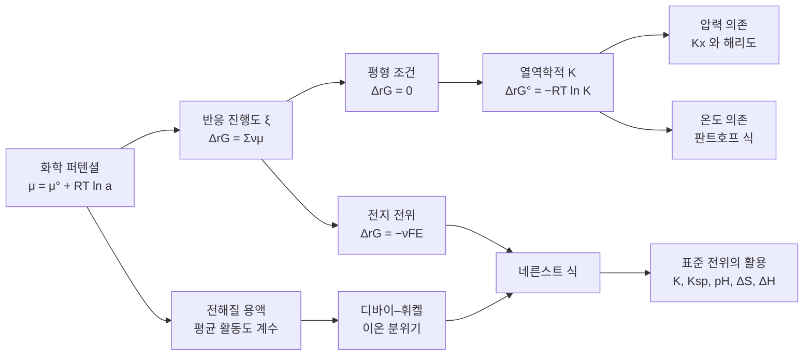

# 물리화학 6. 화학 평형과 전기화학 — 깁스 에너지의 바닥을 찾고, 그 기울기를 전압으로 재다
<!-- prev: pchem-5, uchem-8, uchem-11 -->
<!-- next: pchem-7 -->

> [!NOTE]
> **이 단원의 범위**
> - 반응 진행도 $\xi$와 반응 깁스 에너지 $\Delta_\mathrm{r}G = (\partial G/\partial\xi)_{T,p}$, 평형 조건 $\sum_J \nu_J\mu_J = 0$
> - 평형 상수의 열역학적 정의(활동도), 표준 상태, $K$·$K_c$·$K_x$의 관계, 비이상성(퓨가시티 계수)
> - 평형의 압력 의존과 비활성 기체의 효과, 온도 의존(깁스–헬름홀츠 식 → 판트호프 식, $\Delta_\mathrm{r}C_p$ 보정)
> - 전해질 용액의 화학 퍼텐셜, 평균 활동도와 평균 활동도 계수, 이온 세기, 디바이–휘켈 극한 법칙의 유도와 확장
> - 전기화학 전지의 구성과 표기, 전지 전위와 $\Delta_\mathrm{r}G = -\nu FE$, 네른스트 식
> - 표준 전위의 활용: 평형 상수·용해도곱, 표준 전위의 결정(외삽), pH 측정, 전위의 온도 계수로 $\Delta_\mathrm{r}S$·$\Delta_\mathrm{r}H$ 결정

**학습 목표**

1. 반응 진행도로 반응 혼합물의 깁스 에너지를 쓰고, $\Delta_\mathrm{r}G = \sum_J\nu_J\mu_J$가 $G(\xi)$의 기울기임을 보여 평형 조건을 유도할 수 있다.
2. 화학 퍼텐셜 $\mu_J = \mu_J^\circ + RT\ln a_J$로부터 $\Delta_\mathrm{r}G^\circ = -RT\ln K$를 유도하고, 기체·용액·순수 상의 활동도와 표준 상태를 구별하여 $K$를 쓸 수 있다.
3. $K$가 압력에 무관한 까닭을 설명하고 $K_x$의 압력 의존으로 해리도를 계산하며, 깁스–헬름홀츠 식에서 판트호프 식을 유도하여 $\Delta_\mathrm{r}C_p$까지 고려한 $K(T)$를 구할 수 있다.
4. 전해질의 평균 활동도 계수와 이온 세기를 정의하고, 디바이–휘켈 극한 법칙을 가정에서 결과까지 유도하여 묽은 용액의 활동도 계수와 용해도를 계산할 수 있다.
5. 전기화학 전지를 표기하고, 전기적 일로부터 $\Delta_\mathrm{r}G = -\nu FE$와 네른스트 식을 유도하여 활동도가 들어간 전지 전위를 계산할 수 있다.
6. 표준 전위로 평형 상수·용해도곱·이온의 생성 깁스 에너지를 구하고, 외삽으로 표준 전위를 결정하며, pH의 조작적 정의와 전위의 온도 계수로 $\Delta_\mathrm{r}S^\circ$, $\Delta_\mathrm{r}H^\circ$를 구할 수 있다.

**이 단원의 학습 사다리**

| 단계 | 무엇을 하나? |
|---|---|
| STEP 1. 이전 학습 다시 보기 | $\Delta G^\circ = -RT\ln K$, 판트호프 식, 네른스트 식(일반화학), 화학 퍼텐셜·활동도·깁스–뒤앙 식(물리화학 5) |
| STEP 2. 기초 다지기 | 깁스–헬름홀츠 식(편미분), 지수 함수의 1차 근사, 구면 대칭 라플라시안과 그 해, 직선 맞춤과 외삽 |
| STEP 3. 핵심 개념 | 반응 진행도 → 열역학적 $K$ → 압력 의존 → 온도 의존 → 전해질과 디바이–휘켈 → 전지와 $-\nu FE$ → 네른스트 식 → $K$·$K_\mathrm{sp}$ → $E^\circ$ 결정과 pH → $\Delta S$·$\Delta H$ 결정 |
| STEP 4. 오개념 바로잡기 | "압력을 올리면 $K$가 변한다", "이온 하나의 활동도 계수를 잴 수 있다", "반쪽 전위는 그대로 더한다" 같은 착각 |
| STEP 5. 대학원·연구로 | 깁스 에너지 최소화로 푸는 다중 평형, 전기 이중층(구이–채프먼), 진한 전해질의 피처 식 |
| STEP 6. 생활·산업·진로 | 암모니아 공정의 압력, 리튬 이온 전지의 엔트로피 열, pH 측정과 이온 선택성 전극, 해수 화학 |

---

## 🗺️ 단원 들어가기

질소와 수소를 섞어 700 K로 데우면 암모니아가 생기다가 어느 조성에서 멈춘다. 왜 '거기서' 멈출까? 일반화학에서는 "$Q = K$가 되면 멈춘다"고 답했다. 그러나 이 답은 질문을 미뤄 놓은 것에 가깝다. $K$는 왜 그런 식으로 생겼으며, 왜 계수가 지수로 올라가고, 왜 순수한 고체는 빠지는가? 물리화학 5에서 익힌 **화학 퍼텐셜**을 손에 쥔 지금은 더 근본적으로 답할 수 있다. 반응이 진행될수록 혼합물의 깁스 에너지 $G$가 변하고, 반응은 $G$가 가장 낮은 곳, 즉 **$G$를 반응 진행도로 미분한 기울기가 0인 곳**에서 멈춘다. 평형 상수는 이 '바닥의 위치'를 숫자 하나로 적은 것이다.

이 기울기는 직접 잴 수도 있다. 반응물과 생성물을 두 전극에 떼어 놓고 전자가 도선을 따라가게 하면, 반응이 아직 바닥에 이르지 않은 만큼 전압이 생긴다. 전지의 전압은 **반응 깁스 에너지를 전자의 전하로 나눈 것**이다. 그래서 전압계 하나로 평형 상수, 용해도곱, pH, 심지어 반응 엔트로피까지 잴 수 있다. 다만 이온이 들어가는 순간 '농도'는 더 이상 믿을 만한 변수가 아니다. 이온은 서로 멀리서도 쿨롱 힘을 느껴 이상 용액에서 크게 벗어나므로, 디바이와 휘켈이 세운 이온 분위기 모형으로 **활동도 계수**를 계산해야 한다.

---

## STEP 1. 🔙 이전 학습 다시 보기

### 연계 개념표

| 이전 단원 | 그때 배운 것 | 이 단원에서 확장되는 것 |
|---|---|---|
| 일반화학 「화학 평형」 | 질량 작용의 법칙, $K_c$와 $K_p$, $K_p = K_c(RT)^{\Delta n}$, 반응 지수 $Q$, 르샤틀리에 원리 | $K$를 활동도로 **정의**하고, 질량 작용의 법칙을 화학 퍼텐셜에서 **유도**한다. 르샤틀리에 원리를 $K_x$의 압력 의존과 판트호프 식으로 정량화 |
| 일반화학 「화학 열역학」 | $\Delta G = \Delta G^\circ + RT\ln Q$, $\Delta G^\circ = -RT\ln K$, $\Delta H^\circ$ 일정 근사의 판트호프 식 | 이 식들이 $G(\xi)$의 기울기에서 나오는 까닭, $\Delta_\mathrm{r}C_p$를 넣은 엄밀한 온도 의존 |
| 일반화학 「전기화학」 | 표준 환원 전위, $\Delta G^\circ = -nFE^\circ$, $E = E^\circ - (0.0592/n)\log Q$(농도 사용), 농도차 전지 | 전기적 일에서 $-\nu FE$를 유도, 네른스트 식에 **활동도**를 넣고 외삽으로 $E^\circ$를 결정, 온도 계수로 $\Delta S$·$\Delta H$ |
| 물리화학 3 「자유 에너지와 화학 퍼텐셜」 | $dG = V\,dp - S\,dT$, 깁스–헬름홀츠 식, 화학 퍼텐셜, 퓨가시티 | $dG = \sum\mu_J\,dn_J$를 반응에 적용, 깁스–헬름홀츠 식에서 판트호프 식 |
| 물리화학 5 「혼합물과 용액의 열역학」 | 이상 기체·이상 용액의 혼합 깁스 에너지, 라울·헨리 법칙, 활동도와 활동도 계수 | 혼합 항이 평형을 반응 중간에 멈추게 하는 까닭, 전해질의 **평균** 활동도 계수 |

### 준비 운동 (사전 진단)

**Q1.** 25 ℃에서 어떤 반응의 $K = 4.0\times10^{3}$이다. $\Delta_\mathrm{r}G^\circ$는 몇 kJ/mol인가? ($RT = 2.479\ \mathrm{kJ/mol}$)

**Q2.** 이상 기체 성분 J의 화학 퍼텐셜을 분압 $p_J$로 쓰시오. 이상 용액(묽은 용액)의 용질이라면 어떻게 바뀌는가?

**Q3.** 다니엘 전지 $\mathrm{Zn(s) + Cu^{2+}(aq) \rightarrow Zn^{2+}(aq) + Cu(s)}$의 $E^\circ = 1.10\ \mathrm{V}$이다. $\mathrm{[Zn^{2+}]}$를 10배로 늘리면 25 ℃에서 전지 전위는 얼마나 변하는가(농도를 활동도로 본다)?

**Q4.** 물리화학 3의 기본 방정식 $dG = V\,dp - S\,dT$에서 $(\partial G/\partial T)_p$와 $(\partial G/\partial p)_T$를 쓰시오.

정답 및 해설

**Q1.** $\Delta_\mathrm{r}G^\circ = -RT\ln K = -2.479\times\ln(4.0\times10^3) = -2.479\times8.294 = -20.6\ \mathrm{kJ/mol}$.

**Q2.** $\mu_J = \mu_J^\circ + RT\ln(p_J/p^\circ)$. 묽은 용액의 용질은 헨리 법칙 기준으로 $\mu_J = \mu_J^\circ + RT\ln(b_J/b^\circ)$(몰랄 농도 기준)이며, 비이상이면 $b_J/b^\circ$ 대신 활동도 $a_J = \gamma_J b_J/b^\circ$를 쓴다.

**Q3.** $Q = [\mathrm{Zn^{2+}}]/[\mathrm{Cu^{2+}}]$가 10배가 되므로 $\Delta E = -(0.0592/2)\log 10 = -0.0296\ \mathrm{V}$, 약 30 mV 줄어든다.

**Q4.** $(\partial G/\partial T)_p = -S$, $(\partial G/\partial p)_T = V$. STEP 3 ③·④에서 이 두 식이 각각 평형의 압력 의존과 온도 의존의 뿌리가 된다.

---

## STEP 2. 🧱 기초 다지기

### 디딤돌 1. 깁스–헬름홀츠 식 — $G/T$를 온도로 미분하기

수학 도구 1 '다변수 함수와 편미분'에서 익힌 몫의 미분을 일정 압력에서 $G/T$에 적용하면

$$
\left(\frac{\partial (G/T)}{\partial T}\right)_p = \frac{1}{T}\left(\frac{\partial G}{\partial T}\right)_p - \frac{G}{T^2} = \frac{-TS - G}{T^2} = -\frac{H}{T^2}
$$

($G + TS = H$를 썼다.) 반응에 대해서도 같은 꼴, $\left(\partial(\Delta_\mathrm{r}G^\circ/T)/\partial T\right)_p = -\Delta_\mathrm{r}H^\circ/T^2$가 성립한다. 표준 상태의 양은 압력이 $p^\circ$로 고정되어 있으므로 실제로는 상미분이다. 이 식은 "**$\Delta_\mathrm{r}G/T$의 온도 변화는 $\Delta_\mathrm{r}H$가 정한다**"는 뜻으로, ④에서 판트호프 식이 된다. $d(1/T) = -dT/T^2$이므로 변수를 $1/T$로 바꾸면 $d(\Delta G/T)/d(1/T) = \Delta H$로 더 간단해진다.

**예** $\Delta G/T$가 $1/T$에 대해 직선이면 그 기울기가 곧 $\Delta H$이다. 어떤 반응에서 $\Delta_\mathrm{r}G^\circ/T$가 $1/T = 3.00\times10^{-3}\ \mathrm{K^{-1}}$에서 $-40.0\ \mathrm{J/(mol\cdot K)}$, $2.50\times10^{-3}\ \mathrm{K^{-1}}$에서 $-15.0\ \mathrm{J/(mol\cdot K)}$이면 $\Delta_\mathrm{r}H^\circ = (-40.0 + 15.0)/(0.50\times10^{-3}) = -5.0\times10^4\ \mathrm{J/mol}$이다. $1/T$가 커질 때(온도가 낮아질 때) $\Delta G/T$가 더 음수가 되므로 발열 반응이다.

### 디딤돌 2. 지수 함수의 1차 근사 — 작은 에너지를 볼츠만 인자에서 떼어 내기

수학 도구 2 '테일러 급수와 근사'에서 익힌 대로 $\lvert x \rvert \ll 1$이면 $e^{-x} \approx 1 - x$이다. 디바이–휘켈 이론에서는 이온이 느끼는 전기적 에너지 $z e\phi$가 열에너지 $k_\mathrm{B}T$보다 작다고 보고 볼츠만 인자를 이렇게 펼친다.

$$
e^{-ze\phi/k_\mathrm{B}T} \approx 1 - \frac{ze\phi}{k_\mathrm{B}T}
$$

**예** 25 ℃에서 $k_\mathrm{B}T/e = 25.7\ \mathrm{mV}$이다. 1가 이온이 $\phi = 5.0\ \mathrm{mV}$인 곳에 있으면 $x = 5.0/25.7 = 0.195$이고, $e^{-0.195} = 0.823$, 근사값은 $0.805$로 오차가 약 2 %이다. 그러나 $\phi = 50\ \mathrm{mV}$이면 $x = 1.95$, $e^{-x} = 0.14$인데 근사값은 $-0.95$로 완전히 틀린다. 이온 가까이(퍼텐셜이 큰 곳)와 진한 용액에서 디바이–휘켈 이론이 무너지는 수학적 뿌리가 이것이다.

### 디딤돌 3. 구면 대칭 라플라시안과 그 해

수학 도구 3 '라플라시안(직교·구면 좌표)'에 따르면, 퍼텐셜이 중심으로부터의 거리 $r$에만 의존할 때

$$
\nabla^2\phi = \frac{1}{r^2}\frac{d}{dr}\left(r^2\frac{d\phi}{dr}\right) = \frac{1}{r}\frac{d^2(r\phi)}{dr^2}
$$

이다. 그래서 방정식 $\nabla^2\phi = \kappa^2\phi$는 $u = r\phi$로 바꾸면 $u'' = \kappa^2 u$라는 상수 계수 2계 선형 미분방정식(수학 도구 4)이 되고, 일반해는 $u = Ae^{-\kappa r} + Be^{\kappa r}$이다. 멀리서 퍼텐셜이 0으로 가야 하므로 $B = 0$, 즉

$$
\phi(r) = \frac{A\,e^{-\kappa r}}{r}
$$

**예** $\kappa = 0$이면 $\phi = A/r$로 고립된 점전하의 쿨롱 퍼텐셜이다. $\kappa > 0$이면 쿨롱 퍼텐셜에 $e^{-\kappa r}$가 곱해져 거리 $1/\kappa$ 너머에서 급히 사라진다. $1/\kappa$가 $1.0\ \mathrm{nm}$일 때 $r = 3.0\ \mathrm{nm}$에서 이 인자는 $e^{-3} = 0.050$이다. 다른 이온들이 중심 이온의 전하를 '가려 막는' 효과이며, ⑤에서 $1/\kappa$를 **디바이 길이**라 부른다.

### 디딤돌 4. 직선 맞춤과 외삽 — 측정할 수 없는 극한값 읽기

표준 전위 $E^\circ$는 '활동도 계수가 1인 무한히 묽은 용액'의 값이라 직접 잴 수 없다. 대신 묽은 쪽 여러 점을 재어, 이론이 직선을 약속하는 변수에 대해 그리고 **절편으로 외삽**한다. 수학 도구 7 '최소 제곱 맞춤'에서 익힌 식으로, 점 $(x_i, y_i)$ $N$개의 최소 제곱 직선 $y = a + bx$는

$$
b = \frac{\sum(x_i - \bar{x})(y_i - \bar{y})}{\sum(x_i - \bar{x})^2}, \qquad a = \bar{y} - b\bar{x}
$$

**예** 점 $(0.10, 0.2276)$, $(0.20, 0.2326)$, $(0.30, 0.2376)$이면 $\bar{x} = 0.20$, $\bar{y} = 0.2326$, $b = (0.10\times0.0050\times2)/(0.010\times2) = 0.050$, $a = 0.2326 - 0.050\times0.20 = 0.2226$이다. 외삽값의 신뢰도는 (1) 이론이 직선을 약속하는 범위의 점만 썼는가, (2) 외삽 거리가 짧은가에 달려 있다. ⑨에서 이 방법으로 은–염화 은 전극의 $E^\circ$를 구한다.

---

## STEP 3. 📘 핵심 개념

### ① 반응 진행도와 반응 깁스 에너지

#### 반응 진행도 — 반응이 '얼마나' 진행되었는가를 하나의 변수로

반응식을 $0 = \sum_J \nu_J \mathrm{J}$ 꼴로 쓰고, 생성물의 **화학량론 계수(stoichiometric number)** $\nu_J$는 양수, 반응물은 음수로 둔다. 예를 들어 $\mathrm{N_2 + 3H_2 \rightarrow 2NH_3}$에서 $\nu_{\mathrm{N_2}} = -1$, $\nu_{\mathrm{H_2}} = -3$, $\nu_{\mathrm{NH_3}} = +2$이다. 반응이 진행되면 모든 성분의 양이 계수에 비례해 함께 변하므로, 변화량을 하나의 변수로 묶을 수 있다.

$$
dn_J = \nu_J\,d\xi \qquad\Longleftrightarrow\qquad n_J = n_{J,0} + \nu_J\xi
$$

이 $\xi$(크사이)를 **반응 진행도(extent of reaction)** 라 하며 단위는 mol이다. $\xi = 1\ \mathrm{mol}$은 "반응식 1 mol만큼" 반응이 일어났다는 뜻이다(질소 1 mol, 수소 3 mol이 소모되고 암모니아 2 mol이 생김). $\xi$는 어떤 성분을 기준으로 잡아도 같은 값이라는 점이 일반화학의 '변화량 $x$'와 다른 장점이다.

#### 반응 깁스 에너지는 $G(\xi)$의 기울기이다

물리화학 5에서 익힌 다성분계의 기본 방정식은 $dG = V\,dp - S\,dT + \sum_J \mu_J\,dn_J$이다. 온도와 압력이 일정하면 앞의 두 항이 사라지고, $dn_J = \nu_J\,d\xi$를 넣으면

$$
dG = \sum_J \mu_J\nu_J\,d\xi \qquad\Longrightarrow\qquad \boxed{\;\Delta_\mathrm{r}G \equiv \left(\frac{\partial G}{\partial \xi}\right)_{T,p} = \sum_J \nu_J\mu_J\;}
$$

이것을 **반응 깁스 에너지(reaction Gibbs energy)** 라 한다. 이름에 $\Delta$가 있지만 '두 상태의 차'가 아니라 **그 순간 조성에서의 기울기**이다. 단위는 $\mathrm{J/mol}$(반응 진행도 1 mol당)이다.

| $\Delta_\mathrm{r}G$ | $G(\xi)$의 모양 | 자발적 방향 |
|---|---|---|
| $< 0$ | 오른쪽으로 내려가는 기울기 | 정반응($\xi$ 증가) |
| $= 0$ | 바닥(최솟값) | 평형 |
| $> 0$ | 오른쪽으로 올라가는 기울기 | 역반응($\xi$ 감소) |

일정한 $T$, $p$에서 자발적 변화는 $dG < 0$이므로(물리화학 3) 계는 $G$가 내려가는 쪽으로 $\xi$를 바꾸다가 기울기가 0인 곳에서 멈춘다. 그래서 **평형 조건**은

$$
\sum_J \nu_J\mu_J = 0 \qquad (\text{평형, 일정 } T,\ p)
$$

이다. 상평형의 조건 '$\mu_\alpha = \mu_\beta$'(물리화학 4)도 $\alpha \rightarrow \beta$라는 '반응'에 이 조건을 적용한 특수한 경우이다.

#### 왜 반응은 중간에서 멈추는가 — 혼합 항의 역할

가장 간단한 경우로, 이상 기체 A가 이성질화하여 B가 되는 반응 $\mathrm{A \rightleftharpoons B}$를 전체 압력 $p^\circ$에서 생각하자. 처음에 A만 1 mol이 있으면 $n_\mathrm{A} = 1 - \xi$, $n_\mathrm{B} = \xi$, 몰분율 $x_\mathrm{A} = 1 - \xi$, $x_\mathrm{B} = \xi$이다. $\mu_J = \mu_J^\circ + RT\ln x_J$(분압이 $x_Jp^\circ$)이므로

$$
G(\xi) = (1-\xi)\mu_\mathrm{A} + \xi\mu_\mathrm{B} = \underbrace{\mu_\mathrm{A}^\circ + \xi\,\Delta_\mathrm{r}G^\circ}_{\text{순수 성분의 직선}} + \underbrace{RT\left[(1-\xi)\ln(1-\xi) + \xi\ln\xi\right]}_{\text{혼합 깁스 에너지}}
$$

($\Delta_\mathrm{r}G^\circ = \mu_\mathrm{B}^\circ - \mu_\mathrm{A}^\circ$.) 첫째 항만 있다면 $G$는 직선이어서 반응은 끝까지 가거나($\Delta_\mathrm{r}G^\circ < 0$) 전혀 가지 않는다. 둘째 항은 물리화학 5의 **혼합 깁스 에너지**로, 언제나 음수이고 양 끝($\xi = 0, 1$)에서 기울기가 $\mp\infty$이다. 이 항이 더해지면 곡선의 바닥이 반드시 **안쪽**에 생긴다. 미분하면

$$
\frac{dG}{d\xi} = \Delta_\mathrm{r}G^\circ + RT\ln\frac{\xi}{1-\xi} = 0 \quad\Longrightarrow\quad \frac{\xi_\text{평형}}{1-\xi_\text{평형}} = \frac{x_\mathrm{B}}{x_\mathrm{A}} = e^{-\Delta_\mathrm{r}G^\circ/RT}
$$

로, 평형 상수가 저절로 나타난다. 기체·용액의 반응이 결코 '완전히' 끝나지 않는 것은 반응물이 조금 남아 있을 때의 혼합 엔트로피 이득이 무한히 크기 때문이다.

<!-- 그림 요청: 이상 기체 A ⇌ B 반응의 G(ξ) 곡선(298.15 K, 전체 압력 1 bar, A 1 mol에서 출발). 가로축 ξ/mol(0~1), 세로축 (G − μ°A)/(kJ/mol)(−3.2~+0.5). 세 곡선을 겹쳐 그린다: ① 점선 직선 ξ·ΔrG°(ΔrG° = −2.00 kJ/mol, (0,0)에서 (1,−2.00)까지), ② 점선 곡선 혼합 항 RT[(1−ξ)ln(1−ξ)+ξ ln ξ](ξ=0.5에서 최솟값 −1.72 kJ/mol), ③ 굵은 실선 두 항의 합 G(ξ). 실선의 최솟값 (0.691, −2.91)에 점을 찍고 "평형, 기울기 0"이라 표시. ξ=0.2(기울기 −5.44 kJ/mol)와 ξ=0.9(기울기 +3.45 kJ/mol)에 접선을 짧게 그리고 각각 "ΔrG < 0 → 정반응", "ΔrG > 0 → 역반응"이라 쓴다. -->

<!-- 시뮬레이션 요청: A ⇌ B(이상 기체, 1 bar) 반응의 G(ξ) 곡선 조작. 슬라이더: ΔrG°(−10 ~ +10 kJ/mol), 온도 T(200~1000 K). 보여 줄 것: 직선 항·혼합 항·합 곡선을 따로 켜고 끌 수 있게 하고, 합 곡선의 최솟값 위치 ξ_eq와 K = ξ_eq/(1−ξ_eq), 그리고 마우스로 고른 ξ에서의 접선 기울기 ΔrG = ΔrG° + RT ln[ξ/(1−ξ)]를 숫자로 표시. 혼합 항을 끄면 최솟값이 양 끝으로 가는 것을 볼 수 있게 한다. -->

#### 순수한 응축상만 바뀌면 혼합 항이 없다

$\mathrm{CaCO_3(s) \rightarrow CaO(s) + CO_2(g)}$를 $\mathrm{CO_2}$ 분압이 일정하게 유지되는 용기에서 생각하자. 두 고체는 서로 섞이지 않는 순수한 상이므로 혼합 항이 없고, $G(\xi)$는 직선이다. 따라서 주어진 $p_{\mathrm{CO_2}}$에서 반응은 **완전히 일어나거나 전혀 일어나지 않으며**, 두 고체가 공존하는 것은 $p_{\mathrm{CO_2}}$가 정확히 평형 압력일 때뿐이다. 석회 가마에서 온도를 정하면 분해 압력이 하나로 정해지는 까닭이다(물리화학 4의 상 규칙으로 보면 성분 2, 상 3이므로 자유도 1).

#### 예제 1 — 이성질화 반응의 깁스 에너지 곡선

298.15 K, 전체 압력 1 bar에서 이상 기체 반응 $\mathrm{A \rightleftharpoons B}$의 $\Delta_\mathrm{r}G^\circ = -2.00\ \mathrm{kJ/mol}$이다. A 1.00 mol에서 출발할 때 (1) $\xi = 0.20\ \mathrm{mol}$과 $0.90\ \mathrm{mol}$에서 $\Delta_\mathrm{r}G$를 구하고 방향을 판단하시오. (2) 평형에서의 $\xi$를 구하시오. (3) 평형 혼합물의 $G$는 순수한 B 1.00 mol의 $G$보다 얼마나 낮은가? ($RT = 2.479\ \mathrm{kJ/mol}$)

**풀이**
(1) 식 세우기: $\Delta_\mathrm{r}G = \Delta_\mathrm{r}G^\circ + RT\ln\dfrac{\xi}{1-\xi}$.
$\xi = 0.20$: $-2.00 + 2.479\ln 0.25 = -2.00 - 3.44 = -5.44\ \mathrm{kJ/mol}$ → 정반응.
$\xi = 0.90$: $-2.00 + 2.479\ln 9 = -2.00 + 5.45 = +3.45\ \mathrm{kJ/mol}$ → 역반응.
(2) $K = e^{2.00/2.479} = e^{0.807} = 2.24$, $\xi/(1-\xi) = 2.24$에서 $\xi_\text{평형} = 2.24/3.24 = 0.691\ \mathrm{mol}$.
(3) $G(\xi) - \mu_\mathrm{A}^\circ$에 $\xi = K/(1+K)$를 넣고 정리하면 $-RT\ln(1+K)$가 된다(정리 과정은 바로 확인 3). $-2.479\ln 3.24 = -2.91\ \mathrm{kJ}$. 순수한 B는 $\Delta_\mathrm{r}G^\circ = -2.00\ \mathrm{kJ}$이므로 평형 혼합물이 **0.91 kJ 더 낮다.**

**의미** $\Delta_\mathrm{r}G^\circ < 0$이라 B가 더 안정한데도 '모두 B'가 아니라 B 69 %에서 멈춘다. A를 31 % 남겨 섞어 두는 쪽이 혼합 엔트로피 덕분에 깁스 에너지가 더 낮기 때문이다. 그리고 $\Delta_\mathrm{r}G$는 같은 반응에서도 조성에 따라 $-5.44$에서 $+3.45\ \mathrm{kJ/mol}$까지 바뀐다. "이 반응의 $\Delta G$는 얼마인가"라는 질문은 조성을 정하지 않으면 답이 없다.

> [!TIP]
> 💡 **비유** — $G(\xi)$는 골짜기의 단면이고, 반응 혼합물은 그 위의 공이다. $\Delta_\mathrm{r}G$는 공이 있는 자리의 **경사**이다. $\Delta_\mathrm{r}G^\circ$는 골짜기 양 끝의 높이 차(순수 A와 순수 B)일 뿐이고, 공이 멈추는 바닥의 위치는 양 끝의 높이 차와 골짜기 바닥을 파 내려가는 혼합 항이 함께 정한다.

#### ✔ 바로 확인

1. (O/X) 반응 깁스 에너지 $\Delta_\mathrm{r}G$는 반응 혼합물의 조성과 관계없이 반응마다 하나의 값을 가진다.
2. 빈칸: 일정한 $T$, $p$에서 평형 조건은 $\sum_J \nu_J(\quad) = 0$이다.
3. 예제 1의 $G(\xi) - \mu_\mathrm{A}^\circ = \xi\Delta_\mathrm{r}G^\circ + RT[(1-\xi)\ln(1-\xi) + \xi\ln\xi]$에 $\Delta_\mathrm{r}G^\circ = -RT\ln K$와 $\xi = K/(1+K)$를 넣어 $-RT\ln(1+K)$가 됨을 보이시오.
4. $\mathrm{N_2 + 3H_2 \rightarrow 2NH_3}$에서 처음에 $\mathrm{N_2}$ 2.0 mol, $\mathrm{H_2}$ 3.0 mol이 있었다. 암모니아가 0.80 mol 생겼을 때 $\xi$와 남은 $\mathrm{H_2}$의 양은?

정답

1. X — $\Delta_\mathrm{r}G = \Delta_\mathrm{r}G^\circ + RT\ln Q$는 조성($Q$)에 따라 변하는 $G(\xi)$의 기울기이다. 조성에 무관한 것은 $\Delta_\mathrm{r}G^\circ$이다.
2. $\mu_J$ (화학 퍼텐셜)
3. $1 - \xi = 1/(1+K)$이므로 $(1-\xi)\ln(1-\xi) + \xi\ln\xi = -\ln(1+K) + \xi\ln K$. 따라서 $G - \mu_\mathrm{A}^\circ = -\xi RT\ln K + RT[-\ln(1+K) + \xi\ln K] = -RT\ln(1+K)$.
4. $\xi = 0.40\ \mathrm{mol}$, $\mathrm{H_2}$ $3.0 - 3\times0.40 = 1.8\ \mathrm{mol}$ — $n_{\mathrm{NH_3}} = 0 + 2\xi$.

### ② 평형 상수의 열역학적 정의 — 활동도

#### 질량 작용의 법칙을 유도하기

물리화학 5에서 모든 성분의 화학 퍼텐셜을 하나의 꼴로 썼다.

$$
\mu_J = \mu_J^\circ + RT\ln a_J
$$

$a_J$는 **활동도(activity)**, $\mu_J^\circ$는 $a_J = 1$인 **표준 상태**의 화학 퍼텐셜이다. 이것을 $\Delta_\mathrm{r}G = \sum\nu_J\mu_J$에 넣으면

$$
\Delta_\mathrm{r}G = \underbrace{\sum_J\nu_J\mu_J^\circ}_{\Delta_\mathrm{r}G^\circ} + RT\sum_J\nu_J\ln a_J = \Delta_\mathrm{r}G^\circ + RT\ln Q, \qquad Q = \prod_J a_J^{\nu_J}
$$

로그 앞의 계수 $\nu_J$가 로그 안으로 들어가 지수가 되고, 반응물은 $\nu_J < 0$이라 분모로 간다. 일반화학에서 외웠던 '계수는 지수로, 반응물은 분모로'가 이렇게 나온다. 평형에서 $\Delta_\mathrm{r}G = 0$, $Q = K$이므로

$$
\boxed{\;\Delta_\mathrm{r}G^\circ = -RT\ln K, \qquad K = \left(\prod_J a_J^{\nu_J}\right)_\text{평형}\;}
$$

$\Delta_\mathrm{r}G^\circ$는 온도와 표준 상태의 선택에만 의존하므로 **$K$도 온도만의 함수**이다. 활동도는 무차원이므로 $K$도 무차원이다.

#### 표준 상태와 활동도 — 무엇을 1로 놓는가

| 성분의 종류 | 표준 상태 | 활동도 $a_J$ | 이상적인 경우 |
|---|---|---|---|
| 기체 | 압력 $p^\circ = 1\ \mathrm{bar}$의 가상적 이상 기체 | $f_J/p^\circ = \phi_J p_J/p^\circ$ | $p_J/p^\circ$ ($\phi_J = 1$) |
| 용질(몰랄 농도 기준) | $b^\circ = 1\ \mathrm{mol/kg}$에서 헨리 법칙을 따르는 가상 상태 | $\gamma_J b_J/b^\circ$ | $b_J/b^\circ$ |
| 용매, 액체 혼합물 성분(라울 기준) | 같은 $T$, $p^\circ$의 순수 액체 | $\gamma_J x_J$ | $x_J$ (묽은 용액의 용매는 거의 1) |
| 순수한 고체·액체 | 같은 $T$, $p^\circ$의 순수 상 | 1 (압력이 $p^\circ$에서 크게 벗어나지 않으면) | 1 |

($f_J$는 물리화학 3의 **퓨가시티**, $\phi_J$는 퓨가시티 계수이다.) 순수한 응축상의 활동도가 1인 것은 '양이 많아도 화학 퍼텐셜이 그대로'이기 때문이다. 엄밀히는 $\ln a = V_\mathrm{m}(p - p^\circ)/RT$만큼 압력에 의존하지만, 고체의 몰부피는 작아서, 몰부피가 $40\ \mathrm{cm^3/mol}$인 고체도 $p = 10\ \mathrm{bar}$에서 $a = e^{0.0145} \approx 1.015$로 1에서 2 % 이내로 벗어날 뿐이다.

> [!WARNING]
> 표준 상태의 '1 mol/kg 용액'이나 '1 bar 이상 기체'는 **실제로 존재하는 용액·기체가 아니라 가상 상태**이다. 실제 1 mol/kg 염화 나트륨 용액에서 이온의 평균 활동도 $a_\pm = \gamma_\pm b/b^\circ$(⑤)는 1이 아니라 약 0.66이다. $\Delta_\mathrm{r}G^\circ$는 이 가상 상태들 사이의 차이이며, 같은 반응이라도 표준 상태를 몰 농도($c^\circ = 1\ \mathrm{mol/L}$) 기준으로 바꾸면 $\Delta_\mathrm{r}G^\circ$와 $K$의 값이 달라진다.

#### 여러 가지 평형 상수의 관계

이상 기체 반응이라면 $K$를 분압, 몰 농도, 몰분율로도 쓸 수 있다. $\Delta\nu = \sum_\text{기체}\nu_J$라 하면

| 평형 상수 | 정의 | $K$와의 관계(이상 기체) |
|---|---|---|
| $K_p$ | $\prod(p_J/p^\circ)^{\nu_J}$ | $K_p = K$ |
| $K_c$ | $\prod(c_J/c^\circ)^{\nu_J}$ | $K = K_c\left(\dfrac{c^\circ RT}{p^\circ}\right)^{\Delta\nu}$ |
| $K_x$ | $\prod x_J^{\nu_J}$ | $K = K_x\left(\dfrac{p}{p^\circ}\right)^{\Delta\nu}$ |
| (실제 기체) | $K = K_\phi K_p$ | $K_\phi = \prod\phi_J^{\nu_J}$ |

$K_c$ 관계는 $p_J = c_JRT$에서, $K_x$ 관계는 $p_J = x_Jp$에서 바로 나온다. $K_c$는 $(c^\circ RT/p^\circ)^{\Delta\nu}$ 인자 때문에 $K$와 다른 온도 의존을 갖고, $K_x$는 $\Delta\nu \neq 0$이면 압력에도 의존하는 '편의상의 상수'이고, 열역학적 의미를 갖는 것은 $K$이다.

#### 예제 2 — 표준 생성 깁스 에너지로 $K$와 $K_c$ 구하기

(1) 298.15 K에서 $\mathrm{2SO_2(g) + O_2(g) \rightleftharpoons 2SO_3(g)}$의 $K$를 구하시오. ($\Delta_\mathrm{f}G^\circ$: $\mathrm{SO_2}$ $-300.19$, $\mathrm{SO_3}$ $-371.06\ \mathrm{kJ/mol}$)
(2) 같은 온도에서 $\mathrm{N_2O_4(g) \rightleftharpoons 2NO_2(g)}$의 $K$와 $K_c$($c^\circ = 1\ \mathrm{mol/L}$)를 구하시오. ($\Delta_\mathrm{f}G^\circ$: $\mathrm{N_2O_4}$ $97.89$, $\mathrm{NO_2}$ $51.31\ \mathrm{kJ/mol}$)

**풀이**
(1) $\Delta_\mathrm{r}G^\circ = 2(-371.06) - 2(-300.19) - 0 = -141.74\ \mathrm{kJ/mol}$. 원소인 $\mathrm{O_2}$의 $\Delta_\mathrm{f}G^\circ = 0$이다.
$\ln K = 141\,740/2479.0 = 57.18$, $K = e^{57.18} = 6.8\times10^{24}$.
(2) $\Delta_\mathrm{r}G^\circ = 2(51.31) - 97.89 = +4.73\ \mathrm{kJ/mol}$, $K = e^{-4730/2479.0} = 0.148$.
$c^\circ RT/p^\circ = (1000\ \mathrm{mol/m^3})(8.314\ \mathrm{J/(mol\cdot K)})(298.15\ \mathrm{K})/(10^5\ \mathrm{Pa}) = 24.79$, $\Delta\nu = +1$이므로 $K_c = K/24.79 = 5.98\times10^{-3}$.

**의미** (1)의 $K$가 $10^{25}$에 가까우므로 25 ℃에서 평형은 완전히 $\mathrm{SO_3}$ 쪽이다. 그런데도 황산 공장이 약 700 K에서 바나듐 촉매를 쓰는 것은 속도 때문이다(④에서 온도를 올리면 $K$가 얼마나 줄어드는지 다룬다). (2)에서 $K$와 $K_c$가 25배나 다른 것은 '1 bar'와 '1 mol/L'가 서로 다른 표준이기 때문이다. 25 ℃의 이상 기체 1 mol/L는 약 24.8 bar에 해당한다.

#### 비이상성 — 퓨가시티 계수와 활동도 계수

고압 기체나 진한 용액에서는 $K_p$나 $K_b = \prod(b_J/b^\circ)^{\nu_J}$가 압력·조성에 따라 변하는 것처럼 보인다. 그러나 $K$ 자체는 변하지 않는다. 변하는 것은 계수 부분이다.

$$
K = K_\phi K_p = K_\gamma K_b, \qquad K_\phi = \prod_J\phi_J^{\nu_J},\quad K_\gamma = \prod_J\gamma_J^{\nu_J}
$$

예를 들어 수백 bar의 암모니아 합성에서는 $K_\phi$가 1보다 작아져, 같은 $K$에서도 $K_p = K/K_\phi$가 커지고 실제 암모니아 수득률이 이상 기체로 계산한 것보다 높아진다. 이온 반응에서는 $K_\gamma$가 1에서 크게 벗어나는데, 그 값을 계산하는 것이 ⑤의 디바이–휘켈 이론이다.

#### ✔ 바로 확인

1. 다음 반응의 열역학적 평형 상수 $K$를 활동도로 쓰고, 이상적 근사로 바꾸시오. $\mathrm{Zn(s) + 2H^+(aq) \rightleftharpoons Zn^{2+}(aq) + H_2(g)}$
2. (O/X) 기체 반응 $\mathrm{N_2O_4 \rightleftharpoons 2NO_2}$의 $K$는 무차원이지만 $K_c$에는 늘 $\mathrm{mol/L}$ 단위가 붙는다.
3. 25 ℃에서 $\Delta_\mathrm{r}G^\circ = +11.4\ \mathrm{kJ/mol}$인 반응의 $K$는? ($RT = 2.479\ \mathrm{kJ/mol}$)
4. 빈칸: 실제 기체에서 $K = K_\phi K_p$이며, $K_\phi$는 각 성분의 (    ) 계수를 화학량론 계수만큼 거듭제곱해 곱한 것이다.

정답

1. $K = \dfrac{a_{\mathrm{Zn^{2+}}}\,a_{\mathrm{H_2}}}{a_{\mathrm{Zn}}\,a_{\mathrm{H^+}}^2} \approx \dfrac{(b_{\mathrm{Zn^{2+}}}/b^\circ)(p_{\mathrm{H_2}}/p^\circ)}{(b_{\mathrm{H^+}}/b^\circ)^2}$ — 순수한 고체 Zn의 활동도는 1이다.
2. X — 이 책처럼 $c^\circ$로 나누어 정의하면 $K_c$도 무차원이다. 단위가 붙는 것은 $c^\circ$로 나누지 않고 쓴 관습적 표현이며, 어느 경우든 $K_c$의 **값**은 $K$와 다르다.
3. 약 $1.0\times10^{-2}$ — $e^{-11.4/2.479} = e^{-4.60}$.
4. 퓨가시티 — $\phi_J = f_J/p_J$.

### ③ 평형의 압력 의존 — $K$는 그대로, 조성이 움직인다

#### $K$는 압력에 무관하다

$\Delta_\mathrm{r}G^\circ = \sum\nu_J\mu_J^\circ$에서 각 $\mu_J^\circ$는 **표준 압력 $p^\circ$에서의 값으로 정의**되어 있다. 반응 용기의 압력을 바꾸어도 $p^\circ$는 그대로 1 bar이므로

$$
\left(\frac{\partial K}{\partial p}\right)_T = 0
$$

이다. 그렇다면 르샤틀리에 원리가 말하는 '압력에 따른 평형 이동'은 무엇인가? 이동하는 것은 $K$가 아니라 **조성**이다. 이상 기체에서 $K = K_x(p/p^\circ)^{\Delta\nu}$이므로

$$
K_x = K\left(\frac{p}{p^\circ}\right)^{-\Delta\nu}, \qquad \left(\frac{\partial\ln K_x}{\partial\ln p}\right)_T = -\Delta\nu
$$

$\Delta\nu < 0$(기체 몰수가 줄어드는 반응)이면 압력을 올릴수록 $K_x$가 커져 생성물 쪽 몰분율이 커진다. 르샤틀리에 원리의 정량적 형태이다.

#### 해리 반응의 해리도와 압력

$\mathrm{N_2O_4(g) \rightleftharpoons 2NO_2(g)}$에서 처음 $\mathrm{N_2O_4}$ $n$ mol 가운데 비율 $\alpha$가 해리했다고 하자.

| | $\mathrm{N_2O_4}$ | $\mathrm{NO_2}$ | 합 |
|---|---|---|---|
| 양 | $n(1-\alpha)$ | $2n\alpha$ | $n(1+\alpha)$ |
| 몰분율 | $\dfrac{1-\alpha}{1+\alpha}$ | $\dfrac{2\alpha}{1+\alpha}$ | 1 |

$$
K = \frac{x_{\mathrm{NO_2}}^2}{x_{\mathrm{N_2O_4}}}\cdot\frac{p}{p^\circ} = \frac{4\alpha^2}{(1+\alpha)(1-\alpha)}\cdot\frac{p}{p^\circ} = \frac{4\alpha^2}{1-\alpha^2}\cdot\frac{p}{p^\circ}
\quad\Longrightarrow\quad
\alpha = \left(\frac{K}{K + 4p/p^\circ}\right)^{1/2}
$$

$p \rightarrow 0$이면 $\alpha \rightarrow 1$(완전 해리), $p \rightarrow \infty$이면 $\alpha \rightarrow 0$이다. 압력이 0으로 가면 혼합 엔트로피 이득이 압도해 기체 몰수가 많은 쪽이 유리해진다.

<!-- 그림 요청: N2O4 ⇌ 2NO2(298.15 K, K = 0.148)의 해리도 α를 전체 압력 p에 대해 그린 그래프. 가로축 p/bar를 로그 눈금(0.01~100), 세로축 α(0~1). 곡선 α = [K/(K + 4p)]^(1/2). 주요 점 표시: p = 0.10 bar에서 α = 0.520, p = 1.0 bar에서 α = 0.189, p = 10 bar에서 α = 0.061. 가로 점선 α = 1(저압 극한)과 오른쪽 아래로 0에 다가가는 모습. 곡선 옆에 "K는 일정, Kx = K(p/p°)^(−1)이 변한다"라고 쓴다. -->

#### 비활성 기체를 넣으면

비활성 기체(Ar 등)를 넣을 때, 부피가 일정하면 반응 기체의 분압이 그대로이므로 평형이 이동하지 않는다. 전체 압력이 일정하면 부피가 늘어 반응 기체의 분압이 줄어들므로, 압력을 낮춘 것과 같이 $\Delta\nu > 0$ 쪽으로 이동한다. '압력'이 아니라 **반응 기체의 분압**이 평형을 움직인다는 것이 핵심이다.

#### 예제 3 — 사산화 이질소의 해리도

298.15 K에서 $\mathrm{N_2O_4 \rightleftharpoons 2NO_2}$의 $K = 0.148$이다(예제 2). (1) 전체 압력 1.0 bar, 0.10 bar, 10 bar에서 해리도를 구하시오. (2) $\mathrm{N_2O_4}$ 1.0 mol에 아르곤 9.0 mol을 섞어 전체 압력을 1.0 bar로 유지하면 해리도는 얼마인가?

**풀이**
(1) $\alpha = [K/(K + 4p/p^\circ)]^{1/2}$에 대입한다.
1.0 bar: $(0.148/4.148)^{1/2} = 0.189$, 0.10 bar: $(0.148/0.548)^{1/2} = 0.520$, 10 bar: $(0.148/40.148)^{1/2} = 0.061$.
(2) 전체 몰수는 $1.0 + \alpha + 9.0 = 10.0 + \alpha$이므로
$$
K = \frac{(2\alpha)^2}{(1-\alpha)(10.0 + \alpha)}\cdot\frac{p}{p^\circ} = 0.148
$$
이 3차 방정식을 수치적으로(스프레드시트의 목표값 찾기, 또는 이분법) 풀면 $\alpha = 0.458$이다. 검산: $4(0.458)^2/[(0.542)(10.458)] = 0.839/5.668 = 0.148$.

**의미** 압력을 1 bar에서 0.1 bar로 낮추면 해리도가 0.19에서 0.52로 커진다. 아르곤을 섞어 전체 압력을 1 bar로 유지해도 반응 기체의 분압이 약 10분의 1로 줄었으므로 해리도가 0.46으로 커진다. 두 경우 모두 $K$는 0.148 그대로이다.

> [!TIP]
> 💡 **응축상 반응의 압력 효과** — 용액 속 반응에서는 표준 상태를 '그 압력의 가상 용액'으로 잡는 일이 많고, 그때는 $(\partial\ln K/\partial p)_T = -\Delta_\mathrm{r}V^\circ/RT$이다. $\Delta_\mathrm{r}V^\circ$가 수십 $\mathrm{cm^3/mol}$ 정도라 1 bar에서 수십 bar까지는 효과가 작지만, 수심 10 km의 바다(약 1000 bar)에서는 $\Delta_\mathrm{r}V^\circ = -20\ \mathrm{cm^3/mol}$인 반응의 $K$가 약 2.2배가 된다($e^{20\times10^{-6}\times10^{8}/2479}$). 심해에서 탄산 칼슘이 더 잘 녹는 까닭 가운데 하나이다.

#### ✔ 바로 확인

1. (O/X) 일정한 온도에서 $\mathrm{N_2 + 3H_2 \rightleftharpoons 2NH_3}$ 혼합물을 압축하면 $K$가 커진다.
2. $\mathrm{PCl_5(g) \rightleftharpoons PCl_3(g) + Cl_2(g)}$에서 $(\partial\ln K_x/\partial\ln p)_T$는?
3. 부피가 일정한 용기에 평형 상태의 $\mathrm{N_2O_4}$–$\mathrm{NO_2}$ 혼합물이 있다. 헬륨을 넣으면 해리도는 어떻게 되는가?

정답

1. X — $K$는 온도만의 함수이다. 압축하면 $K_x = K(p/p^\circ)^{2}$가 커져 암모니아의 몰분율이 커진다($\Delta\nu = -2$).
2. $-1$ — $\Delta\nu = +1$이므로 압력을 올리면 $K_x$가 $p$에 반비례해 줄어든다.
3. 변하지 않는다 — 부피가 일정하면 반응 기체들의 분압이 그대로이다.

### ④ 평형의 온도 의존 — 깁스–헬름홀츠 식에서 판트호프 식으로

#### 유도

$\ln K = -\Delta_\mathrm{r}G^\circ/RT$이므로 STEP 2 디딤돌 1의 깁스–헬름홀츠 식을 그대로 쓸 수 있다.

- **가정** 표준 상태의 압력은 $p^\circ$로 고정, 성분은 각자의 표준 상태에 있다.
- **1단계** $\dfrac{d\ln K}{dT} = -\dfrac{1}{R}\dfrac{d(\Delta_\mathrm{r}G^\circ/T)}{dT}$
- **2단계** 깁스–헬름홀츠 식 $\dfrac{d(\Delta_\mathrm{r}G^\circ/T)}{dT} = -\dfrac{\Delta_\mathrm{r}H^\circ}{T^2}$을 넣는다.
- **결과**

$$
\boxed{\;\frac{d\ln K}{dT} = \frac{\Delta_\mathrm{r}H^\circ}{RT^2}\;} \qquad\Longleftrightarrow\qquad \frac{d\ln K}{d(1/T)} = -\frac{\Delta_\mathrm{r}H^\circ}{R}
$$

이것이 **판트호프 식(van 't Hoff equation)** 이다. 일반화학에서는 $\Delta H^\circ$와 $\Delta S^\circ$가 일정하다는 가정에서 출발했지만, 여기서는 **아무 근사 없이** 나왔다. 근사는 이것을 적분할 때 들어간다.

#### 적분 — 두 가지 수준

**(가) $\Delta_\mathrm{r}H^\circ$가 일정한 경우**(온도 범위가 좁을 때)

$$
\ln\frac{K_2}{K_1} = -\frac{\Delta_\mathrm{r}H^\circ}{R}\left(\frac{1}{T_2} - \frac{1}{T_1}\right)
$$

**(나) $\Delta_\mathrm{r}C_p^\circ$가 일정한 경우** 물리화학 1의 키르히호프 법칙으로 $\Delta_\mathrm{r}H^\circ(T) = \Delta_\mathrm{r}H^\circ(T_1) + \Delta_\mathrm{r}C_p^\circ(T - T_1) \equiv a + \Delta_\mathrm{r}C_p^\circ T$라 쓰면($a = \Delta_\mathrm{r}H^\circ(T_1) - \Delta_\mathrm{r}C_p^\circ T_1$)

$$
\ln\frac{K_2}{K_1} = \int_{T_1}^{T_2}\frac{a + \Delta_\mathrm{r}C_p^\circ T}{RT^2}dT = -\frac{a}{R}\left(\frac{1}{T_2} - \frac{1}{T_1}\right) + \frac{\Delta_\mathrm{r}C_p^\circ}{R}\ln\frac{T_2}{T_1}
$$

$\Delta_\mathrm{r}C_p^\circ \neq 0$이면 판트호프 그래프($\ln K$–$1/T$)가 직선이 아니라 휘어지며, 각 온도에서의 **접선 기울기**가 그 온도의 $-\Delta_\mathrm{r}H^\circ(T)/R$이다.

<!-- 그림 요청: 판트호프 그래프 두 곡선 비교. 반응 N2 + 3H2 ⇌ 2NH3. 가로축 (1/T)/(10⁻³ K⁻¹)(1.3~3.4), 세로축 ln K(−12~+14). ① 점선 직선: ΔrH° = −92.22 kJ/mol 일정, (1/298.15 = 3.354×10⁻³, 13.27)을 지나고 기울기 +11 092 K. ② 실선 곡선: ΔrCp° = −45.46 J/(mol·K) 일정, ln K = 13.27 + (78 666/8.314)(1/T − 1/298.15) − (45.46/8.314) ln(T/298.15). 두 선은 298.15 K에서 접한다. 1/T = 1.4286×10⁻³(700 K)에서 점선은 −8.08, 실선은 −9.61에 점을 찍고 이름표. 실선의 700 K 점에 접선을 그어 "기울기 = −ΔrH°(700 K)/R, ΔrH°(700 K) = −110.5 kJ/mol"이라 표시. -->

#### 예제 4 — 암모니아 합성의 $K$를 700 K로 옮기기

$\mathrm{N_2 + 3H_2 \rightleftharpoons 2NH_3}$의 298.15 K 값은 $\Delta_\mathrm{r}H^\circ = -92.22\ \mathrm{kJ/mol}$, $\Delta_\mathrm{r}G^\circ = -32.90\ \mathrm{kJ/mol}$이다. $C_{p,\mathrm{m}}^\circ$($\mathrm{J/(mol\cdot K)}$)는 $\mathrm{N_2}$ 29.12, $\mathrm{H_2}$ 28.82, $\mathrm{NH_3}$ 35.06이다. 700 K의 $K$를 (가) $\Delta_\mathrm{r}H^\circ$ 일정, (나) $\Delta_\mathrm{r}C_p^\circ$ 일정 가정으로 구하시오.

**풀이**
$\ln K(298.15) = 32\,900/(8.314\times298.15) = 13.27$, $\dfrac{1}{700} - \dfrac{1}{298.15} = -1.9254\times10^{-3}\ \mathrm{K^{-1}}$.
(가) $\ln K = 13.27 - \dfrac{-92\,220}{8.314}(-1.9254\times10^{-3}) = 13.27 - 21.36 = -8.08$, $K = 3.1\times10^{-4}$.
(나) $\Delta_\mathrm{r}C_p^\circ = 2(35.06) - 29.12 - 3(28.82) = -45.46\ \mathrm{J/(mol\cdot K)}$.
$a = -92\,220 - (-45.46)(298.15) = -78\,666\ \mathrm{J/mol}$.
$\ln K = 13.27 - \dfrac{-78\,666}{8.314}(-1.9254\times10^{-3}) + \dfrac{-45.46}{8.314}\ln\dfrac{700}{298.15} = 13.27 - 18.22 - 4.67 = -9.61$, $K = 6.7\times10^{-5}$.

**의미** 400 K 넘게 옮기면 $\Delta_\mathrm{r}C_p^\circ$를 넣느냐에 따라 $K$가 4~5배 달라진다. 700 K에서 $\Delta_\mathrm{r}H^\circ = -92.22 + (-45.46)(401.85)/1000 = -110.5\ \mathrm{kJ/mol}$로 커져, 고온 쪽에서 $K$가 더 빨리 줄어들기 때문이다. 온도에 따라 변하는 열용량식까지 쓴 정밀한 계산은 약 $1\times10^{-4}$ 근처를 준다. 공업적 계산에서 $\Delta_\mathrm{r}C_p^\circ$ 보정은 선택이 아니라 필수이다.

#### 예제 5 — $\ln K(T)$ 맞춤식에서 열역학 함수 읽기

어떤 기체 반응의 평형 상수를 넓은 온도 범위에서 측정하여 $\ln K = -2.00 + \dfrac{3000\ \mathrm{K}}{T} + 1.50\ln(T/\mathrm{K})$를 얻었다. 500 K에서 $\Delta_\mathrm{r}G^\circ$, $\Delta_\mathrm{r}H^\circ$, $\Delta_\mathrm{r}S^\circ$, $\Delta_\mathrm{r}C_p^\circ$를 구하시오.

**풀이**
$\ln K(500) = -2.00 + 6.00 + 1.50\ln 500 = 13.32$ → $\Delta_\mathrm{r}G^\circ = -RT\ln K = -8.314\times500\times13.32 = -55.4\ \mathrm{kJ/mol}$.
$\Delta_\mathrm{r}H^\circ = RT^2\dfrac{d\ln K}{dT} = RT^2\left(-\dfrac{3000}{T^2} + \dfrac{1.50}{T}\right) = R(-3000 + 1.50T) = 8.314\times(-2250) = -18.7\ \mathrm{kJ/mol}$.
$\Delta_\mathrm{r}S^\circ = (\Delta_\mathrm{r}H^\circ - \Delta_\mathrm{r}G^\circ)/T = (-18.7 + 55.4)\times10^3/500 = +73.3\ \mathrm{J/(mol\cdot K)}$.
$\Delta_\mathrm{r}C_p^\circ = d\Delta_\mathrm{r}H^\circ/dT = 1.50R = 12.5\ \mathrm{J/(mol\cdot K)}$.

**의미** $\ln K$에 $\ln T$ 항이 있다는 것은 $\Delta_\mathrm{r}C_p^\circ$가 0이 아니라는 뜻이다. 맞춤식의 각 항이 각각 엔탈피($1/T$ 항), 열용량($\ln T$ 항), 엔트로피(상수항)의 정보를 담는다. 평형 상수 측정이 '열량계 없는 열량 측정'이 되는 셈이다.

#### ✔ 바로 확인

1. (O/X) 판트호프 식 $d\ln K/dT = \Delta_\mathrm{r}H^\circ/RT^2$은 $\Delta_\mathrm{r}H^\circ$가 일정하다는 가정에서 유도된다.
2. 발열 반응에서 온도를 올리면 $K$는 커지는가, 작아지는가? 판트호프 그래프의 기울기 부호는?
3. 빈칸: $\Delta_\mathrm{r}C_p^\circ \neq 0$이면 $\ln K$–$1/T$ 그래프는 (    )이 되며, 그 접선의 기울기는 $-\Delta_\mathrm{r}H^\circ(T)/(\quad)$이다.

정답

1. X — 깁스–헬름홀츠 식에서 근사 없이 나온다. $\Delta_\mathrm{r}H^\circ$ 일정 가정은 적분할 때 들어간다.
2. 작아진다, 기울기 양(+) — 기울기 $= -\Delta_\mathrm{r}H^\circ/R > 0$이므로 $1/T$가 작아질수록(온도가 오를수록) $\ln K$가 작아진다.
3. 곡선, $R$

### ⑤ 전해질 용액 — 평균 활동도 계수와 디바이–휘켈 극한 법칙

#### 이온 하나의 활동도는 잴 수 없다

염 $\mathrm{M}_p\mathrm{X}_q$가 물에서 완전히 해리하여 $\mathrm{M}^{z_+}$ 이온 $p$개와 $\mathrm{X}^{z_-}$ 이온 $q$개가 된다고 하자. 전기적 중성 때문에 $pz_+ + qz_- = 0$이다. 염 1 mol의 화학 퍼텐셜은 이온들의 합이다.

$$
\mu_{\mathrm{M}_p\mathrm{X}_q} = p\mu_+ + q\mu_-
$$

각 이온의 $\mu_+ = \mu_+^\circ + RT\ln(\gamma_+b_+/b^\circ)$를 따로 쓸 수는 있지만, **양이온만 더하거나 빼는 실험은 할 수 없다**(전하가 쌓여 즉시 엄청난 전기 에너지가 든다). 측정할 수 있는 것은 언제나 $p\mu_+ + q\mu_-$의 조합뿐이므로, 활동도 계수도 기하 평균으로 묶어 정의한다. $s = p + q$라 하면

$$
\gamma_\pm = \left(\gamma_+^p\gamma_-^q\right)^{1/s}, \qquad b_\pm = \left(b_+^p b_-^q\right)^{1/s} = b\left(p^pq^q\right)^{1/s}
$$

이것이 **평균 활동도 계수(mean activity coefficient)** 와 **평균 몰랄 농도**이며, 염의 화학 퍼텐셜은

$$
\mu_{\mathrm{M}_p\mathrm{X}_q} = \mu^\circ_{\mathrm{M}_p\mathrm{X}_q} + sRT\ln\frac{\gamma_\pm b_\pm}{b^\circ}
$$

이다. 비이상성은 $\gamma_+$와 $\gamma_-$에 고르게 나누어 붙였다고 보는 셈이다.

| 염의 형 | 예 | $b_\pm$ | 이온 세기 $I$ | $\lvert z_+z_- \rvert$ |
|---|---|---|---|---|
| 1:1 | NaCl, HCl | $b$ | $b$ | 1 |
| 2:1 또는 1:2 | $\mathrm{CaCl_2}$, $\mathrm{Na_2SO_4}$ | $4^{1/3}b = 1.587b$ | $3b$ | 2 |
| 2:2 | $\mathrm{ZnSO_4}$, $\mathrm{CuSO_4}$ | $b$ | $4b$ | 4 |
| 3:1 | $\mathrm{LaCl_3}$ | $27^{1/4}b = 2.280b$ | $6b$ | 3 |

여기서 **이온 세기(ionic strength)** 는

$$
I = \frac{1}{2}\sum_i z_i^2\frac{b_i}{b^\circ}
$$

로, 용액 속 모든 이온에 대한 합이다. 전하의 **제곱**으로 가중하므로 2가 이온은 1가 이온보다 4배 크게 기여한다. 다음 유도에서 보듯 이온의 비이상성은 '이 이온이 무엇과 섞여 있는가'가 아니라 거의 전적으로 $I$에 의존한다.

#### 디바이–휘켈 이론의 유도

**가정**
1. 강전해질은 완전히 해리한다.
2. 용매는 유전율 $\varepsilon = \varepsilon_\mathrm{r}\varepsilon_0$인 연속체이고, 이온은 점전하이다.
3. 비이상성은 오직 이온 사이의 쿨롱 상호작용에서 생긴다.
4. 중심 이온 주위 이온의 평균 분포는 평균 퍼텐셜 $\phi(r)$ 속의 볼츠만 분포를 따른다.
5. 용액이 묽어 $\lvert z_ie\phi \rvert \ll k_\mathrm{B}T$이다.

**1단계 — 푸아송 방정식** 전하 $z_je$인 중심 이온 j에서 거리 $r$인 곳의 평균 퍼텐셜 $\phi$와 전하 밀도 $\rho$는 정전기학의 푸아송 방정식으로 이어진다.

$$
\nabla^2\phi = -\frac{\rho}{\varepsilon}
$$

**2단계 — 볼츠만 분포** 이온 i의 수 밀도(단위 부피당 개수)는 멀리서의 값 $n_i^\circ$에 볼츠만 인자를 곱한 것이다.

$$
\rho(r) = \sum_i z_ie\,n_i^\circ\,e^{-z_ie\phi/k_\mathrm{B}T}
$$

**3단계 — 선형화** 가정 5에 따라 STEP 2 디딤돌 2의 1차 근사를 쓴다.

$$
\rho \approx \sum_i z_ie\,n_i^\circ - \frac{e^2\phi}{k_\mathrm{B}T}\sum_i z_i^2n_i^\circ = -\frac{e^2\phi}{k_\mathrm{B}T}\sum_i z_i^2n_i^\circ
$$

첫째 항은 전기적 중성($\sum z_in_i^\circ = 0$) 때문에 사라진다.

**4단계 — 차폐된 푸아송 방정식** 1단계에 넣으면

$$
\nabla^2\phi = \kappa^2\phi, \qquad \kappa^2 = \frac{e^2}{\varepsilon k_\mathrm{B}T}\sum_i z_i^2n_i^\circ = \frac{2e^2N_\mathrm{A}\rho^*b^\circ}{\varepsilon k_\mathrm{B}T}\,I
$$

마지막 꼴은 $n_i^\circ = N_\mathrm{A}\rho^*b_i$($\rho^*$는 용매의 밀도, $b_i$는 몰랄 농도)와 이온 세기의 정의를 쓴 것이다. 이온 세기가 여기서 자연스럽게 나타난다.

**5단계 — 풀이** 구면 대칭이므로 디딤돌 3의 해 $\phi = Ae^{-\kappa r}/r$을 쓴다. 아주 가까운 곳($\kappa r \ll 1$)에서는 중심 이온 자신의 쿨롱 퍼텐셜 $z_je/(4\pi\varepsilon r)$이 되어야 하므로 $A = z_je/(4\pi\varepsilon)$이다.

$$
\phi(r) = \frac{z_je}{4\pi\varepsilon}\cdot\frac{e^{-\kappa r}}{r}
$$

**6단계 — 이온 분위기의 퍼텐셜** $\phi$에서 중심 이온 자신의 몫을 빼면 주위 이온들(**이온 분위기**, ionic atmosphere)이 만드는 퍼텐셜이 남는다. 중심 이온 자리($r \rightarrow 0$)에서

$$
\phi_\text{분위기} = \frac{z_je}{4\pi\varepsilon}\cdot\frac{e^{-\kappa r} - 1}{r} \;\xrightarrow{\;r\to0\;}\; -\frac{z_je\kappa}{4\pi\varepsilon}
$$

이것은 전하 $-z_je$가 거리 $1/\kappa$에 퍼져 있을 때의 퍼텐셜과 같다. 그래서 $1/\kappa$를 **디바이 길이(Debye length)** 라 부르며, 25 ℃ 물에서 계산하면 $1/\kappa = 0.304\ \mathrm{nm}/\sqrt{I}$이다. $I = 0.001$이면 9.6 nm, $I = 0.1$이면 0.96 nm이다.

**7단계 — 대전 일과 활동도 계수** 중심 이온의 전하를 0에서 $z_je$까지 천천히 키운다고 생각하자. 전하가 $q$일 때 분위기의 퍼텐셜은 $-q\kappa/(4\pi\varepsilon)$이므로, 분위기와의 상호작용 때문에 이온 하나에 추가로 드는 가역 일은

$$
w = \int_0^{z_je}\left(-\frac{q\kappa}{4\pi\varepsilon}\right)dq = -\frac{z_j^2e^2\kappa}{8\pi\varepsilon}
$$

이다. 이상 용액과의 화학 퍼텐셜 차이가 바로 이 일(1 mol당 $N_\mathrm{A}w$)이고, 그것이 $RT\ln\gamma_j$이므로

$$
\ln\gamma_j = \frac{N_\mathrm{A}w}{RT} = -\frac{z_j^2e^2\kappa}{8\pi\varepsilon k_\mathrm{B}T}
$$

**8단계 — 평균 활동도 계수** $\ln\gamma_\pm = (p\ln\gamma_+ + q\ln\gamma_-)/s$에 넣는다. 전기적 중성 $pz_+ = q\lvert z_- \rvert$를 쓰면 $pz_+^2 + qz_-^2 = \lvert z_+z_- \rvert(p+q)$이므로

$$
\ln\gamma_\pm = -\lvert z_+z_- \rvert\frac{e^2\kappa}{8\pi\varepsilon k_\mathrm{B}T}
$$

**결과 — 디바이–휘켈 극한 법칙(Debye–Hückel limiting law)** $\kappa \propto \sqrt{I}$를 모으면

$$
\boxed{\;\log\gamma_\pm = -A\lvert z_+z_- \rvert\sqrt{I}\;}, \qquad A = \frac{e^2}{8\pi\varepsilon k_\mathrm{B}T\ln 10}\left(\frac{2e^2N_\mathrm{A}\rho^*b^\circ}{\varepsilon k_\mathrm{B}T}\right)^{1/2}
$$

25 ℃ 물($\varepsilon_\mathrm{r} = 78.5$, $\rho^* = 0.997\ \mathrm{kg/L}$)에서 $A = 0.509$이다. ($\ln\gamma_\pm$로 쓰면 계수는 $1.172$이다.)

<!-- 그림 요청: 이온 분위기 모식도. 가운데 양이온(+, 지름 약 0.3 nm) 하나, 그 둘레에 음이온(−)이 양이온(+)보다 약간 많이 무작위로 흩어진 2차원 그림(반지름 약 3 nm 영역에 이온 30~40개). 중심에서 거리 1/κ인 곳에 점선 원을 그리고 "디바이 길이 1/κ = 0.304 nm/√I"라 이름표. 오른쪽에 작은 그래프: 가로축 r/(1/κ)(0~4), 세로축 퍼텐셜(상대값), 두 곡선 ① 점선 쿨롱 퍼텐셜 1/r ② 실선 가려진 퍼텐셜 e^(−κr)/r. r = 1/κ에서 실선이 점선의 e⁻¹ 배임을 표시. -->

#### 극한 법칙의 성적표와 확장

| 용액(25 ℃) | $I$ | 극한 법칙의 $\gamma_\pm$ | 측정값(약) |
|---|---|---|---|
| HCl 0.001 mol/kg | 0.001 | 0.964 | 0.965 |
| HCl 0.010 mol/kg | 0.010 | 0.889 | 0.904 |
| HCl 0.100 mol/kg | 0.100 | 0.690 | 0.796 |
| $\mathrm{CaCl_2}$ 0.001 mol/kg | 0.003 | 0.880 | 0.89 |
| $\mathrm{ZnSO_4}$ 0.001 mol/kg | 0.004 | 0.743 | 0.70 |

극한 법칙은 이름 그대로 $I \rightarrow 0$의 **극한**에서 정확하다. 1:1 전해질은 $I \approx 0.01$까지 쓸 만하지만, 전하가 큰 이온은 훨씬 묽은 곳에서부터 어긋난다. 이온이 점전하가 아니고 크기가 있다는 점을 넣으면(중심 이온의 반지름 안에는 다른 이온이 들어오지 못한다) **확장 디바이–휘켈 식**이 된다.

$$
\log\gamma_\pm = -\frac{A\lvert z_+z_- \rvert\sqrt{I}}{1 + Ba\sqrt{I}} \qquad (B = 3.28\ \mathrm{nm^{-1}},\ a \approx 0.3\sim0.5\ \mathrm{nm},\ \text{보통 } Ba \approx 1)
$$

$I$가 0.1~0.5 정도까지는 여기에 $CI$ 꼴의 경험 항을 더한 식(예: 데이비스 식 $\log\gamma_\pm = -A\lvert z_+z_- \rvert[\sqrt{I}/(1+\sqrt{I}) - 0.3I]$)을 쓴다. 진한 용액에서 $\gamma_\pm$가 최솟값을 지나 다시 커지고 1을 넘기도 하는 것은 이온 수화로 '자유로운 물'이 줄어드는 효과 등 극한 법칙에 없는 효과 때문이다.

<!-- 그림 요청: 평균 활동도 계수의 log γ± 를 √I에 대해 그린 그래프(25 ℃). 가로축 √I(0~0.35), 세로축 log γ±(−0.6~0). 극한 법칙 직선 세 개(점선): 1:1 기울기 −0.509, 2:1 기울기 −1.018, 2:2 기울기 −2.036. 측정점(원): HCl (√I, log γ±) = (0.0316, −0.0155), (0.0707, −0.0320), (0.100, −0.0438), (0.224, −0.0809), (0.316, −0.0991). 측정점이 낮은 √I에서는 1:1 직선에 붙어 있다가 위로 벗어나는 모습. 이름표 "극한 법칙은 √I → 0에서의 접선". -->

<!-- 시뮬레이션 요청: 디바이–휘켈 이온 분위기와 활동도 계수. 슬라이더: 이온 세기 I(10⁻⁴ ~ 0.5, 로그 눈금), 전하형 |z₊z₋|(1, 2, 4), 이온 크기 매개변수 a(0~0.6 nm). 보여 줄 것: ① 중심 이온 둘레의 전하 밀도(반대 전하 초과분)를 r에 대해 그린 곡선과 디바이 길이 1/κ = 0.304 nm/√I의 위치, ② log γ± – √I 그래프 위에 극한 법칙 직선과 확장 식 곡선을 함께 그리고 현재 I의 점을 표시, ③ 현재 γ±의 숫자. I를 키우면 이온 분위기가 중심 쪽으로 조여들고 γ±가 작아지는 것을 볼 수 있게 한다. -->

#### 예제 6 — 염화 칼슘 용액의 평균 활동도

25 ℃에서 0.0010 mol/kg $\mathrm{CaCl_2}$ 수용액에 대하여 (1) $b_\pm$와 이온 세기, (2) 극한 법칙에 의한 $\gamma_\pm$, (3) 염의 활동도 $a_{\mathrm{CaCl_2}} = (\gamma_\pm b_\pm/b^\circ)^3$을 구하시오.

**풀이**
(1) $b_+ = 0.0010$, $b_- = 0.0020$. $b_\pm = (0.0010\times0.0020^2)^{1/3} = 4^{1/3}\times0.0010 = 1.59\times10^{-3}\ \mathrm{mol/kg}$.
$I = \frac{1}{2}[2^2(0.0010) + 1^2(0.0020)] = 0.0030$.
(2) $\log\gamma_\pm = -0.509\times\lvert 2\times(-1) \rvert\times\sqrt{0.0030} = -0.0558$ → $\gamma_\pm = 0.880$.
(3) $a = (0.880\times1.59\times10^{-3})^3 = (1.40\times10^{-3})^3 = 2.7\times10^{-9}$.

**의미** 1 mmol/kg밖에 안 되는 묽은 용액인데도 활동도 계수가 0.88로 이상성에서 12 % 벗어난다. 같은 농도의 비전해질이라면 $\gamma$는 0.999 이상이다. 쿨롱 힘은 거리의 제곱에 반비례해 천천히 줄어드는 **장거리 힘**이어서, 이온 사이가 수십 nm로 떨어져 있어도 서로를 느끼기 때문이다.

#### 예제 7 — 염 효과: 질산 칼륨이 염화 은의 용해도를 키운다

25 ℃에서 $K_\mathrm{sp}(\mathrm{AgCl}) = 1.75\times10^{-10}$이다. (1) 순수한 물, (2) 0.010 mol/kg $\mathrm{KNO_3}$ 용액에서 AgCl의 몰랄 용해도를 구하시오.

**풀이**
$K_\mathrm{sp} = a_{\mathrm{Ag^+}}a_{\mathrm{Cl^-}} = \gamma_\pm^2 s^2$이므로 $s = \sqrt{K_\mathrm{sp}}/\gamma_\pm$이다.
(1) 녹은 이온 자체의 $I \approx 1.3\times10^{-5}$이므로 $\gamma_\pm = 10^{-0.509\sqrt{1.3\times10^{-5}}} = 0.996 \approx 1$, $s = 1.32\times10^{-5}\ \mathrm{mol/kg}$.
(2) 이온 세기는 거의 $\mathrm{KNO_3}$가 정한다: $I = 0.010$. $\log\gamma_\pm = -0.509\times0.10 = -0.0509$, $\gamma_\pm = 0.889$.
$s = 1.32\times10^{-5}/0.889 = 1.49\times10^{-5}\ \mathrm{mol/kg}$ — 약 12 % 증가.

**의미** $\mathrm{K^+}$와 $\mathrm{NO_3^-}$는 AgCl과 공통 이온도 아니고 반응하지도 않는데 용해도를 키운다. 이온 분위기가 $\mathrm{Ag^+}$와 $\mathrm{Cl^-}$를 안정화하여(화학 퍼텐셜을 낮추어) 더 많이 녹아야 $\mu$가 고체와 같아지기 때문이다. 이것을 **염 효과**(염석의 반대인 '염용', salting in)라 한다. 공통 이온($\mathrm{Cl^-}$)을 넣으면 반대로 용해도가 크게 준다. 분석화학의 침전 적정·무게 분석에서 이온 세기를 일정하게 맞추는 까닭이다.

#### ✔ 바로 확인

1. 0.020 mol/kg $\mathrm{MgCl_2}$와 0.010 mol/kg $\mathrm{NaCl}$을 함께 녹인 용액의 이온 세기는?
2. (O/X) 디바이–휘켈 극한 법칙에 따르면 같은 이온 세기에서 $\mathrm{ZnSO_4}$의 $\log\gamma_\pm$는 $\mathrm{NaCl}$의 4배이다.
3. 빈칸: 25 ℃ 물에서 디바이 길이는 $0.304\ \mathrm{nm}/\sqrt{I}$이다. $I = 0.010$이면 (    ) nm이다.
4. 디바이–휘켈 유도에서 볼츠만 인자를 1차까지 펼칠 수 있는 조건은 무엇이며, 이 조건이 깨지는 곳은 어디인가?

정답

1. $0.070$ — $\frac{1}{2}[4(0.020) + 1(0.040) + 1(0.010) + 1(0.010)] = \frac{1}{2}(0.140)$.
2. O — $\lvert z_+z_- \rvert$가 4 대 1이다(실제로는 2:2 염이 극한 법칙에서 더 빨리 벗어난다).
3. 3.0 — $0.304/0.10$.
4. $\lvert z_ie\phi \rvert \ll k_\mathrm{B}T$ — 중심 이온 가까이(퍼텐셜이 큰 곳), 전하가 큰 이온, 진한 용액에서 깨진다.

### ⑥ 전기화학 전지와 전지 전위 — $\Delta_\mathrm{r}G = -\nu FE$

#### 전극과 전지의 구성

**전극(electrode)** 은 금속 도체와 그것이 닿은 전해질을 합친 '반쪽 전지'이다. 산화가 일어나는 쪽이 **산화 전극(anode)**, 환원이 일어나는 쪽이 **환원 전극(cathode)** 이다. 자발적 반응으로 전기를 내는 **갈바니 전지(galvanic cell)** 와 외부 전원으로 비자발적 반응을 일으키는 **전해 전지(electrolytic cell)** 가 있다.

| 전극의 종류 | 표기 예 | 환원 반쪽 반응 |
|---|---|---|
| 금속/금속 이온 | $\mathrm{Zn(s)\,\lvert\,Zn^{2+}(aq)}$ | $\mathrm{Zn^{2+} + 2e^- \rightarrow Zn}$ |
| 기체 전극 | $\mathrm{Pt(s)\,\lvert\,H_2(g)\,\lvert\,H^+(aq)}$ | $\mathrm{2H^+ + 2e^- \rightarrow H_2}$ |
| 금속/난용성 염 | $\mathrm{Ag(s)\,\lvert\,AgCl(s)\,\lvert\,Cl^-(aq)}$ | $\mathrm{AgCl + e^- \rightarrow Ag + Cl^-}$ |
| 산화–환원 전극 | $\mathrm{Pt(s)\,\lvert\,Fe^{3+}(aq),\,Fe^{2+}(aq)}$ | $\mathrm{Fe^{3+} + e^- \rightarrow Fe^{2+}}$ |

<!-- 그림 요청: 다니엘 전지 Zn(s)|ZnSO4(aq)||CuSO4(aq)|Cu(s)의 장치 그림. 왼쪽 비커에 아연판(ZnSO4 용액), 오른쪽 비커에 구리판(CuSO4 용액), 두 비커를 잇는 KNO3 염다리, 위쪽에 두 금속판을 잇는 도선과 고저항 전압계(1.10 V 표시). 화살표: 도선에서 전자 e⁻가 Zn → Cu 방향, 염다리에서 NO3⁻는 왼쪽(아연 쪽)으로, K⁺는 오른쪽(구리 쪽)으로. 왼쪽 아래 "산화 전극(−): Zn → Zn²⁺ + 2e⁻", 오른쪽 아래 "환원 전극(+): Cu²⁺ + 2e⁻ → Cu". 그림 아래에 전지 표기를 쓰고 각 기호(|: 상 경계, ||: 염다리)에 화살표로 이름을 단다. -->

**전지 표기**에서 세로선 $\lvert$는 상 경계, 이중 세로선 $\lVert$는 액간 접촉 전위를 없앤(것으로 보는) 염다리를 나타낸다. 규약은 다음과 같다.

- 오른쪽 전극에서 **환원**, 왼쪽 전극에서 산화가 일어난다고 보고 전지 반응을 쓴다.
- **전지 전위(cell potential)** $E$는 전류가 흐르지 않을 때 잰 오른쪽 전극의 전위에서 왼쪽 전극의 전위를 뺀 값이다: $E = E_\text{오른쪽} - E_\text{왼쪽}$ (두 값 모두 환원 전위).
- $E > 0$이면 쓴 대로의 전지 반응이 자발적이고, $E < 0$이면 역반응이 자발적이다.

두 용액이 직접 맞닿으면 이온의 확산 속도 차이 때문에 경계에 **액간 접촉 전위(liquid junction potential)** 가 생긴다(보통 수 mV~수십 mV). 진한 KCl 염다리는 $\mathrm{K^+}$와 $\mathrm{Cl^-}$의 이동도가 거의 같아 이것을 수 mV 이하로 줄인다. 정밀한 열역학 측정에는 아예 **액간 접촉이 없는 전지**(한 용액에 두 전극을 꽂는 전지, 예: ⑨의 하네드 전지)를 쓴다.

#### 전기적 일에서 $-\nu FE$ 유도

- **가정** 일정한 $T$, $p$. 전지 전위를 전류가 0인 상태(가역)에서 잰다.
- **1단계** 물리화학 3에서 일정한 $T$, $p$의 가역 과정에서 팽창 이외의 일(여기서는 전기적 일)은 $dw_\text{e} = dG$이다.
- **2단계** 반응이 $d\xi$만큼 진행하면 전자 $\nu\,d\xi$ mol이 외부 회로를 따라 왼쪽에서 오른쪽 전극으로 간다. $\nu$는 전지 반응식에서 주고받는 전자 수(무차원), $F = eN_\mathrm{A} = 96\,485\ \mathrm{C/mol}$은 패러데이 상수이다. 옮겨진 전하는 $-\nu F\,d\xi$이다.
- **3단계** 전하 $Q$가 전위차를 지날 때 계가 받는 일은 (전하)×(도착점과 출발점의 전위차)이다. 전자는 전위가 $\phi_\text{왼쪽}$인 곳에서 $\phi_\text{오른쪽}$인 곳으로 가므로
$$
dw_\text{e} = (-\nu F\,d\xi)(\phi_\text{오른쪽} - \phi_\text{왼쪽}) = -\nu FE\,d\xi
$$
- **결과** $dG = \Delta_\mathrm{r}G\,d\xi$와 같다고 놓으면

$$
\boxed{\;\Delta_\mathrm{r}G = -\nu FE\;}, \qquad \Delta_\mathrm{r}G^\circ = -\nu FE^\circ
$$

$E$는 ①의 기울기 $\Delta_\mathrm{r}G$를 전자의 몰 전하 $\nu F$로 나눈 것, 즉 **반응 깁스 에너지를 전압으로 읽은 것**이다. 전류가 흐르면 내부 저항과 전극의 과전압 때문에 측정 전압이 달라지므로(분석화학의 전기 분해 단원), 열역학적 $E$는 반드시 전류가 0인 조건에서 잰다. 고임피던스 전압계나 전위차계(맞전압으로 전류를 0으로 맞추는 장치)를 쓰는 까닭이다.

> [!IMPORTANT]
> $\Delta_\mathrm{r}G$는 반응식을 2배로 쓰면 2배가 되지만($\nu$도 2배) $E$는 그대로이다. 전지 전위는 **세기 성질**이다. 그래서 두 반쪽 반응의 전위를 더하여 제3의 반쪽 반응 전위를 만들 때에는 전위가 아니라 $\nu E$(즉 $\Delta_\mathrm{r}G$)를 더해야 한다(⑧).

#### 예제 8 — 다니엘 전지의 반응 깁스 에너지

25 ℃에서 $\mathrm{Zn(s)\,\lvert\,ZnSO_4(aq)\,\lVert\,CuSO_4(aq)\,\lvert\,Cu(s)}$의 표준 전지 전위를 구하고, 전지 반응을 (가) 그대로, (나) 2배로 썼을 때의 $\Delta_\mathrm{r}G^\circ$를 구하시오. ($E^\circ$: $\mathrm{Cu^{2+}/Cu}$ $+0.342\ \mathrm{V}$, $\mathrm{Zn^{2+}/Zn}$ $-0.762\ \mathrm{V}$)

**풀이**
전지 반응(오른쪽 환원): $\mathrm{Cu^{2+}(aq) + Zn(s) \rightarrow Cu(s) + Zn^{2+}(aq)}$, $\nu = 2$.
$E^\circ = E^\circ_\text{오른쪽} - E^\circ_\text{왼쪽} = 0.342 - (-0.762) = +1.104\ \mathrm{V}$.
(가) $\Delta_\mathrm{r}G^\circ = -2\times96\,485\times1.104 = -2.130\times10^5\ \mathrm{J/mol} = -213.0\ \mathrm{kJ/mol}$.
(나) $\mathrm{2Cu^{2+} + 2Zn \rightarrow 2Cu + 2Zn^{2+}}$는 $\nu = 4$, $E^\circ = 1.104\ \mathrm{V}$ 그대로, $\Delta_\mathrm{r}G^\circ = -426.1\ \mathrm{kJ/mol}$.

**의미** 1.1 V라는 '작은' 숫자 뒤에 213 kJ/mol이라는 큰 자유 에너지가 있다. $1\ \mathrm{V}$는 전자 1 mol당 $96.5\ \mathrm{kJ}$에 해당한다. 화학 결합 에너지(수백 kJ/mol)가 보통 전지 전압을 1~3 V로 묶어 두는 까닭이다.

#### ✔ 바로 확인

1. 전지 $\mathrm{Pt\,\lvert\,H_2(g)\,\lvert\,HCl(aq)\,\lvert\,AgCl(s)\,\lvert\,Ag(s)}$의 전지 반응을 규약대로 쓰고 $\nu$를 구하시오.
2. (O/X) 전지 전위는 전류를 흘리면서 재어도 열역학적 값과 같다.
3. 어떤 전지의 $E = -0.25\ \mathrm{V}$($\nu = 2$)이다. 쓴 대로의 반응의 $\Delta_\mathrm{r}G$와 자발적 방향은?
4. 빈칸: 진한 KCl 염다리를 쓰는 까닭은 $\mathrm{K^+}$와 $\mathrm{Cl^-}$의 (    )가 비슷하여 (    ) 전위를 줄이기 때문이다.

정답

1. $\mathrm{\tfrac{1}{2}H_2(g) + AgCl(s) \rightarrow H^+(aq) + Cl^-(aq) + Ag(s)}$, $\nu = 1$ — 오른쪽(AgCl)이 환원된다.
2. X — 내부 저항과 과전압 때문에 달라진다. 열역학적 $E$는 전류 0에서 잰다.
3. $\Delta_\mathrm{r}G = -2\times96\,485\times(-0.25) = +48\ \mathrm{kJ/mol}$ — 역반응이 자발적이다.
4. 이동도(확산 속도), 액간 접촉

### ⑦ 네른스트 식 — 활동도가 들어간 전지 전위

#### 유도

①·②의 $\Delta_\mathrm{r}G = \Delta_\mathrm{r}G^\circ + RT\ln Q$의 양변을 $-\nu F$로 나누면 바로 나온다.

$$
\boxed{\;E = E^\circ - \frac{RT}{\nu F}\ln Q\;}, \qquad Q = \prod_J a_J^{\nu_J}
$$

이것이 **네른스트 식(Nernst equation)** 이다. 25 ℃에서 $RT/F = 25.69\ \mathrm{mV}$, $(RT/F)\ln 10 = 59.16\ \mathrm{mV}$이므로 $E = E^\circ - (0.05916\ \mathrm{V}/\nu)\log Q$이다. 일반화학에서는 $Q$에 농도를 넣었지만, 열역학적으로 정확한 것은 **활동도**이며 그 차이는 ⑤에서 보았듯 묽은 용액에서도 쉽게 10 %를 넘는다.

평형에서는 전지가 일을 할 수 없으므로 $E = 0$이고 $Q = K$이다.

$$
E^\circ = \frac{RT}{\nu F}\ln K \qquad\Longleftrightarrow\qquad K = \exp\left(\frac{\nu FE^\circ}{RT}\right)
$$

25 ℃에서 $\nu = 1$이면 $E^\circ$가 59.16 mV 커질 때마다 $K$가 10배가 된다. 1 V의 $E^\circ$는 $K \approx 10^{16.9}$이다.

#### 농도차 전지

같은 전극 반응이 두 쪽에 있고 활동도만 다르면 $E^\circ = 0$이지만 전위가 생긴다. 예를 들어 $\mathrm{Ag\,\lvert\,Ag^+(a_1)\,\lVert\,Ag^+(a_2)\,\lvert\,Ag}$에서 전지 반응은 $\mathrm{Ag^+}(a_2) \rightarrow \mathrm{Ag^+}(a_1)$이고

$$
E = -\frac{RT}{F}\ln\frac{a_1}{a_2} = \frac{RT}{F}\ln\frac{a_2}{a_1}
$$

전지는 진한 쪽의 이온을 묽은 쪽으로 '옮기는' 일을 전기적 일로 바꾼다. 결국 물리화학 5의 혼합(희석) 깁스 에너지를 전압으로 꺼낸 것이다. 신경 세포 막의 안팎 $\mathrm{K^+}$ 농도 차가 약 −90 mV의 전위를 만드는 것(생명과학의 휴지 전위)도 같은 원리이다.

#### 예제 9 — 활동도를 넣은 다니엘 전지

25 ℃에서 $\mathrm{Zn\,\lvert\,ZnSO_4(0.0010\ mol/kg)\,\lVert\,CuSO_4(0.010\ mol/kg)\,\lvert\,Cu}$의 전지 전위를 (1) 활동도를 몰랄 농도로 놓고, (2) 각 용액의 이온 활동도 계수를 그 용액의 $\gamma_\pm$로 어림하여(확장 디바이–휘켈 식, $Ba = 1$) 구하시오. 액간 접촉 전위는 무시하고 $E^\circ = 1.104\ \mathrm{V}$이다.

**풀이**
$Q = a_{\mathrm{Zn^{2+}}}/a_{\mathrm{Cu^{2+}}}$, $\nu = 2$, $RT/2F = 12.85\ \mathrm{mV}$.
(1) $Q = 0.0010/0.010 = 0.10$, $E = 1.104 - 0.01285\ln 0.10 = 1.104 + 0.0296 = 1.134\ \mathrm{V}$.
(2) $\mathrm{ZnSO_4}$: $I = 4\times0.0010 = 0.0040$, $\log\gamma_\pm = -0.509\times4\times0.0632/1.0632 = -0.121$, $\gamma_\pm = 0.757$.
$\mathrm{CuSO_4}$: $I = 0.040$, $\log\gamma_\pm = -0.509\times4\times0.200/1.200 = -0.339$, $\gamma_\pm = 0.458$.
$Q = (0.757\times0.0010)/(0.458\times0.010) = 0.165$, $E = 1.104 - 0.01285\ln 0.165 = 1.104 + 0.0231 = 1.127\ \mathrm{V}$.

**의미** 활동도를 넣으니 전위가 6.5 mV 낮아졌다. 진한 쪽($\mathrm{CuSO_4}$)의 활동도 계수가 더 작아 활동도의 비가 농도의 비보다 1에 가깝기 때문이다. 6.5 mV는 보통 전압계로 쉽게 재는 크기이므로, 정밀한 전기화학에서는 활동도를 무시할 수 없다. 다만 단일 이온의 활동도 계수는 열역학적으로 정의되지 않으므로 이 계산에는 '이온의 $\gamma$를 $\gamma_\pm$로 어림'하는 가정이 들어 있다.

#### ✔ 바로 확인

1. 25 ℃에서 $\nu = 2$인 전지의 $Q$가 100배 커지면 $E$는 얼마나 변하는가?
2. 25 ℃에서 $E^\circ = +0.118\ \mathrm{V}$, $\nu = 2$인 반응의 $K$는?
3. (O/X) 농도차 전지는 $E^\circ = 0$이므로 전기적 일을 할 수 없다.
4. 빈칸: 네른스트 식에 정확히 들어가야 하는 것은 농도가 아니라 (    )이다.

정답

1. $-59.2\ \mathrm{mV}$ — $-(0.05916/2)\log 100$.
2. 약 $1.0\times10^4$ — $\log K = 2\times0.118/0.05916 = 3.99$.
3. X — $E = (RT/\nu F)\ln(a_2/a_1) \neq 0$이며, 진한 쪽에서 묽은 쪽으로 이온이 옮겨 가는 희석의 깁스 에너지를 일로 꺼낸다.
4. 활동도

### ⑧ 표준 전위의 활용 Ⅰ — 평형 상수, 용해도곱, 반쪽 전위의 결합

#### 표준 전위 표는 $\Delta_\mathrm{f}G^\circ$ 표를 전압으로 쓴 것이다

모든 표준 환원 전위는 **표준 수소 전극**($\mathrm{Pt\,\lvert\,H_2(g,\ 1\ bar)\,\lvert\,H^+(aq,\ a = 1)}$, $E^\circ = 0$)을 왼쪽에 둔 전지의 $E^\circ$로 정의된다. 예를 들어 $E^\circ(\mathrm{Zn^{2+}/Zn}) = -0.762\ \mathrm{V}$는 전지 반응 $\mathrm{Zn^{2+}(aq) + H_2(g) \rightarrow Zn(s) + 2H^+(aq)}$의 $\Delta_\mathrm{r}G^\circ = -2F(-0.762) = +147.0\ \mathrm{kJ/mol}$이라는 뜻이다. 규약상 $\Delta_\mathrm{f}G^\circ(\mathrm{H^+, aq}) = 0$이고 원소는 0이므로 이 값은 $-\Delta_\mathrm{f}G^\circ(\mathrm{Zn^{2+}, aq})$, 즉

$$
\Delta_\mathrm{f}G^\circ(\mathrm{Zn^{2+}, aq}) = -147.0\ \mathrm{kJ/mol}
$$

이다. 이온의 생성 깁스 에너지 표의 상당 부분은 이렇게 전위 측정에서 얻는다.

| 반쪽 반응(25 ℃) | $E^\circ$ (V) |
|---|---|
| $\mathrm{Ag^+ + e^- \rightarrow Ag}$ | +0.7996 |
| $\mathrm{Fe^{3+} + e^- \rightarrow Fe^{2+}}$ | +0.771 |
| $\mathrm{Cu^+ + e^- \rightarrow Cu}$ | +0.521 |
| $\mathrm{Cu^{2+} + 2e^- \rightarrow Cu}$ | +0.342 |
| $\mathrm{Hg_2Cl_2 + 2e^- \rightarrow 2Hg + 2Cl^-}$ | +0.268 |
| $\mathrm{AgCl + e^- \rightarrow Ag + Cl^-}$ | +0.2223 |
| $\mathrm{Cu^{2+} + e^- \rightarrow Cu^+}$ | +0.153 |
| $\mathrm{AgBr + e^- \rightarrow Ag + Br^-}$ | +0.0713 |
| $\mathrm{2H^+ + 2e^- \rightarrow H_2}$ | 0 (정의) |
| $\mathrm{Zn^{2+} + 2e^- \rightarrow Zn}$ | −0.762 |
| $\mathrm{2H_2O + 2e^- \rightarrow H_2 + 2OH^-}$ | −0.828 |

#### 산화–환원이 아닌 반응의 $K$도 전위로 구한다

두 반쪽 반응을 빼서 전자가 사라지는 반응을 만들면, 그 반응이 산화–환원이 아니어도 $E^\circ$와 $K$를 얻는다. 난용성 염의 용해가 대표적이다.

$$
\begin{array}{lll}
\text{오른쪽: } & \mathrm{AgCl(s) + e^- \rightarrow Ag(s) + Cl^-(aq)} & E^\circ = +0.2223\ \mathrm{V} \\
\text{왼쪽(빼기): } & \mathrm{Ag^+(aq) + e^- \rightarrow Ag(s)} & E^\circ = +0.7996\ \mathrm{V} \\
\hline
\text{전지 반응: } & \mathrm{AgCl(s) \rightarrow Ag^+(aq) + Cl^-(aq)} & E^\circ = -0.5773\ \mathrm{V}
\end{array}
$$

이 반응은 실제로 전지 $\mathrm{Ag\,\lvert\,Ag^+(aq)\,\lVert\,Cl^-(aq)\,\lvert\,AgCl(s)\,\lvert\,Ag}$에서 일어나는 것으로 볼 수 있다.

#### 예제 10 — 용해도곱과 물의 이온곱

25 ℃에서 표의 표준 전위로 (1) $K_\mathrm{sp}(\mathrm{AgCl})$, (2) $K_\mathrm{w}$를 구하시오.

**풀이**
(1) 위의 전지 반응에서 $\nu = 1$, $\ln K_\mathrm{sp} = FE^\circ/RT = -0.5773/0.025693 = -22.47$, $K_\mathrm{sp} = 1.7\times10^{-10}$.
(2) $\mathrm{2H_2O + 2e^- \rightarrow H_2 + 2OH^-}$에서 $\mathrm{2H^+ + 2e^- \rightarrow H_2}$를 빼면 $\mathrm{2H_2O \rightarrow 2H^+ + 2OH^-}$, $E^\circ = -0.828 - 0 = -0.828\ \mathrm{V}$, $\nu = 2$.
$\ln K = 2F E^\circ/RT = 2(-0.828)/0.025693 = -64.45$. 이 반응의 $K$는 $K_\mathrm{w}^2$이므로 $\ln K_\mathrm{w} = -32.23$, $K_\mathrm{w} = 1.0\times10^{-14}$.

**의미** 전압계 눈금 0.58 V 차이가 $10^{-10}$이라는 아주 작은 용해도곱으로 바뀐다. 용해도가 너무 작아 무게나 농도로 재기 어려운 염의 $K_\mathrm{sp}$를 전위로는 쉽게 얻는다. (2)는 $\nu = 2$로 쓴 반응의 $K$가 $\nu = 1$로 쓴 반응 $K$의 제곱이 되는 것을 확인시켜 준다.

#### 반쪽 전위의 결합 — 전위가 아니라 $\nu E^\circ$를 더한다

$\mathrm{Cu^{2+} \xrightarrow{+0.153} Cu^+ \xrightarrow{+0.521} Cu}$처럼 두 단계 반쪽 반응이 있을 때, 전체 $\mathrm{Cu^{2+} + 2e^- \rightarrow Cu}$의 전위는 두 값의 합이 아니다. 깁스 에너지는 더해지므로

$$
-\nu_3FE_3^\circ = -\nu_1FE_1^\circ - \nu_2FE_2^\circ \quad\Longrightarrow\quad E_3^\circ = \frac{\nu_1E_1^\circ + \nu_2E_2^\circ}{\nu_1 + \nu_2}
$$

<!-- 그림 요청: 구리의 라티머 도표(산성 용액, 25 ℃). 가로로 Cu²⁺ —(+0.153 V)→ Cu⁺ —(+0.521 V)→ Cu 를 화살표로 잇고, 아래쪽에 Cu²⁺에서 Cu로 바로 가는 긴 화살표에 "+0.337 V(= (0.153 + 0.521)/2)"를 쓴다. Cu⁺ 아래에 "오른쪽 전위 0.521 > 왼쪽 전위 0.153 → Cu⁺는 불균등화"라고 이름표. 각 화살표 위에 전자 수(1, 1, 2)를 작게 쓴다. -->

#### 예제 11 — 구리(I) 이온은 물에서 왜 오래 버티지 못하는가

(1) 위의 두 전위로 $E^\circ(\mathrm{Cu^{2+}/Cu})$를 구하시오. (2) 불균등화 반응 $\mathrm{2Cu^+(aq) \rightarrow Cu^{2+}(aq) + Cu(s)}$의 $E^\circ$와 25 ℃의 $K$를 구하시오.

**풀이**
(1) $E^\circ = (1\times0.153 + 1\times0.521)/2 = +0.337\ \mathrm{V}$ (표의 값 +0.342 V와 반올림 차이 안에서 맞는다).
(2) 오른쪽(환원): $\mathrm{Cu^+ + e^- \rightarrow Cu}$ $+0.521\ \mathrm{V}$, 왼쪽(산화되는 쪽의 환원 전위): $\mathrm{Cu^{2+} + e^- \rightarrow Cu^+}$ $+0.153\ \mathrm{V}$.
$E^\circ = 0.521 - 0.153 = +0.368\ \mathrm{V}$, $\nu = 1$, $K = e^{0.368/0.025693} = e^{14.32} = 1.7\times10^6$.

**의미** $K = [\mathrm{Cu^{2+}}]/[\mathrm{Cu^+}]^2 \approx 10^6$이므로 $\mathrm{Cu^{2+}}$가 0.01 M이면 평형의 $\mathrm{Cu^+}$는 약 $10^{-4}$ M에 불과하다. 라티머 도표에서 어떤 화학종의 오른쪽 전위가 왼쪽 전위보다 크면 그 화학종은 불균등화한다. 무기화학의 산화·환원 단원에서 이 규칙을 프로스트 도표로 다시 본다.

#### ✔ 바로 확인

1. 25 ℃에서 $E^\circ(\mathrm{AgBr/Ag}) = +0.0713\ \mathrm{V}$, $E^\circ(\mathrm{Ag^+/Ag}) = +0.7996\ \mathrm{V}$이다. $K_\mathrm{sp}(\mathrm{AgBr})$는?
2. (O/X) $\mathrm{Fe^{3+}/Fe^{2+}}$ ($+0.771\ \mathrm{V}$)와 $\mathrm{Fe^{2+}/Fe}$ ($-0.447\ \mathrm{V}$)로 $\mathrm{Fe^{3+}/Fe}$의 전위를 구하면 $0.771 + (-0.447) = +0.324\ \mathrm{V}$이다.
3. 빈칸: 표준 환원 전위는 왼쪽에 (    ) 전극을 둔 전지의 표준 전지 전위이다.

정답

1. 약 $4.9\times10^{-13}$ — $\ln K_\mathrm{sp} = (0.0713 - 0.7996)/0.025693 = -28.35$.
2. X — $\nu E^\circ$를 더해야 한다. $E^\circ = [1(0.771) + 2(-0.447)]/3 = -0.041\ \mathrm{V}$.
3. 표준 수소

### ⑨ 표준 전위의 활용 Ⅱ — 표준 전위의 결정과 pH 측정

#### 표준 전위는 외삽으로 얻는다

$E^\circ$는 모든 활동도가 1인 상태의 전위이지만, 활동도 1인 용액을 만들 수는 없다(활동도 계수를 미리 알아야 하므로). 그래서 묽은 용액에서 재고 무한 희석으로 외삽한다. 액간 접촉이 없는 **하네드 전지**를 보자.

$$
\mathrm{Pt\,\lvert\,H_2(g,\ 1\ bar)\,\lvert\,HCl(aq,\ b)\,\lvert\,AgCl(s)\,\lvert\,Ag(s)} \qquad \mathrm{\tfrac{1}{2}H_2 + AgCl \rightarrow Ag + H^+ + Cl^-}
$$

네른스트 식에서 $a_{\mathrm{H^+}}a_{\mathrm{Cl^-}} = \gamma_\pm^2(b/b^\circ)^2$이므로

$$
E = E^\circ - \frac{2RT}{F}\ln\frac{b}{b^\circ} - \frac{2RT}{F}\ln\gamma_\pm
$$

측정할 수 있는 양을 왼쪽에 모아 $y \equiv E + (2RT/F)\ln(b/b^\circ)$라 하고, 극한 법칙 $\ln\gamma_\pm = -1.172\sqrt{b/b^\circ}$를 넣으면

$$
y = E^\circ + \frac{2RT}{F}(1.172)\sqrt{b/b^\circ} = E^\circ + (0.0602\ \mathrm{V})\sqrt{b/b^\circ}
$$

$y$를 $\sqrt{b}$에 대해 그리면 묽은 쪽에서 직선이 되고, **절편이 $E^\circ$**, 이론 기울기는 0.0602 V이다. 일단 $E^\circ$를 정하면 같은 자료에서 각 농도의 $\gamma_\pm = \exp[(E^\circ - y)F/2RT]$도 얻는다. 전위 측정이 평균 활동도 계수를 재는 가장 정확한 방법 가운데 하나인 까닭이다.

#### 예제 12 — 은–염화 은 전극의 표준 전위 결정

25 ℃에서 하네드 전지의 전위를 측정하여 다음 자료를 얻었다.

| $b$ (mol/kg) | 0.0010 | 0.0020 | 0.0050 | 0.0100 |
|---|---|---|---|---|
| $E$ (V) | 0.5791 | 0.5442 | 0.4984 | 0.4642 |

(1) $y = E + (2RT/F)\ln b$와 $\sqrt{b}$를 계산하고 최소 제곱 직선으로 $E^\circ$를 구하시오. (2) 정밀 측정값 $E^\circ = 0.2223\ \mathrm{V}$를 써서 $b = 0.0100$에서의 $\gamma_\pm$를 구하고 극한 법칙과 비교하시오. ($2RT/F = 0.051385\ \mathrm{V}$)

<!-- 그림 요청: 하네드 전지 외삽 그래프. 가로축 √(b/b°)(0~0.11), 세로축 y = E + (2RT/F)ln(b/b°)/V(0.221~0.229). 측정점 4개(원): (0.0316, 0.22414), (0.0447, 0.22486), (0.0707, 0.22615), (0.1000, 0.22756). 최소 제곱 직선(실선) y = 0.2226 + 0.0498√b를 √b = 0까지 늘려(점선) 세로축과 만나는 점에 "E° ≈ 0.2226 V"라 표시. 비교용으로 극한 법칙의 이론 기울기 0.0602 V를 갖고 E° = 0.2223 V를 지나는 직선을 회색 점선으로 그린다. -->

**풀이**
(1)

| $b$ | $\sqrt{b}$ | $(2RT/F)\ln b$ (V) | $y$ (V) |
|---|---|---|---|
| 0.0010 | 0.0316 | −0.3550 | 0.22414 |
| 0.0020 | 0.0447 | −0.3193 | 0.22486 |
| 0.0050 | 0.0707 | −0.2723 | 0.22615 |
| 0.0100 | 0.1000 | −0.2367 | 0.22756 |

최소 제곱 맞춤(STEP 2 디딤돌 4): 기울기 $0.0498\ \mathrm{V}$, 절편 $E^\circ = 0.2226\ \mathrm{V}$.
(2) $\ln\gamma_\pm = (E^\circ - y)/(2RT/F) = (0.2223 - 0.22756)/0.05139 = -0.102$, $\gamma_\pm = 0.903$. 극한 법칙은 $10^{-0.509\times0.100} = 0.889$.

**의미** 외삽값 0.2226 V는 정밀값보다 0.3 mV 크다. 측정 기울기(0.050)가 이론(0.060)보다 작은 것은 $b = 0.005\sim0.01$에서 이미 실제 $\gamma_\pm$가 극한 법칙보다 커지기(직선 위로 휘기) 때문이다. 더 묽은 점을 쓰거나, 확장 디바이–휘켈 식으로 $y$를 보정한 뒤 외삽하면(탐구 활동 A) 0.2223 V에 다가간다. 외삽 결과는 **어떤 이론으로 곡률을 처리했는가**에 따라 0.1 mV 수준에서 달라진다.

#### pH의 열역학적 정의와 조작적 정의

$\mathrm{pH} = -\log a_{\mathrm{H^+}}$로 정의하고 싶지만, 단일 이온의 활동도는 열역학적으로 잴 수 없다(⑤). 그래서 실제 pH는 **조작적으로** 정의한다.

- 수소 이온에 응답하는 전극(수소 전극 또는 유리 전극)과 기준 전극으로 전지를 만든다. 25 ℃에서 전위는 pH에 따라 59.16 mV/pH씩 변한다.
- 표준 완충 용액 S(pH가 정해진 값으로 부여됨)와 시료 X에서 차례로 전위를 잰다.

$$
\mathrm{pH(X)} = \mathrm{pH(S)} + \frac{(E_\mathrm{X} - E_\mathrm{S})F}{RT\ln 10}
$$

(전지는 pH가 클수록 $E$가 커지게 구성한 것으로 본다.) 표준 완충 용액의 pH 값 자체는 하네드형 전지로 재되, 측정할 수 없는 단일 이온 활동도 계수 $\gamma_{\mathrm{Cl^-}}$를 약속된 식(베이츠–구겐하임 규약, $\log\gamma_{\mathrm{Cl^-}} = -A\sqrt{I}/(1 + 1.5\sqrt{I})$)으로 정해 부여한다. pH 미터를 두 가지 완충 용액으로 '보정'하는 일은 이 정의의 $E_\mathrm{S}$와 기울기를 맞추는 일이다.

<!-- 그림 요청: pH 측정 장치 단면도. 왼쪽에 유리 전극(얇은 유리 구 안에 0.1 M HCl과 Ag/AgCl 내부 전극), 오른쪽에 기준 전극(포화 KCl 속 Ag/AgCl, 아래쪽에 다공성 마개로 시료와 연결되어 액간 접촉이 생기는 자리 표시), 두 전극이 시료 비커에 잠겨 있고 위에서 고임피던스 전압계(pH 미터)에 연결. 유리 막 양쪽에 "안쪽 a(H⁺) 일정 / 바깥쪽 a(H⁺) 시료"라 쓰고, 막을 가로질러 생기는 전위가 25 ℃에서 59.16 mV/pH라고 이름표. -->

#### 예제 13 — 수소 전극과 완충 용액 보정으로 pH 구하기

25 ℃에서 (1) 전지 $\mathrm{Pt\,\lvert\,H_2(g,\ 1\ bar)\,\lvert\,X\,\lVert\,KCl(포화)\,\lvert\,Hg_2Cl_2(s)\,\lvert\,Hg(l)}$의 전위가 $0.627\ \mathrm{V}$였다. 포화 칼로멜 전극의 전위를 $0.241\ \mathrm{V}$로 보고 X의 pH를 구하시오. (2) 유리 전극 전지로 pH 4.01 완충 용액에서 $0.4780\ \mathrm{V}$, 시료에서 $0.6050\ \mathrm{V}$를 읽었다. 시료의 pH는?

**풀이**
(1) 왼쪽 수소 전극의 환원 전위는 $E_\mathrm{H} = 0 - \dfrac{RT}{2F}\ln\dfrac{p_{\mathrm{H_2}}/p^\circ}{a_{\mathrm{H^+}}^2} = -0.05916\,\mathrm{pH}$.
$E = E_\text{오른쪽} - E_\text{왼쪽} = 0.241 + 0.05916\,\mathrm{pH} = 0.627$ → $\mathrm{pH} = 0.386/0.05916 = 6.52$.
(2) $\mathrm{pH} = 4.01 + (0.6050 - 0.4780)/0.05916 = 4.01 + 2.15 = 6.16$.

**의미** (1)에는 액간 접촉 전위가 0이라는 가정과 칼로멜 전극 전위의 값이 그대로 들어가 있어 0.01~0.02 pH 정도의 불확실성이 생긴다. (2)처럼 표준 완충 용액과 비교하면 이런 상수들이 상쇄되어 재현성이 좋아진다. 이것이 pH를 '완충 용액에 대한 상대값'으로 정의하는 실용적 이유이다.

#### ✔ 바로 확인

1. 하네드 전지 자료로 $E^\circ$를 외삽할 때 가로축을 $b$가 아니라 $\sqrt{b}$로 잡는 까닭은?
2. 25 ℃의 pH 측정에서 전위가 29.6 mV 커졌다. pH는 얼마나 변했는가(pH가 클수록 $E$가 커지는 전지)?
3. (O/X) pH는 $-\log a_{\mathrm{H^+}}$이므로 수소 이온 하나의 활동도를 전위로 정확히 잰 값이다.

정답

1. 디바이–휘켈 극한 법칙이 $\ln\gamma_\pm \propto \sqrt{b}$를 주므로, $y$가 묽은 쪽에서 $\sqrt{b}$에 대해 직선이 되기 때문이다.
2. 0.50 증가 — $29.6/59.16$.
3. X — 단일 이온 활동도는 열역학적으로 잴 수 없다. 실제 pH는 표준 완충 용액과 비교하는 조작적 정의(활동도 계수에 대한 규약 포함)로 정해진다.

### ⑩ 표준 전위의 활용 Ⅲ — 전위의 온도 계수로 열역학 함수 결정하기

#### 유도

물리화학 3의 $(\partial G/\partial T)_p = -S$를 반응에 적용하면 $(\partial\Delta_\mathrm{r}G/\partial T)_p = -\Delta_\mathrm{r}S$이다. $\Delta_\mathrm{r}G = -\nu FE$를 넣으면

$$
\boxed{\;\Delta_\mathrm{r}S = \nu F\left(\frac{\partial E}{\partial T}\right)_p\;}, \qquad \Delta_\mathrm{r}H = \Delta_\mathrm{r}G + T\Delta_\mathrm{r}S = -\nu F\left[E - T\left(\frac{\partial E}{\partial T}\right)_p\right]
$$

한 번 더 미분하면 $\Delta_\mathrm{r}C_p = (\partial\Delta_\mathrm{r}H/\partial T)_p = \nu FT(\partial^2E/\partial T^2)_p$도 얻는다. 전위는 0.01 mV까지 잴 수 있으므로, 여러 온도에서 $E$를 재면 **열량계 없이** 반응의 엔탈피·엔트로피·열용량 변화를 모두 얻는다. 표준 상태의 값이 필요하면 각 온도에서 ⑨의 방법으로 $E^\circ$를 구한 뒤 같은 식에 넣는다.

| 측정량 | 얻는 것 | 물리적 의미 |
|---|---|---|
| $E$ | $\Delta_\mathrm{r}G = -\nu FE$ | 꺼낼 수 있는 최대 전기적 일 |
| $(\partial E/\partial T)_p$ | $\Delta_\mathrm{r}S$ | 가역 방전 때 주위와 주고받는 열 $q_\text{가역} = T\Delta_\mathrm{r}S$ |
| $E - T(\partial E/\partial T)_p$ | $\Delta_\mathrm{r}H$ | 같은 반응을 열량계에서 일으킬 때의 열 |
| $(\partial^2E/\partial T^2)_p$ | $\Delta_\mathrm{r}C_p$ | $\Delta_\mathrm{r}H$의 온도 변화 |

<!-- 그림 요청: 전지 전위 E의 온도 의존 그래프(개념도). 가로축 T/K(273~333), 세로축 E/V. 아래로 약간 휘어진 곡선 하나를 그리고, T = 298.15 K의 점에 접선을 긋는다. 접선의 기울기에 "(∂E/∂T)_p = ΔrS/νF", 접선이 T = 0 쪽으로 연장되어 세로축(가상의 T = 0 위치)과 만나는 값에 "E − T(∂E/∂T) = −ΔrH/νF"라 표시한다(가로축을 0까지 끊어진 축으로 그려도 된다). 곡률에 "∂²E/∂T² → ΔrCp"라는 이름표. -->

#### 예제 14 — 하네드 전지 반응의 엔탈피와 엔트로피

25 ℃에서 $\mathrm{\tfrac{1}{2}H_2(g) + AgCl(s) \rightarrow Ag(s) + H^+(aq) + Cl^-(aq)}$의 $E^\circ = 0.2223\ \mathrm{V}$이고, 이 근처에서 $dE^\circ/dT \approx -6.5\times10^{-4}\ \mathrm{V/K}$이다. $\Delta_\mathrm{r}G^\circ$, $\Delta_\mathrm{r}S^\circ$, $\Delta_\mathrm{r}H^\circ$를 구하고, 열화학 자료($\Delta_\mathrm{f}H^\circ$: $\mathrm{AgCl(s)}$ $-127.07$, $\mathrm{Cl^-(aq)}$ $-167.16\ \mathrm{kJ/mol}$; $S_\mathrm{m}^\circ$: Ag 42.55, $\mathrm{Cl^-(aq)}$ 56.5, $\mathrm{H_2}$ 130.68, AgCl 96.2 $\mathrm{J/(mol\cdot K)}$, $\mathrm{H^+(aq)}$는 모두 0)와 비교하시오.

**풀이**
$\nu = 1$.
$\Delta_\mathrm{r}G^\circ = -96\,485\times0.2223 = -21.45\ \mathrm{kJ/mol}$.
$\Delta_\mathrm{r}S^\circ = 96\,485\times(-6.5\times10^{-4}) = -62.7\ \mathrm{J/(mol\cdot K)}$.
$\Delta_\mathrm{r}H^\circ = -21.45 + 298.15\times(-0.0627) = -21.45 - 18.70 = -40.15\ \mathrm{kJ/mol}$.
열화학 자료: $\Delta_\mathrm{r}H^\circ = -167.16 - (-127.07) = -40.09\ \mathrm{kJ/mol}$, $\Delta_\mathrm{r}S^\circ = 42.55 + 56.5 - \tfrac{1}{2}(130.68) - 96.2 = -62.5\ \mathrm{J/(mol\cdot K)}$.

**의미** 전압계와 온도계만으로 구한 값이 열량계·제3법칙 자료와 0.5 % 이내에서 일치한다. 또 $T\Delta_\mathrm{r}S^\circ$($-18.7\ \mathrm{kJ}$)가 $\Delta_\mathrm{r}G^\circ$와 비슷한 크기이므로, $dE/dT$가 mV/K보다 작은 값이라고 무시하면 $\Delta_\mathrm{r}H^\circ$를 거의 두 배나 틀린다. 이 전지는 가역적으로 방전해도 반응 1 mol당 18.7 kJ의 열을 주위로 내놓는다($\Delta_\mathrm{r}S < 0$).

#### ✔ 바로 확인

1. 어떤 전지($\nu = 2$)의 $(\partial E/\partial T)_p = +1.0\times10^{-4}\ \mathrm{V/K}$이다. $\Delta_\mathrm{r}S$는?
2. (O/X) $(\partial E/\partial T)_p > 0$인 전지는 가역적으로 방전할 때 주위에서 열을 흡수한다.
3. 빈칸: $\Delta_\mathrm{r}H = -\nu F[E - T(\quad)]$

정답

1. $+19.3\ \mathrm{J/(mol\cdot K)}$ — $2\times96\,485\times1.0\times10^{-4}$.
2. O — $q_\text{가역} = T\Delta_\mathrm{r}S = \nu FT(\partial E/\partial T)_p > 0$.
3. $(\partial E/\partial T)_p$

---

## STEP 4. ⚠️ 오개념 바로잡기

| 오개념 | 왜 틀렸나 | 바른 이해 |
|---|---|---|
| 압력을 올리면 평형 상수가 변한다 | $K$는 표준 압력 $p^\circ$에서 정의한 $\Delta_\mathrm{r}G^\circ$로 정해진다 | $K$는 온도만의 함수이다. 압력이 바꾸는 것은 $K_x = K(p/p^\circ)^{-\Delta\nu}$, 즉 조성이다 |
| $\Delta_\mathrm{r}G$는 생성물과 반응물의 깁스 에너지 차이다 | 반응 혼합물의 $G$는 $\xi$에 대한 곡선이며 $\Delta_\mathrm{r}G$는 그 기울기이다 | 같은 반응도 조성에 따라 $\Delta_\mathrm{r}G$가 음수·0·양수가 된다(예제 1: −5.44 ~ +3.45 kJ/mol) |
| 기체·용액 반응도 $\Delta_\mathrm{r}G^\circ < 0$이면 끝까지 간다 | 혼합 깁스 에너지가 양 끝에서 무한한 기울기를 준다 | 평형은 반드시 $0 < \xi < \xi_\text{최대}$ 안에 있다. 혼합이 없는 순수 응축상 반응만 '전부 아니면 전무'이다 |
| 이온의 활동도 계수는 그 이온의 농도에만 의존한다 | 디바이–휘켈 이론에서 $\gamma$는 모든 이온이 기여하는 이온 세기 $I$의 함수이다 | 반응하지 않는 $\mathrm{KNO_3}$도 AgCl의 용해도를 키운다(염 효과, 예제 7) |
| 이온 하나의 활동도 계수(또는 pH)를 전위로 정확히 잴 수 있다 | 전기적 중성 때문에 양이온·음이온을 따로 더하고 뺄 수 없다 | 잴 수 있는 것은 $\gamma_\pm$이다. pH는 규약을 포함한 조작적 정의이다 |
| 반쪽 전위는 더하면 된다 | 전위는 세기 성질이고, 더해지는 것은 깁스 에너지이다 | $E_3^\circ = (\nu_1E_1^\circ + \nu_2E_2^\circ)/(\nu_1 + \nu_2)$ |
| 디바이–휘켈 극한 법칙을 0.1 mol/kg의 2:2 염에도 쓸 수 있다 | 선형화 가정 $\lvert ze\phi \rvert \ll k_\mathrm{B}T$와 점전하 가정이 깨진다 | 극한 법칙은 $I \rightarrow 0$의 접선이다. 1:1 염은 약 0.01, 전하가 큰 이온은 그보다 훨씬 묽은 곳까지만 쓴다 |
| 전위의 온도 계수는 mV/K보다 작으니 $\Delta_\mathrm{r}H \approx \Delta_\mathrm{r}G$이다 | $T$(약 300 K)가 곱해져 $T(\partial E/\partial T)$는 0.2 V 가까이 될 수 있다 | 하네드 전지는 $T\Delta_\mathrm{r}S^\circ = -18.7\ \mathrm{kJ}$로 $\Delta_\mathrm{r}G^\circ$와 비슷한 크기이다 |

---

## STEP 5. 🎓 다음 단계로 한 걸음 더

> [!CAUTION]
> 여기부터는 학부 과정의 범위를 넘는 대학원·연구 수준 맛보기이다. 이 단원의 평형 조건과 디바이–휘켈 이론이 연구에서 어떻게 일반화되는지 보여 주기 위한 것으로, 평가 대상이 아니다.

### 대학원 과목·연구 분야와의 연결

| 대학원 과목·연구 분야 | 이어지는 내용 |
|---|---|
| 고급 화학 열역학·화학공학 열역학 | 여러 반응이 동시에 일어나는 계의 깁스 에너지 최소화, 상태 방정식으로 구한 퓨가시티 계수 |
| 통계역학·액체 이론 | 이온 분위기를 넘어선 적분 방정식 이론, 평균 구면 근사, 분자 시뮬레이션으로 구한 활동도 |
| 전해질 용액 화학·지구화학 | 피처 식, 이온쌍 형성, 해수·염수·마그마 속의 활동도 모형, 광물 용해도 예측 |
| 계면 전기화학·전극 동역학 | 전기 이중층(구이–채프먼–스턴 모형), 버틀러–볼머 식, 전기화학 임피던스 |

### 맛보기 ① 깁스 에너지 최소화 — 반응식 없이 평형 구하기

연소 기체나 대기 화학처럼 성분이 수십 가지이고 반응이 여럿이면, 반응식마다 $K$를 세우는 대신 **원소의 수 보존이라는 제약 아래 $G = \sum_J n_J\mu_J$를 최소화**한다. 수학 도구 1 '극값과 라그랑주 승수법'을 쓰면 원소 $k$마다 승수 $\lambda_k$를 두어

$$
\mu_J = \sum_k a_{Jk}\lambda_k \qquad (a_{Jk}\text{: 성분 J 속 원소 k의 원자 수})
$$

를 얻는다. 즉 평형에서 모든 성분의 화학 퍼텐셜은 '원소의 화학 퍼텐셜' $\lambda_k$의 합으로 쓰인다. 반응식 $\sum\nu_J\mu_J = 0$은 이 조건에서 저절로 따라 나온다(원소가 보존되므로 $\sum_J\nu_Ja_{Jk} = 0$). 로켓 엔진의 배기 조성, 고온 반응기, 지구화학 모델 프로그램이 모두 이 방법으로 계산한다.

### 맛보기 ② 전기 이중층 — 전극 앞의 이온 분위기

⑤의 이온 분위기를 이온 하나가 아니라 **대전된 평면**(전극, 콜로이드 입자 표면, 세포막) 앞에 적용하면 구이–채프먼 모형이 된다. 푸아송–볼츠만 방정식을 1차원으로 풀면 표면 퍼텐셜이 작을 때 $\phi(x) = \phi_0e^{-\kappa x}$로, 같은 디바이 길이로 줄어든다. 이 이중층은 전기용량 $C \approx \varepsilon\kappa$(단위 넓이당)인 축전기처럼 행동한다. 슈퍼커패시터의 에너지 저장, 콜로이드의 안정성(염을 넣으면 $1/\kappa$가 줄어 입자가 뭉친다), 전극 반응 속도가 모두 여기에 달려 있다. 표면 퍼텐셜이 $k_\mathrm{B}T/e$보다 크면 선형화를 할 수 없어 $\sinh$가 들어간 비선형 해를 쓰며, 이온의 크기를 넣은 스턴 층이 더해진다.

### 학부 vs 대학원·연구

| 주제 | 학부 (이 단원) | 대학원·연구 |
|---|---|---|
| 평형 계산 | 반응식 하나, $K$와 ICE 표, 수치 풀이 | 다중 평형의 깁스 에너지 최소화, 상평형과 반응 평형의 동시 계산 |
| 비이상성 | 퓨가시티 계수·활동도 계수를 주어진 값으로 사용 | 상태 방정식·피처 식·분자 시뮬레이션으로 계산 |
| 전해질 이론 | 디바이–휘켈 극한 법칙과 확장 식 | 비선형 푸아송–볼츠만, 적분 방정식 이론, 이온쌍과 용매 구조 |
| 전기화학 | 평형 전위, 네른스트 식, 온도 계수 | 전기 이중층, 전극 반응 속도론, 비평형 전기화학 |
| 표준 전위 | 외삽으로 결정하고 표로 사용 | 단일 이온 열역학의 규약, 계산으로 예측(용매화 자유 에너지) |

---

## STEP 6. 🏭 생활·산업·진로 연결

### 사례 1. 암모니아 공정 — 압력·온도·비이상성의 줄다리기

- **원리** $\Delta\nu = -2$라 압력을 올리면 $K_x$가 $(p/p^\circ)^2$에 비례해 커진다(③). 발열 반응이라 온도를 올리면 $K$가 급히 줄고, 그 감소는 $\Delta_\mathrm{r}C_p^\circ$ 때문에 더 크다(④). 수백 bar에서는 $K_\phi < 1$이어서 실제 수득률이 이상 기체 계산보다 높다(②).
- **어디에 쓰이나** 공정 설계에서는 상태 방정식으로 각 성분의 퓨가시티 계수를 계산해 평형 수득률을 구하고, 반응기 출구의 미반응 기체를 되돌려 쓰는 순환량을 정한다. 낮은 온도에서도 빠른 촉매를 찾는 연구는 결국 '$K$가 큰 온도에서 속도를 얻으려는' 시도이다.

### 사례 2. 리튬 이온 전지의 엔트로피 열

- **원리** 가역 방전에서도 반응 1 mol당 $q_\text{가역} = T\Delta_\mathrm{r}S = \nu FT(\partial E/\partial T)$의 열이 출입한다(⑩). 전류 $I$로 방전하면 단위 시간당 이 열은 $IT(\partial E/\partial T)$이고, 여기에 내부 저항에 의한 열이 더해진다.
- **어디에 쓰이나** 전지 연구에서는 충전 상태마다 개방 회로 전압의 온도 계수(엔트로피 계수)를 재어, 전극 물질 속 리튬의 배치 엔트로피 변화를 분석하고 전기 자동차 전지 팩의 냉각 설계에 반영한다. 충전 상태에 따라 $(\partial E/\partial T)$의 부호가 바뀌어 방전 중 전지가 오히려 식는 구간도 있다.

### 사례 3. pH와 이온 선택성 전극 — 임상 검사실의 전위차 측정

- **원리** 유리 전극과 이온 선택성 전극은 막 양쪽의 활동도 비에 대한 네른스트형 전위를 낸다(⑦·⑨). 측정되는 것은 농도가 아니라 **활동도**이다.
- **어디에 쓰이나** 혈액 가스 분석기는 혈액의 pH(정상 범위 약 7.35~7.45)와 $\mathrm{Na^+}$, $\mathrm{K^+}$, $\mathrm{Ca^{2+}}$를 전극으로 잰다. 혈장의 이온 세기가 일정하다는 점을 이용해 활동도를 농도로 환산하며, 이온 세기가 크게 다른 시료에서는 보정이 필요하다. 수질·토양·식품 분석의 pH 측정도 같은 원리이다.

### 사례 4. 해수 화학과 탄산염 평형

- **원리** 해수의 이온 세기는 약 0.7로, 이온의 활동도 계수가 1에서 크게 벗어난다(⑤). 깊은 바다의 높은 압력은 응축상 반응의 $K$를 바꾼다(③).
- **어디에 쓰이나** 해양학자는 활동도 계수를 일일이 계산하는 대신 '해수 조성에서의 겉보기 평형 상수'를 실험으로 정해 쓰고, 피처 식으로 다른 염분·온도로 옮긴다. 대기 이산화 탄소가 녹아드는 양, 산호와 조개껍데기의 탄산 칼슘이 녹기 시작하는 깊이를 예측하는 해양 산성화 연구의 바탕이다.

### 관련 진로

| 진로 | 하는 일 | 관련 학과 |
|---|---|---|
| 화학공정 엔지니어 | 반응기의 평형·열수지 계산, 고압 공정의 퓨가시티 보정 | 화학공학과, 화학과 |
| 이차 전지 연구원 | 전극 물질의 전압·엔트로피 계수 측정, 열 관리 설계 | 화학과, 신소재공학과, 화학공학과 |
| 전기화학 센서 개발자 | pH·이온 선택성 전극, 바이오센서 설계와 보정 | 화학과, 전자공학과, 의공학과 |
| 임상 화학 분석가 | 혈액 전해질·혈액 가스 측정의 정확도 관리 | 임상병리학과, 화학과 |
| 해양·지구화학자 | 해수·지하수의 활동도 모형, 광물 용해 평형 예측 | 해양학과, 지구환경과학과 |

---

## 🔬 탐구 활동

### 활동 A. (자료 분석) 하네드 전지 자료로 표준 전위와 활동도 계수 구하기

**목표** 전위 측정 자료를 디바이–휘켈 이론으로 외삽하여 $E^\circ(\mathrm{AgCl/Ag})$를 구하고, 외삽 방법이 결과에 주는 영향을 비교한다.

**준비물** 스프레드시트 프로그램, 아래 자료(25 ℃, $\mathrm{Pt\,\lvert\,H_2(1\ bar)\,\lvert\,HCl(b)\,\lvert\,AgCl\,\lvert\,Ag}$)

| $b$ (mol/kg) | 0.0010 | 0.0020 | 0.0050 | 0.0100 | 0.0200 | 0.0500 | 0.1000 |
|---|---|---|---|---|---|---|---|
| $E$ (V) | 0.5791 | 0.5442 | 0.4984 | 0.4642 | 0.4302 | 0.3858 | 0.3524 |

**과정**
1. 열 A에 $b$, 열 B에 $E$를 넣는다. $2RT/F = 0.051385\ \mathrm{V}$를 고정 셀에 둔다.
2. 열 C에 $\sqrt{b}$, 열 D에 $y = E + (2RT/F)\ln b$를 계산한다.
3. ① $y$–$\sqrt{b}$ 그래프를 그리고, (가) 7점 전체, (나) 묽은 4점만으로 각각 추세선을 그려 절편을 읽는다.
4. ② 확장 디바이–휘켈 식 $\ln\gamma_\pm = -1.172\sqrt{b}/(1 + \sqrt{b})$로 열 E에 $y' = y + (2RT/F)\ln\gamma_\pm^\text{확장}$을 계산한다. $y'$은 이론이 맞다면 $E^\circ$에 가까운 상수(또는 $b$에 대한 완만한 직선)가 되어야 한다. $y'$–$b$ 그래프의 절편을 읽는다.
5. 가장 믿을 만한 $E^\circ$를 골라, 각 $b$에서 $\gamma_\pm = \exp[(E^\circ - y)/(2RT/F)]$를 계산하고 극한 법칙·확장 식의 값과 한 표에 정리한다.

<!-- 그림 요청: 활동 A의 결과 예시 그래프 두 개를 나란히. 왼쪽: 가로축 √b(0~0.33), 세로축 y/V(0.222~0.235), 7개 점 (0.0316, 0.22414), (0.0447, 0.22486), (0.0707, 0.22615), (0.1000, 0.22756), (0.1414, 0.22918), (0.2236, 0.23186), (0.3162, 0.23408)이 위로 볼록하게 휘는 모습과 묽은 4점 직선(절편 0.2226). 오른쪽: 가로축 b(0~0.10), 세로축 y′/V(0.219~0.224), 7개 점 (0.001, 0.22230), (0.002, 0.22229), (0.005, 0.22217), (0.010, 0.22209), (0.020, 0.22173), (0.050, 0.22087), (0.100, 0.21963)과 직선 맞춤(절편 0.2223). -->

**결과 기록**

| 외삽 방법 | 사용한 점 | 절편 $E^\circ$ (V) | 기울기 | 비고 |
|---|---|---|---|---|
| $y$–$\sqrt{b}$ | 7점 | | | |
| $y$–$\sqrt{b}$ | 묽은 4점 | | | |
| $y'$–$b$ (확장 식 보정) | 7점 | | | |

**생각해 보기**
1. 7점 전체로 $y$–$\sqrt{b}$ 직선을 그으면 절편이 왜 커지는가? 그래프의 휘어짐과 연결해 설명해 보자.
2. 확장 식으로 보정하면 진한 쪽 점까지 써도 절편이 안정되는 까닭은 무엇인가?
3. 전위 측정의 불확도가 ±0.1 mV라면, 그것이 $\gamma_\pm$에 주는 불확도는 몇 %인가? (수학 도구 7 '오차 전파': $\delta\gamma/\gamma = \delta E/(2RT/F)$)

### 활동 B. (실험) 다니엘 전지 전위의 온도 의존으로 $\Delta_\mathrm{r}S$와 $\Delta_\mathrm{r}H$ 구하기

**목표** 여러 온도에서 전지 전위를 재어 $(\partial E/\partial T)_p$를 얻고, 반응 엔트로피와 엔탈피를 구한 뒤 열역학 자료표의 값과 비교한다.

**준비물** 아연판·구리판(사포로 닦은 것), 0.100 mol/kg $\mathrm{ZnSO_4}$와 0.100 mol/kg $\mathrm{CuSO_4}$ 용액 각 50 mL, 큰 시험관 2개 또는 H형 전지 용기, 포화 $\mathrm{KNO_3}$ 한천 염다리, 고임피던스 디지털 전압계(입력 저항 10 MΩ 이상, 0.1 mV 분해능), 온도 조절 물중탕, 온도계 2개, 보안경, 니트릴 장갑

**과정**
1. 두 용기에 각 용액을 담고 금속판을 꽂은 뒤 염다리로 잇고, 두 용기를 함께 물중탕에 잠기게 고정한다.
2. 물중탕을 15 ℃에 맞추고, 용액 온도가 0.1 ℃ 이내로 일정해질 때까지(약 10분) 기다린 뒤 전위를 1분 간격으로 3회 읽는다.
3. 20, 25, 30, 35, 40 ℃에서 2를 반복한다. 온도를 올리고 내리며 한 번씩 재어 이력(히스테리시스)이 없는지 확인한다.
4. $E$–$T$ 그래프를 그리고 최소 제곱 직선의 기울기 $(\partial E/\partial T)_p$와 25 ℃의 $E$를 읽는다.
5. ⑩의 식으로 $\Delta_\mathrm{r}G$, $\Delta_\mathrm{r}S$, $\Delta_\mathrm{r}H$를 계산한다($\nu = 2$).

**결과 기록**

| 온도 (℃) | $T$ (K) | $E$ 1회 (V) | $E$ 2회 (V) | $E$ 3회 (V) | 평균 $E$ (V) |
|---|---|---|---|---|---|
| 15 | | | | | |
| 20 | | | | | |
| 25 | | | | | |
| 30 | | | | | |
| 35 | | | | | |
| 40 | | | | | |

**생각해 보기**
1. 열역학 자료표로 계산하면 다니엘 전지 반응의 $\Delta_\mathrm{r}S^\circ$는 약 $-21\ \mathrm{J/(mol\cdot K)}$, 즉 $(\partial E^\circ/\partial T) \approx -0.11\ \mathrm{mV/K}$로 매우 작다. 20 ℃ 범위에서 전위가 몇 mV 변해야 하는지 계산하고, 측정에 필요한 전압계의 분해능을 판단해 보자.
2. 두 용액의 농도가 같으므로 $Q$의 활동도 비는 거의 $\gamma_\pm(\mathrm{ZnSO_4})/\gamma_\pm(\mathrm{CuSO_4})$이다. 이 비가 온도에 따라 조금 변한다면 결과에 어떤 영향을 주는가?
3. 염다리의 액간 접촉 전위도 온도에 따라 변한다. 이 오차를 줄이려면 전지를 어떻게 바꾸어야 할까(⑨의 하네드 전지와 비교해 보자)?

> [!WARNING]
> **안전 수칙** 보안경과 니트릴 장갑을 착용한다. 황산 구리 용액은 삼키면 유해하고 눈·피부를 자극하며, 황산 아연 용액도 눈을 자극한다. 구리·아연 이온이 든 폐액은 하수구에 버리지 말고 중금속 폐액 용기에 모은다. 물중탕 가열판은 전선과 물이 닿지 않게 두고, 40 ℃ 이상으로 올리지 않는다. 전압계 단자를 용액에 담그지 않는다.

---

## ✅ 개념 확인 문제

### 기본

**1.** 반응 $\mathrm{N_2(g) + 3H_2(g) \rightarrow 2NH_3(g)}$에서 처음에 $\mathrm{N_2}$ 1.00 mol, $\mathrm{H_2}$ 3.00 mol이 있었다. (1) $\xi = 0.40\ \mathrm{mol}$일 때 각 성분의 양을 구하시오. (2) 이때 $\Delta_\mathrm{r}G = -5.0\ \mathrm{kJ/mol}$이었다면 반응은 어느 쪽으로 진행하며, $\xi$가 0.001 mol 더 늘 때 $G$는 얼마나 변하는가?

정답 및 해설

**정답** (1) $\mathrm{N_2}$ 0.60 mol, $\mathrm{H_2}$ 1.80 mol, $\mathrm{NH_3}$ 0.80 mol (2) 정반응, $dG = -5.0\ \mathrm{J}$

(1) $n_J = n_{J,0} + \nu_J\xi$: $1.00 - 0.40$, $3.00 - 3(0.40)$, $0 + 2(0.40)$.
(2) $\Delta_\mathrm{r}G < 0$이므로 $\xi$가 커지는 쪽(정반응)이 자발적이다. $dG = \Delta_\mathrm{r}G\,d\xi = (-5.0\times10^3\ \mathrm{J/mol})(0.001\ \mathrm{mol}) = -5.0\ \mathrm{J}$. $\Delta_\mathrm{r}G$는 기울기이므로 작은 $d\xi$를 곱해야 실제 $G$의 변화가 된다.

**2.** 다음 반응의 열역학적 평형 상수를 활동도로 쓰고, 이상적 근사(기체는 분압, 용질은 몰랄 농도, 순수 상은 1)로 나타내시오.
(1) $\mathrm{NH_4Cl(s) \rightleftharpoons NH_3(g) + HCl(g)}$ (2) $\mathrm{AgCl(s) + 2NH_3(aq) \rightleftharpoons Ag(NH_3)_2^+(aq) + Cl^-(aq)}$

정답 및 해설

**정답** (1) $K = \dfrac{a_{\mathrm{NH_3}}a_{\mathrm{HCl}}}{a_{\mathrm{NH_4Cl}}} \approx \dfrac{p_{\mathrm{NH_3}}}{p^\circ}\cdot\dfrac{p_{\mathrm{HCl}}}{p^\circ}$ (2) $K = \dfrac{a_{\mathrm{Ag(NH_3)_2^+}}a_{\mathrm{Cl^-}}}{a_{\mathrm{AgCl}}a_{\mathrm{NH_3}}^2} \approx \dfrac{(b_{\mathrm{Ag(NH_3)_2^+}}/b^\circ)(b_{\mathrm{Cl^-}}/b^\circ)}{(b_{\mathrm{NH_3}}/b^\circ)^2}$

순수한 고체 $\mathrm{NH_4Cl}$, AgCl의 활동도는 1이다. (1)은 고체의 양과 관계없이 일정 온도에서 두 기체의 분압 곱이 정해진다는 뜻이다. (2)의 $K$는 $K_\mathrm{sp}$와 착이온 형성 상수의 곱이다.

**3.** 0.050 mol/kg $\mathrm{Na_2SO_4}$ 수용액에 대하여 (1) 이온 세기, (2) 평균 몰랄 농도 $b_\pm$, (3) 25 ℃에서 극한 법칙으로 구한 $\gamma_\pm$를 구하시오.

정답 및 해설

**정답** (1) 0.150 (2) $0.0794\ \mathrm{mol/kg}$ (3) 0.40

(1) $b(\mathrm{Na^+}) = 0.100$, $b(\mathrm{SO_4^{2-}}) = 0.050$. $I = \frac{1}{2}[1(0.100) + 4(0.050)] = 0.150$.
(2) $b_\pm = (0.100^2\times0.050)^{1/3} = 4^{1/3}\times0.050 = 0.0794$.
(3) $\log\gamma_\pm = -0.509\times\lvert 2\times(-1) \rvert\times\sqrt{0.150} = -0.394$, $\gamma_\pm = 0.40$.
다만 $I = 0.15$는 극한 법칙이 맞는 범위를 넘으므로, 확장 식($Ba = 1$)을 쓰면 $\log\gamma_\pm = -0.394/(1 + 0.387) = -0.284$, $\gamma_\pm = 0.52$로 크게 달라진다. 어느 식을 쓰는지 밝혀야 한다.

**4.** 전지 $\mathrm{Cu(s)\,\lvert\,Cu^{2+}(aq)\,\lVert\,Ag^+(aq)\,\lvert\,Ag(s)}$에 대하여 (1) 전지 반응과 $\nu$, (2) 25 ℃의 $E^\circ$, $\Delta_\mathrm{r}G^\circ$, $K$를 구하시오. ($E^\circ$: $\mathrm{Ag^+/Ag}$ $+0.7996$, $\mathrm{Cu^{2+}/Cu}$ $+0.3419\ \mathrm{V}$)

정답 및 해설

**정답** (1) $\mathrm{2Ag^+ + Cu \rightarrow 2Ag + Cu^{2+}}$, $\nu = 2$ (2) $E^\circ = +0.4577\ \mathrm{V}$, $\Delta_\mathrm{r}G^\circ = -88.3\ \mathrm{kJ/mol}$, $K = 3.0\times10^{15}$

(2) $E^\circ = 0.7996 - 0.3419 = 0.4577\ \mathrm{V}$. $\Delta_\mathrm{r}G^\circ = -2\times96\,485\times0.4577 = -8.83\times10^4\ \mathrm{J/mol}$. $\ln K = 2\times0.4577/0.025693 = 35.63$, $K = 3.0\times10^{15}$. 은 이온의 전위를 2배 하지 않는다는 점(세기 성질)에 주의한다.

**5.** 25 ℃에서 수소 기체 1 bar와 접한 백금 전극을 pH 3.00인 용액에 담갔다. 이 수소 전극의 환원 전위를 표준 수소 전극 기준으로 구하시오. 활동도 계수는 1로 본다.

정답 및 해설

**정답** $-0.177\ \mathrm{V}$

$\mathrm{2H^+ + 2e^- \rightarrow H_2}$: $E = 0 - \dfrac{0.05916}{2}\log\dfrac{p_{\mathrm{H_2}}/p^\circ}{a_{\mathrm{H^+}}^2} = -0.05916\,\mathrm{pH} = -0.05916\times3.00 = -0.177\ \mathrm{V}$. pH가 1 커질 때마다 59 mV씩 낮아진다. 이것이 pH 측정의 원리이다.

### 응용

**6.** 어떤 온도에서 $\mathrm{PCl_5(g) \rightleftharpoons PCl_3(g) + Cl_2(g)}$의 $K = 1.80$이다. 순수한 $\mathrm{PCl_5}$에서 출발할 때 (1) 해리도 $\alpha$를 전체 압력 $p$로 나타내고, (2) $p = 1.00\ \mathrm{bar}$와 $5.00\ \mathrm{bar}$에서 $\alpha$를 구하시오.

정답 및 해설

**정답** (1) $\alpha = [K/(K + p/p^\circ)]^{1/2}$ (2) 0.802, 0.514

(1) 양은 $1-\alpha$, $\alpha$, $\alpha$, 합 $1+\alpha$. $K = \dfrac{[\alpha/(1+\alpha)]^2}{(1-\alpha)/(1+\alpha)}\cdot\dfrac{p}{p^\circ} = \dfrac{\alpha^2}{1-\alpha^2}\cdot\dfrac{p}{p^\circ}$에서 $\alpha^2 = K/(K + p/p^\circ)$.
(2) $\sqrt{1.80/2.80} = 0.802$, $\sqrt{1.80/6.80} = 0.514$. $\Delta\nu = +1$이므로 압력을 높이면 해리가 줄어든다. $K$는 두 압력에서 같다.

**7.** 어떤 해리 반응의 평형 상수가 $\ln K = 8.00 - (6000\ \mathrm{K})/T$로 잘 맞는다. (1) $\Delta_\mathrm{r}H^\circ$와 $\Delta_\mathrm{r}S^\circ$, (2) $K = 1$이 되는 온도, (3) 600 K에서의 $\Delta_\mathrm{r}G^\circ$를 구하시오.

정답 및 해설

**정답** (1) $+49.9\ \mathrm{kJ/mol}$, $+66.5\ \mathrm{J/(mol\cdot K)}$ (2) 750 K (3) $+9.98\ \mathrm{kJ/mol}$

(1) $\ln K = -\Delta_\mathrm{r}H^\circ/RT + \Delta_\mathrm{r}S^\circ/R$와 비교하면 $\Delta_\mathrm{r}H^\circ = 6000R = 4.99\times10^4\ \mathrm{J/mol}$, $\Delta_\mathrm{r}S^\circ = 8.00R = 66.5\ \mathrm{J/(mol\cdot K)}$. $\ln T$ 항이 없으므로 이 범위에서 $\Delta_\mathrm{r}C_p^\circ \approx 0$이다.
(2) $\ln K = 0$: $T = 6000/8.00 = 750\ \mathrm{K}$.
(3) $\ln K(600) = 8.00 - 10.00 = -2.00$, $\Delta_\mathrm{r}G^\circ = -RT\ln K = 8.314\times600\times2.00 = 9.98\times10^3\ \mathrm{J/mol}$.

**8.** 25 ℃에서 0.020 mol/kg $\mathrm{MgCl_2}$ 수용액의 $\gamma_\pm$를 (1) 극한 법칙, (2) 확장 디바이–휘켈 식($Ba = 1$)으로 구하고, (3) 두 값의 차이가 생기는 물리적 까닭을 쓰시오.

정답 및 해설

**정답** (1) 0.563 (2) 0.631 (3) 서술

$I = 3\times0.020 = 0.060$, $\sqrt{I} = 0.245$.
(1) $\log\gamma_\pm = -0.509\times2\times0.245 = -0.249$, $\gamma_\pm = 0.563$.
(2) $\log\gamma_\pm = -0.249/1.245 = -0.200$, $\gamma_\pm = 0.631$.
(3) 극한 법칙은 이온을 점전하로 보아, 반대 전하 이온이 중심 이온에 한없이 가까이 올 수 있다고 가정한다. 실제 이온은 크기가 있어 거리 $a$ 안으로 들어오지 못하므로 이온 분위기가 덜 조밀하고 안정화가 작다. 그래서 $\gamma_\pm$가 극한 법칙보다 1에 가깝다. 이 차이는 $\kappa a$가 1에 가까워지는 $I$에서 커진다.

**9.** 25 ℃에서 농도차 전지 $\mathrm{Ag\,\lvert\,AgNO_3(0.0010\ mol/kg)\,\lVert\,AgNO_3(0.100\ mol/kg)\,\lvert\,Ag}$의 전위를 (1) 활동도 계수를 1로 보고, (2) $\gamma_\pm(0.0010) = 0.965$, $\gamma_\pm(0.100) = 0.734$를 $\mathrm{Ag^+}$의 활동도 계수로 써서 구하시오. 액간 접촉 전위는 무시한다.

<!-- 그림 요청: 문제 9의 은 농도차 전지 장치. 두 비커에 각각 은선 전극, 왼쪽 비커에 "AgNO₃ 0.0010 mol/kg", 오른쪽 비커에 "AgNO₃ 0.100 mol/kg" 이름표, 두 비커를 KNO₃ 염다리로 잇고 위에 고임피던스 전압계를 연결한다. 전위값·전자 흐름 방향은 그리지 않는다. -->

정답 및 해설

**정답** (1) 0.118 V (2) 0.111 V

전지 반응은 $\mathrm{Ag^+}(0.100) \rightarrow \mathrm{Ag^+}(0.0010)$, $\nu = 1$, $E = (RT/F)\ln(a_\text{오른쪽}/a_\text{왼쪽})$.
(1) $0.025693\ln 100 = 0.1183\ \mathrm{V}$.
(2) $0.025693\ln\dfrac{0.734\times0.100}{0.965\times0.0010} = 0.025693\ln 76.1 = 0.1113\ \mathrm{V}$. 진한 쪽 활동도 계수가 작아 활동도 비가 줄어든 만큼 7 mV 낮아진다.

### 융합·서술형

**10. [생명과학 연계]** 생화학에서는 pH 7을 표준으로 잡은 전위 $E^{\circ\prime}$을 쓴다. 25 ℃에서 (1) $\mathrm{2H^+ + 2e^- \rightarrow H_2}$의 $E^{\circ\prime}$을 구하시오. (2) $\mathrm{NAD^+ + H^+ + 2e^- \rightarrow NADH}$의 $E^{\circ\prime} = -0.320\ \mathrm{V}$일 때 $\mathrm{H^+}$의 활동도 1을 표준으로 하는 $E^\circ$를 구하시오. (3) $\mathrm{\tfrac{1}{2}O_2 + 2H^+ + 2e^- \rightarrow H_2O}$의 $E^{\circ\prime} = +0.816\ \mathrm{V}$이다. NADH가 산소로 산화되는 반응의 $\Delta_\mathrm{r}G^{\circ\prime}$을 구하고, 세포가 이 에너지를 한 번에 쓰지 않고 전자 전달 사슬로 나누어 쓰는 것이 왜 유리한지 서술하시오.

정답 및 해설

**정답** (1) $-0.414\ \mathrm{V}$ (2) $-0.113\ \mathrm{V}$ (3) $-219\ \mathrm{kJ/mol}$, 서술

(1) $E^{\circ\prime} = 0 - \dfrac{0.05916}{2}\log\dfrac{1}{(10^{-7})^2} = -0.05916\times7 = -0.414\ \mathrm{V}$.
(2) 네른스트 식에서 $E = E^\circ - \dfrac{0.05916}{2}\log\dfrac{a_{\mathrm{NADH}}}{a_{\mathrm{NAD^+}}a_{\mathrm{H^+}}}$. $a_{\mathrm{H^+}} = 10^{-7}$을 표준으로 넣은 것이 $E^{\circ\prime}$이므로 $E^{\circ\prime} = E^\circ - \dfrac{0.05916}{2}\times7$, $E^\circ = -0.320 + 0.207 = -0.113\ \mathrm{V}$.
(3) $\mathrm{NADH + H^+ + \tfrac{1}{2}O_2 \rightarrow NAD^+ + H_2O}$, $\Delta E^{\circ\prime} = 0.816 - (-0.320) = 1.136\ \mathrm{V}$, $\Delta_\mathrm{r}G^{\circ\prime} = -2\times96\,485\times1.136 = -2.19\times10^5\ \mathrm{J/mol}$.
**예시 답안** 219 kJ/mol을 한 번에 방출하면 대부분이 열로 흩어진다. ATP 합성에는 한 번에 수십 kJ/mol 정도만 필요하므로, 전위가 조금씩 높아지는 여러 운반체를 거쳐 전자를 단계적으로 넘기면 각 단계의 작은 $\Delta G$를 양성자 퍼 올리기(화학 퍼텐셜 차)로 저장할 수 있다. 전체 $\Delta G$는 경로와 무관하게 같지만, 일로 꺼내는 효율은 '평형에 가까운 작은 단계'로 나눌수록 가역 과정에 가까워져 높아진다.

**채점 포인트** ① $E^{\circ\prime}$과 $E^\circ$의 차이를 $\mathrm{H^+}$ 활동도와 전자·양성자 수로 정확히 처리 ② $\Delta_\mathrm{r}G^{\circ\prime} = -\nu F\Delta E^{\circ\prime}$ 계산 ③ 단계적 전달이 가역성(일 효율)과 이어진다는 논리

**11. [에너지 연계]** 25 ℃에서 수소–산소 연료 전지 $\mathrm{H_2(g) + \tfrac{1}{2}O_2(g) \rightarrow H_2O(l)}$의 $\Delta_\mathrm{r}G^\circ = -237.13\ \mathrm{kJ/mol}$, $\Delta_\mathrm{r}H^\circ = -285.83\ \mathrm{kJ/mol}$, $\Delta_\mathrm{r}S^\circ = -163.3\ \mathrm{J/(mol\cdot K)}$이다. (1) $E^\circ$와 $dE^\circ/dT$를 구하시오. (2) $\Delta_\mathrm{r}S^\circ$가 일정하다고 보고 80 ℃에서의 $E^\circ$를 구하시오(물은 액체). (3) 물의 전기 분해에서 $\Delta_\mathrm{r}H^\circ/2F$로 정의되는 '열중립 전압'을 구하고, 전해조를 1.23 V와 1.48 V 사이에서 운전하면 전해조가 주위에서 열을 흡수하는 까닭을 서술하시오.

정답 및 해설

**정답** (1) $1.229\ \mathrm{V}$, $-0.846\ \mathrm{mV/K}$ (2) $1.182\ \mathrm{V}$ (3) $1.481\ \mathrm{V}$, 서술

(1) $E^\circ = 237\,130/(2\times96\,485) = 1.229\ \mathrm{V}$, $dE^\circ/dT = \Delta_\mathrm{r}S^\circ/2F = -163.3/192\,971 = -8.46\times10^{-4}\ \mathrm{V/K}$.
(2) $1.229 - 8.46\times10^{-4}\times55 = 1.182\ \mathrm{V}$.
(3) $285\,830/192\,971 = 1.481\ \mathrm{V}$.
**예시 답안** 전기 분해 $\mathrm{H_2O \rightarrow H_2 + \tfrac{1}{2}O_2}$에는 $\Delta_\mathrm{r}H^\circ = +285.8\ \mathrm{kJ}$가 필요하다. 이 가운데 $\Delta_\mathrm{r}G^\circ = 237.1\ \mathrm{kJ}$(1.23 V)는 반드시 전기적 일로 주어야 하고, 나머지 $T\Delta_\mathrm{r}S^\circ = 48.7\ \mathrm{kJ}$는 열로 받아도 된다. 전압이 1.48 V보다 낮으면 전기로 준 에너지($2FV$)가 $\Delta_\mathrm{r}H^\circ$에 모자라므로 부족분을 주위에서 열로 흡수하고, 1.48 V보다 높으면 남는 에너지가 열로 나온다.

**채점 포인트** ① $E^\circ$, $dE/dT$를 $\Delta G$, $\Delta S$에서 바르게 계산 ② 열중립 전압이 $\Delta H$에서 나옴을 계산 ③ $\Delta G$(일)과 $T\Delta S$(열)의 역할 구분으로 열 흡수를 설명

### 실력 다지기

**12.** 400 K, 전체 압력 1 bar에서 이상 기체 반응 $\mathrm{A \rightleftharpoons B}$의 혼합물을 분석했더니 $x_\mathrm{B} = 0.20$일 때 $\Delta_\mathrm{r}G = -1.50\ \mathrm{kJ/mol}$이었다. (1) $\Delta_\mathrm{r}G^\circ$와 $K$를 구하시오. (2) 평형에서 $x_\mathrm{B}$를 구하시오. (3) 이 혼합물의 $G(\xi)$ 곡선에서 $x_\mathrm{B} = 0.20$인 점은 바닥의 왼쪽인가, 오른쪽인가?

정답 및 해설

**정답** (1) $\Delta_\mathrm{r}G^\circ = +3.11\ \mathrm{kJ/mol}$, $K = 0.392$ (2) 0.282 (3) 왼쪽

(1) $RT = 8.314\times400 = 3326\ \mathrm{J/mol}$. $\Delta_\mathrm{r}G = \Delta_\mathrm{r}G^\circ + RT\ln(x_\mathrm{B}/x_\mathrm{A})$에서 $\Delta_\mathrm{r}G^\circ = -1500 - 3326\ln 0.25 = -1500 + 4611 = +3.11\times10^3\ \mathrm{J/mol}$. $K = e^{-3110/3326} = 0.392$.
(2) $x_\mathrm{B}/(1 - x_\mathrm{B}) = 0.392$ → $x_\mathrm{B} = 0.392/1.392 = 0.282$.
<!-- 그림 요청: 문제 12 풀이용 G(ξ) 곡선(A ⇌ B, 400 K, 1 bar, A 1 mol에서 출발, ΔrG° = +3.11 kJ/mol). 가로축 x_B(0~1), 세로축 (G − μ°A)/(kJ/mol). 곡선 G = x_B·ΔrG° + RT[(1−x_B)ln(1−x_B) + x_B ln x_B], RT = 3.326 kJ/mol. 바닥 (0.282, 최솟값)에 점과 "평형" 이름표, x_B = 0.20인 점에 기울기 −1.50 kJ/mol의 접선을 그리고 "바닥의 왼쪽, 정반응"이라 쓴다. -->

(3) $\Delta_\mathrm{r}G < 0$(내려가는 기울기)이므로 바닥의 왼쪽이다. $\Delta_\mathrm{r}G^\circ > 0$인데도 이 조성에서는 정반응이 자발적이다.

**13.** 어떤 전지 반응($\nu = 2$)의 25 ℃ 값이 $E^\circ = 0.500\ \mathrm{V}$, $dE^\circ/dT = +2.0\times10^{-4}\ \mathrm{V/K}$이다(온도에 무관하다고 본다). (1) $\Delta_\mathrm{r}G^\circ$, $\Delta_\mathrm{r}S^\circ$, $\Delta_\mathrm{r}H^\circ$를 구하시오. (2) 25 ℃와 50 ℃의 $K$를 구하시오. (3) 온도가 오를 때 $E^\circ$는 커지는데 $K$는 작아진다. 모순인지 판단하고 설명하시오.

정답 및 해설

**정답** (1) $-96.5\ \mathrm{kJ/mol}$, $+38.6\ \mathrm{J/(mol\cdot K)}$, $-85.0\ \mathrm{kJ/mol}$ (2) $8.0\times10^{16}$, $5.6\times10^{15}$ (3) 모순이 아니다.

(1) $\Delta_\mathrm{r}G^\circ = -2\times96\,485\times0.500 = -96.5\ \mathrm{kJ/mol}$, $\Delta_\mathrm{r}S^\circ = 2\times96\,485\times2.0\times10^{-4} = +38.6\ \mathrm{J/(mol\cdot K)}$, $\Delta_\mathrm{r}H^\circ = -96.49 + 298.15\times0.0386 = -85.0\ \mathrm{kJ/mol}$.
(2) 25 ℃: $\ln K = 2FE^\circ/RT = 38.92$, $K = 8.0\times10^{16}$. 50 ℃: $E^\circ = 0.505\ \mathrm{V}$, $\ln K = 2\times96\,485\times0.505/(8.314\times323.15) = 36.27$, $K = 5.6\times10^{15}$.
(3) $\ln K = \nu FE^\circ/RT$에서 분모의 $T$도 커진다. $E^\circ$의 증가율(1 %)보다 $T$의 증가율(8.4 %)이 커서 $\ln K$가 줄어든다. 판트호프 식으로도 $\Delta_\mathrm{r}H^\circ < 0$(발열)이므로 $K$가 줄어야 하며, 실제로 $\ln K(50\,^\circ\mathrm{C}) = 38.92 - (-85\,000/8.314)(1/323.15 - 1/298.15) = 36.27$로 같은 값이 나온다.

**14.** 25 ℃에서 하네드 전지 $\mathrm{Pt\,\lvert\,H_2(1\ bar)\,\lvert\,HCl(0.0100\ mol/kg)\,\lvert\,AgCl\,\lvert\,Ag}$의 전위가 $0.4641\ \mathrm{V}$였다. $E^\circ = 0.2223\ \mathrm{V}$일 때 (1) $\gamma_\pm$를 구하고, (2) 극한 법칙, (3) 확장 식($Ba = 1$)의 값과 비교하시오. (4) 전위 측정의 불확도가 $\pm0.2\ \mathrm{mV}$이면 $\gamma_\pm$의 불확도는 몇 %인가?

정답 및 해설

**정답** (1) 0.905 (2) 0.889 (3) 0.899 (4) 약 0.4 %

(1) $\ln\gamma_\pm = \dfrac{E^\circ - E}{2RT/F} - \ln b = \dfrac{0.2223 - 0.4641}{0.05139} + 4.605 = -4.705 + 4.605 = -0.100$, $\gamma_\pm = 0.905$.
(2) $10^{-0.509\times0.100} = 0.889$ (3) $10^{-0.0509/1.100} = 0.899$. 확장 식이 측정값에 더 가깝다.
(4) $\delta\ln\gamma_\pm = \delta E/(2RT/F) = 0.0002/0.05139 = 0.0039$, 약 0.4 %. 전위 측정이 활동도 계수를 1 % 미만의 정밀도로 준다.

**15.** 25 ℃에서 $E^\circ(\mathrm{AgBr/Ag}) = +0.0713\ \mathrm{V}$, $E^\circ(\mathrm{Ag^+/Ag}) = +0.7996\ \mathrm{V}$이다. (1) $K_\mathrm{sp}(\mathrm{AgBr})$를 구하시오. (2) 순수한 물, (3) 0.010 mol/kg $\mathrm{KNO_3}$, (4) 0.010 mol/kg KBr 용액에서 AgBr의 몰랄 용해도를 구하시오(필요하면 극한 법칙을 쓴다). 두 염이 용해도에 반대 방향으로 작용하는 까닭을 한 문장으로 쓰시오.

정답 및 해설

**정답** (1) $4.9\times10^{-13}$ (2) $7.0\times10^{-7}$ (3) $7.9\times10^{-7}$ (4) $6.2\times10^{-11}\ \mathrm{mol/kg}$

(1) $\ln K_\mathrm{sp} = (0.0713 - 0.7996)/0.025693 = -28.35$, $K_\mathrm{sp} = 4.9\times10^{-13}$.
(2) $s = \sqrt{K_\mathrm{sp}} = 7.0\times10^{-7}$ (이온 세기가 매우 작아 $\gamma_\pm \approx 1$).
(3) $I = 0.010$, $\gamma_\pm = 0.889$, $s = 7.0\times10^{-7}/0.889 = 7.9\times10^{-7}$.
(4) $I = 0.010$, $a_{\mathrm{Br^-}} = 0.889\times0.010$이므로 $s = K_\mathrm{sp}/(\gamma_\pm^2\times0.010) = 4.9\times10^{-13}/(0.791\times0.010) = 6.2\times10^{-11}$.
$\mathrm{KNO_3}$는 이온 분위기로 $\mathrm{Ag^+}$와 $\mathrm{Br^-}$의 활동도를 낮추어 용해도를 키우고(염 효과, 약 12 %), KBr은 공통 이온 $\mathrm{Br^-}$의 활동도를 직접 높여 용해도를 약 1만분의 1로 줄인다.

### 도전

**16. [유도]** 디바이–휘켈 이론에 대하여 답하시오. (1) 단일 이온의 식 $\ln\gamma_j = -z_j^2C\sqrt{I}$($C$는 상수)와 전기적 중성 조건으로 $\ln\gamma_\pm = -\lvert z_+z_- \rvert C\sqrt{I}$를 유도하시오. (2) 본문의 $A$ 식에 $e = 1.602\times10^{-19}\ \mathrm{C}$, $\varepsilon_0 = 8.854\times10^{-12}\ \mathrm{C^2/(J\cdot m)}$, $\varepsilon_\mathrm{r} = 78.54$, $k_\mathrm{B} = 1.381\times10^{-23}\ \mathrm{J/K}$, $N_\mathrm{A} = 6.022\times10^{23}\ \mathrm{mol^{-1}}$, $\rho^* = 997.0\ \mathrm{kg/m^3}$, $b^\circ = 1\ \mathrm{mol/kg}$를 넣어 25 ℃의 $A$를 계산하시오. (3) $A \propto (\rho^*)^{1/2}(\varepsilon_\mathrm{r}T)^{-3/2}$임을 보이고, 0 ℃($\varepsilon_\mathrm{r} = 87.90$, $\rho^* = 999.8\ \mathrm{kg/m^3}$)의 $A$를 구하시오. (4) 물보다 유전율이 훨씬 작은 메탄올($\varepsilon_\mathrm{r} \approx 33$)에서 같은 이온 세기의 $\gamma_\pm$는 물에서보다 1에서 더 벗어나는가, 덜 벗어나는가?

정답 및 해설

**정답** (1) 유도 (2) 0.508 (3) 0.490 (4) 더 벗어난다.

(1) $s\ln\gamma_\pm = p\ln\gamma_+ + q\ln\gamma_- = -C\sqrt{I}(pz_+^2 + qz_-^2)$. 전기적 중성 $pz_+ = q\lvert z_- \rvert$에서 $pz_+^2 = z_+(q\lvert z_- \rvert)$, $qz_-^2 = \lvert z_- \rvert(pz_+)$이므로 $pz_+^2 + qz_-^2 = z_+\lvert z_- \rvert(p + q)$. 양변을 $s = p + q$로 나누면 결과가 나온다.
(2) $\varepsilon = 6.954\times10^{-10}\ \mathrm{C^2/(J\cdot m)}$, $k_\mathrm{B}T = 4.116\times10^{-21}\ \mathrm{J}$.
$\kappa^2/I = 2e^2N_\mathrm{A}\rho^*b^\circ/(\varepsilon k_\mathrm{B}T) = 2(2.567\times10^{-38})(6.022\times10^{23})(997.0)/(2.862\times10^{-30}) = 1.077\times10^{19}\ \mathrm{m^{-2}}$, $\kappa/\sqrt{I} = 3.28\times10^{9}\ \mathrm{m^{-1}}$ (디바이 길이 0.304 nm).
$A = \dfrac{e^2(\kappa/\sqrt{I})}{8\pi\varepsilon k_\mathrm{B}T\ln 10} = \dfrac{(2.567\times10^{-38})(3.28\times10^9)}{8\pi(2.862\times10^{-30})(2.303)} = 0.508$. 본문의 0.509와의 차이는 $\varepsilon_\mathrm{r}$ 값(78.5와 78.54)과 상수의 반올림에서 오는 것으로, $A \propto \varepsilon_\mathrm{r}^{-3/2}$이라 $\varepsilon_\mathrm{r}$이 0.1 % 달라지면 $A$는 0.15 % 달라진다.
(3) $A \propto \varepsilon^{-1}T^{-1}\cdot(\rho^*/\varepsilon T)^{1/2} = (\rho^*)^{1/2}(\varepsilon_\mathrm{r}T)^{-3/2}$. $A(0\,^\circ\mathrm{C}) = 0.509\times\left(\dfrac{78.54\times298.15}{87.90\times273.15}\right)^{3/2}\left(\dfrac{999.8}{997.0}\right)^{1/2} = 0.508\times0.9645 = 0.490$ (상수를 직접 넣어 계산해도 0.490).
(4) $\varepsilon_\mathrm{r}$이 작으면 $A \propto \varepsilon_\mathrm{r}^{-3/2}$가 커져(밀도와 온도의 차이는 작게 보고) $\lvert\log\gamma_\pm\rvert$가 약 $(78.5/33)^{3/2} \approx 3.7$배가 된다. 쿨롱 상호작용이 덜 가려져 이온 분위기의 안정화가 커지기 때문이며, 실제로는 이온쌍 형성도 심해진다.

**채점 포인트** ① 전기적 중성을 쓴 대수 처리 ② 단위를 맞춘 수치 계산($\kappa$의 단위 $\mathrm{m^{-1}}$) ③ $\varepsilon_\mathrm{r}T$ 의존의 지수 $-3/2$ ④ 유전율과 가려막기의 정성적 연결

**17. [오류 찾기·실험 설계]** 탐구 활동 A의 하네드 전지 자료(7점)로 두 학생이 $E^\circ$를 구했다. 학생 갑은 $y = E + (2RT/F)\ln b$를 $b$(제곱근이 아님)에 대해 7점 모두로 직선 맞춤하여 절편 0.2257 V를 얻었다. 학생 을은 $y_1 = E + (RT/F)\ln b$를 $\sqrt{b}$에 대해 묽은 4점으로 맞춤하여 절편 0.4230 V를 얻었다. (1) 각 학생의 잘못을 찾고, 결과가 어느 쪽으로 치우쳤는지 설명하시오. (2) 자료를 다시 처리하는 가장 좋은 방법과 그 결과를 쓰시오. (3) 실험 자체를 개선해 외삽의 불확도를 줄이는 방법 두 가지를 제안하시오.

<!-- 그림 요청: 문제 17의 두 학생 그래프 비교(정답을 드러내지 않게 점과 직선만). 왼쪽 "학생 갑": 가로축 b(0~0.10), 세로축 y/V(0.222~0.236), 7개 점 (0.001, 0.22414), (0.002, 0.22486), (0.005, 0.22615), (0.010, 0.22756), (0.020, 0.22918), (0.050, 0.23186), (0.100, 0.23408)과 맞춤 직선 y = 0.2257 + 0.094b. 오른쪽 "학생 을": 가로축 √b(0~0.11), 세로축 y₁/V(0.33~0.43), 4개 점 (0.0316, 0.40162), (0.0447, 0.38453), (0.0707, 0.36227), (0.1000, 0.34588)과 맞춤 직선 y₁ = 0.4230 − 0.800√b. -->

정답 및 해설

**정답** (1) 갑: 가로축 선택 오류로 0.0034 V 크게, 을: 네른스트 식의 계수 2 누락으로 의미 없는 값 (2) 확장 식 보정 후 외삽, $E^\circ \approx 0.2223\ \mathrm{V}$ (3) 서술

(1) **갑** 극한 법칙이 직선을 약속하는 변수는 $\sqrt{b}$이다. $b \rightarrow 0$으로 갈수록 $y$는 $\sqrt{b}$에 비례해 가파르게 내려가므로, $b$에 대해 그리면 원점 근처에서 급히 꺾인다. 진한 점들이 직선을 끌어 절편이 실제(0.2223 V)보다 3.4 mV 크게 나왔다.
**을** 전지 반응에서 $a_{\mathrm{H^+}}a_{\mathrm{Cl^-}} = (\gamma_\pm b)^2$이므로 $\ln b$ 앞의 계수는 $2RT/F$이다. 계수를 $RT/F$로 쓰면 $y_1 = y - (RT/F)\ln b$가 되어 $b \rightarrow 0$에서 발산하는 $-\ln b$ 항이 남는다. 절편 0.423 V는 물리적 의미가 없으며, 기울기($-0.80\ \mathrm{V}$)가 이론값(+0.060 V)과 부호까지 다른 것으로 알아챌 수 있다.
(2) 확장 디바이–휘켈 식으로 $y' = y + (2RT/F)\ln\gamma_\pm^\text{확장}$을 계산하면 7점이 $b$에 대한 완만한 직선(기울기 약 $-0.027\ \mathrm{V}$)에 놓이고 절편은 $0.2223\ \mathrm{V}$이다. 묽은 4점만으로 $y$–$\sqrt{b}$를 외삽해도 0.2226 V로, 갑의 값보다 훨씬 낫다.
(3) ① $b = 10^{-4}\sim10^{-3}$의 더 묽은 점을 늘린다(단, 너무 묽으면 용존 산소·불순물·AgCl의 용해가 상대적으로 커지므로 탈기와 고순도 시약이 필요하다). ② 온도를 ±0.01 K로 일정하게 하고, 수소 압력을 대기압과 수증기압으로 보정해 정확히 1 bar 기준으로 환산한다. 그 밖에 전극을 여러 개 만들어 전극 간 편차를 평균하는 것도 좋다.

**채점 포인트** ① 갑: $\sqrt{b}$를 써야 하는 이론적 근거 ② 을: 계수 2의 출처($\gamma_\pm^2b^2$)와 기울기 부호로 오류 판별 ③ 확장 식 보정 외삽의 결과 ④ 실험 개선안의 구체성

**18. [처음 보는 상황]** 예제 4의 (나)에서 구한 700 K의 $K = 6.7\times10^{-5}$를 써서, $\mathrm{N_2 : H_2 = 1 : 3}$으로 넣은 혼합물이 700 K, 전체 압력 100 bar에서 평형에 이르렀을 때 (1) 평형 조건식을 $\mathrm{N_2}$ 1 mol당 반응 진행도 $\xi$로 세우고, (2) 수치적으로 풀어 암모니아의 몰분율을 구하시오(이상 기체). (3) 300 bar에서는 몰분율이 약 0.34가 된다. 이 결과와 STEP 6 사례 1을 근거로, 실제 공정의 수득률이 이상 기체 계산과 어떻게 다를지 예측하시오.

정답 및 해설

**정답** (1) $K = \dfrac{(2\xi)^2(4 - 2\xi)^2}{(1-\xi)(3-3\xi)^3}\left(\dfrac{p^\circ}{p}\right)^2$ (2) $\xi \approx 0.30$, $x_{\mathrm{NH_3}} \approx 0.18$ (3) 서술

(1) 양: $\mathrm{N_2}$ $1-\xi$, $\mathrm{H_2}$ $3-3\xi$, $\mathrm{NH_3}$ $2\xi$, 합 $4-2\xi$. $K = \dfrac{x_{\mathrm{NH_3}}^2}{x_{\mathrm{N_2}}x_{\mathrm{H_2}}^3}\left(\dfrac{p}{p^\circ}\right)^{-2}$에 몰분율을 넣으면 위 식이 된다.
(2) $p/p^\circ = 100$을 넣고 이분법(또는 스프레드시트 목표값 찾기)으로 풀면 $\xi = 0.304$. $x_{\mathrm{NH_3}} = 2(0.304)/(4 - 0.608) = 0.179$. 검산: $(0.608)^2(3.392)^2/[(0.696)(2.088)^3]\times10^{-4} = 4.254/6.336\times10^{-4} = 6.7\times10^{-5}$.
<!-- 그림 요청: 문제 18 풀이용 그래프. 700 K, N₂:H₂ = 1:3 공급, 이상 기체, K = 6.7×10⁻⁵일 때 암모니아 평형 몰분율 x(NH₃)를 전체 압력에 대해 그린 곡선. 가로축 p/bar(0~400), 세로축 x(NH₃)(0~0.45). 주요 점: (1, 0.0026), (100, 0.179), (300, 0.344). 곡선 위쪽에 점선으로 "실제 기체(K_φ < 1)는 이보다 위"라는 화살표 표시만 한다(값은 그리지 않는다). -->

(3) **예시 답안** 압력을 높이면 $K_x = K(p/p^\circ)^2$가 커져 수득률이 올라간다(100 bar 0.18 → 300 bar 0.34). 그런데 이 압력에서는 $K_\phi < 1$이므로 $K_p = K/K_\phi$가 이상 기체의 $K$보다 커서, 실제 평형 수득률은 이 계산보다 다소 높다(700 K, 100 bar 부근의 실측 평형값은 약 20 % 안팎). 또 $K$ 자체가 $\Delta_\mathrm{r}C_p^\circ$ 처리에 따라 몇 배 달라지므로, 공정 설계에는 온도에 따라 변하는 열용량과 상태 방정식의 퓨가시티 계수를 모두 넣어야 한다.

**채점 포인트** ① 몰분율과 전체 압력을 포함한 평형식 ② 수치 풀이와 검산 ③ $K_\phi$의 방향(1보다 작음 → 수득률 증가)과 $\Delta_\mathrm{r}C_p$ 불확도의 언급

---

## 📝 한눈에 정리

### 핵심 요약

- **반응 진행도** $\xi$($dn_J = \nu_J\,d\xi$)로 쓰면 **반응 깁스 에너지** $\Delta_\mathrm{r}G = (\partial G/\partial\xi)_{T,p} = \sum\nu_J\mu_J$는 $G(\xi)$의 기울기이며, 평형은 기울기가 0인 바닥이다. 혼합 깁스 에너지 때문에 기체·용액 반응의 바닥은 반드시 중간에 있다.
- $\mu_J = \mu_J^\circ + RT\ln a_J$에서 $\Delta_\mathrm{r}G = \Delta_\mathrm{r}G^\circ + RT\ln Q$, 평형에서 $\Delta_\mathrm{r}G^\circ = -RT\ln K$. $K = \prod a_J^{\nu_J}$는 무차원이고 온도만의 함수이며, 표준 상태의 선택에 따라 값이 달라진다.
- 활동도: 기체 $\phi p/p^\circ$, 용질 $\gamma b/b^\circ$, 순수 응축상 1. $K = K_\phi K_p = K_\gamma K_b$, 이상 기체에서 $K = K_x(p/p^\circ)^{\Delta\nu} = K_c(c^\circ RT/p^\circ)^{\Delta\nu}$.
- **압력**은 $K$가 아니라 $K_x$를 바꾼다($\partial\ln K_x/\partial\ln p = -\Delta\nu$). 비활성 기체는 부피 일정이면 영향이 없고, 압력 일정이면 분압을 낮춘다.
- **판트호프 식** $d\ln K/dT = \Delta_\mathrm{r}H^\circ/RT^2$은 깁스–헬름홀츠 식에서 근사 없이 나오며, 넓은 온도 범위에서는 $\Delta_\mathrm{r}C_p^\circ$를 넣어 적분한다.
- 전해질은 **평균 활동도 계수** $\gamma_\pm = (\gamma_+^p\gamma_-^q)^{1/s}$만 측정할 수 있고, 비이상성은 **이온 세기** $I = \frac{1}{2}\sum z_i^2b_i/b^\circ$에 의존한다.
- **디바이–휘켈 극한 법칙** $\log\gamma_\pm = -A\lvert z_+z_- \rvert\sqrt{I}$ ($A = 0.509$, 25 ℃ 물)은 선형화한 푸아송–볼츠만 방정식, 디바이 길이 $1/\kappa = 0.304\ \mathrm{nm}/\sqrt{I}$의 이온 분위기, 대전 일에서 유도된다. 극한에서만 정확하며, 이온 크기를 넣은 확장 식이 더 넓게 맞는다.
- 전류 0에서 잰 전지 전위는 $\Delta_\mathrm{r}G = -\nu FE$이며, **네른스트 식** $E = E^\circ - (RT/\nu F)\ln Q$에는 활동도를 넣는다. 평형에서 $E = 0$, $E^\circ = (RT/\nu F)\ln K$.
- 표준 전위로 $K$, $K_\mathrm{sp}$, $K_\mathrm{w}$, 이온의 $\Delta_\mathrm{f}G^\circ$를 구한다. 반쪽 전위의 결합은 $\nu E^\circ$로 한다. $E^\circ$는 $\sqrt{b}$에 대한 외삽으로 결정하고, pH는 표준 완충 용액과 비교하는 조작적 정의를 쓴다.
- 전위의 온도 계수로 $\Delta_\mathrm{r}S = \nu F(\partial E/\partial T)_p$, $\Delta_\mathrm{r}H = -\nu F[E - T(\partial E/\partial T)_p]$를 얻는다.

| 주요 식 | 쓰임 |
|---|---|
| $\Delta_\mathrm{r}G = (\partial G/\partial\xi)_{T,p} = \sum_J\nu_J\mu_J$ | 반응 깁스 에너지, 평형 조건 |
| $\Delta_\mathrm{r}G = \Delta_\mathrm{r}G^\circ + RT\ln Q$, $\Delta_\mathrm{r}G^\circ = -RT\ln K$ | 열역학적 평형 상수 |
| $K = K_x(p/p^\circ)^{\Delta\nu}$, $K = K_c(c^\circ RT/p^\circ)^{\Delta\nu}$ | 평형 상수의 환산, 압력 의존 |
| $d\ln K/dT = \Delta_\mathrm{r}H^\circ/RT^2$ | 판트호프 식 |
| $\ln\dfrac{K_2}{K_1} = -\dfrac{a}{R}\left(\dfrac{1}{T_2} - \dfrac{1}{T_1}\right) + \dfrac{\Delta_\mathrm{r}C_p^\circ}{R}\ln\dfrac{T_2}{T_1}$ | $\Delta_\mathrm{r}C_p^\circ$ 보정($a = \Delta_\mathrm{r}H^\circ(T_1) - \Delta_\mathrm{r}C_p^\circ T_1$) |
| $I = \frac{1}{2}\sum z_i^2b_i/b^\circ$, $\gamma_\pm^s = \gamma_+^p\gamma_-^q$ | 이온 세기, 평균 활동도 계수 |
| $\log\gamma_\pm = -A\lvert z_+z_- \rvert\sqrt{I}$, $\log\gamma_\pm = -\dfrac{A\lvert z_+z_- \rvert\sqrt{I}}{1 + Ba\sqrt{I}}$ | 디바이–휘켈 극한 법칙과 확장 식 |
| $\Delta_\mathrm{r}G = -\nu FE$, $E = E^\circ - \dfrac{RT}{\nu F}\ln Q$ | 전지 전위, 네른스트 식 |
| $E^\circ = \dfrac{RT}{\nu F}\ln K$, $E_3^\circ = \dfrac{\nu_1E_1^\circ + \nu_2E_2^\circ}{\nu_1 + \nu_2}$ | 평형 상수, 반쪽 전위의 결합 |
| $\Delta_\mathrm{r}S = \nu F(\partial E/\partial T)_p$, $\Delta_\mathrm{r}H = -\nu F[E - T(\partial E/\partial T)_p]$ | 전위로 열역학 함수 결정 |

### 핵심 용어

| 용어 | 뜻 |
|---|---|
| 반응 진행도(extent of reaction) | $dn_J = \nu_J\,d\xi$로 정의되어 반응이 얼마나 진행했는지를 나타내는 변수(mol) |
| 반응 깁스 에너지 | 일정 $T$, $p$에서 $G$를 $\xi$로 미분한 기울기 $\sum\nu_J\mu_J$ |
| 활동도(activity) | $\mu_J = \mu_J^\circ + RT\ln a_J$를 만족하는 무차원의 '유효 농도' |
| 표준 상태 | 활동도가 1인 기준 상태(기체 1 bar 이상 기체, 용질 1 mol/kg 가상 이상 용액, 순수 상) |
| 열역학적 평형 상수 | 평형에서의 $\prod a_J^{\nu_J}$, $\Delta_\mathrm{r}G^\circ = -RT\ln K$ |
| 퓨가시티 계수 | 실제 기체의 퓨가시티와 분압의 비 $\phi = f/p$ |
| 판트호프 식 | $d\ln K/dT = \Delta_\mathrm{r}H^\circ/RT^2$ |
| 평균 활동도 계수 | 염을 이루는 이온들의 활동도 계수의 기하 평균 $\gamma_\pm$ |
| 이온 세기(ionic strength) | $I = \frac{1}{2}\sum z_i^2b_i/b^\circ$, 이온 비이상성의 척도 |
| 이온 분위기 | 중심 이온 둘레에 반대 전하가 약간 초과하여 모인 평균적 이온 분포 |
| 디바이 길이 | 이온 분위기의 두께 $1/\kappa$, 25 ℃ 물에서 $0.304\ \mathrm{nm}/\sqrt{I}$ |
| 디바이–휘켈 극한 법칙 | $\log\gamma_\pm = -A\lvert z_+z_- \rvert\sqrt{I}$ |
| 염 효과 | 공통 이온이 아닌 염이 이온 세기를 높여 난용성 염의 용해도를 키우는 현상 |
| 액간 접촉 전위 | 조성이 다른 두 전해질 용액의 경계에서 이온 확산 속도 차이로 생기는 전위 |
| 네른스트 식 | $E = E^\circ - (RT/\nu F)\ln Q$ |
| 하네드 전지 | 액간 접촉이 없는 $\mathrm{Pt\,\lvert\,H_2\,\lvert\,HCl\,\lvert\,AgCl\,\lvert\,Ag}$ 전지, 표준 전위와 $\gamma_\pm$ 결정에 쓰인다 |

### 다음 단원으로

이 단원으로 거시적 열역학의 큰 틀이 완성되었다. 평형 상수, 활동도 계수, 전지 전위는 모두 '측정한 열·압력·전압'에서 얻은 값이었다. 그런데 $K$는 왜 그 크기인가? 분자 하나하나의 에너지 준위와 구조에서 $\Delta_\mathrm{r}G^\circ$를 계산할 수는 없을까? 그 답은 분자의 에너지가 양자화되어 있다는 사실에서 출발한다. 다음 단원 「양자역학의 기초」에서는 고전 물리가 설명하지 못한 흑체 복사와 원자 스펙트럼에서 출발해 슈뢰딩거 방정식과 상자 속 입자를 다룬다. 그 에너지 준위들은 분광학을 거쳐 통계 열역학의 분배 함수로 모여, 마침내 이 단원의 평형 상수를 분자 자료로 계산하는 길(「통계 열역학」)로 이어진다.
