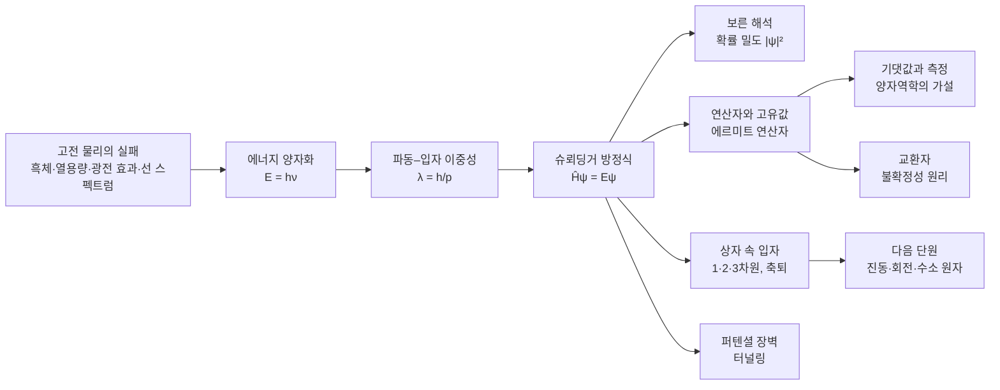

# 물리화학 7. 양자역학의 기초 — 고전 물리가 멈춘 자리에서 파동 함수로 운동을 다시 쓰다
<!-- prev: uchem-4, uphy-12, umath-6, umath-8 -->
<!-- next: pchem-8 -->

> [!NOTE]
> **이 단원의 범위**
> - 고전 물리의 한계: 흑체 복사(레일리–진스 식과 플랑크 분포), 고체의 열용량(뒬롱–프티 법칙과 아인슈타인 모형), 광전 효과와 콤프턴 효과, 원자 스펙트럼과 보어 모형
> - 파동–입자 이중성: 드브로이 관계, 전자 회절과 단일 입자 간섭
> - 슈뢰딩거 방정식(시간 의존·시간 무관), 정상 상태, 파동 함수의 보른 해석과 허용 조건
> - 연산자와 고유값 문제, 에르미트 연산자(실수 고유값·직교성), 기댓값, 겹침 상태와 측정 확률
> - 양자역학의 가설 정리
> - 교환자와 불확정성 원리(로버트슨 부등식의 유도), 에너지–시간 관계와 선 너비
> - 1·2·3차원 상자 속 입자, 영점 에너지, 대응 원리, 축퇴와 그 깨짐, 자유 전자 모형
> - 퍼텐셜 장벽과 터널링(사각 장벽의 투과 확률), 주사 터널링 현미경과 수소 이동

**학습 목표**

1. 흑체 복사·고체의 열용량·광전 효과·원자 스펙트럼에서 고전 물리가 실패하는 지점을 정량적으로 짚고, 에너지 양자화로 플랑크 분포와 아인슈타인 열용량 식을 유도할 수 있다.
2. 드브로이 관계로 전자·중성자·분자의 파장을 계산하고, 단일 입자 간섭 실험이 파동–입자 이중성에 대해 말해 주는 것을 설명할 수 있다.
3. 평면파와 드브로이·아인슈타인 관계에서 슈뢰딩거 방정식을 세우고, 변수 분리로 정상 상태를 얻으며, 보른 해석에 따라 파동 함수를 정규화하고 확률을 계산할 수 있다.
4. 에르미트 연산자의 고유값이 실수이고 고유 함수가 직교함을 증명하고, 겹침 상태에서 측정 확률·기댓값·시간 변화를 계산하며, 양자역학의 가설을 정리할 수 있다.
5. 교환자로부터 로버트슨 부등식을 유도하고, 위치–운동량 불확정성과 에너지–시간 관계를 원자 크기 어림과 스펙트럼 선 너비에 적용할 수 있다.
6. 1·2·3차원 상자 속 입자의 슈뢰딩거 방정식을 풀고 에너지 준위·파동 함수·축퇴를 구하며, 자유 전자 모형으로 콘주게이션 분자의 흡수 파장을 어림하고 그 한계를 평가할 수 있다.
7. 사각 장벽의 투과 확률을 경계 조건으로부터 구하고, 질량·장벽 폭·높이에 대한 지수 의존을 주사 터널링 현미경과 수소 이동 반응에 적용할 수 있다.

**이 단원의 학습 사다리**

| 단계 | 무엇을 하나? |
|---|---|
| STEP 1. 이전 학습 다시 보기 | 광자와 보어 모형, 드브로이 파장, 상자 속 입자의 에너지 식(일반화학·일반물리학), 교환자와 고유값 문제(수학 도구 8) |
| STEP 2. 기초 다지기 | 복소수와 절댓값 제곱, $\psi'' = \mp k^2\psi$의 해, 등비급수로 평균 구하기, 함수의 내적과 직교성 |
| STEP 3. 핵심 개념 | 흑체 복사 → 열용량 → 광전·콤프턴 효과 → 원자 스펙트럼 → 물질파 → 슈뢰딩거 방정식 → 보른 해석 → 연산자와 기댓값 → 가설 → 불확정성 → 1차원 상자 → 2·3차원 상자와 축퇴 → 터널링 |
| STEP 4. 오개념 바로잡기 | "파동 함수가 곧 전자의 모양이다", "불확정성은 측정 기구가 교란해서 생긴다", "정상 상태에서는 전자가 멈춰 있다" 같은 착각 |
| STEP 5. 대학원·연구로 | 디랙 표기와 힐베르트 공간, WKB 근사와 반응 속도의 터널링 보정 |
| STEP 6. 생활·산업·진로 | 주사 터널링 현미경, 전자 현미경, 양자점, 효소의 수소 터널링 |

---

## 🗺️ 단원 들어가기

19세기 말의 물리학은 거의 완성된 것처럼 보였다. 뉴턴 역학은 행성의 운동을, 맥스웰 전자기학은 빛을, 열역학과 통계 역학은 기체와 열기관을 설명했다. 그런데 가장 평범한 질문 몇 개가 이 체계를 무너뜨렸다. 달군 쇠는 왜 붉게, 더 달구면 하얗게 빛나는가? 다이아몬드는 왜 실온에서 열용량이 구리의 4분의 1밖에 안 되는가? 빛을 아무리 세게 비춰도 어떤 금속에서는 왜 전자가 하나도 튀어나오지 않는가? 수소 기체는 왜 아무 색이 아니라 정해진 몇 가지 색의 빛만 내는가?

네 질문의 답은 하나로 모인다. **에너지는 연속적으로 주고받는 양이 아니라 덩어리(양자)로 주고받는다.** 그리고 이 생각을 끝까지 밀고 나가면, 전자 같은 입자도 파동처럼 간섭하고, 그 운동은 궤도가 아니라 **파동 함수**로 기술해야 한다는 결론에 이른다. 일반화학과 일반물리학에서는 이 결론의 '결과'(광자 에너지 $h\nu$, 드브로이 파장, 상자 속 입자의 $E_n$)를 배웠다. 이 단원에서는 그 결과가 **어떤 가설에서 어떻게 유도되는지**를 처음부터 세운다.

전공 화학자에게 양자역학은 교양이 아니라 도구이다. 분자의 색(전자 전이), 적외선 스펙트럼(진동), 반응 속도의 동위 원소 효과(터널링), NMR(스핀), 계산 화학(슈뢰딩거 방정식의 근사 풀이)이 모두 이 단원의 몇 가지 가설 위에 서 있다. 이 단원을 마치면 슈뢰딩거 방정식을 세우고 경계 조건으로 풀어, 에너지 준위와 측정 확률을 계산할 수 있게 된다. 그 첫 연습 상대가 가장 단순한 계, **상자 속 입자**와 **퍼텐셜 장벽**이다.

---

## STEP 1. 🔙 이전 학습 다시 보기

### 연계 개념표

| 이전 단원 | 그때 배운 것 | 이 단원에서 확장되는 것 |
|---|---|---|
| 일반화학 「원자의 전자 구조와 주기성」 | $E = h\nu$, 광전 효과 $E_k = h\nu - \Phi$, 뤼드베리 식과 보어 모형, 드브로이 파장, $\Delta x\,\Delta p \ge h/4\pi$, 1차원 상자의 $E_n = n^2h^2/8mL^2$ | 플랑크 분포를 **유도**하고, 보어 모형에 환산 질량을 넣어 동위 원소 이동을 계산한다. 불확정성을 교환자에서 증명하고, 상자 속 입자를 슈뢰딩거 방정식으로 풀어 2·3차원과 축퇴까지 확장한다 |
| 일반물리학 「현대 물리」 '광자', '물질파와 불확정성 원리', '슈뢰딩거 방정식과 무한 퍼텐셜 우물, 터널링' | 빈 변위 법칙과 슈테판–볼츠만 법칙, 콤프턴 식, 시간 무관 슈뢰딩거 방정식, 무한 우물, 투과 확률 $T \approx e^{-2\kappa L}$ | 두 법칙을 플랑크 분포의 미분·적분으로 **유도**, 시간 의존 방정식과 정상 상태, 사각 장벽의 투과 확률을 경계 조건으로 **정확히** 구하고 앞 인자의 의미를 밝힌다 |
| 수학 도구 6 「복소수와 푸리에 해석」 '오일러 공식과 복소 지수 함수', '불확정 관계' | 복소 지수 함수, 평면파 $e^{i(kx - \omega t)}$, 푸리에 변환에서 나오는 $\Delta x\,\Delta k \gtrsim 1$ | 파동 함수가 복소 함수인 까닭, 위상의 물리적 의미, 파속과 불확정성 |
| 수학 도구 8 「편미분방정식과 특수 함수」 '경계 조건과 양자화', '연산자와 교환자' | 변수 분리, 고유값 문제, 직교 함수 전개, $[\hat{x}, \hat{p}] = i\hbar$, 로버트슨 부등식(결과) | 수학적 구조에 **물리적 가설**(보른 규칙, 측정의 가설)을 더한다. 로버트슨 부등식을 슈바르츠 부등식에서 직접 유도한다 |
| 물리화학 2 「열역학 제2·3법칙과 엔트로피」 | 0 K 근처에서 $C_p \to 0$, 디바이 외삽 | 열용량이 0으로 가는 까닭을 에너지 양자화로 설명한다(아인슈타인 모형) |

### 준비 운동 (사전 진단)

**Q1.** 파장 400 nm인 광자 한 개의 에너지를 eV 단위로 구하시오. ($hc = 1239.8\ \mathrm{eV\cdot nm}$)

**Q2.** $\psi(x) = e^{ikx}$일 때 $\lvert\psi\rvert^2$은 얼마인가? 이 결과는 입자의 위치에 대해 무엇을 말해 주는가?

**Q3.** 수학 도구 8에서 본 교환자 $[\hat{x}, \hat{p}]$를 시험 함수 $f(x)$에 작용시켜 계산하시오. ($\hat{p} = -i\hbar\,d/dx$)

**Q4.** 일반화학에서 배운 1차원 상자 속 입자의 에너지 식 $E_n = n^2h^2/8mL^2$에서 $n = 0$이 허용되지 않는 까닭을 한 문장으로 쓰시오.

정답 및 해설

**Q1.** $E = hc/\lambda = 1239.8/400 = 3.10\ \mathrm{eV}$.

**Q2.** $\lvert e^{ikx}\rvert^2 = e^{-ikx}e^{ikx} = 1$. 확률 밀도가 모든 곳에서 같으므로 위치가 전혀 정해져 있지 않다. 대신 운동량은 $\hbar k$로 정확히 정해져 있다(STEP 3 ⑩의 불확정성의 극단적인 예).

**Q3.** $[\hat{x}, \hat{p}]f = x(-i\hbar f') - (-i\hbar)(xf)' = -i\hbar xf' + i\hbar(f + xf') = i\hbar f$. 따라서 $[\hat{x}, \hat{p}] = i\hbar$.

**Q4.** $n = 0$이면 $\psi = \sqrt{2/L}\sin 0 = 0$이 되어 상자 어디에도 입자가 없으므로(정규화할 수 없으므로) 물리적인 상태가 아니다. 그래서 가장 낮은 에너지가 0이 아닌 $E_1$이다(영점 에너지).

---

## STEP 2. 🧱 기초 다지기

### 디딤돌 1. 복소수와 절댓값 제곱 — 파동 함수는 복소 함수이다

수학 도구 6 '복소수와 복소 평면', '오일러 공식과 복소 지수 함수'에서 익힌 내용 가운데 이 단원에 꼭 필요한 것은 다음 네 가지이다.

| 성질 | 식 | 이 단원에서 쓰이는 곳 |
|---|---|---|
| 복소 켤레 | $z = a + ib \Rightarrow z^* = a - ib$ | 확률 밀도 $\psi^*\psi$ |
| 절댓값 제곱 | $\lvert z\rvert^2 = z^*z = a^2 + b^2 \ge 0$ | 확률은 언제나 0 이상의 실수 |
| 오일러 공식 | $e^{i\theta} = \cos\theta + i\sin\theta$, $\lvert e^{i\theta}\rvert = 1$ | 정상 상태의 시간 인자 $e^{-iEt/\hbar}$ |
| 합의 절댓값 제곱 | $\lvert z_1 + z_2\rvert^2 = \lvert z_1\rvert^2 + \lvert z_2\rvert^2 + 2\,\mathrm{Re}(z_1^*z_2)$ | 간섭 항, 겹침 상태의 시간 변화 |

마지막 줄이 양자역학에서 가장 중요하다. 두 가능성의 **진폭**을 먼저 더하고 나서 제곱하므로, 확률의 단순한 합 $\lvert z_1\rvert^2 + \lvert z_2\rvert^2$에 **간섭 항** $2\,\mathrm{Re}(z_1^*z_2)$가 붙는다. 이 항은 두 진폭의 상대 위상에 따라 양수도 음수도 될 수 있다.

**예** $z_1 = \tfrac{1}{\sqrt2}$, $z_2 = \tfrac{1}{\sqrt2}e^{i\phi}$이면 $\lvert z_1 + z_2\rvert^2 = \tfrac12 + \tfrac12 + \cos\phi = 1 + \cos\phi$이다. $\phi = 0$이면 2(보강), $\phi = \pi$이면 0(상쇄)이다. 각각의 절댓값 제곱(각 $\tfrac12$)은 위상과 무관한데, 합의 절댓값 제곱은 위상에 따라 0에서 2까지 변한다. 이중 슬릿 무늬가 바로 이 $1 + \cos\phi$이다.

### 디딤돌 2. $\psi'' = -k^2\psi$와 $\psi'' = +\kappa^2\psi$ — 두 가지 기본 해

수학 도구 4 '상수 계수 2계 선형 동차 방정식'과 수학 도구 8 '경계 조건과 양자화'에서 본 대로, 퍼텐셜이 일정한 구간의 슈뢰딩거 방정식은 다음 두 꼴 가운데 하나가 된다.

| 방정식 | 일반해 | 물리적 상황 |
|---|---|---|
| $\psi'' = -k^2\psi$ ($k > 0$) | $A\sin kx + B\cos kx$ 또는 $Ce^{ikx} + De^{-ikx}$ | $E > V$: 고전적으로 허용된 영역, 진동한다 |
| $\psi'' = +\kappa^2\psi$ ($\kappa > 0$) | $Fe^{\kappa x} + Ge^{-\kappa x}$ 또는 $\cosh$, $\sinh$의 결합 | $E < V$: 고전적으로 금지된 영역, 지수적으로 커지거나 줄어든다 |

어느 해를 고를지는 **경계 조건**이 정한다. 벽에서 $\psi = 0$이면 $\sin$만 남고, $x \to \infty$로 뻗는 금지 영역이면 발산하는 $e^{\kappa x}$를 버린다. 진동 구간에서 $\psi$는 축을 향해 휘고(곡률이 $-\psi$에 비례), 금지 구간에서는 축에서 멀어지도록 휜다. 이 '휘는 방향'만 기억해도 파동 함수의 모양을 손으로 그릴 수 있다.

**예** $\psi(x) = A\sin kx + B\cos kx$에 $\psi(0) = 0$과 $\psi(L) = 0$을 차례로 적용하면 $B = 0$, $A\sin kL = 0$이다. $A = 0$이면 해가 사라지므로 $\sin kL = 0$, 즉 $k = n\pi/L$이어야 한다. **0이 아닌 해가 존재할 조건이 $k$를 띄엄띄엄하게 만든다.** 이것이 양자화의 수학적 뿌리이다.

### 디딤돌 3. 등비급수로 평균 구하기

플랑크와 아인슈타인의 계산은 '에너지가 $0, \varepsilon, 2\varepsilon, \ldots$인 상태에 볼츠만 가중치를 주어 평균 내기'이다. 수학 도구 2 '테일러 급수'의 등비급수와 그 미분이 필요하다($\lvert y\rvert < 1$).

$$
\sum_{n=0}^{\infty} y^n = \frac{1}{1 - y}, \qquad \sum_{n=0}^{\infty} n\,y^n = y\frac{d}{dy}\left(\frac{1}{1 - y}\right) = \frac{y}{(1 - y)^2}
$$

따라서 $y = e^{-\varepsilon/k_\mathrm{B}T}$로 놓으면 평균 양자수는

$$
\langle n\rangle = \frac{\sum n\,y^n}{\sum y^n} = \frac{y}{1 - y} = \frac{1}{e^{\varepsilon/k_\mathrm{B}T} - 1}
$$

**예** $\varepsilon = k_\mathrm{B}T$이면 $\langle n\rangle = 1/(e - 1) = 0.582$, $\varepsilon = 5k_\mathrm{B}T$이면 $1/(e^5 - 1) = 6.8\times10^{-3}$이다. 에너지 덩어리가 열에너지보다 크면 들뜬 상태가 거의 채워지지 않는다. 이 '얼어붙음'이 흑체 복사의 자외선 쪽과 저온 열용량을 설명하는 열쇠이다(물리화학 11 「통계 열역학」에서 분배 함수로 일반화된다).

### 디딤돌 4. 함수의 내적과 직교성 — 벡터에서 함수로

수학 도구 5 '대칭 행렬과 에르미트 행렬'과 수학 도구 8 '직교 함수와 전개'에서 본 것처럼, 함수도 벡터처럼 다룰 수 있다. 성분의 곱을 더하는 대신 곱을 **적분**한다.

$$
\langle f, g\rangle = \int f^*(x)\,g(x)\,dx, \qquad \lVert f\rVert^2 = \langle f, f\rangle = \int\lvert f\rvert^2dx
$$

| 벡터 | 함수 | 양자역학 |
|---|---|---|
| 내적 $\mathbf{u}^\dagger\mathbf{v}$ | $\int f^*g\,dx$ | 겹침 적분, 전개 계수 |
| 단위 벡터 | $\int\lvert f\rvert^2dx = 1$ | 정규화된 파동 함수 |
| 직교 $\mathbf{u}^\dagger\mathbf{v} = 0$ | $\int f^*g\,dx = 0$ | 서로 다른 고유값의 고유 함수 |
| 에르미트 행렬 $A^\dagger = A$ | $\int f^*(\hat{A}g)dx = \int(\hat{A}f)^*g\,dx$ | 관측 가능한 양의 연산자 |
| 성분 $v_i = \mathbf{e}_i^\dagger\mathbf{v}$ | $c_n = \int\varphi_n^*f\,dx$ | 측정 확률의 진폭 |

**예** $\varphi_1 = \sqrt{2/L}\sin(\pi x/L)$와 $\varphi_2 = \sqrt{2/L}\sin(2\pi x/L)$의 내적은 곱을 합으로 바꾸는 공식 $\sin a\sin b = \tfrac12[\cos(a - b) - \cos(a + b)]$로
$\dfrac{2}{L}\displaystyle\int_0^L\sin\frac{\pi x}{L}\sin\frac{2\pi x}{L}dx = \frac{1}{L}\int_0^L\left[\cos\frac{\pi x}{L} - \cos\frac{3\pi x}{L}\right]dx = 0$이다. 두 함수는 직교한다. ⑧에서 이 직교성이 우연이 아니라 에르미트 연산자의 성질에서 나옴을 증명한다.

---

## STEP 3. 📘 핵심 개념

### ① 흑체 복사 — 고전 물리의 첫 번째 실패와 플랑크의 양자

**흑체(blackbody)** 는 들어오는 복사를 모든 파장에서 남김없이 흡수하는 이상적인 물체이다. 실험실에서는 벽을 일정한 온도로 유지한 빈 상자(공동)에 작은 구멍을 뚫어 만든다. 구멍으로 들어간 빛은 벽에 여러 번 흡수되어 다시 나오지 못하고, 구멍에서 새어 나오는 빛은 벽의 온도만으로 정해지는 **공동 복사**이다. 이 복사의 스펙트럼은 물질의 종류와 무관하다. 그래서 '온도만 주면 스펙트럼이 정해지는' 보편 법칙이 있어야 했다.

19세기 말까지 실험으로 확립된 사실은 두 가지였다.

| 실험 법칙 | 내용 | 뜻 |
|---|---|---|
| 빈 변위 법칙 | $\lambda_\text{max}T = 2.898\times10^{-3}\ \mathrm{m\cdot K}$ | 뜨거울수록 봉우리가 짧은 파장으로 옮겨 간다 |
| 슈테판–볼츠만 법칙 | 단위 넓이당 내보내는 일률 $M = \sigma T^4$, $\sigma = 5.670\times10^{-8}\ \mathrm{W\,m^{-2}\,K^{-4}}$ | 온도가 2배면 복사는 16배 |

<!-- 그림 요청: 흑체 복사의 스펙트럼 에너지 밀도 ρ(λ) = (8πhc/λ⁵)/(e^(hc/λkT) − 1) 그래프. 가로축 파장 λ/μm(0~3.0), 세로축 ρ(λ)(임의 단위, 5800 K 봉우리를 1로 규격화). 실선 세 곡선 T = 5800 K(봉우리 λ = 0.500 μm), 4000 K(0.724 μm), 3000 K(0.966 μm)를 그리고 각 봉우리에 점과 λmax 값을 표시하며, 봉우리들을 잇는 점선에 "λmax T = 2.898 mm·K"라 쓴다. 5800 K에 대한 레일리–진스 곡선 ρ = 8πkT/λ⁴를 회색 점선으로 함께 그려 짧은 파장 쪽에서 세로축 위로 치솟게 하고(그래프 위쪽에서 잘라 화살표) "자외선 파탄"이라 이름표. 가시광선 영역(0.38~0.75 μm)을 옅은 무지개 띠로 칠한다. -->

#### 고전적 예측 — 레일리–진스 식의 유도

공동 속 전자기장은 벽에서 마디를 갖는 정상파(모드)들의 모임이다. 한 변이 $L$인 정육면체 공동에서 허용되는 파수는 수학 도구 8 '2·3차원으로'에서 본 상자 문제와 같은 꼴이다.

**1단계(모드 세기)** $\mathbf{k} = \dfrac{\pi}{L}(n_x, n_y, n_z)$, $n_i = 1, 2, 3, \ldots$이고 진동수는 $\nu = \dfrac{c\lvert\mathbf{k}\rvert}{2\pi} = \dfrac{c}{2L}\sqrt{n_x^2 + n_y^2 + n_z^2}$이다. 진동수가 $\nu$보다 작은 모드의 수는 $(n_x, n_y, n_z)$ 공간에서 반지름 $n = 2L\nu/c$인 구의 8분의 1(양수 성분만) 안의 격자점 수이고, 빛은 편광이 둘이므로 2를 곱한다.

$$
N(\nu) = 2\times\frac18\times\frac{4\pi}{3}\left(\frac{2L\nu}{c}\right)^3 = \frac{8\pi L^3\nu^3}{3c^3}
\quad\Longrightarrow\quad
\frac{1}{V}\frac{dN}{d\nu} = \frac{8\pi\nu^2}{c^3}
$$

**2단계(모드당 에너지)** 각 모드는 하나의 조화 진동자이다. 고전 통계 역학의 등분배 정리에 따르면 진동자 하나의 평균 에너지는 운동·퍼텐셜 에너지 몫을 합쳐 $k_\mathrm{B}T$이다.

**3단계(결과)** 단위 부피·단위 진동수당 에너지(스펙트럼 에너지 밀도)는

$$
\rho_\text{RJ}(\nu) = \frac{8\pi\nu^2}{c^3}k_\mathrm{B}T
$$

**적용 한계** 이 식은 긴 파장(낮은 진동수)에서는 실험과 잘 맞지만, 진동수가 커질수록 $\nu^2$으로 끝없이 커진다. 모든 진동수에 대해 적분한 전체 에너지 $\int_0^\infty\rho\,d\nu$는 무한대이다. 유한한 온도의 상자 안에 무한한 에너지가 들어 있다는 이 모순을 **자외선 파탄(ultraviolet catastrophe)** 이라 부른다. 모드 세기는 틀리지 않았다. 틀린 것은 **모든 모드가 $k_\mathrm{B}T$씩 가진다**는 등분배 가정이었다.

#### 플랑크의 가설과 플랑크 분포

1900년 플랑크는 진동수 $\nu$인 진동자가 에너지를 $h\nu$의 정수배로만 가질 수 있다고 가정했다.

$$
E_n = nh\nu, \qquad n = 0, 1, 2, \ldots \qquad (h = 6.626\times10^{-34}\ \mathrm{J\cdot s})
$$

각 에너지에 볼츠만 가중치 $e^{-E_n/k_\mathrm{B}T}$를 주어 평균 내면, STEP 2 디딤돌 3의 등비급수로

$$
\langle E\rangle = h\nu\langle n\rangle = \frac{h\nu}{e^{h\nu/k_\mathrm{B}T} - 1}
$$

이다. 1단계의 모드 수에 이 평균 에너지를 곱하면 **플랑크 분포(Planck distribution)** 가 된다.

$$
\boxed{\;\rho(\nu) = \frac{8\pi h\nu^3}{c^3}\,\frac{1}{e^{h\nu/k_\mathrm{B}T} - 1}, \qquad \rho(\lambda) = \frac{8\pi hc}{\lambda^5}\,\frac{1}{e^{hc/\lambda k_\mathrm{B}T} - 1}\;}
$$

(두 번째 식은 $\rho(\lambda)\,d\lambda = \rho(\nu)\,\lvert d\nu\rvert$, $\nu = c/\lambda$, $\lvert d\nu\rvert = c\,d\lambda/\lambda^2$로 바꾼 것이다.)

| 극한 | $\langle E\rangle$ | 결과 |
|---|---|---|
| $h\nu \ll k_\mathrm{B}T$ (긴 파장) | $e^x \approx 1 + x$이므로 $\approx k_\mathrm{B}T$ | 레일리–진스 식으로 돌아간다(고전 극한) |
| $h\nu \gg k_\mathrm{B}T$ (짧은 파장) | $\approx h\nu\,e^{-h\nu/k_\mathrm{B}T}$ | 지수적으로 사라진다. 양자 하나가 너무 비싸 모드가 '얼어붙는다' |

#### 빈 법칙과 슈테판–볼츠만 법칙의 유도

**빈 변위 법칙** $x = hc/\lambda k_\mathrm{B}T$로 놓으면 $\rho(\lambda) \propto x^5/(e^x - 1)$이다($T$ 고정). $x$로 미분해 0으로 놓으면

$$
\frac{d}{dx}\frac{x^5}{e^x - 1} = 0 \;\Longrightarrow\; 5(e^x - 1) = xe^x \;\Longrightarrow\; x = 5(1 - e^{-x})
$$

이 초월 방정식의 해는 $x = 4.965$(반복 대입으로 금방 수렴한다)이므로 $\lambda_\text{max}T = \dfrac{hc}{4.965\,k_\mathrm{B}} = 2.898\times10^{-3}\ \mathrm{m\cdot K}$로 실험값과 일치한다.

**슈테판–볼츠만 법칙** $x = h\nu/k_\mathrm{B}T$로 바꾸어 전체 에너지 밀도를 적분하면

$$
u = \int_0^\infty\rho(\nu)\,d\nu = \frac{8\pi h}{c^3}\left(\frac{k_\mathrm{B}T}{h}\right)^4\int_0^\infty\frac{x^3}{e^x - 1}dx = \frac{8\pi^5k_\mathrm{B}^4}{15h^3c^3}T^4
$$

($\int_0^\infty x^3/(e^x - 1)\,dx = \pi^4/15 = 6.494$.) 구멍으로 새어 나오는 일률은 등방적인 복사의 성질상 $M = \tfrac{c}{4}u$이므로 $\sigma = \dfrac{2\pi^5k_\mathrm{B}^4}{15h^3c^2} = 5.670\times10^{-8}\ \mathrm{W\,m^{-2}\,K^{-4}}$이다. **두 경험 법칙과 그 상수가 모두 $h$, $k_\mathrm{B}$, $c$로 계산된다.** 플랑크 상수는 이 맞춤에서 처음 결정되었다.

> [!WARNING]
> $\rho(\nu)$의 봉우리는 $h\nu_\text{max}/k_\mathrm{B}T = 2.821$에서 생긴다. 이 진동수를 파장으로 바꾼 $c/\nu_\text{max}$는 $\lambda_\text{max}$와 **다르다**(약 1.76배 길다). 분포 함수는 변수에 따라 모양이 바뀌므로, '봉우리의 위치'는 가로축을 무엇으로 잡았는지 밝혀야 뜻이 있다.

#### 예제 1 — 태양과 사람의 복사, 그리고 고전 이론의 오차

(1) 표면 온도 5800 K인 태양과 체온 310 K인 사람 몸의 $\lambda_\text{max}$를 구하시오. (2) 5800 K에서 파장 500 nm와 10 μm일 때 레일리–진스 식은 플랑크 분포의 몇 배를 예측하는가?

**풀이**
(1) $\lambda_\text{max} = 2.898\times10^{-3}/5800 = 5.00\times10^{-7}\ \mathrm{m} = 500\ \mathrm{nm}$(초록빛 가시광선), $2.898\times10^{-3}/310 = 9.35\times10^{-6}\ \mathrm{m} = 9.35\ \mu\mathrm{m}$(적외선).
(2) 두 식의 비는 $\rho_\text{RJ}/\rho = (e^x - 1)/x$, $x = hc/\lambda k_\mathrm{B}T$이다.
500 nm: $x = \dfrac{1239.8\ \mathrm{eV\cdot nm}/500\ \mathrm{nm}}{k_\mathrm{B}T} = \dfrac{2.480\ \mathrm{eV}}{0.4998\ \mathrm{eV}} = 4.96$, 비 $= (e^{4.96} - 1)/4.96 = 28.6$.
10 μm: $x = 0.248$, 비 $= (e^{0.248} - 1)/0.248 = 1.13$.

**의미** 가시광선에서 고전 이론은 29배나 크게 틀리지만, 적외선(긴 파장)에서는 13 % 차이로 거의 맞는다. 고전 물리는 '틀린 이론'이 아니라 $h\nu \ll k_\mathrm{B}T$에서만 맞는 **극한**이다. 사람 몸이 적외선 열화상 카메라로 보이는 것과, 태양 빛의 봉우리가 우리 눈의 감도가 가장 높은 영역에 있는 것도 이 계산이 보여 준다.

<!-- 시뮬레이션 요청: 흑체 복사 스펙트럼 조작. 슬라이더: 온도 T(300~10 000 K, 로그 눈금), 가로축 변수 선택(파장 λ ↔ 진동수 ν). 보여 줄 것: 플랑크 곡선과 레일리–진스 곡선을 함께 그리고, 봉우리 위치(λmax 또는 νmax)와 그 값, 곡선 아래 넓이로 구한 σT⁴를 숫자로 표시. 가시광선 띠를 배경에 깔고, 스펙트럼을 사람 눈의 색으로 환산한 원(색 견본)을 옆에 보여 준다. 가로축을 바꾸면 봉우리 위치가 λmax·T = 2.898 mm·K와 hνmax/kT = 2.821로 서로 다르게 나오는 것을 볼 수 있게 한다. -->

#### ✔ 바로 확인

1. (O/X) 레일리–진스 식은 긴 파장 쪽에서 실험과 크게 어긋난다.
2. 1000 K로 달군 물체가 내는 흑체 복사의 $\lambda_\text{max}$는?
3. 흑체의 절대 온도가 2배가 되면 단위 넓이당 내보내는 일률은 몇 배가 되는가?
4. 빈칸: 플랑크 분포에서 진동자 하나의 평균 에너지는 $h\nu \ll k_\mathrm{B}T$에서 (    )에 다가간다.

정답

1. X — 긴 파장($h\nu \ll k_\mathrm{B}T$)에서는 잘 맞고, 짧은 파장에서 발산한다(자외선 파탄).
2. 약 2.90 μm — $2.898\times10^{-3}/1000$. 대부분 적외선이고 가시광선 쪽 꼬리가 희미한 붉은빛으로 보인다.
3. 16배 — $M \propto T^4$.
4. $k_\mathrm{B}T$ — 등분배 정리의 고전값으로 돌아간다.

### ② 고체의 열용량 — 원자 진동도 양자화되어 있다

1819년 뒬롱과 프티는 많은 고체 원소의 몰 열용량이 실온에서 약 $25\ \mathrm{J/(mol\cdot K)}$로 비슷하다는 것을 발견했다(**뒬롱–프티 법칙**). 고전 통계 역학은 이를 쉽게 설명한다. 원자 $N_\mathrm{A}$개가 세 방향으로 진동하는 결정은 진동자 $3N_\mathrm{A}$개이고, 각 진동자는 평균 $k_\mathrm{B}T$를 가지므로

$$
U_\text{진동} = 3N_\mathrm{A}k_\mathrm{B}T = 3RT, \qquad C_{V,\mathrm{m}} = 3R = 24.94\ \mathrm{J/(mol\cdot K)}
$$

그러나 이 설명에는 두 가지 구멍이 있었다.

| 물질 (25 ℃) | $C_{p,\mathrm{m}}$ (J/(mol·K), 약) | 고전 예측 $3R$ |
|---|---|---|
| 구리 | 24.4 | 24.9 |
| 알루미늄 | 24.2 | 24.9 |
| 납 | 26.4 | 24.9 |
| 규소 | 20.0 | 24.9 |
| 다이아몬드 | 6.1 | 24.9 |

첫째, 다이아몬드·붕소·규소처럼 **가볍고 단단한** 고체는 실온에서 $3R$보다 훨씬 작다. 둘째, 온도를 낮추면 **모든** 고체의 열용량이 0으로 떨어진다. 고전 이론의 $3R$은 온도와 무관한 상수이므로 둘 다 설명하지 못한다. 그리고 물리화학 2에서 본 대로, $C \to 0$이 아니면 $S(T) = \int_0^T(C/T)\,dT$가 0 K 근처에서 발산하므로 열역학 제3법칙과도 양립할 수 없다.

#### 아인슈타인 모형의 유도

1907년 아인슈타인은 플랑크의 양자 가설을 원자의 진동에 적용했다.

**가정** ① 결정의 $3N_\mathrm{A}$개 진동이 모두 같은 진동수 $\nu$를 가진 독립된 진동자이다. ② 각 진동자의 에너지는 $nh\nu$로 양자화되어 있다. (실제 양자 진동자의 에너지는 $(n + \tfrac12)h\nu$이다. 물리화학 8에서 유도한다. 상수 $\tfrac12h\nu$는 $U$를 일정하게 옮길 뿐 $C_V$에는 영향이 없다.)

**유도** 플랑크와 똑같이 평균 에너지를 구해 $3N_\mathrm{A}$를 곱하고, **아인슈타인 온도** $\theta_\mathrm{E} = h\nu/k_\mathrm{B}$를 쓰면

$$
U_\text{진동} = \frac{3N_\mathrm{A}h\nu}{e^{h\nu/k_\mathrm{B}T} - 1} = \frac{3R\theta_\mathrm{E}}{e^{\theta_\mathrm{E}/T} - 1}
$$

$T$로 미분한다($\frac{d}{dT}e^{\theta_\mathrm{E}/T} = -\frac{\theta_\mathrm{E}}{T^2}e^{\theta_\mathrm{E}/T}$).

$$
\boxed{\;C_{V,\mathrm{m}} = \left(\frac{\partial U_\mathrm{m}}{\partial T}\right)_V = 3R\left(\frac{\theta_\mathrm{E}}{T}\right)^2\frac{e^{\theta_\mathrm{E}/T}}{\left(e^{\theta_\mathrm{E}/T} - 1\right)^2}\;}
$$

| 온도 영역 | 근사 | 결과 |
|---|---|---|
| $T \gg \theta_\mathrm{E}$ | $x = \theta_\mathrm{E}/T \ll 1$, $\dfrac{x^2e^x}{(e^x - 1)^2} \to 1$ | $C_V \to 3R$ (뒬롱–프티) |
| $T \ll \theta_\mathrm{E}$ | $\dfrac{x^2e^x}{(e^x - 1)^2} \approx x^2e^{-x}$ | $C_V \to 0$ (지수적으로) |

**적용 한계** 실제 저온 열용량은 지수 함수가 아니라 $T^3$에 비례하여 더 천천히 0으로 간다. 결정 속 진동은 한 가지 진동수가 아니라 0부터 최댓값까지 퍼진 **진동수 분포**(격자파, 포논)를 가지며, 낮은 진동수의 진동은 아주 낮은 온도에서도 들뜰 수 있기 때문이다. 이를 반영한 것이 물리화학 2의 저온 외삽에 쓰는 **디바이 모형**이다. 그래도 아인슈타인 모형은 "진동이 얼어붙어 열용량이 사라진다"는 핵심을 처음으로 설명했고, 양자 가설이 빛에만 해당하는 것이 아님을 보였다.

<!-- 그림 요청: 아인슈타인 열용량 곡선. 가로축 T/θE(0~2.0), 세로축 CV,m/3R(0~1.05). 실선 곡선 CV/3R = (θE/T)² e^(θE/T)/(e^(θE/T) − 1)²; 주요 점 T/θE = 0.2(0.171), 0.3354(0.500), 0.5(0.724), 1.0(0.921), 2.0(0.979). 위쪽에 가로 점선 CV/3R = 1과 "뒬롱–프티(고전)"라는 이름표. 가로축 위에 두 화살표로 다이아몬드(θE ≈ 1300 K)의 298 K 위치(T/θE = 0.229)와 구리(θE ≈ 240 K)의 298 K 위치(T/θE = 1.24)를 표시하고 각각 "다이아몬드: 0.25", "구리: 0.95"라고 쓴다. -->

#### 예제 2 — 다이아몬드는 왜 열용량이 작은가

다이아몬드의 아인슈타인 온도를 약 1300 K로 놓고 (1) 298 K와 1000 K에서 $C_{V,\mathrm{m}}$을 구하시오. (2) 이 진동수를 파수(cm⁻¹)로 나타내시오. (3) 열용량이 $3R$의 90 %에 이르는 온도를 구하시오. ($\dfrac{x^2e^x}{(e^x - 1)^2} = 0.90$의 해는 $x = 1.130$)

**풀이**
(1) 298 K: $x = 1300/298.15 = 4.360$, $\dfrac{x^2e^x}{(e^x - 1)^2} = \dfrac{19.01\times78.3}{(77.3)^2} = 0.249$, $C_{V,\mathrm{m}} = 0.249\times24.94 = 6.2\ \mathrm{J/(mol\cdot K)}$.
1000 K: $x = 1.300$, 같은 방식으로 $0.870$, $C_{V,\mathrm{m}} = 21.7\ \mathrm{J/(mol\cdot K)}$.
(2) $\tilde{\nu} = \dfrac{k_\mathrm{B}\theta_\mathrm{E}}{hc} = \dfrac{1.381\times10^{-23}\times1300}{6.626\times10^{-34}\times2.998\times10^{10}\ \mathrm{cm/s}} = 904\ \mathrm{cm^{-1}}$.
(3) $T = \theta_\mathrm{E}/1.130 = 1.15\times10^3\ \mathrm{K}$.

**의미** 실온 실측값(약 6.1 J/(mol·K))을 매개변수 하나로 거의 재현한다. 탄소 원자가 가볍고 C–C 결합이 단단해 진동수가 크므로($\nu \propto \sqrt{k/m}$), 실온의 열에너지($k_\mathrm{B}T/hc \approx 207\ \mathrm{cm^{-1}}$)로는 900 cm⁻¹ 진동이 거의 들뜨지 않는다. 다이아몬드도 1000 ℃ 가까이 데우면 뒬롱–프티 값에 다가간다. 같은 논리로 기체 분자의 진동도 실온에서는 대부분 얼어붙어 있어, 이원자 기체의 $C_{V,\mathrm{m}}$이 $\tfrac72R$이 아니라 약 $\tfrac52R$이다(물리화학 1, 11).

#### ✔ 바로 확인

1. (O/X) 고전 통계 역학에 따르면 고체의 몰 열용량은 온도를 낮추어도 $3R$로 일정하다.
2. 빈칸: 아인슈타인 모형에서 $T \gg \theta_\mathrm{E}$이면 $C_{V,\mathrm{m}} \to (\quad)$이다.
3. 아인슈타인 온도가 큰 고체의 특징을 원자의 질량과 결합의 세기로 쓰시오.

정답

1. O — 그래서 저온에서 0으로 떨어지는 실측 열용량을 설명하지 못한다.
2. $3R$ (약 24.9 J/(mol·K))
3. 원자가 가볍고 결합이 단단하다 — 진동수 $\nu \propto \sqrt{k/m}$이 커서 $\theta_\mathrm{E} = h\nu/k_\mathrm{B}$가 크다.

### ③ 광전 효과와 콤프턴 효과 — 빛은 에너지와 운동량을 덩어리로 나른다

플랑크는 양자화를 '벽의 진동자가 에너지를 주고받는 방식'으로 보았고, 빛 자체는 여전히 연속적인 파동이라고 생각했다. 빛 **자체**가 덩어리라는 증거는 광전 효과에서 나왔다.

진공관 속 금속판에 자외선을 쪼이면 전자가 튀어나온다(**광전 효과(photoelectric effect)**). 맞은편 전극에 역전압을 걸어 가장 빠른 전자까지 되돌려 보내는 전압 $V_\mathrm{s}$(저지 전압)를 재면 광전자의 최대 운동 에너지 $K_\text{max} = eV_\mathrm{s}$를 알 수 있다.

| 관찰 사실 | 고전 파동 이론의 예측 | 실제 |
|---|---|---|
| 문턱 진동수 | 세기만 충분하면 어떤 진동수에서도 전자가 나와야 한다 | 금속마다 정해진 $\nu_0$보다 낮으면 아무리 세게 비춰도 나오지 않는다 |
| $K_\text{max}$와 세기 | 세기(전기장의 진폭)가 크면 $K_\text{max}$도 커야 한다 | $K_\text{max}$는 세기와 무관하고, 전자의 **수**만 세기에 비례한다 |
| $K_\text{max}$와 진동수 | 특별한 관계가 없다 | $\nu$에 대해 직선, 기울기는 금속과 무관하게 같다 |
| 시간 지연 | 약한 빛이면 에너지를 모으는 데 시간이 걸려야 한다 | 빛을 켜는 즉시(약 $10^{-9}$ s 이내) 나온다 |

1905년 아인슈타인은 빛이 에너지 $h\nu$인 알갱이(**광자(photon)**)의 흐름이며, 광자 하나가 전자 하나에 에너지를 모두 준다고 보았다. 금속에서 전자를 떼어 내는 최소 에너지(**일함수** $\Phi$)를 빼면

$$
K_\text{max} = eV_\mathrm{s} = h\nu - \Phi, \qquad \nu_0 = \frac{\Phi}{h}
$$

네 가지 관찰이 모두 한 줄로 설명된다. 세기는 광자의 **수**, 진동수는 광자 하나의 **에너지**이다. 저지 전압을 진동수에 대해 그린 직선의 기울기 $h/e$에서 플랑크 상수를 독립적으로 잴 수 있다(밀리컨, 1916).

<!-- 그림 요청: 광전 효과의 저지 전압–진동수 그래프. 가로축 진동수 ν/(10¹⁴ Hz)(0~14), 세로축 저지 전압 Vs/V(−1~4). 기울기가 같은(h/e = 4.136×10⁻¹⁵ V·s, 즉 10¹⁴ Hz당 0.4136 V) 평행한 두 직선: 금속 A(Φ = 2.30 eV, 가로축 절편 ν0 = 5.56×10¹⁴ Hz), 금속 B(Φ = 4.50 eV, ν0 = 10.88×10¹⁴ Hz). 각 직선을 가로축 아래로 점선으로 연장해 세로축 절편 −Φ/e(−2.30 V, −4.50 V)를 표시. 가로축 절편에 "문턱 진동수 ν0", 기울기에 "h/e (금속과 무관)"라는 이름표. -->

#### 예제 3 — 저지 전압으로 플랑크 상수와 일함수 구하기

어떤 금속에 파장 300 nm인 빛을 비추었을 때 저지 전압이 1.83 V, 400 nm일 때 0.80 V였다. (1) 플랑크 상수, (2) 일함수(eV), (3) 문턱 파장을 구하시오. ($c = 2.998\times10^8\ \mathrm{m/s}$, $e = 1.602\times10^{-19}\ \mathrm{C}$)

**풀이**
(1) 진동수는 $\nu_1 = c/300\ \mathrm{nm} = 9.993\times10^{14}\ \mathrm{Hz}$, $\nu_2 = 7.495\times10^{14}\ \mathrm{Hz}$. 직선의 기울기에서
$h = \dfrac{e(V_1 - V_2)}{\nu_1 - \nu_2} = \dfrac{1.602\times10^{-19}\times1.03}{2.498\times10^{14}} = 6.61\times10^{-34}\ \mathrm{J\cdot s}$.
(2) $\Phi = h\nu_1 - eV_1 = \dfrac{6.61\times10^{-34}\times9.993\times10^{14}}{1.602\times10^{-19}}\ \mathrm{eV} - 1.83\ \mathrm{eV} = 4.12 - 1.83 = 2.29\ \mathrm{eV}$.
(3) $\lambda_0 = hc/\Phi = 1239.8\ \mathrm{eV\cdot nm}/2.29\ \mathrm{eV} \approx 540\ \mathrm{nm}$ (위의 (1)에서 얻은 $h$를 그대로 쓰면 약 540 nm).

**의미** 두 점만으로 $h$를 0.3 % 이내로 얻었다. 문턱 파장 540 nm보다 긴 빨간빛은 아무리 밝아도 이 금속에서 전자를 떼어 내지 못한다. 저지 전압의 유효 숫자가 3자리이지만 두 값의 **차**(1.03 V)를 쓰므로 $h$의 정밀도는 그보다 낮아질 수 있다. 여러 파장으로 직선 맞춤을 하는 것이 좋다(문제 13).

#### 광자의 운동량과 콤프턴 효과

광자가 입자라면 운동량도 가져야 한다. 특수 상대성 이론의 $E^2 = (pc)^2 + (mc^2)^2$에서 질량이 0인 광자는

$$
p = \frac{E}{c} = \frac{h\nu}{c} = \frac{h}{\lambda}
$$

1923년 콤프턴은 X선을 흑연에 쪼여 산란된 X선의 파장이 산란각에 따라 **길어지는** 것을 관찰했다. 고전 파동은 진동하는 전자에 같은 진동수로 다시 내보내질 뿐이므로 파장이 변하지 않아야 한다. 광자와 정지한 전자의 '당구공 충돌'로 보면 설명된다.

**유도의 뼈대** 입사·산란 광자의 운동량을 $\mathbf{p}$, $\mathbf{p}'$, 되튄 전자를 $\mathbf{p}_e$라 하자. ① 운동량 보존 $\mathbf{p}_e = \mathbf{p} - \mathbf{p}'$을 제곱하면 $p_e^2 = p^2 + p'^2 - 2pp'\cos\theta$. ② 에너지 보존 $pc + m_ec^2 = p'c + \sqrt{(p_ec)^2 + (m_ec^2)^2}$을 정리해 제곱하면 $p_e^2 = (p - p')^2 + 2m_ec(p - p')$. ③ 두 식을 같게 놓으면 $2pp'(1 - \cos\theta) = 2m_ec(p - p')$, 양변을 $pp'$로 나누고 $1/p = \lambda/h$를 쓰면

$$
\Delta\lambda = \lambda' - \lambda = \frac{h}{m_ec}(1 - \cos\theta), \qquad \frac{h}{m_ec} = 2.426\ \mathrm{pm}\ (\text{전자의 콤프턴 파장})
$$

파장 변화는 입사 파장과 무관하고 최대 $2h/m_ec = 4.85\ \mathrm{pm}$이다. 가시광선(수백 nm)에서는 상대 변화가 $10^{-5}$ 정도라 보이지 않고, 파장이 수십 pm인 X선에서야 뚜렷하다. 빛은 전파될 때는 파동(간섭·회절), 물질과 에너지·운동량을 주고받을 때는 입자(광자)로 행동한다. 이 이중성이 ⑤에서 물질에도 그대로 적용된다.

#### ✔ 바로 확인

1. (O/X) 광전 효과에서 빛의 세기를 2배로 하면 광전자의 최대 운동 에너지도 2배가 된다.
2. 일함수가 4.50 eV인 금속의 문턱 파장은? ($hc = 1239.8\ \mathrm{eV\cdot nm}$)
3. 산란각 90°에서 콤프턴 이동 $\Delta\lambda$는?
4. 파장 500 nm인 광자의 운동량은? ($h = 6.626\times10^{-34}\ \mathrm{J\cdot s}$)

정답

1. X — 세기는 광자의 수를 바꾸므로 광전자의 **수**가 2배가 된다. $K_\text{max} = h\nu - \Phi$는 그대로이다.
2. 약 276 nm — $1239.8/4.50 = 275.5$. 자외선만 전자를 떼어 낸다.
3. $2.43\ \mathrm{pm}$ — $\cos 90^\circ = 0$이므로 콤프턴 파장 그대로.
4. $1.33\times10^{-27}\ \mathrm{kg\cdot m/s}$ — $h/\lambda$.

