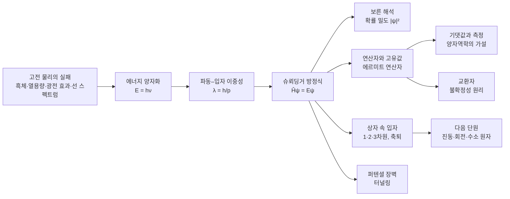

# 물리화학 7. 양자역학의 기초 — 고전 물리가 멈춘 자리에서 파동 함수로 운동을 다시 쓰다
<!-- prev: uchem-4, uphy-12, umath-6, umath-8 -->
<!-- next: pchem-8 -->

> [!NOTE]
> **이 단원의 범위**
> - 고전 물리의 한계: 흑체 복사(레일리–진스 식과 플랑크 분포), 고체의 열용량(뒬롱–프티 법칙과 아인슈타인 모형), 광전 효과와 콤프턴 효과, 원자 스펙트럼과 보어 모형
> - 파동–입자 이중성: 드브로이 관계, 전자 회절과 단일 입자 간섭
> - 슈뢰딩거 방정식(시간 의존·시간 무관), 정상 상태, 파동 함수의 보른 해석과 허용 조건
> - 연산자와 고유값 문제, 에르미트 연산자(실수 고유값·직교성), 기댓값, 겹침 상태와 측정 확률
> - 양자역학의 가설 정리
> - 교환자와 불확정성 원리(로버트슨 부등식의 유도), 에너지–시간 관계와 선 너비
> - 1·2·3차원 상자 속 입자, 영점 에너지, 대응 원리, 축퇴와 그 깨짐, 자유 전자 모형
> - 퍼텐셜 장벽과 터널링(사각 장벽의 투과 확률), 주사 터널링 현미경과 수소 이동

**학습 목표**

1. 흑체 복사·고체의 열용량·광전 효과·원자 스펙트럼에서 고전 물리가 실패하는 지점을 정량적으로 짚고, 에너지 양자화로 플랑크 분포와 아인슈타인 열용량 식을 유도할 수 있다.
2. 드브로이 관계로 전자·중성자·분자의 파장을 계산하고, 단일 입자 간섭 실험이 파동–입자 이중성에 대해 말해 주는 것을 설명할 수 있다.
3. 평면파와 드브로이·아인슈타인 관계에서 슈뢰딩거 방정식을 세우고, 변수 분리로 정상 상태를 얻으며, 보른 해석에 따라 파동 함수를 정규화하고 확률을 계산할 수 있다.
4. 에르미트 연산자의 고유값이 실수이고 고유 함수가 직교함을 증명하고, 겹침 상태에서 측정 확률·기댓값·시간 변화를 계산하며, 양자역학의 가설을 정리할 수 있다.
5. 교환자로부터 로버트슨 부등식을 유도하고, 위치–운동량 불확정성과 에너지–시간 관계를 원자 크기 어림과 스펙트럼 선 너비에 적용할 수 있다.
6. 1·2·3차원 상자 속 입자의 슈뢰딩거 방정식을 풀고 에너지 준위·파동 함수·축퇴를 구하며, 자유 전자 모형으로 콘주게이션 분자의 흡수 파장을 어림하고 그 한계를 평가할 수 있다.
7. 사각 장벽의 투과 확률을 경계 조건으로부터 구하고, 질량·장벽 폭·높이에 대한 지수 의존을 주사 터널링 현미경과 수소 이동 반응에 적용할 수 있다.

**이 단원의 학습 사다리**

| 단계 | 무엇을 하나? |
|---|---|
| STEP 1. 이전 학습 다시 보기 | 광자와 보어 모형, 드브로이 파장, 상자 속 입자의 에너지 식(일반화학·일반물리학), 교환자와 고유값 문제(수학 도구 8) |
| STEP 2. 기초 다지기 | 복소수와 절댓값 제곱, $\psi'' = \mp k^2\psi$의 해, 등비급수로 평균 구하기, 함수의 내적과 직교성 |
| STEP 3. 핵심 개념 | 흑체 복사 → 열용량 → 광전·콤프턴 효과 → 원자 스펙트럼 → 물질파 → 슈뢰딩거 방정식 → 보른 해석 → 연산자와 기댓값 → 가설 → 불확정성 → 1차원 상자 → 2·3차원 상자와 축퇴 → 터널링 |
| STEP 4. 오개념 바로잡기 | "파동 함수가 곧 전자의 모양이다", "불확정성은 측정 기구가 교란해서 생긴다", "정상 상태에서는 전자가 멈춰 있다" 같은 착각 |
| STEP 5. 대학원·연구로 | 디랙 표기와 힐베르트 공간, WKB 근사와 반응 속도의 터널링 보정 |
| STEP 6. 생활·산업·진로 | 주사 터널링 현미경, 전자 현미경, 양자점, 효소의 수소 터널링 |

---

## 🗺️ 단원 들어가기

19세기 말의 물리학은 거의 완성된 것처럼 보였다. 뉴턴 역학은 행성의 운동을, 맥스웰 전자기학은 빛을, 열역학과 통계 역학은 기체와 열기관을 설명했다. 그런데 가장 평범한 질문 몇 개가 이 체계를 무너뜨렸다. 달군 쇠는 왜 붉게, 더 달구면 하얗게 빛나는가? 다이아몬드는 왜 실온에서 열용량이 구리의 4분의 1밖에 안 되는가? 빛을 아무리 세게 비춰도 어떤 금속에서는 왜 전자가 하나도 튀어나오지 않는가? 수소 기체는 왜 아무 색이 아니라 정해진 몇 가지 색의 빛만 내는가?

네 질문의 답은 하나로 모인다. **에너지는 연속적으로 주고받는 양이 아니라 덩어리(양자)로 주고받는다.** 그리고 이 생각을 끝까지 밀고 나가면, 전자 같은 입자도 파동처럼 간섭하고, 그 운동은 궤도가 아니라 **파동 함수**로 기술해야 한다는 결론에 이른다. 일반화학과 일반물리학에서는 이 결론의 '결과'(광자 에너지 $h\nu$, 드브로이 파장, 상자 속 입자의 $E_n$)를 배웠다. 이 단원에서는 그 결과가 **어떤 가설에서 어떻게 유도되는지**를 처음부터 세운다.

전공 화학자에게 양자역학은 교양이 아니라 도구이다. 분자의 색(전자 전이), 적외선 스펙트럼(진동), 반응 속도의 동위 원소 효과(터널링), NMR(스핀), 계산 화학(슈뢰딩거 방정식의 근사 풀이)이 모두 이 단원의 몇 가지 가설 위에 서 있다. 이 단원을 마치면 슈뢰딩거 방정식을 세우고 경계 조건으로 풀어, 에너지 준위와 측정 확률을 계산할 수 있게 된다. 그 첫 연습 상대가 가장 단순한 계, **상자 속 입자**와 **퍼텐셜 장벽**이다.

---

## STEP 1. 🔙 이전 학습 다시 보기

### 연계 개념표

| 이전 단원 | 그때 배운 것 | 이 단원에서 확장되는 것 |
|---|---|---|
| 일반화학 「원자의 전자 구조와 주기성」 | $E = h\nu$, 광전 효과 $E_k = h\nu - \Phi$, 뤼드베리 식과 보어 모형, 드브로이 파장, $\Delta x\,\Delta p \ge h/4\pi$, 1차원 상자의 $E_n = n^2h^2/8mL^2$ | 플랑크 분포를 **유도**하고, 보어 모형에 환산 질량을 넣어 동위 원소 이동을 계산한다. 불확정성을 교환자에서 증명하고, 상자 속 입자를 슈뢰딩거 방정식으로 풀어 2·3차원과 축퇴까지 확장한다 |
| 일반물리학 「현대 물리」 '광자', '물질파와 불확정성 원리', '슈뢰딩거 방정식과 무한 퍼텐셜 우물, 터널링' | 빈 변위 법칙과 슈테판–볼츠만 법칙, 콤프턴 식, 시간 무관 슈뢰딩거 방정식, 무한 우물, 투과 확률 $T \approx e^{-2\kappa L}$ | 두 법칙을 플랑크 분포의 미분·적분으로 **유도**, 시간 의존 방정식과 정상 상태, 사각 장벽의 투과 확률을 경계 조건으로 **정확히** 구하고 앞 인자의 의미를 밝힌다 |
| 수학 도구 6 「복소수와 푸리에 해석」 '오일러 공식과 복소 지수 함수', '불확정 관계' | 복소 지수 함수, 평면파 $e^{i(kx - \omega t)}$, 푸리에 변환에서 나오는 $\Delta x\,\Delta k \gtrsim 1$ | 파동 함수가 복소 함수인 까닭, 위상의 물리적 의미, 파속과 불확정성 |
| 수학 도구 8 「편미분방정식과 특수 함수」 '경계 조건과 양자화', '연산자와 교환자' | 변수 분리, 고유값 문제, 직교 함수 전개, $[\hat{x}, \hat{p}] = i\hbar$, 로버트슨 부등식(결과) | 수학적 구조에 **물리적 가설**(보른 규칙, 측정의 가설)을 더한다. 로버트슨 부등식을 슈바르츠 부등식에서 직접 유도한다 |
| 물리화학 2 「열역학 제2·3법칙과 엔트로피」 | 0 K 근처에서 $C_p \to 0$, 디바이 외삽 | 열용량이 0으로 가는 까닭을 에너지 양자화로 설명한다(아인슈타인 모형) |

### 준비 운동 (사전 진단)

**Q1.** 파장 400 nm인 광자 한 개의 에너지를 eV 단위로 구하시오. ($hc = 1239.8\ \mathrm{eV\cdot nm}$)

**Q2.** $\psi(x) = e^{ikx}$일 때 $\lvert\psi\rvert^2$은 얼마인가? 이 결과는 입자의 위치에 대해 무엇을 말해 주는가?

**Q3.** 수학 도구 8에서 본 교환자 $[\hat{x}, \hat{p}]$를 시험 함수 $f(x)$에 작용시켜 계산하시오. ($\hat{p} = -i\hbar\,d/dx$)

**Q4.** 일반화학에서 배운 1차원 상자 속 입자의 에너지 식 $E_n = n^2h^2/8mL^2$에서 $n = 0$이 허용되지 않는 까닭을 한 문장으로 쓰시오.

정답 및 해설

**Q1.** $E = hc/\lambda = 1239.8/400 = 3.10\ \mathrm{eV}$.

**Q2.** $\lvert e^{ikx}\rvert^2 = e^{-ikx}e^{ikx} = 1$. 확률 밀도가 모든 곳에서 같으므로 위치가 전혀 정해져 있지 않다. 대신 운동량은 $\hbar k$로 정확히 정해져 있다(STEP 3 ⑩의 불확정성의 극단적인 예).

**Q3.** $[\hat{x}, \hat{p}]f = x(-i\hbar f') - (-i\hbar)(xf)' = -i\hbar xf' + i\hbar(f + xf') = i\hbar f$. 따라서 $[\hat{x}, \hat{p}] = i\hbar$.

**Q4.** $n = 0$이면 $\psi = \sqrt{2/L}\sin 0 = 0$이 되어 상자 어디에도 입자가 없으므로(정규화할 수 없으므로) 물리적인 상태가 아니다. 그래서 가장 낮은 에너지가 0이 아닌 $E_1$이다(영점 에너지).

---

## STEP 2. 🧱 기초 다지기

### 디딤돌 1. 복소수와 절댓값 제곱 — 파동 함수는 복소 함수이다

수학 도구 6 '복소수와 복소 평면', '오일러 공식과 복소 지수 함수'에서 익힌 내용 가운데 이 단원에 꼭 필요한 것은 다음 네 가지이다.

| 성질 | 식 | 이 단원에서 쓰이는 곳 |
|---|---|---|
| 복소 켤레 | $z = a + ib \Rightarrow z^* = a - ib$ | 확률 밀도 $\psi^*\psi$ |
| 절댓값 제곱 | $\lvert z\rvert^2 = z^*z = a^2 + b^2 \ge 0$ | 확률은 언제나 0 이상의 실수 |
| 오일러 공식 | $e^{i\theta} = \cos\theta + i\sin\theta$, $\lvert e^{i\theta}\rvert = 1$ | 정상 상태의 시간 인자 $e^{-iEt/\hbar}$ |
| 합의 절댓값 제곱 | $\lvert z_1 + z_2\rvert^2 = \lvert z_1\rvert^2 + \lvert z_2\rvert^2 + 2\,\mathrm{Re}(z_1^*z_2)$ | 간섭 항, 겹침 상태의 시간 변화 |

마지막 줄이 양자역학에서 가장 중요하다. 두 가능성의 **진폭**을 먼저 더하고 나서 제곱하므로, 확률의 단순한 합 $\lvert z_1\rvert^2 + \lvert z_2\rvert^2$에 **간섭 항** $2\,\mathrm{Re}(z_1^*z_2)$가 붙는다. 이 항은 두 진폭의 상대 위상에 따라 양수도 음수도 될 수 있다.

**예** $z_1 = \tfrac{1}{\sqrt2}$, $z_2 = \tfrac{1}{\sqrt2}e^{i\phi}$이면 $\lvert z_1 + z_2\rvert^2 = \tfrac12 + \tfrac12 + \cos\phi = 1 + \cos\phi$이다. $\phi = 0$이면 2(보강), $\phi = \pi$이면 0(상쇄)이다. 각각의 절댓값 제곱(각 $\tfrac12$)은 위상과 무관한데, 합의 절댓값 제곱은 위상에 따라 0에서 2까지 변한다. 이중 슬릿 무늬가 바로 이 $1 + \cos\phi$이다.

### 디딤돌 2. $\psi'' = -k^2\psi$와 $\psi'' = +\kappa^2\psi$ — 두 가지 기본 해

수학 도구 4 '상수 계수 2계 선형 동차 방정식'과 수학 도구 8 '경계 조건과 양자화'에서 본 대로, 퍼텐셜이 일정한 구간의 슈뢰딩거 방정식은 다음 두 꼴 가운데 하나가 된다.

| 방정식 | 일반해 | 물리적 상황 |
|---|---|---|
| $\psi'' = -k^2\psi$ ($k > 0$) | $A\sin kx + B\cos kx$ 또는 $Ce^{ikx} + De^{-ikx}$ | $E > V$: 고전적으로 허용된 영역, 진동한다 |
| $\psi'' = +\kappa^2\psi$ ($\kappa > 0$) | $Fe^{\kappa x} + Ge^{-\kappa x}$ 또는 $\cosh$, $\sinh$의 결합 | $E < V$: 고전적으로 금지된 영역, 지수적으로 커지거나 줄어든다 |

어느 해를 고를지는 **경계 조건**이 정한다. 벽에서 $\psi = 0$이면 $\sin$만 남고, $x \to \infty$로 뻗는 금지 영역이면 발산하는 $e^{\kappa x}$를 버린다. 진동 구간에서 $\psi$는 축을 향해 휘고(곡률이 $-\psi$에 비례), 금지 구간에서는 축에서 멀어지도록 휜다. 이 '휘는 방향'만 기억해도 파동 함수의 모양을 손으로 그릴 수 있다.

**예** $\psi(x) = A\sin kx + B\cos kx$에 $\psi(0) = 0$과 $\psi(L) = 0$을 차례로 적용하면 $B = 0$, $A\sin kL = 0$이다. $A = 0$이면 해가 사라지므로 $\sin kL = 0$, 즉 $k = n\pi/L$이어야 한다. **0이 아닌 해가 존재할 조건이 $k$를 띄엄띄엄하게 만든다.** 이것이 양자화의 수학적 뿌리이다.

### 디딤돌 3. 등비급수로 평균 구하기

플랑크와 아인슈타인의 계산은 '에너지가 $0, \varepsilon, 2\varepsilon, \ldots$인 상태에 볼츠만 가중치를 주어 평균 내기'이다. 수학 도구 2 '테일러 급수'의 등비급수와 그 미분이 필요하다($\lvert y\rvert < 1$).

$$
\sum_{n=0}^{\infty} y^n = \frac{1}{1 - y}, \qquad \sum_{n=0}^{\infty} n\,y^n = y\frac{d}{dy}\left(\frac{1}{1 - y}\right) = \frac{y}{(1 - y)^2}
$$

따라서 $y = e^{-\varepsilon/k_\mathrm{B}T}$로 놓으면 평균 양자수는

$$
\langle n\rangle = \frac{\sum n\,y^n}{\sum y^n} = \frac{y}{1 - y} = \frac{1}{e^{\varepsilon/k_\mathrm{B}T} - 1}
$$

**예** $\varepsilon = k_\mathrm{B}T$이면 $\langle n\rangle = 1/(e - 1) = 0.582$, $\varepsilon = 5k_\mathrm{B}T$이면 $1/(e^5 - 1) = 6.8\times10^{-3}$이다. 에너지 덩어리가 열에너지보다 크면 들뜬 상태가 거의 채워지지 않는다. 이 '얼어붙음'이 흑체 복사의 자외선 쪽과 저온 열용량을 설명하는 열쇠이다(물리화학 11 「통계 열역학」에서 분배 함수로 일반화된다).

### 디딤돌 4. 함수의 내적과 직교성 — 벡터에서 함수로

수학 도구 5 '대칭 행렬과 에르미트 행렬'과 수학 도구 8 '직교 함수와 전개'에서 본 것처럼, 함수도 벡터처럼 다룰 수 있다. 성분의 곱을 더하는 대신 곱을 **적분**한다.

$$
\langle f, g\rangle = \int f^*(x)\,g(x)\,dx, \qquad \lVert f\rVert^2 = \langle f, f\rangle = \int\lvert f\rvert^2dx
$$

| 벡터 | 함수 | 양자역학 |
|---|---|---|
| 내적 $\mathbf{u}^\dagger\mathbf{v}$ | $\int f^*g\,dx$ | 겹침 적분, 전개 계수 |
| 단위 벡터 | $\int\lvert f\rvert^2dx = 1$ | 정규화된 파동 함수 |
| 직교 $\mathbf{u}^\dagger\mathbf{v} = 0$ | $\int f^*g\,dx = 0$ | 서로 다른 고유값의 고유 함수 |
| 에르미트 행렬 $A^\dagger = A$ | $\int f^*(\hat{A}g)dx = \int(\hat{A}f)^*g\,dx$ | 관측 가능한 양의 연산자 |
| 성분 $v_i = \mathbf{e}_i^\dagger\mathbf{v}$ | $c_n = \int\varphi_n^*f\,dx$ | 측정 확률의 진폭 |

**예** $\varphi_1 = \sqrt{2/L}\sin(\pi x/L)$와 $\varphi_2 = \sqrt{2/L}\sin(2\pi x/L)$의 내적은 곱을 합으로 바꾸는 공식 $\sin a\sin b = \tfrac12[\cos(a - b) - \cos(a + b)]$로
$\dfrac{2}{L}\displaystyle\int_0^L\sin\frac{\pi x}{L}\sin\frac{2\pi x}{L}dx = \frac{1}{L}\int_0^L\left[\cos\frac{\pi x}{L} - \cos\frac{3\pi x}{L}\right]dx = 0$이다. 두 함수는 직교한다. ⑧에서 이 직교성이 우연이 아니라 에르미트 연산자의 성질에서 나옴을 증명한다.

---

## STEP 3. 📘 핵심 개념

### ① 흑체 복사 — 고전 물리의 첫 번째 실패와 플랑크의 양자

**흑체(blackbody)** 는 들어오는 복사를 모든 파장에서 남김없이 흡수하는 이상적인 물체이다. 실험실에서는 벽을 일정한 온도로 유지한 빈 상자(공동)에 작은 구멍을 뚫어 만든다. 구멍으로 들어간 빛은 벽에 여러 번 흡수되어 다시 나오지 못하고, 구멍에서 새어 나오는 빛은 벽의 온도만으로 정해지는 **공동 복사**이다. 이 복사의 스펙트럼은 물질의 종류와 무관하다. 그래서 '온도만 주면 스펙트럼이 정해지는' 보편 법칙이 있어야 했다.

19세기 말까지 실험으로 확립된 사실은 두 가지였다.

| 실험 법칙 | 내용 | 뜻 |
|---|---|---|
| 빈 변위 법칙 | $\lambda_\text{max}T = 2.898\times10^{-3}\ \mathrm{m\cdot K}$ | 뜨거울수록 봉우리가 짧은 파장으로 옮겨 간다 |
| 슈테판–볼츠만 법칙 | 단위 넓이당 내보내는 일률 $M = \sigma T^4$, $\sigma = 5.670\times10^{-8}\ \mathrm{W\,m^{-2}\,K^{-4}}$ | 온도가 2배면 복사는 16배 |

<!-- 그림 요청: 흑체 복사의 스펙트럼 에너지 밀도 ρ(λ) = (8πhc/λ⁵)/(e^(hc/λkT) − 1) 그래프. 가로축 파장 λ/μm(0~3.0), 세로축 ρ(λ)(임의 단위, 5800 K 봉우리를 1로 규격화). 실선 세 곡선 T = 5800 K(봉우리 λ = 0.500 μm), 4000 K(0.724 μm), 3000 K(0.966 μm)를 그리고 각 봉우리에 점과 λmax 값을 표시하며, 봉우리들을 잇는 점선에 "λmax T = 2.898 mm·K"라 쓴다. 5800 K에 대한 레일리–진스 곡선 ρ = 8πkT/λ⁴를 회색 점선으로 함께 그려 짧은 파장 쪽에서 세로축 위로 치솟게 하고(그래프 위쪽에서 잘라 화살표) "자외선 파탄"이라 이름표. 가시광선 영역(0.38~0.75 μm)을 옅은 무지개 띠로 칠한다. -->

#### 고전적 예측 — 레일리–진스 식의 유도

공동 속 전자기장은 벽에서 마디를 갖는 정상파(모드)들의 모임이다. 한 변이 $L$인 정육면체 공동에서 허용되는 파수는 수학 도구 8 '2·3차원으로'에서 본 상자 문제와 같은 꼴이다.

**1단계(모드 세기)** $\mathbf{k} = \dfrac{\pi}{L}(n_x, n_y, n_z)$, $n_i = 1, 2, 3, \ldots$이고 진동수는 $\nu = \dfrac{c\lvert\mathbf{k}\rvert}{2\pi} = \dfrac{c}{2L}\sqrt{n_x^2 + n_y^2 + n_z^2}$이다. 진동수가 $\nu$보다 작은 모드의 수는 $(n_x, n_y, n_z)$ 공간에서 반지름 $n = 2L\nu/c$인 구의 8분의 1(양수 성분만) 안의 격자점 수이고, 빛은 편광이 둘이므로 2를 곱한다.

$$
N(\nu) = 2\times\frac18\times\frac{4\pi}{3}\left(\frac{2L\nu}{c}\right)^3 = \frac{8\pi L^3\nu^3}{3c^3}
\quad\Longrightarrow\quad
\frac{1}{V}\frac{dN}{d\nu} = \frac{8\pi\nu^2}{c^3}
$$

**2단계(모드당 에너지)** 각 모드는 하나의 조화 진동자이다. 고전 통계 역학의 등분배 정리에 따르면 진동자 하나의 평균 에너지는 운동·퍼텐셜 에너지 몫을 합쳐 $k_\mathrm{B}T$이다.

**3단계(결과)** 단위 부피·단위 진동수당 에너지(스펙트럼 에너지 밀도)는

$$
\rho_\text{RJ}(\nu) = \frac{8\pi\nu^2}{c^3}k_\mathrm{B}T
$$

**적용 한계** 이 식은 긴 파장(낮은 진동수)에서는 실험과 잘 맞지만, 진동수가 커질수록 $\nu^2$으로 끝없이 커진다. 모든 진동수에 대해 적분한 전체 에너지 $\int_0^\infty\rho\,d\nu$는 무한대이다. 유한한 온도의 상자 안에 무한한 에너지가 들어 있다는 이 모순을 **자외선 파탄(ultraviolet catastrophe)** 이라 부른다. 모드 세기는 틀리지 않았다. 틀린 것은 **모든 모드가 $k_\mathrm{B}T$씩 가진다**는 등분배 가정이었다.

#### 플랑크의 가설과 플랑크 분포

1900년 플랑크는 진동수 $\nu$인 진동자가 에너지를 $h\nu$의 정수배로만 가질 수 있다고 가정했다.

$$
E_n = nh\nu, \qquad n = 0, 1, 2, \ldots \qquad (h = 6.626\times10^{-34}\ \mathrm{J\cdot s})
$$

각 에너지에 볼츠만 가중치 $e^{-E_n/k_\mathrm{B}T}$를 주어 평균 내면, STEP 2 디딤돌 3의 등비급수로

$$
\langle E\rangle = h\nu\langle n\rangle = \frac{h\nu}{e^{h\nu/k_\mathrm{B}T} - 1}
$$

이다. 1단계의 모드 수에 이 평균 에너지를 곱하면 **플랑크 분포(Planck distribution)** 가 된다.

$$
\boxed{\;\rho(\nu) = \frac{8\pi h\nu^3}{c^3}\,\frac{1}{e^{h\nu/k_\mathrm{B}T} - 1}, \qquad \rho(\lambda) = \frac{8\pi hc}{\lambda^5}\,\frac{1}{e^{hc/\lambda k_\mathrm{B}T} - 1}\;}
$$

(두 번째 식은 $\rho(\lambda)\,d\lambda = \rho(\nu)\,\lvert d\nu\rvert$, $\nu = c/\lambda$, $\lvert d\nu\rvert = c\,d\lambda/\lambda^2$로 바꾼 것이다.)

| 극한 | $\langle E\rangle$ | 결과 |
|---|---|---|
| $h\nu \ll k_\mathrm{B}T$ (긴 파장) | $e^x \approx 1 + x$이므로 $\approx k_\mathrm{B}T$ | 레일리–진스 식으로 돌아간다(고전 극한) |
| $h\nu \gg k_\mathrm{B}T$ (짧은 파장) | $\approx h\nu\,e^{-h\nu/k_\mathrm{B}T}$ | 지수적으로 사라진다. 양자 하나가 너무 비싸 모드가 '얼어붙는다' |

#### 빈 법칙과 슈테판–볼츠만 법칙의 유도

**빈 변위 법칙** $x = hc/\lambda k_\mathrm{B}T$로 놓으면 $\rho(\lambda) \propto x^5/(e^x - 1)$이다($T$ 고정). $x$로 미분해 0으로 놓으면

$$
\frac{d}{dx}\frac{x^5}{e^x - 1} = 0 \;\Longrightarrow\; 5(e^x - 1) = xe^x \;\Longrightarrow\; x = 5(1 - e^{-x})
$$

이 초월 방정식의 해는 $x = 4.965$(반복 대입으로 금방 수렴한다)이므로 $\lambda_\text{max}T = \dfrac{hc}{4.965\,k_\mathrm{B}} = 2.898\times10^{-3}\ \mathrm{m\cdot K}$로 실험값과 일치한다.

**슈테판–볼츠만 법칙** $x = h\nu/k_\mathrm{B}T$로 바꾸어 전체 에너지 밀도를 적분하면

$$
u = \int_0^\infty\rho(\nu)\,d\nu = \frac{8\pi h}{c^3}\left(\frac{k_\mathrm{B}T}{h}\right)^4\int_0^\infty\frac{x^3}{e^x - 1}dx = \frac{8\pi^5k_\mathrm{B}^4}{15h^3c^3}T^4
$$

($\int_0^\infty x^3/(e^x - 1)\,dx = \pi^4/15 = 6.494$.) 구멍으로 새어 나오는 일률은 등방적인 복사의 성질상 $M = \tfrac{c}{4}u$이므로 $\sigma = \dfrac{2\pi^5k_\mathrm{B}^4}{15h^3c^2} = 5.670\times10^{-8}\ \mathrm{W\,m^{-2}\,K^{-4}}$이다. **두 경험 법칙과 그 상수가 모두 $h$, $k_\mathrm{B}$, $c$로 계산된다.** 플랑크 상수는 이 맞춤에서 처음 결정되었다.

> [!WARNING]
> $\rho(\nu)$의 봉우리는 $h\nu_\text{max}/k_\mathrm{B}T = 2.821$에서 생긴다. 이 진동수를 파장으로 바꾼 $c/\nu_\text{max}$는 $\lambda_\text{max}$와 **다르다**(약 1.76배 길다). 분포 함수는 변수에 따라 모양이 바뀌므로, '봉우리의 위치'는 가로축을 무엇으로 잡았는지 밝혀야 뜻이 있다.

#### 예제 1 — 태양과 사람의 복사, 그리고 고전 이론의 오차

(1) 표면 온도 5800 K인 태양과 체온 310 K인 사람 몸의 $\lambda_\text{max}$를 구하시오. (2) 5800 K에서 파장 500 nm와 10 μm일 때 레일리–진스 식은 플랑크 분포의 몇 배를 예측하는가?

**풀이**
(1) $\lambda_\text{max} = 2.898\times10^{-3}/5800 = 5.00\times10^{-7}\ \mathrm{m} = 500\ \mathrm{nm}$(초록빛 가시광선), $2.898\times10^{-3}/310 = 9.35\times10^{-6}\ \mathrm{m} = 9.35\ \mu\mathrm{m}$(적외선).
(2) 두 식의 비는 $\rho_\text{RJ}/\rho = (e^x - 1)/x$, $x = hc/\lambda k_\mathrm{B}T$이다.
500 nm: $x = \dfrac{1239.8\ \mathrm{eV\cdot nm}/500\ \mathrm{nm}}{k_\mathrm{B}T} = \dfrac{2.480\ \mathrm{eV}}{0.4998\ \mathrm{eV}} = 4.96$, 비 $= (e^{4.96} - 1)/4.96 = 28.6$.
10 μm: $x = 0.248$, 비 $= (e^{0.248} - 1)/0.248 = 1.13$.

**의미** 가시광선에서 고전 이론은 29배나 크게 틀리지만, 적외선(긴 파장)에서는 13 % 차이로 거의 맞는다. 고전 물리는 '틀린 이론'이 아니라 $h\nu \ll k_\mathrm{B}T$에서만 맞는 **극한**이다. 사람 몸이 적외선 열화상 카메라로 보이는 것과, 태양 빛의 봉우리가 우리 눈의 감도가 가장 높은 영역에 있는 것도 이 계산이 보여 준다.

<!-- 시뮬레이션 요청: 흑체 복사 스펙트럼 조작. 슬라이더: 온도 T(300~10 000 K, 로그 눈금), 가로축 변수 선택(파장 λ ↔ 진동수 ν). 보여 줄 것: 플랑크 곡선과 레일리–진스 곡선을 함께 그리고, 봉우리 위치(λmax 또는 νmax)와 그 값, 곡선 아래 넓이로 구한 σT⁴를 숫자로 표시. 가시광선 띠를 배경에 깔고, 스펙트럼을 사람 눈의 색으로 환산한 원(색 견본)을 옆에 보여 준다. 가로축을 바꾸면 봉우리 위치가 λmax·T = 2.898 mm·K와 hνmax/kT = 2.821로 서로 다르게 나오는 것을 볼 수 있게 한다. -->

#### ✔ 바로 확인

1. (O/X) 레일리–진스 식은 긴 파장 쪽에서 실험과 크게 어긋난다.
2. 1000 K로 달군 물체가 내는 흑체 복사의 $\lambda_\text{max}$는?
3. 흑체의 절대 온도가 2배가 되면 단위 넓이당 내보내는 일률은 몇 배가 되는가?
4. 빈칸: 플랑크 분포에서 진동자 하나의 평균 에너지는 $h\nu \ll k_\mathrm{B}T$에서 (    )에 다가간다.

정답

1. X — 긴 파장($h\nu \ll k_\mathrm{B}T$)에서는 잘 맞고, 짧은 파장에서 발산한다(자외선 파탄).
2. 약 2.90 μm — $2.898\times10^{-3}/1000$. 대부분 적외선이고 가시광선 쪽 꼬리가 희미한 붉은빛으로 보인다.
3. 16배 — $M \propto T^4$.
4. $k_\mathrm{B}T$ — 등분배 정리의 고전값으로 돌아간다.

### ② 고체의 열용량 — 원자 진동도 양자화되어 있다

1819년 뒬롱과 프티는 많은 고체 원소의 몰 열용량이 실온에서 약 $25\ \mathrm{J/(mol\cdot K)}$로 비슷하다는 것을 발견했다(**뒬롱–프티 법칙**). 고전 통계 역학은 이를 쉽게 설명한다. 원자 $N_\mathrm{A}$개가 세 방향으로 진동하는 결정은 진동자 $3N_\mathrm{A}$개이고, 각 진동자는 평균 $k_\mathrm{B}T$를 가지므로

$$
U_\text{진동} = 3N_\mathrm{A}k_\mathrm{B}T = 3RT, \qquad C_{V,\mathrm{m}} = 3R = 24.94\ \mathrm{J/(mol\cdot K)}
$$

그러나 이 설명에는 두 가지 구멍이 있었다.

| 물질 (25 ℃) | $C_{p,\mathrm{m}}$ (J/(mol·K), 약) | 고전 예측 $3R$ |
|---|---|---|
| 구리 | 24.4 | 24.9 |
| 알루미늄 | 24.2 | 24.9 |
| 납 | 26.4 | 24.9 |
| 규소 | 20.0 | 24.9 |
| 다이아몬드 | 6.1 | 24.9 |

첫째, 다이아몬드·붕소·규소처럼 **가볍고 단단한** 고체는 실온에서 $3R$보다 훨씬 작다. 둘째, 온도를 낮추면 **모든** 고체의 열용량이 0으로 떨어진다. 고전 이론의 $3R$은 온도와 무관한 상수이므로 둘 다 설명하지 못한다. 그리고 물리화학 2에서 본 대로, $C \to 0$이 아니면 $S(T) = \int_0^T(C/T)\,dT$가 0 K 근처에서 발산하므로 열역학 제3법칙과도 양립할 수 없다.

#### 아인슈타인 모형의 유도

1907년 아인슈타인은 플랑크의 양자 가설을 원자의 진동에 적용했다.

**가정** ① 결정의 $3N_\mathrm{A}$개 진동이 모두 같은 진동수 $\nu$를 가진 독립된 진동자이다. ② 각 진동자의 에너지는 $nh\nu$로 양자화되어 있다. (실제 양자 진동자의 에너지는 $(n + \tfrac12)h\nu$이다. 물리화학 8에서 유도한다. 상수 $\tfrac12h\nu$는 $U$를 일정하게 옮길 뿐 $C_V$에는 영향이 없다.)

**유도** 플랑크와 똑같이 평균 에너지를 구해 $3N_\mathrm{A}$를 곱하고, **아인슈타인 온도** $\theta_\mathrm{E} = h\nu/k_\mathrm{B}$를 쓰면

$$
U_\text{진동} = \frac{3N_\mathrm{A}h\nu}{e^{h\nu/k_\mathrm{B}T} - 1} = \frac{3R\theta_\mathrm{E}}{e^{\theta_\mathrm{E}/T} - 1}
$$

$T$로 미분한다($\frac{d}{dT}e^{\theta_\mathrm{E}/T} = -\frac{\theta_\mathrm{E}}{T^2}e^{\theta_\mathrm{E}/T}$).

$$
\boxed{\;C_{V,\mathrm{m}} = \left(\frac{\partial U_\mathrm{m}}{\partial T}\right)_V = 3R\left(\frac{\theta_\mathrm{E}}{T}\right)^2\frac{e^{\theta_\mathrm{E}/T}}{\left(e^{\theta_\mathrm{E}/T} - 1\right)^2}\;}
$$

| 온도 영역 | 근사 | 결과 |
|---|---|---|
| $T \gg \theta_\mathrm{E}$ | $x = \theta_\mathrm{E}/T \ll 1$, $\dfrac{x^2e^x}{(e^x - 1)^2} \to 1$ | $C_V \to 3R$ (뒬롱–프티) |
| $T \ll \theta_\mathrm{E}$ | $\dfrac{x^2e^x}{(e^x - 1)^2} \approx x^2e^{-x}$ | $C_V \to 0$ (지수적으로) |

**적용 한계** 실제 저온 열용량은 지수 함수가 아니라 $T^3$에 비례하여 더 천천히 0으로 간다. 결정 속 진동은 한 가지 진동수가 아니라 0부터 최댓값까지 퍼진 **진동수 분포**(격자파, 포논)를 가지며, 낮은 진동수의 진동은 아주 낮은 온도에서도 들뜰 수 있기 때문이다. 이를 반영한 것이 물리화학 2의 저온 외삽에 쓰는 **디바이 모형**이다. 그래도 아인슈타인 모형은 "진동이 얼어붙어 열용량이 사라진다"는 핵심을 처음으로 설명했고, 양자 가설이 빛에만 해당하는 것이 아님을 보였다.

<!-- 그림 요청: 아인슈타인 열용량 곡선. 가로축 T/θE(0~2.0), 세로축 CV,m/3R(0~1.05). 실선 곡선 CV/3R = (θE/T)² e^(θE/T)/(e^(θE/T) − 1)²; 주요 점 T/θE = 0.2(0.171), 0.3354(0.500), 0.5(0.724), 1.0(0.921), 2.0(0.979). 위쪽에 가로 점선 CV/3R = 1과 "뒬롱–프티(고전)"라는 이름표. 가로축 위에 두 화살표로 다이아몬드(θE ≈ 1300 K)의 298 K 위치(T/θE = 0.229)와 구리(θE ≈ 240 K)의 298 K 위치(T/θE = 1.24)를 표시하고 각각 "다이아몬드: 0.25", "구리: 0.95"라고 쓴다. -->

#### 예제 2 — 다이아몬드는 왜 열용량이 작은가

다이아몬드의 아인슈타인 온도를 약 1300 K로 놓고 (1) 298 K와 1000 K에서 $C_{V,\mathrm{m}}$을 구하시오. (2) 이 진동수를 파수(cm⁻¹)로 나타내시오. (3) 열용량이 $3R$의 90 %에 이르는 온도를 구하시오. ($\dfrac{x^2e^x}{(e^x - 1)^2} = 0.90$의 해는 $x = 1.130$)

**풀이**
(1) 298 K: $x = 1300/298.15 = 4.360$, $\dfrac{x^2e^x}{(e^x - 1)^2} = \dfrac{19.01\times78.3}{(77.3)^2} = 0.249$, $C_{V,\mathrm{m}} = 0.249\times24.94 = 6.2\ \mathrm{J/(mol\cdot K)}$.
1000 K: $x = 1.300$, 같은 방식으로 $0.870$, $C_{V,\mathrm{m}} = 21.7\ \mathrm{J/(mol\cdot K)}$.
(2) $\tilde{\nu} = \dfrac{k_\mathrm{B}\theta_\mathrm{E}}{hc} = \dfrac{1.381\times10^{-23}\times1300}{6.626\times10^{-34}\times2.998\times10^{10}\ \mathrm{cm/s}} = 904\ \mathrm{cm^{-1}}$.
(3) $T = \theta_\mathrm{E}/1.130 = 1.15\times10^3\ \mathrm{K}$.

**의미** 실온 실측값(약 6.1 J/(mol·K))을 매개변수 하나로 거의 재현한다. 탄소 원자가 가볍고 C–C 결합이 단단해 진동수가 크므로($\nu \propto \sqrt{k/m}$), 실온의 열에너지($k_\mathrm{B}T/hc \approx 207\ \mathrm{cm^{-1}}$)로는 900 cm⁻¹ 진동이 거의 들뜨지 않는다. 다이아몬드도 1000 ℃ 가까이 데우면 뒬롱–프티 값에 다가간다. 같은 논리로 기체 분자의 진동도 실온에서는 대부분 얼어붙어 있어, 이원자 기체의 $C_{V,\mathrm{m}}$이 $\tfrac72R$이 아니라 약 $\tfrac52R$이다(물리화학 1, 11).

#### ✔ 바로 확인

1. (O/X) 고전 통계 역학에 따르면 고체의 몰 열용량은 온도를 낮추어도 $3R$로 일정하다.
2. 빈칸: 아인슈타인 모형에서 $T \gg \theta_\mathrm{E}$이면 $C_{V,\mathrm{m}} \to (\quad)$이다.
3. 아인슈타인 온도가 큰 고체의 특징을 원자의 질량과 결합의 세기로 쓰시오.

정답

1. O — 그래서 저온에서 0으로 떨어지는 실측 열용량을 설명하지 못한다.
2. $3R$ (약 24.9 J/(mol·K))
3. 원자가 가볍고 결합이 단단하다 — 진동수 $\nu \propto \sqrt{k/m}$이 커서 $\theta_\mathrm{E} = h\nu/k_\mathrm{B}$가 크다.

### ③ 광전 효과와 콤프턴 효과 — 빛은 에너지와 운동량을 덩어리로 나른다

플랑크는 양자화를 '벽의 진동자가 에너지를 주고받는 방식'으로 보았고, 빛 자체는 여전히 연속적인 파동이라고 생각했다. 빛 **자체**가 덩어리라는 증거는 광전 효과에서 나왔다.

진공관 속 금속판에 자외선을 쪼이면 전자가 튀어나온다(**광전 효과(photoelectric effect)**). 맞은편 전극에 역전압을 걸어 가장 빠른 전자까지 되돌려 보내는 전압 $V_\mathrm{s}$(저지 전압)를 재면 광전자의 최대 운동 에너지 $K_\text{max} = eV_\mathrm{s}$를 알 수 있다.

| 관찰 사실 | 고전 파동 이론의 예측 | 실제 |
|---|---|---|
| 문턱 진동수 | 세기만 충분하면 어떤 진동수에서도 전자가 나와야 한다 | 금속마다 정해진 $\nu_0$보다 낮으면 아무리 세게 비춰도 나오지 않는다 |
| $K_\text{max}$와 세기 | 세기(전기장의 진폭)가 크면 $K_\text{max}$도 커야 한다 | $K_\text{max}$는 세기와 무관하고, 전자의 **수**만 세기에 비례한다 |
| $K_\text{max}$와 진동수 | 특별한 관계가 없다 | $\nu$에 대해 직선, 기울기는 금속과 무관하게 같다 |
| 시간 지연 | 약한 빛이면 에너지를 모으는 데 시간이 걸려야 한다 | 빛을 켜는 즉시(약 $10^{-9}$ s 이내) 나온다 |

1905년 아인슈타인은 빛이 에너지 $h\nu$인 알갱이(**광자(photon)**)의 흐름이며, 광자 하나가 전자 하나에 에너지를 모두 준다고 보았다. 금속에서 전자를 떼어 내는 최소 에너지(**일함수** $\Phi$)를 빼면

$$
K_\text{max} = eV_\mathrm{s} = h\nu - \Phi, \qquad \nu_0 = \frac{\Phi}{h}
$$

네 가지 관찰이 모두 한 줄로 설명된다. 세기는 광자의 **수**, 진동수는 광자 하나의 **에너지**이다. 저지 전압을 진동수에 대해 그린 직선의 기울기 $h/e$에서 플랑크 상수를 독립적으로 잴 수 있다(밀리컨, 1916).

<!-- 그림 요청: 광전 효과의 저지 전압–진동수 그래프. 가로축 진동수 ν/(10¹⁴ Hz)(0~14), 세로축 저지 전압 Vs/V(−1~4). 기울기가 같은(h/e = 4.136×10⁻¹⁵ V·s, 즉 10¹⁴ Hz당 0.4136 V) 평행한 두 직선: 금속 A(Φ = 2.30 eV, 가로축 절편 ν0 = 5.56×10¹⁴ Hz), 금속 B(Φ = 4.50 eV, ν0 = 10.88×10¹⁴ Hz). 각 직선을 가로축 아래로 점선으로 연장해 세로축 절편 −Φ/e(−2.30 V, −4.50 V)를 표시. 가로축 절편에 "문턱 진동수 ν0", 기울기에 "h/e (금속과 무관)"라는 이름표. -->

#### 예제 3 — 저지 전압으로 플랑크 상수와 일함수 구하기

어떤 금속에 파장 300 nm인 빛을 비추었을 때 저지 전압이 1.83 V, 400 nm일 때 0.80 V였다. (1) 플랑크 상수, (2) 일함수(eV), (3) 문턱 파장을 구하시오. ($c = 2.998\times10^8\ \mathrm{m/s}$, $e = 1.602\times10^{-19}\ \mathrm{C}$)

**풀이**
(1) 진동수는 $\nu_1 = c/300\ \mathrm{nm} = 9.993\times10^{14}\ \mathrm{Hz}$, $\nu_2 = 7.495\times10^{14}\ \mathrm{Hz}$. 직선의 기울기에서
$h = \dfrac{e(V_1 - V_2)}{\nu_1 - \nu_2} = \dfrac{1.602\times10^{-19}\times1.03}{2.498\times10^{14}} = 6.61\times10^{-34}\ \mathrm{J\cdot s}$.
(2) $\Phi = h\nu_1 - eV_1 = \dfrac{6.61\times10^{-34}\times9.993\times10^{14}}{1.602\times10^{-19}}\ \mathrm{eV} - 1.83\ \mathrm{eV} = 4.12 - 1.83 = 2.29\ \mathrm{eV}$.
(3) $\lambda_0 = hc/\Phi = 1239.8\ \mathrm{eV\cdot nm}/2.29\ \mathrm{eV} \approx 540\ \mathrm{nm}$ (위의 (1)에서 얻은 $h$를 그대로 쓰면 약 540 nm).

**의미** 두 점만으로 $h$를 0.3 % 이내로 얻었다. 문턱 파장 540 nm보다 긴 빨간빛은 아무리 밝아도 이 금속에서 전자를 떼어 내지 못한다. 저지 전압의 유효 숫자가 3자리이지만 두 값의 **차**(1.03 V)를 쓰므로 $h$의 정밀도는 그보다 낮아질 수 있다. 여러 파장으로 직선 맞춤을 하는 것이 좋다(문제 13).

#### 광자의 운동량과 콤프턴 효과

광자가 입자라면 운동량도 가져야 한다. 특수 상대성 이론의 $E^2 = (pc)^2 + (mc^2)^2$에서 질량이 0인 광자는

$$
p = \frac{E}{c} = \frac{h\nu}{c} = \frac{h}{\lambda}
$$

1923년 콤프턴은 X선을 흑연에 쪼여 산란된 X선의 파장이 산란각에 따라 **길어지는** 것을 관찰했다. 고전 파동은 진동하는 전자에 같은 진동수로 다시 내보내질 뿐이므로 파장이 변하지 않아야 한다. 광자와 정지한 전자의 '당구공 충돌'로 보면 설명된다.

**유도의 뼈대** 입사·산란 광자의 운동량을 $\mathbf{p}$, $\mathbf{p}'$, 되튄 전자를 $\mathbf{p}_e$라 하자. ① 운동량 보존 $\mathbf{p}_e = \mathbf{p} - \mathbf{p}'$을 제곱하면 $p_e^2 = p^2 + p'^2 - 2pp'\cos\theta$. ② 에너지 보존 $pc + m_ec^2 = p'c + \sqrt{(p_ec)^2 + (m_ec^2)^2}$을 정리해 제곱하면 $p_e^2 = (p - p')^2 + 2m_ec(p - p')$. ③ 두 식을 같게 놓으면 $2pp'(1 - \cos\theta) = 2m_ec(p - p')$, 양변을 $pp'$로 나누고 $1/p = \lambda/h$를 쓰면

$$
\Delta\lambda = \lambda' - \lambda = \frac{h}{m_ec}(1 - \cos\theta), \qquad \frac{h}{m_ec} = 2.426\ \mathrm{pm}\ (\text{전자의 콤프턴 파장})
$$

파장 변화는 입사 파장과 무관하고 최대 $2h/m_ec = 4.85\ \mathrm{pm}$이다. 가시광선(수백 nm)에서는 상대 변화가 $10^{-5}$ 정도라 보이지 않고, 파장이 수십 pm인 X선에서야 뚜렷하다. 빛은 전파될 때는 파동(간섭·회절), 물질과 에너지·운동량을 주고받을 때는 입자(광자)로 행동한다. 이 이중성이 ⑤에서 물질에도 그대로 적용된다.

#### ✔ 바로 확인

1. (O/X) 광전 효과에서 빛의 세기를 2배로 하면 광전자의 최대 운동 에너지도 2배가 된다.
2. 일함수가 4.50 eV인 금속의 문턱 파장은? ($hc = 1239.8\ \mathrm{eV\cdot nm}$)
3. 산란각 90°에서 콤프턴 이동 $\Delta\lambda$는?
4. 파장 500 nm인 광자의 운동량은? ($h = 6.626\times10^{-34}\ \mathrm{J\cdot s}$)

정답

1. X — 세기는 광자의 수를 바꾸므로 광전자의 **수**가 2배가 된다. $K_\text{max} = h\nu - \Phi$는 그대로이다.
2. 약 276 nm — $1239.8/4.50 = 275.5$. 자외선만 전자를 떼어 낸다.
3. $2.43\ \mathrm{pm}$ — $\cos 90^\circ = 0$이므로 콤프턴 파장 그대로.
4. $1.33\times10^{-27}\ \mathrm{kg\cdot m/s}$ — $h/\lambda$.

### ④ 원자 스펙트럼과 보어 모형 — 원자는 정해진 에너지 계단만 가진다

수소 기체에 방전을 일으키면 연속 스펙트럼이 아니라 몇 개의 밝은 선만 나온다. 1885년 발머는 가시광선의 네 선을 하나의 식으로 맞추었고, 뤼드베리는 이를 모든 계열로 일반화했다.

$$
\tilde{\nu} = \frac{1}{\lambda} = R_\mathrm{H}\left(\frac{1}{n_1^2} - \frac{1}{n_2^2}\right), \qquad n_2 > n_1, \qquad R_\mathrm{H} = 109\,677.6\ \mathrm{cm^{-1}}
$$

| 계열 | $n_1$ | 영역 | 첫 선($n_2 = n_1 + 1$) |
|---|---|---|---|
| 라이먼 | 1 | 자외선 | 121.6 nm |
| 발머 | 2 | 가시광선 | 656.5 nm (Hα) |
| 파셴 | 3 | 적외선 | 1875.6 nm |

이 식에서 더 중요한 것은 구조이다. 모든 선의 파수가 **두 항의 차** $T(n_1) - T(n_2)$, $T(n) = R_\mathrm{H}/n^2$로 쓰인다(**리츠 결합 원리**). 예를 들어 라이먼 $\beta$($3 \to 1$)의 파수는 라이먼 $\alpha$($2 \to 1$)와 발머 $\alpha$($3 \to 2$)의 파수의 합이다. 이는 원자가 띄엄띄엄한 에너지 준위 $E_n = -hcR_\mathrm{H}/n^2$를 가지고, 빛은 두 준위의 **차이**만큼의 광자로 나온다는 뜻이다($h\nu = E_{n_2} - E_{n_1}$). 고전 전자기학으로는 이것이 불가능했다. 원운동하는 전자는 가속 운동을 하므로 연속적으로 복사를 내며 나선을 그리며 핵에 떨어져야 하고(계산하면 약 $10^{-11}$ s), 그 과정의 스펙트럼은 연속이어야 한다.

<!-- 그림 요청: 수소 원자의 에너지 준위 도표. 세로축 에너지 E/eV(−14~0), 가로선으로 n = 1(−13.60), 2(−3.40), 3(−1.51), 4(−0.85), 5(−0.54), 6(−0.38)과 맨 위 E = 0(이온화, 점선)을 그린다. 아래로 향하는 화살표 묶음 세 개: 라이먼 계열(n = 2,3,4,5 → 1, 왼쪽, "자외선"), 발머 계열(n = 3,4,5,6 → 2, 가운데, 화살표를 각 선의 색 빨강 656 nm·청록 486 nm·남색 434 nm·보라 410 nm로), 파셴 계열(n = 4,5,6 → 3, 오른쪽, "적외선"). 오른쪽 여백에 "Lyβ = Lyα + Hα (리츠 결합 원리)"를 쓰고 해당 세 화살표를 굵게 강조한다. -->

#### 보어 모형의 유도와 환산 질량

1913년 보어는 두 가지 가정을 했다. ① 전자는 각운동량이 $\hbar = h/2\pi$의 정수배인 원궤도에서만 복사 없이 머문다($m_ev r = n\hbar$). ② 궤도 사이를 옮길 때만 에너지 차에 해당하는 광자를 내거나 흡수한다.

**유도** 쿨롱 힘이 구심력이므로 $\dfrac{m_ev^2}{r} = \dfrac{e^2}{4\pi\varepsilon_0r^2}$. 여기서 $v = n\hbar/m_er$를 넣으면

$$
r_n = n^2\frac{4\pi\varepsilon_0\hbar^2}{m_ee^2} = n^2a_0, \qquad a_0 = 52.92\ \mathrm{pm}\ (\text{보어 반지름})
$$

에너지는 운동 에너지 $\tfrac12m_ev^2 = \dfrac{e^2}{8\pi\varepsilon_0r}$과 퍼텐셜 에너지 $-\dfrac{e^2}{4\pi\varepsilon_0r}$의 합이므로

$$
E_n = -\frac{e^2}{8\pi\varepsilon_0a_0}\frac{1}{n^2} = -\frac{m_ee^4}{8\varepsilon_0^2h^2}\frac{1}{n^2} = -\frac{13.606\ \mathrm{eV}}{n^2}
$$

여기서 나온 상수 $R_\infty = \dfrac{m_ee^4}{8\varepsilon_0^2h^3c} = 109\,737.3\ \mathrm{cm^{-1}}$은 실측 $R_\mathrm{H}$와 0.05 % 다르다. 이 차이는 핵이 무한히 무겁지 않아 전자와 핵이 **공통 질량 중심**을 돈다는 데서 나온다. 두 물체 문제를 한 물체 문제로 바꾸면 전자 질량 대신 **환산 질량(reduced mass)** $\mu = m_em_\mathrm{N}/(m_e + m_\mathrm{N})$이 들어간다.

$$
R_\mathrm{M} = R_\infty\frac{\mu}{m_e} = \frac{R_\infty}{1 + m_e/m_\mathrm{N}}
$$

수소는 $\mu/m_e = 0.999\,456$으로 $R_\mathrm{H} = 109\,677.6\ \mathrm{cm^{-1}}$이 되어 실측과 일치한다. 일반화하면 핵전하 $Z$인 1전자 이온은 $E_n = -Z^2hcR_\mathrm{M}/n^2$이다.

| 보어 모형이 맞힌 것 | 보어 모형의 한계 |
|---|---|
| 수소·$\mathrm{He^+}$·$\mathrm{Li^{2+}}$의 선 위치, 이온화 에너지 13.6 eV, 원자 크기 $a_0$ | 헬륨처럼 전자가 둘 이상이면 실패 |
| 환산 질량에 의한 동위 원소 이동 | 선의 **세기**와 미세 구조를 설명하지 못한다 |
| 리츠 결합 원리 | 바닥 상태 각운동량을 $\hbar$로 주지만 실제는 0이다(물리화학 8) |
| | 위치와 속도가 동시에 정해진 '궤도'는 불확정성 원리(⑩)와 모순된다 |

보어 모형은 옳은 에너지를 틀린 그림으로 얻은 과도기의 이론이다. 그 성공은 우연이 아니라, 정확한 슈뢰딩거 방정식의 해(물리화학 8)가 같은 $E_n$을 주기 때문이다.

#### 예제 4 — 중수소의 발견: 스펙트럼선의 동위 원소 이동

(1) 수소(H)와 중수소(D)의 발머 $\alpha$선($3 \to 2$) 파장을 진공에서 구하시오. (2) 두 선의 차이는 얼마인가? ($R_\infty = 109\,737.32\ \mathrm{cm^{-1}}$, $m_e/m_\mathrm{p} = 1/1836.15$, $m_e/m_\mathrm{d} = 1/3670.48$)

**풀이**
(1) H: $R_\mathrm{H} = 109\,737.32/(1 + 1/1836.15) = 109\,677.58\ \mathrm{cm^{-1}}$.
$\tilde{\nu} = R_\mathrm{H}(1/4 - 1/9) = R_\mathrm{H}\times5/36 = 15\,233.0\ \mathrm{cm^{-1}}$, $\lambda = 1/\tilde{\nu} = 656.47\ \mathrm{nm}$.
D: $R_\mathrm{D} = 109\,737.32/(1 + 1/3670.48) = 109\,707.43\ \mathrm{cm^{-1}}$, $\lambda = 36/(5R_\mathrm{D}) = 656.29\ \mathrm{nm}$.
(2) $\Delta\lambda = 0.18\ \mathrm{nm}$. 상대 차이 $\Delta\lambda/\lambda \approx (m_e/2)(1/m_\mathrm{p})\approx 2.7\times10^{-4}$.

**의미** 1930년대 초 유리는 액체 수소를 증발시켜 무거운 동위 원소를 농축한 시료에서 발머선 옆 약 0.18 nm 떨어진 곳의 희미한 선을 찾아 중수소를 발견했다. 이론값을 미리 계산해 두었기에 '어디를 보아야 하는지' 알았다. 분광학의 정밀도는 환산 질량 같은 작은 보정까지 검증한다. 같은 환산 질량이 분자의 진동·회전에도 그대로 들어간다(물리화학 8, 10).

#### ✔ 바로 확인

1. 수소의 발머 계열에서 $n_2 \to \infty$일 때의 극한 파장(계열 한계)은? ($R_\mathrm{H} = 109\,677.6\ \mathrm{cm^{-1}}$)
2. (O/X) 보어 모형은 헬륨 원자의 스펙트럼도 정확히 예측한다.
3. 빈칸: 리츠 결합 원리에 따르면 모든 선의 파수는 두 (    )의 차로 쓰인다.
4. $\mathrm{He^+}$의 바닥 상태 이온화 에너지는 수소의 약 몇 배인가?

정답

1. 약 364.7 nm — $\tilde{\nu} = R_\mathrm{H}/4 = 27\,419.4\ \mathrm{cm^{-1}}$.
2. X — 전자 사이의 반발이 있는 다전자 원자에서는 실패한다.
3. 항(에너지 준위를 $hc$로 나눈 값)
4. 약 4배 — $Z^2 = 4$ (환산 질량 차이로 정확히는 4.002배).

### ⑤ 물질파 — 파동–입자 이중성

빛이 파동이면서 입자라면, 입자로 알려진 전자는 파동일 수 없을까? 1924년 드브로이는 광자의 $p = h/\lambda$를 거꾸로 읽어 **모든 입자**에 파장을 주었다.

$$
\lambda = \frac{h}{p}, \qquad p = \hbar k, \qquad E = h\nu = \hbar\omega
$$

보어의 양자화 조건 $m_evr = n\hbar$는 이 관점에서 자연스럽다. $2\pi r = n\lambda$, 즉 궤도 둘레에 물질파가 정수 개 들어가 **스스로 겹쳐도 상쇄되지 않는** 정상파 조건이다.

#### 실험적 근거

| 실험 | 내용 | 결론 |
|---|---|---|
| 데이비슨–거머 (1927) | 54 eV 전자를 니켈 결정에 쏘아 특정 각도에서 산란 세기가 최대 | 결정 격자에 의한 회절, 브래그 조건에서 $\lambda = 0.167\ \mathrm{nm} = h/p$ |
| 톰슨 (1927) | 빠른 전자를 얇은 금속박에 통과시켜 동심원 고리 무늬 | X선 분말 회절과 같은 무늬 |
| 중성자·헬륨 원자 회절 | 결정 표면·격자에서 회절 | 전자만의 성질이 아니다 |
| 분자 간섭 | 풀러렌($\mathrm{C_{60}}$) 같은 큰 분자의 회절 격자 간섭 | 원자 720개짜리 분자도 파동성을 보인다 |
| 단일 전자 이중 슬릿 | 전자를 한 번에 하나씩 보내도 점이 쌓여 간섭 무늬 | 간섭은 전자끼리가 아니라 **전자 하나가 두 길과** 하는 것 |

<!-- 그림 요청: 단일 전자 이중 슬릿 실험의 누적 결과를 네 칸으로 나란히 보인 그림. 각 칸은 검출 화면(가로가 긴 직사각형)에 찍힌 흰 점들이다. 칸 (a) 전자 10개: 무작위로 흩어진 점 10개, (b) 100개: 아직 무늬가 보이지 않는 점들, (c) 3000개: 세로 줄무늬가 희미하게 드러남, (d) 70 000개: 뚜렷한 간섭 줄무늬(밝은 띠 5~7개, 세기 분포가 cos² 무늬에 회절 포락선을 곱한 모양). 맨 아래에 (d)의 세기 분포 곡선 I(x) ∝ cos²(πdx/λD)·sinc²(πax/λD)를 겹쳐 그린다. 각 칸 위에 전자 수를 적는다. -->

이중 슬릿 실험은 이중성의 핵심을 보여 준다. 화면에 도착하는 것은 언제나 **한 점**(입자)이지만, 많은 점이 쌓인 분포는 두 슬릿을 지난 진폭을 더한 뒤 제곱한 $\lvert\psi_1 + \psi_2\rvert^2$(파동)를 따른다(STEP 2 디딤돌 1의 간섭 항). 어느 슬릿을 지났는지 알아내는 장치를 붙이면 간섭 무늬가 사라지고 $\lvert\psi_1\rvert^2 + \lvert\psi_2\rvert^2$이 된다. **파동성과 입자성은 같은 실험 배치에서 동시에 드러나지 않는다**(보어의 상보성).

#### 예제 5 — 여러 입자의 드브로이 파장

다음의 드브로이 파장을 구하시오. (1) 100 V로 가속한 전자 (2) 운동 에너지 0.0253 eV인 열중성자 (3) 투과 전자 현미경에서 200 kV로 가속한 전자(상대론 보정 포함) (4) 220 m/s로 움직이는 $\mathrm{C_{60}}$ 분자(몰 질량 720.66 g/mol) ($m_e = 9.109\times10^{-31}\ \mathrm{kg}$, $m_\mathrm{n} = 1.675\times10^{-27}\ \mathrm{kg}$, $m_ec^2 = 511.0\ \mathrm{keV}$)

**풀이**
(1) $p = \sqrt{2m_eeV}$, $\lambda = \dfrac{6.626\times10^{-34}}{\sqrt{2\times9.109\times10^{-31}\times1.602\times10^{-19}\times100}} = 1.23\times10^{-10}\ \mathrm{m} = 0.123\ \mathrm{nm}$.
(2) $\lambda = h/\sqrt{2m_\mathrm{n}E} = 0.180\ \mathrm{nm}$ (속력 약 2200 m/s).
(3) 상대론에서 $pc = \sqrt{K(K + 2m_ec^2)}$이므로 $p = \sqrt{2m_eK(1 + K/2m_ec^2)}$. $K/2m_ec^2 = 200/1022 = 0.196$이므로 비상대론 값 $2.742\ \mathrm{pm}$을 $\sqrt{1.196}$으로 나누어 $\lambda = 2.51\ \mathrm{pm}$.
(4) $m = 0.72066/6.022\times10^{23} = 1.197\times10^{-24}\ \mathrm{kg}$, $\lambda = h/mv = 2.52\times10^{-12}\ \mathrm{m} = 2.5\ \mathrm{pm}$.

**의미** (1)과 (2)의 파장은 결정 속 원자 간격(0.1~0.3 nm)과 같아, 전자 회절과 중성자 회절이 결정 구조 분석에 쓰인다. (3)은 가시광선보다 약 20만 배 짧아 원자 크기의 분해능을 주며, 이 에너지에서는 상대론 보정이 약 9 %로 무시할 수 없다. (4)는 분자 지름(약 1 nm)보다 수백 배 작아, 큰 분자에서 파동성을 보기가 얼마나 어려운지 보여 준다. 야구공(0.145 kg, 40 m/s)의 파장은 약 $10^{-34}$ m로 어떤 틈보다도 비교할 수 없이 작다.

> [!TIP]
> 💡 **어림 요령** — 전자의 파장은 $\lambda/\mathrm{nm} \approx 1.226/\sqrt{V/\mathrm{V}}$(비상대론)로 바로 셈할 수 있다. 150 V이면 약 0.100 nm이다. 화학에서 '양자 효과가 중요한가'를 판단하는 기준은 드브로이 파장을 그 계의 크기(결합 길이, 상자 크기, 분자 사이 거리)와 비교하는 것이다. 300 K의 질소 분자는 열적 파장이 약 0.02 nm로 분자 사이 거리(약 3 nm)보다 훨씬 작아 고전적으로 다룰 수 있지만, 같은 온도의 전자는 약 4 nm로 원자보다 커서 반드시 양자역학이 필요하다.

#### ✔ 바로 확인

1. (O/X) 전자를 한 번에 하나씩 보내면 이중 슬릿 간섭 무늬는 생기지 않는다.
2. 가속 전압을 4배로 하면 전자의 드브로이 파장은 몇 배가 되는가(비상대론)?
3. 보어 모형의 $n = 2$ 궤도 둘레에는 드브로이 파장이 몇 개 들어가는가?

정답

1. X — 점이 하나씩 쌓이지만 충분히 모이면 간섭 무늬가 된다. 전자 하나가 두 경로의 진폭을 함께 가진다.
2. $\tfrac12$배 — $\lambda \propto 1/\sqrt{V}$.
3. 2개 — $2\pi r_n = n\lambda$.

### ⑥ 슈뢰딩거 방정식 — 물질파가 따르는 운동 방정식

물질이 파동이라면 그 파동이 따르는 방정식이 있어야 한다. 슈뢰딩거 방정식은 더 기본적인 원리에서 '유도'되는 식이 아니라 1926년 제안되어 실험으로 확인된 **기본 가설**이다. 그러나 어떻게 그 꼴에 이르는지는 따라가 볼 수 있다.

#### 방정식 세우기 — 평면파에서 출발

**가정** ① 자유 입자는 수학 도구 6 '파동의 복소 표현'의 평면파 $\Psi = Ae^{i(kx - \omega t)}$로 나타낸다. ② 드브로이·아인슈타인 관계 $p = \hbar k$, $E = \hbar\omega$. ③ 비상대론적 에너지 $E = p^2/2m + V$. ④ 방정식은 $\Psi$에 대해 **선형**이어야 한다(겹침 원리, 이중 슬릿의 간섭).

**1단계** 평면파를 시간과 공간으로 미분하면 $E$와 $p^2$이 꺼내진다.

$$
i\hbar\frac{\partial\Psi}{\partial t} = \hbar\omega\Psi = E\Psi, \qquad -\hbar^2\frac{\partial^2\Psi}{\partial x^2} = \hbar^2k^2\Psi = p^2\Psi
$$

**2단계** 에너지 관계 $E = p^2/2m + V$의 양변에 이 대응을 넣으면, 퍼텐셜이 있는 경우까지 그대로 일반화한 식이 된다.

$$
\boxed{\;i\hbar\frac{\partial\Psi(x, t)}{\partial t} = -\frac{\hbar^2}{2m}\frac{\partial^2\Psi}{\partial x^2} + V(x)\Psi = \hat{H}\Psi\;}
$$

$\hat{H} = -\dfrac{\hbar^2}{2m}\dfrac{\partial^2}{\partial x^2} + V(x)$를 **해밀토니안(hamiltonian)** 연산자라 한다. 3차원에서는 $\partial^2/\partial x^2$ 대신 라플라시안 $\nabla^2$을 쓴다.

**왜 1계 시간 미분인가?** 파동 방정식처럼 $\partial^2/\partial t^2$을 쓰면 $\omega^2 \propto k^2$, 즉 $E \propto p$가 되어 질량 있는 입자의 $E = p^2/2m$과 맞지 않는다. 1계 시간 미분과 $i$가 함께 있어야 $\omega \propto k^2$이 되고, 그 대가로 $\Psi$는 반드시 **복소 함수**가 된다. 실수 함수 $\cos(kx - \omega t)$ 하나로는 이 방정식을 만족할 수 없다.

#### 변수 분리와 정상 상태

$V$가 시간에 무관하면 수학 도구 8 '변수 분리법'대로 $\Psi(x, t) = \psi(x)\phi(t)$로 놓는다. 대입하고 $\psi\phi$로 나누면

$$
\frac{i\hbar}{\phi}\frac{d\phi}{dt} = \frac{1}{\psi}\left[-\frac{\hbar^2}{2m}\psi'' + V\psi\right] = E\ (\text{분리 상수})
$$

왼쪽은 $t$만, 오른쪽은 $x$만의 함수이므로 둘 다 상수이다. 시간 부분은 바로 적분되어 $\phi(t) = e^{-iEt/\hbar}$, 공간 부분은 **시간 무관 슈뢰딩거 방정식**이다.

$$
\hat{H}\psi = E\psi, \qquad \Psi(x, t) = \psi(x)\,e^{-iEt/\hbar}
$$

분리 상수 $E$는 에너지이고, 방정식은 해밀토니안의 **고유값 문제**이다. 이렇게 얻은 해를 **정상 상태(stationary state)** 라 한다.

| 정상 상태의 성질 | 까닭 |
|---|---|
| 확률 밀도가 시간에 무관 | $\lvert\Psi\rvert^2 = \lvert\psi\rvert^2\lvert e^{-iEt/\hbar}\rvert^2 = \lvert\psi\rvert^2$ |
| 모든 물리량의 기댓값이 시간에 무관 | 시간 인자가 $\Psi^*$와 $\Psi$에서 상쇄된다 |
| 에너지가 정확히 $E$ | 해밀토니안의 고유 함수이다 |
| 겹침은 정상 상태가 아니다 | $c_1\psi_1e^{-iE_1t/\hbar} + c_2\psi_2e^{-iE_2t/\hbar}$에서 상대 위상 $e^{-i(E_2 - E_1)t/\hbar}$가 남는다(⑨) |

'정상'이라는 말은 전자가 멈춰 있다는 뜻이 아니다. 운동 에너지의 기댓값은 0이 아니며, 바뀌지 않는 것은 **확률 분포**이다. 원자가 바닥 상태에서 복사를 내지 않는 까닭(보어가 가정으로만 넣었던 것)이 여기서 설명된다. 전하 분포가 시간에 따라 변하지 않으므로 고전적인 가속 전하가 아니다.

#### 예제 6 — 자유 전자 파동의 진동수와 속도

드브로이 파장이 0.20 nm인 자유 전자를 평면파 $\Psi = Ae^{i(kx - \omega t)}$로 나타낼 때 (1) $k$와 운동 에너지(eV) (2) 각진동수 $\omega$ (3) 위상 속도 $\omega/k$와 입자의 고전 속도 $p/m$을 구해 비교하시오.

**풀이**
(1) $k = 2\pi/\lambda = 3.14\times10^{10}\ \mathrm{m^{-1}}$, $p = h/\lambda = 3.31\times10^{-24}\ \mathrm{kg\cdot m/s}$, $E = p^2/2m_e = 6.02\times10^{-18}\ \mathrm{J} = 37.6\ \mathrm{eV}$.
(2) $\omega = E/\hbar = 6.02\times10^{-18}/1.055\times10^{-34} = 5.71\times10^{16}\ \mathrm{s^{-1}}$.
(3) $v_\text{위상} = \omega/k = \hbar k/2m = 1.82\times10^6\ \mathrm{m/s}$, $v = p/m_e = 3.64\times10^6\ \mathrm{m/s}$. 위상 속도는 입자 속도의 **절반**이다.

**의미** 마루 하나가 움직이는 속도는 입자의 속도가 아니다. 입자의 위치를 나타내려면 여러 $k$를 겹친 **파속(wave packet)** 이 필요하고, 그 덩어리는 군속도 $d\omega/dk = \hbar k/m = p/m$으로 움직인다(수학 도구 6). 군속도가 고전 속도와 일치하므로 슈뢰딩거 방정식은 거시적 극한에서 고전 역학을 되살린다. 또 $\omega$는 $V$에 상수를 더하면 바뀌므로 위상 속도 자체는 관측량이 아니다.

#### ✔ 바로 확인

1. 빈칸: 시간 무관 슈뢰딩거 방정식 $\hat{H}\psi = E\psi$는 해밀토니안의 (    ) 문제이다.
2. (O/X) 정상 상태에서는 $\lvert\Psi(x, t)\rvert^2$이 시간에 따라 변하지 않는다.
3. 정상 상태 $\Psi = \psi(x)e^{-iEt/\hbar}$에서 퍼텐셜에 상수 $V_0$을 더하면 파동 함수는 어떻게 바뀌고, 확률 밀도는 어떻게 되는가?

정답

1. 고유값
2. O — 시간 인자의 절댓값이 1이다.
3. $E \rightarrow E + V_0$이 되어 위상 인자 $e^{-iV_0t/\hbar}$가 곱해질 뿐, $\psi(x)$와 $\lvert\Psi\rvert^2$은 그대로이다 — 에너지의 기준점은 관측에 영향을 주지 않는다.

### ⑦ 파동 함수의 해석 — 보른 규칙과 허용되는 파동 함수

슈뢰딩거 자신은 $\Psi$를 퍼져 있는 '전하 구름'으로 생각했다. 그러나 전자는 언제나 화면의 **한 점**에서 검출된다(⑤). 1926년 보른은 다른 해석을 내놓았다.

> [!IMPORTANT]
> **보른 해석(Born interpretation)** 시각 $t$에 입자를 $x$와 $x + dx$ 사이에서 발견할 확률은
> $$
> P(x)\,dx = \lvert\Psi(x, t)\rvert^2dx = \Psi^*\Psi\,dx
> $$
> 이다. $\lvert\Psi\rvert^2$은 **확률 밀도**(1차원에서 단위 m⁻¹)이고, $\Psi$는 **확률 진폭**이다. 3차원에서는 $\lvert\Psi\rvert^2d\tau$가 부피 요소 $d\tau$ 안에서의 확률이다.

확률은 어딘가에서는 반드시 발견되어야 하므로 **정규화 조건**이 붙는다.

$$
\int_{-\infty}^{\infty}\lvert\Psi\rvert^2dx = 1
$$

슈뢰딩거 방정식은 선형이므로 해에 상수를 곱해도 해이다. 정규화는 이 상수의 크기를 정한다. 그러나 **전체 위상** $e^{i\alpha}$는 정해지지 않으며 정해질 필요도 없다. $\lvert e^{i\alpha}\Psi\rvert^2 = \lvert\Psi\rvert^2$이므로 관측 결과에 영향이 없다. 반면 겹침 속 성분 사이의 **상대 위상**은 간섭 항을 바꾸므로 물리적인 의미가 있다.

#### 허용되는 파동 함수의 조건

보른 해석이 성립하려면 $\psi$가 다음 조건을 만족해야 한다. 이 조건들이 경계 조건이 되어 에너지를 양자화한다.

| 조건 | 까닭 | 깨지는 예 |
|---|---|---|
| 단일값 | 한 점의 확률이 하나여야 한다 | 고리 위에서 한 바퀴 돌아 값이 달라지는 함수(물리화학 8의 각운동량 양자화) |
| 연속 | 2계 미분이 정의되어야 한다(슈뢰딩거 방정식) | 계단처럼 끊긴 함수 |
| 1계 도함수 연속 | $\psi''$이 유한하려면, $V$가 무한대가 아닌 곳에서 | 유한 장벽 경계의 뾰족점(무한 벽에서는 예외) |
| 제곱 적분 가능 | 정규화할 수 있어야 한다 | $e^{+\kappa x}$처럼 무한대로 발산하는 함수 |

무한히 높은 벽에서는 $\psi$가 0이 되어야 하지만 도함수는 끊겨도 된다. 퍼텐셜이 무한대이므로 방정식이 $\psi''$의 무한한 값을 허용하기 때문이다. 평면파 $e^{ikx}$는 제곱 적분이 발산하므로 엄밀히는 정규화되지 않는다. 이상화된 극한으로 쓰며, 실제 입자는 언제나 유한한 파속이다.

#### 확률의 보존

정규화가 시간이 지나도 유지되는지 확인하자. $\dfrac{d}{dt}\displaystyle\int\Psi^*\Psi\,dx = \int\left(\frac{\partial\Psi^*}{\partial t}\Psi + \Psi^*\frac{\partial\Psi}{\partial t}\right)dx$에 슈뢰딩거 방정식과 그 켤레($V$는 실수)를 넣으면 $V$ 항은 상쇄되고

$$
\frac{\partial\lvert\Psi\rvert^2}{\partial t} = -\frac{\partial j}{\partial x}, \qquad j = \frac{\hbar}{2mi}\left(\Psi^*\frac{\partial\Psi}{\partial x} - \Psi\frac{\partial\Psi^*}{\partial x}\right)
$$

를 얻는다. 이것은 수학 도구 8의 확산 방정식을 세울 때 쓴 연속 방정식과 같은 꼴로, $j$는 **확률 흐름**이다. 무한히 먼 곳에서 $\Psi \to 0$이면 $j \to 0$이므로 전체 확률은 보존된다. 평면파 $Ae^{ikx}$의 확률 흐름은 $j = \lvert A\rvert^2\hbar k/m$, 즉 '밀도 × 속도'이다. ⑬에서 투과 확률을 이 흐름의 비로 정의한다.

#### 예제 7 — 정규화와 확률: 포물선 모양의 파동 함수

길이 $L$인 상자($0 \le x \le L$)에 갇힌 입자의 파동 함수가 $\psi = Nx(L - x)$이다(바깥에서는 0). (1) $N$을 구하시오. (2) 가운데 3분의 1($L/3 \le x \le 2L/3$)에서 입자를 발견할 확률을 구하고, 상자의 바닥 상태 $\psi_1 = \sqrt{2/L}\sin(\pi x/L)$의 같은 확률(0.609)과 비교하시오.

**풀이**
(1) $\displaystyle\int_0^Lx^2(L - x)^2dx = \int_0^L(L^2x^2 - 2Lx^3 + x^4)dx = \frac{L^5}{3} - \frac{L^5}{2} + \frac{L^5}{5} = \frac{L^5}{30}$이므로 $N = \sqrt{30/L^5}$.
(2) $u = x/L$로 바꾸면 $P = 30\displaystyle\int_{1/3}^{2/3}u^2(1 - u)^2du = 30\left[\frac{u^3}{3} - \frac{u^4}{2} + \frac{u^5}{5}\right]_{1/3}^{2/3} = \frac{47}{81} = 0.580$.

**의미** 두 함수는 모양이 비슷하고(양 끝에서 0, 가운데서 최대) 확률도 0.580과 0.609로 가깝다. 고전 입자라면 어디에나 같은 확률로 있어 $\tfrac13$이다. 이 포물선 함수는 해밀토니안의 고유 함수가 아니지만 경계 조건을 만족하는 **허용되는** 상태이다. ⑧에서 이 상태의 에너지를 측정하면 무엇이 나오는지 계산한다. 단위도 확인하자. $N$의 단위는 $\mathrm{m^{-5/2}}$이므로 $\lvert\psi\rvert^2$은 $\mathrm{m^{-1}}$, 확률은 무차원이다.

<!-- 그림 요청: 예제 7의 비교 그래프. 가로축 x/L(0~1), 세로축 확률 밀도 L|ψ|²(0~2.2). 실선 2 sin²(πx)(최댓값 2.00, x = 0.5), 점선 30x²(1 − x)²(최댓값 1.875, x = 0.5). x/L = 1/3과 2/3에 세로 점선을 긋고 그 사이를 옅게 칠한 뒤 "가운데 1/3: 실선 0.609, 점선 0.580, 고전 0.333"이라 쓴다. 가로 점선 L|ψ|² = 1(고전적 균일 분포)을 회색으로 그린다. -->

#### ✔ 바로 확인

1. (O/X) 파동 함수 $\psi$에 $-1$을 곱하면 다른 물리적 상태가 된다.
2. $\psi = Ae^{-\lvert x\rvert/a}$($a > 0$)를 정규화하는 $A$는?
3. 다음 중 허용되지 않는 파동 함수를 고르시오(구간 $-\infty < x < \infty$). (가) $e^{-x^2}$ (나) $e^{x}$ (다) $\dfrac{1}{1 + x^2}$
4. 빈칸: 확률 밀도의 1차원 단위는 (    )이다.

정답

1. X — 전체 위상($e^{i\pi} = -1$)은 관측에 영향을 주지 않는다.
2. $A = 1/\sqrt{a}$ — $\int\lvert\psi\rvert^2dx = 2A^2\int_0^\infty e^{-2x/a}dx = A^2a = 1$.
3. (나) — $x \to \infty$에서 발산하여 정규화할 수 없다. (다)는 $\int(1 + x^2)^{-2}dx = \pi/2$로 유한하다.
4. $\mathrm{m^{-1}}$ (길이의 역수)

### ⑧ 연산자·고유값·기댓값 — 관측 가능한 양을 계산하는 규칙

고전 역학에서 위치·운동량·에너지는 숫자이다. 양자역학에서는 각 물리량에 **연산자(operator)** 가 대응하고, 측정에 관한 모든 정보가 그 연산자와 파동 함수에서 계산된다. 수학 도구 8 '연산자와 교환자'에서 본 연산자들을 물리적 규칙으로 정리하면 다음과 같다.

| 물리량 | 고전적 표현 | 연산자 (위치 표현) |
|---|---|---|
| 위치 | $x$ | $\hat{x} = x\,\times$ |
| 운동량 | $p_x$ | $\hat{p}_x = -i\hbar\,\dfrac{\partial}{\partial x}$ |
| 운동 에너지 | $\dfrac{p_x^2}{2m}$ | $\hat{T} = -\dfrac{\hbar^2}{2m}\dfrac{\partial^2}{\partial x^2}$ |
| 퍼텐셜 에너지 | $V(x)$ | $V(x)\,\times$ |
| 전체 에너지 | $\dfrac{p^2}{2m} + V$ | $\hat{H} = -\dfrac{\hbar^2}{2m}\nabla^2 + V$ |
| 각운동량 $z$ 성분 | $xp_y - yp_x$ | $\hat{L}_z = -i\hbar\left(x\dfrac{\partial}{\partial y} - y\dfrac{\partial}{\partial x}\right)$ |

규칙은 간단하다. 고전적 표현을 $x$와 $p$로 쓴 뒤 $p$를 $-i\hbar\,\partial/\partial x$로 바꾼다. 운동량 연산자가 이런 꼴인 까닭은 평면파 $e^{ikx}$에 작용시켜 보면 알 수 있다. $\hat{p}e^{ikx} = \hbar k\,e^{ikx}$로, 드브로이 관계 $p = \hbar k$를 고유값으로 돌려준다.

#### 고유값 방정식

연산자 $\hat{A}$를 함수 $\varphi$에 작용시킨 결과가 $\varphi$의 상수배이면

$$
\hat{A}\varphi = a\varphi
$$

$\varphi$를 $\hat{A}$의 **고유 함수(eigenfunction)**, $a$를 **고유값(eigenvalue)** 이라 한다. 입자가 고유 함수 상태에 있으면 그 물리량을 측정할 때 **확실히** $a$가 나온다. 시간 무관 슈뢰딩거 방정식은 $\hat{H}$의 고유값 방정식이었다.

#### 에르미트 연산자 — 측정값이 실수인 까닭

측정값은 실수여야 하므로 관측 가능한 양의 연산자는 아무 연산자나 될 수 없다. 모든 허용된 함수 $f$, $g$에 대해

$$
\int f^*(\hat{A}g)\,dx = \int(\hat{A}f)^*g\,dx
$$

를 만족하는 연산자를 **에르미트 연산자(hermitian operator)** 라 한다(수학 도구 5의 에르미트 행렬 $A^\dagger = A$에 대응).

**예: $\hat{p}$는 에르미트이다** 부분 적분을 한 번 하면

$$
\int f^*\left(-i\hbar\frac{dg}{dx}\right)dx = \Big[-i\hbar f^*g\Big]_{-\infty}^{\infty} + i\hbar\int\frac{df^*}{dx}g\,dx = \int\left(-i\hbar\frac{df}{dx}\right)^*g\,dx
$$

경계 항은 허용된 함수가 무한대(또는 무한 벽)에서 0이므로 사라진다. 여기서 $i$가 결정적이다. $d/dx$만으로는 부분 적분에서 부호가 바뀌어 에르미트가 아니고(반에르미트), $-i$를 곱해야 부호가 다시 맞는다.

**정리 1 — 고유값은 실수이다** $\hat{A}\varphi = a\varphi$의 양변에 $\varphi^*$를 곱해 적분하면 $\int\varphi^*\hat{A}\varphi\,dx = a\int\lvert\varphi\rvert^2dx$. 에르미트 성질로 왼쪽은 $\int(\hat{A}\varphi)^*\varphi\,dx = a^*\int\lvert\varphi\rvert^2dx$와도 같다. $\int\lvert\varphi\rvert^2dx > 0$이므로 $a = a^*$, 즉 $a$는 실수이다.

**정리 2 — 다른 고유값의 고유 함수는 직교한다** $\hat{A}\varphi_m = a_m\varphi_m$, $\hat{A}\varphi_n = a_n\varphi_n$, $a_m \ne a_n$이라 하자. $\int\varphi_m^*\hat{A}\varphi_n\,dx$를 두 가지로 계산하면 $a_n\int\varphi_m^*\varphi_n\,dx = a_m^*\int\varphi_m^*\varphi_n\,dx$이고, $a_m^* = a_m$(정리 1)이므로

$$
(a_n - a_m)\int\varphi_m^*\varphi_n\,dx = 0 \;\Longrightarrow\; \int\varphi_m^*\varphi_n\,dx = 0
$$

같은 고유값을 가진 고유 함수가 여럿이면(축퇴, ⑫) 직교하도록 골라 짤 수 있다(그람–슈미트). 그래서 에르미트 연산자의 고유 함수는 **정규 직교 집합** $\int\varphi_m^*\varphi_n\,dx = \delta_{mn}$을 이룬다. STEP 2 디딤돌 4에서 확인한 $\psi_1 \perp \psi_2$는 이 정리의 한 예이다.

#### 전개와 기댓값

에르미트 연산자의 고유 함수는 **완비** 집합이기도 하다(수학 도구 8). 즉 허용된 임의의 파동 함수를 고유 함수로 전개할 수 있다.

$$
\psi = \sum_nc_n\varphi_n, \qquad c_n = \int\varphi_n^*\psi\,dx, \qquad \sum_n\lvert c_n\rvert^2 = 1
$$

마지막 식은 $\psi$가 정규화되어 있고 $\varphi_n$이 정규 직교이기 때문이다. 같은 측정을 같은 상태로 준비한 많은 계에 되풀이할 때 얻는 평균을 **기댓값(expectation value)** 이라 한다.

$$
\langle A\rangle = \int\psi^*\hat{A}\psi\,dx = \sum_n\lvert c_n\rvert^2a_n
$$

(전개식을 넣고 직교성을 쓰면 두 번째 등식이 나온다.) 기댓값은 **한 번** 측정에서 나오는 값이 아니다. 한 번의 측정에서는 고유값 $a_n$ 가운데 하나가 확률 $\lvert c_n\rvert^2$로 나오고, $\langle A\rangle$는 그 확률로 가중 평균한 값이다. 에르미트 연산자의 기댓값은 언제나 실수이다.

> [!TIP]
> 💡 **비유** — 파동 함수는 여러 고유 상태가 섞인 '혼합 음료'이고, 측정은 그 컵에서 **한 모금**만 마시는 것이다. 한 모금에서는 섞인 성분 가운데 하나의 맛만 난다(고유값 하나). 같은 음료 수천 잔에서 한 모금씩 마셔 보면 각 맛이 나오는 비율이 $\lvert c_n\rvert^2$이고, 평균 맛이 기댓값이다.

#### 예제 8 — 고유 함수가 아닌 상태의 에너지 측정

예제 7의 상태 $\psi = \sqrt{30/L^5}\,x(L - x)$에 대해 (1) $\langle H\rangle$를 $E_1 = \pi^2\hbar^2/2mL^2$의 배수로 구하시오. (2) 상자의 고유 함수 $\varphi_n = \sqrt{2/L}\sin(n\pi x/L)$로 전개한 계수가 $c_n = \dfrac{4\sqrt{15}\,[1 - (-1)^n]}{\pi^3n^3}$임을 이용해, 에너지를 측정했을 때 $E_1$, $E_2$, $E_3$이 나올 확률을 구하시오. (3) $\langle p\rangle$와 $\langle p^2\rangle$을 구하시오.

**풀이**
(1) 상자 안에서 $V = 0$이므로 $\hat{H}\psi = -\dfrac{\hbar^2}{2m}\psi'' = -\dfrac{\hbar^2}{2m}N(-2) = \dfrac{\hbar^2N}{m}$.
$\langle H\rangle = \displaystyle\int_0^LNx(L - x)\frac{\hbar^2N}{m}dx = \frac{\hbar^2N^2}{m}\cdot\frac{L^3}{6} = \frac{\hbar^2}{m}\cdot\frac{30}{L^5}\cdot\frac{L^3}{6} = \frac{5\hbar^2}{mL^2}$.
$\dfrac{\langle H\rangle}{E_1} = \dfrac{5\hbar^2/mL^2}{\pi^2\hbar^2/2mL^2} = \dfrac{10}{\pi^2} = 1.013$.
(2) $n = 1$: $c_1 = 8\sqrt{15}/\pi^3 = 0.9993$, $\lvert c_1\rvert^2 = 960/\pi^6 = 0.9986$.
$n = 2$: $1 - (-1)^2 = 0$이므로 확률 0. $n = 3$: $c_3 = c_1/27$, $\lvert c_3\rvert^2 = 0.9986/729 = 1.37\times10^{-3}$.
(3) $\psi$가 실수이므로 $\langle p\rangle = -i\hbar\int\psi\psi'\,dx = -\tfrac{i\hbar}{2}[\psi^2]_0^L = 0$. $V = 0$이므로 $\langle p^2\rangle = 2m\langle H\rangle = 10\hbar^2/L^2$.

**의미** 이 상태에서 에너지를 측정하면 99.86 %의 확률로 $E_1$이, 0.14 %로 $9E_1$이 나온다. 그 중간값인 $1.013E_1$은 **한 번도 측정되지 않지만** 평균값이다. $n$이 짝수인 성분이 없는 것은 $\psi$가 상자 가운데에 대해 대칭이고 짝수 $n$의 $\varphi_n$은 반대칭이기 때문이다(대칭성이 적분을 0으로 만든다). 그리고 $\langle H\rangle \ge E_1$이 성립한다. 어떤 시험 함수로 구한 에너지 기댓값도 바닥 상태 에너지보다 낮을 수 없다는 **변분 원리**의 예이며, 물리화학 9에서 분자 오비탈 계산의 기초가 된다.

#### ✔ 바로 확인

1. $\cos kx$는 $\hat{p}$의 고유 함수인가? $\hat{T}$의 고유 함수인가?
2. (O/X) 에르미트 연산자의 기댓값은 복소수일 수 있다.
3. 어떤 상태가 $\psi = \tfrac{1}{\sqrt2}(\varphi_1 + \varphi_3)$일 때 에너지 측정에서 나올 수 있는 값과 그 확률, $\langle E\rangle$를 $E_1$로 쓰시오(상자 속 입자, $E_n = n^2E_1$).
4. 빈칸: $\hat{A}$가 에르미트이면 서로 다른 고유값에 속한 고유 함수는 서로 (    )한다.

정답

1. $\hat{p}$의 고유 함수가 아니다($-i\hbar\cdot(-k\sin kx)$는 $\cos kx$의 상수배가 아니다). $\hat{T}$의 고유 함수이다(고유값 $\hbar^2k^2/2m$).
2. X — $\langle A\rangle = \sum\lvert c_n\rvert^2a_n$이고 $a_n$이 모두 실수이므로 실수이다.
3. $E_1$(확률 $\tfrac12$), $9E_1$(확률 $\tfrac12$), $\langle E\rangle = 5E_1$ — $5E_1$ 자체는 측정되지 않는다.
4. 직교

### ⑨ 양자역학의 가설 — 이론 전체를 몇 줄로

지금까지 나온 규칙을 모으면 비상대론적 양자역학의 공리 체계가 된다. 교재마다 번호와 순서는 다르지만 내용은 다음과 같다. 이 가설들은 증명되는 것이 아니라, 그 결과가 모든 실험과 맞는다는 데에 근거를 둔다.

| 가설 | 내용 | 이 단원에서 |
|---|---|---|
| 가설 1 (상태) | 계의 상태는 파동 함수 $\Psi(\mathbf{r}, t)$로 완전히 기술된다. $\lvert\Psi\rvert^2d\tau$는 확률이며, $\Psi$는 단일값·연속·제곱 적분 가능하다 | ⑦ |
| 가설 2 (관측량) | 관측 가능한 물리량마다 선형 에르미트 연산자가 대응한다. 고전적 표현에서 $\mathbf{p} \rightarrow -i\hbar\nabla$로 바꾸어 만든다 | ⑧ |
| 가설 3 (측정값) | 물리량 $A$를 측정해 얻을 수 있는 값은 $\hat{A}$의 고유값뿐이다 | ⑧ |
| 가설 4 (확률) | 상태 $\Psi = \sum c_n\varphi_n$에서 $a_n$을 얻을 확률은 $\lvert c_n\rvert^2$이고, 평균은 $\langle A\rangle = \int\Psi^*\hat{A}\Psi\,d\tau$이다 (보른 규칙) | ⑧ |
| 가설 5 (측정 후 상태) | 측정에서 $a_n$을 얻으면 계의 상태는 곧바로 해당 고유 함수 $\varphi_n$이 된다 | 이 절 |
| 가설 6 (시간 변화) | 측정이 없는 동안 상태는 시간 의존 슈뢰딩거 방정식 $i\hbar\,\partial\Psi/\partial t = \hat{H}\Psi$를 따른다 | ⑥ |

(전자 같은 입자의 **스핀**과, 같은 입자 여럿의 파동 함수가 가져야 할 대칭성(**파울리 원리**)은 이것과 따로 더해지는 가설이다. 물리화학 8·9에서 다룬다.)

가설 5에 따라 측정은 상태를 바꾼다. 에너지를 측정해 $E_2$를 얻은 직후에 다시 재면 반드시 $E_2$가 나온다. 가설 6과 가설 5는 성격이 다르다. 슈뢰딩거 방정식에 따른 변화는 결정론적이고 매끄럽지만, 측정에 따른 변화는 확률적이고 불연속이다. 이 둘의 관계(측정 문제)는 오늘날에도 해석의 문제로 남아 있으나, 계산 규칙으로서의 가설은 모든 해석에서 같은 예측을 준다.

#### 겹침 상태의 시간 변화

가설 6을 정상 상태의 겹침에 적용하자. 각 성분은 자기 에너지로 위상이 돌아간다.

$$
\Psi(x, t) = c_1\varphi_1e^{-iE_1t/\hbar} + c_2\varphi_2e^{-iE_2t/\hbar}
$$

실수 $c_1$, $c_2$, 실수 $\varphi$에 대해 STEP 2 디딤돌 1의 공식을 쓰면

$$
\lvert\Psi\rvert^2 = c_1^2\varphi_1^2 + c_2^2\varphi_2^2 + 2c_1c_2\varphi_1\varphi_2\cos\omega_{21}t, \qquad \omega_{21} = \frac{E_2 - E_1}{\hbar}
$$

확률 밀도가 진동수 $\nu_{21} = (E_2 - E_1)/h$로 출렁인다. 이것이 **보어 진동수 조건**의 뿌리이다. 전하 분포가 이 진동수로 진동하므로, 두 상태가 섞인 원자·분자는 정확히 $h\nu = E_2 - E_1$인 빛과 상호작용한다(물리화학 10의 전이 쌍극자).

<!-- 그림 요청: 1차원 상자 속 입자의 겹침 상태 Ψ = (1/√3)ψ1 e^(−iE1t/ħ) + √(2/3)ψ2 e^(−iE2t/ħ)의 확률 밀도 |Ψ|²를 세 시각에 겹쳐 그린 그래프. 가로축 x/L(0~1), 세로축 L|Ψ|²(0~3.0). 곡선 L|Ψ|² = (2/3)sin²(πx) + (4/3)sin²(2πx) + (4√2/3)sin(πx)sin(2πx)cos(ωt)을 t = 0(실선, 왼쪽에 치우침), t = T/4(점선, 좌우 대칭), t = T/2(파선, 오른쪽에 치우침)로 그린다(T = h/(E2 − E1)). 각 곡선의 기댓값 ⟨x⟩ 위치(0.330L, 0.500L, 0.670L)에 같은 선 모양의 짧은 세로 표시를 한다. 그래프 위에 "전자, L = 1.00 nm이면 T = 3.67 fs"라고 쓴다. -->

#### 예제 9 — 겹침 상태에서 측정과 시간 변화

길이 1.00 nm인 상자 속 전자가 $t = 0$에 $\Psi = \tfrac{1}{\sqrt3}\varphi_1 + \sqrt{\tfrac23}\,\varphi_2$ 상태이다. (1) 에너지를 측정할 때 나오는 값(eV)과 확률, $\langle E\rangle$를 구하시오. (2) $\langle x\rangle(t)$를 구하고 진동의 주기를 구하시오. ($\int_0^L\varphi_1x\varphi_2\,dx = -16L/9\pi^2$) (3) $t = 0$에 에너지를 측정해 $E_2$를 얻었다면 그 뒤 $\langle x\rangle$는 어떻게 되는가?

**풀이**
(1) $E_1 = \dfrac{h^2}{8m_eL^2} = \dfrac{(6.626\times10^{-34})^2}{8\times9.109\times10^{-31}\times(1.00\times10^{-9})^2} = 6.02\times10^{-20}\ \mathrm{J} = 0.376\ \mathrm{eV}$, $E_2 = 4E_1 = 1.504\ \mathrm{eV}$.
확률 $\tfrac13$($E_1$), $\tfrac23$($E_2$). $\langle E\rangle = \tfrac13(0.376) + \tfrac23(1.504) = 1.128\ \mathrm{eV} = 3E_1$.
(2) $\langle x\rangle = c_1^2\langle x\rangle_{11} + c_2^2\langle x\rangle_{22} + 2c_1c_2x_{12}\cos\omega_{21}t$. 각 정상 상태의 $\langle x\rangle$는 $L/2$이므로
$\langle x\rangle(t) = \dfrac{L}{2} + 2\cdot\dfrac{1}{\sqrt3}\cdot\sqrt{\dfrac23}\cdot\left(-\dfrac{16L}{9\pi^2}\right)\cos\omega_{21}t = \dfrac{L}{2} - 0.170L\cos\omega_{21}t$.
주기 $T = h/(E_2 - E_1) = \dfrac{4.136\times10^{-15}\ \mathrm{eV\cdot s}}{1.128\ \mathrm{eV}} = 3.67\times10^{-15}\ \mathrm{s} = 3.67\ \mathrm{fs}$.
(3) 측정 직후 상태는 $\varphi_2$(가설 5)이고, 정상 상태이므로 $\langle x\rangle = L/2$로 영원히 일정하다(다시 섞는 외부 작용이 없는 한).

**의미** 전자는 0.33L과 0.67L 사이를 3.67 fs 주기로 '오가며', 이 진동은 에너지 차 1.128 eV, 파장 $1239.8/1.128 = 1099\ \mathrm{nm}$인 빛의 진동수와 같다. 이런 펨토초 규모의 전자 운동은 오늘날 아토초 레이저 펄스로 실제로 관측한다. 측정은 이 출렁임을 지워 버린다. $m\,d\langle x\rangle/dt = \langle p\rangle$(**에렌페스트 정리**)도 이 결과로 확인할 수 있다(문제 15).

#### ✔ 바로 확인

1. (O/X) 에너지를 측정해 $E_3$를 얻은 직후 곧바로 다시 에너지를 측정하면 $E_1$이 나올 수도 있다.
2. 빈칸: 측정이 없을 때 파동 함수의 시간 변화는 (    ) 방정식이 정한다.
3. 겹침 $\tfrac{1}{\sqrt2}(\varphi_1 + \varphi_3)$에서 확률 밀도가 출렁이는 진동수를 $E_1$과 $h$로 쓰시오.

정답

1. X — 측정 직후의 상태는 $\varphi_3$이므로 다시 재면 반드시 $E_3$이다(가설 5).
2. 시간 의존 슈뢰딩거
3. $\nu = (E_3 - E_1)/h = 8E_1/h$ — 다만 $\varphi_1$과 $\varphi_3$은 모두 가운데에 대해 대칭이므로 $\langle x\rangle$는 $L/2$로 변하지 않고, 분포의 '가운데–가장자리' 모양만 출렁인다.

### ⑩ 불확정성 원리와 교환자 — 동시에 정할 수 없는 양

#### 교환하는 연산자와 교환하지 않는 연산자

두 물리량 $A$, $B$를 동시에 정확히 정하려면 하나의 상태가 두 연산자의 **공통 고유 함수**여야 한다. 그러면 $\hat{A}\hat{B}\varphi = ab\varphi = \hat{B}\hat{A}\varphi$이므로 교환자 $[\hat{A}, \hat{B}] = \hat{A}\hat{B} - \hat{B}\hat{A}$가 그 상태에 0을 준다. 거꾸로, 교환하는 두 에르미트 연산자는 공통 고유 함수의 완비 집합을 가질 수 있다(수학 도구 5·8).

| 연산자 쌍 | 교환자 | 동시에 정할 수 있나 |
|---|---|---|
| $\hat{x}$, $\hat{p}_x$ | $i\hbar$ | 아니요 |
| $\hat{x}$, $\hat{p}_y$ | 0 | 예 (서로 다른 방향) |
| $\hat{T}$, $\hat{p}_x$ (자유 입자) | 0 | 예 — $e^{ikx}$가 공통 고유 함수 |
| $\hat{H}$, $\hat{x}$ | $-\dfrac{i\hbar}{m}\hat{p}_x$ | 아니요 — 에너지가 정해진 상태는 위치가 퍼져 있다 |
| $\hat{L}_x$, $\hat{L}_y$ | $i\hbar\hat{L}_z$ | 아니요 (물리화학 8) |

#### 로버트슨 부등식의 유도

수학 도구 8에서 결과로만 보았던 불확정성의 일반식을 유도하자. 퍼짐(표준 편차)은 $\Delta A = \sqrt{\langle(\hat{A} - \langle A\rangle)^2\rangle}$로 정의한다.

**1단계** $\hat{\alpha} = \hat{A} - \langle A\rangle$, $\hat{\beta} = \hat{B} - \langle B\rangle$로 놓고 $f = \hat{\alpha}\psi$, $g = \hat{\beta}\psi$라 하자. $\hat{\alpha}$는 에르미트이므로
$(\Delta A)^2 = \int\psi^*\hat{\alpha}\hat{\alpha}\psi\,dx = \int(\hat{\alpha}\psi)^*(\hat{\alpha}\psi)\,dx = \int\lvert f\rvert^2dx$, 마찬가지로 $(\Delta B)^2 = \int\lvert g\rvert^2dx$.

**2단계(슈바르츠 부등식)** 벡터의 $\lvert\mathbf{u}\rvert^2\lvert\mathbf{v}\rvert^2 \ge \lvert\mathbf{u}\cdot\mathbf{v}\rvert^2$과 같은 함수의 부등식으로

$$
(\Delta A)^2(\Delta B)^2 = \int\lvert f\rvert^2dx\int\lvert g\rvert^2dx \ge \lvert z\rvert^2, \qquad z = \int f^*g\,dx = \langle\hat{\alpha}\hat{\beta}\rangle
$$

**3단계(허수부만 남기기)** 어떤 복소수든 $\lvert z\rvert^2 \ge (\mathrm{Im}\,z)^2 = \left(\dfrac{z - z^*}{2i}\right)^2$이다. 그런데 $z^* = \int g^*f\,dx = \langle\hat{\beta}\hat{\alpha}\rangle$이므로 $z - z^* = \langle[\hat{\alpha}, \hat{\beta}]\rangle = \langle[\hat{A}, \hat{B}]\rangle$(상수를 빼도 교환자는 같다).

**결과**

$$
\boxed{\;\Delta A\,\Delta B \ge \frac12\left\lvert\langle[\hat{A}, \hat{B}]\rangle\right\rvert\;}
\qquad\Longrightarrow\qquad
\Delta x\,\Delta p_x \ge \frac{\hbar}{2}
$$

**해석과 한계** 이 부등식은 '측정 기구가 입자를 건드려서' 생기는 것이 아니다. 유도 어디에도 측정 과정이 들어가지 않았다. 같은 상태로 준비한 계들에서 $x$만 잰 퍼짐과 $p$만 잰 퍼짐의 곱이, **상태 자체의 성질**로서 하한을 가진다는 뜻이다. 파동 함수를 좁게 모으려면 여러 파수를 겹쳐야 한다는 수학 도구 6의 푸리에 관계가 연산자의 언어로 표현된 것이다. 등호는 2단계에서 $g \propto f$이고 3단계에서 $z$가 순허수일 때 성립하며, 위치–운동량에서는 **가우스 함수** $\psi \propto e^{-x^2/4\sigma^2}$가 그 경우이다($\Delta x = \sigma$, $\Delta p = \hbar/2\sigma$).

<!-- 그림 요청: 가우스 파속과 그 운동량 분포를 위아래 두 그래프로. 위: 가로축 x/σ(−4~4), 세로축 |ψ(x)|², 폭이 다른 두 가우스 곡선(실선 σ, 점선 2σ, 넓이 1로 규격화)과 각각 ±Δx 위치에 짧은 세로선. 아래: 가로축 p/(ħ/σ)(−2~2), 세로축 |φ(p)|², 대응하는 두 곡선(실선 Δp = ħ/2σ, 점선 Δp = ħ/4σ — 위에서 넓은 쪽이 아래에서 좁다)과 ±Δp 표시. 오른쪽에 "Δx·Δp = ħ/2 (두 경우 모두)"라고 쓴다. -->

#### 에너지–시간 관계와 스펙트럼 선 너비

시간은 연산자가 아니라 매개변수이므로 $\Delta E\,\Delta t \ge \hbar/2$는 로버트슨 부등식의 한 경우가 아니다. 정확한 뜻은 "상태가 눈에 띄게 변하는 데 걸리는 시간 $\Delta t$와 그 상태 에너지의 퍼짐 $\Delta E$의 곱이 $\hbar$ 정도보다 작을 수 없다"이다. ⑨의 겹침 상태가 좋은 예이다. 에너지 퍼짐이 $E_2 - E_1$이고 상태가 변하는 시간이 $h/(E_2 - E_1)$이다.

화학에서 가장 중요한 결과는 **수명에 의한 선 너비**이다. 들뜬 상태가 수명 $\tau$로 붕괴하면 그 에너지는 $\delta E \approx \hbar/\tau$만큼 퍼지고, 스펙트럼선은 진동수로 반치폭

$$
\Delta\nu_{1/2} = \frac{1}{2\pi\tau}
$$

인 로런츠 모양을 가진다(**자연 선 너비**). 정확한 꼴은 지수 붕괴 $e^{-t/2\tau}$의 푸리에 변환에서 나온다(수학 도구 6 '푸리에 변환').

#### 예제 10 — 불확정성으로 수소 원자 크기 어림하기

전자가 반지름 $r$ 정도의 영역에 있다면 $p \sim \hbar/r$ 정도의 운동량을 피할 수 없다. 에너지를 $E(r) = \dfrac{\hbar^2}{2m_er^2} - \dfrac{e^2}{4\pi\varepsilon_0r}$로 어림해 최소가 되는 $r$과 그때의 $E$를 구하시오.

**풀이**
$\dfrac{dE}{dr} = -\dfrac{\hbar^2}{m_er^3} + \dfrac{e^2}{4\pi\varepsilon_0r^2} = 0$에서 $r^* = \dfrac{4\pi\varepsilon_0\hbar^2}{m_ee^2} = a_0 = 52.9\ \mathrm{pm}$.
대입하면 $E(a_0) = \dfrac{e^2}{8\pi\varepsilon_0a_0} - \dfrac{e^2}{4\pi\varepsilon_0a_0} = -\dfrac{e^2}{8\pi\varepsilon_0a_0} = -13.6\ \mathrm{eV}$.

**의미** 원자가 무너지지 않는 까닭이 드러난다. 전자를 핵에 더 가까이 끌어들이면 퍼텐셜 에너지는 $-1/r$로 내려가지만, 갇힘에 따른 운동 에너지가 $1/r^2$로 더 빨리 올라간다. 두 효과의 균형점이 원자의 크기이다. 정확한 값이 나온 것은 $p \sim \hbar/r$로 놓은 계수 선택이 운 좋게 맞았기 때문이며, 이 방법은 크기의 자릿수와 의존성($a_0 \propto 1/m_e$)을 보는 데 쓴다. 전자 대신 무거운 뮤온(질량 약 207배)이면 원자는 약 207분의 1로 작아진다.

#### 예제 11 — 들뜬 원자의 자연 선 너비

나트륨의 3p 들뜬 상태의 수명은 약 16 ns이다. 589 nm 선의 자연 선 너비를 진동수(MHz)와 상대값 $\Delta\nu/\nu$로 구하시오.

**풀이**
$\Delta\nu_{1/2} = \dfrac{1}{2\pi\times16\times10^{-9}\ \mathrm{s}} = 9.9\times10^6\ \mathrm{Hz} \approx 10\ \mathrm{MHz}$.
$\nu = c/\lambda = 2.998\times10^8/589\times10^{-9} = 5.09\times10^{14}\ \mathrm{Hz}$, $\Delta\nu/\nu = 1.9\times10^{-8}$.

**의미** 선은 매우 날카롭지만 무한히 날카롭지는 않다. 실제 기체에서는 도플러 효과(실온에서 약 1 GHz)와 충돌이 이보다 훨씬 넓게 만든다(물리화학 10). 거꾸로 수명이 펨토초인 상태(예: 해리하는 들뜬 분자)는 수백 cm⁻¹에 이르는 넓은 띠를 보인다. 10 fs 레이저 펄스는 에너지 폭이 최소 약 0.03 eV로, 짧은 펄스일수록 '색'이 넓다.

#### ✔ 바로 확인

1. (O/X) 불확정성 원리는 측정 기구가 충분히 정밀하면 극복할 수 있다.
2. $[\hat{x}, \hat{p}_y]$의 값과 그 물리적 의미는?
3. 위치 퍼짐이 $\Delta x = 0.10\ \mathrm{nm}$인 전자의 운동량 퍼짐 최솟값과 그에 해당하는 속도 퍼짐은?
4. 수명이 1.0 ps인 들뜬 상태의 자연 선 너비를 파수(cm⁻¹)로 쓰시오. ($c = 2.998\times10^{10}\ \mathrm{cm/s}$)

정답

1. X — 유도에 측정 과정이 없다. 상태 자체가 가진 퍼짐의 하한이다.
2. 0 — $x$ 위치와 $y$ 방향 운동량은 동시에 정확히 정할 수 있다.
3. $\Delta p \ge \hbar/2\Delta x = 5.3\times10^{-25}\ \mathrm{kg\cdot m/s}$, $\Delta v \ge 5.8\times10^5\ \mathrm{m/s}$.
4. 약 5.3 cm⁻¹ — $\Delta\tilde{\nu} = 1/(2\pi c\tau) = 1/(2\pi\times2.998\times10^{10}\times10^{-12})$.

### ⑪ 1차원 상자 속 입자 — 경계 조건이 양자화를 만든다

일반화학과 일반물리학에서는 정상파 조건 $L = n\lambda/2$로 상자 속 입자의 에너지를 얻었다. 여기서는 슈뢰딩거 방정식과 가설만으로 처음부터 풀고, 그 결과에서 측정량을 모두 계산한다.

#### 풀이

**가정** 질량 $m$인 입자가 $0 < x < L$에서는 $V = 0$, 바깥에서는 $V = \infty$인 퍼텐셜에 있다.

**1단계(바깥)** $V = \infty$인 곳에서 $\hat{H}\psi = E\psi$가 유한한 $E$로 성립하려면 $\psi = 0$이어야 한다.

**2단계(안)** $-\dfrac{\hbar^2}{2m}\psi'' = E\psi$, 즉 $\psi'' = -k^2\psi$, $k = \sqrt{2mE}/\hbar$. STEP 2 디딤돌 2에서 $\psi = A\sin kx + B\cos kx$.

**3단계(경계 조건)** $\psi$의 연속성에서 $\psi(0) = 0 \Rightarrow B = 0$, $\psi(L) = 0 \Rightarrow \sin kL = 0 \Rightarrow kL = n\pi$. $n = 0$은 $\psi \equiv 0$이 되어 버리고, 음의 $n$은 $\psi$의 부호만 바꾸므로 같은 상태이다. 따라서 $n = 1, 2, 3, \ldots$

**4단계(정규화)** $\int_0^LA^2\sin^2(n\pi x/L)\,dx = A^2L/2 = 1 \Rightarrow A = \sqrt{2/L}$.

$$
\boxed{\;\psi_n(x) = \sqrt{\frac{2}{L}}\sin\frac{n\pi x}{L}, \qquad E_n = \frac{n^2h^2}{8mL^2} = \frac{n^2\pi^2\hbar^2}{2mL^2}, \qquad n = 1, 2, 3, \ldots\;}
$$

벽에서 $\psi'$는 0이 아니어서 바깥의 $\psi' = 0$과 끊긴다. 퍼텐셜이 무한대인 곳이므로 허용된다(⑦).

<!-- 그림 요청: 1차원 상자 속 입자의 에너지 준위와 파동 함수. 왼쪽 패널: 세로축 E/E1(0~17), 상자 벽(x = 0, L의 굵은 세로선, 위로 무한히 뻗음), 가로선 n = 1(1), 2(4), 3(9), 4(16)와 각 준위선을 기준선으로 그 위에 ψn(x) = √(2/L) sin(nπx/L)를 그린다(진폭은 보기 좋게 같게). 마디(벽 제외 n − 1개)에 작은 점. 오른쪽 패널: 같은 배치로 확률 밀도 |ψn|²를 그리고 n = 4 옆에 회색 가로 점선으로 고전적 균일 분포 1/L을 표시. 준위 사이에 간격 3E1, 5E1, 7E1을 쓴다. -->

#### 해에서 읽어 내는 것

| 성질 | 식 또는 내용 | 물리적 뜻 |
|---|---|---|
| 영점 에너지 | $E_1 = h^2/8mL^2 > 0$ | 갇힌 입자는 멈출 수 없다. $\Delta x \le L$이므로 $\Delta p \gtrsim \hbar/L$이고 $\langle p^2\rangle/2m > 0$ |
| 준위 간격 | $E_{n+1} - E_n = (2n + 1)E_1$ | 위로 갈수록 넓어진다 |
| 크기 의존 | $E_n \propto 1/mL^2$ | 가볍고 작게 갇힐수록 양자 효과가 크다 |
| 마디 | 벽을 빼고 $n - 1$개 | 마디가 많을수록 곡률이 커서 운동 에너지가 크다 |
| 대칭 | $n$ 홀수: 가운데에 대해 대칭, $n$ 짝수: 반대칭 | 적분이 0이 되는 것을 미리 안다(예제 8) |
| 직교성 | $\int\psi_m\psi_n\,dx = \delta_{mn}$ | ⑧의 정리 2 |

기댓값도 바로 계산된다. $\langle x\rangle = L/2$(대칭), $\langle x^2\rangle = L^2\left(\dfrac13 - \dfrac{1}{2n^2\pi^2}\right)$, $\langle p\rangle = 0$(정상파는 $+\hbar k$와 $-\hbar k$의 같은 비율 겹침), $\langle p^2\rangle = 2mE_n = (n\pi\hbar/L)^2$. 따라서

$$
\Delta x\,\Delta p = n\pi\hbar\sqrt{\frac{1}{12} - \frac{1}{2n^2\pi^2}}
$$

$n = 1$에서 $0.568\hbar$로 하한 $0.5\hbar$에 가깝고, $n$이 커질수록 커진다(수학 도구 8 예제 9에서 $n = 1$을 계산했다).

#### 대응 원리 — 고전 역학은 어디서 돌아오는가

$n$이 커지면 두 가지가 일어난다. ① 상대 간격 $(E_{n+1} - E_n)/E_n = (2n + 1)/n^2 \approx 2/n \to 0$으로 에너지가 사실상 연속이 된다. ② $\lvert\psi_n\rvert^2 = \tfrac{2}{L}\sin^2(n\pi x/L)$의 진동이 촘촘해져, 유한한 폭으로 평균하면 고전적인 균일 분포 $1/L$에 다가간다. 예를 들어 왼쪽 4분의 1 구간에서 발견될 확률은 $P = \dfrac14 - \dfrac{\sin(n\pi/2)}{2n\pi}$로, $n = 1$에서 0.091, $n = 3$에서 0.303, $n \to \infty$에서 $\tfrac14$이다. 큰 양자수의 극한에서 양자역학이 고전 역학과 일치해야 한다는 것이 **대응 원리**이다. 1 g의 구슬이 1 cm 상자에서 1 cm/s로 움직이면 $n \approx 3\times10^{26}$이어서 양자화는 전혀 보이지 않는다.

#### 자유 전자 모형 — 콘주게이션 분자의 색

콘주게이션 폴리엔의 π 전자는 탄소 사슬을 따라 비교적 자유롭게 움직인다. 이 전자들을 사슬 길이 $L$인 1차원 상자에 넣고, 파울리 원리(물리화학 9)에 따라 준위마다 두 개씩 채우는 것이 **자유 전자 모형**이다. π 전자가 $N$개(짝수)이면 가장 높은 채워진 준위(HOMO)는 $n = N/2$, 가장 낮은 빈 준위(LUMO)는 $n = N/2 + 1$이고

$$
\Delta E = E_{N/2+1} - E_{N/2} = \frac{h^2}{8m_eL^2}(N + 1), \qquad \lambda = \frac{hc}{\Delta E} = \frac{8m_ecL^2}{h(N + 1)}
$$

<!-- 그림 요청: 1,3-뷰타다이엔의 자유 전자 모형. 위쪽에 CH2=CH–CH=CH2의 탄소 4개를 지그재그 대신 일직선 사슬로 그리고(결합 길이 0.140 nm로 균일), 양 끝에서 결합 길이의 절반씩 더 늘린 길이 L = 4 × 0.140 = 0.560 nm의 상자를 사슬 아래에 굵은 괄호로 표시. 아래쪽에 에너지 준위 n = 1, 2, 3, 4(높이 1 : 4 : 9 : 16)를 그리고 n = 1, 2에 위·아래 화살표 전자쌍(π 전자 4개)을 채운다. n = 2(HOMO) → n = 3(LUMO)로 굵은 위쪽 화살표를 긋고 "ΔE = 5h²/8mL², λ ≈ 207 nm"라 쓴다. -->

#### 예제 12 — 1,3-뷰타다이엔의 흡수 파장

1,3-뷰타다이엔($\mathrm{CH_2{=}CH{-}CH{=}CH_2}$)의 π 전자 4개를 자유 전자 모형으로 다룬다. 상자 길이는 탄소–탄소 결합 3개에 양 끝으로 결합 길이의 절반씩을 더해 $L = 4\times0.140\ \mathrm{nm} = 0.560\ \mathrm{nm}$로 한다. HOMO → LUMO 전이의 파장을 구하고 실측값(약 217 nm)과 비교하시오.

**풀이**
$N = 4$이므로 HOMO $n = 2$, LUMO $n = 3$, $\Delta E = 5h^2/8m_eL^2$.
$\Delta E = \dfrac{5\times(6.626\times10^{-34})^2}{8\times9.109\times10^{-31}\times(0.560\times10^{-9})^2} = 9.60\times10^{-19}\ \mathrm{J} = 5.99\ \mathrm{eV}$.
$\lambda = 1239.8/5.99 = 207\ \mathrm{nm}$.

**의미** 매개변수를 맞추지 않은 모형이 실측(약 217 nm)과 5 % 차이로 맞는다. 사슬이 길어지면 $L^2/(N + 1) \propto N$이므로 흡수가 긴 파장으로 옮겨 간다. 당근의 β-카로틴(콘주게이션 이중 결합 11개)이 가시광선을 흡수해 주황색인 까닭이 정성적으로 설명된다. 그러나 긴 폴리엔에서는 이 모형이 흡수 파장을 크게 과대 예측한다. 실제 폴리엔은 단일·이중 결합 길이가 번갈아 달라(결합 교대) 퍼텐셜이 평평하지 않기 때문이다(문제 11). 결합 교대가 없는 사이아닌 색소에서는 이 모형이 잘 맞는다.

#### ✔ 바로 확인

1. 상자 길이를 절반으로 줄이면 바닥 상태 에너지는 몇 배가 되는가?
2. $\psi_2$ 상태의 입자를 정확히 상자 가운데($x = L/2$)에서 발견할 확률 밀도는?
3. (O/X) $n$이 클수록 준위 사이의 절대 간격 $E_{n+1} - E_n$은 줄어든다.
4. 전자 대신 양성자를 같은 상자에 넣으면 $E_1$은 약 몇 배가 되는가? ($m_\mathrm{p}/m_e = 1836$)

정답

1. 4배 — $E \propto 1/L^2$.
2. 0 — $\sin(2\pi\cdot\tfrac12) = 0$, 마디이다.
3. X — 절대 간격 $(2n + 1)E_1$은 커진다. 줄어드는 것은 상대 간격 $(2n + 1)/n^2$이다.
4. 약 $1/1836$배 — $E \propto 1/m$. 무거운 입자일수록 양자화가 덜 드러난다.

### ⑫ 2·3차원 상자 속 입자와 축퇴 — 대칭이 준위를 겹치게 한다

#### 변수 분리

변의 길이가 $a$, $b$, $c$인 직육면체 상자 안에서 $V = 0$이면

$$
-\frac{\hbar^2}{2m}\left(\frac{\partial^2}{\partial x^2} + \frac{\partial^2}{\partial y^2} + \frac{\partial^2}{\partial z^2}\right)\psi = E\psi
$$

$\psi = X(x)Y(y)Z(z)$로 놓고 $XYZ$로 나누면 $-\dfrac{\hbar^2}{2m}\left(\dfrac{X''}{X} + \dfrac{Y''}{Y} + \dfrac{Z''}{Z}\right) = E$이다. 세 항은 각각 다른 변수만의 함수이므로 따로 상수 $E_x$, $E_y$, $E_z$여야 하고($E = E_x + E_y + E_z$), 각 방향은 ⑪의 1차원 상자 문제가 된다. 경계면에서 $\psi = 0$이 각 방향의 조건이 되므로

$$
\psi_{n_xn_yn_z} = \sqrt{\frac{8}{abc}}\sin\frac{n_x\pi x}{a}\sin\frac{n_y\pi y}{b}\sin\frac{n_z\pi z}{c}, \qquad E = \frac{h^2}{8m}\left(\frac{n_x^2}{a^2} + \frac{n_y^2}{b^2} + \frac{n_z^2}{c^2}\right)
$$

양자수가 차원마다 하나씩, 세 개 필요하다. 해밀토니안이 독립된 부분의 합이면 파동 함수는 곱, 에너지는 합이 된다. 이 원리는 분자의 병진·회전·진동을 따로 다루는 근거이기도 하다(물리화학 10, 11).

#### 축퇴

정육면체($a = b = c = L$)에서는 $E = (n_x^2 + n_y^2 + n_z^2)\,h^2/8mL^2$이다. 서로 다른 파동 함수가 같은 에너지를 가지는 것을 **축퇴(degeneracy)** 라 하고, 그 수를 축퇴도 $g$라 한다.

| $n_x^2 + n_y^2 + n_z^2$ | $(n_x, n_y, n_z)$ | 축퇴도 $g$ |
|---|---|---|
| 3 | (1,1,1) | 1 |
| 6 | (2,1,1), (1,2,1), (1,1,2) | 3 |
| 9 | (2,2,1)과 그 순열 | 3 |
| 11 | (3,1,1)과 그 순열 | 3 |
| 12 | (2,2,2) | 1 |
| 14 | (3,2,1)과 그 순열 | 6 |
| 27 | (3,3,3), (5,1,1)과 그 순열 | 4 |

대부분의 축퇴는 **대칭**에서 나온다. 정육면체는 $x$, $y$, $z$축을 서로 바꾸어도 같으므로 양자수를 바꾼 상태들의 에너지가 같아야 한다. 대칭 연산으로 서로 바뀌는 상태들이 하나의 축퇴 묶음을 이룬다. 반면 $3^2 + 3^2 + 3^2 = 5^2 + 1^2 + 1^2 = 27$처럼 대칭과 무관하게 정수의 우연으로 생기는 축퇴도 있다(**우연 축퇴**).

<!-- 그림 요청: 2차원 정사각형 상자(변 L)의 파동 함수 등고선 네 칸. (a) ψ11, (b) ψ12, (c) ψ21, (d) ψ22. 각 칸은 정사각형이며 ψ = sin(nxπx/L)sin(nyπy/L)의 양의 영역을 빨강, 음의 영역을 파랑으로 칠하고 마디선(검은 실선)을 그린다: (b)는 y = L/2에 가로 마디선, (c)는 x = L/2에 세로 마디선, (d)는 두 마디선. 각 칸 아래에 에너지 (nx² + ny²) = 2, 5, 5, 8 (단위 h²/8mL²)을 쓰고, (b)와 (c)를 괄호로 묶어 "축퇴: 90° 돌리면 서로 바뀐다"라고 이름표. -->

**축퇴는 대칭이 깨지면 풀린다.** 정육면체를 $z$ 방향으로 10 % 늘이면($c = 1.10L$) $E \propto n_x^2 + n_y^2 + n_z^2/1.21$이 되어, $g = 3$이던 $n^2 = 6$ 준위는 (1,1,2)의 $5.31$과 (2,1,1)·(1,2,1)의 $5.83$으로 갈라진다. 긴 방향의 양자수가 커지는 상태가 더 낮아진다(그 방향으로 덜 갇히므로). 남은 이중 축퇴는 $x$–$y$의 정사각형 대칭이 아직 남아 있어서이다. 이 '대칭이 낮아지면 준위가 갈라진다'는 원리는 결정장 갈라짐, 얀–텔러 효과, 분자 오비탈의 대칭 분류(무기화학 「분자 대칭과 군론」)로 그대로 이어진다.

<!-- 그림 요청: 3차원 상자의 에너지 준위 도표 두 열 비교. 왼쪽 열 "정육면체 a = b = c": 세로축 E/(h²/8mL²)(0~15), 준위선 3(g = 1), 6(g = 3), 9(g = 3), 11(g = 3), 12(g = 1), 14(g = 6)을 각각 g개의 짧은 가로선을 나란히 그려 표시. 오른쪽 열 "c = 1.10a": 준위 2.83(1,1,1), 5.31(1,1,2), 5.83(2,1,1)(1,2,1) 이중, 8.31(1,2,2)(2,1,2) 이중, 8.83(2,2,1), 9.44(1,1,3)을 그린다. 두 열의 대응 준위를 점선으로 잇고 n² = 6 묶음이 1 + 2로 갈라지는 부분을 강조한다. -->

#### 예제 13 — 상자 속 질소 분자: 양자수와 상태의 수

1.00 L 정육면체 용기(한 변 0.100 m)에 들어 있는 질소 분자($m = 4.65\times10^{-26}\ \mathrm{kg}$)에 대해 (1) $E_{111}$과 $E_{111}/k_\mathrm{B}T$(300 K)를 구하시오. (2) 평균 병진 에너지 $\tfrac32k_\mathrm{B}T$를 세 방향에 고르게 나눌 때 한 방향의 양자수 $n$은 대략 얼마인가? (3) 에너지가 $\tfrac32k_\mathrm{B}T$ 이하인 상태의 수는 $n$ 공간의 구의 8분의 1 부피 $\dfrac{\pi}{6}\left(\dfrac{8mL^2E}{h^2}\right)^{3/2}$로 어림된다. 이 값을 1 bar, 300 K에서 용기 속 분자 수($2.41\times10^{22}$개)와 비교하시오.

**풀이**
(1) $\dfrac{h^2}{8mL^2} = \dfrac{(6.626\times10^{-34})^2}{8\times4.65\times10^{-26}\times0.0100} = 1.18\times10^{-40}\ \mathrm{J}$, $E_{111} = 3\times1.18\times10^{-40} = 3.54\times10^{-40}\ \mathrm{J}$. $k_\mathrm{B}T = 4.14\times10^{-21}\ \mathrm{J}$이므로 $E_{111}/k_\mathrm{B}T = 8.5\times10^{-20}$.
(2) $n^2\times1.18\times10^{-40} = \tfrac12k_\mathrm{B}T = 2.07\times10^{-21}\ \mathrm{J}$에서 $n \approx 4.2\times10^9$.
(3) $\dfrac{8mL^2E}{h^2} = \dfrac{6.21\times10^{-21}}{1.18\times10^{-40}} = 5.27\times10^{19}$, 상태 수 $\approx \dfrac{\pi}{6}(5.27\times10^{19})^{3/2} = 2.0\times10^{29}$. 분자 수보다 약 $10^7$배 많다.

**의미** 실온의 기체 분자는 양자수가 수십억이고 준위 간격이 $k_\mathrm{B}T$의 $10^{-19}$배 정도이므로 병진 운동은 고전적으로 다루어도 된다(대응 원리). 또 상태가 분자보다 압도적으로 많아 두 분자가 같은 상태에 들어갈 일이 거의 없다. 이 사실이 물리화학 11에서 병진 분배 함수를 적분으로 바꾸고 볼츠만 통계를 쓰는 근거가 된다. 상태 수가 $E^{3/2}$에 비례하므로 단위 에너지당 상태 수(**상태 밀도**)는 $\sqrt{E}$에 비례한다.

#### ✔ 바로 확인

1. 정육면체 상자에서 $n_x^2 + n_y^2 + n_z^2 = 14$ 준위의 축퇴도는?
2. (O/X) 직육면체 상자의 세 변이 모두 다르고 서로 간단한 정수비가 아니면, 축퇴는 (거의) 생기지 않는다.
3. 2차원 정사각형 상자에서 $\psi_{12}$와 $\psi_{21}$의 마디선은 각각 어디에 있는가?

정답

1. 6 — (3,2,1)의 순열 $3! = 6$가지.
2. O — 축퇴를 만들 대칭이 없다.
3. $\psi_{12}$는 $y = L/2$(가로선), $\psi_{21}$은 $x = L/2$(세로선) — 90° 회전으로 서로 바뀐다.

### ⑬ 터널링 — 고전적으로 금지된 곳을 지나가기

공을 언덕으로 굴릴 때 운동 에너지가 언덕 꼭대기의 퍼텐셜 에너지보다 작으면 공은 반드시 되돌아온다. 양자역학에서는 그렇지 않다. 벽의 높이가 유한하면 파동 함수가 벽 속으로 지수적으로 줄어들며 스며들고, 벽이 충분히 얇으면 반대쪽에 0이 아닌 진폭이 남는다. 이것이 **터널링(tunneling)** 이다.

#### 고전적으로 금지된 영역으로의 스며듦

$E < V_0$인 영역에서는 $\psi'' = \kappa^2\psi$, $\kappa = \sqrt{2m(V_0 - E)}/\hbar$이다(STEP 2 디딤돌 2). 무한히 두꺼운 벽이면 발산하는 해를 버려 $\psi \propto e^{-\kappa x}$만 남는다. 확률 밀도는 $e^{-2\kappa x}$로 줄어들므로 **스며드는 깊이**는 대략 $1/2\kappa$에서 $1/\kappa$ 정도이다. 1 eV만큼 모자란 전자는 $1/\kappa = 0.195\ \mathrm{nm}$로 원자 하나 크기만큼 스며든다. 같은 조건의 양성자는 $\sqrt{1836} \approx 43$배 얕게 스며든다.

#### 사각 장벽의 투과 확률 — 유도

**가정** 질량 $m$, 에너지 $E$인 입자가 왼쪽에서 다가와, $0 < x < a$에서 높이 $V_0 > E$인 장벽을 만난다. 그 밖에서는 $V = 0$이다.

**1단계(영역별 해)** $k = \sqrt{2mE}/\hbar$로 놓으면

$$
\psi_\mathrm{I} = e^{ikx} + Be^{-ikx}\ (x < 0), \qquad \psi_\mathrm{II} = Ce^{\kappa x} + De^{-\kappa x}\ (0 < x < a), \qquad \psi_\mathrm{III} = Fe^{ikx}\ (x > a)
$$

영역 I은 들어오는 파동(진폭 1)과 반사파 $B$, 영역 III은 오른쪽으로 나가는 투과파만 있다(오른쪽에서 들어오는 입자는 없다). 장벽이 유한하므로 영역 II에서는 두 지수 함수를 모두 남긴다.

**2단계(경계 조건)** $V$가 유한하므로 $x = 0$과 $x = a$에서 $\psi$와 $\psi'$가 모두 연속이다(⑦).

$$
1 + B = C + D, \quad ik(1 - B) = \kappa(C - D), \quad Ce^{\kappa a} + De^{-\kappa a} = Fe^{ika}, \quad \kappa(Ce^{\kappa a} - De^{-\kappa a}) = ikFe^{ika}
$$

미지수 4개($B$, $C$, $D$, $F$)에 식 4개이므로 풀린다. 뒤의 두 식에서 $C$, $D$를 $F$로 쓰고 앞의 두 식에 넣어 $B$를 소거하면 된다.

**3단계(투과 확률)** 영역 I과 III의 파수가 같으므로 확률 흐름의 비(⑦)는 $T = \lvert F\rvert^2$이다. 2단계를 정리하면

$$
\boxed{\;T = \left[1 + \frac{V_0^2\sinh^2\kappa a}{4E(V_0 - E)}\right]^{-1}\;}, \qquad R = \lvert B\rvert^2 = 1 - T
$$

**4단계(두꺼운 장벽의 근사)** $\kappa a \gg 1$이면 $\sinh\kappa a \approx \tfrac12e^{\kappa a}$이고 1을 무시할 수 있으므로

$$
T \approx 16\frac{E}{V_0}\left(1 - \frac{E}{V_0}\right)e^{-2\kappa a}
$$

**적용 한계** 사각 장벽은 이상화이다. 실제 장벽(화학 반응의 퍼텐셜, 원자핵의 쿨롱 장벽)은 모양이 매끄러워 WKB 근사 $T \approx \exp\left(-\tfrac{2}{\hbar}\int\sqrt{2m(V(x) - E)}\,dx\right)$를 쓴다(STEP 5). 그러나 핵심 의존성, 즉 **$T$가 $\sqrt{m(V_0 - E)}\cdot a$의 지수 함수로 줄어든다**는 것은 같다. 또 $E > V_0$이어도 $T < 1$이다. 고전적으로는 모두 넘어가지만 양자역학에서는 퍼텐셜이 갑자기 바뀌는 곳에서 일부가 반사된다(문제 17).

<!-- 그림 요청: 사각 장벽 터널링의 파동 함수. 가로축 x(장벽 0 ~ a 앞뒤로 충분히), 회색 직사각형 장벽(높이 V0, 폭 a)과 입자의 에너지 E(V0의 약 0.4배)를 가로 점선으로. 영역 I(x < 0): 들어오는 파와 반사파가 겹친 Re ψ(진폭이 크고 부분 정상파 모양), 영역 II(0 < x < a): 지수적으로 줄어드는 곡선, 영역 III(x > a): 진폭이 작은 일정한 사인파(Re ψ). 아래에 같은 가로축으로 |ψ|²를 그리면 영역 III에서 일정한 작은 값 T가 되도록 한다. 영역 이름 I·II·III, "e^(−κx)로 감쇠", "투과 진폭 F"라는 이름표. -->

<!-- 시뮬레이션 요청: 1차원 사각 장벽 터널링 조작. 슬라이더: 입자 에너지 E(0~10 eV), 장벽 높이 V0(0~10 eV), 장벽 폭 a(0.05~1.0 nm), 입자 선택(전자, 양성자, 중양성자). 보여 줄 것: 위 그림처럼 Re ψ와 |ψ|²를 실시간으로 그리고, 정확한 투과 확률 T(sinh 식)와 근사식 16(E/V0)(1−E/V0)e^(−2κa)를 숫자와 막대로 나란히 표시. E > V0일 때도 반사가 남는 것(공명 투과 T = 1이 되는 폭 a = nπ/k₂ 포함)과, 입자를 바꾸면 T가 지수적으로 변하는 것을 볼 수 있게 한다. -->

#### 예제 14 — 정확한 식과 근사식, 그리고 앞 인자

에너지 2.0 eV인 전자가 높이 5.0 eV, 폭 0.30 nm인 사각 장벽에 다가간다. (1) $\kappa$와 $\kappa a$를 구하시오. (2) 정확한 $T$와 두꺼운 장벽 근사의 $T$를 구하시오. (3) 앞 인자 없이 $e^{-2\kappa a}$만 쓰면 얼마나 틀리는가?

**풀이**
(1) $\kappa = \dfrac{\sqrt{2\times9.109\times10^{-31}\times3.0\times1.602\times10^{-19}}}{1.055\times10^{-34}} = 8.87\times10^9\ \mathrm{m^{-1}}$, $\kappa a = 2.66$.
(2) $\sinh^2(2.66) = 50.8$, $\dfrac{V_0^2}{4E(V_0 - E)} = \dfrac{25}{4\times2.0\times3.0} = 1.042$이므로 $T = 1/(1 + 52.9) = 0.0185$.
근사: $16\times0.40\times0.60\times e^{-5.32} = 3.84\times4.87\times10^{-3} = 0.0187$.
(3) $e^{-2\kappa a} = 4.9\times10^{-3}$로, 정확한 값의 약 4분의 1이다.

**의미** $\kappa a$가 3에 못 미쳐도 근사식은 1 % 이내로 맞는다. 그러나 앞 인자 $16(E/V_0)(1 - E/V_0)$(여기서 3.84)를 빼면 4배 가까이 틀린다. 일반물리학에서 쓴 $T \approx e^{-2\kappa L}$은 **자릿수와 거리 의존성**을 보는 식이지 정확한 값이 아니다. 거리에 대한 **상대 변화**(STM의 전류 변화 등)는 지수 항만이 정하므로 앞 인자가 상쇄된다.

#### 예제 15 — 수소와 중수소의 터널링: 동위 원소 효과

어떤 효소 반응에서 수소 원자가 높이가 에너지보다 0.20 eV 높고 폭이 0.040 nm인 장벽을 지나 옮겨 간다고 하자(사각 장벽 근사). (1) 양성자($m_\mathrm{p} = 1.673\times10^{-27}\ \mathrm{kg}$)와 중양성자($m_\mathrm{d} = 3.344\times10^{-27}\ \mathrm{kg}$)의 $e^{-2\kappa a}$를 비교하시오. (2) 같은 장벽에서 전자는 어떠한가?

**풀이**
(1) H: $\kappa = \sqrt{2\times1.673\times10^{-27}\times0.20\times1.602\times10^{-19}}/1.055\times10^{-34} = 9.82\times10^{10}\ \mathrm{m^{-1}}$, $2\kappa a = 7.85$, $e^{-7.85} = 3.9\times10^{-4}$.
D: $\kappa$가 $\sqrt{2}$배($1.388\times10^{11}\ \mathrm{m^{-1}}$), $2\kappa a = 11.10$, $e^{-11.10} = 1.5\times10^{-5}$.
비: $e^{11.10 - 7.85} = e^{3.25} \approx 26$.
(2) 전자는 $2\kappa a = 0.18$로 장벽이 거의 투명하다.

**의미** 질량이 두 배일 뿐인데 터널링 확률은 26배 차이가 난다. 앞 인자는 두 동위 원소에 같으므로 비는 지수 항만으로 정해진다. 고전적인 활성화(장벽을 넘어가는 것)만으로는 C–H/C–D 결합의 영점 에너지 차이에서 나오는 속도 비가 실온에서 대략 7 안팎에 머무는데, 일부 효소 반응에서는 이보다 훨씬 큰 동위 원소 효과가 관측되어 수소 터널링의 증거로 해석된다. 전자는 이런 거리에서 사실상 자유롭게 터널링하며, 생체 전자 전달은 1~2 nm 떨어진 보조 인자 사이에서도 일어난다.

#### ✔ 바로 확인

1. (O/X) 사각 장벽에서 $E > V_0$이면 투과 확률은 정확히 1이다.
2. 장벽 폭이 2배가 되면(두꺼운 장벽 근사) 투과 확률은 대략 어떻게 되는가? 처음 $T = 10^{-3}$이었다면?
3. 같은 장벽을 지날 때 전자와 양성자 가운데 터널링이 쉬운 것은? 그 까닭은?
4. 빈칸: 금지 영역에서 파동 함수는 $e^{-\kappa x}$로 줄어들며, $\kappa = (\quad)$이다.

정답

1. X — 경계에서 일부 반사되어 대개 $T < 1$이다($\sin k_2a = 0$인 특정 폭에서만 $T = 1$, 공명 투과).
2. 지수 항 $e^{-2\kappa a}$가 제곱이 된다. 앞 인자를 $A$라 하면 $T = Ae^{-2\kappa a}$에서 $T^2/A$가 되어, $A \approx 4$이면 약 $2.5\times10^{-7}$이다 — 폭에 대해 '곱셈'으로 줄어든다.
3. 전자 — $\kappa \propto \sqrt{m}$이므로 가벼울수록 감쇠가 느리다.
4. $\sqrt{2m(V_0 - E)}/\hbar$

---

## STEP 4. ⚠️ 오개념 바로잡기

| 오개념 | 왜 틀렸나 | 바른 이해 |
|---|---|---|
| 파동 함수 $\psi$가 곧 전자의 모양(퍼진 전하 구름)이다 | 전자는 언제나 한 점에서 검출된다. $\psi$는 복소수이고 전체 위상이 정해지지 않아 직접 관측되지 않는다 | $\lvert\psi\rvert^2$이 **발견 확률 밀도**이다(보른 해석). 전자 밀도는 이 확률에 전하를 곱한 평균값이다 |
| 불확정성은 측정할 때 기구가 입자를 건드려서 생긴다 | 로버트슨 부등식의 유도에는 측정 과정이 전혀 없다 | 상태 자체가 가진 퍼짐의 하한이다. 위치가 좁은 상태는 그 자체로 운동량이 넓게 퍼져 있다 |
| 정상 상태의 전자는 멈춰 있다 | 정상 상태에서 변하지 않는 것은 확률 분포이다 | $\langle T\rangle > 0$이고 $\Delta p \ne 0$이다. 상자 속 입자의 바닥 상태에도 영점 에너지가 있다 |
| 기댓값은 한 번 측정했을 때 나오는 값이다 | 한 번의 측정에서는 고유값 하나만 나온다 | 기댓값은 같은 상태의 많은 계에서 얻은 평균이다. 예제 8의 $1.013E_1$은 한 번도 측정되지 않는다 |
| 파동 함수에 $-1$이나 $i$를 곱하면 다른 상태가 된다 | 전체 위상은 모든 확률·기댓값에서 상쇄된다 | 전체 위상은 물리적 의미가 없다. 겹침 성분 사이의 **상대** 위상만 의미가 있다 |
| 터널링 확률은 $e^{-2\kappa a}$와 같다 | 앞 인자 $16(E/V_0)(1 - E/V_0)$와 두께 근사가 빠져 있다 | 정확한 식은 $\sinh$ 꼴이다. $e^{-2\kappa a}$는 자릿수와 상대 변화를 보는 근사이다(예제 14에서 4배 차이) |
| 에너지가 장벽보다 크면 입자는 반드시 넘어간다 | 퍼텐셜이 갑자기 변하는 곳에서 파동은 일부 반사된다 | $E > V_0$이어도 $R > 0$이다(문제 17). 고전적 직관은 $\lambda$가 퍼텐셜의 변화 길이보다 훨씬 짧을 때만 맞다 |
| 상자 속 입자에서 $n$이 크면 준위 간격이 좁아진다 | 절대 간격은 $(2n + 1)E_1$로 오히려 커진다 | 좁아지는 것은 **상대** 간격 $(2n + 1)/n^2$이다. 대응 원리는 상대 간격으로 말한다 |

---

## STEP 5. 🎓 다음 단계로 한 걸음 더

> [!CAUTION]
> 여기부터는 학부 과정의 범위를 넘는 대학원·연구 수준 맛보기이다. 이 단원의 가설과 터널링이 연구에서 어떻게 일반화되는지 보여 주기 위한 것으로, 평가 대상이 아니다.

### 대학원 과목·연구 분야와의 연결

| 대학원 과목·연구 분야 | 이어지는 내용 |
|---|---|
| 고급 양자역학 | 디랙 표기와 힐베르트 공간, 표현 이론(위치·운동량 표현), 밀도 행렬, 시간 의존 섭동 이론 |
| 양자 화학·계산 화학 | 다전자 슈뢰딩거 방정식의 근사 풀이(하트리–폭, 밀도 범함수, 결합 클러스터), 기저 함수 |
| 화학 동역학 | 반응 속도의 터널링 보정, 반고전 이론(WKB, 순간자), 양자 파속 동역학 |
| 고체·나노 물리화학 | 띠 구조와 상태 밀도, 양자점·양자선의 갇힘 효과, 단일 분자 전도 |
| 양자 정보·양자 광학 | 겹침과 얽힘, 결잃음(decoherence), 측정 이론, 큐비트로서의 분자·이온 |

### 맛보기 ① 디랙 표기 — 파동 함수를 벡터로

STEP 2 디딤돌 4의 '함수는 벡터'라는 비유는 실제로 엄밀하다. 상태를 벡터 $\lvert\psi\rangle$('켓')로, 그 켤레를 $\langle\psi\rvert$('브라')로 쓰면 내적은 $\langle\phi\vert\psi\rangle = \int\phi^*\psi\,dx$, 기댓값은 $\langle\psi\rvert\hat{A}\lvert\psi\rangle$이다. 위치 표현의 파동 함수 $\psi(x) = \langle x\vert\psi\rangle$는 같은 벡터를 '위치 기저'의 성분으로 본 것이고, 운동량 기저의 성분 $\tilde{\psi}(p) = \langle p\vert\psi\rangle$는 그 푸리에 변환이다. 연산자는 행렬 $A_{mn} = \langle m\rvert\hat{A}\lvert n\rangle$이 되고, 에르미트 연산자는 에르미트 행렬, 고유값 문제는 행렬의 대각화가 된다. 1925년 하이젠베르크의 행렬역학과 1926년 슈뢰딩거의 파동역학이 같은 이론이라는 것이 이 틀에서 바로 보인다. 계산 화학 프로그램은 실제로 파동 함수를 유한한 기저 함수로 전개해 해밀토니안 행렬을 대각화한다(수학 도구 5 '휘켈 분자 오비탈').

### 맛보기 ② 반응 속도의 터널링 보정

전이 상태 이론(물리화학 12)은 반응물이 장벽 꼭대기를 고전적으로 넘는다고 본다. 가벼운 원자(H)가 옮겨 가는 반응에서는 꼭대기 아래로 지나가는 몫이 더해진다. 장벽 꼭대기를 포물선으로 근사하면 가장 낮은 차수의 보정이 **위그너 보정**이다.

$$
\kappa_\text{터널} \approx 1 + \frac{1}{24}\left(\frac{h\lvert\nu^\ddagger\rvert}{k_\mathrm{B}T}\right)^2
$$

$\lvert\nu^\ddagger\rvert$는 장벽 꼭대기의 곡률에 해당하는 허수 진동수의 크기이다. 수소 이동에서 흔한 $\lvert\tilde{\nu}^\ddagger\rvert = 1000\ \mathrm{cm^{-1}}$이면 300 K에서 $h c\tilde{\nu}/k_\mathrm{B}T = 4.80$이므로 $\kappa \approx 1.96$으로, 속도가 약 2배 빨라진다. 보정이 1보다 훨씬 커지는 깊은 터널링 영역에서는 이 식이 무너지므로, 장벽 모양 전체를 따라 WKB 적분을 하거나(작은 곡률 터널링, 순간자 이론) 경로 적분 분자 동역학을 쓴다. 저온 성간 구름에서 일어나는 수소 원자 반응과 효소의 큰 동위 원소 효과(예제 15)가 이런 계산의 대상이다.

### 학부 vs 대학원·연구

| 주제 | 학부 (이 단원) | 대학원·연구 |
|---|---|---|
| 상태의 기술 | 위치 표현의 파동 함수 $\psi(x)$ | 힐베르트 공간의 벡터, 밀도 행렬(혼합 상태, 결잃음) |
| 풀 수 있는 계 | 상자·장벽처럼 퍼텐셜이 조각마다 일정한 계 | 임의의 퍼텐셜의 수치 풀이, 다체 문제의 근사 |
| 측정 | 가설 5(붕괴)로 계산 | 측정 이론, 약한 측정, 양자 비파괴 측정 |
| 불확정성 | 로버트슨 부등식, 수명 선 너비 | 슈뢰딩거 부등식, 엔트로피 불확정 관계, 시간–에너지 관계의 엄밀한 형태 |
| 터널링 | 사각 장벽의 정확한 해 | WKB·순간자·경로 적분, 다차원 터널링 경로 |

---

## STEP 6. 🏭 생활·산업·진로 연결

### 사례 1. 주사 터널링 현미경(STM) — 원자 하나를 보는 전류

- **원리** 날카로운 금속 탐침을 시료 표면에서 약 1 nm 이내로 가져가 작은 전압을 걸면, 진공 틈(장벽)을 지나는 터널 전류가 흐른다. 장벽 높이가 일함수(약 4.5 eV)이면 $\kappa = 1.09\times10^{10}\ \mathrm{m^{-1}}$이므로 전류 $I \propto e^{-2\kappa d}$는 틈이 0.1 nm 줄 때마다 약 9배 커진다(⑬). 전류를 일정하게 유지하도록 탐침 높이를 되먹임 제어하면 높이 변화가 0.01 nm보다 작은 정밀도로 기록된다.
- **어디에 쓰이나** 금속·반도체 표면의 원자 배열, 흡착 분자의 오비탈 모양(전압을 바꾸어 HOMO·LUMO를 따로 본다), 표면 촉매 반응의 관찰, 탐침으로 원자를 하나씩 옮기는 원자 조작에 쓰인다.

### 사례 2. 전자 현미경과 저온 전자 현미경 — 짧은 드브로이 파장

- **원리** 200~300 kV로 가속한 전자의 파장은 2~3 pm로 가시광선보다 약 20만 배 짧다(예제 5). 렌즈 수차 때문에 실제 분해능은 파장보다 크지만 원자 간격 수준(약 0.1 nm)에 이른다.
- **어디에 쓰이나** 촉매 나노 입자, 반도체 소자 단면, 결정 결함의 관찰. 얼음에 급속 냉동한 단백질 수십만 개의 상을 평균하는 저온 전자 현미경(cryo-EM)은 결정을 만들기 어려운 막 단백질의 원자 구조를 밝혀 신약 연구의 핵심 도구가 되었다(생화학 「단백질의 기능과 연구 방법」).

### 사례 3. 양자점 — 크기로 색을 정하는 상자 속 입자

- **원리** 지름 2~10 nm의 반도체 결정(CdSe, InP, 페로브스카이트 등) 안에 전자와 양공이 갇히면 상자 속 입자처럼 에너지 간격이 $1/L^2$에 비례해 커진다(⑪·⑫, 실제로는 구 모양 상자와 유효 질량으로 계산한다). 같은 물질이라도 작은 입자는 파랗게, 큰 입자는 빨갛게 빛난다.
- **어디에 쓰이나** 색 순도가 높은 디스플레이, 생체 형광 표지, 태양 전지와 광촉매. 양자점의 발견과 합성은 2023년 노벨 화학상의 주제였다.

### 사례 4. 효소의 수소 터널링과 동위 원소 효과

- **원리** 질량이 작은 수소는 짧은 거리의 장벽을 터널링할 수 있고, 질량이 2배인 중수소는 그 확률이 지수적으로 작다(예제 15). 반응 속도의 동위 원소 효과 $k_\mathrm{H}/k_\mathrm{D}$와 그 온도 의존을 재면 터널링의 기여를 가려낼 수 있다.
- **어디에 쓰이나** 알코올 탈수소 효소, 지질 산화 효소 같은 수소 이동 효소의 메커니즘 연구, 중수소로 치환해 대사 속도를 늦춘 의약품(중수소화 약물)의 설계에 쓰인다.

### 관련 진로

| 진로 | 하는 일 | 관련 학과 |
|---|---|---|
| 계산 화학자·양자 화학자 | 슈뢰딩거 방정식의 근사 풀이로 분자 구조·반응·스펙트럼 예측 | 화학과, 물리학과 |
| 표면 과학·나노 분석 연구원 | STM·AFM·전자 현미경으로 표면과 나노 구조 분석 | 화학과, 신소재공학과, 물리학과 |
| 디스플레이·반도체 소재 연구원 | 양자점·발광 소재 합성, 터널 산화막·플래시 메모리 소자 | 화학공학과, 전자공학과, 신소재공학과 |
| 구조 생물학자 | 저온 전자 현미경·X선으로 단백질 구조 결정 | 생화학과, 생명과학과, 화학과 |
| 분광학자 | 레이저·아토초 분광으로 전자와 분자 운동 측정 | 화학과, 물리학과, 광학공학과 |
| 양자 정보 연구원 | 분자·이온·초전도 큐비트의 설계와 제어 | 물리학과, 화학과, 전기전자공학과 |

---

## 🔬 탐구 활동

### 활동 A. (실험) 전자 회절관으로 드브로이 관계 확인하기

**목표** 가속 전압을 바꾸며 흑연 박막에서 회절된 전자의 고리 반지름을 재어 $\lambda = h/\sqrt{2m_eeV}$를 확인하고, 흑연의 격자면 간격을 구한다.

**준비물** 전자 회절관(얇은 다결정 흑연 표적, 형광 화면, 표적–화면 거리 $D$ 표시), 고전압 전원(0~5 kV)과 필라멘트 전원, 버니어 캘리퍼스 또는 투명 자, 어두운 실험실

**과정**
1. 지도 교수(조교)의 확인을 받아 전원을 연결하고 필라멘트를 예열한다.
2. 가속 전압을 2.5 kV에서 5.0 kV까지 0.5 kV 간격으로 바꾸며, 화면에 생기는 두 개의 밝은 고리(안쪽·바깥쪽)의 **지름**을 각각 두 방향으로 재어 평균한다.
3. 반지름 $r$을 구하고, 작은 각 근사에서 $2\theta \approx r/D$, 브래그 조건 $\lambda = 2d\sin\theta \approx dr/D$로부터 $r = (D/d)\lambda$임을 확인한다.
4. $r$을 $1/\sqrt{V}$에 대해 그려 두 직선의 기울기를 구하고, 기울기 $= Dh/(d\sqrt{2m_ee})$에서 두 고리의 $d$를 구한다.
5. 구한 $d$를 흑연의 알려진 값(약 0.213 nm, 0.123 nm)과 비교한다.

**결과 기록**

| $V$ (kV) | $1/\sqrt{V}$ (V⁻¹ᐟ²) | 안쪽 고리 지름 (mm) | 안쪽 $r$ (mm) | 바깥 고리 지름 (mm) | 바깥 $r$ (mm) | $\lambda$ 계산값 (pm) |
|---|---|---|---|---|---|---|
| 2.5 | | | | | | |
| 3.0 | | | | | | |
| 3.5 | | | | | | |
| 4.0 | | | | | | |
| 4.5 | | | | | | |
| 5.0 | | | | | | |

**생각해 보기**
1. 전압을 올리면 고리가 작아지는 까닭을 드브로이 관계로 설명해 보자.
2. 5 kV에서 상대론 보정은 몇 %인가? 이 실험의 측정 오차와 비교해 무시해도 되는가?
3. 단결정이 아니라 다결정 표적에서 점이 아닌 **고리**가 생기는 까닭은 무엇인가?
4. 작은 각 근사 $r/D \approx 2\theta$가 바깥 고리에서 주는 오차를 어림해 보자.

> [!WARNING]
> **안전 수칙** 수 kV의 고전압을 쓰므로 전원이 켜진 동안에는 단자와 전선 연결부를 절대 만지지 않고, 연결을 바꿀 때는 전원을 끄고 지시등이 꺼진 뒤 작업한다. 회절관은 진공 유리관이므로 부딪치거나 떨어뜨리면 내파(안쪽으로 깨짐)하여 유리 조각이 튈 수 있다. 받침대에 고정한 채 다루고, 보안경을 쓴다. 표적이 손상되지 않도록 전류를 지시된 값 이상으로 올리지 않으며, 한 번에 오래 켜 두지 않는다.

<!-- 그림 요청: 전자 회절관 실험 장치와 기하. 왼쪽에 전자총(필라멘트, 가속 양극, 전압 V), 가운데에 흑연 표적(얇은 막), 오른쪽에 둥근 형광 화면과 동심원 고리 두 개. 표적에서 화면까지 거리 D를 화살표로, 회절 빔이 직진 빔과 이루는 각 2θ와 화면에서 고리 반지름 r을 표시. 아래 작은 그림에 흑연의 육각 격자 평면과 두 격자면 간격 d₁ = 0.213 nm, d₂ = 0.123 nm를 표시하고, 각 간격이 안쪽 고리·바깥 고리에 대응함을 화살표로 잇는다. 식 "λ = 2d sin θ ≈ d r/D"를 쓴다. -->

### 활동 B. (계산 실습) 스프레드시트로 슈뢰딩거 방정식 풀기 — 사격법

**목표** 슈뢰딩거 방정식을 차분법으로 적분해, 경계 조건을 만족하는 에너지만 허용된다는 것(양자화)을 직접 확인한다. 이어서 상자 바닥에 작은 계단을 넣어 정확한 해가 없는 문제도 풀어 본다.

**준비물** 스프레드시트 프로그램

**과정**
1. 무차원 변수로 쓴다. 위치 $u = x/L$(0~1), 에너지 $\varepsilon = E/(\hbar^2/2mL^2)$, 퍼텐셜 $v(u) = V/(\hbar^2/2mL^2)$. 방정식은 $\psi''(u) = -(\varepsilon - v)\psi$가 되고, 정확한 상자의 고유값은 $\varepsilon_n = n^2\pi^2$(9.870, 39.48, …)이다.
2. A열에 $u = 0, 0.01, \ldots, 1.00$(101칸, 간격 $\delta = 0.01$)을 넣는다. B열 $\psi$의 처음 두 칸은 $\psi_0 = 0$, $\psi_1 = 0.01$(기울기는 아무 값이나 되며 정규화로 정해진다).
3. 그다음 칸부터 $\psi_{j+1} = 2\psi_j - \psi_{j-1} - \delta^2(\varepsilon - v_j)\psi_j$로 채운다. $\varepsilon$은 고정 셀에 둔다.
4. 처음에는 $v = 0$으로 두고 $\varepsilon$을 9.0, 9.5, 9.8, 9.9, 10.0, …으로 바꾸며 끝 값 $\psi(1)$의 부호가 바뀌는 곳을 찾는다. 두 값 사이를 반으로 나누어 좁혀 $\varepsilon_1$을 네 자리까지 구한다.
5. 같은 방법으로 $\varepsilon_2$를 구하고, $\psi$의 마디 수를 센다.
6. $0.40 \le u \le 0.60$에 $v = 20$인 작은 턱을 넣고 $\varepsilon_1$, $\varepsilon_2$를 다시 구한다. 그래프로 파동 함수의 모양을 비교한다.

**결과 기록**

| 경우 | 찾은 $\varepsilon_1$ | 정확한 값 | 찾은 $\varepsilon_2$ | 정확한 값 | $\psi_1$의 모양 |
|---|---|---|---|---|---|
| 빈 상자 | | 9.870 | | 39.48 | |
| 가운데 턱 $v = 20$ | | (정확한 식 없음) | | (정확한 식 없음) | |

**생각해 보기**
1. $\varepsilon$을 고유값에서 조금만 벗어나게 하면 $\psi(1)$이 0이 되지 않는다. 이것이 '경계 조건이 에너지를 양자화한다'는 말과 어떻게 연결되는가?
2. 가운데 턱을 넣었을 때 $\varepsilon_1$과 $\varepsilon_2$ 가운데 어느 쪽이 더 많이 올라가는가? 두 파동 함수의 확률 밀도가 가운데에서 어떻게 다른지로 설명해 보자.
3. 간격 $\delta$를 0.02로 늘리면 $\varepsilon_1$의 오차는 어떻게 변하는가? 오차가 $\delta^2$에 비례하는지 확인해 보자.

---

## ✅ 개념 확인 문제

### 기본

**1.** 어떤 별의 복사 스펙트럼 봉우리가 290 nm에 있다. (1) 흑체로 보고 표면 온도를 구하시오. (2) 이 별의 표면 단위 넓이가 내보내는 일률은 태양(5800 K)의 몇 배인가? ($\lambda_\text{max}T = 2.898\times10^{-3}\ \mathrm{m\cdot K}$)

정답 및 해설

**정답** (1) 약 $1.0\times10^4\ \mathrm{K}$ (2) 약 8.8배

(1) $T = 2.898\times10^{-3}/290\times10^{-9} = 9.99\times10^3\ \mathrm{K}$.
(2) $M \propto T^4$이므로 $(9990/5800)^4 = (1.723)^4 = 8.8$. 봉우리가 자외선에 있으므로 이 별은 푸르게 보인다.

**2.** 일함수가 4.50 eV인 금속에 파장 200 nm인 자외선을 비춘다. (1) 광전자의 최대 운동 에너지와 저지 전압 (2) 가장 빠른 광전자의 속력 (3) 문턱 파장을 구하시오. ($hc = 1239.8\ \mathrm{eV\cdot nm}$, $m_e = 9.109\times10^{-31}\ \mathrm{kg}$)

정답 및 해설

**정답** (1) 1.70 eV, 1.70 V (2) $7.7\times10^5\ \mathrm{m/s}$ (3) 약 276 nm

(1) 광자 에너지 $1239.8/200 = 6.20\ \mathrm{eV}$, $K_\text{max} = 6.20 - 4.50 = 1.70\ \mathrm{eV}$, $V_\mathrm{s} = 1.70\ \mathrm{V}$.
(2) $v = \sqrt{2K/m_e} = \sqrt{2\times1.70\times1.602\times10^{-19}/9.109\times10^{-31}} = 7.73\times10^5\ \mathrm{m/s}$ (빛의 속력의 0.3 %이므로 비상대론 식으로 충분하다).
(3) $\lambda_0 = 1239.8/4.50 = 275.5\ \mathrm{nm}$.

**3.** 데이비슨–거머 실험에서 전자는 54 V로 가속되었다. (1) 전자의 드브로이 파장을 구하시오. (2) 헬륨 원자(질량 $6.646\times10^{-27}\ \mathrm{kg}$)가 같은 파장을 가지려면 속력이 얼마여야 하는가? ($h = 6.626\times10^{-34}\ \mathrm{J\cdot s}$)

정답 및 해설

**정답** (1) 0.167 nm (2) 약 597 m/s

(1) $\lambda = h/\sqrt{2m_eeV} = 6.626\times10^{-34}/\sqrt{2\times9.109\times10^{-31}\times1.602\times10^{-19}\times54} = 1.67\times10^{-10}\ \mathrm{m}$.
(2) $v = h/m\lambda = 6.626\times10^{-34}/(6.646\times10^{-27}\times1.67\times10^{-10}) = 597\ \mathrm{m/s}$. 실온 헬륨 원자의 평균 속력(약 1.3 km/s)과 비슷한 크기여서, 헬륨 원자 빔도 결정 표면에서 회절한다.

**4.** 다음 함수가 (가) $d^2/dx^2$ (나) $\hat{p} = -i\hbar\,d/dx$의 고유 함수인지 판정하고, 그렇다면 고유값을 쓰시오. ① $e^{-3x}$ ② $\cos 2x$ ③ $e^{2ix}$ ④ $x^2$

정답 및 해설

**정답**

| 함수 | $d^2/dx^2$ | $\hat{p}$ |
|---|---|---|
| ① $e^{-3x}$ | 예, 9 | 예, $3i\hbar$ |
| ② $\cos 2x$ | 예, $-4$ | 아니요 |
| ③ $e^{2ix}$ | 예, $-4$ | 예, $2\hbar$ |
| ④ $x^2$ | 아니요 | 아니요 |

①은 $\hat{p}$의 고유 함수이지만 고유값이 허수이다. $e^{-3x}$는 정규화할 수 없는 함수이므로 허용된 상태가 아니고, 그래서 에르미트 연산자의 '고유값은 실수'라는 정리(허용된 함수에 대한 것)와 모순되지 않는다. ②는 $\pm2\hbar$ 운동량의 겹침이다. ④는 $d^2x^2/dx^2 = 2$로 상수배가 아니다.

**5.** 길이 2.0 nm인 1차원 상자 속 전자에 대해 (1) $E_1$(eV) (2) $n = 1 \to 3$ 전이의 흡수 파장 (3) $\psi_3$의 마디 수(벽 제외)와 그 위치를 구하시오.

정답 및 해설

**정답** (1) 0.094 eV (2) 약 1.65 μm (3) 2개, $x = L/3$, $2L/3$

(1) $E_1 = h^2/8m_eL^2 = (6.626\times10^{-34})^2/(8\times9.109\times10^{-31}\times4.0\times10^{-18}) = 1.51\times10^{-20}\ \mathrm{J} = 0.094\ \mathrm{eV}$.
(2) $\Delta E = 8E_1 = 0.752\ \mathrm{eV}$, $\lambda = 1239.8/0.752 = 1.65\times10^3\ \mathrm{nm}$(근적외선).
(3) $\sin(3\pi x/L) = 0$에서 $x = L/3$, $2L/3$.

### 응용

**6.** $\mathrm{Li^{2+}}$($Z = 3$) 이온에 대해 (1) 바닥 상태 이온화 에너지 (2) $n = 2 \to 1$ 전이의 파장을 구하시오. 리튬-7 핵의 환산 질량 보정으로 $R_\mathrm{Li} = 109\,728.7\ \mathrm{cm^{-1}}$를 쓴다.

정답 및 해설

**정답** (1) 약 122.4 eV (2) 약 13.50 nm

(1) $E_\infty - E_1 = Z^2hcR_\mathrm{Li} = 9\times13.604\ \mathrm{eV} = 122.4\ \mathrm{eV}$ ($hcR_\mathrm{Li} = 1239.84\times10^{-7}\ \mathrm{eV\cdot cm}\times109\,728.7\ \mathrm{cm^{-1}} = 13.604\ \mathrm{eV}$).
(2) $\tilde{\nu} = Z^2R_\mathrm{Li}(1 - \tfrac14) = 9\times109\,728.7\times0.75 = 7.4067\times10^5\ \mathrm{cm^{-1}}$, $\lambda = 13.50\ \mathrm{nm}$(극자외선). 수소의 라이먼 $\alpha$(121.6 nm)의 약 $1/Z^2 = 1/9$이다.

**7.** 길이 0.60 nm인 상자 속 전자의 상태가 $\Psi(0) = \tfrac12\varphi_1 + \tfrac{\sqrt3}{2}i\,\varphi_3$이다. (1) 정규화되어 있는지 확인하시오. (2) 에너지를 측정할 때 나올 수 있는 값(eV)과 확률, $\langle E\rangle$를 구하시오. (3) 이 상태의 $\langle x\rangle$는 시간에 따라 변하는가? 근거를 쓰시오.

정답 및 해설

**정답** (1) 정규화되어 있다 (2) $E_1 = 1.04\ \mathrm{eV}$(1/4), $E_3 = 9.40\ \mathrm{eV}$(3/4), $\langle E\rangle = 7.31\ \mathrm{eV}$ (3) 변하지 않는다.

(1) $\lvert\tfrac12\rvert^2 + \lvert\tfrac{\sqrt3}{2}i\rvert^2 = \tfrac14 + \tfrac34 = 1$. 계수의 $i$는 상대 위상일 뿐 확률에는 영향이 없다.
(2) $E_1 = h^2/8m_eL^2 = 1.67\times10^{-19}\ \mathrm{J} = 1.044\ \mathrm{eV}$, $E_3 = 9E_1 = 9.40\ \mathrm{eV}$. $\langle E\rangle = \tfrac14(1.044) + \tfrac34(9.40) = 7E_1 = 7.31\ \mathrm{eV}$.
(3) $\langle x\rangle(t) = \tfrac{L}{2} + 2\,\mathrm{Re}[c_1^*c_3e^{-i(E_3 - E_1)t/\hbar}]x_{13}$인데, $\varphi_1$과 $\varphi_3$은 모두 가운데에 대해 대칭이고 $x - L/2$는 반대칭이므로 $x_{13} = \int\varphi_1(x - L/2)\varphi_3\,dx = 0$이다. 따라서 $\langle x\rangle = L/2$로 일정하다. 확률 밀도 자체는 $(E_3 - E_1)/h$로 출렁이지만 좌우 대칭을 유지한 채 출렁인다.

**8.** 밑면이 한 변 $L$인 정사각형이고 높이가 $2L$인 직육면체 상자 속 입자의 에너지를 $h^2/8mL^2$ 단위로 쓰시오. 가장 낮은 다섯 준위의 에너지와 축퇴도를 구하고, 대칭에서 나온 축퇴와 우연 축퇴를 구별하시오.

<!-- 그림 요청: 문제 8의 상자 그림(정답을 드러내지 않게). 직육면체를 사시도로 그리고 x, y, z축을 표시한 뒤 밑면 두 변에 "L", 높이에 "2L"이라 쓴다. 밑면이 정사각형임을 같은 길이 표시(변 위의 짧은 빗금 두 개)로 나타낸다. -->

정답 및 해설

**정답** $E = n_x^2 + n_y^2 + n_z^2/4$. 2.25($g = 1$), 3.00(1), 4.25(1), 5.25(2), 6.00(3)

| 에너지 | 상태 $(n_x, n_y, n_z)$ | $g$ |
|---|---|---|
| 2.25 | (1,1,1) | 1 |
| 3.00 | (1,1,2) | 1 |
| 4.25 | (1,1,3) | 1 |
| 5.25 | (2,1,1), (1,2,1) | 2 |
| 6.00 | (1,1,4), (2,1,2), (1,2,2) | 3 |

5.25의 이중 축퇴와 6.00의 (2,1,2)·(1,2,2) 쌍은 $x \leftrightarrow y$를 바꾸는 정사각형 대칭에서 나온다. 6.00에 (1,1,4)가 함께 겹치는 것은 $1 + 1 + 16/4 = 4 + 1 + 4/4$라는 수의 우연이므로 **우연 축퇴**이다. 높이가 $2L$에서 조금만 벗어나도 (1,1,4)는 떨어져 나가지만 나머지 쌍은 그대로 남는다.

**9.** STM의 진공 틈을 지나는 전자의 장벽 높이를 4.5 eV로 보면 $\kappa = 1.09\times10^{10}\ \mathrm{m^{-1}}$이다. 터널 전류가 $I \propto e^{-2\kappa d}$를 따른다고 할 때 (1) 전류가 2배가 되려면 틈 $d$를 얼마나 줄여야 하는가? (2) 틈이 1.0 pm 바뀌면 전류는 몇 % 바뀌는가?

정답 및 해설

**정답** (1) 약 32 pm (2) 약 2.2 %

(1) $e^{2\kappa\Delta d} = 2 \Rightarrow \Delta d = \ln 2/2\kappa = 0.693/(2.18\times10^{10}) = 3.2\times10^{-11}\ \mathrm{m}$.
(2) $e^{2\kappa\times10^{-12}} = e^{0.0218} = 1.022$. 원자 지름(약 300 pm)의 수백분의 1에 해당하는 변화가 측정 가능한 전류 변화를 준다. 비율만 묻기 때문에 앞 인자는 상쇄된다.

### 융합·서술형

**10. [열역학 연계]** 구리의 아인슈타인 온도를 약 240 K로 보자. (1) 298 K, 50 K, 20 K에서 $C_{V,\mathrm{m}}$을 구하시오. (2) 고전 이론처럼 $C_V = 3R$가 0 K까지 일정하다면 $S(T) = \int_0^T(C_V/T)\,dT$는 어떻게 되는지 쓰고, 에너지 양자화가 열역학 제3법칙과 어떻게 맞물리는지 서술하시오.

정답 및 해설

**정답** (1) 23.6, 4.8, 0.022 J/(mol·K) (2) 서술

(1) $C_{V,\mathrm{m}} = 3R\,x^2e^x/(e^x - 1)^2$, $x = \theta_\mathrm{E}/T$.
298 K: $x = 0.805$, 인자 0.948, $C = 23.6\ \mathrm{J/(mol\cdot K)}$ (실측 $C_p$ 약 24.4와 비슷).
50 K: $x = 4.80$, 인자 0.193, $C = 4.8\ \mathrm{J/(mol\cdot K)}$.
20 K: $x = 12.0$, 인자 $8.8\times10^{-4}$, $C = 0.022\ \mathrm{J/(mol\cdot K)}$.
(2) **예시 답안** $C_V = 3R$이 일정하면 $S(T) - S(T_0) = 3R\ln(T/T_0)$이므로 $T_0 \to 0$에서 $S$가 $-\infty$로 발산하여, 0 K의 엔트로피를 유한한 기준값(0)으로 정하는 제3법칙이 성립할 수 없다. 에너지가 양자화되면 $k_\mathrm{B}T$가 첫 들뜬 준위 간격보다 작아질 때 진동자가 바닥 상태에 얼어붙어 $C_V \to 0$이 되고, 적분이 수렴한다. 바닥 상태 하나에 모이면 미시 상태 수가 1이 되어 $S = k_\mathrm{B}\ln 1 = 0$이라는 통계적 해석과도 일치한다. 실제 저온에서 $C_V \propto T^3$(디바이)이어도 $\int(C/T)dT$는 수렴한다.

**채점 포인트** ① 세 온도의 정확한 계산 ② 고전 열용량에서 $\ln T$ 발산을 지적 ③ 양자화 → 들뜸의 얼어붙음 → $C \to 0$ → $S$ 수렴의 논리 ④ $W = 1$과의 연결

**11. [유기화학·분광학 연계]** 1,3,5-헥사트라이엔(π 전자 6개)의 흡수 극대는 약 258 nm, β-카로틴(콘주게이션 이중 결합 11개, π 전자 22개)은 약 450 nm이다. 상자 길이를 $L = (\pi\text{ 전자 수})\times0.140\ \mathrm{nm}$로 잡는 자유 전자 모형(예제 12와 같은 규칙)으로 두 분자의 HOMO → LUMO 파장을 구해 실측과 비교하고, 차이가 나는 까닭과 모형을 고치는 방향을 서술하시오.

정답 및 해설

**정답** 헥사트라이엔 약 332 nm, β-카로틴 약 1360 nm(모두 실측보다 길다)

헥사트라이엔: $L = 0.840\ \mathrm{nm}$, HOMO $n = 3$ → LUMO $n = 4$, $\Delta E = 7h^2/8m_eL^2$, $\lambda = 8m_ecL^2/7h = 332\ \mathrm{nm}$.
β-카로틴: $L = 3.08\ \mathrm{nm}$, $n = 11 \to 12$, $\Delta E = 23h^2/8m_eL^2$, $\lambda = 8m_ecL^2/23h = 1.36\times10^3\ \mathrm{nm}$.
**예시 답안** 모형에서 $\lambda \propto L^2/(N + 1) \propto N$이므로 사슬이 길어질수록 파장이 끝없이 길어진다. 그러나 실측은 뷰타다이엔(217 nm) → 헥사트라이엔(258 nm) → β-카로틴(450 nm)으로 훨씬 천천히 늘고, 결국 일정한 값에 다가간다. 실제 폴리엔은 단일 결합(긴 결합)과 이중 결합(짧은 결합)이 번갈아 있어 π 전자가 느끼는 퍼텐셜이 주기적으로 오르내리고, 이것이 HOMO–LUMO 사이에 사슬이 길어져도 사라지지 않는 간격(띠틈)을 만든다. 모형을 고치려면 상자 바닥에 결합 교대에 해당하는 주기적인 퍼텐셜을 넣거나, 결합마다 다른 공명 적분을 쓰는 휘켈 모형(물리화학 9)으로 바꾼다. 짧은 뷰타다이엔에서 잘 맞은 것은 교대 효과가 누적되지 않았기 때문이다.

**채점 포인트** ① 두 파장의 정확한 계산(HOMO·LUMO 양자수) ② 모형의 $\lambda \propto N$ 경향과 실측의 포화 비교 ③ 결합 길이 교대(평평하지 않은 퍼텐셜)라는 원인 ④ 개선 방향 제시

**12. [지구과학 연계]** 태양 표면은 약 5800 K, 지구가 우주로 내보내는 복사는 약 255 K의 흑체와 비슷하다. (1) 두 복사의 $\lambda_\text{max}$를 구하시오. (2) 대기의 $\mathrm{CO_2}$와 수증기가 들어오는 햇빛은 대부분 통과시키면서 지구 복사는 많이 흡수하는 까닭을, 분자의 에너지 준위와 흑체 스펙트럼으로 서술하시오.

정답 및 해설

**정답** (1) 약 0.50 μm, 약 11.4 μm (2) 서술

(1) $2.898\times10^{-3}/5800 = 0.500\ \mu\mathrm{m}$, $2.898\times10^{-3}/255 = 11.4\ \mu\mathrm{m}$.
(2) **예시 답안** 두 흑체 스펙트럼은 봉우리가 20배 이상 떨어져 거의 겹치지 않는다. 햇빛은 가시광선·근적외선에 몰려 있는데, 이 에너지(약 1.5~3 eV)에 맞는 전자 전이가 $\mathrm{CO_2}$와 $\mathrm{H_2O}$에는 거의 없어 그대로 통과한다. 지구 복사는 파수 약 500~1500 cm⁻¹(파장 7~20 μm)의 적외선으로, 분자의 양자화된 **진동** 준위 간격과 맞는다. $\mathrm{CO_2}$의 굽힘 진동(약 667 cm⁻¹, 15 μm)과 물의 진동·회전 띠가 이 영역을 흡수하므로 열이 대기에 붙잡힌다. 빛을 흡수하려면 광자 에너지가 준위 간격과 맞아야 한다는 양자 조건이 온실 효과의 바탕이다.

**채점 포인트** ① 두 $\lambda_\text{max}$ ② 스펙트럼 영역이 다름 ③ 흡수는 준위 간격과 광자 에너지의 일치로 일어남(진동 전이) ④ $\mathrm{CO_2}$ 흡수 띠의 위치를 대략 제시

### 실력 다지기

**13.** 한 금속에 수은 등의 네 선을 비추고 저지 전압을 측정했다.

| 파장 (nm) | 254 | 313 | 365 | 405 |
|---|---|---|---|---|
| $V_\mathrm{s}$ (V) | 2.74 | 1.81 | 1.24 | 0.91 |

(1) 진동수($10^{14}$ Hz)를 계산해 $V_\mathrm{s}$–$\nu$ 직선을 최소 제곱으로 맞추고 $h$와 일함수를 구하시오. (2) 문턱 파장을 구하시오. (3) 금속 표면이 산화되어 일함수가 0.3 eV 커지면 그래프의 무엇이 어떻게 바뀌는가?

<!-- 그림 요청: 문제 13의 자료 점 그래프(답을 드러내지 않게 점만). 가로축 ν/(10¹⁴ Hz)(6~13), 세로축 Vs/V(0~3.0), 점 네 개 (11.80, 2.74), (9.578, 1.81), (8.213, 1.24), (7.402, 0.91)을 원으로 찍고 맞춤 직선은 그리지 않는다. 가로축 아래 0까지 연장할 수 있도록 세로축을 −2.5까지 점선 격자로 남긴다. -->

정답 및 해설

**정답** (1) $h \approx 6.67\times10^{-34}\ \mathrm{J\cdot s}$, $\Phi \approx 2.18\ \mathrm{eV}$ (2) 약 574 nm (3) 직선이 기울기는 그대로 아래로 0.3 V 평행 이동하고 문턱 진동수가 커진다.

(1) $\nu = c/\lambda$: 11.80, 9.578, 8.213, 7.402 (×10¹⁴ Hz). 최소 제곱 맞춤 $V_\mathrm{s} = 0.4164\,\nu/(10^{14}\ \mathrm{Hz}) - 2.176$.
$h = e\times\text{기울기} = 1.602\times10^{-19}\times0.4164\times10^{-14} = 6.67\times10^{-34}\ \mathrm{J\cdot s}$(참값보다 0.7 % 큼), $\Phi = 2.18\ \mathrm{eV}$(절편의 부호를 바꾼 값).
(2) $\nu_0 = 2.176/0.4164 = 5.23\times10^{14}\ \mathrm{Hz}$, $\lambda_0 = c/\nu_0 = 574\ \mathrm{nm}$.
(3) 기울기 $h/e$는 금속과 무관하므로 그대로이고, 절편이 $-2.48$ V로 내려가 문턱 진동수가 $5.95\times10^{14}$ Hz로 커진다. 405 nm선($7.40\times10^{14}$ Hz)의 저지 전압은 약 0.6 V로 줄어든다.

**14.** 1차원 상자 속 입자에 대해 (1) $n = 2$ 상태의 $\Delta x$와 $\Delta p$를 구하고 $\Delta x\Delta p$를 $\hbar$ 단위로 쓰시오. (2) $n \to \infty$에서 $\Delta x$의 극한을 구하고, 같은 상자 안에 고르게 분포한 고전 입자의 표준 편차와 비교하시오. ($\langle x^2\rangle = L^2(\tfrac13 - \tfrac{1}{2n^2\pi^2})$)

정답 및 해설

**정답** (1) $\Delta x = 0.266L$, $\Delta p = 2\pi\hbar/L$, $\Delta x\Delta p = 1.67\hbar$ (2) $L/\sqrt{12} = 0.289L$, 같다.

(1) $\Delta x = L\sqrt{\tfrac13 - \tfrac{1}{8\pi^2} - \tfrac14} = L\sqrt{0.08333 - 0.01267} = 0.266L$. $\langle p\rangle = 0$, $\langle p^2\rangle = (2\pi\hbar/L)^2$이므로 $\Delta p = 2\pi\hbar/L$. 곱 $= 0.266\times2\pi\hbar = 1.67\hbar$.
(2) $\Delta x \to L\sqrt{1/12} = 0.289L$. 고르게 분포한 고전 입자의 분산은 $\int_0^L(x - L/2)^2dx/L = L^2/12$이므로 같다(대응 원리). 반면 $\Delta p = n\pi\hbar/L$은 커지는데, 이는 고전 입자가 $\pm p$로 왕복하므로 운동량의 표준 편차가 $\lvert p\rvert$와 같다는 것과 맞는다.

**15.** (1) 교환자 $[\hat{x}, \hat{H}]$를 계산하시오($\hat{H} = \hat{p}^2/2m + V(x)$). (2) 이를 이용해, 해밀토니안의 고유 함수(속박된 정상 상태)에서는 언제나 $\langle p\rangle = 0$임을 보이시오. (3) 예제 9의 겹침 상태에서 $\langle p\rangle(t) = m\,d\langle x\rangle/dt$를 구하시오.

정답 및 해설

**정답** (1) $i\hbar\hat{p}/m$ (2) 증명 (3) $\langle p\rangle = 0.170\,mL\omega_{21}\sin\omega_{21}t$

(1) $V(x)$는 $\hat{x}$와 교환하므로 $[\hat{x}, \hat{H}] = \tfrac{1}{2m}[\hat{x}, \hat{p}^2] = \tfrac{1}{2m}(\hat{p}[\hat{x}, \hat{p}] + [\hat{x}, \hat{p}]\hat{p}) = \tfrac{1}{2m}(2i\hbar\hat{p}) = i\hbar\hat{p}/m$.
(2) $\hat{H}\psi = E\psi$이고 $\hat{H}$가 에르미트이면 $\langle[\hat{x}, \hat{H}]\rangle = \int\psi^*\hat{x}\hat{H}\psi - \int\psi^*\hat{H}\hat{x}\psi = E\langle x\rangle - \int(\hat{H}\psi)^*\hat{x}\psi = E\langle x\rangle - E\langle x\rangle = 0$. 따라서 $\tfrac{i\hbar}{m}\langle p\rangle = 0$, 즉 $\langle p\rangle = 0$. 속박된 정상 상태는 평균적으로 어느 쪽으로도 움직이지 않는다.
(3) $\langle x\rangle = L/2 - 0.170L\cos\omega_{21}t$를 미분하면 $\langle p\rangle = m\cdot0.170L\omega_{21}\sin\omega_{21}t$. $\langle x\rangle$가 오른쪽으로 이동할 때($\sin > 0$) 평균 운동량이 양수로, 고전적 직관과 일치한다(에렌페스트 정리).

**16.** 한 별의 스펙트럼에서 468.7 nm에 강한 선이 보였다. (1) 이 선이 $\mathrm{He^+}$($R_\mathrm{He} = 109\,722.3\ \mathrm{cm^{-1}}$)의 어떤 전이인지 $n_2 \to n_1$으로 밝히시오. (2) $\mathrm{He^+}$의 $n = 6 \to 4$ 선과 수소의 발머 $\alpha$($R_\mathrm{H} = 109\,677.6\ \mathrm{cm^{-1}}$)의 파장을 비교하고, 두 선이 거의 겹치는 까닭과 그래도 구별되는 까닭을 쓰시오.

정답 및 해설

**정답** (1) $n = 4 \to 3$ (2) 656.20 nm와 656.47 nm, 약 0.27 nm 차이

(1) $\tilde{\nu} = 10^7/468.7 = 21\,336\ \mathrm{cm^{-1}}$이고 $4R_\mathrm{He} = 438\,889\ \mathrm{cm^{-1}}$이므로 $1/n_1^2 - 1/n_2^2 = 0.04861$. $n_1 = 3$, $n_2 = 4$이면 $1/9 - 1/16 = 0.04861$로 맞는다. 계산 파장 468.72 nm.
(2) $\mathrm{He^+}$ $6 \to 4$: $\tilde{\nu} = 4R_\mathrm{He}(1/16 - 1/36) = R_\mathrm{He}(1/4 - 1/9)$, $\lambda = 656.20\ \mathrm{nm}$. 수소 발머 $\alpha$: $656.47\ \mathrm{nm}$. $Z^2 = 4$와 $n$을 2배 한 것이 상쇄되어 식의 모양이 똑같으므로 거의 겹친다. 남은 차이는 환산 질량에서만 생긴다(He 핵이 무거워 $R_\mathrm{He} > R_\mathrm{H}$). 분광기의 분해능이 0.1 nm보다 좋으면 둘을 가를 수 있다.

### 도전

**17. [유도]** 퍼텐셜 계단 $V = 0$($x < 0$), $V = V_0$($x > 0$)에 에너지 $E > V_0$인 입자가 왼쪽에서 다가온다. (1) $\psi_\mathrm{I} = e^{ik_1x} + Be^{-ik_1x}$, $\psi_\mathrm{II} = Ce^{ik_2x}$로 놓고 경계 조건에서 $B$, $C$를 구하시오. (2) 반사율 $R = \lvert B\rvert^2$과 투과율 $T$를 구하시오. 투과율이 $\lvert C\rvert^2$이 아니라 $(k_2/k_1)\lvert C\rvert^2$인 까닭을 확률 흐름으로 설명하고 $R + T = 1$을 확인하시오. (3) $E = 1.0\ \mathrm{eV}$, $V_0 = 0.50\ \mathrm{eV}$인 전자의 $R$을 구하고, 고전 역학의 예측과 비교하시오.

정답 및 해설

<!-- 그림 요청: 문제 17 풀이용 퍼텐셜 계단 그림. 가로축 x, x < 0에서 V = 0, x > 0에서 V = V0 = 0.50 eV인 계단(회색), 입자 에너지 E = 1.0 eV를 가로 점선으로. 그 위에 확률 밀도 |ψ|²를 그린다: 왼쪽 영역 |ψ_I|² = 1 + B² + 2B cos(2k1x)(B = 0.172, 1.37과 0.69 사이를 반파장 주기로 출렁임), 오른쪽 영역 |ψ_II|² = C² = 1.37(일정, C = 1.172). x = 0에서 두 값이 1.37로 이어지게 한다. 오른쪽 영역 위에 "k2 = 0.707 k1 (파장 1.41배)"이라 쓴다. 이름표 "R = 0.029, T = 0.971". -->

**정답** (1) $B = \dfrac{k_1 - k_2}{k_1 + k_2}$, $C = \dfrac{2k_1}{k_1 + k_2}$ (2) $R = \left(\dfrac{k_1 - k_2}{k_1 + k_2}\right)^2$, $T = \dfrac{4k_1k_2}{(k_1 + k_2)^2}$ (3) $R = 0.029$

(1) $k_1 = \sqrt{2mE}/\hbar$, $k_2 = \sqrt{2m(E - V_0)}/\hbar$. $x = 0$에서 $\psi$ 연속: $1 + B = C$, $\psi'$ 연속: $ik_1(1 - B) = ik_2C$. 연립하면 $1 - B = (k_2/k_1)(1 + B)$에서 $B = (k_1 - k_2)/(k_1 + k_2)$, $C = 1 + B = 2k_1/(k_1 + k_2)$.
(2) 확률 흐름 $j = \lvert A\rvert^2\hbar k/m$(⑦)은 '밀도 × 속도'이다. 계단 너머에서는 입자가 느려지므로($k_2 < k_1$) 같은 흐름이라도 밀도가 커진다. 따라서 투과율은 흐름의 비 $T = j_\text{투과}/j_\text{입사} = (k_2/k_1)\lvert C\rvert^2 = \dfrac{4k_1k_2}{(k_1 + k_2)^2}$. 그러면 $R + T = \dfrac{(k_1 - k_2)^2 + 4k_1k_2}{(k_1 + k_2)^2} = 1$.
(3) $k_2/k_1 = \sqrt{0.50/1.0} = 0.7071$, $R = \left(\dfrac{1 - 0.7071}{1.7071}\right)^2 = 0.0294$. 고전 입자는 에너지가 계단보다 크므로 **반드시** 넘어가 $R = 0$이다. 양자역학에서는 약 3 %가 되튄다. $E \gg V_0$이면 $k_2 \to k_1$로 $R \to 0$이 되어 고전 결과로 돌아간다.

**채점 포인트** ① 두 경계 조건을 바르게 세움 ② $B$, $C$의 대수 풀이 ③ 확률 흐름의 비로 $T$를 정의하는 까닭 ④ $R + T = 1$ 확인 ⑤ 수치와 고전 예측의 대비

**18. [실험 설계·오류 찾기]** 활동 A의 전자 회절관(표적–화면 거리 $D = 0.135\ \mathrm{m}$)에서 한 학생이 3.0 kV일 때 안쪽 고리의 지름을 28.6 mm로 읽고, 이 값을 그대로 $r$에 넣어 $d = \lambda D/r$로 계산했다. (1) 학생이 얻은 $d$와 올바른 $d$를 구하시오. (2) 학생의 실수를 자료 분석 단계에서 알아챌 방법 두 가지를 제시하시오. (3) 작은 각 근사 $\lambda \approx dr/D$ 대신 정확한 기하($\tan 2\theta = r/D$, $\lambda = 2d\sin\theta$)를 쓰면 올바른 $d$는 얼마나 달라지는가?

정답 및 해설

**정답** (1) 학생 0.106 nm, 올바른 값 0.211 nm (2) 서술 (3) 약 0.4 % 커진다(0.212 nm).

(1) $\lambda = h/\sqrt{2m_ee\times3000\ \mathrm{V}} = 22.4\ \mathrm{pm}$. 학생: $d = 22.4\times10^{-12}\times0.135/28.6\times10^{-3} = 1.06\times10^{-10}\ \mathrm{m}$. 올바르게 $r = 14.3\ \mathrm{mm}$를 쓰면 $d = 0.211\ \mathrm{nm}$로 흑연의 0.213 nm와 1 % 이내로 맞는다.
(2) **예시 답안** ① 바깥 고리에도 같은 실수를 하면 두 $d$의 비는 맞지만(0.123/0.213), 두 값 모두 알려진 흑연 간격의 정확히 절반이 되므로 '정수배 차이'가 실수의 신호이다. ② 여러 전압에서 구한 $r$–$1/\sqrt{V}$ 직선의 기울기로 $d$를 구하고 문헌값과 비교한다. 또 독립적으로 결정 구조를 알고 있는 표준 시료로 장치 상수 $D$를 먼저 보정하면, 측정 절차의 체계 오차가 드러난다.
(3) $2\theta = \arctan(14.3/135) = 0.1056\ \mathrm{rad}$, $\sin\theta = 0.05275$, $d = \lambda/2\sin\theta = 22.4/(2\times0.05275) = 212\ \mathrm{pm}$. 바깥 고리(각이 더 큼)에서는 근사 오차가 약 1.3 %로 커진다.

**채점 포인트** ① 파장 계산 ② 지름/반지름 혼동이 정확히 2배 오차를 준다는 판단 ③ 실수를 찾는 독립적인 점검 방법 두 가지 ④ 정확한 기하의 보정 크기

**19. [가설의 적용]** 길이 $L$인 상자의 바닥 상태 $\varphi_1^{(L)}$에 있던 입자가 있다. 순간적으로 오른쪽 벽을 $x = 2L$로 옮겨, 그 순간 파동 함수는 바뀌지 않는다(바깥 $L < x < 2L$에서는 0). (1) 새 상자의 고유 함수 $\varphi_n^{(2L)} = \sqrt{1/L}\sin(n\pi x/2L)$로 전개했을 때 $n = 1, 2, 3, 4$의 측정 확률을 구하시오. (2) 벽을 옮긴 직후 에너지의 기댓값은 새 상자의 바닥 에너지 $E_1^{(2L)}$의 몇 배인가? 왜 그런지 설명하시오. (3) 이 결과가 "측정 확률의 합 $\sum\lvert c_n\rvert^2E_n$"과 어떻게 맞는지 논하시오.

<!-- 그림 요청: 문제 19의 상황 그림 두 칸. 왼쪽 "벽을 옮기기 전": 폭 L인 상자(두 벽)와 그 안의 ψ1 = √(2/L) sin(πx/L) 반파 모양. 오른쪽 "벽을 옮긴 직후": 같은 반파 모양이 0 < x < L에 그대로 있고 L < x < 2L에서는 0이며, 오른쪽 벽이 x = 2L로 옮겨진 상자. x = L에 점선으로 옛 벽 위치를 표시한다. 새 상자의 고유 함수는 그리지 않는다. -->

정답 및 해설

**정답** (1) $\tfrac{32}{9\pi^2} = 0.360$, $\tfrac12$, $\tfrac{32}{25\pi^2} = 0.130$, 0 (2) 4배 (3) 서술

(1) $c_n = \displaystyle\int_0^L\sqrt{\frac2L}\sin\frac{\pi x}{L}\sqrt{\frac1L}\sin\frac{n\pi x}{2L}dx$.
$n = 2$: 두 사인이 같아 $c_2 = \tfrac{\sqrt2}{L}\cdot\tfrac{L}{2} = \tfrac{1}{\sqrt2}$, 확률 $\tfrac12$.
$n \ne 2$: 곱을 합으로 바꾸어 적분하면 $c_n = \dfrac{4\sqrt2}{\pi}\cdot\dfrac{\sin(n\pi/2)}{4 - n^2}$. $n = 1$: $\tfrac{4\sqrt2}{3\pi}$, 확률 $\tfrac{32}{9\pi^2} = 0.360$. $n = 3$: $\tfrac{4\sqrt2}{5\pi}$, 확률 0.130. $n = 4$: $\sin 2\pi = 0$이므로 0.
(2) 벽을 옮기는 순간 파동 함수가 그대로이고, 상자 안에서 $\hat{H} = -\tfrac{\hbar^2}{2m}d^2/dx^2$도 같으므로 $\langle H\rangle$는 처음 값 $E_1^{(L)} = h^2/8mL^2$ 그대로이다. 새 상자의 $E_1^{(2L)} = h^2/32mL^2$이므로 4배이다. 순간적인 변화에서는 일을 할 시간이 없으므로 기댓값이 보존된다.
(3) **예시 답안** $E_n^{(2L)} = (n^2/4)E_1^{(L)}$이므로 $\sum\lvert c_n\rvert^2E_n = E_1^{(L)}[0.360\times\tfrac14 + 0.5\times1 + 0.130\times\tfrac94 + \cdots]$이고, 앞의 몇 항만으로 $0.090 + 0.500 + 0.292 = 0.882E_1^{(L)}$이 되며 나머지 홀수 항이 더해져 1로 수렴한다. 가장 높은 확률(1/2)로 측정되는 값 $E_2^{(2L)} = E_1^{(L)}$은 처음 에너지와 같지만, 측정에서는 그보다 낮은 $E_1^{(2L)}$(36 %)이나 높은 값도 나온다. 기댓값은 보존되지만 개별 측정값은 퍼져 있다는 가설 4의 예이다. 급수가 천천히($1/n^2$ 정도로) 수렴하는 것은 처음 파동 함수가 $x = L$에서 꺾여 있어 높은 진동수 성분이 많기 때문이다.

**채점 포인트** ① 겹침 적분과 $n = 2$의 특별한 경우 ② 짝수 $n \ge 4$가 0이 되는 까닭 ③ 순간 변화에서 $\langle H\rangle$ 보존 ④ 확률 가중 합과의 일치(수렴) 논의

---

## 📝 한눈에 정리

### 핵심 요약

- **흑체 복사**: 모드 수 $8\pi\nu^2/c^3$에 고전 등분배 $k_\mathrm{B}T$를 곱한 레일리–진스 식은 자외선 파탄에 이른다. 에너지를 $nh\nu$로 양자화하면 $\langle E\rangle = h\nu/(e^{h\nu/k_\mathrm{B}T} - 1)$이 되어 **플랑크 분포**를 얻고, 빈 변위 법칙과 슈테판–볼츠만 법칙이 유도된다.
- **고체의 열용량**: 고전 이론의 $3R$(뒬롱–프티)과 달리, 아인슈타인 모형은 진동이 $T \ll \theta_\mathrm{E}$에서 얼어붙어 $C_V \to 0$임을 보인다(제3법칙과 양립).
- **광전 효과** $eV_\mathrm{s} = h\nu - \Phi$와 **콤프턴 효과** $\Delta\lambda = (h/m_ec)(1 - \cos\theta)$는 빛이 에너지 $h\nu$, 운동량 $h/\lambda$인 광자임을 보인다. **선 스펙트럼**은 항의 차(리츠 결합 원리)이고, 보어 모형은 환산 질량까지 넣어 1전자 원자의 준위를 맞힌다.
- **물질파** $\lambda = h/p$: 전자·중성자·분자도 회절·간섭하며, 단일 입자 간섭은 진폭을 더한 뒤 제곱하는 확률 규칙을 보여 준다.
- **슈뢰딩거 방정식** $i\hbar\,\partial\Psi/\partial t = \hat{H}\Psi$는 평면파와 $E = p^2/2m + V$에서 세울 수 있으며, $V$가 시간에 무관하면 정상 상태 $\psi e^{-iEt/\hbar}$와 고유값 문제 $\hat{H}\psi = E\psi$로 분리된다.
- **보른 해석**: $\lvert\Psi\rvert^2$은 확률 밀도이고 $\int\lvert\Psi\rvert^2 = 1$. 허용된 파동 함수는 단일값·연속·제곱 적분 가능하며, 이 조건이 경계 조건이 되어 양자화를 만든다.
- 관측량은 **에르미트 연산자**이고 고유값은 실수, 고유 함수는 직교·완비이다. 측정에서는 고유값 $a_n$이 확률 $\lvert c_n\rvert^2$으로 나오고, 측정 직후 상태는 $\varphi_n$이 된다. **기댓값** $\langle A\rangle = \sum\lvert c_n\rvert^2a_n$은 평균이다.
- **불확정성**: 슈바르츠 부등식에서 $\Delta A\Delta B \ge \tfrac12\lvert\langle[\hat{A}, \hat{B}]\rangle\rvert$, $\Delta x\Delta p \ge \hbar/2$. 에너지–시간 관계는 수명 선 너비 $\Delta\nu = 1/2\pi\tau$로 나타난다.
- **상자 속 입자** $E_n = n^2h^2/8mL^2$: 영점 에너지, $n - 1$개의 마디, 큰 $n$의 대응 원리. 2·3차원에서는 양자수가 늘고, 대칭이 **축퇴**를 만들며, 대칭이 깨지면 축퇴가 풀린다.
- **터널링**: 사각 장벽의 투과 확률 $T = [1 + V_0^2\sinh^2\kappa a/4E(V_0 - E)]^{-1} \approx 16\tfrac{E}{V_0}(1 - \tfrac{E}{V_0})e^{-2\kappa a}$, $\kappa = \sqrt{2m(V_0 - E)}/\hbar$. 질량·폭·높이에 지수적으로 민감하다(STM, H/D 동위 원소 효과).

| 주요 식 | 쓰임 |
|---|---|
| $\rho(\nu) = \dfrac{8\pi h\nu^3}{c^3}\dfrac{1}{e^{h\nu/k_\mathrm{B}T} - 1}$, $\lambda_\text{max}T = hc/4.965k_\mathrm{B}$, $M = \sigma T^4$ | 흑체 복사 |
| $C_{V,\mathrm{m}} = 3R\dfrac{x^2e^x}{(e^x - 1)^2}$, $x = \theta_\mathrm{E}/T$ | 아인슈타인 열용량 |
| $eV_\mathrm{s} = h\nu - \Phi$, $\Delta\lambda = \dfrac{h}{m_ec}(1 - \cos\theta)$ | 광전 효과, 콤프턴 효과 |
| $\tilde{\nu} = Z^2R_\mathrm{M}\left(\dfrac{1}{n_1^2} - \dfrac{1}{n_2^2}\right)$, $R_\mathrm{M} = R_\infty\mu/m_e$ | 1전자 원자 스펙트럼 |
| $\lambda = h/p$, $p = \sqrt{2m_eK(1 + K/2m_ec^2)}$ | 물질파(상대론 보정) |
| $i\hbar\,\partial_t\Psi = \hat{H}\Psi$, $\hat{H}\psi = E\psi$ | 슈뢰딩거 방정식 |
| $c_n = \int\varphi_n^*\psi\,dx$, $\langle A\rangle = \int\psi^*\hat{A}\psi\,dx = \sum\lvert c_n\rvert^2a_n$ | 측정 확률과 기댓값 |
| $\Delta A\Delta B \ge \tfrac12\lvert\langle[\hat{A}, \hat{B}]\rangle\rvert$, $[\hat{x}, \hat{p}] = i\hbar$ | 불확정성 |
| $E = \dfrac{h^2}{8m}\left(\dfrac{n_x^2}{a^2} + \dfrac{n_y^2}{b^2} + \dfrac{n_z^2}{c^2}\right)$ | 상자 속 입자 |
| $T \approx 16\dfrac{E}{V_0}\left(1 - \dfrac{E}{V_0}\right)e^{-2\kappa a}$ | 터널링 |

### 핵심 용어

| 용어 | 뜻 |
|---|---|
| 흑체(blackbody) | 모든 파장의 복사를 완전히 흡수하는 이상적 물체, 그 복사 스펙트럼은 온도만으로 정해진다 |
| 자외선 파탄 | 고전 등분배로 구한 공동 복사 에너지가 짧은 파장에서 발산하는 모순 |
| 플랑크 분포 | 에너지 양자화로 얻은 흑체의 스펙트럼 에너지 밀도 |
| 아인슈타인 온도 | 아인슈타인 모형의 진동 양자를 온도로 나타낸 $\theta_\mathrm{E} = h\nu/k_\mathrm{B}$ |
| 일함수(work function) | 금속에서 전자 하나를 떼어 내는 최소 에너지 |
| 환산 질량(reduced mass) | 두 물체 운동을 한 물체 문제로 바꿀 때 쓰는 $\mu = m_1m_2/(m_1 + m_2)$ |
| 파동–입자 이중성 | 빛과 물질이 상황에 따라 파동성과 입자성을 함께 보이는 성질 |
| 해밀토니안(hamiltonian) | 전체 에너지에 대응하는 연산자 $\hat{H}$ |
| 정상 상태(stationary state) | $\hat{H}$의 고유 상태, 확률 분포와 기댓값이 시간에 무관하다 |
| 보른 해석 | $\lvert\Psi\rvert^2$을 입자의 발견 확률 밀도로 보는 해석 |
| 에르미트 연산자 | $\int f^*\hat{A}g = \int(\hat{A}f)^*g$인 연산자, 실수 고유값과 직교 고유 함수를 가진다 |
| 기댓값(expectation value) | 같은 상태로 준비한 많은 계에 대한 측정값의 평균 |
| 교환자(commutator) | $[\hat{A}, \hat{B}] = \hat{A}\hat{B} - \hat{B}\hat{A}$, 0이 아니면 두 양을 동시에 정할 수 없다 |
| 영점 에너지 | 갇힌 입자가 가지는 0이 아닌 최저 에너지 |
| 축퇴(degeneracy) | 서로 다른 상태가 같은 에너지를 가지는 것 |
| 터널링(tunneling) | 에너지가 장벽보다 낮은 입자가 장벽을 확률적으로 지나가는 현상 |

### 다음 단원으로

이 단원에서는 퍼텐셜이 조각마다 일정한 계(상자, 장벽)만 풀었다. 그러나 분자 속 원자는 용수철처럼 묶여 진동하고, 분자 전체는 회전하며, 전자는 원자핵의 쿨롱 퍼텐셜에 붙잡혀 있다. 다음 단원 「진동·회전 운동과 수소 원자」에서는 같은 가설과 같은 풀이 방법(변수 분리, 경계 조건, 고유값 문제)을 이 세 가지 퍼텐셜에 적용한다. 조화 진동자의 $(n + \tfrac12)h\nu$에서 아인슈타인 모형에 빠져 있던 영점 에너지가 나오고, 고리·구 위의 입자에서 각운동량이 양자화되며, 수소 원자의 정확한 해가 보어 모형이 우연히 맞혔던 $E_n = -13.6\ \mathrm{eV}/n^2$을 오비탈과 함께 내놓는다.
