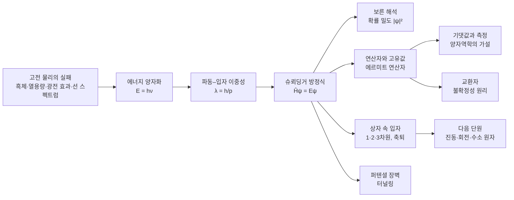

# 물리화학 7. 양자역학의 기초 — 고전 물리가 멈춘 자리에서 파동 함수로 운동을 다시 쓰다
<!-- prev: uchem-4, uphy-12, umath-6, umath-8 -->
<!-- next: pchem-8 -->

> [!NOTE]
> **이 단원의 범위**
> - 고전 물리의 한계: 흑체 복사(레일리–진스 식과 플랑크 분포), 고체의 열용량(뒬롱–프티 법칙과 아인슈타인 모형), 광전 효과와 콤프턴 효과, 원자 스펙트럼과 보어 모형
> - 파동–입자 이중성: 드브로이 관계, 전자 회절과 단일 입자 간섭
> - 슈뢰딩거 방정식(시간 의존·시간 무관), 정상 상태, 파동 함수의 보른 해석과 허용 조건
> - 연산자와 고유값 문제, 에르미트 연산자(실수 고유값·직교성), 기댓값, 겹침 상태와 측정 확률
> - 양자역학의 가설 정리
> - 교환자와 불확정성 원리(로버트슨 부등식의 유도), 에너지–시간 관계와 선 너비
> - 1·2·3차원 상자 속 입자, 영점 에너지, 대응 원리, 축퇴와 그 깨짐, 자유 전자 모형
> - 퍼텐셜 장벽과 터널링(사각 장벽의 투과 확률), 주사 터널링 현미경과 수소 이동

**학습 목표**

1. 흑체 복사·고체의 열용량·광전 효과·원자 스펙트럼에서 고전 물리가 실패하는 지점을 정량적으로 짚고, 에너지 양자화로 플랑크 분포와 아인슈타인 열용량 식을 유도할 수 있다.
2. 드브로이 관계로 전자·중성자·분자의 파장을 계산하고, 단일 입자 간섭 실험이 파동–입자 이중성에 대해 말해 주는 것을 설명할 수 있다.
3. 평면파와 드브로이·아인슈타인 관계에서 슈뢰딩거 방정식을 세우고, 변수 분리로 정상 상태를 얻으며, 보른 해석에 따라 파동 함수를 정규화하고 확률을 계산할 수 있다.
4. 에르미트 연산자의 고유값이 실수이고 고유 함수가 직교함을 증명하고, 겹침 상태에서 측정 확률·기댓값·시간 변화를 계산하며, 양자역학의 가설을 정리할 수 있다.
5. 교환자로부터 로버트슨 부등식을 유도하고, 위치–운동량 불확정성과 에너지–시간 관계를 원자 크기 어림과 스펙트럼 선 너비에 적용할 수 있다.
6. 1·2·3차원 상자 속 입자의 슈뢰딩거 방정식을 풀고 에너지 준위·파동 함수·축퇴를 구하며, 자유 전자 모형으로 콘주게이션 분자의 흡수 파장을 어림하고 그 한계를 평가할 수 있다.
7. 사각 장벽의 투과 확률을 경계 조건으로부터 구하고, 질량·장벽 폭·높이에 대한 지수 의존을 주사 터널링 현미경과 수소 이동 반응에 적용할 수 있다.

**이 단원의 학습 사다리**

| 단계 | 무엇을 하나? |
|---|---|
| STEP 1. 이전 학습 다시 보기 | 광자와 보어 모형, 드브로이 파장, 상자 속 입자의 에너지 식(일반화학·일반물리학), 교환자와 고유값 문제(수학 도구 8) |
| STEP 2. 기초 다지기 | 복소수와 절댓값 제곱, $\psi'' = \mp k^2\psi$의 해, 등비급수로 평균 구하기, 함수의 내적과 직교성 |
| STEP 3. 핵심 개념 | 흑체 복사 → 열용량 → 광전·콤프턴 효과 → 원자 스펙트럼 → 물질파 → 슈뢰딩거 방정식 → 보른 해석 → 연산자와 기댓값 → 가설 → 불확정성 → 1차원 상자 → 2·3차원 상자와 축퇴 → 터널링 |
| STEP 4. 오개념 바로잡기 | "파동 함수가 곧 전자의 모양이다", "불확정성은 측정 기구가 교란해서 생긴다", "정상 상태에서는 전자가 멈춰 있다" 같은 착각 |
| STEP 5. 대학원·연구로 | 디랙 표기와 힐베르트 공간, WKB 근사와 반응 속도의 터널링 보정 |
| STEP 6. 생활·산업·진로 | 주사 터널링 현미경, 전자 현미경, 양자점, 효소의 수소 터널링 |

---

## 🗺️ 단원 들어가기

19세기 말의 물리학은 거의 완성된 것처럼 보였다. 뉴턴 역학은 행성의 운동을, 맥스웰 전자기학은 빛을, 열역학과 통계 역학은 기체와 열기관을 설명했다. 그런데 가장 평범한 질문 몇 개가 이 체계를 무너뜨렸다. 달군 쇠는 왜 붉게, 더 달구면 하얗게 빛나는가? 다이아몬드는 왜 실온에서 열용량이 구리의 4분의 1밖에 안 되는가? 빛을 아무리 세게 비춰도 어떤 금속에서는 왜 전자가 하나도 튀어나오지 않는가? 수소 기체는 왜 아무 색이 아니라 정해진 몇 가지 색의 빛만 내는가?

네 질문의 답은 하나로 모인다. **에너지는 연속적으로 주고받는 양이 아니라 덩어리(양자)로 주고받는다.** 그리고 이 생각을 끝까지 밀고 나가면, 전자 같은 입자도 파동처럼 간섭하고, 그 운동은 궤도가 아니라 **파동 함수**로 기술해야 한다는 결론에 이른다. 일반화학과 일반물리학에서는 이 결론의 '결과'(광자 에너지 $h\nu$, 드브로이 파장, 상자 속 입자의 $E_n$)를 배웠다. 이 단원에서는 그 결과가 **어떤 가설에서 어떻게 유도되는지**를 처음부터 세운다.

전공 화학자에게 양자역학은 교양이 아니라 도구이다. 분자의 색(전자 전이), 적외선 스펙트럼(진동), 반응 속도의 동위 원소 효과(터널링), NMR(스핀), 계산 화학(슈뢰딩거 방정식의 근사 풀이)이 모두 이 단원의 몇 가지 가설 위에 서 있다. 이 단원을 마치면 슈뢰딩거 방정식을 세우고 경계 조건으로 풀어, 에너지 준위와 측정 확률을 계산할 수 있게 된다. 그 첫 연습 상대가 가장 단순한 계, **상자 속 입자**와 **퍼텐셜 장벽**이다.

---

## STEP 1. 🔙 이전 학습 다시 보기

### 연계 개념표

| 이전 단원 | 그때 배운 것 | 이 단원에서 확장되는 것 |
|---|---|---|
| 일반화학 「원자의 전자 구조와 주기성」 | $E = h\nu$, 광전 효과 $E_k = h\nu - \Phi$, 뤼드베리 식과 보어 모형, 드브로이 파장, $\Delta x\,\Delta p \ge h/4\pi$, 1차원 상자의 $E_n = n^2h^2/8mL^2$ | 플랑크 분포를 **유도**하고, 보어 모형에 환산 질량을 넣어 동위 원소 이동을 계산한다. 불확정성을 교환자에서 증명하고, 상자 속 입자를 슈뢰딩거 방정식으로 풀어 2·3차원과 축퇴까지 확장한다 |
| 일반물리학 「현대 물리」 '광자', '물질파와 불확정성 원리', '슈뢰딩거 방정식과 무한 퍼텐셜 우물, 터널링' | 빈 변위 법칙과 슈테판–볼츠만 법칙, 콤프턴 식, 시간 무관 슈뢰딩거 방정식, 무한 우물, 투과 확률 $T \approx e^{-2\kappa L}$ | 두 법칙을 플랑크 분포의 미분·적분으로 **유도**, 시간 의존 방정식과 정상 상태, 사각 장벽의 투과 확률을 경계 조건으로 **정확히** 구하고 앞 인자의 의미를 밝힌다 |
| 수학 도구 6 「복소수와 푸리에 해석」 '오일러 공식과 복소 지수 함수', '불확정 관계' | 복소 지수 함수, 평면파 $e^{i(kx - \omega t)}$, 푸리에 변환에서 나오는 $\Delta x\,\Delta k \gtrsim 1$ | 파동 함수가 복소 함수인 까닭, 위상의 물리적 의미, 파속과 불확정성 |
| 수학 도구 8 「편미분방정식과 특수 함수」 '경계 조건과 양자화', '연산자와 교환자' | 변수 분리, 고유값 문제, 직교 함수 전개, $[\hat{x}, \hat{p}] = i\hbar$, 로버트슨 부등식(결과) | 수학적 구조에 **물리적 가설**(보른 규칙, 측정의 가설)을 더한다. 로버트슨 부등식을 슈바르츠 부등식에서 직접 유도한다 |
| 물리화학 2 「열역학 제2·3법칙과 엔트로피」 | 0 K 근처에서 $C_p \to 0$, 디바이 외삽 | 열용량이 0으로 가는 까닭을 에너지 양자화로 설명한다(아인슈타인 모형) |

### 준비 운동 (사전 진단)

**Q1.** 파장 400 nm인 광자 한 개의 에너지를 eV 단위로 구하시오. ($hc = 1239.8\ \mathrm{eV\cdot nm}$)

**Q2.** $\psi(x) = e^{ikx}$일 때 $\lvert\psi\rvert^2$은 얼마인가? 이 결과는 입자의 위치에 대해 무엇을 말해 주는가?

**Q3.** 수학 도구 8에서 본 교환자 $[\hat{x}, \hat{p}]$를 시험 함수 $f(x)$에 작용시켜 계산하시오. ($\hat{p} = -i\hbar\,d/dx$)

**Q4.** 일반화학에서 배운 1차원 상자 속 입자의 에너지 식 $E_n = n^2h^2/8mL^2$에서 $n = 0$이 허용되지 않는 까닭을 한 문장으로 쓰시오.

정답 및 해설

**Q1.** $E = hc/\lambda = 1239.8/400 = 3.10\ \mathrm{eV}$.

**Q2.** $\lvert e^{ikx}\rvert^2 = e^{-ikx}e^{ikx} = 1$. 확률 밀도가 모든 곳에서 같으므로 위치가 전혀 정해져 있지 않다. 대신 운동량은 $\hbar k$로 정확히 정해져 있다(STEP 3 ⑩의 불확정성의 극단적인 예).

**Q3.** $[\hat{x}, \hat{p}]f = x(-i\hbar f') - (-i\hbar)(xf)' = -i\hbar xf' + i\hbar(f + xf') = i\hbar f$. 따라서 $[\hat{x}, \hat{p}] = i\hbar$.

**Q4.** $n = 0$이면 $\psi = \sqrt{2/L}\sin 0 = 0$이 되어 상자 어디에도 입자가 없으므로(정규화할 수 없으므로) 물리적인 상태가 아니다. 그래서 가장 낮은 에너지가 0이 아닌 $E_1$이다(영점 에너지).

---

## STEP 2. 🧱 기초 다지기

### 디딤돌 1. 복소수와 절댓값 제곱 — 파동 함수는 복소 함수이다

수학 도구 6 '복소수와 복소 평면', '오일러 공식과 복소 지수 함수'에서 익힌 내용 가운데 이 단원에 꼭 필요한 것은 다음 네 가지이다.

| 성질 | 식 | 이 단원에서 쓰이는 곳 |
|---|---|---|
| 복소 켤레 | $z = a + ib \Rightarrow z^* = a - ib$ | 확률 밀도 $\psi^*\psi$ |
| 절댓값 제곱 | $\lvert z\rvert^2 = z^*z = a^2 + b^2 \ge 0$ | 확률은 언제나 0 이상의 실수 |
| 오일러 공식 | $e^{i\theta} = \cos\theta + i\sin\theta$, $\lvert e^{i\theta}\rvert = 1$ | 정상 상태의 시간 인자 $e^{-iEt/\hbar}$ |
| 합의 절댓값 제곱 | $\lvert z_1 + z_2\rvert^2 = \lvert z_1\rvert^2 + \lvert z_2\rvert^2 + 2\,\mathrm{Re}(z_1^*z_2)$ | 간섭 항, 겹침 상태의 시간 변화 |

마지막 줄이 양자역학에서 가장 중요하다. 두 가능성의 **진폭**을 먼저 더하고 나서 제곱하므로, 확률의 단순한 합 $\lvert z_1\rvert^2 + \lvert z_2\rvert^2$에 **간섭 항** $2\,\mathrm{Re}(z_1^*z_2)$가 붙는다. 이 항은 두 진폭의 상대 위상에 따라 양수도 음수도 될 수 있다.

**예** $z_1 = \tfrac{1}{\sqrt2}$, $z_2 = \tfrac{1}{\sqrt2}e^{i\phi}$이면 $\lvert z_1 + z_2\rvert^2 = \tfrac12 + \tfrac12 + \cos\phi = 1 + \cos\phi$이다. $\phi = 0$이면 2(보강), $\phi = \pi$이면 0(상쇄)이다. 각각의 절댓값 제곱(각 $\tfrac12$)은 위상과 무관한데, 합의 절댓값 제곱은 위상에 따라 0에서 2까지 변한다. 이중 슬릿 무늬가 바로 이 $1 + \cos\phi$이다.

### 디딤돌 2. $\psi'' = -k^2\psi$와 $\psi'' = +\kappa^2\psi$ — 두 가지 기본 해

수학 도구 4 '상수 계수 2계 선형 동차 방정식'과 수학 도구 8 '경계 조건과 양자화'에서 본 대로, 퍼텐셜이 일정한 구간의 슈뢰딩거 방정식은 다음 두 꼴 가운데 하나가 된다.

| 방정식 | 일반해 | 물리적 상황 |
|---|---|---|
| $\psi'' = -k^2\psi$ ($k > 0$) | $A\sin kx + B\cos kx$ 또는 $Ce^{ikx} + De^{-ikx}$ | $E > V$: 고전적으로 허용된 영역, 진동한다 |
| $\psi'' = +\kappa^2\psi$ ($\kappa > 0$) | $Fe^{\kappa x} + Ge^{-\kappa x}$ 또는 $\cosh$, $\sinh$의 결합 | $E < V$: 고전적으로 금지된 영역, 지수적으로 커지거나 줄어든다 |

어느 해를 고를지는 **경계 조건**이 정한다. 벽에서 $\psi = 0$이면 $\sin$만 남고, $x \to \infty$로 뻗는 금지 영역이면 발산하는 $e^{\kappa x}$를 버린다. 진동 구간에서 $\psi$는 축을 향해 휘고(곡률이 $-\psi$에 비례), 금지 구간에서는 축에서 멀어지도록 휜다. 이 '휘는 방향'만 기억해도 파동 함수의 모양을 손으로 그릴 수 있다.

**예** $\psi(x) = A\sin kx + B\cos kx$에 $\psi(0) = 0$과 $\psi(L) = 0$을 차례로 적용하면 $B = 0$, $A\sin kL = 0$이다. $A = 0$이면 해가 사라지므로 $\sin kL = 0$, 즉 $k = n\pi/L$이어야 한다. **0이 아닌 해가 존재할 조건이 $k$를 띄엄띄엄하게 만든다.** 이것이 양자화의 수학적 뿌리이다.

### 디딤돌 3. 등비급수로 평균 구하기

플랑크와 아인슈타인의 계산은 '에너지가 $0, \varepsilon, 2\varepsilon, \ldots$인 상태에 볼츠만 가중치를 주어 평균 내기'이다. 수학 도구 2 '테일러 급수'의 등비급수와 그 미분이 필요하다($\lvert y\rvert < 1$).

$$
\sum_{n=0}^{\infty} y^n = \frac{1}{1 - y}, \qquad \sum_{n=0}^{\infty} n\,y^n = y\frac{d}{dy}\left(\frac{1}{1 - y}\right) = \frac{y}{(1 - y)^2}
$$

따라서 $y = e^{-\varepsilon/k_\mathrm{B}T}$로 놓으면 평균 양자수는

$$
\langle n\rangle = \frac{\sum n\,y^n}{\sum y^n} = \frac{y}{1 - y} = \frac{1}{e^{\varepsilon/k_\mathrm{B}T} - 1}
$$

**예** $\varepsilon = k_\mathrm{B}T$이면 $\langle n\rangle = 1/(e - 1) = 0.582$, $\varepsilon = 5k_\mathrm{B}T$이면 $1/(e^5 - 1) = 6.8\times10^{-3}$이다. 에너지 덩어리가 열에너지보다 크면 들뜬 상태가 거의 채워지지 않는다. 이 '얼어붙음'이 흑체 복사의 자외선 쪽과 저온 열용량을 설명하는 열쇠이다(물리화학 11 「통계 열역학」에서 분배 함수로 일반화된다).

### 디딤돌 4. 함수의 내적과 직교성 — 벡터에서 함수로

수학 도구 5 '대칭 행렬과 에르미트 행렬'과 수학 도구 8 '직교 함수와 전개'에서 본 것처럼, 함수도 벡터처럼 다룰 수 있다. 성분의 곱을 더하는 대신 곱을 **적분**한다.

$$
\langle f, g\rangle = \int f^*(x)\,g(x)\,dx, \qquad \lVert f\rVert^2 = \langle f, f\rangle = \int\lvert f\rvert^2dx
$$

| 벡터 | 함수 | 양자역학 |
|---|---|---|
| 내적 $\mathbf{u}^\dagger\mathbf{v}$ | $\int f^*g\,dx$ | 겹침 적분, 전개 계수 |
| 단위 벡터 | $\int\lvert f\rvert^2dx = 1$ | 정규화된 파동 함수 |
| 직교 $\mathbf{u}^\dagger\mathbf{v} = 0$ | $\int f^*g\,dx = 0$ | 서로 다른 고유값의 고유 함수 |
| 에르미트 행렬 $A^\dagger = A$ | $\int f^*(\hat{A}g)dx = \int(\hat{A}f)^*g\,dx$ | 관측 가능한 양의 연산자 |
| 성분 $v_i = \mathbf{e}_i^\dagger\mathbf{v}$ | $c_n = \int\varphi_n^*f\,dx$ | 측정 확률의 진폭 |

**예** $\varphi_1 = \sqrt{2/L}\sin(\pi x/L)$와 $\varphi_2 = \sqrt{2/L}\sin(2\pi x/L)$의 내적은 곱을 합으로 바꾸는 공식 $\sin a\sin b = \tfrac12[\cos(a - b) - \cos(a + b)]$로
$\dfrac{2}{L}\displaystyle\int_0^L\sin\frac{\pi x}{L}\sin\frac{2\pi x}{L}dx = \frac{1}{L}\int_0^L\left[\cos\frac{\pi x}{L} - \cos\frac{3\pi x}{L}\right]dx = 0$이다. 두 함수는 직교한다. ⑧에서 이 직교성이 우연이 아니라 에르미트 연산자의 성질에서 나옴을 증명한다.

---

## STEP 3. 📘 핵심 개념

