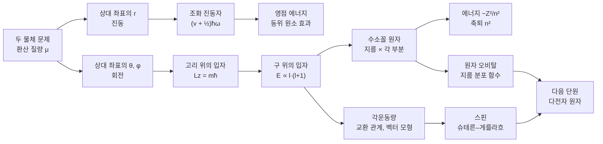

# 물리화학 8. 진동·회전 운동과 수소 원자 — 용수철, 팽이, 그리고 핵 둘레의 전자를 풀다
<!-- prev: pchem-7, uchem-4, umath-8, uphy-4 -->
<!-- next: pchem-9 -->

> [!NOTE]
> **이 단원의 범위**
> - 두 물체 문제의 분리: 질량 중심 운동과 상대 운동, 환산 질량
> - 조화 진동자: 에너지 준위 $E_v = (v + \tfrac12)\hbar\omega$, 에르미트 함수, 영점 에너지, 동위 원소 효과, 기댓값과 비리얼 정리, 고전적 금지 영역
> - 고리 위의 입자: 주기 경계 조건, $\hat{L}_z$의 양자화, 자유 전자 고리 모형
> - 구 위의 입자(강체 회전자): 구면 조화 함수, $E = l(l+1)\hbar^2/2I$, 회전 상수와 회전 준위의 분포
> - 각운동량 연산자와 교환 관계, 벡터 모형과 공간 양자화
> - 수소꼴 원자의 슈뢰딩거 방정식: 지름·각 부분의 분리, 유효 퍼텐셜, 에너지 준위와 축퇴, 환산 질량 보정
> - 원자 오비탈(실수 오비탈, 마디), 지름 분포 함수와 기댓값
> - 궤도 자기 모멘트, 슈테른–게를라흐 실험과 전자 스핀

**학습 목표**

1. 두 입자의 운동을 질량 중심 운동과 상대 운동으로 분리하고, 상대 운동이 환산 질량 $\mu$인 한 입자의 문제가 됨을 유도할 수 있다.
2. 결합의 퍼텐셜을 평형 길이 근처에서 전개해 조화 진동자 모형을 세우고, 에너지 준위·영점 에너지·파동 함수·기댓값을 계산하여 진동 파수, 힘 상수, 동위 원소 효과를 정량적으로 다룰 수 있다.
3. 고리 위의 입자와 구 위의 입자의 슈뢰딩거 방정식을 풀어 $m_l$과 $l$이 주기 조건과 유한성 조건에서 나오는 것을 보이고, 회전 상수와 회전 준위의 분포를 계산할 수 있다.
4. 각운동량 성분 연산자의 교환 관계를 유도하고, 크기 $\sqrt{l(l+1)}\hbar$와 $z$ 성분 $m_l\hbar$만 동시에 정해지는 까닭을 벡터 모형으로 설명할 수 있다.
5. 수소꼴 원자의 슈뢰딩거 방정식을 지름 부분과 각 부분으로 분리하고, 유효 퍼텐셜과 에너지 준위 $E_n \propto -Z^2/n^2$, $n^2$겹 축퇴, 환산 질량 보정을 설명·계산할 수 있다.
6. 원자 오비탈의 마디와 모양을 양자수로 예측하고, 지름 분포 함수로 가장 그럴듯한 반지름·평균 반지름·특정 영역의 발견 확률을 계산할 수 있다.
7. 슈테른–게를라흐 실험의 결과에서 전자 스핀($s = \tfrac12$)을 이끌어 내고, 궤도·스핀 자기 모멘트와 연속 실험의 결과를 설명할 수 있다.

**이 단원의 학습 사다리**

| 단계 | 무엇을 하나? |
|---|---|
| STEP 1. 이전 학습 다시 보기 | 보어 모형과 양자수(일반화학), 단진동과 각운동량(일반물리학), 슈뢰딩거 방정식·상자 속 입자(물리화학 7), 특수 함수(수학 도구 8) |
| STEP 2. 기초 다지기 | 구면 좌표와 부피 요소, 가우스 적분과 감마 적분, 급수 해의 끊김 조건, 연산자와 교환자 |
| STEP 3. 핵심 개념 | 환산 질량 → 조화 진동자(준위·파동 함수) → 고리 위의 입자 → 구 위의 입자 → 각운동량 → 수소꼴 원자(분리·준위) → 오비탈과 지름 분포 → 스핀 |
| STEP 4. 오개념 바로잡기 | "영점 진동은 측정 오차이다", "각운동량의 크기는 $l\hbar$이다", "$\mathrm{p}_x$는 $m_l = +1$ 상태이다", "스핀은 전자의 자전이다" 같은 착각 |
| STEP 5. 대학원·연구로 | 사다리 연산자로 푸는 조화 진동자, 미세 구조와 디랙 방정식, 램 이동 |
| STEP 6. 생활·산업·진로 | 중수소 치환 의약품과 동위 원소 효과, 전파 천문학의 CO 선, 반도체 속 '수소 원자', 스핀 큐비트 |

---

## 🗺️ 단원 들어가기

물리화학 7에서 슈뢰딩거 방정식을 처음 풀 때 우리는 '상자'라는 인공적인 퍼텐셜을 썼다. 벽 안에서는 퍼텐셜이 0이고 벽에서 무한대가 되는 이 모형은 양자화가 경계 조건에서 나온다는 것을 보여 주기에는 좋았지만, 실제 분자나 원자는 그렇게 생기지 않았다. 실제 화학의 퍼텐셜은 세 가지 꼴이 거의 전부이다. 결합이 늘어나고 줄어들 때의 **포물선**, 분자가 방향을 바꿀 때의 **퍼텐셜이 없는 회전**, 그리고 전자와 핵 사이의 **쿨롱 퍼텐셜**이다.

이 세 문제는 정확히 풀린다. 그리고 그 해가 분광학과 화학 결합의 언어가 된다. 적외선 스펙트럼에서 C=O 신축 진동이 $1700\ \mathrm{cm^{-1}}$ 근처에 나타나는 까닭, 중수소로 바꾼 C–D 결합이 C–H보다 느리게 끊어지는 까닭, 전파 망원경이 성간 구름의 일산화 탄소를 115 GHz에서 찾는 까닭, 2p 오비탈이 아령 모양인 까닭이 모두 이 단원의 세 해에 들어 있다. 일반화학에서 "외우라"고 했던 양자수 $n$, $l$, $m_l$의 규칙($l \le n - 1$, $\lvert m_l\rvert \le l$)도 이번에는 슈뢰딩거 방정식의 해가 유한하고 한 값이어야 한다는 조건에서 **유도**된다.

마지막으로 한 가지 실험이 이 그림을 깬다. 은 원자 빔을 불균일한 자기장에 통과시키면 정확히 **두 갈래**로 갈라진다. 각운동량이 $l$이면 $2l + 1$갈래(홀수)여야 하므로, 두 갈래는 슈뢰딩거 방정식에 없던 새로운 각운동량, 곧 **스핀**이 있다는 증거이다. 이 단원을 마치면 수소 원자의 모든 상태를 네 개의 양자수로 정확히 세고, 다음 단원 「다전자 원자와 화학 결합」에서 이 상태들에 전자를 채워 넣을 준비가 된다.

---

## STEP 1. 🔙 이전 학습 다시 보기

### 연계 개념표

| 이전 단원 | 그때 배운 것 | 이 단원에서 확장되는 것 |
|---|---|---|
| 일반화학 「원자의 전자 구조와 주기성」 | 보어 모형 $E_n = -2.179\times10^{-18}\ \mathrm{J}/n^2$, 양자수 $n$, $l$, $m_l$, $m_s$의 허용값, 오비탈 모양과 마디 수 $n - l - 1$ | 양자수와 그 규칙을 슈뢰딩거 방정식의 경계 조건에서 **유도**, 환산 질량 보정, 지름 분포 함수로 반지름의 기댓값 계산, 스핀의 실험적 근거 |
| 일반물리학 「중력·진동·유체」 | 단진동 $\omega = \sqrt{k/m}$, 에너지 $\tfrac12kA^2$, 진폭에 따라 에너지가 연속적 | 양자 조화 진동자: 에너지가 $\hbar\omega$ 간격으로 양자화, 바닥 상태에서도 $\tfrac12\hbar\omega$ |
| 일반물리학 「회전 운동과 각운동량」 | 관성 모멘트 $I$, $L = I\omega$, 회전 에너지 $L^2/2I$, 각운동량 보존 | 각운동량의 크기와 성분이 양자화, 성분끼리 동시에 정해지지 않음(교환 관계) |
| 물리화학 7 「양자역학의 기초」 | 슈뢰딩거 방정식, 보른 해석과 규격화, 연산자·고유값·기댓값, 불확정성 원리, 상자 속 입자, 터널링 | 상자 대신 실제 퍼텐셜(포물선, 쿨롱), 닫힌 고리의 주기 조건, 3차원 중심력 문제의 분리 |
| 수학 도구 8 「편미분방정식과 특수 함수」 | 변수 분리법, 에르미트·르장드르·라게르 함수, 구면 조화 함수, 교환자 | 그 함수들이 분자의 진동·회전과 원자 오비탈임을 확인하고 실제 분자 자료로 계산 |

### 준비 운동 (사전 진단)

**Q1.** 질량 1.0 kg인 물체가 용수철 상수 100 N/m인 용수철에 매달려 진폭 0.10 m로 단진동한다. 각진동수 $\omega$, 진동수 $f$, 역학적 에너지를 구하시오. 이 물체의 에너지는 0과 0.5 J 사이의 아무 값이나 될 수 있는가?

**Q2.** 보어 모형으로 수소 원자의 $n = 2$ 준위 에너지(eV)와 $n = 2 \rightarrow 1$ 전이에서 나오는 빛의 파장을 구하시오. ($E_1 = -13.6\ \mathrm{eV}$, $hc = 1240\ \mathrm{eV\cdot nm}$)

**Q3.** 3d 오비탈의 $l$과 가능한 $m_l$ 값을 모두 쓰고, 지름 마디와 각 마디의 수를 쓰시오.

**Q4.** 1차원 상자 속 입자의 바닥 상태 에너지가 0이 아닌 까닭을 불확정성 원리로 한 문장으로 설명하시오.

정답 및 해설

**Q1.** $\omega = \sqrt{k/m} = \sqrt{100/1.0} = 10\ \mathrm{s^{-1}}$, $f = \omega/2\pi = 1.6\ \mathrm{Hz}$, $E = \tfrac12kA^2 = \tfrac12(100)(0.10)^2 = 0.50\ \mathrm{J}$. 고전역학에서는 진폭을 연속적으로 바꿀 수 있으므로 어떤 값도 가능하다. STEP 3 ②에서 이것이 양자역학에서는 $\hbar\omega$ 간격의 계단으로 바뀌는 것을 본다(이 물체에서 $\hbar\omega \approx 10^{-33}\ \mathrm{J}$이라 계단이 보이지 않는다).

**Q2.** $E_2 = -13.6/4 = -3.40\ \mathrm{eV}$. $\Delta E = 10.2\ \mathrm{eV}$이므로 $\lambda = 1240/10.2 = 122\ \mathrm{nm}$(자외선, 라이먼 α선, 정밀값 121.6 nm).

**Q3.** $l = 2$, $m_l = -2, -1, 0, +1, +2$. 지름 마디 $n - l - 1 = 0$개, 각 마디 $l = 2$개.

**Q4.** 입자가 길이 $L$ 안에 갇히면 $\Delta x \lesssim L$이므로 $\Delta p \gtrsim \hbar/(2L)$이 되어 운동량, 곧 운동 에너지가 0일 수 없다.

---

## STEP 2. 🧱 기초 다지기

### 디딤돌 1. 구면 좌표와 부피 요소 — 중심력 문제의 좌표

원자와 회전하는 분자는 한 점을 중심으로 대칭이므로 구면 좌표 $(r, \theta, \phi)$로 다룬다. 수학 도구 2 '좌표 변환과 야코비안'에서 익힌 대로

$$
x = r\sin\theta\cos\phi, \quad y = r\sin\theta\sin\phi, \quad z = r\cos\theta, \qquad d\tau = r^2\sin\theta\,dr\,d\theta\,d\phi
$$

이고($0 \le r < \infty$, $0 \le \theta \le \pi$, $0 \le \phi < 2\pi$), 수학 도구 3 '라플라시안'에서 본 구면 좌표의 라플라시안은 지름 부분과 각 부분으로 나뉜다.

$$
\nabla^2 = \frac{1}{r^2}\frac{\partial}{\partial r}\left(r^2\frac{\partial}{\partial r}\right) + \frac{1}{r^2}\Lambda^2, \qquad \Lambda^2 = \frac{1}{\sin\theta}\frac{\partial}{\partial\theta}\left(\sin\theta\frac{\partial}{\partial\theta}\right) + \frac{1}{\sin^2\theta}\frac{\partial^2}{\partial\phi^2}
$$

$\Lambda^2$(**르장드르 연산자**)는 $r$을 전혀 포함하지 않는다. 이 사실 하나가 ⑤의 강체 회전자와 ⑦의 수소 원자를 같은 각 함수로 묶는다.

**예제** $\psi = Ne^{-r/a}$를 규격화하시오.
**풀이** $\displaystyle\int\lvert\psi\rvert^2d\tau = N^2\int_0^\infty r^2e^{-2r/a}dr\int_0^\pi\sin\theta\,d\theta\int_0^{2\pi}d\phi = N^2\cdot\frac{2!}{(2/a)^3}\cdot2\cdot2\pi = N^2\pi a^3 = 1$이므로 $N = (\pi a^3)^{-1/2}$. 각 부분의 적분이 $4\pi$(구의 입체각)라는 것, 지름 적분에 $r^2$이 붙는다는 것을 놓치지 말자.

### 디딤돌 2. 가우스 적분과 감마 적분 — 기댓값 계산의 두 공식

조화 진동자의 파동 함수는 $e^{-x^2}$ 꼴이고, 수소 원자의 파동 함수는 $e^{-r}$ 꼴이다. 이 단원의 거의 모든 기댓값은 다음 두 공식으로 끝난다(수학 도구 2 '가우스 적분').

| 공식 | 값 | 쓰이는 곳 |
|---|---|---|
| $\displaystyle\int_{-\infty}^{\infty}e^{-ax^2}dx$ | $\sqrt{\pi/a}$ | 조화 진동자의 규격화 |
| $\displaystyle\int_{-\infty}^{\infty}x^2e^{-ax^2}dx$ | $\dfrac{1}{2a}\sqrt{\pi/a}$ | $\langle x^2\rangle$, $\langle V\rangle$ |
| $\displaystyle\int_{-\infty}^{\infty}x^{\text{홀수}}e^{-ax^2}dx$ | $0$ | $\langle x\rangle = 0$ (대칭) |
| $\displaystyle\int_0^\infty x^ne^{-bx}dx$ | $\dfrac{n!}{b^{n+1}}$ | 수소 원자의 규격화, $\langle r\rangle$, $\langle 1/r\rangle$ |

**예제** $\displaystyle\int_{-\infty}^\infty x^2e^{-x^2}dx$와 $\displaystyle\int_0^\infty r^3e^{-2r}dr$를 구하시오.
**풀이** 첫째는 $a = 1$이므로 $\sqrt\pi/2 \approx 0.886$. 둘째는 $n = 3$, $b = 2$이므로 $3!/2^4 = 6/16 = 0.375$.

### 디딤돌 3. 급수 해와 '끊김' 조건 — 양자수가 태어나는 곳

수학 도구 4 '급수 해법의 생각'에서 보았듯, 계수가 변수에 의존하는 2계 미분방정식은 $H(y) = \sum_j a_jy^j$를 넣어 계수 사이의 **점화식**을 얻는다. 양자역학에서 이 급수가 끝없이 이어지면 해는 무한대에서 발산해 규격화할 수 없다. 그래서 급수가 어느 차수에서 **끊겨야** 하고, 그 조건이 에너지(또는 $l$)를 정수로 묶는다. 조화 진동자의 점화식은

$$
a_{j+2} = \frac{2j + 1 - \varepsilon}{(j + 1)(j + 2)}\,a_j \qquad (\varepsilon = 2E/\hbar\omega)
$$

이다(수학 도구 8 '에르미트 함수와 조화 진동자').

**예제** $\varepsilon = 7$일 때 홀수 급수($a_1 = 1$)가 어디서 끊기는지 보이고 $H(y)$를 쓰시오.
**풀이** $j = 1$: $a_3 = (3 - 7)/(2\cdot3) = -2/3$. $j = 3$: $a_5 = (7 - 7)/(4\cdot5)\,a_3 = 0$이므로 이후 모든 홀수 계수가 0이다. $H = y - \tfrac23y^3 \propto 8y^3 - 12y = H_3(y)$. 즉 $\varepsilon = 7 = 2(3) + 1$이 $v = 3$ 준위이다. (이때 짝수 급수는 $a_0 = 0$으로 두어 없앤다.)

### 디딤돌 4. 연산자와 교환자 — 동시에 정해지는 양

물리화학 7과 수학 도구 8 '연산자와 교환자'에서 두 연산자의 **교환자**를 $[\hat{A}, \hat{B}] = \hat{A}\hat{B} - \hat{B}\hat{A}$로 정의했다. 기본 관계는 $[\hat{x}, \hat{p}_x] = i\hbar$이다.

| 성질 | 뜻 |
|---|---|
| $[\hat{A}, \hat{B}] = 0$ | 두 양의 **동시 고유 함수**를 고를 수 있다(두 값이 동시에 정해진다) |
| $[\hat{A}, \hat{B}] \ne 0$ | 일반적으로 동시에 정해지지 않으며, $\Delta A\,\Delta B \ge \tfrac12\lvert\langle[\hat{A}, \hat{B}]\rangle\rvert$ |
| $[\hat{A}, \hat{B}\hat{C}] = [\hat{A}, \hat{B}]\hat{C} + \hat{B}[\hat{A}, \hat{C}]$ | 곱의 교환자를 쪼개는 규칙(⑥에서 쓴다) |
| 서로 다른 좌표의 연산자 | $[\hat{x}, \hat{p}_y] = 0$, $[\hat{y}, \hat{z}] = 0$ 등 |

**예제** $[\hat{x}^2, \hat{p}_x]$를 구하시오.
**풀이** 곱의 규칙으로 $[\hat{x}^2, \hat{p}_x] = \hat{x}[\hat{x}, \hat{p}_x] + [\hat{x}, \hat{p}_x]\hat{x} = 2i\hbar\hat{x}$. 직접 확인: 임의의 $f$에 대해 $\hat{x}^2\hat{p}_xf - \hat{p}_x(x^2f) = -i\hbar x^2f' + i\hbar(2xf + x^2f') = 2i\hbar xf$.

---

## STEP 3. 📘 핵심 개념

### ① 두 물체 문제와 환산 질량 — 분자의 운동을 셋으로 나누기

이원자 분자의 두 원자핵, 수소 원자의 전자와 양성자는 모두 **서로의 거리에만 의존하는 퍼텐셜** $V(\lvert\mathbf{r}_1 - \mathbf{r}_2\rvert)$로 묶인 두 입자이다. 고전역학에서처럼 양자역학에서도 이런 문제는 '전체가 움직이는 것'과 '서로에 대해 움직이는 것'으로 정확히 나뉜다.

#### 유도 — 질량 중심 좌표와 상대 좌표

**가정** 질량 $m_1$, $m_2$인 두 입자, 외부 힘은 없고 퍼텐셜은 상대 거리에만 의존한다.

1. **새 좌표**: 전체 질량 $M = m_1 + m_2$, 질량 중심 $\mathbf{R} = (m_1\mathbf{r}_1 + m_2\mathbf{r}_2)/M$, 상대 좌표 $\mathbf{r} = \mathbf{r}_1 - \mathbf{r}_2$로 두면 거꾸로
$$
\mathbf{r}_1 = \mathbf{R} + \frac{m_2}{M}\mathbf{r}, \qquad \mathbf{r}_2 = \mathbf{R} - \frac{m_1}{M}\mathbf{r}
$$
2. **운동 에너지**: 시간으로 미분해 넣으면 교차항 $\dot{\mathbf{R}}\cdot\dot{\mathbf{r}}$은 $m_1m_2/M - m_2m_1/M = 0$으로 사라지고
$$
T = \tfrac12m_1\dot{\mathbf{r}}_1^2 + \tfrac12m_2\dot{\mathbf{r}}_2^2 = \tfrac12M\dot{\mathbf{R}}^2 + \tfrac12\mu\dot{\mathbf{r}}^2, \qquad \boxed{\;\mu = \frac{m_1m_2}{m_1 + m_2}\;}
$$
3. **해밀토니언**: 운동량을 연산자로 바꾸면 $\hat{H} = -\dfrac{\hbar^2}{2M}\nabla_R^2 - \dfrac{\hbar^2}{2\mu}\nabla_r^2 + V(r)$. 두 부분이 서로 다른 변수만 포함하므로 $\Psi = \Phi(\mathbf{R})\,\psi(\mathbf{r})$로 변수가 분리되고 $E = E_\text{질량 중심} + E_\text{내부}$이다.
4. **결과**: 질량 중심은 질량 $M$인 자유 입자(병진 운동, 물리화학 7의 상자 속 입자)이고, 내부 운동은 **질량 $\mu$인 입자 하나가 원점에 고정된 퍼텐셜 $V(r)$ 속에서 움직이는 문제**가 된다.

**적용 한계** 외부 장이 질량 중심과 상대 좌표를 섞으면(예: 강한 전기장) 분리가 깨진다. 다원자 분자에서는 상대 좌표가 여럿이라 이 단원에서는 이원자 분자만 다룬다.

#### 상대 운동을 다시 둘로: 지름 방향과 각 방향

상대 좌표 $\mathbf{r}$을 구면 좌표 $(r, \theta, \phi)$로 쓰면 이원자 분자의 내부 운동은 자연스럽게 나뉜다.

| 좌표 | 이원자 분자에서 | 수소 원자에서 | 다루는 곳 |
|---|---|---|---|
| $\mathbf{R}$ (3개) | 병진 | 원자 전체의 병진 | 물리화학 7 |
| $r$ (1개) | 결합 길이의 변화 = **진동** | 전자의 핵으로부터 거리 | ②·③, ⑦ |
| $\theta$, $\phi$ (2개) | 결합 축의 방향 변화 = **회전** | 전자의 방향 | ④~⑥ |

자유도의 수가 맞는다. 원자 두 개의 좌표 6개 = 병진 3 + 회전 2 + 진동 1이다.

| 계 | $\mu$ | 특징 |
|---|---|---|
| $\mathrm{H_2}$ | $0.504\ \mathrm{u}$ | 같은 질량이면 $\mu = m/2$ |
| $\mathrm{^1H^{35}Cl}$ | $0.980\ \mathrm{u}$ | 한쪽이 훨씬 무거우면 $\mu \approx$ 가벼운 쪽 질량 |
| $\mathrm{^{12}C^{16}O}$ | $6.856\ \mathrm{u}$ | 질량이 비슷하면 각 질량의 절반 정도 |
| 수소 원자(e⁻ + p⁺) | $0.999\,456\,m_\mathrm{e}$ | 핵이 거의 정지, 보정은 약 0.05 % |
| 양전자 원자(e⁻ + e⁺) | $0.5\,m_\mathrm{e}$ | 두 입자가 같은 질량, 에너지 준위가 수소의 절반 |

#### 예제 1 — 환산 질량과 동위 원소

(1) $\mathrm{^1H^{35}Cl}$와 $\mathrm{^2H^{35}Cl}$(DCl)의 환산 질량을 구하고 그 비를 구하시오. ($m(\mathrm{^1H}) = 1.00783\ \mathrm{u}$, $m(\mathrm{^2H}) = 2.01410\ \mathrm{u}$, $m(\mathrm{^{35}Cl}) = 34.96885\ \mathrm{u}$)
(2) 수소 원자에서 $\mu/m_\mathrm{e}$를 구하고, 핵을 무한히 무겁다고 둔 계산과 에너지가 몇 % 다른지 쓰시오. ($m_\mathrm{p}/m_\mathrm{e} = 1836.15$, 에너지는 $\mu$에 비례한다(⑧))

**풀이**
(1) $\mu_\mathrm{HCl} = \dfrac{1.00783\times34.96885}{35.97668} = 0.97959\ \mathrm{u}$, $\mu_\mathrm{DCl} = \dfrac{2.01410\times34.96885}{36.98295} = 1.90441\ \mathrm{u}$. 비는 $1.90441/0.97959 = 1.944$로, 수소 질량의 비(1.998)보다 조금 작다. 염소가 무한히 무겁지 않기 때문이다.
(2) $\mu/m_\mathrm{e} = \dfrac{1}{1 + m_\mathrm{e}/m_\mathrm{p}} = \dfrac{1}{1 + 1/1836.15} = 0.999\,456$. 에너지가 약 0.054 % 작다(덜 음수이다).

**의미** HCl의 진동·회전은 사실상 '수소 원자가 무거운 염소에 붙어 움직이는' 운동이다. 그래서 수소를 중수소로 바꾸면 $\mu$가 거의 두 배가 되어 진동수와 회전 상수가 크게 바뀐다(②, ⑤). 반면 수소 원자의 0.054 % 보정은 작아 보이지만 분광학의 정밀도(10⁻⁷ 이상)로는 뚜렷하며, 실제로 중수소는 이 차이로 발견되었다(⑧ 예제 9).

> [!TIP]
> 💡 **요령** — 환산 질량은 언제나 **가벼운 쪽 질량보다 작다**($\mu < \min(m_1, m_2)$). 계산 결과가 그보다 크면 틀린 것이다. 두 질량이 같으면 정확히 절반이다.

#### ✔ 바로 확인

1. 빈칸: 두 입자의 상대 운동은 질량이 (    )인 한 입자의 운동과 같다.
2. $\mathrm{^{16}O_2}$ ($m = 15.995\ \mathrm{u}$)의 환산 질량은?
3. (O/X) 이원자 분자의 내부 자유도 3개는 진동 2개와 회전 1개이다.

정답

1. 환산 질량 $\mu = m_1m_2/(m_1 + m_2)$
2. $8.00\ \mathrm{u}$ — 같은 질량이므로 절반이다.
3. X — 진동 1개(결합 길이 $r$), 회전 2개($\theta$, $\phi$)이다.

### ② 조화 진동자 Ⅰ — 에너지 준위와 영점 에너지

#### 모형 세우기 — 모든 결합은 바닥 근처에서 포물선이다

이원자 분자의 퍼텐셜 에너지 $V(r)$는 평형 결합 길이 $r_\mathrm{e}$에서 최솟값을 가진다. $x = r - r_\mathrm{e}$로 두고 테일러 전개(수학 도구 2 '테일러 급수')하면

$$
V(x) = V(0) + \underbrace{\left(\frac{dV}{dx}\right)_0}_{=\,0}x + \frac12\left(\frac{d^2V}{dx^2}\right)_0x^2 + \frac16\left(\frac{d^3V}{dx^3}\right)_0x^3 + \cdots
$$

최솟값에서 1차 도함수는 0이다. $V(0)$을 에너지의 기준으로 잡고 3차 이상을 버리면 $V = \tfrac12kx^2$, **힘 상수(force constant)** $k = (d^2V/dx^2)_0$이다. 힘 상수는 결합 길이를 바꾸려 할 때 퍼텐셜 우물이 얼마나 '가파르게 휘었는가'를 나타낸다.

<!-- 그림 요청: 이원자 분자의 퍼텐셜 에너지 곡선과 조화 근사의 비교. 가로축 결합 길이 r(pm, 50~350), 세로축 V/(kJ/mol)(0~500, 바닥을 0으로). 실선: 모스 퍼텐셜 V = De[1 − e^(−a(r − re))]², De = 458 kJ/mol, re = 74 pm, a = 0.0194 pm⁻¹(H2와 비슷한 값). 점선: 같은 곡률의 포물선 ½k(r − re)², k = 575 N/m. 바닥 근처(re ± 15 pm)에서 두 곡선이 겹치는 부분에 "조화 근사가 맞는 영역", r이 커질 때 실선이 De(가로 점선)로 평평해지는 부분에 "해리", 점선이 계속 올라가는 부분에 "조화 진동자는 해리하지 않는다"라고 이름표. 바닥에서 ZPE 26 kJ/mol 높이에 v = 0 준위선을 짧게 긋는다. -->

#### 슈뢰딩거 방정식과 그 해

①에서 상대 운동은 질량 $\mu$인 한 입자의 문제였다. 지름 방향만 보면

$$
-\frac{\hbar^2}{2\mu}\frac{d^2\psi}{dx^2} + \frac12kx^2\psi = E\psi
$$

이다. 이 식은 수학 도구 8 '에르미트 함수와 조화 진동자'에서 이미 풀었다. 길이 척도 $\alpha = (\hbar/\mu\omega)^{1/2}$로 $y = x/\alpha$, $\varepsilon = 2E/\hbar\omega$로 무차원화하면 $\psi'' + (\varepsilon - y^2)\psi = 0$이 되고, $\psi = H(y)e^{-y^2/2}$의 다항식 부분 $H$가 끊기는 조건(디딤돌 3)이 $\varepsilon = 2v + 1$이다.

$$
\boxed{\;E_v = \left(v + \frac12\right)\hbar\omega, \qquad \omega = \sqrt{\frac{k}{\mu}}, \qquad v = 0, 1, 2, \dots\;}
$$

분광학에서는 에너지를 파수($\mathrm{cm^{-1}}$)로 쓴다. $E_v = (v + \tfrac12)hc\tilde{\nu}$이고

$$
\tilde{\nu} = \frac{\omega}{2\pi c} = \frac{1}{2\pi c}\sqrt{\frac{k}{\mu}}
$$

이다. 결과에서 세 가지를 읽는다.

1. **같은 간격**: 이웃한 준위의 간격은 늘 $\hbar\omega$이다. 적외선 흡수가 분자마다 특정한 파수 하나에 집중되는 까닭이다.
2. **영점 에너지(zero-point energy)**: 가장 낮은 에너지가 0이 아니라 $E_0 = \tfrac12\hbar\omega$이다. 0 K에서도 분자는 진동한다.
3. **$k$와 $\mu$의 역할**: 결합이 단단할수록($k$ 큼), 원자가 가벼울수록($\mu$ 작음) 진동수가 크다.

#### 영점 에너지는 불확정성 원리의 대가이다

영점 에너지가 왜 꼭 $\tfrac12\hbar\omega$인지는 방정식을 풀지 않고도 알 수 있다. 바닥 상태는 대칭이라 $\langle x\rangle = \langle p\rangle = 0$이므로 $(\Delta x)^2 = \langle x^2\rangle$, $(\Delta p)^2 = \langle p^2\rangle$이고, 불확정성 원리 $\Delta x\,\Delta p \ge \hbar/2$에서 $\langle p^2\rangle \ge \hbar^2/(4\langle x^2\rangle)$이다. $s = \langle x^2\rangle$로 쓰면

$$
\langle E\rangle = \frac{\langle p^2\rangle}{2\mu} + \frac12k\langle x^2\rangle \ge \frac{\hbar^2}{8\mu s} + \frac12ks
$$

오른쪽을 $s$에 대해 최소화하면 $-\hbar^2/(8\mu s^2) + k/2 = 0$에서 $s = \hbar/(2\mu\omega)$이고, 그때의 값은 $\hbar\omega/4 + \hbar\omega/4 = \tfrac12\hbar\omega$이다. 입자를 바닥에 가만히 두면($s \rightarrow 0$) 운동 에너지가 폭발하고, 넓게 퍼뜨리면 퍼텐셜 에너지가 커진다. 그 타협점이 영점 에너지이며, 조화 진동자의 바닥 상태는 이 부등식의 등호를 정확히 만족한다.

#### 실제 분자의 진동 상수

| 분자 | $\mu$ (u) | $\tilde{\nu}$ (cm⁻¹, 조화) | $k$ (N/m) | 영점 에너지 (kJ/mol) |
|---|---|---|---|---|
| $\mathrm{H_2}$ | 0.504 | 4401 | 575 | 26.3 |
| $\mathrm{^1H^{35}Cl}$ | 0.980 | 2991 | 516 | 17.9 |
| $\mathrm{N_2}$ | 7.00 | 2359 | 2295 | 14.1 |
| $\mathrm{CO}$ | 6.86 | 2170 | 1902 | 13.0 |
| $\mathrm{O_2}$ | 8.00 | 1580 | 1177 | 9.45 |
| $\mathrm{I_2}$ | 63.5 | 214.5 | 172 | 1.28 |

힘 상수의 순서 $\mathrm{N_2}$(삼중 결합) > CO(삼중 결합) > $\mathrm{O_2}$(이중 결합) > $\mathrm{I_2}$(약한 단일 결합)는 결합 차수의 순서와 대체로 같다. 반면 $\mathrm{H_2}$의 진동수가 가장 큰 것은 결합이 특별히 단단해서가 아니라 $\mu$가 매우 작기 때문이다.

#### 예제 2 — CO의 힘 상수와 ¹³C 동위 원소 이동

$\mathrm{^{12}C^{16}O}$의 조화 진동 파수는 $2170\ \mathrm{cm^{-1}}$이다. ($m(\mathrm{^{16}O}) = 15.9949\ \mathrm{u}$, $m(\mathrm{^{13}C}) = 13.0034\ \mathrm{u}$, $1\ \mathrm{u} = 1.66054\times10^{-27}\ \mathrm{kg}$, $c = 2.99792\times10^{10}\ \mathrm{cm/s}$)
(1) 힘 상수를 구하시오. (2) 영점 에너지를 $\mathrm{cm^{-1}}$와 kJ/mol로 구하시오. (3) $\mathrm{^{13}C^{16}O}$의 진동 파수를 예측하시오.

**풀이**
(1) 식 세우기: $k = \mu\omega^2 = \mu(2\pi c\tilde{\nu})^2$. $\mu = \dfrac{12.000\times15.9949}{27.9949} = 6.8562\ \mathrm{u} = 1.1385\times10^{-26}\ \mathrm{kg}$, $\omega = 2\pi\times2.99792\times10^{10}\times2170 = 4.0875\times10^{14}\ \mathrm{s^{-1}}$.
$k = 1.1385\times10^{-26}\times(4.0875\times10^{14})^2 = 1.90\times10^3\ \mathrm{N/m}$
(2) $E_0 = \tfrac12hc\tilde{\nu}$이므로 파수로는 $1085\ \mathrm{cm^{-1}}$. $1\ \mathrm{cm^{-1}} = 11.963\ \mathrm{J/mol}$이므로 $1085\times11.963 = 1.30\times10^4\ \mathrm{J/mol} = 13.0\ \mathrm{kJ/mol}$.
(3) 동위 원소는 전자 구조가 같아 퍼텐셜(곧 $k$)이 같다(보른–오펜하이머 근사, 다음 단원). 따라서 $\tilde{\nu} \propto \mu^{-1/2}$이다. $\mu(\mathrm{^{13}C^{16}O}) = \dfrac{13.0034\times15.9949}{28.9983} = 7.1724\ \mathrm{u}$
$\tilde{\nu}' = 2170\times\sqrt{6.8562/7.1724} = 2170\times0.97771 = 2122\ \mathrm{cm^{-1}}$

**의미** 약 $48\ \mathrm{cm^{-1}}$의 이동은 적외선 분광기로 쉽게 분리된다. 실제로 관측되는 기본 진동 흡수 띠(¹²CO 약 $2143\ \mathrm{cm^{-1}}$)도 같은 비율로 ¹³CO에서 약 $2096\ \mathrm{cm^{-1}}$로 옮겨 간다. 이렇게 동위 원소로 표지한 원자가 어느 결합에 들어갔는지를 진동 스펙트럼으로 추적할 수 있다. C=O 결합의 힘 상수가 약 1900 N/m라는 것은 이 결합을 1 pm 늘리는 데 약 $\tfrac12k(10^{-12})^2 \approx 10^{-21}\ \mathrm{J}$, 몰당 약 0.6 kJ가 든다는 뜻이다.

#### 예제 3 — 영점 에너지와 운동론적 동위 원소 효과

C–H 신축 진동의 파수를 $2900\ \mathrm{cm^{-1}}$이라 하자. C–H 결합을 탄소(12 u)와 수소의 이원자 진동자로 보고 (1) C–D 결합의 진동 파수를 예측하고, (2) 두 결합의 영점 에너지 차이를 kJ/mol로 구하시오. (3) 이 결합이 끊어지는 반응의 전이 상태에서 이 진동이 완전히 사라진다고 가정하면, 25 ℃에서 속도 상수의 비 $k_\mathrm{H}/k_\mathrm{D}$는 대략 얼마인가? (활성화 에너지의 차이가 영점 에너지의 차이와 같다고 본다.)

**풀이**
(1) $\mu_\mathrm{CH} = \dfrac{12\times1.00783}{13.00783} = 0.92974\ \mathrm{u}$, $\mu_\mathrm{CD} = \dfrac{12\times2.01410}{14.01410} = 1.72464\ \mathrm{u}$
$\tilde{\nu}_\mathrm{CD} = 2900\sqrt{0.92974/1.72464} = 2900\times0.73423 = 2129\ \mathrm{cm^{-1}}$
(2) $\Delta E_0 = \tfrac12(2900 - 2129)\ \mathrm{cm^{-1}} = 385\ \mathrm{cm^{-1}}$ → $385\times11.963 = 4.61\times10^3\ \mathrm{J/mol} = 4.61\ \mathrm{kJ/mol}$
(3) C–D 결합은 우물의 더 깊은 곳에서 출발하므로 같은 전이 상태에 이르는 데 4.61 kJ/mol을 더 올라가야 한다. 아레니우스 인자의 비는
$$
\frac{k_\mathrm{H}}{k_\mathrm{D}} \approx \exp\left(\frac{4610}{8.314\times298.15}\right) = e^{1.860} = 6.4
$$

**의미** 퍼텐셜 곡선(전자 구조)은 H와 D에서 똑같은데도 반응 속도가 6배 이상 달라진다. 차이는 순전히 **영점 에너지**에서 온다. 실제로 C–H 결합이 속도 결정 단계에서 끊어지는 반응은 25 ℃에서 $k_\mathrm{H}/k_\mathrm{D} \approx 2\sim8$을 보이며(**1차 운동론적 동위 원소 효과**), 이 값은 반응 메커니즘을 판별하는 유력한 증거로 쓰인다(「반응 속도론과 반응 동역학」, 유기화학의 제거 반응). 고전역학에는 영점 에너지가 없으므로 이 효과는 순수한 양자 효과이다.

<!-- 그림 요청: C–H와 C–D 결합의 영점 에너지 비교도. 하나의 퍼텐셜 우물(포물선에 가까운 곡선, 위쪽은 해리로 평평해짐)을 그리고, 바닥에서 높이 ½hcν̃: C–H(1450 cm⁻¹, 17.3 kJ/mol)와 C–D(1065 cm⁻¹, 12.7 kJ/mol)의 v = 0 준위선을 서로 다른 색으로 긋는다. 오른쪽 위에 '전이 상태' 수평선을 하나 그리고, 두 v = 0 선에서 전이 상태까지 세로 화살표 두 개를 그어 각각 "Ea(H)", "Ea(D) = Ea(H) + 4.6 kJ/mol"이라 쓴다. 두 v = 0 선 사이 간격에 "ΔE0 = 385 cm⁻¹"이라 표시. -->

#### ✔ 바로 확인

1. (O/X) 조화 진동자의 이웃한 준위 사이 간격은 $v$가 커질수록 커진다.
2. 진동 파수 $1000\ \mathrm{cm^{-1}}$인 진동자의 영점 에너지는 몇 kJ/mol인가? ($1\ \mathrm{cm^{-1}} = 11.96\ \mathrm{J/mol}$)
3. 힘 상수가 같을 때 환산 질량이 4배가 되면 진동 파수는 몇 배가 되는가?
4. 빈칸: 영점 에너지는 위치와 운동량의 (    ) 원리 때문에 생긴다.

정답

1. X — 모두 $\hbar\omega$로 같다(조화 근사). 실제 분자는 비조화성 때문에 오히려 조금씩 좁아진다.
2. $5.98\ \mathrm{kJ/mol}$ — $\tfrac12\times1000\times11.96\ \mathrm{J/mol}$.
3. $1/2$배 — $\tilde{\nu} \propto \mu^{-1/2}$.
4. 불확정성 — 바닥에 정지하면 $\Delta x \rightarrow 0$, $\Delta p \rightarrow \infty$가 된다.

### ③ 조화 진동자 Ⅱ — 파동 함수, 기댓값, 고전적 금지 영역

#### 에르미트 함수

규격화된 파동 함수는 $y = x/\alpha$, $\alpha = (\hbar/\mu\omega)^{1/2} = \hbar^{1/2}/(\mu k)^{1/4}$에 대해

$$
\psi_v(x) = N_vH_v(y)\,e^{-y^2/2}, \qquad N_v = \left(\frac{1}{\alpha\sqrt\pi\,2^v\,v!}\right)^{1/2}
$$

이다. 처음 몇 개를 쓰면 다음과 같다.

| $v$ | $\psi_v$ (규격화 상수 포함) | 마디 | 반전성 | 고전적 전환점 $y_\text{tp}$ | 전환점 밖의 확률 |
|---|---|---|---|---|---|
| 0 | $(\alpha\sqrt\pi)^{-1/2}\,e^{-y^2/2}$ | 0 | 짝 | $\pm1$ | 0.157 |
| 1 | $(2\alpha\sqrt\pi)^{-1/2}\,2y\,e^{-y^2/2}$ | 1 | 홀 | $\pm\sqrt3$ | 0.112 |
| 2 | $(8\alpha\sqrt\pi)^{-1/2}(4y^2 - 2)\,e^{-y^2/2}$ | 2 | 짝 | $\pm\sqrt5$ | 0.095 |
| 3 | $(48\alpha\sqrt\pi)^{-1/2}(8y^3 - 12y)\,e^{-y^2/2}$ | 3 | 홀 | $\pm\sqrt7$ | 0.083 |

**고전적 전환점**은 $\tfrac12kx^2 = E_v$인 곳, 즉 $y_\text{tp} = \pm\sqrt{2v + 1}$이다. 고전 입자는 여기서 멈춰 되돌아오지만 양자 입자의 파동 함수는 그 바깥으로 지수적으로 줄어들며 스며 나간다. 바닥 상태 분자의 약 16 %는 고전적으로 갈 수 없는 결합 길이에서 발견된다. 이것은 물리화학 7에서 본 터널링과 같은 현상이다.

<!-- 그림 요청: 조화 진동자의 확률 밀도 |ψv|²를 v = 0, 1, 2, 10 네 칸으로 그린다(같은 가로축 y = x/α, −5~5). 각 칸에 ① 실선: 양자 확률 밀도 |ψv(y)|², ② 점선: 같은 에너지의 고전 확률 밀도 Pcl(y) = 1/[π(2v+1 − y²)^(1/2)](전환점에서 무한대로 치솟음), ③ 회색 세로 점선: 고전적 전환점 y = ±(2v+1)^(1/2)(v = 0: ±1, v = 1: ±1.73, v = 2: ±2.24, v = 10: ±4.58). 전환점 바깥의 실선 아래를 옅게 칠하고 "금지 영역 확률 0.157, 0.112, 0.095, 0.060"을 각 칸에 적는다. v = 10 칸에서 양자 곡선의 진동을 평균하면 고전 곡선에 가까워진다는 이름표 "대응 원리". -->

#### 기댓값과 비리얼 정리

디딤돌 2의 가우스 적분으로 바닥 상태의 기댓값을 계산하자. $\lvert\psi_0\rvert^2 = e^{-x^2/\alpha^2}/(\alpha\sqrt\pi)$이므로

$$
\langle x\rangle = 0, \qquad \langle x^2\rangle = \frac{1}{\alpha\sqrt\pi}\int_{-\infty}^\infty x^2e^{-x^2/\alpha^2}dx = \frac{1}{\alpha\sqrt\pi}\cdot\frac{\alpha^2}{2}\sqrt\pi\,\alpha = \frac{\alpha^2}{2}
$$

따라서 $\langle V\rangle = \tfrac12k\langle x^2\rangle = \tfrac12k\cdot\dfrac{\hbar}{2\mu\omega} = \tfrac14\hbar\omega$이고, $\langle T\rangle = E_0 - \langle V\rangle = \tfrac14\hbar\omega$이다. 일반적으로 모든 $v$에서

$$
\langle x^2\rangle_v = \left(v + \frac12\right)\alpha^2, \qquad \langle T\rangle_v = \langle V\rangle_v = \frac12E_v
$$

가 성립한다. 운동 에너지와 퍼텐셜 에너지가 정확히 반씩 나뉜다는 이 결과는 **비리얼 정리(virial theorem)** 의 한 예이다. 퍼텐셜이 $V \propto x^s$ 꼴이면 정상 상태에서 $2\langle T\rangle = s\langle V\rangle$이다. 조화 진동자는 $s = 2$이므로 $\langle T\rangle = \langle V\rangle$, 쿨롱 퍼텐셜은 $s = -1$이므로 $\langle T\rangle = -\tfrac12\langle V\rangle$이다(⑧에서 쓴다).

#### 대응 원리 — $v$가 크면 고전 진동자로

고전 진동자는 전환점 근처에서 느려지므로 그곳에서 발견될 확률이 가장 크고, 가운데($x = 0$)에서 가장 작다. 양자 바닥 상태는 정반대로 가운데가 가장 크다. 그러나 $v$가 커지면 $\lvert\psi_v\rvert^2$의 봉우리가 전환점 쪽으로 몰리고, 빠른 진동을 평균하면 고전 분포 $P_\text{cl}(x) = 1/(\pi\sqrt{A^2 - x^2})$에 다가간다. 양자수가 클 때 양자역학이 고전역학으로 넘어간다는 **대응 원리**이다. 상온의 분자는 대부분 $v = 0$에 있으므로(⑤ 끝의 표) 화학에서 만나는 진동은 철저히 '양자적'이다.

#### 예제 4 — N₂와 H₂의 진동 폭

$\mathrm{N_2}$($\mu = 7.0015\ \mathrm{u}$, $\tilde{\nu} = 2359\ \mathrm{cm^{-1}}$, $r_\mathrm{e} = 109.8\ \mathrm{pm}$)와 $\mathrm{H_2}$($\mu = 0.5039\ \mathrm{u}$, $\tilde{\nu} = 4401\ \mathrm{cm^{-1}}$, $r_\mathrm{e} = 74.1\ \mathrm{pm}$)에 대하여
(1) 바닥 상태의 길이 척도 $\alpha$와 결합 길이의 흔들림 $\Delta x = \langle x^2\rangle^{1/2}$을 구하고 $r_\mathrm{e}$와 비교하시오.
(2) $\mathrm{N_2}$가 $v = 1$로 들뜨면 $\Delta x$와 고전적 전환점은 어떻게 되는가? 전환점 밖에서 발견될 확률은?

**풀이**
(1) $\mathrm{N_2}$: $\mu = 1.1626\times10^{-26}\ \mathrm{kg}$, $\omega = 2\pi c\tilde{\nu} = 4.4435\times10^{14}\ \mathrm{s^{-1}}$
$\alpha = \sqrt{\dfrac{1.05457\times10^{-34}}{1.1626\times10^{-26}\times4.4435\times10^{14}}} = 4.52\times10^{-12}\ \mathrm{m}$, $\Delta x = \alpha/\sqrt2 = 3.19\ \mathrm{pm}$ ($r_\mathrm{e}$의 2.9 %)
$\mathrm{H_2}$: 같은 방법으로 $\alpha = 12.3\ \mathrm{pm}$, $\Delta x = 8.72\ \mathrm{pm}$ ($r_\mathrm{e}$의 11.8 %)
(2) $\Delta x_1 = \alpha\sqrt{3/2} = 5.53\ \mathrm{pm}$, 전환점 $\pm\sqrt3\,\alpha = \pm7.83\ \mathrm{pm}$. 금지 영역 확률은 표의 0.112.

**의미** 가볍고($\mu$ 작음) 결합이 상대적으로 무른 $\mathrm{H_2}$는 0 K에서도 결합 길이가 10 % 넘게 흔들린다. 그래서 수소를 포함한 분자의 구조는 '평형 구조'와 '평균 구조'가 눈에 띄게 다르고, 수소의 위치를 정할 때 영점 진동을 고려해야 한다. $\Delta x \propto \alpha \propto (\mu k)^{-1/4}$이므로, 무겁고 단단할수록 흔들림이 작다.

> [!TIP]
> 💡 **요령** — 에르미트 함수는 짝·홀이 번갈아 나온다. $x$는 홀함수이므로 $\langle\psi_v\lvert x\rvert\psi_{v'}\rangle$은 $v$와 $v'$의 반전성이 다를 때만 0이 아닐 수 있고, 계산해 보면 $v' = v \pm 1$일 때만 0이 아니다. 이것이 「분자 분광학」에서 배울 조화 진동자의 선택 규칙 $\Delta v = \pm1$의 뿌리이다.

<!-- 시뮬레이션 요청: 조화 진동자 탐색기. 슬라이더: 양자수 v(0~20), 힘 상수 k(100~2500 N/m), 환산 질량 μ(0.5~30 u). 보여 줄 것: 포물선 퍼텐셜과 준위 사다리(간격 ħω가 k·μ에 따라 바뀜), 선택한 v의 ψv와 |ψv|², 같은 에너지의 고전 확률 밀도(점선), 전환점과 금지 영역 확률(숫자), ⟨T⟩와 ⟨V⟩ 막대(항상 같음), ν̃(cm⁻¹)와 영점 에너지(kJ/mol) 표시. 'H→D 바꾸기' 단추로 μ가 바뀌었을 때 준위와 파동 함수 폭의 변화를 비교. -->

#### ✔ 바로 확인

1. $\psi_4$의 마디 수와 반전성은?
2. (O/X) 조화 진동자 바닥 상태에서 입자를 발견할 확률이 가장 큰 곳은 고전적 전환점이다.
3. 조화 진동자의 $v = 2$ 상태에서 $\langle V\rangle$는 $\hbar\omega$의 몇 배인가?
4. 빈칸: 퍼텐셜이 $V \propto x^s$ 꼴이면 정상 상태에서 $2\langle T\rangle = (\quad)\langle V\rangle$이다.

정답

1. 4개, 짝함수
2. X — 바닥 상태는 가운데($x = 0$)에서 가장 크다. 전환점 근처가 커지는 것은 고전 진동자와 큰 $v$의 양자 상태이다.
3. $5/4$배 — $\langle V\rangle = \tfrac12E_2 = \tfrac12\times\tfrac52\hbar\omega$.
4. $s$ — 조화 진동자 $s = 2$, 쿨롱 퍼텐셜 $s = -1$.

### ④ 고리 위의 입자 — 각운동량의 $z$ 성분은 양자화된다

#### 모형과 해밀토니언

질량 $m$인 입자가 반지름 $R$인 원 위에서만 움직이고(퍼텐셜 0), 원 밖으로는 나갈 수 없다고 하자. 위치는 각 $\phi$ 하나로 정해진다. 일반물리학 「회전 운동과 각운동량」의 고전 회전에서 에너지는 $E = L_z^2/(2I)$, $I = mR^2$이었다. 양자역학으로 옮기려면 $L_z$를 연산자로 써야 한다. $x = R\cos\phi$, $y = R\sin\phi$에서 연쇄 법칙으로 $\partial/\partial\phi = -y\,\partial/\partial x + x\,\partial/\partial y$이므로

$$
\hat{L}_z = \hat{x}\hat{p}_y - \hat{y}\hat{p}_x = -i\hbar\left(x\frac{\partial}{\partial y} - y\frac{\partial}{\partial x}\right) = -i\hbar\frac{\partial}{\partial\phi}
$$

이고, 해밀토니언은

$$
\hat{H} = \frac{\hat{L}_z^2}{2I} = -\frac{\hbar^2}{2I}\frac{d^2}{d\phi^2}
$$

이다.

#### 주기 경계 조건이 양자화를 만든다

해는 $\psi = Ae^{im_l\phi}$ 꼴이다(넣으면 $E = m_l^2\hbar^2/2I$). 상자 속 입자에서는 벽에서 $\psi = 0$이라는 조건이 양자화를 만들었다. 고리에는 벽이 없다. 대신 **한 바퀴 돌아오면 같은 점이므로 파동 함수가 같은 값이어야 한다**(한 값 조건).

$$
\psi(\phi + 2\pi) = \psi(\phi) \;\Longrightarrow\; e^{2\pi im_l} = 1 \;\Longrightarrow\; m_l = 0, \pm1, \pm2, \dots
$$

규격화하면 $\displaystyle\int_0^{2\pi}\lvert A\rvert^2d\phi = 1$에서 $A = 1/\sqrt{2\pi}$이다.

$$
\boxed{\;\psi_{m_l}(\phi) = \frac{1}{\sqrt{2\pi}}e^{im_l\phi}, \qquad E_{m_l} = \frac{m_l^2\hbar^2}{2I}, \qquad \hat{L}_z\psi_{m_l} = m_l\hbar\,\psi_{m_l}\;}
$$

| 결과 | 뜻 |
|---|---|
| $L_z = m_l\hbar$ | 각운동량의 $z$ 성분은 $\hbar$의 정수배로만 존재한다 |
| $m_l$의 부호 | 시계 반대 방향(+)과 시계 방향(−)의 회전 |
| $m_l \ne 0$은 2겹 축퇴 | 같은 빠르기로 반대 방향으로 도는 두 상태 |
| $m_l = 0$ 허용 | **영점 에너지가 없다.** $\psi$가 상수여도 규격화되고 모든 경계 조건을 만족한다 |
| $\lvert\psi\rvert^2 = 1/2\pi$ | 각 위치는 완전히 불확정이다. $L_z$가 정확히 정해진 대가이다 |

$m_l = 0$이 허용되는 것은 상자 속 입자와 다른 중요한 차이이다. 고리 위의 입자는 갇혀 있지 않다. 원을 따라서는 끝없이 갈 수 있으므로 위치의 범위를 좁혀야 할 이유가 없고, 따라서 운동 에너지가 0인 상태가 가능하다.

축퇴된 두 해를 더하고 빼면 실수 해 $\cos m_l\phi$, $\sin m_l\phi$를 얻는다. 이들도 같은 에너지의 고유 함수이지만 $\hat{L}_z$의 고유 함수는 아니다($\langle L_z\rangle = 0$, 두 방향 회전의 중첩). 이 실수 해는 고리 위의 **정상파**로, 마디가 $2\lvert m_l\rvert$개이다. ⑨에서 $\mathrm{p}_x$, $\mathrm{p}_y$ 오비탈이 바로 이런 실수 조합임을 본다.

<!-- 그림 요청: 고리 위의 입자. 왼쪽: 에너지 준위도. 세로축 E/(ħ²/2I), m_l = 0(E = 0, 한 줄), ±1(1, 두 줄을 나란히), ±2(4), ±3(9)를 가로선으로 그리고 각 준위에 m_l 값을 적는다. 간격이 1, 3, 5로 벌어지는 것을 표시. 오른쪽: 원 둘레에 ψ의 실수 해 cos m_lφ를 원을 기준선으로 한 물결 모양으로 그린 그림 세 개(m_l = 1: 마디 2개, m_l = 2: 마디 4개, m_l = 3: 마디 6개). 물결이 바깥으로 나간 곳은 +, 안으로 들어간 곳은 −로 색 구분. 아래에 "복소 해 e^(imφ)는 |ψ|²가 원 전체에서 일정, 실수 해는 정상파"라는 설명. -->

#### 자유 전자 고리 모형과 4n + 2

방향족 고리의 π 전자를 '고리 위에서 자유롭게 움직이는 전자'로 보는 단순한 모형을 세울 수 있다. 각 준위에 전자가 2개(스핀 둘, ⑩)씩 들어가므로, 준위가 꽉 찬 닫힌 껍질이 되는 전자 수는

$$
\underbrace{2}_{m_l = 0} + \underbrace{4}_{m_l = \pm1} + \underbrace{4}_{m_l = \pm2} + \cdots \;\Rightarrow\; 2, 6, 10, 14, \dots = 4n + 2
$$

이다. 휘켈 규칙의 '$4n + 2$'가 고리의 2겹 축퇴에서 나온다. π 전자가 4개(사이클로뷰타다이엔)나 8개라면 마지막 축퇴 준위가 반만 차서 불안정하다. (정확한 이론은 「다전자 원자와 화학 결합」의 휘켈 분자 오비탈 이론이지만, 축퇴의 구조는 같다.)

#### 예제 5 — 벤젠의 자유 전자 고리 모형

벤젠의 π 전자 6개가 반지름 $R = 139\ \mathrm{pm}$(C–C 결합 길이와 같다)인 고리 위의 자유 전자라고 하자. ($m_\mathrm{e} = 9.109\times10^{-31}\ \mathrm{kg}$, $\hbar = 1.0546\times10^{-34}\ \mathrm{J\cdot s}$, $hc = 1.9864\times10^{-25}\ \mathrm{J\cdot m}$)
(1) 바닥 상태의 전자 배치를 쓰시오. (2) 가장 낮은 들뜸(HOMO → LUMO)의 에너지와 흡수 파장을 구하시오.

**풀이**
(1) $m_l = 0$에 2개, $m_l = \pm1$에 4개. 닫힌 껍질이며 HOMO는 $\lvert m_l\rvert = 1$, LUMO는 $\lvert m_l\rvert = 2$이다.
(2) $\dfrac{\hbar^2}{2m_\mathrm{e}R^2} = \dfrac{(1.0546\times10^{-34})^2}{2\times9.109\times10^{-31}\times(1.39\times10^{-10})^2} = 3.16\times10^{-19}\ \mathrm{J}$ (1.97 eV)
$\Delta E = (2^2 - 1^2)\times3.16\times10^{-19} = 9.48\times10^{-19}\ \mathrm{J}$ (5.92 eV)
$\lambda = hc/\Delta E = 1.9864\times10^{-25}/9.48\times10^{-19} = 2.10\times10^{-7}\ \mathrm{m} = 210\ \mathrm{nm}$

**의미** 벤젠은 실제로 약 180~260 nm의 자외선 영역에서 흡수한다(가장 센 띠는 약 180 nm, 약한 띠는 약 255 nm). 퍼텐셜도 전자 사이의 반발도 무시한 모형이 흡수 영역을 맞힌다는 것은, π 전자의 들뜸 에너지가 주로 **고리 크기에 의한 운동 에너지의 양자화**로 정해진다는 뜻이다. 고리가 클수록($R$ 큼) 흡수가 긴 파장으로 옮겨 간다. 다만 실제 벤젠은 전자 사이의 상호작용 때문에 이 한 전이가 여러 띠로 갈라지며, 모형은 그것을 설명하지 못한다.

<!-- 그림 요청: 벤젠의 자유 전자 고리 모형 준위 채우기. 가운데에 정육각형 벤젠 고리(탄소 6개)와 그 위에 겹친 반지름 139 pm의 원(점선). 오른쪽에 준위도: m_l = 0(E = 0, 상자 1개), m_l = ±1(1.97 eV, 상자 2개), m_l = ±2(7.89 eV, 상자 2개), m_l = ±3(17.7 eV, 상자 2개). m_l = 0과 ±1 상자에 위아래 화살표 쌍으로 전자 6개를 채우고, ±1 → ±2로 위를 향하는 화살표에 "ΔE = 5.92 eV, λ ≈ 210 nm"라고 쓴다. -->

#### ✔ 바로 확인

1. 고리 위의 입자에서 $m_l = \pm3$ 준위의 에너지는 $m_l = \pm1$ 준위의 몇 배인가?
2. (O/X) 고리 위의 입자는 상자 속 입자처럼 영점 에너지를 가진다.
3. 실수 해 $\cos 2\phi$는 고리 위에 마디가 몇 개 있는가?
4. 빈칸: 고리 위의 입자의 양자화는 $\psi(\phi + 2\pi) = (\quad)$이라는 조건에서 나온다.

정답

1. 9배 — $E \propto m_l^2$.
2. X — $m_l = 0$($E = 0$)이 허용된다. 원을 따라서는 갇혀 있지 않기 때문이다.
3. 4개 — $\phi = 45°, 135°, 225°, 315°$.
4. $\psi(\phi)$ — 한 바퀴 돌아오면 같은 점이므로 파동 함수가 한 값이어야 한다.

### ⑤ 구 위의 입자 — 강체 회전자와 구면 조화 함수

#### 모형과 변수 분리

이번에는 입자가 반지름 $R$인 구면 위에서 자유롭게 움직인다. 이원자 분자가 결합 길이를 고정한 채 방향을 바꾸는 운동(**강체 회전자**, rigid rotor)이 정확히 이 문제이다(①에서 상대 좌표의 $\theta$, $\phi$, 질량 $\mu$, $I = \mu r_\mathrm{e}^2$). $r = R$이 일정하므로 디딤돌 1의 라플라시안에서 지름 미분이 사라지고

$$
\hat{H} = -\frac{\hbar^2}{2I}\Lambda^2, \qquad \Lambda^2 = \frac{1}{\sin\theta}\frac{\partial}{\partial\theta}\left(\sin\theta\frac{\partial}{\partial\theta}\right) + \frac{1}{\sin^2\theta}\frac{\partial^2}{\partial\phi^2}
$$

이다. 고유값 방정식 $\Lambda^2Y = -\beta Y$ ($\beta = 2IE/\hbar^2$)를 푼다.

1. **분리**: $Y = \Theta(\theta)\Phi(\phi)$를 넣고 양변에 $\sin^2\theta/(\Theta\Phi)$를 곱하면
$$
\frac{\sin\theta}{\Theta}\frac{d}{d\theta}\left(\sin\theta\frac{d\Theta}{d\theta}\right) + \beta\sin^2\theta = -\frac{1}{\Phi}\frac{d^2\Phi}{d\phi^2}
$$
왼쪽은 $\theta$만, 오른쪽은 $\phi$만의 함수이므로 둘 다 상수 $m_l^2$이어야 한다.
2. **$\phi$ 방정식**: $\Phi'' = -m_l^2\Phi$는 ④와 똑같다. 한 값 조건에서 $\Phi = e^{im_l\phi}/\sqrt{2\pi}$, $m_l$은 정수.
3. **$\theta$ 방정식**: $x = \cos\theta$로 바꾸면 연관 르장드르 방정식이 된다(수학 도구 8 '르장드르 다항식과 구면 조화 함수'). 급수 해가 북극·남극($x = \pm1$)에서 유한하려면 급수가 끊겨야 하고, 그 조건이 $\beta = l(l + 1)$, $l = 0, 1, 2, \dots$, 그리고 $\lvert m_l\rvert \le l$이다.

$$
\boxed{\;E_l = \frac{l(l + 1)\hbar^2}{2I}, \qquad l = 0, 1, 2, \dots, \qquad m_l = -l, \dots, +l \;\;(2l + 1\text{겹 축퇴})\;}
$$

고유 함수 $Y_l^{m_l}(\theta, \phi) = \Theta_{l,m_l}(\theta)\,\Phi_{m_l}(\phi)$가 **구면 조화 함수**이다. 고리에서는 '한 바퀴 돌면 같은 값' 하나가 조건이었는데, 구에서는 여기에 '극에서 유한' 조건이 더해져 양자수가 두 개($l$, $m_l$)가 되었다. 각 방향의 자유도 2개에 양자수 2개가 대응한다.

**확인** $Y_1^0 \propto \cos\theta$에 $\Lambda^2$를 작용시키자. $\phi$ 미분은 0이고 $\dfrac{1}{\sin\theta}\dfrac{d}{d\theta}\left(\sin\theta\cdot(-\sin\theta)\right) = \dfrac{-2\sin\theta\cos\theta}{\sin\theta} = -2\cos\theta$이므로 고유값 $-2 = -l(l + 1)$, $l = 1$이다.

| $l$ | $m_l$ | $Y_l^{m_l}$ | 에너지 ($\hbar^2/2I$ 단위) | 축퇴 |
|---|---|---|---|---|
| 0 | 0 | $(4\pi)^{-1/2}$ | 0 | 1 |
| 1 | 0 | $(3/4\pi)^{1/2}\cos\theta$ | 2 | 3 |
| 1 | $\pm1$ | $\mp(3/8\pi)^{1/2}\sin\theta\,e^{\pm i\phi}$ | 2 | |
| 2 | 0 | $(5/16\pi)^{1/2}(3\cos^2\theta - 1)$ | 6 | 5 |
| 2 | $\pm1$ | $\mp(15/8\pi)^{1/2}\sin\theta\cos\theta\,e^{\pm i\phi}$ | 6 | |
| 2 | $\pm2$ | $(15/32\pi)^{1/2}\sin^2\theta\,e^{\pm2i\phi}$ | 6 | |

준위 간격은 $E_{l+1} - E_l = 2(l + 1)\hbar^2/2I$로 위로 갈수록 벌어진다. 그리고 $l = 0$이 허용되므로 회전에도 **영점 에너지가 없다**(고리와 같은 이유).

#### 이원자 분자의 회전 준위와 회전 상수

분광학에서는 회전 양자수를 $J$로 쓰고 에너지를 파수로 나타낸다.

$$
E_J = hc\tilde{B}\,J(J + 1), \qquad \tilde{B} = \frac{\hbar}{4\pi cI}, \qquad I = \mu r_\mathrm{e}^2
$$

$\tilde{B}$를 **회전 상수(rotational constant)** 라 한다. 회전 상수는 관성 모멘트, 곧 결합 길이에만 의존하므로, 거꾸로 회전 스펙트럼에서 $\tilde{B}$를 재면 결합 길이를 $0.1\ \mathrm{pm}$ 수준까지 정할 수 있다(「분자 분광학」).

| 분자 | $r_\mathrm{e}$ (pm) | $\tilde{B}$ (cm⁻¹) | $hc\tilde{B}/k_\mathrm{B}$ (K) | $\tilde{\nu}$ (cm⁻¹) | $hc\tilde{\nu}/k_\mathrm{B}$ (K) |
|---|---|---|---|---|---|
| $\mathrm{H_2}$ | 74.1 | 60.9 | 87.6 | 4401 | 6332 |
| $\mathrm{^1H^{35}Cl}$ | 127.5 | 10.6 | 15.2 | 2991 | 4303 |
| $\mathrm{N_2}$ | 109.8 | 2.00 | 2.88 | 2359 | 3393 |
| $\mathrm{CO}$ | 112.8 | 1.93 | 2.78 | 2170 | 3122 |
| $\mathrm{I_2}$ | 266.6 | 0.0374 | 0.054 | 214.5 | 309 |

표의 두 '온도'는 준위 간격을 $k_\mathrm{B}T$와 비교하는 잣대이다. 상온($T \approx 300\ \mathrm{K}$)은 회전 준위 간격보다 훨씬 크고 진동 준위 간격보다는 훨씬 작다. 그래서 **상온의 분자는 여러 회전 준위에 퍼져 있지만 거의 모두 진동 바닥 상태에 있다.** 25 ℃에서 $v = 1$과 $v = 0$의 분자 수 비 $e^{-hc\tilde{\nu}/k_\mathrm{B}T}$는 CO가 $2.8\times10^{-5}$, HCl이 $5\times10^{-7}$이고, 결합이 무른 $\mathrm{I_2}$만 0.36이다.

#### 회전 준위의 분포

볼츠만 분포(일반화학 「화학 열역학」 STEP 5, 「통계 열역학」에서 유도)에 따르면 에너지 $E_J$인 **상태 하나**의 상대 분포는 $e^{-E_J/k_\mathrm{B}T}$이다. 준위 $J$에는 $2J + 1$개의 상태가 있으므로

$$
\frac{N_J}{N_0} = (2J + 1)\,e^{-hc\tilde{B}J(J + 1)/k_\mathrm{B}T}
$$

축퇴가 커지는 효과와 볼츠만 인자가 작아지는 효과가 겨루어 중간의 $J$에서 분포가 최대가 된다. $J$를 연속 변수로 보고 미분하면 $J_\text{최대} \approx \sqrt{k_\mathrm{B}T/(2hc\tilde{B})} - \tfrac12$이다.

#### 예제 6 — HCl의 회전 준위와 분포

$\mathrm{^1H^{35}Cl}$($\mu = 0.97959\ \mathrm{u}$, $r_\mathrm{e} = 127.5\ \mathrm{pm}$)에 대하여
(1) 관성 모멘트와 회전 상수를 구하시오.
(2) $J = 0 \sim 5$ 준위의 에너지(cm⁻¹)와 25 ℃에서의 상대 분포 $N_J/N_0$을 구하고, 분포가 가장 큰 $J$를 찾으시오. ($k_\mathrm{B}T/hc = 207.2\ \mathrm{cm^{-1}}$)

**풀이**
(1) $I = \mu r_\mathrm{e}^2 = 0.97959\times1.66054\times10^{-27}\times(1.275\times10^{-10})^2 = 2.644\times10^{-47}\ \mathrm{kg\cdot m^2}$
$\tilde{B} = \dfrac{\hbar}{4\pi cI} = \dfrac{1.05457\times10^{-34}}{4\pi\times2.99792\times10^{10}\ \mathrm{cm/s}\times2.644\times10^{-47}} = 10.59\ \mathrm{cm^{-1}}$
(2) $E_J = 10.59\,J(J + 1)$

| $J$ | 0 | 1 | 2 | 3 | 4 | 5 |
|---|---|---|---|---|---|---|
| $E_J$ (cm⁻¹) | 0 | 21.2 | 63.5 | 127.1 | 211.8 | 317.7 |
| $2J + 1$ | 1 | 3 | 5 | 7 | 9 | 11 |
| $N_J/N_0$ | 1.00 | 2.71 | 3.68 | 3.79 | 3.24 | 2.37 |

최대는 $J = 3$이다(어림식: $\sqrt{207.2/21.18} - 0.5 = 2.63$, 가장 가까운 정수 3).

**의미** 바닥 준위($J = 0$)보다 $J = 2, 3$에 분자가 더 많다. 상태 하나하나는 낮은 에너지일수록 많이 차지되지만, 준위의 축퇴가 그것을 뒤집는다. 회전 스펙트럼 선의 세기가 $J$에 따라 커졌다 작아지는 모양(「분자 분광학」의 진동–회전 스펙트럼)이 이 분포를 그대로 비춘다. 반대로 진동은 $v = 1$이 $5\times10^{-7}$에 불과하다.

<!-- 그림 요청: 강체 회전자 HCl의 회전 준위와 분포. 왼쪽: 준위 사다리, 세로축 E/cm⁻¹(0~330), J = 0~5의 가로선을 E = 0, 21.2, 63.5, 127.1, 211.8, 317.7 높이에 긋고 각 선 옆에 "J, 2J+1 = 1, 3, 5, 7, 9, 11"을 적는다. 이웃 간격이 2B̃(J+1) = 21.2, 42.4, 63.5, 84.7, 105.9 cm⁻¹로 벌어짐을 화살표로 표시. 가로 점선으로 kT/hc = 207 cm⁻¹(25 ℃) 높이를 표시. 오른쪽: 막대그래프, 가로축 J(0~10), 세로축 N_J/N_0, 값 1.00, 2.71, 3.68, 3.79, 3.24, 2.37, 1.52, 0.86, 0.43, 0.19, 0.08, J = 3에 "최대" 표시. -->

#### ✔ 바로 확인

1. 강체 회전자에서 $l = 3$ 준위의 축퇴도와 에너지($\hbar^2/2I$ 단위)는?
2. (O/X) 결합 길이가 같다면 $\mathrm{D_2}$의 회전 상수는 $\mathrm{H_2}$의 약 절반이다.
3. 빈칸: 구 위의 입자에서 양자수 $l$은 $\theta$ 방정식의 해가 (    )에서 유한해야 한다는 조건에서 나온다.
4. $\tilde{B} = 2.0\ \mathrm{cm^{-1}}$인 분자에서 $J = 1 \rightarrow 2$ 준위 간격은 몇 cm⁻¹인가?

정답

1. 7겹, 12 — $2l + 1 = 7$, $l(l + 1) = 12$.
2. O — $\mu$가 약 2배이므로 $I$가 2배, $\tilde{B} \propto 1/I$.
3. 극($\theta = 0, \pi$) 또는 $x = \cos\theta = \pm1$
4. $8.0\ \mathrm{cm^{-1}}$ — $\tilde{B}[2\cdot3 - 1\cdot2] = 4\tilde{B}$.

### ⑥ 각운동량의 양자역학 — 교환 관계와 벡터 모형

#### 성분 연산자와 교환 관계

고전적 각운동량 $\mathbf{L} = \mathbf{r}\times\mathbf{p}$의 성분을 연산자로 쓰면

$$
\hat{L}_x = \hat{y}\hat{p}_z - \hat{z}\hat{p}_y, \qquad \hat{L}_y = \hat{z}\hat{p}_x - \hat{x}\hat{p}_z, \qquad \hat{L}_z = \hat{x}\hat{p}_y - \hat{y}\hat{p}_x
$$

이다. $[\hat{L}_x, \hat{L}_y]$를 계산하자. 서로 다른 좌표끼리는 교환되고 $[\hat{z}, \hat{p}_z] = i\hbar$이므로, 네 항 가운데 $z$와 $p_z$가 함께 있는 두 항만 남는다.

$$
[\hat{L}_x, \hat{L}_y] = [\hat{y}\hat{p}_z, \hat{z}\hat{p}_x] + [\hat{z}\hat{p}_y, \hat{x}\hat{p}_z] = \hat{y}\hat{p}_x[\hat{p}_z, \hat{z}] + \hat{x}\hat{p}_y[\hat{z}, \hat{p}_z] = -i\hbar\hat{y}\hat{p}_x + i\hbar\hat{x}\hat{p}_y
$$

$$
\boxed{\;[\hat{L}_x, \hat{L}_y] = i\hbar\hat{L}_z, \qquad [\hat{L}_y, \hat{L}_z] = i\hbar\hat{L}_x, \qquad [\hat{L}_z, \hat{L}_x] = i\hbar\hat{L}_y, \qquad [\hat{L}^2, \hat{L}_q] = 0\;}
$$

(나머지 둘은 $x \rightarrow y \rightarrow z \rightarrow x$로 돌려 얻는다. $\hat{L}^2 = \hat{L}_x^2 + \hat{L}_y^2 + \hat{L}_z^2$이 각 성분과 교환된다는 것은 개념 확인 문제에서 확인한다.)

| 교환 관계 | 결론 |
|---|---|
| $[\hat{L}^2, \hat{L}_z] = 0$ | 크기와 $z$ 성분은 **동시에** 정해진다: $l(l + 1)\hbar^2$, $m_l\hbar$ ($Y_l^{m_l}$이 동시 고유 함수) |
| $[\hat{L}_x, \hat{L}_y] \ne 0$ | 세 성분 가운데 **하나만** 정해진다. $z$ 성분을 정하면 $x$, $y$ 성분은 불확정 |
| $[\hat{L}_z, \hat{H}] = 0$, $[\hat{L}^2, \hat{H}] = 0$ (중심력) | 에너지와 함께 $l$, $m_l$이 좋은 양자수가 된다 |

구면 좌표로 쓰면 $\hat{L}_z = -i\hbar\,\partial/\partial\phi$ (④), $\hat{L}^2 = -\hbar^2\Lambda^2$이다. 그래서 ⑤의 결과는 각운동량의 언어로

$$
\hat{L}^2Y_l^{m_l} = l(l + 1)\hbar^2\,Y_l^{m_l}, \qquad \hat{L}_zY_l^{m_l} = m_l\hbar\,Y_l^{m_l}, \qquad E = \frac{L^2}{2I}
$$

이다. 고전 회전 에너지 $L^2/2I$에서 $L^2$만 $l(l + 1)\hbar^2$으로 바꾸면 된다.

#### 벡터 모형과 공간 양자화

각운동량 벡터의 길이는 $\sqrt{l(l + 1)}\,\hbar$이고 $z$ 성분은 $m_l\hbar$이다. $\lvert m_l\rvert \le l < \sqrt{l(l + 1)}$이므로 **벡터는 결코 $z$축과 나란할 수 없다.** 만약 나란하다면 $L_x = L_y = 0$이 정확히 정해져 교환 관계와 모순된다. 그래서 벡터는 $z$축과 각 $\theta$를 이루는 원뿔 위의 어딘가에 있다고 그린다($\cos\theta = m_l/\sqrt{l(l + 1)}$). 원뿔 둘레의 방위각은 정해지지 않으며, 이를 반영해

$$
\langle L_x\rangle = \langle L_y\rangle = 0, \qquad \langle L_x^2\rangle = \langle L_y^2\rangle = \frac12\left[l(l + 1) - m_l^2\right]\hbar^2
$$

이다($\langle L^2\rangle - \langle L_z^2\rangle$를 $x$, $y$가 똑같이 나눈다). 방향이 이렇게 $2l + 1$개의 원뿔로만 허용되는 것을 **공간 양자화(space quantization)** 라 한다. 공간 양자화는 ⑩의 슈테른–게를라흐 실험에서 직접 '보인다'.

<!-- 그림 요청: l = 2 각운동량의 벡터 모형. z축을 세로로 긋고, 원점에서 길이 √6 ħ = 2.45ħ인 벡터들이 놓이는 다섯 개의 원뿔을 그린다(m_l = +2, +1, 0, −1, −2, z축과의 각 35.3°, 65.9°, 90°, 114.1°, 144.7°). 각 원뿔의 윗면 원을 점선으로, 원뿔 위의 벡터 하나를 실선 화살표로 그리고, z축 위에 높이 +2ħ, +ħ, 0, −ħ, −2ħ 눈금을 표시. 원점 중심으로 반지름 2.45ħ의 반원(점선)을 그려 모든 벡터 끝이 그 위에 놓임을 보인다. 오른쪽에 "Lz는 정해짐, Lx·Ly는 원뿔 둘레에서 불확정" 이름표. -->

#### 각운동량 양자수는 정수만이 아니다

위의 교환 관계 $[\hat{L}_x, \hat{L}_y] = i\hbar\hat{L}_z$ **만으로** 고유값을 구하면(사다리 연산자 $\hat{L}_\pm = \hat{L}_x \pm i\hat{L}_y$를 쓰는 대수적 방법), 허용되는 크기 양자수는 $j = 0, \tfrac12, 1, \tfrac32, 2, \dots$이고 $m_j = -j, -j + 1, \dots, j$로 나온다. 궤도 각운동량에서 반정수가 빠진 것은 교환 관계 때문이 아니라 $e^{im_l\phi}$가 한 바퀴 돌아 같은 값이어야 한다는 **공간 파동 함수의 조건** 때문이다. 공간에서 도는 운동이 아닌 각운동량이라면 반정수도 가능하다. 자연은 그 자리를 비워 두지 않았다(⑩ 스핀).

#### 예제 7 — $l = 2$의 벡터 모형

$l = 2$인 각운동량에 대하여
(1) 각운동량의 크기를 $\hbar$ 단위로 구하고, $m_l = 2, 1, 0$일 때 벡터가 $z$축과 이루는 각을 구하시오.
(2) $m_l = 2$ 상태에서 $\Delta L_x = \langle L_x^2\rangle^{1/2}$을 구하고, 불확정성 관계 $\Delta L_x\Delta L_y \ge \tfrac12\lvert\langle L_z\rangle\rvert\hbar$가 성립하는지 확인하시오.

**풀이**
(1) $\lvert\mathbf{L}\rvert = \sqrt{2\times3}\,\hbar = \sqrt6\,\hbar = 2.45\hbar$. $\theta = \cos^{-1}(m_l/\sqrt6)$: $m_l = 2$ → $35.3°$, $m_l = 1$ → $65.9°$, $m_l = 0$ → $90°$.
(2) $\langle L_x^2\rangle = \tfrac12(6 - 4)\hbar^2 = \hbar^2$, $\Delta L_x = \hbar$ ($\langle L_x\rangle = 0$이므로). 같은 방법으로 $\Delta L_y = \hbar$. 왼쪽 $= \hbar^2$, 오른쪽 $= \tfrac12\times2\hbar\times\hbar = \hbar^2$. 등호로 성립한다.

**의미** 가장 '위를 향한' 상태($m_l = l$)에서도 벡터는 $z$축에서 $35°$나 기울어 있고, 그 기울기가 정확히 불확정성 원리가 요구하는 최소량이다. $l$이 커지면 $\cos\theta = l/\sqrt{l(l + 1)} \rightarrow 1$이 되어 고전적인 '한 방향을 가리키는 각운동량'에 다가간다(대응 원리).

#### ✔ 바로 확인

1. $l = 1$, $m_l = 0$인 상태에서 각운동량 벡터가 $z$축과 이루는 각은?
2. (O/X) 각운동량의 $z$ 성분이 $2\hbar$로 정해지면 $x$ 성분도 동시에 정확히 정할 수 있다.
3. 빈칸: $[\hat{L}_y, \hat{L}_z] = (\quad)$
4. $l = 1$, $m_l = 1$ 상태의 $\langle L_x^2\rangle$은?

정답

1. $90°$ — $\cos\theta = 0/\sqrt2$. 벡터는 $xy$ 평면의 원 위에 있다.
2. X — $[\hat{L}_z, \hat{L}_x] = i\hbar\hat{L}_y \ne 0$이므로 동시에 정해지지 않는다.
3. $i\hbar\hat{L}_x$
4. $\tfrac12\hbar^2$ — $\tfrac12(2 - 1)\hbar^2$.

### ⑦ 수소꼴 원자 Ⅰ — 슈뢰딩거 방정식과 지름·각 부분의 분리

#### 해밀토니언

**수소꼴 원자(hydrogenic atom)** 는 핵전하 $Ze$인 핵 하나와 전자 하나로 된 계이다($\mathrm{H}$, $\mathrm{He^+}$, $\mathrm{Li^{2+}}$, …). ①에 따라 질량 중심 운동을 떼어 내면 상대 운동의 해밀토니언은

$$
\hat{H} = -\frac{\hbar^2}{2\mu}\nabla^2 - \frac{Ze^2}{4\pi\varepsilon_0r}, \qquad \mu = \frac{m_\mathrm{e}m_\mathrm{N}}{m_\mathrm{e} + m_\mathrm{N}}
$$

이다. 퍼텐셜이 $r$에만 의존하는 **중심력** 문제이므로, 디딤돌 1의 라플라시안을 그대로 쓸 수 있다.

#### 유도 — 변수 분리

1. **분리**: $\psi(r, \theta, \phi) = R(r)\,Y(\theta, \phi)$를 넣고 $\nabla^2 = \dfrac{1}{r^2}\dfrac{\partial}{\partial r}r^2\dfrac{\partial}{\partial r} + \dfrac{1}{r^2}\Lambda^2$을 쓴 뒤, 양변에 $2\mu r^2/(\hbar^2RY)$를 곱해 정리하면
$$
\underbrace{\frac{1}{R}\frac{d}{dr}\left(r^2\frac{dR}{dr}\right) + \frac{2\mu r^2}{\hbar^2}\left[E - V(r)\right]}_{r\text{만의 함수}} = \underbrace{-\frac{1}{Y}\Lambda^2Y}_{\theta,\ \phi\text{만의 함수}}
$$
2. **각 부분**: 양변이 같은 상수여야 한다. 오른쪽은 ⑤의 구 위의 입자 방정식 그대로이므로, 상수는 $l(l + 1)$이고 $Y = Y_l^{m_l}$이다. **원자 오비탈의 각 부분은 퍼텐셜의 모양과 무관하게 구면 조화 함수이다.** 퍼텐셜이 구 대칭이기만 하면 된다.
3. **지름 부분**: $u(r) = rR(r)$로 바꾸면 1차원 슈뢰딩거 방정식 꼴이 된다.
$$
-\frac{\hbar^2}{2\mu}\frac{d^2u}{dr^2} + V_\text{eff}(r)\,u = Eu, \qquad V_\text{eff}(r) = -\frac{Ze^2}{4\pi\varepsilon_0r} + \frac{l(l + 1)\hbar^2}{2\mu r^2}
$$
4. **경계 조건**: $\psi$가 유한하고 규격화되려면 $u(0) = 0$, $r \rightarrow \infty$에서 $u \rightarrow 0$.

**$u = rR$로 바꾸는 까닭** $\dfrac{1}{r^2}\dfrac{d}{dr}\left(r^2\dfrac{dR}{dr}\right) = \dfrac{1}{r}\dfrac{d^2(rR)}{dr^2}$이라는 항등식 때문이다. 직접 미분해 확인할 수 있다($R = u/r$를 넣으면 양쪽 모두 $u''/r$).

#### 유효 퍼텐셜과 원심력 장벽

$V_\text{eff}$의 둘째 항은 각운동량 때문에 생기는 **원심력 장벽**이다. 고전적으로 각운동량 $L$을 가진 입자의 회전 에너지 $L^2/(2\mu r^2)$에서 $L^2$을 $l(l + 1)\hbar^2$으로 바꾼 것이다. $r \rightarrow 0$에서 $1/r^2$이 $-1/r$을 이기므로, $l > 0$인 전자는 핵에 다가가지 못한다. 원점 근처의 해는 $u \propto r^{l+1}$, 곧 $R \propto r^l$이다. **s 오비탈($l = 0$)만 핵 위치에서 0이 아닌 확률 밀도를 가진다.** 이 사실은 핵과 전자의 접촉 상호작용(NMR의 페르미 접촉, ESR의 초미세 결합)과 다전자 원자의 침투 효과(⑨, 다음 단원)의 근거이다.

<!-- 그림 요청: 수소 원자의 유효 퍼텐셜. 가로축 r/a0(0~20), 세로축 V_eff/Eh(하트리, −1.0~+0.5; 1 Eh = 27.21 eV). 원자 단위식 V_eff = −1/r + l(l+1)/(2r²)의 세 곡선: l = 0(쿨롱 −1/r, 점선), l = 1(최솟값 (2, −0.25)), l = 2(최솟값 (6, −0.0833)). 최솟값에 점을 찍고 좌표를 적는다. 가로 점선으로 E1 = −0.5, E2 = −0.125, E3 = −0.0556 Eh 준위를 그리고 "n = 1, 2, 3"이라 쓴다. l = 1 곡선이 원점 근처에서 위로 치솟는 부분에 "원심력 장벽"이라 이름표. -->

#### 예제 8 — 유효 퍼텐셜과 1s 해의 확인

($Z = 1$, 핵을 무한히 무겁게 보아 $\mu = m_\mathrm{e}$, $a_0 = 4\pi\varepsilon_0\hbar^2/(m_\mathrm{e}e^2) = 52.92\ \mathrm{pm}$, $E_\mathrm{h} = e^2/(4\pi\varepsilon_0a_0) = 27.21\ \mathrm{eV}$)
(1) $l = 1$일 때 $V_\text{eff}$가 최소가 되는 $r$과 그 값을 구하시오.
(2) $R(r) = e^{-r/a}$가 $l = 0$ 지름 방정식의 해가 되는 $a$와 $E$를 구하시오.

**풀이**
(1) $r$을 $a_0$ 단위, 에너지를 $E_\mathrm{h}$ 단위로 쓰면($\hbar^2/(m_\mathrm{e}a_0^2) = E_\mathrm{h}$이므로) $V_\text{eff} = -\dfrac1r + \dfrac{l(l + 1)}{2r^2}$. $dV_\text{eff}/dr = 1/r^2 - l(l + 1)/r^3 = 0$ → $r = l(l + 1) = 2a_0 = 106\ \mathrm{pm}$. $V_\text{eff} = -\tfrac12 + \tfrac{2}{8} = -\tfrac14E_\mathrm{h} = -6.80\ \mathrm{eV}$.
(2) $u = re^{-r/a}$. $u' = (1 - r/a)e^{-r/a}$, $u'' = (-2/a + r/a^2)e^{-r/a}$. 지름 방정식에 넣고 $e^{-r/a}$로 나누면
$$
-\frac{\hbar^2}{2m_\mathrm{e}}\left(\frac{r}{a^2} - \frac{2}{a}\right) - \frac{e^2}{4\pi\varepsilon_0} = Er
$$
모든 $r$에서 성립하려면 상수항과 $r$의 계수가 따로 같아야 한다. 상수항: $\dfrac{\hbar^2}{m_\mathrm{e}a} = \dfrac{e^2}{4\pi\varepsilon_0}$ → $a = a_0$. $r$의 계수: $E = -\dfrac{\hbar^2}{2m_\mathrm{e}a_0^2} = -\tfrac12E_\mathrm{h} = -13.6\ \mathrm{eV}$.

**의미** 보어 반지름과 보어 에너지가 '전자가 원 궤도를 돈다'는 가정 없이 미분방정식의 해에서 나왔다. (1)의 $-6.80\ \mathrm{eV}$는 $n = 2$ 준위($-3.40\ \mathrm{eV}$)보다 낮다. 2p 전자의 에너지가 우물 바닥보다 높은 것은 영점 운동 때문이다.

#### ✔ 바로 확인

1. (O/X) 수소꼴 원자의 오비탈 각 부분은 퍼텐셜이 쿨롱 퍼텐셜이기 때문에 구면 조화 함수이다.
2. 빈칸: $l > 0$이면 원점 근처에서 지름 함수는 $R \propto r^{(\quad)}$로 0이 된다.
3. $l = 2$일 때 $V_\text{eff}$가 최소가 되는 반지름은 $a_0$의 몇 배인가?

정답

1. X — 퍼텐셜이 구 대칭이기만 하면 된다. 쿨롱 꼴은 지름 부분과 에너지를 정한다.
2. $l$ — 원심력 장벽 때문이다.
3. 6배 — $r = l(l + 1)a_0$.

### ⑧ 수소꼴 원자 Ⅱ — 에너지 준위, 축퇴, 스펙트럼

#### 에너지 준위

지름 방정식의 급수 해는 수학 도구 8 '라게르 함수와 수소 원자의 지름 부분'에서 풀었다. 먼 곳에서 $u \sim e^{-\kappa r}$, 원점에서 $u \sim r^{l+1}$인 꼴을 떼어 낸 다항식이 끊겨야 한다는 조건(디딤돌 3)에서 정수 $n = l + 1, l + 2, \dots$가 나오고

$$
\boxed{\;E_n = -\frac{Z^2\mu e^4}{32\pi^2\varepsilon_0^2\hbar^2}\cdot\frac{1}{n^2} = -\frac{Z^2}{n^2}hc\tilde{R}_\mu, \qquad a_\mu = \frac{4\pi\varepsilon_0\hbar^2}{\mu e^2} = \frac{m_\mathrm{e}}{\mu}a_0\;}
$$

이다. 핵이 무한히 무거운 극한($\mu = m_\mathrm{e}$)의 뤼드베리 상수는 $\tilde{R}_\infty = 109\,737.3\ \mathrm{cm^{-1}}$ ($hc\tilde{R}_\infty = 13.606\ \mathrm{eV}$)이고, 실제 원자는 $\tilde{R}_\mu = \tilde{R}_\infty\,\mu/m_\mathrm{e}$이다. 수소는 $\tilde{R}_\mathrm{H} = 109\,677.6\ \mathrm{cm^{-1}}$이고, 이온화 에너지는 $hc\tilde{R}_\mathrm{H} = 13.598\ \mathrm{eV}$이다.

| 양자수 | 허용값 | 어디서 나오나 |
|---|---|---|
| $n$ (주 양자수) | $1, 2, 3, \dots$ | 지름 급수의 끊김 |
| $l$ (각운동량 양자수) | $0, 1, \dots, n - 1$ | $\theta$ 방정식의 유한성, 지름 다항식의 차수 $n - l - 1 \ge 0$ |
| $m_l$ (자기 양자수) | $-l, \dots, +l$ | $\phi$의 한 값 조건, $\lvert m_l\rvert \le l$ |

#### 축퇴 — 수소 원자만의 특별한 성질

에너지가 $n$에만 의존하므로, 한 준위에 속하는 공간 상태의 수는

$$
g_n = \sum_{l=0}^{n-1}(2l + 1) = n^2
$$

이다(스핀까지 세면 $2n^2$, ⑩). 같은 $l$ 안의 $2l + 1$겹 축퇴는 구 대칭이면 언제나 생긴다. 그러나 **서로 다른 $l$끼리의 축퇴**(2s와 2p가 같은 에너지)는 퍼텐셜이 정확히 $1/r$일 때만 생기는 '우연한' 축퇴이다. 다전자 원자에서는 다른 전자의 가려막기로 퍼텐셜이 $1/r$에서 벗어나 이 축퇴가 풀리고, 2s < 2p, 3s < 3p < 3d가 된다(「다전자 원자와 화학 결합」).

#### 비리얼 정리로 본 에너지

쿨롱 퍼텐셜은 $s = -1$이므로(③) $\langle T\rangle = -\tfrac12\langle V\rangle$, $E = \langle T\rangle + \langle V\rangle = \tfrac12\langle V\rangle = -\langle T\rangle$이다. 바닥 상태 수소에서 $\langle T\rangle = +13.6\ \mathrm{eV}$, $\langle V\rangle = -27.2\ \mathrm{eV}$이다. 그리고 $\langle V\rangle = -e^2\langle 1/r\rangle/(4\pi\varepsilon_0)$이므로 $\langle 1/r\rangle_n = Z/(n^2a_\mu)$를 얻는다. 전자가 핵에 가까이 갈수록 퍼텐셜 에너지는 내려가지만 운동 에너지는 그 절반만큼 올라간다.

#### 스펙트럼

준위 $n_2 \rightarrow n_1$ 전이에서 나오는 빛의 파수는

$$
\tilde{\nu} = Z^2\tilde{R}_\mu\left(\frac{1}{n_1^2} - \frac{1}{n_2^2}\right)
$$

로, 일반화학의 뤼드베리 식이 그대로 나온다($n_1 = 1$ 라이먼, 2 발머, 3 파셴 계열). 원자 스펙트럼의 선택 규칙은 $\Delta l = \pm1$(광자가 각운동량 $\hbar$를 가져가기 때문)이며, $n$은 아무렇게나 바뀔 수 있다.

<!-- 그림 요청: 수소 원자의 에너지 준위도(그로트리안 도표 형식). 세로축 E/eV(−14~0), 가로로 l = 0(s), 1(p), 2(d), 3(f) 네 열. n = 1~5 준위선을 E = −13.60, −3.40, −1.51, −0.85, −0.54 eV 높이에 해당 열에만 긋는다(n = 1은 s만, n = 2는 s·p, n = 3은 s·p·d, …). 같은 n의 선이 모두 같은 높이임을 가로 점선으로 이어 "우연 축퇴, gn = n²"이라 표시. E = 0에 "이온화(13.60 eV)" 선. 전이 화살표: 라이먼 α(2p → 1s, 121.6 nm), 발머 α(3s → 2p, 3d → 2p, 656.5 nm), 발머 β(4d → 2p, 486.3 nm)를 Δl = ±1을 지키며 비스듬히 그린다. -->

#### 예제 9 — 중수소의 발견: 발머 α선의 동위 원소 이동

수소($\tilde{R}_\mathrm{H} = 109\,677.58\ \mathrm{cm^{-1}}$)와 중수소($m_\mathrm{D}/m_\mathrm{e} = 3670.48$, $\tilde{R}_\infty = 109\,737.32\ \mathrm{cm^{-1}}$)의 발머 α선($n = 3 \rightarrow 2$)의 진공 파장을 구하고 그 차이를 구하시오.

**풀이**
$\tilde{R}_\mathrm{D} = \dfrac{\tilde{R}_\infty}{1 + m_\mathrm{e}/m_\mathrm{D}} = \dfrac{109\,737.32}{1.000\,272\,4} = 109\,707.43\ \mathrm{cm^{-1}}$
$\tilde{\nu} = \tilde{R}(1/4 - 1/9) = \tfrac{5}{36}\tilde{R}$
H: $\lambda = \dfrac{36}{5\times109\,677.58}\ \mathrm{cm} = 6.5647\times10^{-5}\ \mathrm{cm} = 656.47\ \mathrm{nm}$
D: $\lambda = \dfrac{36}{5\times109\,707.43}\ \mathrm{cm} = 656.29\ \mathrm{nm}$
차이 $0.18\ \mathrm{nm}$ (D가 짧다)

**의미** 환산 질량이 약 0.027 % 커질 뿐인데, 좋은 분광기는 0.18 nm 차이를 넉넉히 분리한다. 1930년대 초, 진하게 만든 수소 시료의 발머선 옆에 정확히 이 위치의 희미한 선이 나타난 것이 질량 2인 수소 동위 원소의 존재를 확인한 결정적 증거가 되었다. 환산 질량은 작은 보정이지만 '보이는' 보정이다.

#### ✔ 바로 확인

1. $n = 4$ 준위의 공간 상태 수(축퇴도)는?
2. $\mathrm{He^+}$의 이온화 에너지는 수소의 약 몇 배인가?
3. (O/X) 수소 원자에서 2s와 2p 오비탈은 에너지가 같다(스핀–궤도 상호작용 등 미세한 효과는 무시).
4. 바닥 상태 수소 원자의 $\langle T\rangle$와 $\langle V\rangle$는 각각 몇 eV인가?

정답

1. 16 — $n^2$. ($l = 0, 1, 2, 3$에서 $1 + 3 + 5 + 7$)
2. 4배 — $Z^2 = 4$, 약 54.4 eV.
3. O — $1/r$ 퍼텐셜의 우연 축퇴이다. 다전자 원자에서는 풀린다.
4. $+13.6\ \mathrm{eV}$, $-27.2\ \mathrm{eV}$ — 비리얼 정리 $\langle T\rangle = -\tfrac12\langle V\rangle$.

### ⑨ 원자 오비탈과 지름 분포 함수

#### 오비탈 = 지름 부분 × 각 부분

수소꼴 원자의 파동 함수 $\psi_{nlm_l} = R_{nl}(r)\,Y_l^{m_l}(\theta, \phi)$를 **원자 오비탈**이라 한다. 지름 부분은 다음과 같다($\rho = Zr/a_\mu$, 공통 인자 $(Z/a_\mu)^{3/2}$).

| 오비탈 | $R_{nl}$ | 지름 마디 ($n - l - 1$) | 각 마디 ($l$) |
|---|---|---|---|
| 1s | $2e^{-\rho}$ | 0 | 0 |
| 2s | $\dfrac{1}{2\sqrt2}(2 - \rho)e^{-\rho/2}$ | 1 ($\rho = 2$) | 0 |
| 2p | $\dfrac{1}{2\sqrt6}\rho\,e^{-\rho/2}$ | 0 | 1 |
| 3s | $\dfrac{2}{81\sqrt3}(27 - 18\rho + 2\rho^2)e^{-\rho/3}$ | 2 ($\rho = 1.90, 7.10$) | 0 |
| 3p | $\dfrac{4}{81\sqrt6}(6 - \rho)\rho\,e^{-\rho/3}$ | 1 ($\rho = 6$) | 1 |
| 3d | $\dfrac{4}{81\sqrt{30}}\rho^2e^{-\rho/3}$ | 0 | 2 |

세 가지 규칙을 읽는다. ① 먼 곳의 감쇠는 $e^{-\rho/n}$로, $n$이 클수록 오비탈이 크다. ② 원점 근처는 $\rho^l$로, $l$이 클수록 핵에서 밀려난다(⑦). ③ 전체 마디의 수는 $(n - l - 1) + l = n - 1$로, 에너지가 높을수록 마디가 많다(상자 속 입자, 조화 진동자와 같은 규칙).

#### 실수 오비탈

$m_l \ne 0$인 $Y_l^{m_l}$은 복소수이다. 화학에서 그리는 오비탈은 ④의 $\cos m_l\phi$, $\sin m_l\phi$처럼 $\pm m_l$을 섞은 **실수 조합**이다.

$$
\mathrm{p}_z = \psi_{n10}, \qquad \mathrm{p}_x = \frac{1}{\sqrt2}\left(\psi_{n1,-1} - \psi_{n1,+1}\right) \propto R_{n1}\sin\theta\cos\phi = R_{n1}\frac{x}{r}, \qquad \mathrm{p}_y = \frac{i}{\sqrt2}\left(\psi_{n1,-1} + \psi_{n1,+1}\right) \propto R_{n1}\frac{y}{r}
$$

같은 에너지의 고유 함수를 섞었으므로 실수 오비탈도 $\hat{H}$와 $\hat{L}^2$의 고유 함수이지만 **$\hat{L}_z$의 고유 함수는 아니다**. $\mathrm{p}_x$는 $m_l = +1$과 $-1$을 반씩 섞은 상태이다. 실수 d 오비탈도 마찬가지로 $\mathrm{d}_{z^2}$($m_l = 0$), $\mathrm{d}_{xz}$, $\mathrm{d}_{yz}$($\pm1$), $\mathrm{d}_{xy}$, $\mathrm{d}_{x^2-y^2}$($\pm2$)이다. 각 마디는 $\mathrm{p}_z$에서 $xy$ 평면, $\mathrm{d}_{xy}$에서 $xz$와 $yz$ 평면, $\mathrm{d}_{z^2}$에서 $\theta = 54.7°$, $125.3°$의 두 원뿔면이다.

<!-- 그림 요청: 수소 2p_z와 3p_z 오비탈의 xz 평면 단면 등고선도 두 개를 나란히. 가로축 x/a0, 세로축 z/a0(각각 −15~15, −25~25). ψ의 등고선(값 ±0.01, ±0.03, ±0.06 등 상대값)을 + 영역 빨강, − 영역 파랑 실선으로 그리고, 마디를 굵은 검은 선으로: 2p_z는 z = 0 평면(가로선) 하나, 3p_z는 z = 0 평면과 반지름 r = 6a0의 원(지름 마디) 둘. 각 그림 위에 "지름 마디 n − l − 1, 각 마디 l"의 숫자(2p: 0, 1 / 3p: 1, 1)를 쓴다. -->

#### 확률 밀도와 지름 분포 함수

$\lvert\psi\rvert^2$은 **단위 부피당** 발견 확률이다. 1s 오비탈의 $\lvert\psi\rvert^2 \propto e^{-2r/a}$은 핵에서 가장 크다. 그러나 "반지름 $r$과 $r + dr$ 사이의 껍질에서 발견될 확률"은 껍질의 부피 $4\pi r^2dr$을 곱해야 한다. 각 부분을 적분하면($Y$는 규격화되어 있으므로 1)

$$
P(r)\,dr = r^2R_{nl}(r)^2\,dr, \qquad \int_0^\infty P(r)\,dr = 1
$$

이 **지름 분포 함수(radial distribution function)** 이다. 핵 근처에서는 밀도가 커도 껍질이 얇아 $P(r) \rightarrow 0$이고, 멀리서는 껍질이 커도 밀도가 지수적으로 줄어 다시 0이 된다. 그 사이에 최댓값이 있다.

| 오비탈 | 가장 그럴듯한 반지름 | 평균 반지름 $\langle r\rangle$ | $r < a_0$일 확률 |
|---|---|---|---|
| 1s | $a_0$ | $1.5a_0$ | 0.323 |
| 2s | $5.24a_0$ (안쪽 작은 봉우리 $0.76a_0$) | $6a_0$ | 0.034 |
| 2p | $4a_0$ | $5a_0$ | 0.0037 |
| 3s | $13.1a_0$ | $13.5a_0$ | 0.0099 |
| 3p | $12a_0$ | $12.5a_0$ | 0.0013 |
| 3d | $9a_0$ | $10.5a_0$ | 0.00001 |

평균 반지름은 일반식 $\langle r\rangle_{nl} = \dfrac{a_\mu}{2Z}\left[3n^2 - l(l + 1)\right]$을 따르며, 크기는 주로 $n^2$으로 정해진다. $l = n - 1$인 오비탈(1s, 2p, 3d, …)은 지름 마디가 없고 $P(r) \propto r^{2n}e^{-2r/na}$이므로 가장 그럴듯한 반지름이 정확히 $n^2a_\mu/Z$, 즉 보어 모형의 궤도 반지름이다.

마지막 열이 **침투(penetration)** 이다. 같은 $n = 3$이라도 3s 전자는 핵 가까이($r < a_0$)에서 발견될 확률이 3p의 약 8배, 3d의 약 1000배이다. 수소에서는 에너지가 같지만, 안쪽에 다른 전자가 있는 다전자 원자에서는 핵 가까이 침투하는 전자가 가려막기를 덜 받아 에너지가 낮아진다. 이것이 일반화학에서 외운 쌓음 순서의 뿌리이다.

<!-- 그림 요청: 수소 원자의 지름 분포 함수 P(r) = r²R²를 두 묶음으로 그린다. 가로축 r/a0(0~25), 세로축 P(r)·a0. 위 칸 n = 2: 2s(실선, 마디 r = 2a0, 작은 봉우리 0.76a0, 큰 봉우리 5.24a0), 2p(점선, 최대 4a0). 아래 칸 n = 3: 3s(마디 1.90a0·7.10a0, 최대 13.1a0), 3p(마디 6a0, 최대 12a0), 3d(최대 9a0). 각 곡선의 ⟨r⟩(6, 5 / 13.5, 12.5, 10.5 a0)를 짧은 세로 눈금으로 표시. r < a0 구간을 회색으로 칠하고 "침투 영역"이라 쓴다. -->

<!-- 시뮬레이션 요청: 수소 원자 오비탈 보기. 조작 변수: n(1~4), l(0~n−1), m_l 또는 실수 오비탈 이름(p_x, d_xy 등), 핵전하 Z(1~3). 보여 줄 것: ① 3차원 등확률면(부호를 색으로) ② xz 단면의 |ψ|² 밀도 그림 ③ 지름 분포 함수 P(r) 그래프와 ⟨r⟩, 가장 그럴듯한 반지름, 지름 마디 위치 ④ 슬라이더로 고른 반지름 r₀까지의 누적 확률. 허용되지 않는 조합(l ≥ n, |m_l| > l)은 고를 수 없게 하고 그 까닭을 안내. -->

#### 예제 10 — 1s 전자는 어디에 있는가

수소 1s 오비탈($\psi = (\pi a_0^3)^{-1/2}e^{-r/a_0}$)에 대하여
(1) 반지름 $r_0$ 안에서 전자를 발견할 확률이 $1 - e^{-2x}(1 + 2x + 2x^2)$ ($x = r_0/a_0$)임을 보이고, $r_0 = a_0$, $2a_0$일 때의 값을 구하시오.
(2) 발견 확률 90 %를 담는 구의 반지름을 구하시오(수치 풀이).
(3) 양성자를 반지름 $1.0\ \mathrm{fm}$인 구로 볼 때 1s 전자가 핵 안에 있을 확률을 어림하시오.

**풀이**
(1) $P(r_0) = \dfrac{4}{a_0^3}\displaystyle\int_0^{r_0}r^2e^{-2r/a_0}dr$. $t = 2r/a_0$로 바꾸면 $\tfrac12\displaystyle\int_0^{2x}t^2e^{-t}dt$이고, 부분 적분으로 $\int_0^Xt^2e^{-t}dt = 2 - e^{-X}(X^2 + 2X + 2)$이므로 $P = 1 - e^{-2x}(1 + 2x + 2x^2)$.
$x = 1$: $1 - 5e^{-2} = 0.323$. $x = 2$: $1 - 13e^{-4} = 0.762$.
(2) $e^{-2x}(1 + 2x + 2x^2) = 0.10$을 풀면 $x = 2.66$, 즉 $r_0 = 2.66a_0 = 141\ \mathrm{pm}$.
(3) $x = 1.0\times10^{-15}/5.29\times10^{-11} = 1.89\times10^{-5}$로 매우 작다. 핵 안에서 $\lvert\psi\rvert^2 \approx 1/(\pi a_0^3)$로 일정하다고 보면 $P \approx \dfrac{4}{3}\pi r_0^3\cdot\dfrac{1}{\pi a_0^3} = \dfrac43x^3 = 9.0\times10^{-15}$.

**의미** '가장 그럴듯한 반지름'인 $a_0$ 안에 전자가 있을 확률은 3분의 1도 안 된다. 오비탈 그림의 경계면은 보통 90 %를 담는 면이며, 1s는 그 반지름이 $2.66a_0$나 된다. 핵 안의 확률은 $10^{-14}$ 정도로 작지만 0이 아니다. s 전자만 가진 이 '접촉'이 전자 포획 붕괴와 NMR의 페르미 접촉 상호작용을 가능하게 한다.

#### 예제 11 — 2s와 2p의 크기와 침투

(1) 일반식으로 2s와 2p의 $\langle r\rangle$을 구하시오. (2) 2s 지름 분포 함수의 두 봉우리 위치를 구하시오. (3) 2s가 2p보다 평균적으로 크면서도 '더 안쪽까지 침투한다'는 말이 어떻게 함께 성립하는지 표의 마지막 열로 설명하시오.

**풀이**
(1) 2s: $\tfrac{a_0}{2}(12 - 0) = 6a_0$, 2p: $\tfrac{a_0}{2}(12 - 2) = 5a_0$.
(2) $P(r) \propto r^2(2 - \rho)^2e^{-\rho}$ ($\rho = r/a_0$). $\dfrac{d}{d\rho}\left[\rho^2(2 - \rho)^2e^{-\rho}\right] = \rho(2 - \rho)e^{-\rho}\left[2(2 - \rho) - 2\rho - \rho(2 - \rho)\right] = \rho(2 - \rho)e^{-\rho}(\rho^2 - 6\rho + 4)$. 마디 $\rho = 2$ 외의 극대는 $\rho^2 - 6\rho + 4 = 0$에서 $\rho = 3 \pm\sqrt5 = 0.76,\ 5.24$.
(3) 2s는 마디 바깥의 큰 봉우리($5.24a_0$) 때문에 평균은 크지만, 마디 안쪽에 작은 봉우리($0.76a_0$)가 따로 있어 $r < a_0$에서 발견될 확률이 0.034로 2p(0.0037)의 약 9배이다. 평균의 크기와 안쪽 꼬리의 무게는 서로 다른 양이다.

**의미** 리튬의 바깥 전자가 2p가 아니라 2s에 들어가는 까닭이 이 안쪽 봉우리이다. 1s² 전자 구름 안쪽까지 들어간 2s 전자는 핵전하 +3을 더 직접 느낀다.

#### ✔ 바로 확인

1. 4d 오비탈의 지름 마디와 각 마디 수는?
2. (O/X) 1s 전자를 발견할 확률 밀도 $\lvert\psi\rvert^2$은 핵에서 가장 크다.
3. 3d 오비탈의 가장 그럴듯한 반지름은 $a_0$의 몇 배인가?
4. 빈칸: $\mathrm{p}_x$ 오비탈은 $m_l = (\quad)$인 두 상태를 섞은 것이다.

정답

1. 지름 마디 1개, 각 마디 2개 — 합 $n - 1 = 3$.
2. O — 밀도는 핵에서 최대이다. 최댓값이 $a_0$에 있는 것은 껍질 부피를 곱한 지름 분포 함수이다.
3. 9배 — $l = n - 1$이므로 $n^2a_0$.
4. $+1$과 $-1$ — 그래서 $\mathrm{p}_x$는 $\hat{L}_z$의 고유 함수가 아니다.

### ⑩ 스핀과 슈테른–게를라흐 실험

#### 궤도 각운동량과 자기 모멘트

전하 $-e$, 질량 $m_\mathrm{e}$인 전자가 반지름 $r$의 원을 속력 $v$로 돌면 전류 $I = ev/(2\pi r)$의 고리가 되고, 자기 모멘트의 크기는 $IA = \tfrac12evr$이다. $L = m_\mathrm{e}vr$이므로 방향까지 넣으면

$$
\boldsymbol{\mu}_l = -\frac{e}{2m_\mathrm{e}}\mathbf{L}, \qquad \mu_z = -m_l\mu_\mathrm{B}, \qquad \mu_\mathrm{B} = \frac{e\hbar}{2m_\mathrm{e}} = 9.274\times10^{-24}\ \mathrm{J/T}
$$

이다($\mu_\mathrm{B}$: **보어 마그네톤**). 이 비례 관계는 양자역학에서도 그대로 성립한다. 따라서 공간 양자화(⑥)가 있다면 자기 모멘트의 $z$ 성분도 $2l + 1$개의 값만 가진다.

#### 슈테른–게를라흐 실험

균일한 자기장 속의 자기 쌍극자는 회전력만 받고 알짜 힘은 받지 않는다. 그러나 자기장이 $z$ 방향으로 **불균일**하면 힘 $F_z = \mu_z(\partial B_z/\partial z)$를 받아 $\mu_z$에 비례해 휘어진다. 1922년 **슈테른–게를라흐(Stern–Gerlach) 실험**은 가열한 은 원자 빔을 날 모양 자석 사이의 불균일한 자기장에 통과시켜 검출판에 맺힌 자국을 보았다.

| 예상 | 근거 | 검출판의 모양 |
|---|---|---|
| 고전적 자석 | 방향이 무작위하고 연속적 | 가운데가 진한 연속적인 띠 하나 |
| 궤도 각운동량 $l$ | 공간 양자화, $2l + 1$개 | 홀수 개(1, 3, 5, …)의 점 |
| **실제 관측** | | **위아래 두 점** |

은 원자의 바깥 전자는 5s 하나이고 안쪽 전자들의 각운동량은 서로 상쇄되므로 궤도 각운동량은 0이다($l = 0$이면 한 점이어야 한다). 두 갈래는 궤도 운동이 아닌 **새로운 각운동량**이 전자에 있다는 뜻이다. $2s + 1 = 2$에서 $s = \tfrac12$이다. 이것이 **스핀(spin)** 이다(실험 당시에는 해석이 분명하지 않았고, 1925년 스핀 가설이 나온 뒤 이렇게 이해되었다).

<!-- 그림 요청: 슈테른–게를라흐 실험 장치. 왼쪽부터 은 원자를 내는 가열 오븐(약 1000 ℃), 빔을 가늘게 만드는 슬릿 두 개, 가운데 자석(위쪽 N극은 뾰족한 날, 아래쪽 S극은 홈 모양인 단면을 함께 그려 위쪽으로 갈수록 자기장이 세지는 불균일 자기장 ∂Bz/∂z > 0을 자기력선으로 표시), 오른쪽 검출판. 검출판 앞에 두 가지 결과를 나란히: "고전적 예상: 세로로 퍼진 연속 띠", "관측: 위아래로 갈라진 두 자국(ms = −½ 위, +½ 아래)". 빔 경로를 두 갈래로 휘는 선으로 그린다. 진공 용기 전체를 점선 상자로 감싼다. -->

#### 스핀 각운동량의 성질

스핀은 ⑥의 교환 관계를 따르는 각운동량이지만, 공간 좌표의 함수가 아니므로 반정수가 허용된다.

| 양 | 궤도 각운동량 | 전자 스핀 |
|---|---|---|
| 크기 양자수 | $l = 0, 1, 2, \dots$ (상태마다 다름) | $s = \tfrac12$ (전자의 고유한 성질, 바꿀 수 없다) |
| 크기 | $\sqrt{l(l + 1)}\hbar$ | $\sqrt{3}/2\,\hbar = 0.866\hbar$ |
| $z$ 성분 | $m_l\hbar$, $2l + 1$개 | $m_s\hbar$, $m_s = \pm\tfrac12$ (상태 $\alpha$, $\beta$) |
| 자기 모멘트 | $\mu_z = -m_l\mu_\mathrm{B}$ | $\mu_z = -g_\mathrm{e}m_s\mu_\mathrm{B}$, $g_\mathrm{e} = 2.0023$ |
| 기술 | $Y_l^{m_l}(\theta, \phi)$ | 두 성분 함수 $\alpha$, $\beta$ (공간 함수가 아니다) |

스핀의 $g$ 인자가 궤도(1)의 약 2배라는 것은 고전적인 '자전하는 전하 공' 모형으로 설명되지 않는다. 디랙의 상대론적 양자역학에서 $g = 2$가 자연스럽게 나오고, 남은 0.0023은 양자 전기 역학의 보정이다(STEP 5). 스핀은 전자가 실제로 무엇인가를 돌리는 운동이 아니라 질량·전하처럼 전자에 붙어 있는 **고유 각운동량**이다.

수소 원자의 상태는 이제 네 양자수 $(n, l, m_l, m_s)$로 정해지고, 한 준위의 상태 수는 $2n^2$이다. 이 '2'가 다음 단원 파울리 원리와 주기율표의 2, 8, 18의 출발점이다.

#### 연속 슈테른–게를라흐 실험 — 측정이 상태를 바꾼다

$z$ 방향 장치로 고른 $m_s = +\tfrac12$ 빔을 다시 $z$ 장치에 넣으면 모두 위로 간다. 그러나 이 빔을 $x$ 방향 장치에 넣으면 $\pm$ 반반으로 갈라지고, 그중 $x$ 위쪽 빔을 다시 $z$ 장치에 넣으면 놀랍게도 $z$ 방향으로 **다시 반반**이 된다. $x$ 성분을 측정하는 순간 앞서 정해 둔 $z$ 성분의 정보가 지워진 것이다. 이것이 $[\hat{S}_z, \hat{S}_x] = i\hbar\hat{S}_y \ne 0$의 실험적 모습이다.

<!-- 그림 요청: 연속 슈테른–게를라흐 실험 세 단계 블록 그림. 상자 1 "SG-z": 입력 빔 → 출력 위(+z)·아래(−z), 아래 빔은 막힘(검은 벽). 상자 2 "SG-x": +z 빔 입력 → +x(50 %)와 −x(50 %), −x는 막힘. 상자 3 "SG-z": +x 빔 입력 → +z(50 %)와 −z(50 %). 각 출력 화살표 옆에 상대 세기(1/2, 1/4, 1/8, 1/8)를 적고, 맨 끝에 "−z가 다시 나타남 → Sx 측정이 Sz 정보를 지움"이라 쓴다. -->

#### 예제 12 — 은 원자 빔의 갈라짐과 전자 스핀 공명

(1) 은 원자($107.87\ \mathrm{u}$, $\mu_z = \pm\mu_\mathrm{B}$로 본다)가 속력 $500\ \mathrm{m/s}$로 길이 $5.0\ \mathrm{cm}$, 기울기 $\partial B_z/\partial z = 1.0\times10^3\ \mathrm{T/m}$인 자석을 지난다. 자석을 빠져나올 때 각 빔이 휜 거리와 두 빔 사이의 간격을 구하시오.
(2) 자기장 $B = 0.35\ \mathrm{T}$에서 전자 스핀의 두 상태 사이 에너지 차 $g_\mathrm{e}\mu_\mathrm{B}B$에 해당하는 빛의 진동수를 구하시오.

**풀이**
(1) $m = 107.87\times1.6605\times10^{-27} = 1.791\times10^{-25}\ \mathrm{kg}$, $F = \mu_\mathrm{B}\,\partial B_z/\partial z = 9.274\times10^{-21}\ \mathrm{N}$, $a = F/m = 5.18\times10^4\ \mathrm{m/s^2}$.
통과 시간 $t = 0.050/500 = 1.0\times10^{-4}\ \mathrm{s}$, $z = \tfrac12at^2 = \tfrac12(5.18\times10^4)(1.0\times10^{-8}) = 2.6\times10^{-4}\ \mathrm{m} = 0.26\ \mathrm{mm}$. 위아래로 휘므로 간격은 약 0.52 mm(자석 뒤의 비행 거리가 있으면 더 벌어진다).
(2) $\Delta E = 2.0023\times9.274\times10^{-24}\times0.35 = 6.50\times10^{-24}\ \mathrm{J}$, $\nu = \Delta E/h = 9.8\times10^9\ \mathrm{Hz}$ (9.8 GHz, 마이크로파).

**의미** 원자 하나에 걸리는 힘은 $10^{-20}\ \mathrm{N}$에 불과하지만 원자가 가벼워 가속도는 중력의 5000배가 넘는다. 그래서 1 mm 미만의 갈라짐을 눈으로 볼 수 있었다. (2)의 마이크로파 흡수가 홀전자를 가진 라디칼을 검출하는 **전자 스핀 공명(ESR)** 이며, 「분자 분광학」에서 NMR과 함께 다룬다.

#### ✔ 바로 확인

1. $l = 2$ 상태의 원자 빔이 슈테른–게를라흐 장치를 지나면 몇 갈래로 갈라질 것으로 예상되는가?
2. (O/X) 균일한 자기장 속에서도 자기 모멘트를 가진 원자는 알짜 힘을 받아 휘어진다.
3. 전자 스핀 각운동량의 크기는 $\hbar$의 몇 배인가?
4. 수소 원자의 $n = 3$ 준위에 속하는 상태는 스핀까지 세어 모두 몇 개인가?

정답

1. 5갈래 — $2l + 1$.
2. X — 균일한 자기장에서는 회전력만 받는다. 휘게 하려면 기울기 $\partial B/\partial z$가 필요하다.
3. $\sqrt3/2 \approx 0.866$배 — $\sqrt{s(s + 1)}$, $s = \tfrac12$.
4. 18개 — $2n^2$.

---

## STEP 4. ⚠️ 오개념 바로잡기

| 오개념 | 왜 틀렸나 | 바른 이해 |
|---|---|---|
| 0 K에서는 분자의 진동이 완전히 멈춘다 | 정지($\Delta x = 0$, $p = 0$)는 불확정성 원리에 어긋난다 | 바닥 상태에서도 $E_0 = \tfrac12\hbar\omega$로 진동한다. 이 영점 에너지가 동위 원소 효과(예제 3)와 $D_0 < D_\mathrm{e}$를 만든다 |
| 영점 에너지는 측정의 부정확성이다 | 영점 에너지는 에너지 고유값 자체이며 정확히 정해진 값이다 | 불확정한 것은 위치와 운동량이고, 에너지는 $\tfrac12\hbar\omega$로 확정되어 있다 |
| 조화 진동자 모형으로 결합 해리까지 설명할 수 있다 | 포물선은 끝없이 올라가므로 해리 상태가 없다 | 조화 근사는 바닥 근처에서만 맞는다. 실제 준위 간격은 위로 갈수록 좁아진다(비조화성, 「분자 분광학」) |
| 회전에도 영점 에너지가 있다 | 고리·구 위의 입자는 갇혀 있지 않아 $m_l = 0$, $l = 0$이 허용된다 | 회전 바닥 상태의 에너지는 0이다. 대신 방향이 완전히 불확정이다 |
| 각운동량의 크기는 $l\hbar$이고, $m_l = l$이면 $z$축을 정확히 가리킨다 | 크기는 $\sqrt{l(l + 1)}\hbar > l\hbar$이다 | 벡터는 늘 $z$축에서 기울어 있다($l = 1$이면 $45°$). 나란하면 $L_x = L_y = 0$이 되어 교환 관계에 어긋난다 |
| $\mathrm{p}_x$, $\mathrm{p}_y$, $\mathrm{p}_z$는 각각 $m_l = +1, -1, 0$ 상태이다 | $\mathrm{p}_x$, $\mathrm{p}_y$는 $m_l = \pm1$을 섞은 실수 조합이다 | $\mathrm{p}_z$만 $m_l = 0$이다. $\mathrm{p}_x$, $\mathrm{p}_y$는 $\hat{L}_z$의 고유 함수가 아니다 |
| 1s 전자가 가장 발견되기 쉬운 곳은 $a_0$이므로 핵에서의 확률 밀도는 작다 | 단위 부피당 밀도와 껍질당 확률을 혼동했다 | $\lvert\psi\rvert^2$은 핵에서 최대이고, $r^2R^2$이 $a_0$에서 최대이다 |
| 수소 원자에서도 2s가 2p보다 에너지가 낮다 | s < p는 다전자 원자의 가려막기·침투 효과이다 | 수소꼴 원자는 $n$만으로 에너지가 정해진다($n^2$겹 우연 축퇴) |
| 스핀은 전자가 팽이처럼 자전하는 것이다 | 전자를 공으로 보면 표면 속도가 광속을 훨씬 넘어야 하고, $g = 2$도 설명되지 않는다 | 스핀은 공간 운동과 무관한 고유 각운동량이다(문제 12) |

---

## STEP 5. 🎓 다음 단계로 한 걸음 더

> [!CAUTION]
> 여기부터는 학부 과정의 범위를 넘는 대학원·연구 수준 맛보기이다. 이 단원의 세 가지 정확한 해가 연구에서 어떻게 더 일반적인 도구로 바뀌는지 보여 주기 위한 것으로, 평가 대상이 아니다.

### 대학원 과목·연구 분야와의 연결

| 대학원 과목·연구 분야 | 이어지는 내용 |
|---|---|
| 고급 양자역학 | 사다리 연산자와 결맞는 상태, 각운동량의 대수 이론과 클레브시–고르단 계수, 위그너–에카르트 정리 |
| 원자 물리·정밀 분광학 | 미세 구조·초미세 구조, 램 이동, 수소 1s–2s 전이로 정하는 뤼드베리 상수와 양성자 반지름 |
| 상대론적 양자 화학 | 디랙 방정식, 무거운 원소의 오비탈 수축(금의 색, 수은이 액체인 까닭) |
| 분자 동역학·진동 분광학 | 다원자 분자의 기준 진동과 비조화 결합, 진동 에너지 재분배 |
| 양자 정보 과학 | 스핀 $\tfrac12$을 큐비트로, 블로흐 구와 스핀 조작 |

### 맛보기 ① 사다리 연산자 — 미분방정식 없이 조화 진동자 풀기

$\hat{a} = (\mu\omega\hat{x} + i\hat{p})/\sqrt{2\mu\hbar\omega}$, $\hat{a}^\dagger = (\mu\omega\hat{x} - i\hat{p})/\sqrt{2\mu\hbar\omega}$로 정의하면 $[\hat{x}, \hat{p}] = i\hbar$에서 $[\hat{a}, \hat{a}^\dagger] = 1$, $\hat{H} = \hbar\omega(\hat{a}^\dagger\hat{a} + \tfrac12)$가 나온다. 그러면 $\hat{a}^\dagger$는 에너지를 정확히 $\hbar\omega$만큼 올리고, $\hat{a}$는 내린다. 에너지가 음수가 될 수 없으므로 사다리에 바닥 $\hat{a}\psi_0 = 0$이 있어야 하고, 이 1계 방정식을 풀면 바로 가우스 함수 $\psi_0 \propto e^{-x^2/2\alpha^2}$가 나온다. 급수의 끊김 대신 교환 관계 하나로 모든 준위를 얻는 이 방법은 장의 양자화(광자, 포논)의 출발점이다. ⑥에서 말한 $\hat{L}_\pm$도 같은 생각이다.

### 맛보기 ② 미세 구조와 램 이동 — 수소 원자는 정확히 풀렸는가

디랙 방정식으로 수소 원자를 풀면 에너지가 $n$뿐 아니라 전체 각운동량 $j$에 의존해 $n = 2$ 준위가 $\alpha^2 \approx 5\times10^{-5}$ 정도 비율로 갈라진다($\alpha \approx 1/137$, 미세 구조 상수). 스핀–궤도 결합과 상대론적 질량 보정이 함께 만든 **미세 구조**이다. 그런데 디랙 이론에서 축퇴된 $2\mathrm{s}_{1/2}$와 $2\mathrm{p}_{1/2}$도 실험에서는 약 1.06 GHz 갈라져 있었다(**램 이동**). 진공의 요동과 전자의 상호작용을 다루는 양자 전기 역학이 이를 설명했고, $g_\mathrm{e} = 2.0023$의 0.0023도 같은 이론의 결과이다. 정확히 풀린 문제의 '작은 어긋남'이 새로운 물리의 문을 열었다.

### 학부 vs 대학원·연구

| 주제 | 학부 (이 단원) | 대학원·연구 |
|---|---|---|
| 조화 진동자 | 급수 해, 에르미트 함수, 기댓값 | 사다리 연산자, 결맞는 상태, 장의 양자화 |
| 회전 | 강체 회전자, 이원자 분자 | 대칭·비대칭 팽이, 원심 뒤틀림, 위그너 D 함수 |
| 각운동량 | 교환 관계, 벡터 모형 | 대수적 이론, 각운동량의 결합(클레브시–고르단), 텐서 연산자 |
| 수소 원자 | 비상대론적 해, $n^2$ 축퇴 | 미세·초미세 구조, 램 이동, 숨은 대칭($\mathrm{SO(4)}$) |
| 스핀 | 슈테른–게를라흐, $\alpha$, $\beta$ | 파울리 행렬, 디랙 방정식, 스핀 동역학과 큐비트 |

---

## STEP 6. 🏭 생활·산업·진로 연결

### 사례 1. 중수소 치환 의약품 — 영점 에너지로 약효 늘리기

- **원리** C–D 결합은 영점 에너지가 C–H보다 약 4~5 kJ/mol 낮아 끊어지기 어렵다(② 예제 3, $k_\mathrm{H}/k_\mathrm{D}$ 수 배).
- **어디에 쓰이나** 간에서 약물을 분해하는 효소 반응이 특정 C–H 결합을 끊는 단계에 좌우된다면, 그 수소를 중수소로 바꾸어 분해 속도를 늦추고 약효 지속 시간을 늘릴 수 있다. 실제로 중수소 치환 약물이 승인되어 쓰이고 있으며, 반응 메커니즘 연구에서도 동위 원소 효과는 표준적인 판별 도구이다.

### 사례 2. 전파 천문학 — 성간 구름의 CO 지도

- **원리** CO의 $J = 1 \rightarrow 0$ 회전 전이 에너지는 $2hc\tilde{B}$로, 진동수 약 115 GHz이다(⑤, 문제 3).
- **어디에 쓰이나** 별이 태어나는 차가운 분자 구름(10~30 K)의 주성분 $\mathrm{H_2}$는 영구 쌍극자가 없어 회전 전이가 거의 보이지 않는다. 그래서 천문학자는 115 GHz의 CO 선을 관측해 분자 구름의 분포와 운동을 지도로 그리고, 동위 원소 ¹³CO의 선(약 110 GHz)과 비교해 기체의 양을 어림한다. 회전 상수가 다르면 진동수가 달라지므로 분자마다 '전파 지문'이 있다.

### 사례 3. 반도체 속 '수소 원자' — 엑시톤과 양자점

- **원리** 반도체에서 전자와 양공은 쿨롱 인력으로 묶여 수소꼴 계(**엑시톤**)를 이룬다. 질량을 유효 질량 $\mu^*$로, $\varepsilon_0$을 $\varepsilon_\mathrm{r}\varepsilon_0$으로 바꾸면 ⑧의 식을 그대로 쓸 수 있다. 결합 에너지는 $13.6\ \mathrm{eV}\times(\mu^*/m_\mathrm{e})/\varepsilon_\mathrm{r}^2$, 반지름은 $a_0\varepsilon_\mathrm{r}(m_\mathrm{e}/\mu^*)$이다.
- **어디에 쓰이나** 갈륨 비소($\mu^* \approx 0.06m_\mathrm{e}$, $\varepsilon_\mathrm{r} \approx 13$)에서는 결합 에너지가 수 meV, 반지름이 약 10 nm이다. 반도체 결정을 이보다 작게 만들면(양자점) 상자 속 입자처럼 에너지가 크기에 따라 바뀌어 발광 색을 조절할 수 있다. 양자점 디스플레이와 생체 형광 표지가 이 원리를 쓴다.

### 사례 4. 스핀 큐비트와 자기 공명

- **원리** 전자 스핀은 정확히 두 상태($m_s = \pm\tfrac12$)를 가지며, 자기장 속에서 $g_\mathrm{e}\mu_\mathrm{B}B$만큼 갈라진다(⑩ 예제 12).
- **어디에 쓰이나** 두 상태의 중첩을 이용하는 양자 컴퓨터의 큐비트로 실리콘 속 전자 스핀, 다이아몬드 결함의 스핀 등이 연구되고 있다. 같은 원리의 전자 스핀 공명은 라디칼·금속 효소·배터리 전극의 홀전자를 분석하는 데 쓰이고, 핵스핀의 자기 공명은 MRI와 NMR이 된다.

### 관련 진로

| 진로 | 하는 일 | 관련 학과 |
|---|---|---|
| 분광학 연구원 | 적외선·마이크로파·전자 스펙트럼으로 분자 구조와 결합 세기 결정 | 화학과, 물리학과 |
| 계산 화학자 | 퍼텐셜 곡면과 진동 주파수 계산, 동위 원소 효과 예측 | 화학과, 화학공학과 |
| 의약 화학자 | 중수소 치환·대사 안정성 설계 | 약학과, 화학과 |
| 전파 천문학자 | 성간 분자의 회전 스펙트럼 관측과 분석 | 천문우주학과, 물리학과 |
| 반도체·디스플레이 연구원 | 양자점·엑시톤 소재의 발광 특성 설계 | 신소재공학과, 전자공학과, 화학과 |
| 양자 정보 연구원 | 스핀 큐비트 제작과 제어 | 물리학과, 전자공학과 |

---

## 🔬 탐구 활동

### 활동 A. (계산 실습) 스프레드시트로 조화 진동자 파동 함수 그리고 확인하기

**목표** 에르미트 함수를 직접 계산해 규격화·직교성·금지 영역 확률을 수치로 확인하고, 큰 $v$에서 고전 분포에 다가가는 것을 본다.

**준비물** 스프레드시트 프로그램, STEP 3 ③의 표

**과정**
1. A열에 $y = -6.00$부터 $6.00$까지 $0.05$ 간격으로 입력한다(241행).
2. B~E열에 $H_0 = 1$, $H_1 = 2y$를 넣고, 점화식 $H_{v+1} = 2yH_v - 2vH_{v-1}$로 $H_2$, $H_3$를 만든다. 같은 방법으로 $H_{10}$까지 늘린다.
3. $\lvert\psi_v\rvert^2 = H_v^2e^{-y^2}/(\sqrt\pi\,2^vv!)$를 계산한다($\alpha = 1$로 둔 무차원 값).
4. 사다리꼴 공식(수학 도구 2 '수치 적분')으로 $\int\lvert\psi_v\rvert^2dy$를 구해 1이 되는지, $\int\psi_0\psi_2\,dy$가 0이 되는지 확인한다.
5. $\lvert y\rvert > \sqrt{2v + 1}$인 행만 더해 금지 영역 확률을 구하고 ③의 표와 비교한다.
6. $v = 10$에서 $\lvert\psi_{10}\rvert^2$과 고전 분포 $1/[\pi\sqrt{21 - y^2}]$을 한 그래프에 그린다.

**결과 기록**

| $v$ | $\int\lvert\psi_v\rvert^2dy$ | $\langle y^2\rangle$ (계산) | $\langle y^2\rangle$ (이론 $v + \tfrac12$) | 금지 영역 확률 |
|---|---|---|---|---|
| 0 | | | 0.5 | |
| 1 | | | 1.5 | |
| 2 | | | 2.5 | |
| 10 | | | 10.5 | |

**생각해 보기**
1. 간격을 0.05에서 0.5로 늘리면 규격화 적분이 얼마나 틀리는가? 어떤 $v$에서 가장 크게 틀리는가?
2. $v$가 커질수록 금지 영역 확률이 줄어드는 것은 대응 원리와 어떻게 이어지는가?
3. 실제 분자 $\mathrm{N_2}$의 $\alpha$(예제 4)를 곱해 가로축을 pm로 바꾸어 보자.

### 활동 B. (실험) 수소 방전관의 발머 계열로 뤼드베리 상수 구하기

**목표** 수소 원자의 가시광선 방출선 파장을 측정해 $\tilde{R}_\mathrm{H}$를 구하고, 이론값 및 환산 질량 보정과 비교한다.

**준비물** 수소(가능하면 중수소도) 스펙트럼 방전관과 전원 장치, 회절격자 분광계(또는 광섬유 분광기), 수은 방전관(파장 보정용), 보안경

**과정**
1. 수은 방전관의 알려진 선(404.66, 435.83, 546.07, 576.96 nm)으로 분광계를 보정한다.
2. 수소 방전관의 선 4개(빨강·청록·파랑·보라)의 파장을 각각 3회 측정해 평균한다.
3. 각 선에 $n = 3, 4, 5, 6$을 배정하고 $1/\lambda$를 $(1/4 - 1/n^2)$에 대해 그린다. 기울기가 $\tilde{R}_\mathrm{H}$이다.
4. 중수소 방전관이 있으면 빨간 선을 고분해능으로 측정해 수소와의 차이를 예제 9와 비교한다.

**결과 기록**(참고값: 공기 중 파장 656.28, 486.13, 434.05, 410.17 nm)

| 선 | $n$ | 측정 $\lambda$ (nm) | $1/\lambda$ (cm⁻¹) | $1/4 - 1/n^2$ |
|---|---|---|---|---|
| Hα | 3 | | | 0.1389 |
| Hβ | 4 | | | 0.1875 |
| Hγ | 5 | | | 0.2100 |
| Hδ | 6 | | | 0.2222 |

**생각해 보기**
1. 참고값으로 기울기를 구하면 $\tilde{R}_\infty$와 $\tilde{R}_\mathrm{H}$ 가운데 어느 쪽에 가까운가? 공기의 굴절률(약 1.00028)로 진공 파장으로 바꾸면 어떻게 되는가?
2. 직선이 원점을 지나지 않는다면 어떤 계통 오차를 의심해야 하는가?
3. 발머 계열에 $n = 3$보다 작은 선이 없는 까닭과 계열의 수렴 한계(약 365 nm)를 설명해 보자.

> [!WARNING]
> **안전 수칙** 방전관 전원은 수천 볼트의 고전압을 쓰므로 전원을 켠 채 관을 끼우거나 빼지 않고, 단자에 손대지 않는다. 방전관은 사용 중 뜨거워지므로 끈 뒤 식혀서 다룬다. 수은 방전관은 자외선을 내므로 보안경을 쓰고 직접 오래 들여다보지 않으며, 깨지면 수은 처리 절차에 따라 신고한다. 어두운 실험실에서는 바닥의 전선에 걸리지 않게 정리한다.

---

## ✅ 개념 확인 문제

### 기본

**1.** $\mathrm{H_2}$의 조화 진동 파수는 $4401\ \mathrm{cm^{-1}}$이다. (1) 영점 에너지를 kJ/mol로 구하시오. (2) $v = 0 \rightarrow 1$ 전이에 해당하는 빛의 파장을 구하시오. (3) $v = 2$ 준위의 에너지를 바닥(퍼텐셜 최솟값) 기준으로 cm⁻¹ 단위로 쓰시오. ($1\ \mathrm{cm^{-1}} = 11.963\ \mathrm{J/mol}$)

정답 및 해설

**정답** (1) 26.3 kJ/mol (2) 2.27 μm (3) 11 003 cm⁻¹

(1) $E_0 = \tfrac12\times4401 = 2200.5\ \mathrm{cm^{-1}}$, $2200.5\times11.963 = 2.63\times10^4\ \mathrm{J/mol}$.
(2) 간격은 $\tilde{\nu}$ 하나이므로 $\lambda = 1/4401\ \mathrm{cm} = 2.27\times10^{-4}\ \mathrm{cm} = 2.27\ \mathrm{\mu m}$(적외선).
(3) $E_2 = \tfrac52\times4401 = 11\,003\ \mathrm{cm^{-1}}$. 영점 에너지를 빠뜨리고 $2\times4401$로 쓰지 않도록 주의한다.

**2.** 전자가 반지름 200 pm인 고리 위에서 자유롭게 움직인다. (1) $m_l = \pm1$, $\pm2$ 준위의 에너지를 eV로 구하시오. (2) 가장 낮은 세 준위의 축퇴도를 쓰시오. (3) 전자 4개가 들어 있을 때, 바닥 상태가 닫힌 껍질인가? ($\hbar^2/(2m_\mathrm{e}R^2)$를 먼저 계산한다.)

정답 및 해설

**정답** (1) 0.952 eV, 3.81 eV (2) 1, 2, 2 (3) 아니다.

(1) $\hbar^2/(2m_\mathrm{e}R^2) = (1.0546\times10^{-34})^2/(2\times9.109\times10^{-31}\times(2.00\times10^{-10})^2) = 1.53\times10^{-19}\ \mathrm{J} = 0.952\ \mathrm{eV}$. $m_l = \pm2$는 $4\times0.952 = 3.81\ \mathrm{eV}$.
(2) $m_l = 0$은 1겹, $\pm1$, $\pm2$는 각각 2겹.
(3) $m_l = 0$에 2개, $m_l = \pm1$(자리 4개)에 2개가 들어가 반만 찬다. 닫힌 껍질이 되는 전자 수는 $4n + 2$(2, 6, 10, …)이다.

**3.** $\mathrm{^{12}C^{16}O}$의 결합 길이(바닥 진동 상태의 평균값)는 113.1 pm, 환산 질량은 6.856 u이다. (1) 회전 상수 $\tilde{B}$를 구하시오. (2) $J = 0 \rightarrow 1$ 전이에 해당하는 진동수를 GHz로 구하시오.

정답 및 해설

**정답** (1) $1.92\ \mathrm{cm^{-1}}$ (2) 약 115 GHz

(1) $I = 6.856\times1.6605\times10^{-27}\times(1.131\times10^{-10})^2 = 1.456\times10^{-46}\ \mathrm{kg\cdot m^2}$, $\tilde{B} = \hbar/(4\pi cI) = 1.0546\times10^{-34}/(4\pi\times2.998\times10^{10}\times1.456\times10^{-46}) = 1.922\ \mathrm{cm^{-1}}$.
(2) $\Delta E = hc\tilde{B}[1\cdot2 - 0] = 2hc\tilde{B}$, $\nu = 2c\tilde{B} = 2\times2.998\times10^{10}\times1.922 = 1.153\times10^{11}\ \mathrm{Hz} = 115.3\ \mathrm{GHz}$. 전파 천문학의 CO 선(STEP 6 사례 2)이다.

**4.** 수소 원자의 $n = 3$ 준위에 대하여 (1) 가능한 $l$ 값과 각각의 오비탈 수, (2) 공간 상태 수와 스핀까지 센 상태 수, (3) 3p 오비탈의 지름 마디와 각 마디 수, (4) 에너지(eV)를 쓰시오.

정답 및 해설

**정답** (1) $l = 0$(1개), 1(3개), 2(5개) (2) 9, 18 (3) 1, 1 (4) −1.51 eV

(2) $n^2 = 9$, $2n^2 = 18$. (3) 지름 마디 $n - l - 1 = 1$($r = 6a_0$), 각 마디 $l = 1$. (4) $-13.6/9 = -1.51\ \mathrm{eV}$.

**5.** 다음 중 옳은 것을 모두 고르시오.
(가) 슈테른–게를라흐 실험에서 은 원자 빔이 두 갈래로 갈라진 것은 궤도 각운동량 $l = 1$ 때문이다.
(나) 전자 스핀의 $z$ 성분은 $+\tfrac12\hbar$, $-\tfrac12\hbar$ 둘뿐이다.
(다) 궤도 각운동량의 크기 양자수는 정수만 가능하다.
(라) 전자의 스핀 자기 모멘트의 $g$ 인자는 궤도 운동과 같은 1이다.

정답 및 해설

**정답** (나), (다)

(가) $l = 1$이면 3갈래이다. 두 갈래는 $s = \tfrac12$의 증거이다. (다) $e^{im_l\phi}$의 한 값 조건 때문이다. (라) $g_\mathrm{e} \approx 2.0023$이다.

### 응용

**6.** $\mathrm{^1H^{35}Cl}$의 기본 진동 흡수는 $2886\ \mathrm{cm^{-1}}$에서 나타난다. (1) 힘 상수가 같다고 보고 $\mathrm{^2H^{35}Cl}$의 흡수 파수를 예측하시오($\mu$는 예제 1의 값). (2) 실측값은 약 $2091\ \mathrm{cm^{-1}}$이다. 예측과의 차이가 생기는 까닭을 쓰시오.

정답 및 해설

**정답** (1) 약 $2070\ \mathrm{cm^{-1}}$ (2) 비조화성

(1) $2886\times\sqrt{0.97959/1.90441} = 2886\times0.71721 = 2070\ \mathrm{cm^{-1}}$.
(2) 실제 퍼텐셜은 포물선보다 위쪽이 넓어 준위 간격이 줄어든다(비조화성). 그 효과는 진동 폭이 큰 가벼운 분자(HCl)에서 더 크므로, 관측된 2886을 조화 값으로 보고 비율을 곱하면 DCl을 조금 낮게 예측한다. 퍼텐셜이 같다는 가정 자체는 잘 맞는다(보른–오펜하이머 근사).

**7.** 300 K에서 CO($\tilde{B} = 1.922\ \mathrm{cm^{-1}}$, $k_\mathrm{B}T/hc = 208.5\ \mathrm{cm^{-1}}$)의 (1) $N_5/N_0$을 구하고, (2) 분포가 가장 큰 $J$를 어림식으로 구하시오. (3) HCl(예제 6)보다 큰 $J$에서 최대가 되는 까닭을 쓰시오.

정답 및 해설

**정답** (1) 8.34 (2) $J = 7$ (3) 회전 상수가 작다.

(1) $N_5/N_0 = 11\exp(-1.922\times30/208.5) = 11\times e^{-0.2766} = 8.34$.
(2) $\sqrt{208.5/(2\times1.922)} - 0.5 = 7.36 - 0.5 = 6.86 \approx 7$ (직접 계산하면 $J = 6, 7, 8$에서 8.83, 8.95, 8.75로 $J = 7$이 최대).
(3) CO는 관성 모멘트가 커서 $\tilde{B}$가 HCl의 약 1/5.5이다. 준위가 촘촘해 같은 온도에서 더 높은 $J$까지 차지된다.

**8.** $\mathrm{Li^{2+}}$ 이온($Z = 3$)에 대하여 (1) 이온화 에너지, (2) $n = 2 \rightarrow 1$ 전이의 파장, (3) 1s 전자의 평균 반지름을 구하시오. (환산 질량 보정은 (1)에만 하고 $\mu/m_\mathrm{e} = 0.99992$, $hc\tilde{R}_\infty = 13.606\ \mathrm{eV}$, $\tilde{R}_\infty = 109\,737\ \mathrm{cm^{-1}}$, $a_0 = 52.92\ \mathrm{pm}$)

정답 및 해설

**정답** (1) 122.4 eV (2) 13.5 nm (3) 26.5 pm

(1) $Z^2hc\tilde{R}_\infty\mu/m_\mathrm{e} = 9\times13.606\times0.99992 = 122.4\ \mathrm{eV}$.
(2) $\tilde{\nu} = 9\tilde{R}_\infty(1 - \tfrac14) = 7.407\times10^5\ \mathrm{cm^{-1}}$, $\lambda = 1.350\times10^{-6}\ \mathrm{cm} = 13.5\ \mathrm{nm}$(극자외선).
(3) $\langle r\rangle = \tfrac32a_0/Z = 1.5\times52.92/3 = 26.5\ \mathrm{pm}$. 핵전하가 크면 에너지는 $Z^2$로 깊어지고 크기는 $1/Z$로 작아진다.

**9.** 수소 2s 오비탈의 전자가 지름 마디($r = 2a_0$) 안쪽에서 발견될 확률을 구하시오. ($\int_0^Xt^ne^{-t}dt$를 부분 적분으로 계산하거나, $\int_0^2\rho^2(2 - \rho)^2e^{-\rho}d\rho = 8(1 - 7e^{-2})$임을 써도 된다.)

정답 및 해설

**정답** 약 0.053 (5.3 %)

$P = \displaystyle\int_0^{2a_0}r^2R_{20}^2dr = \frac18\int_0^2\rho^2(2 - \rho)^2e^{-\rho}d\rho = 1 - 7e^{-2} = 1 - 0.9473 = 0.0527$.
마디 안쪽의 작은 봉우리는 전체의 5 %에 불과하지만, 이 부분이 1s 전자 구름 안쪽에 들어가는 침투의 원인이다(예제 11). (흥미롭게도 2p 전자가 $r < 2a_0$에 있을 확률도 정확히 같은 $1 - 7e^{-2}$이지만, $r < a_0$으로 좁히면 2s가 약 9배 크다.)

### 융합·서술형

**10. [분광학·열화학 연계]** $\mathrm{H_2}$와 $\mathrm{D_2}$는 전자 구조가 같아 퍼텐셜 우물의 깊이 $D_\mathrm{e} = 458.1\ \mathrm{kJ/mol}$이 같다. $\mathrm{H_2}$의 진동 파수는 $4401\ \mathrm{cm^{-1}}$, 환산 질량은 $\mathrm{H_2}$ 0.5039 u, $\mathrm{D_2}$ 1.0071 u이다. (1) 두 분자의 영점 에너지와 실제 결합 해리 에너지 $D_0 = D_\mathrm{e} - E_0$을 구하시오. (2) '같은 결합인데 해리 에너지가 다르다'는 결과를 설명하고, 이것이 화학 반응의 평형에 어떤 영향을 줄지 서술하시오.

정답 및 해설

**정답** (1) $E_0$: 26.3, 18.6 kJ/mol, $D_0$: 431.8, 439.5 kJ/mol (2) 서술

(1) $\tilde{\nu}_\mathrm{D_2} = 4401\sqrt{0.5039/1.0071} = 3113\ \mathrm{cm^{-1}}$. $E_0 = \tfrac12\tilde{\nu}\times11.963\ \mathrm{J/mol}$: $\mathrm{H_2}$ 26.3, $\mathrm{D_2}$ 18.6 kJ/mol. $D_0$: $458.1 - 26.3 = 431.8$, $458.1 - 18.6 = 439.5\ \mathrm{kJ/mol}$ (실측 약 432.1, 439.6 kJ/mol과 잘 맞는다).
(2) **예시 답안** 해리에 드는 에너지는 우물의 바닥이 아니라 영점 준위에서 잰다. 무거운 D₂는 영점 에너지가 작아 우물 바닥에 더 가까이 있으므로 같은 우물에서 빠져나오는 데 약 7.7 kJ/mol을 더 써야 한다. 그래서 무거운 동위 원소는 결합이 단단한(진동수가 큰) 쪽에 모이려는 경향이 있고, 동위 원소 교환 반응의 평형 상수가 1에서 벗어난다(동위 원소 분별). 이 차이는 순수한 영점 에너지 효과이다.

**채점 포인트** ① $\tilde{\nu} \propto \mu^{-1/2}$로 D₂ 파수 계산 ② $D_0 = D_\mathrm{e} - E_0$ 적용 ③ 우물은 같고 영점 준위가 다르다는 설명 ④ 평형(동위 원소 분별)과의 연결

**11. [천문학 연계]** 성간 공간의 전리 수소 영역에서는 전자가 양성자에 붙잡혀 매우 큰 $n$에서 한 단계씩 내려오며 전파를 낸다. (1) $n = 110 \rightarrow 109$ 전이의 진동수와 파장을 구하시오($\tilde{R}_\mathrm{H} = 109\,677.6\ \mathrm{cm^{-1}}$). (2) $n = 110$인 원자의 크기를 $n^2a_0$로 어림하고, 이온화 에너지를 구하시오. (3) 이런 원자가 실험실의 기체에서는 거의 관측되지 않는 까닭을 서술하시오.

정답 및 해설

**정답** (1) 5.01 GHz, 약 6.0 cm (2) 약 0.64 μm, 1.1 meV (3) 서술

(1) $\nu = c\tilde{R}_\mathrm{H}(1/109^2 - 1/110^2) = 2.998\times10^{10}\times109\,677.6\times1.523\times10^{-6} = 5.01\times10^9\ \mathrm{Hz}$, $\lambda = c/\nu = 5.99\ \mathrm{cm}$.
(2) $110^2\times52.92\ \mathrm{pm} = 6.4\times10^{-7}\ \mathrm{m}$, $13.598/110^2 = 1.12\times10^{-3}\ \mathrm{eV}$.
(3) **예시 답안** 크기가 바이러스만 하고 전자가 1 meV로 약하게 묶여 있어, 다른 원자와 한 번만 부딪혀도(실온 $k_\mathrm{B}T \approx 25\ \mathrm{meV}$) 이온화되거나 다른 준위로 흩어진다. 성간 공간은 밀도가 극히 낮아(1 cm³에 입자 수 개~수천 개) 충돌 사이의 시간이 길므로 이런 원자가 살아남아 전파를 낸다. 같은 뤼드베리 식이 자외선(라이먼 계열)부터 전파까지 하나의 식으로 통한다.

**채점 포인트** ① 뤼드베리 식으로 진동수 계산 ② $n^2$ 크기·$1/n^2$ 이온화 에너지 ③ 충돌·열에너지와 결합 에너지 비교 ④ 저밀도 환경의 의미

**12. [물리학 연계]** 전자를 반지름 $r_\mathrm{e} = 2.82\ \mathrm{fm}$('고전 전자 반지름')의 균일한 공이라 하고, 스핀 각운동량 $\tfrac{\sqrt3}{2}\hbar$가 이 공의 자전 $L = \tfrac25m_\mathrm{e}r_\mathrm{e}^2\omega$에서 나온다고 하자. (1) 공의 적도 표면 속력을 구하고 광속과 비교하시오. (2) 이 결과와 $g_\mathrm{e} \approx 2$를 근거로 '스핀은 자전이다'라는 생각을 평가하시오.

정답 및 해설

**정답** (1) 약 $9\times10^{10}\ \mathrm{m/s}$, 광속의 약 300배 (2) 서술

(1) $v = \omega r_\mathrm{e} = \dfrac{L}{\tfrac25m_\mathrm{e}r_\mathrm{e}} = \dfrac{0.866\times1.0546\times10^{-34}}{0.4\times9.109\times10^{-31}\times2.82\times10^{-15}} = 8.9\times10^{10}\ \mathrm{m/s} \approx 300c$.
(2) **예시 답안** 표면이 광속보다 빨리 움직여야 하므로 상대성 이론에 어긋나고, 실험에서 전자는 크기가 측정되지 않을 만큼 작아(점 입자처럼 행동) 상황은 더 나빠진다. 또 자전하는 전하 분포에서는 $g = 1$ 정도가 기대되는데 실제는 약 2이다. 따라서 스핀은 공간에서의 회전이 아닌 고유 각운동량이며, 각운동량의 교환 관계를 따른다는 점에서만 '각운동량'이다.

**채점 포인트** ① 표면 속력의 올바른 계산 ② 광속 초과와 상대론의 모순 ③ $g$ 인자의 불일치 ④ 고유 각운동량이라는 결론

### 실력 다지기

**13.** (1) $\psi_1 = N_1ye^{-y^2/2}$ ($y = x/\alpha$)가 조화 진동자 해밀토니언의 고유 함수이고 고유값이 $\tfrac32\hbar\omega$임을 보이시오. (힌트: 무차원 방정식 $\psi'' + (\varepsilon - y^2)\psi = 0$에 넣는다.) (2) $\langle x^2\rangle_1 = \tfrac32\alpha^2$임을 디딤돌 2의 적분으로 보이고, 비리얼 정리로 $\langle T\rangle$를 구하시오.

정답 및 해설

**정답** (1) $\varepsilon = 3$ (2) $\langle T\rangle = \tfrac34\hbar\omega$

(1) $\psi = ye^{-y^2/2}$, $\psi' = (1 - y^2)e^{-y^2/2}$, $\psi'' = (-2y - y + y^3)e^{-y^2/2} = (y^3 - 3y)e^{-y^2/2}$. 넣으면 $(y^3 - 3y) + (\varepsilon - y^2)y = (\varepsilon - 3)y = 0$이 모든 $y$에서 성립하려면 $\varepsilon = 3$, $E = \tfrac{\varepsilon}{2}\hbar\omega = \tfrac32\hbar\omega$.
(2) $\lvert\psi_1\rvert^2 = \dfrac{2y^2e^{-y^2}}{\alpha\sqrt\pi}$ ($dx = \alpha\,dy$). $\langle x^2\rangle = \alpha^2\displaystyle\int\frac{2y^4e^{-y^2}}{\sqrt\pi}dy = \alpha^2\cdot\frac{2}{\sqrt\pi}\cdot\frac{3\sqrt\pi}{4} = \frac32\alpha^2$ ($\int y^4e^{-y^2}dy = \tfrac34\sqrt\pi$). $\langle V\rangle = \tfrac12k\cdot\tfrac32\alpha^2 = \tfrac34\hbar\omega$이고 $\langle T\rangle = \langle V\rangle = \tfrac34\hbar\omega$, 합 $\tfrac32\hbar\omega$로 (1)과 맞는다.

**14.** 관성 모멘트 $I$가 같은 두 회전자, 평면 회전자(고리 위의 입자)와 3차원 회전자(구 위의 입자)가 있다. 에너지를 $\hbar^2/2I$ 단위로 쓸 때 (1) 각각 가장 낮은 세 준위의 에너지와 축퇴도를 쓰고, (2) $E \le 6$인 상태 수를 세어 비교하시오. (3) 금속 표면에 납작하게 흡착되어 표면 위에서만 도는 분자의 회전 엔트로피는 기체 상태보다 클까 작을까? (2)의 결과로 판단하시오.

정답 및 해설

**정답** (1) 평면: 0(1), 1(2), 4(2) / 3차원: 0(1), 2(3), 6(5) (2) 5개, 9개 (3) 작다.

(2) 평면: $m_l^2 \le 6$인 $m_l = 0, \pm1, \pm2$의 5개. 3차원: $l(l + 1) \le 6$인 $l = 0, 1, 2$의 $1 + 3 + 5 = 9$개.
(3) 같은 에너지 범위 안에서 차지할 수 있는 상태가 적으므로(자유도가 2에서 1로 줄어든다) 미시 상태 수, 곧 회전 엔트로피가 작아진다. 흡착이 엔트로피를 줄이는 한 가지 이유이다.

**15.** 어떤 1전자 이온의 방출 스펙트럼에서 한 계열에 속하는 가장 긴 파장의 세 선이 30.38, 25.63, 24.30 nm에서 관측되었다(그림). (1) 이 이온의 $Z$와 계열($n_1$)을 정하시오. (2) 계열의 수렴 한계 파장과 이 이온의 이온화 에너지를 구하시오. ($\tilde{R} \approx 109\,737\ \mathrm{cm^{-1}}$, $hc = 1239.84\ \mathrm{eV\cdot nm}$)

<!-- 그림 요청: 선 스펙트럼 막대 그림. 가로축 파장 λ/nm(20~32), 세로선 세 개를 30.38, 25.63, 24.30 nm에 긋고(세기는 왼쪽으로 갈수록 약하게) 각 선 위에 파장 값을 적는다. 22~24 nm 구간에 "?"를 작게 쓰고 선이 점점 촘촘해지는 방향을 화살표로만 표시한다(수렴 한계 값과 이온 이름은 쓰지 않는다). -->

정답 및 해설

**정답** (1) $Z = 2$ ($\mathrm{He^+}$), 라이먼형 계열($n_1 = 1$) (2) 22.78 nm, 54.4 eV

(1) 세 선의 파수 비를 보면 $\tfrac{1/25.63}{1/30.38} = 1.185$, $\tfrac{1/24.30}{1/30.38} = 1.250$. $n_1 = 1$이면 $(1 - 1/9)/(1 - 1/4) = 1.185$, $(1 - 1/16)/(1 - 1/4) = 1.250$으로 일치한다($n_1 = 2$라면 $1.35$, $1.5$가 되어 맞지 않는다). 첫 선에서 $Z^2 = \dfrac{1}{\tilde{R}\lambda(3/4)} = \dfrac{1}{109\,737\times3.038\times10^{-6}\times0.75} = 4.00$, $Z = 2$.
(2) 한계 $\lambda_\infty = 1/(Z^2\tilde{R}) = 1/(4\times109\,737)\ \mathrm{cm} = 22.78\ \mathrm{nm}$, 이온화 에너지 $= 1239.84/22.78 = 54.4\ \mathrm{eV}$.

**16.** 수소 원자의 3s, 3p, 3d 오비탈에서 전자가 $r < a_0$에 있을 확률은 각각 약 $9.9\times10^{-3}$, $1.3\times10^{-3}$, $1\times10^{-5}$이다. (1) 3d 오비탈의 가장 그럴듯한 반지름과 평균 반지름을 구하시오. (2) 세 오비탈의 평균 반지름은 3s > 3p > 3d인데 핵 근처 확률도 3s > 3p > 3d이다. 이 두 사실을 지름 분포 함수의 모양으로 함께 설명하시오. (3) 나트륨 원자(안쪽에 1s²2s²2p⁶)의 바깥 전자가 3s에 들어가는 까닭을 이 자료로 설명하시오.

정답 및 해설

**정답** (1) $9a_0 = 476\ \mathrm{pm}$, $10.5a_0 = 556\ \mathrm{pm}$ (2)·(3) 서술

(1) $P(r) \propto r^6e^{-2r/3a_0}$, $dP/dr = 0$에서 $6/r = 2/(3a_0)$, $r = 9a_0$. $\langle r\rangle = \tfrac{a_0}{2}(27 - 6) = 10.5a_0$.
(2) 3s는 지름 마디가 2개로 안쪽에 작은 봉우리 두 개가 있고, 바깥 큰 봉우리는 가장 멀리(약 $13a_0$) 있다. 3d는 마디가 없는 봉우리 하나가 $9a_0$에 모여 있다. 평균은 큰 봉우리의 위치가, 핵 근처 확률은 안쪽 작은 봉우리가 정하므로 두 순서가 함께 성립한다.
(3) 안쪽 10개 전자가 핵전하를 가려막지만, 그 전자 구름 안쪽까지 침투하는 3s 전자는 가려지지 않은 핵전하를 잠깐씩 강하게 느껴 에너지가 가장 낮아진다(3s < 3p < 3d). 그래서 바깥 전자는 3s에 들어간다(「다전자 원자와 화학 결합」).

### 도전

**17. [유도]** 수소꼴 원자의 $l = 1$ 지름 방정식에 대하여 (1) $R(r) = re^{-\beta r}$, 곧 $u = r^2e^{-\beta r}$를 넣어 이것이 해가 되는 $\beta$와 $E$를 구하고, 결과가 $n = 2$ 준위임을 확인하시오. (2) 같은 방법으로 $l = 2$에서 $u = r^3e^{-\gamma r}$가 해가 되는 $\gamma$와 $E$를 구하시오. (3) 일반적으로 $l = n - 1$인 '마디 없는' 해 $u = r^{n}e^{-r/(na)}$에서 $E_n \propto -1/n^2$이 나오는 까닭을 원심력 항과 쿨롱 항의 균형으로 설명하시오. ($a = 4\pi\varepsilon_0\hbar^2/(\mu Ze^2)$)

정답 및 해설

**정답** (1) $\beta = 1/(2a)$, $E = -\tfrac14\cdot\dfrac{\hbar^2}{2\mu a^2}$ (2) $\gamma = 1/(3a)$, $E = -\tfrac19\cdot\dfrac{\hbar^2}{2\mu a^2}$ (3) 서술

(1) $u'' = (2 - 4\beta r + \beta^2r^2)e^{-\beta r}$. 지름 방정식 $-\dfrac{\hbar^2}{2\mu}u'' + \left[-\dfrac{Ze^2}{4\pi\varepsilon_0r} + \dfrac{2\hbar^2}{2\mu r^2}\right]u = Eu$에 넣고 $e^{-\beta r}$로 나누면
$$
-\frac{\hbar^2}{2\mu}(2 - 4\beta r + \beta^2r^2) - \frac{Ze^2}{4\pi\varepsilon_0}r + \frac{\hbar^2}{\mu} = Er^2
$$
상수항: $-\hbar^2/\mu + \hbar^2/\mu = 0$ (원심력 항이 정확히 상쇄). $r$항: $\dfrac{2\hbar^2\beta}{\mu} = \dfrac{Ze^2}{4\pi\varepsilon_0}$ → $\beta = \dfrac{1}{2a}$. $r^2$항: $E = -\dfrac{\hbar^2\beta^2}{2\mu} = -\dfrac14\cdot\dfrac{\hbar^2}{2\mu a^2}$. 바닥 상태 에너지의 1/4, 곧 $n = 2$ 준위이다.
(2) $u'' = (6r - 6\gamma r^2 + \gamma^2r^3)e^{-\gamma r}$, 원심력 항 $6\hbar^2/(2\mu r^2)$. 넣고 $e^{-\gamma r}$로 나누면 $r$항: $-3\hbar^2/\mu + 3\hbar^2/\mu = 0$. $r^2$항: $\dfrac{3\hbar^2\gamma}{\mu} = \dfrac{Ze^2}{4\pi\varepsilon_0}$ → $\gamma = \dfrac{1}{3a}$. $r^3$항: $E = -\dfrac{\hbar^2\gamma^2}{2\mu} = -\dfrac19\cdot\dfrac{\hbar^2}{2\mu a^2}$ ($n = 3$).
(3) **예시 답안** 원점 근처의 거듭제곱 $r^n$은 원심력 항 $l(l + 1)/r^2$을 상쇄하도록 정해지고, 지수의 감쇠율은 쿨롱 항과 맞도록 $1/(na)$로 정해진다. 감쇠율이 $1/n$에 비례하므로 에너지 $-\hbar^2\beta^2/2\mu$는 $1/n^2$에 비례한다. 각운동량이 클수록 전자가 멀리 있게 되어(크기 $\propto n^2$) 에너지가 덜 음수가 된다.

**채점 포인트** ① $u''$의 올바른 계산 ② 차수별 계수 비교 ③ 원심력 항의 상쇄 확인 ④ $\beta$, $\gamma$와 $E$의 결과 ⑤ $1/n^2$의 근거 설명

**18. [실험 설계·오류 찾기]** 한 학생이 '전자 스핀 확인 실험'을 다음과 같이 설계했다.
㉠ 은 원자 빔 대신 다루기 쉬운 은 이온($\mathrm{Ag^+}$) 빔을 쓴다. ㉡ 크고 균일한 자기장(1 T)을 빔에 수직으로 건다. ㉢ 빔의 속력은 500 m/s, 자석 길이는 5.0 cm로 한다.
(1) ㉠과 ㉡의 문제점을 각각 지적하고 고치시오. (2) 고친 장치(기울기 $1.0\times10^3\ \mathrm{T/m}$)로 은 원자 대신 수소 원자(1.008 u, 같은 속력)를 쓰면 휜 거리는 몇 배가 되는가? (3) $z$ 장치에서 위쪽 빔만 골라 $x$ 장치로, 다시 그중 $+x$ 빔만 $z$ 장치로 보냈다. 마지막 검출판의 두 자국의 세기 비와, 처음 빔에 대한 세기를 예측하시오.

<!-- 그림 요청: 학생이 설계한 장치 모식도(문제용). 왼쪽에 "Ag⁺ 이온 원(源)", 가운데에 평평한 두 극판 모양의 자석(N, S가 평행하고 자기력선이 고르게 위에서 아래로), 오른쪽에 검출판. 빔 속력 500 m/s, 자석 길이 5.0 cm, "B = 1 T(균일)"이라는 이름표. 결과는 그리지 않는다. -->

정답 및 해설

**정답** (1) 서술 (2) 약 107배 (3) 1 : 1, 각각 처음의 1/8

(1) ㉠ 이온은 전하를 가져 자기장 속에서 로런츠 힘 $qvB$를 받는다. 1 T, 500 m/s에서 $qvB \approx 8\times10^{-17}\ \mathrm{N}$로, 자기 모멘트에 걸리는 힘($\sim10^{-20}\ \mathrm{N}$)보다 수천 배 커서 빔 전체가 원을 그리며 휘어 스핀 효과를 가린다. 게다가 $\mathrm{Ag^+}$($4\mathrm{d^{10}}$)는 홀전자가 없어 스핀 모멘트가 0이다. **전하가 없고 홀전자가 하나인 중성 원자**(Ag, H, Na 등)를 써야 한다. ㉡ 균일한 자기장은 자기 쌍극자에 회전력만 주고 알짜 힘을 주지 않는다. 날 모양 극으로 **불균일한 자기장**($\partial B_z/\partial z \ne 0$)을 만들어야 한다.
(2) 힘($\mu_\mathrm{B}\,\partial B/\partial z$)과 통과 시간이 같으므로 휜 거리는 $1/m$에 비례한다. $107.87/1.008 = 107$배, 약 28 mm.
(3) $+x$ 상태는 $+z$와 $-z$를 반반 섞은 상태이므로 1 : 1. 세기는 $\tfrac12\times\tfrac12\times\tfrac12 = \tfrac18$씩.

**채점 포인트** ① 로런츠 힘의 지배와 홀전자 부재 ② 불균일 자기장의 필요성 ③ 휜 거리 $\propto 1/m$ ④ $S_x$ 측정이 $S_z$ 정보를 지운다는 해석

**19. [새로운 상황에 적용]** 축구공 모양 분자 $\mathrm{C_{60}}$의 π 전자 60개를 반지름 $R = 355\ \mathrm{pm}$인 구면 위의 자유 전자로 보자(구 위의 입자, 질량 $m_\mathrm{e}$). (1) 준위 $l$에 들어갈 수 있는 전자 수와, 전자 60개를 채운 바닥 배치를 쓰시오. (2) 가장 높이 찬 준위에서 바로 위 준위로 가는 들뜸 에너지와 파장을 구하시오. (3) 이 모형이 예측하는 바닥 상태의 성질(닫힌 껍질 여부)을 쓰고, 실제 $\mathrm{C_{60}}$은 닫힌 껍질의 안정한 분자라는 사실과 비교하여 모형의 한계를 서술하시오. 모형에서 닫힌 껍질이 되는 전자 수의 규칙도 쓰시오.

정답 및 해설

**정답** (1) $2(2l + 1)$개, $l = 0 \sim 4$ 가득(50개) + $l = 5$에 10개 (2) 3.63 eV, 약 342 nm (3) 서술

<!-- 그림 요청: 구 위의 자유 전자 모형 준위 채우기(풀이용). 세로축 E/(ħ²/2mR²), 준위 l = 0~6을 높이 0, 2, 6, 12, 20, 30, 42에 긋고 각 준위 옆에 수용 전자 수 2, 6, 10, 14, 18, 22, 26과 누적 2, 8, 18, 32, 50, 72를 적는다. l = 0~4는 가득 칠하고, l = 5 준위는 22칸 중 10칸만 칠한다. l = 5 → 6에 위쪽 화살표 "ΔE = 12 ħ²/2mR² = 3.63 eV". -->

(1) 준위 $l$에는 $2l + 1$개의 공간 상태와 스핀 2가지, 곧 $2(2l + 1)$개. 누적 2, 8, 18, 32, 50, 72이므로 $l = 0 \sim 4$에 50개가 들어가고 남은 10개가 $l = 5$(자리 22개)에 들어간다.
(2) $\hbar^2/(2m_\mathrm{e}R^2) = (1.0546\times10^{-34})^2/(2\times9.109\times10^{-31}\times(3.55\times10^{-10})^2) = 4.84\times10^{-20}\ \mathrm{J} = 0.302\ \mathrm{eV}$. $\Delta E = [6\cdot7 - 5\cdot6]\times0.302 = 12\times0.302 = 3.63\ \mathrm{eV}$, $\lambda = 1239.84/3.63 = 342\ \mathrm{nm}$.
(3) **예시 답안** 모형은 $l = 5$ 준위가 반도 차지 않은 열린 껍질을 예측하므로, $\mathrm{C_{60}}$이 반응성이 크고 홀전자를 가질 것이라는 잘못된 결론을 낸다. 실제 분자는 60개 탄소가 이루는 정이십면체 대칭의 결합 구조 때문에 $l = 5$의 22겹 축퇴가 여러 무리로 갈라지고, 그중 가장 낮은 10겹 무리를 10개 전자가 꽉 채워 닫힌 껍질이 된다. 완전한 구 대칭을 가정한 모형은 원자 위치(퍼텐셜의 굴곡)가 만드는 축퇴의 풀림을 볼 수 없다. 모형에서 닫힌 껍질 수는 $2(L + 1)^2$(2, 8, 18, 32, 50, 72, …)이며, 구형 방향족성을 판단하는 경험 규칙(허쉬 규칙)의 바탕이 된다. 들뜸 에너지가 자외선 근처(약 340 nm)라는 크기 어림은 실제 흡수 영역과 대략 맞는다.

**채점 포인트** ① 준위당 $2(2l + 1)$ 채우기 ② $\Delta E = 12\hbar^2/2m_\mathrm{e}R^2$ 계산 ③ 열린 껍질 예측과 실제의 불일치 지적 ④ 대칭이 낮아져 축퇴가 풀린다는 설명 ⑤ $2(L + 1)^2$ 규칙

---

## 📝 한눈에 정리

### 핵심 요약

- 두 입자의 운동은 질량 중심 운동과 **환산 질량** $\mu = m_1m_2/(m_1 + m_2)$인 한 입자의 상대 운동으로 정확히 분리되고, 상대 운동은 지름(진동)과 각(회전)으로 다시 나뉜다.
- 결합의 퍼텐셜을 바닥 근처에서 $\tfrac12kx^2$로 근사한 **조화 진동자**는 $E_v = (v + \tfrac12)\hbar\omega$, $\omega = \sqrt{k/\mu}$의 같은 간격 준위를 가지며, **영점 에너지** $\tfrac12\hbar\omega$는 불확정성 원리의 대가이다.
- 동위 원소는 $k$가 같고 $\mu$만 달라 $\tilde{\nu} \propto \mu^{-1/2}$이며, 영점 에너지 차이가 운동론적 동위 원소 효과와 해리 에너지의 차이를 만든다.
- 조화 진동자의 파동 함수는 에르미트 함수로 마디 $v$개, 짝·홀이 번갈아 나오고, 고전적 금지 영역으로 스며 나가며, $\langle T\rangle = \langle V\rangle$(비리얼 정리)이다.
- **고리 위의 입자**는 한 값 조건에서 $L_z = m_l\hbar$, $E = m_l^2\hbar^2/2I$이고, $m_l = 0$이 허용되어 영점 에너지가 없다. 2겹 축퇴에서 $4n + 2$ 규칙이 나온다.
- **구 위의 입자(강체 회전자)** 는 $E = l(l + 1)\hbar^2/2I$, $2l + 1$겹 축퇴, 고유 함수는 구면 조화 함수이다. 분자에서는 $E_J = hc\tilde{B}J(J + 1)$, $\tilde{B} = \hbar/4\pi cI$이며 분포는 $(2J + 1)e^{-E_J/k_\mathrm{B}T}$를 따른다.
- 각운동량 성분은 $[\hat{L}_x, \hat{L}_y] = i\hbar\hat{L}_z$를 따라 서로 동시에 정해지지 않으며, 크기 $\sqrt{l(l + 1)}\hbar$와 $L_z = m_l\hbar$만 동시에 정해진다(벡터 모형, 공간 양자화).
- **수소꼴 원자**는 $\psi = R_{nl}(r)Y_l^{m_l}(\theta, \phi)$로 분리되고, 유효 퍼텐셜에 원심력 장벽이 있으며, $E_n = -Z^2hc\tilde{R}_\mu/n^2$, $l \le n - 1$, $n^2$겹 축퇴이다.
- **지름 분포 함수** $P(r) = r^2R_{nl}^2$이 껍질당 발견 확률을 주며, $\langle r\rangle = (a/2Z)[3n^2 - l(l + 1)]$, 마디 수 $n - l - 1$(지름)과 $l$(각), s 전자의 침투를 설명한다.
- **슈테른–게를라흐 실험**의 두 갈래는 고유 각운동량 **스핀** $s = \tfrac12$($m_s = \pm\tfrac12$, $g_\mathrm{e} \approx 2.0023$)의 증거이며, 수소 원자의 상태는 $(n, l, m_l, m_s)$로 $2n^2$개이다.

| 주요 식 | 쓰임 |
|---|---|
| $\mu = m_1m_2/(m_1 + m_2)$ | 두 물체 문제의 환산 질량 |
| $E_v = (v + \tfrac12)\hbar\omega$, $\tilde{\nu} = (1/2\pi c)\sqrt{k/\mu}$ | 진동 준위, 힘 상수 |
| $\langle x^2\rangle_v = (v + \tfrac12)\hbar/\mu\omega$, $2\langle T\rangle = s\langle V\rangle$ | 진동 폭, 비리얼 정리 |
| $\psi = e^{im_l\phi}/\sqrt{2\pi}$, $E = m_l^2\hbar^2/2I$ | 고리 위의 입자 |
| $E = l(l + 1)\hbar^2/2I$, $E_J = hc\tilde{B}J(J + 1)$ | 강체 회전자, 회전 상수 |
| $N_J/N_0 = (2J + 1)e^{-hc\tilde{B}J(J + 1)/k_\mathrm{B}T}$ | 회전 준위의 분포 |
| $[\hat{L}_x, \hat{L}_y] = i\hbar\hat{L}_z$, $L^2 = l(l + 1)\hbar^2$, $L_z = m_l\hbar$ | 각운동량 |
| $V_\text{eff} = -Ze^2/4\pi\varepsilon_0r + l(l + 1)\hbar^2/2\mu r^2$ | 수소꼴 원자의 지름 방정식 |
| $E_n = -Z^2hc\tilde{R}_\mu/n^2$, $\tilde{R}_\mu = \tilde{R}_\infty\mu/m_\mathrm{e}$ | 에너지 준위, 스펙트럼 |
| $P(r) = r^2R_{nl}^2$, $\langle r\rangle = (a/2Z)[3n^2 - l(l + 1)]$ | 지름 분포 함수와 평균 반지름 |
| $\mu_z = -m_l\mu_\mathrm{B}$, $\mu_z = -g_\mathrm{e}m_s\mu_\mathrm{B}$ | 궤도·스핀 자기 모멘트 |

### 핵심 용어

| 용어 | 뜻 |
|---|---|
| 환산 질량(reduced mass) | 두 입자의 상대 운동을 한 입자로 바꿀 때의 질량 $m_1m_2/(m_1 + m_2)$ |
| 힘 상수(force constant) | 평형 길이에서 퍼텐셜의 2차 도함수, 결합의 단단함 |
| 조화 진동자(harmonic oscillator) | 포물선 퍼텐셜 속의 입자, 준위 간격 $\hbar\omega$ 일정 |
| 영점 에너지(zero-point energy) | 가장 낮은 진동 준위의 에너지 $\tfrac12\hbar\omega$ |
| 에르미트 함수 | 조화 진동자의 고유 함수 $H_v(y)e^{-y^2/2}$ |
| 고전적 전환점 | 고전 입자의 운동 에너지가 0이 되어 되돌아오는 위치 |
| 비리얼 정리(virial theorem) | 정상 상태에서 $2\langle T\rangle = s\langle V\rangle$ ($V \propto x^s$) |
| 운동론적 동위 원소 효과 | 동위 원소 치환으로 반응 속도가 바뀌는 현상, 주로 영점 에너지 차이 때문 |
| 강체 회전자(rigid rotor) | 결합 길이를 고정한 채 회전하는 분자 모형 |
| 회전 상수(rotational constant) | $\tilde{B} = \hbar/4\pi cI$, 회전 준위의 간격을 정하는 상수 |
| 구면 조화 함수(spherical harmonics) | $\hat{L}^2$, $\hat{L}_z$의 동시 고유 함수 $Y_l^{m_l}(\theta, \phi)$ |
| 공간 양자화(space quantization) | 각운동량의 방향이 $2l + 1$개의 원뿔로만 허용되는 것 |
| 유효 퍼텐셜 | 쿨롱 퍼텐셜에 원심력 장벽 $l(l + 1)\hbar^2/2\mu r^2$을 더한 지름 방정식의 퍼텐셜 |
| 지름 분포 함수(radial distribution function) | $r$과 $r + dr$ 사이 껍질에서 전자를 발견할 확률 밀도 $r^2R^2$ |
| 침투(penetration) | 바깥 오비탈 전자가 핵 가까이 들어갈 확률이 있는 것 |
| 스핀(spin) | 공간 운동과 무관한 전자의 고유 각운동량, $s = \tfrac12$ |

### 다음 단원으로

수소꼴 원자의 오비탈과 스핀으로 전자 하나가 가질 수 있는 모든 상태를 정확히 세었다. 그러나 전자가 둘만 되어도(헬륨) 전자 사이의 반발 $e^2/4\pi\varepsilon_0r_{12}$ 때문에 슈뢰딩거 방정식은 더 이상 정확히 풀리지 않는다. 다음 단원 「다전자 원자와 화학 결합」에서는 이 단원의 수소꼴 오비탈을 '재료'로 삼아 궤도 근사와 파울리 원리(슬레이터 행렬식)로 전자를 채우고, 변분 원리와 섭동 이론으로 근사 에너지를 구하며, 각운동량을 결합해 항 기호를 만든다. 그리고 ①의 환산 질량 분리에서 한 걸음 더 나아가 보른–오펜하이머 근사로 핵과 전자를 나누어, 원자 오비탈을 겹쳐 분자 오비탈과 화학 결합을 세운다.
