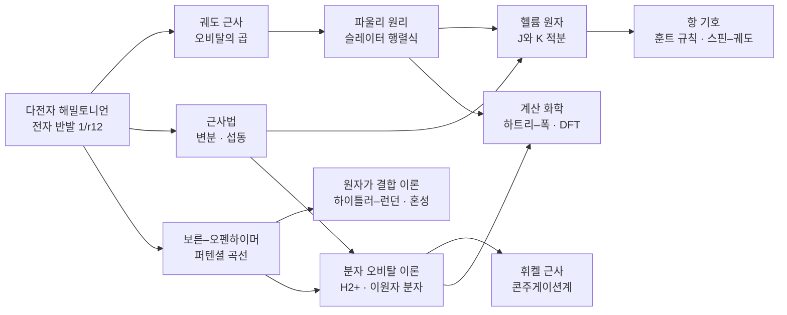

# 물리화학 9. 다전자 원자와 화학 결합 — 풀 수 없는 방정식에서 주기율표와 결합을 읽어 내다
<!-- prev: pchem-8, uchem-4, uchem-5, umath-5 -->
<!-- next: pchem-10 -->

> [!NOTE]
> **이 단원의 범위**
> - 다전자 해밀토니언과 궤도 근사, 전자의 구별 불가능성과 파울리 원리, 슬레이터 행렬식
> - 변분 원리(시험 함수, 선형 변분과 영년 방정식)와 시간 무관 섭동 이론(1차·2차 보정)
> - 헬륨 원자: 섭동·변분으로 구한 바닥 상태, 들뜬 상태의 일중항·삼중항과 쿨롱·교환 적분
> - 각운동량의 결합(러셀–손더스)과 항 기호, 훈트 규칙, 스핀–궤도 결합과 미세 구조
> - 보른–오펜하이머 근사와 퍼텐셜 에너지 곡선, 동위 원소 효과
> - 원자가 결합 이론(하이틀러–런던, 혼성 오비탈)과 분자 오비탈 이론($\mathrm{H_2^+}$, 동핵·이핵 이원자 분자)
> - 휘켈 근사와 콘주게이션계(비편재화 에너지, 전하 밀도·결합 차수, 방향족성), 계산 화학 개관(하트리–폭, 전자 상관, DFT)

**학습 목표**

1. 다전자 원자의 해밀토니언을 쓰고, 전자–전자 반발 때문에 변수 분리가 안 되는 까닭과 궤도 근사의 뜻을 설명할 수 있다.
2. 전자의 구별 불가능성에서 파동 함수의 반대칭 조건을 이끌어 내고, 슬레이터 행렬식으로 파울리 배타 원리와 교환 효과를 설명할 수 있다.
3. 변분 원리를 증명하고 시험 함수와 선형 변분(영년 방정식)으로 바닥 상태 에너지를 어림하며, 1차·2차 섭동 보정을 유도하여 헬륨 원자의 에너지와 이온화 에너지를 계산할 수 있다.
4. 각운동량의 결합으로 전자 배치에서 항 기호를 구하고, 훈트 규칙으로 바닥 항을 정하며, 스핀–궤도 결합에 따른 준위의 갈라짐을 계산할 수 있다.
5. 보른–오펜하이머 근사의 근거와 한계를 설명하고, 퍼텐셜 에너지 곡선에서 $D_\mathrm{e}$, $D_0$와 동위 원소 효과를 계산할 수 있다.
6. 원자가 결합 이론과 분자 오비탈 이론으로 $\mathrm{H_2^+}$, $\mathrm{H_2}$와 2주기 이원자 분자의 결합을 기술하고, 두 이론의 차이(이온성 항, 해리 극한)를 비교할 수 있다.
7. 휘켈 근사로 콘주게이션계의 π 에너지·전하 밀도·결합 차수를 계산하고, 하트리–폭 방법과 밀도 범함수 이론의 기본 생각을 설명할 수 있다.

**이 단원의 학습 사다리**

| 단계 | 무엇을 하나? |
|---|---|
| STEP 1. 이전 학습 다시 보기 | 쌓음 원리·훈트 규칙(일반화학), 혼성·MO 결합 차수(일반화학), 슈뢰딩거 방정식과 수소 원자(물리화학 7·8), 행렬의 고유값(수학 도구 5) |
| STEP 2. 기초 다지기 | 원자 단위, 행렬식의 교대 성질, 2×2 영년 방정식, 대칭을 이용한 적분 |
| STEP 3. 핵심 개념 | 궤도 근사 → 파울리 원리 → 변분 → 섭동 → 헬륨 → 항 기호 → 훈트·스핀–궤도 → 보른–오펜하이머 → 원자가 결합 → $\mathrm{H_2^+}$ → 이원자 분자 → 휘켈 → 계산 화학 |
| STEP 4. 오개념 바로잡기 | "삼중항이 낮은 것은 스핀끼리의 자기적 인력 때문", "반결합 오비탈은 결합 오비탈만큼만 불안정하다" 같은 착각 |
| STEP 5. 대학원·연구로 | 전자 상관을 잡는 방법들(CI·결합 클러스터), 원뿔 교차와 보른–오펜하이머 근사의 붕괴, 상대론적 양자 화학 |
| STEP 6. 생활·산업·진로 | 열활성 지연 형광 OLED, 일중항 산소와 광역학 치료, 계산으로 하는 촉매·신약 설계, 원자 분광과 미세 구조 |

---

## 🗺️ 단원 들어가기

수소 원자의 슈뢰딩거 방정식은 정확히 풀린다(물리화학 8). 그런데 전자가 하나 더 붙은 헬륨에서 이 행운은 끝난다. 두 전자 사이의 반발 $e^2/4\pi\varepsilon_0 r_{12}$ 한 항이 두 전자의 좌표를 묶어 버려, 변수 분리가 더는 되지 않기 때문이다. 원자 번호 2에서 이미 해석적 해가 없다면, 주기율표의 나머지 116개 원소와 그것들이 만드는 수천만 가지 분자는 어떻게 이해할 수 있을까?

답은 **잘 고른 근사**이다. 이 단원에서는 양자 화학을 떠받치는 네 가지 근사의 기술을 차례로 익힌다. 첫째, 각 전자가 다른 전자들의 평균 장 속에서 자기 오비탈을 갖는다고 보는 **궤도 근사**. 둘째, 정확한 해를 모를 때도 에너지의 상한을 주는 **변분 원리**와, 풀리는 문제에서 출발해 작은 차이를 보정해 가는 **섭동 이론**. 셋째, 무거운 원자핵은 멈춰 있다고 보고 전자만 푸는 **보른–오펜하이머 근사**. 넷째, 분자 오비탈을 원자 오비탈의 선형 결합으로 쓰는 **LCAO**와 그 극단적 단순화인 **휘켈 근사**이다.

이 근사들만으로도 놀랄 만큼 많은 것이 설명된다. 헬륨의 이온화 에너지가 왜 24.6 eV인지, 들뜬 헬륨에서 스핀이 나란한 상태가 왜 더 낮은지(훈트 규칙의 뿌리), 탄소 원자의 바닥 상태가 왜 $^3P_0$인지, 나트륨 가로등의 노란빛이 왜 두 줄로 갈라지는지, 산소 분자가 왜 자석에 붙는지, 당근의 색이 왜 주황인지까지. 그리고 이 근사들의 한계를 넘어서려는 노력이 오늘날 신약·촉매·소재 설계에 쓰이는 계산 화학이 되었다.

---

## STEP 1. 🔙 이전 학습 다시 보기

### 연계 개념표

| 이전 단원 | 그때 배운 것 | 이 단원에서 확장되는 것 |
|---|---|---|
| 일반화학 「원자의 전자 구조와 주기성」 | 양자수와 오비탈, 파울리 배타 원리("한 오비탈에 전자 둘, 스핀 반대"), 쌓음 원리, 훈트 규칙, 유효 핵전하 | 배타 원리를 **반대칭 파동 함수**(슬레이터 행렬식)에서 유도하고, 훈트 규칙을 **교환 적분**으로 설명하며, 배치에서 **항 기호**까지 구한다 |
| 일반화학 「화학 결합과 분자 구조」 | 혼성 오비탈과 σ·π 결합, 결합성·반결합성 MO, 결합 차수, $\mathrm{O_2}$의 상자기성, s–p 혼합 | 혼성 오비탈의 **직교 조건과 결합각**, LCAO 에너지를 **적분 $S$, $J$, $K$로 계산**, 원자가 결합 이론과 MO 이론의 파동 함수 비교, 분자의 항 기호 |
| 물리화학 「양자역학의 기초」 | 슈뢰딩거 방정식, 연산자·고유값·기댓값, 상자 속 입자, 축퇴 | 고유값을 정확히 못 구할 때 쓰는 **변분 원리와 섭동 이론**, 상자 속 입자를 시험대로 삼아 근사의 정확도 검증 |
| 물리화학 「진동·회전 운동과 수소 원자」 | 수소꼴 원자의 에너지 $-Z^2/2n^2$, 지름·각 부분, 각운동량 $l$, $m_l$, 스핀 $s$, $m_s$ | 수소꼴 오비탈을 **다전자 원자의 출발점**으로 쓰고, 여러 전자의 각운동량을 **결합**하여 $L$, $S$, $J$로 상태를 분류, 조화 진동자의 영점 에너지로 $D_0$ 계산 |
| 수학 도구 「선형대수」 | 행렬식의 성질, 고유값 문제, 대칭 행렬의 대각화, 휘켈 연결 행렬 | 행렬식의 **교대 성질**이 파울리 원리가 되고, 선형 변분에서 **영년 방정식**이 나오는 과정을 유도, 휘켈 계산을 전하 밀도·결합 차수까지 확장 |

### 준비 운동 (사전 진단)

**Q1.** 수소꼴 이온 $\mathrm{He^+}$의 바닥 상태 에너지는 수소 원자($-13.6\ \mathrm{eV}$)의 몇 배인가? 그 값은?

**Q2.** 탄소 원자($1s^22s^22p^2$)의 바닥 상태에서 두 $2p$ 전자는 같은 오비탈에 들어가는가, 다른 오비탈에 들어가는가? 스핀은?

**Q3.** 행렬식 $\begin{vmatrix} a & b \\ c & d \end{vmatrix}$에서 두 행을 맞바꾸면 값은 어떻게 되는가? 두 행이 같으면?

**Q4.** 일반화학의 MO 도표에서 $\mathrm{N_2}$와 $\mathrm{O_2}$의 결합 차수를 구하고, 어느 쪽이 상자기성인지 쓰시오.

정답 및 해설

**Q1.** 4배, $-54.4\ \mathrm{eV}$. 수소꼴 에너지는 $E_n = -Z^2(13.6\ \mathrm{eV})/n^2$이고 $Z = 2$이다. STEP 3 ①에서 전자 반발을 무시한 헬륨의 에너지가 이 값의 2배($-108.8\ \mathrm{eV}$)가 되는 것을 본다.

**Q2.** 서로 다른 $2p$ 오비탈에, 스핀을 나란히 하여 들어간다(훈트 규칙). STEP 3 ⑦에서 이 배치가 만드는 세 항 $^3P$, $^1D$, $^1S$ 가운데 $^3P$가 가장 낮은 까닭을 본다.

**Q3.** 부호가 바뀐다($cb - da = -(ad - bc)$). 두 행이 같으면 0이다. STEP 3 ②에서 이 성질이 곧 파울리 배타 원리이다.

**Q4.** $\mathrm{N_2}$ 3, $\mathrm{O_2}$ 2. $\mathrm{O_2}$는 축퇴된 $\pi^*$ 오비탈 두 개에 전자가 하나씩 스핀을 나란히 하고 들어가 상자기성이다. STEP 3 ⑪에서 이 상태를 항 기호 $^3\Sigma_g^-$로 적는다.

---

## STEP 2. 🧱 기초 다지기

### 디딤돌 1. 원자 단위 — 상수를 지우고 크기를 보기

다전자 계산에는 $\hbar$, $m_\mathrm{e}$, $e$, $4\pi\varepsilon_0$가 끊임없이 나온다. 이 네 상수를 모두 1로 두는 **원자 단위(atomic units)** 를 쓰면 식이 깔끔해지고 '얼마나 큰가'가 바로 보인다.

| 양 | 원자 단위 | SI 값 | 화학에서 쓰는 값 |
|---|---|---|---|
| 길이 | 보어 반지름 $a_0 = 4\pi\varepsilon_0\hbar^2/m_\mathrm{e}e^2$ | $5.2918\times10^{-11}\ \mathrm{m}$ | $52.918\ \mathrm{pm}$ |
| 에너지 | 하트리 $E_\mathrm{h} = e^2/4\pi\varepsilon_0 a_0$ | $4.3597\times10^{-18}\ \mathrm{J}$ | $27.211\ \mathrm{eV} = 2625.5\ \mathrm{kJ/mol}$ |
| 질량 | 전자 질량 $m_\mathrm{e}$ | $9.1094\times10^{-31}\ \mathrm{kg}$ | 양성자는 $1836.15\ m_\mathrm{e}$ |

수소꼴 원자의 에너지는 원자 단위로 $E_n = -Z^2/2n^2$이다. 수소 원자의 바닥 상태는 $-\tfrac12 E_\mathrm{h} = -13.606\ \mathrm{eV}$이다. 헬륨의 해밀토니언(원자핵 고정)은 원자 단위로

$$
\hat{H} = -\tfrac12\nabla_1^2 - \tfrac12\nabla_2^2 - \frac{Z}{r_1} - \frac{Z}{r_2} + \frac{1}{r_{12}}
$$

처럼 짧아진다. 앞의 네 항은 수소꼴 원자 두 개의 해밀토니언이고, 마지막 항이 문제의 전자 반발이다.

**예** 어떤 계산이 원자의 에너지를 $-2.8617\ E_\mathrm{h}$로 주었다. eV로는 $-2.8617\times27.211 = -77.87\ \mathrm{eV}$, kJ/mol로는 $-7513\ \mathrm{kJ/mol}$이다. 결합 에너지(수백 kJ/mol)가 원자 전체 에너지의 수 %에 불과하다는 것을 기억해 두자. 근사가 전체 에너지를 1 %만 틀려도 결합 에너지는 통째로 틀릴 수 있다.

### 디딤돌 2. 행렬식의 교대 성질 — 두 행을 바꾸면 부호가 바뀐다

수학 도구 5 '행렬 연산과 행렬식'에서 익힌 행렬식의 성질 가운데 이 단원에서 핵심이 되는 것은 다음 세 가지이다.

| 성질 | 내용 | 이 단원에서의 뜻 |
|---|---|---|
| 교대성 | 두 행(또는 두 열)을 맞바꾸면 부호가 바뀐다 | 두 전자의 좌표를 맞바꾸면 파동 함수의 부호가 바뀐다(반대칭) |
| 같은 행 | 두 행(또는 두 열)이 같으면 값이 0 | 두 전자가 같은 스핀 오비탈에 들어갈 수 없다(파울리 배타 원리) |
| 선형 결합 | 한 열에 다른 열의 배수를 더해도 값이 같다 | 점유 오비탈을 서로 섞어도(유니터리 변환) 전체 파동 함수는 그대로이다 |

**예** $\begin{vmatrix} a(1) & b(1) \\ a(2) & b(2) \end{vmatrix} = a(1)b(2) - b(1)a(2)$이다. 1과 2를 바꾸면 $a(2)b(1) - b(2)a(1) = -[a(1)b(2) - b(1)a(2)]$로 부호가 바뀐다. $a = b$이면 $a(1)a(2) - a(1)a(2) = 0$이다. 셋째 성질로 $b \rightarrow b + ca$를 넣으면 $a(1)[b(2) + ca(2)] - [b(1) + ca(1)]a(2) = a(1)b(2) - b(1)a(2)$로 그대로이다.

### 디딤돌 3. 2×2 영년 방정식 — 두 상태가 섞이면 준위가 밀려난다

수학 도구 5 '고유값과 고유벡터'에서 익힌 고유값 문제를 이 단원에서는 다음 꼴로 계속 만난다. 기저 함수 둘이 서로 직교하고($S_{12} = 0$) 행렬 원소가 $H_{11}$, $H_{22}$, $H_{12}$이면

$$
\begin{vmatrix} H_{11} - E & H_{12} \\ H_{12} & H_{22} - E \end{vmatrix} = 0 \quad\Longrightarrow\quad E_\pm = \frac{H_{11} + H_{22}}{2} \pm \sqrt{\left(\frac{H_{11} - H_{22}}{2}\right)^2 + H_{12}^2}
$$

두 가지를 기억해 두자. (1) 섞인 뒤 아래 준위는 둘 중 낮은 것보다 **더 낮고**, 위 준위는 높은 것보다 **더 높다**(준위 반발). (2) 두 준위의 차 $\lvert H_{11} - H_{22}\rvert$가 $\lvert H_{12}\rvert$보다 훨씬 크면 섞임이 작아, 아래 준위는 거의 $H_{11} - H_{12}^2/(H_{22} - H_{11})$이다($H_{11} < H_{22}$일 때). 이것이 ④의 2차 섭동 식의 원형이다.

**예** $H_{11} = -10.0$, $H_{22} = -6.0$, $H_{12} = -2.0$ (eV)이면 $E_\pm = -8.0 \pm\sqrt{4.0 + 4.0} = -8.0 \pm 2.83$, 즉 $-10.83$과 $-5.17\ \mathrm{eV}$이다. 근사식은 $-10.0 - 4.0/4.0 = -11.0\ \mathrm{eV}$로, $\lvert H_{12}\rvert$가 준위 차의 절반이나 되어 오차가 크다. 준위 차가 $20\ \mathrm{eV}$였다면 정확한 값 $-10.198$과 근사값 $-10.200$이 거의 같다.

### 디딤돌 4. 대칭을 이용한 적분 — 계산하기 전에 0을 알아보기

기댓값 $\langle A\rangle = \int\psi^*\hat{A}\psi\,d\tau$와 행렬 원소 $\int\psi_m^*\hat{A}\psi_n\,d\tau$를 계산할 때, 피적분 함수가 홀함수이면 대칭 구간의 적분은 계산 없이 0이다. 3차원에서는 수학 도구 2 '다중 적분과 좌표 변환'의 구면 좌표 부피 요소 $d\tau = r^2\sin\theta\,dr\,d\theta\,d\phi$를 쓴다.

| 상황 | 결론 |
|---|---|
| 1차원 상자(중심 $L/2$)의 $\psi_n$과 $\psi_m$에서 $n + m$이 홀수 | 중심에 대해 하나는 짝, 하나는 홀이므로 $\int\psi_n(x - L/2)^{2k}\psi_m\,dx = 0$ |
| 구면 대칭 함수 $f(r)$와 $\cos\theta$의 곱 | $\int_0^\pi\cos\theta\sin\theta\,d\theta = 0$ |
| 서로 다른 고유값의 고유 함수 | 직교: $\int\psi_m^*\psi_n\,d\tau = 0$ |

**예** 수소꼴 $1s$ 오비탈 $\psi = (Z^3/\pi)^{1/2}e^{-Zr}$(원자 단위)에서 $\langle 1/r\rangle$을 구하자. 각 부분의 적분은 $4\pi$이므로

$$
\left\langle \frac1r \right\rangle = \frac{Z^3}{\pi}\cdot4\pi\int_0^\infty e^{-2Zr}\,r\,dr = 4Z^3\cdot\frac{1}{(2Z)^2} = Z
$$

($\int_0^\infty r^n e^{-ar}dr = n!/a^{n+1}$.) 퍼텐셜 에너지의 기댓값은 $\langle -Z/r\rangle = -Z^2$, 에너지는 $-Z^2/2$이므로 운동 에너지는 $+Z^2/2$이다. 퍼텐셜이 에너지의 2배라는 이 관계(**비리얼 정리**, $\langle V\rangle = 2E$)는 쿨롱 힘만 있는 계에서 늘 성립하며, ③과 ⑤에서 변분 계산을 점검하는 데 쓴다.

---

## STEP 3. 📘 핵심 개념

### ① 다전자 해밀토니언과 궤도 근사

#### 무엇이 문제인가 — 전자 반발 항

원자 번호 $Z$, 전자 $N$개인 원자의 해밀토니언(원자핵 고정, 원자 단위)은

$$
\hat{H} = \sum_{i=1}^{N}\left(-\tfrac12\nabla_i^2 - \frac{Z}{r_i}\right) + \sum_{i<j}\frac{1}{r_{ij}} = \sum_i \hat{h}_i + \sum_{i<j}\frac{1}{r_{ij}}
$$

이다. $\hat{h}_i$는 전자 $i$ 하나만의 좌표를 담은 **1전자 연산자**로, 수소꼴 원자의 해밀토니언과 같다. 만약 둘째 합(전자 반발)이 없다면 해밀토니언은 서로 독립인 항의 합이므로, 수학 도구 8 '변수 분리법'에 따라 파동 함수는 1전자 함수의 곱이고 에너지는 1전자 에너지의 합이다.

$$
\hat{H}_0 = \sum_i \hat{h}_i \quad\Longrightarrow\quad \Psi = \psi_a(1)\psi_b(2)\cdots, \qquad E = \varepsilon_a + \varepsilon_b + \cdots
$$

($\hat{H}_0\Psi = \sum_i \hat{h}_i\Psi$에서 $\hat{h}_i$는 자기 전자의 함수에만 작용하므로 각 항이 $\varepsilon_i\Psi$가 된다.) 그러나 $1/r_{ij} = 1/\lvert\mathbf{r}_i - \mathbf{r}_j\rvert$는 두 전자의 좌표를 떼어 낼 수 없게 묶는다. 전자 $i$가 어디에 있느냐에 따라 전자 $j$가 느끼는 퍼텐셜이 달라지기 때문이다. 이 움직임의 상호 의존을 **전자 상관(electron correlation)** 이라 한다.

<!-- 그림 요청: 헬륨 원자의 좌표 정의. 가운데 원자핵(+2e, 점), 전자 1과 전자 2(작은 원, −e)를 서로 다른 방향에 놓고, 핵에서 각 전자까지 화살표 r₁, r₂, 두 전자 사이 양쪽 화살표 r₁₂를 그린다. 오른쪽에 해밀토니언의 다섯 항 "−½∇₁², −½∇₂²(운동), −Z/r₁, −Z/r₂(핵 인력), +1/r₁₂(전자 반발)"을 색으로 구분해 나열하고, 마지막 항에 "이 항 때문에 변수 분리 불가"라고 이름표를 단다. -->

#### 궤도 근사 — 평균 장 속의 전자

**궤도 근사(orbital approximation)** 는 전자 반발을 '정확한 순간값' 대신 '다른 전자들이 만드는 평균 구름의 퍼텐셜'로 바꾸어, 각 전자가 자기만의 1전자 함수(**오비탈**)를 갖는다고 보는 근사이다.

$$
\Psi(1, 2, \dots, N) \approx \psi_a(1)\,\psi_b(2)\cdots\psi_z(N)
$$

이렇게 하면 전자 $i$는 원자핵의 인력과 나머지 전자들의 **평균** 반발을 합친 유효 퍼텐셜 속에서 움직인다. 다른 전자의 구름이 핵전하 일부를 가리므로, 전자는 맨 핵전하 $Z$ 대신 **유효 핵전하** $Z_\text{eff}$를 느낀다(일반화학 「원자의 전자 구조와 주기성」). 평균 퍼텐셜은 더는 $1/r$꼴이 아니므로 같은 $n$에서도 $l$에 따라 에너지가 갈라진다. 핵 가까이 침투하는 $s$ 전자가 가려막기를 덜 받아 $p$, $d$보다 낮아지는 것이 쌓음 원리의 순서($ns < np < nd$)를 만든다.

| 근사의 단계 | 전자 반발의 처리 | 결과 |
|---|---|---|
| 0단계 (독립 전자) | 완전히 무시 | 수소꼴 오비탈의 곱, 에너지 $-\sum Z^2/2n_i^2$ |
| 궤도 근사 (평균 장) | 다른 전자의 평균 구름으로 바꿈 | 유효 퍼텐셜 속의 오비탈, $Z_\text{eff}$, 쌓음 원리 |
| 하트리–폭 (⑬) | 평균 장을 스스로 일치할 때까지 반복 + 반대칭화 | 궤도 근사 안에서 가장 좋은 오비탈 |
| 전자 상관까지 (⑬, STEP 5) | 순간적인 피함까지 고려 | '정확한' 에너지 |

#### 예제 1 — 전자 반발을 무시한 헬륨

전자 반발을 완전히 무시하면 헬륨($Z = 2$)의 바닥 상태 에너지는 얼마인가? 실험값(두 이온화 에너지의 합, $24.587 + 54.418 = 79.005\ \mathrm{eV}$, 즉 $E = -79.0\ \mathrm{eV}$)과 비교하시오.

**풀이**
식 세우기: 두 전자가 모두 $1s$이고 $E^{(0)} = 2\times(-Z^2/2) = -Z^2\ E_\mathrm{h}$.
대입: $Z = 2$이면 $E^{(0)} = -4\ E_\mathrm{h} = -4\times27.211 = -108.8\ \mathrm{eV}$.
비교: 실험값보다 $29.8\ \mathrm{eV}$(약 38 %)나 낮다.

**의미** 전자 반발은 '작은 보정'이 아니다. 무시하면 헬륨은 실제보다 $2900\ \mathrm{kJ/mol}$ 가까이 더 안정한 것으로 나온다. 둘째 이온화 에너지($\mathrm{He^+} \rightarrow \mathrm{He^{2+}}$, 전자 하나)는 수소꼴이므로 정확히 $Z^2/2 = 2\ E_\mathrm{h} = 54.4\ \mathrm{eV}$이지만, 첫째 이온화 에너지는 0단계 근사로 $108.8 - 54.4 = 54.4\ \mathrm{eV}$가 되어 실험값 $24.6\ \mathrm{eV}$의 두 배가 넘는다. ④·⑤에서 이 차이를 섭동과 변분으로 줄여 간다.

#### ✔ 바로 확인

1. (O/X) 전자 반발 항이 없다면 다전자 원자의 파동 함수는 1전자 함수의 곱으로 정확히 쓸 수 있다.
2. 빈칸: 다른 전자의 평균 구름이 핵전하 일부를 가려, 전자가 느끼는 핵전하는 $Z$보다 작은 (    )이다.
3. 전자 반발을 무시하면 $\mathrm{Li^+}$($Z = 3$, $1s^2$)의 바닥 상태 에너지는 몇 $E_\mathrm{h}$인가?

정답

1. O — $\hat{H}_0 = \sum\hat{h}_i$는 변수 분리가 되므로 곱 함수가 정확한 고유 함수이다(반대칭화는 ②).
2. 유효 핵전하 $Z_\text{eff}$
3. $-9\ E_\mathrm{h}$ ($-245\ \mathrm{eV}$) — $2\times(-3^2/2)$.

### ② 전자의 구별 불가능성과 파울리 원리 — 슬레이터 행렬식

#### 교환 연산과 반대칭 조건

전자는 서로 **구별할 수 없다.** 전자 1과 2의 좌표(공간 좌표와 스핀)를 맞바꾸는 연산자를 $\hat{P}_{12}$라 하면, 물리적으로 관측되는 확률 밀도는 바뀌지 않아야 하므로 $\lvert\Psi(2,1)\rvert^2 = \lvert\Psi(1,2)\rvert^2$, 곧 $\Psi(2,1) = \pm\Psi(1,2)$이다. 두 번 맞바꾸면 원래대로이므로 $\hat{P}_{12}^2 = 1$이고 고유값은 $\pm1$뿐이다. 어느 부호를 택하는지는 자연이 정하며, 실험(원자 스펙트럼, 주기율표)이 알려 주는 답은 다음과 같다.

> [!IMPORTANT]
> **파울리 원리(Pauli principle)**
> 페르미온(전자·양성자·중성자처럼 스핀이 반정수인 입자)의 전체 파동 함수는 같은 종류의 두 입자를 맞바꿀 때 **부호가 바뀐다**(반대칭). 보손(스핀이 정수)은 부호가 바뀌지 않는다(대칭).
> $$
> \Psi(\dots, j, \dots, i, \dots) = -\Psi(\dots, i, \dots, j, \dots) \quad (\text{전자})
> $$

일반화학의 **파울리 배타 원리**(한 오비탈에 스핀이 반대인 전자 둘까지)는 이 더 근본적인 원리의 결과이다.

#### 스핀 오비탈과 헬륨 바닥 상태

**스핀 오비탈(spin orbital)** 은 공간 오비탈과 스핀 함수의 곱이다. $\alpha$는 $m_s = +\tfrac12$, $\beta$는 $m_s = -\tfrac12$이다(⑫의 휘켈 매개 변수 $\alpha$, $\beta$와는 다른 기호이다). 헬륨 바닥 상태에서 두 전자를 모두 $1s$에 넣는 곱 함수 $1s(1)\alpha(1)\,1s(2)\beta(2)$는 반대칭이 아니다. 1과 2를 바꾼 것과의 차를 만들면

$$
\Psi = \frac{1}{\sqrt2}\left[1s(1)\alpha(1)\,1s(2)\beta(2) - 1s(2)\alpha(2)\,1s(1)\beta(1)\right] = 1s(1)\,1s(2)\cdot\frac{1}{\sqrt2}\left[\alpha(1)\beta(2) - \beta(1)\alpha(2)\right]
$$

가 반대칭이다. 공간 부분은 대칭이고, 스핀 부분이 반대칭인 **일중항(singlet)** 스핀 함수 $\sigma_-$이다. 이것이 "같은 오비탈의 두 전자는 스핀이 쌍을 이룬다"의 정확한 뜻이다. 두 전자의 스핀이 모두 $\alpha$이면 $1s(1)\alpha(1)1s(2)\alpha(2) - 1s(2)\alpha(2)1s(1)\alpha(1) = 0$이 되어 그런 상태는 존재하지 않는다.

두 전자의 스핀 함수는 다음 네 가지로 정리된다.

| 스핀 함수 | 맞바꿈에 대해 | 전체 스핀 $S$ | $M_S$ |
|---|---|---|---|
| $\alpha(1)\alpha(2)$ | 대칭 | 1 | $+1$ |
| $\tfrac{1}{\sqrt2}[\alpha(1)\beta(2) + \beta(1)\alpha(2)]$ | 대칭 | 1 | $0$ |
| $\beta(1)\beta(2)$ | 대칭 | 1 | $-1$ |
| $\tfrac{1}{\sqrt2}[\alpha(1)\beta(2) - \beta(1)\alpha(2)]$ | 반대칭 | 0 | $0$ |

위의 세 개가 **삼중항(triplet)**, 마지막이 **일중항**이다. 전체가 반대칭이려면 **대칭 공간 함수 × 일중항** 또는 **반대칭 공간 함수 × 삼중항**이어야 한다. 이 짝짓기가 ⑤에서 헬륨 들뜬 상태의 에너지 차를 만든다.

<!-- 그림 요청: 두 스핀 ½의 결합을 벡터 모형으로 그린 그림 두 개. 왼쪽 "삼중항 S = 1": 두 스핀 벡터 s₁, s₂가 z축 둘레 원뿔 위에서 위상을 맞춰(같은 방위각) 돌며 합 벡터 길이 √2ħ, M_S = +1, 0, −1의 세 경우를 위에서 아래로 나란히 그린다(M_S = 0인 경우는 두 벡터가 z성분은 반대이고 xy 성분이 같은 방향). 오른쪽 "일중항 S = 0": 두 벡터가 z성분도 xy 성분도 정반대(위상 180°)여서 합이 0. 각 그림 아래에 해당 스핀 함수를 쓴다. -->

#### 슬레이터 행렬식

전자가 $N$개이면 반대칭 함수를 일일이 만들기 어렵다. 슬레이터는 행렬식의 교대 성질(디딤돌 2)을 이용했다. 스핀 오비탈 $\chi_a, \chi_b, \dots, \chi_z$를 열에, 전자 번호를 행에 놓은

$$
\Psi = \frac{1}{\sqrt{N!}}\begin{vmatrix}
\chi_a(1) & \chi_b(1) & \cdots & \chi_z(1) \\
\chi_a(2) & \chi_b(2) & \cdots & \chi_z(2) \\
\vdots & \vdots & \ddots & \vdots \\
\chi_a(N) & \chi_b(N) & \cdots & \chi_z(N)
\end{vmatrix}
$$

를 **슬레이터 행렬식(Slater determinant)** 이라 한다. (1) 두 전자를 맞바꾸는 것은 두 행을 맞바꾸는 것이므로 부호가 바뀐다 — 반대칭이 자동으로 보장된다. (2) 두 열이 같으면(같은 스핀 오비탈에 전자 둘) 행렬식이 0이다 — 배타 원리. (3) $1/\sqrt{N!}$은 $N!$개 항이 서로 직교하는 데서 오는 정규화 인자이다. 흔히 대각선 원소만 적어 $\Psi = \lvert\chi_a\chi_b\cdots\chi_z\rvert$로 줄여 쓴다.

#### 예제 2 — 리튬 원자의 슬레이터 행렬식

(1) 리튬 바닥 상태 $1s^22s^1$의 슬레이터 행렬식을 쓰고 전개하면 항이 몇 개인지 말하시오. (2) 세 전자를 모두 $1s$에 넣는 배치 $1s^3$를 슬레이터 행렬식으로 쓰면 왜 0인가?

**풀이**
(1) 스핀 오비탈은 $1s\alpha$, $1s\beta$, $2s\alpha$이다.

$$
\Psi = \frac{1}{\sqrt6}\begin{vmatrix}
1s(1)\alpha(1) & 1s(1)\beta(1) & 2s(1)\alpha(1) \\
1s(2)\alpha(2) & 1s(2)\beta(2) & 2s(2)\alpha(2) \\
1s(3)\alpha(3) & 1s(3)\beta(3) & 2s(3)\alpha(3)
\end{vmatrix}
$$

3×3 행렬식은 $3! = 6$개 항(세 전자를 세 스핀 오비탈에 나누어 넣는 순열마다 하나, 짝순열은 +, 홀순열은 −)으로 전개된다.
(2) $1s$ 공간 오비탈로 만들 수 있는 스핀 오비탈은 $1s\alpha$, $1s\beta$ 두 개뿐이다. 세 번째 열에 $1s\alpha$나 $1s\beta$를 다시 넣어야 하므로 두 열이 같아져 행렬식이 0이다. 셋째 전자는 $2s$로 갈 수밖에 없다.

**의미** 주기율표의 껍질 구조는 결국 "같은 열 두 개면 행렬식이 0"이라는 수학의 결과이다. 만약 전자가 보손이었다면 모든 원자의 전자가 $1s$에 모여 화학은 지금과 전혀 달랐을 것이다.

#### 교환에 의한 피함 — 페르미 구멍

같은 스핀의 두 전자를 생각하자. 반대칭 공간 함수 $\tfrac{1}{\sqrt2}[a(1)b(2) - b(1)a(2)]$는 $\mathbf{r}_1 = \mathbf{r}_2$에서 0이다. 같은 스핀의 전자는 같은 곳에 있을 확률이 0이고, 가까이 있을 확률도 작다. 전자 둘레에 같은 스핀의 전자가 들어오기 어려운 이 영역을 **페르미 구멍(Fermi hole)** 이라 한다. 쿨롱 반발과는 무관한, 순전히 반대칭에서 나오는 효과이다. 반대로 반대 스핀의 전자에게는 반대칭이 이런 제약을 주지 않으므로, 쿨롱 반발에 따른 피함(**쿨롱 구멍**)은 평균 장 근사에서 빠진다. 이것이 ⑬의 '상관 에너지'이다.

#### ✔ 바로 확인

1. (O/X) 슬레이터 행렬식에서 두 전자의 좌표를 맞바꾸면 파동 함수의 부호가 바뀐다.
2. 빈칸: 일중항 스핀 함수는 맞바꿈에 대해 (대칭/반대칭)이므로, 짝을 이루는 공간 함수는 (대칭/반대칭)이어야 한다.
3. 붕소 원자 $1s^22s^22p^1$의 슬레이터 행렬식은 몇 차 행렬식이며, 전개하면 항이 몇 개인가?

정답

1. O — 두 행을 맞바꾸는 것이므로 교대성에 따라 부호가 바뀐다.
2. 반대칭, 대칭 — 전체(공간 × 스핀)가 반대칭이어야 한다.
3. 5차, $5! = 120$개 — 그래서 실제 계산에서는 행렬식을 전개하지 않고 행렬식의 성질(직교 오비탈에 대한 슬레이터 규칙)을 이용해 적분한다.

