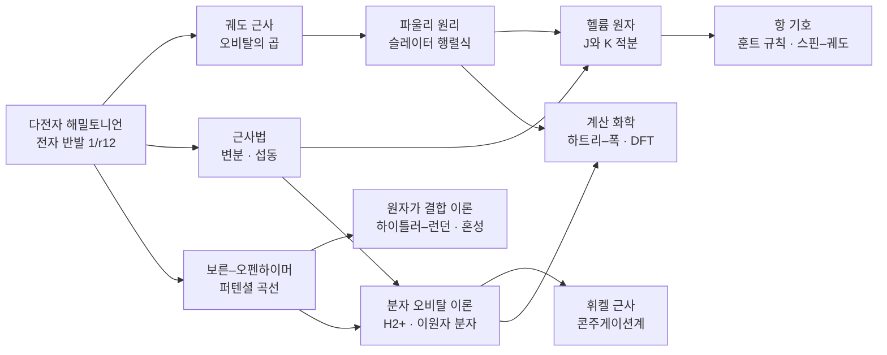

# 물리화학 9. 다전자 원자와 화학 결합 — 풀 수 없는 방정식에서 주기율표와 결합을 읽어 내다
<!-- prev: pchem-8, uchem-4, uchem-5, umath-5 -->
<!-- next: pchem-10 -->

> [!NOTE]
> **이 단원의 범위**
> - 다전자 해밀토니언과 궤도 근사, 전자의 구별 불가능성과 파울리 원리, 슬레이터 행렬식
> - 변분 원리(시험 함수, 선형 변분과 영년 방정식)와 시간 무관 섭동 이론(1차·2차 보정)
> - 헬륨 원자: 섭동·변분으로 구한 바닥 상태, 들뜬 상태의 일중항·삼중항과 쿨롱·교환 적분
> - 각운동량의 결합(러셀–손더스)과 항 기호, 훈트 규칙, 스핀–궤도 결합과 미세 구조
> - 보른–오펜하이머 근사와 퍼텐셜 에너지 곡선, 동위 원소 효과
> - 원자가 결합 이론(하이틀러–런던, 혼성 오비탈)과 분자 오비탈 이론($\mathrm{H_2^+}$, 동핵·이핵 이원자 분자)
> - 휘켈 근사와 콘주게이션계(비편재화 에너지, 전하 밀도·결합 차수, 방향족성), 계산 화학 개관(하트리–폭, 전자 상관, DFT)

**학습 목표**

1. 다전자 원자의 해밀토니언을 쓰고, 전자–전자 반발 때문에 변수 분리가 안 되는 까닭과 궤도 근사의 뜻을 설명할 수 있다.
2. 전자의 구별 불가능성에서 파동 함수의 반대칭 조건을 이끌어 내고, 슬레이터 행렬식으로 파울리 배타 원리와 교환 효과를 설명할 수 있다.
3. 변분 원리를 증명하고 시험 함수와 선형 변분(영년 방정식)으로 바닥 상태 에너지를 어림하며, 1차·2차 섭동 보정을 유도하여 헬륨 원자의 에너지와 이온화 에너지를 계산할 수 있다.
4. 각운동량의 결합으로 전자 배치에서 항 기호를 구하고, 훈트 규칙으로 바닥 항을 정하며, 스핀–궤도 결합에 따른 준위의 갈라짐을 계산할 수 있다.
5. 보른–오펜하이머 근사의 근거와 한계를 설명하고, 퍼텐셜 에너지 곡선에서 $D_\mathrm{e}$, $D_0$와 동위 원소 효과를 계산할 수 있다.
6. 원자가 결합 이론과 분자 오비탈 이론으로 $\mathrm{H_2^+}$, $\mathrm{H_2}$와 2주기 이원자 분자의 결합을 기술하고, 두 이론의 차이(이온성 항, 해리 극한)를 비교할 수 있다.
7. 휘켈 근사로 콘주게이션계의 π 에너지·전하 밀도·결합 차수를 계산하고, 하트리–폭 방법과 밀도 범함수 이론의 기본 생각을 설명할 수 있다.

**이 단원의 학습 사다리**

| 단계 | 무엇을 하나? |
|---|---|
| STEP 1. 이전 학습 다시 보기 | 쌓음 원리·훈트 규칙(일반화학), 혼성·MO 결합 차수(일반화학), 슈뢰딩거 방정식과 수소 원자(물리화학 7·8), 행렬의 고유값(수학 도구 5) |
| STEP 2. 기초 다지기 | 원자 단위, 행렬식의 교대 성질, 2×2 영년 방정식, 대칭을 이용한 적분 |
| STEP 3. 핵심 개념 | 궤도 근사 → 파울리 원리 → 변분 → 섭동 → 헬륨 → 항 기호 → 훈트·스핀–궤도 → 보른–오펜하이머 → 원자가 결합 → $\mathrm{H_2^+}$ → 이원자 분자 → 휘켈 → 계산 화학 |
| STEP 4. 오개념 바로잡기 | "삼중항이 낮은 것은 스핀끼리의 자기적 인력 때문", "반결합 오비탈은 결합 오비탈만큼만 불안정하다" 같은 착각 |
| STEP 5. 대학원·연구로 | 전자 상관을 잡는 방법들(CI·결합 클러스터), 원뿔 교차와 보른–오펜하이머 근사의 붕괴, 상대론적 양자 화학 |
| STEP 6. 생활·산업·진로 | 열활성 지연 형광 OLED, 일중항 산소와 광역학 치료, 계산으로 하는 촉매·신약 설계, 원자 분광과 미세 구조 |

---

## 🗺️ 단원 들어가기

수소 원자의 슈뢰딩거 방정식은 정확히 풀린다(물리화학 8). 그런데 전자가 하나 더 붙은 헬륨에서 이 행운은 끝난다. 두 전자 사이의 반발 $e^2/4\pi\varepsilon_0 r_{12}$ 한 항이 두 전자의 좌표를 묶어 버려, 변수 분리가 더는 되지 않기 때문이다. 원자 번호 2에서 이미 해석적 해가 없다면, 주기율표의 나머지 116개 원소와 그것들이 만드는 수천만 가지 분자는 어떻게 이해할 수 있을까?

답은 **잘 고른 근사**이다. 이 단원에서는 양자 화학을 떠받치는 네 가지 근사의 기술을 차례로 익힌다. 첫째, 각 전자가 다른 전자들의 평균 장 속에서 자기 오비탈을 갖는다고 보는 **궤도 근사**. 둘째, 정확한 해를 모를 때도 에너지의 상한을 주는 **변분 원리**와, 풀리는 문제에서 출발해 작은 차이를 보정해 가는 **섭동 이론**. 셋째, 무거운 원자핵은 멈춰 있다고 보고 전자만 푸는 **보른–오펜하이머 근사**. 넷째, 분자 오비탈을 원자 오비탈의 선형 결합으로 쓰는 **LCAO**와 그 극단적 단순화인 **휘켈 근사**이다.

이 근사들만으로도 놀랄 만큼 많은 것이 설명된다. 헬륨의 이온화 에너지가 왜 24.6 eV인지, 들뜬 헬륨에서 스핀이 나란한 상태가 왜 더 낮은지(훈트 규칙의 뿌리), 탄소 원자의 바닥 상태가 왜 $^3P_0$인지, 나트륨 가로등의 노란빛이 왜 두 줄로 갈라지는지, 산소 분자가 왜 자석에 붙는지, 당근의 색이 왜 주황인지까지. 그리고 이 근사들의 한계를 넘어서려는 노력이 오늘날 신약·촉매·소재 설계에 쓰이는 계산 화학이 되었다.

---

## STEP 1. 🔙 이전 학습 다시 보기

### 연계 개념표

| 이전 단원 | 그때 배운 것 | 이 단원에서 확장되는 것 |
|---|---|---|
| 일반화학 「원자의 전자 구조와 주기성」 | 양자수와 오비탈, 파울리 배타 원리("한 오비탈에 전자 둘, 스핀 반대"), 쌓음 원리, 훈트 규칙, 유효 핵전하 | 배타 원리를 **반대칭 파동 함수**(슬레이터 행렬식)에서 유도하고, 훈트 규칙을 **교환 적분**으로 설명하며, 배치에서 **항 기호**까지 구한다 |
| 일반화학 「화학 결합과 분자 구조」 | 혼성 오비탈과 σ·π 결합, 결합성·반결합성 MO, 결합 차수, $\mathrm{O_2}$의 상자기성, s–p 혼합 | 혼성 오비탈의 **직교 조건과 결합각**, LCAO 에너지를 **적분 $S$, $J$, $K$로 계산**, 원자가 결합 이론과 MO 이론의 파동 함수 비교, 분자의 항 기호 |
| 물리화학 「양자역학의 기초」 | 슈뢰딩거 방정식, 연산자·고유값·기댓값, 상자 속 입자, 축퇴 | 고유값을 정확히 못 구할 때 쓰는 **변분 원리와 섭동 이론**, 상자 속 입자를 시험대로 삼아 근사의 정확도 검증 |
| 물리화학 「진동·회전 운동과 수소 원자」 | 수소꼴 원자의 에너지 $-Z^2/2n^2$, 지름·각 부분, 각운동량 $l$, $m_l$, 스핀 $s$, $m_s$ | 수소꼴 오비탈을 **다전자 원자의 출발점**으로 쓰고, 여러 전자의 각운동량을 **결합**하여 $L$, $S$, $J$로 상태를 분류, 조화 진동자의 영점 에너지로 $D_0$ 계산 |
| 수학 도구 「선형대수」 | 행렬식의 성질, 고유값 문제, 대칭 행렬의 대각화, 휘켈 연결 행렬 | 행렬식의 **교대 성질**이 파울리 원리가 되고, 선형 변분에서 **영년 방정식**이 나오는 과정을 유도, 휘켈 계산을 전하 밀도·결합 차수까지 확장 |

### 준비 운동 (사전 진단)

**Q1.** 수소꼴 이온 $\mathrm{He^+}$의 바닥 상태 에너지는 수소 원자($-13.6\ \mathrm{eV}$)의 몇 배인가? 그 값은?

**Q2.** 탄소 원자($1s^22s^22p^2$)의 바닥 상태에서 두 $2p$ 전자는 같은 오비탈에 들어가는가, 다른 오비탈에 들어가는가? 스핀은?

**Q3.** 행렬식 $\begin{vmatrix} a & b \\ c & d \end{vmatrix}$에서 두 행을 맞바꾸면 값은 어떻게 되는가? 두 행이 같으면?

**Q4.** 일반화학의 MO 도표에서 $\mathrm{N_2}$와 $\mathrm{O_2}$의 결합 차수를 구하고, 어느 쪽이 상자기성인지 쓰시오.

정답 및 해설

**Q1.** 4배, $-54.4\ \mathrm{eV}$. 수소꼴 에너지는 $E_n = -Z^2(13.6\ \mathrm{eV})/n^2$이고 $Z = 2$이다. STEP 3 ①에서 전자 반발을 무시한 헬륨의 에너지가 이 값의 2배($-108.8\ \mathrm{eV}$)가 되는 것을 본다.

**Q2.** 서로 다른 $2p$ 오비탈에, 스핀을 나란히 하여 들어간다(훈트 규칙). STEP 3 ⑦에서 이 배치가 만드는 세 항 $^3P$, $^1D$, $^1S$ 가운데 $^3P$가 가장 낮은 까닭을 본다.

**Q3.** 부호가 바뀐다($cb - da = -(ad - bc)$). 두 행이 같으면 0이다. STEP 3 ②에서 이 성질이 곧 파울리 배타 원리이다.

**Q4.** $\mathrm{N_2}$ 3, $\mathrm{O_2}$ 2. $\mathrm{O_2}$는 축퇴된 $\pi^*$ 오비탈 두 개에 전자가 하나씩 스핀을 나란히 하고 들어가 상자기성이다. STEP 3 ⑪에서 이 상태를 항 기호 $^3\Sigma_g^-$로 적는다.

---

## STEP 2. 🧱 기초 다지기

### 디딤돌 1. 원자 단위 — 상수를 지우고 크기를 보기

다전자 계산에는 $\hbar$, $m_\mathrm{e}$, $e$, $4\pi\varepsilon_0$가 끊임없이 나온다. 이 네 상수를 모두 1로 두는 **원자 단위(atomic units)** 를 쓰면 식이 깔끔해지고 '얼마나 큰가'가 바로 보인다.

| 양 | 원자 단위 | SI 값 | 화학에서 쓰는 값 |
|---|---|---|---|
| 길이 | 보어 반지름 $a_0 = 4\pi\varepsilon_0\hbar^2/m_\mathrm{e}e^2$ | $5.2918\times10^{-11}\ \mathrm{m}$ | $52.918\ \mathrm{pm}$ |
| 에너지 | 하트리 $E_\mathrm{h} = e^2/4\pi\varepsilon_0 a_0$ | $4.3597\times10^{-18}\ \mathrm{J}$ | $27.211\ \mathrm{eV} = 2625.5\ \mathrm{kJ/mol}$ |
| 질량 | 전자 질량 $m_\mathrm{e}$ | $9.1094\times10^{-31}\ \mathrm{kg}$ | 양성자는 $1836.15\ m_\mathrm{e}$ |

수소꼴 원자의 에너지는 원자 단위로 $E_n = -Z^2/2n^2$이다. 수소 원자의 바닥 상태는 $-\tfrac12 E_\mathrm{h} = -13.606\ \mathrm{eV}$이다. 헬륨의 해밀토니언(원자핵 고정)은 원자 단위로

$$
\hat{H} = -\tfrac12\nabla_1^2 - \tfrac12\nabla_2^2 - \frac{Z}{r_1} - \frac{Z}{r_2} + \frac{1}{r_{12}}
$$

처럼 짧아진다. 앞의 네 항은 수소꼴 원자 두 개의 해밀토니언이고, 마지막 항이 문제의 전자 반발이다.

**예** 어떤 계산이 원자의 에너지를 $-2.8617\ E_\mathrm{h}$로 주었다. eV로는 $-2.8617\times27.211 = -77.87\ \mathrm{eV}$, kJ/mol로는 $-7513\ \mathrm{kJ/mol}$이다. 결합 에너지(수백 kJ/mol)가 원자 전체 에너지의 수 %에 불과하다는 것을 기억해 두자. 근사가 전체 에너지를 1 %만 틀려도 결합 에너지는 통째로 틀릴 수 있다.

### 디딤돌 2. 행렬식의 교대 성질 — 두 행을 바꾸면 부호가 바뀐다

수학 도구 5 '행렬 연산과 행렬식'에서 익힌 행렬식의 성질 가운데 이 단원에서 핵심이 되는 것은 다음 세 가지이다.

| 성질 | 내용 | 이 단원에서의 뜻 |
|---|---|---|
| 교대성 | 두 행(또는 두 열)을 맞바꾸면 부호가 바뀐다 | 두 전자의 좌표를 맞바꾸면 파동 함수의 부호가 바뀐다(반대칭) |
| 같은 행 | 두 행(또는 두 열)이 같으면 값이 0 | 두 전자가 같은 스핀 오비탈에 들어갈 수 없다(파울리 배타 원리) |
| 선형 결합 | 한 열에 다른 열의 배수를 더해도 값이 같다 | 점유 오비탈을 서로 섞어도(유니터리 변환) 전체 파동 함수는 그대로이다 |

**예** $\begin{vmatrix} a(1) & b(1) \\ a(2) & b(2) \end{vmatrix} = a(1)b(2) - b(1)a(2)$이다. 1과 2를 바꾸면 $a(2)b(1) - b(2)a(1) = -[a(1)b(2) - b(1)a(2)]$로 부호가 바뀐다. $a = b$이면 $a(1)a(2) - a(1)a(2) = 0$이다. 셋째 성질로 $b \rightarrow b + ca$를 넣으면 $a(1)[b(2) + ca(2)] - [b(1) + ca(1)]a(2) = a(1)b(2) - b(1)a(2)$로 그대로이다.

### 디딤돌 3. 2×2 영년 방정식 — 두 상태가 섞이면 준위가 밀려난다

수학 도구 5 '고유값과 고유벡터'에서 익힌 고유값 문제를 이 단원에서는 다음 꼴로 계속 만난다. 기저 함수 둘이 서로 직교하고($S_{12} = 0$) 행렬 원소가 $H_{11}$, $H_{22}$, $H_{12}$이면

$$
\begin{vmatrix} H_{11} - E & H_{12} \\ H_{12} & H_{22} - E \end{vmatrix} = 0 \quad\Longrightarrow\quad E_\pm = \frac{H_{11} + H_{22}}{2} \pm \sqrt{\left(\frac{H_{11} - H_{22}}{2}\right)^2 + H_{12}^2}
$$

두 가지를 기억해 두자. (1) 섞인 뒤 아래 준위는 둘 중 낮은 것보다 **더 낮고**, 위 준위는 높은 것보다 **더 높다**(준위 반발). (2) 두 준위의 차 $\lvert H_{11} - H_{22}\rvert$가 $\lvert H_{12}\rvert$보다 훨씬 크면 섞임이 작아, 아래 준위는 거의 $H_{11} - H_{12}^2/(H_{22} - H_{11})$이다($H_{11} < H_{22}$일 때). 이것이 ④의 2차 섭동 식의 원형이다.

**예** $H_{11} = -10.0$, $H_{22} = -6.0$, $H_{12} = -2.0$ (eV)이면 $E_\pm = -8.0 \pm\sqrt{4.0 + 4.0} = -8.0 \pm 2.83$, 즉 $-10.83$과 $-5.17\ \mathrm{eV}$이다. 근사식은 $-10.0 - 4.0/4.0 = -11.0\ \mathrm{eV}$로, $\lvert H_{12}\rvert$가 준위 차의 절반이나 되어 오차가 크다. 준위 차가 $20\ \mathrm{eV}$였다면 정확한 값 $-10.198$과 근사값 $-10.200$이 거의 같다.

### 디딤돌 4. 대칭을 이용한 적분 — 계산하기 전에 0을 알아보기

기댓값 $\langle A\rangle = \int\psi^*\hat{A}\psi\,d\tau$와 행렬 원소 $\int\psi_m^*\hat{A}\psi_n\,d\tau$를 계산할 때, 피적분 함수가 홀함수이면 대칭 구간의 적분은 계산 없이 0이다. 3차원에서는 수학 도구 2 '다중 적분과 좌표 변환'의 구면 좌표 부피 요소 $d\tau = r^2\sin\theta\,dr\,d\theta\,d\phi$를 쓴다.

| 상황 | 결론 |
|---|---|
| 1차원 상자(중심 $L/2$)의 $\psi_n$과 $\psi_m$에서 $n + m$이 홀수 | 중심에 대해 하나는 짝, 하나는 홀이므로 $\int\psi_n(x - L/2)^{2k}\psi_m\,dx = 0$ |
| 구면 대칭 함수 $f(r)$와 $\cos\theta$의 곱 | $\int_0^\pi\cos\theta\sin\theta\,d\theta = 0$ |
| 서로 다른 고유값의 고유 함수 | 직교: $\int\psi_m^*\psi_n\,d\tau = 0$ |

**예** 수소꼴 $1s$ 오비탈 $\psi = (Z^3/\pi)^{1/2}e^{-Zr}$(원자 단위)에서 $\langle 1/r\rangle$을 구하자. 각 부분의 적분은 $4\pi$이므로

$$
\left\langle \frac1r \right\rangle = \frac{Z^3}{\pi}\cdot4\pi\int_0^\infty e^{-2Zr}\,r\,dr = 4Z^3\cdot\frac{1}{(2Z)^2} = Z
$$

($\int_0^\infty r^n e^{-ar}dr = n!/a^{n+1}$.) 퍼텐셜 에너지의 기댓값은 $\langle -Z/r\rangle = -Z^2$, 에너지는 $-Z^2/2$이므로 운동 에너지는 $+Z^2/2$이다. 퍼텐셜이 에너지의 2배라는 이 관계(**비리얼 정리**, $\langle V\rangle = 2E$)는 쿨롱 힘만 있는 계에서 늘 성립하며, ③과 ⑤에서 변분 계산을 점검하는 데 쓴다.

---

## STEP 3. 📘 핵심 개념

### ① 다전자 해밀토니언과 궤도 근사

#### 무엇이 문제인가 — 전자 반발 항

원자 번호 $Z$, 전자 $N$개인 원자의 해밀토니언(원자핵 고정, 원자 단위)은

$$
\hat{H} = \sum_{i=1}^{N}\left(-\tfrac12\nabla_i^2 - \frac{Z}{r_i}\right) + \sum_{i<j}\frac{1}{r_{ij}} = \sum_i \hat{h}_i + \sum_{i<j}\frac{1}{r_{ij}}
$$

이다. $\hat{h}_i$는 전자 $i$ 하나만의 좌표를 담은 **1전자 연산자**로, 수소꼴 원자의 해밀토니언과 같다. 만약 둘째 합(전자 반발)이 없다면 해밀토니언은 서로 독립인 항의 합이므로, 수학 도구 8 '변수 분리법'에 따라 파동 함수는 1전자 함수의 곱이고 에너지는 1전자 에너지의 합이다.

$$
\hat{H}_0 = \sum_i \hat{h}_i \quad\Longrightarrow\quad \Psi = \psi_a(1)\psi_b(2)\cdots, \qquad E = \varepsilon_a + \varepsilon_b + \cdots
$$

($\hat{H}_0\Psi = \sum_i \hat{h}_i\Psi$에서 $\hat{h}_i$는 자기 전자의 함수에만 작용하므로 각 항이 $\varepsilon_i\Psi$가 된다.) 그러나 $1/r_{ij} = 1/\lvert\mathbf{r}_i - \mathbf{r}_j\rvert$는 두 전자의 좌표를 떼어 낼 수 없게 묶는다. 전자 $i$가 어디에 있느냐에 따라 전자 $j$가 느끼는 퍼텐셜이 달라지기 때문이다. 이 움직임의 상호 의존을 **전자 상관(electron correlation)** 이라 한다.

<!-- 그림 요청: 헬륨 원자의 좌표 정의. 가운데 원자핵(+2e, 점), 전자 1과 전자 2(작은 원, −e)를 서로 다른 방향에 놓고, 핵에서 각 전자까지 화살표 r₁, r₂, 두 전자 사이 양쪽 화살표 r₁₂를 그린다. 오른쪽에 해밀토니언의 다섯 항 "−½∇₁², −½∇₂²(운동), −Z/r₁, −Z/r₂(핵 인력), +1/r₁₂(전자 반발)"을 색으로 구분해 나열하고, 마지막 항에 "이 항 때문에 변수 분리 불가"라고 이름표를 단다. -->

#### 궤도 근사 — 평균 장 속의 전자

**궤도 근사(orbital approximation)** 는 전자 반발을 '정확한 순간값' 대신 '다른 전자들이 만드는 평균 구름의 퍼텐셜'로 바꾸어, 각 전자가 자기만의 1전자 함수(**오비탈**)를 갖는다고 보는 근사이다.

$$
\Psi(1, 2, \dots, N) \approx \psi_a(1)\,\psi_b(2)\cdots\psi_z(N)
$$

이렇게 하면 전자 $i$는 원자핵의 인력과 나머지 전자들의 **평균** 반발을 합친 유효 퍼텐셜 속에서 움직인다. 다른 전자의 구름이 핵전하 일부를 가리므로, 전자는 맨 핵전하 $Z$ 대신 **유효 핵전하** $Z_\text{eff}$를 느낀다(일반화학 「원자의 전자 구조와 주기성」). 평균 퍼텐셜은 더는 $1/r$꼴이 아니므로 같은 $n$에서도 $l$에 따라 에너지가 갈라진다. 핵 가까이 침투하는 $s$ 전자가 가려막기를 덜 받아 $p$, $d$보다 낮아지는 것이 쌓음 원리의 순서($ns < np < nd$)를 만든다.

| 근사의 단계 | 전자 반발의 처리 | 결과 |
|---|---|---|
| 0단계 (독립 전자) | 완전히 무시 | 수소꼴 오비탈의 곱, 에너지 $-\sum Z^2/2n_i^2$ |
| 궤도 근사 (평균 장) | 다른 전자의 평균 구름으로 바꿈 | 유효 퍼텐셜 속의 오비탈, $Z_\text{eff}$, 쌓음 원리 |
| 하트리–폭 (⑬) | 평균 장을 스스로 일치할 때까지 반복 + 반대칭화 | 궤도 근사 안에서 가장 좋은 오비탈 |
| 전자 상관까지 (⑬, STEP 5) | 순간적인 피함까지 고려 | '정확한' 에너지 |

#### 예제 1 — 전자 반발을 무시한 헬륨

전자 반발을 완전히 무시하면 헬륨($Z = 2$)의 바닥 상태 에너지는 얼마인가? 실험값(두 이온화 에너지의 합, $24.587 + 54.418 = 79.005\ \mathrm{eV}$, 즉 $E = -79.0\ \mathrm{eV}$)과 비교하시오.

**풀이**
식 세우기: 두 전자가 모두 $1s$이고 $E^{(0)} = 2\times(-Z^2/2) = -Z^2\ E_\mathrm{h}$.
대입: $Z = 2$이면 $E^{(0)} = -4\ E_\mathrm{h} = -4\times27.211 = -108.8\ \mathrm{eV}$.
비교: 실험값보다 $29.8\ \mathrm{eV}$(약 38 %)나 낮다.

**의미** 전자 반발은 '작은 보정'이 아니다. 무시하면 헬륨은 실제보다 $2900\ \mathrm{kJ/mol}$ 가까이 더 안정한 것으로 나온다. 둘째 이온화 에너지($\mathrm{He^+} \rightarrow \mathrm{He^{2+}}$, 전자 하나)는 수소꼴이므로 정확히 $Z^2/2 = 2\ E_\mathrm{h} = 54.4\ \mathrm{eV}$이지만, 첫째 이온화 에너지는 0단계 근사로 $108.8 - 54.4 = 54.4\ \mathrm{eV}$가 되어 실험값 $24.6\ \mathrm{eV}$의 두 배가 넘는다. ④·⑤에서 이 차이를 섭동과 변분으로 줄여 간다.

#### ✔ 바로 확인

1. (O/X) 전자 반발 항이 없다면 다전자 원자의 파동 함수는 1전자 함수의 곱으로 정확히 쓸 수 있다.
2. 빈칸: 다른 전자의 평균 구름이 핵전하 일부를 가려, 전자가 느끼는 핵전하는 $Z$보다 작은 (    )이다.
3. 전자 반발을 무시하면 $\mathrm{Li^+}$($Z = 3$, $1s^2$)의 바닥 상태 에너지는 몇 $E_\mathrm{h}$인가?

정답

1. O — $\hat{H}_0 = \sum\hat{h}_i$는 변수 분리가 되므로 곱 함수가 정확한 고유 함수이다(반대칭화는 ②).
2. 유효 핵전하 $Z_\text{eff}$
3. $-9\ E_\mathrm{h}$ ($-245\ \mathrm{eV}$) — $2\times(-3^2/2)$.

### ② 전자의 구별 불가능성과 파울리 원리 — 슬레이터 행렬식

#### 교환 연산과 반대칭 조건

전자는 서로 **구별할 수 없다.** 전자 1과 2의 좌표(공간 좌표와 스핀)를 맞바꾸는 연산자를 $\hat{P}_{12}$라 하면, 물리적으로 관측되는 확률 밀도는 바뀌지 않아야 하므로 $\lvert\Psi(2,1)\rvert^2 = \lvert\Psi(1,2)\rvert^2$, 곧 $\Psi(2,1) = \pm\Psi(1,2)$이다. 두 번 맞바꾸면 원래대로이므로 $\hat{P}_{12}^2 = 1$이고 고유값은 $\pm1$뿐이다. 어느 부호를 택하는지는 자연이 정하며, 실험(원자 스펙트럼, 주기율표)이 알려 주는 답은 다음과 같다.

> [!IMPORTANT]
> **파울리 원리(Pauli principle)**
> 페르미온(전자·양성자·중성자처럼 스핀이 반정수인 입자)의 전체 파동 함수는 같은 종류의 두 입자를 맞바꿀 때 **부호가 바뀐다**(반대칭). 보손(스핀이 정수)은 부호가 바뀌지 않는다(대칭).
> $$
> \Psi(\dots, j, \dots, i, \dots) = -\Psi(\dots, i, \dots, j, \dots) \quad (\text{전자})
> $$

일반화학의 **파울리 배타 원리**(한 오비탈에 스핀이 반대인 전자 둘까지)는 이 더 근본적인 원리의 결과이다.

#### 스핀 오비탈과 헬륨 바닥 상태

**스핀 오비탈(spin orbital)** 은 공간 오비탈과 스핀 함수의 곱이다. $\alpha$는 $m_s = +\tfrac12$, $\beta$는 $m_s = -\tfrac12$이다(⑫의 휘켈 매개 변수 $\alpha$, $\beta$와는 다른 기호이다). 헬륨 바닥 상태에서 두 전자를 모두 $1s$에 넣는 곱 함수 $1s(1)\alpha(1)\,1s(2)\beta(2)$는 반대칭이 아니다. 1과 2를 바꾼 것과의 차를 만들면

$$
\Psi = \frac{1}{\sqrt2}\left[1s(1)\alpha(1)\,1s(2)\beta(2) - 1s(2)\alpha(2)\,1s(1)\beta(1)\right] = 1s(1)\,1s(2)\cdot\frac{1}{\sqrt2}\left[\alpha(1)\beta(2) - \beta(1)\alpha(2)\right]
$$

가 반대칭이다. 공간 부분은 대칭이고, 스핀 부분이 반대칭인 **일중항(singlet)** 스핀 함수 $\sigma_-$이다. 이것이 "같은 오비탈의 두 전자는 스핀이 쌍을 이룬다"의 정확한 뜻이다. 두 전자의 스핀이 모두 $\alpha$이면 $1s(1)\alpha(1)1s(2)\alpha(2) - 1s(2)\alpha(2)1s(1)\alpha(1) = 0$이 되어 그런 상태는 존재하지 않는다.

두 전자의 스핀 함수는 다음 네 가지로 정리된다.

| 스핀 함수 | 맞바꿈에 대해 | 전체 스핀 $S$ | $M_S$ |
|---|---|---|---|
| $\alpha(1)\alpha(2)$ | 대칭 | 1 | $+1$ |
| $\tfrac{1}{\sqrt2}[\alpha(1)\beta(2) + \beta(1)\alpha(2)]$ | 대칭 | 1 | $0$ |
| $\beta(1)\beta(2)$ | 대칭 | 1 | $-1$ |
| $\tfrac{1}{\sqrt2}[\alpha(1)\beta(2) - \beta(1)\alpha(2)]$ | 반대칭 | 0 | $0$ |

위의 세 개가 **삼중항(triplet)**, 마지막이 **일중항**이다. 전체가 반대칭이려면 **대칭 공간 함수 × 일중항** 또는 **반대칭 공간 함수 × 삼중항**이어야 한다. 이 짝짓기가 ⑤에서 헬륨 들뜬 상태의 에너지 차를 만든다.

<!-- 그림 요청: 두 스핀 ½의 결합을 벡터 모형으로 그린 그림 두 개. 왼쪽 "삼중항 S = 1": 두 스핀 벡터 s₁, s₂가 z축 둘레 원뿔 위에서 위상을 맞춰(같은 방위각) 돌며 합 벡터 길이 √2ħ, M_S = +1, 0, −1의 세 경우를 위에서 아래로 나란히 그린다(M_S = 0인 경우는 두 벡터가 z성분은 반대이고 xy 성분이 같은 방향). 오른쪽 "일중항 S = 0": 두 벡터가 z성분도 xy 성분도 정반대(위상 180°)여서 합이 0. 각 그림 아래에 해당 스핀 함수를 쓴다. -->

#### 슬레이터 행렬식

전자가 $N$개이면 반대칭 함수를 일일이 만들기 어렵다. 슬레이터는 행렬식의 교대 성질(디딤돌 2)을 이용했다. 스핀 오비탈 $\chi_a, \chi_b, \dots, \chi_z$를 열에, 전자 번호를 행에 놓은

$$
\Psi = \frac{1}{\sqrt{N!}}\begin{vmatrix}
\chi_a(1) & \chi_b(1) & \cdots & \chi_z(1) \\
\chi_a(2) & \chi_b(2) & \cdots & \chi_z(2) \\
\vdots & \vdots & \ddots & \vdots \\
\chi_a(N) & \chi_b(N) & \cdots & \chi_z(N)
\end{vmatrix}
$$

를 **슬레이터 행렬식(Slater determinant)** 이라 한다. (1) 두 전자를 맞바꾸는 것은 두 행을 맞바꾸는 것이므로 부호가 바뀐다 — 반대칭이 자동으로 보장된다. (2) 두 열이 같으면(같은 스핀 오비탈에 전자 둘) 행렬식이 0이다 — 배타 원리. (3) $1/\sqrt{N!}$은 $N!$개 항이 서로 직교하는 데서 오는 정규화 인자이다. 흔히 대각선 원소만 적어 $\Psi = \lvert\chi_a\chi_b\cdots\chi_z\rvert$로 줄여 쓴다.

#### 예제 2 — 리튬 원자의 슬레이터 행렬식

(1) 리튬 바닥 상태 $1s^22s^1$의 슬레이터 행렬식을 쓰고 전개하면 항이 몇 개인지 말하시오. (2) 세 전자를 모두 $1s$에 넣는 배치 $1s^3$를 슬레이터 행렬식으로 쓰면 왜 0인가?

**풀이**
(1) 스핀 오비탈은 $1s\alpha$, $1s\beta$, $2s\alpha$이다.

$$
\Psi = \frac{1}{\sqrt6}\begin{vmatrix}
1s(1)\alpha(1) & 1s(1)\beta(1) & 2s(1)\alpha(1) \\
1s(2)\alpha(2) & 1s(2)\beta(2) & 2s(2)\alpha(2) \\
1s(3)\alpha(3) & 1s(3)\beta(3) & 2s(3)\alpha(3)
\end{vmatrix}
$$

3×3 행렬식은 $3! = 6$개 항(세 전자를 세 스핀 오비탈에 나누어 넣는 순열마다 하나, 짝순열은 +, 홀순열은 −)으로 전개된다.
(2) $1s$ 공간 오비탈로 만들 수 있는 스핀 오비탈은 $1s\alpha$, $1s\beta$ 두 개뿐이다. 세 번째 열에 $1s\alpha$나 $1s\beta$를 다시 넣어야 하므로 두 열이 같아져 행렬식이 0이다. 셋째 전자는 $2s$로 갈 수밖에 없다.

**의미** 주기율표의 껍질 구조는 결국 "같은 열 두 개면 행렬식이 0"이라는 수학의 결과이다. 만약 전자가 보손이었다면 모든 원자의 전자가 $1s$에 모여 화학은 지금과 전혀 달랐을 것이다.

#### 교환에 의한 피함 — 페르미 구멍

같은 스핀의 두 전자를 생각하자. 반대칭 공간 함수 $\tfrac{1}{\sqrt2}[a(1)b(2) - b(1)a(2)]$는 $\mathbf{r}_1 = \mathbf{r}_2$에서 0이다. 같은 스핀의 전자는 같은 곳에 있을 확률이 0이고, 가까이 있을 확률도 작다. 전자 둘레에 같은 스핀의 전자가 들어오기 어려운 이 영역을 **페르미 구멍(Fermi hole)** 이라 한다. 쿨롱 반발과는 무관한, 순전히 반대칭에서 나오는 효과이다. 반대로 반대 스핀의 전자에게는 반대칭이 이런 제약을 주지 않으므로, 쿨롱 반발에 따른 피함(**쿨롱 구멍**)은 평균 장 근사에서 빠진다. 이것이 ⑬의 '상관 에너지'이다.

#### ✔ 바로 확인

1. (O/X) 슬레이터 행렬식에서 두 전자의 좌표를 맞바꾸면 파동 함수의 부호가 바뀐다.
2. 빈칸: 일중항 스핀 함수는 맞바꿈에 대해 (대칭/반대칭)이므로, 짝을 이루는 공간 함수는 (대칭/반대칭)이어야 한다.
3. 붕소 원자 $1s^22s^22p^1$의 슬레이터 행렬식은 몇 차 행렬식이며, 전개하면 항이 몇 개인가?

정답

1. O — 두 행을 맞바꾸는 것이므로 교대성에 따라 부호가 바뀐다.
2. 반대칭, 대칭 — 전체(공간 × 스핀)가 반대칭이어야 한다.
3. 5차, $5! = 120$개 — 그래서 실제 계산에서는 행렬식을 전개하지 않고 행렬식의 성질(직교 오비탈에 대한 슬레이터 규칙)을 이용해 적분한다.

### ③ 변분 원리 — 정확한 해를 몰라도 에너지의 상한을 안다

#### 변분 정리와 그 증명

> [!IMPORTANT]
> **변분 원리(variation principle)**
> 해밀토니언 $\hat{H}$의 가장 낮은 고유값을 $E_0$라 하자. 경계 조건을 만족하는 **아무** 함수 $\phi$(시험 함수)로 계산한 에너지 기댓값은 $E_0$보다 작을 수 없다.
> $$
> E[\phi] = \frac{\int\phi^*\hat{H}\phi\,d\tau}{\int\phi^*\phi\,d\tau} \ge E_0
> $$
> 등호는 $\phi$가 바닥 상태의 정확한 고유 함수일 때뿐이다.

**가정** $\hat{H}$의 고유 함수 $\psi_n$(고유값 $E_0 \le E_1 \le \cdots$)은 정규 직교 완전 집합을 이룬다(물리화학 「양자역학의 기초」의 가설, 수학 도구 8 '직교 함수와 전개').

**유도** 시험 함수를 고유 함수로 전개한다: $\phi = \sum_n c_n\psi_n$. 그러면 $\hat{H}\phi = \sum_n c_nE_n\psi_n$이고 직교성 $\int\psi_m^*\psi_n\,d\tau = \delta_{mn}$에 의해

$$
\int\phi^*\hat{H}\phi\,d\tau = \sum_n \lvert c_n\rvert^2E_n, \qquad \int\phi^*\phi\,d\tau = \sum_n\lvert c_n\rvert^2
$$

이다. 모든 $E_n \ge E_0$이므로 $\sum_n\lvert c_n\rvert^2E_n \ge E_0\sum_n\lvert c_n\rvert^2$, 따라서 $E[\phi] \ge E_0$이다.

**결과와 쓰는 법** 매개 변수 $\lambda$를 담은 시험 함수 $\phi(\lambda)$를 고르고, $E(\lambda)$를 계산하여 $dE/d\lambda = 0$인 최솟값을 찾는다. 그 값은 언제나 참값의 **상한**이며, 시험 함수를 더 유연하게 만들수록 낮아진다(결코 참값 밑으로는 내려가지 않는다). 그래서 두 시험 함수 가운데 에너지가 **낮은 쪽이 더 좋은** 근사라는 분명한 기준이 생긴다.

**한계** (1) 에너지는 파동 함수의 오차에 대해 2차로만 틀린다. 파동 함수가 10 % 틀려도 에너지는 1 % 정도만 틀릴 수 있다. 바꾸어 말하면 에너지가 잘 맞는다고 해서 파동 함수로 계산한 다른 성질(쌍극자 모멘트 등)도 잘 맞는다는 보장은 없다. (2) 들뜬 상태에 쓰려면 시험 함수가 아래 상태들과 직교해야 한다(대칭이 다르면 자동으로 된다).

#### 예제 3 — 가우스 시험 함수로 푼 수소 원자

수소 원자(원자 단위)의 바닥 상태를 시험 함수 $\phi = e^{-ar^2}$로 어림하자. 이 함수로 계산한 기댓값은 $\langle T\rangle = \dfrac{3a}{2}$, $\langle V\rangle = -2\sqrt{\dfrac{2a}{\pi}}$이다. (1) 에너지를 최소로 하는 $a$와 그때의 에너지를 구하고 참값 $-0.5\ E_\mathrm{h}$와 비교하시오. (2) 비리얼 정리 $\langle V\rangle = 2E$가 성립하는지 확인하시오.

**풀이**
(1) 식 세우기: $E(a) = \dfrac{3a}{2} - 2\sqrt{\dfrac{2}{\pi}}\,a^{1/2}$.
미분: $\dfrac{dE}{da} = \dfrac32 - \sqrt{\dfrac{2}{\pi}}\,a^{-1/2} = 0 \;\Rightarrow\; a^{1/2} = \dfrac23\sqrt{\dfrac2\pi},\quad a = \dfrac{8}{9\pi} = 0.2829$.
대입: $E = \dfrac32\cdot\dfrac{8}{9\pi} - 2\sqrt{\dfrac2\pi}\cdot\dfrac23\sqrt{\dfrac2\pi} = \dfrac{4}{3\pi} - \dfrac{8}{3\pi} = -\dfrac{4}{3\pi} = -0.4244\ E_\mathrm{h}$ ($-11.55\ \mathrm{eV}$).
참값의 84.9 %로, 변분 원리대로 참값보다 **높다.**
(2) $\langle V\rangle = -8/(3\pi) = -0.8488 = 2\times(-0.4244)$. 최적 매개 변수에서는 비리얼 정리가 성립한다.

**의미** 가우스 함수는 원점에서 뾰족한 꼭지(커스프)가 없고 멀리서 너무 빨리 줄어들어 $1s$ 오비탈과 모양이 다르다. 그래도 매개 변수 하나로 에너지의 85 %를 얻는다. 가우스 함수는 적분이 매우 쉬워서, 이런 함수를 여러 개 섞어 오비탈을 흉내 내는 것이 ⑬의 계산 화학 '기저 함수'의 출발점이다.

<!-- 그림 요청: 예제 3의 변분 곡선. 가로축 a(0~1.0), 세로축 E/E_h(−0.6~+0.3). 실선 E(a) = 1.5a − 2√(2a/π). 최솟값 (0.283, −0.424)에 점을 찍고 "변분 최솟값"이라 이름표. 가로 점선 E = −0.500 E_h에 "참값(1s)"이라 쓰고, 두 선 사이 간격에 양쪽 화살표와 "0.076 E_h, 언제나 위"라고 표시. 오른쪽 위 작은 삽도: r(0~4 a₀)에 대한 정규화된 지름 함수 비교 — 실선 1s, π^(−1/2)e^(−r)와 점선 (2a/π)^(3/4)e^(−ar²) (a = 0.283). -->

#### 선형 변분과 영년 방정식

시험 함수를 이미 아는 함수들 $f_1, \dots, f_n$(**기저 함수**)의 선형 결합으로 잡고 계수를 변분 매개 변수로 삼는 방법이 화학에서 가장 널리 쓰인다. 실수 함수와 실수 계수로 쓰면

$$
\phi = \sum_j c_jf_j, \qquad E = \frac{\sum_{ij}c_ic_jH_{ij}}{\sum_{ij}c_ic_jS_{ij}}, \qquad H_{ij} = \int f_i\hat{H}f_j\,d\tau, \quad S_{ij} = \int f_if_j\,d\tau
$$

이다. $S_{ij}$는 **겹침 적분(overlap integral)** 이다. 분모를 넘기면 $E\sum_{ij}c_ic_jS_{ij} = \sum_{ij}c_ic_jH_{ij}$. 양변을 $c_k$로 미분하고 극값 조건 $\partial E/\partial c_k = 0$을 넣으면($H_{ij} = H_{ji}$, $S_{ij} = S_{ji}$)

$$
2E\sum_jc_jS_{kj} = 2\sum_jc_jH_{kj} \quad\Longrightarrow\quad \sum_j(H_{kj} - ES_{kj})\,c_j = 0 \qquad (k = 1, \dots, n)
$$

이 $n$개의 **영년 방정식(secular equations)** 은 동차 연립 방정식이므로, 0이 아닌 계수가 있으려면(수학 도구 5 '연립 일차 방정식')

$$
\det(\mathbf{H} - E\,\mathbf{S}) = 0
$$

이어야 한다. 이 **영년 행렬식**의 근 $n$개 가운데 가장 낮은 것이 바닥 상태 에너지의 상한이고, $k$번째로 낮은 근은 $k$번째 참 준위의 상한이다. 각 근을 다시 영년 방정식에 넣으면 계수(오비탈의 모양)가 나온다. ⑩의 $\mathrm{H_2^+}$, ⑪의 이원자 분자, ⑫의 휘켈 계산, ⑬의 하트리–폭 계산이 모두 이 틀을 쓴다.

#### ✔ 바로 확인

1. (O/X) 어떤 시험 함수로 구한 에너지가 실험값보다 낮게 나왔다면, 그 계산에는 실수가 있거나 해밀토니언에 빠진 항이 있다.
2. 상자(길이 $L$) 속 입자의 바닥 상태를 시험 함수 $\phi = x(L - x)$로 어림하면 $E = 5\hbar^2/mL^2$이다. 참값 $\pi^2\hbar^2/2mL^2$의 몇 배인가?
3. 빈칸: 선형 변분에서 0이 아닌 계수가 있을 조건 $\det(\mathbf{H} - E\mathbf{S}) = 0$을 (    ) 행렬식이라 한다.

정답

1. O — 해밀토니언이 정확하면 변분 에너지는 참값 아래로 내려갈 수 없다. (해밀토니언 자체가 근사이면, 예컨대 상대론 효과를 뺀 경우에는 '실험값'과의 비교에 주의해야 한다.)
2. $10/\pi^2 = 1.013$배 — 참값보다 1.3 % 높다. 시험 함수가 마디 없이 양 끝에서 0이 되는 성질을 잘 갖추었기 때문이다.
3. 영년

### ④ 시간 무관 섭동 이론 — 풀리는 문제에서 출발해 보정하기

#### 섭동 전개

해밀토니언이 정확히 풀리는 부분 $\hat{H}^{(0)}$과 작은 나머지 $\hat{H}^{(1)}$(**섭동**)으로 나뉜다고 하자. $\hat{H}^{(0)}\psi_n^{(0)} = E_n^{(0)}\psi_n^{(0)}$의 해는 다 안다. 크기를 재는 꼬리표 $\lambda$를 붙여 $\hat{H} = \hat{H}^{(0)} + \lambda\hat{H}^{(1)}$로 쓰고, 바닥 상태(축퇴 없음, 첨자 0)의 해를 $\lambda$의 거듭제곱으로 전개한다.

$$
E_0 = E_0^{(0)} + \lambda E_0^{(1)} + \lambda^2E_0^{(2)} + \cdots, \qquad \psi_0 = \psi_0^{(0)} + \lambda\psi_0^{(1)} + \cdots
$$

**가정** (1) 섭동이 작아 전개가 수렴한다. (2) 바닥 상태가 축퇴하지 않았다. (3) 보정 함수는 $\psi_0^{(0)}$과 직교하게 잡는다($\int\psi_0^{(0)*}\psi_0^{(1)}d\tau = 0$, 중간 정규화).

**유도** $\hat{H}\psi_0 = E_0\psi_0$에 전개를 넣고 $\lambda$의 같은 차수끼리 모은다.

$$
\lambda^1: \quad (\hat{H}^{(0)} - E_0^{(0)})\,\psi_0^{(1)} = (E_0^{(1)} - \hat{H}^{(1)})\,\psi_0^{(0)}
$$

① 양변 왼쪽에 $\psi_0^{(0)*}$를 곱하고 적분한다. 왼쪽은 $\hat{H}^{(0)}$이 에르미트이므로 $\int\psi_0^{(0)*}(\hat{H}^{(0)} - E_0^{(0)})\psi_0^{(1)}d\tau = \int[(\hat{H}^{(0)} - E_0^{(0)})\psi_0^{(0)}]^*\psi_0^{(1)}d\tau = 0$이다. 따라서

$$
\boxed{E_0^{(1)} = \int\psi_0^{(0)*}\hat{H}^{(1)}\psi_0^{(0)}\,d\tau = H_{00}^{(1)}}
$$

1차 보정은 **섭동을 0차 파동 함수로 평균한 값**이다.

② 보정 함수를 다른 0차 상태로 전개한다: $\psi_0^{(1)} = \sum_{k\ne0}a_k\psi_k^{(0)}$. $\lambda^1$ 식의 양변에 $\psi_k^{(0)*}$($k \ne 0$)를 곱해 적분하면 $a_k(E_k^{(0)} - E_0^{(0)}) = -H_{k0}^{(1)}$, 즉

$$
a_k = \frac{H_{k0}^{(1)}}{E_0^{(0)} - E_k^{(0)}}
$$

③ $\lambda^2$의 식 $(\hat{H}^{(0)} - E_0^{(0)})\psi_0^{(2)} = (E_0^{(1)} - \hat{H}^{(1)})\psi_0^{(1)} + E_0^{(2)}\psi_0^{(0)}$에 다시 $\psi_0^{(0)*}$를 곱해 적분하면 왼쪽은 0, 오른쪽의 $E_0^{(1)}\int\psi_0^{(0)*}\psi_0^{(1)}d\tau$도 직교 조건으로 0이므로 $E_0^{(2)} = \int\psi_0^{(0)*}\hat{H}^{(1)}\psi_0^{(1)}d\tau = \sum_{k\ne0}a_kH_{0k}^{(1)}$이다. ②의 $a_k$를 넣으면

$$
\boxed{E_0^{(2)} = \sum_{k\ne0}\frac{\lvert H_{0k}^{(1)}\rvert^2}{E_0^{(0)} - E_k^{(0)}}}
$$

**결과의 해석**
- 바닥 상태에서 분모는 모두 음수이므로 **2차 보정은 언제나 에너지를 낮춘다.** 섭동이 들뜬 상태를 조금씩 섞어 넣어 파동 함수가 섭동에 '적응'한 덕분이다.
- 어떤 들뜬 상태가 많이 섞이려면 (1) 섭동으로 연결되어야 하고($H_{0k}^{(1)} \ne 0$, 대칭 조건 — 디딤돌 4), (2) 에너지가 가까워야 한다(분모가 작다). 디딤돌 3의 2×2 준위 반발을 여러 상태로 넓힌 것이다.
- 1차까지의 에너지 $E^{(0)} + E^{(1)} = \int\psi^{(0)*}\hat{H}\psi^{(0)}d\tau$는 $\psi^{(0)}$을 시험 함수로 쓴 변분 에너지와 같으므로 참값의 상한이다. 2차 보정을 더한 값은 상한이라는 보장이 없다.

**적용 한계** 섭동이 들뜬 상태와의 에너지 간격에 견줄 만큼 크면($\lvert H_{0k}^{(1)}\rvert \gtrsim \lvert E_0^{(0)} - E_k^{(0)}\rvert$) 전개가 느리게 수렴하거나 발산한다. 0차 준위가 축퇴해 있으면 분모가 0이 되므로, 축퇴한 상태들 사이에서 먼저 영년 방정식을 풀어 섞인 조합을 골라야 한다(**축퇴 섭동 이론**, ⑦의 스핀–궤도 갈라짐이 이 경우이다).

#### 예제 4 — 가운데가 볼록한 상자

길이 $L$인 1차원 상자에서 가운데 절반($L/4 < x < 3L/4$)의 바닥만 $V_0$만큼 높아졌다. $V_0$가 준위 간격보다 작다고 보고 $n = 1, 2, 3$ 준위의 1차 에너지 보정을 구하시오. ($\psi_n = \sqrt{2/L}\sin(n\pi x/L)$)

**풀이**
식 세우기: $E_n^{(1)} = V_0\displaystyle\int_{L/4}^{3L/4}\frac{2}{L}\sin^2\frac{n\pi x}{L}\,dx$ — 가운데 구역에서 입자를 발견할 확률에 $V_0$를 곱한 것이다.
적분: $\sin^2\theta = \tfrac12(1 - \cos2\theta)$를 쓰면 $\displaystyle\frac{2}{L}\int_{L/4}^{3L/4}\sin^2\frac{n\pi x}{L}dx = \frac12 - \frac{1}{2n\pi}\left[\sin\frac{3n\pi}{2} - \sin\frac{n\pi}{2}\right]$.
$n = 1$: $\tfrac12 - \tfrac{1}{2\pi}(-1 - 1) = \tfrac12 + \tfrac1\pi = 0.818$, 곧 $E_1^{(1)} = 0.818V_0$.
$n = 2$: 괄호가 0이므로 $0.500V_0$.
$n = 3$: $\tfrac12 - \tfrac{1}{6\pi}(1 + 1) = \tfrac12 - \tfrac{1}{3\pi} = 0.394$, 곧 $0.394V_0$.

**의미** 가운데에 확률이 몰린 $n = 1$이 가장 많이 올라가고, 가운데에 마디가 있는 $n = 2$는 덜 올라간다. 1차 보정은 "그 상태가 섭동이 있는 곳에 얼마나 머무르는가"이다. $n$이 커지면 확률 밀도가 고르게 퍼져 모든 준위가 $0.5V_0$(구역 넓이의 비율)에 다가간다. 대응 원리가 보이는 예이다.

> [!TIP]
> 💡 **변분과 섭동, 언제 무엇을?** 변분은 상한을 보장하고 시험 함수에 화학적 직관(가려막기, 분극)을 담기 좋다. 섭동은 보정을 차수별로 체계적으로 늘릴 수 있고, 외부 장(전기장·자기장)에 대한 반응(분극률, 화학적 이동)처럼 '작은 변화에 대한 응답'을 계산하는 데 알맞다. 실제 계산 화학은 둘을 함께 쓴다(⑬의 MP2는 하트리–폭에 대한 2차 섭동이다).

#### ✔ 바로 확인

1. (O/X) 바닥 상태 에너지의 2차 섭동 보정은 언제나 0 또는 음수이다.
2. 빈칸: 1차 에너지 보정은 섭동 $\hat{H}^{(1)}$을 (    ) 파동 함수로 평균한 값이다.
3. 1차원 상자의 왼쪽 절반($0 < x < L/2$)만 $V_0$만큼 높아지면, 모든 준위의 1차 보정은 얼마인가? 그 까닭은?

정답

1. O — 분모 $E_0^{(0)} - E_k^{(0)}$가 모두 음수이고 분자는 절댓값의 제곱이다.
2. 0차 (섭동이 없을 때의)
3. 모두 $V_0/2$ — 상자 속 입자의 확률 밀도 $\sin^2(n\pi x/L)$는 가운데에 대해 대칭이므로 왼쪽 절반에서 발견될 확률이 정확히 1/2이다. 1차 보정만으로는 준위 간격이 변하지 않는다.

### ⑤ 헬륨 원자 — 섭동과 변분의 시험대

#### 바닥 상태: 1차 섭동

헬륨에서 $\hat{H}^{(0)} = \hat{h}_1 + \hat{h}_2$, $\hat{H}^{(1)} = 1/r_{12}$로 나누면 0차 파동 함수는 $1s(1)1s(2)$(× 일중항 스핀), $E^{(0)} = -Z^2$이다(예제 1). 1차 보정은 두 $1s$ 전하 구름 사이의 정전기 반발 에너지로, **쿨롱 적분** $J_{1s1s}$이라 부른다.

$$
E^{(1)} = J_{1s1s} = \iint \frac{\lvert 1s(1)\rvert^2\,\lvert 1s(2)\rvert^2}{r_{12}}\,d\tau_1\,d\tau_2
$$

계산은 정전기학의 방법으로 한다. 전자 2의 구름 $\rho(r) = (Z^3/\pi)e^{-2Zr}$이 거리 $r$에 만드는 퍼텐셜은, 반지름 $r$ 안쪽 전하는 중심에 모인 것처럼, 바깥쪽 껍질은 껍질마다 일정한 퍼텐셜로 작용한다(수학 도구 3 '발산 정리'의 가우스 법칙). 두 부분을 적분하면

$$
\phi(r) = \frac{1}{r}\left[1 - e^{-2Zr}(1 + Zr)\right]
$$

이다. 멀리서는 $1/r$(전자 하나의 전하), 핵 근처에서는 유한한 값 $Z$로 간다. 이것을 전자 1의 구름으로 평균하면

$$
J_{1s1s} = \int_0^\infty 4\pi r^2\rho(r)\,\phi(r)\,dr = \frac{5Z}{8}
$$

이다. $Z = 2$이면 $E^{(1)} = 1.25\ E_\mathrm{h} = 34.0\ \mathrm{eV}$로 0차 에너지의 3분의 1이나 된다. '작은 섭동'이라 부르기 어려운 크기지만 1차까지의 결과 $E = -4 + 1.25 = -2.750\ E_\mathrm{h}$($-74.8\ \mathrm{eV}$)는 참값과의 차이를 $29.8\ \mathrm{eV}$에서 $4.2\ \mathrm{eV}$로 줄인다.

#### 바닥 상태: 유효 핵전하를 변분 매개 변수로

전자 하나는 다른 전자에 가려 $Z = 2$보다 작은 핵전하를 느낄 것이다. 이 직관을 시험 함수에 담아, 지수 $\zeta$를 조절할 수 있는 $1s$ 오비탈 $\phi = (\zeta^3/\pi)e^{-\zeta(r_1 + r_2)}$를 쓰자. 기댓값은 각 항마다 앞의 결과로 바로 얻는다.

| 항 | 기댓값 | 근거 |
|---|---|---|
| 운동 에너지 $\langle -\tfrac12\nabla_1^2 - \tfrac12\nabla_2^2\rangle$ | $2\times\dfrac{\zeta^2}{2} = \zeta^2$ | 핵전하 $\zeta$인 수소꼴 $1s$의 운동 에너지 (디딤돌 4) |
| 핵 인력 $\langle -Z/r_1 - Z/r_2\rangle$ | $2\times(-Z\zeta) = -2Z\zeta$ | $\langle 1/r\rangle = \zeta$ (디딤돌 4) |
| 전자 반발 $\langle 1/r_{12}\rangle$ | $\dfrac{5\zeta}{8}$ | $J_{1s1s}$에서 $Z \rightarrow \zeta$ |

$$
E(\zeta) = \zeta^2 - 2Z\zeta + \frac58\zeta, \qquad \frac{dE}{d\zeta} = 2\zeta - 2Z + \frac58 = 0 \;\Rightarrow\; \zeta = Z - \frac{5}{16}, \qquad E_\text{min} = -\left(Z - \frac{5}{16}\right)^2
$$

헬륨이면 $\zeta = 27/16 = 1.6875$, $E = -2.8477\ E_\mathrm{h} = -77.49\ \mathrm{eV}$이다. 가려막기 상수 $5/16 = 0.31$은 "다른 $1s$ 전자 하나가 핵전하의 약 3분의 1을 가린다"는 뜻이며, 무기화학에서 쓰는 슬레이터 규칙의 $1s$ 값 0.30과 거의 같다(무기화학 「원자 구조와 주기성」).

#### 예제 5 — 근사의 사다리와 헬륨의 이온화 에너지

$\mathrm{He^+}$의 에너지가 정확히 $-2\ E_\mathrm{h}$임을 써서, 각 근사로 헬륨의 첫째 이온화 에너지를 구하고 실험값 $24.59\ \mathrm{eV}$와 비교하시오. (하트리–폭 에너지 $-2.8617\ E_\mathrm{h}$, 정확한 비상대론 에너지 $-2.9037\ E_\mathrm{h}$)

**풀이**
식 세우기: $I_1 = E(\mathrm{He^+}) - E(\mathrm{He}) = -2 - E(\mathrm{He})$ (단위 $E_\mathrm{h}$, ×27.211로 eV).

| 근사 | $E(\mathrm{He})$ ($E_\mathrm{h}$) | $E(\mathrm{He})$ (eV) | $I_1$ (eV) | $E$의 오차 |
|---|---|---|---|---|
| 0차 (반발 무시) | $-4.0000$ | $-108.8$ | $54.4$ | $-38\ \%$ |
| 1차 섭동 | $-2.7500$ | $-74.8$ | $20.4$ | $+5.3\ \%$ |
| 변분 ($\zeta = 1.6875$) | $-2.8477$ | $-77.5$ | $23.1$ | $+1.9\ \%$ |
| 하트리–폭 (⑬) | $-2.8617$ | $-77.9$ | $23.4$ | $+1.4\ \%$ |
| 정확한 값 | $-2.9037$ | $-79.0$ | $24.6$ | — |

**의미** 전체 에너지의 오차는 2 % 안팎까지 줄었지만, 이온화 에너지는 여전히 1~4 eV(100~400 kJ/mol) 틀린다. 화학이 다루는 에너지(결합, 반응열)는 전체 에너지의 작은 차이이므로 근사의 작은 상대 오차가 크게 드러난다. 가장 좋은 궤도 근사(하트리–폭)와 정확한 값의 차 $-0.042\ E_\mathrm{h}$($-1.1\ \mathrm{eV}$, 약 $-110\ \mathrm{kJ/mol}$)가 헬륨의 **상관 에너지**이다(⑬).

<!-- 시뮬레이션 요청: 헬륨형 이온의 변분 계산. 슬라이더: 핵전하 Z(1~5, 0.1 간격), 시험 함수 지수 ζ(0.5~5). 보여 줄 것: ① E(ζ) = ζ² − 2Zζ + 5ζ/8 곡선과 현재 ζ의 점, 최솟값 ζ = Z − 5/16과 E_min = −(Z − 5/16)²을 숫자로 ② 같은 그래프 위에 기준선 "단일 이온 + 자유 전자" 에너지 −Z²/2를 점선으로 그려, Z = 1(H⁻)에서는 변분 최솟값(−0.473)이 기준선(−0.5)보다 위에 있음을 보이기 ③ 운동·핵 인력·전자 반발 세 항의 막대그래프와 비리얼 비 ⟨V⟩/⟨T⟩ (최솟값에서 −2). -->

#### 들뜬 상태 $1s^12s^1$ — 쿨롱 적분과 교환 적분

전자 하나를 $2s$로 올린 배치를 생각하자. 0차 에너지는 $-Z^2/2 - Z^2/8 = -2.5\ E_\mathrm{h}$(헬륨)이다. 이번에는 두 전자가 서로 다른 오비탈에 있으므로, 반대칭 조건을 만족하는 공간 함수가 두 가지이다.

$$
\psi_\pm = \frac{1}{\sqrt2}\left[1s(1)2s(2) \pm 2s(1)1s(2)\right]
$$

②의 짝짓기 규칙에 따라 대칭인 $\psi_+$는 일중항 스핀 함수와, 반대칭인 $\psi_-$는 삼중항 스핀 함수 세 개와 짝을 이룬다. 1차 섭동 에너지를 계산하면 $\langle\psi_\pm\vert 1/r_{12}\vert\psi_\pm\rangle$의 네 항 가운데 두 개는 같은 항($J$), 나머지 두 개는 맞바꾼 항($K$)이 되어

$$
E_\pm = E_{1s} + E_{2s} + J \pm K, \qquad J = \iint\frac{\lvert 1s(1)\rvert^2\lvert 2s(2)\rvert^2}{r_{12}}d\tau_1d\tau_2, \quad K = \iint\frac{1s(1)2s(1)\,1s(2)2s(2)}{r_{12}}d\tau_1d\tau_2
$$

이다. $J$는 두 전하 구름의 고전적 정전기 반발이다. **교환 적분(exchange integral)** $K$는 '겹침 밀도' $1s\cdot2s$끼리의 반발로, 고전적 대응물이 없고 반대칭 조건에서만 나타난다. $K > 0$이므로

$$
E(\text{삼중항}, {}^3S) = E^{(0)} + J - K \;<\; E(\text{일중항}, {}^1S) = E^{(0)} + J + K
$$

이다. 삼중항의 공간 함수 $\psi_-$는 $\mathbf{r}_1 = \mathbf{r}_2$에서 0이어서(페르미 구멍) 두 전자가 서로를 피하고, 그만큼 반발이 덜하다는 것이 단순한 그림이다.

#### 예제 6 — 들뜬 헬륨의 일중항–삼중항 간격

수소꼴 오비탈로 계산한 적분은 $J_{1s2s} = 17Z/81$, $K_{1s2s} = 16Z/729$ ($E_\mathrm{h}$)이다. 헬륨의 $1s2s$ 배치에서 $^1S$와 $^3S$ 상태의 1차 에너지를 구하고, 바닥 상태(정확한 값 $-2.9037\ E_\mathrm{h}$) 위의 들뜸 에너지를 실험값(${}^3S$ 19.82 eV, ${}^1S$ 20.62 eV)과 비교하시오.

**풀이**
$Z = 2$: $J = 34/81 = 0.4198\ E_\mathrm{h}$ ($11.42\ \mathrm{eV}$), $K = 32/729 = 0.04390\ E_\mathrm{h}$ ($1.194\ \mathrm{eV}$).
$E(^3S) = -2.5 + 0.4198 - 0.0439 = -2.1241\ E_\mathrm{h}$, $E(^1S) = -2.5 + 0.4198 + 0.0439 = -2.0363\ E_\mathrm{h}$.
들뜸 에너지: $^3S$는 $(-2.1241 + 2.9037)\times27.211 = 21.2\ \mathrm{eV}$, $^1S$는 $23.6\ \mathrm{eV}$.
간격 $2K = 2.39\ \mathrm{eV}$ — 실험값은 $20.62 - 19.82 = 0.80\ \mathrm{eV}$이다.

**의미** 1차 섭동은 '삼중항이 일중항보다 낮다'는 순서를 올바르게 주지만 간격을 3배로 과대평가하고, 들뜸 에너지도 1~3 eV 높게 준다. 수소꼴 $2s$ 오비탈은 $1s$ 전자의 가려막기를 전혀 반영하지 않아 실제보다 너무 작고 $1s$와 많이 겹치기 때문이다. 그래도 정성적 결론은 튼튼하다. 같은 배치에서는 **스핀이 나란한(다중도가 큰) 상태가 낮다.** 이것이 ⑦의 훈트 제1규칙의 뿌리이다.

<!-- 그림 요청: 헬륨 1s¹2s¹ 배치의 에너지 준위 갈라짐 도표. 왼쪽에서 오른쪽으로 세 단: ① "0차 E(1s) + E(2s) = −2.500 E_h" 수평선 하나 ② "+J = 0.420 E_h"만큼 올라간 수평선 하나(화살표에 J 표시) ③ 그 선에서 위로 +K, 아래로 −K 떨어진 두 수평선, 위는 "¹S (일중항, 공간 대칭) −2.036 E_h", 아래는 "³S (삼중항 ×3, 공간 반대칭) −2.124 E_h", 둘 사이 간격에 "2K = 2.39 eV (실험 0.80 eV)". 오른쪽 가장자리에 각 상태의 전자 화살표 배치(1s 상자와 2s 상자, 일중항은 ↑↓, 삼중항은 ↑↑)를 그린다. 세로축은 위로 갈수록 에너지가 높다. -->

> [!NOTE]
> 정밀한 계산을 분석해 보면 헬륨 $1s2s$의 삼중항이 낮은 까닭은 단순히 "전자끼리의 반발이 작아서"만은 아니다. 페르미 구멍 덕분에 서로 덜 가리게 된 전자들이 핵 쪽으로 더 다가가, 늘어난 **핵 인력의 이득**이 커진 반발을 이기는 것이 주된 원인으로 알려져 있다. 어느 쪽으로 설명하든 출발점은 반대칭 조건이 두 스핀 상태의 공간 분포를 다르게 만든다는 사실이다.

#### ✔ 바로 확인

1. 헬륨형 이온 $\mathrm{Li^+}$($Z = 3$)의 변분 최적 지수 $\zeta$와 에너지는?
2. (O/X) 교환 적분 $K$는 두 전하 구름 사이의 고전적 정전기 반발 에너지이다.
3. 빈칸: 헬륨 $1s2s$ 배치에서 공간 함수가 반대칭인 상태는 스핀 (    )항이며, 에너지가 일중항보다 (    )만큼 낮다.

정답

1. $\zeta = 3 - 5/16 = 2.6875$, $E = -2.6875^2 = -7.223\ E_\mathrm{h}$ ($-196.5\ \mathrm{eV}$) — 정확한 값 $-7.280\ E_\mathrm{h}$보다 0.8 % 높다.
2. X — 고전적 반발은 쿨롱 적분 $J$이다. $K$는 반대칭화에서 나오는 양자 효과이다.
3. 삼중, $2K$

### ⑥ 각운동량의 결합과 항 기호

#### 배치는 같아도 상태는 여러 개

⑤에서 같은 배치 $1s^12s^1$이 에너지가 다른 두 상태($^1S$, $^3S$)로 갈라졌다. 일반적으로 하나의 전자 배치는 전자들의 각운동량이 어떻게 합쳐지느냐에 따라 여러 **항(term)** 으로 갈라진다. 전자 반발은 각 전자의 $l$, $m_l$을 따로따로 보존하지 않지만, 원자 전체의 **전체 궤도 각운동량** $L$과 **전체 스핀** $S$는(가벼운 원자에서) 좋은 양자수로 남는다. 원자 전체를 돌려도 해밀토니언이 변하지 않기 때문이다.

#### 두 각운동량의 합 — 클렙시–고르단 계열

물리화학 「진동·회전 운동과 수소 원자」에서 각운동량 $l$은 크기 $\sqrt{l(l+1)}\hbar$, $z$성분 $m_l\hbar$($m_l = -l, \dots, l$)를 가졌다. 크기가 $j_1$, $j_2$인 두 각운동량을 더하면 합의 양자수는 다음 값만 가질 수 있다(**클렙시–고르단 계열**).

$$
J = j_1 + j_2,\; j_1 + j_2 - 1,\; \dots,\; \lvert j_1 - j_2\rvert, \qquad M_J = m_1 + m_2
$$

벡터 모형으로는 두 벡터를 '나란히'부터 '반대로'까지, 양자화된 각도로만 이어 붙이는 것이다. 상태의 수를 세면 맞아떨어진다: $\sum_J(2J + 1) = (2j_1 + 1)(2j_2 + 1)$. 예를 들어 $p$ 전자 둘($l_1 = l_2 = 1$)이면 $L = 2, 1, 0$이고 $5 + 3 + 1 = 9 = 3\times3$이다. 스핀 둘($s = \tfrac12$)이면 $S = 1, 0$(②의 삼중항과 일중항)이다.

#### 러셀–손더스 결합과 항 기호

가벼운 원자(대략 $Z \lesssim 30$)에서는 전자 반발이 스핀–궤도 결합(⑦)보다 훨씬 크다. 그래서 먼저 모든 전자의 궤도 각운동량을 합쳐 $L$, 스핀을 합쳐 $S$를 만들고, 마지막에 둘을 합쳐 **전체 각운동량** $J$를 만든다. 이것을 **러셀–손더스 결합(Russell–Saunders coupling)**, 또는 $LS$ 결합이라 한다.

$$
\vec{L} = \sum_i\vec{l}_i, \qquad \vec{S} = \sum_i\vec{s}_i, \qquad \vec{J} = \vec{L} + \vec{S}, \quad J = L + S, \dots, \lvert L - S\rvert
$$

결과를 **항 기호(term symbol)** 로 적는다.

$$
{}^{2S+1}L_J \qquad (L = 0, 1, 2, 3, 4, \dots \text{를 } S, P, D, F, G, \dots \text{로})
$$

왼쪽 위의 $2S + 1$은 **다중도(multiplicity)** 로, 일중항(1), 이중항(2), 삼중항(3), …이라 읽는다. 하나의 **준위** $^{2S+1}L_J$는 $2J + 1$겹 축퇴해 있고(자기장이 없을 때), 하나의 **항** $^{2S+1}L$은 $(2L + 1)(2S + 1)$개의 상태를 담는다.

두 가지 계산 요령이 있다.
- **닫힌 껍질과 닫힌 부껍질**($1s^2$, $2p^6$, $3d^{10}$ 등)은 $M_L = \sum m_l = 0$, $M_S = 0$인 상태 하나뿐이므로 $L = 0$, $S = 0$이다. 항을 구할 때는 열린 부껍질의 전자만 본다. 그래서 비활성 기체의 바닥 상태는 모두 $^1S_0$이고, 알칼리 금속은 $s$ 전자 하나로 $^2S_{1/2}$이다.
- **서로 다른 부껍질**의 전자(비등가 전자, 예: $2p^13p^1$)는 클렙시–고르단 계열의 모든 $L$, $S$ 조합이 허용된다. **같은 부껍질**의 전자(등가 전자, 예: $2p^2$)는 파울리 원리 때문에 일부 조합이 금지되므로 미시 상태를 세어야 한다.

#### 예제 7 — 탄소 $2p^2$ 배치의 항

탄소의 바닥 배치 $1s^22s^22p^2$에서 생기는 항을 미시 상태 표로 구하시오.

**풀이**
① 미시 상태 세기: $2p$ 스핀 오비탈 6개($m_l = 1, 0, -1$ × $\alpha$, $\beta$)에 전자 2개를 넣는 방법은 $\binom{6}{2} = 15$가지이다(같은 스핀 오비탈에 둘은 금지, 전자는 구별 불가).
② 각 미시 상태의 $M_L = m_{l1} + m_{l2}$, $M_S = m_{s1} + m_{s2}$를 세어 표로 만든다($M_L \ge 0$ 부분, 음수 쪽은 대칭).

| $M_L$ \ $M_S$ | $+1$ | $0$ | $-1$ |
|---|---|---|---|
| $+2$ | 없음 | $(1^+, 1^-)$ — 1개 | 없음 |
| $+1$ | $(1^+, 0^+)$ — 1개 | $(1^+, 0^-)$, $(1^-, 0^+)$ — 2개 | $(1^-, 0^-)$ — 1개 |
| $0$ | $(1^+, -1^+)$ — 1개 | $(1^+, -1^-)$, $(1^-, -1^+)$, $(0^+, 0^-)$ — 3개 | $(1^-, -1^-)$ — 1개 |

($1^+$는 $m_l = 1$, $\alpha$ 스핀의 전자.) $M_L = \pm2$에 $M_S = \pm1$이 없는 것은 $(1^+, 1^+)$가 파울리 원리로 금지되기 때문이다.
③ 가장 큰 $M_L$부터 덜어 낸다. $M_L = 2$, $M_S = 0$이 있으므로 $L = 2$, $S = 0$인 항 $^1D$가 있다. 이 항은 $M_L = 2, 1, 0, -1, -2$의 $M_S = 0$ 칸에서 하나씩, 모두 5개를 가져간다.
④ 남은 것 가운데 가장 큰 $M_L$은 1이고 $M_S = 1$이 있으므로 $^3P$($L = 1$, $S = 1$)이다. $M_L = 1, 0, -1$ × $M_S = 1, 0, -1$의 9개를 가져간다.
⑤ 남은 것은 $M_L = 0$, $M_S = 0$의 1개($3 - 1 - 1$)뿐이므로 $^1S$이다.
⑥ 점검: $5 + 9 + 1 = 15$. $J$까지 붙이면 $^3P_2$, $^3P_1$, $^3P_0$, $^1D_2$, $^1S_0$이며 $(5 + 3 + 1) + 5 + 1 = 15$이다.

**의미** 비등가 전자 $2p^13p^1$이었다면 $L = 2, 1, 0$과 $S = 1, 0$의 여섯 조합($^3D$, $^1D$, $^3P$, $^1P$, $^3S$, $^1S$, 모두 36개 상태)이 모두 나왔을 것이다. 같은 부껍질에 있다는 이유만으로 $^3D$, $^1P$, $^3S$가 사라졌다. 파울리 원리가 원자 스펙트럼의 준위 목록을 직접 정한다.

<!-- 그림 요청: 탄소 2p² 배치의 미시 상태 15개를 M_L(세로, +2~−2)과 M_S(가로, +1, 0, −1)의 격자에 상자 그림으로 배치한 표. 각 미시 상태는 m_l = +1, 0, −1의 세 칸짜리 작은 상자에 위/아래 화살표로 그린다. 그 오른쪽에 같은 격자를 세 번 반복하여 ¹D(M_S = 0 열의 5칸), ³P(M_L = +1, 0, −1 × M_S 세 열의 9칸), ¹S(가운데 1칸)를 서로 다른 색으로 칠해 '덜어 내기' 과정을 보인다. -->

#### ✔ 바로 확인

1. 항 기호 $^4F_{3/2}$의 $S$, $L$, $J$와 이 준위의 축퇴도는?
2. (O/X) 네온의 바닥 상태 항은 $^1S_0$이다.
3. $p^1$(예: 붕소) 배치에서 생기는 준위를 모두 쓰시오.
4. 빈칸: $p$ 전자 하나와 $d$ 전자 하나(비등가)의 $L$은 (    ), (    ), (    )가 가능하다.

정답

1. $S = 3/2$, $L = 3$, $J = 3/2$, 축퇴도 $2J + 1 = 4$
2. O — 닫힌 껍질만 있으므로 $L = 0$, $S = 0$, $J = 0$.
3. $^2P_{3/2}$, $^2P_{1/2}$ — $L = 1$, $S = 1/2$, $J = 3/2, 1/2$.
4. 3, 2, 1 — $l_1 + l_2 = 3$부터 $\lvert l_1 - l_2\rvert = 1$까지($^{1,3}F$, $^{1,3}D$, $^{1,3}P$).

### ⑦ 훈트 규칙과 스핀–궤도 결합

#### 바닥 항을 고르는 훈트 규칙

같은 배치에서 나온 항들 가운데 어느 것이 가장 낮은가? 훈트는 원자 스펙트럼에서 다음 경험 규칙을 찾았다. 바닥 항을 고르는 데에만 믿을 만하다.

| 규칙 | 내용 | 근거 |
|---|---|---|
| 제1규칙 | $S$가 가장 큰 항이 가장 낮다 | 스핀이 나란하면 공간 함수가 반대칭이 되어 교환 효과(페르미 구멍)가 생긴다(⑤) |
| 제2규칙 | $S$가 같으면 $L$이 가장 큰 항이 가장 낮다 | $L$이 크면 전자들이 핵 둘레를 같은 방향으로 돌아 서로 덜 마주친다 |
| 제3규칙 | 부껍질이 절반 이하로 차면 $J$가 가장 작은 준위, 절반보다 많이 차면 $J$가 가장 큰 준위가 낮다 | 스핀–궤도 결합 상수 $A$의 부호(아래) |

탄소 $2p^2$에 적용하면 제1규칙으로 $^3P$가 가장 낮고($^1D$, $^1S$보다), 제3규칙으로($p$ 부껍질 6자리 중 2개, 절반 이하) $^3P_0$이 바닥 준위이다. 실제 탄소의 준위는 $^3P_0$ 0, $^3P_1$ 16.4, $^3P_2$ 43.4 cm⁻¹, $^1D_2$ 약 10 190 cm⁻¹, $^1S_0$ 약 21 650 cm⁻¹로 규칙과 맞는다.

**바닥 항을 빨리 구하는 요령** 열린 부껍질의 $m_l$ 칸을 큰 값부터 늘어놓고, 전자를 먼저 같은 스핀으로 하나씩 채운 다음(제1규칙), 남으면 반대 스핀으로 다시 큰 $m_l$부터 채운다. 그러면 $S = \lvert\sum m_s\rvert$, $L = \lvert\sum m_l\rvert$가 곧 바닥 항이다(이 배치가 $M_S$와 $M_L$을 동시에 최대로 만들기 때문이다).

#### 예제 8 — 바닥 준위의 항 기호

다음 원자의 바닥 준위 항 기호를 구하시오. (1) N ($2p^3$) (2) O ($2p^4$) (3) Ti ($3d^24s^2$) (4) Fe ($3d^64s^2$)

**풀이**
(1) $m_l = +1, 0, -1$에 ↑ 하나씩: $S = 3/2$, $L = 1 + 0 - 1 = 0$ → $^4S$. $L = 0$이므로 $J = 3/2$ 하나 → $^4S_{3/2}$.
(2) ↑ 셋을 채우고 넷째는 $m_l = +1$에 ↓: $S = 1$, $L = 1$ → $^3P$. 절반보다 많이 찼으므로 $J = L + S = 2$ → $^3P_2$.
(3) $4s^2$는 닫힌 부껍질. $m_l = +2, +1$에 ↑: $S = 1$, $L = 3$ → $^3F$. $d$ 10자리 중 2개(절반 이하)이므로 $J = \lvert L - S\rvert = 2$ → $^3F_2$.
(4) $m_l = +2 \sim -2$에 ↑ 다섯, 여섯째는 $m_l = +2$에 ↓: $S = 2$, $L = 2$ → $^5D$. 절반보다 많으므로 $J = 4$ → $^5D_4$.

**의미** 산소($2p^4$)의 바닥 항이 탄소($2p^2$)와 같은 $^3P$인 것은 우연이 아니다. 부껍질에서 빈자리(**양공**) 2개는 전자 2개와 같은 항을 만든다($p^n$과 $p^{6-n}$, $d^n$과 $d^{10-n}$이 같은 항). 다만 제3규칙에서 $J$의 순서만 뒤집힌다.

#### 스핀–궤도 결합

전자의 처지에서 보면 원자핵이 그 둘레를 돈다. 돌고 있는 전하는 자기장을 만들고, 그 자기장이 전자 스핀의 자기 모멘트와 상호작용한다. 이것이 **스핀–궤도 결합(spin–orbit coupling)** 이며, 러셀–손더스 결합에서는 다음 꼴로 쓴다.

$$
\hat{H}_\text{SO} = A\,\hat{\mathbf{L}}\cdot\hat{\mathbf{S}}
$$

$A$는 항마다 정해지는 **스핀–궤도 결합 상수**이다. $\hat{\mathbf{J}} = \hat{\mathbf{L}} + \hat{\mathbf{S}}$의 제곱에서 $\hat{\mathbf{L}}\cdot\hat{\mathbf{S}} = \tfrac12(\hat{J}^2 - \hat{L}^2 - \hat{S}^2)$이고, $J$, $L$, $S$가 정해진 상태에서 각 제곱 연산자는 $J(J+1)\hbar^2$ 등의 값을 가지므로(에너지를 파수 단위로 쓰고 $\hbar^2$를 $A$에 흡수하면)

$$
E_\text{SO}(J) = \frac{A}{2}\left[J(J+1) - L(L+1) - S(S+1)\right]
$$

이다. 이것은 1차 섭동 에너지이다(④). $A\hat{\mathbf{L}}\cdot\hat{\mathbf{S}}$가 항 안의 $(2L+1)(2S+1)$개 축퇴 상태를 섞으므로, 먼저 그것을 대각화하는 조합($J$가 정해진 상태)을 고른 것이 축퇴 섭동 이론의 처방이다.

**결과**
- 이웃한 두 준위의 간격은 $E(J) - E(J-1) = AJ$이다(**란데 간격 규칙**). $^3P$이면 $J = 0 \rightarrow 1$ 간격이 $A$, $1 \rightarrow 2$ 간격이 $2A$이다.
- 부껍질이 절반 이하로 차면 $A > 0$(작은 $J$가 낮은 **정상 다중항**), 절반보다 많이 차면 $A < 0$(**뒤집힌 다중항**)이다. 훈트 제3규칙이 이것이다.
- 가중 평균은 변하지 않는다: $\sum_J(2J+1)E_\text{SO}(J) = 0$. 스핀–궤도 결합은 항을 '쪼갤' 뿐 무게 중심을 옮기지 않는다.
- 크기는 핵 가까이에서 전자가 느끼는 전기장에 달려 있어, 수소꼴 원자에서는 대략 $Z^4/n^3$에 비례한다. 다전자 원자의 원자가 전자에서는 가려막기 때문에 이보다 완만하지만 그래도 무거운 원자일수록 급격히 커진다.

**적용 한계** 무거운 원자(대략 5주기 아래)에서는 스핀–궤도 결합이 전자 반발에 견줄 만큼 커서 $L$, $S$가 더는 좋은 양자수가 아니다. 이때는 각 전자의 $l$과 $s$를 먼저 합쳐 $j$를 만들고 그것들을 합치는 **$jj$ 결합**이 더 알맞다. 러셀–손더스 결합에서 금지되는 일중항–삼중항 사이의 전이(예: 수은 등의 253.7 nm 선)가 무거운 원자에서 강하게 나타나는 것이 그 증거이다.

#### 예제 9 — 나트륨 D선과 탄소의 미세 구조

(1) 나트륨의 노란 D선은 $3p\ {}^2P_{3/2} \rightarrow 3s\ {}^2S_{1/2}$(588.995 nm)와 $3p\ {}^2P_{1/2} \rightarrow 3s\ {}^2S_{1/2}$(589.592 nm)이다. 두 $^2P$ 준위의 간격(cm⁻¹)과 스핀–궤도 결합 상수 $A$를 구하시오. (2) 탄소 $^3P$ 준위가 $J = 0, 1, 2$에서 0, 16.4, 43.4 cm⁻¹이다. 란데 간격 규칙과 비교하시오.

**풀이**
(1) 파수 $\tilde\nu = 1/\lambda$: $1/(588.995\times10^{-7}\ \mathrm{cm}) = 16\,978.1\ \mathrm{cm^{-1}}$, $1/(589.592\times10^{-7}\ \mathrm{cm}) = 16\,960.9\ \mathrm{cm^{-1}}$. 간격 $= 17.2\ \mathrm{cm^{-1}}$ (아래 준위 $^2S_{1/2}$는 갈라지지 않으므로 이것이 $^2P$의 갈라짐이다).
$L = 1$, $S = 1/2$에서 $E_\text{SO}(3/2) = \tfrac{A}{2}(\tfrac{15}{4} - 2 - \tfrac34) = \tfrac{A}{2}$, $E_\text{SO}(1/2) = \tfrac{A}{2}(\tfrac34 - 2 - \tfrac34) = -A$. 간격 $\tfrac32A = 17.2\ \mathrm{cm^{-1}}$에서 $A = 11.5\ \mathrm{cm^{-1}}$.
(2) 규칙대로면 간격의 비 $(E_2 - E_1)/(E_1 - E_0) = 2A/A = 2$이다. 관측은 $(43.4 - 16.4)/16.4 = 27.0/16.4 = 1.65$이다.

**의미** (1) 갈라짐은 들뜸 에너지(약 17 000 cm⁻¹)의 0.1 %에 불과해 '미세 구조'라 부른다. 분해능이 낮은 분광기로는 한 줄로 보인다. 점검: 무게 중심 $4\times\tfrac{A}{2} + 2\times(-A) = 0$. (2) 비가 2에서 벗어나는 것은 가벼운 탄소에서도 러셀–손더스 결합이 완벽하지 않다는 뜻이다. $^3P$와 $^1D$, $^1S$ 사이의 스핀–궤도 섞임, 스핀–스핀 상호작용 같은 작은 효과가 남아 있다.

<!-- 그림 요청: 나트륨 원자의 에너지 준위와 D선. 세로축 파수/cm⁻¹. 아래에 3s ²S₁/₂(0) 수평선. 위쪽에 "3p (스핀–궤도 결합 없을 때)" 점선 수평선 하나를 그리고, 오른쪽으로 두 수평선 ²P₃/₂(16 973 cm⁻¹)와 ²P₁/₂(16 956 cm⁻¹)로 갈라지는 모습을 사선으로 잇는다(갈라짐 부분을 확대해 그리고 "17.2 cm⁻¹ = (3/2)A, 확대"라 표시, 무게 중심 점선은 ²P₃/₂ 쪽에서 1/3 지점). 두 준위에서 3s로 내려오는 아래 화살표에 "D₂ 589.0 nm", "D₁ 589.6 nm"를 쓴다. -->

#### ✔ 바로 확인

1. 플루오린($2p^5$)의 바닥 준위 항 기호는?
2. $^3D$ 항이 스핀–궤도 결합으로 갈라진 준위를 쓰고, 이웃 준위 간격의 비를 란데 간격 규칙으로 구하시오.
3. (O/X) 스핀–궤도 결합은 항의 가중 평균 에너지를 낮춘다.

정답

1. $^2P_{3/2}$ — 양공 하나는 전자 하나($^2P$)와 같고, 절반보다 많이 찼으므로 $J$가 큰 쪽이 낮다.
2. $^3D_1$, $^3D_2$, $^3D_3$, 간격 $2A : 3A$, 비 $3/2$.
3. X — $\sum_J(2J+1)E_\text{SO}(J) = 0$이므로 무게 중심은 그대로이다.

### ⑧ 보른–오펜하이머 근사 — 원자핵은 멈춰 있다고 보고 전자를 푼다

#### 분자의 완전한 해밀토니언

분자에는 전자와 원자핵이 함께 움직인다. 원자 단위로 핵 $A$의 질량을 $M_A$라 하면

$$
\hat{H} = \underbrace{-\sum_A\frac{1}{2M_A}\nabla_A^2}_{\hat{T}_\mathrm{N}} \underbrace{-\sum_i\tfrac12\nabla_i^2 - \sum_{i,A}\frac{Z_A}{r_{iA}} + \sum_{i<j}\frac{1}{r_{ij}}}_{\hat{H}_\text{el}(\mathbf{r};\,\mathbf{R})} + \underbrace{\sum_{A<B}\frac{Z_AZ_B}{R_{AB}}}_{V_\mathrm{NN}}
$$

이다($\mathbf{r}$은 모든 전자의 좌표, $\mathbf{R}$은 모든 핵의 좌표). 가장 가벼운 원자핵인 양성자도 전자보다 1836배 무겁다. 같은 크기의 힘을 받으면 원자핵은 훨씬 느리게 움직이므로, 전자는 원자핵이 조금 움직일 때마다 새 배치에 즉시 적응한다고 볼 수 있다.

#### 근사의 단계

**가정** 파동 함수를 전자 부분과 핵 부분의 곱으로 쓴다: $\Psi(\mathbf{r}, \mathbf{R}) \approx \psi_\text{el}(\mathbf{r}; \mathbf{R})\,\chi(\mathbf{R})$. 세미콜론은 $\mathbf{R}$이 전자 파동 함수에 '변수'가 아니라 '매개 변수'로 들어간다는 표시이다.

**유도**
① 원자핵을 고정하고($\hat{T}_\mathrm{N}$을 뺀다) 전자의 방정식을 푼다.

$$
\hat{H}_\text{el}\,\psi_\text{el}(\mathbf{r}; \mathbf{R}) = E_\text{el}(\mathbf{R})\,\psi_\text{el}(\mathbf{r}; \mathbf{R})
$$

② 전체 방정식에 곱 함수를 넣는다. $\hat{T}_\mathrm{N}$이 $\psi_\text{el}\chi$에 작용하면 곱의 미분에서 $\psi_\text{el}\,\hat{T}_\mathrm{N}\chi$ 외에 $\psi_\text{el}$을 $\mathbf{R}$로 미분한 항들이 생긴다. 전자 파동 함수는 핵 좌표에 대해 천천히 변하므로 이 항들을 무시한다(크기는 대략 $m_\mathrm{e}/M$배).
③ 그러면 $\psi_\text{el}$을 앞으로 묶어 내고, 원자핵은 다음 방정식을 따른다.

$$
\left[\hat{T}_\mathrm{N} + U(\mathbf{R})\right]\chi(\mathbf{R}) = E\,\chi(\mathbf{R}), \qquad U(\mathbf{R}) = E_\text{el}(\mathbf{R}) + V_\mathrm{NN}(\mathbf{R})
$$

**결과** $U(\mathbf{R})$이 **퍼텐셜 에너지 곡선**(이원자 분자) 또는 **퍼텐셜 에너지 표면**(다원자 분자)이다. 원자핵은 전자가 만든 이 '지형' 위에서 진동하고 회전한다. 분자 구조(지형의 바닥), 진동수(바닥의 곡률), 반응 경로(골짜기와 고개, 물리화학 「반응 속도론과 반응 동역학」)라는 화학의 기본 개념이 모두 이 근사에서 태어난다. 에너지 규모는 대략

$$
E_\text{전자} : E_\text{진동} : E_\text{회전} \approx 1 : \left(\frac{m_\mathrm{e}}{M}\right)^{1/2} : \frac{m_\mathrm{e}}{M}
$$

로, 양성자 질량을 넣으면 $1 : 1/43 : 1/1836$ 정도이다. 전자 들뜸은 자외선·가시광선, 진동은 적외선, 회전은 마이크로파 영역이 되는 까닭이다(물리화학 「분자 분광학」).

**적용 한계** 두 전자 상태의 $U(\mathbf{R})$이 서로 가까워지거나 만나는 곳에서는 무시한 항이 커져 근사가 무너진다(**비단열 효과**). 광화학 반응에서 들뜬 분자가 바닥 상태로 빠르게 돌아오는 '깔때기'가 그런 곳이다(STEP 5). 또한 이 근사로는 전자 상태가 동위 원소에 무관하다.

#### 동위 원소는 같은 곡선 위에 있다

$U(R)$은 핵의 전하만으로 정해지고 질량과 무관하다. 그래서 $\mathrm{H_2}$, $\mathrm{HD}$, $\mathrm{D_2}$는 같은 곡선을 공유한다. 곡선의 깊이 $D_\mathrm{e}$(**평형 해리 에너지**)는 같지만, 실제로 잴 수 있는 해리 에너지 $D_0$은 바닥 진동 준위(영점 에너지)에서 잰 값이므로 질량에 따라 다르다.

$$
D_0 = D_\mathrm{e} - E_\text{영점}, \qquad E_\text{영점} \approx \tfrac12\hbar\omega, \quad \omega = \sqrt{k/\mu}
$$

같은 곡선이면 힘 상수 $k$(곡률)가 같으므로 진동수는 환산 질량 $\mu$의 제곱근에 반비례한다(물리화학 「진동·회전 운동과 수소 원자」의 조화 진동자).

#### 예제 10 — $\mathrm{H_2}$와 $\mathrm{D_2}$의 해리 에너지

$\mathrm{H_2}$의 $D_\mathrm{e} = 4.748\ \mathrm{eV}$, 조화 진동 파수 $\tilde\nu = 4401\ \mathrm{cm^{-1}}$이다. (1) $\mathrm{D_2}$의 진동 파수를 예측하시오(원자 질량 H 1.00783, D 2.01410). (2) 조화 근사의 영점 에너지로 두 분자의 $D_0$를 구하고 실험값(4.478 eV, 4.556 eV)과 비교하시오. ($1\ \mathrm{eV} = 8065.5\ \mathrm{cm^{-1}}$)

**풀이**
(1) $\mu(\mathrm{H_2}) = 1.00783/2 = 0.50391$, $\mu(\mathrm{D_2}) = 1.00705$. $\tilde\nu(\mathrm{D_2}) = 4401\times\sqrt{0.50391/1.00705} = 4401\times0.7074 = 3113\ \mathrm{cm^{-1}}$ (실험 3116 cm⁻¹).
(2) $\mathrm{H_2}$: $E_\text{영점} = 4401/2 = 2200.5\ \mathrm{cm^{-1}} = 0.273\ \mathrm{eV}$, $D_0 = 4.748 - 0.273 = 4.475\ \mathrm{eV}$.
$\mathrm{D_2}$: $3116/2 = 1558\ \mathrm{cm^{-1}} = 0.193\ \mathrm{eV}$, $D_0 = 4.748 - 0.193 = 4.555\ \mathrm{eV}$.
실험값과 0.003 eV 안에서 맞는다(남은 차이는 진동의 비조화성).

**의미** $\mathrm{D_2}$는 $\mathrm{H_2}$보다 약 0.08 eV(약 7.7 kJ/mol) 끊기 어렵다. 전자 구조는 똑같고 영점 진동만 다르다. 같은 원리로 C–H 결합을 끊는 반응은 C–D이면 느려진다(**동역학적 동위 원소 효과**, 물리화학 「반응 속도론과 반응 동역학」).

<!-- 그림 요청: H₂와 D₂가 공유하는 퍼텐셜 에너지 곡선. 가로축 핵간 거리 R/pm(40~300), 세로축 U/eV(−4.9~+1, 해리 극한 H + H를 0으로). 모스 곡선 U = 4.748[(1 − e^(−a(R − 74.1)))² − 1], a = 0.0194 pm⁻¹. 바닥 R = 74.1 pm, U = −4.748 eV에 "D_e = 4.748 eV" 세로 화살표(바닥에서 0까지). 바닥 위 0.273 eV에 수평선 "H₂ v = 0", 0.193 eV에 다른 색 수평선 "D₂ v = 0". 각 v = 0 선에서 0까지 화살표 "D₀(H₂) = 4.478 eV", "D₀(D₂) = 4.556 eV". 오른쪽 위에 "같은 U(R), 다른 영점 에너지"라는 이름표. -->

#### ✔ 바로 확인

1. (O/X) 보른–오펜하이머 근사에서 $\mathrm{HCl}$과 $\mathrm{DCl}$의 평형 결합 길이는 같다.
2. 빈칸: 원자핵을 고정하고 푼 전자 에너지에 핵 사이 반발을 더해 핵 좌표의 함수로 나타낸 것을 (    )라 한다.
3. HD의 환산 질량은 $\mathrm{H_2}$의 몇 배인가? 진동 파수는 대략 얼마인가?

정답

1. O — 같은 $U(R)$의 바닥 위치이다. (진동 평균 거리는 영점 진동의 비조화성 때문에 약간 다르다.)
2. 퍼텐셜 에너지 곡선(표면)
3. $\mu = (1.00783\times2.01410)/3.02193 = 0.6717$, $\mathrm{H_2}$의 1.333배. $\tilde\nu \approx 4401/\sqrt{1.333} = 3812\ \mathrm{cm^{-1}}$.

### ⑨ 원자가 결합 이론 — 스핀 짝을 이룬 두 전자가 결합을 만든다

#### 하이틀러–런던의 수소 분자

$\mathrm{H_2}$를 처음 양자역학으로 다룬 하이틀러와 런던(Heitler, London)의 생각은 이렇다. 멀리 떨어진 두 수소 원자에서 전자 1은 원자 A의 $1s$ 오비탈($A$)에, 전자 2는 B의 $1s$($B$)에 있다: $A(1)B(2)$. 전자는 구별할 수 없으므로 맞바꾼 $A(2)B(1)$도 똑같이 가능하다. 두 배치를 섞은 공간 함수

$$
\psi_\pm^\mathrm{VB} = \frac{A(1)B(2) \pm A(2)B(1)}{\sqrt{2(1 \pm S^2)}}, \qquad S = \int A\,B\,d\tau
$$

에서 대칭인 $\psi_+$는 일중항 스핀 함수와, $\psi_-$는 삼중항과 짝을 이룬다(②). 1차 에너지(곧 변분 에너지)를 계산하면

$$
E_\pm = 2E_\mathrm{H} + \frac{Q \pm X}{1 \pm S^2}
$$

꼴이 된다. $Q$는 두 원자의 전하 분포 사이의 고전적 정전기 상호작용이고, $X$는 맞바꾼 항에서 나오는 **교환 적분**(⑤의 $K$에 해당하는 양)이다. 결합 거리 근처에서 $Q$는 작고 $X$는 크게 음수여서, 결합 에너지의 대부분은 $X$에서 나온다. 일중항 $\psi_+$는 결합성(극소가 있는 곡선), 삼중항 $\psi_-$는 모든 거리에서 반발성이다.

| 계산 | $D_\mathrm{e}$ (eV) | $R_\mathrm{e}$ (pm) |
|---|---|---|
| 하이틀러–런던($\zeta = 1$) | 약 3.1 | 약 87 |
| 지수 $\zeta$ 최적화 | 약 3.8 | 약 74 |
| 이온성 구조($\mathrm{H^+H^-}$) 추가 | 약 4.0 | 약 75 |
| 정확한 값 | 4.75 | 74.1 |

**원자가 결합 이론(valence bond theory, VB)** 은 이 결과를 일반화한다. **결합은 두 원자의 반쯤 찬 오비탈이 겹치고, 그 두 전자가 스핀 짝(일중항)을 이룰 때 생긴다.** 겹침이 클수록 $X$의 크기가 커져 결합이 강하다(최대 겹침의 원리). 루이스의 '공유 전자쌍'이 양자역학적 내용을 얻은 것이다. 같은 스핀의 두 전자(삼중항)는 결합을 만들지 못한다. 헬륨 두 원자가 결합하지 않는 것도 짝지을 홀전자가 없기 때문이다.

#### 혼성 오비탈과 결합각

탄소($2s^22p^2$)는 홀전자가 둘뿐인데 메테인에서 동등한 결합 넷을 만든다. VB 이론은 $2s$ 전자 하나를 $2p$로 올리는 **승격**과, 한 원자의 $s$, $p$ 오비탈을 섞어 결합 방향을 향한 **혼성 오비탈(hybrid orbital)** 을 만드는 것으로 설명한다(일반화학 「화학 결합과 분자 구조」). 전공 수준에서는 혼성 오비탈이 **서로 직교하는 정규화된 선형 결합**이라는 조건에서 결합각이 정해진다는 점이 핵심이다.

혼성 오비탈을 $h_i = (s + \lambda_i p_i)/\sqrt{1 + \lambda_i^2}$로 쓰자. $p_i$는 결합 방향을 향한 $p$ 오비탈($\cos\theta$에 비례하는 방향 성분), $\lambda_i^2$은 $p$ 성분과 $s$ 성분의 비이다. 두 혼성 오비탈 $h_1$, $h_2$가 각 $\theta$를 이룰 때, $\int s\,p\,d\tau = 0$, $\int p_1p_2\,d\tau = \cos\theta$이므로

$$
\int h_1h_2\,d\tau = \frac{1 + \lambda_1\lambda_2\cos\theta}{\sqrt{(1 + \lambda_1^2)(1 + \lambda_2^2)}} = 0 \quad\Longrightarrow\quad \cos\theta = -\frac{1}{\lambda_1\lambda_2}
$$

이다. 동등한 두 혼성이면 $\cos\theta = -1/\lambda^2$이고, $s$ 성분의 비율은 $1/(1 + \lambda^2)$이다.

| 혼성 | $\lambda^2$ | $s$ 성분 | 결합각 |
|---|---|---|---|
| $sp$ | 1 | 50 % | $180°$ |
| $sp^2$ | 2 | 33 % | $120°$ |
| $sp^3$ | 3 | 25 % | $109.47°$ |

#### 예제 11 — 물 분자의 O–H 결합 혼성

$\mathrm{H_2O}$의 결합각은 $104.5°$이다. 직교 조건으로 O–H 결합을 향한 두 혼성 오비탈의 $\lambda^2$과 $s$ 성분을 구하고, 비공유 전자쌍 오비탈의 $s$ 성분을 추론하시오.

**풀이**
$\lambda^2 = -1/\cos104.5° = -1/(-0.2504) = 3.99$, $s$ 성분 $= 1/(1 + 3.99) = 0.200$, 곧 20 %($sp^{4.0}$).
산소의 $2s$ 오비탈 하나는 네 혼성 오비탈에 모두 나뉘어야 하므로(전체 $s$ 성분의 합 = 1), 두 결합 혼성이 $2\times0.200 = 0.40$을 가져가면 두 비공유 전자쌍 오비탈은 나머지 $0.60$, 각각 약 30 %의 $s$ 성분을 가진다.

**의미** "물은 $sp^3$"은 거친 근사이다. 결합 쪽 혼성은 $p$ 성분이 더 많고(결합각이 $109.5°$보다 작아짐), 비공유 전자쌍은 $s$ 성분이 더 많아 핵에 더 가깝게 붙어 있다. 전기 음성도가 큰 치환기를 향한 혼성일수록 $p$ 성분이 커진다는 **벤트 규칙(Bent's rule)** 도 같은 틀로 이해된다. (물의 광전자 스펙트럼은 두 비공유 전자쌍이 에너지가 서로 다른 두 준위임을 보여 주는데, 이는 ⑪의 분자 오비탈 그림이 더 자연스럽게 설명한다.)

<!-- 그림 요청: 혼성 오비탈의 직교 조건과 결합각. 왼쪽: 하나의 혼성 오비탈 h = (s + λp)/√(1 + λ²)의 단면 등고선(큰 앞쪽 엽과 작은 뒤쪽 엽, λ² = 3), 원자핵 위치 표시. 오른쪽: 같은 중심에서 각 θ를 이루는 두 혼성 오비탈의 방향 화살표와 θ 호, 아래에 가로축 λ²(1~5), 세로축 결합각 θ/°(100~180)의 곡선 θ = arccos(−1/λ²). 곡선 위 점 (1, 180°) "sp", (2, 120°) "sp²", (3, 109.5°) "sp³", (3.99, 104.5°) "H₂O의 O–H"를 표시. -->

#### 공명 — 여러 VB 구조의 중첩

하나의 루이스 구조로 그릴 수 없는 분자는 여러 VB 파동 함수의 선형 결합 $\Psi = c_1\Psi_1 + c_2\Psi_2 + \cdots$으로 쓴다. 계수는 ③의 선형 변분으로 정하며, 섞인 함수의 에너지는 어느 단일 구조보다 낮다(디딤돌 3의 준위 반발). 그 차가 **공명 에너지**이다. 벤젠의 두 케쿨레 구조, $\mathrm{H_2}$의 공유 구조와 이온 구조가 그 예이다. 공명은 분자가 구조 사이를 오가는 것이 아니라, 하나의 정지 상태가 여러 구조의 중첩이라는 뜻이다.

#### ✔ 바로 확인

1. (O/X) 원자가 결합 이론에서 두 전자의 스핀이 나란하면(삼중항) 결합이 생기지 않는다.
2. 동등한 두 혼성 오비탈 사이의 각이 $120°$이면 각 혼성의 $s$ 성분은 몇 %인가?
3. 빈칸: 하이틀러–런던 이론에서 결합 에너지의 대부분을 주는 것은 (쿨롱/교환) 적분이다.

정답

1. O — 삼중항의 공간 함수는 반대칭이어서 두 핵 사이의 전자 밀도가 줄고, 곡선이 반발성이다.
2. 33 % — $\lambda^2 = -1/\cos120° = 2$, $1/(1 + 2)$.
3. 교환

### ⑩ 분자 오비탈 이론 Ⅰ — 수소 분자 이온 $\mathrm{H_2^+}$와 수소 분자

#### 가장 간단한 분자

$\mathrm{H_2^+}$는 양성자 둘과 전자 하나로 된 분자이다. 보른–오펜하이머 근사에서 전자의 해밀토니언은(원자 단위, 핵간 거리 $R$)

$$
\hat{H} = -\tfrac12\nabla^2 - \frac{1}{r_A} - \frac{1}{r_B} + \frac1R
$$

이다. 전자가 하나뿐이라 전자 반발이 없고, 사실 타원 좌표에서 정확히 풀린다(정확한 값 $R_\mathrm{e} = 2.00\ a_0 = 106\ \mathrm{pm}$, $D_\mathrm{e} = 2.79\ \mathrm{eV}$). 그러나 다른 분자로 넓힐 수 있는 것은 근사법이므로, **원자 오비탈의 선형 결합(LCAO)** 을 시험 함수로 쓰자.

$$
\psi = c_AA + c_BB, \qquad A = \pi^{-1/2}e^{-r_A}, \quad B = \pi^{-1/2}e^{-r_B}
$$

#### 영년 방정식과 그 해

③의 선형 변분에서 행렬 원소를 $\alpha = H_{AA} = H_{BB}$(두 핵이 같으므로), $\beta = H_{AB}$, 겹침 $S = S_{AB}$로 쓰면

$$
\begin{vmatrix} \alpha - E & \beta - ES \\ \beta - ES & \alpha - E \end{vmatrix} = 0 \quad\Longrightarrow\quad \alpha - E = \pm(\beta - ES) \quad\Longrightarrow\quad E_\pm = \frac{\alpha \pm \beta}{1 \pm S}
$$

이고, 계수는 $c_A = \pm c_B$, 정규화하면

$$
\psi_\pm = \frac{A \pm B}{\sqrt{2(1 \pm S)}}
$$

이다. 대칭(두 핵이 같음)만으로 계수가 정해진 것이다. 핵을 잇는 축을 중심으로 원통 대칭이므로 둘 다 σ 오비탈이고, 분자 중심에 대한 반전에서 $\psi_+$는 그대로(**g**, gerade, 짝), $\psi_-$는 부호가 바뀐다(**u**, ungerade, 홀). 그래서 $\psi_+ = 1\sigma_g$, $\psi_- = 1\sigma_u^*$로 적는다.

적분을 구체적으로 쓰면, $\hat{H}A = (E_{1s} - 1/r_B + 1/R)A$를 써서

$$
\alpha = E_{1s} + \frac1R - j', \quad \beta = \left(E_{1s} + \frac1R\right)S - k', \qquad E_\pm = E_{1s} + \frac1R - \frac{j' \pm k'}{1 \pm S}
$$

이다. 세 적분은 모두 $R$의 함수로 해석적으로 나온다.

| 적분 | 정의 | 결과(원자 단위) | 뜻 |
|---|---|---|---|
| 겹침 $S$ | $\int AB\,d\tau$ | $e^{-R}(1 + R + R^2/3)$ | 두 오비탈이 겹친 정도 |
| 쿨롱 $j'$ | $\int A^2/r_B\,d\tau$ | $1/R - e^{-2R}(1 + 1/R)$ | A의 전자 구름이 핵 B에 끌리는 에너지 |
| 공명 $k'$ | $\int AB/r_A\,d\tau$ | $e^{-R}(1 + R)$ | 겹침 영역의 전자가 핵에 끌리는 에너지 |

#### 예제 12 — $R = 2.00\ a_0$에서 결합성·반결합성 오비탈

$R = 2.00\ a_0$에서 (1) $S$, $j'$, $k'$를 계산하고 (2) $E_\pm - E_{1s}$를 eV로 구하시오. (3) 반결합성 오비탈이 올라간 정도와 결합성 오비탈이 내려간 정도를 비교하시오.

**풀이**
(1) $S = e^{-2}(1 + 2 + 4/3) = 0.1353\times4.333 = 0.5865$, $j' = 0.5 - e^{-4}(1.5) = 0.5 - 0.0275 = 0.4725$, $k' = e^{-2}\times3 = 0.4060$.
(2) $E_+ - E_{1s} = 0.5 - \dfrac{0.4725 + 0.4060}{1.5865} = 0.5 - 0.5538 = -0.0538\ E_\mathrm{h} = -1.46\ \mathrm{eV}$
$E_- - E_{1s} = 0.5 - \dfrac{0.4725 - 0.4060}{0.4135} = 0.5 - 0.1609 = +0.3391\ E_\mathrm{h} = +9.23\ \mathrm{eV}$
(3) 반결합성 오비탈은 결합성 오비탈이 내려간 것보다 6배 이상 올라간다.

**의미** 겹침 $S$를 무시하지 않으면 분모 $1 + S$와 $1 - S$가 달라 **반결합성 오비탈이 결합성 오비탈보다 더 불안정해진다.** 그래서 $\mathrm{He_2}$(결합 오비탈 2개 + 반결합 오비탈 2개)는 전체적으로 반발하여 결합하지 않는다. $R$을 바꿔 가며 $E_+$의 최솟값을 찾으면 LCAO 결과는 $R_\mathrm{e} = 2.49\ a_0 = 132\ \mathrm{pm}$, $D_\mathrm{e} = 1.76\ \mathrm{eV}$이다. 정확한 값($106\ \mathrm{pm}$, $2.79\ \mathrm{eV}$)과 차이가 큰 것은 원자의 $1s$를 그대로 쓴 탓으로, 지수를 변분 매개 변수로 넣으면(결합 근처에서 $\zeta \approx 1.24$) 크게 나아진다.

<!-- 그림 요청: H₂⁺ LCAO 퍼텐셜 에너지 곡선. 가로축 R/a₀(0.5~8), 세로축 (E − E₁ₛ)/eV(−3~+10). 두 곡선: ① 실선 E₊ − E₁ₛ = [1/R − (j′ + k′)/(1 + S)]×27.211, 최솟값 (2.49, −1.76)에 점과 "LCAO: R_e = 132 pm, D_e = 1.76 eV" ② 점선 E₋ − E₁ₛ = [1/R − (j′ − k′)/(1 − S)]×27.211, 모든 R에서 양수이고 R = 2에서 +9.23. 여기서 S = e^(−R)(1 + R + R²/3), j′ = 1/R − e^(−2R)(1 + 1/R), k′ = e^(−R)(1 + R). 비교용으로 회색 점선 곡선에 최솟값 (2.00, −2.79) "정확한 값"을 점으로만 표시. R = 2.00에 세로 점선을 긋고 두 곡선의 값 −1.46, +9.23을 이름표로. 가로 점선 0에 "H + H⁺". -->

<!-- 시뮬레이션 요청: H₂⁺의 LCAO 분자 오비탈. 슬라이더: 핵간 거리 R(0.5~8 a₀), 오비탈 지수 ζ(1.0~1.5), 선택 버튼 결합성/반결합성. 보여 줄 것: ① 핵을 잇는 축 위에서 ψ± = (A ± B)/√(2(1 ± S))와 |ψ±|²의 1차원 그래프(두 핵 위치 표시, 반결합성은 가운데 마디), ② 축을 포함한 평면의 |ψ|² 등고선, ③ S, j′, k′의 숫자와 E± − E₁ₛ(eV), ④ E₊(R) 곡선 위에 현재 R의 점. ζ를 바꾸면 최솟값이 정확한 값(106 pm, 2.79 eV) 쪽으로 다가가는 것을 보이게 한다. -->

#### 결합은 어디서 오는가

$\psi_+^2 = (A^2 + B^2 + 2AB)/2(1 + S)$에서 $2AB$ 항은 두 핵 **사이**에 전자 밀도를 쌓는다(**겹침 밀도**). 이 전자는 두 핵에 동시에 끌린다. $\psi_-$는 가운데에 마디가 있어 겹침 영역의 밀도를 오히려 깎아 낸다. 더 정밀한 분석에 따르면, 결합이 생길 때 전자가 두 핵 사이의 넓은 영역으로 퍼지며 운동 에너지가 줄어드는 효과와 오비탈이 핵 쪽으로 수축하며 퍼텐셜 에너지가 줄어드는 효과가 함께 작용한다. 어느 쪽이든 '겹침이 결합을 만든다'는 그림은 여기에서 출발한다.

#### 수소 분자의 MO 파동 함수와 VB 파동 함수

$\mathrm{H_2}$에서는 두 전자를 모두 $1\sigma_g$에 넣는다: $\Psi^\mathrm{MO} = \sigma_g(1)\sigma_g(2)\times$(일중항). 정규화 상수를 빼고 전개하면

$$
[A(1) + B(1)][A(2) + B(2)] = \underbrace{A(1)B(2) + B(1)A(2)}_{\text{공유 구조 (VB)}} + \underbrace{A(1)A(2) + B(1)B(2)}_{\text{이온 구조 }\mathrm{H^-H^+},\ \mathrm{H^+H^-}}
$$

이다. 단순 MO 함수는 공유 구조와 이온 구조를 **같은 무게**로 섞고, 하이틀러–런던 VB 함수는 이온 구조를 **아예 뺀다.** 실제는 그 사이이다.

| 비교 | 단순 MO ($\sigma_g^2$) | 단순 VB (하이틀러–런던) |
|---|---|---|
| 기본 단위 | 분자 전체에 퍼진 오비탈 | 원자 오비탈의 쌍과 스핀 짝 |
| 이온 구조 | 공유 구조와 같은 무게(과대) | 없음(과소) |
| $D_\mathrm{e}$ (ζ = 1) | 약 2.7 eV | 약 3.1 eV |
| 해리 극한 | 틀림(H + H와 $\mathrm{H^+} + \mathrm{H^-}$의 반반) | 맞음(H + H) |
| 장점 | 들뜬 상태·이온화·분광, 큰 분자 계산에 자연스러움 | 결합의 국소적 그림, 해리 과정 |
| 개선 | 들뜬 배치 $\sigma_u^2$를 섞음(배치 상호작용) | 이온 구조를 섞음 |

두 개선은 결국 같은 파동 함수에 이른다. $\sigma_g^2$에 $\sigma_u^2$를 섞으면 $(A + B)^2$와 $(A - B)^2$의 결합으로 이온 구조의 무게를 조절할 수 있기 때문이다. 두 이론은 출발점이 다른 근사일 뿐 정확한 답은 하나이다.

#### 예제 13 — MO 함수의 잘못된 해리 극한

수소 원자의 이온화 에너지는 $13.598\ \mathrm{eV}$, 전자 친화도는 $0.754\ \mathrm{eV}$이다. 핵간 거리가 매우 먼 극한에서 단순 MO 함수 $\sigma_g^2$의 에너지는 올바른 해리 극한(H + H)보다 얼마나 높은가?

**풀이**
멀리 떨어지면 공유 구조와 이온 구조 사이의 행렬 원소가 0이 되고, $\sigma_g^2$는 공유 구조와 이온 구조를 반씩 담으므로 에너지는 두 극한의 평균이다.
$E(\mathrm{H^+} + \mathrm{H^-}) - E(\mathrm{H} + \mathrm{H}) = I - E_\mathrm{ea} = 13.598 - 0.754 = 12.844\ \mathrm{eV}$
$E^\mathrm{MO}(\infty) - E(\mathrm{H} + \mathrm{H}) = \tfrac12\times12.844 = 6.42\ \mathrm{eV}$

**의미** 결합 근처에서 그럭저럭 맞던 단순 MO 곡선은 멀어질수록 실제 곡선에서 벗어나 6.4 eV나 높은 곳으로 간다. 결합 해리를 다룰 때 하나의 배치(한 개의 슬레이터 행렬식)에 기대는 방법이 근본적으로 실패한다는 신호이며, ⑬과 개념 확인 문제 18에서 다시 만난다.

#### ✔ 바로 확인

1. (O/X) 겹침 적분 $S$를 고려하면 동핵 이원자의 반결합성 오비탈은 결합성 오비탈이 안정해진 것보다 더 크게 불안정해진다.
2. $\mathrm{H_2^+}$의 $1\sigma_u^*$ 오비탈은 분자 중심에 대한 반전에서 부호가 어떻게 되는가?
3. 빈칸: 단순 MO 함수 $\sigma_g^2$를 원자 오비탈로 전개하면 공유 구조와 (    ) 구조가 같은 무게로 들어 있다.

정답

1. O — $E_\pm = (\alpha \pm \beta)/(1 \pm S)$에서 분모 $1 - S < 1 + S$.
2. 바뀐다(u) — $A \rightarrow B$, $B \rightarrow A$가 되어 $A - B \rightarrow -(A - B)$.
3. 이온

### ⑪ 분자 오비탈 이론 Ⅱ — 동핵·이핵 이원자 분자

#### 어떤 원자 오비탈끼리 섞이는가

2주기 원자의 원자가 오비탈($2s$, $2p$) 여덟 개로 이원자 분자의 MO 여덟 개를 만든다. 영년 방정식을 모두 풀지 않아도 다음 세 원리로 대부분을 알 수 있다.

1. **대칭이 같아야 섞인다.** 결합 축($z$) 둘레 회전에 대해 $2s$와 $2p_z$는 σ, $2p_x$와 $2p_y$는 π이다. σ와 π 사이의 $H_{ij}$와 $S_{ij}$는 대칭 때문에 0이다(디딤돌 4).
2. **에너지가 가까울수록 많이 섞인다.** 디딤돌 3의 결과대로, 준위 차가 크면 섞임이 작다.
3. **겹침이 클수록 갈라짐이 크다.** 머리를 맞댄 σ 겹침이 옆으로 나란한 π 겹침보다 크다.

동핵 이원자에서 $2s$끼리는 $\sigma_g(2s)$, $\sigma_u^*(2s)$를, $2p_z$끼리는 $\sigma_g(2p)$, $\sigma_u^*(2p)$를, $2p_{x,y}$끼리는 축퇴한 $\pi_u(2p)$ 두 개와 $\pi_g^*(2p)$ 두 개를 만든다. π 오비탈은 결합성이 u, 반결합성이 g라는 점에 주의하자($p$ 오비탈 자체가 반전에 대해 홀이기 때문이다).

#### s–p 섞임과 준위 순서

같은 σ 대칭인 $\sigma_g(2s)$와 $\sigma_g(2p)$는 서로 섞일 수 있다. $2s$와 $2p$의 에너지 차가 작은 앞쪽 원소(Li~N)에서는 이 섞임이 커서, 준위 반발로 $\sigma_g(2p)$가 밀려 올라가 $\pi_u(2p)$보다 높아진다. 원자 번호가 커지면 $2s$가 $2p$보다 훨씬 빠르게 안정해져(침투 효과) 섞임이 줄고, O와 F에서는 $\sigma_g(2p)$가 $\pi_u$보다 아래에 놓인다.

| 분자 | 원자가 전자 | 배치(원자가) | 결합 차수 | 바닥 항 | 성질 |
|---|---|---|---|---|---|
| $\mathrm{B_2}$ | 6 | $\sigma_g^2\sigma_u^{*2}\pi_u^2$ | 1 | $^3\Sigma_g^-$ | 상자기성 |
| $\mathrm{C_2}$ | 8 | $\sigma_g^2\sigma_u^{*2}\pi_u^4$ | 2 | $^1\Sigma_g^+$ | 반자기성 |
| $\mathrm{N_2}$ | 10 | $\sigma_g^2\sigma_u^{*2}\pi_u^4\sigma_g^2$ | 3 | $^1\Sigma_g^+$ | 약 110 pm, 약 945 kJ/mol |
| $\mathrm{O_2}$ | 12 | $\sigma_g^2\sigma_u^{*2}\sigma_g^2\pi_u^4\pi_g^{*2}$ | 2 | $^3\Sigma_g^-$ | 상자기성, 약 121 pm, 약 498 kJ/mol |
| $\mathrm{F_2}$ | 14 | $\sigma_g^2\sigma_u^{*2}\sigma_g^2\pi_u^4\pi_g^{*4}$ | 1 | $^1\Sigma_g^+$ | 약 141 pm, 약 159 kJ/mol |
| $\mathrm{Ne_2}$ | 16 | 모두 채움 | 0 | — | 화학 결합 없음 |

$\mathrm{B_2}$가 상자기성이라는 실험 사실은 s–p 섞임의 결정적 증거이다. 섞임이 없다면 $\sigma_g(2p)^2$가 먼저 채워져 반자기성이 되어야 한다.

<!-- 그림 요청: 2주기 동핵 이원자 분자의 MO 에너지 준위도 두 개를 나란히. 왼쪽 "N₂ (s–p 섞임 큼)", 오른쪽 "O₂ (s–p 섞임 작음)". 각 도표에서 양 옆에 원자 오비탈 2s, 2p 준위, 가운데에 MO를 아래부터: 왼쪽 σg(2s), σu*(2s), πu(2p) ×2, σg(2p), πg*(2p) ×2, σu*(2p); 오른쪽 σg(2s), σu*(2s), σg(2p), πu(2p) ×2, πg*(2p) ×2, σu*(2p). 원자 오비탈과 MO를 점선으로 잇는다. 전자 화살표: N₂는 원자가 전자 10개(σg(2p)까지 채움), O₂는 12개(πg* 두 오비탈에 ↑ 하나씩 같은 방향). 왼쪽 그림의 σg(2s)와 σg(2p) 사이에 "섞임으로 서로 밀어냄" 양쪽 화살표. -->

#### 분자의 항 기호

이원자 분자의 상태는 결합 축 방향의 궤도 각운동량 성분 $\Lambda = \lvert\sum\lambda_i\rvert$로 분류한다(σ 오비탈 $\lambda = 0$, π 오비탈 $\lambda = \pm1$). $\Lambda = 0, 1, 2, \dots$를 $\Sigma, \Pi, \Delta, \dots$로 쓰고, 다중도 $2S + 1$, 반전 대칭 g/u(홀전자 오비탈들의 g·u를 곱한다: g×g = u×u = g, g×u = u), Σ 상태에서는 결합 축을 포함한 평면에 대한 반사 대칭 +/−를 붙인다: $^{2S+1}\Lambda_{g/u}^{\pm}$. 닫힌 껍질만 있으면 늘 $^1\Sigma_g^+$이다.

$\mathrm{O_2}$의 $\pi_g^{*2}$는 원자의 $p^2$(예제 7)와 비슷한 상황이다. $\lambda = +1, -1$ 두 π* 오비탈에 전자 둘을 넣는 미시 상태 6개가 세 상태로 나뉜다.

| 상태 | 전자 배치(π* 두 오비탈) | 에너지(바닥 위, 약) | 비고 |
|---|---|---|---|
| $^3\Sigma_g^-$ | 서로 다른 π*에 스핀 나란히 | 0 | 바닥 상태, 상자기성(훈트 제1규칙과 같은 까닭) |
| $^1\Delta_g$ | 한 π*에 쌍 ($\Lambda = 2$) | 0.98 eV | 일중항 산소, 1270 nm 발광 |
| $^1\Sigma_g^+$ | 서로 다른 π*에 쌍 | 1.63 eV | 대기의 762 nm 흡수선 |

#### 예제 14 — 산소 분자와 그 이온들

$\mathrm{O_2^+}$, $\mathrm{O_2}$, $\mathrm{O_2^-}$(초과산화 이온), $\mathrm{O_2^{2-}}$(과산화 이온)의 결합 차수와 홀전자 수를 구하고 결합 길이의 순서를 예측하시오. 실제 결합 길이는 약 112, 121, 133, 149 pm이다.

**풀이**
$\mathrm{O_2}$의 원자가 배치에서 $\pi_g^*$ 전자 수만 바뀐다. 결합 전자 8개($\sigma_g(2s)^2\sigma_g(2p)^2\pi_u^4$), 반결합 전자는 $\sigma_u^*(2s)^2$에 $\pi_g^*$ 전자 $n$개를 더한 $2 + n$개이다.

| 화학종 | $\pi_g^*$ 전자 | 결합 차수 $(8 - 2 - n)/2$ | 홀전자 | 결합 길이(약) |
|---|---|---|---|---|
| $\mathrm{O_2^+}$ | 1 | 2.5 | 1 | 112 pm |
| $\mathrm{O_2}$ | 2 | 2 | 2 | 121 pm |
| $\mathrm{O_2^-}$ | 3 | 1.5 | 1 | 133 pm |
| $\mathrm{O_2^{2-}}$ | 4 | 1 | 0 | 149 pm |

결합 차수가 클수록 짧다: $\mathrm{O_2^+} < \mathrm{O_2} < \mathrm{O_2^-} < \mathrm{O_2^{2-}}$.

**의미** $\mathrm{O_2}$에서 전자를 떼어 내면(이온화) 결합이 **강해진다.** HOMO가 반결합성 오비탈이기 때문이다. 반대로 $\mathrm{N_2}$에서 전자를 떼면 결합 차수가 3에서 2.5로 줄어 $\mathrm{N_2^+}$의 결합이 길어진다. 이 차이는 광전자 스펙트럼의 진동 구조에 그대로 나타난다.

#### 광전자 분광법 — 오비탈 에너지를 직접 본다

**광전자 분광법(photoelectron spectroscopy)** 은 단색 자외선($\mathrm{He}$ 방전의 21.22 eV 등)으로 분자를 이온화하고 튀어나온 전자의 운동 에너지를 잰다. $I = h\nu - E_k$로 각 점유 오비탈의 이온화 에너지가 나온다(⑬의 쿠프만스 정리). $\mathrm{N_2}$의 스펙트럼에는 약 15.6 eV, 16.9 eV, 18.8 eV에 띠가 있으며, 각각 $\sigma_g(2p)$, $\pi_u$, $\sigma_u^*(2s)$에서 전자를 떼어 낸 것으로 해석된다. 가장 낮은 이온화 에너지가 σ 오비탈이라는 것이 s–p 섞임의 또 하나의 증거이다. 16.9 eV 띠에는 진동 구조가 길게 늘어서는데, 결합성이 강한 $\pi_u$ 전자를 잃은 이온의 결합 길이가 크게 달라졌기 때문이다(물리화학 「분자 분광학」의 프랑크–콘돈 원리).

#### 이핵 이원자 분자 — 극성 결합

원자가 다르면 $\alpha_A \ne \alpha_B$이다. 겹침을 무시한 2×2 영년 방정식(디딤돌 3)에서

$$
E_\pm = \frac{\alpha_A + \alpha_B}{2} \pm \sqrt{\left(\frac{\alpha_A - \alpha_B}{2}\right)^2 + \beta^2}
$$

이다. 결합성 오비탈은 에너지가 낮은(전기 음성도가 큰) 원자의 오비탈을 더 많이 닮고, 반결합성 오비탈은 높은 쪽을 닮는다. 두 원자의 오비탈 에너지 차가 $\lvert\beta\rvert$보다 훨씬 크면 결합성 오비탈은 거의 한 원자에 머무르고, 극한에서는 이온 결합이 된다. **공유 결합과 이온 결합은 하나의 연속선**이다.

#### 예제 15 — 플루오린화 수소의 σ 결합

HF의 σ 결합을 H $1s$($\alpha_\mathrm{H} = -13.6\ \mathrm{eV}$)와 F $2p_z$($\alpha_\mathrm{F} = -17.4\ \mathrm{eV}$, 플루오린의 $2p$ 이온화 에너지 근처의 값) 두 함수로 다루자. 공명 적분을 $\beta = -4.0\ \mathrm{eV}$로 가정하고 겹침을 무시할 때, 결합성·반결합성 오비탈의 에너지와 결합성 오비탈에서 전자가 각 원자에 있을 확률(계수의 제곱)을 구하시오.

**풀이**
평균 $-15.5$, 반차 $1.9$: $E_\pm = -15.5 \pm\sqrt{1.9^2 + 4.0^2} = -15.5 \pm 4.43$, 곧 $E_\text{결합} = -19.93\ \mathrm{eV}$, $E_\text{반결합} = -11.07\ \mathrm{eV}$.
결합성 오비탈의 계수: 영년 방정식 $(\alpha_\mathrm{H} - E)c_\mathrm{H} + \beta c_\mathrm{F} = 0$에서 $c_\mathrm{F}/c_\mathrm{H} = (E - \alpha_\mathrm{H})/\beta = (-19.93 + 13.6)/(-4.0) = 1.58$.
정규화: $c_\mathrm{H}^2 = 1/(1 + 1.58^2) = 0.285$, $c_\mathrm{F}^2 = 0.715$.

**의미** 결합 전자쌍은 약 72 % 플루오린에, 28 % 수소에 머무른다. 두 전자가 이 오비탈에 있으므로 F 쪽에 약 $2\times0.715 - 1 = +0.43$개의 전자가 쌓인 셈이다(겹침 무시, 매우 거친 어림). HF가 F 쪽이 음인 큰 쌍극자 모멘트를 갖는 까닭이다. F의 $2s$는 H $1s$보다 훨씬 낮아(약 $-40\ \mathrm{eV}$) 거의 섞이지 않고, F의 $2p_x$, $2p_y$는 H에 같은 대칭의 짝이 없어 **비결합성 오비탈**(비공유 전자쌍)로 남는다.

> [!TIP]
> 💡 **CO는 왜 탄소 쪽으로 금속에 붙는가** — $\mathrm{CO}$는 $\mathrm{N_2}$와 전자 수가 같지만, 산소 오비탈이 더 낮아 결합성 오비탈은 산소 쪽에, HOMO인 σ 오비탈(흔히 $5\sigma$)은 **탄소 쪽**에 크게 퍼져 있다. LUMO인 $\pi^*$도 탄소 쪽 계수가 크다. 그래서 금속 카보닐에서 CO는 탄소로 결합하며, HOMO로 전자를 주고 $\pi^*$로 금속 d 전자를 받는다(무기화학 「유기 금속 화학·촉매·생무기화학」).

<!-- 그림 요청: HF의 분자 오비탈 에너지 준위도(예제 15의 값). 왼쪽 H 1s(−13.6 eV), 오른쪽 F 2s(약 −40 eV, 아래쪽 멀리, 축을 끊어 표시)와 F 2p(−17.4 eV, 세 줄). 가운데 MO: 아래부터 "F 2s에 가까운 σ(거의 비결합)", "σ 결합성 −19.9 eV", "π 비결합성 ×2(F 2pₓ, 2p_y), −17.4 eV", "σ* 반결합성 −11.1 eV". H 1s와 F 2p_z에서 σ, σ*로 점선을 잇고, σ 결합성 옆에 "F 72 %, H 28 %"라 이름표. 전자 화살표는 σ, π×2, F 2s 준위에 쌍으로. -->

#### ✔ 바로 확인

1. 결합 차수와 상자기성 여부: (1) $\mathrm{N_2^+}$ (2) $\mathrm{C_2^{2-}}$ (3) NO
2. (O/X) 동핵 이원자 분자의 $\pi_u$ 오비탈은 반결합성이다.
3. 빈칸: 이핵 이원자 분자의 결합성 오비탈은 원자 오비탈 에너지가 (높은/낮은) 원자 쪽에 더 많이 퍼져 있다.

정답

1. (1) 2.5, 상자기성 (2) 3, 반자기성($\mathrm{N_2}$와 등전자) (3) 2.5, 상자기성($\pi^*$에 전자 하나)
2. X — π 오비탈은 결합성이 u, 반결합성이 g이다.
3. 낮은

### ⑫ 휘켈 근사와 콘주게이션계

#### σ–π 분리와 휘켈의 세 가지 단순화

평면 콘주게이션 분자에서 분자 평면에 수직인 $2p_z$ 오비탈은 평면에 대해 반대칭이고, σ 결합을 이루는 $sp^2$ 혼성 오비탈과 $1s$는 대칭이다. 대칭이 다르므로 π 오비탈은 σ 골격과 섞이지 않고 따로 다룰 수 있다(**σ–π 분리**). 각 탄소의 $2p_z$ 오비탈 $\phi_r$로 $\psi = \sum_r c_r\phi_r$를 만들고 ③의 영년 방정식에 다음 근사를 넣는 것이 **휘켈 근사(Hückel approximation)** 이다. 수학 도구 5 '응용: 휘켈 분자 오비탈'에서 이 행렬을 대각화하는 법을 익혔으므로, 여기서는 그 결과를 화학적으로 해석하는 데 집중한다.

| 근사 | 내용 | 물리적 뜻 |
|---|---|---|
| 겹침 무시 | $S_{rs} = \delta_{rs}$ | ⑩에서 본 $1 \pm S$의 비대칭을 버린다 |
| 쿨롱 적분 | $H_{rr} = \alpha$ | 탄소 $2p$ 전자의 에너지(모든 탄소가 같다고 본다) |
| 공명 적분 | 이웃이면 $H_{rs} = \beta$ ($< 0$), 아니면 0 | 결합한 두 오비탈 사이의 섞임만 남긴다 |

그러면 에너지는 $E_k = \alpha + x_k\beta$이고, $x_k$는 연결 행렬(이웃이면 1)의 고유값이다. $\beta < 0$이므로 $x > 0$인 오비탈이 결합성이다. 전체 π 에너지는 $E_\pi = \sum_k n_kE_k$($n_k$: 점유 전자 수)이다.

#### π 전자 밀도와 결합 차수

계수에서 두 가지 유용한 양을 정의한다(쿨슨).

$$
q_r = \sum_k n_k c_{kr}^2 \quad (\text{원자 } r\text{의 π 전자 밀도}), \qquad p_{rs} = \sum_k n_k c_{kr}c_{ks} \quad (\text{결합 } r\text{–}s\text{의 π 결합 차수})
$$

$q_r$는 원자 $r$에 있는 π 전자 수이고, 중성 탄소의 $q_r = 1$과의 차가 그 원자의 π 전하이다. $p_{rs}$는 0(π 결합 없음)부터 1(완전한 π 결합)까지이며, σ 결합 하나를 더한 $1 + p_{rs}$가 전체 결합 차수이다. 결합 차수가 클수록 결합이 짧다.

#### 예제 16 — 알릴 양이온·라디칼·음이온

알릴계($\mathrm{CH_2{=}CH{-}CH_2}$, 탄소 1–2–3)의 휘켈 오비탈은 다음과 같다.

| 오비탈 | $x$ | 에너지 | 계수 $(c_1, c_2, c_3)$ |
|---|---|---|---|
| $\psi_1$ | $\sqrt2$ | $\alpha + 1.414\beta$ | $(\tfrac12, \tfrac{1}{\sqrt2}, \tfrac12)$ |
| $\psi_2$ | $0$ | $\alpha$ | $(\tfrac{1}{\sqrt2}, 0, -\tfrac{1}{\sqrt2})$ |
| $\psi_3$ | $-\sqrt2$ | $\alpha - 1.414\beta$ | $(\tfrac12, -\tfrac{1}{\sqrt2}, \tfrac12)$ |

양이온(π 전자 2), 라디칼(3), 음이온(4)의 (1) $E_\pi$와 비편재화 에너지 (2) 말단 탄소의 π 전하 (3) C1–C2 π 결합 차수를 구하시오.

**풀이**
(1) 양이온 $E_\pi = 2(\alpha + 1.414\beta) = 2\alpha + 2.828\beta$. 비교 기준(국소화된 이중 결합 하나 + 빈 p 오비탈)은 $2\alpha + 2\beta$이므로 비편재화 에너지 $0.828\beta$.
라디칼 $3\alpha + 2.828\beta$ (기준 $2\alpha + 2\beta + \alpha$), 음이온 $4\alpha + 2.828\beta$ (기준 $2\alpha + 2\beta + 2\alpha$). 셋 다 비편재화 에너지가 $0.828\beta$이다 — 추가 전자는 에너지가 $\alpha$인 비결합 오비탈 $\psi_2$에 들어가기 때문이다.
(2) $q_1 = 2(\tfrac12)^2 + n_2(\tfrac{1}{\sqrt2})^2$: 양이온 $0.5$(π 전하 $+0.5$), 라디칼 $1.0$(0, 대신 홀전자 밀도 0.5), 음이온 $1.5$(π 전하 $-0.5$). 가운데 탄소는 $\psi_2$의 계수가 0이어서 세 경우 모두 $q_2 = 1$이다.
(3) $p_{12} = 2\cdot\tfrac12\cdot\tfrac{1}{\sqrt2} + n_2\cdot\tfrac{1}{\sqrt2}\cdot0 = 0.707$. 세 경우 같다.

**의미** 알릴 양이온의 양전하는 가운데가 아니라 **양 끝**에 반씩 놓인다. 공명 구조 $\mathrm{CH_2{=}CH{-}CH_2^+ \leftrightarrow {}^+CH_2{-}CH{=}CH_2}$와 같은 결론을 계산이 정량적으로 준다. 친핵체가 알릴 양이온의 양 끝을 공격하는 것, 알릴 라디칼의 홀전자가 양 끝에서 반응하는 것이 그 결과이다(유기화학 「콘주게이션계와 방향족성」).

<!-- 그림 요청: 알릴계 휘켈 π 분자 오비탈 세 개의 에너지 준위도와 모양. 세로축 에너지, 가운데 수평 점선 "α". ψ₁(α + 1.414β), ψ₂(α), ψ₃(α − 1.414β) 세 준위. 각 준위 오른쪽에 탄소 세 개를 일렬로 놓고 p 오비탈 엽의 크기를 계수 크기(0.5 중간, 0.707 크게, 0 은 엽 없음)로, 위쪽 엽의 색을 부호로 그린다(ψ₂의 가운데 탄소는 빈 자리로 마디 표시). 맨 오른쪽 세 열에 양이온(ψ₁ ↑↓), 라디칼(ψ₁ ↑↓, ψ₂ ↑), 음이온(ψ₁ ↑↓, ψ₂ ↑↓)의 전자 배치를 화살표로 그리고, 아래에 말단 π 전하 "+0.5 / 0 / −0.5"를 쓴다. -->

#### 선형 폴리엔과 색

탄소 $N$개의 선형 사슬에서는 고유값이 공식으로 나온다.

$$
x_k = 2\cos\frac{k\pi}{N + 1}, \qquad k = 1, 2, \dots, N
$$

($N = 4$이면 $2\cos36° = 1.618$, $2\cos72° = 0.618$ — 수학 도구 5의 뷰타다이엔과 같다.) $N$이 짝수이면 HOMO는 $k = N/2$, LUMO는 $k = N/2 + 1$이고, 삼각 함수의 차 공식으로

$$
\Delta E_\text{HOMO–LUMO} = \lvert\beta\rvert(x_{N/2} - x_{N/2+1}) = 4\lvert\beta\rvert\sin\frac{\pi}{2(N + 1)}
$$

이다. 사슬이 길어지면 간격이 줄어 흡수 파장이 길어진다. 물리화학 「양자역학의 기초」의 상자 속 입자 모형과 같은 경향이다. 실제 긴 폴리엔에서는 간격이 0으로 가지 않고 일정한 값(가시광선 영역)에 머무는데, 단일·이중 결합의 길이가 번갈아 다른 **결합 교대**를 휘켈 근사(모든 $\beta$가 같다고 봄)가 무시하기 때문이다.

#### 예제 17 — 헥사트라이엔

헥사-1,3,5-트라이엔($N = 6$)의 휘켈 계산에서 결합성 오비탈 세 개의 $x$와 계수(탄소 1~3; 4~6은 대칭)는 다음과 같다.

| 오비탈 | $x$ | $(c_1, c_2, c_3)$ | $(c_4, c_5, c_6)$ |
|---|---|---|---|
| $\psi_1$ | 1.802 | $(0.232, 0.418, 0.521)$ | $(0.521, 0.418, 0.232)$ |
| $\psi_2$ | 1.247 | $(0.418, 0.521, 0.232)$ | $(-0.232, -0.521, -0.418)$ |
| $\psi_3$ | 0.445 | $(0.521, 0.232, -0.418)$ | $(-0.418, 0.232, 0.521)$ |

(1) $E_\pi$와 비편재화 에너지를 구하시오. (2) $p_{12}$, $p_{23}$, $p_{34}$를 구하고 결합 길이의 경향을 예측하시오. (3) HOMO–LUMO 간격을 공식으로 구하고 뷰타다이엔($N = 4$)과 비교하시오.

**풀이**
(1) $E_\pi = 2(3\alpha) + 2(1.802 + 1.247 + 0.445)\beta = 6\alpha + 6.988\beta$. 에틸렌 셋($6\alpha + 6\beta$)과 비교해 비편재화 에너지는 $0.988\beta$이다(뷰타다이엔은 $0.472\beta$).
(2) $p_{12} = 2(0.232\times0.418 + 0.418\times0.521 + 0.521\times0.232) = 2(0.0970 + 0.2178 + 0.1209) = 0.871$
$p_{23} = 2(0.418\times0.521 + 0.521\times0.232 + 0.232\times(-0.418)) = 2(0.2178 + 0.1209 - 0.0970) = 0.483$
$p_{34} = 2(0.521\times0.521 + 0.232\times(-0.232) + (-0.418)\times(-0.418)) = 2(0.2714 - 0.0538 + 0.1747) = 0.785$
결합 차수가 $p_{12} > p_{34} > p_{23}$이므로 길이는 C1–C2 < C3–C4 < C2–C3로 예측된다. 형식상 '이중 결합'인 C3–C4도 끝의 C1–C2보다 π 성격이 약하고, '단일 결합'인 C2–C3는 π 성격을 절반쯤 가진다.
(3) $N = 6$: $4\lvert\beta\rvert\sin(\pi/14) = 0.890\lvert\beta\rvert$ ($x_3 - x_4 = 0.445 - (-0.445)$와 같다). $N = 4$: $4\lvert\beta\rvert\sin(\pi/10) = 1.236\lvert\beta\rvert$. 간격이 0.72배로 줄어든다.

**의미** 휘켈 이론은 "콘주게이션이 길수록 안정하고, 결합 길이가 고르게 되며, 빛을 더 긴 파장에서 흡수한다"는 세 경향을 한 번에 준다. 실제 흡수 파장은 뷰타다이엔 약 217 nm, 헥사트라이엔 약 258 nm로 비가 약 0.84이다. 경향은 맞지만 휘켈 근사가 줄어드는 정도를 과장한다는 것을 알 수 있다. 이중 결합 11개가 이어진 β-카로텐은 약 450 nm 근처의 파란빛을 흡수해 주황색으로 보인다.

#### 고리계와 방향족성

고리 $N$개의 고유값은 $x_k = 2\cos(2\pi k/N)$이고, 가장 낮은 것 하나를 빼면 두 개씩 축퇴하여 π 전자가 $4n + 2$개일 때 결합 오비탈 껍질이 꽉 찬다(수학 도구 5의 프로스트 원). 껍질이 꽉 찬 고리는 비편재화 에너지가 크고(벤젠 $2\beta$) HOMO–LUMO 간격이 커서 **방향족성**을 띤다. $4n$개이면 축퇴한 비결합 오비탈에 전자 둘이 홀로 들어가(훈트 규칙) 불안정한 **반방향족**이 된다. 사이클로펜타다이엔일 음이온($\mathrm{C_5H_5^-}$, π 전자 6)은 $x = 2, 0.618, 0.618$의 결합 오비탈 셋을 채워 $E_\pi = 6\alpha + 6.472\beta$, 다섯 탄소 모두 $q_r = 1.2$로 음전하가 고르게 퍼진다. 사이클로펜타다이엔이 탄화수소로서는 예외적으로 강한 산(pKa 약 16)인 까닭이다.

질소·산소 같은 헤테로 원자는 $\alpha_\mathrm{X} = \alpha + h\beta$, $\beta_\mathrm{CX} = k\beta$처럼 매개 변수를 바꾸어 넣는다(전기 음성도가 크면 $h > 0$). 피리딘에서 질소 쪽에 π 전자가 몰리는 것을 이렇게 계산할 수 있다.

<!-- 시뮬레이션 요청: 휘켈 계산기. 선택: 선형 사슬 / 고리, 슬라이더: 탄소 수 N(2~12), π 전자 수(0~2N), 결합 교대 매개 변수 δ(0~0.3, 이웃 결합의 공명 적분을 β(1 ± δ)로 번갈아 바꿈). 보여 줄 것: ① 에너지 준위도(α + xβ, 전자 화살표 채움, HOMO·LUMO 강조) ② 선택한 오비탈의 계수를 p 엽 크기·색으로 그린 분자 그림 ③ 각 원자의 π 전하와 각 결합의 π 결합 차수 숫자 ④ HOMO–LUMO 간격을 N에 대해 그린 그래프(δ = 0이면 0으로 다가가고 δ > 0이면 유한한 값에 머무는 것을 비교). 고리에서 π 전자 수를 4n + 2와 4n으로 바꾸면 껍질이 꽉 차거나 비결합 축퇴 준위가 반쯤 차는 것을 보인다. -->

#### ✔ 바로 확인

1. (O/X) 휘켈 근사에서 알릴 라디칼의 홀전자는 가운데 탄소에 가장 많이 있다.
2. 벤젠의 π 결합 차수는 $p = 2/3$이다. 전체 탄소–탄소 결합 차수는?
3. 선형 폴리엔에서 $N = 2$(에틸렌)의 HOMO–LUMO 간격을 공식으로 구하시오.

정답

1. X — 홀전자가 들어간 $\psi_2$는 가운데 계수가 0이어서 홀전자 밀도는 양 끝에 0.5씩이다.
2. $1 + 2/3 = 1.67$ — 단일 결합(1)과 이중 결합(2)의 사이, 결합 길이도 그 사이(약 140 pm)이다.
3. $4\lvert\beta\rvert\sin(\pi/6) = 2\lvert\beta\rvert$ — $E = \alpha \pm \beta$의 차와 같다.

### ⑬ 계산 화학 개관 — 하트리–폭 방법과 밀도 범함수 이론의 생각

#### 하트리–폭 방법 — 궤도 근사 안에서 가장 좋은 오비탈

①의 궤도 근사를 끝까지 밀고 가면 이런 질문이 남는다. "파동 함수를 **슬레이터 행렬식 하나**로 쓴다면, 어떤 오비탈이 가장 좋은가?" 변분 원리(③)로 행렬식 하나의 에너지를 오비탈에 대해 최소화하면(오비탈은 서로 정규 직교하게 유지) 각 오비탈이 다음 1전자 방정식을 만족해야 한다는 결론이 나온다.

$$
\hat{f}\,\psi_i = \varepsilon_i\,\psi_i, \qquad \hat{f} = \hat{h} + \sum_{j}^{\text{점유}}\left(2\hat{J}_j - \hat{K}_j\right) \quad (\text{닫힌 껍질})
$$

$\hat{f}$는 **포크 연산자(Fock operator)** 이다. $\hat{h}$는 운동 에너지와 핵 인력, $\hat{J}_j$는 오비탈 $j$의 전자 구름이 만드는 평균 정전기 퍼텐셜(⑤의 쿨롱 적분을 연산자로 쓴 것), $\hat{K}_j$는 반대칭화에서 나오는 교환 연산자로 같은 스핀의 전자에게만 작용한다(⑤의 교환 적분). 문제는 $\hat{f}$ 자체가 아직 모르는 점유 오비탈로 만들어진다는 것이다. 그래서 **자체 일관장(self-consistent field, SCF)** 방법으로 푼다.

1. 시험 오비탈을 추측한다.
2. 그 오비탈로 $\hat{J}$, $\hat{K}$를 만들어 포크 연산자를 세운다.
3. 포크 방정식을 풀어 새 오비탈을 얻는다.
4. 새 오비탈이 이전 것과 (허용 오차 안에서) 같아질 때까지 2~3을 반복한다.

분자에서는 오비탈을 기저 함수로 전개($\psi_i = \sum_\mu c_{\mu i}\chi_\mu$)하므로, 포크 방정식은 ③의 선형 변분과 같은 모양의 행렬 방정식 $\mathbf{FC} = \mathbf{SC}\boldsymbol{\varepsilon}$(**로탄–홀 방정식**)이 되고, 2~3단계가 행렬의 대각화가 된다. 휘켈 계산은 이 행렬을 경험적 상수 $\alpha$, $\beta$로 바꾸고 반복을 생략한 극단적 단순화로 볼 수 있다.

<!-- 그림 요청: 하트리–폭 자체 일관장(SCF) 계산의 순환 흐름도. 상자 다섯 개를 원형으로 배치: ① "분자 구조(핵 좌표)와 기저 함수 선택" → ② "처음 오비탈 계수 C 추측" → ③ "C로 전자 밀도 → 포크 행렬 F 만들기" → ④ "FC = SCε 풀기(대각화) → 새 C, ε" → ⑤ "수렴 판정: 에너지·밀도 변화 < 허용 오차?" ⑤에서 '아니요' 화살표는 ③으로 되돌아가고, '예' 화살표는 바깥 상자 "결과: 전체 에너지, 오비탈 에너지 ε_i, 전자 밀도, 쌍극자 모멘트"로 나간다. ③과 ④ 사이에 "F는 C에 의존 → 반복이 필요"라는 작은 주석. -->

#### 오비탈 에너지의 뜻 — 쿠프만스 정리

포크 방정식의 고유값 $\varepsilon_i$는 오비탈 $i$의 전자 하나가 가지는 에너지이다. 다른 오비탈이 변하지 않는다고 가정하면, 점유 오비탈 $i$에서 전자 하나를 떼어 내는 데 드는 에너지는 $-\varepsilon_i$이다(**쿠프만스 정리**, Koopmans' theorem). ⑪의 광전자 스펙트럼을 MO 에너지로 해석할 수 있는 근거이다. 두 가지 오차가 서로 반대 방향이라 어느 정도 상쇄된다. (1) 전자를 떼어 내면 남은 전자들이 다시 배치되며(**완화**) 이온이 안정해져 실제 이온화 에너지가 $-\varepsilon_i$보다 작아진다. (2) 하트리–폭이 빠뜨린 상관 에너지는 전자가 많은 중성 분자에서 더 크므로 실제 이온화 에너지를 키운다.

#### 기저 함수

| 종류 | 내용 | 예 |
|---|---|---|
| 슬레이터형(STO) | $r^{n-1}e^{-\zeta r}$ — 수소꼴 오비탈과 모양이 같지만 다중심 적분이 어렵다 | 원자 계산 |
| 가우스형(GTO) | $e^{-ar^2}$ — 두 가우스 함수의 곱이 다시 가우스 함수라 적분이 쉽다(예제 3) | 분자 계산의 표준 |
| 최소 기저 | 원자 오비탈마다 함수 하나(가우스 함수 여러 개를 묶어 STO를 흉내) | STO-3G |
| 원자가 분리 기저 | 원자가 오비탈을 크기가 다른 함수 둘(또는 셋)로 나눠 오비탈이 늘고 줄 수 있게 | 6-31G |
| 분극 함수 | 더 높은 $l$의 함수(무거운 원자에 $d$, 수소에 $p$)를 더해 오비탈이 휠 수 있게 | 6-31G* |
| 확산 함수 | 지수가 작은 넓은 함수를 더해 음이온·약한 결합을 표현 | 6-31+G* |

기저 함수가 늘수록 에너지는 변분 원리에 따라 단조롭게 낮아져 **하트리–폭 극한**에 다가간다. 헬륨에서 이 극한이 예제 5의 $-2.8617\ E_\mathrm{h}$이다.

#### 예제 18 — 쿠프만스 정리와 기저 함수 세기

(1) 헬륨의 하트리–폭 극한 계산에서 $1s$ 오비탈 에너지는 $\varepsilon_{1s} = -0.9180\ E_\mathrm{h}$이다. 쿠프만스 정리로 이온화 에너지를 구하고 실험값(24.59 eV), 그리고 하트리–폭 전체 에너지의 차로 구한 값(예제 5의 23.4 eV)과 비교하시오. (2) 물 분자를 6-31G 기저로 계산할 때 기저 함수의 수를 세시오. 6-31G*(산소에 카르테시안 $d$ 함수 6개 추가)이면 몇 개인가?

**풀이**
(1) $I \approx -\varepsilon_{1s} = 0.9180\times27.211 = 24.98\ \mathrm{eV}$. 실험값보다 0.39 eV 크다. 반면 $E(\mathrm{He^+}) - E_\mathrm{HF}(\mathrm{He}) = (-2 + 2.8617)\times27.211 = 23.45\ \mathrm{eV}$로 1.14 eV 작다. 차 $1.53\ \mathrm{eV}$는 이온의 오비탈 완화 효과이고, 실험값과 23.45 eV의 차 $1.14\ \mathrm{eV}$는 헬륨의 상관 에너지이다. 쿠프만스 값이 더 잘 맞은 것은 두 오차가 일부 상쇄된 덕분이다.
(2) 6-31G에서 산소: 내부 껍질 $1s$에 함수 1개, 원자가 $2s$, $2p_x$, $2p_y$, $2p_z$에 각각 2개씩 8개, 합 9개. 수소: $1s$를 2개로 나누어 원자마다 2개, 둘이면 4개. 전체 13개.
6-31G*: 산소에 $d$ 6개를 더해 19개.

**의미** 계산 비용은 기저 함수 수의 높은 거듭제곱으로 커진다. 하트리–폭의 2전자 적분은 대략 기저 함수 수의 네제곱만큼 있으므로, 13개에서 19개로 늘면 적분 수가 $(19/13)^4 \approx 4.6$배가 된다.

#### 전자 상관과 그 너머

하트리–폭 에너지와 정확한(비상대론) 에너지의 차를 **상관 에너지**라 한다: $E_\text{corr} = E_\text{정확} - E_\text{HF} < 0$. 헬륨에서 $-0.042\ E_\mathrm{h}$, 전체 에너지의 1.4 %에 불과하지만 약 $-110\ \mathrm{kJ/mol}$로 화학 반응 에너지와 크기가 같다. 하트리–폭이 각 전자를 '평균 구름' 속에 두어, 반대 스핀 전자가 순간순간 서로 피하는 효과(②의 쿨롱 구멍)를 빠뜨렸기 때문이다. 이를 회복하는 방법은 들뜬 슬레이터 행렬식들을 섞는 것이다(⑩에서 $\sigma_g^2$에 $\sigma_u^2$를 섞은 것이 가장 간단한 예).

| 방법 | 생각 | 대략의 비용 증가(기저 함수 수 $N$) |
|---|---|---|
| 하트리–폭(HF) | 행렬식 하나, 평균 장 | $N^4$ |
| MP2 | HF에 대한 2차 섭동(④) | $N^5$ |
| 배치 상호작용(CI) | 들뜬 행렬식들의 선형 변분(③) | 모든 행렬식이면 지수적 |
| 결합 클러스터 CCSD(T) | 들뜬 배치를 지수 함수 꼴로 체계적으로 포함 | $N^7$ |
| 밀도 범함수(DFT) | 파동 함수 대신 전자 밀도 | $N^3 \sim N^4$ |

#### 밀도 범함수 이론의 생각

$N$전자 파동 함수는 $3N$개 좌표의 함수이지만, 전자 밀도 $\rho(\mathbf{r})$은 전자가 몇 개이든 3차원 함수 하나이다. **호엔베르크–콘 정리**는 바닥 상태의 전자 밀도가 외부 퍼텐셜(곧 핵의 위치와 전하)을 하나로 정하고, 따라서 바닥 상태의 모든 성질과 에너지가 밀도의 **범함수** $E[\rho]$로 정해짐을 보였다. 문제는 그 범함수의 정확한 꼴을 모른다는 것이다.

**콘–샴 방법**은 '서로 상호작용하지 않지만 실제와 같은 밀도를 갖는 가상의 전자들'을 도입해, 하트리–폭과 매우 비슷한 1전자 방정식을 SCF로 푼다.

$$
\left[-\tfrac12\nabla^2 + v_\text{핵}(\mathbf{r}) + v_\text{쿨롱}[\rho](\mathbf{r}) + v_\text{xc}[\rho](\mathbf{r})\right]\psi_i = \varepsilon_i\psi_i, \qquad \rho = \sum_i^\text{점유}\lvert\psi_i\rvert^2
$$

모르는 부분은 모두 **교환–상관 퍼텐셜** $v_\text{xc}$에 몰아 넣고, 이것을 근사한다. 균일한 전자 기체에서 빌려 온 국소 밀도 근사(LDA), 밀도의 기울기까지 쓰는 일반화된 기울기 근사(GGA), 하트리–폭 교환을 일부 섞은 혼성 범함수가 대표적이다. 비용이 하트리–폭과 비슷하면서 상관 효과를 상당 부분 담아 오늘날 가장 널리 쓰인다. 다만 근사 범함수는 변분 원리처럼 '참값의 상한'을 보장하지 않고, 분산력(판데르발스 힘), 전자가 스스로를 밀어내는 자기 상호작용 오차, 결합이 끊어지는 영역에서 체계적인 약점을 보인다.

#### ✔ 바로 확인

1. (O/X) 하트리–폭 방법은 전자 사이의 쿨롱 반발을 완전히 무시한다.
2. 빈칸: 하트리–폭 에너지와 정확한 비상대론 에너지의 차를 (    ) 에너지라 한다.
3. 쿠프만스 정리에 따르면 HOMO 에너지가 $-0.50\ E_\mathrm{h}$인 분자의 이온화 에너지는 약 몇 eV인가?

정답

1. X — 평균 장으로 포함한다($\hat{J}$, $\hat{K}$). 빠진 것은 순간적인 상관 효과이다.
2. 상관
3. 약 13.6 eV — $0.50\times27.211$.

