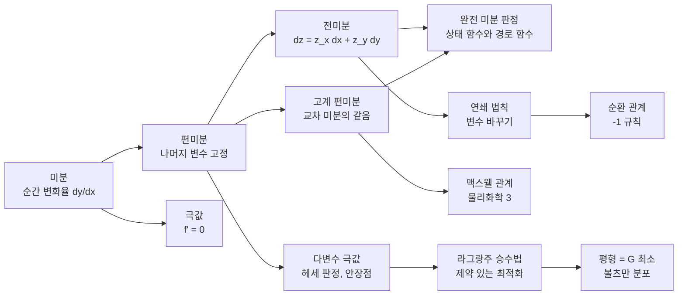

# 수학 도구 1. 미분과 편미분 — 여러 변수가 함께 변할 때 변화를 나누어 재는 법
<!-- prev: uphy-1, uchem-3, uchem-10 -->
<!-- next: umath-2, pchem-1 -->

> [!NOTE]
> **이 단원의 범위**
> - 미분의 뜻과 계산 요약(도함수, 미분 규칙, 로그 미분, 선형 근사)
> - 다변수 함수와 편미분, 일정하게 두는 변수의 표기 $(\partial z/\partial x)_y$
> - 전미분과 완전 미분, 상태 함수와 경로 함수, 적분 인자
> - 다변수의 연쇄 법칙, 역수 관계와 순환 관계($-1$ 규칙)
> - 고계 편미분과 교차 미분의 같음 — 맥스웰 관계의 뿌리
> - 극값(임계점, 헤세 판정, 안장점)과 라그랑주 승수법

**학습 목표**

1. 도함수를 '한 변수가 조금 변할 때 다른 변수가 얼마나 변하는가'로 해석하고, 지수·로그·거듭제곱 함수의 미분과 선형 근사를 과학 자료에 적용할 수 있다.
2. 상태 방정식처럼 변수가 여럿인 함수에서 편미분을 계산하고, 일정하게 두는 변수를 표기 $(\partial z/\partial x)_y$로 정확히 밝힐 수 있다.
3. 전미분으로 여러 변수가 함께 변할 때의 작은 변화를 어림하고, 완전 미분 판정으로 상태 함수와 경로 함수를 구별하며, 적분 인자 $1/T$가 열을 엔트로피로 바꾸는 까닭을 설명할 수 있다.
4. 다변수의 연쇄 법칙, 역수 관계, 순환 관계($-1$ 규칙)를 유도하고, 측정하기 어려운 편미분을 측정하기 쉬운 계수(열팽창 계수, 압축률)로 바꿀 수 있다.
5. 교차 미분이 같다는 사실에서 완전 미분 판정과 맥스웰 관계가 나오는 과정을 따라갈 수 있다.
6. 한 변수·두 변수 함수의 극값을 찾아 최소·최대·안장점을 판정하고, 라그랑주 승수법으로 제약이 있는 최적화 문제(화학 평형, 최단 시간 경로)를 풀 수 있다.

**이 단원의 학습 사다리**

| 단계 | 무엇을 하나? |
|---|---|
| STEP 1. 이전 학습 다시 보기 | 속도 = 위치의 도함수, 상태 함수와 경로 함수, $dS = dq_\text{가역}/T$, 이상 기체 식 |
| STEP 2. 기초 다지기 | 도함수의 단위, 지수·로그와 로그 미분, 이 단원의 '시험용 함수'(상태 방정식), 기호 $\Delta$·$d$·$\delta$·$\partial$ |
| STEP 3. 핵심 개념 | 미분 요약 → 편미분 → 전미분 → 완전 미분 → 연쇄 법칙과 $-1$ 규칙 → 교차 미분 → 극값 → 라그랑주 승수법 |
| STEP 4. 오개념 바로잡기 | "$\partial$를 분수처럼 지우면 된다", "아래첨자는 장식이다" 같은 착각 |
| STEP 5. 더 깊은 수학으로 | 수치 미분의 오차, 르장드르 변환, 해석학의 미분 가능성 |
| STEP 6. 이 도구가 쓰이는 곳 | 물리화학의 열역학·통계 열역학·반응 동역학, 분석화학, 지구과학 |

---

## 🗺️ 단원 들어가기

기체 실린더를 손으로 감싸 데우면서 동시에 피스톤을 조금 당긴다고 하자. 압력은 올라갈까, 내려갈까? 온도가 오르면 압력은 오르려 하고, 부피가 커지면 압력은 내려가려 한다. 두 효과가 **동시에** 일어날 때 결과를 알려면 각 효과를 따로 재고(편미분) 그것을 더하는(전미분) 방법이 필요하다.

과학의 거의 모든 양은 변수 하나가 아니라 여럿에 의존한다. 기체의 압력은 온도와 부피에, 반응 속도는 농도와 온도에, 대기의 온도는 높이와 시간에, 분자의 퍼텐셜 에너지는 모든 원자의 좌표에 의존한다. 일반물리학과 일반화학에서는 대개 변수 하나만 바꾸고 나머지를 고정한 상황을 다루었다. 전공 과목에서는 "무엇을 고정했는가"가 답을 바꾼다. 같은 기체의 열용량도 부피를 고정하면 $C_V$, 압력을 고정하면 $C_p$로 값이 다르다.

이 단원은 물리화학·통계 열역학·반응 동역학에서 끊임없이 쓰는 미분 도구를 한 상자에 모은다. 엄밀한 증명보다 **뜻과 계산법과 쓰임**에 집중하며, 예제의 대부분은 실제 기체·용액·대기·분자의 문제이다. 단원을 마치면 "부피를 일정하게 두고 데우면 물의 압력은 1 K마다 얼마나 오르는가?", "반응 좌표 위의 전이 상태는 수학적으로 무엇인가?", "평형 조성은 왜 깁스 에너지의 최솟값인가?"에 답할 수 있다.

---

## STEP 1. 🔙 이전 학습 다시 보기

### 연계 개념표

| 이전 단원 | 그때 배운 것 | 이 단원에서 확장되는 것 |
|---|---|---|
| 일반물리학 「운동의 기술」 | $v = dx/dt$, $a = dv/dt$, 미분과 적분의 역관계, 위치 벡터를 성분별로 미분 | 변수가 여럿인 함수의 **편미분**, 시간과 공간에 함께 의존하는 양의 연쇄 법칙(움직이는 관측자가 느끼는 변화) |
| 일반화학 「열화학」 | 상태 함수($U$, $H$)와 경로 함수($q$, $w$), 헤스 법칙 | 상태 함수 = **완전 미분**, 경로 함수 = 부정확 미분이라는 수학적 판정법 |
| 일반화학 「화학 열역학」 | $dS = dq_\text{가역}/T$, "$1/T$는 적분 인자", $\Delta G^\circ = -RT\ln K$ | $1/T$가 왜 적분 인자인지 직접 확인, 평형을 '제약이 있는 $G$의 최소화'로 유도 |
| 일반물리학 「열과 열역학」 | $W = \int P\,dV$는 경로에 따라 다르다, 등온·단열 과정 | 두 경로의 일·열을 계산해 경로 의존성을 수치로 비교 |
| 일반화학 「기체」 | 이상 기체 식, 판데르발스 식 | 상태 방정식의 편미분으로 열팽창 계수·압축률 계산 |
| 고등학교 수학 「미적분」 | 도함수의 정의, 곱·몫·합성 함수의 미분, 극대·극소 | 다변수 함수로의 확장, 헤세 판정, 제약 조건이 있는 극값 |

### 준비 운동 (사전 진단)

**Q1.** 1차 반응에서 반응물 농도가 $[\mathrm{A}] = [\mathrm{A}]_0e^{-kt}$로 줄어든다. $d[\mathrm{A}]/dt$를 구하고 $[\mathrm{A}]$로 나타내시오.

**Q2.** 이상 기체 1 mol의 압력 $P = RT/V$에서 온도를 고정하고 부피만 2배로 늘리면 압력은 몇 배가 되는가? 부피를 고정하고 온도만 2배로 올리면?

**Q3.** 다음 중 상태 함수를 모두 고르시오. (가) 내부 에너지 (나) 계가 받은 열 (다) 엔탈피 (라) 계가 한 일 (마) 엔트로피

**Q4.** $f(x) = x^3 - 3x$의 극댓값과 극솟값을 구하시오.

정답 및 해설

**Q1.** $d[\mathrm{A}]/dt = -k[\mathrm{A}]_0e^{-kt} = -k[\mathrm{A}]$. 합성 함수의 미분($e^{u}$의 미분은 $e^{u}\,du/dt$)이다. 1차 반응 속도식 $-d[\mathrm{A}]/dt = k[\mathrm{A}]$로 되돌아온다.

**Q2.** 각각 $\dfrac{1}{2}$배, 2배. 한 변수만 바꾸고 나머지를 고정하는 것이 이 단원의 '편미분'의 생각이다.

**Q3.** (가), (다), (마). 열과 일은 경로 함수이다. STEP 3 ④에서 이 구별을 수학적으로 판정한다.

**Q4.** $f'(x) = 3x^2 - 3 = 0$에서 $x = \pm1$. $f''(x) = 6x$이므로 $x = -1$에서 극댓값 $f(-1) = 2$, $x = 1$에서 극솟값 $f(1) = -2$.

---

## STEP 2. 🧱 기초 다지기

### 디딤돌 1. 도함수에는 단위가 있다

과학에서 함수의 변수는 순수한 수가 아니라 **단위가 붙은 물리량**이다. 도함수 $dy/dx$는 '$x$ 한 단위당 $y$의 변화'이므로 단위가 $[y]/[x]$이다.

| 함수 | 도함수 | 도함수의 단위 | 뜻 |
|---|---|---|---|
| 위치 $x(t)$ | $dx/dt$ | m/s | 속도 |
| 농도 $[\mathrm{A}](t)$ | $d[\mathrm{A}]/dt$ | M/s | 반응 속도(부호 포함) |
| 기압 $P(z)$ | $dP/dz$ | Pa/m | 높이에 따른 기압 감소율 |
| 부피 $V(T)$ | $dV/dT$ | m³/K | 열팽창 |
| 퍼텐셜 에너지 $U(r)$ | $-dU/dr$ | J/m = N | 힘 |

단위를 확인하는 습관은 식이 맞는지 점검하는 가장 값싼 방법이다. 도함수의 단위가 이상하면 식이 틀린 것이다.

#### 예제 — 기압의 높이 변화율

대기의 기압을 $P(z) = P_0e^{-z/H}$로 어림한다($P_0 = 101\,325\ \mathrm{Pa}$, 척도 높이 $H \approx 8.0\ \mathrm{km}$). 해수면에서 $dP/dz$를 구하시오.

**풀이** $\dfrac{dP}{dz} = -\dfrac{P_0}{H}e^{-z/H}$이므로 $z = 0$에서 $-\dfrac{101\,325\ \mathrm{Pa}}{8000\ \mathrm{m}} = -12.7\ \mathrm{Pa/m}$. 해수면 근처에서는 100 m 오를 때마다 기압이 약 1.3 kPa씩 낮아진다. 단위는 Pa/m로 '높이 1 m당 기압 변화'이다.

### 디딤돌 2. 지수·로그와 로그 미분

지수 함수와 로그 함수는 과학의 미분에 가장 많이 나온다.

$$
\frac{d}{dx}e^{ax} = ae^{ax}, \qquad \frac{d}{dx}\ln x = \frac{1}{x}, \qquad \frac{d}{dx}\ln f(x) = \frac{f'(x)}{f(x)}
$$

마지막 식이 **로그 미분**이다. $d\ln y = dy/y$는 '상대 변화'이다. $y$가 1 % 변하면 $\ln y$는 약 0.01 변한다. 그래서 곱과 거듭제곱으로 된 식은 로그를 취한 뒤 미분하면 상대 변화가 더하기로 바뀐다.

$$
y = Cx^a z^b \;\Rightarrow\; \ln y = \ln C + a\ln x + b\ln z \;\Rightarrow\; \frac{dy}{y} = a\frac{dx}{x} + b\frac{dz}{z}
$$

> [!IMPORTANT]
> 로그와 지수의 인수는 **단위가 없어야** 한다. $\ln P$라고 쓸 때는 사실 $\ln(P/P^\circ)$이다. 다행히 미분하면 기준값이 사라진다: $d\ln(P/P^\circ) = dP/P$. 그래서 "기울기를 구할 때는 단위를 무시해도 된다"는 것이 정확한 말이 된다.

#### 예제 — 로그 미분으로 상대 변화 구하기

이상 기체의 밀도는 $\rho = PM/(RT)$이다. 압력이 2.0 % 오르고 온도가 1.0 % 오르면 밀도는 몇 % 변하는가?

**풀이** $\ln\rho = \ln P + \ln M - \ln R - \ln T$이므로 $\dfrac{d\rho}{\rho} = \dfrac{dP}{P} - \dfrac{dT}{T} = 2.0\ \% - 1.0\ \% = +1.0\ \%$. 각 변수의 지수(여기서는 $+1$과 $-1$)가 상대 변화의 가중치가 된다.

### 디딤돌 3. 이 단원의 '시험용 함수' — 상태 방정식

이 단원의 예제에서 가장 자주 미분할 함수는 기체의 상태 방정식이다. 1 mol(몰 부피 $V_\mathrm{m}$)에 대해

$$
\text{이상 기체: } P = \frac{RT}{V_\mathrm{m}}, \qquad \text{판데르발스 기체: } P = \frac{RT}{V_\mathrm{m} - b} - \frac{a}{V_\mathrm{m}^2}
$$

판데르발스 식에서 $b$는 분자 자신의 부피(배제 부피), $a$는 분자 사이의 인력을 나타낸다(일반화학 「기체」). 이산화 탄소는 $a = 3.640\ \mathrm{L^2\,bar/mol^2}$, $b = 0.04267\ \mathrm{L/mol}$이다. 이때 $R = 0.08314\ \mathrm{L\,bar/(mol\cdot K)}$로 쓰면 압력이 bar로 나온다.

#### 예제 — 판데르발스 식으로 압력 구하기

$\mathrm{CO_2}$ 1.00 mol이 300 K에서 0.500 L를 차지할 때 압력을 이상 기체 식과 판데르발스 식으로 구하시오.

**풀이**
이상 기체: $P = \dfrac{0.08314\times300}{0.500} = 49.9\ \mathrm{bar}$
판데르발스: $P = \dfrac{24.94}{0.500 - 0.04267} - \dfrac{3.640}{0.500^2} = 54.54 - 14.56 = 40.0\ \mathrm{bar}$
인력 항($-a/V_\mathrm{m}^2$)이 압력을 크게 낮춘다. 같은 식이라도 이처럼 변수가 둘($T$, $V_\mathrm{m}$)인 함수이므로, "어느 쪽을 바꾸면 압력이 얼마나 변하는가"를 따로 물을 수 있다. 그것이 STEP 3 ②의 편미분이다.

### 디딤돌 4. 네 가지 '변화' 기호 — $\Delta$, $d$, $\delta$, $\partial$

| 기호 | 읽기 | 뜻 | 예 |
|---|---|---|---|
| $\Delta$ | 델타 | 유한한 변화(나중 − 처음) | $\Delta T = T_2 - T_1 = 10\ \mathrm{K}$ |
| $d$ | 디 | 무한히 작은 변화. 상태 함수의 작은 변화 | $dU$, $dT$, $dV$ |
| $\delta$ | 작은 델타 | 경로 함수의 작은 양(그 자체가 '어떤 함수의 변화'가 아님) | $\delta q$, $\delta w$ |
| $\partial$ | 라운드 디 | 다른 변수를 고정한 채의 변화(편미분) | $(\partial P/\partial T)_V$ |

$\delta q$에 $d$ 대신 $\delta$를 쓰는 까닭은 '계가 가진 열'이라는 상태 함수가 없기 때문이다. 열은 경로를 따라 주고받는 양일 뿐, 상태에 붙어 있는 값이 아니다. 이 차이를 수학적으로 판정하는 법이 STEP 3 ④이다. 이 책은 화학의 부호 약속 $dU = \delta q + \delta w$(계가 받는 일이 +, $\delta w = -P_\text{외부}\,dV$)를 쓴다. 일반물리학의 $dU = \delta Q - \delta W$(계가 한 일이 +)와 부호만 다를 뿐 같은 법칙이다.

#### 예제 — $\Delta$와 $d$의 차이

$y = x^2$에서 $x$가 3.00에서 3.10으로 변할 때 $\Delta y$와 $dy = y'(x)\,dx$를 비교하시오.

**풀이** $\Delta y = 3.10^2 - 3.00^2 = 0.610$, $dy = 2(3.00)(0.10) = 0.600$. 차이 $0.010 = (\Delta x)^2$은 $\Delta x$의 제곱에 비례하므로, $\Delta x$가 작을수록 $dy$가 $\Delta y$의 좋은 근사가 된다. $dy$는 '접선을 따라 간 변화'이다.

---

## STEP 3. 📘 핵심 개념

### ① 미분의 뜻과 계산 요약

#### 도함수 — 할선의 기울기에서 접선의 기울기로

함수 $y = f(x)$에서 $x$가 $h$만큼 변할 때의 평균 변화율은 그래프 위 두 점을 잇는 **할선**의 기울기 $[f(x+h) - f(x)]/h$이다. $h$를 0에 한없이 가깝게 하면 할선은 **접선**이 되고, 그 기울기가 **도함수(derivative)** 이다.

$$
f'(x) = \frac{dy}{dx} = \lim_{h\to0}\frac{f(x+h) - f(x)}{h}
$$

도함수는 "$x$를 아주 조금 바꿀 때 $y$가 $x$ 변화의 몇 배만큼 변하는가"라는 **배율**이다. 그래서 작은 변화에 대해

$$
\Delta y \approx f'(x)\,\Delta x \qquad (\textbf{선형 근사, linear approximation})
$$

가 성립한다. 과학에서 미분을 쓰는 이유의 절반은 이 근사이다. 복잡한 함수라도 좁은 범위에서는 직선처럼 다룰 수 있다.

<!-- 그림 요청: 1차 반응의 농도 곡선 [A] = 0.100 e^(−0.0005 t) (M), 가로축 t = 0~4000 s, 세로축 [A] = 0~0.100 M. t = 1000 s의 점 P(1000, 0.0607)에 접선(기울기 −3.03×10⁻⁵ M/s)을 실선으로, P와 t = 2000 s의 점(0.0368)을 잇는 할선을 점선으로 그린다. 할선의 끝점을 t = 1500 s, 1100 s로 옮긴 할선 두 개를 더 옅게 그려 접선에 가까워지는 모습을 보이고, "h → 0" 이름표를 단다. -->

#### 미분 규칙 한 장 요약

| 규칙 | 식 | 과학에서의 예 |
|---|---|---|
| 상수배·합 | $(af + bg)' = af' + bg'$ | 여러 항으로 된 퍼텐셜 에너지 |
| 거듭제곱 | $(x^n)' = nx^{n-1}$ | $U = -k/r$에서 $F = -dU/dr = -k/r^2$ |
| 곱 | $(fg)' = f'g + fg'$ | $d(PV) = P\,dV + V\,dP$ |
| 몫 | $(f/g)' = (f'g - fg')/g^2$ | $d(G/T)/dT$ (깁스–헬름홀츠 식) |
| 연쇄(합성 함수) | $\dfrac{dy}{dx} = \dfrac{dy}{du}\dfrac{du}{dx}$ | $e^{-kt}$, $e^{-E_\mathrm{a}/RT}$ |
| 지수·로그 | $(e^x)' = e^x$, $(\ln x)' = 1/x$ | 반응 속도식, 볼츠만 인자, 네른스트 식 |
| 삼각 함수 | $(\sin x)' = \cos x$, $(\cos x)' = -\sin x$ | 진동·파동 |

**2계 도함수** $f''(x) = d^2y/dx^2$는 기울기가 변하는 빠르기, 즉 그래프의 휘어짐이다. 위치의 2계 도함수는 가속도이고, 퍼텐셜 에너지의 최솟값에서 2계 도함수는 용수철 상수(결합의 '단단함')이다(⑦).

#### 예제 1 — 1차 반응의 순간 속도

$\mathrm{N_2O_5}$ 분해처럼 1차 반응을 하는 물질의 농도가 $[\mathrm{A}] = [\mathrm{A}]_0e^{-kt}$($[\mathrm{A}]_0 = 0.100\ \mathrm{M}$, $k = 5.0\times10^{-4}\ \mathrm{s^{-1}}$)로 줄어든다. $t = 1000\ \mathrm{s}$에서의 반응 속도 $-d[\mathrm{A}]/dt$를 구하시오.

**풀이**
① 식 세우기: 연쇄 법칙으로 $\dfrac{d[\mathrm{A}]}{dt} = [\mathrm{A}]_0\cdot e^{-kt}\cdot(-k) = -k[\mathrm{A}]$
② 대입: $[\mathrm{A}](1000\ \mathrm{s}) = 0.100\,e^{-0.50} = 0.0607\ \mathrm{M}$이므로 $-d[\mathrm{A}]/dt = 5.0\times10^{-4}\times0.0607 = 3.0\times10^{-5}\ \mathrm{M/s}$
③ 의미: 처음 속도($5.0\times10^{-5}\ \mathrm{M/s}$)의 약 0.61배이다. 1차 반응에서 속도는 농도에 비례하므로, 농도 곡선의 접선 기울기가 농도와 같은 비율로 줄어든다.

#### 예제 2 — 아레니우스 식의 온도 민감도

활성화 에너지가 $E_\mathrm{a} = 50.0\ \mathrm{kJ/mol}$인 반응의 속도 상수 $k = Ae^{-E_\mathrm{a}/RT}$에 대해 (1) 298 K에서 $d\ln k/dT$를 구하고, (2) 이 값으로 온도를 10 K 올릴 때 $k$가 몇 배가 되는지 어림하고 정확한 값과 비교하시오.

**풀이**
(1) $\ln k = \ln A - \dfrac{E_\mathrm{a}}{R}\cdot\dfrac{1}{T}$이므로 $\dfrac{d\ln k}{dT} = \dfrac{E_\mathrm{a}}{RT^2} = \dfrac{50\,000}{8.314\times298^2} = 0.0677\ \mathrm{K^{-1}}$. 1 K마다 $k$가 약 6.8 % 커진다.
(2) 선형 근사를 $\ln k$에 적용하면 $\Delta\ln k \approx 0.0677\times10 = 0.677$, 즉 $e^{0.677} = 1.97$배. 정확한 값은 $\ln(k_{308}/k_{298}) = \dfrac{E_\mathrm{a}}{R}\left(\dfrac{1}{298} - \dfrac{1}{308}\right) = 0.655$, 즉 1.93배이다.
의미: "10 ℃ 오르면 반응 속도가 약 두 배"라는 경험 규칙의 근거이다. $k$보다 $\ln k$에 선형 근사를 쓴 것이 요령이다. $\ln k$는 $1/T$에 대해 직선이므로 $T$에 대해서도 거의 직선이지만, $k$ 자체는 지수적으로 휘어 있다.

> [!TIP]
> 💡 **요령** — 지수적으로 변하는 양($k$, $K$, 증기 압력, 개체 수)은 그 자체보다 **로그에 선형 근사**를 하는 편이 훨씬 정확하다. 로그 미분 $d\ln y/dx$는 '단위 변화당 상대 변화율'이라는 깔끔한 뜻도 가진다.

#### ✔ 바로 확인

1. $U(r) = -\dfrac{C}{r^6}$(분산력 퍼텐셜)일 때 힘 $F = -dU/dr$을 구하시오.
2. (O/X) $y = e^{-x^2}$의 도함수는 $e^{-x^2}$이다.
3. 빈칸: 함수 $y$에 대해 $d\ln y/dx = (\quad)/y$이며, 이것은 $x$ 한 단위당 $y$의 상대 변화율이다.
4. 반감기 $t_{1/2} = \ln2/k$인 1차 반응에서 $t = t_{1/2}$일 때의 속도는 처음 속도의 몇 배인가?

정답

1. $F = -\dfrac{6C}{r^7}$ — 음수이므로 인력(가까워지는 쪽)이다.
2. X — 연쇄 법칙으로 $-2xe^{-x^2}$이다.
3. $dy/dx$
4. $\dfrac{1}{2}$배 — 속도 $= k[\mathrm{A}]$가 농도에 비례한다.

### ② 다변수 함수와 편미분

#### 변수가 둘 이상인 함수

이상 기체 1 mol의 압력 $P(T, V_\mathrm{m}) = RT/V_\mathrm{m}$은 두 변수의 함수이다. 가로축을 $V_\mathrm{m}$, 깊이축을 $T$, 높이를 $P$로 잡으면 이 함수는 곡선이 아니라 **곡면**이다. 곡면 위의 한 점에서 '기울기'는 하나가 아니다. 어느 방향으로 걷느냐에 따라 오르막의 가파르기가 다르다.

**편미분(partial derivative)** 은 다른 변수를 모두 고정하고 한 변수만 바꿀 때의 변화율이다.

$$
\left(\frac{\partial P}{\partial T}\right)_{V_\mathrm{m}} = \lim_{h\to0}\frac{P(T+h, V_\mathrm{m}) - P(T, V_\mathrm{m})}{h}
$$

계산은 간단하다. 고정한 변수를 **상수로 보고** 보통의 미분을 한다. 이상 기체라면

$$
\left(\frac{\partial P}{\partial T}\right)_{V_\mathrm{m}} = \frac{R}{V_\mathrm{m}}, \qquad \left(\frac{\partial P}{\partial V_\mathrm{m}}\right)_T = -\frac{RT}{V_\mathrm{m}^2}
$$

기하학적으로 $(\partial P/\partial V_\mathrm{m})_T$는 곡면을 '$T$ = 일정'인 평면으로 자른 단면(등온선)의 기울기이고, $(\partial P/\partial T)_{V_\mathrm{m}}$은 '$V_\mathrm{m}$ = 일정'인 단면(등적선)의 기울기이다.

<!-- 그림 요청: 이상 기체 1 mol의 상태 곡면 P = RT/V (P: bar, V: L, T: K)를 3차원 그물 곡면으로 그린다. V 축 5~40 L, T 축 200~500 K, P 축 0~8 bar. 곡면 위 점 A(V = 24.9 L, T = 300 K, P = 1.00 bar)를 지나는 등온선(T = 300 K 단면, 파란색)과 등적선(V = 24.9 L 단면, 빨간색)을 굵게 그리고, A에서 각 단면의 접선을 화살표로 그려 "(∂P/∂V)_T = −0.040 bar/L", "(∂P/∂T)_V = 0.0033 bar/K" 이름표를 단다. -->

#### 아래첨자는 장식이 아니다

수학 교재에서는 $z(x, y)$의 편미분을 $\partial z/\partial x$로만 쓰는 일이 많다. 무엇이 고정되었는지 문맥상 뻔하기 때문이다. 열역학에서는 그렇지 않다. 같은 계를 $(T, V)$로 나타낼 수도, $(T, P)$로 나타낼 수도 있어서 **"$T$에 대한 편미분"이 하나로 정해지지 않는다.**

내부 에너지 $U$를 예로 들면, 다음 두 양은 일반적으로 다르다. (이상 기체는 $U$가 온도에만 의존해 우연히 같아지지만, 판데르발스 기체에서는 실제로 다르다. ⑤의 예제 10)

$$
\left(\frac{\partial U}{\partial T}\right)_V = C_V \qquad\text{그리고}\qquad \left(\frac{\partial U}{\partial T}\right)_P
$$

앞의 것은 부피를 고정한 채 데우는 것이고, 뒤의 것은 압력을 고정한 채 데우는 것(이때 부피도 함께 변한다)이다. 그래서 열역학에서는 **반드시 고정한 변수를 아래첨자로 적는다.**

#### 실험으로 재는 편미분 — 열팽창 계수와 압축률

물질의 부피 $V(T, P)$에서 두 편미분은 실험실에서 직접 재는 표준 계수가 된다. 크기에 무관하도록 $V$로 나누어 정의한다.

$$
\alpha = \frac{1}{V}\left(\frac{\partial V}{\partial T}\right)_P \quad(\textbf{열팽창 계수}), \qquad \kappa_T = -\frac{1}{V}\left(\frac{\partial V}{\partial P}\right)_T \quad(\textbf{등온 압축률})
$$

$\kappa_T$에 음의 부호를 붙인 것은 누르면 부피가 줄어($\partial V/\partial P < 0$) 압축률을 양수로 만들기 위해서이다.

| 물질 (25 ℃, 1 bar 근처) | $\alpha$ ($\mathrm{K^{-1}}$) | $\kappa_T$ ($\mathrm{Pa^{-1}}$) |
|---|---|---|
| 이상 기체 | $1/T = 3.35\times10^{-3}$ | $1/P = 1.0\times10^{-5}$ |
| 물 | 약 $2.6\times10^{-4}$ | 약 $4.5\times10^{-10}$ |
| 에탄올 | 약 $1.1\times10^{-3}$ | 약 $1.1\times10^{-9}$ |
| 수은 | 약 $1.8\times10^{-4}$ | 약 $4\times10^{-11}$ |

기체는 액체보다 열팽창이 10배 정도 크고, 압축률은 1만 배 이상 크다.

#### 예제 3 — 이상 기체의 $\alpha$와 $\kappa_T$

이상 기체의 열팽창 계수가 $\alpha = 1/T$, 등온 압축률이 $\kappa_T = 1/P$임을 보이고, 298.15 K, 1.00 bar에서 값을 구하시오.

**풀이**
$V = nRT/P$를 $P$ 고정으로 $T$에 대해 미분하면 $(\partial V/\partial T)_P = nR/P = V/T$, 따라서 $\alpha = 1/T = 3.35\times10^{-3}\ \mathrm{K^{-1}}$.
$T$ 고정으로 $P$에 대해 미분하면 $(\partial V/\partial P)_T = -nRT/P^2 = -V/P$, 따라서 $\kappa_T = 1/P = 1.00\ \mathrm{bar^{-1}} = 1.00\times10^{-5}\ \mathrm{Pa^{-1}}$.
의미: 이상 기체의 계수는 물질에 무관하고 상태($T$, $P$)만으로 정해진다. 실제 물질의 계수가 이 값에서 벗어나는 정도가 분자 사이 힘의 크기를 알려 준다.

#### 예제 4 — 판데르발스 기체의 편미분

$\mathrm{CO_2}$ 1.00 mol이 300 K, 0.500 L에 있다(디딤돌 3). (1) $(\partial P/\partial T)_V$, (2) $(\partial P/\partial V)_T$를 구하고 이상 기체와 비교하시오.

**풀이**
(1) $P = \dfrac{RT}{V-b} - \dfrac{a}{V^2}$에서 $V$를 상수로 보면 둘째 항은 미분하면 사라진다.
$\left(\dfrac{\partial P}{\partial T}\right)_V = \dfrac{R}{V-b} = \dfrac{0.08314}{0.45733} = 0.182\ \mathrm{bar/K}$ (이상 기체: $R/V = 0.166\ \mathrm{bar/K}$)
(2) $T$를 상수로 보면
$\left(\dfrac{\partial P}{\partial V}\right)_T = -\dfrac{RT}{(V-b)^2} + \dfrac{2a}{V^3} = -119.3 + 58.2 = -61.0\ \mathrm{bar/L}$ (이상 기체: $-RT/V^2 = -99.8\ \mathrm{bar/L}$)
의미: 인력 항이 $+2a/V^3$만큼 기울기를 완만하게 만든다. 분자들이 서로 끌어당기므로 같은 부피 감소에 대해 압력이 덜 오른다. 즉 이 상태의 $\mathrm{CO_2}$는 이상 기체보다 **더 잘 압축된다.** 임계점에서는 이 기울기가 정확히 0이 된다(물리화학 「기체의 성질과 열역학 제1법칙」).

<!-- 그림 요청: CO₂ 판데르발스 등온선 세 개(T = 280 K, 304 K, 330 K)를 P–V 그래프로 그린다. 가로축 V = 0.06~0.6 L (1 mol), 세로축 P = 0~120 bar. 식 P = 0.08314T/(V − 0.04267) − 3.640/V². 280 K 곡선에는 극대·극소가 있는 물결 모양이 보이게, 304 K(임계 온도 근처)는 변곡점에서 기울기가 0, 330 K는 단조 감소로 그린다. 300 K에 해당하는 점선 곡선 위 V = 0.500 L 점에 접선(기울기 −61 bar/L)을 그리고, 같은 점에서 이상 기체 등온선의 접선(−99.8 bar/L)을 비교용 회색 점선으로 덧그린다. -->

#### ✔ 바로 확인

1. $f(x, y) = x^2y^3$의 $\partial f/\partial x$와 $\partial f/\partial y$를 구하시오.
2. (O/X) $(\partial U/\partial T)_V$와 $(\partial U/\partial T)_P$는 같은 함수의 같은 변수에 대한 미분이므로 언제나 같다.
3. 빈칸: 등온 압축률은 $\kappa_T = -\dfrac{1}{V}(\quad)$로 정의한다.
4. 이상 기체 1.00 mol이 300 K, 1.00 bar에 있을 때 열팽창 계수 $\alpha$는?

정답

1. $\partial f/\partial x = 2xy^3$, $\partial f/\partial y = 3x^2y^2$
2. X — 고정하는 변수가 다르면 다른 양이다. 압력을 고정하고 데우면 부피도 변하기 때문이다.
3. $\left(\dfrac{\partial V}{\partial P}\right)_T$
4. $1/T = 3.33\times10^{-3}\ \mathrm{K^{-1}}$

### ③ 전미분 — 여러 변수가 함께 변할 때

#### 효과를 나누어 재고 더한다

이제 단원 들어가기의 질문으로 돌아가자. $T$와 $V$가 **동시에** 조금씩 변하면 $P$는 얼마나 변할까? 곡면 위에서 $T$ 방향으로 $dT$만큼, $V$ 방향으로 $dV$만큼 걸어간다고 생각하면, 아주 작은 걸음에서는 곡면을 그 점의 **접평면**으로 바꾸어도 된다. 접평면 위에서는 두 방향의 오르막이 서로 간섭하지 않고 그냥 더해진다.

$$
dz = \left(\frac{\partial z}{\partial x}\right)_y dx + \left(\frac{\partial z}{\partial y}\right)_x dy
$$

이것을 $z$의 **전미분(total differential)** 이라 한다. 변수가 $n$개이면 $dz = \sum_i (\partial z/\partial x_i)\,dx_i$로 항이 늘어날 뿐이다. 각 항은 "그 변수만 변했다면 생겼을 변화"이고, 전체 변화는 그 합이다. 유한한 변화에 대해서는 $\Delta z \approx (\partial z/\partial x)\Delta x + (\partial z/\partial y)\Delta y$의 근사가 되며, 오차는 $\Delta x$, $\Delta y$의 제곱 정도이다.

<!-- 그림 요청: 두 변수 함수 z = f(x, y)의 곡면 일부와 점 A에서의 접평면을 3차원으로 그린다. A에서 x 방향으로 dx, y 방향으로 dy만큼 간 점 B를 바닥 평면에 표시하고, 접평면 위에서 높이 변화를 두 조각으로 나눈다: x 방향 계단 높이 (∂z/∂x)dx(빨강), y 방향 계단 높이 (∂z/∂y)dy(파랑), 둘의 합 dz(검정 굵은 선). 곡면 위 실제 높이 변화 Δz와 dz의 작은 차이를 회색 괄호로 표시한다. -->

<!-- 시뮬레이션 요청: 이상 기체(또는 CO₂ 판데르발스 기체) 1 mol의 상태 곡면 P(V, T)를 3D로 돌려 보는 편미분·전미분 탐색기. 학생이 곡면 위의 점(V, T)을 슬라이더로 고르면 그 점을 지나는 등온선(T 고정)과 등적선(V 고정)이 곡면 위에 강조되고, 두 접선의 기울기 (∂P/∂V)_T, (∂P/∂T)_V 값이 표시된다. dV, dT 슬라이더로 작은 걸음을 주면 접평면 위의 dP = (∂P/∂T)_V dT + (∂P/∂V)_T dV와 곡면 위의 실제 ΔP를 나란히 보여 주고, 걸음을 키울수록 둘의 차이가 커지는 것을 수치로 표시한다. 기체 종류 전환 버튼(이상 기체 / CO₂ 판데르발스)을 둔다. -->

이상 기체 $P = nRT/V$의 전미분은

$$
dP = \frac{nR}{V}dT - \frac{nRT}{V^2}dV \quad\Longleftrightarrow\quad \frac{dP}{P} = \frac{dT}{T} - \frac{dV}{V}
$$

오른쪽은 양변을 $P$로 나눈 것으로, 디딤돌 2의 로그 미분과 같은 결과이다.

#### 예제 5 — 데우면서 부피를 늘린 기체

이상 기체 1.00 mol이 300 K, 24.0 L에 있다. 온도를 3.0 K 올리면서 부피를 0.50 L 늘렸다. 전미분으로 압력 변화를 어림하고 정확한 값과 비교하시오. ($R = 8.314\ \mathrm{J/(mol\cdot K)}$)

**풀이**
① 처음 압력: $P = \dfrac{8.314\times300}{0.0240} = 1.039\times10^5\ \mathrm{Pa}$
② 상대 변화의 전미분: $\dfrac{dP}{P} = \dfrac{3.0}{300} - \dfrac{0.50}{24.0} = 0.0100 - 0.0208 = -0.0108$
③ 어림: $dP = -0.0108\times1.039\times10^5 = -1.13\times10^3\ \mathrm{Pa}$
④ 정확한 값: $P' = \dfrac{8.314\times303}{0.0245} = 1.028\times10^5\ \mathrm{Pa}$, $\Delta P = -1.10\times10^3\ \mathrm{Pa}$
의미: 온도 효과(+1.0 %)보다 부피 효과(−2.1 %)가 커서 압력이 약 1.1 % 낮아진다. 어림과 정확한 값의 차이(약 2 %)는 두 변화의 곱에 해당하는 2차 항 때문이다.

#### 예제 6 — 혈관이 조금 넓어지면 혈류는 얼마나 늘까?

가늘고 긴 관을 흐르는 점성 유체의 부피 흐름률은 하겐–푸아죄유 법칙(Hagen–Poiseuille law) $Q = \dfrac{\pi r^4\,\Delta P}{8\eta L}$을 따른다. 세동맥의 반지름이 5.0 % 늘고 양 끝의 압력 차가 2.0 % 줄었다. 혈액의 점성 $\eta$와 길이 $L$은 그대로라고 할 때 $Q$는 몇 % 변하는가?

**풀이**
로그 미분: $\dfrac{dQ}{Q} = 4\dfrac{dr}{r} + \dfrac{d(\Delta P)}{\Delta P} - \dfrac{d\eta}{\eta} - \dfrac{dL}{L} = 4(5.0\ \%) + (-2.0\ \%) = +18\ \%$
정확한 값: $1.05^4\times0.98 = 1.191$, 즉 +19 %.
의미: 반지름의 지수 4가 가중치가 되므로, 몸은 혈관 반지름을 조금만 조절해도(혈관 확장·수축) 혈류를 크게 바꿀 수 있다. 전미분은 "어느 변수가 결과에 가장 민감한가"를 한눈에 보여 준다.

> [!TIP]
> 💡 **요령** — 곱과 거듭제곱으로 된 식 $z = Cx^ay^b\cdots$는 로그 미분이 가장 빠르다: $dz/z = a\,dx/x + b\,dy/y + \cdots$. 지수의 절댓값이 큰 변수가 가장 민감한 변수이다. 측정값의 불확도가 결과에 어떻게 전해지는지(오차 전파)는 이 식에 확률을 더한 것으로, 수학 도구 7 「확률과 통계」에서 다룬다.

#### ✔ 바로 확인

1. $z = x^2 + 3xy$의 전미분 $dz$를 쓰시오.
2. 이상 기체에서 온도가 2 % 오르고 압력이 2 % 오를 때 부피는 대략 몇 % 변하는가?
3. (O/X) 전미분 어림 $\Delta z \approx z_x\Delta x + z_y\Delta y$의 오차는 $\Delta x$, $\Delta y$가 작아질수록 그보다 더 빨리 작아진다.

정답

1. $dz = (2x + 3y)\,dx + 3x\,dy$
2. 거의 변하지 않는다(0 %) — $dV/V = dT/T - dP/P = 2\ \% - 2\ \%$.
3. O — 오차는 2차 항(제곱 정도)이므로 걸음을 절반으로 줄이면 오차는 약 4분의 1이 된다.

### ④ 완전 미분 — 상태 함수와 경로 함수의 수학

#### 모든 '작은 변화'가 어떤 함수의 미분은 아니다

③에서는 함수 $z(x, y)$가 먼저 있고, 그 전미분 $dz$를 만들었다. 거꾸로, 어떤 식

$$
\delta f = M(x, y)\,dx + N(x, y)\,dy
$$

가 주어졌을 때 이것이 **어떤 함수 $z$의 전미분인가**를 물을 수 있다. 그런 $z$가 있으면 $\delta f$를 **완전 미분(exact differential)**, 없으면 **부정확 미분(inexact differential)** 이라 한다.

완전 미분이면 $M = \partial z/\partial x$, $N = \partial z/\partial y$이다. 그런데 ⑥에서 보듯 매끄러운 함수는 미분 순서를 바꾸어도 결과가 같다($\partial^2 z/\partial y\,\partial x = \partial^2 z/\partial x\,\partial y$). 따라서

> [!IMPORTANT]
> **완전 미분 판정(오일러 판정)**
> $M\,dx + N\,dy$가 완전 미분이면
> $$
> \left(\frac{\partial M}{\partial y}\right)_x = \left(\frac{\partial N}{\partial x}\right)_y
> $$
> 이다. 거꾸로 이 등식이 (구멍이 없는) 영역 전체에서 성립하면 그 영역에서 완전 미분이다.

완전 미분과 부정확 미분은 적분할 때 차이가 드러난다.

| 성질 | 완전 미분 $dz$ | 부정확 미분 $\delta f$ |
|---|---|---|
| 두 점 사이의 적분 | $\int_A^B dz = z(B) - z(A)$, 경로와 무관 | 경로마다 값이 다르다 |
| 한 바퀴 도는 적분 | $\oint dz = 0$ | 일반적으로 $\oint \delta f \ne 0$ |
| 열역학의 예 | $dU$, $dH$, $dS$, $dG$, $dT$, $dV$ | $\delta q$, $\delta w$ |
| 판정 | $\partial M/\partial y = \partial N/\partial x$ | 등식이 성립하지 않는다 |

"상태 함수"라는 화학의 말과 "완전 미분"이라는 수학의 말은 **같은 것**이다. 헤스 법칙(일반화학 「열화학」)은 $dH$가 완전 미분이라는 사실의 다른 표현이다. 여기서 쓰는 '경로를 따라 더하는 적분'은 이 소절에서는 $T$나 $V$를 하나씩만 바꾸는 단순한 구간으로만 계산하고, 일반적인 곡선 경로의 적분(선적분)은 수학 도구 2 「적분과 급수」에서 다룬다.

#### 완전 미분에서 원래 함수 찾기

$dz = M\,dx + N\,dy$가 완전 미분이면 $z$를 다음 순서로 되살린다.

1. $M$을 $x$에 대해 적분한다($y$는 상수 취급): $z = \int M\,dx + g(y)$. 적분 상수 자리에 $y$의 함수 $g(y)$를 둔다.
2. 이것을 $y$로 편미분해 $N$과 같다고 놓고 $g'(y)$를 구한다.
3. $g(y)$를 적분해 넣는다.

예를 들어 $dz = (2xy + 3)\,dx + (x^2 + 1)\,dy$는 $\partial M/\partial y = 2x = \partial N/\partial x$이므로 완전 미분이다. ① $z = x^2y + 3x + g(y)$ ② $\partial z/\partial y = x^2 + g'(y) = x^2 + 1$에서 $g'(y) = 1$ ③ $z = x^2y + 3x + y + C$.

#### 열과 일은 왜 부정확 미분인가 — 그리고 적분 인자

이상 기체 1 mol이 가역 과정을 거칠 때를 $(T, V)$를 변수로 하여 보자. 이상 기체의 내부 에너지는 온도에만 의존하므로 $dU = C_V\,dT$이고, 가역 일은 $\delta w = -P\,dV = -(RT/V)\,dV$이다. 제1법칙 $dU = \delta q + \delta w$에서

$$
\delta q_\text{가역} = C_V\,dT + \frac{RT}{V}\,dV
$$

#### 예제 7 — 완전 미분 판정과 적분 인자 $1/T$

이상 기체 1 mol($C_V$는 상수)에 대해 (1) $dU = C_V\,dT + 0\cdot dV$, (2) $\delta w = 0\cdot dT - (RT/V)\,dV$, (3) $\delta q_\text{가역}$, (4) $\delta q_\text{가역}/T$가 완전 미분인지 판정하고, 완전 미분인 것은 원래 함수를 구하시오.

**풀이**
(1) $M = C_V$, $N = 0$: $\partial M/\partial V = 0 = \partial N/\partial T$ → 완전 미분, $U = C_VT + U_0$.
(2) $M = 0$, $N = -RT/V$: $\partial M/\partial V = 0$이지만 $\partial N/\partial T = -R/V \ne 0$ → 부정확 미분. 일은 경로 함수이다.
(3) $M = C_V$, $N = RT/V$: $\partial M/\partial V = 0$, $\partial N/\partial T = R/V$ → 부정확 미분. 열도 경로 함수이다.
(4) $\delta q_\text{가역}/T = \dfrac{C_V}{T}dT + \dfrac{R}{V}dV$: $M = C_V/T$, $N = R/V$, $\partial M/\partial V = 0 = \partial N/\partial T$ → **완전 미분**. 원래 함수는
$$
S = C_V\ln T + R\ln V + S_0
$$
의미: 경로 함수인 열에 $1/T$를 곱하자 상태 함수가 생겼다. 이렇게 부정확 미분을 완전 미분으로 바꾸어 주는 곱수를 **적분 인자(integrating factor)** 라 한다. 일반화학 「화학 열역학」에서 "$dS = \delta q_\text{가역}/T$는 상태 함수이다"라고 받아들였던 사실을, 이상 기체에서는 직접 확인한 셈이다. (모든 물질에서 $1/T$가 적분 인자라는 것은 열역학 제2법칙의 내용이다.)

#### 예제 8 — 두 경로, 같은 $\Delta U$, 다른 $q$와 $w$

단원자 이상 기체 1.00 mol($C_V = \tfrac{3}{2}R$)을 상태 A(300 K, 10.0 L)에서 상태 B(600 K, 20.0 L)로 가역적으로 바꾼다.
경로 Ⅰ: 300 K에서 20.0 L까지 등온 팽창한 뒤, 부피를 고정하고 600 K로 가열
경로 Ⅱ: 부피를 고정하고 600 K로 가열한 뒤, 600 K에서 20.0 L까지 등온 팽창
각 경로의 $w$, $q$, $\Delta U$, $\Delta S$를 구하시오.

**풀이**
등온 구간의 일은 $w = -\int RT\,dV/V = -RT\ln(V_2/V_1)$, 등적 구간의 일은 0이다.

| 양 | 경로 Ⅰ | 경로 Ⅱ |
|---|---|---|
| $w$ | $-8.314\times300\times\ln2 = -1729\ \mathrm{J}$ | $-8.314\times600\times\ln2 = -3458\ \mathrm{J}$ |
| $\Delta U = C_V\Delta T$ | $\tfrac{3}{2}(8.314)(300) = 3741\ \mathrm{J}$ | $3741\ \mathrm{J}$ |
| $q = \Delta U - w$ | $5470\ \mathrm{J}$ | $7199\ \mathrm{J}$ |
| $\Delta S = \int\delta q_\text{가역}/T$ | $\dfrac{1729}{300} + C_V\ln2 = 5.76 + 8.64 = 14.41\ \mathrm{J/K}$ | $C_V\ln2 + \dfrac{3458}{600} = 8.64 + 5.76 = 14.41\ \mathrm{J/K}$ |

의미: $w$와 $q$는 경로에 따라 1.7 kJ씩 다르지만, 완전 미분인 $dU$와 $dS$를 적분한 $\Delta U$, $\Delta S$는 같다. 예제 7의 $S = C_V\ln T + R\ln V$에 바로 넣어도 $\Delta S = C_V\ln2 + R\ln2 = \tfrac{5}{2}R\ln2 = 14.41\ \mathrm{J/K}$이다. 경로 Ⅰ을 가고 경로 Ⅱ를 거꾸로 돌아오는 순환에서는 $\oint dU = 0$이지만 $\oint\delta w = -1729 + 3458 = +1729\ \mathrm{J} \ne 0$이다.

<!-- 그림 요청: 예제 8의 두 경로를 두 칸으로 그린다. 왼쪽 칸은 T–V 평면(가로축 V 0~25 L, 세로축 T 0~700 K)에 A(10 L, 300 K), B(20 L, 600 K), 경로 Ⅰ은 A→(20 L, 300 K)→B(수평 후 수직, 파란색), 경로 Ⅱ는 A→(10 L, 600 K)→B(수직 후 수평, 빨간색). 오른쪽 칸은 같은 두 경로를 P–V 평면에 그린다(가로축 V 0~25 L, 세로축 P 0~5.5 bar): 등온선 구간은 쌍곡선 P = 0.08314T/V, 등적 구간은 수직선. A(10 L, 2.49 bar), (20 L, 1.25 bar), (10 L, 4.99 bar), B(20 L, 2.49 bar). 두 경로 아래 넓이(= −w)를 각각 옅은 파랑·빨강으로 칠해 넓이가 다름을 보인다. -->

#### ✔ 바로 확인

1. $y\,dx + x\,dy$는 완전 미분인가? 그렇다면 어떤 함수의 미분인가?
2. $y\,dx - x\,dy$는 완전 미분인가?
3. (O/X) 어떤 순환 과정에서 계가 받은 열의 합이 0이 아니므로 열역학 제1법칙이 깨졌다.
4. 빈칸: 부정확 미분 $\delta q_\text{가역}$에 곱해 완전 미분 $dS$를 만드는 인자 $1/T$를 (    ) 인자라 한다.

정답

1. 예 — $\partial y/\partial y = 1 = \partial x/\partial x$, $d(xy)$이다.
2. 아니요 — $\partial M/\partial y = 1$, $\partial N/\partial x = -1$로 다르다. ($1/y^2$을 곱하면 $d(x/y)$가 된다.)
3. X — 순환에서 0이 되어야 하는 것은 상태 함수인 $U$의 변화이다. 열과 일은 각각 0이 아니어도 되고, 그 합 $q + w$가 0이 된다.
4. 적분

### ⑤ 연쇄 법칙과 순환 관계 — 변수를 바꾸어 타는 법

#### 다변수의 연쇄 법칙

$z(x, y)$에서 $x$와 $y$가 모두 시간 $t$의 함수라면, 전미분 $dz = z_x\,dx + z_y\,dy$의 양변을 $dt$로 나누어

$$
\frac{dz}{dt} = \left(\frac{\partial z}{\partial x}\right)_y\frac{dx}{dt} + \left(\frac{\partial z}{\partial y}\right)_x\frac{dy}{dt}
$$

을 얻는다. 이것이 **다변수의 연쇄 법칙(chain rule)** 이다. 변수가 둘이면 '경로'가 둘이고, 각 경로를 따라 전해지는 변화를 더한다.

가장 중요한 과학적 쓰임은 **움직이는 관측자가 느끼는 변화**이다. 대기·해양·혈류처럼 온도나 농도가 위치 $x$와 시간 $t$에 함께 의존하는 양 $T(x, t)$를, 속도 $v = dx/dt$로 움직이며 재면

$$
\frac{dT}{dt} = \underbrace{\left(\frac{\partial T}{\partial t}\right)_x}_{\text{그 자리에서의 변화}} + \underbrace{v\left(\frac{\partial T}{\partial x}\right)_t}_{\text{옮겨 가며 생기는 변화}}
$$

뒤의 항을 **이류(advection)** 항이라 한다. 유체역학·기상학에서 이 $dT/dt$를 '물질 도함수'라 부른다.

#### 예제 9 — 관측 기구가 재는 기온 변화

아침에 대기의 기온이 $T(z, t) = T_0 - \Gamma z + \beta t$로 변한다고 하자. 기온 감률 $\Gamma = 6.5\ \mathrm{K/km}$, 지표 가열에 의한 승온 $\beta = 0.50\ \mathrm{K/h}$이다. 라디오존데(기상 관측 기구)가 $5.0\ \mathrm{m/s}$로 상승할 때 기구의 온도계가 재는 $dT/dt$를 구하시오.

**풀이**
$\left(\dfrac{\partial T}{\partial t}\right)_z = \beta = \dfrac{0.50\ \mathrm{K}}{3600\ \mathrm{s}} = 1.4\times10^{-4}\ \mathrm{K/s}$, $\left(\dfrac{\partial T}{\partial z}\right)_t = -\Gamma = -6.5\times10^{-3}\ \mathrm{K/m}$
$\dfrac{dT}{dt} = 1.4\times10^{-4} + (5.0)(-6.5\times10^{-3}) = 1.4\times10^{-4} - 3.25\times10^{-2} = -3.2\times10^{-2}\ \mathrm{K/s}$ (1분에 약 −1.9 K)
의미: 이동에 의한 항이 그 자리의 변화보다 200배 이상 크다. 기구의 기록은 '시간에 따른 변화'라기보다 '높이에 따른 변화'를 보여 준다. 연쇄 법칙은 두 효과를 분리해 준다.

#### 고정하는 변수 바꾸기

열역학에서는 "$z(x, y)$를 알고 있는데, $y$ 대신 다른 변수 $w$를 고정한 편미분 $(\partial z/\partial x)_w$가 필요하다"는 상황이 매우 흔하다. 전미분 $dz = z_x\,dx + z_y\,dy$에서 $w$가 일정한 변화만 골라 $dx$로 나누면

$$
\left(\frac{\partial z}{\partial x}\right)_w = \left(\frac{\partial z}{\partial x}\right)_y + \left(\frac{\partial z}{\partial y}\right)_x\left(\frac{\partial y}{\partial x}\right)_w
$$

첫 항은 '$y$를 고정했을 때의 변화', 둘째 항은 '$w$를 고정하느라 $y$가 따라 변해서 생긴 추가 변화'이다. 내부 에너지 $U(T, V)$에 적용하면

$$
\left(\frac{\partial U}{\partial T}\right)_P = C_V + \left(\frac{\partial U}{\partial V}\right)_T\left(\frac{\partial V}{\partial T}\right)_P
$$

압력을 고정하고 데우면 기체가 팽창하고, 팽창하는 동안 분자 사이의 거리가 멀어져 내부 에너지가 추가로 변한다. 그 몫이 둘째 항이다. $(\partial U/\partial V)_T$는 **내부 압력**이라 불리며, 이상 기체에서는 0, 판데르발스 기체에서는 $a/V_\mathrm{m}^2$이다(유도는 물리화학 「기체의 성질과 열역학 제1법칙」과 「자유 에너지와 화학 퍼텐셜」).

#### 예제 10 — $(\partial U/\partial T)_P$와 $C_V$의 차이

300 K, 1.00 bar의 $\mathrm{CO_2}$(판데르발스 $a = 3.640\ \mathrm{L^2\,bar/mol^2}$)에서 $(\partial U_\mathrm{m}/\partial T)_P - C_{V,\mathrm{m}}$을 어림하시오. 몰 부피는 이상 기체 값 $V_\mathrm{m} \approx 24.9\ \mathrm{L}$, $(\partial V_\mathrm{m}/\partial T)_P \approx R/P$로 어림한다.

**풀이**
① 내부 압력: $\dfrac{a}{V_\mathrm{m}^2} = \dfrac{3.640}{24.9^2} = 5.87\times10^{-3}\ \mathrm{bar} = 587\ \mathrm{Pa}$ ($1\ \mathrm{Pa} = 1\ \mathrm{J/m^3}$)
② $(\partial V_\mathrm{m}/\partial T)_P \approx \dfrac{8.314}{1.00\times10^5} = 8.31\times10^{-5}\ \mathrm{m^3/(mol\cdot K)}$
③ 차이: $587\times8.31\times10^{-5} = 0.049\ \mathrm{J/(mol\cdot K)}$
의미: $\mathrm{CO_2}$의 $C_{V,\mathrm{m}}$(약 $28.8\ \mathrm{J/(mol\cdot K)}$)의 약 0.2 %로 작다. 1 bar의 기체는 이상 기체에 가깝기 때문이다. 하지만 고압 기체나 액체에서는 이 항이 커지며, 무엇을 고정했는지를 빠뜨리면 그만큼 틀린다.

#### 역수 관계와 순환 관계($-1$ 규칙)

세 변수가 상태 방정식처럼 하나의 관계 $f(x, y, z) = 0$으로 묶여 있으면, 어느 둘을 골라도 나머지 하나가 정해진다. 이때 두 가지 관계가 성립한다.

**역수 관계** — 고정하는 변수가 **같을 때만**

$$
\left(\frac{\partial x}{\partial y}\right)_z = \frac{1}{(\partial y/\partial x)_z}
$$

**순환 관계(cyclic relation)** — 유도해 보자. $x$를 $y$, $z$의 함수로 보면

$$
dx = \left(\frac{\partial x}{\partial y}\right)_z dy + \left(\frac{\partial x}{\partial z}\right)_y dz
$$

$x$가 변하지 않는 방향($dx = 0$)으로만 움직이면 $dy$와 $dz$는 서로 묶여 $dz/dy = (\partial z/\partial y)_x$가 된다. 이것을 넣고 $dy$로 나누면

$$
0 = \left(\frac{\partial x}{\partial y}\right)_z + \left(\frac{\partial x}{\partial z}\right)_y\left(\frac{\partial z}{\partial y}\right)_x
$$

역수 관계로 $(\partial x/\partial z)_y = 1/(\partial z/\partial x)_y$를 쓰고 정리하면

> [!IMPORTANT]
> **순환 관계($-1$ 규칙)**
> $$
> \left(\frac{\partial x}{\partial y}\right)_z\left(\frac{\partial y}{\partial z}\right)_x\left(\frac{\partial z}{\partial x}\right)_y = -1
> $$
> 동등한 꼴: $\left(\dfrac{\partial x}{\partial y}\right)_z = -\dfrac{(\partial z/\partial y)_x}{(\partial z/\partial x)_y}$

"$\partial$를 분수처럼 약분하면 $+1$"이 될 것 같지만 **$-1$** 이다. 기하학적으로 보면 이해가 된다. $z$의 등고선(같은 $z$ 값을 잇는 선) 위에서 움직이려면, $x$가 늘어 $z$가 커지는 만큼 $y$를 바꾸어 $z$를 도로 깎아야 한다. 두 효과가 **상쇄**되어야 하므로 음의 부호가 붙는다.

<!-- 그림 요청: x–y 평면에 함수 z(x, y)의 등고선 몇 개(z = 1, 2, 3)를 그린다(예: z = xy의 쌍곡선 등고선, x, y > 0). 등고선 z = 2 위의 점 A에서 x 방향으로 dx(빨강 화살표)만큼 가면 z가 (∂z/∂x)dx만큼 커지고, 다시 y 방향으로 dy(파랑 화살표, 음의 방향)만큼 가서 같은 등고선으로 돌아오는 직각 삼각형을 그린다. 이름표: "z가 일정: (∂z/∂x)_y dx + (∂z/∂y)_x dy = 0", "등고선의 기울기 (∂y/∂x)_z = −(∂z/∂x)_y/(∂z/∂y)_x". -->

이상 기체 $PV = nRT$로 확인하면

$$
\left(\frac{\partial P}{\partial V}\right)_T\left(\frac{\partial V}{\partial T}\right)_P\left(\frac{\partial T}{\partial P}\right)_V = \left(-\frac{nRT}{V^2}\right)\left(\frac{nR}{P}\right)\left(\frac{V}{nR}\right) = -\frac{nRT}{PV} = -1
$$

#### 예제 11 — 액체를 가득 채운 용기를 데우면

순환 관계로 $(\partial P/\partial T)_V = \alpha/\kappa_T$임을 보이고, 25 ℃의 물($\alpha \approx 2.57\times10^{-4}\ \mathrm{K^{-1}}$, $\kappa_T \approx 4.52\times10^{-10}\ \mathrm{Pa^{-1}}$)을 빈틈없이 채워 밀봉한 단단한 용기를 1 K 데울 때 압력 상승을 구하시오.

**풀이**
① 순환 관계의 동등한 꼴에서 $\left(\dfrac{\partial P}{\partial T}\right)_V = -\dfrac{(\partial V/\partial T)_P}{(\partial V/\partial P)_T} = -\dfrac{\alpha V}{-\kappa_T V} = \dfrac{\alpha}{\kappa_T}$
② 대입: $\dfrac{2.57\times10^{-4}}{4.52\times10^{-10}} = 5.7\times10^5\ \mathrm{Pa/K} \approx 5.7\ \mathrm{bar/K}$
의미: 부피를 일정하게 둔 채 액체의 압력을 직접 재기는 어렵지만, 측정하기 쉬운 $\alpha$와 $\kappa_T$로 바꾸어 계산했다. 1 K에 약 6 bar이므로 10 K만 데워도 약 60 bar가 된다. 액체를 가득 채운 밀폐 용기나 배관을 가열하면 터지는 까닭이고, 수온계에 빈 공간을 두는 까닭이다. 이처럼 "재기 어려운 편미분을 재기 쉬운 편미분으로 바꾸는 것"이 연쇄 법칙과 순환 관계의 가장 큰 쓸모이다.

#### ✔ 바로 확인

1. (O/X) $(\partial x/\partial y)_z(\partial y/\partial z)_x(\partial z/\partial x)_y = +1$이다.
2. 빈칸: $(\partial T/\partial P)_V = 1/(\quad)$ (역수 관계)
3. $z = x^2 + y^2$의 등고선 위 점 $(3, 4)$에서 기울기 $(\partial y/\partial x)_z$를 구하시오.
4. 해수면 위를 동쪽으로 $10\ \mathrm{m/s}$로 나는 비행기에서, 기온이 동쪽으로 갈수록 $0.010\ \mathrm{K/km}$씩 낮아지고 그 자리의 기온은 변하지 않는다. 비행기가 재는 $dT/dt$는?

정답

1. X — $-1$이다.
2. $(\partial P/\partial T)_V$
3. $-3/4$ — $-(\partial z/\partial x)/(\partial z/\partial y) = -2x/2y = -3/4$. 원 $x^2 + y^2 = 25$의 접선 기울기와 같다.
4. $-1.0\times10^{-4}\ \mathrm{K/s}$ — $v\,(\partial T/\partial x) = 10\times(-1.0\times10^{-5})$.

### ⑥ 고계 편미분과 교차 미분의 같음 — 맥스웰 관계의 뿌리

#### 두 번 미분하기

편미분을 한 번 더 하면 **고계 편미분(higher-order partial derivative)** 이 된다. 두 변수 함수 $f(x, y)$에는 2계 편미분이 네 개 있다.

$$
f_{xx} = \frac{\partial^2 f}{\partial x^2}, \quad f_{yy} = \frac{\partial^2 f}{\partial y^2}, \quad f_{xy} = \frac{\partial}{\partial y}\left(\frac{\partial f}{\partial x}\right), \quad f_{yx} = \frac{\partial}{\partial x}\left(\frac{\partial f}{\partial y}\right)
$$

$f_{xx}$, $f_{yy}$는 각 방향의 휘어짐이고, 서로 다른 변수로 한 번씩 미분한 $f_{xy}$, $f_{yx}$를 **교차 미분(mixed partial derivative)** 이라 한다. 2계 편미분은 물리 법칙의 꼴에 그대로 나온다. 확산 방정식 $\partial c/\partial t = D\,\partial^2c/\partial x^2$, 파동 방정식 $\partial^2y/\partial t^2 = v^2\,\partial^2y/\partial x^2$, 슈뢰딩거 방정식의 운동 에너지 항이 모두 2계 편미분이다(수학 도구 8 「편미분방정식과 특수 함수」).

#### 교차 미분의 같음(슈바르츠 정리)

> [!IMPORTANT]
> **교차 미분의 같음** — $f$의 2계 편미분이 연속이면(과학에서 다루는 매끄러운 상태 함수는 모두 그렇다)
> $$
> \frac{\partial^2 f}{\partial y\,\partial x} = \frac{\partial^2 f}{\partial x\,\partial y}
> $$
> 미분하는 순서를 바꾸어도 결과가 같다.

왜 그런지 차분으로 보자. 가로 $h$, 세로 $k$인 작은 직사각형의 네 꼭짓점 값으로 다음 양을 만든다.

$$
\Delta^2 = f(x+h, y+k) - f(x+h, y) - f(x, y+k) + f(x, y)
$$

앞의 두 항과 뒤의 두 항으로 묶으면 "$y$ 방향 차이의 $x$ 방향 차이"이고, 첫째·셋째 항과 둘째·넷째 항으로 묶으면 "$x$ 방향 차이의 $y$ 방향 차이"이다. **같은 네 수의 같은 조합**을 두 가지 순서로 읽었을 뿐이다. $\Delta^2/(hk)$에서 $h, k \to 0$으로 보내면 한쪽 읽기는 $f_{xy}$, 다른 쪽은 $f_{yx}$가 되므로 둘은 같다(연속성은 이 극한이 순서에 무관하게 존재하도록 보장한다).

<!-- 그림 요청: x–y 평면의 작은 직사각형 네 꼭짓점 (x, y), (x+h, y), (x, y+k), (x+h, y+k)에 f 값의 부호 +, −, −, +를 적는다. 왼쪽 그림은 위·아래 가로변의 차이(x 방향 차이)를 먼저 구한 뒤 그 둘의 세로 차이를 구하는 화살표, 오른쪽 그림은 좌·우 세로변의 차이(y 방향 차이)를 먼저 구한 뒤 가로 차이를 구하는 화살표로 그린다. 가운데에 "같은 네 수의 같은 조합 → f_xy = f_yx" 이름표. -->

이 정리가 ④의 완전 미분 판정의 근거이다. $dz = M\,dx + N\,dy$에서 $M = z_x$, $N = z_y$이므로 $\partial M/\partial y = z_{xy} = z_{yx} = \partial N/\partial x$.

#### 맥스웰 관계 — 측정할 수 없는 것을 측정할 수 있는 것으로

열역학 퍼텐셜의 전미분에 교차 미분의 같음을 적용하면 놀라운 관계가 나온다. 예를 들어 헬름홀츠 에너지 $A = U - TS$의 전미분은 $dA = -S\,dT - P\,dV$이다(유도는 물리화학 「자유 에너지와 화학 퍼텐셜」). 이 식을 $dA = M\,dT + N\,dV$와 비교하면 $M = -S$, $N = -P$이므로

$$
\left(\frac{\partial S}{\partial V}\right)_T = \left(\frac{\partial P}{\partial T}\right)_V
$$

왼쪽(등온에서 부피를 늘릴 때 엔트로피 변화)은 엔트로피계가 없으니 직접 잴 수 없지만, 오른쪽(부피 고정에서 온도에 따른 압력 변화)은 압력계와 온도계로 잴 수 있다. 이런 관계를 **맥스웰 관계(Maxwell relation)** 라 한다. 같은 방법으로 $dG = V\,dP - S\,dT$에서는 $(\partial S/\partial P)_T = -(\partial V/\partial T)_P = -\alpha V$가 나온다. 네 퍼텐셜에서 나오는 네 관계와 그 활용은 물리화학에서 정리한다. 여기서 기억할 것은 그 **뿌리가 단 하나의 수학 사실(교차 미분의 같음)** 이라는 점이다.

#### 예제 12 — 판데르발스 기체의 등온 팽창 엔트로피

(1) 판데르발스 식 $P(T, V)$에 대해 $\partial^2P/\partial V\,\partial T$와 $\partial^2P/\partial T\,\partial V$를 각각 계산해 같음을 확인하시오. (2) 맥스웰 관계 $(\partial S/\partial V)_T = (\partial P/\partial T)_V$를 써서 $\mathrm{CO_2}$ 1.00 mol이 일정한 온도에서 0.500 L에서 5.00 L로 팽창할 때 $\Delta S$를 구하고 이상 기체와 비교하시오.

**풀이**
(1) $P_T = \dfrac{R}{V-b}$를 $V$로 미분하면 $-\dfrac{R}{(V-b)^2}$. $P_V = -\dfrac{RT}{(V-b)^2} + \dfrac{2a}{V^3}$를 $T$로 미분하면 $-\dfrac{R}{(V-b)^2}$. 같다.
(2) $\left(\dfrac{\partial S}{\partial V}\right)_T = \dfrac{R}{V-b}$이므로 등온에서
$$
\Delta S = \int_{V_1}^{V_2}\frac{R}{V-b}dV = R\ln\frac{V_2 - b}{V_1 - b} = 8.314\ln\frac{4.957}{0.457} = 19.8\ \mathrm{J/K}
$$
이상 기체는 $R\ln10 = 19.1\ \mathrm{J/K}$이다.
의미: 분자 자신의 부피 $b$가 처음 상태에서 '움직일 수 있는 공간'을 줄여 두었으므로, 팽창으로 늘어나는 자유(엔트로피)가 조금 더 크다. 흥미롭게도 인력 상수 $a$는 결과에 나타나지 않는다. $(\partial P/\partial T)_V$를 구할 때 $a$ 항이 사라졌기 때문이다.

#### ✔ 바로 확인

1. $f(x, y) = x^3y^2 + \sin(xy)$의 $f_{xy}$와 $f_{yx}$를 구해 같음을 확인하시오.
2. (O/X) 교차 미분의 같음 때문에 $\partial^2 f/\partial x^2 = \partial^2 f/\partial y^2$이다.
3. 빈칸: $dG = V\,dP - S\,dT$에서 맥스웰 관계 $(\partial V/\partial T)_P = -(\quad)$를 얻는다.

정답

1. 둘 다 $6x^2y + \cos(xy) - xy\sin(xy)$
2. X — 교차 미분($f_{xy}$와 $f_{yx}$)끼리 같다는 뜻이다. 같은 변수로 두 번 미분한 것끼리는 관계가 없다.
3. $\left(\dfrac{\partial S}{\partial P}\right)_T$

### ⑦ 극값 — 가장 낮은 곳, 가장 높은 곳, 그리고 고갯마루

#### 한 변수 함수의 극값

매끄러운 함수가 극대나 극소가 되는 점에서는 접선이 수평이다. 그래서 극값의 후보는 $f'(x) = 0$인 **임계점(critical point)** 이다. 그 점이 무엇인지는 휘어짐 $f''(x)$가 알려 준다.

| $f'(x_0)$ | $f''(x_0)$ | 판정 | 과학의 예 |
|---|---|---|---|
| 0 | $> 0$ (아래로 볼록) | 극소 | 결합의 평형 거리(퍼텐셜 에너지 최소) |
| 0 | $< 0$ (위로 볼록) | 극대 | 흑체 복사 스펙트럼의 봉우리 |
| 0 | $= 0$ | 판정 불가(더 높은 차수를 본다) | 임계점에서의 등온선 |

닫힌 구간에서 최댓값·최솟값을 찾을 때는 임계점과 함께 **구간의 끝점**도 비교해야 한다.

#### 예제 13 — 레너드–존스 퍼텐셜의 평형 거리와 '용수철 상수'

두 비활성 기체 원자 사이의 퍼텐셜 에너지를 레너드–존스(Lennard-Jones) 퍼텐셜
$$
V(r) = 4\varepsilon\left[\left(\frac{\sigma}{r}\right)^{12} - \left(\frac{\sigma}{r}\right)^{6}\right]
$$
로 나타낸다. (1) 퍼텐셜이 최소가 되는 거리 $r_\text{min}$과 최솟값을 구하시오. (2) $r_\text{min}$에서의 $V''$를 구하시오. (3) 아르곤($\sigma \approx 0.341\ \mathrm{nm}$, $\varepsilon/k_\mathrm{B} \approx 120\ \mathrm{K}$)에 적용하시오.

**풀이**
(1) $V'(r) = 4\varepsilon\left[-12\dfrac{\sigma^{12}}{r^{13}} + 6\dfrac{\sigma^6}{r^7}\right] = 0$ → $2\sigma^6 = r^6$ → $r_\text{min} = 2^{1/6}\sigma \approx 1.122\sigma$. 대입하면 $(\sigma/r)^6 = 1/2$이므로 $V(r_\text{min}) = 4\varepsilon\left(\dfrac{1}{4} - \dfrac{1}{2}\right) = -\varepsilon$.
(2) $V''(r) = 4\varepsilon\left[156\dfrac{\sigma^{12}}{r^{14}} - 42\dfrac{\sigma^6}{r^8}\right]$. $r = 2^{1/6}\sigma$를 넣으면 $V'' = \dfrac{72\varepsilon}{2^{1/3}\sigma^2} \approx 57.1\dfrac{\varepsilon}{\sigma^2} > 0$이므로 극소가 맞다.
(3) $r_\text{min} = 1.122\times0.341 = 0.383\ \mathrm{nm}$, 우물 깊이 $\varepsilon = 120\times1.381\times10^{-23} = 1.66\times10^{-21}\ \mathrm{J}$(약 1.0 kJ/mol), $V'' = 57.1\times1.66\times10^{-21}/(0.341\times10^{-9})^2 \approx 0.81\ \mathrm{N/m}$.
의미: 최솟값 근처에서 $V(r) \approx -\varepsilon + \tfrac{1}{2}V''(r - r_\text{min})^2$이므로 $V''$가 곧 용수철 상수이다. 공유 결합(수백 N/m)보다 수백 배 무른 '용수철'이어서, 아르곤은 약 87 K에서 끓는다. 2계 도함수가 결합의 단단함을, 그래서 진동수를 정한다(물리화학의 조화 진동자).

<!-- 그림 요청: 레너드–존스 퍼텐셜 V(r)/ε를 r/σ에 대해 그린다. 가로축 r/σ = 0.9~3.0, 세로축 V/ε = −1.2~2.0. r = σ에서 V = 0(교차점 표시 "σ"), r = 1.122σ에서 최솟값 −1(점과 "r_min = 2^(1/6)σ", "깊이 ε" 표시). 최솟값 근처에 포물선 근사 −1 + ½(57.1)(r/σ − 1.122)²를 회색 점선으로 덧그리고 "V'' = 57.1 ε/σ²" 이름표를 단다. r이 작은 쪽에 "반발 (σ/r)¹²", 큰 쪽에 "인력 −(σ/r)⁶" 이름표. -->

#### 예제 14 — 빈 변위 법칙: 별과 지구가 가장 밝게 빛나는 파장

온도 $T$인 흑체의 단위 파장당 복사 에너지 밀도는 플랑크 법칙 $u(\lambda) = \dfrac{8\pi hc}{\lambda^5}\dfrac{1}{e^{hc/\lambda k_\mathrm{B}T} - 1}$을 따른다. $u(\lambda)$가 최대인 파장 $\lambda_\text{max}$가 $\lambda_\text{max}T = $ 일정(빈 변위 법칙)임을 보이고, 태양 표면($T \approx 5772\ \mathrm{K}$)과 지구($T \approx 288\ \mathrm{K}$)의 $\lambda_\text{max}$를 구하시오.

**풀이**
① 상수와 무관한 최댓값을 찾으려면 $\ln u$를 미분하는 편이 쉽다. $x = hc/(\lambda k_\mathrm{B}T)$로 두면 $dx/d\lambda = -x/\lambda$이다.
$$
\frac{d\ln u}{d\lambda} = -\frac{5}{\lambda} - \frac{e^x}{e^x - 1}\frac{dx}{d\lambda} = \frac{1}{\lambda}\left(-5 + \frac{xe^x}{e^x - 1}\right) = 0 \;\Rightarrow\; x = 5(1 - e^{-x})
$$
② 이 방정식은 손으로 풀리지 않는다. $x_{n+1} = 5(1 - e^{-x_n})$을 $x_0 = 5$에서 되풀이하면 $4.9663 \to 4.9652 \to 4.9651$로 빠르게 수렴한다. $x = 4.965$.
③ 따라서 $\lambda_\text{max}T = \dfrac{hc}{4.965\,k_\mathrm{B}} = 2.898\times10^{-3}\ \mathrm{m\cdot K}$로, $T$에 무관한 상수이다.
④ 태양: $\lambda_\text{max} = 2.898\times10^{-3}/5772 = 502\ \mathrm{nm}$(청록색 가시광선). 지구: $2.898\times10^{-3}/288 = 1.01\times10^{-5}\ \mathrm{m} = 10.1\ \mathrm{\mu m}$(적외선).
의미: 태양 복사는 가시광선으로 들어오고 지구 복사는 적외선으로 나간다. 온실 기체가 적외선을 흡수한다는 사실이 지구의 열수지에서 중요한 까닭이다. 실력 다지기 문제에서 보듯, 같은 스펙트럼을 진동수에 대해 그리면 봉우리의 위치가 달라진다는 점도 기억해 두자.

<!-- 그림 요청: 플랑크 복사 곡선 두 개를 위아래 두 칸에 그린다. 위 칸: T = 5772 K, 가로축 파장 0~2500 nm, 세로축 u(λ) 상대값(최댓값을 1로 규격화), 봉우리 502 nm에 세로 점선과 "λ_max = 502 nm", 가시광선 영역 380~750 nm를 무지개색 띠로 배경 표시. 아래 칸: T = 288 K, 가로축 0~50 μm, 봉우리 10.1 μm에 세로 점선과 "λ_max = 10.1 μm". 두 칸 사이에 "λ_max T = 2.898 × 10⁻³ m·K" 이름표. -->

#### 두 변수 함수의 극값 — 극소, 극대, 안장점

두 변수 함수 $f(x, y)$의 임계점은 **두 편미분이 모두 0**인 점이다($f_x = f_y = 0$). 그 근처에서 함수는 2차 항까지 다음처럼 생겼다(2차 테일러 전개, 수학 도구 2).

$$
f(x_0 + \Delta x, y_0 + \Delta y) \approx f(x_0, y_0) + \frac{1}{2}\left[f_{xx}\Delta x^2 + 2f_{xy}\Delta x\Delta y + f_{yy}\Delta y^2\right]
$$

괄호 안의 2차식이 모든 방향으로 양수이면 극소, 모든 방향으로 음수이면 극대, 어떤 방향으로는 양수이고 다른 방향으로는 음수이면 **안장점(saddle point)** 이다. 이 판정을 2계 편미분을 모은 **헤세 행렬(Hessian matrix)** 로 한다.

$$
\mathbf{H} = \begin{pmatrix} f_{xx} & f_{xy} \\ f_{xy} & f_{yy} \end{pmatrix}, \qquad D = \det\mathbf{H} = f_{xx}f_{yy} - f_{xy}^2
$$

| $D$ | $f_{xx}$ | 판정 |
|---|---|---|
| $> 0$ | $> 0$ | 극소 |
| $> 0$ | $< 0$ | 극대 |
| $< 0$ | — | 안장점 |
| $= 0$ | — | 판정 불가 |

$f_{xy}$가 0이 아니면 $f_{xx} > 0$, $f_{yy} > 0$이라도 안장점일 수 있다는 데 주의한다. 축 방향만 보지 말고 비스듬한 방향까지 따져야 하기 때문이다. (헤세 행렬의 고유값이 모두 양수인지를 보는 것과 같다. 수학 도구 5 「선형대수」)

#### 예제 15 — 퍼텐셜 에너지 표면의 골짜기와 고갯마루

어떤 이성질화 반응의 퍼텐셜 에너지 표면을 두 좌표 $x$(반응 좌표에 가까운 원자 위치), $y$(그와 섞이는 다른 좌표)로 단순화해 $V(x, y) = (x^2 - 1)^2 + \left(y - \tfrac{1}{2}x\right)^2$(에너지 단위는 임의)로 나타낸다. 임계점을 모두 찾아 판정하고, 반응의 에너지 장벽을 구하시오.

**풀이**
① $V_y = 2\left(y - \tfrac{1}{2}x\right) = 0$ → $y = x/2$. $V_x = 4x(x^2 - 1) - \left(y - \tfrac{1}{2}x\right) = 0$에 넣으면 $4x(x^2 - 1) = 0$ → $x = 0, \pm1$. 임계점은 $(0, 0)$, $(1, \tfrac{1}{2})$, $(-1, -\tfrac{1}{2})$.
② 2계 편미분: $V_{xx} = 12x^2 - 4 + \tfrac{1}{2}$, $V_{yy} = 2$, $V_{xy} = -1$.
③ $(\pm1, \pm\tfrac{1}{2})$: $V_{xx} = 8.5$, $D = 8.5\times2 - 1 = 16 > 0$ → 극소, $V = 0$ (반응물과 생성물).
④ $(0, 0)$: $V_{xx} = -3.5$, $D = -3.5\times2 - 1 = -8 < 0$ → 안장점, $V = 1$.
⑤ 장벽: $V(\text{안장점}) - V(\text{극소}) = 1$.
의미: 반응물 골짜기에서 생성물 골짜기로 가는 가장 낮은 길은 반드시 고갯마루를 넘는다. 고갯마루는 진행 방향으로는 극대, 그와 수직인 방향으로는 극소인 **안장점**이며, 이것이 화학의 **전이 상태**이다. 헤세 행렬의 고유값 중 하나만 음수인 점(1차 안장점)이 전이 상태라는 것이 계산 화학에서 전이 상태를 찾는 기준이다(물리화학 「반응 속도론과 반응 동역학」).

<!-- 그림 요청: V(x, y) = (x² − 1)² + (y − x/2)²의 등고선 그림. 가로축 x = −1.8~1.8, 세로축 y = −1.4~1.4. 등고선 값 0.1, 0.3, 0.6, 1.0, 1.5, 2.5, 4. 극소 (−1, −0.5), (1, 0.5)에 검은 점과 "반응물", "생성물", 안장점 (0, 0)에 × 표시와 "전이 상태(안장점) V = 1". 두 극소를 안장점을 지나 잇는 최소 에너지 경로 y = x/2(직선)를 빨간 굵은 선으로 그린다. 오른쪽 작은 그림에 이 경로를 따른 에너지 V = (x² − 1)²의 1차원 단면(이중 우물, 봉우리 높이 1)을 함께 그린다. -->

#### ✔ 바로 확인

1. $f(x) = xe^{-x}$ ($x > 0$)의 최댓값을 주는 $x$는?
2. $f(x, y) = x^2 - y^2$의 원점은 극소, 극대, 안장점 중 무엇인가?
3. (O/X) $f_x = f_y = 0$이고 $f_{xx} > 0$, $f_{yy} > 0$이면 언제나 극소이다.
4. 빈칸: 퍼텐셜 에너지 표면에서 전이 상태는 헤세 행렬의 고유값 중 (    )개만 음수인 임계점이다.

정답

1. $x = 1$ — $f'(x) = (1 - x)e^{-x} = 0$, $f''(1) = -e^{-1} < 0$.
2. 안장점 — $D = (2)(-2) - 0 = -4 < 0$. $x$ 방향으로는 극소, $y$ 방향으로는 극대.
3. X — $f_{xy}^2 > f_{xx}f_{yy}$이면 $D < 0$으로 안장점이다. 예: $f = x^2 + 3xy + y^2$의 원점.
4. 1

### ⑧ 라그랑주 승수법 — 제약이 있는 최적화

#### 제약 조건이 있으면 기울기가 0일 필요가 없다

과학의 최적화는 대개 **조건이 붙어 있다.** 원자의 총수는 보존되면서 깁스 에너지가 최소인 조성(화학 평형), 전체 에너지와 입자 수가 정해진 채 미시 상태 수가 최대인 분포(볼츠만 분포), 정해진 부피를 가장 작은 겉넓이로 감싸는 모양 등이다. 이때 극값은 $\nabla f = 0$인 점이 아니라, **제약 조건이 허락하는 길 위에서** 더 이상 오르내리지 않는 점이다.

$g(x, y) = c$라는 제약 아래 $f(x, y)$의 극값을 찾는다고 하자. 제약 곡선을 따라 조금 움직이면 $dg = g_x\,dx + g_y\,dy = 0$이다. 극값에서는 이렇게 허락된 모든 움직임에 대해 $df = f_x\,dx + f_y\,dy = 0$이어야 한다. $(dx, dy)$가 벡터 $(g_x, g_y)$에 수직인 방향뿐이므로, $(f_x, f_y)$도 그 방향에 수직, 즉 $(g_x, g_y)$와 **평행**해야 한다.

$$
\nabla f = \lambda\nabla g \qquad\Longleftrightarrow\qquad f_x = \lambda g_x,\quad f_y = \lambda g_y
$$

비례 상수 $\lambda$를 **라그랑주 승수(Lagrange multiplier)** 라 한다. 그림으로 보면 $f$의 등고선이 제약 곡선에 **접하는** 점이다. 등고선이 제약 곡선을 가로지르면 곡선을 따라 더 가서 $f$를 더 키우거나 줄일 수 있기 때문이다.

<!-- 그림 요청: x–y 평면에 f(x, y)의 등고선 여러 개(동심 타원, 바깥으로 갈수록 값이 커짐, f = 1, 2, 3, 4 이름표)와 제약 곡선 g(x, y) = c(비스듬한 직선 또는 완만한 곡선, 굵은 초록)를 그린다. 제약 곡선이 등고선 f = 2와 접하는 점 P에 ∇f(파랑 화살표)와 ∇g(초록 화살표)를 같은 방향으로 그리고 "∇f = λ∇g" 이름표. 비교용으로 제약 곡선이 등고선 f = 3을 가로지르는 점 Q에는 두 기울기 벡터가 서로 다른 방향을 가리키게 그리고 "여기서는 곡선을 따라 f를 더 줄일 수 있다" 이름표. -->

> [!IMPORTANT]
> **라그랑주 승수법의 절차**
> 1. 라그랑주 함수 $\mathcal{L}(x, y, \lambda) = f(x, y) - \lambda\,[g(x, y) - c]$를 만든다.
> 2. $\partial\mathcal{L}/\partial x = 0$, $\partial\mathcal{L}/\partial y = 0$, $\partial\mathcal{L}/\partial\lambda = 0$(= 제약 조건)을 연립해 푼다.
> 3. 제약이 여럿이면 제약마다 승수를 하나씩 둔다: $\nabla f = \lambda_1\nabla g_1 + \lambda_2\nabla g_2 + \cdots$

#### 승수 $\lambda$의 뜻 — 제약을 조금 늦출 때의 값어치

$\lambda$는 계산의 부산물이 아니라 뜻이 있는 양이다. 제약값 $c$를 $dc$만큼 바꾸면 최적점이 옮겨 가고 최적값 $f^*$도 변한다. 최적점에서 $f_x = \lambda g_x$, $f_y = \lambda g_y$이므로

$$
df^* = f_x\,dx + f_y\,dy = \lambda(g_x\,dx + g_y\,dy) = \lambda\,dc \quad\Rightarrow\quad \lambda = \frac{df^*}{dc}
$$

즉 $\lambda$는 **제약을 한 단위 늘릴 때 최적값이 얼마나 변하는가**이다. 경제학에서는 '그림자 가격', 열역학에서는 화학 퍼텐셜이나 온도가 이 자리에 나온다(예제 17, 그리고 수학 도구 7에서 볼츠만 분포를 유도할 때 승수 하나가 $1/k_\mathrm{B}T$가 된다).

#### 예제 16 — 정해진 부피를 가장 적은 재료로 감싸는 원통

부피 $V = 1000\ \mathrm{cm^3}$(1 L)인 뚜껑 있는 원통형 용기의 겉넓이 $A = 2\pi r^2 + 2\pi rh$를 최소로 하는 반지름과 높이를 구하고, 승수 $\lambda$의 뜻을 확인하시오.

**풀이**
① $\mathcal{L} = 2\pi r^2 + 2\pi rh - \lambda(\pi r^2h - V)$
② $\partial\mathcal{L}/\partial h = 2\pi r - \lambda\pi r^2 = 0$ → $\lambda = 2/r$
$\partial\mathcal{L}/\partial r = 4\pi r + 2\pi h - 2\lambda\pi rh = 0$ → $\lambda = 2/r$를 넣으면 $4\pi r + 2\pi h = 4\pi h$ → $h = 2r$
③ $V = \pi r^2(2r) = 1000$ → $r = (1000/2\pi)^{1/3} = 5.42\ \mathrm{cm}$, $h = 10.8\ \mathrm{cm}$, $A = 6\pi r^2 = 554\ \mathrm{cm^2}$
④ $\lambda = 2/r = 0.369\ \mathrm{cm^{-1}}$. 실제로 최소 겉넓이 $A^* = 3(2\pi)^{1/3}V^{2/3}$을 $V$로 미분하면 $dA^*/dV = 2(2\pi)^{1/3}V^{-1/3} = 0.369\ \mathrm{cm^{-1}}$로 같다. 부피를 1 cm³ 늘리면 최소 겉넓이는 약 0.37 cm² 늘어난다.
의미: 높이가 지름과 같을 때 재료가 가장 적게 든다. 제약식을 풀어 $h$를 없애고 한 변수 문제로 바꾸어도 같은 답이 나오지만, 라그랑주 방법은 제약식을 풀 수 없거나 변수가 많을 때도 그대로 쓸 수 있다.

#### 예제 17 — 화학 평형은 제약이 있는 깁스 에너지 최소이다

이상 기체 이성질화 반응 $\mathrm{A \rightleftharpoons B}$가 일정한 온도 298.15 K와 압력 $P^\circ = 1\ \mathrm{bar}$에서 일어난다. 전체 몰수 $n_\mathrm{A} + n_\mathrm{B} = n$이 보존될 때, 혼합물의 깁스 에너지
$$
G = n_\mathrm{A}\left(\mu_\mathrm{A}^\circ + RT\ln x_\mathrm{A}\right) + n_\mathrm{B}\left(\mu_\mathrm{B}^\circ + RT\ln x_\mathrm{B}\right), \qquad x_i = \frac{n_i}{n_\mathrm{A} + n_\mathrm{B}}
$$
를 최소로 하는 조성을 라그랑주 승수법으로 구하시오. $\Delta G^\circ = \mu_\mathrm{B}^\circ - \mu_\mathrm{A}^\circ = -3.00\ \mathrm{kJ/mol}$이다.

**풀이**
① 편미분: $x_\mathrm{A}$, $x_\mathrm{B}$도 $n_\mathrm{A}$에 의존하므로 조심해서 미분한다. $\partial\ln x_\mathrm{A}/\partial n_\mathrm{A} = 1/n_\mathrm{A} - 1/n$, $\partial\ln x_\mathrm{B}/\partial n_\mathrm{A} = -1/n$이므로
$$
\frac{\partial G}{\partial n_\mathrm{A}} = \mu_\mathrm{A}^\circ + RT\ln x_\mathrm{A} + RT\left[n_\mathrm{A}\left(\frac{1}{n_\mathrm{A}} - \frac{1}{n}\right) - \frac{n_\mathrm{B}}{n}\right] = \mu_\mathrm{A}^\circ + RT\ln x_\mathrm{A}
$$
대괄호 안은 $1 - (n_\mathrm{A} + n_\mathrm{B})/n = 0$이다. 이 편미분이 성분 A의 **화학 퍼텐셜** $\mu_\mathrm{A}$이다. 마찬가지로 $\partial G/\partial n_\mathrm{B} = \mu_\mathrm{B}^\circ + RT\ln x_\mathrm{B} = \mu_\mathrm{B}$.
② 라그랑주 조건($g = n_\mathrm{A} + n_\mathrm{B}$, $\nabla g = (1, 1)$): $\mu_\mathrm{A} = \lambda$, $\mu_\mathrm{B} = \lambda$ → $\mu_\mathrm{A} = \mu_\mathrm{B}$
③ 정리: $RT\ln\dfrac{x_\mathrm{B}}{x_\mathrm{A}} = -(\mu_\mathrm{B}^\circ - \mu_\mathrm{A}^\circ)$ → $K = \dfrac{x_\mathrm{B}}{x_\mathrm{A}} = e^{-\Delta G^\circ/RT}$
④ 대입: $RT = 2479\ \mathrm{J/mol}$, $K = e^{3000/2479} = 3.35$, $x_\mathrm{B} = \dfrac{K}{1 + K} = 0.770$, $x_\mathrm{A} = 0.230$
⑤ $\lambda = \mu_\mathrm{A} = \mu_\mathrm{A}^\circ + RT\ln0.230 = \mu_\mathrm{A}^\circ - 3.65\ \mathrm{kJ/mol}$
의미: 일반화학 「화학 열역학」의 $\Delta G^\circ = -RT\ln K$가 "보존 법칙이라는 제약 아래 $G$를 최소로 하라"는 문제의 답으로 다시 나왔다. 평형 조건 $\mu_\mathrm{A} = \mu_\mathrm{B}$는 '두 성분의 기울기가 같다'는 라그랑주 조건 그 자체이고, 승수 $\lambda$는 평형 혼합물에 물질 1 mol을 더 넣을 때 $G_\text{min}$이 늘어나는 양, 즉 평형에서 모든 성분이 공유하는 화학 퍼텐셜이다.

<!-- 그림 요청: 예제 17의 G를 조성 x_B에 대해 그린다. 가로축 x_B = 0~1, 세로축 G/n (kJ/mol, μ_A° = 0 기준) = −4~0.5. 곡선 G/n = (1 − x_B)(RT ln(1 − x_B)) + x_B(−3.00 + RT ln x_B), RT = 2.479 kJ/mol. 최솟점 x_B = 0.770 에 점과 세로 점선, "평형: μ_A = μ_B" 이름표. 양 끝값 0(순수 A), −3.00(순수 B)을 잇는 회색 점선(섞이지 않은 경우)도 그려 혼합 항이 곡선을 아래로 처지게 함을 보인다. -->

<!-- 시뮬레이션 요청: 라그랑주 승수법 탐색기. 2차원 평면에 f(x, y)의 등고선(선택: 타원형 f = x² + 2y², 또는 예제 15의 퍼텐셜)과 제약 곡선(선택: 직선 x + y = c, 원 x² + y² = c²)을 그리고, 학생이 제약 곡선 위의 점을 끌어 움직이면 그 점에서 ∇f와 ∇g 화살표, f 값, 두 벡터 사이 각도를 실시간 표시한다. 두 벡터가 평행해지는 점에서 "극값 후보, λ = …"를 표시하고, 슬라이더로 c를 바꾸면 최적값 f*(c)의 그래프 위 접선 기울기가 λ와 같음을 함께 보여 준다. -->

#### ✔ 바로 확인

1. $x + y = 10$일 때 $xy$의 최댓값과 그때의 $\lambda$를 구하시오.
2. (O/X) 라그랑주 승수법의 해에서는 $\nabla f = 0$이다.
3. 빈칸: 예제 17에서 평형 조건은 두 성분의 (    )이/가 같다는 것이다.
4. 예제 16에서 부피를 2배로 하면 최적의 $h/r$는 얼마인가?

정답

1. 최댓값 25($x = y = 5$), $\lambda = 5$ — $y = \lambda$, $x = \lambda$. 실제로 $f^* = c^2/4$의 $df^*/dc = c/2 = 5$이다.
2. X — $\nabla f = \lambda\nabla g$이며, 일반적으로 0이 아니다.
3. 화학 퍼텐셜
4. 여전히 2 — 최적 모양은 크기와 관계없다($h = 2r$).

---

## STEP 4. ⚠️ 오개념 바로잡기

| 오개념 | 왜 틀렸나 | 바른 이해 |
|---|---|---|
| 편미분의 아래첨자(고정한 변수)는 생략해도 된다 | 같은 양을 다른 변수 쌍으로 나타낼 수 있어 "$T$에 대한 미분"이 하나로 정해지지 않는다 | $(\partial U/\partial T)_V$와 $(\partial U/\partial T)_P$는 다른 양이며, 그 차이는 $(\partial U/\partial V)_T(\partial V/\partial T)_P$이다 |
| $\partial$는 분수처럼 약분되므로 $(\partial x/\partial y)_z(\partial y/\partial z)_x(\partial z/\partial x)_y = 1$이다 | 세 인자는 서로 **다른 변수를 고정**한 미분이어서 약분할 수 없다 | 순환 관계로 $-1$이다. 이상 기체로 직접 확인할 수 있다 |
| 역수 관계 $(\partial x/\partial y) = 1/(\partial y/\partial x)$는 아무 때나 쓸 수 있다 | 두 미분에서 고정한 변수가 같을 때만 성립한다 | $(\partial T/\partial P)_V = 1/(\partial P/\partial T)_V$는 맞지만 $(\partial T/\partial P)_V$와 $1/(\partial P/\partial T)_S$는 관계가 없다 |
| 순환 과정에서 $\oint\delta q \ne 0$이면 에너지 보존이 깨진 것이다 | 열은 부정확 미분이라 한 바퀴 적분이 0일 이유가 없다 | 0이 되어야 하는 것은 상태 함수의 변화 $\oint dU = 0$이며, 이때 $\oint\delta q = -\oint\delta w$이다 |
| $f'(x) = 0$이면 극값이다 | 변곡점(예: $x^3$의 원점)에서도 $f' = 0$이다 | 2계 도함수나 더 높은 차수로 판정하고, 닫힌 구간에서는 끝점도 비교한다 |
| 두 변수 함수에서 $f_{xx} > 0$, $f_{yy} > 0$이면 극소이다 | 비스듬한 방향의 휘어짐($f_{xy}$)을 빠뜨렸다 | $D = f_{xx}f_{yy} - f_{xy}^2 > 0$까지 확인해야 하며, $D < 0$이면 안장점이다 |
| 라그랑주 승수 $\lambda$는 풀이를 위한 보조 변수일 뿐 뜻이 없다 | $\lambda = df^*/dc$로 제약값 변화에 대한 최적값의 민감도이다 | 화학 평형에서는 공통 화학 퍼텐셜, 통계 열역학에서는 $1/k_\mathrm{B}T$처럼 물리량이 된다 |
| 교차 미분의 같음은 어떤 두 양에나 적용된다 | 같은 **하나의 함수**를 두 변수로 한 번씩 미분한 것끼리만 같다 | 맥스웰 관계는 하나의 상태 함수($A$, $G$ 등)의 전미분에서만 나온다. $\delta q$처럼 원래 함수가 없으면 쓸 수 없다 |

---

## STEP 5. 🎓 다음 단계로 한 걸음 더

> [!CAUTION]
> 여기부터는 학부 과정의 범위를 넘는 대학원·연구 수준 맛보기이다. 이 단원의 도구가 더 깊은 수학(해석학·수치 해석·미분 기하학·최적화 이론)에서 어떻게 다루어지는지 보여 주기 위한 것으로, 평가 대상이 아니다.

### 더 깊은 수학과의 연결

| 분야 | 이어지는 내용 |
|---|---|
| 해석학 | 미분 가능성의 엄밀한 정의, 편미분이 모두 있어도 미분 불가능한 함수, 교차 미분이 다른 반례, 음함수 정리(순환 관계의 엄밀한 근거) |
| 수치 해석 | 유한 차분 미분의 절단 오차와 반올림 오차, 뉴턴–랩슨 방법, 경사 하강법과 준뉴턴법 |
| 미분 기하학 | 미분 형식($dx$, $dy$를 독립된 대상으로 다루는 언어), 완전 형식과 닫힌 형식, 카라테오도리의 열역학 제2법칙 |
| 최적화 이론 | 부등식 제약의 KKT 조건, 볼록 최적화, 대규모 화학 평형 계산(깁스 에너지 최소화) |
| 변분법 | 함수가 아닌 '경로'나 '함수 전체'의 극값(오일러–라그랑주 방정식), 최소 작용 원리, 변분 원리(양자 화학) |

### 맛보기 ① 수치 미분 — 걸음을 줄인다고 늘 정확해지지 않는다

실험 자료나 컴퓨터 계산에서는 도함수를 차분으로 어림한다. 테일러 전개로 오차를 따져 보면

$$
\frac{f(x+h) - f(x)}{h} = f'(x) + \frac{h}{2}f''(x) + \cdots, \qquad \frac{f(x+h) - f(x-h)}{2h} = f'(x) + \frac{h^2}{6}f'''(x) + \cdots
$$

앞쪽 차분의 오차는 $h$에, 중앙 차분의 오차는 $h^2$에 비례하므로 중앙 차분이 훨씬 정확하다. 그런데 $h$를 한없이 줄이면 $f(x+h)$와 $f(x-h)$가 거의 같은 수가 되어 컴퓨터의 반올림 오차(배정밀도에서 상대 오차 약 $10^{-16}$)가 $1/h$배로 커진다. 그래서 중앙 차분의 최적 걸음은 대략 $h \sim 10^{-5}$ 정도(상대 크기)이다. 탐구 활동 A에서 이 효과를 직접 볼 수 있다. 수치 해석에서는 리처드슨 외삽, 복소 걸음 미분, 자동 미분처럼 이 한계를 피하는 방법을 배운다. 자동 미분은 오늘날 기계 학습과 분자 시뮬레이션의 힘(퍼텐셜의 기울기) 계산을 떠받친다.

### 맛보기 ② 르장드르 변환 — 자연 변수를 바꾸는 방법

$dU = T\,dS - P\,dV$에서 $U$의 자연 변수는 $S$와 $V$이다. 그런데 실험실에서 조절하기 쉬운 것은 $S$가 아니라 $T$이다. 기울기 $T = (\partial U/\partial S)_V$를 새 변수로 삼고 싶을 때, 함수에서 '기울기 × 변수'를 빼 준다.

$$
A = U - TS \;\Rightarrow\; dA = dU - T\,dS - S\,dT = -S\,dT - P\,dV
$$

이것이 **르장드르 변환(Legendre transform)** 이다. 곡선을 점들의 모임이 아니라 '접선들의 모임'(기울기와 절편)으로 다시 표현하는 것으로, 정보는 잃지 않으면서 독립 변수만 바꾼다. 같은 조작을 $V$에 하면 $H = U + PV$, 둘 다 하면 $G = U - TS + PV$가 된다. 해석역학에서 라그랑지안 $L(q, \dot q)$를 해밀토니안 $H(q, p)$로 바꾸는 것도 같은 변환이다. 열역학 퍼텐셜이 왜 네 개이고 각자 어떤 조건에서 쓸모 있는지가 이 변환으로 정리된다(물리화학 「자유 에너지와 화학 퍼텐셜」).

### 학부 vs 대학원·연구

| 주제 | 학부(이 단원) | 대학원·연구 |
|---|---|---|
| 미분 | 매끄러운 함수의 계산 규칙, 선형 근사 | 미분 가능성의 엄밀한 조건, 일반화된 도함수(분포) |
| 편미분과 전미분 | 계산, 아래첨자 표기, 연쇄 법칙 | 미분 형식, 다양체 위의 미적분 |
| 완전 미분 | 오일러 판정, 적분 인자 $1/T$ | 푸앵카레 보조정리, 카라테오도리 원리 |
| 극값 | 헤세 판정, 안장점 | 모스 이론, 수천 차원 퍼텐셜 표면의 전이 상태 탐색 알고리즘 |
| 제약 최적화 | 등식 제약의 라그랑주 승수 | 부등식 제약(KKT), 변분법, 대규모 수치 최적화 |

---

## STEP 6. 🏭 생활·산업·진로 연결 — 이 도구가 쓰이는 전공 단원

### 사례 1. 열역학 — 편미분의 숲을 지나는 지도

- **원리** 상태 함수 = 완전 미분(④), 연쇄 법칙과 순환 관계(⑤), 교차 미분의 같음(⑥)
- **어디에 쓰이나** 물리화학 「기체의 성질과 열역학 제1법칙」에서 $C_p - C_V$, 줄–톰슨 계수, 내부 압력을 이 단원의 변수 바꾸기 공식으로 유도한다. 「자유 에너지와 화학 퍼텐셜」의 맥스웰 관계는 ⑥의 직접 응용이며, 「순물질의 상평형」의 클라페이롱 식은 두 상의 화학 퍼텐셜이 상 경계를 따라 같게 유지된다는 조건($d\mu_\alpha = d\mu_\beta$)에서 나온다. 화학공학의 상태 방정식 계산(고압 기체 공정, 냉매 설계)도 같은 편미분 공식을 쓴다.

### 사례 2. 통계 열역학 — 라그랑주 승수가 온도가 된다

- **원리** 제약이 있는 최적화(⑧)
- **어디에 쓰이나** 입자 수와 전체 에너지가 정해진 조건에서 미시 상태 수를 최대로 하면 볼츠만 분포 $p_i \propto e^{-\beta\varepsilon_i}$가 나오고, 에너지 제약의 승수 $\beta$가 $1/k_\mathrm{B}T$로 밝혀진다(수학 도구 7 「확률과 통계」, 물리화학 「통계 열역학」). 공학에서는 연소·대기 화학·마그마 결정화처럼 수십 개의 화학종이 얽힌 계의 평형 조성을, 원소 보존을 제약으로 하는 깁스 에너지 최소화(예제 17의 일반화)로 계산한다.

### 사례 3. 반응 동역학과 계산 화학 — 안장점을 찾아라

- **원리** 다변수 극값과 헤세 행렬(⑦)
- **어디에 쓰이나** 양자 화학 프로그램은 분자 구조의 퍼텐셜 에너지 표면에서 기울기가 0인 점을 찾아 안정한 구조(모든 고유값 양수)와 전이 상태(고유값 하나만 음수)를 구분한다. 극소에서의 헤세 행렬은 분자의 진동수(적외선 스펙트럼)를 준다. 촉매 설계, 신약 후보 분자의 구조 최적화, 전이 상태 이론(물리화학 「반응 속도론과 반응 동역학」)의 출발점이다.

### 사례 4. 지구과학·생명과학 — 움직이는 것이 느끼는 변화와 민감도

- **원리** 연쇄 법칙(⑤), 로그 미분과 전미분(①, ③)
- **어디에 쓰이나** 기상 예보 모형은 공기 덩어리를 따라가는 물질 도함수로 기온·수증기의 변화를 계산한다. 포화 수증기압의 로그 미분($d\ln e_s/dT \approx 7\ \%/\mathrm{K}$)은 기후 변화에서 강수량이 늘어나는 정도를 어림하는 기준이다. 생리학에서는 혈류의 $r^4$ 민감도, 약리학에서는 약물 농도의 상대 변화율이 같은 계산으로 다루어진다. 분석화학 「분석 과정과 측정 자료의 통계 처리」의 불확도 전파는 ③의 전미분에 통계를 더한 것이다.

### 이 도구가 쓰이는 전공 단원과 진로

| 이 단원의 도구 | 주로 쓰이는 전공 단원 | 관련 진로 |
|---|---|---|
| 편미분, 아래첨자 표기, 열팽창 계수·압축률 | 물리화학 1·3·4·5 | 화학공정 엔지니어, 재료 연구원 |
| 완전 미분과 적분 인자 | 물리화학 1·2(상태 함수, 엔트로피) | 에너지·열 시스템 엔지니어 |
| 연쇄 법칙, 순환 관계 | 물리화학 1·3, 대기·해양 역학 | 기상·기후 연구원, 해양학자 |
| 교차 미분과 맥스웰 관계 | 물리화학 3, 고체 물리 | 열물성 측정 연구원 |
| 극값, 헤세 행렬, 안장점 | 물리화학 9·12, 계산 화학 | 계산화학자, 신약 설계 연구원 |
| 라그랑주 승수법 | 물리화학 11, 수학 도구 7, 화학공학 열역학 | 공정 최적화 엔지니어, 데이터 과학자 |

---

## 🔬 탐구 활동

### 활동 A. (스프레드시트 실습) 판데르발스 기체의 수치 편미분과 순환 관계 확인

**목표** 함수의 값만으로 편미분을 차분으로 계산하고, 순환 관계가 정말 $-1$을 주는지, 걸음 크기에 따라 정확도가 어떻게 바뀌는지 확인한다.

**준비물** 스프레드시트 프로그램, 디딤돌 3의 $\mathrm{CO_2}$ 판데르발스 상수($a = 3.640\ \mathrm{L^2\,bar/mol^2}$, $b = 0.04267\ \mathrm{L/mol}$, $R = 0.08314\ \mathrm{L\,bar/(mol\cdot K)}$)

**과정**
1. 기준 상태를 $T_0 = 300\ \mathrm{K}$, $V_0 = 0.500\ \mathrm{L}$로 두고, 셀에 $P(T, V) = RT/(V - b) - a/V^2$를 계산하는 식을 만든다.
2. 걸음 $h_T = 0.1\ \mathrm{K}$로 중앙 차분 $(\partial P/\partial T)_V \approx [P(T_0 + h_T, V_0) - P(T_0 - h_T, V_0)]/(2h_T)$를 계산한다. 같은 방법으로 $h_V = 0.001\ \mathrm{L}$로 $(\partial P/\partial V)_T$를 계산한다.
3. 예제 4의 해석적 값(0.182 bar/K, −61.0 bar/L)과 비교한다.
4. $P_0 = P(T_0, V_0)$를 고정하고, 온도가 $T_0 \pm h_T$일 때 압력이 $P_0$가 되는 부피를 '목표값 찾기' 기능으로 구해 $(\partial V/\partial T)_P$를 차분으로 계산한다.
5. 세 값을 곱해 $(\partial P/\partial T)_V \cdot (\partial T/\partial V)_P \cdot (\partial V/\partial P)_T$ 꼴의 순환 곱을 만들고 $-1$에 얼마나 가까운지 확인한다(어느 인자를 역수로 바꾸어야 하는지 스스로 정리해 본다).
6. 2단계의 $h_V$를 $10^{-1}$, $10^{-2}$, …, $10^{-12}\ \mathrm{L}$로 바꾸어 가며 해석적 값과의 상대 오차를 표로 정리하고, 가로축 $\log h$, 세로축 $\log(\text{상대 오차})$ 그래프를 그린다.

**결과 기록**

| 양 | 해석적 값 | 중앙 차분 값 | 상대 오차 |
|---|---|---|---|
| $(\partial P/\partial T)_V$ (bar/K) | | | |
| $(\partial P/\partial V)_T$ (bar/L) | | | |
| $(\partial V/\partial T)_P$ (L/K) | | | |
| 순환 곱 | $-1$ | | |

**생각해 보기**
1. 6단계의 그래프에서 오차가 가장 작은 $h$는 어디인가? 그보다 큰 쪽과 작은 쪽에서 오차가 커지는 원인은 각각 무엇인가?(STEP 5 맛보기 ①)
2. 4단계에서 구한 $(\partial V/\partial T)_P$로 열팽창 계수 $\alpha$를 구하고 이상 기체의 $1/T$와 비교해 보자. 왜 더 큰가?
3. 같은 계산을 $T_0 = 304\ \mathrm{K}$, $V_0 = 0.128\ \mathrm{L}$(임계점 근처)에서 해 보면 $(\partial P/\partial V)_T$는 어떤 값에 가까워지는가? 그때 $\alpha$는 어떻게 되는가?

### 활동 B. (손 계산·스프레드시트) 경로 의존성 직접 확인 — 열과 일은 경로 함수, 엔트로피는 상태 함수

**목표** 같은 처음·나중 상태를 잇는 여러 경로에서 $w$, $q$, $\Delta U$, $\Delta S$를 계산해, 완전 미분과 부정확 미분의 차이를 숫자로 확인한다.

**준비물** 계산기 또는 스프레드시트, 예제 8의 조건(단원자 이상 기체 1.00 mol, A: 300 K, 10.0 L → B: 600 K, 20.0 L)

**과정**
1. 예제 8의 경로 Ⅰ, Ⅱ에 더해 경로 Ⅲ을 설계한다: A에서 $T$와 $V$가 **함께** 직선으로 변하는 경로 $T = 300 + 30(V - 10)$ ($V$: L, $T$: K).
2. 경로 Ⅲ을 $V$ 방향으로 10개 구간(1.0 L씩)으로 나누고, 각 구간에서 $\delta w \approx -\dfrac{RT_\text{중간}}{V_\text{중간}}\Delta V$, $dU = C_V\Delta T$, $\delta q = dU - \delta w$, $\delta q/T_\text{중간}$을 계산하는 표를 만든다($T_\text{중간}$, $V_\text{중간}$은 구간 가운데 값).
3. 각 열을 모두 더해 경로 Ⅲ의 $w$, $\Delta U$, $q$, $\Delta S$를 구한다.
4. 구간 수를 20, 50개로 늘려 값이 어디로 수렴하는지 본다.
5. 세 경로의 결과를 표에 정리한다.

**결과 기록**

| 경로 | $w$ (J) | $q$ (J) | $\Delta U$ (J) | $\Delta S$ (J/K) |
|---|---|---|---|---|
| Ⅰ (등온 → 등적) | $-1729$ | $5470$ | $3741$ | $14.41$ |
| Ⅱ (등적 → 등온) | $-3458$ | $7199$ | $3741$ | $14.41$ |
| Ⅲ (직선) | | | | |

**생각해 보기**
1. 경로 Ⅲ의 $w$와 $q$는 경로 Ⅰ과 Ⅱ의 사이에 있는가? 왜 그런지 $P$–$V$ 그래프의 넓이로 설명해 보자.
2. 구간 수와 관계없이 $\Delta U$는 같고, $\Delta S$는 구간을 늘릴수록 경로 Ⅰ·Ⅱ와 같은 값으로 다가가는 까닭은 무엇인가?
3. $\delta q/T$ 대신 $\delta q/T^2$을 더하면 경로에 무관한 값이 나오는가? 예제 7의 판정법으로 확인해 보자.
4. 경로 Ⅲ의 각 점에서 압력 $P = RT/V$를 계산해 보자. 무엇을 발견하는가? 그 발견으로 경로 Ⅲ의 $w$를 한 줄로 검산해 보자.

---

## ✅ 개념 확인 문제

### 기본

**1.** 다음 함수의 도함수를 구하시오.
(1) 방사성 핵의 수 $N(t) = N_0e^{-\lambda t}$의 $dN/dt$ (2) 두 점전하의 퍼텐셜 에너지 $U(r) = \dfrac{q_1q_2}{4\pi\varepsilon_0r}$에서 힘 $F = -dU/dr$ (3) $y = \ln(1 + x^2)$

정답 및 해설

**정답** (1) $-\lambda N_0e^{-\lambda t} = -\lambda N$ (2) $F = \dfrac{q_1q_2}{4\pi\varepsilon_0r^2}$ (3) $\dfrac{2x}{1 + x^2}$

(1) 연쇄 법칙. 붕괴 속도(방사능)가 남은 핵의 수에 비례한다는 1차 반응과 같은 꼴이다.
(2) $\dfrac{d}{dr}r^{-1} = -r^{-2}$이므로 $F = -\dfrac{dU}{dr} = +\dfrac{q_1q_2}{4\pi\varepsilon_0r^2}$. 같은 부호의 전하($q_1q_2 > 0$)면 $F > 0$으로 밀어낸다(쿨롱 법칙).
(3) 로그 미분 $d\ln f/dx = f'/f$에서 $f = 1 + x^2$, $f' = 2x$.

**2.** 이상 기체 1.00 mol의 부피 $V(T, P) = RT/P$에 대해 300 K, 1.00 bar에서 (1) $(\partial V/\partial T)_P$, (2) $(\partial V/\partial P)_T$를 L 단위로 구하시오. ($R = 0.08314\ \mathrm{L\,bar/(mol\cdot K)}$)

정답 및 해설

**정답** (1) $0.0831\ \mathrm{L/K}$ (2) $-24.9\ \mathrm{L/bar}$

(1) $P$를 상수로 보고 $T$로 미분: $R/P = 0.08314/1.00 = 0.0831\ \mathrm{L/K}$. 1 K 데우면 약 83 mL 늘어난다.
(2) $T$를 상수로 보고 $P$로 미분: $-RT/P^2 = -24.94/1.00 = -24.9\ \mathrm{L/bar}$. 1 bar에서 압력을 조금(예: 0.01 bar) 올리면 부피가 약 0.25 L 줄어든다.

**3.** 다음 미분 형식이 완전 미분인지 판정하고, 완전 미분이면 원래 함수를 구하시오.
(1) $(3x^2y + 2)\,dx + (x^3 - 4y)\,dy$ (2) $2y\,dx + x\,dy$

정답 및 해설

**정답** (1) 완전 미분, $z = x^3y + 2x - 2y^2 + C$ (2) 부정확 미분

(1) $\partial M/\partial y = 3x^2$, $\partial N/\partial x = 3x^2$로 같다. $\int M\,dx = x^3y + 2x + g(y)$, 이것을 $y$로 미분하면 $x^3 + g'(y) = x^3 - 4y$이므로 $g = -2y^2$.
(2) $\partial M/\partial y = 2$, $\partial N/\partial x = 1$로 다르다. (참고: $x$를 곱하면 $2xy\,dx + x^2\,dy = d(x^2y)$가 되어 완전 미분이 된다. $x$가 적분 인자이다.)

**4.** 다음 중 완전 미분인 것을 모두 고르시오. (단, 기체의 상태를 $T$, $V$로 나타낸다.)
(가) $dT$ (나) $\delta q$ (다) $dS$ (라) $\delta w$ (마) $dH$ (바) $\delta q_\text{가역}/T$ (사) $P\,dV$

정답 및 해설

**정답** (가), (다), (마), (바)

상태 함수의 미분은 완전 미분이다. 열과 일, 그리고 $P\,dV$(가역 일의 크기)는 경로에 따라 적분값이 달라진다. 이상 기체에서 $P\,dV = (RT/V)\,dV$이면 $M = 0$, $N = RT/V$이고 $\partial N/\partial T = R/V \ne 0$이므로 부정확 미분이다. (바)는 예제 7에서 본 것처럼 $dS$와 같다.

**5.** $f(x, y) = x^2 + xy + y^2 - 3x$의 임계점을 구하고, 극소·극대·안장점 중 무엇인지 판정하시오.

정답 및 해설

**정답** $(2, -1)$에서 극소, $f = -3$

$f_x = 2x + y - 3 = 0$, $f_y = x + 2y = 0$을 연립하면 $x = 2$, $y = -1$. $f_{xx} = 2$, $f_{yy} = 2$, $f_{xy} = 1$, $D = 4 - 1 = 3 > 0$이고 $f_{xx} > 0$이므로 극소. $f(2, -1) = 4 - 2 + 1 - 6 = -3$.

### 응용

**6.** 단진자의 주기는 $T = 2\pi\sqrt{L/g}$이다. 진자를 다른 장소로 옮기면서 줄의 길이가 1.0 % 늘고, 그 장소의 중력 가속도가 0.50 % 작다. 전미분(로그 미분)으로 주기의 변화율을 어림하고 정확한 값과 비교하시오.

정답 및 해설

**정답** 약 +0.75 % (정확한 값 +0.751 %)

$\ln T = \ln2\pi + \tfrac{1}{2}\ln L - \tfrac{1}{2}\ln g$이므로 $\dfrac{dT}{T} = \dfrac{1}{2}\dfrac{dL}{L} - \dfrac{1}{2}\dfrac{dg}{g} = \dfrac{1}{2}(1.0\ \%) - \dfrac{1}{2}(-0.50\ \%) = +0.75\ \%$
정확한 값: $\sqrt{1.010/0.995} - 1 = 0.00751$. 두 효과가 모두 주기를 늘리는 쪽으로 더해진다.

**7.** 300 K, 0.500 L의 $\mathrm{CO_2}$ 1.00 mol에서 예제 4의 결과 $(\partial P/\partial T)_V = 0.182\ \mathrm{bar/K}$, $(\partial P/\partial V)_T = -61.0\ \mathrm{bar/L}$를 이용하여 (1) $(\partial V/\partial T)_P$와 (2) 열팽창 계수 $\alpha$를 구하고, 같은 온도의 이상 기체와 비교하시오.

정답 및 해설

**정답** (1) $2.98\times10^{-3}\ \mathrm{L/K}$ (2) $5.96\times10^{-3}\ \mathrm{K^{-1}}$ (이상 기체 $3.33\times10^{-3}\ \mathrm{K^{-1}}$의 약 1.8배)

(1) 순환 관계 $\left(\dfrac{\partial V}{\partial T}\right)_P = -\dfrac{(\partial P/\partial T)_V}{(\partial P/\partial V)_T} = -\dfrac{0.1818}{-61.01} = 2.98\times10^{-3}\ \mathrm{L/K}$
(2) $\alpha = \dfrac{1}{V}\left(\dfrac{\partial V}{\partial T}\right)_P = \dfrac{2.98\times10^{-3}}{0.500} = 5.96\times10^{-3}\ \mathrm{K^{-1}}$, 이상 기체는 $1/T = 3.33\times10^{-3}\ \mathrm{K^{-1}}$.
판데르발스 식을 $V$에 대해 풀지 않고도 $(\partial V/\partial T)_P$를 구했다. 인력 때문에 기체가 무르게(압축되기 쉽게) 되어 같은 압력에서 데울 때 더 크게 팽창한다.

**8.** 세 성분 이상 기체를 섞을 때 1 mol당 혼합 엔트로피는 $\Delta S_\text{혼합} = -R\sum_{i=1}^{3}x_i\ln x_i$이다. 조건 $x_1 + x_2 + x_3 = 1$ 아래에서 $\Delta S_\text{혼합}$이 최대가 되는 조성과 최댓값을 라그랑주 승수법으로 구하시오.

정답 및 해설

**정답** $x_1 = x_2 = x_3 = \tfrac{1}{3}$, $\Delta S_\text{혼합} = R\ln3 = 9.13\ \mathrm{J/(mol\cdot K)}$

$\mathcal{L} = -R\sum x_i\ln x_i - \lambda\left(\sum x_i - 1\right)$. $\partial\mathcal{L}/\partial x_i = -R(\ln x_i + 1) - \lambda = 0$에서 $\ln x_i = -1 - \lambda/R$로 **모든 $i$에 대해 같다.** 따라서 세 몰분율이 같고, 제약에서 각각 $1/3$. 최댓값 $-R\cdot3\cdot\tfrac{1}{3}\ln\tfrac{1}{3} = R\ln3 = 8.314\times1.0986 = 9.13\ \mathrm{J/(mol\cdot K)}$.
'제약 말고 다른 정보가 없으면 가장 고르게 나뉜 분포가 엔트로피를 최대로 한다'는 결론이다. 에너지 제약을 하나 더 넣으면 고른 분포가 볼츠만 분포로 바뀐다(수학 도구 7).

**9. [생명과학 연계]** 영양분 농도가 $c(x, y) = c_0\exp[-(x^2 + y^2)/L^2]$($c_0 = 1.0\ \mathrm{mM}$, $L = 100\ \mathrm{\mu m}$)로 분포한 곳에서, 세균 한 마리가 점 $(50\ \mathrm{\mu m}, 0)$을 속도 $(v_x, v_y) = (-20, 10)\ \mathrm{\mu m/s}$로 지나고 있다. 농도 분포는 시간에 따라 변하지 않는다. 세균이 느끼는 농도의 시간 변화율 $dc/dt$를 구하고, 세균이 영양분 쪽으로 가고 있는지 판단하시오.

정답 및 해설

**정답** $dc/dt \approx +0.16\ \mathrm{mM/s}$, 영양분이 많은 쪽으로 가고 있다.

연쇄 법칙: $\dfrac{dc}{dt} = \dfrac{\partial c}{\partial x}v_x + \dfrac{\partial c}{\partial y}v_y$ (그 자리의 시간 변화 $\partial c/\partial t = 0$)
$\dfrac{\partial c}{\partial x} = -\dfrac{2x}{L^2}c = -\dfrac{2(50)}{100^2}\times1.0\,e^{-0.25} = -0.01\times0.7788 = -7.79\times10^{-3}\ \mathrm{mM/\mu m}$, $\dfrac{\partial c}{\partial y} = -\dfrac{2y}{L^2}c = 0$ ($y = 0$)
$\dfrac{dc}{dt} = (-7.79\times10^{-3})(-20) + 0\times10 = +0.156\ \mathrm{mM/s}$
양수이므로 농도가 높아지는 쪽(원점)으로 다가가고 있다. 실제 세균의 주화성은 이처럼 '시간에 따른 농도 변화'를 감지해 헤엄치는 방향을 바꾸는 방식으로 작동한다.

### 융합·서술형

**10. [화학·물리 연계]** 이상 기체 1.00 mol이 그림과 같이 $P$–$V$ 평면의 직사각형 순환을 한다. 1 (1.00 bar, 10.0 L) → 2 (1.00 bar, 20.0 L) → 3 (2.00 bar, 20.0 L) → 4 (2.00 bar, 10.0 L) → 1. 모든 과정은 가역이다.
(1) 네 꼭짓점의 온도를 구하시오. (2) 한 순환 동안 기체가 받은 일 $w$와 열 $q$를 구하시오. (3) "$\oint dU = 0$인데 $\oint\delta q \ne 0$"인 까닭을 완전 미분과 부정확 미분의 차이로 서술하시오.

<!-- 그림 요청: P–V 평면(가로축 V 0~25 L, 세로축 P 0~2.5 bar)에 직사각형 순환 1(10 L, 1.00 bar) → 2(20 L, 1.00 bar) → 3(20 L, 2.00 bar) → 4(10 L, 2.00 bar) → 1을 그리고, 각 변에 진행 방향 화살표(아래 변은 오른쪽, 오른쪽 변은 위, 위 변은 왼쪽, 왼쪽 변은 아래)를 단다. 꼭짓점 번호만 표시하고 온도와 넓이 값은 쓰지 않는다. -->

정답 및 해설

**정답** (1) $T_1 = 120\ \mathrm{K}$, $T_2 = 241\ \mathrm{K}$, $T_3 = 481\ \mathrm{K}$, $T_4 = 241\ \mathrm{K}$ (2) $w = +1.00\ \mathrm{kJ}$, $q = -1.00\ \mathrm{kJ}$ (3) 서술

(1) $T = PV/R$: $T_1 = \dfrac{1.00\times10.0}{0.08314} = 120.3\ \mathrm{K}$, $T_2 = 240.6\ \mathrm{K}$, $T_3 = 481.1\ \mathrm{K}$, $T_4 = 240.6\ \mathrm{K}$
(2) 등적 구간(2→3, 4→1)은 일이 0이다. $w = -\oint P\,dV = -[(1.00\times10^5)(+0.0100) + (2.00\times10^5)(-0.0100)] = -[1000 - 2000] = +1000\ \mathrm{J}$. 한 바퀴 돌면 $\Delta U = 0$이므로 $q = -w = -1000\ \mathrm{J}$. 이 방향(시계 반대 방향)으로 돌면 기체는 알짜 일을 받고 그만큼 열을 내놓는다. 크기는 직사각형의 넓이 $\Delta P\,\Delta V$이다.
(3) **예시 답안** $dU$는 상태 함수 $U$의 전미분(완전 미분)이므로 적분값이 처음과 나중 상태만으로 정해지고, 같은 상태로 돌아오는 순환에서는 0이다. 반면 $\delta q$와 $\delta w$는 그 미분이 되는 함수가 없는 부정확 미분이어서, 적분값이 지나온 경로에 따라 달라진다. 이 순환의 위쪽 변과 아래쪽 변은 같은 부피 구간을 지나지만 압력이 달라 $\int P\,dV$가 다르고, 그 차이(넓이)만큼 $\oint\delta w \ne 0$이다. 제1법칙은 $\oint(\delta q + \delta w) = \oint dU = 0$만 요구하므로, $\oint\delta q = -\oint\delta w \ne 0$이어도 에너지 보존과 모순되지 않는다.

**채점 포인트** ① 이상 기체 식으로 온도 계산 ② 등적 구간의 일 0, 넓이로 $\lvert w\rvert = 1000\ \mathrm{J}$와 부호 ③ $\Delta U = 0$에서 $q = -w$ ④ 상태 함수 = 완전 미분, 열·일 = 부정확 미분을 경로 의존성과 연결

**11. [지구과학·기후 연계]** 포화 수증기압 $e_s(T)$는 클라우지우스–클라페이롱 식 $\dfrac{d\ln e_s}{dT} = \dfrac{L}{R_vT^2}$을 따른다(물의 증발 잠열 $L = 2.50\times10^6\ \mathrm{J/kg}$, 수증기의 기체 상수 $R_v = 461.5\ \mathrm{J/(kg\cdot K)}$).
(1) 지구 평균 기온 288 K에서 1 K 오를 때 $e_s$가 몇 % 커지는지 구하시오. (2) 기온이 3 K 오를 때 $e_s$가 몇 배가 되는지 (1)의 값으로 어림하고, 식을 적분한 결과 $\ln\dfrac{e_s(T_2)}{e_s(T_1)} = \dfrac{L}{R_v}\left(\dfrac{1}{T_1} - \dfrac{1}{T_2}\right)$와 비교하시오. (3) 이 결과가 기후 변화에서 갖는 의미를 서술하시오.

정답 및 해설

**정답** (1) 약 6.5 %/K (2) 어림 약 1.22배, 적분 약 1.21배 (3) 서술

(1) $\dfrac{d\ln e_s}{dT} = \dfrac{2.50\times10^6}{461.5\times288^2} = 0.0653\ \mathrm{K^{-1}}$. 1 K당 약 6.5 % 커진다. (정확히는 $e^{0.0653} - 1 = 6.7\ \%$)
(2) 로그에 선형 근사: $\Delta\ln e_s \approx 0.0653\times3 = 0.196$ → $e^{0.196} = 1.22$배. 적분: $\dfrac{2.50\times10^6}{461.5}\left(\dfrac{1}{288} - \dfrac{1}{291}\right) = 0.194$ → $1.21$배. 두 값이 거의 같다. 3 K는 288 K에 비해 작아서 $1/T^2$이 거의 변하지 않기 때문이다.
(3) **예시 답안** 기온이 1 K 오를 때마다 대기가 품을 수 있는 수증기의 최대량이 약 7 %씩 늘어난다. 상대 습도가 크게 변하지 않는다면 실제 수증기량도 비슷하게 늘어나 호우의 강도가 세질 수 있고, 수증기 자체가 온실 기체이므로 온난화를 키우는 양의 되먹임이 생긴다. 지수적으로 변하는 양은 로그 미분(상대 변화율)으로 말하는 것이 편리하며, 그 값이 '1 K당 약 7 %'라는 기후학의 경험 규칙이다.

**채점 포인트** ① 로그 미분 값 계산과 % 해석 ② 로그 선형 근사와 적분값 비교 ③ 수증기 증가·강수·되먹임과 연결

**12. [생명과학·화학 연계]** 어떤 단백질의 풀림 반응(접힘 → 풀림)의 깁스 에너지가 온도에 따라
$$
\Delta G(T) = \Delta H_\mathrm{m}\left(1 - \frac{T}{T_\mathrm{m}}\right) + \Delta C_p\left[(T - T_\mathrm{m}) - T\ln\frac{T}{T_\mathrm{m}}\right]
$$
로 변한다($T_\mathrm{m} = 333\ \mathrm{K}$, $\Delta H_\mathrm{m} = 400\ \mathrm{kJ/mol}$, $\Delta C_p = 8.0\ \mathrm{kJ/(mol\cdot K)}$, 모두 일정). $\Delta G > 0$이면 접힌 상태가 안정하다.
(1) 단백질이 가장 안정한 온도 $T_s$(그때 $\Delta G$가 최대)를 구하고, 그 값이 최대임을 확인하시오. (2) $T_s$에서의 $\Delta G$를 구하시오. (3) $T_\mathrm{m}$보다 높은 온도에서만이 아니라 아주 낮은 온도에서도 단백질이 풀릴 수 있음을 이 식으로 설명하고, 그 온도를 어림하시오(수치적으로 풀어도 좋다).

정답 및 해설

**정답** (1) $T_s \approx 287\ \mathrm{K}$ (약 13 ℃) (2) 약 $+28.6\ \mathrm{kJ/mol}$ (3) 약 243 K (약 −31 ℃)에서 다시 $\Delta G = 0$

<!-- 그림 요청: 문제 12의 단백질 안정성 곡선 ΔG(T) (kJ/mol)를 T = 220~350 K에서 그린다. 식 ΔG = 400(1 − T/333) + 8.0[(T − 333) − T ln(T/333)]. ΔG = 0 가로 점선, 최댓점 (286.6 K, 28.6 kJ/mol)에 점과 "T_s, 가장 안정", 두 영점 242.5 K("저온 변성")과 333 K("열 변성 T_m")에 점을 찍는다. ΔG > 0 영역에 "접힌 상태 안정" 이름표. -->

(1) $\dfrac{d\Delta G}{dT} = -\dfrac{\Delta H_\mathrm{m}}{T_\mathrm{m}} + \Delta C_p\left[1 - \ln\dfrac{T}{T_\mathrm{m}} - 1\right] = -\dfrac{\Delta H_\mathrm{m}}{T_\mathrm{m}} - \Delta C_p\ln\dfrac{T}{T_\mathrm{m}} = 0$
$\Rightarrow T_s = T_\mathrm{m}\exp\left(-\dfrac{\Delta H_\mathrm{m}}{T_\mathrm{m}\Delta C_p}\right) = 333\exp\left(-\dfrac{400}{333\times8.0}\right) = 333\,e^{-0.150} = 287\ \mathrm{K}$
$\dfrac{d^2\Delta G}{dT^2} = -\dfrac{\Delta C_p}{T} < 0$이므로 최대이다. ($d\Delta G/dT = -\Delta S$이므로 $T_s$는 풀림의 $\Delta S = 0$인 온도이다.)
(2) $\Delta G(286.6) = 400(1 - 0.8606) + 8.0[(-46.43) - 286.6\times(-0.1502)] = 55.75 + 8.0(-46.43 + 43.04) = 55.75 - 27.17 = 28.6\ \mathrm{kJ/mol}$
(3) **예시 답안** $\Delta C_p > 0$이면 $\Delta G(T)$는 위로 볼록한 곡선이어서, 최댓값을 지나 양쪽으로 내려가며 $T_\mathrm{m}$ 말고도 더 낮은 온도에서 한 번 더 0이 된다. 그 아래에서는 $\Delta G < 0$이 되어 풀린 상태가 안정해진다(저온 변성). $\Delta G(T) = 0$을 수치적으로 풀면(예: 240 K에서 $-3.5$, 245 K에서 $+3.2\ \mathrm{kJ/mol}$ 사이에서 이분법) 약 243 K이다. 실제로는 물이 어는 온도보다 낮아 관찰하기 어렵지만, 압력·변성제를 함께 쓰면 관찰된다. 극값 조건 $d\Delta G/dT = 0$은 엔트로피 변화가 0인 온도라는 물리적 뜻을 가진다.

**채점 포인트** ① 도함수를 바르게 구해 $T_s$ 식 유도 ② 2계 도함수로 최대 확인 ③ $\Delta G(T_s)$ 계산 ④ 곡선이 위로 볼록해 두 번 0이 됨을 근거로 저온 변성 설명과 온도 어림

### 실력 다지기

**13. [물리·지구과학 연계]** 흑체 복사를 단위 **진동수**당 에너지 밀도로 쓰면 $u_\nu(\nu) = \dfrac{8\pi h\nu^3}{c^3}\dfrac{1}{e^{h\nu/k_\mathrm{B}T} - 1}$이다.
(1) $u_\nu$가 최대인 진동수가 $x = h\nu/(k_\mathrm{B}T)$에 대해 $x = 3(1 - e^{-x})$을 만족함을 보이고, $x$를 소수 셋째 자리까지 구하시오. (2) 태양($T = 5772\ \mathrm{K}$)의 $\nu_\text{max}$와 그에 해당하는 파장 $c/\nu_\text{max}$를 구하고, 예제 14의 $\lambda_\text{max} = 502\ \mathrm{nm}$와 다른 까닭을 설명하시오.

정답 및 해설

**정답** (1) $x = 2.821$ (2) $\nu_\text{max} = 3.39\times10^{14}\ \mathrm{Hz}$, $c/\nu_\text{max} = 884\ \mathrm{nm}$. 분포를 어떤 변수의 '단위 폭당'으로 나타냈는지가 다르기 때문이다.

(1) $\ln u_\nu = \text{상수} + 3\ln\nu - \ln(e^x - 1)$, $dx/d\nu = x/\nu$이므로 $\dfrac{d\ln u_\nu}{d\nu} = \dfrac{1}{\nu}\left(3 - \dfrac{xe^x}{e^x - 1}\right) = 0$ → $x = 3(1 - e^{-x})$. $x_{n+1} = 3(1 - e^{-x_n})$을 $x_0 = 3$에서 되풀이하면 $2.851 \to 2.827 \to 2.822 \to 2.821$.
(2) $\nu_\text{max} = \dfrac{2.821\times1.381\times10^{-23}\times5772}{6.626\times10^{-34}} = 3.39\times10^{14}\ \mathrm{Hz}$, $c/\nu_\text{max} = 884\ \mathrm{nm}$.
$u_\lambda\,d\lambda$와 $u_\nu\,d\nu$는 같은 띠의 에너지를 나타내므로 $u_\nu = u_\lambda\lvert d\lambda/d\nu\rvert = u_\lambda\lambda^2/c$이다. 변수를 바꿀 때 곱해지는 인자 $\lambda^2/c$가 파장에 따라 달라서 봉우리 위치가 옮겨 간다. "스펙트럼의 봉우리"는 물리적 사실이 아니라 무엇을 가로축으로 잡았는가에 따라 달라지는 양이다.

<!-- 그림 요청: T = 5772 K 흑체 복사를 두 가지로 그린 비교 그림. 같은 가로축(파장 200~3000 nm)에 u_λ(최댓값 1로 규격화, 봉우리 502 nm, 파랑)와 u_ν를 파장으로 옮겨 그린 곡선(최댓값 1로 규격화, 봉우리 884 nm, 주황)을 함께 그리고, 두 봉우리에 세로 점선과 값 이름표를 단다. -->

**14. [자료 해석]** 어떤 액체 시료의 부피를 측정해 다음 자료를 얻었다.

| 조건 | 25 ℃, 1 bar | 26 ℃, 1 bar | 25 ℃, 101 bar |
|---|---|---|---|
| 부피 ($\mathrm{cm^3}$) | 100.000 | 100.026 | 99.550 |

(1) 열팽창 계수 $\alpha$와 등온 압축률 $\kappa_T$(bar⁻¹)를 차분으로 어림하시오. (2) 이 액체를 단단한 용기에 빈틈없이 채우고 밀봉해 10 K 데우면 압력이 대략 얼마나 오르는가?

정답 및 해설

**정답** (1) $\alpha \approx 2.6\times10^{-4}\ \mathrm{K^{-1}}$, $\kappa_T \approx 4.5\times10^{-5}\ \mathrm{bar^{-1}}$ (2) 약 58 bar

(1) $\alpha \approx \dfrac{1}{V}\dfrac{\Delta V}{\Delta T} = \dfrac{0.026}{100.000\times1} = 2.6\times10^{-4}\ \mathrm{K^{-1}}$, $\kappa_T \approx -\dfrac{1}{V}\dfrac{\Delta V}{\Delta P} = -\dfrac{-0.450}{100.000\times100} = 4.5\times10^{-5}\ \mathrm{bar^{-1}}$
(2) 순환 관계로 $(\partial P/\partial T)_V = \alpha/\kappa_T = 2.6\times10^{-4}/4.5\times10^{-5} = 5.8\ \mathrm{bar/K}$. 10 K면 약 58 bar. 압축률이 압력에 따라 조금 변하므로 어림이다. 물과 비슷한 값이며, 예제 11과 같은 결론이다.

**15.** $dz = (ye^{xy} + 2x)\,dx + xe^{xy}\,dy$에 대해 (1) 완전 미분인지 판정하고 $z(x, y)$를 구하시오. (2) 점 $(0, 1)$에서 $(1, 2)$까지의 $\int dz$를 $z$로 구하고, 경로 $(0, 1) \to (1, 1) \to (1, 2)$를 따라 직접 적분해 같음을 확인하시오.

정답 및 해설

**정답** (1) 완전 미분, $z = e^{xy} + x^2 + C$ (2) $e^2 \approx 7.39$

(1) $\dfrac{\partial M}{\partial y} = e^{xy} + xye^{xy}$, $\dfrac{\partial N}{\partial x} = e^{xy} + xye^{xy}$로 같다. $\int M\,dx = e^{xy} + x^2 + g(y)$이고 $\partial/\partial y$하면 $xe^{xy} + g'(y) = xe^{xy}$이므로 $g$는 상수.
(2) $z(1, 2) - z(0, 1) = (e^2 + 1) - (1 + 0) = e^2 = 7.389$
경로 적분: 첫 구간($y = 1$, $dy = 0$) $\int_0^1(e^x + 2x)\,dx = (e - 1) + 1 = e$. 둘째 구간($x = 1$, $dx = 0$) $\int_1^2 e^y\,dy = e^2 - e$. 합 $e^2$. 같다.

**16. [화학 연계]** (1) $H = U + PV$와 ⑤의 변수 바꾸기 공식을 써서 $C_p - C_V = \left[P + \left(\dfrac{\partial U}{\partial V}\right)_T\right]\left(\dfrac{\partial V}{\partial T}\right)_P$임을 보이고, 이상 기체에서 $C_{p,\mathrm{m}} - C_{V,\mathrm{m}} = R$임을 확인하시오. (2) 판데르발스 기체($(\partial U/\partial V)_T = a/V_\mathrm{m}^2$)에서는 $C_{p,\mathrm{m}} - C_{V,\mathrm{m}} = \dfrac{R}{1 - \dfrac{2a(V_\mathrm{m} - b)^2}{RTV_\mathrm{m}^3}}$임을 보이고, 300 K, 1.00 bar의 $\mathrm{CO_2}$($V_\mathrm{m} = 24.84\ \mathrm{L}$)에 대해 계산하시오.

정답 및 해설

**정답** (1) 유도 (2) $C_{p,\mathrm{m}} - C_{V,\mathrm{m}} \approx 1.012R = 8.41\ \mathrm{J/(mol\cdot K)}$

(1) $C_p = \left(\dfrac{\partial H}{\partial T}\right)_P = \left(\dfrac{\partial U}{\partial T}\right)_P + P\left(\dfrac{\partial V}{\partial T}\right)_P$. ⑤의 공식 $\left(\dfrac{\partial U}{\partial T}\right)_P = C_V + \left(\dfrac{\partial U}{\partial V}\right)_T\left(\dfrac{\partial V}{\partial T}\right)_P$를 넣으면 $C_p - C_V = \left[P + \left(\dfrac{\partial U}{\partial V}\right)_T\right]\left(\dfrac{\partial V}{\partial T}\right)_P$. 이상 기체는 $(\partial U/\partial V)_T = 0$, $(\partial V_\mathrm{m}/\partial T)_P = R/P$이므로 $P\cdot R/P = R$.
(2) 판데르발스 식에서 $P + a/V_\mathrm{m}^2 = RT/(V_\mathrm{m} - b)$. 순환 관계로 $\left(\dfrac{\partial V}{\partial T}\right)_P = -\dfrac{(\partial P/\partial T)_V}{(\partial P/\partial V)_T} = \dfrac{R/(V - b)}{RT/(V - b)^2 - 2a/V^3}$. 곱하면
$$
C_p - C_V = \frac{RT}{V-b}\cdot\frac{R/(V-b)}{RT/(V-b)^2 - 2a/V^3} = \frac{R}{1 - 2a(V-b)^2/(RTV^3)}
$$
수치: $\dfrac{2(3.640)(24.797)^2}{(0.08314)(300)(24.84)^3} = 0.0117$, $C_p - C_V = R/0.9883 = 1.012R = 8.41\ \mathrm{J/(mol\cdot K)}$
1 bar에서는 이상 기체 값 $R$보다 약 1 % 크다. 두 단계(변수 바꾸기 → 순환 관계)를 이어 '측정하기 어려운 양'을 상태 방정식만으로 구했다.

### 도전

**17. [생명과학·화학 연계]** 시각 $t = 0$에 $x = 0$의 얇은 층에 놓인 물질이 1차원으로 확산하면 농도는
$$
c(x, t) = \frac{N}{\sqrt{4\pi Dt}}\exp\left(-\frac{x^2}{4Dt}\right)
$$
이다($N$은 단위 넓이당 물질량, $D$는 확산 계수).
(1) 이 함수가 확산 방정식 $\dfrac{\partial c}{\partial t} = D\dfrac{\partial^2c}{\partial x^2}$을 만족함을 보이시오. (2) 고정된 위치 $x$에서 농도가 최대가 되는 시각 $t^*$를 구하시오. (3) (가) 물속의 작은 분자($D \approx 1.0\times10^{-9}\ \mathrm{m^2/s}$)가 1.0 mm 떨어진 곳에, (나) 신경 전달 물질($D$를 $5\times10^{-10}\ \mathrm{m^2/s}$로 가정)이 폭 20 nm의 시냅스 틈 건너편에 가장 진하게 도달하는 시각을 구하고, 두 결과의 비교로 확산의 특징을 서술하시오.

<!-- 그림 요청: 1차원 확산 농도 분포 c(x, t) = (1/√(4πDt)) exp(−x²/4Dt)를 D = 1.0×10⁻⁹ m²/s일 때 세 시각 t = 100 s, 500 s, 2000 s에 대해 x = −3~3 mm 범위에 겹쳐 그린다(N = 1, 세로축 상대 농도). 시간이 지날수록 봉우리가 낮아지고 넓어지는 모습. x = 1.0 mm 위치에 세로 점선만 긋고 값은 표시하지 않는다. -->

정답 및 해설

**정답** (1) 증명 (2) $t^* = x^2/(2D)$ (3) (가) 500 s (약 8분) (나) $4\times10^{-7}\ \mathrm{s}$ (0.4 μs). 확산 시간은 거리의 제곱에 비례한다.

(1) $\ln c = \ln N - \tfrac{1}{2}\ln(4\pi D) - \tfrac{1}{2}\ln t - \dfrac{x^2}{4Dt}$이므로
$\dfrac{\partial c}{\partial t} = c\left(-\dfrac{1}{2t} + \dfrac{x^2}{4Dt^2}\right)$, $\dfrac{\partial c}{\partial x} = c\left(-\dfrac{x}{2Dt}\right)$, $\dfrac{\partial^2c}{\partial x^2} = c\left(\dfrac{x^2}{4D^2t^2} - \dfrac{1}{2Dt}\right)$
$D\,\partial^2c/\partial x^2 = c\left(\dfrac{x^2}{4Dt^2} - \dfrac{1}{2t}\right) = \partial c/\partial t$. 성립한다.
(2) $x$ 고정: $\partial c/\partial t = 0$ → $-\dfrac{1}{2t} + \dfrac{x^2}{4Dt^2} = 0$ → $t^* = \dfrac{x^2}{2D}$. 그보다 이르면 $\partial c/\partial t > 0$, 늦으면 $< 0$이므로 최대이다.
(3) (가) $t^* = \dfrac{(1.0\times10^{-3})^2}{2\times1.0\times10^{-9}} = 500\ \mathrm{s}$ (나) $t^* = \dfrac{(20\times10^{-9})^2}{2\times5\times10^{-10}} = 4\times10^{-7}\ \mathrm{s}$
**예시 답안** 거리가 5만 배 차이 나는데 시간은 약 $10^9$배 차이 난다. 확산 시간은 $x^2$에 비례하므로 짧은 거리에서는 매우 빠르지만 먼 거리에서는 절망적으로 느리다. 그래서 시냅스처럼 나노미터 거리의 신호 전달은 확산으로 충분하지만, 세포보다 큰 생물은 혈액 순환(대류)으로 물질을 나른다.

**채점 포인트** ① 세 편미분을 바르게 계산해 방정식 확인 ② 고정한 $x$에서 시간에 대한 극값 조건으로 $t^*$ 유도와 최대 확인 ③ 두 수치 계산 ④ $x^2$ 비례를 근거로 한 생물학적 해석

**18. [오류 찾기]** 세 학생의 풀이에서 틀린 곳을 찾아 바로잡으시오.
(가) "$\left(\dfrac{\partial P}{\partial V}\right)_T\left(\dfrac{\partial V}{\partial T}\right)_P\left(\dfrac{\partial T}{\partial P}\right)_V$에서 $\partial V$, $\partial T$, $\partial P$가 위아래로 한 번씩 나오므로 약분하면 1이다."
(나) "이상 기체 1 mol의 $\delta q_\text{가역} = C_V\,dT + P\,dV$에서 $M = C_V$, $N = P$이다. $C_V$는 $V$와 무관하고, $P$는 $T$와 별개의 변수이므로 $\partial N/\partial T = 0$이다. 따라서 $\partial M/\partial V = \partial N/\partial T = 0$으로 $\delta q$는 완전 미분이다."
(다) "$f(x, y) = x^2 + 3xy + y^2$은 $f_x = f_y = 0$인 원점에서 $f_{xx} = 2 > 0$, $f_{yy} = 2 > 0$이므로 극소이다."

정답 및 해설

**정답** (가) $-1$이다. (나) $(T, V)$를 변수로 하면 $P = RT/V$이므로 $\partial N/\partial T = R/V \ne 0$, 부정확 미분이다. (다) $D = -5 < 0$이므로 안장점이다.

(가) 세 편미분은 서로 다른 변수를 고정한 것이어서 분수처럼 약분할 수 없다. 순환 관계에 따라 곱은 $-1$이다. 이상 기체로 확인하면 $(-RT/V^2)(R/P)(V/R) = -RT/(PV) = -1$.
(나) 미분 형식의 판정에서는 독립 변수가 $T$와 $V$뿐이다. $P$는 독립 변수가 아니라 $T$, $V$의 함수 $P = RT/V$로 바꾸어 넣어야 한다. 그러면 $\partial N/\partial T = R/V \ne 0 = \partial M/\partial V$이므로 열은 부정확 미분(경로 함수)이다. $1/T$를 곱해야 완전 미분($dS$)이 된다.
(다) 교차 항을 빠뜨렸다. $f_{xy} = 3$이므로 $D = 2\times2 - 3^2 = -5 < 0$, 안장점이다. 실제로 $y = -x$ 방향으로 가면 $f = x^2 - 3x^2 + x^2 = -x^2 < 0$으로 원점보다 낮아진다.

**채점 포인트** ① (가) 고정 변수가 달라 약분 불가, $-1$ 확인 ② (나) 독립 변수를 정하고 $P$를 그 함수로 바꿔야 함 ③ (다) $f_{xy}$를 포함한 $D$로 판정, 반례 방향 제시

**19. [물리 연계]** 빛이 공기 중의 점 A(경계면 위 1.00 m)에서 물속의 점 B(경계면 아래 1.00 m)로 간다. A와 B의 수평 거리는 $d = 1.50\ \mathrm{m}$이다. 빛은 걸리는 시간이 가장 짧은 경로를 택한다(페르마 원리). 공기에서의 빛의 속력을 $v_1 = c$, 물에서를 $v_2 = c/1.33$이라 하고, 경계면에 닿는 점까지의 수평 거리를 A 쪽에서 $x_1$, B 쪽에서 $x_2$라 하자.
(1) 시간 $t = \dfrac{\sqrt{h_1^2 + x_1^2}}{v_1} + \dfrac{\sqrt{h_2^2 + x_2^2}}{v_2}$를 제약 $x_1 + x_2 = d$ 아래 최소로 하는 조건을 라그랑주 승수법으로 세우고, 그것이 굴절의 법칙 $n_1\sin\theta_1 = n_2\sin\theta_2$와 같음을 보이시오($\theta$는 법선과 이루는 각). (2) $x_1$, $\theta_1$, $\theta_2$를 수치적으로 구하시오. (3) 승수 $\lambda$의 값을 구하고 그 물리적 뜻을 쓰시오.

<!-- 그림 요청: 수평 경계면(위: 공기, 아래: 물)과 점 A(경계면 위 1.00 m), 점 B(경계면 아래 1.00 m, A에서 오른쪽으로 수평 1.50 m)를 그린다. A에서 경계면의 한 점 O로, O에서 B로 가는 꺾인 광선, O에서의 법선(점선), 입사각 θ₁과 굴절각 θ₂, 수평 거리 x₁, x₂, 높이 h₁, h₂를 표시한다. O의 정확한 위치는 표시하지 않는다. -->

정답 및 해설

**정답** (1) $\dfrac{\sin\theta_1}{v_1} = \dfrac{\sin\theta_2}{v_2} = \lambda$ (2) $x_1 \approx 0.912\ \mathrm{m}$, $\theta_1 \approx 42.4^\circ$, $\theta_2 \approx 30.4^\circ$ (3) $\lambda \approx 2.25\times10^{-9}\ \mathrm{s/m}$, 수평 거리를 1 m 늘릴 때 최소 시간이 늘어나는 양

(1) $\mathcal{L} = t(x_1, x_2) - \lambda(x_1 + x_2 - d)$
$\dfrac{\partial\mathcal{L}}{\partial x_1} = \dfrac{x_1}{v_1\sqrt{h_1^2 + x_1^2}} - \lambda = 0$, $\dfrac{\partial\mathcal{L}}{\partial x_2} = \dfrac{x_2}{v_2\sqrt{h_2^2 + x_2^2}} - \lambda = 0$
$x_i/\sqrt{h_i^2 + x_i^2} = \sin\theta_i$이므로 $\dfrac{\sin\theta_1}{v_1} = \dfrac{\sin\theta_2}{v_2}$. $v_i = c/n_i$를 넣으면 $n_1\sin\theta_1 = n_2\sin\theta_2$(스넬 법칙).
(2) $h_1 = h_2 = 1.00$, $x_2 = 1.50 - x_1$을 넣고 $\sin\theta_1 = 1.33\sin\theta_2$를 이분법 등으로 풀면 $x_1 = 0.912\ \mathrm{m}$, $x_2 = 0.588\ \mathrm{m}$. $\sin\theta_1 = 0.912/\sqrt{1 + 0.912^2} = 0.674$ ($\theta_1 = 42.4^\circ$), $\sin\theta_2 = 0.588/\sqrt{1 + 0.588^2} = 0.507$ ($\theta_2 = 30.4^\circ$). 비 $0.674/0.507 = 1.33$으로 확인된다.
(3) $\lambda = \sin\theta_1/v_1 = 0.674/(3.00\times10^8\ \mathrm{m/s}) = 2.25\times10^{-9}\ \mathrm{s/m}$. ⑧에서 본 $\lambda = dt^*/dd$이므로, B를 수평으로 1 m 더 멀리 옮길 때 최소 도달 시간이 늘어나는 양이다(빛의 경로를 따라 정의되는 '수평 방향의 느림'). 광학에서는 $c\lambda = n\sin\theta$를 경계면을 따라 보존되는 양으로 다룬다.

**채점 포인트** ① 라그랑주 함수를 세우고 두 조건 유도 ② $\sin\theta$로 바꿔 스넬 법칙 도출 ③ 수치 해와 비 1.33 확인 ④ $\lambda = dt^*/dd$의 해석

---

## 📝 한눈에 정리

### 핵심 요약

- **도함수**는 단위가 있는 순간 변화율 $[y]/[x]$이며, 작은 변화는 선형 근사 $\Delta y \approx f'(x)\Delta x$로 어림한다. 지수적으로 변하는 양은 **로그 미분** $d\ln y = dy/y$(상대 변화)에 선형 근사를 쓴다.
- **편미분**은 다른 변수를 고정한 미분이다. 열역학에서는 고정한 변수를 반드시 아래첨자로 쓴다: $(\partial U/\partial T)_V \ne (\partial U/\partial T)_P$. 대표적인 실험 계수는 $\alpha = \frac{1}{V}(\partial V/\partial T)_P$, $\kappa_T = -\frac{1}{V}(\partial V/\partial P)_T$이다.
- **전미분** $dz = (\partial z/\partial x)_y\,dx + (\partial z/\partial y)_x\,dy$는 여러 변수가 함께 변할 때 각 효과를 더한 것이며, 곱·거듭제곱 꼴은 로그 미분으로 상대 변화를 더한다.
- $M\,dx + N\,dy$가 **완전 미분**이면 $\partial M/\partial y = \partial N/\partial x$이고, 적분이 경로에 무관하며 $\oint = 0$이다. 상태 함수($U$, $H$, $S$, $G$)는 완전 미분, 열·일은 부정확 미분이다. $1/T$는 $\delta q_\text{가역}$의 **적분 인자**이다.
- **다변수 연쇄 법칙** $dz/dt = z_x\dot x + z_y\dot y$는 움직이는 관측자가 느끼는 변화(이류)를 주고, 고정 변수 바꾸기 공식 $(\partial z/\partial x)_w = (\partial z/\partial x)_y + (\partial z/\partial y)_x(\partial y/\partial x)_w$는 $C_p$와 $C_V$의 관계 같은 식을 만든다.
- **역수 관계**는 고정 변수가 같을 때만 성립하고, **순환 관계**는 $(\partial x/\partial y)_z(\partial y/\partial z)_x(\partial z/\partial x)_y = -1$이다. 이로써 $(\partial P/\partial T)_V = \alpha/\kappa_T$처럼 재기 어려운 미분을 재기 쉬운 것으로 바꾼다.
- 2계 편미분이 연속이면 **교차 미분이 같다**($f_{xy} = f_{yx}$). 이것이 완전 미분 판정과 **맥스웰 관계**(예: $(\partial S/\partial V)_T = (\partial P/\partial T)_V$)의 뿌리이다.
- 극값은 $f' = 0$(다변수는 모든 편미분 = 0)인 임계점에서 찾고, $f''$ 또는 헤세 판정 $D = f_{xx}f_{yy} - f_{xy}^2$로 극소·극대·**안장점**을 가린다. 퍼텐셜 에너지 표면의 극소는 안정한 구조, 1차 안장점은 전이 상태이다.
- **라그랑주 승수법**: 제약 $g = c$ 아래 극값에서 $\nabla f = \lambda\nabla g$이며, $\lambda = df^*/dc$는 제약을 늦출 때 최적값의 변화율이다. 화학 평형($\mu_\mathrm{A} = \mu_\mathrm{B} = \lambda$)과 굴절의 법칙이 이 방법으로 나온다.

| 주요 식 | 쓰임 |
|---|---|
| $\Delta y \approx f'(x)\Delta x$, $d\ln y = dy/y$ | 선형 근사, 상대 변화 |
| $\alpha = \frac{1}{V}(\partial V/\partial T)_P$, $\kappa_T = -\frac{1}{V}(\partial V/\partial P)_T$ | 열팽창 계수, 등온 압축률 |
| $dz = z_x\,dx + z_y\,dy$ | 전미분 |
| $\partial M/\partial y = \partial N/\partial x$ | 완전 미분 판정 |
| $dz/dt = z_x\,dx/dt + z_y\,dy/dt$ | 연쇄 법칙(이류) |
| $(\partial z/\partial x)_w = (\partial z/\partial x)_y + (\partial z/\partial y)_x(\partial y/\partial x)_w$ | 고정 변수 바꾸기 |
| $(\partial x/\partial y)_z(\partial y/\partial z)_x(\partial z/\partial x)_y = -1$ | 순환 관계, $(\partial P/\partial T)_V = \alpha/\kappa_T$ |
| $f_{xy} = f_{yx}$ | 교차 미분의 같음, 맥스웰 관계 |
| $D = f_{xx}f_{yy} - f_{xy}^2$ | 다변수 극값 판정 |
| $\nabla f = \lambda\nabla g$, $\lambda = df^*/dc$ | 라그랑주 승수법 |

### 핵심 용어

| 용어 | 뜻 |
|---|---|
| 도함수(derivative) | 한 변수의 아주 작은 변화에 대한 다른 변수의 변화 배율, 접선의 기울기 |
| 선형 근사(linear approximation) | 좁은 범위에서 함수를 접선(접평면)으로 바꾸어 어림하는 것 |
| 로그 미분 | $d\ln y = dy/y$, 상대 변화율로 미분하는 방법 |
| 편미분(partial derivative) | 다른 변수를 모두 고정하고 한 변수에 대해서만 한 미분 |
| 열팽창 계수 / 등온 압축률 | $\alpha = \frac{1}{V}(\partial V/\partial T)_P$ / $\kappa_T = -\frac{1}{V}(\partial V/\partial P)_T$ |
| 전미분(total differential) | 모든 변수의 작은 변화에 의한 함수의 변화를 편미분으로 더한 것 |
| 완전 미분(exact differential) | 어떤 함수의 전미분이 되는 미분 형식, 적분이 경로에 무관 |
| 부정확 미분(inexact differential) | 원래 함수가 없는 미분 형식($\delta q$, $\delta w$), 적분이 경로에 따라 다름 |
| 적분 인자(integrating factor) | 부정확 미분에 곱해 완전 미분으로 만드는 인자(예: $\delta q_\text{가역}$의 $1/T$) |
| 연쇄 법칙(chain rule) | 합성된 함수의 미분을 각 경로의 변화율의 곱의 합으로 구하는 규칙 |
| 순환 관계(cyclic relation) | 세 변수가 한 관계로 묶일 때 $(\partial x/\partial y)_z(\partial y/\partial z)_x(\partial z/\partial x)_y = -1$ |
| 교차 미분(mixed partial derivative) | 서로 다른 변수로 한 번씩 미분한 2계 편미분, 연속이면 순서와 무관 |
| 맥스웰 관계(Maxwell relation) | 열역학 퍼텐셜의 교차 미분이 같다는 데서 나오는 편미분 사이의 관계 |
| 헤세 행렬(Hessian matrix) | 2계 편미분을 모은 행렬, 임계점의 종류를 판정 |
| 안장점(saddle point) | 어떤 방향으로는 극소, 다른 방향으로는 극대인 임계점, 전이 상태 |
| 라그랑주 승수(Lagrange multiplier) | 제약이 있는 극값 조건 $\nabla f = \lambda\nabla g$의 비례 상수, 제약값에 대한 최적값의 민감도 |

### 다음 단원으로

이 단원에서는 미분으로 변화를 '나누어 재었다.' 다음 단원 「적분과 급수」에서는 거꾸로 작은 변화를 '모아 더한다.' ④에서 직선 구간으로만 계산했던 경로 적분을 일반적인 곡선을 따라가는 **선적분**으로 확장해 경로 의존성을 정식으로 다루고, 구·원통 좌표의 다중 적분과 야코비안(실력 다지기 13에서 본 '변수를 바꿀 때 곱해지는 인자')을 익힌다. ⑦에서 2차 근사로 쓴 테일러 전개와, 통계 열역학에 꼭 필요한 스털링 근사도 거기서 만난다. 그리고 이 단원의 편미분·완전 미분·순환 관계는 물리화학 「기체의 성질과 열역학 제1법칙」에서 곧바로 내부 압력, $C_p - C_V$, 줄–톰슨 효과를 유도하는 데 쓰인다.
