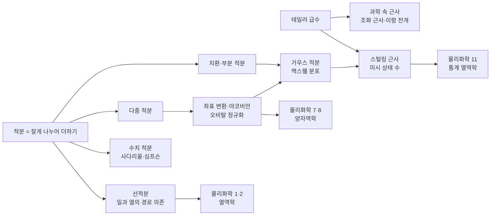

# 수학 도구 2. 적분과 급수 — 쌓아 올리고, 펼쳐 놓고, 어림하는 기술
<!-- prev: umath-1, uphy-3, uchem-10 -->
<!-- next: umath-3, pchem-1 -->

> [!NOTE]
> **이 단원의 범위**
> - 적분 기법 요약: 치환 적분, 부분 적분, 가우스 적분과 그 모멘트
> - 선적분과 경로 의존성(일과 열은 경로 함수, 완전 미분의 적분은 경로와 무관)
> - 다중 적분과 적분 순서 바꾸기
> - 좌표 변환: 극·원통·구면 좌표와 야코비안
> - 테일러 급수와 과학 속 근사($e^x$, $\ln(1+x)$, 이항 전개, 조화 근사)
> - 스털링 근사와 미시 상태 수 세기
> - 수치 적분: 사다리꼴 공식과 심프슨 공식, 오차의 크기

**학습 목표**

1. 치환 적분과 부분 적분으로 과학에 자주 나오는 적분(지수 감쇠의 평균, 고전 진동자의 확률 분포 등)을 계산할 수 있다.
2. 가우스 적분 $\int e^{-ax^2}dx = \sqrt{\pi/a}$를 유도하고, 그 모멘트로 맥스웰–볼츠만 속력 분포의 평균 속력과 제곱 평균 제곱근 속력을 구할 수 있다.
3. 선적분을 매개 변수로 계산하고, 일과 열이 경로에 따라 달라지는 까닭을 완전 미분·불완전 미분으로 설명할 수 있다.
4. 다중 적분을 반복 적분으로 계산하고, 극·원통·구면 좌표의 부피 요소(야코비안)를 써서 오비탈의 정규화·지름 분포·유량을 계산할 수 있다.
5. 테일러 급수로 함수를 다항식으로 근사하고, 근사가 성립하는 범위와 오차의 크기를 판단할 수 있다.
6. 스털링 근사를 유도하고, 이를 써서 혼합 엔트로피와 같은 미시 상태 수의 로그를 계산할 수 있다.
7. 사다리꼴 공식과 심프슨 공식으로 측정 자료를 적분하고, 두 방법의 오차가 간격 $h$에 따라 어떻게 줄어드는지 설명할 수 있다.

**이 단원의 학습 사다리**

| 단계 | 무엇을 하나? |
|---|---|
| STEP 1. 이전 학습 다시 보기 | 일반물리학의 일 적분, 일반화학의 엔트로피 적분, 수학 도구 1의 완전 미분 |
| STEP 2. 기초 다지기 | 적분은 '잘게 나누어 더하기', 기본 적분표, 완전 미분의 판별, 등비급수 |
| STEP 3. 핵심 개념 | 치환·부분 적분 → 가우스 적분 → 선적분 → 다중 적분 → 좌표 변환과 야코비안 → 테일러 급수 → 과학 속 근사 → 스털링 근사 → 수치 적분 |
| STEP 4. 오개념 바로잡기 | "구면 좌표의 부피 요소는 $dr\,d\theta\,d\phi$", "선적분은 끝점만 보면 된다" 같은 착각 |
| STEP 5. 더 깊은 수학 맛보기 | 라플라스 방법(안장점 근사), 고차원 적분과 몬테카를로 방법 |
| STEP 6. 이 도구가 쓰이는 전공 단원 | 물리화학(열역학·양자역학·통계 열역학), 분석화학, 수학 도구 3·7 |

---

## 🗺️ 단원 들어가기

기체 분자 하나하나의 속력은 제각각이다. 그런데 25 ℃의 질소 분자들의 **평균** 속력은 초속 약 475 m라고 딱 잘라 말할 수 있다. 이 숫자는 어디서 나올까? 분자 속력의 분포 곡선 아래를 '속력 × 확률'로 잘게 나누어 **더한** 결과, 즉 적분이다. 그런데 그 적분은 고등학교에서 배운 어떤 공식으로도 바로 풀리지 않는다. $e^{-x^2}$ 꼴의 함수에는 초등 함수로 쓸 수 있는 부정적분이 없기 때문이다. 그럼에도 $-\infty$에서 $\infty$까지의 적분값만은 $\sqrt{\pi}$로 정확히 알 수 있다. 1차원 적분을 일부러 2차원으로 부풀린 뒤 **좌표를 바꾸는** 기막힌 재주 덕분이다.

전공 과목에서 적분은 계산 문제가 아니라 **말하는 방식**이다. 수소 원자의 전자가 핵에서 $a_0$ 안쪽에 있을 확률(양자역학), 기체가 팽창하며 한 일이 경로마다 다른 까닭(열역학), $10^{23}$개 입자의 배치 수를 로그로 다루는 법(통계 열역학), 실험으로 얻은 열용량 표에서 엔트로피를 얻는 법(열량 측정)이 모두 적분과 급수의 언어로 쓰인다.

이 단원은 그 언어의 문법책이다. 수학 교재처럼 엄밀한 증명을 쌓지는 않는다. 대신 **무엇을 왜 더하는가**, **어떤 좌표에서 더하면 쉬운가**, **어디까지 어림해도 되는가**를 과학의 실제 장면에서 익힌다.

---

## STEP 1. 🔙 이전 학습 다시 보기

### 연계 개념표

| 이전 단원 | 그때 배운 것 | 이 단원에서 확장되는 것 |
|---|---|---|
| 수학 도구 1 「미분과 편미분」 | 편미분, 전미분, 완전 미분의 판별($\partial M/\partial y = \partial N/\partial x$), 상태 함수와 경로 함수 | 완전 미분을 **적분**하면 경로와 무관하고, 불완전 미분(일·열)을 적분하면 경로마다 값이 다르다는 것을 선적분으로 직접 확인 |
| 일반물리학 「일·에너지와 운동량」 | 변하는 힘의 일 $W = \int \vec F\cdot d\vec r$, 보존력과 퍼텐셜 에너지, 힘–변위 그래프의 넓이 | 매개 변수로 선적분 계산, 보존장 판별, 닫힌 경로의 적분 $\oint$ |
| 일반화학 「화학 열역학」 | $\Delta S = \int dq_\text{가역}/T$, $nR\ln(V_2/V_1)$, $C_p\ln(T_2/T_1)$, 볼츠만 식 $S = k_\mathrm{B}\ln W$, 경우의 수 | 열용량 **측정 자료**를 수치 적분해 엔트로피 구하기, 스털링 근사로 $\ln W$ 계산 |
| 일반물리학 「중력·진동·유체」 | 단진자의 작은 진동 근사 $\sin\theta \approx \theta$, 만유인력 | 근사를 테일러 급수로 체계화하고 다음 차수 보정과 오차를 계산 |
| 일반화학 「원자의 전자 구조와 주기성」 | 오비탈, 확률 밀도 $\lvert\psi\rvert^2$, 지름 분포의 정성적 모양 | 구면 좌표의 부피 요소로 정규화·평균 반지름·확률을 **계산** |

### 준비 운동 (사전 진단)

**Q1.** $\displaystyle\int_1^{e}\frac{dx}{x}$의 값을 구하시오.

**Q2.** $f(x) = xe^{-x}$를 미분하시오. 이 함수가 최댓값을 갖는 $x$는?

**Q3.** 무한 등비급수 $1 + \dfrac12 + \dfrac14 + \dfrac18 + \cdots$의 합을 구하시오.

정답 및 해설

**Q1.** $\ln e - \ln 1 = 1$.

**Q2.** 곱의 미분법으로 $f'(x) = e^{-x} - xe^{-x} = (1-x)e^{-x}$. $f'(x) = 0$인 $x = 1$에서 최대이다. 이 계산은 STEP 3 ⑤에서 1s 오비탈의 '가장 가능성이 큰 반지름'을 구할 때 그대로 쓰인다.

**Q3.** $\dfrac{1}{1 - 1/2} = 2$. 공비의 절댓값이 1보다 작을 때만 수렴한다.

---

## STEP 2. 🧱 기초 다지기

### 디딤돌 1. 적분은 '잘게 나누어 더하기'이다

구간 $[a, b]$를 폭 $\Delta x$인 $n$개의 조각으로 나누고, 각 조각에서 함숫값 × 폭을 더한 것을 **리만 합(Riemann sum)** 이라 한다. 조각을 한없이 가늘게 하면 리만 합은 하나의 값으로 다가가고, 그것이 정적분이다.

$$
\int_a^b f(x)\,dx = \lim_{n\to\infty}\sum_{i=1}^{n} f(x_i)\,\Delta x
$$

적분 기호 $\int$는 합 기호 S를 길게 늘인 것이고, $dx$는 '아주 작은 $\Delta x$'라는 뜻이다. 과학에서 적분이 나오는 자리는 언제나 **"작은 조각의 기여를 모두 더하라"** 는 장면이다.

| 과학의 장면 | 작은 조각 | 더한 결과 |
|---|---|---|
| 속도가 변하는 운동 | 짧은 시간 $dt$ 동안의 이동 $v\,dt$ | 변위 $\int v\,dt$ |
| 압력이 변하는 팽창 | 작은 부피 변화의 일 $-P\,dV$ | 일 $w = -\int P\,dV$ |
| 온도를 올리며 가열 | 작은 가역 열을 온도로 나눈 $C_p\,dT/T$ | 엔트로피 변화 $\Delta S$ |
| 확률 밀도 $p(x)$ | 작은 구간에 있을 확률 $p(x)\,dx$ | 구간 전체의 확률 |

**미적분의 기본 정리**는 이 '더하기'를 '미분의 역연산'으로 바꾸어 준다. $F'(x) = f(x)$이면 $\int_a^b f\,dx = F(b) - F(a)$이다. 수학 도구 1에서 익힌 미분을 거꾸로 따라가면 넓이가 나온다.

<!-- fig:umath-2-riemann-sums -->

#### 예제 — 리만 합이 참값으로 다가가는 모습

$\int_0^2 x^2\,dx$를 폭 0.5인 조각 4개로 나눈 왼쪽 끝 리만 합과 오른쪽 끝 리만 합으로 어림하고, 참값과 비교하시오.

**풀이**
왼쪽 끝: $0.5\times(0 + 0.25 + 1 + 2.25) = 1.75$. 오른쪽 끝: $0.5\times(0.25 + 1 + 2.25 + 4) = 3.75$.
참값: $\left[\dfrac{x^3}{3}\right]_0^2 = \dfrac{8}{3} \approx 2.667$. 증가 함수이므로 왼쪽 합은 작게, 오른쪽 합은 크게 어림한다. 두 값의 평균 $2.75$는 참값에 훨씬 가깝다. 이 '평균'이 바로 STEP 3 ⑨의 **사다리꼴 공식**이다.

### 디딤돌 2. 꼭 외워 둘 적분 다섯 줄

| 함수 | 부정적분 | 과학에서 만나는 곳 |
|---|---|---|
| $x^n$ ($n \ne -1$) | $\dfrac{x^{n+1}}{n+1}$ | 용수철의 일 $\int kx\,dx$, 데바이 $T^3$ 법칙 |
| $\dfrac1x$ | $\ln\lvert x\rvert$ | 등온 팽창의 일, 엔트로피 $\int C_p\,dT/T$ |
| $e^{ax}$ | $\dfrac{1}{a}e^{ax}$ | 1차 반응·방사성 붕괴, 등온 대기의 밀도 |
| $\sin ax$, $\cos ax$ | $-\dfrac1a\cos ax$, $\dfrac1a\sin ax$ | 진동, 파동, 상자 속 입자 |
| $\dfrac{1}{\sqrt{1-x^2}}$ | $\arcsin x$ | 고전 진동자의 확률 분포(STEP 3 ①) |

#### 예제 — 등온 가역 팽창의 일

이상 기체 1.00 mol이 298.15 K에서 10.0 L에서 20.0 L로 가역적으로 팽창할 때 기체가 **한** 일의 크기를 구하시오. ($R = 8.314\ \mathrm{J/(mol\cdot K)}$)

**풀이**
가역 과정이므로 매 순간 외부 압력 = 기체 압력 $P = nRT/V$. 기체가 한 일은
$$
\int_{V_1}^{V_2}P\,dV = nRT\int_{V_1}^{V_2}\frac{dV}{V} = nRT\ln\frac{V_2}{V_1} = 1.00\times8.314\times298.15\times\ln 2 = 1.72\times10^3\ \mathrm{J}
$$
$T$가 일정하므로 적분 밖으로 꺼낼 수 있었다는 점에 주목하자. $T$가 변하는 경로라면 $T$를 $V$의 함수로 바꾸어 넣어야 하며, 이것이 STEP 3 ③의 '경로 의존성'의 실마리이다.

### 디딤돌 3. 완전 미분인지 판별하기 — 수학 도구 1의 되짚기

수학 도구 1 '전미분과 완전 미분'에서 익힌 판별법을 다시 적는다. 두 변수의 미소량 $\delta z = M(x,y)\,dx + N(x,y)\,dy$가 어떤 함수 $f$의 전미분 $df$이면 **완전 미분(exact differential)** 이라 하며, 그 조건은

$$
\left(\frac{\partial M}{\partial y}\right)_x = \left(\frac{\partial N}{\partial x}\right)_y
$$

이다(교차 미분이 같다). 상태 함수($U$, $H$, $S$, $G$)의 변화는 완전 미분이고, 일 $\delta w$와 열 $\delta q$는 완전 미분이 아니다. 이 책에서는 불완전 미분을 $d$ 대신 $\delta$로 적는다.

#### 예제 — 두 미소량의 판별

(1) $2xy\,dx + x^2\,dy$ (2) $y\,dx - x\,dy$가 완전 미분인지 판별하고, 완전 미분이면 원래 함수를 찾으시오.

**풀이**
(1) $\partial(2xy)/\partial y = 2x$, $\partial(x^2)/\partial x = 2x$로 같다. 완전 미분이며 $f = x^2y$ (+상수).
(2) $\partial(y)/\partial y = 1$, $\partial(-x)/\partial x = -1$로 다르다. 완전 미분이 아니다. STEP 3 ③에서 (2)를 두 경로로 적분해 값이 실제로 달라지는 것을 확인한다.

### 디딤돌 4. 등비급수 — 가장 먼저 만나는 무한 급수

$\lvert r\rvert < 1$이면

$$
\sum_{n=0}^{\infty} r^n = 1 + r + r^2 + \cdots = \frac{1}{1-r}
$$

이다. 부분합 $S_N = (1 - r^{N+1})/(1-r)$에서 $r^{N+1}\to0$이 되기 때문이다. $\lvert r\rvert \ge 1$이면 발산한다. 이 '수렴하는 범위'라는 생각은 STEP 3 ⑥의 테일러 급수에서 **수렴 반지름**으로 다시 나온다.

#### 예제 — 진동 분배 함수

조화 진동자의 에너지 준위는 (영점 에너지를 기준으로) $0, h\nu, 2h\nu, \dots$이다. 통계 열역학에서는 각 준위의 볼츠만 인자를 모두 더한 **진동 분배 함수** $q = \sum_{n=0}^\infty e^{-nh\nu/k_\mathrm{B}T}$를 쓴다. $h\nu/k_\mathrm{B}T = 1.00$일 때 $q$를 구하시오.

**풀이**
$r = e^{-h\nu/k_\mathrm{B}T} = e^{-1} = 0.368$인 등비급수이므로
$$
q = \frac{1}{1 - e^{-1}} = 1.58
$$
**의미** 진동자의 약 $1/q = 63\ \%$가 바닥 준위에 있다. 무한히 많은 준위를 더하는 계산이 한 줄로 끝난다. 물리화학 11 「통계 열역학」에서 이 식을 그대로 쓴다.

---

## STEP 3. 📘 핵심 개념

### ① 치환 적분과 부분 적분 — 적분을 아는 꼴로 바꾸기

적분 계산의 거의 모든 기술은 "모르는 적분을 아는 적분(디딤돌 2의 표)으로 바꾸는 것"이다. 그 두 기둥이 치환 적분과 부분 적분이다.

#### 치환 적분 — 연쇄 법칙을 거꾸로

수학 도구 1 '연쇄 법칙'에서 $\dfrac{d}{dx}F(g(x)) = F'(g(x))\,g'(x)$였다. 이것을 적분 쪽에서 읽으면 **치환 적분(integration by substitution)** 이 된다.

$$
\int_a^b f\big(g(x)\big)\,g'(x)\,dx = \int_{g(a)}^{g(b)} f(u)\,du \qquad (u = g(x),\ du = g'(x)\,dx)
$$

정적분에서는 **적분 한계도 함께 바꾼다**는 것을 잊지 않는다. 대표적인 예가 가우스 함수의 홀수 모멘트이다. $u = ax^2$로 두면 $du = 2ax\,dx$이므로

$$
\int_0^\infty x\,e^{-ax^2}\,dx = \frac{1}{2a}\int_0^\infty e^{-u}\,du = \frac{1}{2a}
$$

| 적분 속에 보이는 꼴 | 치환 | 바뀐 꼴 |
|---|---|---|
| $x\,e^{-ax^2}$, $x/(1+x^2)$ | $u = x^2$ | $e^{-au}$, $1/(1+u)$ |
| $\sqrt{A^2 - x^2}$, $1/\sqrt{A^2-x^2}$ | $x = A\sin\theta$ | $A\cos\theta$, 상수 |
| $e^{-E/RT}/T^2$을 $T$로 적분 | $u = 1/T$ ($du = -dT/T^2$) | $-e^{-Eu/R}$ |
| $f(ax+b)$ | $u = ax+b$ | $f(u)/a$ |

#### 예제 1 — 고전적인 진동자는 어디에서 오래 머무는가

용수철에 매달린 입자가 $x(t) = A\sin\omega t$로 진동한다. 무작위한 순간에 입자의 위치를 찍었을 때 $x$와 $x + dx$ 사이에 있을 확률 $p(x)\,dx$를 구하고, (1) $p(x)$가 정규화되어 있음을 보이고, (2) 입자가 중심 쪽 절반($\lvert x\rvert < A/2$)에서 발견될 확률을 구하시오.

**풀이**
① **식 세우기**: 한 번 $-A$에서 $A$로 가는 데 반주기 $\pi/\omega$가 걸린다. 그 사이 $dx$를 지나는 시간은 $dt = dx/\lvert v\rvert$이고, $v = A\omega\cos\omega t = \omega\sqrt{A^2 - x^2}$이다. 머무는 시간의 비율이 확률이므로
$$
p(x)\,dx = \frac{dt}{\pi/\omega} = \frac{dx}{\pi\sqrt{A^2 - x^2}}
$$
② **정규화**: $x = A\sin\theta$로 치환하면 $dx = A\cos\theta\,d\theta$, $\sqrt{A^2-x^2} = A\cos\theta$이고 한계는 $\theta = -\pi/2 \to \pi/2$이다.
$$
\int_{-A}^{A}\frac{dx}{\pi\sqrt{A^2-x^2}} = \frac{1}{\pi}\int_{-\pi/2}^{\pi/2}d\theta = 1
$$
③ **중심 쪽 확률**: 한계가 $\theta = \pm\arcsin(1/2) = \pm\pi/6$이 되므로 $\dfrac{1}{\pi}\cdot\dfrac{\pi}{3} = \dfrac13$.

**의미** 고전 진동자는 시간의 $2/3$를 바깥쪽 절반에서 보낸다. 되돌이점($x = \pm A$)에서 느려지기 때문이다. $p(x)$는 되돌이점에서 무한대로 커지지만 적분은 유한하다. 물리화학 8에서 양자 조화 진동자의 바닥 상태는 정반대로 **중심**에서 확률이 가장 크다는 것을 보게 되며, 이 대비가 양자와 고전의 차이를 보여 주는 대표적 장면이다.

<!-- fig:umath-2-classical-oscillator -->

#### 부분 적분 — 곱의 미분을 거꾸로

곱의 미분 $(uv)' = u'v + uv'$를 적분하면 **부분 적분(integration by parts)** 을 얻는다.

$$
\int_a^b u\,\frac{dv}{dx}\,dx = \big[uv\big]_a^b - \int_a^b v\,\frac{du}{dx}\,dx
$$

$u$로는 미분하면 **간단해지는** 것(다항식 $x^n$, $\ln x$)을, $dv$로는 적분해도 **복잡해지지 않는** 것($e^{-x}$, $\sin x$)을 고른다. 이 공식을 반복하면 과학에서 가장 많이 쓰는 적분 하나가 나온다.

$$
\int_0^\infty x^n e^{-x}\,dx = \big[-x^ne^{-x}\big]_0^\infty + n\int_0^\infty x^{n-1}e^{-x}\,dx = n\int_0^\infty x^{n-1}e^{-x}\,dx = \cdots = n!
$$

(경계항은 $x = 0$에서도 $x\to\infty$에서도 0이다. 지수 함수의 감소가 어떤 거듭제곱의 증가보다 빠르다.) 이 적분을 $n$이 정수가 아닐 때까지 넓힌 것이 **감마 함수(gamma function)** $\Gamma(n+1) = \int_0^\infty x^ne^{-x}dx$이며, ⑧의 스털링 근사의 출발점이다.

#### 예제 2 — 방사성 핵의 평균 수명

1차 붕괴를 하는 핵이 시각 $t$와 $t + dt$ 사이에 붕괴할 확률은 $p(t)\,dt = k\,e^{-kt}\,dt$이다. (1) 평균 수명 $\tau = \langle t\rangle$를 구하시오. (2) 탄소-14의 반감기 5730년으로 $\tau$를 구하시오.

**풀이**
(1) $\langle t\rangle = \int_0^\infty t\,k e^{-kt}\,dt$. $x = kt$로 치환하면 $\dfrac1k\int_0^\infty xe^{-x}\,dx = \dfrac{1!}{k} = \dfrac{1}{k}$.
(부분 적분을 직접 쓰면 $u = t$, $dv = ke^{-kt}dt$, $v = -e^{-kt}$로 $[-te^{-kt}]_0^\infty + \int_0^\infty e^{-kt}dt = 0 + 1/k$.)
(2) $k = \ln 2/t_{1/2}$이므로 $\tau = t_{1/2}/\ln 2 = 5730/0.6931 = 8.27\times10^3$년.

**의미** 평균 수명은 반감기의 약 1.44배이다. 붕괴가 늦게 일어나는 소수의 핵이 평균을 끌어올리기 때문이다. 같은 방법으로 $\langle t^2\rangle = 2/k^2$이고, 붕괴 시각의 표준 편차도 $1/k$이다.

> [!TIP]
> 💡 **요령** — $\int_0^\infty t^n e^{-kt}\,dt = n!/k^{n+1}$을 외워 두자. 1차 반응의 평균 수명, 형광 수명, 등온 대기의 평균 높이($\langle z\rangle = H$, 척도 높이)가 모두 이 한 줄이다.

#### ✔ 바로 확인

1. $\displaystyle\int_0^1 2x\,e^{x^2}\,dx$를 치환 적분으로 구하시오.
2. $\displaystyle\int_0^\infty x^3e^{-x}\,dx$의 값은?
3. (O/X) 정적분에서 치환을 하면 적분 한계도 새 변수의 값으로 바꾸어야 한다.
4. 형광 수명이 4.0 ns인 염료에서 들뜬 분자가 붕괴하는 속도 상수 $k$는?

정답

1. $e - 1 \approx 1.72$ — $u = x^2$, $du = 2x\,dx$, 한계 $0\to1$이므로 $\int_0^1 e^u\,du$.
2. $3! = 6$
3. O — 한계를 바꾸지 않으려면 부정적분을 구한 뒤 원래 변수로 되돌려 넣어야 한다.
4. $k = 1/\tau = 2.5\times10^8\ \mathrm{s^{-1}}$

### ② 가우스 적분 — 부정적분이 없는데 값은 아는 적분

$e^{-ax^2}$는 정규 분포, 맥스웰–볼츠만 분포, 조화 진동자의 바닥 상태, 확산의 농도 분포, 분광 선의 도플러 넓어짐에 모두 나온다. 그런데 이 함수의 부정적분은 초등 함수(다항식·지수·로그·삼각 함수의 유한한 조합)로 쓸 수 없다. 그럼에도 **전 구간의 적분**은 정확히 계산된다.

#### 유도 — 1차원을 2차원으로 부풀려 극좌표로

$I = \int_{-\infty}^{\infty}e^{-ax^2}dx$ ($a > 0$)라 하자. 적분 변수의 이름은 상관없으므로 $I$를 두 번 곱해 2차원 적분으로 만든다.

$$
I^2 = \int_{-\infty}^{\infty}e^{-ax^2}dx\int_{-\infty}^{\infty}e^{-ay^2}dy = \iint_{\text{평면 전체}} e^{-a(x^2+y^2)}\,dx\,dy
$$

피적분 함수가 원점에서의 거리 $r = \sqrt{x^2+y^2}$에만 의존한다. 그래서 평면을 두께 $dr$인 고리로 잘라 더하면 편하다. 반지름 $r$인 고리의 넓이는 둘레 × 두께 $= 2\pi r\,dr$이다(⑤에서 이것을 넓이 요소 $dA = r\,dr\,d\theta$로 정식화한다).

$$
I^2 = \int_0^{\infty}e^{-ar^2}\,2\pi r\,dr = 2\pi\cdot\frac{1}{2a} = \frac{\pi}{a}
\qquad\Longrightarrow\qquad
\boxed{\int_{-\infty}^{\infty}e^{-ax^2}dx = \sqrt{\frac{\pi}{a}}}
$$

두 번째 등호에서 ①의 치환 적분 $\int_0^\infty re^{-ar^2}dr = 1/(2a)$를 썼다. 1차원에서 막혔던 적분이 2차원에서는 $r\,dr$이라는 '덤'이 붙어 치환 적분으로 풀린 것이다.

<!-- fig:umath-2-gaussian-rings -->

#### 모멘트 — $a$로 미분하는 재주

$x^{2n}e^{-ax^2}$의 적분은 위 결과를 $a$로 미분하면 얻는다. 적분 기호 안의 $a$로 미분해도 되는(피적분 함수가 충분히 매끄럽고 빨리 감소하는) 경우이다.

$$
\int_{-\infty}^{\infty}x^2e^{-ax^2}dx = -\frac{d}{da}\int_{-\infty}^{\infty}e^{-ax^2}dx = -\frac{d}{da}\sqrt{\pi}\,a^{-1/2} = \frac{\sqrt\pi}{2}a^{-3/2}
$$

홀수 거듭제곱은 ①처럼 $u = x^2$ 치환으로 얻는다. 과학에서는 $0$부터 $\infty$까지(속력·반지름처럼 음수가 없는 양)의 적분이 많으므로 반 구간 값으로 정리해 둔다.

| $n$ | $\displaystyle\int_0^\infty x^n e^{-ax^2}dx$ | 쓰이는 곳 |
|---|---|---|
| 0 | $\dfrac12\sqrt{\dfrac{\pi}{a}}$ | 정규 분포의 정규화 |
| 1 | $\dfrac{1}{2a}$ | 2차원 기체의 속력 분포 |
| 2 | $\dfrac{1}{4}\sqrt{\dfrac{\pi}{a^3}}$ | 맥스웰 분포의 정규화 |
| 3 | $\dfrac{1}{2a^2}$ | 맥스웰 분포의 평균 속력 |
| 4 | $\dfrac{3}{8}\sqrt{\dfrac{\pi}{a^5}}$ | 맥스웰 분포의 $\langle v^2\rangle$ |

> [!IMPORTANT]
> **대칭으로 공짜 계산하기** — $-\infty$에서 $\infty$까지의 적분에서 피적분 함수가 홀함수($f(-x) = -f(x)$)이면 적분은 0이다. 그래서 $\int x\,e^{-ax^2}dx = 0$(전 구간), 짝수 거듭제곱의 전 구간 값은 위 표의 2배이다. 양자역학에서 "이 적분은 대칭 때문에 0"이라는 판단(선택 규칙)이 바로 이것이다.

#### 오차 함수 — 유한 구간의 가우스 적분

유한 구간의 적분은 **오차 함수(error function)** 라는 새 함수로 이름을 붙여 쓴다.

$$
\operatorname{erf}(z) = \frac{2}{\sqrt\pi}\int_0^z e^{-t^2}dt, \qquad \operatorname{erf}(\infty) = 1
$$

값은 표나 계산기로 얻는다. 평균 $\mu$, 표준 편차 $\sigma$인 정규 분포에서 $\lvert x - \mu\rvert < m\sigma$일 확률은 $\operatorname{erf}(m/\sqrt2)$로, $m = 1, 2, 3$이면 각각 약 68.3 %, 95.4 %, 99.7 %이다. 분석화학의 신뢰 구간(수학 도구 7, 분석화학 1)이 이 숫자에서 나온다.

#### 예제 3 — 맥스웰–볼츠만 속력 분포

온도 $T$에서 질량 $m$인 기체 분자의 속력 분포는

$$
f(v) = 4\pi\left(\frac{m}{2\pi k_\mathrm{B}T}\right)^{3/2}v^2\,e^{-mv^2/2k_\mathrm{B}T}
$$

이다. $a = m/2k_\mathrm{B}T$로 두고 (1) $f(v)$가 정규화되어 있음을 보이고, (2) 평균 속력 $\langle v\rangle$와 제곱 평균 제곱근 속력 $v_\text{rms} = \sqrt{\langle v^2\rangle}$을 유도하시오. (3) 298.15 K의 질소($M = 28.014\ \mathrm{g/mol}$)에 대해 두 값을 구하시오.

**풀이**
앞의 계수는 $4\pi(a/\pi)^{3/2}$이다.
(1) 표의 $n = 2$를 쓰면 $4\pi\left(\dfrac{a}{\pi}\right)^{3/2}\cdot\dfrac14\sqrt{\dfrac{\pi}{a^3}} = \dfrac{\pi\,a^{3/2}\,\pi^{1/2}}{\pi^{3/2}\,a^{3/2}} = 1$.
(2) $n = 3$: $\langle v\rangle = 4\pi\left(\dfrac{a}{\pi}\right)^{3/2}\cdot\dfrac{1}{2a^2} = \dfrac{2}{\sqrt{\pi a}} = \sqrt{\dfrac{8k_\mathrm{B}T}{\pi m}}$.
$n = 4$: $\langle v^2\rangle = 4\pi\left(\dfrac{a}{\pi}\right)^{3/2}\cdot\dfrac38\sqrt{\dfrac{\pi}{a^5}} = \dfrac{3}{2a} = \dfrac{3k_\mathrm{B}T}{m}$, 따라서 $v_\text{rms} = \sqrt{3k_\mathrm{B}T/m}$.
(3) 몰 단위로 바꾸면 $k_\mathrm{B}/m = R/M$이다. $M = 0.028014\ \mathrm{kg/mol}$을 넣으면
$\langle v\rangle = \sqrt{\dfrac{8\times8.314\times298.15}{\pi\times0.028014}} = 475\ \mathrm{m/s}$, $v_\text{rms} = \sqrt{\dfrac{3\times8.314\times298.15}{0.028014}} = 515\ \mathrm{m/s}$.

**의미** (2)의 $\langle v^2\rangle = 3k_\mathrm{B}T/m$은 평균 병진 운동 에너지 $\frac12m\langle v^2\rangle = \frac32k_\mathrm{B}T$, 즉 **등분배 정리**이다. 적분표 두 줄로 일반화학 「기체」의 결과를 유도한 셈이다. 평균 속력이 rms 속력보다 작은 까닭은 빠른 분자들이 제곱 평균에 더 큰 무게로 들어가기 때문이다.

<!-- fig:umath-2-maxwell-n2 -->

#### 예제 4 — 크로마토그래피 피크의 넓이

기체 크로마토그램의 한 피크가 정규 분포 꼴 $y(t) = h\,e^{-(t-t_\mathrm{R})^2/2\sigma^2}$로 잘 맞는다. 피크 높이 $h = 0.85$ (검출기 신호 단위), $\sigma = 4.0\ \mathrm{s}$일 때 피크 넓이를 구하시오. 또 반치폭(높이가 절반이 되는 두 점 사이의 폭)을 $\sigma$로 나타내시오.

**풀이**
$u = t - t_\mathrm{R}$로 치환하고 $a = 1/2\sigma^2$인 가우스 적분을 쓴다. 피크 꼬리는 금세 0이 되므로 적분 한계를 $\pm\infty$로 넓혀도 된다.
$$
A = h\sqrt{\frac{\pi}{a}} = h\,\sigma\sqrt{2\pi} = 0.85\times4.0\times2.507 = 8.5\ (\text{신호}\cdot\mathrm{s})
$$
반치폭: $e^{-u^2/2\sigma^2} = 1/2$에서 $u = \pm\sigma\sqrt{2\ln 2}$, 따라서 $w_{1/2} = 2\sqrt{2\ln2}\,\sigma \approx 2.355\,\sigma$.

**의미** 분석화학에서 정량은 피크 **넓이**로 한다. 높이와 반치폭만 읽어도 넓이 $\approx 1.064\,h\,w_{1/2}$로 어림할 수 있는 것이 이 가우스 적분 덕분이다.

#### ✔ 바로 확인

1. $\displaystyle\int_{-\infty}^{\infty}e^{-x^2/2}\,dx$의 값은?
2. (O/X) $\displaystyle\int_{-\infty}^{\infty}x^3e^{-2x^2}\,dx = 0$이다.
3. 맥스웰 분포에서 $T$를 4배로 올리면 평균 속력은 몇 배가 되는가?
4. 빈칸: 정규 분포에서 평균으로부터 $\pm2\sigma$ 안에 들어갈 확률은 약 (    ) %이다.

정답

1. $\sqrt{2\pi} \approx 2.51$ — $a = 1/2$.
2. O — 피적분 함수가 홀함수이다.
3. 2배 — $\langle v\rangle \propto \sqrt{T}$.
4. 95.4 — $\operatorname{erf}(2/\sqrt2) \approx 0.954$.

### ③ 선적분과 경로 의존성 — 일과 열은 왜 경로 함수인가

일반물리학에서 일을 $W = \int\vec F\cdot d\vec r$로 썼다. 이 적분은 $x$축 위의 구간이 아니라 공간의 **곡선** $C$를 따라 더한다. 이런 적분을 **선적분(line integral)** 이라 한다.

#### 정의와 계산법 — 곡선을 매개 변수로 펴기

2차원에서 미소량 $\delta z = M\,dx + N\,dy$(또는 힘 $\vec F = (M, N)$)를 곡선 $C$를 따라 적분하려면, 곡선을 매개 변수 $t$로 나타낸다: $x = x(t)$, $y = y(t)$, $t_1 \le t \le t_2$. 그러면 $dx = x'(t)\,dt$, $dy = y'(t)\,dt$이고

$$
\int_C (M\,dx + N\,dy) = \int_{t_1}^{t_2}\Big[M\big(x(t),y(t)\big)\,x'(t) + N\big(x(t),y(t)\big)\,y'(t)\Big]dt
$$

으로 평범한 1변수 적분이 된다. **같은 끝점이라도 곡선이 다르면 피적분 함수가 달라진다.** 그래서 일반적으로 선적분의 값은 경로에 의존한다.

#### 경로와 무관한 경우 — 완전 미분의 선적분

$\delta z$가 어떤 함수 $f$의 전미분 $df$라면, 경로를 따라 $\dfrac{df}{dt} = f_x x' + f_y y'$이므로

$$
\int_C df = \int_{t_1}^{t_2}\frac{df}{dt}\,dt = f(B) - f(A)
$$

끝점의 값만으로 정해진다. 다음 네 진술은 (구멍이 없는 단일 연결 영역에서) 모두 같은 말이다.

| 진술 | 물리적 말 | 화학(열역학)의 말 |
|---|---|---|
| $\delta z = df$ (완전 미분) | 힘이 퍼텐셜의 기울기: $\vec F = -\nabla U$ | 상태 함수의 변화 |
| $\partial M/\partial y = \partial N/\partial x$ | 보존력의 판별 조건 | 교차 미분이 같다(맥스웰 관계의 뿌리) |
| $\int_C$가 경로와 무관 | 일이 처음·나중 위치로만 정해짐 | $\Delta U$, $\Delta S$는 경로와 무관 |
| 모든 닫힌 경로에서 $\oint_C \delta z = 0$ | 한 바퀴 돌아오면 일이 0 | 순환 과정에서 $\oint dU = 0$, $\oint dS = 0$ |

#### 예제 5 — 두 힘의 장에서 같은 끝점, 다른 경로

평면의 힘 (가) $\vec F_1 = (y,\ x)$, (나) $\vec F_2 = (-y,\ x)$ (단위 N, 좌표 단위 m)에 대하여, 점 $A(1, 0)$에서 $B(0, 1)$까지 ㉠ 원점을 중심으로 하는 사분원 호, ㉡ 선분을 따라 한 일을 각각 구하시오.

**풀이**
㉠ 호: $x = \cos\theta$, $y = \sin\theta$, $0 \le \theta \le \pi/2$, $dx = -\sin\theta\,d\theta$, $dy = \cos\theta\,d\theta$.
㉡ 선분: $x = 1 - t$, $y = t$, $0 \le t \le 1$, $dx = -dt$, $dy = dt$.

| | ㉠ 사분원 호 | ㉡ 선분 |
|---|---|---|
| (가) $\vec F_1 = (y, x)$ | $\int_0^{\pi/2}(-\sin^2\theta + \cos^2\theta)\,d\theta = \int_0^{\pi/2}\cos2\theta\,d\theta = 0$ | $\int_0^1[-t + (1-t)]\,dt = 0$ |
| (나) $\vec F_2 = (-y, x)$ | $\int_0^{\pi/2}(\sin^2\theta + \cos^2\theta)\,d\theta = \dfrac{\pi}{2}$ | $\int_0^1[t + (1-t)]\,dt = 1$ |

(가)는 두 경로의 일이 같고(0 J), (나)는 다르다($\pi/2 \approx 1.57$ J와 1 J). 판별 조건으로 확인하면 (가)는 $\partial y/\partial y = 1 = \partial x/\partial x$로 완전 미분($f = xy$이고 $f(B) - f(A) = 0$), (나)는 $\partial(-y)/\partial y = -1 \ne \partial x/\partial x = 1$이다. (나)는 디딤돌 3의 $y\,dx - x\,dy$에 $-1$을 곱한 것이다.

**의미** (나)처럼 원점 둘레를 도는 장에서는 한 바퀴 돌면 일이 $2\pi$ J로 0이 아니다. 이런 힘은 퍼텐셜 에너지를 정의할 수 없다(비보존력). 수학 도구 3에서 이 '도는 정도'를 **회전(curl)** 으로, 닫힌 경로의 선적분과 회전의 관계를 **스토크스 정리**로 배운다.

<!-- fig:umath-2-vector-fields -->

#### 열역학의 선적분 — $P$–$V$ 도표 위의 경로

이상 기체의 상태는 $(V, T)$ 또는 $(P, V)$ 평면의 한 점이고, 과정은 그 평면의 곡선이다. 계가 **받는** 일(화학의 부호 규약)은 $\delta w = -P\,dV$이다. 이것을 $(V, T)$를 변수로 쓰면 $\delta w = -\dfrac{nRT}{V}dV + 0\cdot dT$이고

$$
\frac{\partial}{\partial T}\left(-\frac{nRT}{V}\right) = -\frac{nR}{V} \ne \frac{\partial}{\partial V}(0) = 0
$$

이므로 **불완전 미분**이다. 일은 경로 함수이다. 가역 열 $\delta q_\text{가역} = C_V\,dT + \dfrac{nRT}{V}dV$도 마찬가지로 $\partial C_V/\partial V = 0 \ne \partial(nRT/V)/\partial T = nR/V$여서 불완전 미분이다. 그런데 이것을 $T$로 나누면

$$
\frac{\delta q_\text{가역}}{T} = \frac{C_V}{T}dT + \frac{nR}{V}dV, \qquad \frac{\partial}{\partial V}\left(\frac{C_V}{T}\right) = 0 = \frac{\partial}{\partial T}\left(\frac{nR}{V}\right)
$$

완전 미분이 된다. 이 완전 미분이 엔트로피 $dS$이고, $1/T$을 **적분 인자(integrating factor)** 라 한다. 일반화학 「화학 열역학」에서 "열 $q$는 경로 함수지만 $1/T$를 곱하면 상태 함수가 된다"고 한 말의 수학적 내용이다.

#### 예제 6 — 같은 두 상태, 세 가지 경로

이상 기체 1.00 mol이 상태 A($P = 4.00$ bar, $V = 6.00$ L)에서 상태 B($P = 1.00$ bar, $V = 24.0$ L)로 간다. 다음 세 가역 경로 각각에 대해 계가 받은 일 $w$, 받은 열 $q$, 엔트로피 변화 $\Delta S$를 구하시오. ($R = 0.08314\ \mathrm{L\cdot bar/(mol\cdot K)} = 8.314\ \mathrm{J/(mol\cdot K)}$, $1\ \mathrm{L\cdot bar} = 100\ \mathrm{J}$)
(가) 등온 팽창 (나) 6.00 L에서 1.00 bar까지 등적 냉각한 뒤 1.00 bar에서 24.0 L까지 등압 팽창 (다) 4.00 bar에서 24.0 L까지 등압 팽창한 뒤 1.00 bar까지 등적 냉각

**풀이**
$P_AV_A = P_BV_B = 24.0\ \mathrm{L\cdot bar}$이므로 A와 B의 온도는 같다: $T = 24.0/0.08314 = 288.7\ \mathrm{K}$. 이상 기체이므로 $\Delta U = 0$이고 $q = -w$이다.

(가) $w = -\int P\,dV = -nRT\ln\dfrac{V_B}{V_A} = -24.0\ln4 = -33.3\ \mathrm{L\cdot bar} = -3.33\ \mathrm{kJ}$
(나) 등적 단계는 $dV = 0$이라 일이 없다. 등압 단계: $w = -1.00\times(24.0 - 6.00) = -18.0\ \mathrm{L\cdot bar} = -1.80\ \mathrm{kJ}$
(다) 등압 단계: $w = -4.00\times18.0 = -72.0\ \mathrm{L\cdot bar} = -7.20\ \mathrm{kJ}$

| 경로 | $w$ (kJ) | $q$ (kJ) | $\Delta U$ | $\Delta S$ (J/K) |
|---|---|---|---|---|
| (가) 등온 | $-3.33$ | $+3.33$ | 0 | $+11.5$ |
| (나) 등적 → 등압 | $-1.80$ | $+1.80$ | 0 | $+11.5$ |
| (다) 등압 → 등적 | $-7.20$ | $+7.20$ | 0 | $+11.5$ |

$\Delta S$ 확인: (가)는 $nR\ln4 = 8.314\times1.386 = 11.5\ \mathrm{J/K}$. (나)는 등적 냉각($288.7 \to 72.2$ K) $C_V\ln\frac14$와 등압 가열($72.2 \to 288.7$ K) $C_p\ln4$의 합 $(C_p - C_V)\ln4 = R\ln4$로 같은 값이다. (다)도 같은 계산이 된다(바로 확인 4).

**의미** $w$와 $q$는 $P$–$V$ 도표의 경로 아래 넓이이므로 경로마다 다르고, $\Delta U$와 $\Delta S$는 끝점만 본다. A → (다) → B → (가)의 역 → A처럼 한 바퀴 돌면 계가 받은 알짜 일은 $-7.20 + 3.33 = -3.87\ \mathrm{kJ}$로 0이 아니다. 이 '닫힌 경로의 일 ≠ 0'이 열기관이 일을 하는 원리이다(물리화학 2의 카르노 순환).

<!-- fig:umath-2-pv-three-paths -->

> [!WARNING]
> **주의** — 선적분의 방향을 뒤집으면 부호가 바뀐다: $\int_{B\to A} = -\int_{A\to B}$. 또 "완전 미분 ⇒ 경로 무관"은 영역에 구멍이 없을 때의 이야기이다. 원점을 뺀 평면의 $\delta z = (-y\,dx + x\,dy)/(x^2+y^2)$는 판별 조건을 만족하지만 원점을 한 바퀴 도는 적분은 $2\pi$이다. 전공 열역학에서 다루는 상태 공간에서는 이런 구멍이 문제가 되지 않는다.

#### ✔ 바로 확인

1. (O/X) 이상 기체가 같은 처음·나중 상태 사이를 서로 다른 가역 경로로 갈 때 $q$는 같고 $w$만 다르다.
2. $\delta z = 3x^2y\,dx + x^3\,dy$는 완전 미분인가? 그렇다면 $(0,0)$에서 $(1,2)$까지의 적분값은?
3. 빈칸: 불완전 미분 $\delta q_\text{가역}$에 곱해 완전 미분 $dS$로 만드는 $1/T$를 (    )라 한다.
4. 예제 6의 경로 (다)에서 $\Delta S$를 두 단계로 나누어 구하고, 11.5 J/K가 되는지 확인하시오.

정답

1. X — $\Delta U$가 같으므로 $q = \Delta U - w$도 경로마다 다르다.
2. 완전 미분($\partial(3x^2y)/\partial y = 3x^2 = \partial(x^3)/\partial x$), $f = x^3y$이므로 $f(1,2) - f(0,0) = 2$.
3. 적분 인자
4. 등압 가열($288.7 \to 1154.7$ K, 온도 4배): $C_p\ln4$. 등적 냉각($1154.7 \to 288.7$ K): $C_V\ln\frac14$. 합 $(C_p - C_V)\ln 4 = R\ln4 = 11.5\ \mathrm{J/K}$.

### ④ 다중 적분 — 넓이와 부피 위에서 더하기

확률 밀도가 평면이나 공간에 퍼져 있으면(2차원 상자 속 입자, 원자 속 전자, 지구 내부의 밀도) 작은 넓이 $dA$나 부피 $dV$마다의 기여를 더해야 한다. 이것이 **다중 적분(multiple integral)** 이다.

#### 반복 적분으로 계산한다

직사각형 영역 $a \le x \le b$, $c \le y \le d$에서 이중 적분은 한 변수씩 차례로 적분하는 **반복 적분(iterated integral)** 으로 계산한다. 안쪽 적분을 할 때 바깥 변수는 상수로 둔다(편미분에서 다른 변수를 고정한 것과 같은 생각이다).

$$
\iint_R f(x,y)\,dA = \int_a^b\left[\int_c^d f(x,y)\,dy\right]dx = \int_c^d\left[\int_a^b f(x,y)\,dx\right]dy
$$

연속 함수라면 순서를 바꾸어도 값이 같다(**푸비니 정리**). 특히 피적분 함수가 $f(x)g(y)$처럼 **변수별로 갈라지면** 이중 적분이 1차원 적분 두 개의 곱이 된다.

$$
\iint_R f(x)\,g(y)\,dA = \left(\int_a^b f(x)\,dx\right)\left(\int_c^d g(y)\,dy\right)
$$

②의 가우스 적분 유도에서 $I \times I$를 이중 적분으로 바꾼 것이 이 성질을 거꾸로 쓴 것이었다. 양자역학의 2·3차원 상자 속 입자에서 파동 함수가 $\psi(x)\psi(y)$로 갈라지는 것도 같은 구조이다(물리화학 7).

#### 직사각형이 아닌 영역 — 안쪽 한계가 바깥 변수의 함수

영역이 $0 \le y \le x \le 1$(삼각형)처럼 생기면, 안쪽 적분의 한계가 바깥 변수에 의존한다. 순서를 바꿀 때는 **영역 그림을 그려서** 한계를 다시 읽는다.

$$
\int_0^1\int_0^x f\,dy\,dx = \int_0^1\int_y^1 f\,dx\,dy
$$

왼쪽은 "$x$를 먼저 고정하고 세로 띠($0 \le y \le x$)를 더한 뒤 띠를 옆으로 쓸기", 오른쪽은 "$y$를 고정하고 가로 띠($y \le x \le 1$)를 더한 뒤 위로 쓸기"이다. 한쪽 순서로는 안 풀리던 적분이 다른 순서로는 풀리기도 한다(실력 다지기 15번).

<!-- fig:umath-2-triangle-order -->

#### 예제 7 — 2차원 상자 속 입자의 확률

변의 길이가 $a$, $b$인 2차원 상자에서 바닥 상태 입자의 파동 함수는 $\psi = \dfrac{2}{\sqrt{ab}}\sin\dfrac{\pi x}{a}\sin\dfrac{\pi y}{b}$이다. (1) $\iint\lvert\psi\rvert^2dA = 1$임을 보이시오. (2) 입자가 $0 \le x \le a/4$인 띠(세로 방향은 전체)에서 발견될 확률을 구하시오.

**풀이**
(1) 변수별로 갈라지므로 $\dfrac{4}{ab}\left(\int_0^a\sin^2\dfrac{\pi x}{a}dx\right)\left(\int_0^b\sin^2\dfrac{\pi y}{b}dy\right) = \dfrac{4}{ab}\cdot\dfrac{a}{2}\cdot\dfrac{b}{2} = 1$. ($\sin^2u = (1 - \cos2u)/2$를 쓰면 한 주기 반의 적분이 길이의 절반이다.)
(2) $y$ 적분은 (1)과 같이 $b/2$이므로 확률은 $\dfrac{2}{a}\int_0^{a/4}\sin^2\dfrac{\pi x}{a}dx$. $u = x/a$로 치환하면
$$
2\int_0^{1/4}\sin^2\pi u\,du = \int_0^{1/4}(1 - \cos2\pi u)\,du = \frac14 - \frac{1}{2\pi}\sin\frac{\pi}{2} = \frac14 - \frac{1}{2\pi} = 0.0908
$$
**의미** 띠가 상자 넓이의 25 %를 차지하지만 확률은 약 9 %이다. 바닥 상태의 입자는 벽 근처를 피하고 가운데에 몰린다. 고전 입자(어디서나 같은 확률)라면 0.25였을 것이다.

#### 예제 8 — 두 경쟁 반응의 갈림 비율

분자 A가 두 1차 경로로 동시에 반응한다: A → B(속도 상수 $k_1$), A → C($k_2$). 각 경로를 독립된 '시계'로 보고, 경로 1이 먼저 일어날 시각 $t_1$과 경로 2의 시각 $t_2$가 각각 확률 밀도 $k_1e^{-k_1t_1}$, $k_2e^{-k_2t_2}$를 따른다고 하자. 분자가 B가 될 확률 $P(t_1 < t_2)$를 이중 적분으로 구하시오. $k_1 = 3.0\times10^{-3}\ \mathrm{s^{-1}}$, $k_2 = 1.0\times10^{-3}\ \mathrm{s^{-1}}$이면?

**풀이**
두 시계가 독립이므로 결합 확률 밀도는 곱 $k_1k_2e^{-k_1t_1 - k_2t_2}$이다. 영역은 $0 \le t_1 < t_2 < \infty$. 바깥을 $t_1$, 안쪽을 $t_2$로 두면($t_2$: $t_1 \to \infty$)
$$
P = \int_0^\infty k_1e^{-k_1t_1}\left[\int_{t_1}^\infty k_2e^{-k_2t_2}dt_2\right]dt_1 = \int_0^\infty k_1e^{-k_1t_1}\,e^{-k_2t_1}\,dt_1 = \frac{k_1}{k_1 + k_2}
$$
대입하면 $3.0/(3.0 + 1.0) = 0.75$, 즉 생성물의 75 %가 B이다.

**의미** 일반화학 「화학 반응 속도론」의 병행 반응에서 생성물 비 $[\mathrm{B}]/[\mathrm{C}] = k_1/k_2$를 확률의 언어로 다시 얻었다. 안쪽 적분 $\int_{t_1}^\infty k_2e^{-k_2t_2}dt_2 = e^{-k_2t_1}$은 "경로 2가 $t_1$까지 아직 일어나지 않았을 확률"이라는 뜻을 가진다. 물리화학 12에서 병행·연속 반응을 미분방정식으로 다루기 전에, 이 확률 그림을 기억해 두면 결과를 검산하기 좋다.

#### ✔ 바로 확인

1. $\displaystyle\int_0^2\int_0^3 xy^2\,dy\,dx$의 값은?
2. (O/X) $\displaystyle\int_0^1\int_0^x f\,dy\,dx$의 적분 순서를 바꾸면 $\displaystyle\int_0^1\int_0^y f\,dx\,dy$이다.
3. 예제 8에서 $k_1 = k_2$이면 B가 될 확률은?
4. 예제 7의 상자에서 입자가 $0 \le x \le a/2$, $0 \le y \le b/2$(왼쪽 아래 사분면)에 있을 확률은? (대칭을 이용하시오.)

정답

1. $18$ — 변수가 갈라지므로 $\left(\int_0^2x\,dx\right)\left(\int_0^3y^2\,dy\right) = 2\times9$.
2. X — 영역 $0 \le y \le x \le 1$을 가로 띠로 읽으면 $\int_0^1\int_y^1 f\,dx\,dy$이다.
3. $1/2$
4. $1/4$ — 바닥 상태의 $\lvert\psi\rvert^2$은 $x = a/2$, $y = b/2$에 대해 각각 대칭이므로 네 사분면의 확률이 같다.

### ⑤ 좌표 변환과 야코비안 — 문제의 대칭에 맞는 좌표로

원자, 행성, 관 속의 흐름처럼 문제에 구 대칭이나 원통 대칭이 있으면 직교 좌표 $(x, y, z)$보다 그 대칭에 맞는 좌표가 훨씬 편하다. 이때 핵심은 **작은 넓이·부피 조각의 크기가 좌표마다 다르다**는 것이다.

#### 극좌표 — $dA = r\,dr\,d\theta$

$x = r\cos\theta$, $y = r\sin\theta$. $r$을 $dr$만큼, $\theta$를 $d\theta$만큼 바꾸면 생기는 조각은 지름 방향 길이 $dr$, 둘레 방향 길이 $r\,d\theta$인 거의 직사각형이다. 그래서

$$
dA = (dr)(r\,d\theta) = r\,dr\,d\theta
$$

$d\theta$에 붙은 $r$이 빠지면 원점 근처와 먼 곳의 조각을 같은 크기로 세는 잘못이 된다. 이 인자를 일반적으로 구하는 방법이 **야코비안(Jacobian)** 행렬식이다.

$$
dx\,dy = \left\lvert\frac{\partial(x,y)}{\partial(r,\theta)}\right\rvert dr\,d\theta,
\qquad
\frac{\partial(x,y)}{\partial(r,\theta)} = \det\begin{pmatrix}\partial x/\partial r & \partial x/\partial\theta\\ \partial y/\partial r & \partial y/\partial\theta\end{pmatrix} = \det\begin{pmatrix}\cos\theta & -r\sin\theta\\ \sin\theta & r\cos\theta\end{pmatrix} = r
$$

야코비안은 "새 좌표의 작은 사각형이 원래 좌표에서 몇 배의 넓이로 늘어나는가"를 알려 주는 확대율이다(행렬식의 기하학적 뜻은 수학 도구 5에서 다시 다룬다).

#### 원통 좌표와 구면 좌표

| 좌표 | 변환 | 부피 요소 | 범위 | 어울리는 문제 |
|---|---|---|---|---|
| 직교 | $(x, y, z)$ | $dx\,dy\,dz$ | 모두 $(-\infty, \infty)$ | 상자, 결정 격자 |
| 원통 | $x = r\cos\phi$, $y = r\sin\phi$, $z$ | $r\,dr\,d\phi\,dz$ | $r \ge 0$, $0 \le \phi < 2\pi$ | 관 속 흐름, 도선, 크로마토그래피 칼럼 |
| 구면 | $x = r\sin\theta\cos\phi$, $y = r\sin\theta\sin\phi$, $z = r\cos\theta$ | $r^2\sin\theta\,dr\,d\theta\,d\phi$ | $r \ge 0$, $0 \le \theta \le \pi$, $0 \le \phi < 2\pi$ | 원자 오비탈, 행성, 점전하, 확산하는 구 |

구면 좌표에서 $\theta$는 $z$축에서 잰 각(천정각), $\phi$는 $xy$ 평면에서 잰 각(방위각)이다(물리학·화학의 관례). 부피 조각의 세 변은 $dr$, $r\,d\theta$, $r\sin\theta\,d\phi$이다. 마지막 변에 $\sin\theta$가 붙는 까닭은 $\phi$ 방향으로 도는 원의 반지름이 $r\sin\theta$이기 때문이다(극 근처에서는 원이 작다). 야코비안 행렬식을 직접 계산해도 $r^2\sin\theta$가 나온다.

<!-- 그림 요청: 세 좌표계의 부피 요소 비교(3D 투시도 3개). (가) 극좌표: 평면 위 조각, 변 dr 과 r dθ 표시. (나) 원통 좌표: 변 dr, r dφ, dz 인 휘어진 상자. (다) 구면 좌표: 원점 O, z축, 천정각 θ, 방위각 φ, 그 위치의 부피 조각과 세 변 dr, r dθ, r sinθ dφ 이름표, 점선으로 반지름 r sinθ 인 위도 원. -->

구 대칭인 함수($f$가 $r$에만 의존)라면 각도 적분을 먼저 해 버릴 수 있다.

$$
\int_0^{2\pi}\int_0^{\pi}\sin\theta\,d\theta\,d\phi = 2\pi\times2 = 4\pi
\qquad\Longrightarrow\qquad
\iiint f(r)\,dV = \int_0^\infty f(r)\,4\pi r^2\,dr
$$

$4\pi r^2\,dr$은 반지름 $r$, 두께 $dr$인 **구 껍질의 부피**이다. ②의 '고리' $2\pi r\,dr$의 3차원판이다. $4\pi$는 구 전체의 **입체각(solid angle)** 이다.

#### 예제 9 — 수소 1s 오비탈: 정규화, 지름 분포, 평균 반지름

수소 원자의 1s 파동 함수는 $\psi_{1s} = \dfrac{1}{\sqrt{\pi a_0^3}}e^{-r/a_0}$이다 ($a_0 = 52.9\ \mathrm{pm}$, 보어 반지름).
(1) 정규화되어 있음을 보이시오. (2) 지름 분포 함수 $P(r)$를 구하고 그 최댓값의 위치를 구하시오. (3) $\langle r\rangle$을 구하시오. (4) 전자가 $r < a_0$에서 발견될 확률을 구하시오.

**풀이**
①의 공식 $\int_0^\infty r^ne^{-kr}dr = n!/k^{n+1}$을 $k = 2/a_0$로 쓴다.
(1) $\displaystyle\int\lvert\psi\rvert^2dV = \frac{1}{\pi a_0^3}\int_0^\infty e^{-2r/a_0}\,4\pi r^2\,dr = \frac{4}{a_0^3}\cdot\frac{2!}{(2/a_0)^3} = \frac{4}{a_0^3}\cdot\frac{a_0^3}{4} = 1$
(2) 반지름이 $r$과 $r+dr$ 사이에 있을 확률은 $\lvert\psi\rvert^2\times(\text{껍질 부피})$이므로
$$
P(r) = \lvert\psi\rvert^2\,4\pi r^2 = \frac{4r^2}{a_0^3}e^{-2r/a_0}
$$
$dP/dr = \dfrac{4}{a_0^3}\left(2r - \dfrac{2r^2}{a_0}\right)e^{-2r/a_0} = 0$에서 $r = a_0$. **가장 가능성이 큰 반지름은 보어 반지름**이다.
(3) $\langle r\rangle = \displaystyle\int_0^\infty r\,P(r)\,dr = \frac{4}{a_0^3}\cdot\frac{3!}{(2/a_0)^4} = \frac{3}{2}a_0 = 79.4\ \mathrm{pm}$
(4) $\rho = 2r/a_0$로 치환하면 $\displaystyle\int_0^{a_0}P(r)\,dr = \frac12\int_0^2\rho^2e^{-\rho}d\rho$. 부분 적분을 두 번 하면 $\int_0^2\rho^2e^{-\rho}d\rho = 2 - 10e^{-2}$이므로 확률은 $1 - 5e^{-2} = 0.323$.

**의미** $\lvert\psi\rvert^2$ 자체는 핵($r = 0$)에서 가장 크지만, 핵 근처의 껍질은 부피가 거의 0이어서 $P(r)$은 0에서 시작한다. "가장 가능성이 큰 **점**"과 "가장 가능성이 큰 **반지름**"은 다른 질문이며, 그 차이가 야코비안 $r^2$이다. 또 $\langle r\rangle = 1.5a_0 > a_0$인 것은 $P(r)$의 꼬리가 바깥으로 길기 때문이다.

<!-- 그림 요청: 수소 1s 오비탈의 두 그래프를 위아래로. 위: |ψ|² · πa₀³ = e^(−2r/a₀) (가로축 r/a₀: 0 ~ 5, r = 0 에서 1 로 최대, 단조 감소). 아래: 지름 분포 a₀P(r) = 4(r/a₀)² e^(−2r/a₀) (r = a₀ 에서 최대 약 0.541), r = a₀ 에 세로 점선 "가장 가능성이 큰 반지름", r = 1.5a₀ 에 세로 점선 "⟨r⟩", 0 ~ a₀ 구간을 칠하고 "확률 0.323". -->

#### 예제 10 — 모세관 속 흐름의 유량(원통 좌표)

반지름 $R$, 길이 $L$인 관에 점성도 $\eta$인 액체가 압력 차 $\Delta P$로 천천히 흐르면 속도는 중심에서 거리 $r$인 곳에서 $v(r) = \dfrac{\Delta P}{4\eta L}(R^2 - r^2)$이다(층흐름). (1) 부피 유량 $Q$를 구하시오. (2) $R = 0.50\ \mathrm{mm}$, $L = 0.10\ \mathrm{m}$, $\Delta P = 100\ \mathrm{Pa}$, 물($\eta = 1.0\times10^{-3}\ \mathrm{Pa\cdot s}$)일 때 $Q$는? (3) 반지름이 10 % 줄면 유량은 몇 배가 되는가?

**풀이**
(1) 단면을 두께 $dr$인 고리로 나누면 고리의 넓이는 $2\pi r\,dr$이고 그곳을 지나는 유량은 $v(r)\,2\pi r\,dr$이다.
$$
Q = \int_0^R\frac{\Delta P}{4\eta L}(R^2 - r^2)\,2\pi r\,dr = \frac{\pi\Delta P}{2\eta L}\left[\frac{R^2r^2}{2} - \frac{r^4}{4}\right]_0^R = \frac{\pi R^4\Delta P}{8\eta L}
$$
(2) $Q = \dfrac{\pi(5.0\times10^{-4})^4\times100}{8\times1.0\times10^{-3}\times0.10} = 2.5\times10^{-8}\ \mathrm{m^3/s}$ (약 $25\ \mu\mathrm{L/s}$)
(3) $Q \propto R^4$이므로 $0.90^4 = 0.66$배.

**의미** 이것이 **푸아죄유 법칙**이다. 혈관 반지름이 10 % 좁아지면 같은 압력에서 혈류가 3분의 1 넘게 준다. 원통 좌표의 $r\,dr$이 $R^4$이라는 강한 의존성을 만든다. 압력으로 액체를 밀어 보내는 HPLC의 관(분석화학 10)에서도 같은 계산이 쓰인다.

#### ✔ 바로 확인

1. 구면 좌표의 부피 요소를 쓰고, 반지름 $R$인 구의 부피를 적분으로 구하시오.
2. (O/X) 1s 오비탈에서 전자가 발견될 확률 밀도 $\lvert\psi\rvert^2$이 가장 큰 곳은 $r = a_0$이다.
3. 극좌표 변환 $x = r\cos\theta$, $y = r\sin\theta$의 야코비안은?
4. 예제 10에서 관 단면의 평균 속도 $Q/\pi R^2$는 중심 속도 $v(0)$의 몇 배인가?

정답

1. $dV = r^2\sin\theta\,dr\,d\theta\,d\phi$, $\int_0^R r^2dr\int_0^\pi\sin\theta\,d\theta\int_0^{2\pi}d\phi = \dfrac{R^3}{3}\cdot2\cdot2\pi = \dfrac43\pi R^3$
2. X — $\lvert\psi\rvert^2$은 $r = 0$에서 가장 크다. $r = a_0$은 지름 분포 $P(r)$이 가장 큰 곳이다.
3. $r$
4. $\dfrac12$ — $Q/\pi R^2 = R^2\Delta P/8\eta L$, $v(0) = R^2\Delta P/4\eta L$.

### ⑥ 테일러 급수 — 함수를 다항식으로 펼치기

과학자는 복잡한 함수를 만나면 "관심 있는 점 근처에서 이 함수는 대략 어떤 직선(또는 포물선)인가?"를 묻는다. 그 질문에 체계적으로 답하는 도구가 **테일러 급수(Taylor series)** 이다.

#### 생각 — 도함수를 맞추는 다항식

점 $a$ 근처에서 $f(x)$를 다항식 $c_0 + c_1(x-a) + c_2(x-a)^2 + \cdots$로 흉내 내려 한다. $x = a$에서 함숫값, 1계 도함수, 2계 도함수, …가 모두 같도록 계수를 고르면, $n$번 미분해 $x = a$를 넣었을 때 $n!\,c_n = f^{(n)}(a)$이어야 한다. 따라서

$$
f(x) = \sum_{n=0}^{\infty}\frac{f^{(n)}(a)}{n!}(x-a)^n = f(a) + f'(a)(x-a) + \frac{f''(a)}{2!}(x-a)^2 + \cdots
$$

$a = 0$인 경우를 특히 **매클로린 급수(Maclaurin series)** 라 한다. 1차까지 자르면 접선(수학 도구 1의 '미분의 뜻': 선형 근사), 2차까지 자르면 접하는 포물선이다.

#### 꼭 알아야 할 급수

| 함수 | 매클로린 급수 | 수렴 범위 |
|---|---|---|
| $e^x$ | $1 + x + \dfrac{x^2}{2!} + \dfrac{x^3}{3!} + \cdots$ | 모든 $x$ |
| $\sin x$ | $x - \dfrac{x^3}{3!} + \dfrac{x^5}{5!} - \cdots$ | 모든 $x$ |
| $\cos x$ | $1 - \dfrac{x^2}{2!} + \dfrac{x^4}{4!} - \cdots$ | 모든 $x$ |
| $\ln(1+x)$ | $x - \dfrac{x^2}{2} + \dfrac{x^3}{3} - \cdots$ | $-1 < x \le 1$ |
| $\dfrac{1}{1-x}$ | $1 + x + x^2 + x^3 + \cdots$ | $\lvert x\rvert < 1$ |
| $(1+x)^\alpha$ (이항 전개) | $1 + \alpha x + \dfrac{\alpha(\alpha-1)}{2!}x^2 + \cdots$ | $\lvert x\rvert < 1$ ($\alpha$가 자연수면 유한 개 항) |

$\ln(1+x)$의 급수는 외우지 않아도 된다. 디딤돌 4의 등비급수 $\dfrac{1}{1+t} = 1 - t + t^2 - \cdots$를 $0$부터 $x$까지 **항별로 적분**하면 바로 나온다. 급수와 적분이 서로를 낳는 장면이다.

> [!IMPORTANT]
> **수렴 반지름** — $\ln(1+x)$, $1/(1-x)$, 이항 전개는 $\lvert x\rvert < 1$에서만 수렴한다. $x = 2$를 넣어 $\ln 3 = 2 - 2 + 8/3 - \cdots$로 계산하면 항이 점점 커져 답이 나오지 않는다. 급수를 쓰기 전에 **작은 변수가 무엇인지, 정말 1보다 작은지** 먼저 확인한다.

#### 오차의 크기 — 버린 첫 항을 보라

$n$차까지 자른 다항식의 오차(나머지 항)는 라그랑주 꼴로 $R_n = \dfrac{f^{(n+1)}(\xi)}{(n+1)!}(x-a)^{n+1}$ ($\xi$는 $a$와 $x$ 사이의 어떤 점)이다. 실용적으로는 **버린 항 가운데 첫 항의 크기**가 오차의 크기를 알려 준다. 특히 부호가 번갈아 바뀌며 크기가 줄어드는 급수(교대 급수)에서는 오차가 버린 첫 항보다 작다.

#### 예제 11 — 손으로 계산하는 지수와 로그

(1) $e^{0.1}$을 1차, 2차, 3차 근사로 구하고 참값 $1.1051709$와 비교하시오. (2) $\ln 1.05$를 3차까지 구하시오. (3) $\ln 2$를 $\ln(1+x)$ 급수에 $x = 1$을 넣어 10항까지 더하면 얼마인가? 더 빠른 방법을 제안하시오.

**풀이**
(1) 1차 $1.1$, 2차 $1.105$, 3차 $1.105167$. 오차는 각각 약 $5\times10^{-3}$, $1.7\times10^{-4}$, $4\times10^{-6}$으로, 차수를 하나 올릴 때마다 대략 $x/(n+1)$배로 준다.
(2) $0.05 - \dfrac{0.0025}{2} + \dfrac{0.000125}{3} = 0.048792$ (참값 $0.048790$). 버린 첫 항 $x^4/4 = 1.6\times10^{-6}$이 오차의 크기와 같다.
(3) $1 - \frac12 + \frac13 - \cdots - \frac{1}{10} = 0.6456$으로 참값 $0.6931$과 7 % 가까이 차이 난다. $x = 1$은 수렴 범위의 끝이라 매우 느리게 수렴한다. 대신 $\ln 2 = \ln\dfrac{1+y}{1-y}$ ($y = 1/3$)로 쓰고 $\ln\dfrac{1+y}{1-y} = 2\left(y + \dfrac{y^3}{3} + \dfrac{y^5}{5} + \cdots\right)$를 쓰면 세 항만으로 $0.69300$을 얻는다.

**의미** 근사의 품질은 '몇 차까지 썼는가'보다 **전개 변수가 얼마나 작은가**에 달려 있다. 같은 함수도 작은 변수로 바꾸어 쓰는 것이 수치 계산의 기본 요령이다.

<!-- 그림 요청: ln(1 + x) 와 그 테일러 다항식. 가로축 x (−0.9 ~ 2.0), 세로축 (−2.5 ~ 1.5). 검은 실선 ln(1 + x), 1차 P₁ = x (파랑), 2차 P₂ = x − x²/2 (초록), 3차 P₃ = x − x²/2 + x³/3 (주황), 10차 P₁₀ (빨강 점선). x = 1 에 세로 점선 "수렴 반지름의 끝", x > 1 영역을 옅은 회색으로 칠하고 "급수 발산: 차수를 올릴수록 더 벗어남" 이름표. -->

<!-- 시뮬레이션 요청: 테일러 다항식 탐색기. 함수 선택(e^x, sin x, ln(1 + x), (1 + x)^α — α 는 슬라이더 −2 ~ 3), 전개점 a 슬라이더, 차수 n 슬라이더(0 ~ 12). 원래 함수와 n차 다항식을 겹쳐 그리고, 마우스로 고른 x 에서 오차 |f − Pₙ| 와 '버린 첫 항'의 크기를 나란히 표시. ln(1 + x) 와 이항 전개는 수렴 범위 밖을 회색으로 칠한다. -->

#### ✔ 바로 확인

1. $\cos x$를 2차까지 쓰시오. $x = 0.2$에서 근삿값은?
2. (O/X) $\ln(1+x) = x - x^2/2 + x^3/3 - \cdots$는 $x = 3$에서도 수렴한다.
3. $\sqrt{1.02}$를 이항 전개 1차까지로 어림하시오.
4. 빈칸: $e^x$의 매클로린 급수에서 $x^4$의 계수는 (    )이다.

정답

1. $1 - x^2/2$, $0.98$ (참값 $0.980067$)
2. X — 수렴 범위는 $-1 < x \le 1$이다.
3. $1 + 0.02/2 = 1.01$ (참값 $1.00995$)
4. $1/4! = 1/24$

### ⑦ 과학 속 근사 — 작은 양으로 전개하기

과학의 법칙들 가운데 상당수가 "어떤 양이 작을 때" 테일러 급수를 1~2차에서 자른 결과이다. 근사를 쓸 때는 언제나 세 가지를 확인한다. **무엇이 작은가(무차원 양)**, **몇 차까지 필요한가**, **버린 항이 얼마나 큰가**.

| 작은 양 | 근사 | 어디에 쓰이나 |
|---|---|---|
| 진동 각 $\theta$ (라디안) | $\sin\theta \approx \theta$ | 단진자의 단순 조화 운동 |
| 평형 거리에서 벗어난 정도 $r - r_e$ | $U \approx U_e + \frac12k(r - r_e)^2$ | 분자 진동의 조화 근사(물리화학 8·10) |
| 용질의 몰분율 $x_\mathrm{B}$ | $\ln(1 - x_\mathrm{B}) \approx -x_\mathrm{B}$ | 묽은 용액의 총괄성(물리화학 5) |
| $h/R$ (높이/지구 반지름) | $(1 + h/R)^{-2} \approx 1 - 2h/R$ | 고도에 따른 중력 |
| $x = h\nu/k_\mathrm{B}T$ | $\dfrac{x}{e^x - 1} \approx 1 - \dfrac{x}{2}$ | 플랑크 복사 법칙의 고전 극한(레일리–진스) |

#### 퍼텐셜 에너지 극소 근처 — 모든 진동은 조화 진동에서 시작한다

안정한 평형점 $r_e$에서는 $U'(r_e) = 0$, $U''(r_e) > 0$이다. 테일러 급수로 전개하면 1차 항이 사라져

$$
U(r) = U(r_e) + \frac12U''(r_e)(r - r_e)^2 + \frac16U'''(r_e)(r - r_e)^3 + \cdots
$$

이 된다. 3차 이상을 버리면 용수철 상수 $k = U''(r_e)$인 **조화 퍼텐셜**이다. 그래서 분자 결합, 결정 속 원자, 진자처럼 전혀 다른 계가 작은 진동에서는 모두 같은 조화 진동자 방정식을 따른다. 3차 항은 **비조화성(anharmonicity)** 의 첫 보정이다.

#### 예제 12 — 모스 퍼텐셜에서 결합의 힘 상수 구하기

이원자 분자의 퍼텐셜 에너지를 근사하는 **모스 퍼텐셜(Morse potential)** $U(r) = D_e\left[1 - e^{-a(r - r_e)}\right]^2$에 대하여 (1) $k = U''(r_e)$를 $D_e$와 $a$로 나타내시오. (2) $\mathrm{H_2}$의 $D_e \approx 4.75\ \mathrm{eV}$, $a \approx 1.94\ \text{\AA}^{-1}$일 때 $k$를 구하시오. (3) 3차 항의 계수 $U'''(r_e)$의 부호는 무엇을 뜻하는가?

**풀이**
(1) $s = r - r_e$, $u = as$로 두고 $e^{-u} \approx 1 - u + \dfrac{u^2}{2} - \cdots$를 넣으면 $1 - e^{-u} \approx u - \dfrac{u^2}{2}$이고
$$
U \approx D_e\left(u - \frac{u^2}{2}\right)^2 = D_e\left(u^2 - u^3 + \cdots\right) = D_ea^2s^2 - D_ea^3s^3 + \cdots
$$
$\frac12ks^2 = D_ea^2s^2$에서 $k = 2D_ea^2$. 미분을 직접 하지 않고 지수 함수의 급수를 넣어 전개한 것이 요령이다.
(2) $D_e = 4.75\times1.602\times10^{-19} = 7.61\times10^{-19}\ \mathrm{J}$, $a = 1.94\times10^{10}\ \mathrm{m^{-1}}$
$k = 2\times7.61\times10^{-19}\times(1.94\times10^{10})^2 = 5.7\times10^2\ \mathrm{N/m}$
(3) $\frac16U'''(r_e)s^3 = -D_ea^3s^3$이므로 $U'''(r_e) = -6D_ea^3 < 0$. 결합을 늘이는 쪽($s > 0$)은 조화 퍼텐셜보다 낮고(무른 벽, 결국 해리), 누르는 쪽($s < 0$)은 높다(단단한 벽).

**의미** 이 $k$와 환산 질량으로 조화 진동수 $\tilde\nu = \frac{1}{2\pi c}\sqrt{k/\mu}$를 계산하면 약 $4.4\times10^3\ \mathrm{cm^{-1}}$로, 분광학으로 얻은 $\mathrm{H_2}$의 값과 잘 맞는다. 비조화성 때문에 실제 진동 준위의 간격은 위로 갈수록 좁아진다(물리화학 10).

<!-- 그림 요청: H₂ 의 모스 퍼텐셜과 조화 근사 비교. 가로축 r (0.3 ~ 3.0 Å), 세로축 U (eV, 0 ~ 6). 실선 모스 곡선 U = 4.75[1 − e^(−1.94(r − 0.741))]², r → ∞ 에서 점선 수평선 "D_e = 4.75 eV". 점선 포물선 U = ½k(r − r_e)² (k = 2D_e a²). r_e = 0.741 Å 에 세로 점선. 포물선과 모스 곡선이 바닥 근처에서 겹치고 r 이 커지면 모스가 아래로 벗어나는 부분에 화살표 "비조화성: 늘이는 쪽은 무르다". -->

#### 예제 13 — 국제 우주 정거장 고도의 중력: 몇 차까지 필요한가

지표의 중력 가속도를 $g_0$라 하면 높이 $h$에서는 $g = g_0(1 + h/R)^{-2}$이다($R = 6371\ \mathrm{km}$). $h = 400\ \mathrm{km}$에서 $g/g_0$를 (1) 정확히, (2) 이항 전개 1차로, (3) 2차로 구하고 비교하시오.

**풀이**
$x = h/R = 400/6371 = 0.0628$.
(1) $(1.0628)^{-2} = 0.8853$
(2) $(1 + x)^{-2} \approx 1 - 2x = 0.8744$ (오차 −1.2 %)
(3) $\alpha = -2$이므로 2차 항은 $\dfrac{(-2)(-3)}{2}x^2 = 3x^2$: $1 - 2x + 3x^2 = 0.8863$ (오차 +0.1 %)

**의미** 버린 첫 항($3x^2 = 0.012$)이 1차 근사의 오차(0.011)와 거의 같다. 우주 정거장에서도 중력은 지표의 약 89 %이다. 우주인이 떠 있는 것은 중력이 없어서가 아니라 정거장과 함께 자유 낙하하고 있기 때문이다.

> [!TIP]
> 💡 **요령** — "작다"는 언제나 **무엇에 비해서** 작은지를 따져야 한다. 400 km는 결코 작은 높이가 아니지만, 지구 반지름에 비하면 6 %이다. 근사를 쓰기 전에 문제의 양을 무차원 비($h/R$, $v/c$, $h\nu/k_\mathrm{B}T$, $x_\mathrm{B}$)로 만들어 보자. 또 각도는 반드시 **라디안**으로 넣는다. $\sin10^\circ \approx 10$이라고 쓰는 일은 없어야 한다($10^\circ = 0.1745$ rad, $\sin10^\circ = 0.1736$).

#### ✔ 바로 확인

1. 묽은 용액에서 $x_\mathrm{B} = 0.020$일 때 $\ln(1 - x_\mathrm{B})$를 1차 근사로 구하고 참값과의 상대 오차를 어림하시오.
2. (O/X) 안정한 평형점 근처에서 퍼텐셜 에너지를 테일러 전개하면 1차 항이 0이다.
3. $\gamma = (1 - v^2/c^2)^{-1/2}$을 1차까지 전개해 $(\gamma - 1)mc^2$이 어떤 식이 되는지 쓰시오.
4. 단진자의 진폭이 $10^\circ$일 때 $\sin\theta \approx \theta$ 근사의 상대 오차는 대략 몇 %인가?

정답

1. $-0.020$ (참값 $-0.0202$), 상대 오차 약 1 % — 버린 항 $x_\mathrm{B}^2/2 = 2\times10^{-4}$.
2. O — 평형점에서 $U'(r_e) = 0$이다.
3. $\gamma \approx 1 + \dfrac{v^2}{2c^2}$이므로 $(\gamma - 1)mc^2 \approx \dfrac12mv^2$.
4. 약 0.5 % — $\theta^2/6 = (0.1745)^2/6 = 0.0051$.

### ⑧ 스털링 근사 — 큰 수의 계승을 다루는 법

통계 열역학은 $N$개 입자의 배치 수를 센다. 일반화학 「화학 열역학」의 $W = N!/(n!(N-n)!)$에서 $N \approx 10^{23}$이면 계승은 어떤 계산기로도 계산할 수 없다. 그러나 엔트로피에 필요한 것은 $W$가 아니라 $\ln W$이고, $\ln N!$에는 아주 좋은 근사식이 있다.

$$
\ln N! \approx N\ln N - N \qquad\text{(더 정밀하게: } \ln N! \approx N\ln N - N + \tfrac12\ln(2\pi N)\text{)}
$$

이것이 **스털링 근사(Stirling's approximation)** 이다.

#### 유도 1 — 합을 적분으로

$\ln N! = \ln1 + \ln2 + \cdots + \ln N = \sum_{k=1}^N\ln k$이다. 이 합은 폭 1인 막대들의 넓이이고, $N$이 크면 곡선 $\ln x$ 아래 넓이와 거의 같다(디딤돌 1의 리만 합을 거꾸로 쓴 것).

$$
\ln N! \approx \int_1^N\ln x\,dx = \big[x\ln x - x\big]_1^N = N\ln N - N + 1 \approx N\ln N - N
$$

($\int\ln x\,dx$는 $u = \ln x$, $dv = dx$로 부분 적분한다.)

#### 유도 2 — 감마 함수와 가우스 적분: 테일러 + 가우스

①에서 $N! = \int_0^\infty x^Ne^{-x}dx$였다. 피적분 함수를 $e^{g(x)}$, $g(x) = N\ln x - x$로 쓰면, $N$이 클 때 이 함수는 $x = N$ 근처에 날카롭게 솟은 봉우리이다.
- 봉우리 위치: $g'(x) = N/x - 1 = 0 \Rightarrow x = N$
- 봉우리 근처의 테일러 전개(⑥): $g''(x) = -N/x^2$이므로 $g''(N) = -1/N$이고
$$
g(x) \approx N\ln N - N - \frac{(x - N)^2}{2N}
$$
- 남은 적분은 가우스 적분(②)이다. 봉우리가 좁으므로 한계를 $-\infty$로 넓혀도 된다.
$$
N! \approx e^{N\ln N - N}\int_{-\infty}^{\infty}e^{-u^2/2N}du = N^Ne^{-N}\sqrt{2\pi N}
$$

로그를 취하면 정밀한 스털링 공식이 된다. ②·⑥에서 익힌 두 도구가 한 번에 쓰이는, 이 단원의 대표 유도이다. 이 방법(봉우리 근처를 가우스 함수로 바꾸어 적분하기)을 일반화한 것이 STEP 5의 **라플라스 방법**이다.

<!-- 그림 요청: 스털링 근사 유도 2의 그림. N = 20 일 때 피적분 함수 x^N e^(−x) 를 최댓값으로 나눈 곡선(가로축 x: 0 ~ 45, 정점 x = 20 에서 1)과, 같은 정점·폭(표준 편차 √20 ≈ 4.47)의 가우스 곡선 exp(−(x − 20)²/40) 을 점선으로 겹쳐 그림. 정점에 세로 점선 "x = N", 폭에 양쪽 화살표 "≈ √N". 원래 곡선이 오른쪽 꼬리가 약간 더 긴 비대칭임을 이름표로 표시. -->

#### 얼마나 정확한가

| $N$ | $\ln N!$ (정확) | $N\ln N - N$ | 상대 오차 | $+\frac12\ln(2\pi N)$ | 상대 오차 |
|---|---|---|---|---|---|
| 10 | 15.104 | 13.026 | 14 % | 15.096 | 0.06 % |
| 100 | 363.739 | 360.517 | 0.9 % | 363.739 | $2\times10^{-6}$ |
| 1000 | 5912.128 | 5907.755 | 0.07 % | 5912.128 | $1\times10^{-8}$ |
| $6.0\times10^{23}$ | $\approx 3.2\times10^{25}$ | (사실상 같음) | 약 $10^{-24}$ | — | — |

간단한 꼴의 상대 오차는 버린 항 $\frac12\ln(2\pi N)$을 $\ln N! \approx N\ln N$으로 나눈 정도로, $N$이 커질수록 빠르게 0으로 간다. 몰 단위의 입자 수에서는 완전히 무시할 수 있다. 그러나 $N = 10$처럼 작은 계에서는 14 %나 틀린다. **통계 열역학의 식은 큰 $N$에서만 믿는다.**

#### 예제 14 — 이상 혼합의 엔트로피

서로 다른 분자 A $N_\mathrm{A}$개와 B $N_\mathrm{B}$개를 $N = N_\mathrm{A} + N_\mathrm{B}$개의 자리에 배치하는 방법의 수는 $W = \dfrac{N!}{N_\mathrm{A}!\,N_\mathrm{B}!}$이다. (1) 스털링 근사로 혼합 엔트로피 $\Delta S = k_\mathrm{B}\ln W$를 몰분율 $x_\mathrm{A}$, $x_\mathrm{B}$로 나타내시오. (2) A와 B를 0.50 mol씩 섞을 때, (3) A 0.25 mol과 B 0.75 mol을 섞을 때의 $\Delta S$를 구하시오.

**풀이**
(1) $\ln W = \ln N! - \ln N_\mathrm{A}! - \ln N_\mathrm{B}!$
$\approx (N\ln N - N) - (N_\mathrm{A}\ln N_\mathrm{A} - N_\mathrm{A}) - (N_\mathrm{B}\ln N_\mathrm{B} - N_\mathrm{B})$
$- N$ 항들은 $N = N_\mathrm{A} + N_\mathrm{B}$라서 서로 지워진다. $N\ln N = N_\mathrm{A}\ln N + N_\mathrm{B}\ln N$으로 나누어 쓰면
$$
\ln W \approx -N_\mathrm{A}\ln\frac{N_\mathrm{A}}{N} - N_\mathrm{B}\ln\frac{N_\mathrm{B}}{N} = -N(x_\mathrm{A}\ln x_\mathrm{A} + x_\mathrm{B}\ln x_\mathrm{B})
$$
$Nk_\mathrm{B} = nR$이므로 $\Delta S_\text{혼합} = -nR(x_\mathrm{A}\ln x_\mathrm{A} + x_\mathrm{B}\ln x_\mathrm{B})$.
(2) $n = 1.00$, $x = 0.50$: $-8.314\times(0.5\ln0.5 \times 2) = 8.314\ln2 = 5.76\ \mathrm{J/K}$
(3) $-8.314\times(0.25\ln0.25 + 0.75\ln0.75) = -8.314\times(-0.3466 - 0.2158) = 4.68\ \mathrm{J/K}$

**의미** (2)는 일반화학에서 두 기체가 각각 부피 2배로 팽창한다고 보고 얻은 $nR\ln 2$와 같다. 세는 방법(통계)과 열역학 경로(팽창)가 같은 답을 준다. $x\ln x < 0$이므로 혼합 엔트로피는 언제나 양수이며, 물리화학 5의 이상 용액, 고분자 용액의 플로리–허긴스 이론, 합금의 상 도표가 모두 이 식에서 출발한다.

#### ✔ 바로 확인

1. 간단한 스털링 근사로 $\ln(100!)$을 어림하시오.
2. (O/X) 스털링 근사 $\ln N! \approx N\ln N - N$은 $N = 5$인 계에서도 1 % 이내로 맞는다.
3. 유도 2에서 피적분 함수 $x^Ne^{-x}$의 봉우리 위치와 폭(표준 편차)은 대략 얼마인가?
4. 혼합 엔트로피 $-nR\sum x_i\ln x_i$가 가장 큰 조성은? (두 성분)

정답

1. $100\ln100 - 100 = 360.5$ (정확한 값 363.7)
2. X — $\ln5! = 4.787$, 근삿값 $5\ln5 - 5 = 3.047$로 36 %나 틀린다.
3. 봉우리 $x = N$, 폭 $\sqrt{N}$ — $g''(N) = -1/N$이므로 $\sigma^2 = N$.
4. $x_\mathrm{A} = x_\mathrm{B} = 0.5$ — $d/dx[-x\ln x - (1-x)\ln(1-x)] = \ln\frac{1-x}{x} = 0$.

### ⑨ 수치 적분 — 식이 없을 때, 자료로 적분하기

실험실에서 얻는 것은 함수식이 아니라 **표**이다. 온도마다 잰 열용량, 시간마다 기록한 검출기 신호, 부피마다 읽은 압력. 이 자료를 적분하려면 점들 사이를 간단한 곡선으로 이어 넓이를 더하는 **수치 적분(numerical integration)** 이 필요하다. 또 $e^{-x^2}$처럼 부정적분이 없는 함수의 유한 구간 적분도 결국 수치로 계산한다.

#### 사다리꼴 공식 — 점들을 직선으로 잇기

구간 $[a, b]$를 간격 $h = (b - a)/n$인 $n$개 구간으로 나누고, 점 $x_i = a + ih$에서의 값을 $f_i$라 하자. 이웃한 두 점을 직선으로 이으면 각 조각은 사다리꼴이고 넓이는 $\frac{h}{2}(f_i + f_{i+1})$이다. 모두 더하면

$$
T_h = h\left[\frac{f_0}{2} + f_1 + f_2 + \cdots + f_{n-1} + \frac{f_n}{2}\right]
$$

양 끝점만 절반의 무게를 받는다. 오차(근삿값 − 참값)는 대략 $\dfrac{(b-a)h^2}{12}\overline{f''}$($\overline{f''}$는 구간에서 $f''$의 평균)로, **간격을 절반으로 줄이면 오차는 약 4분의 1**이 된다($h^2$ 비례). 아래로 볼록한 함수($f'' > 0$)에서는 직선이 곡선 위를 지나므로 크게 어림한다.

#### 심프슨 공식 — 세 점씩 포물선으로 잇기

이웃한 세 점 $(-h, f_0)$, $(0, f_1)$, $(h, f_2)$를 지나는 포물선 $p(x) = A + Bx + Cx^2$을 적분해 보자. $A = f_1$, $C = \dfrac{f_0 - 2f_1 + f_2}{2h^2}$이고 $Bx$ 항은 홀함수라서 대칭 구간의 적분이 0이다.

$$
\int_{-h}^{h}p(x)\,dx = 2Ah + \frac{2Ch^3}{3} = 2hf_1 + \frac{h}{3}(f_0 - 2f_1 + f_2) = \frac{h}{3}(f_0 + 4f_1 + f_2)
$$

이것을 두 구간씩 이어 붙이면 **심프슨 공식(Simpson's rule)** 이 된다. 구간 수 $n$은 **짝수**여야 한다.

$$
S_h = \frac{h}{3}\Big[f_0 + 4(f_1 + f_3 + \cdots + f_{n-1}) + 2(f_2 + f_4 + \cdots + f_{n-2}) + f_n\Big]
$$

놀랍게도 심프슨 공식은 3차 다항식까지 정확하고, 오차(근삿값 − 참값)는 대략 $\dfrac{(b-a)h^4}{180}\overline{f^{(4)}}$이다. **간격을 절반으로 줄이면 오차는 약 16분의 1**이 된다. 또 같은 자료로 계산한 두 사다리꼴 값 $T_h$, $T_{h/2}$로부터 간격 $h/2$의 심프슨 값 $S_{h/2} = \dfrac{4T_{h/2} - T_h}{3}$이 성립한다(오차의 $h^2$ 항을 지우는 **리처드슨 외삽**, 도전 18번).

<!-- 그림 요청: 같은 곡선 f(x) = e^(−x²) (0 ≤ x ≤ 1)에 대한 두 패널. 왼쪽 "사다리꼴": 점 5개(x = 0, 0.25, 0.5, 0.75, 1)를 직선으로 이은 사다리꼴 4개를 옅은 파랑으로 칠하고 곡선과 직선 사이 틈(오차)을 빨간 빗금으로. 오른쪽 "심프슨": 같은 점에서 [0, 0.5], [0.5, 1] 두 구간에 포물선 조각을 주황 점선으로 그려 곡선과 거의 겹치게. 아래에 "사다리꼴 0.74298, 심프슨 0.74686, 참값 0.74682". -->

<!-- 시뮬레이션 요청: 수치 적분 비교기. 함수 선택(e^(−x²), sin x, 1/x, 사용자 입력 자료표), 구간 수 n 슬라이더(2 ~ 64, 심프슨은 짝수만). 사다리꼴·심프슨 조각을 곡선 위에 그리고, 오른쪽에 log–log 그래프로 오차 대 h 를 실시간 점으로 찍어 기울기 2(사다리꼴)와 4(심프슨) 기준선과 비교. -->

#### 예제 15 — 두 공식의 정확도 비교

$\displaystyle\int_0^1e^{-x^2}dx$ (참값 $\frac{\sqrt\pi}{2}\operatorname{erf}(1) = 0.746824$)를 $h = 0.25$($n = 4$)로 사다리꼴 공식과 심프슨 공식으로 계산하시오.

**풀이**
$f_0 = 1.000000$, $f_1 = e^{-0.0625} = 0.939413$, $f_2 = e^{-0.25} = 0.778801$, $f_3 = e^{-0.5625} = 0.569783$, $f_4 = e^{-1} = 0.367879$
사다리꼴: $0.25\times[0.5 + 0.939413 + 0.778801 + 0.569783 + 0.183940] = 0.742984$ (오차 $-3.8\times10^{-3}$)
심프슨: $\dfrac{0.25}{3}\times[1 + 4(0.939413 + 0.569783) + 2(0.778801) + 0.367879] = 0.746855$ (오차 $+3.1\times10^{-5}$)

**의미** 같은 다섯 점을 쓰고도 심프슨 공식이 100배 이상 정확하다. 매끄러운 함수라면 같은 자료로 언제나 심프슨을 먼저 시도할 만하다.

#### 예제 16 — 열용량 자료로 엔트로피 변화 구하기

어떤 금속 고체 1 mol의 정압 열용량을 측정해 다음 표를 얻었다(학습용 자료). 100 K에서 300 K까지 가열할 때의 엔트로피 변화 $\Delta S = \displaystyle\int_{100}^{300}\frac{C_p}{T}dT$를 사다리꼴 공식과 심프슨 공식으로 구하시오.

| $T$ (K) | 100 | 150 | 200 | 250 | 300 |
|---|---|---|---|---|---|
| $C_p$ (J/(mol·K)) | 16.0 | 20.4 | 22.6 | 23.6 | 24.4 |

**풀이**
① 적분할 것은 $C_p$가 아니라 $C_p/T$이다: $0.1600,\ 0.1360,\ 0.1130,\ 0.0944,\ 0.0813\ \mathrm{J/(mol\cdot K^2)}$
② 사다리꼴($h = 50$ K): $50\times[0.0800 + 0.1360 + 0.1130 + 0.0944 + 0.0407] = 23.2\ \mathrm{J/(mol\cdot K)}$
③ 심프슨: $\dfrac{50}{3}\times[0.1600 + 4(0.1360 + 0.0944) + 2(0.1130) + 0.0813] = 23.1\ \mathrm{J/(mol\cdot K)}$ (더 정확히 23.15)

**의미** 두 값의 차이(약 0.05)는 측정 열용량의 불확도와 비슷하거나 작다. 자료의 정밀도가 공식의 오차보다 나쁘면 더 정교한 공식은 의미가 없다. 일반화학에서 '$C_p$가 일정하다'고 보고 $C_p\ln(T_2/T_1)$을 썼다면, 평균 $C_p \approx 21$을 넣어 $21\ln3 = 23$처럼 비슷한 값을 얻지만, 저온에서 $C_p$가 급히 변하는 구간은 이렇게 수치 적분해야 한다. 물리화학 2에서 절대 엔트로피를 구하는 방법이 바로 이것이다.

#### ✔ 바로 확인

1. 심프슨 공식을 쓰려면 구간 수 $n$이 어떤 조건을 만족해야 하는가?
2. (O/X) 사다리꼴 공식은 1차 함수(직선)를 정확히 적분한다.
3. 간격 $h$를 절반으로 줄이면 사다리꼴 공식과 심프슨 공식의 오차는 각각 대략 몇 배가 되는가?
4. $\int_0^2x^3\,dx$를 $h = 1$인 심프슨 공식으로 계산하고 참값과 비교하시오.

정답

1. 짝수 — 두 구간씩 묶어 포물선을 맞춘다.
2. O — 직선을 직선으로 이으므로 오차가 없다.
3. 사다리꼴 약 $1/4$, 심프슨 약 $1/16$
4. $\frac13(0 + 4\times1 + 8) = 4$, 참값 $4$와 같다 — 심프슨 공식은 3차 다항식까지 정확하다.

---

## STEP 4. ⚠️ 오개념 바로잡기

| 오개념 | 왜 틀렸나 | 바른 이해 |
|---|---|---|
| 구면 좌표의 부피 요소는 $dr\,d\theta\,d\phi$이다 | 각도가 같아도 바깥 껍질의 조각이 더 크고, 극 근처의 조각은 작다. 야코비안을 빠뜨린 것이다 | $dV = r^2\sin\theta\,dr\,d\theta\,d\phi$. 구 대칭이면 $4\pi r^2dr$ |
| 1s 전자는 $r = a_0$에서 확률 밀도가 가장 크다 | $\lvert\psi\rvert^2$(단위 부피당 확률)과 $P(r)$(단위 반지름당 확률)을 섞었다 | $\lvert\psi\rvert^2$은 핵에서 최대, $P(r) = 4\pi r^2\lvert\psi\rvert^2$은 $r = a_0$에서 최대 |
| 선적분은 언제나 처음과 나중 점만으로 정해진다 | 그것은 피적분 미소량이 **완전 미분**일 때(보존장)만 성립한다 | 일·열($\delta w$, $\delta q$)은 경로마다 다르다. 상태 함수의 변화만 경로와 무관 |
| $e^{-x^2}$은 적분할 수 없다 | 부정적분이 초등 함수로 안 써질 뿐, 정적분 값은 존재한다 | 전 구간은 $\sqrt{\pi}$, 유한 구간은 오차 함수 $\operatorname{erf}$나 수치 적분으로 구한다 |
| 테일러 급수는 항을 많이 더할수록 항상 더 정확해진다 | 수렴 반지름 밖에서는 항을 더할수록 더 벗어난다 | $\ln(1+x)$, $(1+x)^\alpha$는 $\lvert x\rvert < 1$에서만 쓴다. 전개 변수가 작게 되도록 식을 바꾼다 |
| 작은 각 근사 $\sin\theta \approx \theta$에 도(°) 단위를 넣는다 | 급수 $\sin x = x - x^3/6 + \cdots$는 라디안에서만 성립한다 | 각도는 라디안으로: $10^\circ = 0.1745$ rad |
| 스털링 근사는 작은 $N$에서도 잘 맞는다 | $N = 10$이면 $N\ln N - N$은 14 % 틀린다 | 상대 오차는 $N$이 커질수록 0으로 간다. 몰 단위 계에서는 완벽, 몇 개짜리 분자 계에서는 정확한 계승을 쓴다 |
| 자료점이 많으면 어떤 공식으로든 정밀한 적분값을 얻는다 | 수치 적분의 오차는 공식 오차와 자료의 측정 오차의 합이다. 심프슨 공식은 홀수 개 구간이나 간격이 다른 자료에 그대로 쓸 수 없다 | 자료 간격과 매끄러움을 먼저 보고 공식을 고른다. 공식 오차가 측정 불확도보다 작으면 충분하다 |

---

## STEP 5. 🎓 다음 단계로 한 걸음 더

> [!CAUTION]
> 여기부터는 학부 과정의 범위를 넘는 대학원·연구 수준 맛보기이다. 이 단원의 도구가 더 깊은 수학(해석학·수치 해석)에서 어떻게 일반화되는지 보여 주기 위한 것으로, 평가 대상이 아니다.

### 더 깊은 수학과의 연결

| 분야 | 이 단원에서 이어지는 내용 |
|---|---|
| 해석학 | 리만 적분의 엄밀한 정의, 급수의 수렴 판정(비 판정법, 근 판정법), 적분 기호 안의 미분이 허용되는 조건, 르베그 적분 |
| 복소 해석 | 유수 정리로 실수 적분 계산($\int_{-\infty}^\infty dx/(1+x^2) = \pi$ 같은 적분), 테일러 급수의 수렴 반지름이 복소 평면의 특이점까지의 거리라는 사실 |
| 점근 해석 | 라플라스 방법, 안장점(최급 하강) 근사, 점근 급수(발산하지만 유용한 급수) |
| 수치 해석 | 가우스 구적법, 적응형 적분, 리처드슨 외삽과 롬베르크 적분, 오차 해석 |

### 맛보기 ① 라플라스 방법 — 큰 수가 만드는 날카로운 봉우리

⑧에서 $N!$을 계산한 방법은 일반적이다. $N$이 아주 클 때

$$
\int e^{N f(x)}dx \approx e^{N f(x_0)}\sqrt{\frac{2\pi}{N\lvert f''(x_0)\rvert}} \qquad (f'(x_0) = 0,\ f''(x_0) < 0)
$$

적분이 봉우리 한 점 $x_0$의 값으로 거의 다 정해진다. 통계 열역학에서 "가장 그럴듯한 분포가 사실상 유일한 분포"라는 주장(물리화학 11의 볼츠만 분포 유도)이 이 근사에 기대고 있다. $N \sim 10^{23}$이면 봉우리의 상대 폭은 $1/\sqrt N \sim 10^{-12}$로, 거시계의 온도·압력이 요동 없이 정해진 값처럼 보이는 까닭이다. 피적분 함수가 복소수일 때 같은 생각을 넓힌 것이 **안장점 근사**이며, 양자역학의 준고전 근사(경로 적분의 정류 위상 근사)와 통계 역학의 큰 $N$ 극한 계산에 나온다.

### 맛보기 ② 고차원 적분과 몬테카를로 방법

분자 $N$개의 위치를 모두 적분하는 배치 적분은 $3N$차원 적분이다. 각 차원에 점을 10개씩만 찍어도 $10^{3N}$개의 점이 필요하므로, 사다리꼴·심프슨 같은 격자 방법은 차원이 조금만 높아도 쓸 수 없다(**차원의 저주**). 대신 무작위로 점을 $M$개 뽑아 함숫값의 평균을 내는 **몬테카를로 적분(Monte Carlo integration)** 을 쓴다.

$$
\int_V f\,dV \approx V\cdot\frac{1}{M}\sum_{i=1}^M f(\mathbf{r}_i), \qquad \text{오차} \propto \frac{1}{\sqrt M}\ (\text{차원과 무관})
$$

예를 들어 한 변이 1인 정사각형에 점을 무작위로 뿌려 사분원 안에 든 비율을 세면 $\pi/4$를 얻는다. 점이 $10^4$개면 상대 오차는 약 0.5 %($1/\sqrt M = 1\ \%$ 정도의 크기)이다. 분자 시뮬레이션에서는 볼츠만 인자 $e^{-U/k_\mathrm{B}T}$가 큰 곳을 집중적으로 뽑는 **중요도 표집(메트로폴리스 방법)** 으로 효율을 높인다.

### 학부 vs 대학원·연구

| 주제 | 학부(이 단원) | 대학원·연구 |
|---|---|---|
| 적분 기법 | 치환·부분 적분, 가우스 적분과 모멘트 | 유수 정리, 특수 함수 적분표, 적분 변환 |
| 다중 적분 | 극·원통·구면 좌표, 야코비안 | 일반 곡선 좌표, 미분 형식, 고차원 배치 적분 |
| 급수와 근사 | 테일러 급수, 1~2차 근사, 오차 어림 | 섭동 급수, 점근 급수, 재합산 기법 |
| 스털링 근사 | $\ln N! \approx N\ln N - N$, 혼합 엔트로피 | 라플라스·안장점 방법, 대편차 이론 |
| 수치 적분 | 사다리꼴·심프슨, $h^2$·$h^4$ 오차 | 가우스 구적법, 적응형·몬테카를로 적분, 오차 제어 |

---

## STEP 6. 🏭 생활·산업·진로 연결

| 도구 | 쓰이는 전공 단원 | 무엇을 계산하나 |
|---|---|---|
| 선적분, 완전·불완전 미분, 적분 인자 | 물리화학 1·2·3 | 경로마다 다른 일과 열, 엔트로피, 순환 과정의 일 |
| 수치 적분 | 물리화학 2, 분석화학 1·9·10 | 열용량 자료로 절대 엔트로피, 크로마토그램 피크 넓이 |
| 다중 적분과 구면 좌표 | 물리화학 7·8·9, 수학 도구 3·8 | 정규화, 기댓값, 지름 분포, 겹침 적분 |
| 가우스 적분 | 물리화학 8·11, 수학 도구 7 | 조화 진동자 바닥 상태, 병진 분배 함수, 정규 분포 |
| 테일러 급수 | 물리화학 5·8·10, 수학 도구 4 | 묽은 용액의 총괄성, 조화 근사와 비조화성, 미분방정식의 급수 해 |
| 스털링 근사 | 물리화학 11, 수학 도구 7 | 볼츠만 분포 유도, 혼합 엔트로피, 마구걷기의 정규 분포 극한 |

### 사례 1. 열량 측정으로 절대 엔트로피 표 만들기

- **원리** 0 K 근처는 데바이 $T^3$ 법칙으로 외삽하고($\int aT^3/T\,dT = aT^3/3$), 측정 구간은 $\int C_p/T\,dT$를 수치 적분하며, 상전이마다 $\Delta H/T$를 더한다(예제 16, 실력 다지기 14번).
- **어디에 쓰이나** 열역학 자료표의 표준 몰 엔트로피 $S^\circ$는 대부분 이렇게 얻는다. 새 배터리 소재·약물 결정형의 안정성 비교, 상 도표 계산(물리화학 2·4)이 이 표에서 출발한다.

### 사례 2. 오비탈 그림과 계산 화학

- **원리** 전자가 어떤 영역에 있을 확률은 $\iiint\lvert\psi\rvert^2dV$, 두 오비탈의 겹침은 $\iiint\psi_A\psi_B\,dV$이다. 구면 좌표와 가우스 적분이 핵심이다.
- **어디에 쓰이나** 양자 화학 계산 프로그램은 원자 오비탈을 가우스 함수 $e^{-\alpha r^2}$의 조합으로 표현한다. 가우스 함수끼리의 곱은 다시 가우스 함수가 되어 다중 적분을 해석적으로 빠르게 계산할 수 있기 때문이다. 촉매 설계, 신약 후보 분자의 결합 에너지 예측이 이 위에서 이루어진다(물리화학 9).

### 사례 3. 크로마토그래피와 분광 자료 처리

- **원리** 피크를 가우스 함수로 맞추면 넓이 $= h\sigma\sqrt{2\pi}$(예제 4), 맞추지 않으면 사다리꼴·심프슨으로 적분한다.
- **어디에 쓰이나** 의약품 품질 관리, 환경 시료의 미량 오염 물질 분석, 혈중 약물 농도–시간 곡선의 넓이(AUC, 약동학)가 모두 수치 적분이다. 겹친 피크를 가우스 함수 여러 개로 분리하는 곡선 맞춤도 흔히 쓴다(분석화학 9·10).

### 사례 4. 근사로 읽는 자연 — 기후와 행성

- **원리** 테일러 근사(작은 변화에 대한 선형 반응)와 구면 좌표 적분(행성의 질량·관성 모멘트).
- **어디에 쓰이나** 기후 모형에서 기온이 조금 오를 때 포화 수증기압이 약 7 %/K씩 느는 것은 클라우지우스–클라페이롱 식의 선형 근사이다. 행성 탐사선의 궤도 자료로 얻은 관성 모멘트를 밀도 모형의 적분과 비교해 행성 내부의 핵 크기를 추정한다(융합·서술형 11번).

### 관련 전공과 진로

| 진로 | 이 단원의 도구를 쓰는 일 | 관련 학과 |
|---|---|---|
| 물리화학·계산화학 연구원 | 분배 함수·오비탈 적분, 몬테카를로·분자 동역학 시뮬레이션 | 화학과, 물리학과 |
| 분석화학자·품질 관리 연구원 | 피크 적분, 검정 곡선, 측정 불확도 계산 | 화학과, 약학과, 화학공학과 |
| 화학공정·열유체 엔지니어 | 관 흐름의 유량, 반응기 에너지 수지의 적분 | 화학공학과, 기계공학과 |
| 재료·배터리 연구원 | 열용량 자료로 열역학 함수 계산, 확산 문제 | 신소재공학과, 화학과 |
| 지구물리·대기과학 연구원 | 행성 밀도 모형, 대기 복사의 적분, 기후 민감도 근사 | 지구환경과학과, 대기과학과 |

---

## 🔬 탐구 활동

### 활동 A. (계산 실습) 스프레드시트로 수치 적분의 수렴 속도 재기

**목표** 사다리꼴 공식과 심프슨 공식의 오차가 간격 $h$에 따라 $h^2$, $h^4$로 줄어드는 것을 직접 확인하고, 그 결과를 열용량 자료의 엔트로피 계산에 적용한다.

**준비물** 스프레드시트 프로그램(로그 눈금 그래프를 그릴 수 있는 것)

**과정**
1. A열에 $n = 2, 4, 8, 16, 32$를 입력한다. 각 $n$에 대해 $h = 1/n$으로 $x_i = ih$와 $f_i = e^{-x_i^2}$을 계산하는 보조 시트를 만든다.
2. 사다리꼴 값 $T_h$를 `=h*(SUM(f)-(f0+fn)/2)` 꼴로, 심프슨 값 $S_h$를 홀수 번째·짝수 번째 점에 4와 2를 곱하는 열을 따로 만들어 계산한다.
3. 참값 $0.7468241328$과의 오차의 절댓값을 계산하고, $\log h$–$\log\lvert\text{오차}\rvert$ 그래프를 그린다. 추세선의 기울기를 읽는다.
4. $(4T_{h/2} - T_h)/3$을 계산해 $S_{h/2}$와 같은지 확인한다.
5. 예제 16의 열용량 자료에서 $h = 100$ K(점 3개)와 $h = 50$ K(점 5개)로 사다리꼴 값을 각각 구하고, 4의 외삽식을 적용해 본다.

**결과 기록**

| $n$ | $h$ | $T_h$ | 오차 $T_h$ | $S_h$ | 오차 $S_h$ | $(4T_{h/2} - T_h)/3$ |
|---|---|---|---|---|---|---|
| 2 | 0.5 | | | | | |
| 4 | 0.25 | | | | | |
| 8 | 0.125 | | | | | |
| 16 | 0.0625 | | | | | |
| 32 | 0.03125 | | | | | |

**생각해 보기**
1. 두 그래프의 기울기는 각각 얼마인가? STEP 3 ⑨의 오차 공식과 맞는가?
2. $n = 32$의 심프슨 오차가 더 이상 $1/16$씩 줄지 않는다면 그 원인은 무엇일까? (스프레드시트의 유효 숫자를 생각해 보자.)

### 활동 B. (손 계산 실습) 근사의 '믿을 수 있는 범위' 지도 만들기

**목표** 세 가지 대표 근사와 스털링 근사가 몇 % 오차로 맞는지 표로 만들어, 근사를 쓸 수 있는 범위를 감으로 익힌다.

**준비물** 공학용 계산기, 모눈종이(또는 스프레드시트)

**과정**
1. $x = 0.01, 0.1, 0.2, 0.5$에 대해 다음을 계산한다: $e^x$와 $1 + x$, $\ln(1+x)$와 $x$, $\sqrt{1+x}$와 $1 + x/2$.
2. 각 근사의 상대 오차 $\lvert\text{근사} - \text{참값}\rvert/\lvert\text{참값}\rvert$을 구하고, 버린 첫 항($x^2/2$, $x^2/2$, $x^2/8$)을 참값으로 나눈 값과 비교한다.
3. 2차 항까지 넣은 근사로 같은 표를 다시 만든다.
4. $N = 2, 5, 10, 20, 50$에 대해 $\ln N!$(계산기의 $x!$ 사용), $N\ln N - N$, $N\ln N - N + \frac12\ln(2\pi N)$을 계산한다.

**결과 기록**

| $x$ | $e^x$ 1차 오차 | $\ln(1+x)$ 1차 오차 | $\sqrt{1+x}$ 1차 오차 | 버린 첫 항으로 어림한 오차 | 2차 근사 오차 |
|---|---|---|---|---|---|
| 0.01 | | | | | |
| 0.1 | | | | | |
| 0.2 | | | | | |
| 0.5 | | | | | |

**생각해 보기**
1. 1차 근사의 오차가 1 %를 넘기 시작하는 $x$는 세 함수에서 각각 대략 얼마인가? 오차가 $x^2$에 비례하는 것이 보이는가?
2. 스털링 근사(간단한 꼴)의 상대 오차가 1 % 아래로 내려가는 $N$은 대략 얼마인가? 분자 10개짜리 계의 엔트로피를 스털링 근사로 계산해도 될까?

---

## ✅ 개념 확인 문제

### 기본

**1.** 부분 적분으로 다음을 계산하시오. (1) $\displaystyle\int_0^1xe^x\,dx$ (2) $\displaystyle\int_0^\pi x\sin x\,dx$

정답 및 해설

**정답** (1) 1 (2) $\pi$

(1) $u = x$, $dv = e^xdx$: $[xe^x]_0^1 - \int_0^1e^xdx = e - (e - 1) = 1$
(2) $u = x$, $dv = \sin x\,dx$, $v = -\cos x$: $[-x\cos x]_0^\pi + \int_0^\pi\cos x\,dx = \pi + 0 = \pi$
미분하면 간단해지는 $x$를 $u$로 고르는 것이 요령이다.

**2.** 가우스 적분과 그 모멘트를 써서 다음을 구하시오. (1) $\displaystyle\int_{-\infty}^\infty e^{-3x^2}dx$ (2) $\displaystyle\int_0^\infty x^2e^{-x^2}dx$ (3) $\displaystyle\int_{-\infty}^\infty xe^{-x^2}dx$

정답 및 해설

**정답** (1) $\sqrt{\pi/3} \approx 1.02$ (2) $\sqrt\pi/4 \approx 0.443$ (3) 0

(1) $a = 3$인 $\sqrt{\pi/a}$
(2) 반 구간 표의 $n = 2$, $a = 1$: $\frac14\sqrt{\pi}$
(3) 피적분 함수가 홀함수이므로 대칭 구간의 적분은 0이다.

**3. [화학·재료 연계]** (1) 구 껍질의 부피 $4\pi r^2dr$을 적분해 반지름 $R$인 구의 부피를 구하시오. (2) 반지름 1.0 nm인 금속 나노입자에서 바깥쪽 0.25 nm 두께의 껍질(대략 원자 한 층)이 차지하는 부피 비율을 구하시오. (3) 반지름 10 nm인 입자에서는 같은 두께의 껍질이 몇 %를 차지하는가? 나노입자의 촉매 활성이 큰 까닭과 관련지어 한 문장으로 쓰시오.

정답 및 해설

**정답** (1) $\frac43\pi R^3$ (2) 약 58 % (3) 약 7.3 %

(1) $\int_0^R4\pi r^2dr = \frac43\pi R^3$
(2) 껍질 부피 비율 $= 1 - \left(\dfrac{R - 0.25}{R}\right)^3 = 1 - 0.75^3 = 0.578$
(3) $1 - 0.975^3 = 0.073$. 입자가 작을수록 원자의 상당 부분이 표면에 있어, 반응물과 접촉할 수 있는 원자의 비율이 커진다.

**4.** (1) $e^{-x}$, $\ln(1 - x)$, $(1 + x)^{1/2}$의 매클로린 급수를 처음 세 항까지 쓰시오. (2) (1)을 써서 $\sqrt{1.04}$를 소수 넷째 자리까지 어림하시오.

정답 및 해설

**정답** (1) $1 - x + \dfrac{x^2}{2}$, $-x - \dfrac{x^2}{2} - \dfrac{x^3}{3}$, $1 + \dfrac{x}{2} - \dfrac{x^2}{8}$ (2) 1.0198

(1) $e^x$의 급수에 $-x$를 넣는다. $\ln(1+x)$의 급수에 $-x$를 넣으면 모든 항이 음수가 된다. 이항 전개에서 $\alpha = 1/2$: $\frac{\alpha(\alpha-1)}{2} = -\frac18$.
(2) $x = 0.04$: $1 + 0.02 - 0.0002 = 1.0198$ (참값 $1.019804$). 버린 다음 항 $x^3/16 = 4\times10^{-6}$이 오차의 크기이다.

**5.** $\ln(50!)$을 (1) $N\ln N - N$, (2) $N\ln N - N + \frac12\ln(2\pi N)$으로 어림하고, 정확한 값 148.478과 비교해 각각의 상대 오차를 구하시오.

정답 및 해설

**정답** (1) 145.60, 약 1.9 % (2) 148.476, 약 0.001 %

(1) $50\ln50 - 50 = 50\times3.9120 - 50 = 145.60$. $(148.478 - 145.60)/148.478 = 0.019$
(2) $\frac12\ln(100\pi) = \frac12\times5.7499 = 2.875$을 더해 148.476. 차이 0.002, 상대 오차 약 $1\times10^{-5}$.

### 응용

**6. [화학 연계]** 이상 기체 1.00 mol을 일정한 온도에서 25.0 L, 1.00 bar 상태에서 5.00 L, 5.00 bar 상태로 압축한다. ($1\ \mathrm{L\cdot bar} = 100\ \mathrm{J}$, $R = 8.314\ \mathrm{J/(mol\cdot K)}$)
(1) 가역 등온 압축에서 계가 받는 일을 구하시오. (2) 처음부터 외부 압력을 5.00 bar로 일정하게 걸어 한 번에 압축할 때 계가 받는 일을 구하시오. (3) 두 경우의 $q$와 계의 $\Delta S$를 비교하고, 이 결과를 '선적분'과 '상태 함수'라는 말로 설명하시오.

정답 및 해설

**정답** (1) $+4.02\ \mathrm{kJ}$ (2) $+10.0\ \mathrm{kJ}$ (3) $q$는 $-4.02$, $-10.0\ \mathrm{kJ}$로 다르고, $\Delta S = -13.4\ \mathrm{J/K}$로 같다.

(1) $PV = 25.0\ \mathrm{L\cdot bar}$ (온도 300.7 K). $w = -nRT\ln(V_2/V_1) = -25.0\ln(1/5) = +40.2\ \mathrm{L\cdot bar} = +4.02\ \mathrm{kJ}$
(2) $w = -P_\text{외부}\Delta V = -5.00\times(5.00 - 25.0) = +100\ \mathrm{L\cdot bar} = +10.0\ \mathrm{kJ}$
(3) 등온이므로 $\Delta U = 0$, $q = -w$. $\Delta S = nR\ln(V_2/V_1) = 8.314\ln0.2 = -13.4\ \mathrm{J/K}$로 두 경우가 같다.
일은 $\delta w = -P_\text{외부}dV$를 과정의 경로를 따라 적분한 선적분이고, 피적분 미소량이 완전 미분이 아니므로 경로에 따라 값이 다르다. 엔트로피는 상태 함수라서 처음과 나중 상태만으로 정해진다. 비가역 압축에서 $\Delta S$를 구할 때도 같은 끝점을 잇는 가역 경로로 계산한다.

**7. [화학 연계]** 수소 원자의 1s 전자에 대하여 (1) 전자가 핵에서 $2a_0$보다 먼 곳에서 발견될 확률을 구하시오. (2) 반지름 $\langle r\rangle = 1.5a_0$인 구 안에서 발견될 확률을 구하시오. ($\int_0^z\rho^2e^{-\rho}d\rho = 2 - e^{-z}(z^2 + 2z + 2)$를 써도 좋다.)

정답 및 해설

**정답** (1) $13e^{-4} \approx 0.238$ (2) $1 - 8.5e^{-3} \approx 0.577$

$\rho = 2r/a_0$로 치환하면 $\int_0^RP(r)dr = \frac12\int_0^{2R/a_0}\rho^2e^{-\rho}d\rho$.
(1) $r < 2a_0$이면 $z = 4$: $\frac12[2 - e^{-4}(16 + 8 + 2)] = 1 - 13e^{-4}$. 바깥 확률은 $13e^{-4} = 0.238$.
(2) $z = 3$: $\frac12[2 - e^{-3}(9 + 6 + 2)] = 1 - 8.5e^{-3} = 0.577$.
평균 반지름 안에 있을 확률이 50 %가 아니라 58 %이다. 분포가 비대칭(바깥 꼬리가 길다)이기 때문이다.

**8. [물리 연계]** 전하 $+q$가 $x = d/2$에, $-q$가 $x = -d/2$에 있다. 축 위의 먼 점 $x$ ($x \gg d$)에서 전기장은 $E = kq\left[\dfrac{1}{(x - d/2)^2} - \dfrac{1}{(x + d/2)^2}\right]$이다. (1) 이항 전개 1차로 $E \approx \dfrac{2kqd}{x^3}$임을 보이시오. (2) $x = 10d$에서 이 근사의 상대 오차는 약 몇 %인가?

정답 및 해설

**정답** (1) 풀이 참고 (2) 약 0.5 %

(1) $\dfrac{1}{(x \mp d/2)^2} = \dfrac{1}{x^2}\left(1 \mp \dfrac{d}{2x}\right)^{-2} \approx \dfrac{1}{x^2}\left(1 \pm \dfrac{d}{x}\right)$. 두 식을 빼면 $\dfrac{1}{x^2}\cdot\dfrac{2d}{x}$이므로 $E \approx 2kqd/x^3 = 2kp/x^3$ ($p = qd$, 쌍극자 모멘트).
(2) 정확한 값 $\dfrac{kq}{d^2}\left(\dfrac{1}{9.5^2} - \dfrac{1}{10.5^2}\right) = 2.0100\times10^{-3}\dfrac{kq}{d^2}$, 근삿값 $2.000\times10^{-3}\dfrac{kq}{d^2}$. 상대 오차 약 0.5 %.
멀리서 보면 쌍극자의 장은 점전하($1/x^2$)보다 빨리($1/x^3$) 줄어든다. 두 전하의 장이 거의 상쇄되고 남는 것이 1차 보정 항이기 때문이다. 분자 사이 쌍극자 상호작용이 짧은 거리에서만 중요한 까닭이다(일반화학 「분자 간 힘」).

**9. [분석화학 연계]** 기체 크로마토그래프에서 얻은 한 피크의 신호를 0.25 min 간격으로 기록하였다.

| $t$ (min) | 3.50 | 3.75 | 4.00 | 4.25 | 4.50 | 4.75 | 5.00 | 5.25 | 5.50 | 5.75 | 6.00 | 6.25 | 6.50 |
|---|---|---|---|---|---|---|---|---|---|---|---|---|---|
| 신호 | 0.11 | 0.44 | 1.35 | 3.25 | 6.07 | 8.82 | 10.00 | 8.82 | 6.07 | 3.25 | 1.35 | 0.44 | 0.11 |

(1) 사다리꼴 공식과 심프슨 공식으로 피크 넓이(신호·min)를 구하시오. (2) 이 피크가 $t_\mathrm{R} = 5.00$ min, $\sigma = 0.50$ min인 가우스 피크라고 보고 넓이를 계산해 (1)과 비교하시오. 차이의 주된 원인은 무엇인가?

<!-- 그림 요청: 문제 9의 크로마토그램 자료점 13개(t = 3.50 ~ 6.50 min, 0.25 간격, 표의 신호값)를 점으로 찍고 점들을 가는 선으로 이은 그래프. 가로축 t (min, 3.0 ~ 7.0), 세로축 신호 (0 ~ 11). 정답을 드러내는 넓이 색칠이나 가우스 곡선은 그리지 않는다. -->

정답 및 해설

**정답** (1) 사다리꼴 12.49, 심프슨 12.50 (2) 12.53, 자료 범위가 $\pm3\sigma$에서 잘려 꼬리 넓이(약 0.3 %)가 빠졌다.

(1) 양 끝값의 합 $0.22$, 가운데 11개 합 $49.86$.
사다리꼴: $0.25\times(0.11 + 49.86) = 12.49$
심프슨: 홀수 번호 점 $f_1, f_3, \dots, f_{11}$의 합 $0.44 + 3.25 + 8.82 + 8.82 + 3.25 + 0.44 = 25.02$, 짝수 번호 안쪽 점 $f_2, \dots, f_{10}$의 합 $1.35 + 6.07 + 10.00 + 6.07 + 1.35 = 24.84$
$\dfrac{0.25}{3}(0.22 + 4\times25.02 + 2\times24.84) = 12.50$
(2) $h\sigma\sqrt{2\pi} = 10.00\times0.50\times2.5066 = 12.53$. 자료가 $t_\mathrm{R} \pm 3\sigma$ 안에만 있으므로 적분이 전체의 $\operatorname{erf}(3/\sqrt2) = 99.73\ \%$인 12.50만 잡는다. 남은 차이는 신호를 소수 둘째 자리로 반올림한 효과이다. 실제 분석에서는 바탕선(기저선) 결정이 더 큰 오차 원인이 되곤 한다.

### 융합·서술형

**10. [화학·통계 연계]** 예제 14의 결과 $\Delta S_\text{혼합} = -nR(x_\mathrm{A}\ln x_\mathrm{A} + x_\mathrm{B}\ln x_\mathrm{B})$에 대하여 (1) 스털링 근사가 어느 단계에서, 왜 필요한지 서술하시오. (2) A 0.25 mol과 B 0.75 mol을 298.15 K에서 이상적으로 섞을 때의 $\Delta S$와 $\Delta G$($\Delta H = 0$)를 구하시오. (3) 혼합 엔트로피가 어떤 조성에서도 양수인 까닭과, 순수한 물질에 미량의 불순물이 섞이는 것을 막기가 매우 어려운 까닭을 $x\to0$에서의 기울기 $d(-x\ln x)/dx$와 관련지어 서술하시오.

정답 및 해설

**정답** (1) 서술 (2) $\Delta S = +4.68\ \mathrm{J/K}$, $\Delta G = -1.39\ \mathrm{kJ}$ (3) 서술

(1) **예시 답안** $W = N!/(N_\mathrm{A}!N_\mathrm{B}!)$에서 $N \sim 10^{23}$이라 계승을 직접 계산할 수 없다. 엔트로피에는 $\ln W$만 필요하므로 $\ln N! \approx N\ln N - N$으로 바꾸면 계승이 몰분율의 로그로 정리된다. 입자 수가 매우 커서 근사의 상대 오차가 사실상 0이다.
(2) $\Delta S = -8.314\times(0.25\ln0.25 + 0.75\ln0.75) = 4.68\ \mathrm{J/K}$, $\Delta G = -T\Delta S = -298.15\times4.675 = -1.39\times10^3\ \mathrm{J}$
(3) **예시 답안** $0 < x < 1$에서 $\ln x < 0$이므로 $-x\ln x > 0$이고 합도 양수이다. 섞이면 배치의 수가 늘어나기만 한다. 또 $\dfrac{d}{dx}(-x\ln x) = -\ln x - 1$은 $x \to 0$에서 무한대로 커진다. 순수한 물질에 불순물이 처음 조금 들어올 때 엔트로피가 가장 가파르게 증가하므로(자유 에너지가 가장 가파르게 감소하므로), 완전히 순수한 상태를 유지하려면 매우 큰 대가가 필요하다. 반도체용 초고순도 실리콘 정제가 어려운 까닭이다.

**채점 포인트** ① 계승을 직접 다룰 수 없어 $\ln W$에 스털링 근사를 씀 ② $\Delta S$, $\Delta G$의 정확한 계산과 부호 ③ $x\ln x < 0$으로 양수임을 설명 ④ $x\to0$에서 기울기가 발산함을 불순물 문제와 연결

**11. [지구과학 연계]** 지구(반지름 $R = 6371$ km, 평균 밀도 $5.51\ \mathrm{g/cm^3}$)의 밀도가 중심에서 표면까지 직선으로 줄어든다고 가정한 모형 $\rho(r) = \rho_0(1 - r/R)$을 생각하자.
(1) 구면 좌표 적분으로 질량 $M$을 구하고, 평균 밀도로부터 $\rho_0$를 구하시오. (2) 구 껍질의 관성 모멘트가 $dI = \frac23r^2\,dm$임을 써서 $I/(MR^2)$를 구하시오. (3) 균일한 구의 $I/(MR^2) = 0.400$, 실제 지구의 측정값 약 0.331과 비교하여, 이 모형과 실제 지구의 밀도 분포에 대해 무엇을 말할 수 있는지 서술하시오.

<!-- 그림 요청: 문제 11의 밀도 모형 비교 그래프. 가로축 r/R (0 ~ 1), 세로축 밀도 (g/cm³, 0 ~ 24). 수평 점선 "균일한 구 5.51", 직선 ρ₀(1 − r/R) 을 실선으로(ρ₀ 값은 표시하지 않고 'ρ₀' 로만 이름표). 실제 지구의 대략적인 계단 모양(내핵·외핵 약 10 ~ 13, 맨틀 약 3.3 ~ 5.6, r/R ≈ 0.55 에서 큰 불연속)을 회색 굵은 선으로. -->

정답 및 해설

**정답** (1) $M = \frac{\pi}{3}\rho_0R^3$, $\rho_0 = 22.0\ \mathrm{g/cm^3}$ (2) $4/15 \approx 0.267$ (3) 서술

(1) $M = \int_0^R\rho_0\left(1 - \dfrac rR\right)4\pi r^2dr = 4\pi\rho_0\left(\dfrac{R^3}{3} - \dfrac{R^3}{4}\right) = \dfrac{\pi}{3}\rho_0R^3$. 평균 밀도 $\bar\rho = M/\frac43\pi R^3 = \rho_0/4$이므로 $\rho_0 = 4\times5.51 = 22.0\ \mathrm{g/cm^3}$.
(2) $I = \int_0^R\dfrac23r^2\rho_0\left(1 - \dfrac rR\right)4\pi r^2dr = \dfrac{8\pi}{3}\rho_0\left(\dfrac{R^5}{5} - \dfrac{R^5}{6}\right) = \dfrac{8\pi}{90}\rho_0R^5$
$\dfrac{I}{MR^2} = \dfrac{8\pi/90}{\pi/3} = \dfrac{24}{90} = 0.267$
(3) **예시 답안** 질량이 중심에 몰릴수록 $I/(MR^2)$이 작아진다. 실제 지구의 0.331은 균일한 구(0.400)보다 작으므로 밀도가 중심으로 갈수록 커지는 것은 맞지만, 직선 모형(0.267)보다는 커서 이 모형만큼 중심에 집중되어 있지는 않다. 또 직선 모형의 중심 밀도 22 g/cm³은 지진파로 추정한 내핵 밀도(약 13 g/cm³)보다 지나치게 크다. 실제 지구는 밀도가 연속적으로 줄기보다 맨틀과 핵의 경계에서 크게 바뀌는 층상 구조이다.

**채점 포인트** ① $4\pi r^2dr$을 쓴 질량 적분과 $\rho_0 = 4\bar\rho$ ② 관성 모멘트 적분과 0.267 ③ 세 값을 비교해 '중심 집중의 정도'를 판단 ④ 층상 구조라는 결론

**12. [물리 연계]** 진폭 $\theta_0$로 흔들리는 단진자의 정확한 주기는
$$
T = \frac{4}{\omega_0}\int_0^{\pi/2}\frac{d\varphi}{\sqrt{1 - k^2\sin^2\varphi}}, \qquad k = \sin\frac{\theta_0}{2},\ \omega_0 = \sqrt{g/L}
$$
이다(타원 적분). (1) 피적분 함수를 이항 전개해 $T \approx T_0\left(1 + \dfrac{k^2}{4}\right) \approx T_0\left(1 + \dfrac{\theta_0^2}{16}\right)$임을 보이시오($T_0 = 2\pi/\omega_0$). (2) $\theta_0 = 30^\circ$일 때 보정 인자를 구하시오(수치 적분으로 얻은 정확한 값은 1.0174). (3) 진자 시계를 진폭 $5^\circ$에서 맞추어 두었는데 진폭이 $10^\circ$로 커졌다면 하루에 몇 초가 늦어지는가? 이 결과로 '작은 각 근사'의 의미를 서술하시오.

정답 및 해설

**정답** (1) 풀이 참고 (2) 약 1.017 (3) 약 2분(약 120초)

<!-- 그림 요청: 풀이용 그림. 단진자 주기 보정 인자 T/T₀ 대 진폭 θ₀ 그래프. 가로축 θ₀ (0° ~ 90°), 세로축 T/T₀ (1.00 ~ 1.20). 실선: 정확한 값 (2/π)K(sin²(θ₀/2)) (30° 에서 1.0174, 60° 에서 1.0732, 90° 에서 1.1803). 점선: 근사 1 + θ₀²/16 (θ₀ 라디안; 60° 에서 1.0685, 90° 에서 1.1542). 수평선 T/T₀ = 1 에 "작은 각 근사" 이름표. 30° 근처까지 두 곡선이 겹치는 부분에 "근사가 잘 맞는 범위" 이름표. -->

(1) $u = k^2\sin^2\varphi$는 작으므로 $(1 - u)^{-1/2} \approx 1 + \frac{u}{2}$.
$\displaystyle\int_0^{\pi/2}\left(1 + \frac{k^2}{2}\sin^2\varphi\right)d\varphi = \frac{\pi}{2} + \frac{k^2}{2}\cdot\frac{\pi}{4}$이므로 $T \approx \dfrac{4}{\omega_0}\cdot\dfrac{\pi}{2}\left(1 + \dfrac{k^2}{4}\right) = T_0\left(1 + \dfrac{k^2}{4}\right)$. $k \approx \theta_0/2$이므로 $1 + \theta_0^2/16$.
(2) $\theta_0 = 0.5236$ rad: $1 + 0.2742/16 = 1.0171$ ($k^2/4$로는 $1.0167$). 정확한 값 1.0174와 0.03 % 이내로 맞는다.
(3) $5^\circ = 0.08727$ rad에서 $1 + 0.000476$, $10^\circ = 0.1745$ rad에서 $1 + 0.001904$. 주기가 $0.001428$배만큼 길어지므로 하루 $86\,400\times0.00143 \approx 1.2\times10^2$초, 즉 약 2분 늦어진다.
**예시 답안** 작은 각 근사는 '주기가 진폭과 무관하다'는 0차 결과이다. 실제로는 진폭의 제곱에 비례하는 보정이 있고, 상대 보정은 $10^{-3}$ 수준이지만 시계처럼 오래 누적되는 측정에서는 하루 2분이 된다. 근사를 쓸지는 버린 항의 크기를 필요한 정밀도와 비교해 정한다.

**채점 포인트** ① 이항 전개와 $\int_0^{\pi/2}\sin^2\varphi\,d\varphi = \pi/4$ ② 라디안으로 바꾼 보정 인자 계산 ③ 하루 오차 계산 ④ 근사 사용 여부를 버린 항과 요구 정밀도로 판단

### 실력 다지기

**13.** 300 K의 헬륨($M = 4.0026\ \mathrm{g/mol}$) 기체에 대하여 (1) 맥스웰 분포 $f(v)$가 최대가 되는 속력 $v_\text{mp}$를 미분으로 유도하고 값을 구하시오. (2) $\langle v\rangle$와 $v_\text{rms}$를 구하고, 세 속력의 비 $v_\text{mp} : \langle v\rangle : v_\text{rms}$를 기체의 종류와 무관한 수로 나타내시오.

정답 및 해설

**정답** (1) $v_\text{mp} = \sqrt{2k_\mathrm{B}T/m} = 1.12\times10^3\ \mathrm{m/s}$ (2) $\langle v\rangle = 1.26\times10^3$, $v_\text{rms} = 1.37\times10^3\ \mathrm{m/s}$, 비 $\sqrt2 : \sqrt{8/\pi} : \sqrt3 \approx 1 : 1.128 : 1.225$

(1) $f \propto v^2e^{-av^2}$이므로 $\dfrac{d}{dv}(v^2e^{-av^2}) = (2v - 2av^3)e^{-av^2} = 0 \Rightarrow v^2 = 1/a = 2k_\mathrm{B}T/m$.
$v_\text{mp} = \sqrt{2RT/M} = \sqrt{2\times8.314\times300/0.0040026} = 1116\ \mathrm{m/s}$
(2) $\langle v\rangle = \sqrt{8RT/\pi M} = 1260\ \mathrm{m/s}$, $v_\text{rms} = \sqrt{3RT/M} = 1367\ \mathrm{m/s}$.
세 값 모두 $\sqrt{RT/M}$에 상수를 곱한 꼴이므로 비는 $\sqrt2 : \sqrt{8/\pi} : \sqrt3$로 기체와 무관하다. 질소(예제 3)보다 약 2.6배($\sqrt{28.0/4.00}$) 빠르다.

**14. [화학 연계]** 어떤 결정성 고체의 저온 열용량을 측정해 다음 자료를 얻었다(학습용 자료). 10 K 아래에서는 데바이 법칙 $C_p = aT^3$을 따른다고 본다.

| $T$ (K) | 10 | 20 | 30 | 40 | 50 |
|---|---|---|---|---|---|
| $C_p$ (J/(mol·K)) | 0.40 | 2.8 | 7.0 | 11.4 | 15.2 |

(1) $C_p = aT^3$일 때 $S(T) = C_p(T)/3$임을 보이고 $S(10\ \mathrm{K})$를 구하시오. (2) 10 K에서 50 K까지의 엔트로피 증가를 심프슨 공식으로 구하시오. (3) $S(50\ \mathrm{K})$는 얼마인가? 사다리꼴 공식을 썼다면 얼마나 달라지는가?

<!-- 그림 요청: 문제 14의 자료로 그린 C_p/T 대 T 그래프. 가로축 T (0 ~ 55 K), 세로축 C_p/T (J/(mol·K²), 0 ~ 0.35). 측정점 5개(10 K 0.040, 20 K 0.140, 30 K 0.233, 40 K 0.285, 50 K 0.304)를 점으로, 0 ~ 10 K 구간에 데바이 외삽 곡선 C_p/T = aT² 를 점선으로(원점에서 시작). 넓이 색칠은 하지 않는다. -->

정답 및 해설

**정답** (1) $0.133\ \mathrm{J/(mol\cdot K)}$ (2) $8.37\ \mathrm{J/(mol\cdot K)}$ (3) 약 $8.50\ \mathrm{J/(mol\cdot K)}$, 사다리꼴로는 8.44 (약 0.8 % 작음)

(1) $S(T) = \int_0^T\dfrac{aT'^3}{T'}dT' = \dfrac{aT^3}{3} = \dfrac{C_p(T)}{3}$. $S(10) = 0.40/3 = 0.133$
(2) $C_p/T$: $0.0400,\ 0.1400,\ 0.2333,\ 0.2850,\ 0.3040$
$\dfrac{10}{3}[0.0400 + 4(0.1400 + 0.2850) + 2(0.2333) + 0.3040] = \dfrac{10}{3}\times2.5107 = 8.37$
(3) $0.133 + 8.37 = 8.50$. 사다리꼴: $10\times[0.0200 + 0.1400 + 0.2333 + 0.2850 + 0.1520] = 8.30$, 합계 8.44.
두 개념(데바이 외삽의 해석 적분 + 측정 구간의 수치 적분)을 이어 붙이는 것이 절대 엔트로피 결정의 표준 절차이다. 이 구간에서 $C_p/T$는 위로 볼록하므로 사다리꼴이 작게 어림한다.

**15.** $\displaystyle\int_0^1\int_y^1e^{x^2}\,dx\,dy$는 안쪽 적분 $\int e^{x^2}dx$가 초등 함수로 풀리지 않는다. (1) 적분 영역을 그리고 적분 순서를 바꾸시오. (2) 값을 구하시오.

정답 및 해설

**정답** (1) $\displaystyle\int_0^1\int_0^xe^{x^2}\,dy\,dx$ (2) $\dfrac{e - 1}{2} \approx 0.859$

(1) 영역은 $0 \le y \le x \le 1$, 꼭짓점 $(0,0)$, $(1,0)$, $(1,1)$인 삼각형이다. 세로 띠로 읽으면 $x$를 고정했을 때 $y$는 0에서 $x$까지.
(2) 안쪽 적분: $\int_0^xe^{x^2}dy = xe^{x^2}$. 바깥: $\int_0^1xe^{x^2}dx = \dfrac12[e^{x^2}]_0^1 = \dfrac{e - 1}{2}$.
순서를 바꾸자 $y$ 적분이 $x$라는 '덤'을 만들어 치환 적분이 가능해졌다. 가우스 적분의 극좌표 유도에서 $r$이 한 역할과 같다.

**16. [화학 연계]** 묽은 용액에서 용매 A의 어는점은 $\ln x_\mathrm{A} = -\dfrac{\Delta H_\text{융해}}{R}\left(\dfrac{1}{T} - \dfrac{1}{T^*}\right)$을 만족한다($T^*$는 순수한 용매의 어는점, 물리화학 5에서 유도). (1) $x_\mathrm{A} = 1 - x_\mathrm{B}$와 $\dfrac1T - \dfrac{1}{T^*} \approx \dfrac{\Delta T}{T^{*2}}$ ($\Delta T = T^* - T$, 어는점 내림)의 두 근사로 $\Delta T \approx \dfrac{RT^{*2}}{\Delta H_\text{융해}}x_\mathrm{B}$를 유도하시오. (2) 묽은 용액에서 $x_\mathrm{B} \approx m M_\mathrm{A}$ ($m$: 몰랄 농도, $M_\mathrm{A}$: 용매의 몰질량)임을 써서 물의 어는점 내림 상수 $K_f$를 구하시오. ($T^* = 273.15$ K, $\Delta H_\text{융해} = 6.01\ \mathrm{kJ/mol}$, $M_\mathrm{A} = 0.018015\ \mathrm{kg/mol}$)

정답 및 해설

**정답** (1) 풀이 참고 (2) $K_f = 1.86\ \mathrm{K\cdot kg/mol}$

(1) $\ln(1 - x_\mathrm{B}) \approx -x_\mathrm{B}$ (1차 테일러). $\dfrac1T - \dfrac{1}{T^*} = \dfrac{T^* - T}{TT^*} \approx \dfrac{\Delta T}{T^{*2}}$ ($T \approx T^*$). 넣으면 $-x_\mathrm{B} = -\dfrac{\Delta H_\text{융해}}{R}\cdot\dfrac{\Delta T}{T^{*2}}$, 즉 $\Delta T = \dfrac{RT^{*2}}{\Delta H_\text{융해}}x_\mathrm{B}$.
(2) $\Delta T = \dfrac{RT^{*2}M_\mathrm{A}}{\Delta H_\text{융해}}m = K_fm$.
$K_f = \dfrac{8.314\times273.15^2\times0.018015}{6010} = 1.86\ \mathrm{K\cdot kg/mol}$
일반화학에서 실험값으로 외웠던 $K_f = 1.86$이 두 번의 테일러 근사로 열역학에서 나온다. 근사는 $x_\mathrm{B} \ll 1$, $\Delta T \ll T^*$일 때만 성립하므로 진한 용액에서는 어는점 내림이 몰랄 농도에 비례하지 않는다.

### 도전

**17. [통계 연계]** 동전 $N$개를 던져 앞면이 $n$개 나올 확률은 $P(n) = \dfrac{1}{2^N}\dfrac{N!}{n!(N-n)!}$이다.
(1) 스털링 근사로 $\ln W(n) = \ln\dfrac{N!}{n!(N-n)!}$을 $n = N/2$ 근처에서 2차까지 테일러 전개하여 $P(n) \approx \sqrt{\dfrac{2}{\pi N}}\exp\left[-\dfrac{2(n - N/2)^2}{N}\right]$을 유도하시오. (정규화 상수는 가우스 적분으로 정한다.) (2) 이 분포의 표준 편차를 구하시오. (3) $N = 100$일 때 $P(50)$과 $P(55)$를 정확한 식과 근사식으로 각각 계산해 비교하시오. (4) 이 결과가 일반화학에서 "입자 수가 많을수록 고르게 퍼진 배치가 압도적이 된다"고 한 말을 어떻게 정량화하는지 서술하시오.

정답 및 해설

**정답** (1) 풀이 참고 (2) $\sigma = \sqrt N/2$ (3) $P(50)$: 0.0796 대 0.0798, $P(55)$: 0.0485 대 0.0484 (4) 서술

<!-- 그림 요청: 풀이용 그림. N = 100 동전 던지기의 이항 분포 P(n) 막대그래프(n = 30 ~ 70, 막대 폭 1, 정점 n = 50 에서 0.0796)와, 같은 축에 근사식 √(2/(πN)) exp(−2(n − 50)²/N) 곡선(빨간 실선)을 겹쳐 그림. n = 50 ± 5 에 세로 점선과 "±σ (σ = 5)" 이름표. 가로축 n, 세로축 P(n) (0 ~ 0.085). -->

(1) 스털링 근사($\frac{d}{dn}\ln n! \approx \ln n$)를 쓰면 $\dfrac{d}{dn}\ln W = -\ln n + \ln(N - n)$, $n = N/2$에서 0이다(봉우리).
$\dfrac{d^2}{dn^2}\ln W = -\dfrac1n - \dfrac{1}{N - n} = -\dfrac{4}{N}$ ($n = N/2$에서).
따라서 $\ln W \approx \ln W_\text{max} - \dfrac{2}{N}\left(n - \dfrac N2\right)^2$, 즉 $P(n) = C\exp[-2(n - N/2)^2/N]$.
정규화: $\displaystyle\int_{-\infty}^\infty C e^{-2u^2/N}du = C\sqrt{\pi N/2} = 1 \Rightarrow C = \sqrt{2/(\pi N)}$.
(2) $e^{-u^2/2\sigma^2}$과 비교하면 $2\sigma^2 = N/2$, $\sigma = \sqrt N/2$.
(3) 정확: $P(50) = \binom{100}{50}/2^{100} = 0.0796$, $P(55) = 0.0485$. 근사: $C = \sqrt{2/100\pi} = 0.0798$, $P(55) \approx 0.0798\,e^{-0.5} = 0.0484$. $N = 100$에서도 0.3 % 이내로 맞는다.
(4) **예시 답안** 봉우리의 폭은 $\sqrt N/2$로 커지지만 전체 범위 $N$에 대한 **상대 폭**은 $1/(2\sqrt N)$로 줄어든다. $N = 6\times10^{23}$이면 상대 폭이 약 $6\times10^{-13}$이어서, 사실상 모든 배치가 정확히 반반에 가까운 상태에 몰린다. 고르게 퍼진 상태가 '가장 그럴듯한' 정도가 아니라 '거의 유일한' 상태가 되는 것이다. 이것이 거시계의 성질이 요동 없이 정해진 값으로 관측되는 까닭이며, 수학 도구 7의 마구걷기와 확산도 같은 계산에서 나온다.

**채점 포인트** ① 1계 도함수 0에서 봉우리 위치, 2계 도함수 $-4/N$ ② 가우스 적분으로 정규화 상수 ③ $\sigma = \sqrt N/2$와 수치 비교 ④ 상대 폭 $\propto 1/\sqrt N$으로 거시계의 확정성 설명

**18. [수치 해석·오류 찾기]** (1) 같은 자료에서 간격 $h$와 $h/2$로 구한 사다리꼴 값을 $T_h$, $T_{h/2}$라 할 때, 두 구간 $[x_0, x_2]$ ($h = x_2 - x_0$, 가운데 점 $x_1$)에 대해 $\dfrac{4T_{h/2} - T_h}{3}$이 심프슨 공식 $\dfrac{h/2}{3}(f_0 + 4f_1 + f_2)$와 같음을 보이시오. (2) 예제 16의 열용량 자료로 $T_{100}$과 $T_{50}$을 구하고, (1)의 외삽으로 얻은 값이 예제 16의 심프슨 값과 같은지 확인하시오. 또 $T_{50}$의 오차를 $(T_{100} - T_{50})/3$으로 어림하시오. (3) 한 학생이 점 4개($n = 3$, 홀수)의 자료에 심프슨 계수를 그대로 써서 $\int_0^3x^2dx$를 $\dfrac{h}{3}(f_0 + 4f_1 + 2f_2 + f_3)$ ($h = 1$)로 계산하였다. 결과와 무엇이 잘못되었는지 쓰고, 점 4개로 정확한 값을 얻는 방법을 제안하시오.

정답 및 해설

**정답** (1) 풀이 참고 (2) $T_{100} = 23.37$, $T_{50} = 23.20$, 외삽값 23.15(심프슨과 같음), $T_{50}$의 오차 약 $+0.05$ (3) 7(참값 9), 풀이 참고

(1) $T_h = \dfrac h2(f_0 + f_2)$, $T_{h/2} = \dfrac{h}{4}(f_0 + 2f_1 + f_2)$.
$\dfrac{4T_{h/2} - T_h}{3} = \dfrac13\left[h(f_0 + 2f_1 + f_2) - \dfrac h2(f_0 + f_2)\right] = \dfrac{h}{6}(f_0 + 4f_1 + f_2)$, 이것은 간격 $h/2$의 심프슨 공식과 같다. 사다리꼴의 오차가 $ch^2$꼴이라 $T_h - I \approx 4(T_{h/2} - I)$이므로 이 조합이 $h^2$ 오차를 지운다.
(2) $T_{100} = 100\times(0.0800 + 0.1130 + 0.0407) = 23.37$, $T_{50} = 23.20$.
$(4\times23.203 - 23.367)/3 = 23.149$로 예제 16의 심프슨 값과 같다. $T_h - I \approx ch^2$, $T_{h/2} - I \approx ch^2/4$에서 두 식을 빼면 $T_{h/2} - I \approx (T_h - T_{h/2})/3 = (23.367 - 23.203)/3 \approx +0.05$이다. 즉 $T_{50}$은 참값보다 약 0.05 크게 어림되었고, 이는 외삽값과의 차이($23.203 - 23.149 = 0.054$)와 맞는다.
(3) $\frac13(0 + 4 + 8 + 9) = 7$로 참값 9와 크게 다르다. 심프슨 공식은 두 구간씩 포물선을 맞추므로 구간 수가 짝수여야 하는데, 3구간에 계수를 억지로 붙여 마지막 구간의 무게가 잘못되었다. 해결: ① 세 구간 전체에 3차 다항식을 맞춘 심프슨 3/8 공식 $\dfrac{3h}{8}(f_0 + 3f_1 + 3f_2 + f_3) = \dfrac38(0 + 3 + 12 + 9) = 9$를 쓰거나, ② 앞 두 구간은 심프슨($\frac13(0 + 4 + 4) = 8/3$), 마지막 구간은 사다리꼴($\frac12(4 + 9) = 6.5$, 합 9.17)처럼 나누어 쓴다(이 경우 약간의 오차가 남는다).

**채점 포인트** ① $T_h$, $T_{h/2}$를 바르게 쓰고 조합이 심프슨과 같음을 보임 ② 외삽값 23.15와 오차 어림 ③ 홀수 구간에 심프슨을 쓴 오류 지적 ④ 3/8 공식 등 올바른 대안 제시

**19. [물리·화학 연계]** (1) 3차원 가우스 적분 $\displaystyle\iiint e^{-a(x^2+y^2+z^2)}dx\,dy\,dz$를 ㉠ 직교 좌표(변수 분리)와 ㉡ 구면 좌표(구 껍질)의 두 방법으로 계산해 같은 값임을 보이시오. (2) 기체 분자의 속도 성분 $v_x$의 분포가 $g(v_x) = Ce^{-mv_x^2/2k_\mathrm{B}T}$이고 세 성분이 서로 독립이라 하자. $g$를 정규화하여 $C$를 구하고, 속도 $\vec v$의 3차원 분포에서 출발해 '속력' $v$의 분포가 예제 3의 $f(v)$가 됨을 보이시오. 이때 $v^2$ 인자가 어디서 오는지 설명하시오. (3) $\langle v_x^2\rangle$을 구하고 $\langle v^2\rangle = 3k_\mathrm{B}T/m$과의 관계를 쓰시오.

정답 및 해설

**정답** (1) 둘 다 $(\pi/a)^{3/2}$ (2) $C = \sqrt{m/2\pi k_\mathrm{B}T}$, 풀이 참고 (3) $\langle v_x^2\rangle = k_\mathrm{B}T/m$

(1) ㉠ 피적분 함수가 $e^{-ax^2}e^{-ay^2}e^{-az^2}$로 갈라지므로 $\left(\sqrt{\pi/a}\right)^3 = (\pi/a)^{3/2}$.
㉡ $\displaystyle\int_0^\infty e^{-ar^2}4\pi r^2dr = 4\pi\cdot\frac14\sqrt{\frac{\pi}{a^3}} = \frac{\pi^{3/2}}{a^{3/2}}$. 같은 값이다.
(2) $a = m/2k_\mathrm{B}T$로 두면 $C\sqrt{\pi/a} = 1$에서 $C = \sqrt{a/\pi} = \sqrt{m/2\pi k_\mathrm{B}T}$.
독립이므로 속도 공간의 확률 밀도는 $g(v_x)g(v_y)g(v_z) = (a/\pi)^{3/2}e^{-av^2}$이다. 이것은 속도의 **방향**과 무관하고 크기 $v$에만 의존한다. 속력이 $v$와 $v + dv$ 사이인 속도들은 속도 공간에서 반지름 $v$, 두께 $dv$인 구 껍질(부피 $4\pi v^2dv$)을 이루므로
$$
f(v)\,dv = \left(\frac{a}{\pi}\right)^{3/2}e^{-av^2}\,4\pi v^2\,dv
$$
로 예제 3의 식과 같다. $v^2$ 인자는 구면 좌표의 야코비안(껍질의 부피)이다. 그래서 속도 성분은 0이 가장 흔하지만, 속력 0은 가장 드물다(1s 오비탈의 $\lvert\psi\rvert^2$과 $P(r)$의 관계와 같다).
(3) $\langle v_x^2\rangle = \sqrt{a/\pi}\displaystyle\int_{-\infty}^\infty v_x^2e^{-av_x^2}dv_x = \sqrt{\frac a\pi}\cdot\frac{\sqrt\pi}{2}a^{-3/2} = \frac{1}{2a} = \frac{k_\mathrm{B}T}{m}$. 세 방향이 같으므로 $\langle v^2\rangle = 3\langle v_x^2\rangle = 3k_\mathrm{B}T/m$ — 한 방향의 자유도마다 $\frac12k_\mathrm{B}T$씩(등분배).

**채점 포인트** ① 두 방법의 계산이 모두 $(\pi/a)^{3/2}$ ② 성분 분포의 정규화 상수 ③ 속도 공간의 구 껍질 $4\pi v^2dv$로 속력 분포를 얻고 $v^2$의 출처를 야코비안으로 설명 ④ $\langle v_x^2\rangle$과 등분배의 연결

---

## 📝 한눈에 정리

### 핵심 요약

- 적분은 **작은 조각의 기여를 모두 더하는 것**이다. 일 $-\int P\,dV$, 엔트로피 $\int C_p\,dT/T$, 확률 $\int p\,dx$가 모두 같은 생각이다.
- **치환 적분**은 연쇄 법칙의, **부분 적분**은 곱의 미분의 역이다. $\int_0^\infty x^ne^{-x}dx = n!$은 지수 감쇠의 평균(평균 수명 $1/k$)과 스털링 근사의 출발점이다.
- **가우스 적분** $\int_{-\infty}^\infty e^{-ax^2}dx = \sqrt{\pi/a}$는 2차원 극좌표로 유도하고, $a$로 미분해 모멘트를 얻는다. 맥스웰 분포의 $\langle v\rangle = \sqrt{8k_\mathrm{B}T/\pi m}$, $\langle v^2\rangle = 3k_\mathrm{B}T/m$이 여기서 나온다.
- **선적분**은 곡선을 매개 변수로 펴서 계산한다. 완전 미분(상태 함수, 보존력)의 선적분은 경로와 무관하고 닫힌 경로에서 0이며, 일·열 같은 불완전 미분은 경로마다 다르다. $1/T$는 $\delta q_\text{가역}$의 적분 인자이다.
- **다중 적분**은 반복 적분으로 계산하며, 변수가 갈라지면 1차원 적분의 곱이 된다. 영역이 직사각형이 아니면 그림을 그려 적분 순서를 바꾼다.
- 좌표를 바꾸면 **야코비안**이 붙는다: 극좌표 $r\,dr\,d\theta$, 원통 $r\,dr\,d\phi\,dz$, 구면 $r^2\sin\theta\,dr\,d\theta\,d\phi$. 구 대칭이면 $4\pi r^2dr$이다(1s 지름 분포, 푸아죄유 유량).
- **테일러 급수** $f(x) = \sum f^{(n)}(a)(x-a)^n/n!$은 수렴 반지름 안에서만 쓰며, 오차는 버린 첫 항으로 어림한다.
- 과학의 많은 법칙은 작은 무차원 양으로 전개한 1~2차 근사이다: 조화 근사 $k = U''(r_e)$, $\ln(1 - x_\mathrm{B}) \approx -x_\mathrm{B}$, 이항 전개 $(1+x)^\alpha \approx 1 + \alpha x$.
- **스털링 근사** $\ln N! \approx N\ln N - N$은 합을 적분으로 바꾸거나 감마 함수를 가우스 적분으로 근사해 얻으며, 혼합 엔트로피 $-nR\sum x_i\ln x_i$를 준다.
- **수치 적분**: 사다리꼴(오차 $\propto h^2$), 심프슨(짝수 구간, 오차 $\propto h^4$, 3차식까지 정확). 측정 자료의 적분(절대 엔트로피, 피크 넓이)에 쓴다.

| 주요 식 | 쓰임 |
|---|---|
| $\int u\,dv = uv - \int v\,du$, $\int_0^\infty x^ne^{-x}dx = n!$ | 부분 적분, 감마 함수, 평균 수명 |
| $\int_{-\infty}^\infty e^{-ax^2}dx = \sqrt{\pi/a}$, $\int_0^\infty x^2e^{-ax^2}dx = \frac14\sqrt{\pi/a^3}$ | 정규 분포, 맥스웰 분포 |
| $\int_C(M\,dx + N\,dy)$, 경로 무관 $\Leftrightarrow \partial M/\partial y = \partial N/\partial x$ | 일·열의 경로 의존성, 보존력 판별 |
| $dA = r\,dr\,d\theta$, $dV = r^2\sin\theta\,dr\,d\theta\,d\phi$ | 좌표 변환, 오비탈 정규화 |
| $f(x) = \sum_n f^{(n)}(a)(x-a)^n/n!$ | 테일러 근사 |
| $e^x$, $\ln(1+x)$, $(1+x)^\alpha$ 의 급수 | 과학 속 근사 |
| $\ln N! \approx N\ln N - N + \frac12\ln(2\pi N)$ | 미시 상태 수의 로그 |
| $T_h = h[\frac{f_0}{2} + f_1 + \cdots + \frac{f_n}{2}]$, $S_h = \frac h3[f_0 + 4f_1 + 2f_2 + \cdots + f_n]$ | 자료의 수치 적분 |

### 핵심 용어

| 용어 | 뜻 |
|---|---|
| 리만 합(Riemann sum) | 구간을 잘게 나누어 함숫값 × 폭을 더한 것. 그 극한이 정적분 |
| 치환 적분 | 새 변수 $u = g(x)$로 바꾸어 아는 꼴의 적분으로 만드는 방법(한계도 바꾼다) |
| 부분 적분 | $\int u\,dv = uv - \int v\,du$, 곱의 미분 공식의 역 |
| 가우스 적분 | $\int_{-\infty}^\infty e^{-ax^2}dx = \sqrt{\pi/a}$ |
| 오차 함수(error function) | $\operatorname{erf}(z) = \frac{2}{\sqrt\pi}\int_0^ze^{-t^2}dt$, 유한 구간의 가우스 적분 |
| 선적분(line integral) | 곡선을 따라 미소량을 더한 적분. 일반적으로 경로에 의존 |
| 완전 미분(exact differential) | 어떤 함수의 전미분인 미소량. 선적분이 경로와 무관 |
| 적분 인자(integrating factor) | 불완전 미분에 곱해 완전 미분으로 만드는 인자(예: $\delta q_\text{가역}$의 $1/T$) |
| 야코비안(Jacobian) | 좌표 변환에서 넓이·부피 요소의 확대율 $\lvert\partial(x,y,z)/\partial(u,v,w)\rvert$ |
| 지름 분포 함수 | $P(r) = 4\pi r^2\lvert\psi\rvert^2$, 전자가 반지름 $r$ 근처의 껍질에 있을 확률 밀도 |
| 테일러 급수(Taylor series) | 한 점의 도함수로 함수를 거듭제곱 급수로 나타낸 것($a = 0$이면 매클로린 급수) |
| 수렴 반지름 | 거듭제곱 급수가 수렴하는 $\lvert x - a\rvert$의 범위 |
| 스털링 근사(Stirling's approximation) | $\ln N! \approx N\ln N - N$ (+$\frac12\ln 2\pi N$) |
| 심프슨 공식(Simpson's rule) | 세 점씩 포물선으로 이어 적분하는 수치 적분 공식, 오차 $\propto h^4$ |

### 다음 단원으로

이 단원의 선적분에서 "힘이 보존력인가"를 $\partial M/\partial y = \partial N/\partial x$로 판별하고, 다중 적분에서 구면 좌표의 부피 요소를 익혔다. 다음 단원 「벡터와 벡터 미적분」에서는 이 생각을 3차원 벡터장으로 넓힌다. 퍼텐셜에서 힘을 얻는 **기울기**, 흘러 나가는 양을 재는 **발산**, 도는 정도를 재는 **회전**을 정의하고, 선적분·면적분·부피 적분을 잇는 발산 정리와 스토크스 정리를 배운다. 또 물리화학 1 「기체의 성질과 열역학 제1법칙」에서는 이 단원의 예제 6에서 본 '경로마다 다른 일과 열'이 가역·비가역 팽창, 단열 과정, 열용량의 언어로 본격적으로 다루어진다.
