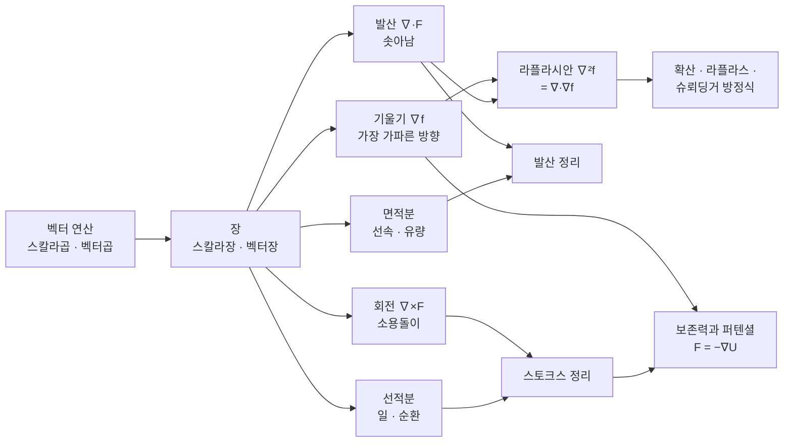

# 수학 도구 3. 벡터와 벡터 미적분 — 공간에 퍼진 양의 기울기·흐름·소용돌이
<!-- prev: umath-2, uphy-1, uphy-8 -->
<!-- next: umath-4 -->

> [!NOTE]
> **이 단원의 범위**
> - 벡터 연산 요약: 성분, 스칼라곱·벡터곱, 스칼라 삼중곱과 벡터 삼중곱
> - 스칼라장과 벡터장: 등위면, 장선, 과학에서 만나는 장
> - 기울기(∇f)·발산(∇·F)·회전(∇×F)의 뜻과 직교 좌표 계산, 벡터 항등식
> - 라플라시안: 직교·원통·구면 좌표의 식과 그 뜻
> - 선적분(일·순환)과 면적분(선속)
> - 발산 정리와 스토크스 정리: 뜻과 쓰임(가우스 법칙, 연속 방정식, 앙페르·패러데이 법칙)
> - 보존력과 퍼텐셜: 네 가지 동치 조건과 퍼텐셜 구하기

**학습 목표**

1. 스칼라곱·벡터곱·삼중곱을 성분으로 계산하고, 결합각·단위 세포의 부피·토크처럼 과학의 기하 문제에 쓸 수 있다.
2. 온도·기압·농도·전위 같은 스칼라장의 기울기를 구하고, 기울기가 '가장 가파른 오르막 방향'이자 등위면의 법선임을 이용해 열·물질·전하의 흐름 방향을 예측할 수 있다.
3. 발산과 회전을 '작은 상자에서 빠져나가는 양'과 '작은 고리를 따라 도는 양'으로 해석하고, 직교 좌표에서 계산할 수 있다.
4. 직교·구면 좌표의 라플라시안으로 확산 방정식·라플라스 방정식·슈뢰딩거 방정식의 항을 계산할 수 있다.
5. 곡선과 곡면을 매개변수로 나타내어 선적분(일, 순환)과 면적분(선속, 유량)을 계산할 수 있다.
6. 발산 정리와 스토크스 정리로 적분형 법칙과 미분형 법칙(가우스 법칙, 연속 방정식, 앙페르·패러데이 법칙)을 서로 바꿀 수 있다.
7. 힘장이 보존력인지 판정하고 퍼텐셜을 구하며, 보존장과 열역학의 상태 함수가 같은 수학 구조임을 설명할 수 있다.

**이 단원의 학습 사다리**

| 단계 | 무엇을 하나? |
|---|---|
| STEP 1. 이전 학습 다시 보기 | 일반물리학의 벡터·일·가우스 법칙, 수학 도구 1·2의 편미분·선적분·좌표 변환 |
| STEP 2. 기초 다지기 | 편미분과 $\partial r/\partial x = x/r$, 구면 좌표와 부피·넓이 요소, 매개변수 곡선과 접선 벡터 |
| STEP 3. 핵심 개념 | 벡터 연산 → 장 → 기울기 → 발산 → 회전 → 라플라시안 → 선적분 → 면적분 → 발산 정리 → 스토크스 정리 → 보존력과 퍼텐셜 |
| STEP 4. 오개념 바로잡기 | "회전이 있으면 원을 그리며 돈다", "구면 좌표에서도 $\nabla^2 = \partial^2/\partial r^2 + \cdots$" 같은 착각 |
| STEP 5. 더 깊은 수학 | 미분 형식과 일반화된 스토크스 정리, 헬름홀츠 분해 |
| STEP 6. 이 도구가 쓰이는 곳 | 양자역학의 수소 원자, 확산 지배 반응, 미소 전극, 기상 분석 |

---

## 🗺️ 단원 들어가기

방 한쪽에서 향수병을 열면 냄새는 **진한 곳에서 묽은 곳으로** 퍼진다. 그런데 공간의 한 점에서 '농도가 가장 빨리 줄어드는 방향'은 정확히 어느 쪽인가? 일기도의 저기압 중심으로 바람이 모여들면 모인 공기는 어디로 가는가? 태풍은 왜 회전하고, 그 회전의 세기는 어떤 숫자로 재는가? 수소 원자의 전자 구름이 공 모양이라면, 그 모양을 정하는 슈뢰딩거 방정식의 $\nabla^2$는 구면 좌표에서 어떻게 생겼는가?

이 질문들에는 공통점이 있다. 다루는 양이 한 점의 값이 아니라 **공간 전체에 퍼져 있는 값**, 즉 **장(field)** 이라는 점이다. 온도·농도·전위처럼 각 점에 수 하나가 붙은 장도 있고, 바람·전기장·열 흐름처럼 각 점에 화살표가 붙은 장도 있다. 벡터 미적분은 이런 장을 미분하고(기울기·발산·회전) 적분하는(선적분·면적분) 도구이며, 두 정리(발산 정리·스토크스 정리)가 미분과 적분을 하나로 묶는다.

일반물리학에서 이미 이 도구의 '결과'를 많이 썼다. 가우스 법칙 $\oint\vec{E}\cdot d\vec{A} = q/\varepsilon_0$은 면적분이고, $\vec{E} = -\nabla V$는 기울기이며, 보존력의 일은 선적분이었다. 이 단원에서는 그 도구를 **직접 다룰 수 있게** 정리하고, 물리화학·분석화학·생화학·지구과학에서 같은 도구가 어떻게 되풀이되는지 본다.

---

## STEP 1. 🔙 이전 학습 다시 보기

### 연계 개념표

| 이전 단원 | 그때 배운 것 | 이 단원에서 확장되는 것 |
|---|---|---|
| 일반물리학 「운동의 기술」 '벡터' | 성분과 단위 벡터, 스칼라곱 $AB\cos\phi$, 벡터곱 $AB\sin\phi$와 오른손 법칙 | 삼중곱(부피, BAC–CAB 규칙), 벡터곱의 행렬식 계산을 ∇×F에 그대로 사용 |
| 일반물리학 「일·에너지와 운동량」 '보존력과 퍼텐셜 에너지' | $W = \int\vec{F}\cdot d\vec{r}$, 보존력은 일이 경로와 무관, 1차원 $F = -dU/dx$ | 3차원 $\vec{F} = -\nabla U$, 보존력의 네 가지 동치 조건, $\nabla\times\vec{F} = 0$ 판정 |
| 일반물리학 「전기장과 전위」 | 전기 선속, 가우스 법칙(적분형), $\Delta V = -\int\vec{E}\cdot d\vec{s}$, $\vec{E} = -\nabla V$ | 발산 정리로 가우스 법칙의 미분형 $\nabla\cdot\vec{E} = \rho/\varepsilon_0$, 구면 좌표의 기울기로 쌍극자 장 |
| 일반물리학 「전자기 유도와 전자기파」 | 맥스웰 방정식(적분형), 유도 전기장 | 스토크스 정리로 미분형 $\nabla\times\vec{E} = -\partial\vec{B}/\partial t$, 파동 방정식의 유도 |
| 수학 도구 「미분과 편미분」 | 편미분, 전미분과 완전 미분, 교차 미분의 같음 | 기울기는 편미분을 모은 벡터, $\nabla\times\nabla f = 0$은 교차 미분의 같음, 보존장 = 완전 미분 |
| 수학 도구 「적분과 급수」 | $\int M\,dx + N\,dy$ 꼴의 선적분과 경로 의존성, 다중 적분, 극·원통·구면 좌표와 야코비안 | 벡터장의 선적분과 면적분, 곡선 좌표의 기울기·발산·라플라시안 |

### 준비 운동 (사전 진단)

**Q1.** $\vec{A} = (1, 2, 2)$와 $\vec{B} = (2, 0, -1)$의 스칼라곱과 사이각을 구하시오.

**Q2.** $f(x, y) = x^2y + 3y$의 $\partial f/\partial x$와 $\partial f/\partial y$를 구하시오.

**Q3.** 점전하의 전위가 $V = kq/r$일 때, 1차원으로 생각해 $E_r = -dV/dr$를 구하시오.

**Q4.** 반지름 $R$인 구의 부피를 구면 좌표의 부피 요소 $dV = r^2\sin\theta\,dr\,d\theta\,d\phi$로 적분하여 구하시오.

정답 및 해설

**Q1.** $\vec{A}\cdot\vec{B} = 2 + 0 - 2 = 0$이므로 사이각은 $90^\circ$이다. 스칼라곱이 0이면 두 벡터는 수직이다.

**Q2.** $\partial f/\partial x = 2xy$, $\partial f/\partial y = x^2 + 3$. 다른 변수는 상수로 둔다.

**Q3.** $E_r = -\dfrac{d}{dr}\dfrac{kq}{r} = \dfrac{kq}{r^2}$. 이 단원 ③에서 같은 계산을 3차원 $\vec{E} = -\nabla V$로 다시 한다.

**Q4.** $\displaystyle\int_0^{2\pi}\!\!\int_0^{\pi}\!\!\int_0^R r^2\sin\theta\,dr\,d\theta\,d\phi = \frac{R^3}{3}\cdot2\cdot2\pi = \frac{4}{3}\pi R^3$

---

## STEP 2. 🧱 기초 다지기

### 디딤돌 1. 편미분 다시 보기 — 그리고 $\partial r/\partial x = x/r$

수학 도구 1 '다변수 함수와 편미분'에서 익힌 대로, 편미분은 다른 변수를 모두 고정하고 한 변수로만 미분한 것이다. 벡터 미적분에서는 원점까지의 거리 $r = \sqrt{x^2 + y^2 + z^2}$의 편미분이 끊임없이 나온다. 연쇄 법칙으로

$$
\frac{\partial r}{\partial x} = \frac{1}{2\sqrt{x^2+y^2+z^2}}\cdot 2x = \frac{x}{r}, \qquad \frac{\partial r}{\partial y} = \frac{y}{r}, \qquad \frac{\partial r}{\partial z} = \frac{z}{r}
$$

그러므로 $r$의 함수 $g(r)$은 $\dfrac{\partial g}{\partial x} = g'(r)\dfrac{x}{r}$이다. 이 한 줄이 쿨롱 법칙·중력·확산의 계산을 거의 다 해결한다.

| 함수 | $\partial/\partial x$ | 쓰이는 곳 |
|---|---|---|
| $r$ | $x/r$ | 모든 중심력 문제 |
| $1/r$ | $-x/r^3$ | 쿨롱·중력 퍼텐셜 |
| $r^n$ | $n r^{n-2}x$ | 조화 퍼텐셜($n = 2$), 레너드–존스 퍼텐셜($n = -6, -12$) |
| $e^{-r/a}$ | $-\dfrac{x}{ar}e^{-r/a}$ | 수소 원자 1s 오비탈 |

#### 예제 1 — 거리의 함수를 미분하기

$g = e^{-r/a}$에 대하여 $\partial g/\partial x$와 $\partial^2 g/\partial x^2$를 구하시오.

**풀이**
(1) $\dfrac{\partial g}{\partial x} = g'(r)\dfrac{x}{r} = -\dfrac{1}{a}e^{-r/a}\dfrac{x}{r}$
(2) 곱의 미분으로 한 번 더 미분한다. $\dfrac{\partial}{\partial x}\left(\dfrac{x}{r}\right) = \dfrac{1}{r} - \dfrac{x^2}{r^3}$이고 $\dfrac{\partial}{\partial x}e^{-r/a} = -\dfrac{x}{ar}e^{-r/a}$이므로

$$
\frac{\partial^2 g}{\partial x^2} = -\frac{1}{a}e^{-r/a}\left(\frac{1}{r} - \frac{x^2}{r^3}\right) + \frac{x^2}{a^2r^2}e^{-r/a}
$$

**의미** $y$, $z$에 대해서도 같은 꼴이 나온다. 세 식을 더하면 $x^2 + y^2 + z^2 = r^2$로 깔끔하게 정리되는데, 이것이 ⑥에서 라플라시안을 계산하는 길이다. 직교 좌표로 하면 길지만, 구면 좌표의 식을 쓰면 한 줄로 끝난다는 것도 ⑥에서 보인다.

### 디딤돌 2. 곡선 좌표 — 원통·구면 좌표와 길이·넓이·부피 요소

수학 도구 2 '다중 적분과 좌표 변환'에서 원통 좌표 $(s, \phi, z)$와 구면 좌표 $(r, \theta, \phi)$를 썼다. 이 책은 물리·화학의 관례를 따라 $\theta$를 $+z$축에서 잰 **극각**($0 \le \theta \le \pi$), $\phi$를 $xy$ 평면에서 $x$축으로부터 잰 **방위각**($0 \le \phi < 2\pi$)으로 둔다.

$$
x = r\sin\theta\cos\phi, \qquad y = r\sin\theta\sin\phi, \qquad z = r\cos\theta
$$

벡터 미적분에서 중요한 것은 각 좌표를 조금 바꿀 때 **실제로 움직이는 길이**이다. $r$을 $dr$만큼 바꾸면 $dr$만큼, $\theta$를 $d\theta$만큼 바꾸면 반지름 $r$인 원호를 따라 $r\,d\theta$만큼, $\phi$를 $d\phi$만큼 바꾸면 반지름 $r\sin\theta$인 원을 따라 $r\sin\theta\,d\phi$만큼 움직인다. 이 세 길이의 계수 $(1, r, r\sin\theta)$를 **척도 인자(scale factor)** 라 한다.

| 좌표계 | 길이 요소 $d\vec{l}$ | 부피 요소 $dV$ | 대표적 넓이 요소 |
|---|---|---|---|
| 직교 $(x, y, z)$ | $dx\,\hat{x} + dy\,\hat{y} + dz\,\hat{z}$ | $dx\,dy\,dz$ | $z$ = 일정인 면: $dx\,dy$ |
| 원통 $(s, \phi, z)$ | $ds\,\hat{s} + s\,d\phi\,\hat{\phi} + dz\,\hat{z}$ | $s\,ds\,d\phi\,dz$ | 옆면($s = R$): $R\,d\phi\,dz$ |
| 구면 $(r, \theta, \phi)$ | $dr\,\hat{r} + r\,d\theta\,\hat{\theta} + r\sin\theta\,d\phi\,\hat{\phi}$ | $r^2\sin\theta\,dr\,d\theta\,d\phi$ | 구면($r = R$): $R^2\sin\theta\,d\theta\,d\phi$ |

<!-- 그림 요청: 구면 좌표와 단위 벡터. 3차원 직교 축 x, y, z 위에 점 P를 찍고, 원점에서 P까지 길이 r인 선분, +z축과 이루는 극각 θ, P의 xy 평면 그림자와 x축이 이루는 방위각 φ를 호로 표시. P에 세 단위 벡터 r̂(바깥쪽), θ̂(θ가 커지는 쪽, 남쪽), φ̂(φ가 커지는 쪽, 동쪽)를 서로 수직인 화살표로 그린다. 옆에 작은 부피 요소 상자: 세 변의 길이 dr, r dθ, r sinθ dφ 를 이름표로 붙인다. -->

> [!WARNING]
> 직교 좌표의 $\hat{x}$, $\hat{y}$, $\hat{z}$는 어디서나 같은 방향이지만, 곡선 좌표의 $\hat{r}$, $\hat{\theta}$, $\hat{\phi}$는 **점마다 방향이 바뀐다.** 그래서 $\hat{r}$을 상수처럼 적분 밖으로 빼거나 미분에서 무시하면 틀린다. 곡선 좌표의 발산·라플라시안이 단순한 $\partial^2/\partial r^2$이 아닌 까닭이 여기에 있다.

#### 예제 2 — 구의 겉넓이와 극지방의 넓이

(1) 반지름 $R$인 구의 겉넓이를 넓이 요소로 적분해 구하시오. (2) 지구를 반지름 6371 km인 구로 보고, 북위 60° 이북 지역의 넓이가 지구 겉넓이의 몇 %인지 구하시오.

**풀이**
(1) $\displaystyle A = \int_0^{2\pi}\!\!\int_0^{\pi}R^2\sin\theta\,d\theta\,d\phi = R^2\cdot2\cdot2\pi = 4\pi R^2$
(2) 북위 60°는 극각 $\theta = 30^\circ$이다. $\displaystyle A_{60} = 2\pi R^2\int_0^{\pi/6}\sin\theta\,d\theta = 2\pi R^2(1 - \cos30^\circ)$이므로 비율은 $\dfrac{1 - \cos30^\circ}{2} = \dfrac{1 - 0.8660}{2} = 0.0670$, 약 6.7 %이다.

**의미** 위도 30°의 띠(북위 60~90°)가 겉넓이의 7 %도 안 된다. $\sin\theta$ 인자 때문에 극 근처의 띠는 좁다. 극지방이 받는 햇빛 총량, 위도별 기후 자료의 넓이 가중 평균을 낼 때 이 인자를 빠뜨리면 큰 오차가 생긴다.

### 디딤돌 3. 매개변수 곡선과 접선 벡터

곡선은 매개변수 $t$ 하나로 나타낸다: $\vec{r}(t) = (x(t), y(t), z(t))$. 일반물리학 「운동의 기술」에서 $t$가 시간일 때 $d\vec{r}/dt$가 속도였듯, 일반적으로 $\vec{r}^{\prime}(t)$는 곡선의 **접선 벡터**이고, 곡선을 따른 작은 변위는

$$
d\vec{r} = \vec{r}^{\prime}(t)\,dt, \qquad ds = \lvert\vec{r}^{\prime}(t)\rvert\,dt
$$

이다. ⑦의 선적분은 모두 "곡선을 매개변수로 쓰고 → $d\vec{r}$을 $dt$로 바꾸고 → 보통의 정적분으로 계산"하는 순서로 푼다.

선분은 $\vec{a} + t(\vec{b} - \vec{a})$ ($0 \le t \le 1$), 반지름 $R$인 원은 $(R\cos t, R\sin t, 0)$ ($0 \le t \le 2\pi$, 시계 반대 방향), 나선은 $(R\cos t, R\sin t, ct)$로 쓴다.

#### 예제 3 — DNA 이중 나선 한 가닥의 길이

B형 DNA의 한 가닥 인산 골격이 반지름 약 1.0 nm, 한 바퀴에 3.4 nm 올라가는 나선을 이룬다고 보자. 한 바퀴를 도는 동안 골격을 따라 잰 길이를 구하시오.

**풀이**
나선을 $\vec{r}(t) = (R\cos t, R\sin t, ct)$로 쓰면 한 바퀴($t$: $0 \to 2\pi$)에 $2\pi c = 3.4\ \mathrm{nm}$이므로 $c = 0.541\ \mathrm{nm}$이다. $\lvert\vec{r}^{\prime}(t)\rvert = \sqrt{R^2 + c^2}$가 일정하므로

$$
s = 2\pi\sqrt{R^2 + c^2} = 2\pi\sqrt{1.0^2 + 0.541^2}\ \mathrm{nm} = 7.1\ \mathrm{nm}
$$

**의미** 축 방향으로는 3.4 nm 올라갈 뿐이지만 골격은 그 두 배쯤 되는 길을 지난다. 한 바퀴에 약 10.5개 염기쌍이 있으므로 골격 위 이웃 뉴클레오타이드 사이 거리는 약 0.68 nm이다. 나선 펼침 길이를 '빗변'으로 보는 감각이 이 식에 담겨 있다(원기둥 옆면을 펼치면 나선은 직각삼각형의 빗변이 된다).

---

## STEP 3. 📘 핵심 개념

### ① 벡터 연산 요약 — 스칼라곱·벡터곱·삼중곱

벡터를 직교 단위 벡터로 $\vec{A} = A_x\hat{x} + A_y\hat{y} + A_z\hat{z} = (A_x, A_y, A_z)$로 쓴다($\hat{x}, \hat{y}, \hat{z}$는 일반물리학의 $\hat{i}, \hat{j}, \hat{k}$와 같다). 일반물리학에서 배운 두 곱을 계산 중심으로 정리한다.

| 연산 | 성분 계산 | 기하적 뜻 | 과학에서 |
|---|---|---|---|
| 스칼라곱 $\vec{A}\cdot\vec{B}$ | $A_xB_x + A_yB_y + A_zB_z$ | $AB\cos\phi$: 한 벡터를 다른 벡터에 사영한 길이 × 그 크기 | 일 $\vec{F}\cdot d\vec{r}$, 선속 $\vec{E}\cdot d\vec{A}$, 결합각, 쌍극자 에너지 $-\vec{p}\cdot\vec{E}$ |
| 벡터곱 $\vec{A}\times\vec{B}$ | 아래 행렬식 | 크기 $AB\sin\phi$ = 평행사변형 넓이, 방향은 오른손 법칙 | 토크 $\vec{r}\times\vec{F}$, 각운동량, 로런츠 힘 $q\vec{v}\times\vec{B}$, 면의 법선 |

벡터곱은 3×3 행렬식으로 외워 두면 ⑤의 회전 계산에 그대로 쓸 수 있다.

$$
\vec{A}\times\vec{B} = \begin{vmatrix}\hat{x} & \hat{y} & \hat{z}\\ A_x & A_y & A_z\\ B_x & B_y & B_z\end{vmatrix} = (A_yB_z - A_zB_y,\ A_zB_x - A_xB_z,\ A_xB_y - A_yB_x)
$$

벡터곱은 **교환 법칙이 성립하지 않는다**: $\vec{B}\times\vec{A} = -\vec{A}\times\vec{B}$. 그래서 $\vec{A}\times\vec{A} = 0$이다.

#### 삼중곱 두 가지

**스칼라 삼중곱** $\vec{A}\cdot(\vec{B}\times\vec{C})$는 세 벡터가 만드는 **평행육면체의 부피**(부호 포함)이다. $\vec{B}\times\vec{C}$의 크기가 밑면 넓이, 방향이 밑면의 법선이므로, 여기에 $\vec{A}$를 사영하면 높이가 곱해진다. 성분으로는 세 벡터를 행으로 쓴 행렬식이다.

$$
\vec{A}\cdot(\vec{B}\times\vec{C}) = \begin{vmatrix}A_x & A_y & A_z\\ B_x & B_y & B_z\\ C_x & C_y & C_z\end{vmatrix}
$$

순서를 돌려도(순환) 값이 같고($\vec{A}\cdot(\vec{B}\times\vec{C}) = \vec{B}\cdot(\vec{C}\times\vec{A})$), 두 벡터를 맞바꾸면 부호가 바뀐다. 값이 0이면 세 벡터는 한 평면 위에 있다.

**벡터 삼중곱**은 'BAC–CAB 규칙'으로 푼다.

$$
\vec{A}\times(\vec{B}\times\vec{C}) = \vec{B}(\vec{A}\cdot\vec{C}) - \vec{C}(\vec{A}\cdot\vec{B})
$$

⑤에서 $\nabla\times(\nabla\times\vec{F})$를 정리할 때, 그리고 원운동의 구심 가속도 $\vec{\omega}\times(\vec{\omega}\times\vec{r})$를 풀 때 이 규칙을 쓴다.

<!-- 그림 요청: 스칼라 삼중곱의 기하. 세 벡터 a, b, c(서로 비스듬함)가 한 점에서 출발해 만드는 평행육면체. b와 c가 만드는 밑면 평행사변형에 색을 칠하고 그 넓이를 |b×c|로 표시, 밑면에 수직인 화살표 b×c, 벡터 a를 b×c 방향으로 사영한 높이 h = a·(b×c)/|b×c| 를 점선으로 표시. 옆에 '단위 세포 = 평행육면체'라는 이름표와 함께 단사정계 단위 세포(a, b 수직, c는 a와 각 β) 그림을 작게 덧붙인다. -->

#### 예제 4 — 메테인의 결합각과 H···H 거리

메테인($\mathrm{CH_4}$)의 탄소를 원점에 두면 네 수소는 정육면체의 꼭짓점 넷, 즉 $(1,1,1)$, $(1,-1,-1)$, $(-1,1,-1)$, $(-1,-1,1)$ 방향에 놓인다. C–H 결합 길이를 109 pm로 하여 (1) H–C–H 결합각, (2) 두 수소 사이 거리를 구하시오.

**풀이**
(1) 두 결합 벡터 $\vec{u} = (1,1,1)$, $\vec{v} = (1,-1,-1)$의 사이각은 길이와 무관하다.

$$
\cos\phi = \frac{\vec{u}\cdot\vec{v}}{\lvert\vec{u}\rvert\lvert\vec{v}\rvert} = \frac{1 - 1 - 1}{\sqrt{3}\sqrt{3}} = -\frac{1}{3}, \qquad \phi = \cos^{-1}(-1/3) = 109.47^\circ
$$

(2) 수소의 위치는 $\vec{r}_1 = \dfrac{109}{\sqrt3}(1,1,1)$, $\vec{r}_2 = \dfrac{109}{\sqrt3}(1,-1,-1)$ pm이다. $\vec{r}_1 - \vec{r}_2 = \dfrac{109}{\sqrt3}(0, 2, 2)$이므로

$$
d_\mathrm{HH} = \frac{109}{\sqrt3}\sqrt{8} = 109\times1.633 = 178\ \mathrm{pm}
$$

**의미** 사면체 각 $109.5^\circ$는 '$\cos\phi = -1/3$'이라는 스칼라곱의 결과이다. 같은 방법으로 결정 구조의 원자 좌표에서 결합각·이웃 거리를 계산하는 것이 결정학 소프트웨어가 하는 기본 일이다.

#### 예제 5 — 단사정계 단위 세포의 부피

어떤 단사정계 결정의 단위 세포는 $a = 5.00\ \text{Å}$, $b = 6.00\ \text{Å}$, $c = 7.00\ \text{Å}$이고, $\vec{a}\perp\vec{b}$, $\vec{b}\perp\vec{c}$, $\vec{a}$와 $\vec{c}$ 사이의 각이 $\beta = 100^\circ$이다. 단위 세포의 부피를 구하시오.

**풀이**
좌표를 $\vec{a} = (5.00, 0, 0)$, $\vec{b} = (0, 6.00, 0)$, $\vec{c} = 7.00(\cos\beta, 0, \sin\beta)$로 잡는다.

$$
V = \vec{a}\cdot(\vec{b}\times\vec{c}) = \begin{vmatrix}5.00 & 0 & 0\\ 0 & 6.00 & 0\\ 7.00\cos\beta & 0 & 7.00\sin\beta\end{vmatrix} = 5.00\times6.00\times7.00\sin100^\circ = 207\ \text{Å}^3
$$

**의미** 직육면체였다면 $210\ \text{Å}^3$였을 것이다. 기울어진 만큼($\sin\beta$) 부피가 줄었다. 부피를 알면 단위 세포 속 분자 수 $Z$와 몰 질량으로 결정의 밀도 $\rho = ZM/(N_\mathrm{A}V)$를 계산할 수 있다(「고체의 구조와 에너지」에서 쓴다).

> [!TIP]
> 💡 **요령** — 벡터곱의 방향이 헷갈리면 $\hat{x}\times\hat{y} = \hat{z}$, $\hat{y}\times\hat{z} = \hat{x}$, $\hat{z}\times\hat{x} = \hat{y}$(순환하면 +, 거꾸로 가면 −)만 기억하면 된다. 행렬식 계산 뒤에 결과가 두 벡터 모두에 수직인지($\vec{A}\cdot(\vec{A}\times\vec{B}) = 0$) 확인하면 부호 실수를 대부분 잡을 수 있다.

#### ✔ 바로 확인

1. (O/X) $\vec{A}\times\vec{B} = \vec{B}\times\vec{A}$이다.
2. $\vec{A} = (1, 0, 0)$, $\vec{B} = (0, 2, 0)$일 때 $\vec{A}\times\vec{B}$를 구하시오.
3. 빈칸: 세 벡터의 스칼라 삼중곱이 0이면 세 벡터는 한 (    ) 위에 있다.
4. 양성자($q = 1.60\times10^{-19}\ \mathrm{C}$)가 $\vec{v} = (2.0\times10^5, 0, 0)\ \mathrm{m/s}$로 자기장 $\vec{B} = (0, 0, 0.50)\ \mathrm{T}$ 속을 지날 때 로런츠 힘 $q\vec{v}\times\vec{B}$를 구하시오.

정답

1. X — $\vec{B}\times\vec{A} = -\vec{A}\times\vec{B}$. 순서를 바꾸면 방향이 뒤집힌다.
2. $(0, 0, 2)$ — $\hat{x}\times\hat{y} = \hat{z}$, 크기는 $1\times2\times\sin90^\circ$.
3. 평면 — 평행육면체의 부피가 0이다.
4. $(0, -1.6\times10^{-14}, 0)\ \mathrm{N}$ — $\hat{x}\times\hat{z} = -\hat{y}$이므로 $q vB(-\hat{y})$, 크기 $1.60\times10^{-19}\times2.0\times10^5\times0.50$.

### ② 스칼라장과 벡터장

공간의 각 점 $\vec{r}$에 수 하나를 대응시킨 것을 **스칼라장(scalar field)** $f(\vec{r})$, 벡터 하나를 대응시킨 것을 **벡터장(vector field)** $\vec{F}(\vec{r})$이라 한다. 시간에 따라 변하면 $f(\vec{r}, t)$, $\vec{F}(\vec{r}, t)$로 쓴다.

| 분야 | 스칼라장 | 벡터장 |
|---|---|---|
| 물리 | 전위 $V$, 퍼텐셜 에너지 $U$, 중력 퍼텐셜 | 전기장 $\vec{E}$, 자기장 $\vec{B}$, 중력장 $\vec{g}$ |
| 화학 | 농도 $c$, 전자 밀도 $\rho(\vec{r})$, 정전기 퍼텐셜 지도 | 확산 선속 $\vec{J}$, 분자 표면의 전기장, 원자에 걸리는 힘 |
| 생명 | 산소 분압, 형태 형성 물질(모르포젠)의 농도 | 혈류 속도, 세포가 이동하는 방향(주화성) |
| 지구 | 기온, 기압, 해수면 높이, 지하 온도 | 바람, 해류, 열 흐름 |

#### 시각화 — 등위면과 장선

- 스칼라장은 값이 같은 점을 이은 **등위면(level surface)** 으로 그린다. 2차원에서는 **등위선**이며, 등고선·등압선·등온선·등전위선이 모두 이것이다.
- 벡터장은 각 점에 화살표를 그리거나, 각 점에서 장의 방향을 접선으로 갖는 곡선, 즉 **장선(field line)** 으로 그린다. 유체에서는 **유선(streamline)**, 전기장에서는 전기력선이다.

<!-- 그림 요청: 같은 영역의 스칼라장과 벡터장을 나란히 그린 2패널 그림. 왼쪽: 저기압 중심(L, 980 hPa)을 둘러싼 동심원 비슷한 등압선 4개(984, 988, 992, 996 hPa), 오른쪽 위로 갈수록 간격이 넓다. 오른쪽: 같은 영역에 바람 화살표를 격자점마다 그린 벡터장(북반구 저기압: 시계 반대 방향으로 돌며 약간 안쪽으로 모이는 바람), 화살표 길이는 등압선 간격이 좁은 곳에서 길게. 두 패널 모두 x축 '동쪽(km)', y축 '북쪽(km)', 범위 −500~500 km. -->

장을 성분으로 쓸 때는 각 점의 위치 $(x, y, z)$를 넣어 벡터를 계산한다. 예를 들어 $xy$ 평면에서 각속도 $\omega$로 강체처럼 도는 유체의 속도장은

$$
\vec{v}(x, y) = \vec{\omega}\times\vec{r} = \omega\hat{z}\times(x\hat{x} + y\hat{y}) = (-\omega y,\ \omega x,\ 0)
$$

이며, 이 장의 유선은 원점을 중심으로 하는 원이다(⑤에서 이 장의 회전을 계산한다).

#### 예제 6 — 나트륨 이온 곁의 물 분자가 느끼는 전기장

진공(유전체 효과는 무시)에서 원점에 $\mathrm{Na^+}$ 이온이 있다. 점 $(0.30, 0.40, 0)\ \mathrm{nm}$에서 전기장 벡터를 성분으로 구하시오. ($k = 8.99\times10^9\ \mathrm{N\cdot m^2/C^2}$, $e = 1.602\times10^{-19}\ \mathrm{C}$)

**풀이**
점전하의 전기장은 $\vec{E} = \dfrac{kq}{r^2}\hat{r} = \dfrac{kq}{r^3}\vec{r}$이다. $r = \sqrt{0.30^2 + 0.40^2} = 0.50\ \mathrm{nm}$, $\hat{r} = (0.60, 0.80, 0)$.

$$
E = \frac{(8.99\times10^9)(1.602\times10^{-19})}{(0.50\times10^{-9})^2} = 5.76\times10^9\ \mathrm{V/m}
$$

$$
\vec{E} = (3.46\times10^9,\ 4.61\times10^9,\ 0)\ \mathrm{V/m}
$$

**의미** 이온 곁에서는 전기장이 $10^9\ \mathrm{V/m}$를 넘는다. 실험실에서 만드는 가장 센 정전기장보다 훨씬 커서, 첫 수화층의 물 분자 쌍극자는 이 장의 방향으로 강하게 정렬한다. 실제 용액에서는 물의 유전 효과로 약해지지만, 이온 바로 곁의 물은 그 효과를 덜 받는다(「분자 간 힘과 액체·고체·용액」의 이온–쌍극자 힘).

#### ✔ 바로 확인

1. 다음을 스칼라장과 벡터장으로 나누시오. (가) 해수의 염분 분포 (나) 해류 (다) 분자 주위의 정전기 퍼텐셜 (라) 원자들에 걸리는 힘
2. (O/X) 벡터장의 장선은 각 점에서 장의 방향을 접선으로 갖는다.
3. 강체 회전 속도장 $\vec{v} = (-\omega y, \omega x, 0)$에서 점 $(0, 2, 0)$의 속도 벡터는? ($\omega = 3\ \mathrm{s^{-1}}$, 길이는 m)

정답

1. 스칼라장: (가), (다) / 벡터장: (나), (라)
2. O — 그래서 장선은 서로 엇갈리지 않는다(한 점의 방향은 하나뿐이다).
3. $(-6, 0, 0)\ \mathrm{m/s}$ — $y$축 위의 점은 $-x$ 방향으로 움직인다. 위에서 보면 시계 반대 방향 회전이다.

### ③ 기울기 — 가장 가파른 오르막

산 위의 한 점에 서 있다고 하자. 동쪽으로 한 걸음 가면 높이가 얼마나 변하는가? 북쪽으로는? 그리고 가장 가파르게 올라가는 방향은 어디인가? 이 질문에 한꺼번에 답하는 것이 **기울기(gradient)** 이다.

#### 정의와 유도 — 전미분에서 방향 도함수로

스칼라장 $f(x, y, z)$에서 작은 변위 $d\vec{r} = (dx, dy, dz)$만큼 움직일 때의 변화는 수학 도구 1 '전미분'에서 익힌 대로

$$
df = \frac{\partial f}{\partial x}dx + \frac{\partial f}{\partial y}dy + \frac{\partial f}{\partial z}dz
$$

이다. 오른쪽은 두 벡터의 스칼라곱 꼴이다. 편미분을 모은 벡터를

$$
\nabla f = \left(\frac{\partial f}{\partial x},\ \frac{\partial f}{\partial y},\ \frac{\partial f}{\partial z}\right), \qquad \nabla = \hat{x}\frac{\partial}{\partial x} + \hat{y}\frac{\partial}{\partial y} + \hat{z}\frac{\partial}{\partial z}
$$

로 정의하면($\nabla$는 '나블라' 또는 '델'이라 읽는다)

$$
df = \nabla f\cdot d\vec{r}
$$

가 된다. 단위 벡터 $\hat{u}$ 방향으로 길이 $ds$만큼 움직이면 $d\vec{r} = \hat{u}\,ds$이므로, 그 방향의 변화율(**방향 도함수**, directional derivative)은

$$
\frac{df}{ds}\bigg\rvert_{\hat{u}} = \nabla f\cdot\hat{u} = \lvert\nabla f\rvert\cos\phi
$$

이다($\phi$는 $\hat{u}$와 $\nabla f$의 사이각). 여기서 기울기의 두 성질이 바로 나온다.

1. $\phi = 0$일 때 변화율이 최대이다. **$\nabla f$는 $f$가 가장 빨리 커지는 방향을 가리키고, 그 크기는 그 방향의 변화율이다.**
2. 등위면 위로 움직이면 $df = 0$이므로 $\nabla f\cdot d\vec{r} = 0$이다. **$\nabla f$는 등위면에 수직이다.**

<!-- 그림 요청: 기울기와 등위선. 2차원 언덕 f(x, y) = 100 − 2x² − y² 의 등위선(타원) 5개를 그리고(f = 98, 90, 80, 70, 60), 등위선 위 세 점에서 ∇f 화살표를 등위선에 수직, 안쪽(값이 큰 쪽)을 향하게 그린다. 한 점 P(1, 2)에서는 ∇f 화살표 외에 임의의 방향 û 화살표와 사이각 φ를 표시하고 '방향 도함수 = |∇f|cosφ' 이름표. 등위선 간격이 좁은 곳에서 화살표가 길다는 점이 드러나게. -->

#### 과학의 '흐름 법칙'은 거의 모두 $-\nabla$이다

자연에서 무엇인가가 흐르는 방향은 대개 **기울기의 반대 방향**(높은 곳에서 낮은 곳으로)이고, 흐름의 세기는 기울기의 크기에 비례한다.

| 법칙 | 식 | 흐르는 것 | 비례 상수 |
|---|---|---|---|
| 퍼텐셜과 힘 | $\vec{F} = -\nabla U$ | (힘의 방향) | — |
| 전기장과 전위 | $\vec{E} = -\nabla V$ | 양전하가 밀리는 방향 | — |
| 푸리에 법칙(열전도) | $\vec{q} = -k\nabla T$ | 열 ($\mathrm{W/m^2}$) | 열전도도 $k$ |
| 픽의 제1법칙(확산) | $\vec{J} = -D\nabla c$ | 물질 ($\mathrm{mol/(m^2\cdot s)}$) | 확산 계수 $D$ |
| 옴의 법칙(국소형) | $\vec{j} = \sigma\vec{E} = -\sigma\nabla V$ | 전하 ($\mathrm{A/m^2}$) | 전기 전도도 $\sigma$ |
| 다르시 법칙(지하수) | $\vec{q} = -\dfrac{\kappa}{\mu}\nabla p$ | 지하수 | 투과율/점성 |
| 기압 경도력 | $\vec{a} = -\dfrac{1}{\rho}\nabla p$ | (공기가 밀리는 방향) | — |

#### 기울기의 중요한 결과: $\nabla r$과 $\nabla(1/r)$

디딤돌 1의 $\partial r/\partial x = x/r$을 쓰면

$$
\nabla r = \frac{(x, y, z)}{r} = \hat{r}, \qquad \nabla g(r) = g'(r)\,\hat{r}, \qquad \nabla\frac{1}{r} = -\frac{\hat{r}}{r^2}
$$

거리의 함수인 퍼텐셜의 기울기는 늘 지름 방향이다. 점전하의 $V = kq/r$에서 $\vec{E} = -\nabla V = kq\hat{r}/r^2$, 쿨롱 법칙이 그대로 나온다.

#### 예제 7 — 금속 판의 온도장과 열 흐름

구리 판(열전도도 $k = 401\ \mathrm{W/(m\cdot K)}$)의 온도 분포가 $T(x, y) = 100 - 2x^2 - y^2$ (단위 ℃, $x, y$는 cm)이다. 점 $P(1, 2)$에서 (1) 온도가 가장 빨리 오르는 방향과 그 변화율, (2) 단위 벡터 $\hat{u} = (0.6, 0.8)$ 방향의 변화율, (3) 열 흐름 벡터 $\vec{q}$를 구하시오.

**풀이**
(1) $\nabla T = (-4x, -2y) = (-4, -4)\ {}^\circ\mathrm{C/cm}$. 방향은 $(-1, -1)/\sqrt2$(판의 중심 쪽), 변화율은 $\lvert\nabla T\rvert = 4\sqrt2 = 5.66\ {}^\circ\mathrm{C/cm}$이다.
(2) $\nabla T\cdot\hat{u} = (-4)(0.6) + (-4)(0.8) = -5.6\ {}^\circ\mathrm{C/cm}$. 이 방향으로는 온도가 빠르게 **내려간다.**
(3) 단위를 바꾸면 $\nabla T = (-400, -400)\ \mathrm{K/m}$이므로

$$
\vec{q} = -k\nabla T = -401\times(-400, -400) = (1.60\times10^5,\ 1.60\times10^5)\ \mathrm{W/m^2}
$$

크기는 $2.27\times10^5\ \mathrm{W/m^2}$이다.

**의미** 열은 가장 가파른 '내리막', 즉 $-\nabla T$ 방향(바깥쪽)으로 흐른다. 방향 (2)는 내리막이긴 하지만 가장 가파른 내리막($-5.66$)보다 조금 완만하다($-5.6$). $\hat u$가 $-\nabla T$ 방향과 약 $8^\circ$밖에 차이 나지 않기 때문이다.

#### 예제 8 — 기압 경도력과 지균풍

중위도(북위 37°)의 일기도에서 등압선이 150 km마다 4 hPa씩 차이 난다. 공기의 밀도를 $1.2\ \mathrm{kg/m^3}$로 하여 (1) 기압 경도력에 의한 가속도의 크기를 구하고, (2) 이 힘이 전향력(코리올리 힘, 크기 $fv$, $f = 2\Omega\sin\varphi$, $\Omega = 7.292\times10^{-5}\ \mathrm{s^{-1}}$)과 균형을 이룰 때의 풍속(지균풍)을 구하시오.

**풀이**
(1) $\lvert\nabla p\rvert = \dfrac{400\ \mathrm{Pa}}{1.5\times10^5\ \mathrm{m}} = 2.67\times10^{-3}\ \mathrm{Pa/m}$, $a = \dfrac{\lvert\nabla p\rvert}{\rho} = 2.22\times10^{-3}\ \mathrm{m/s^2}$
(2) $f = 2(7.292\times10^{-5})\sin37^\circ = 8.78\times10^{-5}\ \mathrm{s^{-1}}$, $v = a/f = 25\ \mathrm{m/s}$

**의미** 기압 경도력은 등압선에 수직($\nabla p$ 방향의 반대)이지만, 회전하는 지구에서 충분히 오래 분 바람은 전향력과 균형을 이루어 **등압선에 나란히** 분다(일반지구과학 「대기의 운동과 날씨」). 기울기가 '등위선에 수직'이라는 성질이 일기도 해석의 출발점이다.

#### ✔ 바로 확인

1. $f = x^2 + yz$의 기울기를 점 $(1, 2, 3)$에서 구하시오.
2. (O/X) 등위면 위의 어떤 방향으로 움직여도 방향 도함수는 0이다.
3. 빈칸: 픽의 제1법칙 $\vec{J} = -D\nabla c$에서 물질은 농도의 기울기와 (    ) 방향으로 흐른다.
4. $V = kq/r$일 때 $\nabla V$를 $\hat{r}$로 나타내시오.

정답

1. $(2, 3, 2)$ — $\nabla f = (2x, z, y)$.
2. O — 등위면 위에서는 $df = \nabla f\cdot d\vec{r} = 0$이다. 그래서 $\nabla f$는 등위면에 수직이다.
3. 반대 — 진한 곳에서 묽은 곳으로.
4. $-\dfrac{kq}{r^2}\hat{r}$ — $\nabla(1/r) = -\hat{r}/r^2$. 따라서 $\vec{E} = -\nabla V = kq\hat{r}/r^2$.

### ④ 발산 — 한 점에서 얼마나 솟아나는가

#### 뜻: 작은 상자에서 빠져나가는 양

벡터장 $\vec{F}$를 '흐름'(물질의 선속, 열 흐름, 유체 속도)이라고 생각하자. 한 점을 둘러싼 아주 작은 상자를 잡고, 상자 면을 통해 **바깥으로 빠져나가는 알짜 양**(선속)을 상자의 부피로 나눈 것이 **발산(divergence)** 이다.

$$
\nabla\cdot\vec{F} = \lim_{\Delta V\to0}\frac{1}{\Delta V}\oint_{\text{상자 표면}}\vec{F}\cdot d\vec{A}
$$

- $\nabla\cdot\vec{F} > 0$: 그 점이 **원천(source)** — 들어오는 것보다 나가는 것이 많다.
- $\nabla\cdot\vec{F} < 0$: **흡수원(sink)** — 모여드는 점이다.
- $\nabla\cdot\vec{F} = 0$: 들어온 만큼 나간다(비압축성 흐름, 전하가 없는 곳의 전기장).

#### 유도: 직교 좌표의 식

점 $(x, y, z)$에 변의 길이가 $\Delta x$, $\Delta y$, $\Delta z$인 상자를 둔다. $x$축에 수직인 두 면(넓이 $\Delta y\Delta z$)을 보자. 오른쪽 면($x + \Delta x$)으로는 $F_x(x + \Delta x)\Delta y\Delta z$가 나가고, 왼쪽 면($x$)으로는 $F_x(x)\Delta y\Delta z$가 들어온다(바깥 법선이 $-\hat{x}$이므로 나가는 양은 그 음수). 알짜로 나가는 양은

$$
[F_x(x + \Delta x) - F_x(x)]\,\Delta y\Delta z \approx \frac{\partial F_x}{\partial x}\Delta x\,\Delta y\Delta z
$$

이다. $y$, $z$ 방향의 면도 같은 방법으로 더하고 부피 $\Delta x\Delta y\Delta z$로 나누면

$$
\boxed{\;\nabla\cdot\vec{F} = \frac{\partial F_x}{\partial x} + \frac{\partial F_y}{\partial y} + \frac{\partial F_z}{\partial z}\;}
$$

$\nabla$와 $\vec{F}$의 '스칼라곱'처럼 쓰기 때문에 $\nabla\cdot\vec{F}$로 적는다. 결과는 **스칼라**이다.

<!-- 그림 요청: 발산의 뜻을 보이는 작은 상자. 3차원 직육면체(변 Δx, Δy, Δz)에 x 방향 흐름 F_x 화살표를 그리되, 왼쪽 면으로 들어오는 화살표는 짧게(F_x(x)), 오른쪽 면으로 나가는 화살표는 길게(F_x(x+Δx)) 그려 '나가는 것 − 들어오는 것 = (∂F_x/∂x)ΔxΔyΔz' 이름표. 옆에 2차원 예시 3개를 작게: (가) 원천(화살표가 한 점에서 사방으로 퍼짐, ∇·F > 0), (나) 흡수원(사방에서 모임, ∇·F < 0), (다) 균일한 흐름(평행 화살표, ∇·F = 0). -->

#### 대표적인 계산

| 벡터장 | 발산 | 해석 |
|---|---|---|
| $\vec{r} = (x, y, z)$ | $1 + 1 + 1 = 3$ | 모든 점이 똑같이 솟아나는 원천 |
| 균일한 장 $(a, b, c)$ | 0 | 들어온 만큼 나간다 |
| $\vec{v} = (\alpha x, \alpha y, -2\alpha z)$ | $\alpha + \alpha - 2\alpha = 0$ | 정체점 흐름: 벽으로 내려오다 옆으로 퍼지는 비압축성 흐름 |
| $\hat{r}/r^2 = \vec{r}/r^3$ (점전하의 장 꼴) | 0 ($r \ne 0$) | 원점을 뺀 모든 곳에서 들어온 만큼 나간다 |

마지막 줄은 직접 확인해 둘 가치가 있다. $\dfrac{\partial}{\partial x}\dfrac{x}{r^3} = \dfrac{1}{r^3} - \dfrac{3x}{r^4}\cdot\dfrac{x}{r} = \dfrac{1}{r^3} - \dfrac{3x^2}{r^5}$이고, 세 성분을 더하면 $\dfrac{3}{r^3} - \dfrac{3(x^2+y^2+z^2)}{r^5} = 0$이다. 장선은 원점에서 사방으로 퍼지지만, 퍼질수록 넓이($\propto r^2$)가 커지는 만큼 세기($\propto 1/r^2$)가 약해져 **원점 밖에서는 솟아남이 없다.** 원천은 원점의 전하에만 있다.

#### 쓰임 1 — 연속 방정식: 보존 법칙의 미분형

어떤 양(질량, 전하, 물질의 양)의 밀도가 $\rho$, 그 흐름(선속 밀도)이 $\vec{J}$이고 그 양이 생기거나 없어지지 않는다면, 작은 상자 안의 양은 빠져나가는 만큼 줄어든다.

$$
\frac{\partial\rho}{\partial t} + \nabla\cdot\vec{J} = 0
$$

이것이 **연속 방정식(continuity equation)** 이다(⑨에서 발산 정리로 다시 엄밀하게 유도한다). 반응으로 물질이 생기거나 소모되면 오른쪽에 생성 속도 항이 붙는다. 유체에서는 $\vec{J} = \rho\vec{v}$이므로 밀도가 일정한 액체(비압축성)는 $\nabla\cdot\vec{v} = 0$을 만족한다.

#### 쓰임 2 — 확산 방정식의 탄생

연속 방정식에 픽의 제1법칙 $\vec{J} = -D\nabla c$를 넣으면($D$가 일정할 때)

$$
\frac{\partial c}{\partial t} = -\nabla\cdot(-D\nabla c) = D\,\nabla\cdot\nabla c = D\,\nabla^2 c
$$

**픽의 제2법칙(확산 방정식)** 이다. $\nabla\cdot\nabla$, 즉 기울기의 발산이 ⑥의 라플라시안이다. 열전도에서는 같은 과정으로 열 방정식 $\partial T/\partial t = \alpha\nabla^2 T$가 나온다.

균일하게 팽창하는 우주(허블 법칙 $\vec{v} = H_0\vec{r}$)는 $\nabla\cdot\vec{v} = 3H_0$로 모든 점에서 같은 양의 발산을 가진다. 중심이 없는데도 모든 점이 똑같이 '솟아나는' 것처럼 보이며, 연속 방정식에 따라 평균 밀도가 $\partial\rho/\partial t = -3H_0\rho$로 줄어든다. 발산은 국소적인 양이어서 어느 점을 중심으로 잡든 같은 값이 나온다.

#### ✔ 바로 확인

1. $\vec{F} = (x^2, xy, 3z)$의 발산을 구하시오.
2. (O/X) $\nabla\cdot\vec{F} = 0$인 곳에서는 $\vec{F} = 0$이다.
3. 빈칸: 연속 방정식에 $\vec{J} = -D\nabla c$를 넣으면 $\partial c/\partial t = (\quad)$가 된다.
4. 밀도가 일정한 물의 속도장으로 $\vec{v} = (2x, -y, az)$가 가능하려면 $a$는?

정답

1. $2x + x + 3 = 3x + 3$
2. X — 균일한 장처럼 $\vec{F} \ne 0$이어도 들어온 만큼 나가면 발산은 0이다.
3. $D\nabla^2c$ — 확산 방정식(픽의 제2법칙).
4. $-1$ — 비압축성 조건 $\nabla\cdot\vec{v} = 2 - 1 + a = 0$.

### ⑤ 회전 — 한 점에서 얼마나 소용돌이치는가

#### 뜻: 작은 고리를 따라 도는 양

흐르는 물에 작은 바람개비(물레방아)를 꽂았다고 하자. 바람개비가 도는가, 돈다면 어느 축으로 얼마나 빨리 도는가? 이것을 재는 것이 **회전(curl)** 이다. 한 점을 둘러싼 아주 작은 고리를 따라 장을 선적분한 것(**순환**, circulation)을 고리의 넓이로 나누면 회전의 그 고리 법선 방향 성분이 된다.

$$
(\nabla\times\vec{F})\cdot\hat{n} = \lim_{\Delta A\to0}\frac{1}{\Delta A}\oint_{\text{고리}}\vec{F}\cdot d\vec{r}
$$

(고리를 도는 방향과 $\hat{n}$은 오른손 법칙으로 맞춘다: 네 손가락을 도는 방향으로 감으면 엄지가 $\hat{n}$.)

#### 유도: $z$ 성분

$xy$ 평면에 변 $\Delta x$, $\Delta y$인 작은 직사각형을 시계 반대 방향으로 돈다. 아래 변($y$)에서는 $+x$ 방향으로 $F_x(y)\Delta x$, 위 변($y + \Delta y$)에서는 $-x$ 방향으로 $-F_x(y + \Delta y)\Delta x$, 오른쪽 변($x + \Delta x$)에서는 $+F_y(x + \Delta x)\Delta y$, 왼쪽 변($x$)에서는 $-F_y(x)\Delta y$이다. 모두 더하면

$$
\oint\vec{F}\cdot d\vec{r} \approx \left[\frac{\partial F_y}{\partial x} - \frac{\partial F_x}{\partial y}\right]\Delta x\Delta y
$$

넓이로 나누면 $(\nabla\times\vec{F})_z = \dfrac{\partial F_y}{\partial x} - \dfrac{\partial F_x}{\partial y}$이다. 다른 두 성분은 $x \to y \to z \to x$로 문자를 돌려 얻는다. 결과는 벡터곱의 행렬식과 똑같은 꼴이다.

$$
\boxed{\;\nabla\times\vec{F} = \begin{vmatrix}\hat{x} & \hat{y} & \hat{z}\\ \dfrac{\partial}{\partial x} & \dfrac{\partial}{\partial y} & \dfrac{\partial}{\partial z}\\ F_x & F_y & F_z\end{vmatrix} = \left(\frac{\partial F_z}{\partial y} - \frac{\partial F_y}{\partial z},\ \frac{\partial F_x}{\partial z} - \frac{\partial F_z}{\partial x},\ \frac{\partial F_y}{\partial x} - \frac{\partial F_x}{\partial y}\right)\;}
$$

#### 세 가지 흐름 — '돈다'와 '회전이 있다'는 다르다

| 흐름 | 속도장 | $\nabla\times\vec{v}$ | 바람개비 |
|---|---|---|---|
| 강체 회전 | $(-\omega y, \omega x, 0)$ | $(0, 0, 2\omega)$ | 제자리에서 $\omega$로 돈다(회전 축 방향 $+z$) |
| 전단류(강가의 흐름) | $(\gamma y, 0, 0)$ | $(0, 0, -\gamma)$ | 흐름은 곧게 나아가지만 바람개비는 시계 방향으로 돈다 |
| 자유 와류(배수구, 태풍 바깥쪽) | $\dfrac{\Gamma}{2\pi}\dfrac{(-y, x, 0)}{x^2 + y^2}$ | $0$ (원점 제외) | 원을 그리며 흘러가지만 바람개비 자체는 돌지 않는다 |

<!-- 그림 요청: 세 흐름의 비교 3패널. 각 패널에 xy 평면 속도장 화살표(격자점)와 작은 바람개비(십자 모양 날개 4개) 두세 개를 배치. (가) 강체 회전 v = (−ωy, ωx): 바깥일수록 긴 원형 화살표, 바람개비에 시계 반대 방향 회전 화살표, '∇×v = 2ω ẑ'. (나) 전단류 v = (γy, 0): 위로 갈수록 긴 오른쪽 화살표, 바람개비에 시계 방향 회전 화살표(윗날개가 더 세게 밀림), '∇×v = −γ ẑ'. (다) 자유 와류 v ∝ (−y, x)/(x²+y²): 안쪽일수록 긴 원형 화살표, 원 궤도를 따라 이동하면서도 날개 방향이 그대로인 바람개비(세 위치에 같은 방향으로 그림), '∇×v = 0 (원점 제외)'. -->

강체 회전에서 회전의 크기는 각속도의 **두 배**이다. 그래서 유체역학과 기상학에서는 속도장의 회전을 **소용돌이도(vorticity)** $\vec{\zeta} = \nabla\times\vec{v}$라 부르고, 강체처럼 도는 부분의 각속도는 $\zeta/2$로 읽는다. 예를 들어 반지름 50 km 안쪽이 강체처럼 돌고 그 가장자리 풍속이 40 m/s인 태풍의 중심부는 $\zeta = 2v/r = 1.6\times10^{-3}\ \mathrm{s^{-1}}$로, 북위 37°에서 지구 자전이 주는 연직 소용돌이도 $f = 2\Omega\sin\varphi \approx 8.8\times10^{-5}\ \mathrm{s^{-1}}$의 약 18배이다. 일기 예보 모형은 이 소용돌이도의 분포와 변화를 계산하는 것이 핵심이다.

#### 두 가지 중요한 항등식

수학 도구 1 '고계 편미분과 교차 미분의 같음'($\partial^2 f/\partial x\partial y = \partial^2 f/\partial y\partial x$)에서 곧바로 나온다.

$$
\nabla\times(\nabla f) = 0, \qquad \nabla\cdot(\nabla\times\vec{A}) = 0
$$

첫째 식의 $z$ 성분은 $\dfrac{\partial}{\partial x}\dfrac{\partial f}{\partial y} - \dfrac{\partial}{\partial y}\dfrac{\partial f}{\partial x} = 0$이다. 둘째 식도 같은 방식으로 여섯 항이 둘씩 지워진다.

- **기울기 장에는 회전이 없다.** 그래서 정전기장 $\vec{E} = -\nabla V$는 소용돌이치지 않는다. 거꾸로 회전이 0인 장은 (조건이 맞으면) 어떤 함수의 기울기로 쓸 수 있다 — ⑪의 핵심.
- **회전 장에는 발산이 없다.** 자기장은 $\vec{B} = \nabla\times\vec{A}$($\vec{A}$: 벡터 퍼텐셜)로 쓸 수 있으므로 $\nabla\cdot\vec{B} = 0$, 자기 홀극이 없다는 맥스웰 방정식과 같은 말이다.

이 밖에 곱의 발산 $\nabla\cdot(f\vec{F}) = f\,\nabla\cdot\vec{F} + \vec{F}\cdot\nabla f$(연속 방정식의 $\nabla\cdot(\rho\vec{v})$를 풀 때)와 $\nabla\times(\nabla\times\vec{F}) = \nabla(\nabla\cdot\vec{F}) - \nabla^2\vec{F}$(BAC–CAB 규칙의 미분판, 전자기파의 파동 방정식)를 자주 쓴다. 모두 성분으로 확인할 수 있다.

#### ✔ 바로 확인

1. $\vec{F} = (yz, xz, xy)$의 회전을 구하시오.
2. (O/X) 유선이 모두 직선인 흐름은 회전이 0이다.
3. 빈칸: 강체 회전 속도장의 회전은 각속도의 (    )배이다.
4. 빈칸: 어떤 벡터장 $\vec{A}$에 대해서도 $\nabla\cdot(\nabla\times\vec{A}) = (\quad)$이다.

정답

1. $(x - x,\ y - y,\ z - z) = (0, 0, 0)$ — 사실 $\vec{F} = \nabla(xyz)$이므로 회전이 없다.
2. X — 전단류 $(\gamma y, 0, 0)$는 유선이 곧지만 회전이 $-\gamma\hat{z}$이다.
3. 2 — $\nabla\times(\vec{\omega}\times\vec{r}) = 2\vec{\omega}$.
4. 0 — 교차 미분이 같기 때문이다. 자기장의 $\nabla\cdot\vec{B} = 0$과 연결된다.

### ⑥ 라플라시안 — 주변 평균과의 차이

#### 정의와 뜻

스칼라장의 기울기를 구하고 그 발산을 구한 것을 **라플라시안(Laplacian)** 이라 한다.

$$
\nabla^2 f = \nabla\cdot\nabla f = \frac{\partial^2 f}{\partial x^2} + \frac{\partial^2 f}{\partial y^2} + \frac{\partial^2 f}{\partial z^2}
$$

뜻을 보려면 격자 간격 $h$인 2차원 격자에서 차분으로 근사해 보면 된다. 테일러 전개(수학 도구 2 '테일러 급수')로 $f(x+h) + f(x-h) \approx 2f(x) + h^2 f''(x)$이므로

$$
\nabla^2 f \approx \frac{f_\text{동} + f_\text{서} + f_\text{남} + f_\text{북} - 4f_\text{중심}}{h^2} = \frac{4}{h^2}\left(\bar{f}_\text{이웃} - f_\text{중심}\right)
$$

**라플라시안은 '이웃의 평균이 그 점의 값보다 얼마나 큰가'이다.** 그래서 확산 방정식 $\partial c/\partial t = D\nabla^2 c$는 "주변보다 묽은 점($\nabla^2 c > 0$)은 진해지고, 주변보다 진한 점은 묽어진다"는 말이며, 시간이 지나면 울퉁불퉁한 분포가 고르게 다듬어진다. $\nabla^2 f = 0$(**라플라스 방정식**)을 만족하는 함수(조화 함수)는 어느 점에서나 값이 이웃의 평균과 같으므로, 영역 안에 극대·극소가 생길 수 없다.

#### 라플라시안이 나오는 방정식

| 방정식 | 식 | 분야 |
|---|---|---|
| 확산 방정식 | $\dfrac{\partial c}{\partial t} = D\nabla^2 c$ | 확산, 열전도, 지하수 |
| 라플라스 방정식 | $\nabla^2 V = 0$ | 전하가 없는 곳의 전위, 정상 상태 온도·농도 |
| 푸아송 방정식 | $\nabla^2 V = -\rho/\varepsilon_0$ | 전하 분포가 만드는 전위, 이온 분위기(디바이–휘켈) |
| 파동 방정식 | $\nabla^2 \psi = \dfrac{1}{v^2}\dfrac{\partial^2\psi}{\partial t^2}$ | 소리, 지진파, 전자기파 |
| 슈뢰딩거 방정식 | $-\dfrac{\hbar^2}{2m}\nabla^2\psi + U\psi = E\psi$ | 원자·분자의 전자 상태 |

푸아송 방정식은 $\vec{E} = -\nabla V$를 $\nabla\cdot\vec{E} = \rho/\varepsilon_0$에 넣은 것이다. 전자기파의 파동 방정식은 진공의 맥스웰 방정식 $\nabla\times\vec{E} = -\partial\vec{B}/\partial t$에 회전을 한 번 더 취하고 ⑤의 항등식 $\nabla\times(\nabla\times\vec{E}) = \nabla(\nabla\cdot\vec{E}) - \nabla^2\vec{E}$와 $\nabla\cdot\vec{E} = 0$을 쓰면 $\nabla^2\vec{E} = \mu_0\varepsilon_0\,\partial^2\vec{E}/\partial t^2$로 바로 나온다(속력 $c = 1/\sqrt{\mu_0\varepsilon_0}$).

#### 곡선 좌표의 라플라시안

원자·분자·세포·별처럼 공 모양의 대상에는 구면 좌표가, 전선·혈관·원통형 전극에는 원통 좌표가 자연스럽다. 그 좌표에서의 식은 다음과 같다.

$$
\text{원통:}\quad \nabla^2 f = \frac{1}{s}\frac{\partial}{\partial s}\left(s\frac{\partial f}{\partial s}\right) + \frac{1}{s^2}\frac{\partial^2 f}{\partial\phi^2} + \frac{\partial^2 f}{\partial z^2}
$$

$$
\text{구면:}\quad \nabla^2 f = \frac{1}{r^2}\frac{\partial}{\partial r}\left(r^2\frac{\partial f}{\partial r}\right) + \frac{1}{r^2\sin\theta}\frac{\partial}{\partial\theta}\left(\sin\theta\frac{\partial f}{\partial\theta}\right) + \frac{1}{r^2\sin^2\theta}\frac{\partial^2 f}{\partial\phi^2}
$$

#### 유도 — 구면 좌표 지름 부분은 '공 껍질의 선속'에서

$f$가 $r$에만 의존하는 경우를 보자(이것이 가장 자주 쓰인다). $\nabla f = f'(r)\hat{r}$이다. 반지름 $r$과 $r + dr$ 사이의 얇은 공 껍질(부피 $4\pi r^2dr$)을 잡고, 발산의 정의대로 '빠져나가는 선속 ÷ 부피'를 계산한다.

1. 반지름 $r$인 구면을 지나 바깥으로 나가는 $\nabla f$의 선속: $\Phi(r) = 4\pi r^2 f'(r)$ ($\nabla f$가 구면에 수직이고 크기가 일정하므로)
2. 껍질에서 알짜로 나가는 양: $\Phi(r + dr) - \Phi(r) = \dfrac{d}{dr}\left[4\pi r^2 f'(r)\right]dr$
3. 부피로 나눈다:

$$
\nabla^2 f = \frac{1}{4\pi r^2dr}\cdot\frac{d}{dr}\left[4\pi r^2 f'(r)\right]dr = \frac{1}{r^2}\frac{d}{dr}\left(r^2\frac{df}{dr}\right)
$$

$r^2$이 끼어드는 까닭은 **공 껍질의 넓이가 $r^2$에 비례해 커지기 때문**이다. $d^2f/dr^2$만 쓰면 이 넓이 효과를 빠뜨린다(STEP 4). 같은 생각으로, 원통 좌표에서는 원통 옆면 넓이가 $s$에 비례하므로 $\frac{1}{s}\frac{d}{ds}(s\frac{df}{ds})$가 된다. 각 부분은 척도 인자 $r$, $r\sin\theta$로 같은 계산을 하면 얻어진다. 전개하면 지름 부분은 $\dfrac{d^2f}{dr^2} + \dfrac{2}{r}\dfrac{df}{dr}$이다.

<!-- 그림 요청: 구면 좌표 라플라시안의 지름 부분 유도. 원점을 중심으로 한 반지름 r과 r+dr의 두 동심 구면(단면은 두 동심원)으로 얇은 공 껍질을 그리고, 안쪽 구면을 지나 바깥을 향하는 화살표 여러 개(∇f = f′(r) r̂)와 바깥 구면을 지나는 화살표를 그린다. 안쪽 구면 옆에 'Φ(r) = 4πr² f′(r)', 바깥 구면 옆에 'Φ(r+dr)', 껍질에 '부피 4πr² dr' 이름표. 아래에 결론 '∇²f = (1/r²) d/dr (r² df/dr)'. -->

곡선 좌표의 기울기와 발산도 같이 정리해 둔다(⑪의 쌍극자, ⑩의 유도 전기장에서 쓴다).

| 연산 | 원통 $(s, \phi, z)$ | 구면 $(r, \theta, \phi)$ |
|---|---|---|
| $\nabla f$ | $\dfrac{\partial f}{\partial s}\hat{s} + \dfrac{1}{s}\dfrac{\partial f}{\partial\phi}\hat{\phi} + \dfrac{\partial f}{\partial z}\hat{z}$ | $\dfrac{\partial f}{\partial r}\hat{r} + \dfrac{1}{r}\dfrac{\partial f}{\partial\theta}\hat{\theta} + \dfrac{1}{r\sin\theta}\dfrac{\partial f}{\partial\phi}\hat{\phi}$ |
| $\nabla\cdot\vec{F}$ (지름 부분) | $\dfrac{1}{s}\dfrac{\partial(sF_s)}{\partial s} + \cdots$ | $\dfrac{1}{r^2}\dfrac{\partial(r^2F_r)}{\partial r} + \cdots$ |
| $(\nabla\times\vec{F})_z$ (원통) | $\dfrac{1}{s}\left[\dfrac{\partial(sF_\phi)}{\partial s} - \dfrac{\partial F_s}{\partial\phi}\right]$ | — |

(기울기의 각 성분은 '좌표의 변화 ÷ 실제로 움직인 길이'이므로 척도 인자로 나눈다.)

#### 예제 9 — 수소 원자 1s 오비탈이 슈뢰딩거 방정식을 만족하는가

수소 원자의 1s 파동 함수는 $\psi = e^{-r/a}$ 꼴이다(규격화 상수는 생략). (1) $\nabla^2\psi$를 구하시오. (2) 해밀토니언 $-\dfrac{\hbar^2}{2m_e}\nabla^2 - \dfrac{e^2}{4\pi\varepsilon_0 r}$을 작용했을 때 결과가 $E\psi$가 되려면 $a$와 $E$가 얼마여야 하는지 구하고, $E$를 eV로 계산하시오. ($m_e = 9.109\times10^{-31}\ \mathrm{kg}$, $\hbar = 1.0546\times10^{-34}\ \mathrm{J\cdot s}$, $e^2/4\pi\varepsilon_0 = 2.307\times10^{-28}\ \mathrm{J\cdot m}$)

**풀이**
(1) $\psi$는 $r$에만 의존하므로 지름 부분만 남는다. $\dfrac{d\psi}{dr} = -\dfrac{1}{a}e^{-r/a}$, $r^2\dfrac{d\psi}{dr} = -\dfrac{r^2}{a}e^{-r/a}$

$$
\nabla^2\psi = \frac{1}{r^2}\frac{d}{dr}\left(-\frac{r^2}{a}e^{-r/a}\right) = \frac{1}{r^2}\left(-\frac{2r}{a} + \frac{r^2}{a^2}\right)e^{-r/a} = \left(\frac{1}{a^2} - \frac{2}{ar}\right)\psi
$$

(2) 해밀토니언을 작용하면

$$
\hat{H}\psi = \left[-\frac{\hbar^2}{2m_ea^2} + \frac{\hbar^2}{m_ea}\cdot\frac{1}{r} - \frac{e^2}{4\pi\varepsilon_0}\cdot\frac{1}{r}\right]\psi
$$

이 값이 모든 $r$에서 상수 $E$와 같으려면 $1/r$ 항이 사라져야 한다: $\dfrac{\hbar^2}{m_ea} = \dfrac{e^2}{4\pi\varepsilon_0}$, 즉

$$
a = \frac{4\pi\varepsilon_0\hbar^2}{m_ee^2} = \frac{(1.0546\times10^{-34})^2}{(9.109\times10^{-31})(2.307\times10^{-28})} = 5.29\times10^{-11}\ \mathrm{m}
$$

(보어 반지름 $a_0$). 그러면 $E = -\dfrac{\hbar^2}{2m_ea_0^2} = -2.18\times10^{-18}\ \mathrm{J} = -13.6\ \mathrm{eV}$이다.

**의미** 구면 좌표 라플라시안의 $\dfrac{2}{r}\dfrac{d}{dr}$ 항이 만든 $1/r$ 항이 쿨롱 인력의 $1/r$ 항을 정확히 지워야 한다는 조건이 원자의 크기($a_0$)를 정하고, 남은 상수가 이온화 에너지 13.6 eV가 된다. 이 계산은 「양자역학의 기초」와 「진동·회전 운동과 수소 원자」에서 본격적으로 다룬다.

#### 예제 10 — 확산 지배 반응의 속도 상수(스몰루코프스키 식)

반지름 $R$인 반응물 B 주위로 A 분자가 확산해 오고, 닿는 순간 반응한다고 하자. 정상 상태에서 A의 농도 $c(r)$는 B 바깥에서 $\nabla^2 c = 0$을 만족하며, $c(R) = 0$, $c(\infty) = c_\infty$이다. (1) $c(r)$를 구하고, (2) B 하나로 들어오는 A의 총 흐름을 구하여 속도 상수 $k = 4\pi DRN_\mathrm{A}$를 보이시오. (3) $D = 2.0\times10^{-9}\ \mathrm{m^2/s}$(두 분자 확산 계수의 합), $R = 0.50\ \mathrm{nm}$일 때 $k$를 $\mathrm{M^{-1}s^{-1}}$로 구하시오.

**풀이**
(1) $\dfrac{1}{r^2}\dfrac{d}{dr}\left(r^2\dfrac{dc}{dr}\right) = 0$이므로 $r^2\dfrac{dc}{dr} = C_1$(상수), $c = -\dfrac{C_1}{r} + C_2$. 경계 조건에서 $C_2 = c_\infty$, $C_1 = Rc_\infty$:

$$
c(r) = c_\infty\left(1 - \frac{R}{r}\right)
$$

(2) 반지름 $r$인 구면을 지나 **안쪽으로** 들어오는 흐름은 $4\pi r^2 D\dfrac{dc}{dr} = 4\pi r^2D\dfrac{Rc_\infty}{r^2} = 4\pi DRc_\infty$로, $r$과 무관하다(정상 상태이므로 어느 껍질을 지나는 양이나 같아야 한다). B 1 mol당이면 $N_\mathrm{A}$를 곱해 속도 $= (4\pi DRN_\mathrm{A})c_\infty[\mathrm{B}]$, 즉 $k = 4\pi DRN_\mathrm{A}$이다.
(3) $k = 4\pi(2.0\times10^{-9})(0.50\times10^{-9})(6.022\times10^{23}) = 7.6\times10^6\ \mathrm{m^3/(mol\cdot s)} = 7.6\times10^9\ \mathrm{M^{-1}s^{-1}}$

**의미** 물속에서 확산만으로 제한되는 반응의 속도 상수는 대략 $10^9\sim10^{10}\ \mathrm{M^{-1}s^{-1}}$이다. 어떤 반응(예: 아주 효율적인 효소)의 실측 $k$가 이 값에 가까우면 '확산 지배'라고 판단한다(「반응 속도론과 반응 동역학」). 농도가 $1/r$로 회복된다는 결과는 $\nabla^2(1/r) = 0$의 직접적인 쓰임이다.

> [!NOTE]
> $\nabla^2(1/r) = 0$은 $r \ne 0$에서만 성립한다. 원점을 감싸는 구면을 지나는 $\nabla(1/r) = -\hat{r}/r^2$의 선속은 반지름과 관계없이 $-4\pi$이므로, 원점에 '점 원천'이 숨어 있다. 이것을 $\nabla^2(1/r) = -4\pi\delta^3(\vec{r})$로 쓰며, 디랙 델타 함수는 수학 도구 「편미분방정식과 특수 함수」에서 다룬다.

#### ✔ 바로 확인

1. $f = x^2 + y^2 + z^2$의 라플라시안을 직교 좌표와 구면 좌표($f = r^2$)로 각각 구하시오.
2. (O/X) 구면 좌표에서 $f(r)$의 라플라시안은 $d^2f/dr^2$이다.
3. 빈칸: 라플라스 방정식을 만족하는 함수는 영역 안에서 값이 이웃의 (    )과 같아 극대·극소가 생기지 않는다.
4. 원통 좌표에서 $f = \ln s$의 라플라시안은? ($s \ne 0$)

정답

1. 둘 다 6 — 직교: $2 + 2 + 2$, 구면: $\frac{1}{r^2}\frac{d}{dr}(r^2\cdot2r) = \frac{6r^2}{r^2}$.
2. X — $\frac{1}{r^2}\frac{d}{dr}(r^2\frac{df}{dr}) = f'' + \frac{2}{r}f'$. 공 껍질의 넓이 효과가 빠졌다.
3. 평균
4. 0 — $\frac{1}{s}\frac{d}{ds}(s\cdot\frac{1}{s}) = 0$. 무한히 긴 선전하의 전위가 $\ln s$ 꼴인 까닭이다.

### ⑦ 선적분 — 곡선을 따라 더하기

#### 정의와 계산 순서

벡터장 $\vec{F}$ 속에서 곡선 $C$를 따라 움직일 때, 곡선의 작은 변위 $d\vec{r}$마다 $\vec{F}\cdot d\vec{r}$(접선 방향 성분 × 길이)을 더한 것이 **선적분(line integral)** 이다.

$$
\int_C\vec{F}\cdot d\vec{r} = \int_C(F_x\,dx + F_y\,dy + F_z\,dz)
$$

오른쪽 꼴은 수학 도구 2 '선적분과 경로 의존성'에서 열역학의 $\int(M\,dx + N\,dy)$로 이미 만났다. 벡터장의 언어로는 같은 것을 $\vec{F} = (M, N)$의 선적분으로 읽는다. 계산 순서는 늘 같다.

1. 곡선을 매개변수로 쓴다: $\vec{r}(t)$, $t_1 \le t \le t_2$ (방향은 $t$가 커지는 쪽)
2. $\vec{F}$에 $\vec{r}(t)$를 넣고, $d\vec{r} = \vec{r}^{\prime}(t)\,dt$로 바꾼다.
3. $\displaystyle\int_{t_1}^{t_2}\vec{F}(\vec{r}(t))\cdot\vec{r}^{\prime}(t)\,dt$를 계산한다.

곡선의 방향을 뒤집으면 부호가 바뀐다. 닫힌 곡선을 한 바퀴 도는 선적분 $\oint_C\vec{F}\cdot d\vec{r}$를 **순환(circulation)** 이라 한다.

일(힘의 선적분), 전위차 $\Delta V = -\int\vec{E}\cdot d\vec{r}$, 유체의 순환, 앙페르 법칙 $\oint\vec{B}\cdot d\vec{r} = \mu_0I$, 패러데이 법칙 $\oint\vec{E}\cdot d\vec{r} = -d\Phi_B/dt$가 모두 선적분이다.

(스칼라장을 길이로 적분하는 $\int_C f\,ds$도 선적분이라 부른다. 전선의 질량 $\int\lambda\,ds$, 예제 3의 나선 길이가 그 예이다.)

#### 예제 11 — 같은 두 점, 다른 경로

$xy$ 평면에서 두 힘장 $\vec{F}_1 = (y^2, 2xy)$와 $\vec{F}_2 = (y, -x)$가 있다(단위 생략). 원점 O에서 점 P$(1, 1)$까지 (경로 A) O → $(1, 0)$ → P의 꺾인 선, (경로 B) 직선 $y = x$를 따라 각 힘이 한 일을 구하시오.

**풀이**
$\vec{F}_1$, 경로 A: 첫 구간 $y = 0$, $dy = 0$이므로 $\int F_x\,dx = \int_0^1 0\,dx = 0$. 둘째 구간 $x = 1$, $dx = 0$이므로 $\int_0^1 2(1)y\,dy = 1$. 합 $W = 1$.
$\vec{F}_1$, 경로 B: $\vec{r}(t) = (t, t)$, $d\vec{r} = (1, 1)dt$, $\vec{F}_1 = (t^2, 2t^2)$이므로 $\int_0^1 3t^2\,dt = 1$.
$\vec{F}_2$, 경로 A: 첫 구간 $\int_0^1 y\,dx = 0$ ($y = 0$). 둘째 구간 $\int_0^1(-x)\,dy = \int_0^1(-1)\,dy = -1$. 합 $W = -1$.
$\vec{F}_2$, 경로 B: $\vec{F}_2 = (t, -t)$, $\vec{F}_2\cdot d\vec{r} = (t - t)\,dt = 0$이므로 $W = 0$.

| | 경로 A | 경로 B |
|---|---|---|
| $\vec{F}_1 = (y^2, 2xy)$ | 1 | 1 |
| $\vec{F}_2 = (y, -x)$ | −1 | 0 |

**의미** $\vec{F}_1$의 일은 경로와 무관하고 $\vec{F}_2$의 일은 경로에 따라 다르다. $\vec{F}_1 = \nabla(xy^2)$로 기울기 장이고, $\vec{F}_2$는 $\nabla\times\vec{F}_2 = (0, 0, -2) \ne 0$이다. 이 차이가 ⑪의 보존력 판정이다. 열역학에서 상태 함수의 변화가 경로와 무관하고 열·일은 경로에 따라 다른 것과 정확히 같은 구조이다.

<!-- 그림 요청: 선적분의 두 경로. xy 평면에 원점 O(0,0)와 점 P(1,1)를 찍고, 경로 A(O → (1,0) → P, 꺾인 선, 파란색)와 경로 B(직선 y = x, 주황색)를 화살표 방향과 함께 그린다. 배경에 벡터장 F₂ = (y, −x)의 화살표를 연하게 격자로 그려 시계 방향으로 도는 장임이 보이게 한다. 각 경로 옆에 'W(F₂) = −1', 'W(F₂) = 0' 이름표. -->

#### 예제 12 — 전류 주위 자기장의 순환

곧은 전선에 전류 $I = 10\ \mathrm{A}$가 흐를 때 거리 $s$에서의 자기장은 $\vec{B} = \dfrac{\mu_0I}{2\pi s}\hat{\phi}$이다. (1) $s = 5.0\ \mathrm{cm}$에서 $B$를 구하고, (2) 반지름 $s$인 원(전선을 축으로 시계 반대 방향)을 따라 순환 $\oint\vec{B}\cdot d\vec{r}$을 계산하여 반지름과 무관함을 보이시오. ($\mu_0 = 4\pi\times10^{-7}\ \mathrm{T\cdot m/A}$)

**풀이**
(1) $B = \dfrac{(4\pi\times10^{-7})(10)}{2\pi(0.050)} = 4.0\times10^{-5}\ \mathrm{T}$ (지구 자기장과 비슷한 크기)
(2) 원 위에서 $d\vec{r} = s\,d\phi\,\hat{\phi}$(디딤돌 2의 길이 요소)이므로

$$
\oint\vec{B}\cdot d\vec{r} = \int_0^{2\pi}\frac{\mu_0I}{2\pi s}\,s\,d\phi = \mu_0I = 1.26\times10^{-5}\ \mathrm{T\cdot m}
$$

$s$가 약분되어 사라진다.

**의미** 장의 세기는 $1/s$로 약해지지만 원의 둘레가 $s$에 비례해 길어져 순환은 일정하다. 고리가 감싼 전류만이 순환을 정한다는 앙페르 법칙이다. ⑩에서 이것을 스토크스 정리로 미분형 $\nabla\times\vec{B} = \mu_0\vec{J}$로 바꾼다.

#### ✔ 바로 확인

1. $\vec{F} = (x, 0, 0)$을 $x$축을 따라 $x = 0$에서 $x = 2$까지 선적분하시오.
2. (O/X) 같은 곡선을 반대 방향으로 따라가면 선적분의 부호가 바뀐다.
3. 빈칸: 닫힌 곡선을 따라 한 바퀴 도는 선적분을 (    )이라 한다.
4. 반지름 $R$인 원 $\vec{r}(t) = (R\cos t, R\sin t)$를 따라 $\vec{F} = (-y, x)$의 순환을 구하시오.

정답

1. 2 — $\int_0^2 x\,dx = 2$.
2. O — $d\vec{r}$의 방향이 모두 뒤집힌다.
3. 순환
4. $2\pi R^2$ — $\vec{F}\cdot\vec{r}^{\prime} = R^2\sin^2t + R^2\cos^2t = R^2$, $\int_0^{2\pi}R^2\,dt$.

### ⑧ 면적분 — 곡면을 지나는 선속

#### 면 벡터와 선속

곡면을 아주 작은 조각으로 나누고, 각 조각을 크기가 넓이 $dA$이고 방향이 면에 수직(법선 $\hat{n}$)인 벡터 $d\vec{A} = \hat{n}\,dA$로 나타낸다. 벡터장이 곡면을 수직으로 **꿰뚫고 지나가는 양**, 즉 **선속(flux)** 은

$$
\Phi = \int_S\vec{F}\cdot d\vec{A} = \int_S\vec{F}\cdot\hat{n}\,dA
$$

이다. 면에 나란한 성분은 면을 지나지 않으므로 스칼라곱으로 걸러 낸다. 닫힌 곡면에서는 $\hat{n}$을 **바깥쪽**으로 잡는 것이 약속이고, 열린 곡면에서는 어느 쪽을 +로 할지 먼저 정해야 한다(⑩에서 테두리의 방향과 오른손 법칙으로 맞춘다).

| $\vec{F}$가 무엇인가 | 선속 $\int\vec{F}\cdot d\vec{A}$의 뜻 | 단위 |
|---|---|---|
| 유체 속도 $\vec{v}$ | 부피 유량 | $\mathrm{m^3/s}$ |
| 확산 선속 $\vec{J}$ | 단위 시간에 면을 지나는 물질의 양 | $\mathrm{mol/s}$ |
| 열 흐름 $\vec{q}$ | 열류(전력) | $\mathrm{W}$ |
| 빛의 세기(포인팅 벡터) | 면이 받는 복사 전력 | $\mathrm{W}$ |
| 전기장 $\vec{E}$, 자기장 $\vec{B}$ | 전기 선속, 자기 선속 | $\mathrm{V\cdot m}$, $\mathrm{Wb}$ |

평면·원통 옆면·구면의 $d\vec{A}$는 STEP 2 디딤돌 2의 표에 있다(구면이면 $d\vec{A} = \hat{r}\,R^2\sin\theta\,d\theta\,d\phi$). 장의 대칭이 곡면과 맞으면(예: 지름 방향 장과 구면) $\vec{F}\cdot\hat{n}$이 곡면 위에서 일정해져 적분이 '값 × 넓이'가 된다. 가우스 법칙으로 전기장을 구할 때 대칭을 찾는 까닭이다.

#### 예제 13 — 혈관을 지나는 혈류량

반지름 $R$인 곧은 혈관 속에서 혈액이 층흐름을 이루며, 속도가 축에서 최대이고 벽에서 0인 포물선 분포 $\vec{v} = v_\text{max}\left(1 - \dfrac{s^2}{R^2}\right)\hat{z}$를 따른다. (1) 단면을 지나는 부피 유량 $Q$를 구하시오. (2) $R = 2.0\ \mathrm{mm}$, $v_\text{max} = 0.40\ \mathrm{m/s}$일 때 $Q$를 mL/min으로 구하시오. (값은 설명을 위해 가정한 것이다.)

**풀이**
(1) 단면은 $z$ = 일정인 원판이고 $d\vec{A} = \hat{z}\,s\,ds\,d\phi$이다.

$$
Q = \int_0^{2\pi}\!\!\int_0^R v_\text{max}\left(1 - \frac{s^2}{R^2}\right)s\,ds\,d\phi = 2\pi v_\text{max}\left[\frac{R^2}{2} - \frac{R^2}{4}\right] = \frac{\pi R^2v_\text{max}}{2}
$$

(2) $Q = \dfrac{\pi(2.0\times10^{-3})^2(0.40)}{2} = 2.5\times10^{-6}\ \mathrm{m^3/s} = 2.5\ \mathrm{mL/s} \approx 1.5\times10^2\ \mathrm{mL/min}$

**의미** 평균 유속은 $Q/\pi R^2 = v_\text{max}/2$로 최대 유속의 절반이다. 초음파 도플러로 혈관 중심의 최대 속도를 재어 혈류량을 추정할 때 이 '2로 나누기'를 쓴다. 단, 큰 동맥의 박동성 흐름은 포물선 분포에서 벗어난다.

<!-- 그림 요청: 혈관 속 포물선 유속 분포와 면적분. 원통형 혈관(반지름 R)을 길이 방향으로 자른 단면에 z 방향 속도 화살표를 여러 개 그리되 축에서 가장 길고(v_max) 벽에서 0인 포물선 꼴 끝점을 곡선으로 잇는다. 오른쪽에 혈관의 원형 단면을 정면에서 본 그림: 반지름 s와 s+ds 사이의 얇은 고리(넓이 2πs ds)를 색칠하고 'dQ = v(s)·2πs ds' 이름표. -->

#### ✔ 바로 확인

1. 균일한 장 $\vec{E} = (0, 0, 300)\ \mathrm{V/m}$가 $xy$ 평면의 넓이 $0.20\ \mathrm{m^2}$인 판을 지나는 선속은? (법선 $+\hat{z}$)
2. 같은 장이 $xz$ 평면의 판을 지나는 선속은?
3. 원점의 점전하 $q$가 만드는 전기장 $\vec{E} = kq\hat{r}/r^2$의 반지름 $R$인 구면 선속을 구하시오.
4. (O/X) 닫힌 곡면의 법선은 보통 안쪽을 향하도록 잡는다.

정답

1. $60\ \mathrm{V\cdot m}$ — $300\times0.20$.
2. 0 — 장이 면에 나란하다.
3. $4\pi kq = q/\varepsilon_0$ — $\frac{kq}{R^2}\cdot4\pi R^2$. 반지름과 무관하다(가우스 법칙).
4. X — 바깥쪽이 약속이다. 그래서 나가는 선속이 +이다.

### ⑨ 발산 정리 — 안에서 솟아난 것은 표면으로 나간다

> [!IMPORTANT]
> **발산 정리(divergence theorem, 가우스 정리)**
> 닫힌 곡면 $S$로 둘러싸인 영역 $V$에서 (매끄러운) 벡터장 $\vec{F}$에 대하여
> $$
> \oint_S\vec{F}\cdot d\vec{A} = \int_V(\nabla\cdot\vec{F})\,dV
> $$
> **표면을 지나 나가는 총선속 = 안쪽의 모든 솟아남의 합**

#### 왜 성립하는가 — 작은 상자들의 합

영역을 작은 상자들로 잘게 나눈다. ④의 정의에 따라 각 상자에서 나가는 선속은 $(\nabla\cdot\vec{F})\Delta V$이다. 모든 상자에 대해 더하면, **이웃한 두 상자가 맞닿은 면**에서는 한 상자에서 나가는 선속이 다른 상자로 들어오는 선속이라 서로 지워진다(법선이 반대 방향). 남는 것은 바깥 표면의 선속뿐이다. 그래서 '안쪽 발산의 합 = 바깥 표면의 선속'이 된다.

<!-- 그림 요청: 발산 정리의 직관. 감자 모양의 영역을 작은 정육면체 격자로 나눈 단면 그림. 이웃한 두 상자가 맞닿은 면에서 한쪽 상자의 '나가는 화살표'와 다른 쪽 상자의 '들어오는 화살표'가 같은 크기로 마주 보아 지워짐(× 표시)을 보이고, 바깥 경계 면의 화살표만 남겨 굵게 그린다. 이름표: '안쪽 면: 서로 지워짐', '바깥 면: 남음 = ∮F·dA'. -->

#### 확인 — $\vec{F} = \vec{r}$와 반지름 $R$인 구

왼쪽: 구면에서 $\vec{F} = R\hat{r}$이고 $d\vec{A} = \hat{r}\,dA$이므로 $\oint = R\cdot4\pi R^2 = 4\pi R^3$. 오른쪽: $\nabla\cdot\vec{r} = 3$이므로 $\int 3\,dV = 3\cdot\frac{4}{3}\pi R^3 = 4\pi R^3$. 일치한다.

#### 쓰임 1 — 적분형 법칙 ↔ 미분형 법칙

**가우스 법칙.** 적분형 $\oint_S\vec{E}\cdot d\vec{A} = \dfrac{1}{\varepsilon_0}\int_V\rho\,dV$의 왼쪽에 발산 정리를 쓰면 $\int_V\left(\nabla\cdot\vec{E} - \rho/\varepsilon_0\right)dV = 0$이다. 이것이 **어떤 영역 $V$에 대해서도** 성립하므로 적분 속의 함수가 모든 점에서 0이어야 한다.

$$
\nabla\cdot\vec{E} = \frac{\rho}{\varepsilon_0}
$$

**연속 방정식.** 영역 $V$ 속 물질의 양 $\int_V c\,dV$는 표면으로 빠져나가는 만큼 줄고, 반응으로 단위 부피당 $R$의 속도로 생긴다.

$$
\frac{d}{dt}\int_V c\,dV = -\oint_S\vec{J}\cdot d\vec{A} + \int_V R\,dV = \int_V\left(-\nabla\cdot\vec{J} + R\right)dV
$$

$V$가 임의이므로 $\dfrac{\partial c}{\partial t} = -\nabla\cdot\vec{J} + R$, ④의 식에 반응 항이 붙은 **반응–확산 방정식**의 뼈대가 된다. 이 "아무 영역에서나 성립 → 피적분 함수가 0" 논리는 물리·화학의 보존 법칙을 미분 방정식으로 바꾸는 표준 방법이다.

#### 예제 14 — 세포 덩어리 속의 산소 분포

반지름 $R$인 공 모양의 세포 덩어리(종양 스페로이드)가 표면에서 산소 농도 $c_s$인 배양액에 잠겨 있다. 세포는 단위 부피당 일정한 속도 $Q$로 산소를 소모하고, 덩어리 속 산소의 확산 계수는 $D$이다. 정상 상태에서 (1) $c(r)$를 구하고, (2) 중심의 산소가 바닥나지 않는 최대 반지름 $R_\text{max}$를 구하시오. (3) $D = 2.0\times10^{-9}\ \mathrm{m^2/s}$, $c_s = 0.20\ \mathrm{mol/m^3}$, $Q = 0.020\ \mathrm{mol/(m^3\cdot s)}$일 때 $R_\text{max}$를 구하시오(가정한 값).

**풀이**
(1) 반지름 $r$($< R$)인 구를 잡는다. 정상 상태이므로 그 구 속에서 1초 동안 소모되는 산소는 구면을 지나 **들어오는** 산소와 같다. 구면에서 $\vec{J} = -D\dfrac{dc}{dr}\hat{r}$이므로 들어오는 양은 $4\pi r^2 D\dfrac{dc}{dr}$이다.

$$
4\pi r^2D\frac{dc}{dr} = Q\cdot\frac{4}{3}\pi r^3 \quad\Longrightarrow\quad \frac{dc}{dr} = \frac{Qr}{3D}
$$

적분하고 $c(R) = c_s$를 쓰면

$$
c(r) = c_s - \frac{Q}{6D}\left(R^2 - r^2\right)
$$

(확인: $D\nabla^2 c = D\cdot\frac{1}{r^2}\frac{d}{dr}\left(r^2\cdot\frac{Qr}{3D}\right) = Q$, 즉 정상 상태의 반응–확산 방정식 $0 = D\nabla^2c - Q$를 만족한다.)
(2) 중심 농도 $c(0) = c_s - \dfrac{QR^2}{6D} \ge 0$이어야 하므로 $R_\text{max} = \sqrt{\dfrac{6Dc_s}{Q}}$.
(3) $R_\text{max} = \sqrt{\dfrac{6(2.0\times10^{-9})(0.20)}{0.020}} = \sqrt{1.2\times10^{-7}}\ \mathrm{m} = 3.5\times10^{-4}\ \mathrm{m}$, 약 0.35 mm이다.

**의미** 공급은 표면($\propto R^2$)으로 들어오고 소모는 부피($\propto R^3$)에서 일어나므로, 확산만으로 먹여 살릴 수 있는 크기에는 한계가 있다. 이보다 큰 세포 덩어리는 중심부가 산소 부족으로 괴사하며, 실제로 수백 μm 규모의 스페로이드에서 중심 괴사가 관찰된다. 큰 생물이 혈관계를 갖는 까닭, 종양이 자라려면 새 혈관을 끌어들여야 하는 까닭도 같은 계산에 있다.

<!-- 그림 요청: 세포 덩어리 속 산소 농도 그래프. 가로축 r(μm, 0~400), 세로축 c(mol/m³, 0~0.22). 식 c(r) = c_s − Q(R² − r²)/(6D), c_s = 0.20, Q = 0.020, D = 2.0×10⁻⁹ m²/s로 R = 100, 200, 346 μm 세 경우의 포물선을 r = 0부터 각자의 R까지 그린다(각각 중심값 약 0.183, 0.133, 0.000). R = 346 μm 곡선의 중심이 0에 닿는 점에 'R_max' 표시. 오른쪽 위에 공 모양 세포 덩어리 단면 모식도(바깥 고리는 살아 있는 세포, 큰 덩어리일 때 중심은 회색 괴사 영역). -->

#### ✔ 바로 확인

1. (O/X) 발산 정리에서 곡면 $S$는 영역을 완전히 둘러싼 닫힌 곡면이어야 한다.
2. $\vec{F} = (x, y, z)$를 한 변이 2인 정육면체($0 \le x, y, z \le 2$)에 대해 발산 정리의 오른쪽으로 계산하면?
3. 빈칸: 가우스 법칙의 적분형에 발산 정리를 쓰면 미분형 $\nabla\cdot\vec{E} = (\quad)$을 얻는다.

정답

1. O — 열린 곡면이면 스토크스 정리(⑩)의 영역이다.
2. 24 — $\nabla\cdot\vec{F} = 3$, 부피 8. (직접 계산: $x = 2$인 면에서만 $2\times4 = 8$, 세 쌍의 면에서 $3\times8 = 24$)
3. $\rho/\varepsilon_0$

### ⑩ 스토크스 정리 — 테두리를 도는 것은 안쪽 소용돌이의 합

> [!IMPORTANT]
> **스토크스 정리(Stokes' theorem)**
> 테두리가 닫힌 곡선 $C$인 곡면 $S$에서
> $$
> \oint_C\vec{F}\cdot d\vec{r} = \int_S(\nabla\times\vec{F})\cdot d\vec{A}
> $$
> $C$를 도는 방향과 $d\vec{A}$의 방향은 **오른손 법칙**으로 맞춘다(네 손가락이 $C$를 따라 돌면 엄지가 $d\vec{A}$ 쪽).

#### 왜 성립하는가 — 작은 고리들의 합

곡면을 작은 고리들로 나눈다. ⑤의 정의에 따라 각 고리의 순환은 $(\nabla\times\vec{F})\cdot d\vec{A}$이다. 모두 더하면 **이웃한 고리가 공유하는 변**은 두 고리에서 반대 방향으로 지나므로 지워지고, 바깥 테두리 $C$만 남는다. 발산 정리와 똑같은 '안쪽 경계는 지워진다'는 논리이다.

<!-- 그림 요청: 스토크스 정리의 직관과 방향 약속. 위로 볼록한 그릇 모양의 곡면 S를 작은 사각 고리 격자로 나누고, 각 고리에 시계 반대 방향 작은 화살표를 그려 이웃 고리끼리 공유하는 변에서 화살표가 반대 방향이라 지워짐을 보인다. 바깥 테두리 C에만 굵은 화살표를 남긴다. 곡면 위 몇 점에 바깥쪽(위쪽) 법선 dA 화살표를 그리고, 옆에 오른손 그림(네 손가락이 C 방향으로 감기고 엄지가 dA 방향). -->

같은 테두리를 가진 곡면이라면 **어떤 곡면을 골라도** 결과가 같다(평평한 원판이든 볼록한 그릇이든). 회전 장은 발산이 0이어서($\nabla\cdot(\nabla\times\vec{F}) = 0$), 두 곡면이 감싼 부피에서 솟아나는 것이 없기 때문이다.

#### 확인 — $\vec{F} = (-y, x, 0)$와 반지름 $R$인 원판

왼쪽: ⑦ 바로 확인 4에서 순환은 $2\pi R^2$. 오른쪽: $\nabla\times\vec{F} = (0, 0, 2)$, $d\vec{A} = \hat{z}\,dA$이므로 $\int 2\,dA = 2\pi R^2$. 일치한다.

#### 평면의 경우 — 그린 정리와 열역학 순환

$xy$ 평면 안의 영역이면 $d\vec{A} = \hat{z}\,dx\,dy$이므로 스토크스 정리는 **그린 정리(Green's theorem)** 가 된다.

$$
\oint_C(M\,dx + N\,dy) = \iint_D\left(\frac{\partial N}{\partial x} - \frac{\partial M}{\partial y}\right)dx\,dy
$$

오른쪽의 괄호는 수학 도구 1 '전미분과 완전 미분'에서 완전 미분 판정에 쓴 $\partial N/\partial x - \partial M/\partial y$이다. 완전 미분이면 이 값이 0이고, 따라서 닫힌 경로의 적분이 0이다 — 상태 함수의 순환 적분이 0인 까닭이 정리 하나로 설명된다. 특히 $M = 0$, $N = x$로 놓으면 $\oint x\,dy = $ (영역의 넓이)이다. 열기관의 $PV$ 도표에서 한 순환 동안 기체가 한 알짜 일 $\oint P\,dV$가 **순환 곡선이 둘러싼 넓이**인 것이 바로 이것이다(시계 방향으로 돌면 양수).

#### 쓰임 — 앙페르·패러데이 법칙의 미분형

**앙페르 법칙.** $\oint_C\vec{B}\cdot d\vec{r} = \mu_0\int_S\vec{J}\cdot d\vec{A}$의 왼쪽에 스토크스 정리를 쓰면 $\int_S(\nabla\times\vec{B} - \mu_0\vec{J})\cdot d\vec{A} = 0$이 모든 곡면에서 성립하므로 $\nabla\times\vec{B} = \mu_0\vec{J}$(정상 전류). 맥스웰은 여기에 변위 전류 항을 더했다.

**패러데이 법칙.** $\oint_C\vec{E}\cdot d\vec{r} = -\dfrac{d}{dt}\int_S\vec{B}\cdot d\vec{A}$에서 같은 논리로

$$
\nabla\times\vec{E} = -\frac{\partial\vec{B}}{\partial t}
$$

자기장이 변하는 곳에서는 전기장이 소용돌이친다. 그래서 유도 전기장은 기울기 장($-\nabla V$)으로 쓸 수 없다(일반물리학 「전자기 유도와 전자기파」에서 '전위를 정의할 수 없다'고 한 것의 수학적 이유).

#### 예제 15 — 솔레노이드 안의 유도 전기장

긴 솔레노이드 안(반지름 $a$)의 균일한 자기장 $B(t)\hat{z}$가 $dB/dt = 0.10\ \mathrm{T/s}$로 커진다. (1) 축에서 거리 $s$($< a$)인 곳의 유도 전기장을 구하고, (2) $s = 2.0\ \mathrm{cm}$에서 크기를 구하시오. (3) 원통 좌표의 회전 공식으로 $\nabla\times\vec{E} = -\partial\vec{B}/\partial t$를 확인하시오.

**풀이**
(1) 대칭으로 $\vec{E} = E_\phi(s)\hat{\phi}$. 반지름 $s$인 원에 패러데이 법칙을 쓰면 $E_\phi\cdot2\pi s = -\pi s^2\dfrac{dB}{dt}$, 따라서 $E_\phi = -\dfrac{s}{2}\dfrac{dB}{dt}$.
(2) $\lvert E\rvert = \dfrac{0.020}{2}\times0.10 = 1.0\times10^{-3}\ \mathrm{V/m}$
(3) $(\nabla\times\vec{E})_z = \dfrac{1}{s}\dfrac{\partial(sE_\phi)}{\partial s} = \dfrac{1}{s}\dfrac{\partial}{\partial s}\left(-\dfrac{s^2}{2}\dfrac{dB}{dt}\right) = -\dfrac{dB}{dt}$ ✓

**의미** 음의 부호는 유도 전기장이 위에서 볼 때 시계 방향으로 돈다는 뜻이다(렌츠 법칙). 이 전기장은 닫힌 고리 모양이어서 한 바퀴 돌 때마다 전하에 일을 해 준다. 베타트론 가속기와 유도 가열이 이 원리를 쓴다.

#### ✔ 바로 확인

1. (O/X) 스토크스 정리의 곡면은 테두리만 같으면 어떤 모양이어도 된다.
2. 그린 정리로 $\oint_C x\,dy$가 영역의 넓이임을 이용하여, $PV$ 도표에서 $P$ = 1.0 bar ~ 3.0 bar, $V$ = 1.0 L ~ 2.0 L인 직사각형 순환의 알짜 일 크기를 J로 구하시오.
3. 빈칸: 패러데이 법칙의 미분형은 $\nabla\times\vec{E} = (\quad)$이다.

정답

1. O — 회전 장은 발산이 0이므로 같은 테두리의 두 곡면을 지나는 선속이 같다.
2. 200 J — 넓이 $= (2.0\times10^5\ \mathrm{Pa})(1.0\times10^{-3}\ \mathrm{m^3})$.
3. $-\partial\vec{B}/\partial t$

### ⑪ 보존력과 퍼텐셜

#### 네 가지 동치 조건

단순 연결 영역(구멍이 없어서 어떤 닫힌 곡선이든 영역 안에서 한 점으로 오므릴 수 있는 영역)에서 벡터장 $\vec{F}$에 대해 다음 넷은 모두 같은 말이다.

| 조건 | 뜻 | 어떻게 서로 이어지나 |
|---|---|---|
| (가) $\int_A^B\vec{F}\cdot d\vec{r}$이 경로와 무관 | 일이 처음·나중 점으로만 정해진다 | (가) ⇔ (나): 두 경로를 이으면 닫힌 경로 |
| (나) 모든 닫힌 곡선에서 $\oint\vec{F}\cdot d\vec{r} = 0$ | 한 바퀴 돌면 일이 0 | (나) ⇔ (라): 스토크스 정리 |
| (다) $\vec{F} = -\nabla U$인 스칼라 함수 $U$가 있다 | 퍼텐셜이 있다 | (다) ⇒ (가): $\int_A^B\nabla U\cdot d\vec{r} = U(B) - U(A)$ |
| (라) 모든 점에서 $\nabla\times\vec{F} = 0$ | 소용돌이가 없다 | (다) ⇒ (라): $\nabla\times\nabla U = 0$ |

이런 장을 **보존장(conservative field)**, 힘이면 **보존력**이라 한다. (다)의 $U$를 **퍼텐셜**이라 하며, 상수만큼의 차이는 자유롭게 정할 수 있다(기준점). 계산에서 가장 쓰기 쉬운 판정은 (라)이다.

$$
\int_A^B\vec{F}\cdot d\vec{r} = -[U(B) - U(A)] \qquad (\text{보존력이 한 일} = \text{퍼텐셜 에너지의 감소})
$$

> [!NOTE]
> **보존장과 상태 함수는 같은 수학이다.** 수학 도구 1에서 $dz = M\,dx + N\,dy$가 완전 미분일 조건은 $\partial M/\partial y = \partial N/\partial x$였다. 이것은 2차원 장 $(M, N)$의 회전이 0이라는 (라)와 같다. 그래서 상태 함수($U$, $H$, $S$, $G$)는 '퍼텐셜'이고 그 변화는 경로와 무관하며, 열 $q$와 일 $w$는 회전이 0이 아닌 장의 선적분처럼 경로에 따라 달라진다. 맥스웰 관계식은 열역학 퍼텐셜에 대한 (라)이다(「자유 에너지와 화학 퍼텐셜」).

#### 퍼텐셜 구하기 — 한 변수씩 적분하기

(라)로 보존장임을 확인했다면 퍼텐셜은 편미분을 거꾸로 하여 찾는다. $-\nabla U = \vec{F}$에서 $\partial U/\partial x = -F_x$를 $x$로 적분하되, 적분 상수 자리에 '$y$와 $z$의 함수'를 남겨 두고 다음 성분으로 그 함수를 정한다.

#### 예제 16 — 보존력 판정과 퍼텐셜 에너지

힘장 $\vec{F} = (yz,\ xz + 2y,\ xy)$ (단위 N, 좌표는 m)에 대하여 (1) 보존력인지 판정하고, (2) 퍼텐셜 에너지 $U$를 구하고(원점에서 $U = 0$), (3) 원점에서 $(1, 2, 3)$까지 움직일 때 이 힘이 한 일을 구하시오.

**풀이**
(1) $\nabla\times\vec{F} = \left(\dfrac{\partial(xy)}{\partial y} - \dfrac{\partial(xz + 2y)}{\partial z},\ \dfrac{\partial(yz)}{\partial z} - \dfrac{\partial(xy)}{\partial x},\ \dfrac{\partial(xz + 2y)}{\partial x} - \dfrac{\partial(yz)}{\partial y}\right) = (x - x, y - y, z - z) = 0$. 온 공간(단순 연결)에서 회전이 0이므로 보존력이다.
(2) $\dfrac{\partial U}{\partial x} = -yz$ → $U = -xyz + g(y, z)$. $\dfrac{\partial U}{\partial y} = -xz + \dfrac{\partial g}{\partial y} = -(xz + 2y)$ → $\dfrac{\partial g}{\partial y} = -2y$ → $g = -y^2 + h(z)$. $\dfrac{\partial U}{\partial z} = -xy + h'(z) = -xy$ → $h$는 상수(0).

$$
U = -xyz - y^2
$$

(3) $W = U(0,0,0) - U(1,2,3) = 0 - (-6 - 4) = 10\ \mathrm{J}$ (경로를 정할 필요가 없다)

#### 예제 17 — 물 분자 쌍극자의 전기장

원점에 $z$축 방향의 전기 쌍극자 $\vec{p} = p\hat{z}$가 있으면 먼 곳의 전위는 $V = \dfrac{kp\cos\theta}{r^2}$이다. (1) 구면 좌표의 기울기로 $\vec{E} = -\nabla V$를 구하시오. (2) 물 분자($p = 1.85\ \mathrm{D} = 6.17\times10^{-30}\ \mathrm{C\cdot m}$)의 축 위($\theta = 0$) 0.50 nm 떨어진 곳의 전기장 크기를 구하시오(쌍극자 근사, 진공).

**풀이**
(1) ⑥의 표에서 $\nabla V = \dfrac{\partial V}{\partial r}\hat{r} + \dfrac{1}{r}\dfrac{\partial V}{\partial\theta}\hat{\theta}$ ($\phi$에 무관)이므로

$$
E_r = -\frac{\partial V}{\partial r} = \frac{2kp\cos\theta}{r^3}, \qquad E_\theta = -\frac{1}{r}\frac{\partial V}{\partial\theta} = \frac{kp\sin\theta}{r^3}
$$

(2) $\theta = 0$이면 $E_\theta = 0$, $E = \dfrac{2kp}{r^3} = \dfrac{2(8.99\times10^9)(6.17\times10^{-30})}{(0.50\times10^{-9})^3} = 8.9\times10^8\ \mathrm{V/m}$

**의미** 쌍극자 장은 $1/r^3$으로 점전하($1/r^2$)보다 빨리 약해지고, 축 위가 적도면($\theta = 90^\circ$, $E = kp/r^3$)보다 두 배 세다. 같은 거리의 $\mathrm{Na^+}$ 이온 장(예제 6, $5.8\times10^9\ \mathrm{V/m}$)보다는 약 6배 약하다. 이온–쌍극자 힘이 쌍극자–쌍극자 힘보다 센 까닭이 장의 세기에서 보인다. 퍼텐셜(스칼라 하나)을 먼저 구하고 기울기로 장을 얻는 것이, 벡터를 직접 더하는 것보다 훨씬 쉽다는 점이 퍼텐셜을 쓰는 가장 큰 이유이다.

<!-- 그림 요청: 전기 쌍극자의 전기력선과 등전위선. z축을 세로로 두고 원점에 +q(위), −q(아래)가 가까이 있는 쌍극자 p(위쪽 화살표). 전기력선(실선, +에서 나와 −로 들어가는 고리 모양 곡선) 8개와 등전위선(점선, V = kp cosθ/r² 의 등위선: 위쪽 반은 +, 아래쪽 반은 −) 6개를 그려 두 무리가 만나는 곳마다 수직임을 보인다. 한 점에 E_r(r̂ 방향)과 E_θ(θ̂ 방향) 성분 화살표를 그린다. θ = 90°인 적도면(가로선)은 V = 0 등전위선임을 표시. -->

<!-- 시뮬레이션 요청: 2차원 벡터장 탐색기. 사용자가 미리 준비된 장(균일장, 원천 r, 강체 회전 (−y, x), 전단류 (y, 0), 자유 와류 (−y, x)/(x²+y²), 쌍극자, 직접 입력한 F(x, y))을 고르면 화살표 그림과 유선이 그려진다. 마우스로 작은 원 또는 정사각형을 끌어다 놓으면 그 고리를 지나는 바깥 선속과 순환을 수치로 보여 주고, 고리를 작게 할수록 '선속/넓이 → 발산', '순환/넓이 → 회전'에 수렴하는 값을 함께 표시한다. 고리 중심에 작은 바람개비를 두어 회전이 양이면 시계 반대, 음이면 시계 방향으로 돌게 한다. 자유 와류에서 원점을 감싼 고리는 순환 2π, 원점을 감싸지 않은 고리는 0이 되는 것을 확인할 수 있게 한다. -->

#### 구멍이 있는 영역 — 회전이 0이어도 보존장이 아닐 때

자유 와류 꼴의 장 $\vec{F} = \dfrac{(-y, x, 0)}{x^2 + y^2} = \dfrac{1}{s}\hat{\phi}$는 원점을 뺀 모든 곳에서 $\nabla\times\vec{F} = 0$이다. 그런데 원점을 감싸는 원을 따라 순환을 계산하면 $\oint\frac{1}{s}\,s\,d\phi = 2\pi \ne 0$이다. 모순이 아니다. 이 장은 원점에서 정의되지 않으므로 영역에 '구멍'(z축)이 뚫려 있고, 원점을 감싼 고리는 구멍 때문에 한 점으로 오므릴 수 없다. 스토크스 정리를 쓰려면 고리가 감싼 곡면 위 **모든 점에서** 장이 매끄러워야 하는데, 그 곡면이 원점을 지나야 하기 때문이다. 전류가 흐르는 전선 바깥의 자기장이 꼭 이 모양이며, 순환 $2\pi$가 전선 속 전류의 흔적이다(예제 12). 그래서 (라)로 판정할 때는 영역에 구멍이 없는지도 반드시 확인한다.

#### ✔ 바로 확인

1. $\vec{F} = (2x, 2y, 2z)$는 보존력인가? 그렇다면 $U$는? (원점에서 $U = 0$)
2. (O/X) $\nabla\times\vec{F} = 0$이면 영역의 모양과 관계없이 언제나 퍼텐셜이 존재한다.
3. 빈칸: 보존력이 한 일은 퍼텐셜 에너지의 (    )와 같다.
4. 쌍극자 장 예제에서 같은 거리의 적도면($\theta = 90^\circ$) 전기장은 축 위 전기장의 몇 배인가?

정답

1. 보존력, $U = -(x^2 + y^2 + z^2)$ — $\vec{F} = \nabla(r^2) = -\nabla U$.
2. X — 단순 연결 영역이어야 한다. 자유 와류 꼴 장은 원점을 감싼 순환이 $2\pi$이다.
3. 감소 — $W = -\Delta U$.
4. $1/2$ — 축 위 $2kp/r^3$, 적도면 $kp/r^3$.

---

## STEP 4. ⚠️ 오개념 바로잡기

| 오개념 | 왜 틀렸나 | 바른 이해 |
|---|---|---|
| 회전이 0이 아니면 유체가 원을 그리며 돈다 | 회전은 '흐름의 궤적'이 아니라 '그 자리에 둔 바람개비가 도는가'를 잰다 | 곧게 흐르는 전단류도 회전이 있고, 원을 그리는 자유 와류는 원점 밖에서 회전이 0이다 |
| 발산이 0이면 장이 0이다 | 발산은 들어온 양과 나간 양의 **차이**이다 | 균일한 장, 원점 밖의 쿨롱 장처럼 장이 있어도 발산은 0일 수 있다 |
| 구면 좌표에서도 $\nabla^2 f(r) = d^2f/dr^2$ | 공 껍질의 넓이가 $r^2$에 비례해 커지는 효과를 빠뜨렸다 | $\nabla^2 f = \frac{1}{r^2}\frac{d}{dr}(r^2\frac{df}{dr}) = f'' + \frac{2}{r}f'$. 그래서 정상 확산의 해가 $A + Br$이 아니라 $A + B/r$이다 |
| $\hat{r}$, $\hat{\theta}$, $\hat{\phi}$도 $\hat{x}$처럼 상수이다 | 곡선 좌표의 단위 벡터는 점마다 방향이 다르다 | 적분 밖으로 빼거나 미분에서 무시하면 안 된다. 성분을 직교 좌표로 바꾸거나 곡선 좌표 공식을 쓴다 |
| 물질·열은 기울기 방향으로 흐른다 | $\nabla f$는 **오르막** 방향이다 | 흐름은 $-\nabla$ 방향($\vec{J} = -D\nabla c$, $\vec{q} = -k\nabla T$), 높은 곳에서 낮은 곳으로 |
| $\nabla\times\vec{F} = 0$이면 언제나 보존력이다 | 스토크스 정리는 곡면 전체에서 장이 매끄러워야 쓸 수 있다 | 구멍이 있는 영역(자유 와류, 전선 밖 자기장)에서는 회전이 0이어도 순환이 0이 아닐 수 있다 |
| $\nabla^2(1/r) = 0$은 모든 곳에서 성립한다 | 원점에서 $1/r$은 발산하며, 그곳에 점 원천이 있다 | $r \ne 0$에서만 0이다. 원점을 감싼 면의 선속이 $-4\pi$이므로 $\nabla^2(1/r) = -4\pi\delta^3(\vec{r})$ |
| 면적분은 넓이 × 장의 크기이다 | 면에 나란한 성분은 면을 지나지 않는다 | $\int\vec{F}\cdot\hat{n}\,dA$, 법선 성분만 센다. 법선 방향(바깥쪽, 오른손 법칙)을 먼저 정한다 |

---

## STEP 5. 🎓 다음 단계로 한 걸음 더

> [!CAUTION]
> 여기부터는 학부 과정의 범위를 넘는 대학원·연구 수준 맛보기이다. 더 깊은 수학이 이 단원의 도구를 어떻게 하나로 묶고 일반화하는지 보여 주기 위한 것으로, 평가 대상이 아니다.

### 더 깊은 수학과의 연결

| 분야 | 이어지는 내용 |
|---|---|
| 미분 기하학·미분 형식 | 기울기·회전·발산을 외미분 $d$ 하나로 통일, 일반화된 스토크스 정리, 굽은 공간의 라플라시안(라플라스–벨트라미 연산자) |
| 벡터 해석 이론 | 헬름홀츠 분해, 퍼텐셜 이론(그린 함수), 위상(구멍)이 장에 남기는 흔적(드람 코호몰로지) |
| 수치 해석 | 유한 차분·유한 부피·유한 요소법으로 확산·라플라스·나비에–스토크스 방정식 풀기 |

### 맛보기 ① 일반화된 스토크스 정리 — 네 정리는 하나이다

이 단원에서 본 세 정리와 미적분의 기본 정리를 나란히 놓으면 같은 꼴이다.

| 정리 | 식 | 영역 → 경계 |
|---|---|---|
| 미적분의 기본 정리 | $\int_a^b f'(x)\,dx = f(b) - f(a)$ | 선분 → 두 끝점 |
| 기울기 정리 | $\int_A^B\nabla f\cdot d\vec{r} = f(B) - f(A)$ | 곡선 → 두 끝점 |
| 스토크스 정리 | $\int_S(\nabla\times\vec{F})\cdot d\vec{A} = \oint_C\vec{F}\cdot d\vec{r}$ | 곡면 → 테두리 곡선 |
| 발산 정리 | $\int_V\nabla\cdot\vec{F}\,dV = \oint_S\vec{F}\cdot d\vec{A}$ | 부피 → 둘러싼 곡면 |

모두 "영역 안에서 '미분한 것'을 적분하면, 경계에서 원래 것을 적분한 것과 같다"는 말이다. 미분 형식의 언어로는 $\int_M d\omega = \int_{\partial M}\omega$ 한 줄로 쓴다($\partial M$은 $M$의 경계). 그리고 '경계의 경계는 없다'($\partial\partial M = \varnothing$)는 기하적 사실이 $d(d\omega) = 0$, 즉 이 단원의 $\nabla\times\nabla f = 0$, $\nabla\cdot\nabla\times\vec{A} = 0$과 같은 내용이다. 이 언어는 차원·좌표계에 무관하므로 일반 상대론, 게이지 이론, 위상 물질 연구의 기본 도구가 된다.

### 맛보기 ② 헬름홀츠 분해 — 모든 장은 '솟아남'과 '소용돌이'로 나뉜다

충분히 빨리 0으로 줄어드는 매끄러운 벡터장은 회전이 없는 부분과 발산이 없는 부분의 합으로 쓸 수 있다.

$$
\vec{F} = -\nabla\Phi + \nabla\times\vec{A}
$$

그리고 $\nabla\cdot\vec{F}$(원천)와 $\nabla\times\vec{F}$(소용돌이)를 알면 $\vec{F}$가 하나로 정해진다. 전자기학에서 $\vec{E}$와 $\vec{B}$를 전하(발산의 원천)와 전류(회전의 원천)로부터 정하는 것이 이것이고, 기상학에서 바람을 발산 성분(상승·하강 기류와 연결)과 회전 성분(저기압·고기압의 소용돌이)으로 나누어 분석하는 것도 이것이다. 분자 동역학에서 단백질 표면 근처의 물 흐름이나 세포 속 액체 흐름을 해석할 때도 같은 분해를 쓴다.

### 학부 vs 대학원·연구

| 주제 | 학부 (이 단원) | 대학원·연구 |
|---|---|---|
| 연산 | 직교·원통·구면 좌표의 ∇, ∇·, ∇×, ∇² | 임의 곡선 좌표·굽은 공간, 미분 형식과 외미분 |
| 적분 정리 | 발산 정리, 스토크스 정리(뜻과 쓰임) | 일반화된 스토크스 정리, 엄밀한 증명 조건 |
| 보존장 | 회전 = 0 판정(단순 연결) | 영역의 위상과 퍼텐셜의 존재(코호몰로지) |
| 방정식 | 대칭이 있는 정상 상태를 손으로 풀기 | 그린 함수, 유한 요소법·스펙트럼 방법으로 일반 해 |
| 응용 | 가우스·앙페르·패러데이 법칙, 연속 방정식 | 나비에–스토크스 방정식, 반응–확산 패턴 형성, 게이지 장 |

---

## STEP 6. 🏭 생활·산업·진로 연결

수학 도구 단원이므로 이 단원의 도구가 **어느 전공 단원에서 다시 쓰이는지**를 먼저 안내하고, 연구·산업 사례를 덧붙인다.

### 이 도구가 쓰이는 전공 단원

| 도구 | 다시 만나는 곳 | 어떻게 쓰이나 |
|---|---|---|
| 구면 좌표 라플라시안 | 「양자역학의 기초」, 「진동·회전 운동과 수소 원자」 | 수소꼴 원자의 슈뢰딩거 방정식을 지름 부분과 각 부분으로 분리, 구면 조화 함수 |
| 라플라시안과 경계 조건 | 「편미분방정식과 특수 함수」 | 변수 분리법, 고유값 문제와 양자화 |
| 기울기와 확산 방정식 | 「반응 속도론과 반응 동역학」 | 확산 지배 반응의 속도 상수(예제 10) |
| 발산·연속 방정식 | 「전기화학 분석 Ⅱ: 전기 분해와 전압전류법」 | 전극 표면의 확산 전류, 미소 전극의 정상 상태 전류 |
| 푸아송 방정식 | 「화학 평형과 전기화학」 | 디바이–휘켈 이론의 이온 분위기 |
| 벡터곱·삼중곱 | 「고체의 구조와 에너지」, 「분자 대칭과 군론」 | 단위 세포 부피, 결합각, 대칭 조작 |
| 보존장 ↔ 완전 미분 | 「기체의 성질과 열역학 제1법칙」, 「자유 에너지와 화학 퍼텐셜」 | 상태 함수, 맥스웰 관계식 |
| 회전·소용돌이도 | 일반지구과학 「대기의 운동과 날씨」 | 저기압·고기압, 지균풍, 태풍 |

### 사례 1. 분자 시뮬레이션 — 힘은 퍼텐셜의 기울기

- **원리** 분자 동역학은 원자 좌표의 함수인 퍼텐셜 에너지 $U(\vec{r}_1, \ldots, \vec{r}_N)$를 정하고, 각 원자에 걸리는 힘을 $\vec{F}_i = -\nabla_i U$로 계산해 뉴턴 방정식을 푼다. 보존력이므로 총에너지가 보존되는지가 시뮬레이션의 점검 기준이 된다.
- **어디에 쓰이나** 단백질 접힘, 약물–표적 결합, 전지 전해질 속 이온 이동, 신소재 설계. 계산 화학에서 '구조 최적화'는 $\nabla U = 0$인 점을 찾는 일이고, 전이 상태는 기울기가 0이면서 한 방향으로만 내리막인 안장점이다.

### 사례 2. 전기화학 센서와 미소 전극

- **원리** 반지름이 수 μm인 원반·반구 전극에서는 구면 대칭에 가까운 확산이 일어나 예제 10와 같은 $1/r$ 농도 분포가 빠르게 자리 잡고, 정상 상태 전류가 전극 반지름에 비례한다(개념 확인 문제 7).
- **어디에 쓰이나** 뇌 속 신경 전달 물질의 실시간 측정, 혈당 센서, 단일 세포 분석. 전극이 작을수록 반응 속도를 확산의 방해 없이 잴 수 있어 빠른 전자 이동 반응 연구에도 쓴다.

### 사례 3. 일기 예보와 기후 모형

- **원리** 바람장의 발산(수렴하면 상승 기류, 구름)과 소용돌이도(저기압·고기압의 회전)를 격자점 자료로 계산하고(개념 확인 문제 10), 연속 방정식과 운동 방정식을 수치로 적분한다.
- **어디에 쓰이나** 수치 예보 모형은 지구를 수 km 간격의 격자로 덮고 각 격자에서 ∇, ∇·, ∇×를 유한 차분이나 스펙트럼 방법으로 계산한다. 태풍 진로 예측, 집중 호우 예측의 핵심 계산이다.

### 관련 진로

| 진로 | 이 단원의 도구 | 관련 학과 |
|---|---|---|
| 계산화학자·분자 모델링 연구원 | 퍼텐셜의 기울기, 구조 최적화, 라플라시안(양자 화학) | 화학과, 물리학과 |
| 전기화학·센서 연구원 | 확산 방정식, 선속, 구면 확산 | 화학과, 화학공학과 |
| 대기과학자·예보관 | 발산·소용돌이도, 연속 방정식 | 대기과학과, 지구환경과학과 |
| 생물물리·조직 공학 연구원 | 반응–확산 방정식, 산소 공급 한계 | 생명과학과, 화학공학과, 의생명공학과 |
| 전산 유체 엔지니어 | 비압축성 조건, 소용돌이도, 수치 해석 | 기계공학과, 화학공학과, 해양학과 |

---

## 🔬 탐구 활동

### 활동 A. (스프레드시트 실습) 격자 위의 라플라스 방정식 — 이완법으로 전위·온도 분포 구하기

**목표** 라플라시안의 차분 근사 '이웃의 평균 − 중심값'을 이용하여, 경계값이 주어진 정사각형 영역의 정상 상태 분포(전위 또는 온도)를 스프레드시트로 구하고, 그 기울기로 장(전기장 또는 열 흐름)을 계산한다.

**준비물** 스프레드시트 프로그램(반복 계산 기능)

**과정**
1. 11 × 11 칸의 표를 만든다(격자 간격 $h = 1.0\ \mathrm{cm}$로 본다). 맨 위 줄을 모두 100, 나머지 세 변(왼쪽·오른쪽 열, 맨 아래 줄)을 모두 0으로 고정한다. (위쪽 금속판만 100 V인 상자, 또는 한 변만 100 ℃인 판.)
2. 안쪽 칸(9 × 9)에는 처음에 0을 넣고, 각 칸에 '위·아래·왼쪽·오른쪽 네 칸의 평균'을 계산하는 식을 넣는다. 예: `=(B1+B3+A2+C2)/4`.
3. 스프레드시트의 '반복 계산 허용'을 켜고(최대 반복 수 1000 정도) 값이 더 이상 변하지 않을 때까지 계산한다. 이것이 $\nabla^2 V = 0$의 근사 해이다(각 칸이 이웃의 평균과 같다).
4. 결과에 색 척도(조건부 서식)를 입혀 등위선의 모양을 관찰한다.
5. 별도의 표에 각 칸의 기울기를 중앙 차분으로 계산한다: $\partial V/\partial x \approx (V_\text{오른쪽} - V_\text{왼쪽})/2h$, $\partial V/\partial y$도 같은 방법. $\vec{E} = -\nabla V$의 크기를 구한다.
6. 중심 칸의 값을 기록하고, 이 문제의 정확한 해에서 대칭으로 얻을 수 있는 값(네 변 중 한 변만 100이면 중심은 네 변의 기여를 평균한 $100/4 = 25$)과 비교한다.

<!-- 그림 요청: 이완법 스프레드시트 결과 예시. 11×11 격자를 색 지도로 그리고(위쪽 경계 100, 나머지 경계 0, 위에서 아래로 갈수록 진한 빨강 → 파랑), 그 위에 등위선 V = 10, 25, 50, 75를 겹친다. 몇 칸에 −∇V 화살표(아래쪽, 경계 모서리에서 휘어짐)를 그린다. 옆에 칸 하나와 이웃 네 칸을 확대해 'V_중심 = (V_위 + V_아래 + V_왼 + V_오)/4' 이름표. -->

**결과 기록**

| 반복 수 | 중심 칸 값 | 위 경계에서 한 칸 아래, 가운데 열의 값 | 중심에서 $\lvert\nabla V\rvert$ (V/cm) |
|---|---|---|---|
| 20 | | | |
| 수렴 | | | |

**생각해 보기**
1. 중심 칸 값이 25에 가까워지는 까닭을 '중첩'과 '대칭'으로 설명해 보자(네 변을 차례로 100으로 놓은 네 문제의 해를 더하면 모든 경계가 100인 문제가 된다).
2. 영역 안 어디에도 경계값(0과 100)을 벗어나는 극대·극소가 없는지 확인하고, '라플라스 방정식의 해는 이웃의 평균'이라는 성질과 연결해 보자.
3. 위 경계의 양쪽 모서리 근처에서 $\lvert\nabla V\rvert$가 특히 큰 까닭은? 실제 장치에서 모서리에 무엇이 생길 수 있을까(방전, 열 집중)?

---

## ✅ 개념 확인 문제

### 기본

**1.** $\vec{A} = (2, -1, 3)$, $\vec{B} = (1, 4, -2)$에 대하여 (1) $\vec{A}\cdot\vec{B}$, (2) $\vec{A}\times\vec{B}$, (3) 두 벡터의 사이각, (4) 두 벡터가 만드는 평행사변형의 넓이를 구하시오.

정답 및 해설

**정답** (1) −8 (2) $(-10, 7, 9)$ (3) 약 $117.8^\circ$ (4) 약 15.2

(1) $2 - 4 - 6 = -8$
(2) $(A_yB_z - A_zB_y,\ A_zB_x - A_xB_z,\ A_xB_y - A_yB_x) = ((-1)(-2) - 3\cdot4,\ 3\cdot1 - 2(-2),\ 2\cdot4 - (-1)\cdot1) = (-10, 7, 9)$. 확인: $\vec{A}\cdot(\vec{A}\times\vec{B}) = -20 - 7 + 27 = 0$.
(3) $\cos\phi = \dfrac{-8}{\sqrt{14}\sqrt{21}} = -0.467$, $\phi = 117.8^\circ$
(4) $\lvert\vec{A}\times\vec{B}\rvert = \sqrt{100 + 49 + 81} = \sqrt{230} = 15.2$

**2.** $f(x, y, z) = x^2y + yz^3$에 대하여 (1) 점 $(1, 2, 1)$에서 $\nabla f$와 그 크기를 구하고, (2) 같은 점에서 $(2, -1, 2)$ 방향의 방향 도함수를 구하시오.

정답 및 해설

**정답** (1) $(4, 2, 6)$, $2\sqrt{14} \approx 7.48$ (2) 6

(1) $\nabla f = (2xy,\ x^2 + z^3,\ 3yz^2) = (4, 2, 6)$, 크기 $\sqrt{16 + 4 + 36} = \sqrt{56} = 2\sqrt{14}$
(2) 방향 벡터를 단위 벡터로 만든다: $\hat{u} = (2, -1, 2)/3$. $\nabla f\cdot\hat{u} = (8 - 2 + 12)/3 = 6$. 최대 변화율 7.48보다 작다. 단위 벡터로 나누지 않으면 18이라는 틀린 값이 나온다.

**3.** $\vec{F} = (xy, yz, zx)$의 발산과 회전을 구하고, 점 $(1, 2, 3)$에서의 값을 쓰시오.

정답 및 해설

**정답** $\nabla\cdot\vec{F} = x + y + z$ (점에서 6), $\nabla\times\vec{F} = (-y, -z, -x)$ (점에서 $(-2, -3, -1)$)

발산: $\partial(xy)/\partial x + \partial(yz)/\partial y + \partial(zx)/\partial z = y + z + x$.
회전: $x$ 성분 $\partial(zx)/\partial y - \partial(yz)/\partial z = 0 - y$, $y$ 성분 $\partial(xy)/\partial z - \partial(zx)/\partial x = 0 - z$, $z$ 성분 $\partial(yz)/\partial x - \partial(xy)/\partial y = 0 - x$.

**4.** (1) $f = x^2 + y^2 - 2z^2$가 라플라스 방정식을 만족함을 보이시오. (2) 구면 좌표 공식으로 $\nabla^2(1/r)$와 $\nabla^2(r)$을 구하시오($r \ne 0$).

정답 및 해설

**정답** (1) $\nabla^2 f = 2 + 2 - 4 = 0$ (2) $\nabla^2(1/r) = 0$, $\nabla^2 r = 2/r$

(2) $\nabla^2(1/r) = \dfrac{1}{r^2}\dfrac{d}{dr}\left(r^2\cdot\left(-\dfrac{1}{r^2}\right)\right) = \dfrac{1}{r^2}\dfrac{d}{dr}(-1) = 0$, $\nabla^2 r = \dfrac{1}{r^2}\dfrac{d}{dr}(r^2) = \dfrac{2}{r}$. $d^2r/dr^2 = 0$이라고 하면 틀린다. (1)의 $f$는 사중극자 전위의 꼴로, 전하가 없는 곳의 전위가 될 수 있다(문제 6).

**5.** 다음 두 힘장이 보존력인지 판정하고, 보존력이면 퍼텐셜 에너지 $U$(원점에서 0)를 구하시오. (가) $\vec{F} = (2xy, x^2, 0)$ (나) $\vec{F} = (y, -x, 0)$

정답 및 해설

**정답** (가) 보존력, $U = -x^2y$ (나) 보존력이 아니다.

(가) $(\nabla\times\vec{F})_z = \partial(x^2)/\partial x - \partial(2xy)/\partial y = 2x - 2x = 0$이고 다른 성분도 0이다. $-\partial U/\partial x = 2xy$에서 $U = -x^2y + g(y)$, $-\partial U/\partial y = x^2 - g'(y) = x^2$에서 $g$는 상수. 따라서 $U = -x^2y$.
(나) $(\nabla\times\vec{F})_z = -1 - 1 = -2 \ne 0$. 예제 11처럼 일이 경로에 따라 달라진다.

### 응용

**6. [분석화학 연계]** 사중극자 질량 분석기의 네 막대 전극 사이 공간에서 전위는 근사적으로 $V = V_0\dfrac{x^2 - y^2}{d^2}$이다(그림). $V_0 = 10\ \mathrm{V}$, $d = 5.0\ \mathrm{mm}$일 때 (1) 이 전위가 라플라스 방정식을 만족하는지 확인하고, (2) 점 $(1.0\ \mathrm{mm}, 2.0\ \mathrm{mm})$에서 전기장 벡터를 구하시오. (3) 이 점의 양이온은 $x$ 방향과 $y$ 방향으로 각각 중심 쪽으로 밀리는가, 바깥쪽으로 밀리는가?

<!-- 그림 요청: 사중극자 질량 분석기의 단면. 원점을 중심으로 x축 위(±d)에 +V₀ 막대 두 개, y축 위(±d)에 −V₀ 막대 두 개(원형 단면), 그 사이에 쌍곡선 꼴 등전위선 x² − y² = 상수 여러 개(점선)를 그린다. 점 (1.0 mm, 2.0 mm)를 표시만 하고 장의 방향은 그리지 않는다. 축 이름표 x(mm), y(mm), 범위 −6~6. -->

정답 및 해설

**정답** (1) 만족한다. (2) $\vec{E} = (-800, 1600)\ \mathrm{V/m}$ (3) $x$: 중심 쪽, $y$: 바깥쪽

(1) $\nabla^2 V = \dfrac{V_0}{d^2}(2 - 2) = 0$
(2) $\vec{E} = -\nabla V = -\dfrac{V_0}{d^2}(2x, -2y, 0) = -\dfrac{10}{(5.0\times10^{-3})^2}(2.0\times10^{-3}, -4.0\times10^{-3}) = (-800, 1600)\ \mathrm{V/m}$
(3) $E_x < 0$이고 $x > 0$이므로 $x$ 방향으로는 중심을 향하는 되돌림 힘, $E_y > 0$이고 $y > 0$이므로 $y$ 방향으로는 바깥으로 밀어내는 힘이다. 라플라스 방정식의 해는 극소가 없으므로(STEP 3 ⑥) 정전기장만으로는 이온을 모든 방향에서 가둘 수 없다. 그래서 사중극자 분석기는 고주파 전압으로 두 방향의 역할을 계속 바꾸어 특정 질량/전하 비의 이온만 안정하게 통과시킨다.

**7. [전기화학 연계]** 반지름 $r_0$인 반구(또는 구) 미소 전극에서 산화환원 물질이 표면에 닿는 즉시 반응하면, 정상 상태 농도는 예제 10와 같이 $c(r) = c^*(1 - r_0/r)$이다. (1) 전극으로 들어오는 물질의 흐름(mol/s)을 구하고, 전자 $n$개가 이동할 때의 전류 $i = 4\pi nFDc^*r_0$(구 전극)를 보이시오. (2) $n = 1$, $D = 1.0\times10^{-9}\ \mathrm{m^2/s}$, $c^* = 1.0\ \mathrm{mM}$, $r_0 = 5.0\ \mathrm{\mu m}$일 때 전류를 구하시오. ($F = 96485\ \mathrm{C/mol}$) (3) 전극 표면에서 $r_0$만큼 떨어진 곳($r = 2r_0$)의 농도는 $c^*$의 몇 %인가?

정답 및 해설

**정답** (1) $4\pi Dc^*r_0$ (2) 약 6.1 nA (3) 50 %

(1) $\dfrac{dc}{dr} = \dfrac{c^*r_0}{r^2}$, 반지름 $r$인 구면으로 들어오는 흐름 $= 4\pi r^2D\dfrac{dc}{dr} = 4\pi Dc^*r_0$ (r과 무관). 1 mol당 전하 $nF$를 곱하면 $i = 4\pi nFDc^*r_0$.
(2) $c^* = 1.0\ \mathrm{mol/m^3}$이므로 $i = 4\pi(96485)(1.0\times10^{-9})(1.0)(5.0\times10^{-6}) = 6.1\times10^{-9}\ \mathrm{A}$
(3) $c(2r_0) = c^*(1 - 1/2)$, 50 %. 농도가 회복되는 거리가 전극 크기 정도로 짧아, 정상 상태가 빨리 자리 잡는다. (실제 원반 전극은 $i = 4nFDc^*r_0$이며 모양에 따른 계수만 다르다.)

**8. [지구과학·에너지 연계]** 정오에 태양이 남쪽 하늘 고도 50°에 있고, 햇빛의 세기(빛의 진행 방향에 수직인 면 기준)는 $1000\ \mathrm{W/m^2}$이다. 넓이 $2.0\ \mathrm{m^2}$인 태양 전지판이 받는 복사 전력을 (1) 수평으로 놓았을 때, (2) 남쪽을 향해 수평에서 30° 기울였을 때 구하시오.

<!-- 그림 요청: 태양 전지판과 햇빛의 기하. 남–북 방향 연직 단면에 지면(수평선), 남쪽 하늘 고도 50°에서 비스듬히 내려오는 평행한 햇빛 화살표 여러 줄, (가) 수평 전지판과 그 법선 n(연직 위), (나) 남쪽으로 30° 기울인 전지판과 그 법선 n(연직에서 남쪽으로 30° 기운 방향)을 그린다. 각도 50°와 30°만 표시하고 법선과 햇빛 사이의 각은 표시하지 않는다. -->

정답 및 해설

**정답** (1) 약 $1.53\ \mathrm{kW}$ (2) 약 $1.97\ \mathrm{kW}$

전력은 세기 벡터의 면적분 $P = \int\vec{S}\cdot d\vec{A} = SA\cos\phi$이고, $\phi$는 전지판 법선과 태양 방향 사이의 각이다.
(1) 수평 판의 법선은 연직(고도 90°)이므로 $\phi = 90^\circ - 50^\circ = 40^\circ$. $P = 1000\times2.0\times\cos40^\circ = 1532\ \mathrm{W}$
(2) 법선은 남쪽 하늘 고도 $90^\circ - 30^\circ = 60^\circ$ 방향이므로 $\phi = 60^\circ - 50^\circ = 10^\circ$. $P = 2000\cos10^\circ = 1970\ \mathrm{W}$
법선을 태양 쪽으로 돌릴수록 선속이 커진다. 극지방이 적도보다 햇빛을 적게 받는 것도 같은 $\cos\phi$ 인자 때문이다.

**9.** 어떤 영역의 전기장이 $\vec{E} = \dfrac{E_0}{L}(y, x, 0)$이다($E_0 = 1.0\times10^3\ \mathrm{V/m}$, $L = 1.0\ \mathrm{cm}$). (1) 이 장이 정전기장이 될 수 있는지 판정하고 전위 $V$(원점에서 0)를 구하시오. (2) 전자 하나($q = -e$)를 원점에서 $(L, L, 0)$까지 옮길 때 전기장이 하는 일을 J과 eV로 구하시오.

정답 및 해설

**정답** (1) 될 수 있다, $V = -\dfrac{E_0xy}{L}$ (2) $-1.6\times10^{-18}\ \mathrm{J} = -10\ \mathrm{eV}$

(1) $(\nabla\times\vec{E})_z = \dfrac{E_0}{L}(1 - 1) = 0$, 다른 성분도 0이므로 기울기 장이다. $-\partial V/\partial x = E_0y/L$에서 $V = -E_0xy/L + g(y)$, $-\partial V/\partial y = E_0x/L - g'(y)$이므로 $g$는 상수.
(2) $W = q[V(0) - V(L, L)] = (-e)\left[0 - (-E_0L)\right] = -eE_0L = -(1.602\times10^{-19})(1.0\times10^3)(0.010) = -1.6\times10^{-18}\ \mathrm{J}$, 즉 $-10\ \mathrm{eV}$. 전위가 $-10\ \mathrm{V}$인 곳으로 전자를 옮기려면 외부에서 일을 해 주어야 한다. 경로는 계산할 필요가 없다(보존장).

### 융합·서술형

**10. [지구과학 연계]** 지표 근처 두께 1.0 km인 공기층에서 수평 바람이 수렴하여 수평 발산이 $\dfrac{\partial u}{\partial x} + \dfrac{\partial v}{\partial y} = -1.0\times10^{-5}\ \mathrm{s^{-1}}$로 일정하다. 이 층의 공기 밀도는 일정하다고 본다. (1) 연속 방정식으로 층 꼭대기의 연직 속도 $w$를 구하시오(지표에서 $w = 0$). (2) 저기압 중심 부근에 구름과 비가 잦은 까닭을 '수렴'과 '연속 방정식'을 써서 서술하시오.

정답 및 해설

**정답** (1) 약 $1.0\ \mathrm{cm/s}$ (위쪽) (2) 서술

(1) 밀도가 일정하면 $\nabla\cdot\vec{v} = \dfrac{\partial u}{\partial x} + \dfrac{\partial v}{\partial y} + \dfrac{\partial w}{\partial z} = 0$이므로 $\dfrac{\partial w}{\partial z} = 1.0\times10^{-5}\ \mathrm{s^{-1}}$. $w(1.0\ \mathrm{km}) = 1.0\times10^{-5}\times1000 = 1.0\times10^{-2}\ \mathrm{m/s}$.
(2) **예시 답안** 저기압 중심으로는 기압 경도력 때문에 지표 부근의 공기가 사방에서 모여든다(수평 수렴, 수평 발산 < 0). 공기는 그 자리에 쌓일 수 없으므로 연속 방정식(질량 보존)에 따라 모인 만큼 위로 빠져나가야 하고, 그래서 상승 기류가 생긴다. 상승한 공기는 단열 팽창으로 식어 수증기가 응결하므로 구름과 비가 생기기 쉽다. 1 cm/s는 작아 보이지만 하루면 약 860 m를 올라가는 셈이다.

**채점 포인트** ① 비압축성 연속 방정식으로 $\partial w/\partial z = -$(수평 발산) ② 수렴 → 상승의 논리 ③ 상승 → 냉각 → 응결의 연결

**11. [열역학 연계]** 이상 기체가 $PV$ 도표에서 $A(1.0\ \mathrm{L}, 1.0\ \mathrm{bar}) \to B(3.0\ \mathrm{L}, 1.0\ \mathrm{bar}) \to C(3.0\ \mathrm{L}, 2.0\ \mathrm{bar}) \to D(1.0\ \mathrm{L}, 2.0\ \mathrm{bar}) \to A$의 직사각형 순환을 한다. (1) 한 순환 동안 기체가 한 알짜 일 $\oint P\,dV$를 구하고, 그 부호를 그린 정리(순환 방향)로 설명하시오. (2) 한 순환 동안 $\oint dU$와 $\oint đq$는 각각 얼마인가? (3) 이 결과로 '내부 에너지는 상태 함수이고 열은 아니다'를 보존장의 언어(퍼텐셜, 회전)로 서술하시오.

<!-- 그림 요청: PV 도표의 직사각형 순환. 가로축 V(L, 0~4), 세로축 P(bar, 0~2.5). 네 점 A(1.0, 1.0), B(3.0, 1.0), C(3.0, 2.0), D(1.0, 2.0)를 찍고 A→B→C→D→A 방향 화살표가 있는 직사각형을 그린다(이 방향은 도표에서 시계 반대 방향). 넓이에 색을 칠하지 말고, 부호는 표시하지 않는다. -->

정답 및 해설

**정답** (1) $-200\ \mathrm{J}$ (2) $\oint dU = 0$, $\oint đq = -200\ \mathrm{J}$ (3) 서술

(1) 구간별로 $A \to B$: $P\Delta V = (1.0\times10^5)(2.0\times10^{-3}) = +200\ \mathrm{J}$, $C \to D$: $(2.0\times10^5)(-2.0\times10^{-3}) = -400\ \mathrm{J}$, 두 등적 구간은 0. 합 $-200\ \mathrm{J}$. 크기는 둘러싼 넓이 $(1.0\times10^5\ \mathrm{Pa})(2.0\times10^{-3}\ \mathrm{m^3})$와 같다. 가로축 $V$, 세로축 $P$에서 이 순환은 시계 반대 방향이므로, 그린 정리 $\oint y\,dx = -$(넓이)(시계 반대 방향)에 따라 음수이다. 기체가 알짜로 일을 **받는다**(냉동기 방향).
(2) $U$는 상태 함수이므로 처음 상태로 돌아오면 $\oint dU = 0$. 제1법칙 $dU = đq - P\,dV$에서 $\oint đq = \oint P\,dV = -200\ \mathrm{J}$(알짜로 열을 내놓는다).
(3) **예시 답안** $dU$는 상태 변수 $(V, P)$ 공간에서 어떤 함수 $U$의 전미분, 즉 '퍼텐셜의 기울기 장'의 선적분이다. 기울기 장은 회전이 0이므로 스토크스(그린) 정리에 따라 어떤 닫힌 경로의 적분도 0이다. 반면 $đq = dU + P\,dV$에서 $P\,dV$ 부분은 장 $(M, N) = (P, 0)$을 $(V, P)$ 평면에서 선적분한 것으로, $\partial N/\partial V - \partial M/\partial P = -1 \ne 0$(회전이 0이 아님)이므로 닫힌 경로의 적분이 둘러싼 넓이만큼 남는다. 그래서 열과 일은 경로에 따라 달라지는 경로 함수이고, 그것을 정하는 퍼텐셜이 없다.

**채점 포인트** ① 알짜 일의 크기 200 J와 부호(방향) ② $\oint dU = 0$, $\oint đq = \oint P\,dV$ ③ 완전 미분 = 회전 0 = 퍼텐셜 존재의 연결과, $P\,dV$의 회전이 0이 아님을 근거로 제시

### 실력 다지기

**12. [자료 해석·지구과학]** 대수층의 수평 지하수 흐름을 조사하기 위해 100 m 간격의 관측정 다섯 곳에서 수두(지하수면 높이) $h$를 측정했다(그림). 중심 정 50.0 m, 동쪽 정 49.6 m, 서쪽 정 50.4 m, 북쪽 정 50.3 m, 남쪽 정 49.7 m이다. 다르시 법칙 $\vec{q} = -K\nabla h$ ($K = 1.0\times10^{-4}\ \mathrm{m/s}$)를 쓴다. (1) 중심에서 $\nabla h$를 중앙 차분으로 구하시오. (2) 다르시 선속 $\vec{q}$의 크기와 방향(동쪽에서 몇 도)을 구하시오. (3) 다섯 값으로 $\nabla^2 h$를 차분 근사하고, 이 지점에 지하수의 원천(빗물 함양)이나 흡수원(양수)이 있다고 볼 수 있는지 판단하시오.

<!-- 그림 요청: 관측정 배치와 수두 자료. 십자 모양으로 배치된 다섯 관측정(중심, 동·서·남·북으로 각 100 m)을 원으로 그리고 각각 옆에 수두 값(50.0, 49.6, 50.4, 50.3, 49.7 m)을 적는다. 동쪽(x)·북쪽(y) 방향 화살표와 100 m 축척 막대. 흐름 방향 화살표는 그리지 않는다. -->

정답 및 해설

**정답** (1) $(-4.0\times10^{-3},\ 3.0\times10^{-3})$ (2) $5.0\times10^{-7}\ \mathrm{m/s}$, 동쪽에서 남쪽으로 약 37° (3) $\nabla^2 h \approx 0$, 원천·흡수원이 없다.

(1) $\dfrac{\partial h}{\partial x} \approx \dfrac{49.6 - 50.4}{200} = -4.0\times10^{-3}$, $\dfrac{\partial h}{\partial y} \approx \dfrac{50.3 - 49.7}{200} = 3.0\times10^{-3}$
(2) $\vec{q} = -K\nabla h = (4.0\times10^{-7},\ -3.0\times10^{-7})\ \mathrm{m/s}$, 크기 $5.0\times10^{-7}\ \mathrm{m/s}$(하루 약 4.3 cm). 방향은 $\tan^{-1}(3/4) = 36.9^\circ$, 동쪽에서 남쪽으로. 수두의 기울기 반대 방향, 즉 수두가 낮은 남동쪽으로 흐른다.
(3) $\nabla^2 h \approx \dfrac{49.6 + 50.4 + 50.3 + 49.7 - 4(50.0)}{(100)^2} = 0$. 균질한 대수층에서 $\nabla\cdot\vec{q} = -K\nabla^2h$이므로 발산이 0이다. 이 지점 주변에서는 들어온 지하수가 그대로 빠져나가며 함양이나 양수가 없다고 볼 수 있다. (이 해석은 투수 계수가 균일하고 정상 상태라는 가정에 기댄다.)

**13. [양자화학 연계]** 수소 원자의 $2p_z$ 오비탈은 $\psi = re^{-r/2a_0}\cos\theta$ 꼴이다(규격화 상수 생략). (1) 구면 좌표 라플라시안으로 $\nabla^2\psi = \left(\dfrac{1}{4a_0^2} - \dfrac{2}{a_0r}\right)\psi$임을 보이시오. (2) 예제 9의 해밀토니언을 작용하여 에너지 $E$를 구하고 eV로 나타내시오. ($\hbar^2/m_ea_0 = e^2/4\pi\varepsilon_0$, $\hbar^2/2m_ea_0^2 = 13.6\ \mathrm{eV}$)

정답 및 해설

**정답** (1) 풀이 참고 (2) $E = -\dfrac{\hbar^2}{8m_ea_0^2} = -3.40\ \mathrm{eV}$

(1) $\psi = R(r)\cos\theta$, $R = re^{-r/2a_0}$로 나누어 계산한다.
지름 부분: $R' = \left(1 - \dfrac{r}{2a_0}\right)e^{-r/2a_0}$, $r^2R' = \left(r^2 - \dfrac{r^3}{2a_0}\right)e^{-r/2a_0}$
$\dfrac{d}{dr}(r^2R') = \left(2r - \dfrac{3r^2}{2a_0} - \dfrac{r^2}{2a_0} + \dfrac{r^3}{4a_0^2}\right)e^{-r/2a_0} = \left(2r - \dfrac{2r^2}{a_0} + \dfrac{r^3}{4a_0^2}\right)e^{-r/2a_0}$
따라서 지름 부분 $= \dfrac{\cos\theta}{r^2}\left(2r - \dfrac{2r^2}{a_0} + \dfrac{r^3}{4a_0^2}\right)e^{-r/2a_0} = \left(\dfrac{2}{r^2} - \dfrac{2}{a_0r} + \dfrac{1}{4a_0^2}\right)\psi$.
각 부분: $\dfrac{1}{r^2\sin\theta}\dfrac{d}{d\theta}(\sin\theta\cdot(-\sin\theta)) = \dfrac{-2\cos\theta}{r^2}$이므로 $R\times$ 이것 $= -\dfrac{2}{r^2}\psi$.
더하면 $\dfrac{2}{r^2}$ 항이 지워져 $\nabla^2\psi = \left(\dfrac{1}{4a_0^2} - \dfrac{2}{a_0r}\right)\psi$.
(2) $\hat{H}\psi = \left[-\dfrac{\hbar^2}{8m_ea_0^2} + \dfrac{\hbar^2}{m_ea_0r} - \dfrac{e^2}{4\pi\varepsilon_0r}\right]\psi = -\dfrac{\hbar^2}{8m_ea_0^2}\psi$. $E = -\dfrac{13.6}{4} = -3.40\ \mathrm{eV}$, 주양자수 $n = 2$의 에너지 $-13.6/n^2$과 맞는다.
각 부분이 만든 $-2/r^2$(원심력 장벽에 해당하는 항)가 지름 부분의 $+2/r^2$을 지워야 고유 함수가 된다는 점이 핵심이다.

**14. [전기·원자 연계]** 반지름 $R$인 공 안에 전하가 $\rho(r) = \rho_0(1 - r/R)$로 분포한다(중심이 가장 진하고 표면에서 0). (1) 발산 정리(가우스 법칙)로 공 안의 전기장 $E(r)$을 구하시오. (2) 전기장이 가장 센 반지름과 그 크기를 구하시오. (3) 구한 $E(r)$이 $\nabla\cdot\vec{E} = \rho/\varepsilon_0$을 만족하는지 구면 좌표 발산으로 확인하시오.

정답 및 해설

**정답** (1) $E = \dfrac{\rho_0}{\varepsilon_0}\left(\dfrac{r}{3} - \dfrac{r^2}{4R}\right)$ (2) $r = 2R/3$에서 $E_\text{max} = \dfrac{\rho_0R}{9\varepsilon_0}$ (3) 만족한다.

(1) 반지름 $r$인 구 속 전하 $q(r) = \int_0^r4\pi r'^2\rho_0(1 - r'/R)\,dr' = 4\pi\rho_0\left(\dfrac{r^3}{3} - \dfrac{r^4}{4R}\right)$. 대칭으로 $E\cdot4\pi r^2 = q(r)/\varepsilon_0$이므로 위 결과.
(2) $\dfrac{dE}{dr} = \dfrac{\rho_0}{\varepsilon_0}\left(\dfrac{1}{3} - \dfrac{r}{2R}\right) = 0$ → $r = \dfrac{2R}{3}$. $E = \dfrac{\rho_0}{\varepsilon_0}\left(\dfrac{2R}{9} - \dfrac{4R}{36}\right) = \dfrac{\rho_0R}{9\varepsilon_0}$
(3) $\dfrac{1}{r^2}\dfrac{d}{dr}(r^2E) = \dfrac{\rho_0}{\varepsilon_0}\cdot\dfrac{1}{r^2}\dfrac{d}{dr}\left(\dfrac{r^3}{3} - \dfrac{r^4}{4R}\right) = \dfrac{\rho_0}{\varepsilon_0}\left(1 - \dfrac{r}{R}\right) = \dfrac{\rho}{\varepsilon_0}$ ✓
균일한 공이라면 장이 표면에서 가장 세지만, 중심에 전하가 몰리면 최댓값이 안쪽으로 들어온다.

### 도전

**15. [오류 찾기·물리화학 연계]** 한 학생이 확산 지배 반응의 속도 상수를 구하면서 다음과 같이 풀었다. "정상 상태이므로 $\dfrac{d^2c}{dr^2} = 0$, 따라서 $c(r) = A + Br$이다. $c(R) = 0$에서 $A = -BR$, $c(r) = B(r - R)$이다. 먼 곳에서 $c \to c_\infty$이어야 하는데…" (1) 학생의 풀이가 어디서 틀렸는지 지적하고, 이 해가 왜 물리적으로 받아들일 수 없는지 두 가지 근거를 쓰시오. (2) 바른 $c(r)$을 쓰고, 구면을 지나는 흐름이 $r$과 무관하다는 조건만으로도 답을 얻을 수 있음을 보이시오. (3) $D_\mathrm{A} + D_\mathrm{B} = 3.0\times10^{-9}\ \mathrm{m^2/s}$, 반응 반지름 $R = 0.40\ \mathrm{nm}$일 때 속도 상수를 $\mathrm{M^{-1}s^{-1}}$로 구하시오. (4) 어떤 효소–기질 반응의 실측 $k_\mathrm{cat}/K_\mathrm{M}$이 $1\times10^8\ \mathrm{M^{-1}s^{-1}}$이다. 이 값을 (3)의 결과와 비교해 무엇을 말할 수 있는가?

정답 및 해설

**정답** (1) 구면 좌표 라플라시안을 1차원 식으로 잘못 썼다. (2) $c = c_\infty(1 - R/r)$ (3) 약 $9.1\times10^9\ \mathrm{M^{-1}s^{-1}}$ (4) 서술

(1) 구면 대칭에서 $\nabla^2c = \dfrac{1}{r^2}\dfrac{d}{dr}\left(r^2\dfrac{dc}{dr}\right)$인데 $r^2$(공 껍질 넓이) 효과를 빠뜨렸다. 근거 ① $c = B(r - R)$은 $r \to \infty$에서 무한히 커지거나($B > 0$) 음수가 되어($B < 0$) 유한한 $c_\infty$에 다가갈 수 없다($B = 0$이면 모든 곳에서 $c = 0$). 근거 ② 이 해에서 구면을 지나는 흐름 $4\pi r^2D\,dc/dr = 4\pi r^2DB$가 $r$에 따라 커지는데, 정상 상태에서는 어느 껍질에도 물질이 쌓이거나 줄면 안 되므로 흐름이 $r$에 무관해야 한다(발산 정리). 두 조건 모두 어긋난다.
(2) 흐름 일정: $4\pi r^2D\dfrac{dc}{dr} = \Phi$(상수) → $c = -\dfrac{\Phi}{4\pi Dr} + C$. $c(\infty) = c_\infty$, $c(R) = 0$에서 $c = c_\infty(1 - R/r)$, $\Phi = 4\pi DRc_\infty$.
(3) $k = 4\pi(D_\mathrm{A} + D_\mathrm{B})RN_\mathrm{A} = 4\pi(3.0\times10^{-9})(0.40\times10^{-9})(6.022\times10^{23}) = 9.1\times10^6\ \mathrm{m^3/(mol\cdot s)} = 9.1\times10^9\ \mathrm{M^{-1}s^{-1}}$
(4) **예시 답안** 실측값은 확산 한계보다 약 90배 작다. 효소의 활성 자리는 표면의 일부분일 뿐이고 기질이 알맞은 방향으로 닿아야 하므로 실제 상한은 이 단순한 값보다 작지만, $10^8\sim10^9\ \mathrm{M^{-1}s^{-1}}$ 정도면 '거의 확산 지배'로, 기질이 닿기만 하면 대부분 반응하는 매우 효율적인 효소로 볼 수 있다. 정확한 판단에는 점성도를 바꾸어 속도가 확산 계수에 비례해 변하는지 보는 실험이 필요하다.

**채점 포인트** ① 라플라시안의 $r^2$ 효과 누락 지적 ② 경계 조건 모순과 흐름의 $r$ 의존이라는 두 근거 ③ 흐름 일정 조건으로 $1/r$ 해 유도 ④ 단위 환산($\mathrm{m^3} \to \mathrm{L}$)을 포함한 계산과 확산 한계와의 비교 해석

**16. [지구과학·모형 비판]** 지구 표면에서 빠져나가는 열의 총량은 약 46 TW이다. 지구를 반지름 6371 km인 구로 본다. (1) 지표의 평균 열류량($\mathrm{W/m^2}$)을 구하시오. (2) 지구가 정상 상태이고 열이 모두 내부에서 균일하게 만들어진다고 가정하고, 발산 정리로 단위 부피당 평균 열 생산률 $H$를 구하시오. (3) 같은 가정에 열전도만으로 열이 운반되고 열전도도가 $k = 4\ \mathrm{W/(m\cdot K)}$로 일정하다고 하면, 예제 14과 같은 방법으로 중심과 표면의 온도 차가 $\Delta T = HR^2/(6k)$임을 보이고 그 값을 구하시오. (4) 실제 지구 중심과 표면의 온도 차는 약 5000~6000 K로 추정된다. (3)의 결과와 크게 다른 까닭을 모형의 가정에서 두 가지 이상 찾아 서술하시오.

정답 및 해설

**정답** (1) 약 $0.090\ \mathrm{W/m^2}$ (2) 약 $4.2\times10^{-8}\ \mathrm{W/m^3}$ (3) 약 $7\times10^4\ \mathrm{K}$ (4) 서술

(1) 겉넓이 $4\pi R^2 = 4\pi(6.371\times10^6)^2 = 5.10\times10^{14}\ \mathrm{m^2}$, $q = 46\times10^{12}/5.10\times10^{14} = 0.090\ \mathrm{W/m^2}$
(2) 정상 상태이면 $\oint\vec{q}\cdot d\vec{A} = \int H\,dV$이므로 $H = \dfrac{46\times10^{12}}{\frac{4}{3}\pi R^3} = \dfrac{4.6\times10^{13}}{1.08\times10^{21}} = 4.2\times10^{-8}\ \mathrm{W/m^3}$
(3) 반지름 $r$인 구면으로 나가는 열 $= -4\pi r^2k\dfrac{dT}{dr} = H\cdot\dfrac{4}{3}\pi r^3$ → $\dfrac{dT}{dr} = -\dfrac{Hr}{3k}$ → $T(0) - T(R) = \dfrac{HR^2}{6k}$. 값은 $\dfrac{(4.25\times10^{-8})(6.371\times10^6)^2}{6\times4} = 7.2\times10^4\ \mathrm{K}$.
(4) **예시 답안** ① 맨틀과 외핵에서는 열이 주로 **대류**로 운반된다. 대류는 전도보다 열을 훨씬 효율적으로 나르므로 같은 열류에 필요한 온도 기울기가 작다. ② 열 생산이 균일하지 않다. 방사성 원소(U, Th, K)는 지각과 상부 맨틀에 몰려 있고 핵에는 거의 없으므로, 열원이 바깥쪽에 있을수록 중심까지 큰 온도 차가 필요 없다. ③ 지구는 정상 상태가 아니다. 지표 열류의 상당 부분은 지구가 처음 만들어질 때의 열이 식으며 나오는 것(냉각)이므로, 내부 열 생산만으로 열류를 설명한 (2)의 가정이 틀렸다. ④ 열전도도와 물성은 깊이에 따라 크게 변한다. 발산 정리 자체는 옳지만, 그 안에 넣은 '균일·정상·전도'라는 가정이 결과를 크게 틀리게 만든다.

**채점 포인트** ① 겉넓이·부피 계산과 발산 정리의 적용 ② 전도 모형의 온도 차 유도($HR^2/6k$) ③ 대류·열원의 위치·비정상(냉각) 중 두 가지 이상의 타당한 비판 ④ 수학(정리)과 물리적 가정을 구별한 서술

---

## 📝 한눈에 정리

### 핵심 요약

- **스칼라곱**은 사영과 사이각(결합각), **벡터곱**은 넓이와 법선(토크, 로런츠 힘), **스칼라 삼중곱**은 평행육면체의 부피(단위 세포)이다. 벡터곱은 행렬식으로 계산하고 교환 법칙이 성립하지 않는다.
- **기울기** $\nabla f$는 $f$가 가장 빨리 커지는 방향과 그 변화율이며 등위면에 수직이다. 방향 도함수는 $\nabla f\cdot\hat{u}$. 열·물질·전하는 $-\nabla$ 방향으로 흐른다($\vec{q} = -k\nabla T$, $\vec{J} = -D\nabla c$, $\vec{E} = -\nabla V$).
- **발산** $\nabla\cdot\vec{F}$는 작은 상자에서 알짜로 빠져나가는 선속 ÷ 부피(솟아남)이다. 보존 법칙은 연속 방정식 $\partial\rho/\partial t + \nabla\cdot\vec{J} = 0$이 된다.
- **회전** $\nabla\times\vec{F}$는 작은 고리의 순환 ÷ 넓이(소용돌이)이며 바람개비가 도는가를 잰다. 강체 회전의 회전은 $2\omega$이다. $\nabla\times\nabla f = 0$, $\nabla\cdot\nabla\times\vec{A} = 0$.
- **라플라시안** $\nabla^2 f = \nabla\cdot\nabla f$는 '이웃의 평균 − 그 점의 값'에 비례한다. 구면 좌표의 지름 부분은 $\frac{1}{r^2}\frac{d}{dr}(r^2\frac{df}{dr})$로, 공 껍질 넓이 효과가 들어 있다.
- 확산·라플라스·푸아송·파동·슈뢰딩거 방정식이 모두 라플라시안으로 쓰인다. 정상 상태 구면 확산의 해는 $A + B/r$이다(스몰루코프스키 식, 미소 전극).
- **선적분** $\int\vec{F}\cdot d\vec{r}$은 매개변수로 바꾸어 계산하며 일·전위차·순환을 준다. **면적분** $\int\vec{F}\cdot d\vec{A}$는 법선 성분만 센 선속(유량, 전기 선속, 복사 전력)이다.
- **발산 정리** $\oint_S\vec{F}\cdot d\vec{A} = \int_V\nabla\cdot\vec{F}\,dV$와 **스토크스 정리** $\oint_C\vec{F}\cdot d\vec{r} = \int_S(\nabla\times\vec{F})\cdot d\vec{A}$는 '안쪽 경계는 지워지고 바깥 경계만 남는다'는 같은 생각이며, 적분형 법칙을 미분형으로 바꾼다.
- 단순 연결 영역에서 **보존력** ⇔ 일이 경로와 무관 ⇔ 닫힌 경로의 일이 0 ⇔ $\vec{F} = -\nabla U$ ⇔ $\nabla\times\vec{F} = 0$. 구멍이 있으면 회전이 0이어도 순환이 남을 수 있다.
- 보존장과 퍼텐셜의 관계는 열역학의 완전 미분과 상태 함수의 관계와 같은 수학이다(그린 정리, $\oint dU = 0$).

| 주요 식 | 쓰임 |
|---|---|
| $\vec{A}\cdot(\vec{B}\times\vec{C})$ = 행렬식, $\vec{A}\times(\vec{B}\times\vec{C}) = \vec{B}(\vec{A}\cdot\vec{C}) - \vec{C}(\vec{A}\cdot\vec{B})$ | 부피, 벡터 항등식 |
| $\nabla f = (\partial_xf, \partial_yf, \partial_zf)$, $df = \nabla f\cdot d\vec{r}$ | 기울기, 방향 도함수 |
| $\nabla\cdot\vec{F} = \partial_xF_x + \partial_yF_y + \partial_zF_z$ | 발산 |
| $\nabla\times\vec{F}$ = 행렬식 $(\hat{x}, \hat{y}, \hat{z};\ \partial_x, \partial_y, \partial_z;\ F_x, F_y, F_z)$ | 회전 |
| $\nabla^2 f = \frac{1}{r^2}\partial_r(r^2\partial_rf) + \frac{1}{r^2\sin\theta}\partial_\theta(\sin\theta\,\partial_\theta f) + \frac{1}{r^2\sin^2\theta}\partial_\phi^2 f$ | 구면 좌표 라플라시안 |
| $\nabla r = \hat{r}$, $\nabla(1/r) = -\hat{r}/r^2$, $\nabla^2(1/r) = 0$ ($r \ne 0$) | 중심력, 쿨롱 장 |
| $\partial c/\partial t = -\nabla\cdot\vec{J} + R$, $\vec{J} = -D\nabla c$ | 반응–확산 방정식 |
| $\oint_S\vec{F}\cdot d\vec{A} = \int_V\nabla\cdot\vec{F}\,dV$ | 발산 정리 → $\nabla\cdot\vec{E} = \rho/\varepsilon_0$ |
| $\oint_C\vec{F}\cdot d\vec{r} = \int_S(\nabla\times\vec{F})\cdot d\vec{A}$ | 스토크스 정리 → $\nabla\times\vec{B} = \mu_0\vec{J}$, $\nabla\times\vec{E} = -\partial\vec{B}/\partial t$ |
| $\int_A^B\vec{F}\cdot d\vec{r} = U(A) - U(B)$ ($\vec{F} = -\nabla U$) | 보존력의 일 |

### 핵심 용어

| 용어 | 뜻 |
|---|---|
| 스칼라 삼중곱 | $\vec{A}\cdot(\vec{B}\times\vec{C})$, 세 벡터가 만드는 평행육면체의 부피 |
| 스칼라장(scalar field) | 공간의 각 점에 수 하나를 대응시킨 것(온도, 농도, 전위) |
| 벡터장(vector field) | 공간의 각 점에 벡터를 대응시킨 것(바람, 전기장, 확산 선속) |
| 등위면 | 스칼라장의 값이 같은 점들로 이루어진 면(등압선, 등전위면) |
| 기울기(gradient) | 편미분을 모은 벡터 $\nabla f$, 가장 가파른 오르막의 방향과 크기 |
| 방향 도함수 | 주어진 단위 벡터 방향의 변화율 $\nabla f\cdot\hat{u}$ |
| 발산(divergence) | 단위 부피당 알짜로 빠져나가는 선속 $\nabla\cdot\vec{F}$ |
| 회전(curl) | 단위 넓이당 순환 $\nabla\times\vec{F}$, 국소적인 소용돌이의 세기와 축 |
| 소용돌이도(vorticity) | 유체 속도장의 회전 $\nabla\times\vec{v}$ |
| 라플라시안(Laplacian) | 기울기의 발산 $\nabla^2 f$, 이웃 평균과의 차이 |
| 연속 방정식 | 보존되는 양의 국소 균형 $\partial\rho/\partial t + \nabla\cdot\vec{J} = 0$ |
| 선적분(line integral) | 곡선을 따라 $\vec{F}\cdot d\vec{r}$을 더한 것(일, 순환) |
| 순환(circulation) | 닫힌 곡선을 따른 선적분 $\oint\vec{F}\cdot d\vec{r}$ |
| 선속(flux) | 곡면을 수직으로 지나는 장의 양 $\int\vec{F}\cdot d\vec{A}$ |
| 발산 정리 | 닫힌 곡면의 총선속 = 안쪽 발산의 부피 적분 |
| 스토크스 정리 | 테두리 곡선의 순환 = 곡면을 지나는 회전의 선속 |

### 다음 단원으로

이 단원의 끝에서 확산 방정식, 라플라스 방정식, 슈뢰딩거 방정식을 만났지만, 대칭이 있는 **정상 상태**만 손으로 풀었다. 구면 대칭의 확산은 $\frac{1}{r^2}\frac{d}{dr}(r^2\frac{dc}{dr}) = 0$이라는 **한 변수의 미분방정식**이 되었고, 수소 원자의 지름 부분도 결국 $r$에 대한 미분방정식이었다. 다음 단원 「상미분방정식」에서는 이런 방정식을 체계적으로 분류하고 푸는 법(변수 분리, 적분 인자, 상수 계수 2계 방정식, 급수 해법, 수치 해법)을 익히며, 반응 속도식·방사성 붕괴·조화 진동자처럼 시간에 따라 변하는 계를 다룬다. 그 뒤 「편미분방정식과 특수 함수」에서 이 단원의 라플라시안과 다음 단원의 상미분방정식이 변수 분리법으로 다시 만난다.
