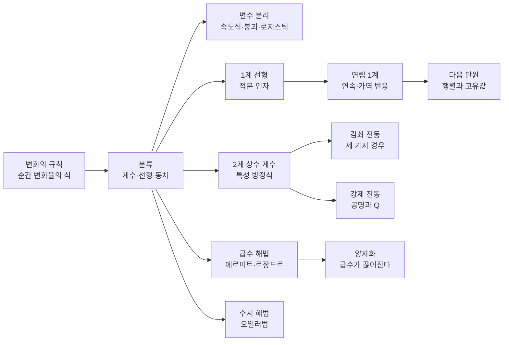

# 수학 도구 4. 상미분방정식 — 변화의 규칙에서 시간의 이야기를 읽어 내는 법
<!-- prev: umath-2, uchem-7, uphy-5 -->
<!-- next: umath-5, pchem-12 -->

> [!NOTE]
> **이 단원의 범위**
> - 미분방정식의 분류(계수·선형성·동차성, 상미분과 편미분)와 해·초기값 문제의 뜻
> - 변수 분리형 방정식 — 1·2차 반응 속도식, 방사성 붕괴, 로지스틱 성장
> - 1계 선형 방정식과 적분 인자 — 뉴턴 냉각, 온도계의 지연, 일정 속도 주입
> - 연립 1계 방정식 — 연속 반응 $\mathrm{A \rightarrow B \rightarrow C}$, 가역 반응의 이완, 방사 평형
> - 상수 계수 2계 선형 방정식 — 특성 방정식, 조화 진동자, 감쇠 진동의 세 경우, 강제 진동과 공명
> - 급수 해법의 생각 — 거듭제곱 급수와 점화식, 에르미트·르장드르 방정식이 나오는 까닭과 양자화
> - 수치 해법 — 오일러법, 계단 크기와 오차·안정성, 개선된 방법 개관

**학습 목표**

1. 미분방정식을 계수·선형성·동차성으로 분류하고, 일반해에 들어가는 임의 상수의 수와 초기 조건의 관계를 설명할 수 있다.
2. 변수 분리법과 부분 분수로 1·2차 반응 속도식, 방사성 붕괴, 로지스틱 성장의 해를 구하고 반감기·도달 시간을 계산할 수 있다.
3. 1계 선형 방정식의 적분 인자를 유도하고, 냉각·온도계 지연·약물 주입처럼 '일정한 값으로 다가가는 변화'를 풀어 시간 상수와 정상 상태를 해석할 수 있다.
4. 연속 반응과 가역 반응의 연립 1계 방정식을 풀어 중간체의 최대 농도와 그 시각, 이완 시간을 구하고, 속도 결정 단계·정류 상태 근사가 어디서 나오는지 설명할 수 있다.
5. 상수 계수 2계 선형 방정식을 특성 방정식으로 풀어 조화 진동자와 감쇠 진동의 세 경우를 구별하고, 강제 진동의 정상 상태 진폭·위상과 공명 봉우리의 폭($Q$ 인자)을 유도할 수 있다.
6. 거듭제곱 급수로 점화식을 세우고, 에르미트·르장드르 방정식의 급수가 끊어져야 한다는 조건에서 에너지 양자화가 나오는 까닭을 설명할 수 있다.
7. 오일러법으로 미분방정식을 수치적으로 풀고, 계단 크기에 따른 오차의 차수와 안정성 한계를 판단할 수 있다.

**이 단원의 학습 사다리**

| 단계 | 무엇을 하나? |
|---|---|
| STEP 1. 이전 학습 다시 보기 | 일반화학의 적분 속도 법칙, 일반물리학의 단순 조화 운동·감쇠 진동·RC 회로, 수학 도구 2의 테일러 급수를 꺼낸다 |
| STEP 2. 기초 다지기 | 지수 함수 $e^{\lambda t}$의 성질, 부분 분수 적분, 오일러 공식 $e^{i\theta}$, 테일러 전개 |
| STEP 3. 핵심 개념 | 분류 → 변수 분리 → 적분 인자 → 연립 1계(연속·가역 반응) → 2계 동차(진동·감쇠) → 2계 비동차(강제 진동·공명) → 급수 해법 → 오일러법 |
| STEP 4. 오개념 바로잡기 | "공명하면 진폭이 무한대가 된다", "계단을 반으로 줄이면 오차가 4분의 1이 된다" 같은 착각 |
| STEP 5. 더 깊은 수학 맛보기 | 존재·유일성 정리, 강성 방정식과 음해법, 상평면과 비선형 동역학 |
| STEP 6. 이 도구가 쓰이는 전공 단원 | 반응 속도론, 양자역학, 분광학, 효소 속도론과 약동학 |

---

## 🗺️ 단원 들어가기

과학의 법칙 가운데 상당수는 "어떤 양이 **지금** 얼마나 빨리 변하는가"를 말한다. 1차 반응은 "반응물이 줄어드는 속도가 반응물 농도에 비례한다", 뉴턴 냉각 법칙은 "식는 속도가 주위와의 온도 차에 비례한다", 용수철은 "가속도가 변위에 비례하고 방향은 반대이다"라고 말한다. 이런 문장은 모두 미분을 품은 방정식, 곧 **미분방정식**이다.

그런데 실험실에서 우리가 알고 싶은 것은 대개 변화율이 아니라 **시간에 따른 값 그 자체**이다. 30분 뒤 중간체의 농도는 얼마인가? 반응 혼합물이 실온까지 식는 데 얼마나 걸리는가? 분자 결합은 1초에 몇 번 진동하는가? 미분방정식을 '푼다'는 것은 "순간순간의 변화 규칙"에서 "전체 시간의 이야기"를 되살려 내는 일이다.

이 단원은 수학 교재가 아니라 **과학자를 위한 도구 상자**이다. 엄밀한 증명 대신 "어떤 꼴이면 어떤 방법으로 푸는가", "해의 각 항이 무엇을 뜻하는가"를 익힌다. 놀랍게도 전공에서 만나는 미분방정식의 대부분은 이 단원의 몇 가지 꼴로 정리된다. 연속 반응의 중간체, 원자힘 현미경의 캔틸레버, 수소 원자의 오비탈까지 같은 도구로 다룬다.

---

## STEP 1. 🔙 이전 학습 다시 보기

### 연계 개념표

| 이전 단원 | 그때 배운 것 | 이 단원에서 확장되는 것 |
|---|---|---|
| 일반화학 「화학 반응 속도론」 '적분 속도 법칙과 반감기' | 0·1·2차 속도 법칙을 변수 분리로 적분, 반감기, 직선 그래프로 차수 판정 | 서로 다른 두 반응물의 2차 반응(부분 분수), 연속 반응·가역 반응을 **연립 방정식**으로 풀기, 정류 상태 근사의 근거 |
| 일반물리학 「중력·진동·유체」 '단순 조화 운동', '감쇠 진동, 강제 진동과 공명' | $\ddot x = -\omega^2 x$의 해 $A\cos(\omega t + \phi)$, 감쇠 해와 강제 진동의 진폭 식을 **결과로** 받아들임 | 같은 결과를 **특성 방정식**으로 직접 유도, 세 감쇠 경우가 근의 판별식에서 나오는 까닭, 복소 지수로 진폭·위상 유도 |
| 일반물리학 「전류 회로와 자기장」 'RC 회로' | 충전·방전이 시간 상수 $RC$로 지수적으로 일정한 값에 다가감 | 일반적인 1계 선형 방정식과 **적분 인자**, 외부 입력이 시간에 따라 변할 때의 해 |
| 일반화학 「핵화학·배위 화학·유기화학 개관」 '붕괴 속도와 반감기' | 방사성 붕괴는 1차 반응, 반감기와 연대 측정 | 붕괴 계열(부모 → 딸)의 연립 방정식, 영년 평형 |
| 일반물리학 「현대 물리」 '슈뢰딩거 방정식과 무한 퍼텐셜 우물' | $\psi'' = -k^2\psi$의 해와 경계 조건에서 나오는 양자화 | 변수 계수 방정식(에르미트·르장드르)의 **급수 해법**, 급수가 끊어지는 조건으로서의 양자화 |
| 수학 도구 2 「적분과 급수」 '적분 기법', '테일러 급수와 근사' | 치환·부분 적분, $e^x$·$\ln(1+x)$의 급수 전개 | 적분 인자의 적분, 오일러법의 오차 분석, 거듭제곱 급수 해법 |

### 준비 운동 (사전 진단)

**Q1.** 1차 반응 $\dfrac{d[\mathrm{A}]}{dt} = -k[\mathrm{A}]$을 풀어 $[\mathrm{A}](t)$를 쓰고, 반감기를 $k$로 나타내시오.

**Q2.** 함수 $x(t) = 3\cos 2t$를 두 번 미분하면 어떤 식이 성립하는가? $\ddot x = (\quad)\,x$의 빈칸을 채우시오.

**Q3.** 일반물리학의 RC 회로에서 전압 $V_0$으로 충전할 때 축전기 전압이 $V_C(t) = V_0(1 - e^{-t/RC})$이다. $t = RC$일 때 $V_C$는 $V_0$의 몇 %인가?

**Q4.** $e^{x}$의 테일러 급수를 $x^3$ 항까지 쓰시오.

정답 및 해설

**Q1.** $[\mathrm{A}] = [\mathrm{A}]_0 e^{-kt}$, $t_{1/2} = \ln 2/k \approx 0.693/k$. 변수 분리 후 $\int d[\mathrm{A}]/[\mathrm{A}] = -k\int dt$로 얻는다. STEP 3 ②에서 이 방법을 일반화한다.

**Q2.** $-4$. $\dot x = -6\sin 2t$, $\ddot x = -12\cos 2t = -4x$. 사인·코사인은 "두 번 미분하면 자기 자신의 음수배"가 되는 함수이다. STEP 3 ⑤에서 이 성질을 특성 방정식으로 정리한다.

**Q3.** 약 63 %. $1 - e^{-1} = 0.632$. 시간 상수 하나가 지나면 남은 차이의 $1/e$만 남는다.

**Q4.** $e^x = 1 + x + \dfrac{x^2}{2} + \dfrac{x^3}{6} + \cdots$. STEP 3 ⑦의 급수 해법과 ⑧의 오일러법 오차 분석에서 쓴다.

---

## STEP 2. 🧱 기초 다지기

### 디딤돌 1. $e^{\lambda t}$ — 미분해도 모양이 그대로인 함수

지수 함수 $e^{\lambda t}$는 미분할 때마다 상수 $\lambda$가 곱해질 뿐 모양이 변하지 않는다.

$$
\frac{d}{dt}e^{\lambda t} = \lambda e^{\lambda t}, \qquad \frac{d^2}{dt^2}e^{\lambda t} = \lambda^2 e^{\lambda t}
$$

그래서 상수 계수 선형 방정식에 $y = e^{\lambda t}$를 넣으면 모든 항에 $e^{\lambda t}$가 공통으로 붙고, 미분방정식이 $\lambda$에 대한 **대수 방정식**으로 바뀐다. 이 단원에서 가장 자주 쓰는 요령이다.

| 시간 상수 표현 | 뜻 | 쓰이는 곳 |
|---|---|---|
| $e^{-t/\tau}$ | $\tau$마다 $1/e \approx 0.368$배 | RC 회로, 냉각, 형광 수명 |
| $e^{-kt}$, $t_{1/2} = \ln 2/k$ | 반감기마다 절반 | 1차 반응, 방사성 붕괴 |
| $1 - e^{-t/\tau}$ | $\tau$, $2\tau$, $3\tau$ 뒤에 63 %, 86 %, 95 % 도달 | 충전, 주입, 온도 평형 |

**보기** $y = e^{\lambda t}$가 $y'' + 5y' + 6y = 0$을 만족하도록 $\lambda$를 정하시오.

**풀이** 대입하면 $(\lambda^2 + 5\lambda + 6)e^{\lambda t} = 0$이다. $e^{\lambda t} \ne 0$이므로 $\lambda^2 + 5\lambda + 6 = (\lambda + 2)(\lambda + 3) = 0$, 즉 $\lambda = -2$ 또는 $-3$이다. 미분방정식을 풀지 않고 이차 방정식만 풀었다.

### 디딤돌 2. 부분 분수 — 분모를 쪼개어 적분하기

수학 도구 2 「적분과 급수」 '적분 기법'에서 익힌 부분 분수는 2차 반응 속도식과 로지스틱 방정식의 적분에 꼭 필요하다. 분모가 서로 다른 일차식의 곱이면

$$
\frac{1}{(a - x)(b - x)} = \frac{1}{b - a}\left(\frac{1}{a - x} - \frac{1}{b - x}\right) \qquad (a \ne b)
$$

로 쪼갠 뒤, 각 항을 $\int \dfrac{dx}{a - x} = -\ln\lvert a - x\rvert$로 적분한다.

**보기** $\displaystyle\int_0^{x}\frac{dx'}{(1 - x')(2 - x')}$를 구하시오 ($0 \le x < 1$).

**풀이** $a = 1$, $b = 2$이므로 피적분 함수는 $\dfrac{1}{1 - x'} - \dfrac{1}{2 - x'}$이다. 적분하면 $\left[-\ln(1 - x') + \ln(2 - x')\right]_0^x = \ln\dfrac{2 - x}{2(1 - x)}$이다. $x \to 1$이면 값이 무한히 커진다. 반응물 하나가 다 떨어지는 데 무한한 시간이 걸린다는 뜻이다(STEP 3 ②의 예제 3).

### 디딤돌 3. 오일러 공식 — 진동을 지수로 쓰기

2계 방정식의 특성 방정식은 복소수 근을 가질 수 있다. 이때 쓰는 도구가 **오일러 공식(Euler's formula)** 이다(자세한 내용은 수학 도구 6 「복소수와 푸리에 해석」에서 다룬다).

$$
e^{i\theta} = \cos\theta + i\sin\theta, \qquad e^{(\alpha + i\beta)t} = e^{\alpha t}(\cos\beta t + i\sin\beta t)
$$

실수부 $\alpha$는 진폭이 커지거나 줄어드는 빠르기, 허수부 $\beta$는 진동의 각진동수를 정한다. 실제 물리량은 실수이므로 복소 해의 **실수부와 허수부를 각각** 실수 해로 쓴다.

**보기** $e^{(-0.5 + 3i)t}$의 실수부와 허수부를 쓰고, $t = 1$에서의 값을 구하시오.

**풀이** 실수부 $e^{-0.5t}\cos 3t$, 허수부 $e^{-0.5t}\sin 3t$이다. $t = 1$에서 $e^{-0.5}\cos 3 = 0.6065\times(-0.9900) = -0.600$, $e^{-0.5}\sin 3 = 0.6065\times0.1411 = 0.0856$이다. 진폭이 $e^{-0.5t}$로 줄어드는 각진동수 3 rad/s의 진동, 곧 감쇠 진동의 모양이다.

<!-- 그림 요청: 복소 평면 위의 회전과 수축. 가로축 실수부, 세로축 허수부. 점 z(t) = e^{(-0.5 + 3i)t}의 자취를 t = 0부터 t = 4까지 안쪽으로 감기는 나선으로 그리고, t = 0(점 1), t = 1(점 −0.600 + 0.086i)을 표시한다. 오른쪽에 같은 t 구간의 실수부 e^{−0.5t}cos 3t 그래프(가로축 t, 세로축 값)와 포락선 ±e^{−0.5t}(점선)를 나란히 그린다. 이름표: "실수부 = 감쇠 진동", "포락선 e^{−0.5t}". -->

### 디딤돌 4. 테일러 전개 — 작은 계단의 오차 재기

수학 도구 2 '테일러 급수와 근사'에서 익힌 전개를 함수 $y(t)$에 쓰면

$$
y(t + h) = y(t) + h\,y'(t) + \frac{h^2}{2}y''(t) + \frac{h^3}{6}y'''(t) + \cdots
$$

이다. 처음 두 항만 남기면 "지금 값 + 계단 크기 × 지금 기울기"라는 오일러법(⑧)이 되고, 버린 항의 크기가 오차가 된다. 같은 생각을 해 자체에 적용하면 거듭제곱 급수 해법(⑦)이 된다.

**보기** $e^{-kh}$를 $1 - kh$로 근사할 때 $kh = 0.1$이면 오차는 얼마이고, 버린 항 $(kh)^2/2$와 비교하면 어떤가?

**풀이** $e^{-0.1} = 0.904837$, 근사값 $0.9$, 오차 $0.004837$이다. 버린 첫 항 $(0.1)^2/2 = 0.005$와 거의 같다. 오차는 **처음 버린 항**이 대부분을 차지한다. $kh$를 절반으로 줄이면 이 오차는 약 4분의 1이 된다.

---

## STEP 3. 📘 핵심 개념

### ① 미분방정식의 분류와 해의 뜻

**미분방정식(differential equation)** 은 미지의 함수와 그 도함수 사이의 관계식이다. 독립 변수가 하나(대개 시간 $t$ 또는 위치 $x$)이면 **상미분방정식(ordinary differential equation, ODE)**, 둘 이상이어서 편미분이 들어가면 **편미분방정식(partial differential equation, PDE)** 이다. 이 단원은 상미분방정식을 다루고, 편미분방정식은 수학 도구 8 「편미분방정식과 특수 함수」에서 변수 분리로 상미분방정식 여러 개로 쪼개어 푼다.

#### 분류의 기준

| 기준 | 뜻 | 예 |
|---|---|---|
| **계수(order)** | 들어 있는 가장 높은 도함수의 차수 | $y' = -ky$ (1계), $m\ddot x = -kx$ (2계) |
| **선형(linear)** | $y$와 그 도함수가 1차로만, 서로 곱해지지 않고 나타남: $a_n(t)y^{(n)} + \cdots + a_1(t)y' + a_0(t)y = g(t)$ | $\dot T = -k(T - T_\text{주위})$ |
| 비선형(nonlinear) | $y^2$, $yy'$, $\sin y$ 등이 들어 있음 | $d[\mathrm{A}]/dt = -k[\mathrm{A}]^2$, 진자 $\ddot\theta = -(g/L)\sin\theta$ |
| **동차(homogeneous)** | 선형 방정식에서 $y$와 관계없는 항 $g(t)$가 0 | $\ddot x + 2\gamma\dot x + \omega_0^2 x = 0$ |
| 비동차(inhomogeneous) | $g(t) \ne 0$ (외부 입력, 구동력, 공급원) | $\ddot x + 2\gamma\dot x + \omega_0^2 x = (F_0/m)\cos\omega t$ |
| 상수 계수 / 변수 계수 | $a_i$가 상수인가, $t$(또는 $x$)의 함수인가 | 변수 계수: 에르미트 방정식 $y'' - 2xy' + 2\nu y = 0$ |
| 자율(autonomous) | 독립 변수 $t$가 식에 직접 나타나지 않음 | $\dot N = rN(1 - N/K)$ |

여기서 '선형'은 해가 직선이라는 뜻이 아니다. **미지 함수에 대해** 1차라는 뜻이다. $y = e^{-kt}$는 곡선이지만 $y' = -ky$는 선형 방정식이다.

선형 동차 방정식에는 아주 중요한 성질이 있다. 두 해 $y_1$, $y_2$가 있으면 그 **선형 결합** $c_1y_1 + c_2y_2$도 해이다(**중첩 원리, superposition principle**). 미분이 선형 연산이기 때문이다. 비선형 방정식에는 이 성질이 없어서 다루기 훨씬 어렵다.

#### 일반해, 특수해, 초기값 문제

$n$계 방정식의 **일반해(general solution)** 에는 임의 상수가 $n$개 들어 있다. 미분 한 번을 되돌릴 때(적분할 때)마다 적분 상수가 하나씩 생기기 때문이다. 상수에 특정한 값을 넣은 것이 **특수해(particular solution)** 이고, 그 값을 정하려면 조건이 $n$개 필요하다.

- **초기값 문제(initial value problem)**: 한 시각의 값과 도함수를 준다. 예: $x(0) = x_0$, $\dot x(0) = v_0$. 뉴턴 역학과 반응 속도론의 기본 꼴이다.
- **경계값 문제(boundary value problem)**: 서로 다른 두 곳의 조건을 준다. 예: $\psi(0) = \psi(L) = 0$. 상자 속 입자, 진동하는 줄처럼 양자화가 나오는 문제의 꼴이다.

물리적으로 그럴듯한 방정식(우변이 매끄러운 함수)이면 초기값 문제의 해는 **하나뿐이다**(존재·유일성. 정확한 조건은 STEP 5). 그래서 "같은 처음 상태에서 출발한 계는 같은 미래를 갖는다"는 결정론적 예측이 가능하다.

#### 해를 확인하는 법 — 대입

어떤 함수가 해인지는 **대입해서 확인**하면 된다. 해를 구하는 방법을 모르더라도 확인은 언제나 할 수 있다. 이 단원의 모든 풀이 끝에서 이 확인을 습관으로 삼자.

#### 방향장 — 풀기 전에 해의 모양 보기

1계 방정식 $y' = f(t, y)$는 $(t, y)$ 평면의 각 점에서 해 곡선의 **기울기**를 알려 준다. 점마다 짧은 선분으로 기울기를 그린 것이 **방향장(direction field)** 이다. 해 곡선은 이 선분들을 따라 흐르는 곡선이다. 식을 풀 수 없을 때에도 방향장으로 평형값(기울기가 0인 수평선)과 그 안정성을 읽을 수 있다.

<!-- 그림 요청: 로지스틱 방정식 dN/dt = rN(1 − N/K)의 방향장. 가로축 t(0~20), 세로축 N/K(−0.1~1.4). 격자점마다 기울기 r·N(1 − N/K)(r = 0.4)의 짧은 선분을 그린다. 그 위에 처음값 N/K = 0.02, 0.3, 1.3인 해 곡선 세 개(실선)를 겹친다. N/K = 1(안정한 평형, 화살표가 모여드는 수평선)과 N/K = 0(불안정한 평형, 화살표가 멀어지는 수평선)을 굵은 점선으로 그리고 이름표를 붙인다. -->

#### 예제 1 — 분류하고 해 확인하기

(1) 다음 방정식을 계수, 선형/비선형, (선형이면) 동차/비동차로 분류하시오.
(가) $\dfrac{d[\mathrm{A}]}{dt} = -k[\mathrm{A}]^2$ (나) $m\ddot x + b\dot x + kx = F_0\cos\omega t$ (다) $-\dfrac{\hbar^2}{2m}\dfrac{d^2\psi}{dx^2} + \dfrac{1}{2}kx^2\psi = E\psi$ (라) $\dfrac{\partial c}{\partial t} = D\dfrac{\partial^2 c}{\partial x^2}$
(2) $x(t) = e^{-t}\cos 2t$가 $\ddot x + 2\dot x + 5x = 0$의 해임을 확인하시오.

**풀이**
(1) (가) 1계, 비선형($[\mathrm{A}]^2$), 자율. (나) 2계, 선형, 비동차(구동력 항), 상수 계수. (다) 2계, 선형, 동차, **변수 계수**($x^2$이 계수로 들어 있다. $E\psi$는 $\psi$에 비례하므로 동차 항이다). (라) 편미분방정식(독립 변수 $t$, $x$) — 확산 방정식.
(2) $\dot x = e^{-t}(-\cos 2t - 2\sin 2t)$, $\ddot x = e^{-t}(\cos 2t + 2\sin 2t + 2\sin 2t - 4\cos 2t) = e^{-t}(-3\cos 2t + 4\sin 2t)$.
$\ddot x + 2\dot x + 5x = e^{-t}[(-3 - 2 + 5)\cos 2t + (4 - 4)\sin 2t] = 0$. 해가 맞다.

**의미** (다)는 양자 조화 진동자의 슈뢰딩거 방정식이다. 시간에 대한 방정식이 아니어도 "미지 함수와 도함수의 관계"이면 같은 도구로 다룬다. (2)의 해는 디딤돌 3의 감쇠 진동 모양이며, ⑤에서 특성 방정식 $\lambda^2 + 2\lambda + 5 = 0$의 근 $-1 \pm 2i$로 바로 얻는다.

#### ✔ 바로 확인

1. (O/X) $y' = -ky$는 해가 지수 함수(곡선)이므로 비선형 방정식이다.
2. 빈칸: 3계 미분방정식의 일반해에는 임의 상수가 (    )개 들어 있다.
3. 고르기: 중첩 원리가 성립하는 것은? (가) $\ddot x + \omega^2 x = 0$ (나) $\ddot\theta + (g/L)\sin\theta = 0$ (다) $\dot y = y^2$
4. 빈칸: 서로 다른 두 위치에서 조건을 주는 문제를 (    ) 문제라 하며, 상자 속 입자의 양자화가 이 꼴에서 나온다.

정답

1. X — 미지 함수 $y$에 대해 1차이므로 선형이다. 선형성은 해의 모양이 아니라 방정식의 꼴로 정한다.
2. 3 — 적분을 세 번 되돌리는 셈이다.
3. (가) — (나)는 $\sin\theta$, (다)는 $y^2$ 때문에 비선형이다. 진자는 작은 각에서 $\sin\theta \approx \theta$로 근사해야 (가) 꼴이 된다.
4. 경계값

### ② 변수 분리형 — 반응 속도식, 방사성 붕괴, 로지스틱 성장

#### 방법

우변이 $t$만의 함수와 $y$만의 함수의 곱으로 쓰이는 1계 방정식

$$
\frac{dy}{dt} = g(t)\,h(y)
$$

을 **변수 분리형(separable)** 이라 한다. $h(y) \ne 0$이면 $y$는 왼쪽, $t$는 오른쪽으로 모아 양변을 적분한다.

$$
\int_{y_0}^{y}\frac{dy'}{h(y')} = \int_{t_0}^{t} g(t')\,dt'
$$

정적분으로 쓰면 초기 조건이 한계에 바로 들어가 적분 상수를 따로 정할 필요가 없다. 이 방법은 일반화학 「화학 반응 속도론」의 디딤돌 '변수 분리로 미분 방정식 풀기'와 같다. 여기서는 적분이 더 까다로운 경우로 넓힌다.

> [!WARNING]
> $h(y) = 0$이 되는 값 $y^*$에서는 나눗셈을 할 수 없다. 이때 $y(t) = y^*$(상수)는 그 자체로 해(평형해)이다. 예를 들어 $\dot N = rN(1 - N/K)$에서 $N = 0$과 $N = K$는 나누기 전에 따로 챙겨야 하는 평형해이다. 변수 분리로 얻은 식에 이 해가 빠져 있는 일이 흔하다.

#### 1차 반응과 방사성 붕괴

$\dot N = -\lambda N$은 $g = -\lambda$, $h = N$인 가장 단순한 경우이다. $N = N_0e^{-\lambda t}$, 반감기 $t_{1/2} = \ln 2/\lambda$, 평균 수명 $\tau = 1/\lambda$이다. 방사성 핵 하나하나는 언제 붕괴할지 알 수 없지만, 단위 시간에 붕괴할 **확률** $\lambda$가 일정하므로 집단 전체는 이 방정식을 따른다.

#### 예제 2 — 탄소-14 연대 측정

어떤 고대 목재 시료의 $^{14}\mathrm{C}/^{12}\mathrm{C}$ 비가 살아 있는 나무의 0.35배이다. $^{14}\mathrm{C}$의 반감기를 5730년으로 보고 시료의 나이를 구하시오.

**풀이**
식 세우기: 나무가 죽은 뒤 $^{14}\mathrm{C}$는 새로 들어오지 않고 붕괴만 하므로 $N/N_0 = e^{-\lambda t}$.
$\lambda = \ln 2/5730 = 1.210\times10^{-4}\ \mathrm{yr^{-1}}$
$t = \dfrac{1}{\lambda}\ln\dfrac{N_0}{N} = \dfrac{\ln(1/0.35)}{1.210\times10^{-4}} = \dfrac{1.0498}{1.210\times10^{-4}} = 8.7\times10^3\ \mathrm{yr}$
확인: $0.35$는 $0.5$(1 반감기)와 $0.25$(2 반감기) 사이이므로 나이는 5730년과 11460년 사이여야 한다. 맞다.

**의미** 실제 연대 측정에서는 대기 중 $^{14}\mathrm{C}$ 비가 시대에 따라 조금씩 달랐던 것을 나이테 자료로 보정한다. 방정식은 같고, '처음값 $N_0$'을 얼마로 볼 것인가가 보정의 대상이다.

#### 서로 다른 두 반응물의 2차 반응

$\mathrm{A + B \rightarrow P}$가 $v = k[\mathrm{A}][\mathrm{B}]$를 따르고 처음 농도가 $a_0 \ne b_0$라 하자. 반응한 양을 $x$라 하면 $[\mathrm{A}] = a_0 - x$, $[\mathrm{B}] = b_0 - x$이므로

$$
\frac{dx}{dt} = k(a_0 - x)(b_0 - x)
$$

이다. 이것은 변수 분리형이고, 좌변은 디딤돌 2의 부분 분수로 적분된다.

$$
\int_0^x\frac{dx'}{(a_0 - x')(b_0 - x')} = \frac{1}{b_0 - a_0}\ln\frac{a_0(b_0 - x)}{b_0(a_0 - x)} = kt
$$

정리하면

$$
\boxed{\;\ln\frac{[\mathrm{B}]\,a_0}{[\mathrm{A}]\,b_0} = (b_0 - a_0)\,kt\;}
$$

즉 $\ln([\mathrm{B}]/[\mathrm{A}])$를 $t$에 대해 그리면 기울기 $(b_0 - a_0)k$인 직선이다. $b_0 \gg a_0$이면 $[\mathrm{B}] \approx b_0$가 거의 일정해 이 식은 $\ln(a_0/[\mathrm{A}]) = b_0kt$, 곧 **유사 1차 반응**(속도 상수 $k' = kb_0$)이 된다. 일반화학에서 실험 요령으로 배운 유사 1차 근사가 정확한 해의 극한이라는 것을 확인할 수 있다.

#### 예제 3 — 에스터의 비누화

아세트산 에틸의 비누화 $\mathrm{CH_3COOC_2H_5 + OH^- \rightarrow CH_3COO^- + C_2H_5OH}$는 각 반응물에 1차이고, 25 ℃에서 $k \approx 0.11\ \mathrm{M^{-1}\,s^{-1}}$이다. $[\text{에스터}]_0 = 0.010\ \mathrm{M}$, $[\mathrm{OH^-}]_0 = 0.020\ \mathrm{M}$일 때 에스터의 50 %, 90 %가 반응하는 시간을 구하시오.

**풀이**
$a_0 = 0.010$(에스터), $b_0 = 0.020$($\mathrm{OH^-}$), $(b_0 - a_0)k = 0.010\times0.11 = 1.1\times10^{-3}\ \mathrm{s^{-1}}$.
50 %: $[\mathrm{A}] = 0.0050$, $[\mathrm{B}] = 0.015$. $\ln\dfrac{0.015\times0.010}{0.0050\times0.020} = \ln 1.5 = 0.405$ → $t = 0.405/1.1\times10^{-3} = 3.7\times10^2\ \mathrm{s}$ (약 6.1분)
90 %: $[\mathrm{A}] = 0.0010$, $[\mathrm{B}] = 0.011$. $\ln\dfrac{0.011\times0.010}{0.0010\times0.020} = \ln 5.5 = 1.705$ → $t = 1.55\times10^3\ \mathrm{s}$ (약 26분)

**의미** 1차 반응이었다면 90 % 반응 시간은 50 % 시간의 $\ln 10/\ln 2 = 3.3$배였을 것이다. 여기서는 4.2배이다. 반응이 진행될수록 $\mathrm{OH^-}$도 함께 줄어 속도가 더 빨리 느려지기 때문이다. 이 반응은 전도도 측정($\mathrm{OH^-}$가 이동도가 작은 $\mathrm{CH_3COO^-}$로 바뀐다)으로 쉽게 추적할 수 있어 학부 실험에 자주 쓰인다.

#### 로지스틱 성장 — 자원이 한정된 개체군

배양액 속 세균·효모의 수는 처음에는 지수적으로 늘다가 영양분이 줄면서 포화한다. 가장 단순한 모형이 **로지스틱 방정식(logistic equation)** 이다.

$$
\frac{dN}{dt} = rN\left(1 - \frac{N}{K}\right)
$$

$r$는 내재 증가율, $K$는 환경 수용력이다. 비선형이지만 변수 분리형이다. 부분 분수 $\dfrac{1}{N(1 - N/K)} = \dfrac{1}{N} + \dfrac{1/K}{1 - N/K}$로 적분하면

$$
\ln\frac{N}{K - N} - \ln\frac{N_0}{K - N_0} = rt \quad\Longrightarrow\quad N(t) = \frac{K}{1 + \dfrac{K - N_0}{N_0}e^{-rt}}
$$

이다. 확인: $t = 0$이면 $N = N_0$, $t \to \infty$이면 $N \to K$이다. 증가 속도 $\dot N$은 $N = K/2$에서 최대이며, 곡선은 그 점을 중심으로 대칭인 S자 모양이다.

<!-- 그림 요청: 로지스틱 곡선과 지수 곡선의 비교. 가로축 시간 t(h, 0~30), 세로축 N(세포/mL, 로그 눈금 10^5~10^8.3). 로지스틱 해 N = K/(1 + 999e^{−0.4t})(K = 1.0×10^8, N_0 = 1.0×10^5)를 실선, 같은 처음값의 지수 성장 N_0e^{0.4t}를 점선으로 그린다. N = K/2에 도달하는 t = 17.3 h를 세로 점선과 이름표로 표시하고, 가로 점선으로 K를 표시한다. 오른쪽 위에 작은 삽입 그림으로 같은 로지스틱 곡선을 선형 눈금(S자)으로 보여 준다. -->

#### 예제 4 — 효모 배양의 포화

효모 배양에서 $N_0 = 1.0\times10^5$개/mL, $K = 1.0\times10^8$개/mL, $r = 0.40\ \mathrm{h^{-1}}$이다. (1) $N = K/2$가 되는 시간, (2) $N = 0.90K$가 되는 시간을 구하시오. (3) 지수 성장만 했다면 $K/2$에 도달하는 시간은?

**풀이**
해를 $t$에 대해 풀면 $t = \dfrac{1}{r}\ln\dfrac{N(K - N_0)}{N_0(K - N)}$이다. $(K - N_0)/N_0 = 999$.
(1) $N = K/2$이면 $N/(K - N) = 1$이므로 $t = \ln 999/0.40 = 6.907/0.40 = 17.3\ \mathrm{h}$
(2) $N/(K - N) = 9$이므로 $t = \ln(9\times999)/0.40 = 9.104/0.40 = 22.8\ \mathrm{h}$
(3) $N_0e^{rt} = K/2$ → $t = \ln 500/0.40 = 15.5\ \mathrm{h}$

**의미** 처음 15시간 남짓은 지수 성장과 거의 구별되지 않다가(차이 약 2시간), 절반을 넘으면 불과 5.5시간 만에 90 %에 이르고 멈춘다. 발효 공정에서 '대수 증식기'와 '정지기'가 이렇게 나뉜다.

#### ✔ 바로 확인

1. $\dfrac{dy}{dt} = t\,y$를 $y(0) = 2$로 풀면?
2. (O/X) 로지스틱 방정식을 $N$으로 나누어 변수 분리할 때, $N = 0$인 해는 자동으로 얻은 식에 포함되므로 따로 생각할 필요가 없다.
3. 빈칸: $\mathrm{A + B \rightarrow P}$에서 $b_0 \gg a_0$이면 정확한 해는 속도 상수 (    )인 유사 1차 반응이 된다.
4. 반감기가 8.0일인 핵종이 처음의 1/16로 줄어드는 데 걸리는 시간은?

정답

1. $y = 2e^{t^2/2}$ — $\int dy/y = \int t\,dt$에서 $\ln(y/2) = t^2/2$.
2. X — 나누기 전에 $N = 0$과 $N = K$가 평형해인지 따로 확인해야 한다. 나눈 뒤 얻은 식에서는 빠질 수 있다.
3. $kb_0$ — $[\mathrm{B}] \approx b_0$가 거의 일정하기 때문이다.
4. 32일 — 1/16 = (1/2)⁴이므로 반감기 4번.

### ③ 1계 선형 방정식과 적분 인자 — 일정한 값으로 다가가는 변화

#### 표준형과 적분 인자의 유도

1계 선형 방정식은 언제나 다음 **표준형**으로 쓸 수 있다.

$$
\frac{dy}{dt} + p(t)\,y = q(t)
$$

$q(t)$는 외부에서 들어오는 '공급' 또는 '구동', $p(t)\,y$는 현재 양에 비례하는 '손실'이다. 우변에 $y$가 섞여 있어 변수 분리는 일반적으로 안 된다. 핵심 발상은 좌변을 **곱의 미분 하나로 만드는 것**이다.

1. 양변에 아직 모르는 함수 $\mu(t)$를 곱한다: $\mu y' + \mu p\,y = \mu q$.
2. 좌변이 $(\mu y)' = \mu y' + \mu' y$가 되기를 바란다. 그러려면 $\mu' = \mu p$이어야 한다.
3. 이것은 $\mu$에 대한 변수 분리형이다: $d\mu/\mu = p\,dt$ → $\mu(t) = \exp\!\left(\displaystyle\int p\,dt\right)$ (적분 상수는 필요 없다. 하나만 있으면 된다.)
4. 이제 $(\mu y)' = \mu q$를 적분한다: $\mu y = \displaystyle\int \mu q\,dt + C$.

$$
\boxed{\;y(t) = \frac{1}{\mu(t)}\left[\int \mu(t)\,q(t)\,dt + C\right], \qquad \mu(t) = e^{\int p\,dt}\;}
$$

이 $\mu$를 **적분 인자(integrating factor)** 라 한다. 상수 계수 $p = k$이면 $\mu = e^{kt}$이다.

> [!TIP]
> 💡 **연결** — '적분 인자'라는 이름은 수학 도구 1 「미분과 편미분」 '전미분과 완전 미분'에서도 나왔다. 경로 함수인 열 $\delta q_\text{가역}$에 $1/T$를 곱하면 완전 미분 $dS$가 된다. 여기서도 같은 일을 한다. 그냥은 적분할 수 없는 식에 인자를 곱해 '무엇의 미분'으로 만든다.

#### 해의 구조: 과도 항 + 정상 항

상수 계수 $p = k > 0$, 상수 입력 $q$이면 $\mu = e^{kt}$, $\int e^{kt}q\,dt = (q/k)e^{kt}$이므로

$$
y(t) = \frac{q}{k} + \left(y_0 - \frac{q}{k}\right)e^{-kt}
$$

이다. 해는 두 부분으로 나뉜다.

| 부분 | 식 | 뜻 |
|---|---|---|
| 정상 상태(특수해) | $y_\infty = q/k$ | 공급과 손실이 같아지는 값($\dot y = 0$) |
| 과도 항(동차해) | $(y_0 - y_\infty)e^{-t/\tau}$, $\tau = 1/k$ | 처음 상태의 '기억'. 시간 상수 $\tau$마다 $1/e$로 사라진다 |

이 구조 — **일반해 = 동차 방정식의 일반해 + 비동차 방정식의 특수해 하나** — 는 모든 선형 방정식에 공통이다. ⑥의 강제 진동에서도 그대로 다시 만난다.

| 과학 현상 | 방정식 | $\tau$ | 정상 상태 |
|---|---|---|---|
| 뉴턴 냉각 | $\dot T = -k(T - T_\text{주위})$ | $1/k$ | $T_\text{주위}$ |
| RC 충전 | $\dot V_C = (V_0 - V_C)/RC$ | $RC$ | $V_0$ |
| 약물 정맥 주입 | $\dot C = R/V - k_\mathrm{e}C$ | $1/k_\mathrm{e}$ | $R/(k_\mathrm{e}V)$ |
| 침강·낙하(선형 끌림) | $m\dot v = mg - bv$ | $m/b$ | 종단 속도 $mg/b$ |
| 지구 에너지 균형(단순 모형) | $C\dot T = F - \lambda T$ | $C/\lambda$ | $F/\lambda$ |

#### 입력이 시간에 따라 변할 때 — 온도계의 지연

적분 인자의 진가는 $q(t)$가 상수가 아닐 때 드러난다. 항온조를 일정한 속도 $\beta$로 가열하며 온도계로 잰다고 하자. 항온조 온도는 $T_\text{조}(t) = T_0 + \beta t$이고, 온도계는 시간 상수 $\tau$로 주위를 따라간다.

$$
\frac{dT}{dt} + \frac{1}{\tau}T = \frac{1}{\tau}(T_0 + \beta t), \qquad T(0) = T_0
$$

$\mu = e^{t/\tau}$를 곱해 적분하면(부분 적분 $\int t\,e^{t/\tau}dt = \tau t\,e^{t/\tau} - \tau^2e^{t/\tau}$을 쓴다)

$$
T(t) = T_0 + \beta(t - \tau) + \beta\tau\,e^{-t/\tau}
$$

이다. 확인: $t = 0$에서 $T = T_0$. 충분한 시간이 지나면 과도 항이 사라지고 $T(t) \approx T_\text{조}(t) - \beta\tau$, 즉 온도계는 항온조를 **늘 $\beta\tau$만큼 뒤처져** 따라간다.

<!-- 그림 요청: 일정 속도로 가열되는 항온조와 온도계 눈금. 가로축 시간 t(s, 0~150), 세로축 온도(℃). 항온조 온도 T_조 = 25 + βt(β = 2.0 K/min = 0.0333 K/s)를 점선 직선, 온도계 눈금 T(t) = 25 + β(t − τ) + βτe^{−t/τ}(τ = 20 s)를 실선으로 그린다. t = 120 s 부근에서 두 선 사이의 세로 간격에 양쪽 화살표를 긋고 "지연 βτ = 0.67 K"라고 적는다. 처음 약 60 s 동안 실선이 휘어지며 점선과 평행해지는 과도 구간을 옅은 음영으로 표시한다. -->

#### 예제 5 — 녹는점 측정의 가열 속도

시간 상수 $\tau = 20\ \mathrm{s}$인 온도계로 녹는점을 잰다. (1) 가열 속도가 $2.0\ \mathrm{K/min}$이면 정상 상태의 지연은 몇 K인가? (2) 가열을 시작하고 지연이 최종값의 99 %에 이르는 시간은? (3) 가열 속도를 $10\ \mathrm{K/min}$로 높이면 지연은?

**풀이**
(1) $\beta = 2.0/60 = 0.0333\ \mathrm{K/s}$, 지연 $= \beta\tau = 0.0333\times20 = 0.67\ \mathrm{K}$
(2) 지연은 $T_\text{조} - T = \beta\tau(1 - e^{-t/\tau})$이므로 $e^{-t/\tau} = 0.01$ → $t = \tau\ln 100 = 20\times4.61 = 92\ \mathrm{s}$
(3) $\beta\tau = (10/60)\times20 = 3.3\ \mathrm{K}$

**의미** 빠르게 가열하면 온도계가 실제보다 낮게 읽어 녹는점이 높게 기록된다(시료가 녹을 때 이미 온도계보다 뜨겁다). 녹는점 근처에서 가열을 분당 1~2 ℃로 늦추라는 실험 규칙이 이 식에서 나온다. 시차 주사 열량계(DSC)에서 가열 속도에 따라 봉우리 위치가 옮겨 가는 것도 같은 원리이다.

#### 예제 6 — 항생제의 정맥 주입

반감기 2.0 h로 1차 제거되는 항생제를 분포 부피 $V = 40\ \mathrm{L}$인 환자에게 $R = 50\ \mathrm{mg/h}$로 계속 주입한다. (1) 정상 상태 혈중 농도 (2) 그 90 %에 이르는 시간 (3) 주입 4.0 h 뒤의 농도를 구하시오. (4) 처음부터 정상 상태 농도를 만들려면 한꺼번에 얼마를 주사해야 하는가?

**풀이**
$k_\mathrm{e} = \ln 2/2.0 = 0.347\ \mathrm{h^{-1}}$. 방정식 $\dot C + k_\mathrm{e}C = R/V$, $C(0) = 0$ → $C(t) = C_\text{ss}(1 - e^{-k_\mathrm{e}t})$
(1) $C_\text{ss} = \dfrac{R}{k_\mathrm{e}V} = \dfrac{50}{0.347\times40} = 3.6\ \mathrm{mg/L}$
(2) $1 - e^{-k_\mathrm{e}t} = 0.90$ → $t = \ln 10/k_\mathrm{e} = 6.6\ \mathrm{h}$ (반감기의 약 3.3배)
(3) $C = 3.61\times(1 - e^{-0.347\times4.0}) = 3.61\times0.75 = 2.7\ \mathrm{mg/L}$
(4) $C_\text{ss}V = 3.61\times40 = 1.4\times10^2\ \mathrm{mg}$ (부하 용량)

**의미** 정상 상태에 이르는 시간은 주입 속도가 아니라 **제거 반감기만으로** 정해진다. 주입 속도를 두 배로 하면 도달하는 농도는 두 배가 되지만 걸리는 시간은 같다. 그래서 빨리 효과를 내야 할 때는 부하 용량을 먼저 주고 주입을 이어 간다. 이 경우 $y_0 = y_\infty$여서 과도 항이 처음부터 0이다.

#### ✔ 바로 확인

1. $y' + 3y = 6$, $y(0) = 0$의 해와 정상 상태 값은?
2. 빈칸: 표준형 $y' + p(t)y = q(t)$의 적분 인자는 $\mu = (\quad)$이다.
3. (O/X) 일정 속도로 주입하는 약물이 정상 상태의 90 %에 이르는 시간은 주입 속도가 클수록 짧다.
4. 시간 상수가 5.0 s인 온도계를 1.0 K/s로 데워지는 물에 넣었다. 충분한 시간 뒤 온도계는 실제보다 몇 K 낮게 읽는가?

정답

1. $y = 2(1 - e^{-3t})$, 정상 상태 2 — $\mu = e^{3t}$, $(ye^{3t})' = 6e^{3t}$.
2. $e^{\int p\,dt}$
3. X — 도달 시간은 $\ln 10/k_\mathrm{e}$로 제거 속도 상수만이 정한다. 주입 속도는 도달하는 농도의 크기만 바꾼다.
4. 5.0 K — 지연 $= \beta\tau$.

### ④ 연립 1계 방정식 — 연속 반응, 가역 반응, 방사 평형

여러 물질이 서로 바뀌는 반응에서는 각 농도의 변화율이 다른 농도에 의존한다. 미지 함수가 여러 개인 **연립 미분방정식(system of ODEs)** 이 된다. 1차 반응들로만 이루어진 연립계는 모두 선형이어서, 한 식씩 차례로 풀거나(삼각 구조일 때) 행렬의 고유값으로 한꺼번에 푼다.

#### 연속 반응 $\mathrm{A \xrightarrow{k_1} B \xrightarrow{k_2} C}$

$$
\frac{d[\mathrm{A}]}{dt} = -k_1[\mathrm{A}], \qquad \frac{d[\mathrm{B}]}{dt} = k_1[\mathrm{A}] - k_2[\mathrm{B}], \qquad \frac{d[\mathrm{C}]}{dt} = k_2[\mathrm{B}]
$$

처음에 A만 $[\mathrm{A}]_0$ 있다고 하자. 세 식을 더하면 $\frac{d}{dt}([\mathrm{A}] + [\mathrm{B}] + [\mathrm{C}]) = 0$, 즉 물질 수지가 보존된다.

**단계 1.** 첫 식은 B, C와 무관하다: $[\mathrm{A}] = [\mathrm{A}]_0e^{-k_1t}$.

**단계 2.** 이것을 둘째 식에 넣으면 B에 대한 **1계 선형 비동차 방정식**이 된다.

$$
\frac{d[\mathrm{B}]}{dt} + k_2[\mathrm{B}] = k_1[\mathrm{A}]_0e^{-k_1t}
$$

적분 인자 $e^{k_2t}$를 곱하면 $\dfrac{d}{dt}\left([\mathrm{B}]e^{k_2t}\right) = k_1[\mathrm{A}]_0e^{(k_2 - k_1)t}$. $[\mathrm{B}](0) = 0$으로 적분하면($k_1 \ne k_2$)

$$
\boxed{\;[\mathrm{B}] = \frac{k_1[\mathrm{A}]_0}{k_2 - k_1}\left(e^{-k_1t} - e^{-k_2t}\right)\;}
$$

**단계 3.** $[\mathrm{C}] = [\mathrm{A}]_0 - [\mathrm{A}] - [\mathrm{B}]$ (물질 수지).

**중간체의 최대.** $[\mathrm{B}]$는 0에서 시작해 늘었다가 다시 0으로 간다. $d[\mathrm{B}]/dt = 0$, 즉 $k_1e^{-k_1t} = k_2e^{-k_2t}$에서

$$
t_\text{max} = \frac{\ln(k_2/k_1)}{k_2 - k_1}, \qquad [\mathrm{B}]_\text{max} = [\mathrm{A}]_0\left(\frac{k_1}{k_2}\right)^{k_2/(k_2 - k_1)}
$$

이다. 이 순간 $d[\mathrm{B}]/dt = 0$이므로 $k_1[\mathrm{A}] = k_2[\mathrm{B}]$, 그리고 $d[\mathrm{C}]/dt = k_2[\mathrm{B}]$도 이때 가장 크다. C의 곡선은 $t_\text{max}$에서 변곡점을 가진다. 반응 초기에 C가 거의 생기지 않는 **유도기(induction period)** 는 연속 반응의 지문이다.

**$k_1 = k_2 = k$인 경우.** 위 식은 $0/0$ 꼴이 된다. 단계 2로 돌아가면 우변이 $k[\mathrm{A}]_0$(상수)가 되어 $[\mathrm{B}] = k[\mathrm{A}]_0\,t\,e^{-kt}$, $t_\text{max} = 1/k$, $[\mathrm{B}]_\text{max} = [\mathrm{A}]_0/e$이다. 지수 함수에 $t$가 곱해지는 이 꼴은 ⑤의 '중근'에서 다시 나온다.

<!-- 그림 요청: 연속 반응 A → B → C의 농도–시간 곡선 두 칸. 가로축 t(min), 세로축 농도/[A]_0(0~1). 왼쪽 칸: k_1 = 0.10 min^{-1}, k_2 = 0.050 min^{-1}(t 0~80 min). [A](감소 지수), [B](t_max = 13.9 min에서 최대 0.50), [C](S자, t_max에서 변곡점)를 서로 다른 선 모양으로 그리고 t_max에 세로 점선. 오른쪽 칸: k_1 = 0.10, k_2 = 1.0 min^{-1}(t 0~50 min). [B]가 작게(최대 약 0.08) 유지되며 [A]를 k_1/k_2배로 따라가는 모습. 오른쪽 칸에 "B는 낮게 유지(정류 상태)", C에는 "C의 생성 속도 ≈ k_1[A]"라고 이름표. -->

#### 예제 7 — 중간체를 언제 꺼낼까

중간체 B가 목표 생성물인 연속 반응에서 $k_1 = 0.10\ \mathrm{min^{-1}}$, $k_2 = 0.050\ \mathrm{min^{-1}}$, $[\mathrm{A}]_0 = 1.0\ \mathrm{M}$이다. (1) B가 최대가 되는 시간과 그 농도 (2) 그때의 $[\mathrm{A}]$, $[\mathrm{C}]$를 구하시오.

**풀이**
(1) $t_\text{max} = \dfrac{\ln(0.050/0.10)}{0.050 - 0.10} = \dfrac{-0.693}{-0.050} = 13.9\ \mathrm{min}$
$[\mathrm{B}]_\text{max} = 1.0\times(2.0)^{0.050/(-0.050)} = 2.0^{-1} = 0.50\ \mathrm{M}$
(2) $[\mathrm{A}] = e^{-0.10\times13.86} = e^{-\ln 4} = 0.25\ \mathrm{M}$, $[\mathrm{C}] = 1.0 - 0.25 - 0.50 = 0.25\ \mathrm{M}$
확인: $k_1[\mathrm{A}] = 0.025 = k_2[\mathrm{B}] = 0.025$ — B의 생성 속도와 소모 속도가 같다.

**의미** 합성에서 중간체를 얻으려면 반응을 $t_\text{max}$ 근처에서 멈춰야 한다. 더 오래 두면 B는 C로 사라진다. $t_\text{max}$ 식은 $k_1$과 $k_2$를 맞바꿔도 같다는 점에 주의하자. 즉 $t_\text{max}$만 보고는 어느 단계가 빠른지 알 수 없고, $[\mathrm{B}]_\text{max}$의 크기까지 보아야 구별된다(개념 확인 문제 13).

#### 속도 결정 단계와 정류 상태 — 정확한 해의 두 극한

| 경우 | $[\mathrm{B}]$의 모습 | $[\mathrm{C}]$의 생성 | 해석 |
|---|---|---|---|
| $k_2 \gg k_1$ | $[\mathrm{B}] \approx \dfrac{k_1}{k_2}[\mathrm{A}]$ — 작고 A를 따라감 | $\dfrac{d[\mathrm{C}]}{dt} \approx k_1[\mathrm{A}]$ | 첫 단계가 속도 결정 단계. B는 **정류 상태** |
| $k_1 \gg k_2$ | A가 먼저 B로 거의 다 바뀐 뒤 B가 천천히 C로 | $[\mathrm{C}] \approx [\mathrm{A}]_0(1 - e^{-k_2t})$ | 둘째 단계가 속도 결정 단계 |

$k_2 \gg k_1$일 때 정확한 해에서 $e^{-k_2t}$ 항은 $1/k_2$ 정도의 짧은 시간 뒤 사라지고 $[\mathrm{B}] \approx \frac{k_1}{k_2 - k_1}[\mathrm{A}] \approx \frac{k_1}{k_2}[\mathrm{A}]$만 남는다. 이것은 $d[\mathrm{B}]/dt \approx 0$으로 놓고 얻은 값과 같다. 물리화학 「반응 속도론과 반응 동역학」에서 복잡한 메커니즘에 쓰는 **정류 상태 근사**는 이렇게 "빠르게 사라지는 지수 항을 버리는 근사"이다.

#### 가역 반응 $\mathrm{A \rightleftharpoons B}$ — 평형으로의 이완

$$
\frac{d[\mathrm{A}]}{dt} = -k_1[\mathrm{A}] + k_{-1}[\mathrm{B}], \qquad [\mathrm{A}] + [\mathrm{B}] = [\mathrm{A}]_0
$$

$[\mathrm{B}] = [\mathrm{A}]_0 - [\mathrm{A}]$를 넣으면 $\dfrac{d[\mathrm{A}]}{dt} + (k_1 + k_{-1})[\mathrm{A}] = k_{-1}[\mathrm{A}]_0$ — 다시 ③의 꼴이다. 정상 상태는 평형 농도 $[\mathrm{A}]_\text{eq} = \dfrac{k_{-1}}{k_1 + k_{-1}}[\mathrm{A}]_0$이고

$$
[\mathrm{A}] - [\mathrm{A}]_\text{eq} = \left([\mathrm{A}]_0 - [\mathrm{A}]_\text{eq}\right)e^{-(k_1 + k_{-1})t}
$$

이다. 평형에서 벗어난 정도가 **$k_1 + k_{-1}$** 의 속도 상수로 사라진다. 이완 시간 $\tau = 1/(k_1 + k_{-1})$을 재면 합 $k_1 + k_{-1}$을, 평형 상수 $K = k_1/k_{-1}$을 재면 비를 알 수 있으므로 두 속도 상수를 각각 구할 수 있다. 온도 점프법 같은 **이완법**이 수 마이크로초 이하의 빠른 반응을 재는 원리이다.

#### 예제 8 — 포도당의 변광회전

물에 녹인 α-D-글루코피라노스는 β형과 평형을 이룬다($\alpha \rightleftharpoons \beta$). 25 ℃에서 평형 상수 $K = [\beta]_\text{eq}/[\alpha]_\text{eq}$를 1.8, 선광도 변화로 잰 겉보기 1차 속도 상수 $k_\text{obs}$를 $2.0\times10^{-4}\ \mathrm{s^{-1}}$이라 하자(이 예제의 값). (1) $k_1$, $k_{-1}$ (2) 평형까지 남은 차이가 10 %가 되는 시간 (3) 평형에서 β형의 비율을 구하시오.

**풀이**
(1) $k_1 + k_{-1} = k_\text{obs}$, $k_1/k_{-1} = K$ → $k_{-1} = \dfrac{k_\text{obs}}{1 + K} = \dfrac{2.0\times10^{-4}}{2.8} = 7.1\times10^{-5}\ \mathrm{s^{-1}}$, $k_1 = Kk_{-1} = 1.3\times10^{-4}\ \mathrm{s^{-1}}$
(2) $e^{-k_\text{obs}t} = 0.10$ → $t = \ln 10/k_\text{obs} = 1.15\times10^4\ \mathrm{s}$ (약 3.2 h)
(3) $K/(1 + K) = 1.8/2.8 = 0.64$ (64 %)

**의미** 관측되는 이완 속도($k_\text{obs}$)는 정반응 속도 상수가 아니라 **정·역반응 속도 상수의 합**이다. 이것을 $k_1$로 착각하면 정반응 속도를 과대평가한다.

#### 방사 평형 — 붕괴 계열에서 같은 수학

부모 핵 A(붕괴 상수 $\lambda_\mathrm{A}$)가 딸 핵 B($\lambda_\mathrm{B}$)로 붕괴하는 것은 연속 반응과 똑같은 방정식이다. 방사능(붕괴율) $\mathcal{A} = \lambda N$으로 쓰면, 부모의 수명이 딸보다 훨씬 길 때($\lambda_\mathrm{A} \ll \lambda_\mathrm{B}$) 위의 $[\mathrm{B}]$ 식에서

$$
\mathcal{A}_\mathrm{B} = \lambda_\mathrm{B}N_\mathrm{B} \approx \mathcal{A}_\mathrm{A}\left(1 - e^{-\lambda_\mathrm{B}t}\right)
$$

이 된다. 딸의 반감기 몇 배가 지나면 딸의 방사능이 부모와 같아진다(**영년 평형, secular equilibrium**). $^{226}\mathrm{Ra}$(반감기 약 1600년)와 $^{222}\mathrm{Rn}$(약 3.8일)이 대표적이다. 병원에서 쓰는 테크네튬-99m 발생기는 부모 $^{99}\mathrm{Mo}$(반감기 약 66시간)가 딸 $^{99\mathrm{m}}\mathrm{Tc}$(약 6시간)보다 몇 배 오래 사는 비슷한 관계(**과도 평형**)를 이용한다. 딸을 뽑아 쓴 뒤 하루쯤 기다리면 딸이 다시 쌓인다.

#### 행렬로 보는 연립계 — 다음 단원의 예고

1차 반응의 연립계는 농도 벡터 $\mathbf{c} = ([\mathrm{A}], [\mathrm{B}], [\mathrm{C}])^\mathrm{T}$로 묶어 $\dot{\mathbf{c}} = \mathbf{K}\mathbf{c}$로 쓸 수 있다.

$$
\frac{d}{dt}\begin{pmatrix}[\mathrm{A}]\\ [\mathrm{B}]\\ [\mathrm{C}]\end{pmatrix} = \begin{pmatrix}-k_1 & 0 & 0\\ k_1 & -k_2 & 0\\ 0 & k_2 & 0\end{pmatrix}\begin{pmatrix}[\mathrm{A}]\\ [\mathrm{B}]\\ [\mathrm{C}]\end{pmatrix}
$$

해는 $e^{\lambda t}$들의 선형 결합이고, 나타나는 $\lambda$는 행렬 $\mathbf{K}$의 **고유값** $-k_1$, $-k_2$, $0$이다($0$은 '아무것도 변하지 않는' 최종 상태). 위에서 구한 해에 바로 그 지수들이 들어 있다. 행렬이 삼각형이 아니어서 한 식씩 풀 수 없는 복잡한 메커니즘도 고유값 문제로 한꺼번에 풀린다. 이 방법은 수학 도구 5 「선형대수」 '고유값과 고유벡터'에서 다룬다.

#### ✔ 바로 확인

1. $\mathrm{A \rightarrow B \rightarrow C}$에서 $k_1 = k_2 = 0.20\ \mathrm{s^{-1}}$이면 $[\mathrm{B}]$가 최대가 되는 시간과 $[\mathrm{B}]_\text{max}/[\mathrm{A}]_0$는?
2. (O/X) 가역 반응 $\mathrm{A \rightleftharpoons B}$에서 평형으로 다가가는 지수 함수의 속도 상수는 $k_1 - k_{-1}$이다.
3. 빈칸: 연속 반응에서 $k_2 \gg k_1$이면 중간체 B는 $[\mathrm{B}] \approx (\quad)[\mathrm{A}]$로 작게 유지되며, 이를 (    ) 상태라 한다.
4. 연속 반응 그림의 왼쪽 칸에서 $[\mathrm{C}]$ 곡선의 변곡점은 어느 시각에 있는가?

정답

1. 5.0 s, $1/e \approx 0.37$ — $t_\text{max} = 1/k$, $[\mathrm{B}]_\text{max} = [\mathrm{A}]_0/e$.
2. X — 합 $k_1 + k_{-1}$이다. 정·역반응이 모두 평형으로 되돌리는 방향으로 작용하기 때문이다.
3. $k_1/k_2$, 정류
4. $t_\text{max} = 13.9\ \mathrm{min}$ — $d[\mathrm{C}]/dt = k_2[\mathrm{B}]$이므로 B가 최대일 때 C의 기울기가 최대이다.

### ⑤ 상수 계수 2계 선형 동차 방정식 — 조화 진동자와 감쇠 진동

#### 특성 방정식

$$
a\,y'' + b\,y' + c\,y = 0 \qquad (a, b, c\text{는 상수})
$$

디딤돌 1처럼 $y = e^{\lambda t}$를 넣으면 $(a\lambda^2 + b\lambda + c)e^{\lambda t} = 0$이므로

$$
a\lambda^2 + b\lambda + c = 0 \qquad (\textbf{특성 방정식, characteristic equation})
$$

의 근이 해의 지수를 정한다. 2계이므로 독립인 해 두 개가 필요하고, 일반해는 그 선형 결합(중첩 원리)이다. 판별식 $D = b^2 - 4ac$의 부호에 따라 세 경우가 생긴다.

| 근 | 일반해 | 모습 |
|---|---|---|
| 서로 다른 실근 $\lambda_1 \ne \lambda_2$ ($D > 0$) | $y = C_1e^{\lambda_1t} + C_2e^{\lambda_2t}$ | 지수 두 개의 합. 진동하지 않는다 |
| 중근 $\lambda$ ($D = 0$) | $y = (C_1 + C_2t)e^{\lambda t}$ | 진동하지 않는 경계 |
| 복소근 $\alpha \pm i\beta$ ($D < 0$) | $y = e^{\alpha t}(C_1\cos\beta t + C_2\sin\beta t)$ | 진폭이 $e^{\alpha t}$로 변하는 진동 |

**중근일 때 $t e^{\lambda t}$가 나오는 까닭.** 근이 하나뿐이면 $e^{\lambda t}$ 하나로는 상수 두 개를 맞출 수 없다. 두 근 $\lambda$와 $\lambda + \epsilon$이 거의 같다고 보면 $\dfrac{e^{(\lambda + \epsilon)t} - e^{\lambda t}}{\epsilon}$도 해(두 해의 선형 결합)이고, $\epsilon \to 0$이면 이것은 $\dfrac{\partial}{\partial\lambda}e^{\lambda t} = t\,e^{\lambda t}$가 된다. ④에서 $k_1 = k_2$일 때 $[\mathrm{B}] \propto t\,e^{-kt}$가 나온 것과 같은 현상이다.

**복소근일 때 사인·코사인이 나오는 까닭.** $e^{(\alpha + i\beta)t}$와 $e^{(\alpha - i\beta)t}$는 복소 함수이다. 방정식의 계수가 실수이므로 복소 해의 실수부와 허수부가 각각 실수 해이다. 디딤돌 3의 오일러 공식으로 쓰면 $e^{\alpha t}\cos\beta t$와 $e^{\alpha t}\sin\beta t$이다.

#### 조화 진동자

$m\ddot x = -kx$이면 특성 방정식 $m\lambda^2 + k = 0$, $\lambda = \pm i\omega_0$, $\omega_0 = \sqrt{k/m}$이다.

$$
x(t) = C_1\cos\omega_0t + C_2\sin\omega_0t = A\cos(\omega_0t + \phi)
$$

초기 조건 $x(0) = x_0$, $\dot x(0) = v_0$에서 $C_1 = x_0$, $C_2 = v_0/\omega_0$이다. 진동수는 계(질량과 용수철)가 정하고, 진폭과 위상은 처음 조건이 정한다. 일반물리학 「중력·진동·유체」에서 받아들였던 이 해가 이제 특성 방정식에서 직접 나왔다.

분자의 화학 결합도 평형 결합 길이 근처에서는 용수철처럼 행동한다. 퍼텐셜 에너지 $V(r)$을 평형 길이 $r_\mathrm{e}$ 근처에서 테일러 전개하면 $V \approx V(r_\mathrm{e}) + \frac{1}{2}k(r - r_\mathrm{e})^2$(1차 항은 극소점이라 0)이고, 두 원자의 상대 운동은 **환산 질량** $\mu = m_1m_2/(m_1 + m_2)$을 가진 하나의 조화 진동자가 된다.

#### 예제 9 — HCl 분자의 결합 힘 상수

$\mathrm{H^{35}Cl}$의 진동 흡수는 파수 약 $2886\ \mathrm{cm^{-1}}$에 나타난다. 조화 진동자로 보고 (1) 진동수와 주기 (2) 결합의 힘 상수 $k$를 구하시오. (원자 질량 $^1\mathrm{H}$ 1.00783 u, $^{35}\mathrm{Cl}$ 34.96885 u, $1\ \mathrm{u} = 1.66054\times10^{-27}\ \mathrm{kg}$, $c = 2.998\times10^{10}\ \mathrm{cm/s}$)

**풀이**
(1) $\nu = c\tilde\nu = 2.998\times10^{10}\times2886 = 8.652\times10^{13}\ \mathrm{Hz}$, 주기 $1/\nu = 1.16\times10^{-14}\ \mathrm{s}$ (약 12 fs)
(2) $\mu = \dfrac{1.00783\times34.96885}{1.00783 + 34.96885}\ \mathrm{u} = 0.97960\ \mathrm{u} = 1.6267\times10^{-27}\ \mathrm{kg}$
$\omega_0 = 2\pi\nu = 5.436\times10^{14}\ \mathrm{rad/s}$, $k = \mu\omega_0^2 = 1.6267\times10^{-27}\times(5.436\times10^{14})^2 = 4.81\times10^2\ \mathrm{N/m}$

**의미** 화학 결합 하나의 힘 상수가 수백 N/m — 손으로 누르기 어려운 단단한 용수철 수준이다. 환산 질량이 거의 수소 원자의 질량과 같다는 점도 눈여겨보자. 가벼운 H가 거의 혼자 움직이고 무거운 Cl은 거의 제자리에 있다. 그래서 $\mathrm{X{-}H}$ 결합의 진동은 적외선 스펙트럼의 높은 파수(약 $2800\sim3600\ \mathrm{cm^{-1}}$)에 모인다. 실제 결합은 조화 진동자에서 조금 벗어나며(비조화성), 그 보정은 물리화학 「분자 분광학」에서 다룬다.

#### 감쇠 진동 — 세 경우는 판별식에서 나온다

속도에 비례하는 저항 $-b\dot x$가 있으면 $m\ddot x + b\dot x + kx = 0$이다. $\gamma = b/2m$, $\omega_0 = \sqrt{k/m}$으로 쓰면

$$
\ddot x + 2\gamma\dot x + \omega_0^2x = 0, \qquad \lambda = -\gamma \pm \sqrt{\gamma^2 - \omega_0^2}
$$

| 경우 | 조건 | 근 | 해 |
|---|---|---|---|
| **과소 감쇠(underdamped)** | $\gamma < \omega_0$ | $-\gamma \pm i\omega_\mathrm{d}$, $\omega_\mathrm{d} = \sqrt{\omega_0^2 - \gamma^2}$ | $x = e^{-\gamma t}(C_1\cos\omega_\mathrm{d}t + C_2\sin\omega_\mathrm{d}t)$ |
| **임계 감쇠(critically damped)** | $\gamma = \omega_0$ | $-\omega_0$ (중근) | $x = (C_1 + C_2t)e^{-\omega_0t}$ |
| **과다 감쇠(overdamped)** | $\gamma > \omega_0$ | $-\gamma \pm \sqrt{\gamma^2 - \omega_0^2}$ (둘 다 음의 실수) | $x = C_1e^{\lambda_1t} + C_2e^{\lambda_2t}$ |

일반물리학에서 표로 외웠던 세 경우는 이차 방정식의 판별식이 양수·0·음수인 세 경우일 뿐이다. 근의 실수부(모두 음수)는 줄어드는 빠르기, 허수부는 진동을 정한다.

- 과소 감쇠의 진동은 $\omega_0$보다 조금 느린 $\omega_\mathrm{d}$로 일어난다. 진폭은 $e^{-\gamma t}$, 에너지는 $e^{-2\gamma t}$로 준다.
- 과다 감쇠에서는 두 근 중 절댓값이 작은 근 $\lambda_1 = -\gamma + \sqrt{\gamma^2 - \omega_0^2}$가 늦게까지 남아 평형으로 **천천히** 돌아간다. $\gamma$가 클수록 $\lambda_1 \approx -\omega_0^2/2\gamma$로 오히려 더 느려진다.
- 임계 감쇠는 진동 없이 가장 빨리 평형으로 돌아가는 경계이다. 지진계, 저울, 계기 바늘이 이 근처로 설계된다.

감쇠의 약함은 **품질 인자(quality factor)** $Q = \omega_0/2\gamma$로 나타낸다(일반물리학의 $Q = m\omega_0/b$와 같다). 한 주기 동안 진폭이 줄어드는 비의 로그 $\gamma T_\mathrm{d}$를 **로그 감쇠율**이라 하며, 과소 감쇠의 진동 자료에서 $\gamma$를 재는 가장 쉬운 방법이다.

<!-- 그림 요청: 감쇠 진동의 세 경우와 특성근의 위치. 왼쪽: 가로축 t(s, 0~4), 세로축 x/x_0(−1~1). ω_0 = 6.32 rad/s, x(0) = 1, ẋ(0) = 0인 해를 세 곡선으로 그린다. 과소 감쇠 γ = 2.0 s^{-1}(진동하며 포락선 ±e^{−2t}을 점선으로), 임계 감쇠 γ = 6.32 s^{-1}((1 + 6.32t)e^{−6.32t}), 과다 감쇠 γ = 12.6 s^{-1}(근 −1.69, −23.6). 오른쪽: 복소 평면(가로축 Re λ, 세로축 Im λ)에 세 경우의 특성근 위치를 표시한다. 과소 감쇠는 −2.0 ± 6.0i(반지름 ω_0인 원 위의 두 점), 임계 감쇠는 −6.32(중근, 원과 실수축이 만나는 점), 과다 감쇠는 −1.69와 −23.6(실수축 위). γ가 커질 때 근이 원을 따라 내려와 실수축에서 만난 뒤 좌우로 갈라지는 경로를 화살표로 그린다. -->

#### 예제 10 — 지진계의 감쇠 설계

지진계의 추를 질량 $m = 0.50\ \mathrm{kg}$, 용수철 상수 $k = 20\ \mathrm{N/m}$인 감쇠 진동자로 본다. (1) 임계 감쇠가 되는 감쇠 상수 $b$ (2) $b = 2.0\ \mathrm{kg/s}$일 때 $\gamma$, $\omega_\mathrm{d}$, 주기, $Q$ (3) (2)에서 $x(0) = 1.0\ \mathrm{cm}$, $\dot x(0) = 0$으로 놓았을 때 해를 쓰고, 한 주기 뒤의 변위를 구하시오.

**풀이**
(1) $\omega_0 = \sqrt{20/0.50} = 6.32\ \mathrm{rad/s}$. 임계 조건 $\gamma = b/2m = \omega_0$ → $b = 2m\omega_0 = 2\sqrt{km} = 2\sqrt{10} = 6.3\ \mathrm{kg/s}$
(2) $\gamma = 2.0/(2\times0.50) = 2.0\ \mathrm{s^{-1}}$, $\omega_\mathrm{d} = \sqrt{40 - 4.0} = 6.0\ \mathrm{rad/s}$, $T_\mathrm{d} = 2\pi/6.0 = 1.05\ \mathrm{s}$, $Q = 6.32/(2\times2.0) = 1.6$
(3) $x = e^{-2.0t}(C_1\cos 6.0t + C_2\sin 6.0t)$. $x(0) = C_1 = 1.0$. $\dot x(0) = -2.0C_1 + 6.0C_2 = 0$ → $C_2 = 1/3$.
$x(t) = e^{-2.0t}\left(\cos 6.0t + \tfrac{1}{3}\sin 6.0t\right)\ \mathrm{cm}$. 한 주기 뒤 $\cos$, $\sin$이 처음 값으로 돌아오므로 $x(T_\mathrm{d}) = e^{-2.0\times1.047} = e^{-2.09} = 0.12\ \mathrm{cm}$

**의미** $Q = 1.6$이면 한 번 출렁인 뒤 진폭이 8분의 1로 준다. 지진계가 지나치게 오래 흔들리면(큰 $Q$) 지진파가 지나간 뒤에도 기록이 계속되어 파형을 읽을 수 없고, 과다 감쇠이면 빠른 흔들림을 따라가지 못한다. 그래서 임계 감쇠의 약 0.7배($\gamma/\omega_0 \approx 0.7$) 근처로 맞추는 경우가 많다.

#### ✔ 바로 확인

1. $y'' - 5y' + 6y = 0$의 일반해는?
2. $\ddot x + 4\dot x + 4x = 0$은 어느 감쇠 경우인가? 일반해를 쓰시오.
3. (O/X) 과다 감쇠에서 감쇠 상수를 더 키우면 평형으로 더 빨리 돌아간다.
4. 감쇠 진동 그림의 복소 평면에서 과소 감쇠의 두 특성근은 원점에서 얼마나 떨어져 있는가?

정답

1. $y = C_1e^{2t} + C_2e^{3t}$ — $\lambda^2 - 5\lambda + 6 = (\lambda - 2)(\lambda - 3)$.
2. 임계 감쇠, $x = (C_1 + C_2t)e^{-2t}$ — $\lambda = -2$ 중근($\gamma = \omega_0 = 2$).
3. X — 느린 근 $\lambda_1 \approx -\omega_0^2/2\gamma$의 크기가 작아져 오히려 더 느려진다. 가장 빠른 것은 임계 감쇠이다.
4. $\omega_0$ — $\lvert -\gamma \pm i\omega_\mathrm{d}\rvert = \sqrt{\gamma^2 + \omega_\mathrm{d}^2} = \omega_0$. 그래서 근이 반지름 $\omega_0$인 원 위에 있다.

### ⑥ 비동차 2계 방정식 — 강제 진동과 공명

#### 해의 구조와 미정 계수법

$$
\ddot x + 2\gamma\dot x + \omega_0^2x = f(t)
$$

③에서처럼 일반해는 **동차 방정식의 일반해 $x_\mathrm{h}$ + 비동차 방정식의 특수해 $x_\mathrm{p}$ 하나**이다. 두 특수해의 차는 동차 방정식을 만족하므로, 특수해는 아무것이나 하나만 찾으면 된다. 감쇠가 있으면 $x_\mathrm{h}$는 시간이 지나며 사라지는 **과도 응답**이고, $x_\mathrm{p}$가 남는 **정상 상태 응답**이다. 초기 조건은 '전체 해' $x_\mathrm{h} + x_\mathrm{p}$에 맞춘다.

특수해는 구동 항과 같은 꼴을 시험해 계수를 맞추면 된다(**미정 계수법, method of undetermined coefficients**).

| 구동 $f(t)$ | 시험할 특수해 | 예 |
|---|---|---|
| 상수 $F$ | 상수 $X$ | 중력 속의 용수철: 평형 위치가 $mg/k$만큼 내려간다 |
| $e^{st}$ | $Xe^{st}$ | 지수적으로 줄어드는 입력 |
| $\cos\omega t$ 또는 $\sin\omega t$ | $X_1\cos\omega t + X_2\sin\omega t$ (또는 복소 $Xe^{i\omega t}$) | 주기적 구동력, 교류 전압, 빛의 전기장 |
| 시험 함수가 동차해와 겹칠 때 | 시험 함수에 $t$를 곱한다 | 감쇠 없는 계를 고유 진동수로 구동 |

#### 정상 상태 진폭과 위상 — 복소 지수로 유도하기

구동이 $f(t) = (F_0/m)\cos\omega t$이면 이것은 $(F_0/m)e^{i\omega t}$의 실수부이다. 복소 방정식 $\ddot z + 2\gamma\dot z + \omega_0^2z = (F_0/m)e^{i\omega t}$를 풀고 실수부를 취하면 된다(방정식이 선형이고 계수가 실수이므로 실수부끼리 따로 만족한다). $z = Xe^{i\omega t}$를 넣으면 미분이 $i\omega$의 곱셈이 되어

$$
(-\omega^2 + 2i\gamma\omega + \omega_0^2)X = \frac{F_0}{m} \quad\Longrightarrow\quad X = \frac{F_0/m}{\omega_0^2 - \omega^2 + 2i\gamma\omega}
$$

미분방정식이 **나눗셈 한 번**으로 풀렸다. 복소수 $X = \lvert X\rvert e^{-i\delta}$로 쓰면 $x_\mathrm{p} = \lvert X\rvert\cos(\omega t - \delta)$이고

$$
\boxed{\;\lvert X\rvert = \frac{F_0/m}{\sqrt{(\omega_0^2 - \omega^2)^2 + (2\gamma\omega)^2}}, \qquad \tan\delta = \frac{2\gamma\omega}{\omega_0^2 - \omega^2}\;}
$$

이다($\delta$는 변위가 구동력보다 늦는 위상, $0 \le \delta \le \pi$). 일반물리학에서 결과만 받았던 진폭 식($b/m = 2\gamma$)이 이렇게 유도된다.

| 구동 각진동수 | 진폭 | 위상 지연 $\delta$ | 물리적 해석 |
|---|---|---|---|
| $\omega \ll \omega_0$ | $\approx F_0/k$ (정적 변형) | $\approx 0$ | 용수철 힘이 지배 — 힘을 그대로 따라간다 |
| $\omega = \omega_0$ | $\dfrac{F_0}{2m\gamma\omega_0} = Q\,\dfrac{F_0}{k}$ | $\pi/2$ | 감쇠가 지배 — 속도가 힘과 같은 위상, 흡수 일률 최대 |
| $\omega \gg \omega_0$ | $\approx \dfrac{F_0}{m\omega^2}$ | $\approx \pi$ | 관성이 지배 — 반대 위상으로 조금만 흔들린다 |

#### 공명 봉우리의 높이와 폭

- **높이**: $\omega = \omega_0$에서 진폭은 정적 변형의 $Q$배이다. 진폭이 가장 큰 진동수는 정확히는 $\sqrt{\omega_0^2 - 2\gamma^2}$로 $\omega_0$보다 조금 낮지만, $Q$가 크면 차이를 무시할 수 있다.
- **폭**: 구동력이 한 주기 동안 하는 일의 평균(흡수 일률)은 $P(\omega) \propto \dfrac{\gamma\omega^2}{(\omega_0^2 - \omega^2)^2 + 4\gamma^2\omega^2}$이다. 이것이 최댓값의 절반이 되는 두 진동수는 $\lvert\omega_0^2 - \omega^2\rvert = 2\gamma\omega$에서 $\omega = \sqrt{\gamma^2 + \omega_0^2} \pm \gamma$이므로, 그 간격(**반치폭**)은 정확히

$$
\Delta\omega = 2\gamma = \frac{\omega_0}{Q}, \qquad Q = \frac{\omega_0}{\Delta\omega}
$$

이다. 감쇠가 작을수록 봉우리는 높고 좁다. 또 자유 진동의 에너지가 $1/e$로 주는 시간 $1/2\gamma$와 반치폭의 곱은 1이다. "오래 울리는 계일수록 좁은 진동수에만 반응한다"는 이 관계는 분광학에서 **수명이 짧은 들뜬 상태일수록 흡수선이 넓다**는 사실과 같은 수학이다.

<!-- 그림 요청: 강제 감쇠 진동자의 공명 곡선 두 칸(위아래). 가로축 ω/ω_0(0~2). 위 칸 세로축 진폭 |X|/(F_0/k)(0~12), Q = 1, 3, 10인 세 곡선 |X|/(F_0/k) = 1/√((1 − u²)² + (u/Q)²)(u = ω/ω_0). Q = 10 곡선에 반치폭(진폭이 최대의 1/√2인 두 점 사이, 폭 ≈ 1/Q)을 가로 화살표로 표시. 아래 칸 세로축 위상 지연 δ(0~π), 같은 세 Q의 δ = atan2(u/Q, 1 − u²) 곡선. u = 1에서 모든 곡선이 δ = π/2를 지나는 점을 강조한다. -->

<!-- 시뮬레이션 요청: 감쇠·강제 진동자. 조작 변수: 고유 각진동수 ω_0, 감쇠 γ(또는 Q), 구동 각진동수 ω, 구동 진폭, 초기 변위·속도. 보여 줄 것: (1) 시간 그래프에 전체 해 x(t)와 과도 응답 x_h, 정상 상태 x_p를 색으로 구분해 겹쳐 그리기, 구동력 cos ωt를 옅은 선으로 함께 표시해 위상 지연을 눈으로 확인 (2) 옆 그래프에 진폭·위상 공명 곡선과 현재 ω 위치 점 (3) γ = 0이고 ω = ω_0이면 진폭이 t에 비례해 커지는 모습, ω가 ω_0에 가까우면 맥놀이. -->

#### 예제 11 — 원자힘 현미경의 캔틸레버

원자힘 현미경(AFM)의 탐침이 달린 캔틸레버를 고유 진동수 $f_0 = 300\ \mathrm{kHz}$, 공기 중 $Q = 400$, 용수철 상수 $k = 40\ \mathrm{N/m}$인 감쇠 진동자로 보자(대표적인 값). 압전 소자로 가하는 구동력의 크기는 정적 변형 $F_0/k = 0.10\ \mathrm{nm}$에 해당한다. (1) $f_0$로 구동할 때의 진폭과 위상 지연 (2) 공명 곡선의 반치폭 $\Delta f$ (3) $f = f_0 + 375\ \mathrm{Hz}$로 구동할 때 진폭은 공명 진폭의 몇 배인가? (4) 구동을 끊으면 진폭이 $1/e$로 주는 데 얼마나 걸리는가?

**풀이**
(1) 공명 진폭 $= Q\times F_0/k = 400\times0.10 = 40\ \mathrm{nm}$, $\delta = \pi/2$ (90°)
(2) $\Delta f = f_0/Q = 300\ \mathrm{kHz}/400 = 750\ \mathrm{Hz}$
(3) 375 Hz는 반치폭의 절반이므로 흡수 일률이 절반인 지점이고, 진폭은 약 $1/\sqrt2 = 0.71$배이다. 정확한 식으로 계산해도 $\lvert X\rvert = 28.3\ \mathrm{nm}$, 비 0.71이며 위상 지연은 약 135°이다.
(4) $\gamma = \omega_0/2Q = 2\pi\times3.0\times10^5/800 = 2.36\times10^3\ \mathrm{s^{-1}}$, $1/\gamma = 4.2\times10^{-4}\ \mathrm{s}$ (0.42 ms, 약 130 주기)

**의미** 탐침이 표면에 가까워져 원자 사이의 힘을 받으면 실질적인 용수철 상수가 바뀌어 고유 진동수가 수 Hz~수백 Hz 옮겨 간다. 봉우리 폭이 750 Hz밖에 안 되므로, 그 이동이 진폭과 위상의 큰 변화로 나타난다. 높은 $Q$가 작은 힘을 재는 '증폭기' 역할을 하는 것이다. 다만 $Q$가 클수록 응답이 느려(4) 영상을 찍는 속도가 제한된다. 진공에서는 $Q$가 수만에 이르러 이 문제가 더 커진다.

<!-- 그림 요청: AFM 캔틸레버 구동과 측정의 모식도. 왼쪽에 압전 소자(구동 cos ωt)가 붙은 캔틸레버, 끝의 탐침, 시료 표면, 캔틸레버 뒤에서 반사되는 레이저와 4분할 광검출기. 오른쪽에 진폭–진동수 공명 곡선 두 개(탐침이 멀 때 f_0 = 300 kHz 중심, 표면 근처에서 왼쪽으로 조금 이동한 곡선)를 겹치고, 고정 구동 진동수 f_0에서 진폭이 A_1에서 A_2로 줄어드는 것을 세로 화살표로 표시. 이름표 "반치폭 Δf = f_0/Q", "표면 힘 → 공명 이동". -->

#### 감쇠가 없을 때 고유 진동수로 구동하면

$\gamma = 0$, $\omega = \omega_0$이면 시험 함수 $\cos\omega_0t$가 동차해와 겹친다. 표의 규칙대로 $t$를 곱한 $x_\mathrm{p} = Ct\sin\omega_0t$를 시험하면 $C = F_0/(2m\omega_0)$을 얻는다. 진폭이 시간에 비례해 **한없이 커진다.** 실제 계에는 늘 감쇠가 있으므로 진폭은 $Q$배에서 멈추지만, 감쇠가 아주 작은 다리·건물·기계에서 공명이 위험한 까닭이 이 식에 있다. 고유 진동수 근처에서 구동하면 맥놀이가 생기는 것도 같은 해에서 나온다(개념 확인 문제 19).

#### 같은 방정식, 다른 과학

| 계 | 방정식 | $\omega_0$ | $\gamma$ | 공명의 쓰임 |
|---|---|---|---|---|
| 질량–용수철 | $m\ddot x + b\dot x + kx = F(t)$ | $\sqrt{k/m}$ | $b/2m$ | 진동 측정, 진동 제어 |
| RLC 회로 | $L\ddot q + R\dot q + q/C = \mathcal{E}(t)$ | $1/\sqrt{LC}$ | $R/2L$ | 라디오 동조, NMR 수신 코일 |
| 분자 진동과 빛 | 결합 변위에 전기장이 힘을 줌 | 결합의 진동수 | 들뜬 상태의 수명 | 적외선 흡수 봉우리의 위치와 폭 |
| 고전적 원자 모형(로런츠 모형) | 전자를 용수철에 묶인 입자로 봄 | 흡수 진동수 | 복사·충돌 감쇠 | 굴절률의 진동수 의존(분산) |

#### ✔ 바로 확인

1. (O/X) 강제 감쇠 진동의 정상 상태는 계의 고유 진동수 $\omega_0$로 진동한다.
2. $\ddot x + 4x = 8$, $x(0) = 0$, $\dot x(0) = 0$의 해를 구하시오.
3. 빈칸: 공명 곡선의 반치폭 $\Delta\omega$와 품질 인자 사이에는 $Q = (\quad)$의 관계가 있다.
4. 공명 곡선 그림의 위상 그래프에서 구동 진동수가 고유 진동수보다 훨씬 클 때 위상 지연은 얼마에 가까운가?

정답

1. X — 과도 응답이 사라진 뒤에는 **구동 진동수** $\omega$로 진동한다. 고유 진동수는 진폭의 크기를 정한다.
2. $x = 2(1 - \cos 2t)$ — 특수해 $x_\mathrm{p} = 8/4 = 2$, 동차해 $C_1\cos 2t + C_2\sin 2t$, 초기 조건에서 $C_1 = -2$, $C_2 = 0$. (감쇠가 없어 새 평형점 2 주위로 계속 진동한다.)
3. $\omega_0/\Delta\omega$
4. $\pi$ (180°) — 관성이 지배해 구동력과 반대 위상으로 흔들린다.

### ⑦ 급수 해법의 생각 — 에르미트·르장드르 방정식과 양자화

계수가 상수가 아니면 $e^{\lambda t}$ 시험이 통하지 않는다. 양자역학의 슈뢰딩거 방정식이 대표적이다. 이때 쓰는 일반적인 방법이 해를 **거듭제곱 급수(power series)** 로 놓고 계수를 차례로 정하는 것이다.

$$
y(x) = \sum_{n=0}^{\infty}a_nx^n = a_0 + a_1x + a_2x^2 + \cdots
$$

#### 절차 — 점화식 만들기

1. $y$, $y'$, $y''$을 급수로 쓴다: $y' = \sum na_nx^{n-1}$, $y'' = \sum n(n-1)a_nx^{n-2}$.
2. 방정식에 넣고, 합의 첨자를 옮겨 **모든 항을 같은 $x^n$으로** 맞춘다.
3. 모든 $x$에서 0이 되려면 $x^n$의 계수가 하나하나 0이어야 한다 → 계수 사이의 **점화식(recurrence relation)**.
4. 2계 방정식이면 $a_0$, $a_1$이 임의 상수(두 개)로 남고, 나머지는 점화식이 정한다.

**몸풀기: $y'' + y = 0$.** $\sum n(n-1)a_nx^{n-2}$에서 $n \to n + 2$로 첨자를 옮기면 $\sum(n+2)(n+1)a_{n+2}x^n$이다. 따라서

$$
(n+2)(n+1)a_{n+2} + a_n = 0 \quad\Longrightarrow\quad a_{n+2} = -\frac{a_n}{(n+1)(n+2)}
$$

$a_0 = 1$, $a_1 = 0$이면 $1 - \frac{x^2}{2!} + \frac{x^4}{4!} - \cdots = \cos x$, $a_0 = 0$, $a_1 = 1$이면 $\sin x$의 급수가 나온다. 특성 방정식으로 얻은 답을 급수로도 되찾았다. 급수 해법은 답의 모양을 몰라도 쓸 수 있다는 것이 장점이다.

#### 에르미트 방정식 — 양자 조화 진동자에서 나온다

조화 진동자의 시간에 무관한 슈뢰딩거 방정식은

$$
-\frac{\hbar^2}{2m}\frac{d^2\psi}{dx^2} + \frac{1}{2}m\omega^2x^2\psi = E\psi
$$

이다. 무차원 변수 $\xi = x\sqrt{m\omega/\hbar}$와 $\varepsilon = 2E/\hbar\omega$를 쓰면 $\psi'' + (\varepsilon - \xi^2)\psi = 0$이 된다. $\xi$가 클 때 $\psi'' \approx \xi^2\psi$이고 이것은 $e^{\pm\xi^2/2}$처럼 행동하므로, 무한히 커지지 않는 쪽인 $\psi = h(\xi)e^{-\xi^2/2}$로 놓는다. 계산하면 $h$는 다음 **에르미트 방정식(Hermite equation)** 을 만족한다.

$$
h'' - 2\xi h' + 2\nu h = 0, \qquad 2\nu = \varepsilon - 1
$$

급수 $h = \sum a_n\xi^n$을 넣으면 $-2\xi h' = -\sum 2na_n\xi^n$이므로 $x^n$의 계수에서

$$
\boxed{\;a_{n+2} = \frac{2(n - \nu)}{(n+1)(n+2)}\,a_n\;}
$$

을 얻는다. 여기서 결정적인 질문이 생긴다. **이 급수가 끝나지 않으면 어떻게 되는가?** $n$이 크면 $a_{n+2}/a_n \approx 2/n$인데, 이것은 $e^{\xi^2} = \sum \xi^{2k}/k!$의 계수 비($n = 2k$일 때 $1/(k+1) \approx 2/n$)와 같다. 즉 끝나지 않는 급수는 $\xi$가 클 때 $e^{\xi^2}$처럼 자라고, $\psi \sim e^{\xi^2}e^{-\xi^2/2} = e^{\xi^2/2}$는 무한히 커져 확률로 해석할 수 없다(정규화할 수 없다).

물리적으로 허용되는 해는 급수가 어느 항에서 **끊어지는** 경우뿐이다. 점화식에서 $a_{n+2} = 0$이 되려면 $\nu$가 음이 아닌 정수 $n$이어야 한다(그리고 다른 쪽 홀짝 급수는 $a_0$ 또는 $a_1$을 0으로 놓아 없앤다). 따라서

$$
\nu = n = 0, 1, 2, \ldots \quad\Longrightarrow\quad E_n = \left(n + \frac{1}{2}\right)\hbar\omega
$$

에너지가 띄엄띄엄한 값만 가지는 **양자화**가 "급수가 끊어져야 한다"는 수학적 조건에서 나왔다. 끊어진 다항식이 **에르미트 다항식** $H_n(\xi)$이다(관례로 최고차 계수를 $2^n$으로 맞춘다).

| $n$ | $H_n(\xi)$ | $E_n/\hbar\omega$ | 홀짝 |
|---|---|---|---|
| 0 | $1$ | 1/2 (영점 에너지) | 짝 |
| 1 | $2\xi$ | 3/2 | 홀 |
| 2 | $4\xi^2 - 2$ | 5/2 | 짝 |
| 3 | $8\xi^3 - 12\xi$ | 7/2 | 홀 |

<!-- 그림 요청: 급수가 끊어질 때와 끊어지지 않을 때의 비교. 가로축 ξ(−4~4). 왼쪽 칸: ν = 2(끊어짐)에서 ψ ∝ H_2(ξ)e^{−ξ²/2}가 양쪽 끝에서 0으로 가는 모습. 오른쪽 칸: ν = 2.2(끊어지지 않음)에서 점화식 a_{n+2} = 2(n − ν)a_n/((n+1)(n+2)), a_0 = 1, a_1 = 0으로 급수를 충분히 많은 항(수백 항)까지 더한 h(ξ)에 e^{−ξ²/2}를 곱한 함수 — ξ = 0에서 1, ξ = 2에서 약 −0.74, ξ = 3에서 약 0.65, ξ = 4에서 약 8.3으로 |ξ|가 3을 넘으면 급격히 발산하는 모습(좌우 대칭). 왼쪽 칸도 비교하기 쉽게 같은 a_0 = 1 규약의 (1 − 2ξ²)e^{−ξ²/2}로 그리고, 두 칸에 같은 세로 눈금(−2~9)을 쓰고 이름표 "급수가 끊어짐 → 허용된 해", "끊어지지 않음 → e^{ξ²/2}처럼 발산". -->

#### 예제 12 — 점화식으로 $H_3$ 만들기

에르미트 방정식에서 $\nu = 3$, $a_0 = 0$, $a_1 = 1$로 놓고 점화식으로 해를 구한 뒤, 최고차 계수가 $2^3 = 8$이 되도록 맞추어 $H_3$를 얻으시오. 얻은 다항식이 방정식을 만족하는지 확인하시오.

**풀이**
$a_0 = 0$이므로 짝수 차 계수는 모두 0이다.
$a_3 = \dfrac{2(1 - 3)}{2\cdot3}a_1 = -\dfrac{2}{3}$, $a_5 = \dfrac{2(3 - 3)}{4\cdot5}a_3 = 0$ → 이후 모두 0. 급수가 끊어진다.
$h = \xi - \dfrac{2}{3}\xi^3$. 최고차 계수를 8로 맞추려면 $-12$를 곱한다: $H_3 = 8\xi^3 - 12\xi$.
확인: $H_3' = 24\xi^2 - 12$, $H_3'' = 48\xi$. $48\xi - 2\xi(24\xi^2 - 12) + 6(8\xi^3 - 12\xi) = 48\xi - 48\xi^3 + 24\xi + 48\xi^3 - 72\xi = 0$.

**의미** $n = 3$인 상태의 파동 함수는 $H_3(\xi)e^{-\xi^2/2}$이고, $H_3 = 0$인 세 점($\xi = 0, \pm\sqrt{3/2}$)이 **마디**이다. 양자수 $n$은 마디의 수와 같다. 물리화학 「진동·회전 운동과 수소 원자」에서 이 함수들의 모양과 분광학적 의미를 다룬다.

#### 르장드르 방정식 — 회전과 원자의 각 부분에서 나온다

분자의 회전이나 수소 원자처럼 구 대칭인 문제를 구면 좌표로 쓰면 각도 $\theta$에 대한 부분이 따로 떨어진다(이 분리는 수학 도구 8에서 한다). 방위각에 의존하지 않는 가장 단순한 경우, $x = \cos\theta$로 바꾸면 **르장드르 방정식(Legendre equation)** 이 된다.

$$
(1 - x^2)y'' - 2xy' + \ell(\ell + 1)y = 0, \qquad -1 \le x \le 1
$$

급수를 넣으면 같은 방식으로

$$
\boxed{\;a_{n+2} = \frac{n(n+1) - \ell(\ell+1)}{(n+1)(n+2)}\,a_n\;}
$$

이다. $n$이 크면 $a_{n+2}/a_n \to n/(n+2) \to 1$이어서 급수가 $\sum x^{2k}/(2k)$처럼 행동하고, 이것은 $x = \pm1$($\theta = 0, \pi$, 곧 북극과 남극)에서 **발산**한다. 파동 함수가 극에서 무한대가 될 수는 없으므로 급수가 끊어져야 하고, 그 조건은 $\ell$이 음이 아닌 정수인 것이다. 이것이 각운동량 크기의 양자화 $L^2 = \ell(\ell+1)\hbar^2$, 강체 회전자의 에너지 $E_\ell = \ell(\ell+1)\hbar^2/2I$로 이어진다. 끊어진 다항식이 **르장드르 다항식** $P_\ell(x)$이다($P_\ell(1) = 1$로 맞춘다).

| $\ell$ | $P_\ell(x)$ | $P_\ell(\cos\theta)$ | 이어지는 오비탈 모양 |
|---|---|---|---|
| 0 | $1$ | $1$ | s (구 대칭) |
| 1 | $x$ | $\cos\theta$ | $\mathrm{p}_z$ |
| 2 | $\frac{1}{2}(3x^2 - 1)$ | $\frac{1}{2}(3\cos^2\theta - 1)$ | $\mathrm{d}_{z^2}$ |
| 3 | $\frac{1}{2}(5x^3 - 3x)$ | $\frac{1}{2}(5\cos^3\theta - 3\cos\theta)$ | $\mathrm{f}_{z^3}$ |

<!-- 그림 요청: 르장드르 다항식 P_0~P_3. 왼쪽: 가로축 x(−1~1), 세로축 P_ℓ(x)(−1~1), 네 곡선을 서로 다른 선 모양으로 그리고 모든 곡선이 x = 1에서 1을 지나는 점을 강조. 오른쪽: P_2(cos θ) = (3cos²θ − 1)/2의 극좌표 그림(반지름 = |P_2|, 양수 영역과 음수 영역을 서로 다른 무늬로)으로 d_{z²} 오비탈 각 부분의 모양(z축 방향 두 잎과 적도의 고리)을 보이고, 마디 원뿔 각 θ = 54.7°(cos²θ = 1/3)를 점선으로 표시. -->

#### 예제 13 — $P_2$와 마디의 각도

르장드르 방정식에서 $\ell = 2$, $a_1 = 0$으로 놓고 점화식으로 해를 구한 뒤 $P_2(1) = 1$이 되도록 맞추시오. $P_2(\cos\theta) = 0$이 되는 각도를 구하시오.

**풀이**
$a_2 = \dfrac{0 - 6}{1\cdot2}a_0 = -3a_0$, $a_4 = \dfrac{2\cdot3 - 6}{3\cdot4}a_2 = 0$ → 끊어진다. $y = a_0(1 - 3x^2)$.
$y(1) = -2a_0 = 1$ → $a_0 = -\frac{1}{2}$, $P_2 = \frac{1}{2}(3x^2 - 1)$.
$3\cos^2\theta = 1$ → $\cos\theta = \pm1/\sqrt3$ → $\theta = 54.7°$, $125.3°$

**의미** 이 두 각도에서 $\mathrm{d}_{z^2}$ 오비탈의 각 부분이 0이 되어 원뿔 모양의 마디면이 생긴다. NMR에서 시료를 이 각도로 기울여 빠르게 돌리는 **매직각 회전**(54.7°)도 같은 $3\cos^2\theta - 1 = 0$에서 나온다. 같은 다항식이 오비탈과 고체 NMR에 동시에 나타나는 것이다.

> [!NOTE]
> 수소 원자의 지름 방정식처럼 계수가 어떤 점에서 무한대가 되는 방정식(그 점을 **특이점**이라 한다)은 순수한 거듭제곱 급수가 아니라 $x^s\sum a_nx^n$ 꼴(프로베니우스 방법)로 놓아야 한다. 생각은 같다. 점화식을 세우고, 급수가 끊어져야 한다는 조건에서 주양자수가 나온다. 그 결과가 라게르 다항식이며, 수학 도구 8과 물리화학 「진동·회전 운동과 수소 원자」에서 다룬다.

#### ✔ 바로 확인

1. $y' = y$에 $y = \sum a_nx^n$을 넣어 점화식을 쓰고, $a_0 = 1$일 때의 해를 쓰시오.
2. (O/X) 에르미트 방정식의 급수 해는 $\nu$가 어떤 값이든 수렴하므로 모두 물리적으로 허용된다.
3. 빈칸: 르장드르 방정식의 급수가 끊어지지 않으면 $x = (\quad)$에서 발산한다.
4. 에르미트 다항식 표에서 $n = 2$인 상태의 에너지는 $\hbar\omega$의 몇 배인가?

정답

1. $a_{n+1} = a_n/(n+1)$, $y = \sum x^n/n! = e^x$
2. X — 급수 자체는 모든 $\xi$에서 수렴하지만 $e^{\xi^2}$처럼 자라서 $\psi$를 정규화할 수 없다. 급수가 끊어지는(정수 $\nu$) 경우만 허용된다.
3. $\pm1$ — 곧 $\theta = 0, \pi$(극)이다.
4. 5/2 — $E_n = (n + \frac12)\hbar\omega$.

### ⑧ 수치 해법 — 오일러법과 그 한계

현실의 문제는 대부분 손으로 풀리지 않는다. 비선형 속도식, 수십 단계의 대기 화학 메커니즘, 큰 진폭의 진자가 그렇다. 이때는 해를 공식이 아니라 **숫자의 표**로 구한다.

#### 오일러법

$y' = f(t, y)$, $y(t_0) = y_0$에서 작은 계단 $h$를 정한다. 디딤돌 4의 테일러 전개에서 첫 두 항만 남기면

$$
\boxed{\;y_{n+1} = y_n + h\,f(t_n, y_n), \qquad t_{n+1} = t_n + h\;}
$$

이다. "지금 위치에서 지금 기울기로 $h$만큼 직선으로 나아간다"를 되풀이하는 것이 **오일러법(Euler method)** 이다. 방향장(①)의 선분을 이어 붙여 해 곡선을 그리는 것과 같다.

<!-- 그림 요청: 오일러법의 기하적 의미. 가로축 t(0~1.0), 세로축 y(0.3~1.0). 정확한 해 y = e^{−t}(실선 곡선)와 h = 0.25인 오일러 꺾은선(점 (0, 1), (0.25, 0.75), (0.5, 0.5625), (0.75, 0.4219), (1.0, 0.3164)을 잇는 선분과 점)을 그린다. 첫 계단에서 접선 방향 화살표와 "기울기 f(t_0, y_0)", 첫 계단의 국소 오차(정확한 해 e^{−0.25} = 0.7788과 0.75의 차)를 세로 괄호로 표시하고, t = 1에서 전체 오차(0.3679 − 0.3164 = 0.0515)를 표시한다. -->

#### 오차 — 국소 오차와 전체 오차

- **국소 오차**: 한 계단에서 버린 항은 $\frac{h^2}{2}y''$이므로 계단마다 $O(h^2)$의 오차가 생긴다.
- **전체 오차**: 정해진 구간 $[t_0, t_0 + L]$을 가려면 계단이 $L/h$개 필요하다. 국소 오차가 쌓이면 대략 $(L/h)\times O(h^2) = O(h)$이다.

오일러법은 **1차 방법**이다. 계단을 절반으로 줄이면 전체 오차도 절반이 된다(4분의 1이 아니다). $y' = -y$, $y(0) = 1$을 $t = 1$까지 풀어 확인해 보자. 정확한 값은 $e^{-1} = 0.367879$이고, 오일러법은 매 계단 $y$에 $(1 - h)$를 곱하므로 $y(1) = (1 - h)^{1/h}$이다.

| $h$ | 오일러법 $y(1)$ | 오차 | 개선된 오일러법(호인법) $y(1)$ | 오차 |
|---|---|---|---|---|
| 0.2 | 0.32768 | −0.0402 | 0.37074 | +0.0029 |
| 0.1 | 0.34868 | −0.0192 | 0.36854 | +0.00066 |
| 0.05 | 0.35849 | −0.0094 | 0.36804 | +0.00016 |

오일러법은 $h$를 반으로 줄일 때 오차가 약 절반, **개선된 오일러법**(아래)은 약 4분의 1로 준다. 오차의 줄어드는 비율을 보면 방법의 차수를 실험적으로 알 수 있다.

#### 안정성 — 계단이 너무 크면 해가 폭발한다

$y' = -ky$($k > 0$)에 오일러법을 쓰면 $y_{n+1} = (1 - hk)y_n$, 즉 $y_n = (1 - hk)^ny_0$이다.

| $hk$ | 곱해지는 수 $1 - hk$ | 수치 해의 모습 |
|---|---|---|
| $0 < hk < 1$ | $0$과 $1$ 사이 | 단조 감소(정확한 해와 같은 모습) |
| $1 < hk < 2$ | $-1$과 $0$ 사이 | 부호가 바뀌며 진동하지만 줄어든다 (가짜 진동) |
| $hk > 2$ | $-1$보다 작음 | 부호가 바뀌며 **발산** — 실제로는 줄어드는 양이 폭발한다 |

농도가 음수로 바뀌며 진동한다면 화학이 아니라 **수치 방법의 문제**이다. 안정하려면 $h < 2/k$이어야 하고, 정확하려면 그보다 훨씬 작아야 한다. 연립계에서는 **가장 빠른** 속도 상수가 계단 크기를 제한한다는 점이 중요하다(개념 확인 문제 18, STEP 5의 강성 방정식).

#### 예제 14 — 2차 반응을 오일러법으로

$\dfrac{d[\mathrm{A}]}{dt} = -k[\mathrm{A}]^2$, $k = 0.50\ \mathrm{M^{-1}s^{-1}}$, $[\mathrm{A}]_0 = 1.0\ \mathrm{M}$을 $h = 0.50\ \mathrm{s}$로 $t = 2.0\ \mathrm{s}$까지 오일러법으로 계산하고 정확한 해 $1/(1 + kt)$와 비교하시오. $h = 0.25\ \mathrm{s}$로 하면 $t = 2.0\ \mathrm{s}$의 오차는 어떻게 되는가?

**풀이**

| $n$ | $t_n$ (s) | $[\mathrm{A}]_n$ | 기울기 $-k[\mathrm{A}]_n^2$ | 정확한 값 |
|---|---|---|---|---|
| 0 | 0 | 1.0000 | −0.5000 | 1.0000 |
| 1 | 0.50 | 0.7500 | −0.2813 | 0.8000 |
| 2 | 1.00 | 0.6094 | −0.1857 | 0.6667 |
| 3 | 1.50 | 0.5165 | −0.1334 | 0.5714 |
| 4 | 2.00 | 0.4498 | | 0.5000 |

$t = 2.0\ \mathrm{s}$의 오차는 $0.4498 - 0.5000 = -0.050$ (−10 %). 같은 계산을 $h = 0.25\ \mathrm{s}$(8계단)로 하면 $[\mathrm{A}] = 0.4768$, 오차 $-0.023$으로 약 절반이 된다.

**의미** 오일러법은 매 계단 **처음의 기울기**를 쓴다. 이 반응에서는 기울기의 크기가 시간에 따라 줄어드므로, 처음 기울기로 나아가면 늘 지나치게 많이 줄인다. 그래서 수치 해가 체계적으로 정확한 해보다 작다. 오차의 부호까지 이해하면 결과를 믿을지 판단할 수 있다.

#### 더 나은 방법들 — 개관

| 방법 | 생각 | 차수 | 한 계단의 $f$ 계산 횟수 |
|---|---|---|---|
| 오일러법 | 처음 기울기로 나아감 | 1 | 1 |
| 개선된 오일러법(호인법, 2차 룽게–쿠타) | 오일러로 끝점을 예측 → 처음과 끝 기울기의 평균으로 다시 나아감 | 2 | 2 |
| 4차 룽게–쿠타법(RK4) | 구간 안의 네 기울기를 가중 평균 | 4 | 4 |
| 적응 계단법 | 오차를 추정해 해가 급하게 변하는 곳에서만 계단을 줄임 | 다양 | — |

개선된 오일러법은 $\tilde y = y_n + hf(t_n, y_n)$로 끝점을 예측한 뒤 $y_{n+1} = y_n + \frac{h}{2}\left[f(t_n, y_n) + f(t_{n+1}, \tilde y)\right]$로 고친다. 계산은 두 배이지만 오차는 $O(h^2)$로 훨씬 빨리 준다. 과학 계산 소프트웨어의 기본 풀이기는 대부분 4~5차 룽게–쿠타에 적응 계단을 결합한 것이다.

#### 2계 방정식은 1계 연립으로 바꾸어 푼다

$\ddot x = -\omega^2x$처럼 2계 방정식은 속도 $v = \dot x$를 새 변수로 두어 $\dot x = v$, $\dot v = -\omega^2x$의 1계 연립계로 바꾼 뒤 같은 방법을 쓴다. 이 변환은 수치 해법의 표준 요령이다.

#### 예제 15 — 오일러법은 진동자의 에너지를 늘린다

$\dot x = v$, $\dot v = -x$($\omega = 1$), $x(0) = 1$, $v(0) = 0$을 오일러법으로 풀면 한 계단마다 '에너지' $E = x^2 + v^2$이 몇 배가 되는가? $h = 0.10$으로 $t = 10$까지(100계단) 계산하면 $E$는 처음의 몇 배인가?

**풀이**
$x_{n+1} = x_n + hv_n$, $v_{n+1} = v_n - hx_n$이므로
$x_{n+1}^2 + v_{n+1}^2 = x_n^2 + 2hx_nv_n + h^2v_n^2 + v_n^2 - 2hx_nv_n + h^2x_n^2 = (1 + h^2)(x_n^2 + v_n^2)$
한 계단마다 $(1 + h^2)$배이다. 100계단이면 $(1.01)^{100} = 2.70$배 — 정확한 해에서는 $E$가 늘 1이어야 한다.

**의미** 에너지가 보존되어야 하는 계에서 오일러법의 해는 바깥으로 감기는 나선이 된다. 분자 동역학 시뮬레이션처럼 수백만 계단을 계산하면 계가 저절로 '뜨거워지는' 치명적인 오류이다. 갱신 순서를 바꾸어 새 속도로 위치를 옮기면($v_{n+1} = v_n - hx_n$, $x_{n+1} = x_n + hv_{n+1}$) 에너지가 늘지도 줄지도 않고 좁은 범위 안에서만 출렁인다. 분자 동역학에서 쓰는 속도 베를레 방법이 이런 '구조를 지키는' 방법의 대표이다.

<!-- 그림 요청: 진동자에 대한 오일러법의 상평면 자취. 가로축 x, 세로축 v(−2~2). 정확한 해(반지름 1인 원, 실선), 오일러법 h = 0.10으로 t = 0~10의 자취(반지름이 1에서 약 1.64까지 커지는 바깥 나선, 점선), 위치·속도 갱신 순서를 바꾼 방법의 자취(원 근처에서 거의 닫힌 약간 찌그러진 고리)를 겹쳐 그린다. 시작점 (1, 0)과 회전 방향(시계 방향) 화살표, 이름표 "오일러법: 에너지 증가", "순서를 바꾼 방법: 에너지 유지". -->

<!-- 시뮬레이션 요청: 오일러법과 계단 크기. 조작 변수: 방정식 선택(1차 붕괴 y' = −ky, 연속 반응 A → B → C, 진동자 ẍ = −ω²x), 계단 크기 h, 방법(오일러·개선된 오일러·RK4), 속도 상수 k_1, k_2. 보여 줄 것: 정확한 해와 수치 해를 겹친 그래프, 끝 시각의 오차와 h의 로그–로그 그래프(기울기로 차수 읽기), hk > 2에서 부호가 바뀌며 발산하는 모습, 진동자에서 에너지의 시간 변화. -->

#### ✔ 바로 확인

1. $y' = t + y$, $y(0) = 1$에서 $h = 0.1$로 오일러법 한 계단을 진행한 $y(0.1)$은?
2. (O/X) 오일러법에서 계단 크기를 절반으로 줄이면 전체 오차는 약 4분의 1이 된다.
3. $y' = -20y$를 오일러법으로 안정하게 풀 수 있는 계단 크기의 범위는?
4. 빈칸: 2계 방정식 $\ddot x = F(x)/m$을 수치적으로 풀 때는 $v = \dot x$를 두어 (    )계 연립 방정식으로 바꾼다.

정답

1. 1.1 — $y_1 = 1 + 0.1\times(0 + 1)$. (정확한 해 $2e^t - t - 1$에서는 1.1103)
2. X — 오일러법은 1차 방법이므로 약 절반이 된다. 4분의 1로 주는 것은 개선된 오일러법 같은 2차 방법이다.
3. $0 < h < 0.1$ — $hk < 2$. 정확도까지 생각하면 그보다 훨씬 작게 잡는다.
4. 1

---

## STEP 4. ⚠️ 오개념 바로잡기

| 오개념 | 왜 틀렸나 | 바른 이해 |
|---|---|---|
| 해가 지수 함수나 사인 함수처럼 곡선이면 비선형 방정식이다 | '선형'은 해의 그래프가 아니라 방정식이 미지 함수에 대해 1차인지를 말한다 | $y' = -ky$, $\ddot x + \omega^2x = 0$은 선형이다. $[\mathrm{A}]^2$, $\sin\theta$, $N^2$이 들어가면 비선형이다 |
| 변수 분리할 때 나눈 식의 해만 구하면 모든 해를 얻는다 | $h(y) = 0$인 값으로는 나눌 수 없어, 그 상수해가 빠질 수 있다 | 나누기 전에 평형해($N = 0$, $N = K$ 등)를 따로 확인한다 |
| 비동차 방정식은 특수해만 구하면 된다 | 특수해 하나로는 초기 조건을 맞출 수 없다 | 일반해 = 동차해 + 특수해. 초기 조건은 **전체 해**에 맞춘다. 동차해가 과도 응답이다 |
| 공명할 때 진폭은 무한대가 된다 | 감쇠가 있으면 진폭은 $Q\,F_0/k$에서 멈춘다. 무한히 커지는 것은 감쇠가 0인 이상화에서만이다 | 공명 봉우리의 높이는 $Q$배, 폭은 $\omega_0/Q$. 진폭이 가장 큰 진동수는 $\omega_0$보다 조금 낮다 |
| 감쇠 진동의 진동수는 고유 진동수와 같다 | 특성근의 허수부는 $\omega_\mathrm{d} = \sqrt{\omega_0^2 - \gamma^2}$이다 | 감쇠가 있으면 진동이 약간 느려진다. 약한 감쇠에서만 $\omega_\mathrm{d} \approx \omega_0$ |
| 감쇠를 세게 할수록 평형으로 더 빨리 돌아간다 | 과다 감쇠에서 느린 근 $-\omega_0^2/2\gamma$의 크기는 $\gamma$가 클수록 작다 | 가장 빨리 돌아가는 것은 임계 감쇠이다 |
| 가역 반응에서 관측한 이완 속도 상수는 정반응 속도 상수이다 | 정·역반응이 모두 평형으로 되돌리는 쪽으로 작용한다 | 관측값은 $k_1 + k_{-1}$이다. 평형 상수와 함께 써야 각각을 구한다 |
| 연속 반응에서 중간체의 최대 시각이 같으면 두 속도 상수도 같은 쌍이다 | $t_\text{max} = \ln(k_2/k_1)/(k_2 - k_1)$은 $k_1$과 $k_2$를 바꿔도 같다 | 어느 단계가 빠른지는 $[\mathrm{B}]_\text{max}$의 크기로 구별한다 |
| 오일러법에서 계단을 반으로 줄이면 오차가 4분의 1이 된다 | 국소 오차는 $O(h^2)$이지만 계단 수가 $1/h$배라 전체 오차는 $O(h)$이다 | 오일러법은 1차 방법. 2차 이상은 개선된 오일러법·룽게–쿠타법을 쓴다 |

---

## STEP 5. 🎓 다음 단계로 한 걸음 더

> [!CAUTION]
> 여기부터는 학부 과정의 범위를 넘는 대학원·연구 수준 맛보기이다. 더 깊은 수학(상미분방정식론, 수치 해석, 동역학계 이론)에서 이 단원의 도구가 어떻게 엄밀해지고 넓어지는지 보여 주기 위한 것으로, 평가 대상이 아니다.

### 대학원 과목·연구 분야와의 연결

| 과목·분야 | 이어지는 내용 |
|---|---|
| 상미분방정식론(해석학) | 존재·유일성 정리(피카르 반복, 립시츠 조건), 해의 연속 의존성, 스투름–리우빌 이론 |
| 수치 해석 | 다단계법, 적응 계단 크기, 강성 방정식과 음해법, 기하적(심플렉틱) 적분법 |
| 동역학계와 혼돈 | 상평면, 고정점의 선형 안정성, 리밋 사이클, 분기, 로렌츠 방정식과 혼돈 |
| 특수 함수와 수리 물리 | 프로베니우스 방법, 초기하 함수, 직교 다항식의 일반 이론 |
| 화학 동역학·계통 생물학 | 화학 진동(BZ 반응), 대사망의 민감도 분석, 확률적 화학 동역학(길레스피 알고리즘) |

### 맛보기 ① 존재·유일성과 해가 갈라지는 경우

$y' = f(t, y)$에서 $f$가 $y$에 대해 너무 급하게 변하지 않으면(**립시츠 조건**: $\lvert f(t, y_1) - f(t, y_2)\rvert \le L\lvert y_1 - y_2\rvert$) 초기값 문제의 해는 하나뿐이다. 증명은 적분 방정식 $y(t) = y_0 + \int_{t_0}^t f(s, y(s))\,ds$를 되풀이 대입해(피카르 반복) 수렴을 보이는 것이다. 이 조건이 깨지면 유일성도 깨진다. 예를 들어 $y' = \sqrt{\lvert y\rvert}$, $y(0) = 0$은 $y = 0$과 $y = t^2/4$($t \ge 0$)라는 두 해를 가진다. 원점에서 $\sqrt{y}$의 기울기가 무한대이기 때문이다. 과학 모형에서 이런 일은 드물지만, 0차 반응처럼 "농도가 0이 되면 갑자기 멈추는" 모형을 다룰 때 비슷한 미묘함이 나타난다.

### 맛보기 ② 강성 방정식과 음해법

대기 화학이나 연소 메커니즘에는 수명이 마이크로초인 라디칼과 수명이 몇 시간인 분자가 함께 들어 있다. 오일러법의 안정 조건 $h < 2/k_\text{max}$ 때문에 가장 빠른 라디칼에 맞춰 아주 작은 계단을 써야 하고, 몇 시간을 계산하려면 계단이 수십억 개 필요하다. 이렇게 시간 척도가 크게 다른 방정식을 **강성(stiff)** 이라 한다.

해결책은 **끝점의 기울기**를 쓰는 음해법이다. 역방향 오일러법 $y_{n+1} = y_n + hf(t_{n+1}, y_{n+1})$을 $y' = -ky$에 쓰면

$$
y_{n+1} = \frac{y_n}{1 + hk}
$$

로, $h$가 아무리 커도 $0 < 1/(1 + hk) < 1$이어서 결코 발산하지 않는다. 대가는 매 계단 $y_{n+1}$에 대한 (비선형) 방정식을 풀어야 한다는 것이다. 실용 화학 동역학 프로그램은 대부분 이런 음해법(후퇴 미분 공식 계열)을 쓴다.

### 맛보기 ③ 상평면과 비선형 진동

2계 방정식이나 2변수 연립계의 해를 $(x, v)$ 평면의 곡선으로 그린 것이 **상평면(phase plane)** 이다. 조화 진동자는 닫힌 타원, 감쇠 진동자는 원점으로 감기는 나선이다. 고정점 근처에서 방정식을 선형화(테일러 전개)하면 $\dot{\mathbf{u}} = \mathbf{J}\mathbf{u}$ 꼴이 되고, 야코비 행렬 $\mathbf{J}$의 고유값의 실수부 부호가 안정성을, 허수부가 회전을 정한다 — ⑤의 특성근 그림을 일반화한 것이다. 비선형 화학 반응계(예: 브뤼셀레이터 모형)에서는 고정점이 불안정해지면서 저절로 일정한 주기로 진동하는 **리밋 사이클**이 생긴다. 벨로우소프–자보틴스키 반응의 색이 주기적으로 바뀌는 현상, 심장 박동, 생체 시계가 이 수학으로 설명된다.

### 학부 vs 대학원·연구

| 주제 | 학부 (이 단원) | 대학원·연구 |
|---|---|---|
| 해의 존재 | 대입으로 확인, "하나뿐"을 받아들임 | 피카르 반복, 립시츠 조건, 해의 연장과 폭발 |
| 선형계 | 특성 방정식, 적분 인자, 미정 계수법 | 행렬 지수 함수, 그린 함수, 라플라스 변환 |
| 변수 계수 | 거듭제곱 급수와 점화식, 끊어짐 조건 | 프로베니우스 방법, 스투름–리우빌 이론, 점근 해석 |
| 수치 해법 | 오일러법, 오차의 차수, 안정 조건 | 강성 방정식, 음해법, 적응 계단, 심플렉틱 적분 |
| 비선형 | 로지스틱·2차 반응처럼 풀리는 경우 | 상평면, 분기, 리밋 사이클, 혼돈 |

---

## STEP 6. 🏭 생활·산업·진로 연결

이 단원의 도구는 전공 과목 곳곳에서 거의 그대로 다시 쓰인다. 아래는 "어느 전공 단원에서, 이 단원의 무엇을" 쓰는지 안내한다.

### 사례 1. 반응 메커니즘을 숫자로 — 물리화학 「반응 속도론과 반응 동역학」

- **쓰이는 도구** 연립 1계 방정식(④), 정류 상태 근사의 근거, 가역 반응의 이완, 수치 해법(⑧).
- **어디에 쓰이나** 린데만–힌셜우드 메커니즘, 연쇄 반응, 효소 반응의 속도 법칙은 중간체에 정류 상태 근사를 써서 얻는다. 근사가 언제 맞는지는 ④의 정확한 해로 판단한다. 대기 오존 화학이나 연소처럼 수백 단계의 메커니즘은 강성 방정식 풀이기로 계산한다. 생화학 「효소: 촉매 작용·반응 속도론·조절」의 미카엘리스–멘텐 식도 같은 근사에서 나온다.

### 사례 2. 슈뢰딩거 방정식 — 물리화학 「양자역학의 기초」, 「진동·회전 운동과 수소 원자」

- **쓰이는 도구** 상수 계수 2계 방정식과 경계값 문제(①, ⑤), 급수 해법과 끊어짐 조건(⑦).
- **어디에 쓰이나** 상자 속 입자는 $\psi'' = -k^2\psi$에 경계 조건을 준 것이고, 조화 진동자는 에르미트 방정식, 강체 회전자와 수소 원자의 각 부분은 르장드르 방정식, 수소 원자의 지름 부분은 라게르 방정식이다. 모든 경우에 "급수가 끊어지거나 경계 조건을 만족해야 한다"는 조건이 양자수를 만든다.

### 사례 3. 흡수선의 모양과 NMR — 물리화학 「분자 분광학」

- **쓰이는 도구** 강제 감쇠 진동(⑥)의 공명 곡선과 $Q$, 1차 이완(③④).
- **어디에 쓰이나** 분광 봉우리의 폭은 들뜬 상태의 수명과 $\Delta\omega \approx 1/\text{수명}$ 관계로 묶인다(⑥의 $\Delta\omega = 2\gamma$와 같은 수학). NMR에서 자화의 회복은 1계 선형 방정식(블로흐 방정식)을 따르며, 두 이완 시간 $T_1$, $T_2$가 각각 ③의 시간 상수 역할을 한다.

### 사례 4. 약동학과 환경 모형 — 생명·지구과학

- **쓰이는 도구** 1계 선형 방정식(③), 연속 반응과 같은 꼴의 구획 모형(④).
- **어디에 쓰이나** 신약 개발에서 경구 투여 약물의 혈중 농도는 '흡수 → 혈액 → 제거'의 연속 반응 모형(개념 확인 문제 10)으로 맞춘다. 호수의 오염 물질, 대기 중 온실 기체, 지구의 평균 기온 반응도 '공급 − 손실'의 1계 선형 모형을 출발점으로 삼는다.

### 이 도구가 쓰이는 전공 단원 한눈에

| 전공 단원 | 쓰이는 이 단원의 도구 |
|---|---|
| 물리화학 「기체의 성질과 열역학 제1법칙」 | 단열 과정 $dT/T = -(R/C_V)\,dV/V$의 변수 분리 |
| 물리화학 「양자역학의 기초」 | 2계 선형 방정식, 경계값 문제와 양자화 |
| 물리화학 「진동·회전 운동과 수소 원자」 | 에르미트·르장드르·라게르 방정식의 급수 해법 |
| 물리화학 「분자 분광학」 | 강제 감쇠 진동자, 공명 폭과 수명 |
| 물리화학 「반응 속도론과 반응 동역학」 | 연속·가역·병행 반응, 정류 상태 근사, 수치 해법 |
| 생화학 「효소: 촉매 작용·반응 속도론·조절」 | 정류 상태 근사, 1계 선형 방정식 |
| 분석화학 「분광 분석의 기초와 분자 분광법」 | 비어 법칙의 미분형 $dI/dx = -\kappa cI$, 형광 수명의 지수 감쇠 |
| 수학 도구 5 「선형대수」 | 연립 1계 방정식의 행렬 고유값 풀이 |
| 수학 도구 8 「편미분방정식과 특수 함수」 | 변수 분리로 얻는 상미분방정식, 특수 함수 |

### 관련 진로

| 진로 | 하는 일 | 관련 학과 |
|---|---|---|
| 화학 동역학·연소 연구원 | 메커니즘 모형을 세우고 강성 방정식으로 계산해 실험과 비교 | 화학과, 화학공학과, 기계공학과 |
| 계산화학자 | 슈뢰딩거 방정식의 수치 해, 분자 동역학 시뮬레이션 | 화학과, 물리학과 |
| 약동학·약리 연구원 | 구획 모형으로 투여 용량과 간격 설계 | 약학과, 생명과학과, 통계학과 |
| 정밀 측정·계측 엔지니어 | 공진기(AFM, 수정 진동자 저울, MEMS 센서)의 $Q$와 응답 설계 | 물리학과, 전자공학과, 기계공학과 |
| 기후·환경 모델러 | 에너지 균형 모형, 대기 화학 수송 모형 | 대기과학과, 환경공학과, 지구시스템과학과 |
| 시스템 생물학자 | 유전자 조절망·대사망의 미분방정식 모형과 안정성 분석 | 생명과학과, 수학과, 바이오공학과 |

---

## 🔬 탐구 활동

### 활동 A. (계산 실습) 스프레드시트로 연속 반응 풀기 — 오일러법과 정확한 해의 대결

**목표** 연속 반응 $\mathrm{A \rightarrow B \rightarrow C}$를 오일러법으로 풀어 정확한 해와 비교하고, 계단 크기에 따른 오차의 차수와 안정성 한계를 직접 확인한다.

**준비물** 스프레드시트 프로그램, 계산기

**과정**
1. 고정 셀에 $k_1 = 0.10\ \mathrm{min^{-1}}$, $k_2 = 0.050\ \mathrm{min^{-1}}$, $h = 2.0\ \mathrm{min}$, $[\mathrm{A}]_0 = 1.0$을 넣는다.
2. A열에 $t$(0부터 $h$씩 80 min까지), B·C·D열에 $[\mathrm{A}]$, $[\mathrm{B}]$, $[\mathrm{C}]$의 처음값(1, 0, 0)을 넣는다.
3. 다음 행에 오일러법을 입력한다: $[\mathrm{A}]_{n+1} = [\mathrm{A}]_n - hk_1[\mathrm{A}]_n$, $[\mathrm{B}]_{n+1} = [\mathrm{B}]_n + h(k_1[\mathrm{A}]_n - k_2[\mathrm{B}]_n)$, $[\mathrm{C}]_{n+1} = [\mathrm{C}]_n + hk_2[\mathrm{B}]_n$. 아래로 채운다.
4. E열에 정확한 해 $[\mathrm{B}] = \frac{k_1}{k_2 - k_1}(e^{-k_1t} - e^{-k_2t})$를, F열에 $[\mathrm{A}] + [\mathrm{B}] + [\mathrm{C}]$를 계산한다.
5. 수치 해에서 $[\mathrm{B}]$가 최대인 행을 찾아 $t_\text{max}$와 $[\mathrm{B}]_\text{max}$를 읽고, 예제 7의 값(13.9 min, 0.50)과 비교한다.
6. $h$를 4.0, 1.0, 0.5 min으로 바꾸어 $t = 20\ \mathrm{min}$에서 $[\mathrm{B}]$의 오차를 기록한다.
7. $k_2$를 $5.0\ \mathrm{min^{-1}}$로 바꾸고 $h = 0.5\ \mathrm{min}$으로 계산해 B열에 무슨 일이 생기는지 관찰한 뒤, $h$를 0.1 min으로 줄여 다시 계산한다.

**결과 기록**

| $h$ (min) | 수치 해 $[\mathrm{B}](20\ \mathrm{min})$ | 정확한 해 | 오차 | 오차 / $h$ |
|---|---|---|---|---|
| 4.0 | | | | |
| 2.0 | | | | |
| 1.0 | | | | |
| 0.5 | | | | |

**생각해 보기**
1. F열($[\mathrm{A}] + [\mathrm{B}] + [\mathrm{C}]$)은 $h$와 관계없이 정확히 1을 유지한다. 오일러법의 갱신식을 더해 그 까닭을 설명해 보자. 그런데도 각 농도에는 오차가 있는 이유는?
2. 오차 / $h$ 열이 거의 일정하면 무엇을 뜻하는가?
3. 과정 7에서 $hk_2$는 얼마였는가? ⑧의 안정성 표와 관련지어 설명하고, 이 문제를 정류 상태 근사로 풀면 계단 크기의 제약이 어떻게 달라지는지 토의해 보자.

### 활동 B. (실험 + 자료 분석) 뉴턴 냉각 법칙 검증과 시간 상수 측정

**목표** 뜨거운 물이 식는 곡선을 측정하여 $\ln(T - T_\text{주위})$와 $t$의 관계로 1계 선형 모형을 검증하고, 용기와 조건에 따른 시간 상수를 비교한다.

**준비물** 같은 크기의 비커 2개(하나는 단열재로 감싼다), 디지털 온도계 또는 온도 센서, 전기 주전자, 초시계, 실온 측정용 온도계, 보안경, 내열 장갑, 스프레드시트

**과정**
1. 실온 $T_\text{주위}$를 기록한다.
2. 주전자로 데운 물(약 80 ℃)을 두 비커에 같은 양(200 mL)씩 조심해서 붓는다.
3. 온도계를 물의 가운데에 넣고, 30분 동안 1분 간격으로 온도를 기록한다(가끔 살짝 저어 온도를 고르게 한다).
4. 각 시각의 $\ln(T - T_\text{주위})$를 계산해 $t$에 대해 그리고, 추세선의 기울기 $-k$와 시간 상수 $\tau = 1/k$를 구한다.
5. 처음 10분과 나중 20분의 자료로 따로 기울기를 구해 비교한다.

**결과 기록**

| 비커 | $T_\text{주위}$ (℃) | 기울기 $-k$ (min⁻¹) | $\tau$ (min) | 직선에서 벗어나는 구간 |
|---|---|---|---|---|
| 맨 비커 | | | | |
| 단열한 비커 | | | | |

**생각해 보기**
1. 처음 몇 분 동안 그래프가 직선보다 가파르다면 어떤 열 손실 과정(증발, 복사)이 온도 차에 비례하지 않기 때문일까? 뉴턴 냉각 법칙이 '근사'인 까닭을 토의해 보자.
2. 측정한 $\tau$로 "80 ℃의 물이 40 ℃가 되는 시간"을 예측하고 실제 자료와 비교해 보자.
3. 온도계 자체의 시간 상수(예제 5)가 10 s 정도라면 이 실험의 결과에 영향을 주는가? 그 판단의 근거는 두 시간 상수의 비교이다.

> [!WARNING]
> **안전 수칙** 끓인 물을 다룰 때는 보안경과 내열 장갑을 착용하고, 비커를 평평하고 안정한 곳에 둔다. 주전자의 전선이 걸리지 않게 정리한다. 유리 온도계를 쓸 때는 저을 때 비커 벽에 부딪혀 깨지지 않게 하고, 수은 온도계는 쓰지 않는다. 실험이 끝난 물은 충분히 식힌 뒤 버린다.

---

## ✅ 개념 확인 문제

### 기본

**1.** 다음 방정식을 계수, 선형/비선형, (선형이면) 동차/비동차로 분류하시오.
(1) $\dfrac{dT}{dt} = -k(T - T_\text{주위})$ ($T_\text{주위}$는 0이 아닌 상수) (2) $\dfrac{d[\mathrm{I}]}{dt} = 2k_1[\mathrm{I_2}] - 2k_2[\mathrm{I}]^2$ ($[\mathrm{I_2}]$는 주어진 함수) (3) $L\ddot q + R\dot q + q/C = 0$ (4) $\dfrac{d^2\psi}{dx^2} + \dfrac{2m}{\hbar^2}\left(E - V_0\right)\psi = 0$ ($V_0$는 상수)

정답 및 해설

**정답** (1) 1계 선형 비동차 (2) 1계 비선형 (3) 2계 선형 동차 (4) 2계 선형 동차

(1) $\dot T + kT = kT_\text{주위}$로 쓰면 우변이 0이 아닌 상수이므로 비동차이다. $u = T - T_\text{주위}$로 바꾸면 동차 $\dot u = -ku$가 된다. (2) $[\mathrm{I}]^2$ 항 때문에 비선형이다. (3) RLC 회로의 자유 진동. (4) 상수 퍼텐셜 속 입자의 슈뢰딩거 방정식. $E\psi$, $V_0\psi$ 모두 $\psi$에 비례하므로 동차이다.

**2.** 갑상선 검사에 쓰는 아이오딘-131의 반감기는 8.02일이다. (1) 30일 뒤 처음 방사능의 몇 %가 남는가? (2) 처음의 1.0 %로 줄어드는 데 며칠이 걸리는가?

정답 및 해설

**정답** (1) 약 7.5 % (2) 약 53일

$\lambda = \ln 2/8.02 = 0.0864\ \mathrm{d^{-1}}$
(1) $e^{-0.0864\times30} = e^{-2.593} = 0.0748$
(2) $t = \ln 100/\lambda = 4.605/0.0864 = 53.3\ \mathrm{d}$. 반감기의 약 6.6배이다($\log_2 100 = 6.64$).

**3.** 빛이 흡광 물질의 용액을 지날 때, 얇은 두께 $dx$에서 줄어드는 세기는 그 자리의 세기 $I$와 농도 $c$에 비례한다: $\dfrac{dI}{dx} = -\kappa cI$. (1) 이 식을 풀어 $I(x)$를 구하고, 흡광도 $A = \log(I_0/I)$가 $\varepsilon cl$ 꼴(비어 법칙)이 됨을 보이시오. $\varepsilon$를 $\kappa$로 나타내시오. (2) $\varepsilon = 1.2\times10^4\ \mathrm{M^{-1}cm^{-1}}$, $c = 2.0\times10^{-5}\ \mathrm{M}$, $l = 1.0\ \mathrm{cm}$이면 투과율은?

정답 및 해설

**정답** (1) $I = I_0e^{-\kappa cx}$, $\varepsilon = \kappa/\ln 10$ (2) 약 58 %

(1) 변수 분리: $dI/I = -\kappa c\,dx$ → $I = I_0e^{-\kappa cl}$ (두께 $l$). $A = \log(I_0/I) = \kappa cl/\ln 10 = \varepsilon cl$, $\varepsilon = \kappa/\ln 10 = \kappa/2.303$.
(2) $A = 1.2\times10^4\times2.0\times10^{-5}\times1.0 = 0.24$, 투과율 $10^{-0.24} = 0.575$.
분석화학의 비어 법칙은 '빛의 1차 반응'이다. 세기에 비례해 흡수되기 때문에 지수 함수가 나온다.

**4.** $\ddot y + 4\dot y + 13y = 0$, $y(0) = 1$, $\dot y(0) = 0$을 푸시오. 어떤 감쇠 경우에 해당하는가?

정답 및 해설

**정답** $y = e^{-2t}\left(\cos 3t + \frac{2}{3}\sin 3t\right)$, 과소 감쇠

특성 방정식 $\lambda^2 + 4\lambda + 13 = 0$ → $\lambda = -2 \pm 3i$. $y = e^{-2t}(C_1\cos 3t + C_2\sin 3t)$.
$y(0) = C_1 = 1$, $\dot y(0) = -2C_1 + 3C_2 = 0$ → $C_2 = 2/3$.
$\gamma = 2 < \omega_0 = \sqrt{13}$이므로 과소 감쇠이며, $\omega_\mathrm{d} = \sqrt{13 - 4} = 3$이다.

**5.** 반응 혼합물의 온도가 $\dfrac{dT}{dt} = -0.10(T - 20)$ (℃, 분)을 따른다. $T(0) = 90\ \text{℃}$일 때 $h = 1.0\ \mathrm{min}$으로 오일러법 두 계단을 진행해 $T(2.0\ \mathrm{min})$을 구하고, 정확한 해와 비교하시오.

정답 및 해설

**정답** 오일러법 76.7 ℃, 정확한 해 77.3 ℃

$T_1 = 90 - 0.10\times70\times1.0 = 83.0$, $T_2 = 83.0 - 0.10\times63.0 = 76.7$.
정확한 해 $T = 20 + 70e^{-0.10t}$ → $T(2.0) = 20 + 70e^{-0.20} = 77.3\ \text{℃}$.
오일러법은 매 계단 처음의 (가장 큰) 냉각 속도를 써서 지나치게 식힌다. 오차 −0.6 ℃.

### 응용

**6. [지구과학 연계]** 구름 속 반지름 $10\ \mu\mathrm{m}$의 물방울이 공기 중에서 떨어진다. 이 크기에서는 공기 저항이 속도에 비례하며 $F = -6\pi\eta rv$(스토크스 법칙, $\eta = 1.8\times10^{-5}\ \mathrm{Pa\cdot s}$)이다. 공기의 부력은 무시하고 물의 밀도는 $1000\ \mathrm{kg/m^3}$, $g = 9.8\ \mathrm{m/s^2}$이다. (1) 운동 방정식을 표준형으로 쓰고 시간 상수 $\tau$와 종단 속도를 구하시오. (2) 정지 상태에서 출발해 종단 속도의 99 %에 이르는 시간은?

정답 및 해설

**정답** (1) $\tau \approx 1.2\ \mathrm{ms}$, $v_\mathrm{t} \approx 1.2\ \mathrm{cm/s}$ (2) 약 5.7 ms

(1) $m\dot v = mg - 6\pi\eta rv$ → $\dot v + v/\tau = g$, $\tau = \dfrac{m}{6\pi\eta r} = \dfrac{2\rho r^2}{9\eta} = \dfrac{2\times1000\times(1.0\times10^{-5})^2}{9\times1.8\times10^{-5}} = 1.23\times10^{-3}\ \mathrm{s}$.
정상 상태 $v_\mathrm{t} = g\tau = 9.8\times1.23\times10^{-3} = 1.2\times10^{-2}\ \mathrm{m/s}$.
(2) $v = v_\mathrm{t}(1 - e^{-t/\tau})$ → $t = \tau\ln 100 = 5.7\times10^{-3}\ \mathrm{s}$.
구름 방울은 수 밀리초 만에 종단 속도에 이르므로 늘 종단 속도로 떨어진다고 보아도 된다. 1 cm/s 남짓으로 아주 느려서 약한 상승 기류에도 떠 있을 수 있다.

**7.** $^{226}\mathrm{Ra}$(반감기 약 1600년)만 들어 있는 시료를 밀봉하였다. 딸 핵 $^{222}\mathrm{Rn}$(반감기 3.82일)의 방사능이 라듐 방사능의 99 %에 이르는 데 걸리는 시간을 구하시오. 어떤 근사를 썼는지 밝히시오.

정답 및 해설

**정답** 약 25일

④의 식에서 $\lambda_\mathrm{Ra} \ll \lambda_\mathrm{Rn}$이므로 라듐 방사능은 실험 기간 동안 일정하다고 보고 $\mathcal{A}_\mathrm{Rn} = \mathcal{A}_\mathrm{Ra}(1 - e^{-\lambda_\mathrm{Rn}t})$를 쓴다.
$e^{-\lambda_\mathrm{Rn}t} = 0.01$ → $t = \dfrac{3.82}{\ln 2}\ln 100 = 25.4\ \mathrm{d}$.
근사: 부모의 붕괴를 무시($e^{-\lambda_\mathrm{Ra}t} \approx 1$, 25일 동안 라듐은 약 $3\times10^{-5}$만큼만 줄어든다)하고 $\lambda_\mathrm{Rn} - \lambda_\mathrm{Ra} \approx \lambda_\mathrm{Rn}$로 놓았다.

**8.** 연속 반응 $\mathrm{A \rightarrow B \rightarrow C}$에서 $k_1 = k_2 = k = 0.020\ \mathrm{s^{-1}}$이다. (1) 적분 인자로 $[\mathrm{B}](t)$를 유도하시오. (2) $[\mathrm{B}]$가 최대인 시각과 그 값($[\mathrm{A}]_0$의 몇 배인가)을 구하시오. (3) $t = 100\ \mathrm{s}$에서 $[\mathrm{B}]/[\mathrm{A}]_0$는?

정답 및 해설

**정답** (1) $[\mathrm{B}] = [\mathrm{A}]_0kte^{-kt}$ (2) 50 s, 0.37배 (3) 0.27

(1) $\dfrac{d[\mathrm{B}]}{dt} + k[\mathrm{B}] = k[\mathrm{A}]_0e^{-kt}$. 적분 인자 $e^{kt}$를 곱하면 $\dfrac{d}{dt}([\mathrm{B}]e^{kt}) = k[\mathrm{A}]_0$ → $[\mathrm{B}]e^{kt} = k[\mathrm{A}]_0t$ ($[\mathrm{B}](0) = 0$).
(2) $\dfrac{d}{dt}(te^{-kt}) = (1 - kt)e^{-kt} = 0$ → $t = 1/k = 50\ \mathrm{s}$, $[\mathrm{B}]_\text{max} = [\mathrm{A}]_0/e = 0.37[\mathrm{A}]_0$.
(3) $0.020\times100\times e^{-2.0} = 2.0\times0.135 = 0.27$.

**9. [물리 연계]** $L = 10\ \mathrm{mH}$, $C = 1.0\ \mu\mathrm{F}$, $R = 20\ \Omega$인 직렬 RLC 회로에서 축전기를 충전한 뒤 스위치를 닫는다. 방정식은 $L\ddot q + R\dot q + q/C = 0$이다. (1) $\omega_0$, $\gamma$, 감쇠 경우를 판정하시오. (2) 진동의 각진동수 $\omega_\mathrm{d}$와 $Q$ (3) 임계 감쇠가 되는 저항은?

정답 및 해설

**정답** (1) $\omega_0 = 1.0\times10^4\ \mathrm{rad/s}$, $\gamma = 1.0\times10^3\ \mathrm{s^{-1}}$, 과소 감쇠 (2) $\omega_\mathrm{d} \approx 9.95\times10^3\ \mathrm{rad/s}$, $Q = 5.0$ (3) $200\ \Omega$

질량–용수철과 대응시키면 $m \to L$, $b \to R$, $k \to 1/C$.
(1) $\omega_0 = 1/\sqrt{LC} = 1/\sqrt{1.0\times10^{-8}} = 1.0\times10^4$, $\gamma = R/2L = 20/0.020 = 1.0\times10^3$. $\gamma < \omega_0$이므로 과소 감쇠.
(2) $\omega_\mathrm{d} = \sqrt{10^8 - 10^6} = 9.95\times10^3\ \mathrm{rad/s}$ (약 1.58 kHz), $Q = \omega_0/2\gamma = 5.0$.
(3) $\gamma = \omega_0$ → $R = 2L\omega_0 = 2\sqrt{L/C} = 2\times100 = 200\ \Omega$.

### 융합·서술형

**10. [생명과학·약학 연계]** 먹는 약은 위장관에서 혈액으로 흡수(속도 상수 $k_\mathrm{a}$)되고, 혈액에서 1차로 제거($k_\mathrm{e}$)된다. 이것은 연속 반응 '위장관 → 혈액 → 제거'와 같은 수학이다. 흡수되는 양을 $D$, 분포 부피를 $V$라 하자. (1) 혈중 농도 $C(t)$의 식을 쓰고, $k_\mathrm{a} = 1.5\ \mathrm{h^{-1}}$, $k_\mathrm{e} = 0.20\ \mathrm{h^{-1}}$일 때 최고 농도 시각 $t_\text{max}$와 최고 농도($D/V$의 몇 배)를 구하시오. (2) 같은 약을 천천히 녹는 서방형 제제($k_\mathrm{a} = 0.50\ \mathrm{h^{-1}}$)로 바꾸면 $t_\text{max}$와 최고 농도가 어떻게 바뀌는지 계산하고, 서방형 제제를 쓰는 까닭을 서술하시오.

정답 및 해설

**정답** (1) $t_\text{max} \approx 1.5\ \mathrm{h}$, $C_\text{max} \approx 0.73D/V$ (2) $t_\text{max} \approx 3.1\ \mathrm{h}$, $C_\text{max} \approx 0.54D/V$, 서술

<!-- 그림 요청: 경구 투여 약물의 혈중 농도 곡선 비교. 가로축 시간(h, 0~16), 세로축 C/(D/V)(0~0.8). k_e = 0.20 h^{-1}에서 k_a = 1.5 h^{-1}(일반 제제, 1.55 h에서 최고 0.73)과 k_a = 0.50 h^{-1}(서방형, 3.05 h에서 최고 0.54)의 두 곡선 C = (D/V)·k_a/(k_a − k_e)·(e^{−k_e t} − e^{−k_a t})를 그린다. 두 최고점에 점과 좌표 이름표. 가로 점선 두 개로 '부작용이 나타나는 농도(0.65)'와 '효과가 나타나는 최소 농도(0.20)'를 가상의 값으로 표시해, 서방형 곡선이 두 선 사이에 더 오래 머무는 것을 보인다. -->

(1) ④의 $[\mathrm{B}]$ 식에서 $k_1 \to k_\mathrm{a}$, $k_2 \to k_\mathrm{e}$, $[\mathrm{A}]_0 \to D/V$:
$C(t) = \dfrac{D}{V}\dfrac{k_\mathrm{a}}{k_\mathrm{a} - k_\mathrm{e}}\left(e^{-k_\mathrm{e}t} - e^{-k_\mathrm{a}t}\right)$
$t_\text{max} = \dfrac{\ln(k_\mathrm{a}/k_\mathrm{e})}{k_\mathrm{a} - k_\mathrm{e}} = \dfrac{\ln 7.5}{1.3} = 1.55\ \mathrm{h}$, $\dfrac{C_\text{max}}{D/V} = \left(\dfrac{k_\mathrm{e}}{k_\mathrm{a}}\right)^{k_\mathrm{e}/(k_\mathrm{a} - k_\mathrm{e})} = (0.133)^{0.154} = 0.73$
(2) $t_\text{max} = \ln 2.5/0.30 = 3.05\ \mathrm{h}$, $C_\text{max}/(D/V) = (0.40)^{0.667} = 0.54$.
**예시 답안** 흡수를 늦추면 최고 농도가 약 26 % 낮아지고 늦게 나타나며, 곡선이 넓게 퍼진다. 약은 너무 높으면 부작용이 나타나고 너무 낮으면 효과가 없으므로, 최고 농도를 낮추고 효과 범위 안에 머무는 시간을 늘리면 복용 횟수를 줄이면서 부작용 위험도 줄일 수 있다. 이때 곡선 아래 넓이(전체 노출량 $D/(Vk_\mathrm{e})$)는 $k_\mathrm{a}$와 관계없이 같다.

**채점 포인트** ① 연속 반응 식에 바르게 대응 ② $t_\text{max}$, $C_\text{max}$ 계산 ③ 흡수가 느릴수록 봉우리가 낮고 늦다는 해석 ④ 부작용·효과 농도 범위와 관련지은 서방형의 이점

**11. [지구과학·환경 연계]** 지구 평균 기온의 변화 $\Delta T$를 가장 단순한 에너지 균형 모형 $C\dfrac{d\Delta T}{dt} = F - \lambda\Delta T$로 나타내 보자. $F$는 복사 강제력, $\lambda$는 되먹임 계수, $C$는 단위 넓이당 열용량(주로 바다의 혼합층)이다. 이산화 탄소가 갑자기 두 배가 되어 $F = 3.7\ \mathrm{W/m^2}$가 계속된다고 하고, $\lambda = 1.2\ \mathrm{W/(m^2\cdot K)}$, $C = 8.4\times10^8\ \mathrm{J/(m^2\cdot K)}$(깊이 약 200 m의 물에 해당)로 놓는다(모두 대략적인 값). (1) 평형 기온 상승과 시간 상수(년)를 구하시오. (2) 10년 뒤 $\Delta T$는? (3) 바다의 열용량이 이 문제에서 어떤 역할을 하는지, 그리고 이 모형이 실제보다 단순한 점 한 가지를 서술하시오. (1년 $= 3.16\times10^7\ \mathrm{s}$)

정답 및 해설

**정답** (1) 약 3.1 K, 약 22년 (2) 약 1.1 K (3) 서술

(1) 정상 상태 $\Delta T_\infty = F/\lambda = 3.7/1.2 = 3.1\ \mathrm{K}$. $\tau = C/\lambda = 8.4\times10^8/1.2 = 7.0\times10^8\ \mathrm{s} = 22\ \mathrm{yr}$.
(2) $\Delta T = 3.08(1 - e^{-10/22.2}) = 3.08\times0.363 = 1.1\ \mathrm{K}$.
(3) **예시 답안** 바다의 열용량 $C$는 평형 기온 상승의 크기($F/\lambda$)는 바꾸지 않고 **도달 시간** $\tau = C/\lambda$만 정한다. 바다가 열을 흡수하는 동안 기온 상승이 늦춰지므로, 지금 관측되는 상승은 이미 정해진 평형 상승보다 작다('예정된 온난화'). 실제로는 깊은 바다가 수백 년의 더 긴 시간 상수로 열을 흡수하고, 되먹임 계수 $\lambda$도 기온에 따라 변하며, $F$가 갑자기가 아니라 서서히 커지므로, 시간 상수가 여러 개인 연립 모형이 필요하다.

**채점 포인트** ① 정상 상태 $F/\lambda$와 시간 상수 $C/\lambda$ ② 10년 뒤 계산 ③ 열용량이 크기가 아닌 시간을 정한다는 해석 ④ 모형의 한계 한 가지(깊은 바다, 변하는 $\lambda$, 서서히 커지는 $F$ 중 하나)

**12. [화학·물리 연계]** 예제 9의 $\mathrm{H^{35}Cl}$($\tilde\nu = 2886\ \mathrm{cm^{-1}}$)에서 수소를 중수소($^2\mathrm{H}$, 2.01410 u)로 바꾼 $\mathrm{D^{35}Cl}$의 진동 파수를 조화 진동자로 예측하시오. 이 예측에서 힘 상수를 같다고 둔 근거를 서술하고, 실측값(약 $2090\ \mathrm{cm^{-1}}$)과 차이가 나는 까닭을 설명하시오.

정답 및 해설

**정답** 약 $2070\ \mathrm{cm^{-1}}$, 서술

$\tilde\nu \propto \sqrt{k/\mu}$이므로 $\tilde\nu_\mathrm{D} = \tilde\nu_\mathrm{H}\sqrt{\mu_\mathrm{H}/\mu_\mathrm{D}}$.
$\mu_\mathrm{D} = \dfrac{2.01410\times34.96885}{36.98295} = 1.9044\ \mathrm{u}$, $\mu_\mathrm{H} = 0.97960\ \mathrm{u}$
$\tilde\nu_\mathrm{D} = 2886\times\sqrt{0.97960/1.9044} = 2886\times0.7172 = 2070\ \mathrm{cm^{-1}}$
**예시 답안** 힘 상수는 퍼텐셜 에너지 곡선의 곡률 $d^2V/dr^2$이고, 퍼텐셜 에너지는 전자의 배치가 정한다. 핵의 질량은 전자 구조에 거의 영향을 주지 않으므로(보른–오펜하이머 근사) 동위 원소끼리는 힘 상수가 같다. 실측값이 예측보다 약 1 % 큰 것은 실제 결합이 비조화적이기 때문이다. 비조화성의 효과는 진동 진폭이 큰 가벼운 HCl에서 더 커서 HCl의 관측 파수를 조화 진동수보다 더 많이 낮춘다. 그 HCl 값을 기준으로 비를 곱했으므로 DCl 예측이 실측보다 작게 나온다.

**채점 포인트** ① $\sqrt{\mu}$ 비로 계산 ② 힘 상수가 전자 구조로 정해짐(질량과 무관) ③ 비조화성이 가벼운 쪽에서 더 크다는 것으로 차이 설명

### 실력 다지기

**13. [자료 해석]** 연속 반응 $\mathrm{A \rightarrow B \rightarrow C}$에서 중간체 B만 분광법으로 추적했더니, 아래 그림처럼 $[\mathrm{B}]$가 $t = 11.0\ \mathrm{min}$에 최대 $[\mathrm{B}]_\text{max} = 0.19[\mathrm{A}]_0$가 되었다. 다른 실험에서 두 속도 상수 중 하나가 $0.050\ \mathrm{min^{-1}}$임을 알았지만, 그것이 $k_1$인지 $k_2$인지는 모른다. (1) $t_\text{max}$ 식으로 다른 속도 상수를 구하시오($0.10$, $0.15$, $0.20\ \mathrm{min^{-1}}$ 가운데에서 골라 확인해도 된다). (2) 가능한 두 배정 각각의 $[\mathrm{B}]_\text{max}$를 계산하고, 측정값으로 $k_1$과 $k_2$를 정하시오.

<!-- 그림 요청: 중간체 B의 농도–시간 측정 자료. 가로축 t(min, 0~60), 세로축 [B]/[A]_0(0~0.25). 실제 곡선 [B] = (k_1/(k_2 − k_1))(e^{−k_1 t} − e^{−k_2 t})(k_1 = 0.050, k_2 = 0.15 min^{-1})을 따르는 측정점 13개(0, 2, 4, 6, 8, 10, 12, 15, 20, 25, 30, 40, 50, 60 min 중 13개, 작은 흩어짐 포함)를 점으로만 찍고, 최대점 근처에 "t ≈ 11.0 min, [B]/[A]_0 ≈ 0.19"를 표시한다. 속도 상수 값은 그림에 쓰지 않는다. -->

정답 및 해설

**정답** (1) $0.15\ \mathrm{min^{-1}}$ (2) $k_1 = 0.050$, $k_2 = 0.15\ \mathrm{min^{-1}}$

(1) $t_\text{max} = \ln(k_2/k_1)/(k_2 - k_1)$에 넣어 보면 다른 상수가 0.10일 때 13.9 min, 0.15일 때 $\ln 3/0.10 = 11.0\ \mathrm{min}$, 0.20일 때 9.2 min이므로 0.15이다. ($t_\text{max}$는 다른 상수에 대해 단조 감소하므로 답은 하나이다.)
(2) $t_\text{max}$ 식은 $k_1$, $k_2$를 바꿔도 같으므로 두 배정이 모두 가능하다.
- $k_1 = 0.050$, $k_2 = 0.15$: $[\mathrm{B}]_\text{max}/[\mathrm{A}]_0 = (1/3)^{0.15/0.10} = 0.192$
- $k_1 = 0.15$, $k_2 = 0.050$: $(3)^{0.050/(-0.10)} = 3^{-0.5} = 0.577$
측정값 0.19와 맞는 것은 첫째이다. 첫 단계가 느리고 둘째가 빨라서 B가 많이 쌓이지 않는다.
**교훈** 시간 정보($t_\text{max}$)만으로는 어느 단계가 느린지 알 수 없고, 양 정보($[\mathrm{B}]_\text{max}$)가 필요하다. 분광법에서는 몰 흡광 계수를 알아야 절대 농도를 얻으므로, 이 구별이 실제로 까다로운 문제가 된다.

**14. [화학·물리 연계]** 기체 속 미량 성분을 재는 광음향 센서는 변조한 레이저가 기체를 데워 만든 소리를 음향 공명관으로 키운다. 공명관의 응답을 재었더니 아래 그림처럼 진폭이 1000 Hz에서 최대이고, 990 Hz와 1010 Hz에서 최댓값의 $1/\sqrt2$배였다. (1) 공명관의 $Q$를 구하시오. (2) 레이저를 끄면 소리의 진폭이 $1/e$로 줄어드는 데 걸리는 시간은? (3) 레이저 변조 진동수가 공명에서 벗어나도 신호가 최댓값의 95 % 이상이 되려면 진동수를 몇 Hz 안으로 맞춰야 하는가? (공명 근처에서 진폭 비는 $1/\sqrt{1 + (\delta\omega/\gamma)^2}$로 근사할 수 있다. $\delta\omega$는 공명에서 벗어난 각진동수)

<!-- 그림 요청: 음향 공명관의 진폭 응답 측정 자료. 가로축 진동수(Hz, 940~1060), 세로축 상대 진폭(0~1.05). Q = 50인 공명 곡선 1/√((1 − u²)² + (u/Q)²)를 최댓값 1로 정규화한 모양을 따르는 측정점 15개 정도를 점으로 찍고, 990 Hz와 1010 Hz에서 0.71 높이의 가로 점선을 그어 두 교점을 표시한다. Q 값은 쓰지 않는다. -->

정답 및 해설

**정답** (1) 50 (2) 약 16 ms (3) 약 ±3 Hz

(1) 진폭이 $1/\sqrt2$배인 두 진동수 사이(흡수 일률 반치폭) $\Delta f = 20\ \mathrm{Hz}$, $Q = f_0/\Delta f = 1000/20 = 50$.
(2) $\Delta\omega = 2\gamma$ → $\gamma = \pi\Delta f = 62.8\ \mathrm{s^{-1}}$, $1/\gamma = 15.9\ \mathrm{ms}$ (약 16 주기).
(3) $1/\sqrt{1 + x^2} = 0.95$ → $x = \delta\omega/\gamma = 0.329$. $\delta f = x\gamma/2\pi = 0.329\times10\ \mathrm{Hz} = 3.3\ \mathrm{Hz}$. (정확한 식으로 계산하면 위쪽 3.2 Hz, 아래쪽 3.4 Hz로 거의 같다.)
$Q$를 키우면 신호가 커지는 대신 진동수를 더 정밀하게 맞춰야 하고, 온도 변화로 공명 진동수(음속에 비례)가 옮겨 가는 것에도 민감해진다. 감도와 안정성의 맞바꿈이다.

**15.** 뜨거운 물중탕에서 꺼낸 반응 플라스크를 실온 20 ℃에 두고 재기 시작했을 때($t = 0$) 80 ℃, 10분 뒤 60 ℃였다. 뉴턴 냉각 법칙을 따른다고 하자. (1) $k$와 시간 상수를 구하시오. (2) 물중탕의 온도가 95 ℃였다면 플라스크는 재기 시작하기 몇 분 전에 꺼낸 것인가? (3) 30 ℃까지 식는 시각(재기 시작한 때부터)을 구하시오.

정답 및 해설

**정답** (1) $k = 0.041\ \mathrm{min^{-1}}$, $\tau = 25\ \mathrm{min}$ (2) 약 5.5분 전 (3) 약 44분

(1) $T - 20 = 60e^{-kt}$. $t = 10$에서 $40 = 60e^{-10k}$ → $k = \ln 1.5/10 = 0.0405\ \mathrm{min^{-1}}$, $\tau = 24.7\ \mathrm{min}$.
(2) $T = 95$이면 $T - 20 = 75 = 60e^{-kt}$ → $t = -\ln(75/60)/k = -0.223/0.0405 = -5.5\ \mathrm{min}$.
(3) $10 = 60e^{-kt}$ → $t = \ln 6/0.0405 = 44\ \mathrm{min}$.
두 측정값으로 $k$를 정한 뒤 같은 식을 **과거로** 연장했다. 법의학에서 체온으로 사망 시각을 어림하는 것도 같은 계산이다(실제로는 처음 몇 시간 냉각이 느린 '정체기'를 보정한다).

**16. [수치 해법]** $y' = -y$, $y(0) = 1$을 오일러법으로 풀어 $y(1)$을 구했더니 $h = 0.2$, $0.1$, $0.05$에서 각각 0.32768, 0.34868, 0.35849였다. (1) 정확한 해를 모른다고 할 때, 연속한 결과의 차이 비로 이 방법의 차수를 추정하시오. (2) 전체 오차가 $Ch$에 비례한다고 보고 두 결과($h = 0.1$, $0.05$)로 $h \to 0$의 값을 외삽하시오. 정확한 값 $e^{-1}$과 비교하시오.

정답 및 해설

**정답** (1) 1차 (2) 약 0.3683 (오차 약 $4\times10^{-4}$)

(1) $y(0.1) - y(0.2) = 0.02100$, $y(0.05) - y(0.1) = 0.00981$. 비가 $2.14 \approx 2^1$이므로 오차가 $h^1$에 비례한다(1차 방법). 2차 방법이면 비가 약 4였을 것이다.
(2) $y(h) \approx y^* + Ch$이면 $y(h/2) \approx y^* + Ch/2$ → $y^* \approx 2y(h/2) - y(h) = 2(0.35849) - 0.34868 = 0.36830$.
$e^{-1} = 0.36788$이므로 오차 $4.1\times10^{-4}$로, 가장 작은 계단의 결과(오차 $9.4\times10^{-3}$)보다 20배 이상 정확하다.
이처럼 오차의 차수를 이용해 외삽하는 방법을 **리처드슨 외삽**이라 하며, 고차 수치 방법을 만드는 기본 생각이다.

### 도전

**17. [유도]** 양자 조화 진동자의 무차원 방정식 $\psi'' + (\varepsilon - \xi^2)\psi = 0$에 대하여 답하시오.
(1) $\psi = h(\xi)e^{-\xi^2/2}$를 넣어 $h'' - 2\xi h' + (\varepsilon - 1)h = 0$을 유도하시오.
(2) $h = \sum a_n\xi^n$으로 점화식을 유도하고, 급수가 끊어지지 않으면 왜 허용되지 않는지 $e^{\xi^2}$의 급수와 비교해 설명하시오.
(3) 허용되는 $\varepsilon$ 값과 에너지 $E = \varepsilon\hbar\omega/2$를 구하시오.
(4) 예제 9의 HCl($\tilde\nu = 2886\ \mathrm{cm^{-1}}$)의 영점 에너지를 $\mathrm{cm^{-1}}$와 $\mathrm{kJ/mol}$로 구하시오. ($hc = 1.986\times10^{-23}\ \mathrm{J\cdot cm}$, $N_\mathrm{A} = 6.022\times10^{23}\ \mathrm{mol^{-1}}$)

정답 및 해설

**정답** (1)(2) 유도 (3) $\varepsilon = 2n + 1$, $E_n = (n + \frac12)\hbar\omega$ (4) $1443\ \mathrm{cm^{-1}}$, 약 $17.3\ \mathrm{kJ/mol}$

(1) $\psi' = (h' - \xi h)e^{-\xi^2/2}$, $\psi'' = (h'' - 2\xi h' - h + \xi^2h)e^{-\xi^2/2}$. 넣으면 $h'' - 2\xi h' - h + \xi^2h + (\varepsilon - \xi^2)h = 0$ → $h'' - 2\xi h' + (\varepsilon - 1)h = 0$. $\xi^2$ 항이 정확히 상쇄되는 것이 이 치환의 핵심이다.
(2) $h'' = \sum(n+2)(n+1)a_{n+2}\xi^n$, $-2\xi h' = \sum(-2n)a_n\xi^n$이므로 $\xi^n$의 계수에서 $a_{n+2} = \dfrac{2n + 1 - \varepsilon}{(n+1)(n+2)}a_n$. 큰 $n$에서 $a_{n+2}/a_n \to 2/n$이다. $e^{\xi^2} = \sum_k\xi^{2k}/k!$의 연속 계수 비는 $1/(k+1) = 2/(n+2)$($n = 2k$)로 같은 행동이므로, 끊어지지 않는 급수는 큰 $\xi$에서 $e^{\xi^2}$처럼 자란다. 그러면 $\psi \sim e^{\xi^2/2}$가 되어 $\int\lvert\psi\rvert^2d\xi$가 발산하고 확률로 해석할 수 없다.
(3) 어떤 $n$에서 $2n + 1 - \varepsilon = 0$이어야 급수가 끊어진다(다른 홀짝 급수는 처음 계수를 0으로 놓아 없앤다). $\varepsilon = 2n + 1$, $E_n = (n + \frac12)\hbar\omega$.
(4) $E_0 = \frac12h\nu = \frac12hc\tilde\nu$ → 파수로 $1443\ \mathrm{cm^{-1}}$. $E_0 = 1.986\times10^{-23}\times1443 = 2.866\times10^{-20}\ \mathrm{J}$, 1 mol이면 $\times N_\mathrm{A} = 1.73\times10^4\ \mathrm{J/mol}$.
영점 에너지(약 17 kJ/mol)는 결합 해리 에너지(약 430 kJ/mol)에 비하면 작지만, 동위 원소 치환에 따른 반응 속도 차이(동위 원소 효과)의 주된 원인이 된다.

**채점 포인트** ① 치환에서 $\xi^2$ 항의 상쇄 ② 첨자 이동을 포함한 점화식 ③ $e^{\xi^2}$와의 계수 비 비교로 발산을 논증 ④ 끊어짐 조건에서 $\varepsilon = 2n + 1$ ⑤ 영점 에너지의 단위 환산

**18. [오류 찾기]** 한 학생이 $\mathrm{A \xrightarrow{k_1} B \xrightarrow{k_2} C}$($k_1 = 0.10\ \mathrm{s^{-1}}$, $k_2 = 5.0\ \mathrm{s^{-1}}$, $[\mathrm{A}]_0 = 1.0\ \mathrm{M}$)를 오일러법 $h = 0.50\ \mathrm{s}$로 계산했더니 $[\mathrm{B}]$가 0.050, −0.028, 0.086, −0.087, 0.171, … 로 부호가 바뀌며 점점 커졌다. 학생은 "중간체 B가 진동하는 새로운 반응을 발견했다"고 주장했다.
(1) 이 결과가 화학이 아니라 수치 방법의 문제인 까닭을 안정성 조건으로 설명하시오.
(2) 계단 크기를 얼마 이하로 해야 안정한가? $h = 0.10\ \mathrm{s}$로 다시 계산하면 처음 세 계단의 $[\mathrm{B}]$는?
(3) 정류 상태 근사로 $t = 1.0\ \mathrm{s}$의 $[\mathrm{B}]$를 어림하고 정확한 해와 비교하시오.
(4) 역방향 오일러법 $[\mathrm{B}]_{n+1} = \dfrac{[\mathrm{B}]_n + hk_1[\mathrm{A}]_{n+1}}{1 + hk_2}$를 쓰면 $h = 0.50\ \mathrm{s}$에서도 왜 발산하지 않는지 설명하시오.

정답 및 해설

**정답** (1) $hk_2 = 2.5 > 2$ (2) $h < 0.40\ \mathrm{s}$, 0.010, 0.015, 0.017 M (3) 약 0.018 M (4) 서술

<!-- 그림 요청: 강성 연속 반응의 수치 해 비교. 가로축 t(s, 0~3), 세로축 [B](M, −0.25~0.20). 정확한 해 [B] = (k_1/(k_2 − k_1))(e^{−k_1 t} − e^{−k_2 t})(k_1 = 0.10, k_2 = 5.0 s^{-1}, 약 0.018 M 근처의 평평한 곡선)를 실선, 오일러법 h = 0.50 s의 점들(0.050, −0.028, 0.086, −0.087, 0.171, −0.218을 t = 0.5~3.0에)을 꺾은선, 역방향 오일러법 h = 0.50 s의 점들(0.0136, 0.0168, 0.0172, 0.0167, 0.0160, 0.0152)을 다른 기호로 그린다. 가로축 [B] = 0에 점선. 이름표 "hk_2 = 2.5: 불안정", "역방향 오일러: 안정". -->

(1) B의 식에서 $-k_2[\mathrm{B}]$ 부분만 보면 오일러법은 매 계단 $[\mathrm{B}]$에 $1 - hk_2 = 1 - 2.5 = -1.5$를 곱한다. 절댓값이 1보다 크므로 부호가 바뀌며 1.5배씩 커진다. ⑧의 안정성 표의 $hk > 2$ 경우이다. 농도가 음수가 되는 것 자체가 물리적으로 불가능하므로 수치 오류임을 알 수 있다. 정확한 해는 진동하지 않는다(특성값 $-k_1$, $-k_2$가 모두 실수).
(2) $h < 2/k_2 = 0.40\ \mathrm{s}$. $h = 0.10$이면 $[\mathrm{A}]$: 0.990, 0.980, … , $[\mathrm{B}]_1 = 0 + 0.10(0.10\times1.0) = 0.010$, $[\mathrm{B}]_2 = 0.010 + 0.10(0.10\times0.990 - 5.0\times0.010) = 0.0149$, $[\mathrm{B}]_3 = 0.0149 + 0.10(0.0980 - 0.0745) = 0.0173$.
(3) $[\mathrm{B}] \approx (k_1/k_2)[\mathrm{A}] = 0.020\times e^{-0.10} = 0.0181\ \mathrm{M}$. 정확한 해 $\dfrac{0.10}{4.9}(e^{-0.10} - e^{-5.0}) = 0.0183\ \mathrm{M}$과 약 1 % 차이이다.
(4) $[\mathrm{B}]$에 곱해지는 수가 $1/(1 + hk_2) = 1/3.5$로, $h$가 아무리 커도 0과 1 사이이다. 그래서 계단마다 차이가 줄어들 뿐 부호가 바뀌거나 커지지 않는다. 실제로 계산하면 0.0136, 0.0168, 0.0172 M으로 정확한 해(0.018 M 근처)에 가까운 값을 준다(STEP 5 맛보기 ②).

**채점 포인트** ① $1 - hk_2$의 절댓값이 1보다 큼을 지적 ② 음의 농도라는 비물리성으로 판별 ③ $h < 2/k_2$와 다시 계산한 값 ④ 정류 상태 근사의 어림과 정확한 해의 비교 ⑤ 역방향 오일러법의 증폭 인자가 늘 1보다 작음

**19. [유도·처음 보는 상황]** 감쇠가 없는 진동자 $\ddot x + \omega_0^2x = f\cos\omega t$($\omega \ne \omega_0$)가 $x(0) = 0$, $\dot x(0) = 0$에서 출발한다.
(1) 일반해 = 동차해 + 특수해로 풀어 $x(t) = \dfrac{f}{\omega_0^2 - \omega^2}(\cos\omega t - \cos\omega_0t)$임을 보이시오.
(2) 삼각 함수의 합차 공식으로 이 해가 '빠른 진동 × 느린 포락선'(맥놀이)임을 보이고, $\omega_0 = 10\ \mathrm{rad/s}$, $\omega = 9.0\ \mathrm{rad/s}$, $f = 0.19\ \mathrm{m/s^2}$일 때 포락선의 최대 진폭과 맥놀이 주기(진폭이 0에서 다시 0이 되는 시간)를 구하시오.
(3) $\omega \to \omega_0$의 극한을 취해 ⑥의 $x = \dfrac{f}{2\omega_0}t\sin\omega_0t$를 얻으시오.

정답 및 해설

**정답** (1)(3) 유도 (2) 최대 진폭 0.020 m, 맥놀이 주기 약 6.3 s

(1) 특수해 $x_\mathrm{p} = X\cos\omega t$를 넣으면 $(\omega_0^2 - \omega^2)X = f$. 일반해 $x = C_1\cos\omega_0t + C_2\sin\omega_0t + \dfrac{f\cos\omega t}{\omega_0^2 - \omega^2}$. $x(0) = 0$ → $C_1 = -\dfrac{f}{\omega_0^2 - \omega^2}$, $\dot x(0) = \omega_0C_2 = 0$ → $C_2 = 0$. 정리하면 주어진 식이다.
(2) $\cos\omega t - \cos\omega_0t = 2\sin\dfrac{(\omega_0 - \omega)t}{2}\sin\dfrac{(\omega_0 + \omega)t}{2}$이므로
$x = \left[\dfrac{2f}{\omega_0^2 - \omega^2}\sin\dfrac{(\omega_0 - \omega)t}{2}\right]\sin\dfrac{(\omega_0 + \omega)t}{2}$
대괄호가 느린 포락선(각진동수 0.5 rad/s), 뒤가 빠른 진동(9.5 rad/s)이다. 최대 진폭 $\dfrac{2\times0.19}{100 - 81} = 0.020\ \mathrm{m}$. 포락선의 크기는 $\pi/[(\omega_0 - \omega)/2] = 2\pi/(\omega_0 - \omega) = 6.3\ \mathrm{s}$마다 0이 된다.
(3) $\omega = \omega_0 - \epsilon$로 놓으면 $\cos\omega t - \cos\omega_0t \approx \epsilon t\sin\omega_0t$, $\omega_0^2 - \omega^2 \approx 2\omega_0\epsilon$. 따라서 $x \to \dfrac{f\epsilon t\sin\omega_0t}{2\omega_0\epsilon} = \dfrac{f}{2\omega_0}t\sin\omega_0t$. (로피탈 정리로 $\omega$에 대해 미분해도 같다.) 맥놀이 주기 $2\pi/(\omega_0 - \omega)$가 무한히 길어져, 첫 맥놀이의 '부풀어 오르는 구간'이 끝없이 이어지는 것이 공명 성장이다.

<!-- 그림 요청: 맥놀이와 공명 성장. 위 칸: x(t) = 0.010(cos 9t − cos 10t)(m), t = 0~20 s, 포락선 ±0.020|sin(0.5t)|를 점선으로 겹친다. 아래 칸: ω = ω_0 = 10 rad/s일 때 x = (0.19/20)·t·sin 10t, t = 0~20 s, 직선 포락선 ±0.0095t를 점선으로. 두 칸의 세로축은 각각 알맞게 잡고 이름표 "맥놀이 주기 2π/(ω_0 − ω) ≈ 6.3 s", "진폭이 t에 비례해 커짐". -->

**채점 포인트** ① 초기 조건을 전체 해에 적용해 $C_1$, $C_2$를 구함 ② 합차 공식으로 포락선과 빠른 진동 분리 ③ 최대 진폭과 맥놀이 주기의 계산 ④ 극한에서 $t\sin\omega_0t$를 얻고 공명 성장과 연결

---

## 📝 한눈에 정리

### 핵심 요약

- 미분방정식은 **계수**, **선형/비선형**, **동차/비동차**로 분류한다. $n$계 방정식의 일반해에는 임의 상수가 $n$개 있고, 초기 조건(또는 경계 조건) $n$개로 정한다. 선형 동차 방정식에는 중첩 원리가 성립한다.
- **변수 분리형** $y' = g(t)h(y)$는 양변을 따로 적분한다. 부분 분수로 2차 반응($\ln([\mathrm{B}]a_0/[\mathrm{A}]b_0) = (b_0 - a_0)kt$)과 로지스틱 성장을 풀며, $h(y) = 0$인 평형해를 따로 챙긴다.
- **1계 선형 방정식** $y' + p\,y = q$는 적분 인자 $\mu = e^{\int p\,dt}$로 $(\mu y)' = \mu q$를 만들어 푼다. 해는 정상 상태 + 시간 상수 $\tau$로 사라지는 과도 항이다.
- **연속 반응** $\mathrm{A \rightarrow B \rightarrow C}$의 중간체는 $t_\text{max} = \ln(k_2/k_1)/(k_2 - k_1)$에 최대이다. $k_2 \gg k_1$이면 $[\mathrm{B}] \approx (k_1/k_2)[\mathrm{A}]$(정류 상태). 가역 반응은 $k_1 + k_{-1}$의 속도로 평형에 다가간다.
- 1차 반응의 연립계는 $\dot{\mathbf{c}} = \mathbf{K}\mathbf{c}$이고, 해의 지수는 행렬 $\mathbf{K}$의 고유값이다.
- **상수 계수 2계 방정식**은 $e^{\lambda t}$를 넣어 특성 방정식으로 바꾼다. 서로 다른 실근·중근·복소근이 각각 과다 감쇠·임계 감쇠·과소 감쇠에 대응한다. 조화 진동자 $\omega_0 = \sqrt{k/m}$(분자에서는 환산 질량 $\mu$).
- **강제 진동**의 정상 상태는 구동 진동수로 진동하고, 진폭 $\dfrac{F_0/m}{\sqrt{(\omega_0^2 - \omega^2)^2 + (2\gamma\omega)^2}}$은 $\omega_0$ 근처에서 정적 변형의 $Q$배가 된다. 공명 폭 $\Delta\omega = 2\gamma = \omega_0/Q$.
- **급수 해법**은 $y = \sum a_nx^n$으로 점화식을 세운다. 에르미트·르장드르 방정식의 급수는 끊어지지 않으면 발산하므로, 끊어짐 조건에서 $E_n = (n + \frac12)\hbar\omega$, $\ell(\ell + 1)$의 양자화가 나온다.
- **오일러법** $y_{n+1} = y_n + hf(t_n, y_n)$은 1차 방법(전체 오차 $\propto h$)이며, $y' = -ky$에서 $hk < 2$이어야 안정하다. 연립계에서는 가장 빠른 속도 상수가 계단을 제한한다(강성).

| 주요 식 | 쓰임 |
|---|---|
| $y = \dfrac{1}{\mu}\left[\displaystyle\int\mu q\,dt + C\right]$, $\mu = e^{\int p\,dt}$ | 1계 선형 방정식(적분 인자) |
| $y = y_\infty + (y_0 - y_\infty)e^{-t/\tau}$ | 일정한 값으로 다가가는 변화(냉각, RC, 주입) |
| $N(t) = \dfrac{K}{1 + \frac{K - N_0}{N_0}e^{-rt}}$ | 로지스틱 성장 |
| $[\mathrm{B}] = \dfrac{k_1[\mathrm{A}]_0}{k_2 - k_1}(e^{-k_1t} - e^{-k_2t})$ | 연속 반응의 중간체 |
| $[\mathrm{A}] - [\mathrm{A}]_\text{eq} \propto e^{-(k_1 + k_{-1})t}$ | 가역 반응의 이완 |
| $a\lambda^2 + b\lambda + c = 0$ | 상수 계수 2계 방정식의 특성 방정식 |
| $x = e^{-\gamma t}(C_1\cos\omega_\mathrm{d}t + C_2\sin\omega_\mathrm{d}t)$, $\omega_\mathrm{d} = \sqrt{\omega_0^2 - \gamma^2}$ | 과소 감쇠 진동 |
| $\tan\delta = \dfrac{2\gamma\omega}{\omega_0^2 - \omega^2}$, $Q = \dfrac{\omega_0}{2\gamma} = \dfrac{\omega_0}{\Delta\omega}$ | 강제 진동의 위상과 공명 폭 |
| $a_{n+2} = \dfrac{2(n - \nu)}{(n+1)(n+2)}a_n$, $a_{n+2} = \dfrac{n(n+1) - \ell(\ell+1)}{(n+1)(n+2)}a_n$ | 에르미트·르장드르 점화식 |
| $y_{n+1} = y_n + hf(t_n, y_n)$ | 오일러법 |

### 핵심 용어

| 용어 | 뜻 |
|---|---|
| 상미분방정식(ODE) | 독립 변수가 하나인 미분방정식 |
| 선형 방정식 | 미지 함수와 그 도함수가 1차로만 나타나는 방정식. 중첩 원리가 성립한다(동차일 때) |
| 동차·비동차 | 선형 방정식에서 미지 함수와 무관한 항(구동·공급)이 없는가·있는가 |
| 초기값 문제·경계값 문제 | 한 시각의 값과 도함수로 해를 정하는 문제 / 두 곳의 조건으로 정하는 문제 |
| 변수 분리형 | $y' = g(t)h(y)$ 꼴로, 양변을 따로 적분해 푸는 방정식 |
| 적분 인자 | 곱하면 좌변이 한 함수의 미분이 되게 하는 인자 $e^{\int p\,dt}$ |
| 정상 상태·과도 응답 | 시간이 지나 남는 특수해 / 처음 조건의 기억으로 사라지는 동차해 |
| 시간 상수 | 과도 항이 $1/e$로 줄어드는 시간 $\tau$ |
| 정류 상태 근사 | 빠르게 소모되는 중간체의 농도 변화율을 0으로 놓는 근사 |
| 특성 방정식 | $e^{\lambda t}$를 넣어 얻는 $\lambda$의 대수 방정식 |
| 과소·임계·과다 감쇠 | 특성근이 복소근·중근·서로 다른 실근인 감쇠 진동의 세 경우 |
| 품질 인자($Q$) | $\omega_0/2\gamma$. 공명 봉우리의 높이(정적 변형의 배수)이자 폭의 역수 |
| 공명 | 구동 진동수가 고유 진동수에 가까울 때 진폭과 흡수 일률이 크게 커지는 현상 |
| 점화식 | 급수 해법에서 계수 $a_{n+2}$를 $a_n$으로 정하는 관계식 |
| 에르미트·르장드르 다항식 | 조화 진동자·각운동량 문제의 급수가 끊어져 얻는 다항식 |
| 오일러법 | 현재 기울기로 작은 계단씩 나아가는 1차 수치 해법 |

### 다음 단원으로

연속 반응의 해에 나타난 지수 $-k_1$, $-k_2$, $0$은 속도 상수 행렬의 고유값이었고, 감쇠 진동의 특성근도 2변수 연립계 $(\dot x, \dot v)$의 행렬 고유값이다. 선형 미분방정식을 '행렬의 고유값 문제'로 바꾸면 변수가 아무리 많아도 같은 방식으로 풀린다. 다음 단원 수학 도구 5 「선형대수」에서는 행렬과 행렬식, 고유값과 고유벡터, 대칭 행렬의 대각화를 익히고, 이를 분자의 기준 진동과 휘켈 분자 오비탈에 적용한다. 이 단원의 반응 속도 도구는 물리화학 「반응 속도론과 반응 동역학」에서 실제 메커니즘 분석에 그대로 쓰인다.
