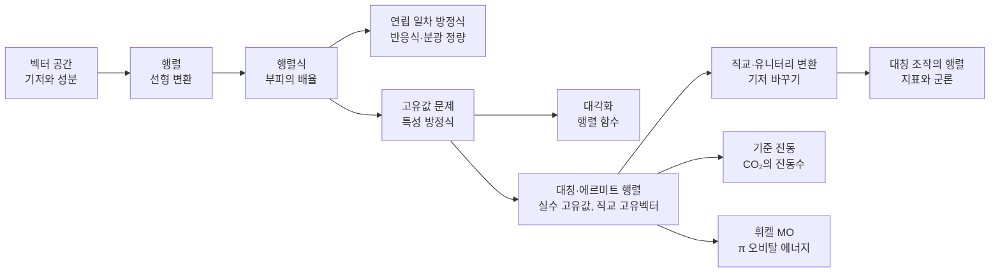

# 수학 도구 5. 선형대수 — 분자의 진동과 오비탈을 행렬 하나로 푸는 법
<!-- prev: umath-1, uphy-4, uchem-5 -->
<!-- next: umath-6, pchem-9 -->

> [!NOTE]
> **이 단원의 범위**
> - 벡터 공간과 기저: 일차 독립, 차원, 내적과 정규 직교 기저
> - 행렬 연산(곱, 전치, 역행렬, 대각합)과 선형 변환, 행렬식
> - 연립 일차 방정식: 가우스 소거, 계수, 해의 존재와 유일성, 크라메르 공식
> - 고유값과 고유벡터, 특성 방정식, 축퇴
> - 대칭 행렬과 에르미트 행렬, 대각화와 행렬 함수
> - 직교 변환과 유니터리 변환, 기저 바꾸기와 닮음 변환
> - 응용: 분자의 기준 진동, 휘켈 분자 오비탈, 대칭 조작의 행렬 표현

**학습 목표**

1. 벡터 공간, 일차 독립, 기저, 차원, 정규 직교 기저의 뜻을 설명하고, 원자 오비탈·화학 반응식처럼 과학의 대상을 벡터로 나타내어 성분과 독립성을 계산할 수 있다.
2. 행렬의 곱·전치·역행렬·대각합·행렬식을 계산하고, 행렬을 '공간을 바꾸는 규칙(선형 변환)'으로, 행렬식을 '부피의 배율'로 해석할 수 있다.
3. 연립 일차 방정식을 가우스 소거법으로 풀고, 계수로 해의 개수를 판정하며, 반응식 맞추기와 혼합물의 분광 정량에 적용할 수 있다.
4. 특성 방정식으로 고유값과 고유벡터를 구하고, 행렬을 대각화하여 연립 속도식과 개체군 모형을 풀 수 있다.
5. 대칭(에르미트) 행렬의 고유값이 실수이고 고유벡터가 서로 직교함을 유도하고, 직교·유니터리 변환이 길이와 각을 보존하는 까닭을 설명할 수 있다.
6. 기준 진동, 휘켈 분자 오비탈, 대칭 조작의 행렬 표현을 모두 '대칭 행렬의 고유값 문제'로 세우고 풀어, 진동수·오비탈 에너지·지표를 계산할 수 있다.

**이 단원의 학습 사다리**

| 단계 | 무엇을 하나? |
|---|---|
| STEP 1. 이전 학습 다시 보기 | 벡터와 스칼라곱, 키르히호프 연립 방정식, 관성 모멘트, 분자 오비탈, 교차 편미분 |
| STEP 2. 기초 다지기 | 스칼라곱과 각, 첨자와 합 기호, 복소수의 켤레와 절댓값, 퍼텐셜의 2차 전개 |
| STEP 3. 핵심 개념 | 벡터 공간 → 행렬 → 행렬식 → 연립 방정식 → 고유값 → 대각화 → 대칭·에르미트 → 직교·유니터리 → 기준 진동 → 휘켈 → 대칭 조작 |
| STEP 4. 오개념 바로잡기 | "$AB = BA$이다", "행렬식이 0이면 해가 없다", "고유벡터는 하나로 정해진다" 같은 착각 |
| STEP 5. 더 깊은 수학 | 특이값 분해와 주성분 분석, 거듭제곱법과 조건수, 무한 차원의 힐베르트 공간 |
| STEP 6. 이 도구가 쓰이는 전공 단원 | 분자 분광학, 화학 결합, 분자 대칭과 군론, 반응 속도론, 분석화학의 다성분 정량 |

---

## 🗺️ 단원 들어가기

이산화 탄소 분자 하나를 공 세 개와 용수철 두 개로 생각해 보자. 공을 아무렇게나 툭 치면 세 공은 뒤죽박죽 흔들린다. 그런데 이 어지러운 움직임은 사실 **딱 몇 가지 '깨끗한' 진동 방식**의 겹침이다. 두 산소가 동시에 바깥으로 늘어났다 줄어드는 방식, 하나가 늘어날 때 다른 하나가 줄어드는 방식. 이 방식 하나하나는 자기만의 진동수로 흔들리고, 적외선 분광기가 재는 것이 바로 그 진동수이다.

뷰타-1,3-다이엔의 π 전자도 비슷하다. 탄소 네 개의 p 오비탈이 서로 섞여 네 개의 분자 오비탈이 되는데, 각 분자 오비탈은 원자 오비탈 네 개를 어떤 비율로 섞은 것이고, 그 비율과 에너지를 구하는 것이 분자 오비탈 이론의 핵심이다.

진동과 오비탈은 물리적으로 전혀 다른 대상이지만 수학으로는 **같은 문제**이다. 둘 다 "어떤 행렬에 곱해도 방향이 바뀌지 않는 벡터(고유벡터)와 그 배율(고유값)을 찾아라"로 바뀐다. 이 단원은 그 문제를 세우고 푸는 도구, **선형대수(linear algebra)** 를 익힌다. 수학 도구 단원이므로 엄밀한 증명보다 **뜻·계산법·쓰임**에 집중하고, 예제와 문제의 대부분을 화학·물리·생명·지구과학의 실제 상황으로 낸다.

---

## STEP 1. 🔙 이전 학습 다시 보기

### 연계 개념표

| 이전 단원 | 그때 배운 것 | 이 단원에서 확장되는 것 |
|---|---|---|
| 일반물리학 「운동의 기술」 '벡터' | 3차원 벡터의 성분, 스칼라곱·벡터곱 | 벡터를 $n$차원과 '함수·오비탈'까지 넓힌 **벡터 공간**, 정규 직교 기저와 성분 구하기 |
| 일반물리학 「전류 회로와 자기장」 '키르히호프 법칙' | 미지 전류 개수만큼의 일차 방정식을 대입·소거로 풀기 | 행렬 $A\mathbf{x} = \mathbf{b}$로 정리, 가우스 소거, 해가 없거나 무수히 많은 경우의 판정 |
| 일반물리학 「회전 운동과 각운동량」 | 관성 모멘트, 맛보기로 본 관성 텐서와 주축 | 관성 텐서를 **대각화**하여 주축과 주 관성 모멘트를 구함 |
| 일반물리학 「중력·진동·유체」 | 단순 조화 운동 $\omega = \sqrt{k/m}$ | 여러 물체가 묶인 진동을 **기준 진동**으로 나누어 푸는 고유값 문제 |
| 일반화학 「화학 결합과 분자 구조」 | 원자 오비탈의 선형 결합으로 만든 분자 오비탈, 혼성 오비탈, 맛보기로 본 휘켈 근사와 군론 | 혼성을 **직교 변환**으로, 휘켈 계산을 **행렬의 고유값**으로, 대칭 조작을 **행렬**로 직접 계산 |
| 수학 도구 1 「미분과 편미분」 '고계 편미분과 교차 미분의 같음' | $\partial^2 f/\partial x\partial y = \partial^2 f/\partial y\partial x$ | 이계 도함수를 모은 행렬(헤세 행렬)이 **대칭 행렬**이 되는 근거 → 힘상수 행렬의 대칭성 |
| 수학 도구 4 「상미분방정식」 '연립 1계 방정식' | 연속 반응 $\mathrm{A \rightarrow B \rightarrow C}$의 속도식을 한 식씩 풀고, 해의 지수가 속도 상수 행렬의 고유값임을 예고로 봄 | 연립 속도식을 $d\mathbf{c}/dt = K\mathbf{c}$로 묶고 고유값으로 한꺼번에 풂 |

### 준비 운동 (사전 진단)

**Q1.** 두 벡터 $\mathbf{a} = (1, 2, 2)$, $\mathbf{b} = (2, 0, -1)$의 스칼라곱과 $\mathbf{a}$의 크기를 구하고, 두 벡터 사이의 각을 말하시오.

**Q2.** 연립 방정식 $2x + y = 5$, $x - y = 1$을 푸시오. 두 식을 $xy$ 평면의 직선으로 보면 해는 무엇을 뜻하는가?

**Q3.** 수소 원자 두 개의 1s 오비탈을 섞어 $\mathrm{H_2}$의 분자 오비탈을 만들면 분자 오비탈은 몇 개 생기는가? 그 이름은?

**Q4.** $f(x, y) = x^2y + 3xy^2$에 대하여 $\partial^2 f/\partial x\partial y$와 $\partial^2 f/\partial y\partial x$를 각각 구하시오.

정답 및 해설

**Q1.** $\mathbf{a}\cdot\mathbf{b} = 2 + 0 - 2 = 0$, $\lvert\mathbf{a}\rvert = \sqrt{1 + 4 + 4} = 3$. 스칼라곱이 0이므로 두 벡터는 **수직**(90°)이다. 이 단원에서는 이것을 '직교한다'고 말하고, 오비탈과 진동 방식에도 같은 말을 쓴다.

**Q2.** 두 식을 더하면 $3x = 6$, $x = 2$, $y = 1$. 해는 두 직선의 **교점**이다. 두 직선이 평행하면 해가 없고, 겹치면 해가 무수히 많다. STEP 3 ④에서 이 세 경우를 행렬식과 계수로 판정한다.

**Q3.** 2개 — 결합 오비탈 $\sigma_{1s}$와 반결합 오비탈 $\sigma^*_{1s}$. 원자 오비탈 $n$개를 섞으면 분자 오비탈도 $n$개가 생긴다. 선형대수로는 "$n$차원 공간의 기저를 다른 기저로 바꾼다"는 말이다.

**Q4.** $\partial f/\partial x = 2xy + 3y^2$이므로 $\partial^2 f/\partial y\partial x = 2x + 6y$. $\partial f/\partial y = x^2 + 6xy$이므로 $\partial^2 f/\partial x\partial y = 2x + 6y$. 순서와 관계없이 같다. 이 성질이 STEP 2 디딤돌 4에서 힘상수 행렬을 대칭으로 만든다.

---

## STEP 2. 🧱 기초 다지기

### 디딤돌 1. 스칼라곱과 각 — 직교의 출발점

일반물리학 「운동의 기술」에서 익힌 스칼라곱은 성분끼리 곱해 더한 것이고, 기하학적으로는 두 벡터의 길이와 사잇각의 코사인의 곱이다.

$$
\mathbf{a}\cdot\mathbf{b} = a_1b_1 + a_2b_2 + a_3b_3 = \lvert\mathbf{a}\rvert\,\lvert\mathbf{b}\rvert\cos\theta
$$

| 스칼라곱의 쓰임 | 식 | 이 단원에서 |
|---|---|---|
| 길이 | $\lvert\mathbf{a}\rvert = \sqrt{\mathbf{a}\cdot\mathbf{a}}$ | 정규화(길이 1로 만들기) |
| 사잇각 | $\cos\theta = \mathbf{a}\cdot\mathbf{b}/(\lvert\mathbf{a}\rvert\lvert\mathbf{b}\rvert)$ | 혼성 오비탈 사이의 각 |
| 직교 판정 | $\mathbf{a}\cdot\mathbf{b} = 0$ | 기준 진동·분자 오비탈이 서로 직교 |
| 성분(투영) | $a_x = \mathbf{a}\cdot\hat{\mathbf{x}}$ | 정규 직교 기저에서 성분 구하기 |

#### 디딤 예제 1 — 메테인의 결합각

정사면체 메테인에서 탄소를 원점에 두면 두 C–H 결합 방향을 $(1, 1, 1)$과 $(1, -1, -1)$로 잡을 수 있다(정육면체의 마주 보지 않는 두 꼭짓점). H–C–H 결합각을 구하시오.

**풀이** 스칼라곱 $= 1 - 1 - 1 = -1$, 두 벡터의 길이는 모두 $\sqrt3$이다.
$\cos\theta = -1/3$, $\theta = \arccos(-1/3) = 109.47°$.

**의미** 일반화학에서 외운 109.5°가 스칼라곱 한 줄에서 나온다. STEP 3 ⑧에서는 반대로 "서로 직교하는 혼성 오비탈을 만들려면 각이 얼마여야 하는가"를 묻는다.

### 디딤돌 2. 첨자와 합 기호 — 행렬 계산의 문법

행렬 $A$의 $i$행 $j$열 원소를 $A_{ij}$로 쓴다. 행렬과 벡터의 곱, 행렬끼리의 곱은 합 기호로 짧게 쓸 수 있다.

$$
(A\mathbf{x})_i = \sum_{j} A_{ij}x_j, \qquad (AB)_{ij} = \sum_{k} A_{ik}B_{kj}, \qquad \mathrm{tr}\,A = \sum_i A_{ii}
$$

곱 $(AB)_{ij}$는 "$A$의 $i$행과 $B$의 $j$열의 스칼라곱"이다. 안쪽 첨자 $k$가 맞물려야 하므로 $A$의 열 수와 $B$의 행 수가 같아야 곱할 수 있다. 자주 쓰는 기호 하나를 더 정해 두자. **크로네커 델타** $\delta_{ij}$는 $i = j$이면 1, 아니면 0이며, 단위 행렬의 원소가 바로 $\delta_{ij}$이다.

#### 디딤 예제 2 — 곱의 대각합

$A = \begin{pmatrix} 1 & 2 \\ 3 & 4 \end{pmatrix}$, $B = \begin{pmatrix} 0 & 1 \\ 1 & 0 \end{pmatrix}$일 때 $\mathrm{tr}(AB)$와 $\mathrm{tr}(BA)$를 구하시오.

**풀이** $AB = \begin{pmatrix} 2 & 1 \\ 4 & 3 \end{pmatrix}$, $BA = \begin{pmatrix} 3 & 4 \\ 1 & 2 \end{pmatrix}$. 두 행렬은 다르지만 $\mathrm{tr}(AB) = 5 = \mathrm{tr}(BA)$이다.

**의미** 일반적으로 $\mathrm{tr}(AB) = \sum_{i,k}A_{ik}B_{ki} = \mathrm{tr}(BA)$이다. 곱의 순서를 바꾸어도 대각합은 같다는 이 성질 때문에, STEP 3 ⑪에서 대칭 조작 행렬의 대각합(**지표**)은 좌표축을 어떻게 잡든 같은 값이 된다.

### 디딤돌 3. 복소수의 켤레와 절댓값 — 에르미트 행렬을 위한 최소한

양자역학의 파동 함수와 계수는 복소수일 수 있다. 복소수 $z = a + bi$($i^2 = -1$)의 **켤레 복소수**는 $z^* = a - bi$이고, 절댓값의 제곱은

$$
\lvert z\rvert^2 = z^*z = (a - bi)(a + bi) = a^2 + b^2 \ \ (\ge 0, \text{ 실수})
$$

이다. 복소수 벡터의 길이를 잴 때 그냥 제곱하면 $z^2 = a^2 - b^2 + 2abi$처럼 복소수가 나와 길이 노릇을 못 한다. 그래서 한쪽에 켤레를 붙여 $\sum_i z_i^* z_i$로 잰다. 이것이 ⑦에서 에르미트 행렬과 유니터리 행렬을 정의하는 출발점이다. (복소수의 극형식과 오일러 공식은 수학 도구 6 「복소수와 푸리에 해석」에서 본격적으로 다룬다.)

#### 디딤 예제 3 — 복소수 벡터의 길이

$\mathbf{u} = (3 + 4i,\ 2i)$의 길이를 구하시오.

**풀이** $\lvert\mathbf{u}\rvert^2 = (3 - 4i)(3 + 4i) + (-2i)(2i) = 25 + 4 = 29$, $\lvert\mathbf{u}\rvert = \sqrt{29} \approx 5.39$.

**의미** 켤레를 붙이지 않고 $\sum z_i^2$를 계산하면 $(-7 + 24i) + (-4) = -11 + 24i$가 되어 길이가 될 수 없다.

### 디딤돌 4. 퍼텐셜의 2차 전개 — 행렬이 자연스럽게 나오는 곳

수학 도구 2 「적분과 급수」 '테일러 급수와 근사'에서 한 변수 퍼텐셜을 평형점 근처에서 $V \approx V_0 + \frac{1}{2}kx^2$로 근사했다(평형점에서 1차 항은 0). 변수가 여러 개면 2차 항에 교차 항이 생긴다.

$$
V(x_1, \dots, x_n) \approx V_0 + \frac{1}{2}\sum_{i,j} K_{ij}\,x_ix_j, \qquad K_{ij} = \left(\frac{\partial^2 V}{\partial x_i\,\partial x_j}\right)_0
$$

$K_{ij}$를 모은 행렬을 **헤세 행렬(Hessian)** 또는 힘상수 행렬이라 한다. 수학 도구 1 '고계 편미분과 교차 미분의 같음'에 따라 $K_{ij} = K_{ji}$이므로 이 행렬은 **언제나 대칭**이다. 이 사실 하나가 ⑨에서 "기준 진동은 서로 직교하고 진동수는 실수이다"라는 결론을 보장한다.

#### 디딤 예제 4 — 용수철 세 개로 묶인 두 물체

질량 $m$인 두 물체가 벽–용수철–물체 1–용수철–물체 2–용수철–벽으로 일렬로 묶여 있다. 세 용수철의 힘상수는 모두 $k$이고, 평형 위치에서의 변위를 $x_1$, $x_2$라 하자. 퍼텐셜 에너지와 헤세 행렬을 쓰시오.

**풀이** 가운데 용수철은 두 변위의 차 $x_2 - x_1$만큼 늘어난다.

$$
V = \tfrac{1}{2}kx_1^2 + \tfrac{1}{2}k(x_2 - x_1)^2 + \tfrac{1}{2}kx_2^2, \qquad K = \begin{pmatrix} 2k & -k \\ -k & 2k \end{pmatrix}
$$

**의미** 대각 원소 $2k$는 "자기만 움직였을 때 붙잡는 힘", 비대각 원소 $-k$는 "이웃의 움직임이 나에게 주는 힘"이다. 비대각 원소가 0이 아니므로 두 물체의 운동이 **엮여** 있다. ⑨에서 이 행렬을 대각화하면 엮임이 풀린다.

---

## STEP 3. 📘 핵심 개념

### ① 벡터 공간과 기저

일반물리학의 벡터는 크기와 방향을 가진 화살표였다. 선형대수는 화살표의 겉모양을 버리고 **두 가지 연산만** 남긴다. 둘을 더할 수 있고, 수를 곱할 수 있으며, 그 결과가 다시 같은 모임 안에 있다면 그 모임을 **벡터 공간(vector space)** 이라 하고, 그 원소를 **벡터**라 부른다(덧셈의 교환·결합 법칙, 영벡터의 존재 같은 당연한 규칙도 함께 성립해야 한다).

| 벡터 공간의 예 | 벡터 하나 | 더하기와 수 곱하기의 뜻 |
|---|---|---|
| 3차원 공간 | 변위, 힘, 쌍극자 모멘트 $(x, y, z)$ | 힘의 합성, 크기의 배율 |
| 조성 공간 | 혼합물의 농도 $(c_1, c_2, \dots, c_n)$ | 두 용액 섞기(부피 가중), 묽히기 |
| 원자 오비탈의 선형 결합 | $\psi = c_1\phi_{2s} + c_2\phi_{2p_x} + \cdots$ | 오비탈의 겹침(섞기), 계수 바꾸기 |
| 반응 공간 | 반응식의 계수 벡터(반응물 −, 생성물 +) | 두 반응식 더하기(헤스 법칙), 반응식 몇 배 하기 |
| 함수 공간 | 파동 함수 $\psi(x)$, 온도 분포 $T(x)$ | 중첩, 진폭 바꾸기(수학 도구 8에서 다룬다) |

#### 일차 결합, 일차 독립, 기저

벡터 $\mathbf{v}_1, \dots, \mathbf{v}_n$에 수를 곱해 더한 $c_1\mathbf{v}_1 + \cdots + c_n\mathbf{v}_n$을 **일차 결합(linear combination)** 이라 한다.

$$
c_1\mathbf{v}_1 + c_2\mathbf{v}_2 + \cdots + c_n\mathbf{v}_n = \mathbf{0}
$$

이 식이 $c_1 = c_2 = \cdots = c_n = 0$일 때만 성립하면 이 벡터들은 **일차 독립(linearly independent)** 이다. 0이 아닌 계수로 영벡터를 만들 수 있으면 **일차 종속**이며, 그때는 적어도 하나가 나머지의 일차 결합으로 쓰인다. 즉 "새로운 방향을 보태지 못하는 군더더기"가 있다.

공간의 모든 벡터를 일차 결합으로 만들 수 있는 일차 독립인 벡터의 모임을 **기저(basis)** 라 하고, 기저 벡터의 개수를 공간의 **차원(dimension)** 이라 한다. 한 벡터를 기저로 나타낸 계수 $(c_1, \dots, c_n)$이 그 벡터의 **성분**이다. 같은 벡터라도 기저를 바꾸면 성분이 바뀐다. 이 "같은 대상, 다른 기저"가 ⑧의 직교 변환과 혼성 오비탈의 핵심이다.

<!-- 그림 요청: 2차원 평면의 같은 벡터 v = (3, 2)를 두 기저로 나타낸 그림. 왼쪽: 표준 기저 e1 = (1, 0), e2 = (0, 1)과 점선으로 성분 3, 2 표시. 오른쪽: 45° 돌린 정규 직교 기저 u1 = (1, 1)/√2, u2 = (−1, 1)/√2와 같은 벡터 v, 점선으로 성분 5/√2 ≈ 3.54, −1/√2 ≈ −0.71 표시. "벡터는 같고 성분만 다르다"는 이름표. -->

#### 내적과 정규 직교 기저

성분끼리 곱해 더하는 스칼라곱을 일반화한 것을 **내적(inner product)** $\langle\mathbf{u}, \mathbf{v}\rangle$이라 한다. 실수 벡터는 $\sum_i u_iv_i$, 복소수 벡터는 $\sum_i u_i^*v_i$(디딤돌 3), 오비탈처럼 함수인 벡터는 **겹침 적분** $\int\phi_i^*\phi_j\,d\tau$가 내적이다.

서로 직교하고 길이가 1인 기저를 **정규 직교 기저(orthonormal basis)** 라 한다.

$$
\langle\mathbf{e}_i, \mathbf{e}_j\rangle = \delta_{ij} \quad\Longrightarrow\quad \mathbf{v} = \sum_i c_i\mathbf{e}_i, \qquad c_i = \langle\mathbf{e}_i, \mathbf{v}\rangle
$$

**유도** $\mathbf{v} = \sum_j c_j\mathbf{e}_j$의 양변에 $\mathbf{e}_i$와의 내적을 취하면 $\langle\mathbf{e}_i, \mathbf{v}\rangle = \sum_j c_j\delta_{ij} = c_i$. 정규 직교 기저에서는 연립 방정식을 풀 필요 없이 **내적 한 번**으로 성분이 나온다. 같은 원자의 1s, 2s, 2p 오비탈은 서로 직교하고 정규화되어 있으므로 원자 오비탈은 자연스러운 정규 직교 기저이다. (서로 다른 원자의 오비탈은 겹침이 0이 아니어서 직교하지 않는다. 이 문제를 ⑩의 휘켈 근사가 어떻게 다루는지 보게 된다.)

일차 독립이지만 직교하지 않는 벡터들로부터 정규 직교 기저를 만드는 표준 절차가 **그람–슈미트 직교화(Gram–Schmidt orthogonalization)** 이다. 첫 벡터를 정규화하고, 둘째 벡터에서 첫째 방향의 성분 $\langle\mathbf{e}_1, \mathbf{v}_2\rangle\mathbf{e}_1$을 빼서 정규화하고, 셋째에서 앞의 두 방향 성분을 빼는 일을 되풀이한다.

#### 예제 1 — sp 혼성 오비탈 기저에서 성분 구하기

탄소의 2s와 $2p_z$ 오비탈은 정규 직교한다. 두 sp 혼성 오비탈을 $h_1 = (\phi_s + \phi_p)/\sqrt2$, $h_2 = (\phi_s - \phi_p)/\sqrt2$라 하자.
(1) $h_1$, $h_2$가 정규 직교함을 보이시오. (2) 오비탈 $\psi = 0.8\phi_s + 0.6\phi_p$를 $h_1$, $h_2$의 일차 결합으로 나타내시오.

**풀이**
(1) 계수 벡터로 쓰면 $h_1 = (1, 1)/\sqrt2$, $h_2 = (1, -1)/\sqrt2$이다($\phi_s$, $\phi_p$ 기저).
$\langle h_1, h_1\rangle = (1 + 1)/2 = 1$, $\langle h_2, h_2\rangle = 1$, $\langle h_1, h_2\rangle = (1 - 1)/2 = 0$.
(2) 정규 직교 기저이므로 성분은 내적이다.
$c_1 = \langle h_1, \psi\rangle = (0.8 + 0.6)/\sqrt2 = 0.990$, $c_2 = \langle h_2, \psi\rangle = (0.8 - 0.6)/\sqrt2 = 0.141$
$\psi = 0.990\,h_1 + 0.141\,h_2$

**의미** 확인: $c_1^2 + c_2^2 = 0.980 + 0.020 = 1.000$으로, 기저를 바꾸어도 정규화(길이)가 그대로이다. $\psi$는 거의 $h_1$ 방향의 오비탈이다. "혼성 오비탈을 만든다"는 것은 새 오비탈을 발명하는 것이 아니라 **같은 2차원 공간의 기저를 45° 돌리는 일**이다(⑧).

<!-- 그림 요청: sp 혼성을 기저의 회전으로 보는 그림. 가로축 φs 계수, 세로축 φp 계수인 평면에 표준 기저 화살표 φs = (1, 0), φp = (0, 1)과 45° 돌린 h1 = (1, 1)/√2, h2 = (1, −1)/√2 화살표. 오른쪽에 각 기저에 대응하는 오비탈 모양 그림(2s 구, 2pz 아령, h1은 +z 쪽으로 큰 엽, h2는 −z 쪽으로 큰 엽). 예제 1의 ψ = (0.8, 0.6)도 점으로 표시. -->

#### 예제 2 — 독립인 반응은 몇 개인가

메테인화 공정의 기체 혼합물에서 다음 세 반응을 생각한다.
R1: $\mathrm{CO + 3H_2 \rightarrow CH_4 + H_2O}$, R2: $\mathrm{CO + H_2O \rightarrow CO_2 + H_2}$, R3: $\mathrm{CO_2 + 4H_2 \rightarrow CH_4 + 2H_2O}$
화학종 순서를 $(\mathrm{CO}, \mathrm{CO_2}, \mathrm{H_2}, \mathrm{H_2O}, \mathrm{CH_4})$로 하여 각 반응을 계수 벡터로 나타내고, 서로 독립인 반응이 몇 개인지 판정하시오.

**풀이** 반응물은 음수, 생성물은 양수로 쓴다.
$\mathbf{r}_1 = (-1, 0, -3, 1, 1)$, $\mathbf{r}_2 = (-1, 1, 1, -1, 0)$, $\mathbf{r}_3 = (0, -1, -4, 2, 1)$
$\mathbf{r}_1 - \mathbf{r}_2 = (0, -1, -4, 2, 1) = \mathbf{r}_3$이므로 $\mathbf{r}_1 - \mathbf{r}_2 - \mathbf{r}_3 = \mathbf{0}$으로, 세 벡터는 일차 종속이다. $\mathbf{r}_1$과 $\mathbf{r}_2$는 한쪽이 다른 쪽의 배수가 아니므로 독립이다. **독립인 반응은 2개**이다.

**의미** R3은 R1에서 R2를 뺀 것, 즉 헤스 법칙으로 만들 수 있는 '군더더기' 반응이다. 평형 계산에서는 독립인 반응의 수만큼만 평형 상수가 필요하다. 이 혼합물은 R1, R2 두 개의 평형으로 완전히 기술된다. 화학종이 많은 연소·대기 화학 모형에서 독립 반응의 수를 정하는 일은 ④의 **계수(rank)** 를 구하는 일과 같다.

#### ✔ 바로 확인

1. (O/X) 기저를 바꾸면 벡터 자체가 바뀐다.
2. 빈칸: 정규 직교 기저 $\{\mathbf{e}_i\}$에서 벡터 $\mathbf{v}$의 성분 $c_i$는 (    )으로 구한다.
3. 세 벡터 $(1, 0, 1)$, $(0, 1, 1)$, $(1, 1, 2)$는 일차 독립인가?
4. 빈칸: 오비탈을 벡터로 볼 때 두 오비탈의 내적에 해당하는 것은 (    ) 적분이다.

정답

1. X — 같은 벡터의 **성분**만 바뀐다(예제 1에서 $\psi$의 성분 $(0.8, 0.6)$ → $(0.990, 0.141)$).
2. 내적 $\langle\mathbf{e}_i, \mathbf{v}\rangle$ — 연립 방정식을 풀 필요가 없다.
3. 아니다(일차 종속) — 셋째 = 첫째 + 둘째.
4. 겹침 — $\int\phi_i^*\phi_j\,d\tau$. 0이면 두 오비탈은 직교한다.

### ② 행렬과 선형 변환 — 행렬 연산

#### 행렬은 '공간을 바꾸는 규칙'이다

벡터를 벡터로 보내는 규칙 $T$가 $T(a\mathbf{u} + b\mathbf{v}) = aT(\mathbf{u}) + bT(\mathbf{v})$를 만족하면 **선형 변환(linear transformation)** 이라 한다. 회전, 반사, 늘이기, 한 방향으로 밀기(층밀리기)가 모두 선형 변환이다. 선형 변환은 **기저 벡터가 어디로 가는지만 알면** 완전히 정해진다. $\mathbf{v} = \sum_j v_j\mathbf{e}_j$이면 $T(\mathbf{v}) = \sum_j v_jT(\mathbf{e}_j)$이기 때문이다. 그래서

> [!IMPORTANT]
> **행렬의 $j$번째 열 = 기저 벡터 $\mathbf{e}_j$가 변환되어 간 곳의 성분.** 행렬 $A$와 벡터의 곱 $A\mathbf{v}$는 "$\mathbf{v}$를 $A$라는 규칙으로 바꾼 결과"이다.

예를 들어 $z$축 둘레로 각 $\theta$만큼 돌리는 회전에서 $\hat{\mathbf{x}} \rightarrow (\cos\theta, \sin\theta, 0)$, $\hat{\mathbf{y}} \rightarrow (-\sin\theta, \cos\theta, 0)$, $\hat{\mathbf{z}} \rightarrow \hat{\mathbf{z}}$이므로

$$
R_z(\theta) = \begin{pmatrix} \cos\theta & -\sin\theta & 0 \\ \sin\theta & \cos\theta & 0 \\ 0 & 0 & 1 \end{pmatrix}
$$

과학에는 "입력 벡터와 출력 벡터의 방향이 다를 수 있는" 비례 관계가 많고, 그 비례 상수가 행렬이다.

| 관계 | 식 | 행렬(텐서) |
|---|---|---|
| 각속도 → 각운동량 | $\mathbf{L} = I\boldsymbol{\omega}$ | 관성 텐서 $I$ (일반물리학 「회전 운동과 각운동량」 STEP 5) |
| 전기장 → 유도 쌍극자 | $\boldsymbol{\mu}_\text{유도} = \alpha\mathbf{E}$ | 편극률 텐서 $\alpha$ (라만 분광의 근거) |
| 변형 → 응력 | $\boldsymbol{\sigma} = C\boldsymbol{\varepsilon}$ | 응력 텐서·탄성 상수 (암석·재료 역학) |
| 농도 → 농도 변화율 | $d\mathbf{c}/dt = K\mathbf{c}$ | 속도 상수 행렬 $K$ (⑤, ⑥) |

#### 행렬 연산 정리

| 연산 | 정의 | 주의할 성질 |
|---|---|---|
| 합, 수 곱하기 | 원소끼리 | 크기가 같아야 한다 |
| 곱 | $(AB)_{ij} = \sum_k A_{ik}B_{kj}$ | **일반적으로 $AB \ne BA$** |
| 전치 | $(A^\mathrm{T})_{ij} = A_{ji}$ | $(AB)^\mathrm{T} = B^\mathrm{T}A^\mathrm{T}$ |
| 단위 행렬 | $I_{ij} = \delta_{ij}$ | $AI = IA = A$ |
| 역행렬 | $AA^{-1} = A^{-1}A = I$ | $(AB)^{-1} = B^{-1}A^{-1}$, 행렬식이 0이면 없다 |
| 대각합 | $\mathrm{tr}\,A = \sum_i A_{ii}$ | $\mathrm{tr}(AB) = \mathrm{tr}(BA)$ |
| 교환자 | $[A, B] = AB - BA$ | 0이면 두 변환의 순서가 상관없다 |

2×2 행렬의 역행렬은 외워 두면 편하다.

$$
A = \begin{pmatrix} a & b \\ c & d \end{pmatrix} \quad\Longrightarrow\quad A^{-1} = \frac{1}{ad - bc}\begin{pmatrix} d & -b \\ -c & a \end{pmatrix}
$$

**행렬의 곱 = 변환의 합성**이다. $AB\mathbf{v}$는 "먼저 $B$로 바꾸고, 그 결과를 $A$로 바꾼다"는 뜻이다(오른쪽부터 읽는다). 일상의 동작도 순서가 바뀌면 결과가 다르다. 양말을 신고 신발을 신는 것과 그 반대는 다르다. 회전도 그렇다.

#### 예제 3 — 회전의 순서

분자 안의 한 결합이 $x$축 방향 $\mathbf{v} = (1, 0, 0)$을 향한다. (1) 먼저 $z$축 둘레로 90°, 다음 $x$축 둘레로 90° 돌린 결과와 (2) 순서를 바꾸어 돌린 결과를 각각 구하시오.

**풀이**

$$
R_z = \begin{pmatrix} 0 & -1 & 0 \\ 1 & 0 & 0 \\ 0 & 0 & 1 \end{pmatrix}, \qquad R_x = \begin{pmatrix} 1 & 0 & 0 \\ 0 & 0 & -1 \\ 0 & 1 & 0 \end{pmatrix}
$$

(1) $R_xR_z\mathbf{v}$: $R_z\mathbf{v} = (0, 1, 0)$, 그다음 $R_x(0, 1, 0) = (0, 0, 1)$. 결합은 $+z$ 방향.
(2) $R_zR_x\mathbf{v}$: $R_x\mathbf{v} = (1, 0, 0)$($x$축 위의 벡터는 $x$축 회전에 그대로), 그다음 $R_z(1, 0, 0) = (0, 1, 0)$. 결합은 $+y$ 방향.

**의미** 3차원 회전은 일반적으로 교환되지 않는다($R_xR_z \ne R_zR_x$). 분자 구조를 화면에서 돌려 보는 프로그램, 결정 방위를 맞추는 X선 회절 장치(각도계)는 회전 순서를 정확히 지켜야 한다. 반면 같은 축 둘레의 두 회전, 2차원 회전끼리는 교환된다.

<!-- 그림 요청: 회전 순서의 비가환성을 보여 주는 두 줄짜리 그림. 각 줄에 x·y·z 좌표축과 x축 방향을 향한 화살표(결합) 하나. 위 줄: Rz(90°) 후 화살표가 +y → Rx(90°) 후 +z. 아래 줄: Rx(90°) 후 그대로 +x → Rz(90°) 후 +y. 각 단계 사이에 회전축과 회전 방향(오른손 규칙) 표시, 마지막 결과 +z와 +y를 강조. -->

> [!TIP]
> 💡 **요령** — 처음 보는 행렬은 "기저 벡터를 하나씩 넣어 보기"로 뜻을 읽는다. $A\hat{\mathbf{x}}$는 $A$의 첫째 열이다. 첫째 열이 $(0, 1, 0)$이면 "$x$축을 $y$축으로 보내는 변환"이다.

#### ✔ 바로 확인

1. $A = \begin{pmatrix} 2 & 1 \\ 1 & 1 \end{pmatrix}$의 역행렬은?
2. (O/X) $(AB)^\mathrm{T} = A^\mathrm{T}B^\mathrm{T}$이다.
3. 빈칸: 행렬 $A$의 $j$번째 열은 기저 벡터 $\mathbf{e}_j$를 $A$로 변환한 (    )이다.
4. $z$축 둘레의 180° 회전 행렬 $R_z(180°)$를 쓰시오.

정답

1. $\begin{pmatrix} 1 & -1 \\ -1 & 2 \end{pmatrix}$ — $ad - bc = 1$.
2. X — $(AB)^\mathrm{T} = B^\mathrm{T}A^\mathrm{T}$로 순서가 뒤집힌다.
3. 결과(상)의 성분
4. $\mathrm{diag}(-1, -1, 1)$ — $\cos180° = -1$, $\sin180° = 0$. ⑪에서 물 분자의 $C_2$ 조작이 바로 이 행렬이다.

### ③ 행렬식 — 부피가 몇 배가 되는가

#### 2×2 행렬식은 넓이의 배율이다

행렬 $A = \begin{pmatrix} a & b \\ c & d \end{pmatrix}$는 한 변이 1인 정사각형(기저 $\hat{\mathbf{x}}$, $\hat{\mathbf{y}}$가 만드는)을 두 열 $(a, c)$, $(b, d)$가 만드는 평행사변형으로 바꾼다. 그 평행사변형의 넓이는 두 열벡터의 벡터곱의 $z$ 성분 $ad - bc$이다. 이 값을 **행렬식(determinant)** 이라 한다.

$$
\det A = \begin{vmatrix} a & b \\ c & d \end{vmatrix} = ad - bc
$$

부호는 방향을 알려 준다. 양수면 $\hat{\mathbf{x}} \rightarrow \hat{\mathbf{y}}$의 돌림 방향이 유지되고, 음수면 거울에 비춘 것처럼 뒤집힌다. 0이면 평행사변형이 선분으로 **납작해진** 것이다.

<!-- 그림 요청: 행렬식을 넓이의 배율로 보여 주는 그림. 왼쪽: 원점에서 출발하는 단위 정사각형(꼭짓점 (0,0), (1,0), (1,1), (0,1)), 넓이 1. 오른쪽: 행렬 A = [[3, 1], [1, 2]]로 변환한 평행사변형(꼭짓점 (0,0), (3,1), (4,3), (1,2)), 두 변 화살표 (3,1)과 (1,2), 넓이 det A = 5 이름표. 아래에 작은 그림으로 det = 0인 경우(두 열 (2,1), (4,2)가 한 직선 위, 평행사변형이 선분으로 납작) 추가. -->

#### 3×3 행렬식과 전개

3×3 행렬식은 세 열벡터가 만드는 평행육면체의 (부호 있는) 부피, 즉 스칼라 삼중곱 $\mathbf{a}\cdot(\mathbf{b}\times\mathbf{c})$이다. 계산은 한 행(또는 열)을 따라 **여인수 전개(cofactor expansion)** 로 한다.

$$
\begin{vmatrix} a_1 & a_2 & a_3 \\ b_1 & b_2 & b_3 \\ c_1 & c_2 & c_3 \end{vmatrix} = a_1\begin{vmatrix} b_2 & b_3 \\ c_2 & c_3 \end{vmatrix} - a_2\begin{vmatrix} b_1 & b_3 \\ c_1 & c_3 \end{vmatrix} + a_3\begin{vmatrix} b_1 & b_2 \\ c_1 & c_2 \end{vmatrix}
$$

부호는 $(-1)^{i+j}$를 따라 $+, -, +$로 번갈아 붙는다. $n \times n$도 같은 방식으로 한 단계씩 작은 행렬식으로 내려간다. 0이 많은 행이나 열을 골라 전개하면 계산이 줄어든다.

| 행렬식의 성질 | 왜 그런가(부피의 그림) | 쓰임 |
|---|---|---|
| 두 행(열)을 바꾸면 부호가 바뀐다 | 돌림 방향이 뒤집힌다 | 슬레이터 행렬식의 반대칭성 |
| 두 행이 같으면 0 | 평행육면체가 납작하다 | 파울리 배타 원리 |
| 한 행에 $c$를 곱하면 행렬식도 $c$배 | 한 변만 $c$배 | $\det(cA) = c^n\det A$ |
| 한 행의 배수를 다른 행에 더해도 그대로 | 밑면에 평행하게 미는 것(층밀리기) | 가우스 소거로 행렬식 계산 |
| $\det(AB) = \det A\,\det B$ | 배율은 곱해진다 | $\det(A^{-1}) = 1/\det A$ |
| $\det A^\mathrm{T} = \det A$ | 행과 열의 역할이 같다 | 열에 대해서도 위 성질이 모두 성립 |
| 삼각 행렬은 대각 원소의 곱 | 전개하면 한 항만 남는다 | 소거 후 바로 계산 |

> [!IMPORTANT]
> 정사각 행렬 $A$에 대하여 다음은 모두 **같은 말**이다.
> $\det A = 0$ ⟺ 열(행)벡터가 일차 종속 ⟺ 역행렬이 없다 ⟺ $A\mathbf{x} = \mathbf{0}$에 $\mathbf{x} \ne \mathbf{0}$인 해가 있다.
> 마지막 줄이 고유값 문제(⑤)와 휘켈 영년 방정식(⑩)의 출발점이다.

#### 예제 4 — 단위 세포의 부피와 밀도

어떤 분자 결정의 단위 세포를 이루는 세 격자 벡터가 직교 좌표(단위 Å)로 $\mathbf{a} = (6.0, 2.0, 0)$, $\mathbf{b} = (-1.0, 7.0, 1.0)$, $\mathbf{c} = (0.5, 1.0, 9.0)$이다. (1) 단위 세포의 부피를 구하시오. (2) 단위 세포 안에 몰질량 $128\ \mathrm{g/mol}$인 분자가 2개 있을 때 결정의 밀도를 구하시오. ($N_\mathrm{A} = 6.022\times10^{23}\ \mathrm{mol^{-1}}$)

**풀이**
(1) 세 벡터를 행으로 쓴 행렬식을 첫째 행으로 전개한다.

$$
V = \begin{vmatrix} 6.0 & 2.0 & 0 \\ -1.0 & 7.0 & 1.0 \\ 0.5 & 1.0 & 9.0 \end{vmatrix} = 6.0(63 - 1.0) - 2.0(-9.0 - 0.5) + 0 = 372 + 19 = 391\ \text{Å}^3
$$

(2) $1\ \text{Å}^3 = 10^{-24}\ \mathrm{cm^3}$이므로

$$
\rho = \frac{2\times128\ \mathrm{g/mol}}{(6.022\times10^{23}\ \mathrm{mol^{-1}})(391\times10^{-24}\ \mathrm{cm^3})} = \frac{256}{235.5}\ \mathrm{g/cm^3} = 1.09\ \mathrm{g/cm^3}
$$

**의미** 행렬식이 양수이므로 $\mathbf{a}, \mathbf{b}, \mathbf{c}$는 오른손 좌표계를 이룬다. 결정학 프로그램은 축의 길이와 사잇각($a, b, c, \alpha, \beta, \gamma$)으로 이 행렬을 만들고, 그 행렬식으로 부피를 계산한다(무기화학 「고체의 구조와 에너지」).

#### 슬레이터 행렬식 — 행렬식이 파울리 원리를 담는다

전자 두 개가 오비탈 $\phi_a$, $\phi_b$에 들어 있을 때, 양자역학은 두 전자를 맞바꾸면 부호가 바뀌는 파동 함수를 요구한다. 행렬식이 정확히 그 성질을 가진다.

$$
\Psi(1, 2) = \frac{1}{\sqrt2}\begin{vmatrix} \phi_a(1) & \phi_b(1) \\ \phi_a(2) & \phi_b(2) \end{vmatrix} = \frac{1}{\sqrt2}\left[\phi_a(1)\phi_b(2) - \phi_b(1)\phi_a(2)\right]
$$

전자 1과 2를 맞바꾸는 것은 두 **행**을 바꾸는 것이므로 부호가 바뀐다. 두 전자가 같은 스핀 오비탈에 들어가면($\phi_a = \phi_b$) 두 **열**이 같아져 $\Psi = 0$, 그런 상태는 존재하지 않는다. 이것이 파울리 배타 원리이다. 물리화학 「다전자 원자와 화학 결합」에서 이 행렬식을 $N$개 전자로 넓힌다.

#### ✔ 바로 확인

1. $\begin{vmatrix} 3 & 1 \\ 1 & 2 \end{vmatrix}$의 값과 기하학적 뜻은?
2. (O/X) $\det(2A) = 2\det A$이다($A$는 3×3).
3. $\det A = 4$, $\det B = -0.5$일 때 $\det(AB)$와 $\det(A^{-1})$은?
4. 빈칸: 슬레이터 행렬식에서 두 전자가 같은 스핀 오비탈에 있으면 두 (    )이 같아져 파동 함수가 0이 된다.

정답

1. 5 — 단위 정사각형이 넓이 5인 평행사변형으로 바뀐다.
2. X — 세 행에 모두 2가 곱해지므로 $2^3\det A = 8\det A$.
3. $-2$, $0.25$ — $\det(AB) = \det A\det B$, $\det(A^{-1}) = 1/\det A$.
4. 열 — 같은 열이 둘이면 행렬식은 0이다(파울리 배타 원리).

### ④ 연립 일차 방정식

미지수 $n$개, 식 $m$개인 연립 일차 방정식은 행렬 하나로 묶인다.

$$
\begin{cases} a_{11}x_1 + \cdots + a_{1n}x_n = b_1 \\ \quad\vdots \\ a_{m1}x_1 + \cdots + a_{mn}x_n = b_m \end{cases} \quad\Longleftrightarrow\quad A\mathbf{x} = \mathbf{b}
$$

기하학적으로 $A\mathbf{x} = \mathbf{b}$는 "어떤 벡터 $\mathbf{x}$를 $A$로 바꾸면 $\mathbf{b}$가 되는가", 또는 "$\mathbf{b}$를 $A$의 열벡터들의 일차 결합으로 나타내는 계수는 무엇인가"를 묻는다. 둘째 해석이 분광 정량(예제 6)의 뜻 그대로이다.

#### 가우스 소거법

다음 세 가지 **기본 행 연산**은 해를 바꾸지 않는다. ① 두 식의 순서 바꾸기 ② 한 식에 0이 아닌 수 곱하기 ③ 한 식의 배수를 다른 식에 더하기. 계수와 우변을 붙인 **첨가 행렬** $[A \mid \mathbf{b}]$에 이 연산을 되풀이해 아래 왼쪽을 0으로 만든(**사다리꼴**) 뒤, 맨 아래 식부터 거꾸로 대입하는 것이 **가우스 소거법(Gaussian elimination)** 이다.

$$
\left[\begin{array}{ccc|c} 1 & 1 & 1 & 6 \\ 2 & 3 & 1 & 11 \\ 1 & 2 & 3 & 14 \end{array}\right]
\xrightarrow{\ R_2 - 2R_1,\ R_3 - R_1\ }
\left[\begin{array}{ccc|c} 1 & 1 & 1 & 6 \\ 0 & 1 & -1 & -1 \\ 0 & 1 & 2 & 8 \end{array}\right]
\xrightarrow{\ R_3 - R_2\ }
\left[\begin{array}{ccc|c} 1 & 1 & 1 & 6 \\ 0 & 1 & -1 & -1 \\ 0 & 0 & 3 & 9 \end{array}\right]
$$

거꾸로 대입하면 $x_3 = 3$, $x_2 = -1 + 3 = 2$, $x_1 = 6 - 2 - 3 = 1$이다. 손으로 3~4개, 컴퓨터로 수천 개의 미지수까지 같은 절차로 푼다.

#### 해는 언제 있고, 언제 하나인가 — 계수

사다리꼴로 만들었을 때 0이 아닌 행의 개수를 행렬의 **계수(rank)** 라 한다. 일차 독립인 행(또는 열)의 최대 개수와 같다. 미지수가 $n$개일 때

| 조건 | 해 | 기하학적 그림(미지수 2개) |
|---|---|---|
| $\mathrm{rank}\,A = \mathrm{rank}[A \mid \mathbf{b}] = n$ | 하나뿐 | 두 직선이 한 점에서 만난다 |
| $\mathrm{rank}\,A = \mathrm{rank}[A \mid \mathbf{b}] < n$ | 무수히 많다(자유 변수 $n - \mathrm{rank}$개) | 두 직선이 겹친다 |
| $\mathrm{rank}\,A < \mathrm{rank}[A \mid \mathbf{b}]$ | 없다 | 두 직선이 평행하다 |

<!-- 그림 요청: 미지수 2개인 연립 일차 방정식의 세 경우를 나란히 그린 xy 평면 그림 세 개. (가) 해가 하나: 2x + y = 5와 x − y = 1이 점 (2, 1)에서 만남. (나) 해가 없음: x + y = 2와 x + y = 4가 평행. (다) 해가 무수히 많음: x + y = 2와 2x + 2y = 4가 겹침(굵은 한 직선). 각 그림 아래에 det A ≠ 0, det A = 0(모순), det A = 0(겹침) 이름표. -->

정사각 행렬이면 판정이 간단하다. $\det A \ne 0$이면 역행렬이 있어 $\mathbf{x} = A^{-1}\mathbf{b}$ 하나뿐이고, $\det A = 0$이면 해가 없거나 무수히 많다. 특히 우변이 0인 **동차 방정식** $A\mathbf{x} = \mathbf{0}$은 $\mathbf{x} = \mathbf{0}$이라는 당연한 해가 늘 있으므로, **0이 아닌 해가 있을 조건은 $\det A = 0$** 이다. 반응식 맞추기, 고유벡터, 휘켈 계수가 모두 이 동차 방정식의 0이 아닌 해이다.

#### 크라메르 공식

$\det A \ne 0$일 때 $x_j = \det A_j/\det A$이다. $A_j$는 $A$의 $j$번째 열을 $\mathbf{b}$로 바꾼 행렬이다. 2×2에서는

$$
x_1 = \frac{b_1a_{22} - a_{12}b_2}{a_{11}a_{22} - a_{12}a_{21}}, \qquad x_2 = \frac{a_{11}b_2 - b_1a_{21}}{a_{11}a_{22} - a_{12}a_{21}}
$$

손으로 2~3개의 미지수를 풀 때 편하지만, 미지수가 많으면 계산량이 폭발하므로 컴퓨터는 가우스 소거를 쓴다.

#### 예제 5 — 반응식 맞추기는 동차 연립 방정식이다

$a\,\mathrm{KMnO_4} + b\,\mathrm{HCl} \rightarrow c\,\mathrm{KCl} + d\,\mathrm{MnCl_2} + e\,\mathrm{Cl_2} + f\,\mathrm{H_2O}$의 계수를 원소 보존의 연립 방정식으로 구하시오.

**풀이** 원소마다 (반응물의 원자 수) = (생성물의 원자 수)이다.

| 원소 | 보존 식 |
|---|---|
| K | $a - c = 0$ |
| Mn | $a - d = 0$ |
| O | $4a - f = 0$ |
| H | $b - 2f = 0$ |
| Cl | $b - c - 2d - 2e = 0$ |

미지수 6개, 독립인 식 5개(계수 5)이므로 자유 변수가 $6 - 5 = 1$개, 즉 해는 **하나의 비율**로 정해진다. $a = 1$로 두고 위에서부터 대입하면 $c = 1$, $d = 1$, $f = 4$, $b = 8$, 그리고 Cl 식에서 $8 = 1 + 2 + 2e$, $e = 5/2$. 정수로 만들려고 2를 곱하면

$$
\mathrm{2KMnO_4 + 16HCl \rightarrow 2KCl + 2MnCl_2 + 5Cl_2 + 8H_2O}
$$

**의미** 동차 방정식이므로 해에 상수를 곱해도 해이다(반응식을 몇 배 해도 같은 반응). 계수가 미지수보다 2 이상 작으면 자유 변수가 둘 이상이 되어 반응식이 하나로 정해지지 않는다. 그것은 **서로 독립인 반응 둘 이상이 섞여 있다**는 신호이다(예제 2). 산화·환원 반응식을 반쪽 반응 없이 기계적으로 맞추는 프로그램은 이 영공간을 계산한다.

#### 예제 6 — 두 성분 혼합물의 분광 정량

물질 X와 Y가 섞인 용액의 흡광도를 두 파장에서 쟀다(셀 길이 1.00 cm). 비어 법칙이 성분마다 더해진다고 할 때 두 농도를 구하시오. (몰 흡광 계수는 가상의 값이다.)

| 파장 | $\varepsilon_\mathrm{X}$ (L/(mol·cm)) | $\varepsilon_\mathrm{Y}$ (L/(mol·cm)) | 흡광도 |
|---|---|---|---|
| $\lambda_1$ | $1.20\times10^4$ | $2.0\times10^3$ | 0.540 |
| $\lambda_2$ | $3.0\times10^3$ | $9.0\times10^3$ | 0.390 |

**풀이**
식 세우기: $A_\lambda = \varepsilon_{\mathrm{X},\lambda}\,b\,c_\mathrm{X} + \varepsilon_{\mathrm{Y},\lambda}\,b\,c_\mathrm{Y}$

$$
\begin{pmatrix} 1.20\times10^4 & 2.0\times10^3 \\ 3.0\times10^3 & 9.0\times10^3 \end{pmatrix}\begin{pmatrix} c_\mathrm{X} \\ c_\mathrm{Y} \end{pmatrix} = \begin{pmatrix} 0.540 \\ 0.390 \end{pmatrix}
$$

$\det = (1.20\times10^4)(9.0\times10^3) - (2.0\times10^3)(3.0\times10^3) = 1.02\times10^8$
크라메르 공식:
$c_\mathrm{X} = \dfrac{0.540\times9.0\times10^3 - 2.0\times10^3\times0.390}{1.02\times10^8} = \dfrac{4080}{1.02\times10^8} = 4.0\times10^{-5}\ \mathrm{M}$
$c_\mathrm{Y} = \dfrac{1.20\times10^4\times0.390 - 0.540\times3.0\times10^3}{1.02\times10^8} = \dfrac{3060}{1.02\times10^8} = 3.0\times10^{-5}\ \mathrm{M}$

**의미** 혼합물의 스펙트럼은 성분 스펙트럼(열벡터)의 일차 결합이고, 농도는 그 결합 계수이다. 두 성분의 스펙트럼이 비슷하면 두 열벡터가 거의 평행해져 행렬식이 작아지고, 흡광도의 작은 측정 오차가 농도에 크게 증폭된다(문제 15). 그래서 분석화학에서는 두 성분의 흡수 차이가 큰 파장을 고른다(분석화학 「분광 분석의 기초와 분자 분광법」).

> [!WARNING]
> 행렬식이 "0은 아니지만 매우 작은" 행렬은 수치적으로 위험하다. 이런 행렬을 **나쁜 조건(ill-conditioned)** 이라 한다. 측정값에 들어 있는 오차가 몇 자릿수씩 커질 수 있다. 다만 행렬식의 크기는 단위에 따라 달라지므로, 조건의 좋고 나쁨은 행렬식 자체보다 **조건수**(STEP 5)로 판단한다.

#### ✔ 바로 확인

1. 연립 방정식 $x + 2y = 3$, $2x + 4y = 7$의 해는 몇 개인가?
2. 빈칸: 동차 방정식 $A\mathbf{x} = \mathbf{0}$($A$는 정사각 행렬)이 $\mathbf{x} \ne \mathbf{0}$인 해를 가질 조건은 (    )이다.
3. 미지수 5개, 계수 3인 동차 연립 방정식의 해에는 자유 변수가 몇 개 있는가?
4. 크라메르 공식으로 $3x + y = 7$, $x + 2y = 4$를 푸시오.

정답

1. 0개 — 둘째 식의 좌변은 첫째의 2배인데 우변은 $6 \ne 7$이다. 평행한 두 직선.
2. $\det A = 0$
3. 2개 — $5 - 3 = 2$.
4. $x = 2$, $y = 1$ — $\det = 5$, $x = (14 - 4)/5$, $y = (12 - 7)/5$.

### ⑤ 고유값과 고유벡터

#### 방향이 바뀌지 않는 벡터

행렬은 대부분의 벡터를 돌리고 늘인다. 그런데 어떤 특별한 방향의 벡터는 **방향은 그대로 두고 길이만 바꾼다.**

$$
A\mathbf{v} = \lambda\mathbf{v} \qquad (\mathbf{v} \ne \mathbf{0})
$$

이런 $\mathbf{v}$를 $A$의 **고유벡터(eigenvector)**, 배율 $\lambda$를 **고유값(eigenvalue)** 이라 한다. ('eigen'은 독일어로 '자기 자신의'라는 뜻이다.) 고유벡터 방향은 그 변환의 '결'이다. 나무를 쪼갤 때 결을 따라 쪼개면 쉽듯이, 고유벡터를 기저로 잡으면 복잡한 변환이 각 축을 따로 늘이는 단순한 변환이 된다(⑥).

<!-- 그림 요청: 행렬 A = [[2, 1], [1, 2]]가 하는 일을 보여 주는 그림. 왼쪽: 단위원과 그 위의 여러 화살표(0°, 30°, 45°, 90°, 135° 방향). 오른쪽: A로 변환한 뒤의 타원(장축 길이 3이 45° 방향, 단축 길이 1이 135° 방향)과 변환된 화살표들. 45° 방향 화살표 (1,1)/√2는 같은 방향으로 3배(λ = 3), 135° 방향 화살표 (−1,1)/√2는 같은 방향으로 1배(λ = 1)로 굵게 강조. 다른 방향 화살표(예: 0° 방향 (1,0) → (2,1))는 방향이 바뀜을 표시. -->

<!-- 시뮬레이션 요청: 2×2 행렬의 네 원소를 슬라이더로 바꾸면 단위원과 격자가 변환되는 모습을 실시간으로 보여 준다. 단위원에서 한 점을 끌어 돌리면 그 벡터 v와 Av가 함께 움직이고, 둘이 나란해지는 순간(고유벡터) 강조. 화면 한쪽에 행렬식(넓이 배율), 대각합, 고유값(실수 또는 복소수), 고유벡터 방향 표시. 대칭 행렬로 제한하는 체크 상자를 켜면 고유벡터 두 개가 늘 직교함을 보여 준다. -->

#### 특성 방정식

$A\mathbf{v} = \lambda\mathbf{v}$를 $(A - \lambda I)\mathbf{v} = \mathbf{0}$으로 옮기면 동차 방정식이다. $\mathbf{v} \ne \mathbf{0}$인 해가 있으려면(④)

$$
\det(A - \lambda I) = 0
$$

이어야 한다. 이것을 **특성 방정식(characteristic equation)** 이라 한다. $n \times n$ 행렬이면 $\lambda$의 $n$차 방정식이므로 중근까지 세어 고유값이 $n$개 있다(실수 행렬이라도 복소수일 수 있다). 계산 순서는 언제나 같다.

1. $\det(A - \lambda I) = 0$을 풀어 고유값 $\lambda_1, \dots, \lambda_n$을 구한다.
2. 각 $\lambda_k$를 $(A - \lambda_kI)\mathbf{v} = \mathbf{0}$에 넣고 소거하여 고유벡터를 구한다. 식 하나는 반드시 군더더기가 된다(행렬식이 0이므로).
3. 필요하면 길이 1로 정규화한다. 고유벡터는 **상수배만큼 정해지지 않는다**($\mathbf{v}$가 고유벡터면 $3\mathbf{v}$, $-\mathbf{v}$도 고유벡터).

2×2에서는 특성 방정식이 대각합과 행렬식만으로 쓰인다.

$$
\lambda^2 - (\mathrm{tr}\,A)\,\lambda + \det A = 0
$$

| 고유값의 성질 | 식 | 쓰임 |
|---|---|---|
| 고유값의 합 | $\sum\lambda_k = \mathrm{tr}\,A$ | 계산 검산 |
| 고유값의 곱 | $\prod\lambda_k = \det A$ | 고유값 0 ⟺ 역행렬 없음 |
| 삼각·대각 행렬 | 고유값 = 대각 원소 | 바로 읽기 |
| $A^m$, $A^{-1}$의 고유값 | $\lambda^m$, $1/\lambda$ (고유벡터 같음) | 거듭제곱, 장기 거동 |
| 축퇴 | 같은 고유값이 여러 번 | 그 고유벡터들의 **어떤 일차 결합도** 고유벡터 |

**축퇴(degeneracy)** 는 양자역학에서 익숙한 말이다. 수소 원자의 $2p_x$, $2p_y$, $2p_z$는 같은 에너지 고유값을 가지므로 그 일차 결합인 $2p_{+1} \propto 2p_x + i\,2p_y$도 같은 에너지의 고유 함수이다. 축퇴된 고유값에서는 고유벡터가 하나의 방향이 아니라 **하나의 부분 공간**으로 정해지며, 그 안에서 어떤 기저를 고를지는 우리가 편한 대로 정한다.

#### 예제 7 — 가역 반응 $\mathrm{A \rightleftharpoons B}$의 고유값

1차 가역 반응 $\mathrm{A \rightleftharpoons B}$(정반응 $k_1 = 0.30\ \mathrm{s^{-1}}$, 역반응 $k_2 = 0.10\ \mathrm{s^{-1}}$)의 속도식은

$$
\frac{d}{dt}\begin{pmatrix} [\mathrm{A}] \\ [\mathrm{B}] \end{pmatrix} = \begin{pmatrix} -k_1 & k_2 \\ k_1 & -k_2 \end{pmatrix}\begin{pmatrix} [\mathrm{A}] \\ [\mathrm{B}] \end{pmatrix} = K\mathbf{c}
$$

이다. $K$의 고유값과 고유벡터를 구하고 그 뜻을 해석하시오.

**풀이**
$\mathrm{tr}\,K = -0.40\ \mathrm{s^{-1}}$, $\det K = k_1k_2 - k_2k_1 = 0$이므로 특성 방정식은 $\lambda^2 + 0.40\lambda = 0$, $\lambda_1 = 0$, $\lambda_2 = -0.40\ \mathrm{s^{-1}}$.
$\lambda_1 = 0$: $-0.30a + 0.10b = 0$ → $b = 3a$, $\mathbf{v}_1 = (1, 3)$
$\lambda_2 = -0.40$: $(K + 0.40I)\mathbf{v} = \begin{pmatrix} 0.10 & 0.10 \\ 0.30 & 0.30 \end{pmatrix}\mathbf{v} = \mathbf{0}$ → $a + b = 0$, $\mathbf{v}_2 = (1, -1)$

**의미** 고유값 0의 고유벡터는 **시간이 지나도 변하지 않는 상태**, 곧 평형이다. $[\mathrm{B}]/[\mathrm{A}] = 3 = k_1/k_2 = K_\text{평형}$이 저절로 나왔다. 고유값 $-0.40\ \mathrm{s^{-1}}$의 고유벡터 $(1, -1)$은 A가 줄어든 만큼 B가 느는(전체 농도를 보존하는) 어긋남이며, $e^{-(k_1 + k_2)t}$로 사라진다. 평형에서 살짝 벗어난 계가 돌아오는 **이완 시간**은 $\tau = 1/(k_1 + k_2) = 2.5\ \mathrm{s}$로, 정반응과 역반응 속도 상수의 **합**이 정한다. 온도 점프 이완법으로 빠른 반응의 속도 상수를 재는 원리이다(물리화학 「반응 속도론과 반응 동역학」).

#### 예제 8 — 나이 구조가 있는 개체군의 성장률

어떤 곤충 개체군을 1년생·2년생·3년생으로 나눈다. 2년생은 한 마리당 새끼 4마리, 3년생은 3마리를 낳고(1년생은 번식하지 않는다), 1년생의 50 %가 2년생으로, 2년생의 25 %가 3년생으로 살아남는다. 한 해 뒤의 개체 수는 **레슬리 행렬(Leslie matrix)** $L$로

$$
\mathbf{n}_{t+1} = L\mathbf{n}_t, \qquad L = \begin{pmatrix} 0 & 4 & 3 \\ 0.5 & 0 & 0 \\ 0 & 0.25 & 0 \end{pmatrix}
$$

이다. $L$의 가장 큰 고유값과 그 고유벡터를 구하고 해석하시오.

**풀이**
첫째 열로 전개한다.

$$
\det(L - \lambda I) = -\lambda\begin{vmatrix} -\lambda & 0 \\ 0.25 & -\lambda \end{vmatrix} - 0.5\begin{vmatrix} 4 & 3 \\ 0.25 & -\lambda \end{vmatrix} = -\lambda^3 + 2\lambda + 0.375 = 0
$$

$\lambda = 1.5$를 넣으면 $-3.375 + 3 + 0.375 = 0$으로 근이다. 인수분해하면 $(\lambda - 1.5)(\lambda^2 + 1.5\lambda + 0.25) = 0$이고 나머지 두 근은 $\lambda = (-1.5 \pm \sqrt{1.25})/2 = -0.19,\ -1.31$이다. 가장 큰 고유값은 $\lambda_1 = 1.5$.
고유벡터: $(L - 1.5I)\mathbf{v} = \mathbf{0}$의 둘째·셋째 식에서 $0.5v_1 = 1.5v_2$, $0.25v_2 = 1.5v_3$이므로 $\mathbf{v} = (1, 1/3, 1/18)$. 합이 1이 되게 나누면 $(0.72, 0.24, 0.04)$.

**의미** 처음 나이 분포가 어떻든 몇 세대가 지나면 크기가 가장 큰 고유값의 성분이 압도하여 $\mathbf{n}_t \approx C(1.5)^t\mathbf{v}$가 된다. 개체군은 해마다 **1.5배**씩 늘고, 나이 비율은 1년생 72 %, 2년생 24 %, 3년생 4 %인 **안정 나이 분포**로 수렴한다. 다른 두 고유값은 절댓값이 1.5보다 작아 그 성분이 상대적으로 사라진다(음수 고유값은 세대마다 부호가 바뀌는 출렁임을 만든다). 보전 생물학에서는 가장 큰 고유값이 1보다 작은지로 멸종 위험을 판정하고, 고유벡터의 민감도로 어느 나이의 생존율을 높이는 것이 가장 효과적인지 고른다.

#### ✔ 바로 확인

1. $\begin{pmatrix} 3 & 0 \\ 0 & -2 \end{pmatrix}$의 고유값과 고유벡터는?
2. (O/X) $\mathbf{v}$가 고유벡터이면 $-2\mathbf{v}$도 같은 고유값의 고유벡터이다.
3. 2×2 행렬의 대각합이 5, 행렬식이 6이다. 고유값은?
4. 빈칸: 속도 상수 행렬에서 고유값 (    )의 고유벡터는 평형 조성을 나타낸다.

정답

1. $3$: $(1, 0)$, $-2$: $(0, 1)$ — 대각 행렬은 대각 원소가 고유값, 좌표축이 고유벡터이다.
2. O — 고유벡터는 상수배만큼 정해지지 않는다.
3. 2와 3 — $\lambda^2 - 5\lambda + 6 = 0$.
4. 0 — $d\mathbf{c}/dt = 0\cdot\mathbf{c} = \mathbf{0}$, 즉 변하지 않는 상태이다.

### ⑥ 대각화와 행렬 함수

#### 고유벡터를 기저로 잡으면 행렬은 대각이 된다

$n \times n$ 행렬 $A$가 일차 독립인 고유벡터 $n$개를 가진다고 하자. 고유벡터를 열로 늘어놓은 행렬 $P = [\mathbf{v}_1\ \cdots\ \mathbf{v}_n]$과 고유값을 대각에 놓은 $D = \mathrm{diag}(\lambda_1, \dots, \lambda_n)$을 만들면, $A\mathbf{v}_k = \lambda_k\mathbf{v}_k$를 열마다 모은 식이 $AP = PD$이다. $P$의 열이 일차 독립이므로 역행렬이 있어

$$
A = PDP^{-1}, \qquad D = P^{-1}AP
$$

이것을 **대각화(diagonalization)** 라 한다. $P^{-1}\mathbf{x}$는 "$\mathbf{x}$를 고유벡터 기저의 성분으로 고쳐 쓰기", $D$는 "각 성분을 $\lambda_k$배 하기", $P$는 "원래 기저로 되돌리기"이다. 대각화의 쓸모는 거듭제곱과 함수에서 드러난다.

$$
A^m = PD^mP^{-1}, \qquad e^{At} = Pe^{Dt}P^{-1}, \quad e^{Dt} = \mathrm{diag}(e^{\lambda_1t}, \dots, e^{\lambda_nt})
$$

행렬 지수 함수는 수학 도구 2의 테일러 급수 $e^x = \sum x^m/m!$에 행렬을 넣은 $e^{At} = \sum_m (At)^m/m!$로 정의한다. 각 항에 $A^m = PD^mP^{-1}$를 넣으면 위 식이 된다.

#### 연립 1계 방정식의 한 줄 풀이

수학 도구 4 「상미분방정식」 '연립 1계 방정식'에서 연속 반응을 한 식씩 대입해 풀었다. 행렬로 쓰면 모든 1차 반응망이 한 줄로 풀린다.

$$
\frac{d\mathbf{c}}{dt} = K\mathbf{c} \quad\Longrightarrow\quad \mathbf{c}(t) = e^{Kt}\mathbf{c}(0) = \sum_k a_k\,e^{\lambda_kt}\,\mathbf{v}_k
$$

계수 $a_k$는 $\mathbf{c}(0) = \sum_k a_k\mathbf{v}_k$, 즉 처음 농도를 고유벡터로 분해하여 정한다. 각 고유벡터는 자기 고유값의 속도로 독립적으로 사라지는 **모드(mode)** 이다. 이 "모드로 나누고, 따로 풀고, 다시 합친다"는 전략이 ⑨의 기준 진동과 똑같다.

> [!NOTE]
> 모든 행렬이 대각화되는 것은 아니다. $\begin{pmatrix} 1 & 1 \\ 0 & 1 \end{pmatrix}$은 고유값 1이 중근인데 고유벡터가 $(1, 0)$ 방향 하나뿐이다. 연속 반응 $\mathrm{A \rightarrow B \rightarrow C}$에서 $k_1 = k_2$이면 속도 상수 행렬이 이런 꼴이 되어, 해에 $e^{-kt}$ 대신 $kt\,e^{-kt}$ 꼴의 항이 나타난다(수학 도구 4에서 극한으로 얻은 결과와 같다). 다행히 ⑦의 대칭 행렬은 **언제나** 대각화된다.

#### 예제 9 — 이완 곡선을 대각화로 구하기

예제 7의 $\mathrm{A \rightleftharpoons B}$($k_1 = 0.30\ \mathrm{s^{-1}}$, $k_2 = 0.10\ \mathrm{s^{-1}}$)에서 처음에 $[\mathrm{A}]_0 = 1.00\ \mathrm{M}$, $[\mathrm{B}]_0 = 0$이다. $[\mathrm{A}](t)$, $[\mathrm{B}](t)$를 구하고 $t = 5.0\ \mathrm{s}$의 값을 계산하시오.

**풀이**
고유값과 고유벡터(예제 7): $\lambda_1 = 0$, $\mathbf{v}_1 = (1, 3)$; $\lambda_2 = -0.40\ \mathrm{s^{-1}}$, $\mathbf{v}_2 = (1, -1)$
처음 상태 분해: $(1.00, 0) = a_1(1, 3) + a_2(1, -1)$ → $a_1 + a_2 = 1.00$, $3a_1 - a_2 = 0$ → $a_1 = 0.25$, $a_2 = 0.75$

$$
\begin{pmatrix} [\mathrm{A}] \\ [\mathrm{B}] \end{pmatrix} = 0.25\begin{pmatrix} 1 \\ 3 \end{pmatrix} + 0.75\,e^{-0.40t}\begin{pmatrix} 1 \\ -1 \end{pmatrix}
$$

$[\mathrm{A}] = 0.25 + 0.75e^{-0.40t}$, $[\mathrm{B}] = 0.75(1 - e^{-0.40t})$ (단위 M, $t$는 s)
$t = 5.0\ \mathrm{s}$: $e^{-2.0} = 0.135$ → $[\mathrm{A}] = 0.352\ \mathrm{M}$, $[\mathrm{B}] = 0.648\ \mathrm{M}$

**의미** 평형 농도(0.25 M, 0.75 M)는 고유값 0의 모드에서, 접근 속도는 고유값 $-0.40\ \mathrm{s^{-1}}$에서 바로 읽힌다. 두 농도의 합은 언제나 1.00 M이다. 모드 $(1, -1)$의 성분 합이 0이기 때문이다. 화학종이 수십 개인 대기 화학·연소 모형도 같은 방식으로 "가장 느린 모드(가장 0에 가까운 음의 고유값)"가 전체의 시간 척도를 정한다.

#### ✔ 바로 확인

1. $A = PDP^{-1}$일 때 $A^{10}$을 $P$, $D$로 쓰시오.
2. $D = \mathrm{diag}(-1, -3)$일 때 $e^{Dt}$는?
3. (O/X) 모든 정사각 행렬은 대각화할 수 있다.
4. 빈칸: $d\mathbf{c}/dt = K\mathbf{c}$의 해에서 각 고유벡터 성분은 $e^{(\quad)t}$로 변한다.

정답

1. $PD^{10}P^{-1}$ — 가운데의 $P^{-1}P$가 모두 $I$로 사라진다.
2. $\mathrm{diag}(e^{-t}, e^{-3t})$
3. X — 고유벡터가 모자라는 행렬(예: $\begin{pmatrix} 1 & 1 \\ 0 & 1 \end{pmatrix}$)은 대각화되지 않는다. 대칭 행렬은 언제나 된다.
4. $\lambda_k$ (그 고유벡터의 고유값)

### ⑦ 대칭 행렬과 에르미트 행렬

#### 과학의 행렬은 대개 대칭이다

$A^\mathrm{T} = A$($A_{ij} = A_{ji}$)인 실수 행렬을 **대칭 행렬(symmetric matrix)**, 켤레 전치 $A^\dagger = (A^*)^\mathrm{T}$가 자기 자신인($A_{ij} = A_{ji}^*$) 복소수 행렬을 **에르미트 행렬(Hermitian matrix)** 이라 한다. 실수 에르미트 행렬이 곧 대칭 행렬이다.

| 행렬 | 왜 대칭(에르미트)인가 | 고유값의 뜻 |
|---|---|---|
| 힘상수(헤세) 행렬 $K_{ij} = \partial^2V/\partial x_i\partial x_j$ | 교차 편미분이 같다(디딤돌 4) | 진동수의 제곱 |
| 관성 텐서 $I_{ij}$ | 정의 $\sum m(r^2\delta_{ij} - r_ir_j)$가 $i$, $j$에 대칭 | 주 관성 모멘트 |
| 응력 텐서 $\sigma_{ij}$ | 작은 부피에 알짜 토크가 없다 | 주응력 |
| 해밀토니안 행렬 $H_{ij} = \int\phi_i^*\hat{H}\phi_j\,d\tau$ | 관측 가능한 양의 연산자는 에르미트 | 에너지 준위 |

#### 대칭(에르미트) 행렬의 세 가지 성질

> [!IMPORTANT]
> **스펙트럼 정리** — 에르미트 행렬 $A$는
> ① 고유값이 모두 **실수**이고, ② 서로 다른 고유값의 고유벡터는 서로 **직교**하며, ③ 축퇴가 있어도 정규 직교 고유벡터 $n$개를 고를 수 있어 **언제나 대각화**된다: $A = UDU^\dagger$ ($U$는 ⑧의 유니터리 행렬, 실수 대칭이면 직교 행렬 $Q$).

**유도 ①** $A\mathbf{v} = \lambda\mathbf{v}$의 양변 왼쪽에 $\mathbf{v}^\dagger$를 곱하면 $\mathbf{v}^\dagger A\mathbf{v} = \lambda\,\mathbf{v}^\dagger\mathbf{v}$. 이 식의 켤레 전치를 취하면 $(\mathbf{v}^\dagger A\mathbf{v})^\dagger = \mathbf{v}^\dagger A^\dagger\mathbf{v} = \mathbf{v}^\dagger A\mathbf{v}$이므로 좌변은 자기 켤레, 즉 실수이다. $\mathbf{v}^\dagger\mathbf{v} = \lvert\mathbf{v}\rvert^2 > 0$도 실수이므로 $\lambda$는 실수이다.

**유도 ②** $A\mathbf{u} = \mu\mathbf{u}$, $A\mathbf{v} = \lambda\mathbf{v}$($\mu \ne \lambda$, 둘 다 실수)라 하자. $\mathbf{u}^\dagger A\mathbf{v}$를 두 방법으로 계산한다. 오른쪽으로 작용시키면 $\lambda\,\mathbf{u}^\dagger\mathbf{v}$. 왼쪽으로 작용시키면 $\mathbf{u}^\dagger A = (A^\dagger\mathbf{u})^\dagger = (A\mathbf{u})^\dagger = \mu\,\mathbf{u}^\dagger$이므로 $\mu\,\mathbf{u}^\dagger\mathbf{v}$. 따라서 $(\lambda - \mu)\,\mathbf{u}^\dagger\mathbf{v} = 0$, $\lambda \ne \mu$이므로 $\mathbf{u}^\dagger\mathbf{v} = 0$.

③의 증명은 길어서 생략하지만, 축퇴된 고유값에서는 그 부분 공간 안에서 그람–슈미트(①)로 직교하는 고유벡터를 고를 수 있다는 것이 핵심이다. 대각화 결과는 **스펙트럼 분해**로도 쓴다.

$$
A = \sum_k \lambda_k\,\mathbf{v}_k\mathbf{v}_k^\dagger
$$

$\mathbf{v}_k\mathbf{v}_k^\dagger$는 $\mathbf{v}_k$ 방향으로의 **투영 행렬**이다. 에르미트 행렬은 "서로 수직인 방향 몇 개를 골라, 각 방향을 실수배 하는 일"을 할 뿐이다.

> [!NOTE]
> 양자역학에서 에너지·운동량·각운동량 같은 관측 가능한 양이 에르미트 연산자로 표현되는 까닭이 바로 ①과 ②이다. 측정값(고유값)은 실수여야 하고, 서로 다른 측정값을 주는 상태는 확실히 구별되어야(직교) 한다. 물리화학 「양자역학의 기초」의 가설이 이 성질을 그대로 쓴다. 함수에 작용하는 연산자의 경우는 수학 도구 8에서 다룬다.

#### 예제 10 — 두 원자 오비탈의 섞임

이핵 이원자 분자에서 원자 A, B의 원자 오비탈 에너지가 $\alpha_\mathrm{A} = -10.0\ \mathrm{eV}$, $\alpha_\mathrm{B} = -14.0\ \mathrm{eV}$이고, 두 오비탈 사이의 상호작용(공명 적분)이 $\beta = -2.0\ \mathrm{eV}$이다. 겹침을 무시하면 분자 오비탈의 에너지와 계수는 $H = \begin{pmatrix} \alpha_\mathrm{A} & \beta \\ \beta & \alpha_\mathrm{B} \end{pmatrix}$의 고유값·고유벡터이다. 두 분자 오비탈의 에너지와, 결합 오비탈에서 전자가 B에 있을 확률을 구하시오.

**풀이**
$\mathrm{tr}\,H = -24.0$, $\det H = 140 - 4.0 = 136$이므로 $\lambda^2 + 24.0\lambda + 136 = 0$.

$$
E_\pm = \frac{\alpha_\mathrm{A} + \alpha_\mathrm{B}}{2} \pm \sqrt{\left(\frac{\alpha_\mathrm{A} - \alpha_\mathrm{B}}{2}\right)^2 + \beta^2} = -12.0 \pm \sqrt{4.0 + 4.0} = -12.0 \pm 2.83\ \mathrm{eV}
$$

결합 오비탈 $E = -14.83\ \mathrm{eV}$, 반결합 오비탈 $E = -9.17\ \mathrm{eV}$.
결합 오비탈의 고유벡터: $(\alpha_\mathrm{A} - E)c_\mathrm{A} + \beta c_\mathrm{B} = 0$ → $4.83c_\mathrm{A} = 2.0c_\mathrm{B}$ → $c_\mathrm{B}/c_\mathrm{A} = 2.41$. 정규화하면 $(c_\mathrm{A}, c_\mathrm{B}) = (0.383, 0.924)$.
B에 있을 확률 $c_\mathrm{B}^2 = 0.854$, 약 85 %.

**의미** 결합 오비탈은 에너지가 낮은(전기 음성도가 큰) B 쪽에 치우치고, 반결합 오비탈 $(-0.924, 0.383)$은 A 쪽에 치우친다. 두 고유벡터는 직교한다($0.383\times(-0.924) + 0.924\times0.383 = 0$). 섞임의 정도는 $\tan2\theta = 2\beta/(\alpha_\mathrm{A} - \alpha_\mathrm{B})$로 정해지며, 이 예에서는 $\tan2\theta = 1$, $\theta = 22.5°$이다($\cos22.5° = 0.924$). 두 에너지가 같으면 50:50(동핵 $\mathrm{H_2}$), 차이가 $\lvert\beta\rvert$보다 훨씬 크면 거의 섞이지 않는다(이온 결합에 가까움). 일반화학의 "극성 공유 결합"이 2×2 대각화 하나로 정량화된다.

<!-- 그림 요청: 예제 10의 두 준위 섞임 에너지 준위도. 왼쪽에 원자 A 오비탈(−10.0 eV), 오른쪽에 원자 B 오비탈(−14.0 eV), 가운데에 분자 오비탈 두 개: 반결합(−9.17 eV, A보다 0.83 eV 위)과 결합(−14.83 eV, B보다 0.83 eV 아래). 점선으로 원자 오비탈과 연결하고, 결합 오비탈 옆에 계수 (0.383, 0.924)와 "B에 85 %", 반결합 옆에 (−0.924, 0.383). 세로축은 에너지(eV). -->

#### 예제 11 — 복소수 에르미트 행렬: 스핀의 $y$ 성분

전자 스핀의 $y$ 성분은 $\hat{S}_y = \frac{\hbar}{2}\sigma_y$, $\sigma_y = \begin{pmatrix} 0 & -i \\ i & 0 \end{pmatrix}$로 나타낸다. (1) $\sigma_y$가 에르미트임을 보이고, (2) 고유값과 정규화된 고유벡터를 구하고, (3) 두 고유벡터가 직교함을 확인하시오.

**풀이**
(1) 전치하면 $\begin{pmatrix} 0 & i \\ -i & 0 \end{pmatrix}$, 켤레를 취하면 $\begin{pmatrix} 0 & -i \\ i & 0 \end{pmatrix} = \sigma_y$.
(2) $\det(\sigma_y - \lambda I) = \lambda^2 - (-i)(i) = \lambda^2 - 1 = 0$ → $\lambda = \pm1$ (실수).
$\lambda = +1$: $-a - ib = 0$ → $b = ia$, $\mathbf{u}_+ = (1, i)/\sqrt2$. $\lambda = -1$: $b = -ia$, $\mathbf{u}_- = (1, -i)/\sqrt2$.
(3) $\mathbf{u}_+^\dagger\mathbf{u}_- = \frac{1}{2}[1\cdot1 + (i)^*(-i)] = \frac{1}{2}[1 + (-i)(-i)] = \frac{1}{2}(1 - 1) = 0$.

**의미** 행렬 원소가 허수인데도 고유값은 실수 $\pm1$, 곧 측정값은 $\pm\hbar/2$이다. (3)에서 켤레를 빼먹고 $1\cdot1 + i(-i) = 2$로 계산하면 "직교하지 않는다"는 틀린 결론이 나온다. 복소수 벡터의 내적에는 반드시 켤레가 붙는다(디딤돌 3).

#### ✔ 바로 확인

1. (O/X) 실수 대칭 행렬의 고유값은 복소수일 수 있다.
2. $\begin{pmatrix} 1 & 2+i \\ 2-i & 3 \end{pmatrix}$은 에르미트 행렬인가?
3. 빈칸: 에르미트 행렬의 서로 다른 고유값에 속하는 고유벡터는 서로 (    )한다.
4. 예제 10에서 $\alpha_\mathrm{A} = \alpha_\mathrm{B} = -12.0\ \mathrm{eV}$로 바꾸면 결합 오비탈의 에너지와 계수는?

정답

1. X — 에르미트(실수 대칭 포함) 행렬의 고유값은 늘 실수이다.
2. 예 — 대각 원소가 실수이고 $A_{12} = A_{21}^*$이다.
3. 직교
4. $-14.0\ \mathrm{eV}$, $(1, 1)/\sqrt2$ — $E = \alpha \pm \lvert\beta\rvert$로 갈리고, 두 원자에 똑같이 퍼진다.

### ⑧ 직교·유니터리 변환

#### 길이와 각을 지키는 변환

$Q^\mathrm{T}Q = I$, 즉 $Q^{-1} = Q^\mathrm{T}$인 실수 행렬을 **직교 행렬(orthogonal matrix)** 이라 한다. 이 조건은 "$Q$의 열들이 정규 직교 기저를 이룬다"는 말과 같다($(Q^\mathrm{T}Q)_{ij}$가 $i$열과 $j$열의 내적이므로). 직교 행렬로 바꾸면 내적이 그대로이다.

$$
(Q\mathbf{u})\cdot(Q\mathbf{v}) = \mathbf{u}^\mathrm{T}Q^\mathrm{T}Q\mathbf{v} = \mathbf{u}^\mathrm{T}\mathbf{v} = \mathbf{u}\cdot\mathbf{v}
$$

따라서 길이와 사잇각이 보존된다. 분자를 돌리거나 거울에 비추어도 결합 길이와 결합각이 변하지 않는 것과 같다. $\det(Q^\mathrm{T}Q) = (\det Q)^2 = 1$이므로 $\det Q = \pm1$이다.

| $\det Q$ | 종류 | 예 |
|---|---|---|
| $+1$ | 고유 회전(proper rotation) | $C_n$ 회전, 좌표축 돌리기 |
| $-1$ | 반사를 포함한 변환(improper) | 거울면 $\sigma$, 반전 $i$, 회전 반사 $S_n$ |

복소수 공간에서 같은 역할을 하는 것이 $U^\dagger U = I$인 **유니터리 행렬(unitary matrix)** 이다. 유니터리 변환은 $\sum z_i^*w_i$ 꼴의 내적을 보존하므로, 양자역학에서 한 정규 직교 오비탈 묶음을 다른 정규 직교 묶음으로 바꾸어도 확률(정규화)과 직교성이 그대로 유지된다. 예를 들어 실수 오비탈 $2p_x$, $2p_y$와 복소수 오비탈 $2p_{\pm1} = (2p_x \pm i\,2p_y)/\sqrt2$는 유니터리 변환으로 이어진다.

#### 기저 바꾸기와 닮음 변환

새 정규 직교 기저 벡터들을 열로 놓은 직교 행렬 $Q$가 있으면, 벡터의 새 성분과 행렬의 새 모습은

$$
\mathbf{x}' = Q^\mathrm{T}\mathbf{x}, \qquad A' = Q^\mathrm{T}AQ
$$

이다($A\mathbf{x} = \mathbf{y}$에 $\mathbf{x} = Q\mathbf{x}'$, $\mathbf{y} = Q\mathbf{y}'$를 넣고 왼쪽에 $Q^\mathrm{T}$를 곱한다). $A' = Q^{-1}AQ$ 꼴의 변환을 **닮음 변환(similarity transformation)** 이라 하고, 고유값·대각합·행렬식은 닮음 변환에 대해 **불변**이다. 기저(좌표축)를 어떻게 잡든 물리적으로 같은 대상이기 때문이다. 대칭 행렬의 대각화 $Q^\mathrm{T}AQ = D$는 "행렬이 대각이 되도록 좌표축을 돌린다", 곧 **주축 변환**이다. 관성 텐서의 주축, 응력 텐서의 주응력 방향(문제 11), 분자 편극률의 주축이 모두 이렇게 구해진다.

#### 예제 12 — sp² 혼성 오비탈은 직교 변환이다

평면 삼각형 탄소의 세 sp² 혼성 오비탈을 $(\phi_s, \phi_{p_x}, \phi_{p_y})$ 기저의 계수로 쓰면 다음 행렬의 각 **행**이 된다.

$$
Q = \begin{pmatrix} 1/\sqrt3 & \sqrt{2/3} & 0 \\ 1/\sqrt3 & -1/\sqrt6 & 1/\sqrt2 \\ 1/\sqrt3 & -1/\sqrt6 & -1/\sqrt2 \end{pmatrix}
$$

(1) $QQ^\mathrm{T} = I$임을 확인하시오. (2) 각 혼성 오비탈의 s 성질 비율을 구하시오. (3) 혼성 오비탈 1과 2의 방향(p 성분이 가리키는 방향) 사이의 각을 구하시오.

**풀이**
(1) 행끼리의 내적: 1행·1행 $= 1/3 + 2/3 = 1$, 2행·2행 $= 1/3 + 1/6 + 1/2 = 1$, 1행·2행 $= 1/3 - \sqrt{2/3}/\sqrt6 = 1/3 - 1/3 = 0$, 2행·3행 $= 1/3 + 1/6 - 1/2 = 0$(나머지도 같은 방식). 따라서 $QQ^\mathrm{T} = I$이고, 정사각 행렬이므로 $Q^\mathrm{T}Q = I$이기도 하다. $\det Q = +1$.
(2) s 계수의 제곱 $(1/\sqrt3)^2 = 1/3$. 세 혼성 오비탈 모두 s 성질 33 %, p 성질 67 %.
(3) p 성분 벡터 $\mathbf{d}_1 = (\sqrt{2/3}, 0)$, $\mathbf{d}_2 = (-1/\sqrt6, 1/\sqrt2)$. $\cos\theta = \dfrac{-\sqrt{2/3}/\sqrt6}{\sqrt{2/3}\cdot\sqrt{2/3}} = \dfrac{-1/3}{2/3} = -\dfrac12$, $\theta = 120°$.

**의미** 혼성은 원자 오비탈 세 개의 공간에서 기저를 **직교 변환**한 것이다. 그래서 혼성 오비탈끼리 자동으로 직교하고, s 오비탈 하나의 '몫'(계수 제곱의 합 = 1)이 셋에게 똑같이 나뉜다. 반대로 "서로 직교하는 동등한 혼성 오비탈"이라는 조건에서 120°(sp²), 109.47°(sp³, 디딤 예제 1), 180°(sp)가 **유도된다**. 혼성 오비탈의 s 성질과 결합각의 관계($\cos\theta = -s/(1-s)$)도 이 내적에서 나온다.

<!-- 그림 요청: sp² 혼성 오비탈 세 개의 방향을 xy 평면에 그린 그림. 탄소를 원점에 두고 h1은 +x 방향(0°), h2는 120°, h3는 240° 방향의 큰 엽. 각 화살표 옆에 계수 (1/√3, √(2/3), 0), (1/√3, −1/√6, 1/√2), (1/√3, −1/√6, −1/√2). 엽 사이 각 120° 표시, 오른쪽 위에 "QQᵀ = I, s 성질 1/3씩" 상자. -->

#### ✔ 바로 확인

1. (O/X) 직교 행렬의 행렬식은 0, $+1$, $-1$ 중 하나이다.
2. 거울면 $\sigma(xy)$를 나타내는 행렬과 그 행렬식은?
3. 빈칸: 닮음 변환 $Q^{-1}AQ$에 대해 고유값, 대각합, (    )은 변하지 않는다.
4. 직교 행렬 $Q$의 역행렬을 계산 없이 쓰시오.

정답

1. X — $\det Q = \pm1$뿐이다. 0이면 역행렬이 없어 직교 행렬이 될 수 없다.
2. $\mathrm{diag}(1, 1, -1)$, $-1$ — $z$ 좌표만 뒤집는다.
3. 행렬식
4. $Q^\mathrm{T}$ — 전치만 하면 된다.

### ⑨ 응용: 분자의 기준 진동

#### 운동 방정식을 고유값 문제로

원자 $n$개의 평형 위치에서의 변위를 $\mathbf{x}$라 하면, 디딤돌 4의 2차 퍼텐셜에서 원자 $i$가 받는 힘은 $-\partial V/\partial x_i = -\sum_j K_{ij}x_j$이다. 질량을 대각에 놓은 질량 행렬 $M$으로 쓰면 뉴턴 법칙은

$$
M\ddot{\mathbf{x}} = -K\mathbf{x}
$$

이다. 모든 원자가 **같은 진동수, 같은 위상**으로 움직이는 해 $\mathbf{x} = \mathbf{a}\cos(\omega t + \varphi)$를 찾자. 넣으면 $-\omega^2M\mathbf{a} = -K\mathbf{a}$, 즉

$$
K\mathbf{a} = \omega^2M\mathbf{a} \quad\Longrightarrow\quad \det(K - \omega^2M) = 0
$$

이런 운동을 **기준 진동(normal mode)** 이라 하고, $\mathbf{a}$는 각 원자가 움직이는 비율, $\omega^2$은 고유값이다. 질량이 서로 다르면 $M^{-1}K$는 대칭이 아니지만, **질량 가중 좌표** $\mathbf{q} = M^{1/2}\mathbf{x}$로 바꾸면 $\tilde{K} = M^{-1/2}KM^{-1/2}$의 보통 고유값 문제 $\tilde{K}\mathbf{q} = \omega^2\mathbf{q}$가 되고, $\tilde{K}$는 대칭이다. ⑦의 스펙트럼 정리에 따라

- $\omega^2$은 실수이다(평형이 안정하면 0 이상이어서 $\omega$도 실수, 진동한다).
- 서로 다른 기준 진동은 (질량 가중 좌표에서) 직교한다. 그래서 한 기준 진동에 넣은 에너지는 다른 기준 진동으로 새지 않는다(조화 근사 안에서).
- 어떤 움직임이든 기준 진동의 겹침으로 쓸 수 있다.

#### 가장 간단한 예 — 용수철로 묶인 두 물체

디딤 예제 4의 $K = \begin{pmatrix} 2k & -k \\ -k & 2k \end{pmatrix}$, $M = mI$에서 $\det(K - \omega^2mI) = (2k - m\omega^2)^2 - k^2 = 0$이므로 $m\omega^2 = 2k \mp k$.

| 기준 진동 | $\omega^2$ | 고유벡터 $\mathbf{a}$ | 움직임 |
|---|---|---|---|
| 같은 위상 | $k/m$ | $(1, 1)$ | 두 물체가 함께 움직여 가운데 용수철이 늘지 않는다 |
| 반대 위상 | $3k/m$ | $(1, -1)$ | 가운데 용수철까지 늘었다 줄어 더 빠르다 |

물체 1만 당겼다 놓으면($\mathbf{x}(0) = (1, 0) = \frac12(1, 1) + \frac12(1, -1)$) 두 기준 진동이 반반 섞여, 에너지가 두 물체 사이를 오가는 **맥놀이**가 생긴다.

<!-- 시뮬레이션 요청: 용수철로 묶인 두 물체(벽–k–m1–k12–m2–k–벽)의 진동. 조작 변수: 두 질량 m1, m2, 가운데 용수철 k12, 처음 변위 x1(0), x2(0). 보여 줄 것: 두 물체의 실시간 움직임, x1(t)·x2(t) 그래프, 처음 상태를 두 기준 진동으로 분해한 계수 막대, 두 기준 진동수. 처음 변위를 한 기준 진동의 고유벡터에 맞추면 맥놀이 없이 그 진동수 하나로만 흔들림을 확인한다. -->

<!-- 그림 요청: 벽–용수철–질량 m–용수철–질량 m–용수철–벽의 두 기준 진동. 위: 같은 위상 모드(두 질량 모두 오른쪽 화살표, 가운데 용수철 길이 그대로, ω = √(k/m)). 아래: 반대 위상 모드(왼쪽 질량 왼쪽 화살표, 오른쪽 질량 오른쪽 화살표, 가운데 용수철이 늘어남, ω = √(3k/m)). 오른쪽에 각 모드의 x1(t), x2(t) 그래프(같은 위상: 겹친 두 코사인, 반대 위상: 부호가 반대인 두 코사인). -->

#### 몇 개의 진동이 있는가

원자 $N$개의 변위는 $3N$개이므로 고유값도 $3N$개이다. 그중 분자 전체의 병진(3개)과 회전(비선형 분자 3개, 선형 분자 2개)은 용수철을 늘이지 않으므로 $\omega^2 = 0$이다. 그래서 진동은 비선형 분자 $3N - 6$개, 선형 분자 $3N - 5$개이다. 고유값 0이 정확히 그 개수만큼 나오는지가 계산 프로그램의 기본 점검 항목이다.

#### 예제 13 — 이산화 탄소의 신축 진동

$\mathrm{O{=}C{=}O}$를 축 방향으로만 움직이는 공 세 개(질량 $m_\mathrm{O}$, $m_\mathrm{C}$, $m_\mathrm{O}$)와 힘상수 $k$인 용수철 두 개로 모형화한다(굽힘 진동은 무시).
(1) 힘상수 행렬 $K$를 쓰고 세 기준 진동의 $\omega^2$과 고유벡터를 구하시오.
(2) 대칭 신축의 파수를 $1340\ \mathrm{cm^{-1}}$로 두고 $k$를 구한 뒤, 비대칭 신축의 파수를 예측하여 관측값 $2349\ \mathrm{cm^{-1}}$과 비교하시오. ($m_\mathrm{O} = 15.995\ \mathrm{u}$, $m_\mathrm{C} = 12.000\ \mathrm{u}$, $1\ \mathrm{u} = 1.6605\times10^{-27}\ \mathrm{kg}$, $c = 2.998\times10^{10}\ \mathrm{cm/s}$)

**풀이**
(1) $V = \frac12k(x_2 - x_1)^2 + \frac12k(x_3 - x_2)^2$에서

$$
K = k\begin{pmatrix} 1 & -1 & 0 \\ -1 & 2 & -1 \\ 0 & -1 & 1 \end{pmatrix}, \qquad M = \mathrm{diag}(m_\mathrm{O}, m_\mathrm{C}, m_\mathrm{O})
$$

$\det(K - \omega^2M) = 0$을 풀면(가운데 열로 전개하여 정리) 세 근이 나온다.

| 모드 | $\omega^2$ | 고유벡터 $(x_1, x_2, x_3)$ |
|---|---|---|
| 병진 | $0$ | $(1, 1, 1)$ |
| 대칭 신축 | $k/m_\mathrm{O}$ | $(-1, 0, 1)$ — 탄소는 가만히 있다 |
| 비대칭 신축 | $\dfrac{k}{m_\mathrm{O}}\left(1 + \dfrac{2m_\mathrm{O}}{m_\mathrm{C}}\right)$ | $(1, -2m_\mathrm{O}/m_\mathrm{C}, 1)$ — 질량 중심이 고정된다 |

확인: 비대칭 신축 벡터를 $K - \omega^2M$의 첫째 행에 넣으면 $k(1 + 2m_\mathrm{O}/m_\mathrm{C}) - k(1 + 2m_\mathrm{O}/m_\mathrm{C}) = 0$.
(2) $\omega = 2\pi c\tilde{\nu}$이므로 $k = m_\mathrm{O}(2\pi c\tilde{\nu}_\text{대칭})^2$.
$m_\mathrm{O} = 15.995\times1.6605\times10^{-27} = 2.656\times10^{-26}\ \mathrm{kg}$, $\omega = 2\pi(2.998\times10^{10})(1340) = 2.524\times10^{14}\ \mathrm{s^{-1}}$
$k = 2.656\times10^{-26}\times(2.524\times10^{14})^2 = 1.69\times10^3\ \mathrm{N/m}$
비대칭/대칭 파수비 $= \sqrt{1 + 2(15.995)/12.000} = \sqrt{3.666} = 1.915$ → 예측 $1340\times1.915 = 2.57\times10^3\ \mathrm{cm^{-1}}$

**의미** 예측(약 2570)은 관측(2349)보다 약 9 % 크다. 모형이 두 C=O 결합 사이의 상호작용(한 결합이 늘면 다른 결합을 붙잡는 힘이 달라지는 효과, 퍼텐셜에서 두 결합의 늘어남을 곱한 항)을 무시했기 때문이다. 실제 계산에서는 이런 비대각 힘상수를 넣는다. 그래도 두 신축 진동의 **모양**(고유벡터)은 대칭만으로 정해지므로 정확하다. 대칭 신축은 쌍극자 모멘트를 바꾸지 않아 적외선에 나타나지 않고(라만 활성), 비대칭 신축은 쌍극자를 크게 바꾸어 대기 $\mathrm{CO_2}$의 강한 적외선 흡수띠($2349\ \mathrm{cm^{-1}}$ 근처)를 만든다. (실제 대칭 신축은 굽힘 진동의 배음과 섞이는 페르미 공명 때문에 라만 스펙트럼에서 약 1388 cm⁻¹와 1285 cm⁻¹의 두 줄로 갈라지며, 여기서는 그 사이의 값 1340 cm⁻¹를 썼다.)

<!-- 그림 요청: 이산화 탄소 직선 모형의 세 모드. 각 줄에 O–C–O 세 공(O는 크게 빨강, C는 작게 회색)과 변위 화살표. (가) 병진: 세 공 모두 같은 길이의 오른쪽 화살표, ω = 0. (나) 대칭 신축: 왼쪽 O 왼쪽 화살표, 오른쪽 O 오른쪽 화살표, C 화살표 없음, 쌍극자 변화 없음(IR 비활성) 표시. (다) 비대칭 신축: 두 O는 오른쪽 짧은 화살표, C는 왼쪽으로 2.67배 긴 화살표, 쌍극자 변화 있음(IR 활성, 2349 cm⁻¹) 표시. -->

#### ✔ 바로 확인

1. 원자 4개인 비선형 분자(예: $\mathrm{NH_3}$)의 진동 기준 진동은 몇 개인가?
2. (O/X) 기준 진동의 진동수 제곱은 질량 가중 힘상수 행렬의 고유값이다.
3. 예제 13에서 대칭 신축의 진동수가 탄소의 질량과 무관한 까닭은?
4. 디딤 예제 4의 두 물체에서 $k/m = 4.0\ \mathrm{s^{-2}}$일 때 두 기준 진동의 각진동수는?

정답

1. 6개 — $3\times4 - 6$.
2. O — $\tilde{K} = M^{-1/2}KM^{-1/2}$의 고유값이 $\omega^2$이다.
3. 대칭 신축에서 탄소가 움직이지 않기 때문이다(고유벡터 $(-1, 0, 1)$).
4. $2.0\ \mathrm{s^{-1}}$과 $3.5\ \mathrm{s^{-1}}$ — $\sqrt{4.0}$, $\sqrt{12}$.

### ⑩ 응용: 휘켈 분자 오비탈

#### 영년 방정식에서 고유값 문제로

π 분자 오비탈을 각 탄소의 $2p_z$ 오비탈 $\phi_j$의 선형 결합 $\psi = \sum_j c_j\phi_j$로 쓰고, 에너지가 가장 낮아지도록(변분 원리, 물리화학 「다전자 원자와 화학 결합」) 계수를 고르면 다음 연립 방정식이 나온다.

$$
\sum_j (H_{ij} - ES_{ij})\,c_j = 0, \qquad H_{ij} = \int\phi_i\hat{H}\phi_j\,d\tau, \quad S_{ij} = \int\phi_i\phi_j\,d\tau
$$

동차 방정식이므로 $\mathbf{c} \ne \mathbf{0}$인 해가 있으려면 $\det(H - ES) = 0$(**영년 행렬식**, secular determinant)이어야 한다(④). **휘켈 근사(Hückel approximation)** 는 여기에 세 가지 단순화를 한다.

| 근사 | 내용 | 행렬로 |
|---|---|---|
| 겹침 무시 | $S_{ij} = \delta_{ij}$ | $S = I$ |
| 쿨롱 적분 | 모든 탄소에서 $H_{ii} = \alpha$ | 대각 원소 $\alpha$ |
| 공명 적분 | 결합한 이웃이면 $H_{ij} = \beta$($< 0$), 아니면 0 | 비대각 원소 $\beta$ 또는 0 |

그러면 $H = \alpha I + \beta T$이고, $T$는 "결합해 있으면 1, 아니면 0"인 **연결 행렬**(인접 행렬)이다. $T\mathbf{c} = x\mathbf{c}$이면 $H\mathbf{c} = (\alpha + x\beta)\mathbf{c}$이므로

$$
E_k = \alpha + x_k\beta, \qquad x_k = T\text{의 고유값}
$$

화학 구조식의 연결 관계만 담은 0과 1의 대칭 행렬 하나를 대각화하면 π 오비탈의 에너지와 모양이 모두 나온다. $\beta < 0$이므로 $x > 0$이면 결합성(α보다 낮음), $x < 0$이면 반결합성이다. 에틸렌은 $T = \begin{pmatrix} 0 & 1 \\ 1 & 0 \end{pmatrix}$, $x = \pm1$, $E = \alpha \pm \beta$이다.

#### 예제 14 — 뷰타-1,3-다이엔

탄소 1–2–3–4가 사슬로 이어진 뷰타다이엔의 π 오비탈 에너지와 가장 낮은 오비탈의 계수를 구하고, 비편재화 에너지를 계산하시오.

**풀이**
$T$의 특성 방정식:

$$
\det(T - xI) = \begin{vmatrix} -x & 1 & 0 & 0 \\ 1 & -x & 1 & 0 \\ 0 & 1 & -x & 1 \\ 0 & 0 & 1 & -x \end{vmatrix} = x^4 - 3x^2 + 1 = 0
$$

(첫째 행으로 전개하면 $-x(-x^3 + 2x) - (x^2 - 1)$이 된다.) $x^2 = (3 \pm \sqrt5)/2$이므로 $x = \pm1.618,\ \pm0.618$.

| 오비탈 | $x$ | 에너지 | 계수 $(c_1, c_2, c_3, c_4)$ | 마디 수 |
|---|---|---|---|---|
| $\psi_1$ | $1.618$ | $\alpha + 1.618\beta$ | $(0.372, 0.602, 0.602, 0.372)$ | 0 |
| $\psi_2$ (HOMO) | $0.618$ | $\alpha + 0.618\beta$ | $(0.602, 0.372, -0.372, -0.602)$ | 1 |
| $\psi_3$ (LUMO) | $-0.618$ | $\alpha - 0.618\beta$ | $(0.602, -0.372, -0.372, 0.602)$ | 2 |
| $\psi_4$ | $-1.618$ | $\alpha - 1.618\beta$ | $(0.372, -0.602, 0.602, -0.372)$ | 3 |

$\psi_1$의 계수는 $x = 1.618$을 $(T - xI)\mathbf{c} = \mathbf{0}$에 넣어 $c_2 = xc_1$, $c_3 = xc_2 - c_1$로 차례로 구한 뒤 정규화한다: $(1, 1.618, 1.618, 1)/\sqrt{7.236}$.
π 전자 4개는 $\psi_1$, $\psi_2$에 2개씩: $E_\pi = 2(\alpha + 1.618\beta) + 2(\alpha + 0.618\beta) = 4\alpha + 4.472\beta$.
고립된 이중 결합 둘(에틸렌 두 분자)이면 $4\alpha + 4\beta$이므로 비편재화 에너지 $= 0.472\beta$ (β < 0이므로 그만큼 안정).

**의미** 네 오비탈은 서로 직교하고(⑦), 에너지가 올라갈수록 마디가 하나씩 는다. 상자 속 입자의 파동 함수와 같은 무늬이다. $\psi_2$에서 $c_2$와 $c_3$의 부호가 반대라는 것은 HOMO가 C2–C3 사이에서 반결합성이라는 뜻이고, 들뜨면(HOMO → LUMO) C2–C3 결합이 강해진다. 또 $c_1$, $c_4$가 큰 HOMO·LUMO는 딜스–알더 반응이 사슬의 양 끝에서 일어나는 까닭을 설명한다(유기화학 「콘주게이션계와 방향족성」).

<!-- 그림 요청: 뷰타다이엔 π 분자 오비탈 네 개의 에너지 준위도와 모양. 세로축 에너지, 가운데 α 점선. 아래부터 ψ1 (α + 1.618β), ψ2 (α + 0.618β), ψ3 (α − 0.618β), ψ4 (α − 1.618β). ψ1, ψ2에 위아래 화살표 전자쌍. 각 준위 오른쪽에 탄소 4개를 일렬로 놓고 p 오비탈 엽의 크기를 계수 크기(0.372 작게, 0.602 크게)로, 색(위쪽 엽 진한색/옅은색)을 부호로 그려 마디(0, 1, 2, 3개)를 점선으로 표시. -->

#### 고리 분자와 휘켈 규칙

탄소 $N$개의 고리에서는 $T$가 '돌림 대칭'이어서 고유값이 공식으로 나온다.

$$
x_k = 2\cos\frac{2\pi k}{N}, \qquad k = 0, 1, \dots, N - 1
$$

| 분자 | $x$ (큰 것부터) | π 전자 | 결과 |
|---|---|---|---|
| 사이클로프로펜일 양이온 ($N = 3$) | $2, -1, -1$ | 2 | 결합 오비탈만 채움, 안정(방향족) |
| 사이클로뷰타다이엔 ($N = 4$) | $2, 0, 0, -2$ | 4 | 축퇴된 비결합 오비탈에 전자 2개가 홀로(반방향족) |
| 벤젠 ($N = 6$) | $2, 1, 1, -1, -1, -2$ | 6 | 결합 오비탈 세 개가 꽉 참(방향족) |

$k$와 $N - k$가 같은 값을 주므로 가장 낮은 것 하나를 빼면 오비탈이 **두 개씩 축퇴**한다. 그래서 결합 오비탈 껍질이 꽉 차는 π 전자 수가 $2, 6, 10, \dots = 4n + 2$이다. 휘켈 규칙이 고유값의 무늬에서 나온 것이다. 벤젠의 $E_\pi = 2(\alpha + 2\beta) + 4(\alpha + \beta) = 6\alpha + 8\beta$로, 에틸렌 세 개($6\alpha + 6\beta$)보다 $2\beta$만큼 안정하다. 이 값을 수소화 열로 얻은 벤젠의 안정화 에너지(약 150 kJ/mol)와 맞추면 $\beta \approx -75\ \mathrm{kJ/mol}$ 정도가 된다(분광학 자료로 맞춘 $\beta$는 이와 다르다. 휘켈 이론의 $\beta$는 경험적인 매개 변수이다).

<!-- 그림 요청: 프로스트 원(고리 분자의 휘켈 에너지를 읽는 그림) 두 개. 반지름 2|β|인 원 안에 꼭짓점 하나가 맨 아래를 향하게 정다각형을 내접시키고, 꼭짓점 높이가 에너지 준위가 됨을 수평 점선으로 표시. 왼쪽: 벤젠 정육각형(α + 2β, α + β ×2, α − β ×2, α − 2β), 결합 준위 3개에 전자쌍. 오른쪽: 사이클로뷰타다이엔 정사각형(α + 2β, α ×2, α − 2β), α의 축퇴 준위 두 개에 전자 하나씩(같은 방향 화살표). 가운데 수평선 α 표시. -->

#### ✔ 바로 확인

1. 알릴계(탄소 3개 사슬)의 연결 행렬 $T$를 쓰시오.
2. (O/X) 휘켈 근사에서 $\beta < 0$이므로 $x$가 클수록 에너지가 낮다.
3. 벤젠의 HOMO와 LUMO의 에너지 차를 $\beta$로 나타내시오.
4. 빈칸: 휘켈 근사는 서로 다른 원자의 p 오비탈 사이의 (    ) 적분을 0으로 놓는다.

정답

1. $\begin{pmatrix} 0 & 1 & 0 \\ 1 & 0 & 1 \\ 0 & 1 & 0 \end{pmatrix}$ — 고유값은 $\sqrt2, 0, -\sqrt2$이다(문제 8).
2. O — $E = \alpha + x\beta$.
3. $2\lvert\beta\rvert$ — HOMO $\alpha + \beta$, LUMO $\alpha - \beta$.
4. 겹침 — $S = I$.

### ⑪ 응용: 대칭 조작의 행렬 표현

#### 대칭 조작은 직교 행렬이다

분자를 돌리거나 거울에 비추어도 똑같아 보이게 하는 조작이 **대칭 조작(symmetry operation)** 이다. 대칭 조작은 길이와 각을 보존하므로 모두 직교 행렬(⑧)로 쓴다. $z$축을 주축으로 잡으면

| 조작 | 기호 | 행렬 ($x, y, z$ 기저) | 대각합 | 행렬식 |
|---|---|---|---|---|
| 항등 | $E$ | $I$ | 3 | $+1$ |
| $z$축 둘레 $360°/n$ 회전 | $C_n$ | $R_z(2\pi/n)$ | $1 + 2\cos(2\pi/n)$ | $+1$ |
| $xz$ 평면 거울 | $\sigma_v(xz)$ | $\mathrm{diag}(1, -1, 1)$ | 1 | $-1$ |
| $xy$ 평면 거울 | $\sigma_h$ | $\mathrm{diag}(1, 1, -1)$ | 1 | $-1$ |
| 반전 | $i$ | $-I$ | $-3$ | $-1$ |

두 조작을 잇달아 하는 것은 행렬의 곱이고, 그 결과도 언제나 그 분자의 대칭 조작이다(닫혀 있다). 이렇게 곱에 대해 닫힌 조작의 모임이 **점군**이며, 행렬의 대각합을 그 조작의 **지표(character)** 라 한다. 디딤 예제 2에서 본 $\mathrm{tr}(AB) = \mathrm{tr}(BA)$ 덕분에 지표는 기저를 직교 변환해도 같다($\mathrm{tr}(Q^\mathrm{T}AQ) = \mathrm{tr}(AQQ^\mathrm{T}) = \mathrm{tr}\,A$). 그래서 지표는 좌표를 어떻게 잡든 변하지 않는 '대칭의 지문'이 된다.

<!-- 그림 요청: 물 분자의 대칭 요소. O를 원점에, 두 H를 xz 평면 안 아래쪽(z < 0)에 대칭으로 놓은 그림. z축을 따라 C2 축(타원 기호), 분자 평면인 σv(xz) 평면(옅은 파란 사각형), 분자 평면에 수직인 σv'(yz) 평면(옅은 주황 사각형), H1(+x 쪽)과 H2(−x 쪽) 이름표. x, y, z 축 방향 표시. -->

#### 예제 15 — 물 분자의 대칭 조작과 지표

물 분자($C_{2v}$)에서 O를 원점, $C_2$ 축을 $z$축, 분자 평면을 $xz$ 평면으로 잡는다(H1은 $+x$ 쪽, H2는 $-x$ 쪽).
(1) $E$, $C_2$, $\sigma_v(xz)$, $\sigma_v'(yz)$의 행렬을 ($x, y, z$) 기저에서 쓰고 지표를 구하시오. (2) $C_2\,\sigma_v(xz)$를 계산하여 어떤 조작인지 밝히시오. (3) 두 수소의 1s 오비탈 $(\phi_1, \phi_2)$를 기저로 각 조작의 2×2 행렬과 지표를 구하고, 네 행렬 모두의 공통 고유벡터를 찾으시오.

**풀이**
(1) $E = I$, $C_2 = \mathrm{diag}(-1, -1, 1)$, $\sigma_v(xz) = \mathrm{diag}(1, -1, 1)$, $\sigma_v'(yz) = \mathrm{diag}(-1, 1, 1)$. 지표 $(3, -1, 1, 1)$.
(2) $C_2\,\sigma_v(xz) = \mathrm{diag}((-1)(1), (-1)(-1), (1)(1)) = \mathrm{diag}(-1, 1, 1) = \sigma_v'(yz)$. 두 조작을 잇달아 하면 넷 중 다른 하나가 된다.
(3) $E$와 $\sigma_v(xz)$(분자 평면)는 두 H를 제자리에 두고, $C_2$와 $\sigma_v'(yz)$는 H1과 H2를 맞바꾼다.

$$
E, \sigma_v(xz):\ \begin{pmatrix} 1 & 0 \\ 0 & 1 \end{pmatrix}, \qquad C_2, \sigma_v'(yz):\ \begin{pmatrix} 0 & 1 \\ 1 & 0 \end{pmatrix}
$$

지표 $(2, 0, 2, 0)$. 맞바꾸기 행렬의 고유벡터는 $(1, 1)/\sqrt2$(고유값 $+1$)와 $(1, -1)/\sqrt2$(고유값 $-1$)이고, 단위 행렬에는 모든 벡터가 고유벡터이므로 이 둘이 네 행렬의 공통 고유벡터이다.

**의미** 새 기저 $\phi_1 + \phi_2$, $\phi_1 - \phi_2$에서는 네 행렬이 모두 대각이 된다. $\phi_1 + \phi_2$는 모든 조작에서 부호가 그대로($+1, +1, +1, +1$)이고, $\phi_1 - \phi_2$는 $(+1, -1, +1, -1)$로 바뀐다. 이 부호 묶음이 지표표의 한 줄(기약 표현)이며, 지표 $(2, 0, 2, 0)$은 두 줄의 합이다. 같은 부호 묶음을 가진 산소 오비탈과만 섞일 수 있으므로($\phi_1 + \phi_2$는 O의 2s·$2p_z$와, $\phi_1 - \phi_2$는 $2p_x$와), 물의 분자 오비탈을 짜는 일이 크게 줄어든다. 서로 교환되는 행렬들은 공통 고유벡터를 가진다는 선형대수의 성질이 **대칭 적합 선형 결합**의 수학적 근거이며, 그 체계가 무기화학 「분자 대칭과 군론」의 지표표와 환원 공식이다.

#### ✔ 바로 확인

1. 암모니아의 $C_3$ 조작($z$축 둘레 120°)의 ($x, y, z$) 기저에서의 지표는?
2. (O/X) 거울면 조작 행렬의 행렬식은 $+1$이다.
3. 물 분자에서 $\sigma_v(xz)\,\sigma_v'(yz)$는 어떤 조작인가?
4. 빈칸: 서로 교환되는 대칭 행렬들은 (    ) 고유벡터를 가지므로 한꺼번에 대각화할 수 있다.

정답

1. 0 — $1 + 2\cos120° = 1 - 1 = 0$.
2. X — $-1$이다. 반사는 돌림 방향을 뒤집는다.
3. $C_2$ — $\mathrm{diag}(1, -1, 1)\,\mathrm{diag}(-1, 1, 1) = \mathrm{diag}(-1, -1, 1)$.
4. 공통(같은)

---

## STEP 4. ⚠️ 오개념 바로잡기

| 오개념 | 왜 틀렸나 | 바른 이해 |
|---|---|---|
| 행렬의 곱도 수처럼 $AB = BA$이다 | 행렬은 변환이고 곱은 합성이다. $x$축·$z$축 회전의 순서를 바꾸면 결합 방향이 $+z$와 $+y$로 다르다(예제 3) | 일반적으로 $AB \ne BA$. 교환되는지는 교환자 $[A, B]$로 따진다 |
| $\det A = 0$이면 연립 방정식의 해가 없다 | $\det A = 0$은 해가 없거나 **무수히 많다**는 뜻이다. 반응식 맞추기·고유벡터는 $\det = 0$이어서 오히려 해가 생긴다 | 계수로 판정한다. 동차 방정식은 $\det A = 0$일 때만 0이 아닌 해가 있다 |
| 고유벡터는 하나로 정해진다 | $\mathbf{v}$가 고유벡터면 $c\mathbf{v}$도 고유벡터이고, 축퇴되면 부분 공간 전체가 고유벡터이다 | 고유벡터는 '방향(또는 부분 공간)'이다. 정규화와 부호는 약속으로 정한다 |
| 실수 행렬의 고유값은 실수이다 | $R_z(90°)$의 $xy$ 부분은 실수 행렬이지만 고유값이 $\pm i$이다. 평면 회전은 어떤 실수 방향도 그대로 두지 않는다 | 실수 고유값이 **보장되는** 것은 대칭(에르미트) 행렬이다 |
| 서로 다른 고유값의 고유벡터는 늘 직교한다 | 예제 7의 속도 상수 행렬은 대칭이 아니어서 $(1, 3)\cdot(1, -1) = -2 \ne 0$ | 직교가 보장되는 것은 대칭(에르미트) 행렬뿐이다(문제 18) |
| 복소수 벡터의 내적은 성분끼리 곱해 더한다 | 켤레를 빼면 $(1, i)$의 길이 제곱이 $1 + i^2 = 0$이 되는 모순이 생긴다 | $\langle\mathbf{u}, \mathbf{v}\rangle = \sum u_i^*v_i$. 켤레가 길이를 실수·양수로 만든다 |
| 행렬식이 0이 아니면 수치 계산은 안전하다 | 비슷한 두 스펙트럼처럼 열벡터가 거의 평행하면 측정 오차가 크게 증폭된다(문제 15) | 조건수로 판단한다. 행렬식의 크기는 단위만 바꿔도 달라진다 |
| 휘켈의 $x$가 클수록 오비탈 에너지가 높다 | $E = \alpha + x\beta$에서 $\beta < 0$이다 | $x > 0$이 결합성(낮은 에너지), $x < 0$이 반결합성이다 |

---

## STEP 5. 🎓 다음 단계로 한 걸음 더

> [!CAUTION]
> 여기부터는 학부 과정의 범위를 넘는 대학원·연구 수준 맛보기이다. 더 깊은 수학(행렬 분해, 수치 선형대수, 무한 차원 공간)이 이 단원의 도구를 어떻게 넓히는지 보여 주기 위한 것으로, 평가 대상이 아니다.

### 대학원 과목·연구 분야와의 연결

| 분야 | 이어지는 내용 |
|---|---|
| 수치 해석·수치 선형대수 | LU·QR 분해, 거듭제곱법과 QR 알고리즘, 조건수와 반올림 오차, 희소 행렬 |
| 계산 화학 | 하트리–폭의 로우탄 방정식 $FC = SCE$(일반화 고유값 문제), 수백만 차원의 배치 상호작용 행렬 대각화 |
| 화학 계량학·데이터 과학 | 특이값 분해, 주성분 분석, 다변량 검정 곡선(부분 최소 제곱) |
| 함수 해석학 | 무한 차원 힐베르트 공간, 자기 수반 연산자의 스펙트럼 정리 |
| 군 표현론 | 기약 표현, 직교 정리, 리 군과 각운동량 결합 |

### 맛보기 ① 특이값 분해와 주성분 분석

정사각이 아니거나 대칭이 아닌 행렬도 $A = U\Sigma V^\mathrm{T}$로 분해할 수 있다($U$, $V$는 직교 행렬, $\Sigma$는 0 이상의 **특이값**을 대각에 놓은 행렬). 이것이 **특이값 분해(SVD)** 이며, $A^\mathrm{T}A$라는 대칭 행렬의 대각화와 같은 일이다. 반응이 진행되는 동안 100개 시점에서 500개 파장의 흡광도를 재어 100×500 자료 행렬을 만들었다고 하자. 특이값이 큰 것 세 개만 뚜렷하고 나머지가 잡음 수준이면 "용액 속에 흡광하는 화학종이 세 가지"라고 판단할 수 있다. 예제 6의 성분 분석을 성분 스펙트럼을 모르는 채로 하는 셈이며, 자료 과학의 **주성분 분석(PCA)** 도 같은 수학이다.

### 맛보기 ② 큰 행렬의 고유값 — 거듭제곱법과 조건수

$n = 10^6$인 행렬에 특성 방정식을 쓰는 것은 불가능하다. 가장 단순한 수치 방법은 아무 벡터에나 $A$를 거듭 곱하는 **거듭제곱법**이다. 예제 8처럼 가장 큰 고유값의 성분이 $\lvert\lambda_1/\lambda_2\rvert^m$의 비율로 압도해 그 고유벡터로 수렴한다(탐구 활동 A). 실제 프로그램은 이를 다듬은 QR 알고리즘이나 크릴로프 부분 공간 방법을 쓴다. 한편 연립 방정식 풀이의 신뢰도는 **조건수** $\kappa = \lvert\lambda\rvert_\text{최대}/\lvert\lambda\rvert_\text{최소}$(대칭 행렬일 때)로 판단한다. 측정값의 상대 오차가 해에서는 최대 $\kappa$배까지 커질 수 있다.

### 맛보기 ③ 무한 차원으로 — 함수가 벡터가 될 때

①의 표 마지막 줄처럼 함수도 벡터이다. 내적을 $\int f^*g\,dx$로 정의하면 사인 함수들, 르장드르 다항식들이 정규 직교 기저가 되고, 해밀토니안 같은 미분 연산자가 '무한 차원의 에르미트 행렬' 노릇을 한다. 슈뢰딩거 방정식 $\hat{H}\psi = E\psi$는 고유값 문제 그 자체이다. 수학 도구 8 「편미분방정식과 특수 함수」가 이 다리를 놓는다. 다만 무한 차원에서는 고유값이 연속적일 수 있고(자유 입자) 수렴을 따져야 해, 함수 해석학이라는 엄밀한 이론이 필요하다.

### 학부 vs 대학원·연구

| 주제 | 학부(이 단원) | 대학원·연구 |
|---|---|---|
| 고유값 계산 | 2×2·3×3 특성 방정식, 고리 분자의 공식 | QR 알고리즘, 수백만 차원의 반복 대각화 |
| 행렬 분해 | 대각화 $PDP^{-1}$, 직교 대각화 $QDQ^\mathrm{T}$ | LU, QR, 촐레스키, 특이값 분해 |
| 연립 방정식 | 가우스 소거, 크라메르 공식 | 조건수와 정칙화, 최소 제곱의 수치 안정성 |
| 대칭 | 대칭 조작 행렬, 지표, 공통 고유벡터 | 군 표현론, 직교 정리, 연속군 |
| 공간 | 유한 차원 실수·복소수 벡터 | 힐베르트 공간, 연산자의 스펙트럼 이론 |

---

## STEP 6. 🏭 생활·산업·진로 연결 — 이 도구가 쓰이는 전공 단원

### 사례 1. 적외선·라만 분광과 분자 진동 계산

- **원리** 힘상수 행렬을 질량 가중하여 대각화하면 기준 진동의 진동수와 모양이 나온다(⑨).
- **어디에 쓰이나** 양자 화학 프로그램은 분자의 퍼텐셜 에너지를 계산해 헤세 행렬을 만들고 대각화하여 적외선 스펙트럼을 예측한다. 미지 화합물의 스펙트럼과 비교해 구조를 확인하고, 병진·회전을 뺀 고유값 가운데 음수가 꼭 하나 있으면 그 구조가 극소점이 아니라 전이 상태(안장점)임을 안다. 물리화학 「분자 분광학」의 기준 진동 분석이 이 단원의 직접적인 연장이다.

### 사례 2. 분자 오비탈 계산과 분자 설계

- **원리** 오비탈 기저에서 해밀토니안 행렬을 만들고 대각화한다(⑩). 휘켈 근사는 그 가장 간단한 판이다.
- **어디에 쓰이나** 유기 발광 소자·태양 전지 소재 연구에서는 HOMO–LUMO 간격으로 흡수·발광 색을 어림하고, 신약 연구에서는 오비탈의 계수로 반응이 일어날 자리를 예측한다. 물리화학 「다전자 원자와 화학 결합」의 하트리–폭 계산은 이 대각화를 '자기 일관적으로' 되풀이한다.

### 사례 3. 다성분 분석과 화학 계량학

- **원리** 혼합물의 신호는 성분 신호의 일차 결합이다(④, STEP 5 맛보기 ①).
- **어디에 쓰이나** 혈액 산소 측정기는 두 파장의 흡광도로 산소 헤모글로빈과 탈산소 헤모글로빈의 비율을 연립 방정식으로 푼다. 근적외선 분광으로 곡물·의약품의 성분을 실시간으로 재는 공정 분석도 같은 원리이다. 분석화학 「분석 과정과 측정 자료의 통계 처리」의 최소 제곱 검정 곡선도 정규 방정식 $A^\mathrm{T}A\mathbf{x} = A^\mathrm{T}\mathbf{b}$라는 연립 방정식으로 풀린다(수학 도구 7).

### 사례 4. 반응망·개체군·지구 시스템의 장기 거동

- **원리** 선형 계 $d\mathbf{c}/dt = K\mathbf{c}$나 $\mathbf{n}_{t+1} = L\mathbf{n}_t$의 장기 거동은 가장 큰(또는 0에 가장 가까운) 고유값이 정한다(⑤, ⑥).
- **어디에 쓰이나** 연소·대기 화학 모형의 시간 척도 분석, 약물의 다구획 약동학, 멸종 위기종의 레슬리 행렬 분석, 지각 응력의 주응력 방향 결정(문제 11)에 쓰인다. 물리화학 「반응 속도론과 반응 동역학」의 연속·가역 반응이 이 틀에서 한꺼번에 풀린다.

### 이 단원의 도구가 다시 나오는 곳

| 전공 단원 | 쓰이는 도구 |
|---|---|
| 물리화학 「양자역학의 기초」 | 에르미트 연산자의 실수 고유값과 직교 고유 함수, 교환자 |
| 물리화학 「다전자 원자와 화학 결합」 | 슬레이터 행렬식, 영년 행렬식, 휘켈 근사, 변분법 |
| 물리화학 「분자 분광학」 | 기준 진동, 회전 상수와 관성 텐서의 주축 |
| 물리화학 「반응 속도론과 반응 동역학」 | 연립 1차 속도식의 고유값, 이완 시간 |
| 무기화학 「분자 대칭과 군론」·「공유 결합과 분자 오비탈」 | 대칭 조작의 행렬 표현, 지표, 대칭 적합 선형 결합 |
| 유기화학 「콘주게이션계와 방향족성」 | 휘켈 규칙, 프런티어 오비탈의 계수 |
| 분석화학 「분광 분석의 기초와 분자 분광법」 | 다성분 정량의 연립 방정식, 조건 |
| 수학 도구 8 「편미분방정식과 특수 함수」 | 고유값 문제를 함수와 연산자로 확장 |

---

## 🔬 탐구 활동

### 활동 A. (스프레드시트 실습) 거듭제곱법으로 헥사트라이엔의 가장 낮은 π 오비탈 구하기

**목표** 특성 방정식 없이 행렬 곱셈만 되풀이하여 가장 큰 고유값과 고유벡터를 구하고, 휘켈 이론으로 해석한다.

**준비물** 스프레드시트 프로그램(행렬 곱 함수 MMULT 사용)

**과정**
1. 헥사-1,3,5-트라이엔(탄소 6개 사슬)의 연결 행렬 $T$(6×6, 이웃이면 1)를 B2:G7 칸에 입력한다.
2. 처음 벡터 $\mathbf{v}_0 = (1, 1, 1, 1, 1, 1)$을 한 열에 넣는다.
3. 다음 열에 $\mathbf{w} = T\mathbf{v}$를 MMULT로 계산하고, $r = (\mathbf{v}\cdot\mathbf{w})/(\mathbf{v}\cdot\mathbf{v})$(레일리 몫)와 정규화한 $\mathbf{w}/\lvert\mathbf{w}\rvert$를 구한다.
4. 3을 15회 되풀이하여 $r$과 벡터의 변화를 기록한다.
5. 처음 벡터를 $(1, 0, 0, 0, 0, 0)$으로 바꾸어 다시 해 보고 수렴 속도를 비교한다.

**결과 기록**

| 반복 횟수 | 1 | 2 | 3 | 5 | 10 | 15 |
|---|---|---|---|---|---|---|
| 레일리 몫 $r$ | | | | | | |
| $c_1$ | | | | | | |
| $c_3$ | | | | | | |

(참고: 1회에서 $r = 1.667$, 3회에서 약 1.793이 나오고, 10회 무렵 $1.802$로 수렴하며 벡터는 $(0.232, 0.418, 0.521, 0.521, 0.418, 0.232)$에 가까워진다.)

**생각해 보기**
1. 수렴한 $r$로 가장 낮은 π 오비탈의 에너지를 $\alpha$, $\beta$로 쓰고, 공식 $x = 2\cos(\pi/7)$과 비교해 보자.
2. 계수가 사슬 가운데에서 가장 큰 까닭을 상자 속 입자의 바닥 상태와 비교해 설명해 보자.
3. 처음 벡터가 $(1, 1, 1, 1, 1, 1)$이면 수렴이 비교적 빠르다. 좌우 대칭인 처음 벡터에는 어떤 고유벡터 성분이 처음부터 들어 있지 않은지 생각해 보자.
4. 가장 높은 오비탈($x$가 가장 음수)을 거듭제곱법으로 구하려면 $T$ 대신 어떤 행렬(예: $T - 3I$)을 쓰면 될지 토의해 보자.

### 활동 B. (손 계산·스프레드시트) 세 성분 혼합물의 분광 정량과 오차의 증폭

**목표** 세 파장의 흡광도로 세 성분의 농도를 역행렬로 구하고, 측정 오차가 농도에 어떻게 전파되는지 확인한다.

**준비물** 스프레드시트(MINVERSE, MMULT) 또는 계산기, 아래의 자료(가상의 값, 셀 길이 1.00 cm)

| 파장 | $\varepsilon_\mathrm{X}$ | $\varepsilon_\mathrm{Y}$ | $\varepsilon_\mathrm{Z}$ (단위 $10^3\ \mathrm{L/(mol\cdot cm)}$) | 흡광도 |
|---|---|---|---|---|
| $\lambda_1$ | 8.0 | 2.0 | 1.0 | 0.235 |
| $\lambda_2$ | 1.5 | 6.0 | 2.0 | 0.240 |
| $\lambda_3$ | 0.5 | 1.0 | 5.0 | 0.115 |

**과정**
1. 몰 흡광 계수 행렬 $E$와 흡광도 벡터 $\mathbf{A}$를 입력하고, $\mathbf{c} = E^{-1}\mathbf{A}$를 계산한다.
2. 같은 연립 방정식을 가우스 소거로 손으로 한 번 풀어 결과를 대조한다.
3. 흡광도에 $(+0.002, -0.002, +0.002)$의 오차를 더해 다시 풀고, 각 농도의 상대 변화를 구한다.
4. $\varepsilon_\mathrm{Y}$ 열을 $\varepsilon_\mathrm{X}$와 비슷하게 $(7.0, 2.0, 1.0)$으로 바꾸고, 같은 농도에서 계산한 새 흡광도 $(0.385, 0.120, 0.115)$를 참값으로 삼아 3을 되풀이한 뒤 결과를 비교한다.

**결과 기록**

| 경우 | $c_\mathrm{X}$ (M) | $c_\mathrm{Y}$ (M) | $c_\mathrm{Z}$ (M) | 가장 큰 상대 변화 (%) |
|---|---|---|---|---|
| 오차 없음 | | | | — |
| 흡광도 오차 추가 | | | | |
| 비슷한 스펙트럼 + 오차 | | | | |

(참고: 오차가 없으면 $(2.0, 3.0, 1.5)\times10^{-5}\ \mathrm{M}$이 나온다. 3의 오차로 각 농도는 2~3 % 바뀌고, 4에서는 $c_\mathrm{X}$가 약 28 %, $c_\mathrm{Y}$가 약 21 % 바뀐다.)

**생각해 보기**
1. 4에서 오차가 크게 증폭되는 까닭을 '열벡터가 거의 평행하다'는 말과 행렬식으로 설명해 보자.
2. 측정 파장을 세 개보다 많이 쓰면(식이 미지수보다 많으면) 어떻게 풀어야 할지, 최소 제곱법(수학 도구 7)과 연결해 생각해 보자.
3. 실제 시료에서 비어 법칙의 '더하기'가 깨지는 경우(성분끼리 반응, 높은 농도)를 찾아보자.

---

## ✅ 개념 확인 문제

### 기본

**1.** $A = \begin{pmatrix} 1 & 2 \\ 0 & -1 \end{pmatrix}$, $B = \begin{pmatrix} 3 & 0 \\ 1 & 2 \end{pmatrix}$일 때 $AB$, $BA$, $\det(AB)$를 구하시오.

정답 및 해설

**정답** $AB = \begin{pmatrix} 5 & 4 \\ -1 & -2 \end{pmatrix}$, $BA = \begin{pmatrix} 3 & 6 \\ 1 & 0 \end{pmatrix}$, $\det(AB) = -6$

$AB \ne BA$이다. $\det(AB) = 5(-2) - 4(-1) = -6$이고 $\det A\det B = (-1)(6) = -6$과 같다. 두 곱의 대각합은 모두 3으로 같다($\mathrm{tr}(AB) = \mathrm{tr}(BA)$).

**2.** $M = \begin{pmatrix} 2 & 1 & 0 \\ 1 & 3 & 1 \\ 0 & 1 & 2 \end{pmatrix}$의 행렬식을 구하시오. 또 $M$의 고유값이 1, 2, 4라고 할 때 이를 대각합과 행렬식으로 검산하고, $(1, 2, 1)$이 고유값 4의 고유벡터임을 확인하시오.

정답 및 해설

**정답** $\det M = 8$

첫째 행 전개: $2(6 - 1) - 1(2 - 0) + 0 = 8$. 고유값의 합 $1 + 2 + 4 = 7 = \mathrm{tr}\,M$, 곱 $1\times2\times4 = 8 = \det M$으로 맞는다. $M(1, 2, 1) = (2 + 2,\ 1 + 6 + 1,\ 2 + 2) = (4, 8, 4) = 4(1, 2, 1)$.

**3.** $A = \begin{pmatrix} 4 & 1 \\ 2 & 3 \end{pmatrix}$의 고유값과 고유벡터를 구하고, 두 고유벡터가 직교하는지 판단하시오.

정답 및 해설

**정답** $\lambda = 5$: $(1, 1)$, $\lambda = 2$: $(1, -2)$. 직교하지 않는다.

$\lambda^2 - 7\lambda + 10 = 0$. $\lambda = 5$: $-a + b = 0$. $\lambda = 2$: $2a + b = 0$. 스칼라곱 $1 - 2 = -1 \ne 0$이다. $A$가 대칭 행렬이 아니므로 직교가 보장되지 않는다.

**4.** 벤젠 고리의 중심을 원점, 고리 평면을 $xy$ 평면으로 놓는다. (1) $z$축 둘레의 60° 회전 $C_6$의 행렬을 쓰고 대각합과 행렬식을 구하시오. (2) $(1.40, 0, 0)$ Å에 있는 탄소는 이 조작으로 어디로 가는가? (3) $C_6^{\,6}$은 어떤 행렬인가?

정답 및 해설

**정답** (1) $\begin{pmatrix} 1/2 & -\sqrt3/2 & 0 \\ \sqrt3/2 & 1/2 & 0 \\ 0 & 0 & 1 \end{pmatrix}$, 대각합 2, 행렬식 $+1$ (2) $(0.70, 1.21, 0)$ Å (3) 단위 행렬

(1) $R_z(60°)$에 $\cos60° = 1/2$, $\sin60° = \sqrt3/2$를 넣는다. 대각합 $= 1 + 2\cos60° = 2$, 고유 회전이므로 행렬식 $+1$.
(2) 첫째 열에 1.40을 곱한다: $(0.70, 1.40\times0.866, 0) = (0.70, 1.21, 0)$. 이웃 탄소의 자리이며 C–C 거리는 1.40 Å로 그대로이다(직교 변환).
(3) 60°를 여섯 번 돌리면 360°이므로 $I$.

**5.** 에틸렌의 π 오비탈을 휘켈 근사로 구하시오. (1) 해밀토니안 행렬을 $\alpha$, $\beta$로 쓰고 두 오비탈의 에너지와 정규화된 계수를 구하시오. (2) π 전자 2개의 에너지가 고립된 p 오비탈 두 개에 전자가 하나씩 있을 때보다 얼마나 낮은가?

정답 및 해설

**정답** (1) $E = \alpha + \beta$: $(1, 1)/\sqrt2$, $E = \alpha - \beta$: $(1, -1)/\sqrt2$ (2) $2\beta$ (β < 0이므로 $2\lvert\beta\rvert$만큼 낮다)

(1) $H = \begin{pmatrix} \alpha & \beta \\ \beta & \alpha \end{pmatrix} = \alpha I + \beta T$, $T$의 고유값 $\pm1$. (2) $2(\alpha + \beta) - 2\alpha = 2\beta$. 이것이 휘켈 이론의 'π 결합 에너지'이며, π → π* 들뜸 에너지는 $(\alpha - \beta) - (\alpha + \beta) = -2\beta$이다.

### 응용

**6.** 구리와 묽은 질산의 반응 $a\,\mathrm{Cu} + b\,\mathrm{HNO_3} \rightarrow c\,\mathrm{Cu(NO_3)_2} + d\,\mathrm{NO} + e\,\mathrm{H_2O}$의 원소 보존 식을 세우고, 계수(rank)와 자유 변수의 수를 밝힌 뒤 가장 작은 정수 계수를 구하시오.

정답 및 해설

**정답** $\mathrm{3Cu + 8HNO_3 \rightarrow 3Cu(NO_3)_2 + 2NO + 4H_2O}$

Cu: $a = c$, H: $b = 2e$, N: $b = 2c + d$, O: $3b = 6c + d + e$. 식 4개가 독립이고 미지수가 5개이므로 계수 4, 자유 변수 1개(비율 하나로 정해진다). $c = a$, $e = b/2$, $d = b - 2a$를 O 식에 넣으면 $3b = 6a + b - 2a + b/2$, $b = 8a/3$. $a = 3$으로 두면 $b = 8$, $c = 3$, $d = 2$, $e = 4$.

**7.** 두 물질 X, Y의 혼합 용액(셀 길이 1.00 cm)에서 $\lambda_1$, $\lambda_2$의 흡광도가 0.620, 0.320이다. 몰 흡광 계수(L/(mol·cm))가 $\lambda_1$에서 $\varepsilon_\mathrm{X} = 2.50\times10^3$, $\varepsilon_\mathrm{Y} = 8.0\times10^2$, $\lambda_2$에서 $\varepsilon_\mathrm{X} = 4.0\times10^2$, $\varepsilon_\mathrm{Y} = 1.60\times10^3$일 때 두 농도를 구하시오.

정답 및 해설

**정답** $c_\mathrm{X} = 2.0\times10^{-4}\ \mathrm{M}$, $c_\mathrm{Y} = 1.5\times10^{-4}\ \mathrm{M}$

$\det = (2.50\times10^3)(1.60\times10^3) - (8.0\times10^2)(4.0\times10^2) = 3.68\times10^6$
$c_\mathrm{X} = (0.620\times1600 - 800\times0.320)/3.68\times10^6 = 736/3.68\times10^6 = 2.0\times10^{-4}$
$c_\mathrm{Y} = (2500\times0.320 - 0.620\times400)/3.68\times10^6 = 552/3.68\times10^6 = 1.5\times10^{-4}$
검산: $2500(2.0\times10^{-4}) + 800(1.5\times10^{-4}) = 0.500 + 0.120 = 0.620$.

**8.** 알릴계(탄소 3개 사슬)에 대하여 (1) 휘켈 연결 행렬의 고유값과 세 π 오비탈의 에너지를 구하시오. (2) 알릴 양이온(π 전자 2개), 라디칼(3개), 음이온(4개)의 비편재화 에너지를 각각 구하시오(비교 기준: 에틸렌의 π 결합 하나 + 고립된 p 오비탈 하나).

정답 및 해설

**정답** (1) $x = \sqrt2, 0, -\sqrt2$; $E = \alpha + 1.414\beta,\ \alpha,\ \alpha - 1.414\beta$ (2) 셋 모두 $0.828\beta$

(1) $\det(T - xI) = -x(x^2 - 1) - 1(-x) = -x^3 + 2x = 0$.
(2) 양이온: $2(\alpha + \sqrt2\beta) = 2\alpha + 2.828\beta$, 기준 $2\alpha + 2\beta$(고립 p는 비어 있음) → $0.828\beta$. 라디칼: $2\alpha + 2.828\beta + \alpha$, 기준 $2\alpha + 2\beta + \alpha$ → $0.828\beta$. 음이온: $2\alpha + 2.828\beta + 2\alpha$, 기준 $2\alpha + 2\beta + 2\alpha$ → $0.828\beta$.
추가되는 전자가 에너지 $\alpha$인 **비결합 오비탈**($\psi_2 = (1, 0, -1)/\sqrt2$)에 들어가므로 세 경우의 비편재화 에너지가 같다. $\psi_2$의 계수가 양 끝 탄소에만 있으므로, 알릴 양이온의 양전하와 음이온의 음전하가 양 끝 탄소에 놓인다는 공명 구조의 결론과 일치한다.

**9.** 연속 반응 $\mathrm{A \xrightarrow{k_1} B \xrightarrow{k_2} C}$($k_1 = 0.20\ \mathrm{min^{-1}}$, $k_2 = 0.050\ \mathrm{min^{-1}}$, $[\mathrm{A}]_0 = 1.00\ \mathrm{M}$, $[\mathrm{B}]_0 = [\mathrm{C}]_0 = 0$)의 속도식을 $d\mathbf{c}/dt = K\mathbf{c}$로 쓰시오. (1) $K$의 고유값을 구하고 그 뜻을 말하시오. (2) $[\mathrm{B}] = \dfrac{k_1[\mathrm{A}]_0}{k_2 - k_1}(e^{-k_1t} - e^{-k_2t})$를 써서 $[\mathrm{B}]$가 최대가 되는 시각과 최댓값을 구하시오.

정답 및 해설

**정답** (1) $-0.20$, $-0.050$, $0\ \mathrm{min^{-1}}$ (2) 9.2 min, 0.63 M

$K = \begin{pmatrix} -k_1 & 0 & 0 \\ k_1 & -k_2 & 0 \\ 0 & k_2 & 0 \end{pmatrix}$은 아래 삼각 행렬이므로 고유값은 대각 원소 $-k_1$, $-k_2$, $0$이다. 고유값 0의 모드는 모두 C가 된 최종 상태, 나머지는 A의 소멸($-k_1$)과 B의 소멸($-k_2$)의 시간 척도이다. 이 해의 두 지수 함수가 바로 두 모드이다.
(2) $d[\mathrm{B}]/dt = 0$에서 $k_1e^{-k_1t} = k_2e^{-k_2t}$, $t_\text{최대} = \dfrac{\ln(k_1/k_2)}{k_1 - k_2} = \dfrac{\ln4}{0.15} = 9.24\ \mathrm{min}$.
$[\mathrm{B}]_\text{최대} = \dfrac{0.20}{-0.15}(e^{-1.848} - e^{-0.462}) = -1.333(0.1575 - 0.6300) = 0.630\ \mathrm{M}$.

### 융합·서술형

**10. [생명과학 연계]** 어떤 물고기 개체군을 어린 개체와 성체로 나눈다. 해마다 어린 개체 한 마리는 1.0마리, 성체 한 마리는 1.5마리의 새끼를 낳고, 어린 개체의 50 %가 성체가 되며 성체는 번식 후 모두 죽는다. (1) 레슬리 행렬 $L$을 쓰고 고유값을 구하시오. (2) 안정 나이 분포(어린 개체 : 성체)를 구하시오. (3) 처음에 어린 개체만 100마리였어도 몇 년 뒤에는 (2)의 비율이 되는 까닭을 고유값으로 서술하시오.

<!-- 그림 요청: 두 단계 생활사 도표. 원 두 개(어린 개체, 성체)와 화살표: 어린 개체 → 어린 개체(번식 1.0, 자기 자신으로 돌아오는 고리 화살표), 성체 → 어린 개체(번식 1.5), 어린 개체 → 성체(생존 0.5). 각 화살표에 숫자 이름표. -->

정답 및 해설

**정답** (1) $L = \begin{pmatrix} 1.0 & 1.5 \\ 0.5 & 0 \end{pmatrix}$, $\lambda = 1.5,\ -0.5$ (2) 3 : 1 (3) 서술

(1) $\lambda^2 - \lambda - 0.75 = 0$ → $\lambda = (1 \pm 2)/2$.
(2) $\lambda = 1.5$의 둘째 식 $0.5v_1 = 1.5v_2$ → $v_1 : v_2 = 3 : 1$.
(3) **예시 답안** 처음 상태를 두 고유벡터로 분해하면 $\mathbf{n}_0 = a_1\mathbf{v}_1 + a_2\mathbf{v}_2$이고, $t$년 뒤에는 $\mathbf{n}_t = a_1(1.5)^t\mathbf{v}_1 + a_2(-0.5)^t\mathbf{v}_2$이다. 두 성분의 비는 $(0.5/1.5)^t = (1/3)^t$로 줄어 10년 뒤에는 약 $2\times10^{-5}$이 되므로, 처음 분포와 관계없이 $\mathbf{v}_1$ 방향(3 : 1)만 남고 전체 수는 해마다 1.5배가 된다. 실제로 계산하면 10년 뒤 어린 개체 약 4325마리, 성체 약 1442마리(비 3.00 : 1)이다. 음의 고유값 성분은 해마다 부호가 바뀌어 초기에 비율이 출렁이는 원인이 된다.

**채점 포인트** ① $L$을 바르게 세움(번식은 첫째 행, 생존은 아래 대각) ② 가장 큰 고유값과 고유벡터 ③ 고유벡터 분해와 $(\lambda_2/\lambda_1)^t \rightarrow 0$으로 수렴을 설명

**11. [지구과학 연계]** 지표 부근 암석의 한 지점에서 수평면 안의 응력 텐서가 $\sigma = \begin{pmatrix} -50 & 20 \\ 20 & -20 \end{pmatrix}\ \mathrm{MPa}$로 측정되었다($x$는 동쪽, $y$는 북쪽, 압축을 음수로 쓴다). (1) 주응력(고유값)과 그 방향을 구하시오. (2) 가장 큰 압축은 동쪽에서 어느 쪽으로 몇 도 기울어진 방향인가? (3) 두 주응력 방향이 반드시 수직인 까닭과, 지질학자가 주응력을 구하는 까닭을 서술하시오.

<!-- 그림 요청: 수평면의 정사각형 암석 요소에 작용하는 응력. x(동) 방향 면에 σxx = −50 MPa(안쪽 화살표), y(북) 방향 면에 σyy = −20 MPa(안쪽 화살표), 각 면을 따라 전단 응력 20 MPa(면을 따라 평행한 화살표, 네 면이 쌍을 이룸). 주응력 방향은 그리지 않는다. -->

정답 및 해설

**정답** (1) $-60\ \mathrm{MPa}$: $(2, -1)/\sqrt5$, $-10\ \mathrm{MPa}$: $(1, 2)/\sqrt5$ (2) 동쪽에서 남쪽으로 약 26.6° (3) 서술

(1) $\lambda^2 + 70\lambda + (1000 - 400) = 0$ → $\lambda = -35 \pm \sqrt{1225 - 600} = -35 \pm 25$. $\lambda = -60$: $10v_1 + 20v_2 = 0$ → $(2, -1)$. $\lambda = -10$: $-40v_1 + 20v_2 = 0$ → $(1, 2)$.
검산: $\sigma(2, -1) = (-120, 60) = -60(2, -1)$.
(2) $(2, -1)$은 $\arctan(1/2) = 26.6°$만큼 동쪽에서 남쪽으로 기운 방향(서북서–동남동 축)이다. 반대 방향 $(-2, 1)$도 같은 축이다.
(3) **예시 답안** 응력 텐서는 작은 암석 조각에 알짜 토크가 없다는 조건 때문에 대칭 행렬이고, 대칭 행렬의 서로 다른 고유값에 속하는 고유벡터는 직교하므로 주응력 방향은 서로 수직이다. 주응력 방향으로 좌표를 돌리면 텐서가 대각이 되어 전단 응력이 0이 되므로, 그 지역을 누르는 힘의 방향과 크기를 가장 간단히 나타낼 수 있다. 단층과 절리의 방향, 지진의 단층면 해석, 시추공의 안정성 평가가 주응력의 방향과 크기 차이에 따라 정해진다.

**채점 포인트** ① 특성 방정식과 고유값 ② 고유벡터 방향과 각 ③ 대칭 행렬 → 직교 고유벡터 ④ 주축에서 전단 응력이 0이라는 해석

**12. [물리학 연계]** 전자 스핀의 $x$ 성분은 $\hat{S}_x = \frac{\hbar}{2}\sigma_x$, $\sigma_x = \begin{pmatrix} 0 & 1 \\ 1 & 0 \end{pmatrix}$이다. (1) $\sigma_x$의 고유값과 정규화된 고유벡터를 구하시오. (2) $z$ 방향 위 스핀 상태 $(1, 0)$에서 $S_x$를 측정할 때 $+\hbar/2$가 나올 확률을 구하시오. (3) 관측 가능한 양을 나타내는 행렬이 에르미트여야 하는 까닭을 이 단원의 성질 두 가지로 서술하시오.

정답 및 해설

**정답** (1) $+1$: $(1, 1)/\sqrt2$, $-1$: $(1, -1)/\sqrt2$ (2) $1/2$ (3) 서술

(1) $\lambda^2 - 1 = 0$. (2) $(1, 0) = \frac{1}{\sqrt2}\cdot\frac{(1, 1)}{\sqrt2} + \frac{1}{\sqrt2}\cdot\frac{(1, -1)}{\sqrt2}$이므로 계수 $1/\sqrt2$의 제곱 $1/2$. 정규 직교 기저에서 성분은 내적이고, 그 절댓값 제곱이 측정 확률이다.
(3) **예시 답안** 첫째, 측정값은 행렬의 고유값인데 에르미트 행렬의 고유값은 실수이므로 측정값이 실수라는 요구를 만족한다. 둘째, 에르미트 행렬의 서로 다른 고유값에 속하는 고유벡터는 직교하고 정규 직교 기저를 이루므로, 어떤 상태든 고유 상태들로 하나뿐인 방식으로 분해되고 계수의 절댓값 제곱의 합이 1이 되어 확률로 해석할 수 있다. 서로 다른 측정값을 주는 상태가 확실히 구별되는 것도 직교성 덕분이다.

**채점 포인트** ① 고유값·고유벡터 ② 기저 분해와 확률 $\lvert c\rvert^2$ ③ 실수 고유값 ④ 직교·완비성과 확률 해석

### 실력 다지기

**13.** 어떤 평면 분자의 관성 텐서가 질량 중심 좌표계에서 $I = \begin{pmatrix} 5 & -2 & 0 \\ -2 & 2 & 0 \\ 0 & 0 & 7 \end{pmatrix}\ \mathrm{u\cdot Å^2}$이다. (1) 주 관성 모멘트와 주축 방향을 구하시오. (2) 분자가 $xy$ 평면에 있다는 사실과 결과가 어떻게 맞는지 수직축 정리($I_c = I_a + I_b$)로 확인하시오. (3) 이 분자는 대칭 팽이인가, 비대칭 팽이인가?

정답 및 해설

**정답** (1) 1, 6, 7 u·Å²; 축 $(1, 2, 0)/\sqrt5$, $(2, -1, 0)/\sqrt5$, $(0, 0, 1)$ (2) $1 + 6 = 7$ (3) 비대칭 팽이

(1) $z$는 이미 분리되어 있어 $I_{zz} = 7$이 하나의 주 관성 모멘트이다. 위 2×2 블록: $\lambda^2 - 7\lambda + 6 = 0$ → $\lambda = 1, 6$. $\lambda = 1$: $4v_1 - 2v_2 = 0$ → $(1, 2)$. $\lambda = 6$: $-v_1 - 2v_2 = 0$ → $(2, -1)$.
(2) 평면 분자는 평면에 수직인 축의 관성 모멘트가 평면 안 두 주축 값의 합이다. $1 + 6 = 7$로 맞는다(대각합 $5 + 2 = 7$과도 같다. 닮음 변환으로 대각합은 변하지 않는다).
(3) 세 주 관성 모멘트가 모두 다르므로 비대칭 팽이이다. 회전 스펙트럼이 복잡해진다(물리화학 「분자 분광학」).

**14.** 사이클로프로펜일계(탄소 3개 고리)에 대하여 (1) 연결 행렬의 특성 방정식을 세워 고유값을 구하시오. (2) 양이온($\mathrm{C_3H_3^+}$, π 전자 2개)과 음이온($\mathrm{C_3H_3^-}$, π 전자 4개)의 비편재화 에너지를 구하시오(기준: 에틸렌 π 결합 하나와 고립 p 오비탈 하나). (3) 두 이온의 안정성을 휘켈 규칙과 연결하여 비교하시오.

정답 및 해설

**정답** (1) $x = 2, -1, -1$ (2) 양이온 $2\beta$, 음이온 0 (3) 양이온은 방향족, 음이온은 반방향족

(1) $T = \begin{pmatrix} 0 & 1 & 1 \\ 1 & 0 & 1 \\ 1 & 1 & 0 \end{pmatrix}$, $\det(T - xI) = -x^3 + 3x + 2 = -(x - 2)(x + 1)^2 = 0$. 고리 공식 $2\cos(2\pi k/3)$과도 같다.
(2) 양이온: $2(\alpha + 2\beta) = 2\alpha + 4\beta$, 기준 $2\alpha + 2\beta$ → $2\beta$(크게 안정).
음이온: $2(\alpha + 2\beta) + 2(\alpha - \beta) = 4\alpha + 2\beta$, 기준 $2\alpha + 2\beta + 2\alpha = 4\alpha + 2\beta$ → 0.
(3) 양이온은 π 전자 2개($4n + 2$, $n = 0$)로 결합 오비탈만 채워 방향족이다. 음이온은 4개($4n$)로, 축퇴된 반결합 오비탈 두 개에 전자가 하나씩 들어가(훈트 규칙) 비편재화로 얻는 것이 없고 홀전자를 가져 반방향족이다. 실제로 사이클로프로펜일 양이온의 염은 분리할 수 있을 만큼 안정하다.

**15.** 두 성분 X, Y의 스펙트럼이 크게 겹쳐서, 두 파장의 몰 흡광 계수가 $\lambda_1$에서 $(\varepsilon_\mathrm{X}, \varepsilon_\mathrm{Y}) = (1.00\times10^4, 9.0\times10^3)$, $\lambda_2$에서 $(9.0\times10^3, 1.00\times10^4)$ L/(mol·cm)이다(셀 길이 1.00 cm). (1) $c_\mathrm{X} = 3.0\times10^{-5}\ \mathrm{M}$, $c_\mathrm{Y} = 2.0\times10^{-5}\ \mathrm{M}$일 때의 흡광도를 구하시오. (2) $\lambda_1$의 흡광도를 0.005 크게 잘못 읽으면 계산되는 두 농도는 몇 % 틀리는가? (3) 같은 오차를 예제 6의 자료에 주면 결과는 어떤가? 두 경우의 차이를 행렬식과 열벡터의 방향으로 설명하시오.

<!-- 그림 요청: 두 성분 흡수 스펙트럼 비교 그래프 두 개. 가로축 파장, 세로축 몰 흡광 계수. (가) 예제 6의 경우: X와 Y의 흡수 봉우리가 멀리 떨어져 λ1에서는 X가, λ2에서는 Y가 크게 흡수. (나) 문제 15의 경우: X와 Y의 봉우리가 거의 겹쳐 λ1, λ2에서 두 곡선의 높이가 비슷. 두 그림 모두 λ1, λ2를 세로 점선으로 표시. -->

정답 및 해설

**정답** (1) $A_1 = 0.480$, $A_2 = 0.470$ (2) $c_\mathrm{X}$ 약 +8.8 %, $c_\mathrm{Y}$ 약 −12 % (3) 약 +1.1 %, −0.5 %

(1) $A_1 = 10^4(3.0\times10^{-5}) + 9000(2.0\times10^{-5}) = 0.300 + 0.180 = 0.480$, $A_2 = 0.270 + 0.200 = 0.470$.
(2) $\det = 1.00\times10^8 - 0.81\times10^8 = 1.9\times10^7$. $A_1 = 0.485$로 풀면 $c_\mathrm{X} = (0.485\times10^4 - 9000\times0.470)/1.9\times10^7 = 620/1.9\times10^7 = 3.26\times10^{-5}$, $c_\mathrm{Y} = (10^4\times0.470 - 0.485\times9000)/1.9\times10^7 = 335/1.9\times10^7 = 1.76\times10^{-5}$.
(3) 예제 6에서 $A_1 = 0.545$로 풀면 $c_\mathrm{X} = 4.04\times10^{-5}$(+1.1 %), $c_\mathrm{Y} = 2.99\times10^{-5}$(−0.5 %).
두 열벡터(성분 스펙트럼)가 거의 평행하면 평행사변형의 넓이, 곧 행렬식이 몰 흡광 계수 크기에 비해 작아(조건수 약 19 대 약 1.8) 측정 오차가 크게 증폭된다. 흡수 차이가 큰 파장을 고르거나 파장을 여러 개 써서 최소 제곱으로 풀어야 한다.

**16. [생명과학 연계]** 세포막의 이온 통로 하나가 1 ms마다 상태를 바꿀 수 있다. 열린 통로는 다음 1 ms 뒤 확률 0.9로 열린 채, 0.1로 닫히고, 닫힌 통로는 0.2로 열리고 0.8로 닫힌 채이다. 확률 벡터 $\mathbf{p} = (p_\text{열림}, p_\text{닫힘})$은 $\mathbf{p}_{n+1} = P\mathbf{p}_n$을 따른다. (1) $P$를 쓰고 고유값과 고유벡터를 구하시오. (2) 처음에 열려 있던 통로가 10 ms 뒤 열려 있을 확률을 대각화로 구하시오. (3) 처음 상태가 정상 상태에서 벗어난 정도가 1 % 이하로 줄어드는 데 몇 ms가 걸리는가?

정답 및 해설

**정답** (1) $P = \begin{pmatrix} 0.9 & 0.2 \\ 0.1 & 0.8 \end{pmatrix}$; $\lambda = 1$: $(2/3, 1/3)$, $\lambda = 0.7$: $(1, -1)$ (2) 0.676 (3) 13 ms

(1) $\lambda^2 - 1.7\lambda + 0.70 = 0$ → $\lambda = 1, 0.7$. $\lambda = 1$: $-0.1a + 0.2b = 0$ → $a = 2b$, 확률로 정규화하면 $(2/3, 1/3)$(정상 상태).
(2) $(1, 0) = (2/3, 1/3) + \frac13(1, -1)$이므로 $\mathbf{p}_n = (2/3, 1/3) + \frac13(0.7)^n(1, -1)$. $n = 10$: $p_\text{열림} = 0.667 + 0.333\times0.0282 = 0.676$.
(3) $(0.7)^n \le 0.01$ → $n \ge \ln0.01/\ln0.7 = 12.9$, 13단계 = 13 ms.
예제 7의 연속 시간 속도식과 같은 구조로, 고유값 1이 정상 상태, 고유값 0.7이 이완을 정한다.

### 도전

**17. [분광학·동위 원소]** 예제 13의 직선 모형에 두 결합 사이의 상호작용 힘상수 $k'$을 더하면($V$에 $k'r_1r_2$ 항, $r_1$, $r_2$는 두 결합의 늘어남) 두 신축 진동이 $\omega_\text{대칭}^2 = (k + k')/m_\mathrm{O}$, $\omega_\text{비대칭}^2 = (k - k')(1/m_\mathrm{O} + 2/m_\mathrm{C})$가 된다.
(1) $^{12}\mathrm{C^{16}O_2}$의 $\tilde{\nu}_\text{대칭} = 1340\ \mathrm{cm^{-1}}$, $\tilde{\nu}_\text{비대칭} = 2349\ \mathrm{cm^{-1}}$로 $k$와 $k'$을 구하시오.
(2) $^{13}\mathrm{C^{16}O_2}$($m_\mathrm{C} = 13.003\ \mathrm{u}$)의 비대칭 신축 파수를 예측하고 관측값(약 $2283\ \mathrm{cm^{-1}}$)과 비교하시오. 대칭 신축은 어떻게 예측되는가?
(3) 예제 13의 단순 모형($k' = 0$)은 비대칭 신축의 절댓값을 9 %나 틀렸는데, 동위 원소 비는 왜 이렇게 정확한가?

<!-- 그림 요청: 직선 O–C–O 모형. 세 공(질량 mO, mC, mO)과 두 용수철(k), 그리고 두 용수철을 잇는 점선 곡선 화살표에 "결합 사이 상호작용 k′" 이름표. 아래에 두 결합의 늘어남 r1 = x2 − x1, r2 = x3 − x2 정의. -->

정답 및 해설

**정답** (1) $k \approx 1.56\times10^3\ \mathrm{N/m}$, $k' \approx 1.4\times10^2\ \mathrm{N/m}$ (2) 약 $2282\ \mathrm{cm^{-1}}$, 대칭 신축은 변하지 않는다 (3) 서술

(1) $m_\mathrm{O} = 2.656\times10^{-26}\ \mathrm{kg}$, $m_\mathrm{C} = 1.993\times10^{-26}\ \mathrm{kg}$.
$k + k' = m_\mathrm{O}(2\pi c\times1340)^2 = 1692\ \mathrm{N/m}$ (예제 13).
$\omega_\text{비대칭} = 2\pi c\times2349 = 4.425\times10^{14}\ \mathrm{s^{-1}}$, $1/m_\mathrm{O} + 2/m_\mathrm{C} = 3.765\times10^{25} + 1.004\times10^{26} = 1.380\times10^{26}\ \mathrm{kg^{-1}}$
$k - k' = (4.425\times10^{14})^2/1.380\times10^{26} = 1418\ \mathrm{N/m}$
$k = (1692 + 1418)/2 = 1555\ \mathrm{N/m}$, $k' = (1692 - 1418)/2 = 137\ \mathrm{N/m}$.
(2) 힘상수는 동위 원소에 따라 변하지 않으므로(보른–오펜하이머 근사)
$\dfrac{\tilde{\nu}(^{13}\mathrm{C})}{\tilde{\nu}(^{12}\mathrm{C})} = \sqrt{\dfrac{1/15.995 + 2/13.003}{1/15.995 + 2/12.000}} = \sqrt{\dfrac{0.21633}{0.22919}} = 0.9716$ → $2349\times0.9716 = 2282\ \mathrm{cm^{-1}}$. 관측값과 약 1 cm⁻¹ 안에서 맞는다. 대칭 신축의 식에는 $m_\mathrm{C}$가 없으므로 탄소 동위 원소로 바뀌지 않는다고 예측된다. 대칭 신축에서 탄소가 움직이지 않기 때문이다.
(3) 비대칭 신축의 $\omega^2$은 (힘상수 부분) × (질량 부분)으로 인수분해되고, 동위 원소 비에서는 힘상수 부분 $k - k'$이 약분된다. 단순 모형의 오차는 힘상수(상호작용 $k'$을 빠뜨린 것)에서 왔으므로 비에는 나타나지 않는다. 고유벡터(움직임의 모양)가 대칭으로 정해지고 질량 의존이 정확하기 때문이다.

**채점 포인트** ① 두 식을 연립해 $k$, $k'$ 계산(단위 환산) ② 힘상수가 동위 원소에 무관하다는 가정 ③ 질량 부분의 비로 예측 ④ 힘상수 부분이 약분된다는 설명

**18. [증명과 해석]** 예제 7의 속도 상수 행렬 $K = \begin{pmatrix} -k_1 & k_2 \\ k_1 & -k_2 \end{pmatrix}$는 대칭이 아니다.
(1) 두 고유벡터 $(1, 3)$, $(1, -1)$이 직교하지 않음을 보이시오. 이것이 ⑦의 정리에 어긋나는가?
(2) 평형 분율 $\pi_\mathrm{A} = k_2/(k_1 + k_2)$, $\pi_\mathrm{B} = k_1/(k_1 + k_2)$로 $D = \mathrm{diag}(\pi_\mathrm{A}, \pi_\mathrm{B})$를 만들 때 $S = D^{-1/2}KD^{1/2}$이 대칭 행렬임을 보이고, $k_1 = 0.30$, $k_2 = 0.10\ \mathrm{s^{-1}}$에서 $S$를 쓰시오.
(3) $S$와 $K$의 고유값이 같은 까닭을 쓰고, 이 결과로부터 "평형에 접근하는 1차 가역 반응계는 진동하지 않는다"는 결론을 이끌어 내시오.

정답 및 해설

**정답** (1) 스칼라곱 $-2$. 어긋나지 않는다. (2) $S = \begin{pmatrix} -0.30 & 0.173 \\ 0.173 & -0.10 \end{pmatrix}$ (3) 서술

(1) $1 - 3 = -2 \ne 0$. 직교성은 대칭(에르미트) 행렬에 대해서만 보장되므로 정리와 모순이 없다.
(2) $S_{12} = \pi_\mathrm{A}^{-1/2}K_{12}\pi_\mathrm{B}^{1/2} = k_2\sqrt{\pi_\mathrm{B}/\pi_\mathrm{A}} = k_2\sqrt{k_1/k_2} = \sqrt{k_1k_2}$, $S_{21} = \pi_\mathrm{B}^{-1/2}K_{21}\pi_\mathrm{A}^{1/2} = k_1\sqrt{k_2/k_1} = \sqrt{k_1k_2}$. 같으므로 대칭이다. 대각 원소는 그대로 $-k_1$, $-k_2$. 수치: $\sqrt{0.030} = 0.173$.
(3) **예시 답안** $S = D^{-1/2}KD^{1/2}$는 닮음 변환이므로 고유값이 $K$와 같다(대각합 $-0.40$, 행렬식 0으로 확인). $S$가 실수 대칭 행렬이므로 고유값은 반드시 실수이다. 따라서 $e^{\lambda t}$ 꼴의 해가 모두 실수 지수 함수이고, $\sin$, $\cos$ 꼴의 진동이 생기지 않는다. 이 대칭화가 가능했던 것은 평형에서 정반응과 역반응의 흐름이 같다는 조건 $k_1\pi_\mathrm{A} = k_2\pi_\mathrm{B}$(미시적 가역성, 세부 균형) 덕분이며, 여러 화학종의 1차 반응망에서도 세부 균형이 성립하면 같은 결론이 나온다.

**채점 포인트** ① 비직교 확인과 정리의 적용 범위 ② $S$의 비대각 원소 계산 ③ 닮음 변환의 고유값 불변 ④ 실수 고유값 → 진동 없음, 세부 균형과의 연결

**19. [모형의 검증]** 탄소 $N$개의 직선 폴리엔에서 휘켈 연결 행렬의 고유값은 $x_j = 2\cos\dfrac{j\pi}{N + 1}$($j = 1, \dots, N$)이다.
(1) $N$이 짝수일 때 HOMO–LUMO 간격이 $\Delta E = 4\lvert\beta\rvert\sin\dfrac{\pi}{2(N + 1)}$임을 보이시오.
(2) 뷰타다이엔의 흡수 극대 217 nm를 HOMO → LUMO 전이로 보고 $\lvert\beta\rvert$를 eV로 구하시오($hc = 1239.8\ \mathrm{eV\cdot nm}$).
(3) 그 $\beta$로 헥사-1,3,5-트라이엔의 흡수 파장을 예측하시오. 관측값은 약 260 nm이다. 예측이 어느 쪽으로 틀리는지 쓰고, 휘켈 모형의 어떤 가정이 원인일지 두 가지 제시하시오.

<!-- 그림 요청: 직선 폴리엔의 HOMO–LUMO 간격이 사슬 길이에 따라 줄어드는 그래프. 가로축 탄소 수 N(2, 4, 6, 8, 10), 세로축 ΔE/|β|. 휘켈 예측 4 sin(π/(2N+2)) 점(2.00, 1.24, 0.89, 0.68, 0.57)을 실선으로 잇는다. 관측값은 그리지 않는다. -->

정답 및 해설

**정답** (1) 유도 (2) 약 4.62 eV (3) 약 301 nm로 실제보다 길게(간격을 작게) 예측

(1) 전자 $N$개가 $N/2$개 오비탈을 채우므로 HOMO는 $j = N/2$, LUMO는 $j = N/2 + 1$. 
$x_\mathrm{HOMO} - x_\mathrm{LUMO} = 2\left[\cos\dfrac{N\pi}{2(N+1)} - \cos\dfrac{(N+2)\pi}{2(N+1)}\right] = 4\sin\dfrac{\pi}{2}\sin\dfrac{\pi}{2(N+1)} = 4\sin\dfrac{\pi}{2(N+1)}$
(코사인의 차를 곱으로: $\cos A - \cos B = -2\sin\frac{A+B}{2}\sin\frac{A-B}{2}$, $\frac{A+B}{2} = \frac{\pi}{2}$.) $E = \alpha + x\beta$이므로 $\Delta E = 4\lvert\beta\rvert\sin\frac{\pi}{2(N+1)}$.
(2) $N = 4$: $4\sin18° = 1.236$. $\Delta E = 1239.8/217 = 5.71\ \mathrm{eV}$ → $\lvert\beta\rvert = 5.71/1.236 = 4.62\ \mathrm{eV}$.
(3) $N = 6$: $4\sin(\pi/14) = 0.890$, $\Delta E = 4.62\times0.890 = 4.11\ \mathrm{eV}$ → $\lambda = 1239.8/4.11 = 301\ \mathrm{nm}$. 관측(약 260 nm)보다 길게, 즉 간격을 너무 작게 예측한다.
원인: ① 모든 결합에 같은 $\beta$를 썼다. 실제 폴리엔은 이중·단일 결합이 번갈아 있어(결합 길이 교대) $\beta$가 번갈아 달라지고, 그 차이가 사슬이 길어져도 간격을 0으로 줄지 않게 붙잡는다. ② 전자 사이의 반발과 들뜬 상태의 전자 배치 변화를 무시했다(한 전자 근사). 그 밖에 겹침 적분을 0으로 놓은 것도 정량성을 떨어뜨린다. 휘켈 모형은 경향(사슬이 길수록 흡수가 긴 파장으로)은 맞히지만, 하나의 $\beta$로 여러 분자를 정량적으로 맞추지는 못한다.

**채점 포인트** ① HOMO·LUMO 번호와 삼각 함수 변환 ② 단위 환산과 $\lvert\beta\rvert$ ③ 예측값과 편향 방향 ④ 결합 교대·전자 반발 등 모형 가정의 한계 지적

---

## 📝 한눈에 정리

### 핵심 요약

- **벡터 공간**은 더하기와 수 곱하기가 닫힌 모임이다. 화살표뿐 아니라 농도, 반응식, 원자 오비탈의 선형 결합도 벡터이다. **일차 독립**인 벡터로 이루어진 **기저**의 개수가 차원이며, **정규 직교 기저**에서는 성분이 내적 $c_i = \langle\mathbf{e}_i, \mathbf{v}\rangle$이다.
- **행렬**은 선형 변환이고, $j$번째 열은 $\mathbf{e}_j$가 간 곳이다. 곱은 변환의 합성이어서 일반적으로 $AB \ne BA$이다. $(AB)^\mathrm{T} = B^\mathrm{T}A^\mathrm{T}$, $(AB)^{-1} = B^{-1}A^{-1}$, $\mathrm{tr}(AB) = \mathrm{tr}(BA)$.
- **행렬식**은 부피의 (부호 있는) 배율이다. 행을 바꾸면 부호가 바뀌고 같은 행이 있으면 0이다(슬레이터 행렬식과 파울리 원리). $\det A = 0$ ⟺ 일차 종속 ⟺ 역행렬 없음 ⟺ $A\mathbf{x} = \mathbf{0}$에 0 아닌 해.
- **연립 일차 방정식**은 가우스 소거로 풀고, 계수로 해가 하나·무수히 많음·없음을 판정한다. 반응식 맞추기는 동차 방정식, 다성분 분광 정량은 $E\mathbf{c} = \mathbf{A}$이며, 열벡터가 거의 평행하면 오차가 증폭된다.
- **고유값 문제** $A\mathbf{v} = \lambda\mathbf{v}$는 특성 방정식 $\det(A - \lambda I) = 0$으로 푼다. 고유값의 합은 대각합, 곱은 행렬식이다. 고유벡터는 상수배만큼 정해지지 않고, 축퇴되면 부분 공간으로 정해진다.
- **대각화** $A = PDP^{-1}$로 $A^m$, $e^{At}$를 계산한다. $d\mathbf{c}/dt = K\mathbf{c}$의 해는 고유 모드의 합 $\sum a_ke^{\lambda_kt}\mathbf{v}_k$이며, 고유값 0은 평형, 음의 고유값은 이완 속도이다.
- **대칭(에르미트) 행렬**은 고유값이 실수, 고유벡터가 직교, 언제나 직교(유니터리) 대각화된다. 힘상수·관성·응력 텐서와 해밀토니안 행렬이 모두 그렇다.
- **직교·유니터리 변환**은 내적(길이·각)을 보존하고, $\det Q = +1$은 회전, $-1$은 반사를 포함한다. 기저를 바꾸면 $A' = Q^\mathrm{T}AQ$이고 고유값·대각합·행렬식은 불변이다. 혼성 오비탈은 원자 오비탈 기저의 직교 변환이다.
- **기준 진동**은 $K\mathbf{a} = \omega^2M\mathbf{a}$의 고유 문제이고, **휘켈 MO**는 연결 행렬의 고유값으로 $E = \alpha + x\beta$를 준다(고리에서 $x = 2\cos(2\pi k/N)$ → $4n + 2$ 규칙). **대칭 조작**은 직교 행렬이며 그 대각합(지표)은 기저와 무관하고, 교환되는 조작들의 공통 고유벡터가 대칭 적합 선형 결합이다.

| 주요 식 | 쓰임 |
|---|---|
| $c_i = \langle\mathbf{e}_i, \mathbf{v}\rangle$ | 정규 직교 기저의 성분 |
| $(AB)_{ij} = \sum_k A_{ik}B_{kj}$ | 행렬 곱(변환의 합성) |
| $A^{-1} = \frac{1}{ad - bc}\begin{pmatrix} d & -b \\ -c & a \end{pmatrix}$ | 2×2 역행렬 |
| $\det(AB) = \det A\,\det B$ | 부피 배율의 곱 |
| $x_j = \det A_j/\det A$ | 크라메르 공식 |
| $\det(A - \lambda I) = 0$, $\lambda^2 - (\mathrm{tr}A)\lambda + \det A = 0$ | 고유값(2×2) |
| $A = PDP^{-1}$, $e^{At} = Pe^{Dt}P^{-1}$ | 대각화, 연립 속도식 |
| $A = \sum_k\lambda_k\mathbf{v}_k\mathbf{v}_k^\dagger$ | 에르미트 행렬의 스펙트럼 분해 |
| $Q^\mathrm{T}Q = I$, $U^\dagger U = I$, $A' = Q^\mathrm{T}AQ$ | 직교·유니터리 변환, 기저 바꾸기 |
| $\det(K - \omega^2M) = 0$ | 기준 진동 |
| $H = \alpha I + \beta T$, $E = \alpha + x\beta$ | 휘켈 근사 |

### 핵심 용어

| 용어 | 뜻 |
|---|---|
| 벡터 공간(vector space) | 더하기와 수 곱하기에 대해 닫혀 있는 대상의 모임 |
| 일차 독립 | 0이 아닌 계수로는 일차 결합이 영벡터가 될 수 없는 벡터들의 관계 |
| 기저(basis)·차원 | 공간의 모든 벡터를 만드는 일차 독립인 벡터의 모임과 그 개수 |
| 정규 직교 기저 | 서로 직교하고 길이가 1인 기저, $\langle\mathbf{e}_i, \mathbf{e}_j\rangle = \delta_{ij}$ |
| 선형 변환 | 일차 결합을 보존하는 벡터의 변환, 행렬로 나타낸다 |
| 행렬식(determinant) | 행렬이 부피를 몇 배로 바꾸는지(부호 포함)를 나타내는 수 |
| 계수(rank) | 일차 독립인 행(열)의 최대 개수 |
| 가우스 소거법 | 기본 행 연산으로 사다리꼴을 만들어 연립 방정식을 푸는 방법 |
| 고유값·고유벡터 | $A\mathbf{v} = \lambda\mathbf{v}$를 만족하는 배율 $\lambda$와 방향 $\mathbf{v}$ |
| 특성 방정식 | $\det(A - \lambda I) = 0$ |
| 축퇴(degeneracy) | 같은 고유값에 일차 독립인 고유벡터가 둘 이상인 것 |
| 대각화 | 고유벡터 기저로 바꾸어 행렬을 대각 행렬로 만드는 것 |
| 에르미트 행렬 | $A^\dagger = A$인 행렬, 실수 고유값과 직교 고유벡터를 가진다 |
| 직교·유니터리 행렬 | $Q^\mathrm{T}Q = I$, $U^\dagger U = I$. 길이와 각을 보존한다 |
| 기준 진동(normal mode) | 모든 원자가 같은 진동수·위상으로 움직이는 진동 방식 |
| 휘켈 근사 | 겹침 무시, 이웃 원자 사이만 $\beta$를 남긴 π 전자 분자 오비탈 근사 |

### 다음 단원으로

이 단원의 행렬에는 실수만 들어 있었지만, 스핀의 $\sigma_y$와 회전 행렬의 고유값 $e^{\pm i\theta}$에서 보았듯 선형대수는 복소수 없이는 완결되지 않는다. 다음 단원 수학 도구 6 「복소수와 푸리에 해석」에서는 오일러 공식 $e^{i\theta} = \cos\theta + i\sin\theta$로 회전과 진동을 복소 지수 함수 하나로 다루고, 함수를 사인·코사인이라는 **직교 기저**로 분해하는 푸리에 급수와 푸리에 변환을 익힌다. 푸리에 전개의 계수를 "기저 함수와의 내적"으로 구하는 것은 이 단원 ①의 $c_i = \langle\mathbf{e}_i, \mathbf{v}\rangle$를 무한 차원으로 옮긴 것이다. 한편 물리화학 「다전자 원자와 화학 결합」에서는 이 단원의 영년 행렬식과 휘켈 계산이 변분 원리 위에서 본격적인 분자 오비탈 이론으로 자란다.
