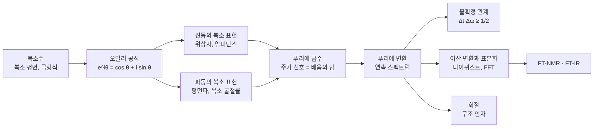

# 수학 도구 6. 복소수와 푸리에 해석 — 회전하는 화살표로 진동을 다루고, 신호를 진동수로 쪼갠다
<!-- prev: umath-4, umath-5, uphy-6, uphy-11 -->
<!-- next: umath-7, pchem-7 -->

> [!NOTE]
> **이 단원의 범위**
> - 복소수의 연산과 복소 평면, 극형식(크기와 편각), 켤레 복소수
> - 오일러 공식 $e^{i\theta} = \cos\theta + i\sin\theta$와 복소 지수 함수, 드무아브르 정리, 1의 거듭제곱근
> - 진동과 파동의 복소 표현: 위상자, 복소 진폭, 임피던스, 평면파 $e^{i(kx-\omega t)}$, 복소 굴절률
> - 푸리에 급수(삼각·복소 꼴, 직교성, 계수 구하기, 깁스 현상, 파스발 정리)
> - 푸리에 변환과 그 성질(이동·미분·합성곱 정리), 대표 변환 쌍(사각 펄스–sinc, 가우스–가우스, 지수 감쇠–로렌츠)
> - 불확정 관계: 시간–진동수($\Delta t\,\Delta\omega \ge 1/2$), 위치–파수($\Delta x\,\Delta k \ge 1/2$), 수명과 선 너비
> - 이산 푸리에 변환과 표본화(나이퀴스트 진동수, 겹침, 분해능, FFT)
> - 응용: FT-NMR과 FT-IR 분광기, 프라운호퍼 회절과 결정의 구조 인자

**학습 목표**

1. 복소수를 직교 꼴과 극형식으로 오가며 계산하고, 곱셈·나눗셈을 복소 평면의 '회전과 늘임'으로 해석할 수 있다.
2. 오일러 공식을 테일러 급수로 유도하고, 이를 써서 삼각 함수 항등식, 1의 $n$제곱근, 고리형 분자의 휘켈 오비탈 에너지를 구할 수 있다.
3. 진동하는 물리량을 복소 지수 함수의 실수부로 표현하여, 교류 회로의 임피던스와 강제 감쇠 진동의 진폭·위상을 대수 계산으로 구할 수 있다.
4. 주기 함수의 푸리에 계수를 직교성으로 구하고, 계수의 크기 분포(스펙트럼)와 파스발 정리로 신호의 성질을 해석할 수 있다.
5. 대표적인 푸리에 변환 쌍과 변환의 성질을 이용해 펄스의 대역폭, 스펙트럼 선의 너비와 모양을 계산하고, 시간–진동수·위치–파수 불확정 관계를 설명할 수 있다.
6. 표본화 간격과 기록 시간이 스펙트럼의 범위·분해능을 정하는 원리(나이퀴스트 조건, 겹침)를 설명하고 분광 실험 조건 설계에 적용할 수 있다.
7. FT-NMR·FT-IR 분광기와 회절 실험이 '푸리에 변환을 하는 장치'임을 이해하고, 구조 인자로 소멸 규칙을 유도할 수 있다.

**이 단원의 학습 사다리**

| 단계 | 무엇을 하나? |
|---|---|
| STEP 1. 이전 학습 다시 보기 | 사인파와 위상, 2계 미분방정식의 특성 방정식, 고유값, 간섭·회절 |
| STEP 2. 기초 다지기 | 삼각 함수와 덧셈 정리, 테일러 급수, 특성 방정식이 허근을 가질 때, 삼각 함수의 직교 적분 |
| STEP 3. 핵심 개념 | 복소수 → 오일러 공식 → 진동의 복소 표현 → 파동의 복소 표현 → 푸리에 급수 → 푸리에 변환 → 불확정성 → 이산 변환과 표본화 → FT 분광법 → 회절 |
| STEP 4. 오개념 바로잡기 | "허수는 물리적으로 의미가 없다", "분해능은 표본을 촘촘히 찍을수록 좋아진다" 같은 착각 |
| STEP 5. 더 깊은 수학으로 | 복소 함수론(유수 정리), 크라머스–크로니히 관계, 분포로서의 델타 함수, 웨이블릿 |
| STEP 6. 이 도구가 쓰이는 전공 단원 | 양자역학, 분광학, 휘켈 이론, 기기 분석, X선 결정학 |

---

## 🗺️ 단원 들어가기

NMR 분광기 안에서 시료가 내놓는 신호는 스펙트럼이 아니다. 고주파 펄스를 맞은 핵들이 수백 MHz로 함께 세차 운동하며 만드는, 몇 초 동안 서서히 사그라지는 **떨리는 전압** 하나일 뿐이다. 이 전압에는 메틸기의 수소, 방향족 고리의 수소, 하이드록시기의 수소가 저마다의 진동수로 섞여 있다. 화학자가 보는 깔끔한 봉우리들은 컴퓨터가 이 떨림을 **진동수별로 쪼갠 결과**이다. 적외선 분광기도, X선 결정 구조 분석도, 휴대 전화의 음성 압축도 같은 수학을 쓴다. 그 수학이 **푸리에 해석**이다.

푸리에 해석을 손에 익히려면 먼저 **복소수**와 친해져야 한다. 고등학교에서 복소수는 "제곱해서 $-1$이 되는 이상한 수"였다. 그러나 과학에서 복소수는 무엇보다 **회전하는 화살표**이다. $e^{i\omega t}$는 복소 평면에서 각속도 $\omega$로 도는 길이 1의 화살표이고, 그 그림자(실수부)가 $\cos\omega t$이다. 진동을 '도는 화살표의 그림자'로 보면, 삼각 함수의 복잡한 덧셈 공식이 지수의 덧셈으로, 미분방정식이 대수 방정식으로, 파동의 간섭이 화살표의 덧셈으로 바뀐다.

이 단원을 마치면 "10 μs짜리 펄스는 몇 kHz 폭을 고르게 들뜨게 하는가?", "0.5 cm⁻¹ 분해능의 적외선 스펙트럼을 얻으려면 거울을 얼마나 움직여야 하는가?", "체심 입방 결정에서 왜 (100) 회절점이 보이지 않는가?"에 계산으로 답할 수 있다. 그리고 다음 단계인 「양자역학의 기초」에서 파동 함수 $e^{ikx}$와 불확정성 원리를 만날 준비가 끝난다.

---

## STEP 1. 🔙 이전 학습 다시 보기

### 연계 개념표

| 이전 단원 | 그때 배운 것 | 이 단원에서 확장되는 것 |
|---|---|---|
| 일반물리학 「파동과 소리」 | 사인파 $y = y_m\sin(kx - \omega t + \phi)$, 파수 $k$와 각진동수 $\omega$, 중첩과 간섭, 정상파, 맥놀이, (맛보기로) 푸리에 분석 | 파동을 $\mathrm{Re}[Ae^{i(kx-\omega t)}]$로 쓰고, 위상차가 있는 파동의 합을 복소수 덧셈으로 계산. 임의의 파형을 사인파로 분해하는 계수를 **직접 구한다** |
| 일반물리학 「빛과 광학」 | 이중 슬릿 간섭 $d\sin\theta = m\lambda$, 단일 슬릿 세기 $(\sin\alpha/\alpha)^2$, 회절 격자 | 회절 무늬가 **틈 모양의 푸리에 변환**임을 보이고, 결정의 X선 회절(구조 인자)로 확장 |
| 일반물리학 「전자기 유도와 전자기파」 | 교류 회로, 리액턴스, 위상차를 위상자 그림으로 다룸 | 위상자를 복소수로 정식화: 임피던스 $Z = R + i(\omega L - 1/\omega C)$ |
| 수학 도구 4 「상미분방정식」 | 상수 계수 2계 선형 방정식, 특성 방정식, 감쇠·강제 진동, 공명 | 특성근이 복소수일 때의 해를 $e^{(-\gamma/2 \pm i\omega_d)t}$로 통일, 강제 진동의 복소 진폭 |
| 수학 도구 5 「선형대수」 | 고유값·고유벡터, 직교 기저, 휘켈 분자 오비탈, 에르미트 행렬 | 함수 $e^{inx}$가 이루는 **직교 기저**(푸리에 기저), 고리형 휘켈 행렬의 고유벡터가 1의 거듭제곱근으로 주어짐 |

### 준비 운동 (사전 진단)

**Q1.** $\cos(a + b)$와 $\sin(a + b)$의 덧셈 정리를 쓰시오.

**Q2.** 미분방정식 $\ddot{x} + 4x = 0$의 특성 방정식과 그 근을 쓰고, 일반해를 사인·코사인으로 나타내시오.

**Q3.** 파장 500 nm인 빛의 파수 $k$(rad/m)와 분광학에서 쓰는 파수 $\tilde{\nu} = 1/\lambda$(cm⁻¹)를 각각 구하시오.

**Q4.** 진폭이 같은 두 사인파 $\sin\omega t$와 $\sin(\omega t + \phi)$를 더했을 때 합성 진폭이 0이 되는 $\phi$를 $0 \le \phi < 2\pi$에서 구하시오.

정답 및 해설

**Q1.** $\cos(a+b) = \cos a\cos b - \sin a\sin b$, $\sin(a+b) = \sin a\cos b + \cos a\sin b$. STEP 3 ②에서 이 두 식이 $e^{i(a+b)} = e^{ia}e^{ib}$ 한 줄에서 동시에 나오는 것을 본다.

**Q2.** $x = e^{st}$를 넣으면 $s^2 + 4 = 0$, $s = \pm 2i$. 일반해는 $x = A\cos 2t + B\sin 2t$. 특성근이 허수라는 것이 '진동'의 신호이다(STEP 2 디딤돌 3).

**Q3.** $k = 2\pi/\lambda = 2\pi/(5.00\times10^{-7}\ \mathrm{m}) = 1.26\times10^{7}\ \mathrm{rad/m}$, $\tilde{\nu} = 1/(5.00\times10^{-5}\ \mathrm{cm}) = 2.00\times10^{4}\ \mathrm{cm^{-1}}$. 물리학의 $k$와 분광학의 $\tilde{\nu}$는 $2\pi$배와 단위가 다르다.

**Q4.** $\phi = \pi$. 합성 진폭은 $2\lvert\cos(\phi/2)\rvert$이므로 $\phi = \pi$일 때 0이다(상쇄 간섭).

---

## STEP 2. 🧱 기초 다지기

### 디딤돌 1. 삼각 함수와 단위원

각 $\theta$만큼 돌아간 단위원 위의 점의 좌표가 $(\cos\theta, \sin\theta)$이다. 이 단원 전체가 이 그림 하나의 확장이라고 해도 좋다.

| 성질 | 식 | 이 단원에서 쓰이는 곳 |
|---|---|---|
| 덧셈 정리 | $\cos(a\pm b) = \cos a\cos b \mp \sin a\sin b$ | 위상자 곱셈 = 각의 덧셈 |
| 곱을 합으로 | $\cos a\cos b = \frac{1}{2}[\cos(a-b) + \cos(a+b)]$ | 맥놀이, 직교 적분, 혼합(헤테로다인) 검출 |
| 반각 | $\cos^2\theta = \frac{1}{2}(1 + \cos 2\theta)$ | 교류 전력과 빛의 세기의 시간 평균 $\langle\cos^2\omega t\rangle = 1/2$ |
| 진동 합성 | $a\cos\omega t + b\sin\omega t = \sqrt{a^2+b^2}\cos(\omega t - \delta)$, $\tan\delta = b/a$ | 강제 진동의 진폭과 위상 |

**예** $3\cos\omega t + 4\sin\omega t$를 한 개의 코사인으로 쓰면 진폭 $\sqrt{3^2+4^2} = 5$, $\tan\delta = 4/3$에서 $\delta = 53.1^\circ$이므로 $5\cos(\omega t - 53.1^\circ)$이다. 마지막 줄 공식을 외우지 않아도 STEP 3 ④의 위상자 덧셈으로 한 줄에 얻게 된다.

### 디딤돌 2. 테일러 급수 — 세 함수의 전개

수학 도구 2 '테일러 급수와 근사'에서 익힌 전개 가운데 다음 세 개가 오일러 공식의 재료이다.

$$
e^x = \sum_{n=0}^{\infty}\frac{x^n}{n!} = 1 + x + \frac{x^2}{2!} + \frac{x^3}{3!} + \cdots
$$

$$
\cos x = 1 - \frac{x^2}{2!} + \frac{x^4}{4!} - \cdots, \qquad \sin x = x - \frac{x^3}{3!} + \frac{x^5}{5!} - \cdots
$$

세 급수는 모든 실수 $x$에서 수렴한다. 눈여겨볼 점은 $\cos x$가 $e^x$의 **짝수 차수 항**만, $\sin x$가 **홀수 차수 항**만 모은 모양이고 부호만 번갈아 바뀐다는 것이다. 그 '번갈아 바뀌는 부호'를 만들어 주는 것이 $i^2 = -1$이다.

**예** $x = 0.1$일 때 $\cos x \approx 1 - x^2/2 = 0.99500$ (참값 0.995004), $\sin x \approx x - x^3/6 = 0.0998333$ (참값 0.0998334). 작은 각에서 두세 항이면 충분하다.

### 디딤돌 3. 특성 방정식이 허근을 가질 때

수학 도구 4 '상수 계수 2계 선형'에서 감쇠 진동자 $\ddot{x} + \gamma\dot{x} + \omega_0^2x = 0$에 $x = e^{st}$를 넣어 특성 방정식 $s^2 + \gamma s + \omega_0^2 = 0$을 얻었다.

$$
s = -\frac{\gamma}{2} \pm \sqrt{\frac{\gamma^2}{4} - \omega_0^2}
$$

$\gamma < 2\omega_0$(덜 감쇠)이면 근호 안이 음수여서 $s = -\gamma/2 \pm i\omega_d$, $\omega_d = \sqrt{\omega_0^2 - \gamma^2/4}$가 된다. 그때는 "$e^{(-\gamma/2 + i\omega_d)t}$와 같은 복소 지수 함수가 해이고, 그 실수부와 허수부를 취하면 $e^{-\gamma t/2}\cos\omega_d t$, $e^{-\gamma t/2}\sin\omega_d t$가 된다"고만 받아들였다. 이 단원 ②에서 그 까닭이 오일러 공식임을 확인한다.

**예** $\ddot{x} + 2\dot{x} + 26x = 0$: $s = -1 \pm \sqrt{1 - 26} = -1 \pm 5i$. 해는 $x = e^{-t}(A\cos 5t + B\sin 5t)$이다. 실수부 $-1$은 **감쇠율**, 허수부 $5$는 **진동의 각진동수**이다. 복소수 하나에 두 정보가 함께 들어 있다.

### 디딤돌 4. 삼각 함수의 직교 적분

푸리에 급수의 계수를 구하는 열쇠는 다음 적분이다($m$, $n$은 양의 정수).

$$
\int_{-\pi}^{\pi}\sin mx\,\sin nx\,dx = \pi\,\delta_{mn}, \qquad \int_{-\pi}^{\pi}\cos mx\,\cos nx\,dx = \pi\,\delta_{mn}, \qquad \int_{-\pi}^{\pi}\sin mx\,\cos nx\,dx = 0
$$

($\delta_{mn}$은 $m = n$일 때 1, 아닐 때 0인 크로네커 델타.) 곱을 합으로 바꾸면 바로 보인다. $m \ne n$이면 $\sin mx\sin nx = \frac{1}{2}[\cos(m-n)x - \cos(m+n)x]$이고, 정수배 진동수의 코사인을 한 주기 동안 적분하면 양과 음의 넓이가 정확히 상쇄되어 0이다. $m = n$이면 $\sin^2 nx = \frac{1}{2}(1 - \cos 2nx)$의 적분이 $\pi$이다.

수학 도구 5 '벡터 공간과 기저'의 말로 하면, 함수 $f$와 $g$의 **내적**을 $\langle f, g\rangle = \int f g\,dx$로 정할 때 $\{\sin nx, \cos nx\}$는 서로 **직교하는 기저 벡터**들이다. 벡터의 성분을 기저 벡터와의 내적으로 뽑아내듯, 함수의 푸리에 계수도 내적으로 뽑아낸다.

**예** $\int_{-\pi}^{\pi}\sin 3x\,\sin 5x\,dx = \frac{1}{2}\int_{-\pi}^{\pi}(\cos 2x - \cos 8x)\,dx = 0$, $\int_{-\pi}^{\pi}\sin^2 3x\,dx = \pi$.

---

## STEP 3. 📘 핵심 개념

### ① 복소수와 복소 평면

**허수 단위(imaginary unit)** $i$는 $i^2 = -1$을 만족하는 수이다. **복소수(complex number)** $z = x + iy$에서 $x = \mathrm{Re}\,z$를 **실수부**, $y = \mathrm{Im}\,z$를 **허수부**라 한다(허수부는 $i$를 뺀 실수 $y$이다). 사칙 연산은 $i^2 = -1$만 기억하고 다항식처럼 하면 된다.

| 연산 | 식 ($z_1 = x_1 + iy_1$, $z_2 = x_2 + iy_2$) |
|---|---|
| 덧셈 | $z_1 + z_2 = (x_1 + x_2) + i(y_1 + y_2)$ |
| 곱셈 | $z_1z_2 = (x_1x_2 - y_1y_2) + i(x_1y_2 + x_2y_1)$ |
| 켤레 복소수 | $z^* = x - iy$ (교재에 따라 $\bar{z}$) |
| 크기(절댓값) | $\lvert z\rvert = \sqrt{x^2 + y^2} = \sqrt{zz^*}$ |
| 나눗셈 | $\dfrac{z_1}{z_2} = \dfrac{z_1z_2^*}{\lvert z_2\rvert^2}$ (분모를 실수로 만든다) |
| 실수부·허수부 뽑기 | $\mathrm{Re}\,z = \dfrac{z + z^*}{2}$, $\mathrm{Im}\,z = \dfrac{z - z^*}{2i}$ |

#### 복소 평면 — 복소수는 점이자 화살표이다

복소수 $x + iy$를 평면의 점 $(x, y)$에 대응시킨 것을 **복소 평면(complex plane)** 이라 한다. 가로축이 실수축, 세로축이 허수축이다. 덧셈은 벡터의 덧셈(평행사변형)과 같고, 켤레 복소수는 실수축에 대한 대칭이다.

<!-- 그림 요청: 복소 평면. 가로축 Re, 세로축 Im. 점 z = 3 + 2i를 원점에서 그은 화살표로 표시하고, 화살표 길이에 r = |z| = √13, 실수축과의 각에 θ = arg z 이름표. 점선으로 실수부 3과 허수부 2를 축에 내린 투영. 실수축 아래 대칭 위치에 z* = 3 − 2i를 회색 화살표로. 오른쪽 작은 패널: z1 = 1 + 2i, z2 = 2 − i의 덧셈을 평행사변형으로 그린 그림(합 3 + i). -->

#### 극형식 — 크기와 방향으로 쓰기

원점에서 점까지의 거리 $r = \lvert z\rvert$와, 실수축의 양의 방향에서 잰 각 $\theta$(**편각(argument)**, $\arg z$)로 쓰면

$$
z = r(\cos\theta + i\sin\theta)
$$

이다. 이것이 **극형식(polar form)** 이다. 극형식의 힘은 곱셈에서 드러난다. 덧셈 정리를 쓰면

$$
z_1z_2 = r_1r_2[(\cos\theta_1\cos\theta_2 - \sin\theta_1\sin\theta_2) + i(\sin\theta_1\cos\theta_2 + \cos\theta_1\sin\theta_2)] = r_1r_2[\cos(\theta_1+\theta_2) + i\sin(\theta_1+\theta_2)]
$$

즉 **곱하면 크기는 곱해지고 각은 더해진다.** 복소수 $z_2$를 곱하는 것은 화살표 $z_1$을 $\theta_2$만큼 **돌리고** $r_2$배로 **늘이는** 조작이다. 특히 $i$($r = 1$, $\theta = 90^\circ$)를 곱하면 화살표가 정확히 $90^\circ$ 돈다. $i^2 = -1$은 "90° 회전을 두 번 하면 반대 방향"이라는 기하학적 사실이다.

> [!WARNING]
> 편각을 $\theta = \arctan(y/x)$로 구하면 사분면을 놓치기 쉽다. $-1 - i$와 $1 + i$는 $y/x$가 모두 1이지만 편각은 각각 $-3\pi/4$와 $\pi/4$이다. 반드시 **점이 어느 사분면에 있는지** 확인한다(계산기·프로그램의 `atan2(y, x)` 함수가 이 일을 해 준다). 편각은 $2\pi$의 정수배만큼 모호하므로 보통 $-\pi < \theta \le \pi$를 **주값**으로 택한다.

#### 예제 1 — 직교 꼴과 극형식으로 곱하고 나누기

$z_1 = 1 + i\sqrt{3}$, $z_2 = 1 - i$일 때 (1) $z_1z_2$와 $z_1/z_2$를 직교 꼴로 구하시오. (2) 두 수를 극형식으로 바꾸어 같은 계산을 하고 (1)과 비교하시오. (3) $z_1^6$을 구하시오.

**풀이**
(1) $z_1z_2 = (1 + i\sqrt{3})(1 - i) = 1 - i + i\sqrt{3} - i^2\sqrt{3} = (1 + \sqrt{3}) + i(\sqrt{3} - 1) \approx 2.732 + 0.732i$
$\dfrac{z_1}{z_2} = \dfrac{(1 + i\sqrt{3})(1 + i)}{(1 - i)(1 + i)} = \dfrac{(1 - \sqrt{3}) + i(1 + \sqrt{3})}{2} \approx -0.366 + 1.366i$
(2) $z_1$: $r_1 = \sqrt{1 + 3} = 2$, 제1사분면이고 $\tan\theta_1 = \sqrt{3}$이므로 $\theta_1 = \pi/3$. $z_2$: $r_2 = \sqrt{2}$, 제4사분면이고 $\theta_2 = -\pi/4$.
곱: 크기 $2\sqrt{2} \approx 2.828$, 각 $\pi/3 - \pi/4 = \pi/12$ (15°). 검산: $2\sqrt{2}\cos 15^\circ = 2.732$, $2\sqrt{2}\sin 15^\circ = 0.732$ ✓.
몫: 크기 $2/\sqrt{2} = \sqrt{2}$, 각 $\pi/3 + \pi/4 = 7\pi/12$ (105°). 검산: $\sqrt{2}\cos 105^\circ = -0.366$, $\sqrt{2}\sin 105^\circ = 1.366$ ✓.
(3) $z_1^6 = 2^6[\cos(6\cdot\pi/3) + i\sin(6\cdot\pi/3)] = 64(\cos 2\pi + i\sin 2\pi) = 64$.

**의미** 곱셈·나눗셈·거듭제곱은 극형식이 압도적으로 편하고, 덧셈은 직교 꼴이 편하다. (3)을 직교 꼴로 하려면 이항 전개를 여섯 번 해야 한다. 그리고 덤으로, 이 계산은 $\cos 15^\circ = (1 + \sqrt{3})/(2\sqrt{2})$라는 값을 거저 준다.

> [!TIP]
> 💡 **요령** — 물리량을 복소수로 다룰 때 가장 자주 쓰는 계산은 $\lvert z\rvert^2 = zz^*$이다. 나중에 파동의 **세기**, 양자역학의 **확률 밀도**, 스펙트럼의 **파워**가 모두 "복소 진폭에 그 켤레를 곱한 것"으로 나온다. $\lvert z\rvert^2 = x^2 + y^2$은 항상 0 이상의 실수이다.

#### ✔ 바로 확인

1. $(2 + 3i)(1 - 2i)$를 계산하시오.
2. $z = -\sqrt{3} + i$의 크기와 편각(주값)을 구하시오.
3. (O/X) 복소수에 $i$를 곱하면 복소 평면에서 화살표가 시계 반대 방향으로 90° 돈다.

정답

1. $8 - i$ — $2 - 4i + 3i - 6i^2 = 8 - i$.
2. $\lvert z\rvert = 2$, $\arg z = 5\pi/6$ (150°) — 제2사분면이므로 $\arctan(-1/\sqrt{3}) = -\pi/6$에 $\pi$를 더한다.
3. O — $i = 1\cdot(\cos 90^\circ + i\sin 90^\circ)$이므로 크기는 그대로, 각만 90° 더해진다.

### ② 오일러 공식과 복소 지수 함수

#### 유도 — 테일러 급수에 $i\theta$를 넣는다

$e^x$의 급수에 $x = i\theta$를 넣는 것을 **복소 지수 함수의 정의**로 삼자(급수는 복소수에서도 수렴한다). $i^2 = -1$, $i^3 = -i$, $i^4 = 1$이 네 항마다 되풀이되므로

$$
e^{i\theta} = 1 + i\theta - \frac{\theta^2}{2!} - i\frac{\theta^3}{3!} + \frac{\theta^4}{4!} + i\frac{\theta^5}{5!} - \cdots
$$

실수 항과 $i$가 붙은 항을 따로 모으면 디딤돌 2의 두 급수가 정확히 나타난다.

$$
e^{i\theta} = \underbrace{\left(1 - \frac{\theta^2}{2!} + \frac{\theta^4}{4!} - \cdots\right)}_{\cos\theta} + i\underbrace{\left(\theta - \frac{\theta^3}{3!} + \frac{\theta^5}{5!} - \cdots\right)}_{\sin\theta}
$$

> [!IMPORTANT]
> **오일러 공식(Euler's formula)**
> $$
> e^{i\theta} = \cos\theta + i\sin\theta
> $$
> 따라서 모든 복소수는 $z = re^{i\theta}$로 쓸 수 있고, $\lvert e^{i\theta}\rvert = 1$이다. $\theta$를 $-\theta$로 바꾸어 더하고 빼면
> $$
> \cos\theta = \frac{e^{i\theta} + e^{-i\theta}}{2}, \qquad \sin\theta = \frac{e^{i\theta} - e^{-i\theta}}{2i}
> $$

$\theta = \pi$를 넣으면 $e^{i\pi} = -1$, 즉 $e^{i\pi} + 1 = 0$이다. 다른 확인 방법도 있다. $f(\theta) = e^{-i\theta}(\cos\theta + i\sin\theta)$를 미분하면 $-ie^{-i\theta}(\cos\theta + i\sin\theta) + e^{-i\theta}(-\sin\theta + i\cos\theta) = 0$이므로 $f$는 상수이고 $f(0) = 1$이다. 두 유도 모두 "$e^{i\theta}$의 미분은 $ie^{i\theta}$"라는 성질에 기대고 있다.

#### 회전하는 화살표

$\theta$가 시간에 비례해 $\theta = \omega t$로 커지면 $e^{i\omega t}$는 단위원 위를 각속도 $\omega$로 시계 반대 방향으로 도는 점이다. 그 점을 실수축에 비춘 그림자가 $\cos\omega t$, 허수축에 비춘 그림자가 $\sin\omega t$이다. 일반물리학의 '등속 원운동의 그림자는 단진동'이 바로 이 식이다.

<!-- 그림 요청: 왼쪽에 단위원과 시계 반대 방향으로 도는 화살표 e^{iωt}(각 ωt 표시). 오른쪽으로 화살표 끝의 허수축 투영이 시간축을 따라 sin ωt 곡선을 그리고, 아래쪽으로 실수축 투영이 아래로 흐르는 시간축을 따라 cos ωt 곡선을 그리는 모습. ωt = 0, π/2, π, 3π/2의 위치를 점으로 대응시켜 표시. -->

#### 복소 지수 함수의 성질

| 성질 | 식 | 의미 |
|---|---|---|
| 곱 | $e^{i\alpha}e^{i\beta} = e^{i(\alpha+\beta)}$ | 덧셈 정리 두 개를 한 줄로 |
| 거듭제곱(드무아브르 정리) | $(\cos\theta + i\sin\theta)^n = \cos n\theta + i\sin n\theta$ | $(e^{i\theta})^n = e^{in\theta}$ |
| 미분 | $\dfrac{d}{dt}e^{i\omega t} = i\omega\,e^{i\omega t}$ | 미분 = $i\omega$ 곱하기 (90° 앞선 위상) |
| 적분 | $\displaystyle\int e^{i\omega t}dt = \frac{e^{i\omega t}}{i\omega} + C$ | 적분 = $i\omega$로 나누기 |
| 주기성 | $e^{i(\theta + 2\pi n)} = e^{i\theta}$ | 편각의 $2\pi$ 모호성 |
| 켤레 | $(e^{i\theta})^* = e^{-i\theta}$ | 거꾸로 도는 화살표 |
| 일반 지수 | $e^{(a+ib)t} = e^{at}(\cos bt + i\sin bt)$ | 실수부 = 성장·감쇠, 허수부 = 진동 |

마지막 줄이 디딤돌 3의 궁금증을 푼다. 특성근 $s = -\gamma/2 + i\omega_d$에 대해 $e^{st} = e^{-\gamma t/2}(\cos\omega_d t + i\sin\omega_d t)$이고, 미분방정식의 계수가 실수이므로 복소 해의 실수부와 허수부가 각각 실수 해가 된다.

#### 1의 $n$제곱근

$z^n = 1$의 근은 $z = re^{i\theta}$로 놓고 $r^ne^{in\theta} = 1 = e^{i2\pi k}$를 풀면 $r = 1$, $\theta = 2\pi k/n$이다.

$$
z_k = e^{2\pi ik/n}, \qquad k = 0, 1, \ldots, n-1
$$

이 $n$개의 근은 단위원 위에 정 $n$각형을 이룬다. 그리고 $k \ne 0$($n$의 배수가 아닌 정수)이면 근들의 합이 0이다. 등비급수 합 공식으로

$$
\sum_{j=0}^{n-1}e^{2\pi ijk/n} = \frac{1 - e^{2\pi ik}}{1 - e^{2\pi ik/n}} = 0
$$

이기 때문이다(분자 $= 1 - 1 = 0$, 분모 $\ne 0$). 이 '정다각형 꼭짓점 화살표의 합은 0'이라는 성질이 ⑧의 이산 푸리에 변환과 ⑩의 회절 격자에서 그대로 다시 나온다.

#### 예제 2 — 1의 6제곱근과 벤젠의 휘켈 분자 오비탈

수학 도구 5 '응용: 휘켈 분자 오비탈'에서 고리형 $\mathrm{C}_n$ 콘주게이션계의 휘켈 행렬은 대각 성분이 $\alpha$, 고리에서 이웃한 탄소 사이의 성분만 $\beta$인 행렬이었다. 벤젠($n = 6$)에서 탄소 $j$($j = 0, \ldots, 5$)의 계수를 $c_j = e^{2\pi ijk/6}$으로 놓은 시행 벡터가 고유벡터임을 보이고, 고유값(오비탈 에너지)을 구하시오.

**풀이**
고유값 방정식의 $j$번째 줄은 $\alpha c_j + \beta(c_{j-1} + c_{j+1}) = Ec_j$이다(고리이므로 $c_{-1} = c_5$, $c_6 = c_0$). 시행 벡터를 넣으면

$$
c_{j-1} + c_{j+1} = e^{2\pi ijk/6}\left(e^{-2\pi ik/6} + e^{2\pi ik/6}\right) = c_j\cdot 2\cos\frac{2\pi k}{6}
$$

이므로 모든 $j$에서 같은 비례 상수가 나온다. 따라서 이 벡터는 고유벡터이고, 고리 조건($c_6 = c_0$)은 $e^{2\pi ik} = 1$, 즉 $k$가 정수이면 자동으로 만족한다.

$$
E_k = \alpha + 2\beta\cos\frac{2\pi k}{6}, \qquad k = 0, \pm1, \pm2, 3
$$

| $k$ | $\cos(2\pi k/6)$ | $E_k$ | 축퇴 |
|---|---|---|---|
| 0 | 1 | $\alpha + 2\beta$ | 1 |
| $\pm1$ | $1/2$ | $\alpha + \beta$ | 2 |
| $\pm2$ | $-1/2$ | $\alpha - \beta$ | 2 |
| 3 | $-1$ | $\alpha - 2\beta$ | 1 |

($\beta < 0$이므로 $\alpha + 2\beta$가 가장 낮다.) π 전자 6개가 아래 세 오비탈을 채우므로 총 π 에너지는 $2(\alpha + 2\beta) + 4(\alpha + \beta) = 6\alpha + 8\beta$이다.

**의미** 6×6 행렬의 행렬식을 풀지 않고 1의 6제곱근만으로 고유값을 얻었다. 서로 다른 $k$의 고유벡터가 직교한다는 것($\sum_j c_j^{(k)*}c_j^{(k')} = \sum_j e^{2\pi ij(k'-k)/6} = 0$)도 위의 '근들의 합은 0'에서 바로 나온다. 에너지 $\alpha + 2\beta\cos(2\pi k/n)$을 반지름 $2\lvert\beta\rvert$인 원에 정 $n$각형을 꼭짓점이 아래로 오게 내접시켜 읽는 방법이 **프로스트 원(Frost circle)** 이다.

<!-- 그림 요청: 두 패널. 왼쪽: 복소 평면 단위원 위의 1의 6제곱근 z_k = e^{2πik/6} (k = 0~5) 여섯 점, 정육각형으로 연결, 각 점에 k 이름표. 오른쪽: 프로스트 원. 반지름 2|β|인 원에 정육각형을 꼭짓점 하나가 맨 아래로 오도록 내접시키고, 꼭짓점 높이에 수평선을 그어 세로축 에너지 α + 2β(맨 아래, 1개), α + β(2개), α − β(2개), α − 2β(맨 위, 1개) 이름표. 원의 중심 높이에 α 점선. 아래 세 준위에 전자쌍(위아래 화살표) 채우기. -->

#### ✔ 바로 확인

1. $e^{i\pi/2}$와 $e^{-i\pi}$를 직교 꼴로 쓰시오.
2. (O/X) $\lvert e^{i\theta}\rvert$는 $\theta$에 따라 달라진다.
3. $\dfrac{d}{dt}\left(e^{-2t}e^{i5t}\right)$를 구하시오.

정답

1. $e^{i\pi/2} = i$, $e^{-i\pi} = -1$.
2. X — $\lvert e^{i\theta}\rvert^2 = \cos^2\theta + \sin^2\theta = 1$이므로 항상 1이다.
3. $(-2 + 5i)e^{(-2+5i)t}$ — 지수에 붙은 복소수를 곱하기만 하면 된다.

### ③ 진동의 복소 표현 — 위상자, 복소 진폭, 임피던스

#### 실수 진동을 복소수의 그림자로 쓰기

진폭 $A$, 위상 $\phi$인 진동 $x(t) = A\cos(\omega t + \phi)$는 오일러 공식으로

$$
x(t) = \mathrm{Re}\left[Ae^{i(\omega t + \phi)}\right] = \mathrm{Re}\left[\tilde{X}e^{i\omega t}\right], \qquad \tilde{X} = Ae^{i\phi}
$$

로 쓸 수 있다. 시간에 의존하지 않는 복소수 $\tilde{X}$를 **복소 진폭(complex amplitude)** 또는 **위상자(phasor)** 라 한다. 위상자 하나에 진폭($\lvert\tilde{X}\rvert$)과 위상($\arg\tilde{X}$)이 함께 들어 있다.

이렇게 쓰는 까닭은 **선형 연산이 '실수부 취하기'와 순서를 바꿀 수 있기** 때문이다. 같은 진동수의 진동끼리 더하거나, 실수 상수를 곱하거나, 시간으로 미분·적분하는 조작은 복소수로 계산한 뒤 마지막에 실수부만 취해도 결과가 같다. 그리고 미분은 $i\omega$ 곱하기, 적분은 $i\omega$로 나누기가 되므로 **미분방정식이 대수 방정식으로** 바뀐다.

| 실수 진동에서의 조작 | 위상자에서의 조작 |
|---|---|
| 같은 진동수 진동의 덧셈 | 복소수 덧셈 (화살표 잇기) |
| 시간 미분 $d/dt$ | $i\omega$ 곱하기 (크기 $\omega$배, 위상 90° 앞섬) |
| 시간 적분 | $1/(i\omega)$ 곱하기 (크기 $1/\omega$배, 위상 90° 뒤짐) |
| 시간 지연 $t \to t - t_0$ | $e^{-i\omega t_0}$ 곱하기 (위상 $\omega t_0$만큼 뒤짐) |

> [!WARNING]
> **곱은 예외이다.** 두 진동의 곱(전력 $P = VI$, 세기 $\propto E^2$)은 $\mathrm{Re}[\tilde{A}]\,\mathrm{Re}[\tilde{B}] \ne \mathrm{Re}[\tilde{A}\tilde{B}]$이므로 복소수끼리 곱해서 실수부를 취하면 틀린다. 같은 진동수의 두 진동의 곱을 한 주기 평균하면
> $$
> \left\langle \mathrm{Re}[\tilde{A}e^{i\omega t}]\,\mathrm{Re}[\tilde{B}e^{i\omega t}] \right\rangle = \frac{1}{2}\mathrm{Re}\left[\tilde{A}\tilde{B}^*\right]
> $$
> 이다. 특히 $\langle x^2\rangle = \frac{1}{2}\lvert\tilde{X}\rvert^2$이다.

#### 강제 감쇠 진동 — 미분방정식이 나눗셈이 된다

수학 도구 4 '상수 계수 2계 선형'의 강제 감쇠 진동자

$$
\ddot{x} + \gamma\dot{x} + \omega_0^2x = \frac{F_0}{m}\cos\omega t
$$

를 다시 풀어 보자. 힘을 $\mathrm{Re}[(F_0/m)e^{i\omega t}]$로 쓰고 정상 상태의 해를 $x = \mathrm{Re}[\tilde{X}e^{i\omega t}]$로 놓는다. 미분을 $i\omega$ 곱하기로 바꾸면

$$
\left[(i\omega)^2 + \gamma(i\omega) + \omega_0^2\right]\tilde{X} = \frac{F_0}{m} \quad\Longrightarrow\quad \tilde{X} = \frac{F_0/m}{\omega_0^2 - \omega^2 + i\gamma\omega}
$$

미정 계수를 두 개($\cos$, $\sin$의 계수) 세워 연립 방정식을 푸는 대신 **나눗셈 한 번**으로 끝났다. 크기와 위상은 극형식으로 읽는다.

$$
\lvert\tilde{X}\rvert = \frac{F_0/m}{\sqrt{(\omega_0^2 - \omega^2)^2 + \gamma^2\omega^2}}, \qquad \delta = -\arg\tilde{X} = \arctan\frac{\gamma\omega}{\omega_0^2 - \omega^2} \quad (0 \le \delta \le \pi)
$$

$\delta$는 변위가 힘보다 **뒤지는** 위상이다. 낮은 진동수에서 $\delta \to 0$(힘을 따라 움직인다), 공명 $\omega = \omega_0$에서 정확히 $\delta = 90^\circ$, 높은 진동수에서 $\delta \to 180^\circ$(힘과 반대로 움직인다)이다. 공명에서의 진폭은 $\lvert\tilde{X}\rvert = F_0/(m\gamma\omega_0) = Q\cdot F_0/k$이며, $Q = \omega_0/\gamma$를 **품질 인자(quality factor)** 라 한다($k = m\omega_0^2$).

**공명 근처의 모양 — 로렌츠 함수** $\omega \approx \omega_0$이면 $\omega_0^2 - \omega^2 = (\omega_0 + \omega)(\omega_0 - \omega) \approx 2\omega_0(\omega_0 - \omega)$, $\gamma\omega \approx \gamma\omega_0$이므로

$$
\lvert\tilde{X}\rvert^2 \approx \frac{(F_0/2m\omega_0)^2}{(\omega_0 - \omega)^2 + (\gamma/2)^2}
$$

이다. 이 꼴을 **로렌츠 함수(Lorentzian)** 라 하며, 봉우리 높이의 절반이 되는 너비(**반치 전폭**, FWHM)는 $\gamma$이다. 감쇠가 약할수록(γ가 작을수록) 공명 봉우리가 좁다. 이 관계는 ⑥·⑦에서 "감쇠 시간이 길수록 스펙트럼 선이 좁다"로 다시 나온다.

<!-- 그림 요청: 강제 감쇠 진동자의 응답 곡선 두 패널(가로축 ω/ω0, 0~2). 위: 진폭 |X|/(F0/k), Q = 2, 5, 20의 세 곡선. 아래: 위상 지연 δ(0°~180°), 같은 세 Q 값. 모든 곡선이 ω/ω0 = 1에서 δ = 90°를 지나는 것을 점으로 강조. Q = 20 곡선의 반치 전폭(높이의 1/√2 진폭 지점 사이 = |X|² 반치) 구간을 양쪽 화살표와 'γ' 이름표로 표시. -->

#### 교류 회로와 복소 임피던스

교류 전압 $V = \mathrm{Re}[\tilde{V}e^{i\omega t}]$를 걸면 회로 소자마다 전압 위상자와 전류 위상자의 비 $\tilde{Z} = \tilde{V}/\tilde{I}$가 정해진다. 이것이 **복소 임피던스(impedance)** 이다.

| 소자 | 전압–전류 관계 | 임피던스 $\tilde{Z}$ | 위상 관계 |
|---|---|---|---|
| 저항 $R$ | $V = RI$ | $R$ | 같은 위상 |
| 인덕터 $L$ | $V = L\,dI/dt$ | $i\omega L$ | 전압이 90° 앞섬 |
| 축전기 $C$ | $I = C\,dV/dt$ | $\dfrac{1}{i\omega C} = -\dfrac{i}{\omega C}$ | 전압이 90° 뒤짐 |

직렬 연결은 임피던스를 더하고, 병렬 연결은 역수를 더한다. 직류 회로의 옴 법칙과 똑같은 규칙이 복소수로 확장된 것이다.

#### 예제 3 — RLC 직렬 회로의 전류와 전력

$R = 50\ \Omega$, $L = 20\ \mathrm{mH}$, $C = 5.0\ \mu\mathrm{F}$를 직렬로 잇고 진폭 $V_0 = 10\ \mathrm{V}$, 진동수 $f = 400\ \mathrm{Hz}$인 교류 전압을 걸었다. (1) 복소 임피던스와 그 크기·위상을 구하시오. (2) 전류의 진폭과, 전류가 전압보다 앞서는지 뒤지는지 쓰시오. (3) 평균 소비 전력을 구하시오. (4) 공명 진동수와 그때의 전류 진폭을 구하시오.

**풀이**
(1) $\omega = 2\pi(400) = 2513\ \mathrm{rad/s}$. $\omega L = 50.27\ \Omega$, $1/(\omega C) = 79.58\ \Omega$.
$\tilde{Z} = R + i\left(\omega L - \dfrac{1}{\omega C}\right) = 50 - 29.31i\ \Omega$, $\lvert\tilde{Z}\rvert = \sqrt{50^2 + 29.31^2} = 57.96\ \Omega$, $\arg\tilde{Z} = \arctan(-29.31/50) = -30.4^\circ$.
(2) $\tilde{I} = \tilde{V}/\tilde{Z}$이므로 $I_0 = 10/57.96 = 0.173\ \mathrm{A}$, $\arg\tilde{I} = \arg\tilde{V} - \arg\tilde{Z} = +30.4^\circ$. 전류가 전압보다 30.4° **앞선다**(축전기의 효과가 우세).
(3) $\langle P\rangle = \frac{1}{2}\mathrm{Re}[\tilde{V}\tilde{I}^*] = \frac{1}{2}V_0I_0\cos 30.4^\circ = \frac{1}{2}(10)(0.1725)(0.8627) = 0.744\ \mathrm{W}$. 검산: $\frac{1}{2}I_0^2R = \frac{1}{2}(0.1725)^2(50) = 0.744\ \mathrm{W}$ ✓ (전력은 저항에서만 소모된다).
(4) 허수부가 0이 되는 $\omega_0 = 1/\sqrt{LC}$: $f_0 = \dfrac{1}{2\pi\sqrt{0.020\times5.0\times10^{-6}}} = 503\ \mathrm{Hz}$. 이때 $\tilde{Z} = R$이므로 $I_0 = 10/50 = 0.200\ \mathrm{A}$, 전력 $1.00\ \mathrm{W}$.

**의미** 전기화학의 **임피던스 분광법**은 전극–용액 계면을 저항과 축전기의 조합으로 모형화하고, 여러 진동수에서 $\tilde{Z}$를 재어 복소 평면에 그린 자취(나이퀴스트 도시)로 전하 이동 저항과 이중층 전기 용량을 읽는다. 위의 계산이 그 해석의 출발점이다.

<!-- 그림 요청: 예제 3의 위상자 그림. 복소 평면에 전류 위상자 I(실수축 방향으로 기준을 잡음, 길이 0.173 A)를 두고, 전압 위상자 V_R = RI(실수축, 8.63 V), V_L = iωL I(위쪽 허수축, 8.67 V), V_C = −i I/(ωC)(아래쪽, 13.73 V)를 화살표로 이어 그린 뒤, 합 V(크기 10 V)가 실수축 아래 30.4° 방향을 가리키는 것을 굵은 화살표로 표시. 각에 'V가 I보다 30.4° 뒤짐' 이름표. -->

#### ✔ 바로 확인

1. 진동 $x(t) = 2\cos(\omega t - \pi/3)$의 위상자를 $Ae^{i\phi}$ 꼴로 쓰시오.
2. (O/X) 위상자로 계산할 때 시간 미분은 $i\omega$를 곱하는 것과 같다.
3. $\omega = 1000\ \mathrm{rad/s}$에서 $C = 10\ \mu\mathrm{F}$ 축전기의 임피던스를 구하시오.

정답

1. $2e^{-i\pi/3}$ — 크기 2, 위상 $-\pi/3$.
2. O — $\dfrac{d}{dt}(\tilde{X}e^{i\omega t}) = i\omega\tilde{X}e^{i\omega t}$.
3. $-100i\ \Omega$ — $1/(i\omega C) = -i/(1000\times10^{-5}) = -100i\ \Omega$.

### ④ 파동의 복소 표현 — 평면파와 복소 굴절률

#### 평면파 $e^{i(kx - \omega t)}$

일반물리학 「파동과 소리」의 진행파 $y = y_m\cos(kx - \omega t + \phi)$는 위상자로

$$
y(x, t) = \mathrm{Re}\left[\tilde{A}\,e^{i(kx - \omega t)}\right], \qquad \tilde{A} = y_me^{i\phi}
$$

이다. 3차원에서 파동 벡터 $\mathbf{k}$ 방향으로 나아가는 **평면파(plane wave)** 는 $\tilde{A}e^{i(\mathbf{k}\cdot\mathbf{r} - \omega t)}$이다. $kx - \omega t$가 일정한 면(파면)이 속력 $\omega/k$로 움직인다.

> [!NOTE]
> 물리학·화학에서는 보통 $e^{i(kx - \omega t)}$를 쓰고, 전기공학에서는 $e^{j(\omega t - kx)}$($j = i$)를 쓴다. 둘은 서로 켤레이며 실수부가 같으므로 **같은 파동**이다. 다만 한 계산 안에서는 한 가지 약속만 써야 한다(특히 ⑥의 푸리에 변환 부호, 복소 굴절률의 허수부 부호가 약속에 따라 뒤집힌다).

복소 지수의 미분은 곱셈이 된다. $\partial/\partial x \to ik$, $\partial/\partial t \to -i\omega$이므로, 파동 방정식 $\partial^2y/\partial x^2 = (1/v^2)\,\partial^2y/\partial t^2$에 평면파를 넣으면

$$
(ik)^2 = \frac{(-i\omega)^2}{v^2} \quad\Longrightarrow\quad \omega = vk
$$

를 얻는다. 이처럼 파동 방정식을 평면파에 적용해 얻는 $\omega$와 $k$의 관계를 **분산 관계(dispersion relation)** 라 한다. 분산 관계가 직선이 아닌 매질(유리 속의 빛, 물결파, 결정 속의 전자)에서는 진동수마다 속력이 달라진다.

<!-- 그림 요청: 복소 평면파 e^{i(kx − ωt)}의 3차원 그림. 가로축 x, 나머지 두 축이 Re와 Im. 한 순간(t = 0)의 값이 x축을 감고 도는 나선(반지름 1, 피치 = 파장 λ)으로 그려지고, Re 축 평면에 비친 그림자가 cos kx, Im 축 평면의 그림자가 sin kx 곡선. 나선 위 한 점에서 '시간이 지나면 나선 전체가 +x 방향으로 이동' 화살표. -->

#### 중첩과 간섭 — 화살표를 이어 붙인다

같은 진동수의 파동이 한 점에서 만나면 합성 파동의 위상자는 각 위상자의 **복소수 합**이다. 관측되는 세기는 위상자 크기의 제곱에 비례한다($I \propto \langle y^2\rangle = \frac{1}{2}\lvert\tilde{A}\rvert^2$).

$$
\lvert\tilde{A}_1 + \tilde{A}_2\rvert^2 = \lvert\tilde{A}_1\rvert^2 + \lvert\tilde{A}_2\rvert^2 + 2\,\mathrm{Re}\left[\tilde{A}_1\tilde{A}_2^*\right] = A_1^2 + A_2^2 + 2A_1A_2\cos\Delta\phi
$$

마지막 항이 **간섭항**이다. $\Delta\phi$가 무작위로 변하는 서로 결이 맞지 않는(비결맞음) 빛에서는 간섭항의 평균이 0이 되어 세기가 그냥 더해진다. 디딤돌 1의 예 $3\cos\omega t + 4\sin\omega t$도 위상자로는 $3 + 4e^{-i\pi/2} = 3 - 4i$(사인은 코사인보다 90° 뒤진다)이므로, 크기 5와 뒤짐 각 $53.1^\circ$가 화살표 하나에서 바로 읽힌다. 파동이 셋 이상이어도(⑩의 회절 격자) 화살표를 이어 붙이면 된다.

#### 복소 굴절률 — 허수부는 흡수이다

매질 속에서 빛의 파수는 $k = n\omega/c$이다. 흡수하는 매질에서는 굴절률을 **복소수** $\tilde{n} = n + i\kappa$로 놓는다($\kappa$를 **소광 계수(extinction coefficient)** 라 한다). 그러면

$$
e^{i(\tilde{n}\omega x/c - \omega t)} = e^{i(n\omega x/c - \omega t)}\;e^{-\kappa\omega x/c}
$$

첫째 인수는 위상 속도 $c/n$으로 나아가는 보통의 파동이고, 둘째 인수는 **거리에 따라 지수적으로 줄어드는 진폭**이다. 세기는 진폭의 제곱이므로

$$
I(x) = I_0e^{-\alpha x}, \qquad \alpha = \frac{2\kappa\omega}{c} = \frac{4\pi\kappa}{\lambda_0}
$$

($\lambda_0$는 진공에서의 파장). 이것이 분광학의 **비어–람베르트 법칙**의 파동적 근거이다. 상용로그로 쓴 흡광도 $A = \log_{10}(I_0/I) = \alpha\ell/\ln 10$이 경로 길이 $\ell$에 비례한다. 실수부 $n$은 '얼마나 느려지는가(굴절)', 허수부 $\kappa$는 '얼마나 사라지는가(흡수)'를 맡는다. 굴절률 하나의 두 부분이 사실은 서로 묶여 있다는 사실(크라머스–크로니히 관계)은 STEP 5에서 맛본다.

#### 예제 4 — 소광 계수에서 흡광도로

어떤 염료 용액의 파장 500 nm에서의 복소 굴절률이 $\tilde{n} = 1.34 + 4.0\times10^{-6}i$이다. (1) 세기 흡수 계수 $\alpha$를 구하시오. (2) 세기가 $1/e$로 줄어드는 거리를 구하시오. (3) 1.00 cm 셀의 흡광도와 투과율을 구하시오.

**풀이**
(1) $\alpha = 4\pi\kappa/\lambda_0 = 4\pi(4.0\times10^{-6})/(5.00\times10^{-7}\ \mathrm{m}) = 1.01\times10^{2}\ \mathrm{m^{-1}} = 1.01\ \mathrm{cm^{-1}}$.
(2) $1/\alpha = 9.9\times10^{-3}\ \mathrm{m} \approx 1.0\ \mathrm{cm}$.
(3) $A = \alpha\ell/\ln 10 = 1.005/2.303 = 0.437$, 투과율 $T = 10^{-0.437} = e^{-1.005} = 0.366$ (36.6 %).

**의미** 허수부가 실수부의 백만분의 3에 불과한데도 1 cm 셀에서 빛의 60 % 이상이 흡수된다. 빛의 파장(0.5 μm)에 비해 1 cm는 2만 파장이 넘는 거리여서, 한 파장당 아주 작은 감쇠가 쌓이기 때문이다. 굴절(실수부)은 거의 그대로인 채 흡수(허수부)만 작게 붙어 있는 것이 묽은 용액의 전형적인 모습이다.

> [!TIP]
> 💡 **양자역학으로 가는 다리** — 자유 입자의 파동 함수는 $\Psi(x, t) = Ae^{i(kx - \omega t)}$이고, 드브로이·아인슈타인 관계 $p = \hbar k$, $E = \hbar\omega$가 붙는다. 고전 파동에서는 마지막에 실수부만 취했지만, 양자역학에서는 **복소 함수 자체가 물리적 상태**이며 관측되는 것은 $\lvert\Psi\rvert^2$이다. 평면파의 $\lvert\Psi\rvert^2 = \lvert A\rvert^2$은 모든 곳에서 같다. 운동량이 정확히 정해진 입자는 위치가 완전히 퍼져 있다는 뜻이며, 이것이 ⑦ 불확정성의 출발점이다.

#### ✔ 바로 확인

1. 파동 $\mathrm{Re}[2e^{i(3x - 6t)}]$의 파장, 진동수(Hz), 파동 속력을 구하시오(단위는 SI라 하자).
2. (O/X) 결이 맞지 않는 두 빛을 겹치면 세기는 각 세기의 합이다.
3. 복소 굴절률의 허수부 $\kappa$가 2배가 되면 같은 파장에서 흡광도는 몇 배가 되는가?

정답

1. $\lambda = 2\pi/3 = 2.09\ \mathrm{m}$, $f = 6/(2\pi) = 0.955\ \mathrm{Hz}$, $v = \omega/k = 2.0\ \mathrm{m/s}$.
2. O — 위상차가 무작위로 변해 간섭항 $2A_1A_2\cos\Delta\phi$의 평균이 0이다.
3. 2배 — $\alpha = 4\pi\kappa/\lambda_0 \propto \kappa$, $A \propto \alpha$.

### ⑤ 푸리에 급수 — 주기 신호를 배음으로 쪼개기

#### 생각의 출발

일반물리학 「파동과 소리」에서 양 끝이 고정된 줄의 정상파는 기본 진동수의 정수배 진동수만 가졌다. 그렇다면 줄을 뜯어 만든 임의의 모양(삼각형 모양으로 당겼다 놓은 줄)도 이 정상파들의 합으로 쓸 수 있을까? 푸리에의 답은 "그렇다"였다. 주기가 $2L$인 (적당히 매끄러운) 함수는

$$
f(x) = \frac{a_0}{2} + \sum_{n=1}^{\infty}\left[a_n\cos\frac{n\pi x}{L} + b_n\sin\frac{n\pi x}{L}\right]
$$

로 전개된다. 이것이 **푸리에 급수(Fourier series)** 이다. 시간 신호라면 주기 $T$, 기본 각진동수 $\omega_1 = 2\pi/T$로 바꾸어 $\cos n\omega_1t$, $\sin n\omega_1t$의 합으로 쓴다. $n = 1$이 **기본음**, $n \ge 2$가 **배음(고조파)** 이다.

#### 계수 구하기 — 직교성으로 한 성분씩 뽑아낸다

양변에 $\cos(m\pi x/L)$을 곱해 한 주기 $[-L, L]$에서 적분하자. STEP 2 디딤돌 4의 직교 적분(변수만 $x \to \pi x/L$로 바꾼 것)에 의해 오른쪽의 무한 개 항 가운데 $n = m$인 코사인 항 하나만 살아남고, 그 적분은 $L$이다. 따라서

$$
a_n = \frac{1}{L}\int_{-L}^{L}f(x)\cos\frac{n\pi x}{L}\,dx, \qquad b_n = \frac{1}{L}\int_{-L}^{L}f(x)\sin\frac{n\pi x}{L}\,dx
$$

($a_0$도 $n = 0$을 넣은 같은 식이다. 그래서 상수항을 $a_0/2$로 썼다. $a_0/2$는 한 주기 동안의 **평균값**이다.) 3차원 벡터의 $x$ 성분을 $\hat{\mathbf{x}}$와의 내적으로 얻는 것과 정확히 같은 조작이다.

| 함수의 대칭 | 살아남는 항 | 예 |
|---|---|---|
| 짝함수 $f(-x) = f(x)$ | 코사인만 ($b_n = 0$) | $\lvert x\rvert$, 전파 정류파 |
| 홀함수 $f(-x) = -f(x)$ | 사인만 ($a_n = 0$) | 사각파(원점 대칭), 톱니파 |
| 반주기 대칭 $f(x + L) = -f(x)$ | 홀수 $n$만 | 사각파, 삼각파 |

#### 예제 5 — 사각파와 파스발 정리

$-\pi < x < 0$에서 $-1$, $0 < x < \pi$에서 $+1$인 주기 $2\pi$의 사각파에 대하여 (1) 푸리에 급수를 구하시오. (2) 파스발 정리 $\dfrac{1}{2L}\displaystyle\int_{-L}^{L}f^2\,dx = \frac{a_0^2}{4} + \frac{1}{2}\sum_{n=1}^{\infty}(a_n^2 + b_n^2)$를 써서 $\displaystyle\sum_{n\,\text{홀수}}\frac{1}{n^2}$을 구하시오. (3) 사각파 전압의 평균 전력 가운데 기본음이 차지하는 비율을 구하시오.

**풀이**
(1) 홀함수이므로 $a_n = 0$. $L = \pi$로 놓고
$b_n = \dfrac{1}{\pi}\displaystyle\int_{-\pi}^{\pi}f\sin nx\,dx = \frac{2}{\pi}\int_0^{\pi}\sin nx\,dx = \frac{2}{n\pi}(1 - \cos n\pi) = \begin{cases}4/(n\pi) & n\ \text{홀수}\\ 0 & n\ \text{짝수}\end{cases}$

$$
f(x) = \frac{4}{\pi}\left(\sin x + \frac{\sin 3x}{3} + \frac{\sin 5x}{5} + \cdots\right)
$$

(2) 왼쪽은 $f^2 = 1$의 평균이므로 1. 오른쪽은 $\dfrac{1}{2}\displaystyle\sum_{n\,\text{홀수}}\frac{16}{n^2\pi^2}$. 따라서 $\displaystyle\sum_{n\,\text{홀수}}\frac{1}{n^2} = \frac{\pi^2}{8} = 1.2337$.
(3) 전력은 진폭의 제곱에 비례하고 각 성분이 독립적으로 기여한다(파스발 정리). 기본음의 몫은 $\dfrac{\frac{1}{2}(4/\pi)^2}{1} = \dfrac{8}{\pi^2} = 0.811$, 즉 약 81 %이다. 3배음과 5배음까지 더하면 $\dfrac{8}{\pi^2}\left(1 + \dfrac{1}{9} + \dfrac{1}{25}\right) = 0.933$이다.

**의미** 날카로운 모서리(불연속)를 만드는 것은 진폭이 $1/n$로 **느리게** 줄어드는 높은 배음들이다. 그래서 사각파 신호를 대역이 좁은 케이블로 보내면 모서리가 둥글어진다. 반면 매끄러운 함수일수록 계수가 빨리 줄어든다(꺾임만 있는 삼각파는 $1/n^2$). 원점 대칭인 이 사각파에 홀수 배음만 있는 것은 반주기 대칭 때문이다. 한쪽이 닫힌 관의 정상파에 홀수 배음만 있는 것(일반물리학 「파동과 소리」)도 반주기마다 부호가 바뀌는 경계 조건에서 나오는 같은 종류의 결과이다.

<!-- 그림 요청: 예제 5의 사각파와 부분합. 가로축 x(−π~3π), 세로축 −1.4~1.4. 회색 사각파(±1) 위에 부분합 S_1 = (4/π)sin x, S_3(3배음까지), S_9(9배음까지), S_49(49배음까지)를 색을 달리해 겹쳐 그림. x = 0 근처 확대 상자: S_49가 불연속점 바로 옆에서 약 1.18까지 솟는 깁스 현상, '약 9 % 넘침' 이름표. 오른쪽 작은 패널: 막대 스펙트럼 b_n = 4/(nπ) (n = 1, 3, 5, …, 15), 짝수 n은 0. -->

#### 수렴과 깁스 현상

함수가 한 주기 안에서 유한 개의 불연속과 극값만 가지면(디리클레 조건) 푸리에 급수는 연속인 점에서 $f(x)$로, 불연속점에서는 **양쪽 극한의 평균**(사각파의 $x = 0$에서 0)으로 수렴한다. 그러나 불연속점 근처에서는 항을 아무리 많이 더해도 부분합이 점프 크기의 약 9 %만큼 넘쳐 솟는 봉우리가 사라지지 않는다(봉우리가 점점 좁아질 뿐이다). 이것이 **깁스 현상(Gibbs phenomenon)** 이다. 신호를 유한한 진동수 범위로 잘라 낼 때 생기는 '울림(링잉)'이 바로 이것이며, ⑧에서 FID를 중간에 자를 때 다시 만난다.

#### 복소 꼴 — 가장 간결한 표현

오일러 공식으로 $\cos$와 $\sin$을 $e^{\pm in\pi x/L}$로 바꾸면 급수가 하나의 합이 된다.

$$
f(x) = \sum_{n=-\infty}^{\infty}c_n\,e^{in\pi x/L}, \qquad c_n = \frac{1}{2L}\int_{-L}^{L}f(x)\,e^{-in\pi x/L}\,dx
$$

계수 공식의 지수에 **음의 부호**가 붙는 것은 직교 관계 $\int_{-L}^{L}e^{-im\pi x/L}e^{in\pi x/L}dx = 2L\delta_{mn}$ 때문이다(복소 함수의 내적은 한쪽에 켤레를 취한다). 두 꼴의 계수는 $c_0 = a_0/2$, $c_n = (a_n - ib_n)/2$, $c_{-n} = (a_n + ib_n)/2$로 이어지며, $f$가 실수이면 $c_{-n} = c_n^*$이다. 음의 $n$은 '거꾸로 도는 화살표'로, 실수 신호에서는 양의 $n$과 짝을 이루어 허수부를 지운다. 파스발 정리는

$$
\frac{1}{2L}\int_{-L}^{L}\lvert f(x)\rvert^2dx = \sum_{n=-\infty}^{\infty}\lvert c_n\rvert^2
$$

로 깔끔해진다. "신호의 평균 파워 = 각 진동수 성분의 파워의 합"이다. $\lvert c_n\rvert^2$을 $n$에 대해 그린 것이 **파워 스펙트럼**이다.

#### 예제 6 — 펄스 열과 주파수 빗

모드 잠금 레이저는 폭 $\tau$인 펄스를 주기 $T$마다 내보낸다. 한 주기 안에서 $\lvert t\rvert < \tau/2$일 때 1, 나머지에서 0인 펄스 열로 단순화하자. (1) 복소 푸리에 계수 $c_n$을 구하시오. (2) $\tau/T = 1/4$일 때 $c_0$부터 $c_5$까지 구하시오. (3) 스펙트럼의 모양을 설명하시오.

**풀이**
(1) 주기 $T$, $\omega_1 = 2\pi/T$로 쓰면 $c_n = \dfrac{1}{T}\displaystyle\int_{-\tau/2}^{\tau/2}e^{-in\omega_1t}dt = \frac{1}{T}\cdot\frac{e^{-in\omega_1\tau/2} - e^{in\omega_1\tau/2}}{-in\omega_1} = \frac{\sin(n\pi\tau/T)}{n\pi}$ ($n \ne 0$), $c_0 = \tau/T$.
(2) $c_0 = 0.250$, $c_1 = \sin(\pi/4)/\pi = 0.225$, $c_2 = 1/(2\pi) = 0.159$, $c_3 = 0.0750$, $c_4 = 0$, $c_5 = -0.0450$.
(3) 스펙트럼은 진동수 $n/T$(반복률의 정수배)에만 있는 **등간격의 선들**이고, 선들의 높이는 $\dfrac{\tau}{T}\cdot\dfrac{\sin(\pi n\tau/T)}{\pi n\tau/T}$라는 매끄러운 **포락선**을 따른다. 포락선이 처음 0이 되는 곳은 $n/T = 1/\tau$이다.

**의미** 시간에서 '주기 $T$로 되풀이'는 진동수에서 '간격 $1/T$의 선'이 되고, 시간에서 '폭 $\tau$의 펄스 하나'는 진동수에서 '폭 약 $1/\tau$의 포락선'이 된다. 실제 펨토초 레이저의 펄스 열은 수 cm에서 수 m 길이의 공진기에서 나와 반복률이 대략 수십 MHz~수 GHz이고, 그 스펙트럼은 수십만 개의 선이 자처럼 늘어선 **광 주파수 빗(optical frequency comb)** 이 된다. 이 빗은 빛의 진동수를 원자시계에 직접 잇는 '광학 자'로 쓰인다. 포락선이 펄스 하나의 모양으로 정해진다는 사실은 다음 소절의 푸리에 변환으로 이어진다.

<!-- 그림 요청: 예제 6의 시간–진동수 대응 두 패널. 왼쪽(시간): 높이 1, 폭 τ, 주기 T = 4τ인 사각 펄스 열(3주기), τ와 T를 치수선으로 표시. 오른쪽(진동수): 가로축 n/T(−8/T ~ 8/T), c_n 막대(n = −8~8, c_0 = 0.25, c_±1 = 0.225, c_±2 = 0.159, c_±3 = 0.075, c_±4 = 0, c_±5 = −0.045, …)와 점선 포락선 (τ/T)·sin(πντ)/(πντ). 막대 간격 '1/T', 포락선 첫 영점 '1/τ' 이름표. -->

<!-- 시뮬레이션 요청: 푸리에 급수 합성기. 조작 변수: 파형 선택(사각파, 삼각파, 톱니파, 펄스 열의 펄스 폭 비율 τ/T), 더하는 항의 수 N(1~100). 보여 줄 것: 목표 파형과 부분합 곡선의 겹침, 불연속점의 깁스 넘침, 아래쪽에 계수 |c_n| 막대 스펙트럼과 누적 파워 비율(파스발). -->

#### ✔ 바로 확인

1. (O/X) 짝함수의 푸리에 급수에는 사인 항이 없다.
2. 주기 $2\pi$의 함수 $f(x) = 3 + 2\cos x - \sin 4x$의 복소 푸리에 계수 $c_0$, $c_1$, $c_{-1}$, $c_4$를 구하시오.
3. 빈칸: 불연속점에서 푸리에 급수는 양쪽 극한의 (    )으로 수렴한다.

정답

1. O — 짝함수와 홀함수 $\sin$의 곱은 홀함수여서 대칭 구간 적분이 0이다.
2. $c_0 = 3$, $c_1 = c_{-1} = 1$, $c_4 = -\dfrac{1}{2i} = \dfrac{i}{2}$ — $\cos x = (e^{ix} + e^{-ix})/2$, $\sin 4x = (e^{4ix} - e^{-4ix})/(2i)$.
3. 평균 — 사각파의 $x = 0$에서 $(-1 + 1)/2 = 0$.

### ⑥ 푸리에 변환 — 주기가 없는 신호의 스펙트럼

#### 급수에서 변환으로

NMR의 FID나 레이저 펄스 하나처럼 되풀이되지 않는 신호는 '주기가 무한대인 신호'로 볼 수 있다. 예제 6에서 $T$를 키우면 스펙트럼 선의 간격 $\Delta\omega = 2\pi/T$가 좁아지고, 선의 높이 $c_n$은 $1/T$에 비례해 작아진다. 그래서 $Tc_n$을 진동수 $\omega_n = n\Delta\omega$의 함수로 보고 $T \to \infty$로 보내면, 선들이 빽빽해져 **연속 스펙트럼** $F(\omega)$가 된다.

$$
Tc_n = \int_{-T/2}^{T/2}f(t)e^{-i\omega_nt}dt \;\longrightarrow\; F(\omega), \qquad f(t) = \sum_n c_ne^{i\omega_nt} = \sum_n\frac{\Delta\omega}{2\pi}(Tc_n)e^{i\omega_nt} \;\longrightarrow\; \frac{1}{2\pi}\int_{-\infty}^{\infty}F(\omega)e^{i\omega t}d\omega
$$

> [!IMPORTANT]
> **푸리에 변환(Fourier transform)과 역변환**
> $$
> F(\omega) = \int_{-\infty}^{\infty}f(t)\,e^{-i\omega t}\,dt, \qquad f(t) = \frac{1}{2\pi}\int_{-\infty}^{\infty}F(\omega)\,e^{i\omega t}\,d\omega
> $$
> $F(\omega)$는 신호 $f(t)$ 속에 진동수 $\omega$의 회전 화살표 $e^{i\omega t}$가 '얼마나, 어떤 위상으로' 들어 있는지를 알려 주는 복소 함수이다. 공간 신호에서는 $t \to x$, $\omega \to k$로 바꾼다.

$e^{-i\omega t}$를 곱해 적분하는 것은 "신호를 진동수 $\omega$로 거꾸로 돌려 본다"는 뜻이다. 신호 속에 진동수 $\omega$인 성분이 있으면 그 성분은 멈춰 서서 적분이 쌓이고, 다른 진동수 성분은 계속 돌아 상쇄된다. 직교성의 연속판이다.

교재와 분야에 따라 약속이 다르다. 양자역학에서는 앞뒤에 $1/\sqrt{2\pi}$를 나누어 붙인 대칭형을, 분광학·신호 처리에서는 진동수 $\nu$로 쓴 $F(\nu) = \int fe^{-2\pi i\nu t}dt$, $f = \int Fe^{2\pi i\nu t}d\nu$(앞의 상수가 없다)를 많이 쓴다(결정학도 $2\pi$를 지수에 넣는 꼴을 쓰지만, 순방향 변환의 지수 부호는 ⑩처럼 $+$로 잡는 것이 관례이다). 약속마다 $2\pi$의 위치가 다를 뿐 내용은 같다. 다른 자료의 식을 가져다 쓸 때는 약속부터 확인한다.

#### 대표적인 변환 쌍

**① 사각 펄스** 폭 $\tau$, 높이 1인 펄스($\lvert t\rvert < \tau/2$):

$$
F(\omega) = \int_{-\tau/2}^{\tau/2}e^{-i\omega t}dt = \tau\,\frac{\sin(\omega\tau/2)}{\omega\tau/2} \equiv \tau\,\mathrm{sinc}\!\left(\frac{\omega\tau}{2}\right)
$$

(이 단원에서 $\mathrm{sinc}\,u = \sin u/u$.) 첫 영점은 $\omega = 2\pi/\tau$, 즉 $\nu = 1/\tau$이다.

**② 가우스 함수** $f(t) = e^{-t^2/2\sigma^2}$. 지수를 완전제곱으로 고치면

$$
-\frac{t^2}{2\sigma^2} - i\omega t = -\frac{(t + i\sigma^2\omega)^2}{2\sigma^2} - \frac{\sigma^2\omega^2}{2}
$$

이고, 수학 도구 2 '가우스 적분'의 $\int e^{-u^2/2\sigma^2}du = \sigma\sqrt{2\pi}$(적분 경로를 허수 방향으로 평행 이동해도 값이 같다는 사실은 STEP 5의 복소 함수론이 보장한다)를 쓰면

$$
F(\omega) = \sigma\sqrt{2\pi}\;e^{-\sigma^2\omega^2/2}
$$

**가우스 함수의 푸리에 변환은 다시 가우스 함수**이며, 시간 폭 $\sigma$와 진동수 폭 $1/\sigma$가 반비례한다.

**③ 한쪽 지수 감쇠 진동** $t \ge 0$에서 $f(t) = e^{-t/T_2}e^{i\omega_0t}$, $t < 0$에서 0:

$$
F(\omega) = \int_0^{\infty}e^{-[1/T_2 + i(\omega - \omega_0)]t}dt = \frac{1}{1/T_2 + i(\omega - \omega_0)} = \underbrace{\frac{T_2}{1 + (\omega - \omega_0)^2T_2^2}}_{\text{흡수형(실수부)}} - i\underbrace{\frac{(\omega - \omega_0)T_2^2}{1 + (\omega - \omega_0)^2T_2^2}}_{\text{분산형(허수부)}}
$$

실수부는 $\omega_0$에 중심을 둔 **로렌츠 함수**(③의 공명 곡선과 같은 모양)이고 반치 전폭은 $\Delta\omega = 2/T_2$, 진동수로 $\Delta\nu = 1/(\pi T_2)$이다.

**④ 순수한 진동** $e^{i\omega_0t}$는 ③에서 $T_2 \to \infty$인 극한이다. 선 너비가 0이 되고 높이가 무한대가 되며 넓이는 유한하게 남는다. 이런 '무한히 좁은 봉우리'를 **디랙 델타 함수** $\delta(\omega - \omega_0)$로 나타내어 $e^{i\omega_0t} \leftrightarrow 2\pi\,\delta(\omega - \omega_0)$로 쓴다(델타 함수의 성질은 수학 도구 8에서 다룬다).

<!-- 그림 요청: 대표 푸리에 변환 쌍 3행 2열 표 그림. 왼쪽 열(시간 영역), 오른쪽 열(진동수 영역). 1행: 폭 τ 사각 펄스 ↔ τ·sin(ωτ/2)/(ωτ/2), 영점 ±2π/τ 표시. 2행: 가우스 e^{−t²/2σ²}(σ 표시) ↔ σ√(2π)e^{−σ²ω²/2}(폭 1/σ 표시), 넓은 σ와 좁은 σ 두 경우를 실선·점선으로. 3행: 감쇠 코사인(e^{−t/T2}cos ω0t, t ≥ 0, 포락선 점선) ↔ ω0 중심의 로렌츠 흡수형 곡선(실선, 반치 전폭 2/T2 표시)과 분산형 곡선(점선). -->

#### 푸리에 변환의 성질

$f(t) \leftrightarrow F(\omega)$, $g(t) \leftrightarrow G(\omega)$라 하자.

| 성질 | 시간 영역 | 진동수 영역 | 과학에서의 쓰임 |
|---|---|---|---|
| 선형성 | $af + bg$ | $aF + bG$ | 여러 화학종의 신호는 스펙트럼에서도 그냥 더해진다 |
| 시간 이동 | $f(t - t_0)$ | $e^{-i\omega t_0}F(\omega)$ | 늦게 시작한 FID는 크기가 같고 위상만 진동수에 비례해 틀어진다(위상 보정) |
| 진동수 이동(변조) | $e^{i\omega_0t}f(t)$ | $F(\omega - \omega_0)$ | 반송파에 실은 신호, NMR의 기준 진동수 빼기 |
| 크기 바꾸기 | $f(at)$ | $\frac{1}{\lvert a\rvert}F(\omega/a)$ | 짧은 신호일수록 넓은 스펙트럼 |
| 미분 | $df/dt$ | $i\omega F(\omega)$ | 미분방정식을 대수 방정식으로 |
| 합성곱 | $(f * g)(t) = \int f(t')g(t - t')dt'$ | $F(\omega)G(\omega)$ | 측정된 스펙트럼 = 참 스펙트럼 * 기기 함수 |
| 곱 | $f(t)g(t)$ | $\frac{1}{2\pi}(F * G)(\omega)$ | FID에 창 함수를 곱하면 선 모양이 바뀐다 |
| 파스발(플랑슈렐) | $\int\lvert f\rvert^2dt$ | $\frac{1}{2\pi}\int\lvert F\rvert^2d\omega$ | 에너지는 어느 영역에서 세어도 같다 |

**합성곱 정리의 유도** $\int(f * g)(t)e^{-i\omega t}dt = \iint f(t')g(t - t')e^{-i\omega t'}e^{-i\omega(t - t')}dt'\,dt$에서 $s = t - t'$로 치환하면 적분이 $\int f(t')e^{-i\omega t'}dt'\cdot\int g(s)e^{-i\omega s}ds = F(\omega)G(\omega)$로 갈라진다. 시간 영역에서 '번지게 하는' 복잡한 적분이 진동수 영역에서는 **곱셈**이 된다. 분광기의 슬릿 함수, 검출기의 응답 시간, ⑩의 이중 슬릿 무늬가 모두 이 정리로 풀린다.

#### 예제 7 — NMR 사각 펄스가 들뜨게 하는 진동수 범위

NMR 분광기는 공명 진동수 근처의 고주파를 폭 $\tau = 10\ \mu\mathrm{s}$인 사각 펄스로 켰다 끈다. 작은 숙임각 근사에서 핵을 들뜨게 하는 정도는 펄스 포락선의 푸리에 변환 크기에 비례한다. 진동수 약속 $F(\nu) = \tau\,\mathrm{sinc}(\pi\nu\tau)$를 쓰자($\nu$는 펄스 반송 진동수에서 벗어난 정도). (1) 들뜸이 처음 0이 되는 벗어남을 구하시오. (2) 400 MHz 분광기에서 $^1\mathrm{H}$ 스펙트럼의 범위가 10 ppm이고 반송 진동수를 그 가운데에 두었다. 스펙트럼 양 끝에서의 들뜸은 가운데의 몇 %인가? (3) 50 kHz 벗어난 곳에서는?

**풀이**
(1) $\sin(\pi\nu\tau) = 0$의 첫 해 $\nu = 1/\tau = 1/(10\times10^{-6}\ \mathrm{s}) = 100\ \mathrm{kHz}$.
(2) 10 ppm $= 10\times10^{-6}\times400\times10^{6}\ \mathrm{Hz} = 4000\ \mathrm{Hz}$이므로 양 끝은 $\pm2000\ \mathrm{Hz}$. $\pi\nu\tau = \pi(2000)(10^{-5}) = 0.0628$, $\mathrm{sinc} = \sin(0.0628)/0.0628 = 0.99934$. 가운데의 **99.93 %** 이다.
(3) $\pi\nu\tau = \pi/2$, $\mathrm{sinc} = 1/(\pi/2) = 0.637$, 즉 63.7 %.

**의미** 짧은 펄스는 넓은 진동수 범위를 '한꺼번에' 들뜨게 한다. 그래서 FT-NMR은 진동수를 하나씩 훑지 않고 펄스 한 번으로 스펙트럼 전체를 얻는다. 반대로 특정 봉우리 하나만 골라 들뜨게 하려면 수~수십 ms 길이의 긴(그리고 모양을 다듬은) 펄스(도전 15)를 쓴다. 스펙트럼 범위가 수백 ppm인 $^{13}\mathrm{C}$이나 $^{19}\mathrm{F}$에서는 끝 쪽 들뜸이 약해지는 문제가 실제로 생긴다.

#### 예제 8 — FID의 푸리에 변환과 선 너비

어떤 화합물의 한 $^1\mathrm{H}$ 신호가 만드는 FID가 기준 진동수에 대해 $\nu_0 = 150\ \mathrm{Hz}$로 진동하며, 진폭이 시간 상수 $T_2 = 0.50\ \mathrm{s}$로 지수 감쇠한다. (1) 스펙트럼 봉우리의 위치, 모양, 반치 전폭(Hz)을 구하시오. (2) 봉우리 높이와 넓이가 $T_2$에 어떻게 의존하는지 쓰고, 이것이 NMR 적분값의 의미와 어떻게 연결되는지 설명하시오.

**풀이**
(1) 변환 쌍 ③에서 실수부(흡수형)는 $\nu_0 = 150\ \mathrm{Hz}$에 중심을 둔 로렌츠 함수이다. 반치 전폭 $\Delta\nu = \dfrac{1}{\pi T_2} = \dfrac{1}{\pi(0.50)} = 0.64\ \mathrm{Hz}$.
(2) 봉우리 높이는 $T_2$(감쇠가 느릴수록 높고 좁다), 각진동수 축에서의 넓이는 $\displaystyle\int\frac{T_2\,d\omega}{1 + (\omega - \omega_0)^2T_2^2} = \pi$로 **$T_2$와 무관**하다. 넓이는 FID의 처음 진폭(이 예에서 1)에만 비례한다.

**의미** 같은 수의 수소가 내는 신호라도 $T_2$가 짧으면 봉우리가 낮고 넓어지지만 **넓이는 같다.** FID의 처음 진폭은 그 신호를 내는 핵의 수에 비례하므로, NMR 스펙트럼의 **적분값이 수소 수의 비**를 알려 주는 것은 푸리에 변환의 이 성질 덕분이다. 높이가 아니라 넓이를 비교해야 하는 까닭이기도 하다.

#### ✔ 바로 확인

1. 폭 $2.0\ \mu\mathrm{s}$인 사각 펄스의 스펙트럼이 처음 0이 되는 진동수(Hz)는?
2. (O/X) 가우스 함수의 푸리에 변환은 로렌츠 함수이다.
3. 빈칸: 시간 영역의 합성곱은 진동수 영역에서 (    )이 된다.

정답

1. $5.0\times10^{5}\ \mathrm{Hz}$ (500 kHz) — $1/\tau$.
2. X — 가우스 함수는 가우스 함수로, 한쪽 지수 감쇠가 로렌츠 함수로 바뀐다.
3. 곱셈

### ⑦ 불확정 관계 — 시간–진동수, 위치–파수

#### 짧은 신호는 넓은 스펙트럼을 가진다

⑥의 세 변환 쌍은 모두 같은 말을 한다. **신호가 시간에서 좁을수록 진동수에서 넓다.** 사각 펄스는 폭 $\tau$ ↔ $1/\tau$, 가우스는 $\sigma$ ↔ $1/\sigma$, 지수 감쇠는 $T_2$ ↔ $1/(\pi T_2)$이다. 크기 바꾸기 성질 $f(at) \leftrightarrow F(\omega/a)/\lvert a\rvert$가 그 이유를 한 줄로 보여 준다. 신호를 시간에서 $a$배 압축하면 스펙트럼은 $a$배 늘어난다.

이를 정량화하려면 '폭'을 정의해야 한다. 신호의 세기 $\lvert f(t)\rvert^2$과 파워 스펙트럼 $\lvert F(\omega)\rvert^2$을 각각 확률 분포처럼 보고 그 **표준 편차**를 $\Delta t$, $\Delta\omega$라 하자(중심은 0으로 잡는다).

$$
(\Delta t)^2 = \frac{\int t^2\lvert f\rvert^2dt}{\int\lvert f\rvert^2dt}, \qquad (\Delta\omega)^2 = \frac{\int\omega^2\lvert F\rvert^2d\omega}{\int\lvert F\rvert^2d\omega}
$$

> [!IMPORTANT]
> **시간–진동수 불확정 관계**
> $$
> \Delta t\,\Delta\omega \ge \frac{1}{2}
> $$
> 등호는 가우스 모양 신호에서만 성립한다. 공간에서는 같은 수학으로 $\Delta x\,\Delta k \ge \dfrac{1}{2}$이다.

**가우스 함수로 확인** $f = e^{-t^2/2\sigma^2}$이면 $\lvert f\rvert^2 = e^{-t^2/\sigma^2}$은 표준 편차가 $\sigma/\sqrt{2}$인 정규 분포 모양이다. $\lvert F\rvert^2 \propto e^{-\sigma^2\omega^2}$의 표준 편차는 $1/(\sigma\sqrt{2})$이다. 곱은 정확히 $1/2$이다. 다른 모든 모양은 이보다 큰 곱을 가진다는 일반적 증명(코시–슈바르츠 부등식을 쓴다)은 양자역학에서 교환자로 다시 만난다.

> [!NOTE]
> 실험에서는 표준 편차보다 **반치 전폭(FWHM)** 을 많이 쓴다. 그러면 상수가 바뀐다. 가우스 모양 펄스에서 시간 세기 $\lvert f(t)\rvert^2$의 반치 전폭과 파워 스펙트럼 $\lvert F(\nu)\rvert^2$의 반치 전폭을 곱하면 $\Delta t_\text{FWHM}\,\Delta\nu_\text{FWHM} = 2\ln 2/\pi \approx 0.441$이고(진폭 $f$와 $F$의 반치 전폭끼리 곱하면 $4\ln 2/\pi \approx 0.883$: 도전 15), 이 값을 만족하는 펄스를 '변환 한계 펄스'라 한다. 지수 감쇠(로렌츠)는 진폭 감쇠 시간 $T_2$와 $\Delta\nu_\text{FWHM} = 1/(\pi T_2)$의 관계를 쓴다. 어느 정의를 쓰든 "곱이 1 정도의 상수보다 작을 수 없다"는 내용은 같다.

#### 위치–파수, 그리고 위치–운동량

공간에서 국소화된 파동을 **파동 묶음(wave packet)** 이라 한다. 파동 묶음은 여러 파수의 평면파를 겹친 것이다.

$$
\psi(x) = \frac{1}{2\pi}\int_{-\infty}^{\infty}\phi(k)\,e^{ikx}\,dk
$$

$\phi(k)$가 좁은 범위의 $k$만 담고 있으면 평면파들이 넓은 범위에서 보강 간섭하여 $\psi$가 길게 퍼지고, $\phi(k)$가 넓으면 한 곳에서만 보강되고 나머지에서 상쇄되어 $\psi$가 좁아진다. 따라서 $\Delta x\,\Delta k \ge 1/2$이다.

양자역학에서 파수는 운동량이다($p = \hbar k$). 그러면 이 수학적 사실이 곧바로 **하이젠베르크의 불확정성 원리**가 된다.

$$
\Delta x\,\Delta p \ge \frac{\hbar}{2}
$$

마찬가지로 $E = \hbar\omega$에서 수명이 $\tau$인 들뜬 상태의 에너지는 대략 $\hbar/\tau$ 정도로 퍼진다. 이 불확정성은 측정 기구가 서툴러서 생기는 것이 아니라 **파동이라는 것의 본성**이다. 음파든 전파든 전자의 파동 함수든 마찬가지이다.

<!-- 그림 요청: 파동 묶음 두 경우 비교(2행 2열). 1행: 좁은 파동 묶음(가우스 포락선 폭 Δx 작음, 안에 빠른 진동 cos k0x) ↔ 넓은 파수 분포 φ(k)(k0 중심, 폭 Δk 큼). 2행: 넓은 파동 묶음(포락선 폭 큼) ↔ 좁은 φ(k). 각 패널에 Δx, Δk를 치수선으로 표시하고 오른쪽 여백에 'Δx·Δk = 1/2 (가우스)' 이름표. -->

<!-- 시뮬레이션 요청: 시간–진동수 불확정성 탐색기. 조작 변수: 펄스 모양(가우스, 사각, 지수 감쇠), 펄스 폭(또는 T2), 반송 진동수. 보여 줄 것: 위쪽에 시간 신호 Re f(t)와 포락선, 아래쪽에 |F(ν)|² 스펙트럼, 그리고 Δt, Δν(FWHM)과 그 곱의 수치 표시. 폭을 줄일 때 스펙트럼이 넓어지는 것을 실시간으로. -->

#### 예제 9 — 펨토초 레이저 펄스의 스펙트럼 폭

중심 파장 800 nm인 티타늄–사파이어 레이저가 세기 반치 전폭 100 fs의 가우스 모양 변환 한계 펄스를 낸다. (1) 진동수 반치 전폭을 구하시오. (2) 이를 파장 폭으로 바꾸시오. (3) 펄스를 10 fs로 줄이면 파장 폭은 대략 얼마가 되어야 하는가?

**풀이**
(1) $\Delta\nu = 0.441/\Delta t = 0.441/(100\times10^{-15}\ \mathrm{s}) = 4.41\times10^{12}\ \mathrm{Hz}$ (4.41 THz).
(2) $\nu = c/\lambda$에서 $\lvert d\lambda\rvert = (\lambda^2/c)\lvert d\nu\rvert$이므로 $\Delta\lambda = \dfrac{(800\times10^{-9})^2(4.41\times10^{12})}{3.00\times10^{8}} = 9.4\times10^{-9}\ \mathrm{m} = 9.4\ \mathrm{nm}$.
(3) 폭이 10분의 1이면 스펙트럼은 10배: 약 94 nm(이렇게 넓으면 선형 근사의 정확도가 떨어지지만 크기는 이 정도이다).

**의미** '단색' 레이저라도 펄스가 짧으면 색이 퍼진다. 화학 반응의 결합이 끊어지는 순간(수십~수백 fs)을 관찰하는 펨토초 분광학에서는 시간 분해능을 높일수록 에너지(파장) 분해능을 잃는다. 두 가지를 동시에 마음대로 좋게 할 수 없다는 것이 불확정 관계의 실험적 얼굴이다.

#### 예제 10 — 수명 넓어짐과 전자의 운동량 퍼짐

(1) 나트륨 D선(589 nm)을 내는 들뜬 상태의 수명은 약 16 ns이다. 들뜬 상태의 개체 수가 $e^{-t/\tau}$로 줄면 빛의 진폭은 $e^{-t/2\tau}$로 줄어든다($T_2 = 2\tau$). 자연 선 너비(FWHM)를 Hz로 구하고, 빛의 진동수와의 비를 구하시오. (2) 전자를 폭 $\Delta x = 0.10\ \mathrm{nm}$(원자 크기) 안에 가두면 운동량과 속도의 퍼짐은 적어도 얼마인가? 그 운동량 퍼짐에 해당하는 운동 에너지 $(\Delta p)^2/2m_e$를 eV로 구하시오. ($\hbar = 1.055\times10^{-34}\ \mathrm{J\cdot s}$, $m_e = 9.109\times10^{-31}\ \mathrm{kg}$)

**풀이**
(1) $\Delta\nu = \dfrac{1}{\pi T_2} = \dfrac{1}{2\pi\tau} = \dfrac{1}{2\pi(16\times10^{-9})} = 9.9\times10^{6}\ \mathrm{Hz} \approx 10\ \mathrm{MHz}$. 빛의 진동수 $\nu = c/\lambda = 5.09\times10^{14}\ \mathrm{Hz}$이므로 비는 약 $2\times10^{-8}$.
(2) $\Delta p \ge \dfrac{\hbar}{2\Delta x} = \dfrac{1.055\times10^{-34}}{2(1.0\times10^{-10})} = 5.3\times10^{-25}\ \mathrm{kg\cdot m/s}$, $\Delta v = \Delta p/m_e = 5.8\times10^{5}\ \mathrm{m/s}$.
$\dfrac{(\Delta p)^2}{2m_e} = \dfrac{(5.27\times10^{-25})^2}{2(9.109\times10^{-31})} = 1.5\times10^{-19}\ \mathrm{J} \approx 0.95\ \mathrm{eV}$.

**의미** (1) 원자 선은 아주 좁지만 폭이 0일 수는 없다. 실제 기체에서는 이보다 훨씬 큰 도플러 넓어짐(가우스형)과 충돌 넓어짐(로렌츠형)이 겹치고, 측정된 선 모양은 둘의 합성곱(포크트 선형)이 된다(⑥의 합성곱 정리). (2) 전자를 원자 크기에 가두기만 해도 eV 규모의 운동 에너지가 생긴다. 화학 결합 에너지가 eV 규모인 것, 원자가 무너지지 않는 것은 이 '갇힘의 에너지'와 관련이 깊으며, 「양자역학의 기초」의 상자 속 입자에서 정량적으로 다룬다.

#### ✔ 바로 확인

1. (O/X) 불확정 관계는 측정 장비의 정밀도를 높이면 극복할 수 있다.
2. 가우스 신호의 $\Delta t = 2.0\ \mathrm{ps}$(표준 편차)일 때 $\Delta\omega$의 최솟값은?
3. 빈칸: 양자역학에서 파수와 운동량은 $p = (\quad)k$로 이어진다.

정답

1. X — 파동의 수학적 성질이므로 어떤 장비로도 $\Delta t\,\Delta\omega < 1/2$인 신호는 만들 수 없다.
2. $2.5\times10^{11}\ \mathrm{rad/s}$ — $1/(2\times2.0\times10^{-12})$.
3. $\hbar$

### ⑧ 이산 푸리에 변환과 표본화

#### 측정된 신호는 띄엄띄엄한 숫자의 목록이다

분광기의 컴퓨터는 연속 함수 $f(t)$를 받지 않는다. 간격 $\Delta t$마다 찍은 $N$개의 숫자 $f_j = f(j\Delta t)$($j = 0, 1, \ldots, N-1$)를 받는다. 이 목록에 쓰는 푸리에 변환이 **이산 푸리에 변환(discrete Fourier transform, DFT)** 이다.

$$
F_m = \sum_{j=0}^{N-1}f_j\,e^{-2\pi ijm/N}, \qquad f_j = \frac{1}{N}\sum_{m=0}^{N-1}F_m\,e^{2\pi ijm/N}
$$

$F_m$은 진동수 $\nu_m = m/(N\Delta t)$의 성분이다. 역변환이 성립하는 까닭은 ②에서 본 '1의 $N$제곱근의 합은 0'이다. $\sum_m e^{2\pi i(j - j')m/N}$은 $j = j'$일 때만 $N$이고 나머지에서는 0이다. DFT는 $N$차원 벡터를 '1의 거듭제곱근으로 만든 직교 기저'로 바꾸어 쓰는 **유니터리 변환**(수학 도구 5 '직교·유니터리 변환'; 행렬로 보면 $1/\sqrt{N}$을 곱했을 때 유니터리)이다.

#### 표본화가 정하는 두 가지 — 범위와 분해능

| 실험 변수 | 정하는 것 | 식 |
|---|---|---|
| 표본화 간격 $\Delta t$ | 볼 수 있는 진동수 **범위** | 실수 신호: $0 \le \nu \le \nu_\text{N} = \dfrac{1}{2\Delta t}$ (나이퀴스트 진동수) |
| 기록 시간 $T_\text{acq} = N\Delta t$ | 진동수 **간격(디지털 분해능)** | $\delta\nu = \dfrac{1}{N\Delta t} = \dfrac{1}{T_\text{acq}}$ |

**범위** 진동수 $\nu$와 $\nu + 1/\Delta t$는 표본점에서 구별되지 않는다. $e^{2\pi i(\nu + 1/\Delta t)j\Delta t} = e^{2\pi i\nu j\Delta t}e^{2\pi ij} = e^{2\pi i\nu j\Delta t}$이기 때문이다. 실수 신호에서는 $\cos$이 $\pm\nu$를 구별하지 못하므로 겹치지 않는 범위가 다시 절반으로 줄어 $\nu_\text{N} = 1/(2\Delta t)$까지이다. 이것이 **나이퀴스트–섀넌 표본화 정리**의 내용이다. 한 주기에 적어도 두 번 넘게 표본을 찍어야 한다.

**겹침(aliasing)** 나이퀴스트 진동수보다 높은 성분은 사라지지 않고 **엉뚱한 낮은 진동수로 둔갑**한다. 1000 Hz로 표본화하는 실수 신호에서 700 Hz 성분은 $1000 - 700 = 300\ \mathrm{Hz}$에 나타난다. 영화에서 빨리 도는 바퀴살이 천천히 또는 거꾸로 도는 것처럼 보이는 현상과 같다. 그래서 측정 전에 나이퀴스트 진동수 위의 성분을 아날로그 필터로 미리 걸러 낸다.

<!-- 그림 요청: 겹침(aliasing) 설명 그림. 가로축 시간(0~10 ms), 실선: 700 Hz 코사인(빠른 진동), 검은 점: 1000 Hz 표본화 점(1 ms 간격, 11개), 점선: 같은 표본점을 정확히 지나는 300 Hz 코사인. 이름표 '표본점만 보면 700 Hz와 300 Hz를 구별할 수 없다', 위쪽 작은 축에 나이퀴스트 진동수 500 Hz와 700 Hz가 300 Hz로 접히는 화살표(500 Hz 기준 거울 대칭). -->

**복소 검출** NMR 분광기는 신호를 위상이 90° 다른 두 기준파와 각각 섞어 실수부와 허수부를 **동시에** 기록한다(직교 검출). 그러면 $e^{\pm i\omega t}$의 회전 방향까지 알 수 있어 $-1/(2\Delta t)$부터 $+1/(2\Delta t)$까지, 폭 $\mathrm{SW} = 1/\Delta t$인 범위를 한꺼번에 본다.

**분해능** 기록 시간이 $T_\text{acq}$이면 스펙트럼 점 사이의 간격이 $1/T_\text{acq}$이다. 측정 시간을 늘리지 않고 끝에 0을 덧붙여 점의 수를 늘리는 것(**0 채우기**)은 점 사이를 매끄럽게 메워 줄 뿐, 실제로 겹친 두 봉우리를 갈라 주지는 못한다. 두 봉우리를 가르려면 신호를 그 진동수 차의 역수 이상 **오래** 기록해야 한다.

**잘림과 창 함수** 아직 다 사그라지지 않은 신호를 $T_\text{acq}$에서 잘라 내면, 신호에 사각 창을 곱한 것과 같다. 곱은 진동수 영역에서 합성곱이므로 봉우리마다 sinc 모양의 물결(⑤의 깁스 현상과 같은 것)이 붙는다. 그래서 기록한 신호에 끝으로 갈수록 0에 다가가는 **창 함수(apodization)** 를 곱한다. 예를 들어 $e^{-\pi\,\mathrm{LB}\,t}$를 곱하면 로렌츠 봉우리의 반치 전폭이 정확히 $\mathrm{LB}$(Hz)만큼 늘어나는 대신 물결이 사라지고, 잡음뿐인 신호의 꼬리가 눌려 신호 대 잡음비가 좋아진다.

#### 고속 푸리에 변환(FFT)

정의대로 DFT를 계산하면 $F_m$ 하나에 곱셈 $N$번, 전체에 $N^2$번이 든다. 1965년에 널리 알려진 **고속 푸리에 변환(fast Fourier transform, FFT)** 은 $N = 2^p$개의 점을 짝수 번째·홀수 번째로 나누어 크기 $N/2$인 DFT 두 개로 만들고, 이를 되풀이하여 계산량을 약 $N\log_2N$으로 줄인다. $e^{-2\pi i/N}$의 거듭제곱(1의 거듭제곱근)이 갖는 대칭성 덕분이다. $N = 65\,536$이면 $N^2 \approx 4.3\times10^{9}$번이 $N\log_2N \approx 1.0\times10^{6}$번으로, 약 4000분의 1이 된다. 오늘날 FT 분광기가 측정 즉시 스펙트럼을 보여 주는 것은 FFT 덕분이다.

#### 예제 11 — NMR 측정 조건 설계

500 MHz 분광기에서 $^1\mathrm{H}$ 스펙트럼을 12 ppm 범위로 직교 검출하려 한다. (1) 필요한 스펙트럼 폭(Hz)과 표본화 간격(dwell time)을 구하시오. (2) 복소 표본 32 768개를 기록할 때 기록 시간과 디지털 분해능을 구하시오. (3) 스펙트럼 폭의 위쪽 끝(가운데에서 +3000 Hz)보다 500 Hz 높은 곳에 봉우리가 있었다면 스펙트럼의 어디에 나타나는가?

**풀이**
(1) $\mathrm{SW} = 12\times10^{-6}\times500\times10^{6}\ \mathrm{Hz} = 6000\ \mathrm{Hz}$. 직교 검출이므로 $\Delta t = 1/\mathrm{SW} = 1.67\times10^{-4}\ \mathrm{s}$ (167 μs).
(2) $T_\text{acq} = N\Delta t = 32\,768/6000 = 5.46\ \mathrm{s}$, $\delta\nu = 1/T_\text{acq} = 0.183\ \mathrm{Hz}$.
(3) 진동수가 $+3500\ \mathrm{Hz}$인 성분은 $\mathrm{SW} = 6000\ \mathrm{Hz}$만큼 이동한 $3500 - 6000 = -2500\ \mathrm{Hz}$와 구별되지 않는다. 따라서 스펙트럼의 **반대쪽 끝 근처**(가운데에서 −2500 Hz)에 나타난다.

**의미** $^1\mathrm{H}$ 봉우리의 자연 선 너비는 보통 1 Hz 이하이므로 0.18 Hz 간격이면 선 모양을 충분히 그릴 수 있다. 기록 시간 5.46 s는 $T_2^*$(보통 1초 안팎)보다 길어 FID가 거의 다 사그라진 뒤에 끝난다. (3)처럼 접혀 들어온 봉우리는 위상이 이상하거나, 스펙트럼 폭을 바꾸면 위치가 움직이는 것으로 알아챌 수 있다.

#### ✔ 바로 확인

1. 44.1 kHz로 표본화하는 실수 음향 신호의 나이퀴스트 진동수는?
2. (O/X) FID 끝에 0을 붙여 점 수를 4배로 늘리면, 겹쳐 있던 두 봉우리를 분리할 수 있다.
3. 기록 시간 0.20 s인 신호의 DFT에서 스펙트럼 점 간격은 몇 Hz인가?

정답

1. 22.05 kHz — $1/(2\Delta t) = 44.1/2$ kHz. 사람의 가청 상한(약 20 kHz)보다 조금 높게 정한 것이다.
2. X — 0 채우기는 점 사이를 보간할 뿐이다. 분해능은 실제 기록 시간이 정한다.
3. 5.0 Hz — $1/T_\text{acq}$.

### ⑨ 응용 Ⅰ: FT-NMR과 FT-IR — 푸리에 변환을 하는 분광기

예전 분광기는 진동수(또는 파장)를 하나씩 바꾸어 가며 흡수를 쟀다(연속파·분산형 분광기). FT 분광기는 **모든 진동수 성분이 섞인 신호를 한 번에 기록**한 뒤 푸리에 변환으로 쪼갠다. NMR은 시간 신호를, 적외선 분광기는 광 경로차 신호를 기록한다는 점만 다르다.

#### FT-NMR — 시간 신호 FID에서 스펙트럼으로

| 단계 | 일어나는 일 | 수학 |
|---|---|---|
| 1. 자기장 속 핵 | 자기 모멘트가 라모어 진동수 $\nu_0 = \gamma B_0/2\pi$로 세차 운동 ($^1\mathrm{H}$: $\gamma/2\pi \approx 42.58\ \mathrm{MHz/T}$, 9.4 T에서 약 400 MHz) | — |
| 2. 짧은 고주파 펄스 | 알짜 자기화를 가로 평면으로 눕힌다. 짧은 펄스는 넓은 진동수 범위를 고르게 들뜨게 한다 | 예제 7: 사각 펄스 ↔ sinc |
| 3. 자유 유도 감쇠(FID) | 눕혀진 자기화가 돌며 코일에 전압을 유도하고, 화학적 환경마다 조금씩 다른 진동수가 섞여 서서히 사그라진다 | $\sum_k A_ke^{i\omega_kt}e^{-t/T_{2,k}}$ |
| 4. 기준 진동수 빼기 | 수백 MHz 신호를 기준파와 섞어 수 kHz의 벗어남 진동수로 바꾸어 직교 검출 | 진동수 이동 성질 |
| 5. 표본화와 FFT | 간격 $\Delta t$로 $N$개 기록, 창 함수, FFT | ⑧ |
| 6. 위상 보정 | 검출 지연 때문에 생긴, 진동수에 비례하는 위상 틀어짐을 되돌려 흡수형 봉우리만 남긴다 | 시간 이동 성질 $e^{-i\omega t_0}$ |
| 7. 스펙트럼 읽기 | 위치 = 화학적 이동, 넓이 = 핵의 수, 너비 = $1/(\pi T_2^*)$ | 예제 8 |

화학적 이동은 분광기 진동수에 대한 비 $\delta = (\nu - \nu_\text{기준})/\nu_\text{분광기}\times10^6$(ppm)으로 나타내므로, 같은 0.1 ppm 차이도 400 MHz에서는 40 Hz, 800 MHz에서는 80 Hz가 된다. 자기장이 셀수록 봉우리 사이가 벌어져 분리가 쉬워진다.

**FT가 주는 이득** 연속파 방식은 스펙트럼 폭(수천 Hz)을 선 너비(약 1 Hz) 정도의 간격으로 천천히 훑어야 해서 스펙트럼 하나에 수 분이 걸렸다. FT 방식은 수 초 동안 FID 하나를 기록하면 모든 진동수의 정보를 얻는다. 같은 시간 동안 FID를 $n$번 기록해 더하면 신호는 $n$배, 무작위 잡음은 $\sqrt{n}$배로 커지므로 신호 대 잡음비가 $\sqrt{n}$배 좋아진다. 존재비가 약 1.1 %인 $^{13}\mathrm{C}$ NMR이 일상적인 측정이 된 것은 FT와 반복 평균 덕분이다.

<!-- 그림 요청: FT-NMR의 흐름 그림(왼쪽에서 오른쪽). ① 90° 펄스(폭 τ의 사각 포락선 안의 고주파). ② FID: 두 성분(150 Hz와 178 Hz, 진폭 비 3 : 1, T2* = 0.5 s)이 겹쳐 맥놀이 포락선이 보이며 지수적으로 사그라지는 실수부 곡선(0~2 s). ③ 'FFT' 화살표. ④ 스펙트럼: 150 Hz와 178 Hz에 넓이 비 3 : 1인 두 로렌츠 봉우리(반치 전폭 0.64 Hz), 아래쪽에 ppm 눈금(400 MHz 기준). -->

#### 예제 12 — 두 봉우리를 가르는 데 필요한 것

400 MHz 분광기에서 두 메틸 봉우리가 2.10 ppm과 2.17 ppm에 있다. (1) 두 봉우리의 진동수 차를 구하고, FID에서 이 차이가 어떤 모습으로 나타나는지 설명하시오. (2) 두 봉우리를 가르려면 기록 시간이 대략 얼마 이상이어야 하는가? (3) 두 신호 모두 $T_2^* = 0.50\ \mathrm{s}$이고, FID에 $\mathrm{LB} = 1.0\ \mathrm{Hz}$인 지수 창 함수를 곱했다. 봉우리의 반치 전폭과 분리 여부를 판단하시오. (4) 한 번 측정한 스펙트럼의 신호 대 잡음비가 12이다. 120으로 높이려면 몇 번 반복해 더해야 하는가?

**풀이**
(1) $\Delta\nu = 0.07\times10^{-6}\times400\times10^{6} = 28\ \mathrm{Hz}$. 두 진동수의 합인 FID에는 진동수 차 28 Hz의 **맥놀이**(포락선의 주기 $1/28\ \mathrm{s} = 36\ \mathrm{ms}$)가 나타난다.
(2) 맥놀이를 적어도 한 주기 기록해야 두 성분을 구별할 수 있으므로 $T_\text{acq} \gtrsim 1/\Delta\nu = 36\ \mathrm{ms}$. (실제로는 선 모양을 제대로 얻기 위해 $T_2^*$의 몇 배를 기록한다.)
(3) 반치 전폭 $= \dfrac{1}{\pi T_2^*} + \mathrm{LB} = 0.64 + 1.0 = 1.64\ \mathrm{Hz}$. 봉우리 간격 28 Hz가 너비의 17배나 되므로 완전히 분리된다.
(4) 신호 대 잡음비가 $\sqrt{n}$배이므로 $\sqrt{n} = 10$, $n = 100$번.

**의미** 진동수 차의 역수가 필요한 최소 기록 시간이고, 선 너비가 그보다 충분히 작아야 실제로 분리된다. 한편 감도를 10배 높이려면 측정 시간이 100배 든다. 그래서 감도가 중요할 때는 측정 횟수보다 자기장 세기, 탐침 냉각 같은 근본적인 개선이 추구된다.

#### FT-IR — 광 경로차를 훑는 마이컬슨 간섭계

FT-IR 분광기의 심장은 **마이컬슨 간섭계**이다. 빛살 가르개가 적외선을 두 갈래로 나누어 하나는 고정 거울로, 하나는 움직이는 거울로 보낸 뒤 다시 합친다. 움직이는 거울이 $d$만큼 물러나면 두 빛의 **광 경로차**는 $\delta = 2d$이다.

<!-- 그림 요청: 마이컬슨 간섭계를 쓰는 FT-IR 분광기 배치도. 적외선 광원 → 빛살 가르개(45°) → 고정 거울과 움직이는 거울(이동 방향 양쪽 화살표, 이동 거리 d) → 합쳐진 빛이 시료를 지나 검출기로. 빛살 가르개 옆에 He–Ne 기준 레이저(632.8 nm)가 같은 간섭계를 지나 별도 검출기로 가는 경로를 가는 선으로. 아래쪽 작은 그래프: 단색광의 간섭 신호(cos 모양)와 넓은 띠 광원의 인터페로그램(δ = 0에서 큰 중심 봉우리, 양쪽으로 빨리 줄어드는 물결). -->

파수 $\tilde{\nu}$($= 1/\lambda$, cm⁻¹)인 단색광의 검출 세기는 두 빛의 위상차 $2\pi\tilde{\nu}\delta$에 따라

$$
I(\delta) = \frac{I_0}{2}\left[1 + \cos(2\pi\tilde{\nu}\delta)\right]
$$

이다. 여러 파수가 섞인 빛(스펙트럼 $B(\tilde{\nu})$)이면 각 성분의 무늬가 더해진다. 상수 부분을 빼면

$$
I(\delta) \propto \int_0^{\infty}B(\tilde{\nu})\cos(2\pi\tilde{\nu}\delta)\,d\tilde{\nu}
$$

이것이 **인터페로그램(interferogram)** 이며, $B(\tilde{\nu})$의 (코사인) 푸리에 변환이다. 역변환하면 스펙트럼이 나온다. 여기서는 '시간 ↔ 진동수' 대신 **'광 경로차(cm) ↔ 파수(cm⁻¹)'** 가 푸리에 짝이다.

| 실험 변수 | 정하는 것 | 관계 |
|---|---|---|
| 최대 광 경로차 $\delta_\text{max}$ | 분해능 | $\Delta\tilde{\nu} \approx 1/\delta_\text{max}$ (기록 시간 ↔ 디지털 분해능과 같은 원리) |
| 표본화 간격 $\Delta\delta$ | 측정 가능한 최대 파수 | $\tilde{\nu}_\text{max} = 1/(2\Delta\delta)$ (나이퀴스트) |

실제 분광기는 같은 간섭계를 지나는 He–Ne 레이저(632.8 nm)의 간섭 무늬를 자로 삼아, 레이저 무늬 한 주기($\Delta\delta = 632.8\ \mathrm{nm}$)마다 표본을 찍는다. 이 '광학 자' 덕분에 파수 눈금이 매우 정확하다.

**FT-IR의 이점** 모든 파수를 동시에 재므로, 검출기 잡음이 지배적일 때 같은 측정 시간에 신호 대 잡음비가 분해 요소 수 $M$의 제곱근만큼 좋아진다(**다중화 이점**, 펠겟 이점). 분해능을 좁은 슬릿이 아니라 $\delta_\text{max}$가 정하므로 훨씬 많은 빛이 검출기에 닿고(**처리량 이점**, 자키노 이점), 레이저 무늬로 표본 위치를 정하므로 파수 눈금이 정확하다(콘 이점).

#### 예제 13 — FT-IR의 거울 이동 거리와 표본 수

(1) 액체 시료의 일상적인 측정 분해능 $4\ \mathrm{cm^{-1}}$과 기체 분자의 회전 구조를 보기 위한 분해능 $0.5\ \mathrm{cm^{-1}}$에 각각 필요한 최대 광 경로차와 거울 이동 거리를 구하시오. (2) He–Ne 레이저 무늬 한 주기마다 표본을 찍을 때 측정할 수 있는 최대 파수를 구하시오. (3) $4\ \mathrm{cm^{-1}}$ 분해능에서 0부터 $\delta_\text{max}$까지 한쪽만 기록할 때 표본 수는 몇 개인가? (4) 400~4000 cm⁻¹를 $4\ \mathrm{cm^{-1}}$ 분해능으로 측정할 때 다중화 이점은 대략 몇 배인가?

**풀이**
(1) $\delta_\text{max} \approx 1/\Delta\tilde{\nu}$: $4\ \mathrm{cm^{-1}}$ → $0.25\ \mathrm{cm}$, 거울 이동 $\delta/2 = 0.125\ \mathrm{cm}$ (1.25 mm). $0.5\ \mathrm{cm^{-1}}$ → $2.0\ \mathrm{cm}$, 거울 이동 $1.0\ \mathrm{cm}$.
(2) $\tilde{\nu}_\text{max} = \dfrac{1}{2\times632.8\times10^{-7}\ \mathrm{cm}} = 7.90\times10^{3}\ \mathrm{cm^{-1}}$. 중적외선(4000~400 cm⁻¹)을 충분히 덮는다.
(3) $0.25\ \mathrm{cm}/(6.328\times10^{-5}\ \mathrm{cm}) \approx 3.95\times10^{3}$개.
(4) $M = (4000 - 400)/4 = 900$, $\sqrt{M} = 30$배.

**의미** 분해능을 8배 높이려면 거울을 8배 멀리 움직여야 하고 표본도 8배 많아진다. 고분해능 기체 분광기가 길이 수 m의 간섭계를 쓰는 까닭이다. 거울을 1 mm 남짓 움직이는 일상 측정은 1초도 걸리지 않아, 여러 번 훑어 평균하는 것이 쉽다.

#### ✔ 바로 확인

1. $^1\mathrm{H}$의 $\gamma/2\pi \approx 42.58\ \mathrm{MHz/T}$일 때 11.7 T 자석에서 $^1\mathrm{H}$의 라모어 진동수는 대략 몇 MHz인가?
2. (O/X) FT-IR의 인터페로그램은 광 경로차의 함수이고, 이를 푸리에 변환하면 파수의 함수인 스펙트럼이 된다.
3. 분해능 $1\ \mathrm{cm^{-1}}$에 필요한 최대 광 경로차는?

정답

1. 약 500 MHz — $42.58\times11.7 = 498$.
2. O — 광 경로차(cm)와 파수(cm⁻¹)가 푸리에 짝이다.
3. 약 1 cm — $\delta_\text{max} \approx 1/\Delta\tilde{\nu}$ (거울은 약 0.5 cm 이동).

### ⑩ 응용 Ⅱ: 회절 — 멀리서 본 무늬는 틈의 푸리에 변환이다

#### 프라운호퍼 회절과 푸리에 변환

평면파가 투과 함수 $a(x)$(틈에서 1, 막힌 곳에서 0)인 가림막을 지난다고 하자. 멀리 떨어진 화면에서 각 $\theta$ 방향으로 가는 빛은 가림막의 각 점 $x$에서 나온 작은 파동(하위헌스 파원)의 합이다. 점 $x$에서 나온 파동은 원점에서 나온 파동보다 경로가 $x\sin\theta$만큼 짧으므로(또는 길므로) 위상이 $kx\sin\theta$만큼 다르다. 이 위상자들을 모두 더하면

$$
A(q) \propto \int_{-\infty}^{\infty}a(x)\,e^{-iqx}\,dx, \qquad q = k\sin\theta = \frac{2\pi\sin\theta}{\lambda}
$$

이다. 멀리서 본(프라운호퍼) 회절의 **진폭은 가림막 투과 함수의 푸리에 변환**이고, 관측되는 세기는 $I \propto \lvert A\rvert^2$이다. 위치 $x$의 짝은 '방향의 파수' $q$이다.

| 가림막 | 투과 함수 | 진폭 $A(q)$ | 세기 무늬 |
|---|---|---|---|
| 단일 슬릿(폭 $a$) | 사각 함수 | $a\,\mathrm{sinc}(qa/2)$ | $\mathrm{sinc}^2(\pi a\sin\theta/\lambda)$, 영점 $a\sin\theta = m\lambda$ |
| 이중 슬릿(간격 $d$, 폭 $a$) | 델타 두 개 $*$ 사각 함수 | $2\cos(qd/2)\cdot a\,\mathrm{sinc}(qa/2)$ | $\cos^2(\pi d\sin\theta/\lambda)\times\mathrm{sinc}^2$ 포락선 |
| 격자($N$개, 간격 $d$) | 델타 $N$개 $*$ 사각 함수 | $\dfrac{\sin(Nqd/2)}{\sin(qd/2)}\cdot a\,\mathrm{sinc}(qa/2)$ | 주 극대 $d\sin\theta = m\lambda$, 높이 $\propto N^2$, 폭 $\propto 1/N$ |

일반물리학 「빛과 광학」에서 따로따로 외웠던 결과들이 한 원리에서 나온다. 단일 슬릿의 첫 영점이 $\sin\theta = \lambda/a$라는 것은 ⑦의 '위치–파수' 불확정 관계 그대로이다. 틈이 좁을수록($\Delta x$ 작음) 빛이 넓은 각으로 퍼진다($\Delta q$ 큼). 이중 슬릿은 '델타 함수 두 개'와 '슬릿 하나'의 **합성곱**이므로, 무늬는 두 변환의 **곱**(간섭 줄무늬 × 단일 슬릿 포락선)이 된다(⑥의 합성곱 정리).

**격자의 합 — 등비급수** 간격 $d$인 $N$개 틈의 위상자 합은 $\sum_{j=0}^{N-1}e^{-ijqd} = \dfrac{1 - e^{-iNqd}}{1 - e^{-iqd}}$이고, 크기는 $\left\lvert\dfrac{\sin(Nqd/2)}{\sin(qd/2)}\right\rvert$이다. $qd = 2\pi m$(즉 $d\sin\theta = m\lambda$)이면 모든 화살표가 같은 방향이라 크기 $N$, 그 사이에서는 화살표들이 정다각형을 이루며 닫혀 거의 0이 된다(②의 1의 거듭제곱근). 틈이 많을수록 밝은 선이 날카로워진다.

<!-- 그림 요청: 회절 = 푸리에 변환 3행 2열 그림. 왼쪽 열 가림막 투과 함수 a(x), 오른쪽 열 화면의 세기 |A(q)|² (가로축 sin θ). 1행: 폭 a 단일 슬릿 ↔ sinc² (영점 ±λ/a 표시). 2행: 간격 d = 4a 이중 슬릿 ↔ cos² 줄무늬에 sinc² 포락선(점선), d/a = 4이므로 m = ±4 줄무늬가 포락선 영점과 겹쳐 사라짐 표시. 3행: N = 8 격자 ↔ 날카로운 주 극대와 그 사이의 작은 부 극대(N − 2 = 6개). -->

#### 결정의 X선 회절 — 구조 인자

결정은 단위 세포가 3차원으로 되풀이된 '격자'이다. X선은 원자 속의 전자에 산란되므로 결정에 대한 회절 진폭은 **전자 밀도 $\rho(\mathbf{r})$의 3차원 푸리에 변환**이다. 격자의 주기성 때문에 회절은 특정 방향(밀러 지수 $hkl$로 표시되는 반사; 그 조건이 브래그 법칙 $2d\sin\theta = n\lambda$)에서만 일어나고(격자의 합이 날카로운 주 극대를 만드는 것과 같다), 각 반사의 진폭은 단위 세포 하나의 내용이 정한다.

$$
F_{hkl} = \sum_{j\,\in\,\text{단위 세포}}f_j\,e^{2\pi i(hx_j + ky_j + lz_j)}
$$

$F_{hkl}$을 **구조 인자(structure factor)** 라 한다. $(x_j, y_j, z_j)$는 원자 $j$의 위치를 단위 세포 모서리 길이의 분수로 나타낸 좌표이고, $f_j$는 원자의 산란 능력(**원자 산란 인자**, 산란각이 0이면 전자 수와 같고 각이 커지면 줄어든다)이다. 관측되는 세기는 $I_{hkl} \propto \lvert F_{hkl}\rvert^2$이다. (결정학의 관례에 따라 구조 인자의 지수에는 $+$ 부호를, 아래 전자 밀도 급수에는 $-$ 부호를 붙인다. ⑥의 약속과 부호만 반대이며, 세기 $\lvert F\rvert^2$과 소멸 규칙은 어느 약속으로 계산해도 같다.)

거꾸로, 전자 밀도는 주기 함수이므로 3차원 **푸리에 급수**이고 그 계수가 바로 구조 인자이다.

$$
\rho(x, y, z) = \frac{1}{V}\sum_{h,k,l}F_{hkl}\,e^{-2\pi i(hx + ky + lz)}
$$

회절 실험에서 모든 $F_{hkl}$을 얻으면 이 급수를 더해 분자의 전자 밀도 지도를 그릴 수 있다. 그런데 검출기는 세기 $\lvert F\rvert^2$만 재고 **위상** $\arg F_{hkl}$은 잃어버린다. 이것이 결정학의 **위상 문제(phase problem)** 이며, 무거운 원자 치환, 이상 산란, 직접법, 비슷한 구조로부터의 분자 치환 같은 방법으로 위상을 되찾는다.

#### 예제 14 — 체심 입방과 염화 세슘의 소멸 규칙

(1) 같은 원자가 $(0, 0, 0)$과 $(\frac{1}{2}, \frac{1}{2}, \frac{1}{2})$에 있는 체심 입방 금속의 구조 인자를 구하고, 어떤 반사가 사라지는지 쓰시오. (2) 염화 세슘(CsCl)은 Cs⁺이 $(0, 0, 0)$, Cl⁻이 $(\frac{1}{2}, \frac{1}{2}, \frac{1}{2})$에 있는 단순 입방 구조이다. (100)과 (110) 반사의 구조 인자를 구하고, 산란 인자를 이온의 전자 수(Cs⁺ 54, Cl⁻ 18)로 어림하여 세기 비 $I_{100}/I_{110}$을 구하시오(산란각에 따른 $f$의 감소와 다른 보정은 무시한다).

**풀이**
(1) $F_{hkl} = f\left[1 + e^{2\pi i(h + k + l)/2}\right] = f\left[1 + e^{i\pi(h + k + l)}\right] = f\left[1 + (-1)^{h+k+l}\right]$.
$h + k + l$이 짝수이면 $F = 2f$, 홀수이면 $F = 0$. 따라서 (100), (111), (210) 등은 **사라지고**, (110), (200), (211) 등만 보인다.
(2) $F_{hkl} = f_\mathrm{Cs} + f_\mathrm{Cl}(-1)^{h+k+l}$.
(100): $F = f_\mathrm{Cs} - f_\mathrm{Cl} \approx 54 - 18 = 36$, (110): $F = f_\mathrm{Cs} + f_\mathrm{Cl} \approx 72$.
$I_{100}/I_{110} \approx (36/72)^2 = 0.25$.

**의미** 체심 입방에서 몸 중심의 원자는 (100) 방향에서 모서리 원자와 정확히 반대 위상($e^{i\pi} = -1$)으로 산란하여 서로 지운다. 이렇게 단위 세포 안의 배치가 만드는 '규칙적인 사라짐'(**계통 소멸**)을 보면 격자의 종류를 알 수 있다. CsCl은 겉보기에 체심 입방처럼 보이지만 두 이온의 산란 능력이 달라 소멸이 불완전하므로, 약한 (100) 반사가 '체심 입방 금속이 아니라 두 종류 이온의 단순 입방'임을 알려 준다.

<!-- 그림 요청: 예제 14의 위상자 그림 두 패널. 왼쪽 (100) 반사: 모서리 원자(Cs⁺) 위상자 길이 54(실수축 +방향)와 몸 중심 원자(Cl⁻) 위상자 길이 18(위상 π, 실수축 −방향), 합 36. 오른쪽 (110) 반사: 두 위상자가 같은 방향(위상 0과 2π), 합 72. 위쪽에 CsCl 단위 세포 그림(꼭짓점 Cs⁺ 큰 구, 중심 Cl⁻ 작은 구)과 (100) 면·(110) 면을 반투명 평면으로 표시. -->

#### ✔ 바로 확인

1. (O/X) 프라운호퍼 회절 무늬의 세기는 가림막 투과 함수의 푸리에 변환의 크기 제곱에 비례한다.
2. 단일 슬릿의 폭을 절반으로 줄이면 중앙 밝은 무늬의 각 너비는 어떻게 되는가?
3. 체심 입방 금속에서 (200) 반사는 보이는가?

정답

1. O — $I \propto \lvert A(q)\rvert^2$, $A$는 $a(x)$의 푸리에 변환.
2. (작은 각에서) 약 2배로 넓어진다 — 첫 영점 $\sin\theta = \lambda/a$.
3. 보인다 — $h + k + l = 2$(짝수)이므로 $F = 2f$.

---

## STEP 4. ⚠️ 오개념 바로잡기

| 흔한 오개념 | 왜 틀렸나 | 바른 이해 |
|---|---|---|
| 허수는 '상상의 수'이므로 물리적 의미가 없다 | 복소 진폭의 크기와 편각은 각각 측정 가능한 진폭과 위상이다. 임피던스의 허수부는 리액턴스, 굴절률의 허수부는 흡수로 실제로 잰다 | 고전 물리에서 복소수는 진폭과 위상을 한 수에 담는 장치이고, 양자역학에서는 파동 함수 자체가 복소 함수이다 |
| 위상자끼리 곱한 뒤 실수부를 취하면 전력이 나온다 | $\mathrm{Re}[\tilde{A}]\,\mathrm{Re}[\tilde{B}] \ne \mathrm{Re}[\tilde{A}\tilde{B}]$. 곱은 선형 연산이 아니다 | 평균 전력은 $\frac{1}{2}\mathrm{Re}[\tilde{V}\tilde{I}^*]$, 세기는 $\frac{1}{2}\lvert\tilde{A}\rvert^2$ |
| 표본을 더 촘촘히 찍으면 스펙트럼 분해능이 좋아진다 | 표본화 간격 $\Delta t$는 볼 수 있는 진동수 **범위**(나이퀴스트 진동수)를 정한다 | 분해능은 **기록 시간** $T_\text{acq}$가 정한다($\delta\nu = 1/T_\text{acq}$). FT-IR에서는 최대 광 경로차 |
| 불확정 관계는 측정이 대상을 건드려서 생긴다 | 고전 음파의 펄스에도 $\Delta t\,\Delta\omega \ge 1/2$가 성립한다 | 파동을 진동수 성분으로 나타내는 푸리에 변환의 수학적 성질이며, 양자역학에서는 $p = \hbar k$를 통해 위치–운동량 관계가 된다 |
| 푸리에 변환한 스펙트럼은 실수 함수이다 | 일반적으로 $F(\omega)$는 복소수이고, 그 위상에 신호의 시간 위치·시작 위상 정보가 담긴다 | NMR은 위상 보정으로 흡수형(실수부)만 남기고, 결정학에서는 잃어버린 위상이 '위상 문제'가 된다 |
| NMR·분광 봉우리의 높이로 양을 비교한다 | 같은 양이라도 $T_2$나 창 함수에 따라 높이와 너비가 바뀐다 | 넓이(적분값)가 처음 신호 진폭, 즉 양에 비례한다(예제 8) |

---

## STEP 5. 🎓 다음 단계로 한 걸음 더

> [!CAUTION]
> 여기부터는 학부 과정의 범위를 넘는 대학원·연구 수준 맛보기이다. 이 단원의 도구 밑에 놓인 더 깊은 수학(복소 함수론, 해석학, 수치 해석)이 어떤 모습인지 보여 주기 위한 것으로, 평가 대상이 아니다.

### 더 깊은 수학과의 연결

| 수학 분야·대학원 과목 | 이 단원과 이어지는 내용 |
|---|---|
| 복소 함수론(복소해석학) | 해석 함수, 코시 적분 정리, 유수 정리로 실수 적분과 푸리에 변환 계산, 가우스 적분 경로의 평행 이동 근거 |
| 실해석·함수해석 | 푸리에 급수가 '어떤 뜻에서' 수렴하는가(평균 제곱 수렴), 제곱 적분 가능 함수 공간 $L^2$와 힐베르트 공간, 완비 직교 기저 |
| 분포 이론 | 디랙 델타 함수와 $e^{i\omega_0t}$의 푸리에 변환을 엄밀하게 다루는 틀 |
| 조화 해석·신호 처리 | 웨이블릿 변환(시간–진동수를 함께 보는 분석), 압축 센싱과 비균일 표본화(NMR 측정 시간 단축) |

### 맛보기 ① 유수 정리 — 로렌츠 함수의 푸리에 변환을 한 줄에

복소 함수 $g(z)$가 어떤 영역에서 미분 가능(**해석적**)하면, 그 영역 안의 닫힌 경로를 따라 적분한 값은 경로 안에 있는 특이점(**극**)의 '유수'로만 정해진다.

$$
\oint g(z)\,dz = 2\pi i\sum(\text{경로 안의 극에서의 유수})
$$

$\displaystyle\int_{-\infty}^{\infty}\frac{e^{iax}}{1 + x^2}dx$ ($a > 0$)를 구해 보자. $\dfrac{e^{iaz}}{1 + z^2} = \dfrac{e^{iaz}}{(z - i)(z + i)}$는 $z = \pm i$에서 극을 가진다. 실수축과 위쪽 반원으로 이루어진 경로를 택하면(반원 위에서는 $e^{iaz}$가 지수적으로 작아져 기여가 0으로 간다) 경로 안의 극은 $z = i$뿐이고, 유수는 $e^{-a}/(2i)$이다. 따라서

$$
\int_{-\infty}^{\infty}\frac{e^{iax}}{1 + x^2}dx = 2\pi i\cdot\frac{e^{-a}}{2i} = \pi e^{-a}
$$

이다. 로렌츠 함수의 변환이 지수 함수라는 것($a < 0$까지 합치면 양쪽 지수 감쇠 $\pi e^{-\lvert a\rvert}$. ⑥의 변환 쌍 ③을 거꾸로 본 것)이 적분을 직접 하지 않고 극의 위치에서 바로 나온다. 극의 실수부는 진동수, 허수부는 감쇠율이며, 공명이나 스펙트럼 선을 '복소 진동수 평면의 극'으로 보는 관점은 산란 이론과 양자 화학의 공명 상태 계산으로 이어진다.

### 맛보기 ② 크라머스–크로니히 관계 — 굴절과 흡수는 한 몸이다

어떤 물질의 응답(빛의 전기장에 대한 분극)은 원인보다 먼저 일어날 수 없다(**인과율**). 시간 영역에서 '$t < 0$이면 0인 응답 함수'라는 조건을 푸리에 변환하면, 진동수 영역의 응답 함수가 복소 진동수 평면의 위쪽 절반에서 해석적이어야 한다는 조건이 된다(④처럼 시간 의존을 $e^{-i\omega t}$로 쓰는 광학의 약속, 곧 응답 함수를 $\int\chi(t)e^{+i\omega t}dt$로 변환할 때. ⑥의 $e^{-i\omega t}$ 약속으로 변환하면 아래쪽 절반이 된다). 그 결과 복소 굴절률의 실수부와 허수부는 서로를 완전히 결정한다.

$$
n(\omega) - 1 = \frac{2}{\pi}\,\mathcal{P}\!\!\int_0^{\infty}\frac{\omega'\kappa(\omega')}{\omega'^2 - \omega^2}\,d\omega'
$$

($\mathcal{P}$는 코시 주값.) 흡수 스펙트럼 $\kappa(\omega)$를 모든 진동수에서 알면 굴절률 $n(\omega)$를 계산할 수 있다는 뜻이다. 흡수띠 근처에서 굴절률이 크게 요동하는 **이상 분산**이 이 관계로 설명된다. ⑥에서 FID를 변환할 때 흡수형(실수부)과 분산형(허수부)이 함께 나온 것도 같은 이유이다. FID가 $t < 0$에서 0인 '인과적' 신호이기 때문에 두 부분이 서로의 변환(힐베르트 변환)으로 묶여 있다.

### 학부 vs 대학원·연구

| 주제 | 학부 (이 단원) | 대학원·연구 |
|---|---|---|
| 복소수 | 극형식, 오일러 공식, 위상자 계산 | 해석 함수, 유수 정리, 등각 사상, 리만 면 |
| 푸리에 급수 | 계수 구하기, 파스발, 깁스 현상 | $L^2$ 수렴, 완비성, 일반 직교 함수 전개(스튀름–리우빌 이론) |
| 푸리에 변환 | 대표 변환 쌍과 성질, 합성곱 정리 | 분포의 변환, 라플라스 변환과 응답 함수, 크라머스–크로니히 |
| 불확정 관계 | $\Delta t\,\Delta\omega \ge 1/2$, 가우스에서 등호 | 연산자와 교환자로 일반화, 시간–진동수 분석(웨이블릿) |
| 표본화 | 나이퀴스트 조건, 겹침, FFT | 비균일 표본화, 압축 센싱, 다차원 NMR의 재구성 알고리즘 |

---

## STEP 6. 🏭 생활·산업·진로 연결

수학 도구 단원이므로, 이 단원의 도구가 **앞으로 어느 전공 단원에서 어떻게 쓰이는지**를 중심으로 안내한다.

### 사례 1. 양자역학 — 파동 함수는 복소 함수이다

- **원리** 평면파 $e^{i(kx - \omega t)}$, 파동 묶음의 푸리에 합성, $\Delta x\,\Delta k \ge 1/2$(④, ⑦).
- **어디에 쓰이나** 「양자역학의 기초」에서 자유 입자의 파동 함수, 운동량 연산자 $-i\hbar\,d/dx$(평면파에 작용하면 $\hbar k$가 나온다), 불확정성 원리를 다룬다. 「진동·회전 운동과 수소 원자」에서 고리 위의 입자의 파동 함수 $e^{im\phi}$와 각운동량 양자화($m$이 정수여야 하는 까닭은 ⑤의 주기 조건과 같다)를 만난다.

### 사례 2. 분자 오비탈과 대칭

- **원리** 1의 거듭제곱근과 고리형 휘켈 행렬의 대각화(예제 2).
- **어디에 쓰이나** 「다전자 원자와 화학 결합」의 휘켈 근사에서 고리형 콘주게이션계의 오비탈 에너지와 방향족성($4n + 2$ 규칙), 고체 물리에서는 같은 계산을 원자 $N \to \infty$개로 늘려 결정의 띠 구조(블로흐 함수 $e^{ikx}$)를 얻는다. 「분자 대칭과 군론」의 회전 대칭 점군의 지표에도 $e^{2\pi i/n}$이 나타난다.

### 사례 3. 분광학과 기기 분석

- **원리** FT-NMR, FT-IR, 선 모양과 수명(⑥~⑨).
- **어디에 쓰이나** 「분자 분광학」에서 선 너비와 수명, 자기 공명의 원리, 「구조 결정: 질량 분석법과 분광법」에서 실제 $^1\mathrm{H}$·$^{13}\mathrm{C}$ NMR과 IR 스펙트럼 해석, 「분광 분석의 기초와 분자 분광법」에서 푸리에 변환 분광기와 신호 대 잡음비를 다룬다. 푸리에 변환 이온 사이클로트론 질량 분석기와 오비트랩도 이온의 회전 진동수 신호를 푸리에 변환해 질량 스펙트럼을 얻는다.

### 사례 4. 결정학과 구조 생물학

- **원리** 프라운호퍼 회절, 구조 인자, 전자 밀도의 푸리에 급수, 위상 문제(⑩).
- **어디에 쓰이나** 「고체의 구조와 에너지」에서 X선 회절로 결정 구조를 정하고, 「단백질의 기능과 연구 방법」에서 X선 결정학과 저온 전자 현미경으로 단백질 구조를 결정한다. 저온 전자 현미경은 여러 방향의 2차원 투영 영상의 푸리에 변환을 3차원 푸리에 공간에 모아 붙이는 방식으로 구조를 재구성한다.

### 이 도구가 쓰이는 전공 단원

| 전공 단원 | 쓰이는 도구 |
|---|---|
| 수학 도구 7 「확률과 통계」 | 신호 대 잡음비와 $\sqrt{n}$ 평균, 가우스 분포의 폭(⑦의 표준 편차 정의) |
| 수학 도구 8 「편미분방정식과 특수 함수」 | 직교 함수 전개(푸리에 급수의 일반화), 변수 분리법, 디랙 델타 함수, 연산자와 교환자 |
| 물리화학 「양자역학의 기초」 | 평면파, 파동 묶음, 위치–운동량 불확정 관계, 복소 파동 함수와 $\lvert\Psi\rvert^2$ |
| 물리화학 「분자 분광학」 | 수명 넓어짐, 로렌츠·가우스 선형, NMR의 회전 좌표계와 FID |
| 무기화학 「고체의 구조와 에너지」, 생화학 「단백질의 기능과 연구 방법」 | X선 회절, 구조 인자, 계통 소멸, 위상 문제 |

---

## 🔬 탐구 활동

### 활동 A. (계산 실습) 스프레드시트로 사각파 합성하기 — 깁스 현상과 파스발 정리

**목표** 푸리에 급수의 부분합을 직접 계산해 항의 수에 따라 파형이 어떻게 목표에 다가가는지, 불연속점의 넘침이 왜 사라지지 않는지, 파워가 배음에 어떻게 나뉘는지 확인한다.

**준비물** 스프레드시트 프로그램

**과정**
1. A열에 $x$를 $-\pi$부터 $\pi$까지 $0.01$ 간격으로 입력한다(약 630행).
2. 1행에 홀수 $n = 1, 3, 5, \ldots, 49$를 B열부터 오른쪽으로 입력하고, 각 칸에 $\dfrac{4}{n\pi}\sin(nx)$를 계산한다.
3. 부분합 열을 만든다: $S_1$(B열만), $S_3$(B~C열의 합), $S_9$, $S_{49}$.
4. 네 부분합과 사각파($x > 0$이면 1, $x < 0$이면 $-1$)를 한 그래프에 그린다.
5. 각 부분합의 최댓값과 그 위치($x$)를 찾아 아래 표에 기록하고, 각 $n$의 파워 $\frac{1}{2}(4/n\pi)^2$을 계산하고, 누적 합이 전체 파워 1에 다가가는 모습을 기록한다.

**결과 기록**

| 부분합 | 최댓값 | 최댓값의 위치 $x$ | 누적 파워 비율 |
|---|---|---|---|
| $S_1$ | | | |
| $S_3$ | | | |
| $S_9$ | | | |
| $S_{49}$ | | | |

**생각해 보기**
1. 항의 수를 늘릴 때 최댓값은 어떤 값(이론값 약 1.179)에 다가가고, 최댓값의 위치는 어떻게 변하는가? 넘침이 '사라지지 않고 좁아질 뿐'이라는 것을 표로 확인해 보자.
2. 누적 파워가 0.99를 넘으려면 몇 번째 배음까지 더해야 하는가? 사각파 신호를 보내는 케이블의 대역폭을 정할 때 이 결과를 어떻게 쓸 수 있을지 토의해 보자.

### 활동 B. (계산 실습) 가상의 FID를 이산 푸리에 변환하기 — 분해능과 겹침

**목표** 두 성분이 섞인 가상의 NMR 신호를 직접 표본화하고 DFT를 계산하여, 기록 시간이 분해능을, 표본화 간격이 볼 수 있는 범위를 정한다는 것을 확인한다.

**준비물** 스프레드시트 프로그램(분석 도구의 푸리에 분석 기능이 있으면 편하지만, 없어도 SUMPRODUCT 함수로 할 수 있다)

**과정**
1. A열에 시간 $t_j = j\Delta t$($\Delta t = 1.0\ \mathrm{ms}$, $j = 0, 1, \ldots, 1023$)를 넣는다.
2. B열에 실수 신호 $f_j = 3e^{-t_j/T_2}\cos(2\pi\cdot150\,t_j) + e^{-t_j/T_2}\cos(2\pi\cdot178\,t_j)$를 계산한다($T_2 = 0.50\ \mathrm{s}$). 그래프로 그려 맥놀이 포락선을 확인한다.
3. D열에 진동수 $\nu$를 100 Hz부터 230 Hz까지 0.5 Hz 간격으로 넣고, 각 $\nu$에 대해 $\mathrm{Re} = \sum_jf_j\cos(2\pi\nu t_j)$, $\mathrm{Im} = -\sum_jf_j\sin(2\pi\nu t_j)$를 SUMPRODUCT로 계산한 뒤 크기 $\sqrt{\mathrm{Re}^2 + \mathrm{Im}^2}$를 그린다.
4. 앞의 50개 점만 쓰는 경우($T_\text{acq} = 50\ \mathrm{ms}$)와 20개만 쓰는 경우(20 ms)로 3을 되풀이한다.
5. $\Delta t = 3.0\ \mathrm{ms}$(나이퀴스트 진동수 약 167 Hz)로 바꾸어 1~3을 되풀이하고, 봉우리가 어디에 나타나는지 본다. 이때 D열의 진동수 범위는 0~165 Hz로 잡는다(나이퀴스트 진동수 위쪽은 아래쪽의 거울상이 되기 때문이다).

**결과 기록**

| 조건 | $\Delta t$ (ms) | $T_\text{acq}$ (ms) | 봉우리 위치 (Hz) | 두 봉우리가 갈라졌는가 |
|---|---|---|---|---|
| 기본 | 1.0 | 1024 | | |
| 짧게 자름 ① | 1.0 | 50 | | |
| 짧게 자름 ② | 1.0 | 20 | | |
| 성긴 표본화 | 3.0 | 3072 | | |

**생각해 보기**
1. 기록 시간을 20 ms로 줄였을 때 두 봉우리가 합쳐지는 까닭을 진동수 차(28 Hz)의 역수와 비교해 설명해 보자.
2. 성긴 표본화에서 178 Hz 봉우리는 어디로 갔는가? $1/\Delta t - 178$을 계산해 확인하고, 150 Hz 봉우리와 거의 겹쳐 버리는 것이 왜 위험한지 토의해 보자.

---

## ✅ 개념 확인 문제

### 기본

**1.** (1) $\dfrac{2 + 2i}{1 - i}$를 직교 꼴로 나타내시오. (2) $z = -1 - i$를 극형식 $re^{i\theta}$($-\pi < \theta \le \pi$)로 쓰고, 이를 이용해 $z^4$을 구하시오.

정답 및 해설

**정답** (1) $2i$ (2) $z = \sqrt{2}\,e^{-3\pi i/4}$, $z^4 = -4$

(1) $\dfrac{(2 + 2i)(1 + i)}{(1 - i)(1 + i)} = \dfrac{2 + 2i + 2i + 2i^2}{2} = \dfrac{4i}{2} = 2i$.
(2) $r = \sqrt{2}$, 점이 제3사분면에 있으므로 $\theta = -3\pi/4$($\arctan 1 = \pi/4$를 그대로 쓰면 틀린다). $z^4 = (\sqrt{2})^4e^{-3\pi i} = 4e^{-3\pi i} = 4(-1) = -4$. 검산: $(-1 - i)^2 = 2i$, $(2i)^2 = -4$ ✓.

**2.** (1) $e^{i\pi/3}$을 직교 꼴로 쓰시오. (2) $i = e^{i\pi/2}$임을 이용해 $i^i$이 실수임을 보이고 그 값을 구하시오(주값). (3) 진동 $x(t) = \mathrm{Re}[(1 + i)e^{i\omega t}]$의 진폭과 위상을 구하고 $\cos$ 하나로 쓰시오.

정답 및 해설

**정답** (1) $\dfrac{1}{2} + \dfrac{\sqrt{3}}{2}i$ (2) $e^{-\pi/2} \approx 0.208$ (3) 진폭 $\sqrt{2}$, 위상 $+\pi/4$, $x = \sqrt{2}\cos(\omega t + \pi/4)$

(1) $\cos 60^\circ + i\sin 60^\circ$.
(2) $i^i = (e^{i\pi/2})^i = e^{i^2\pi/2} = e^{-\pi/2} = 0.208$. (편각에 $2\pi n$을 더한 값들도 있으나 주값은 이것이다.)
(3) $1 + i = \sqrt{2}e^{i\pi/4}$이므로 $x = \mathrm{Re}[\sqrt{2}e^{i(\omega t + \pi/4)}] = \sqrt{2}\cos(\omega t + \pi/4)$. 검산: 직접 전개하면 $\mathrm{Re}[(1 + i)(\cos\omega t + i\sin\omega t)] = \cos\omega t - \sin\omega t$이고, $\sqrt{2}\cos(\omega t + \pi/4)$를 덧셈 정리로 풀어도 같다.

**3.** 오실로스코프의 시간축을 훑는 톱니파 전압을 $-\pi < x < \pi$에서 $f(x) = x$인 주기 $2\pi$ 함수로 나타내자. (1) 푸리에 계수 $b_n$을 구하고 급수의 처음 세 항을 쓰시오. (2) $x = \pi/2$를 넣어 $1 - \dfrac{1}{3} + \dfrac{1}{5} - \cdots$의 값을 구하시오.

정답 및 해설

**정답** (1) $b_n = \dfrac{2(-1)^{n+1}}{n}$, $f(x) = 2\left(\sin x - \dfrac{\sin 2x}{2} + \dfrac{\sin 3x}{3} - \cdots\right)$ (2) $\pi/4$

(1) 홀함수이므로 $a_n = 0$. 부분 적분으로 $b_n = \dfrac{1}{\pi}\displaystyle\int_{-\pi}^{\pi}x\sin nx\,dx = \frac{2}{\pi}\left[-\frac{x\cos nx}{n}\right]_0^{\pi} + \frac{2}{\pi}\int_0^{\pi}\frac{\cos nx}{n}dx = -\frac{2\cos n\pi}{n} = \frac{2(-1)^{n+1}}{n}$.
(2) $\sin(n\pi/2)$는 $n = 1, 3, 5, \ldots$에서 $1, -1, 1, \ldots$이고 짝수 $n$에서 0이다. $\dfrac{\pi}{2} = 2\left(1 - \dfrac{1}{3} + \dfrac{1}{5} - \cdots\right)$이므로 합은 $\pi/4$이다. 톱니파는 불연속이어서 계수가 $1/n$로 느리게 줄어든다.

**4.** 600 MHz NMR 분광기에서 어떤 $^1\mathrm{H}$ 신호의 FID가 시간 상수 $T_2^* = 0.20\ \mathrm{s}$로 지수 감쇠한다. (1) 봉우리의 반치 전폭(Hz)을 구하시오. (2) 이 분광기에서 1.0 ppm은 몇 Hz인가? (3) 같은 시료를 300 MHz 분광기에서 측정하면 ppm 눈금 위에서 이 봉우리의 너비(ppm)는 커지는가, 작아지는가? ($T_2^*$는 같다고 하자.)

정답 및 해설

**정답** (1) 1.6 Hz (2) 600 Hz (3) 커진다(2배).

(1) $\Delta\nu = 1/(\pi T_2^*) = 1/(\pi\times0.20) = 1.59\ \mathrm{Hz}$.
(2) $1.0\times10^{-6}\times600\times10^{6} = 600\ \mathrm{Hz}$.
(3) 너비는 Hz로 같지만(1.59 Hz) 1 ppm이 300 Hz로 줄어들므로 ppm으로 나타낸 너비는 $1.59/600 = 0.0027$ ppm에서 $1.59/300 = 0.0053$ ppm으로 2배가 된다. 자기장이 셀수록 봉우리 분리가 좋아지는 까닭이다.

**5. [생명과학 연계]** 심전도 신호를 500 Hz로 표본화하여 10 s 동안 기록한다. (1) 나이퀴스트 진동수와 스펙트럼의 디지털 분해능을 구하시오. (2) 전원선에서 섞여 들어온 60 Hz 잡음은 스펙트럼의 어디에 나타나는가? (3) 표본화 진동수를 100 Hz로 낮추면 60 Hz 잡음은 어디에 나타나는가?

정답 및 해설

**정답** (1) 250 Hz, 0.10 Hz (2) 60 Hz (3) 40 Hz

(1) $\nu_\text{N} = 500/2 = 250\ \mathrm{Hz}$, $\delta\nu = 1/T_\text{acq} = 1/10 = 0.10\ \mathrm{Hz}$.
(2) 60 Hz는 나이퀴스트 진동수 아래이므로 제자리(60 Hz)에 나타난다.
(3) 새 나이퀴스트 진동수는 50 Hz이므로 60 Hz는 겹침을 일으켜 $100 - 60 = 40\ \mathrm{Hz}$에 나타난다. 심전도 성분과 섞여 구별하기 어려워지므로, 표본화 전에 아날로그 필터로 높은 진동수를 걸러야 한다.

### 응용

**6. [화학·물리학 연계]** NMR 탐침의 코일(인덕턴스 $L = 0.10\ \mu\mathrm{H}$, 저항 $R = 1.0\ \Omega$)을 축전기와 직렬로 이어 400 MHz에 공명시키려 한다. (1) 필요한 전기 용량을 구하시오. (2) 공명 회로의 품질 인자 $Q = \omega_0L/R$과 공명 곡선의 반치 전폭 $f_0/Q$를 구하시오. (3) $Q$가 큰 탐침이 유리한 점과 불리한 점을 하나씩 쓰시오.

정답 및 해설

**정답** (1) 약 1.6 pF (2) $Q \approx 251$, 반치 전폭 약 1.6 MHz (3) 서술

(1) $\omega_0 = 1/\sqrt{LC}$에서 $C = \dfrac{1}{(2\pi f_0)^2L} = \dfrac{1}{(2.513\times10^{9})^2(1.0\times10^{-7})} = 1.58\times10^{-12}\ \mathrm{F}$.
(2) $\omega_0L = 2.513\times10^{9}\times1.0\times10^{-7} = 251\ \Omega$, $Q = 251/1.0 = 251$, 반치 전폭 $= 400\ \mathrm{MHz}/251 = 1.59\ \mathrm{MHz}$.
(3) 유리한 점: 공명에서 같은 자기화가 더 큰 신호 전압을 만들어 감도가 높다. 불리한 점: 공명 폭이 좁아 시료마다(유전율에 따라) 다시 맞춰야 하고, 펄스를 끈 뒤 코일의 울림(링다운, 진폭 감쇠 시간 약 $Q/\pi f_0 \approx 0.2\ \mu\mathrm{s}$)이 길어져 FID 검출을 시작하기까지의 지연이 늘어난다. $Q$가 더 커져 공명 폭이 펄스의 대역(예제 7에서 약 100 kHz)에 가까워지면 넓은 범위를 고르게 들뜨게 하기도 어렵다.

**7.** 어떤 시료에 파장 3.0 μm의 적외선을 쪼였더니 두께 10 μm를 지나는 동안 세기가 $1/e$로 줄었다. (1) 세기 흡수 계수 $\alpha$와 소광 계수 $\kappa$를 구하시오. (2) 두께 50 μm의 흡광도를 구하시오.

정답 및 해설

**정답** (1) $\alpha = 1.0\times10^{5}\ \mathrm{m^{-1}}$, $\kappa \approx 0.024$ (2) 약 2.2

(1) $I = I_0e^{-\alpha x}$에서 $\alpha = 1/(1.0\times10^{-5}\ \mathrm{m}) = 1.0\times10^{5}\ \mathrm{m^{-1}}$. $\kappa = \dfrac{\alpha\lambda_0}{4\pi} = \dfrac{(1.0\times10^{5})(3.0\times10^{-6})}{4\pi} = 0.024$.
(2) $A = \alpha\ell/\ln 10 = (1.0\times10^{5})(5.0\times10^{-5})/2.303 = 5.0/2.303 = 2.17$. 흡광도가 2를 넘으면 투과광이 1 % 미만이어서 정량 측정이 부정확해진다. 강하게 흡수하는 시료는 얇은 셀이나 반사 측정(ATR)을 쓴다.

**8.** 300 MHz 분광기로 2.00 ppm과 2.10 ppm에 있는 두 봉우리를 측정한다. (1) 두 봉우리의 진동수 차와 FID에 나타나는 맥놀이 주기를 구하시오. (2) 기록 시간을 20 ms로 하면 두 봉우리를 분리할 수 있는가? 디지털 분해능으로 판단하시오.

정답 및 해설

**정답** (1) 30 Hz, 33 ms (2) 분리할 수 없다.

(1) $0.10\times10^{-6}\times300\times10^{6} = 30\ \mathrm{Hz}$, 맥놀이 주기 $1/30\ \mathrm{s} = 33\ \mathrm{ms}$.
(2) $\delta\nu = 1/0.020 = 50\ \mathrm{Hz}$로 두 봉우리 간격(30 Hz)보다 크다. 맥놀이를 한 주기도 기록하지 못했으므로 두 성분을 구별할 정보가 없다. 기록 시간을 적어도 33 ms보다, 실제로는 $T_2^*$의 몇 배로 늘려야 한다.

**9. [물리학 연계]** 폭 $a = 20\ \mu\mathrm{m}$인 단일 슬릿에 파장 633 nm의 레이저를 비추고 1.00 m 떨어진 화면에서 무늬를 본다. (1) 첫 번째 어두운 무늬의 각과 화면 위 위치를 구하시오. (2) 이 결과를 '틈의 푸리에 변환'과 불확정 관계로 해석하고, 슬릿 폭을 40 μm로 넓히면 중앙 밝은 무늬의 폭이 어떻게 되는지 쓰시오.

정답 및 해설

**정답** (1) $\theta \approx 0.0317\ \mathrm{rad}$, 중심에서 약 31.7 mm (2) 절반(약 32 mm 폭)으로 좁아진다.

(1) $\sin\theta = \lambda/a = 633\times10^{-9}/20\times10^{-6} = 0.0317$, $y = L\tan\theta = 31.7\ \mathrm{mm}$. 중앙 밝은 무늬의 폭은 약 63 mm이다.
(2) 화면의 진폭은 투과 함수(폭 $a$의 사각 함수)의 푸리에 변환 $a\,\mathrm{sinc}(qa/2)$이고 첫 영점은 $q = 2\pi/a$이다. 위치의 폭 $a$와 '방향 파수' $q = k\sin\theta$의 폭이 반비례하므로($\Delta x\,\Delta q \sim$ 상수) 슬릿을 2배 넓히면 각 퍼짐이 절반이 되어 중앙 무늬 폭이 약 32 mm가 된다.

### 융합·서술형

**10. [화학 연계]** 고리형 콘주게이션계 $\mathrm{C}_N\mathrm{H}_N$의 휘켈 오비탈 에너지는 $E_k = \alpha + 2\beta\cos(2\pi k/N)$이다(예제 2). (1) 사이클로뷰타다이엔($N = 4$)의 오비탈 에너지와 축퇴도를 구하고, π 전자 4개를 채운 바닥 상태의 특징을 쓰시오. (2) 1의 거듭제곱근의 배치를 근거로, 고리형 콘주게이션계가 π 전자 $4n + 2$개일 때 특별히 안정한(방향족) 까닭을 서술하시오.

정답 및 해설

**정답** (1) $\alpha + 2\beta$(1개), $\alpha$(2개, $k = \pm1$), $\alpha - 2\beta$(1개). 전자 2개는 가장 낮은 준위에, 나머지 2개는 축퇴된 비결합 준위 $\alpha$에 하나씩 들어가 홀전자 2개가 남는다(불안정, 반방향족). (2) 서술

(1) $\cos(2\pi k/4)$는 $k = 0, \pm1, 2$에서 $1, 0, -1$.
(2) **예시 답안** 오비탈 에너지는 1의 $N$제곱근 $e^{2\pi ik/N}$의 실수부에 비례하므로, 가장 낮은 준위($k = 0$) 하나 위로는 $k$와 $-k$가 짝을 이루어 **두 개씩 축퇴된 준위**가 쌓인다. 따라서 전자 껍질이 꽉 차는 전자 수는 가장 낮은 준위의 2개에 짝 준위마다 4개씩 더한 $2 + 4n$개이다. 이때 모든 결합성 준위가 전자쌍으로 채워지고 홀전자가 없어 특별히 안정하다. $4n$개이면 마지막 짝 준위에 전자가 2개만 들어가 홀전자가 남거나(휘켈 근사) 불안정해진다(반방향족).

**채점 포인트** ① $N = 4$ 준위와 축퇴의 정확한 계산 ② $\pm k$ 짝으로 2중 축퇴가 생기는 까닭을 근의 대칭(켤레)으로 설명 ③ $2 + 4n$ 계수 세기

**11. [지구과학 연계]** 조석의 가장 큰 두 성분은 달에 의한 반일주조(M₂, 주기 12.42 h)와 태양에 의한 반일주조(S₂, 주기 12.00 h)이다. 어떤 항구의 해수면을 1시간 간격으로 기록하였다. (1) 두 성분의 진동수(회/h)와 그 차이를 구하시오. (2) 푸리에 분석으로 두 성분을 분리하려면 적어도 며칠 동안 기록해야 하는가? (3) 1시간 간격의 표본화가 이 분석에 충분한지 나이퀴스트 진동수로 판단하시오. (4) (2)의 기간이 '사리–조금'의 주기와 같은 까닭을 맥놀이로 설명하시오.

정답 및 해설

**정답** (1) 0.08052회/h, 0.08333회/h, 차이 0.00282회/h (2) 약 15일 (3) 충분하다 (4) 서술

(1) $1/12.42 = 0.08052$, $1/12.00 = 0.08333$, 차이 $2.82\times10^{-3}$회/h.
(2) $T_\text{acq} \gtrsim 1/\Delta\nu = 354.9\ \mathrm{h} \approx 14.8$일.
(3) 나이퀴스트 진동수 $1/(2\times1\ \mathrm{h}) = 0.5$회/h로 두 성분(약 0.08회/h)보다 훨씬 높다.
(4) **예시 답안** 진동수가 비슷한 두 진동을 더하면 진폭이 진동수 차이로 커졌다 작아지는 맥놀이가 생긴다. M₂와 S₂가 같은 위상일 때(달과 태양이 일직선, 보름·그믐) 조차가 큰 사리, 반대 위상일 때(반달) 조차가 작은 조금이 되며, 그 맥놀이 주기 $1/\Delta\nu \approx 14.8$일이 사리–조금 주기이다. 맥놀이를 한 주기 이상 보아야 두 성분을 구별할 수 있으므로, 분리에 필요한 기록 시간과 사리–조금 주기가 같다.

**채점 포인트** ① 진동수 차의 정확한 계산 ② 분해능 $1/T_\text{acq}$와 연결 ③ 나이퀴스트 판단 ④ 맥놀이 = 사리–조금의 물리적 해석

### 실력 다지기

**12.** 강제 감쇠 진동자의 공명 진동수가 $f_0 = 1.000\ \mathrm{kHz}$, 품질 인자 $Q = 50$이다. (1) 진폭 제곱 $\lvert\tilde{X}\rvert^2$ 공명 곡선의 반치 전폭(Hz)을 구하시오. (2) 구동을 멈춘 뒤 자유 진동의 진폭은 $e^{-\gamma t/2}$로 줄어든다. 진폭의 감쇠 시간 상수를 구하고, 이 자유 진동(감쇠 코사인)을 푸리에 변환한 로렌츠 봉우리의 반치 전폭이 (1)과 같음을 보이시오. (3) $f = 1.010\ \mathrm{kHz}$로 구동할 때 진폭(공명 진폭에 대한 비)과 위상 지연을 구하시오.

정답 및 해설

**정답** (1) 20 Hz (2) 15.9 ms, 20 Hz (3) 약 0.70배, 약 135°

<!-- 그림 요청: 문제 12 풀이용 두 패널. 왼쪽: 구동을 멈춘 뒤의 자유 진동 x(t) = e^{−t/T}cos(2π·1000 t), T = 15.9 ms, 0~60 ms, 포락선 ±e^{−t/T} 점선. 오른쪽: 이 신호의 파워 스펙트럼(1000 Hz 중심 로렌츠, 반치 전폭 20 Hz 표시)과 같은 축에 겹친 강제 진동의 |X|² 공명 곡선(같은 모양), '두 곡선이 같다' 이름표. -->

(1) $\gamma = \omega_0/Q$이고 $\lvert\tilde{X}\rvert^2$의 반치 전폭은 각진동수로 $\gamma$이므로 진동수로 $\gamma/2\pi = f_0/Q = 1000/50 = 20\ \mathrm{Hz}$.
(2) 진폭 감쇠 시간 상수 $T = 2/\gamma = 2Q/\omega_0 = 100/(2\pi\times1000) = 15.9\ \mathrm{ms}$. 감쇠 코사인의 로렌츠 반치 전폭은 $1/(\pi T) = 1/(\pi\times0.0159) = 20\ \mathrm{Hz}$로 (1)과 같다. 공명 곡선(진동수 응답)과 자유 감쇠(시간 응답)는 같은 계의 두 얼굴이며 서로의 푸리에 변환이다.
(3) $u = 1.010$: $1 - u^2 = -0.0201$, $u/Q = 0.0202$. 진폭 비 $= \dfrac{1/Q}{\sqrt{0.0201^2 + 0.0202^2}} = 0.70$, 위상 지연 $\delta = 180^\circ - \arctan(0.0202/0.0201) \approx 135^\circ$(분모의 실수부가 음수이므로 제2사분면). 반치 전폭의 절반(10 Hz)만큼 벗어났으므로 진폭이 약 $1/\sqrt{2}$배이다.

**13.** 간격 $d = 0.20\ \mathrm{mm}$, 폭 $a = 0.050\ \mathrm{mm}$인 이중 슬릿에 파장 600 nm의 빛을 비춘다. (1) 이중 슬릿의 투과 함수를 두 함수의 합성곱으로 쓰고, 합성곱 정리로 화면의 세기 무늬를 구하시오. (2) 줄무늬 각 간격과 포락선 첫 영점의 각을 구하시오. (3) 사라지는 간섭 차수와, 중앙 포락선 안에 보이는 밝은 줄무늬의 수를 구하시오. (4) $m = 1$ 줄무늬의 세기는 중앙 줄무늬의 몇 배인가?

정답 및 해설

**정답** (1) $I \propto \cos^2(\pi d\sin\theta/\lambda)\,\mathrm{sinc}^2(\pi a\sin\theta/\lambda)$ (2) $3.0\times10^{-3}\ \mathrm{rad}$, $1.2\times10^{-2}\ \mathrm{rad}$ (3) $m = \pm4, \pm8, \ldots$, 7개 (4) 약 0.81배

(1) 투과 함수 = [$x = \pm d/2$의 델타 함수 두 개] $*$ [폭 $a$의 사각 함수]. 델타 두 개의 변환은 $e^{iqd/2} + e^{-iqd/2} = 2\cos(qd/2)$, 사각 함수는 $a\,\mathrm{sinc}(qa/2)$. 합성곱의 변환은 곱이므로 세기는 $4a^2\cos^2(qd/2)\,\mathrm{sinc}^2(qa/2)$, $q = 2\pi\sin\theta/\lambda$.
(2) 밝은 줄무늬 $d\sin\theta = m\lambda$: 간격 $\lambda/d = 3.0\times10^{-3}\ \mathrm{rad}$. 포락선 영점 $a\sin\theta = \lambda$: $\lambda/a = 1.2\times10^{-2}\ \mathrm{rad}$.
(3) $d/a = 4$이므로 $m = 4$ 줄무늬가 포락선 첫 영점과 겹쳐 사라진다($\pm4, \pm8, \ldots$). 중앙 포락선 안에는 $m = -3, \ldots, 3$의 7개.
(4) $\sin\theta = \lambda/d$에서 $\mathrm{sinc}^2(\pi a/d) = \left(\dfrac{\sin(\pi/4)}{\pi/4}\right)^2 = 0.81$.

**14. [분광학 연계]** FT-IR 분광기로 두 개의 좁은 흡수선이 있는 시료를 쟀더니, 인터페로그램의 빠른 진동 주기가 광 경로차 10.0 μm이고, 진동의 포락선이 $\lvert\cos\rvert$ 모양으로 광 경로차 0.25 cm에서 처음 0이 되었다. 두 선의 세기는 같다. (1) 두 선의 파수를 구하시오. (2) 두 선을 분리해 기록하려면 최대 광 경로차가 대략 얼마 이상이어야 하는가? (3) He–Ne 레이저 무늬마다 표본을 찍는다면 이 빠른 진동을 표본화하기에 충분한가?

정답 및 해설

**정답** (1) 999 cm⁻¹와 1001 cm⁻¹ (2) 약 0.5 cm (3) 충분하다.

<!-- 그림 요청: 문제 14 풀이용 인터페로그램. 가로축 광 경로차 δ(0~1.0 cm), 빠른 진동 cos(2π·1000δ)(주기 10 μm, 그림에서는 빽빽한 무늬로 표현)에 포락선 |cos(2π·1·δ)| 점선을 씌움. 포락선의 첫 영점 δ = 0.25 cm, 다음 극대 δ = 0.5 cm 이름표, 'δmax ≥ 0.5 cm 필요' 화살표. -->

(1) 세기가 같은 두 코사인의 합: $\cos(2\pi\tilde{\nu}_1\delta) + \cos(2\pi\tilde{\nu}_2\delta) = 2\cos(\pi\Delta\tilde{\nu}\delta)\cos(2\pi\bar{\nu}\delta)$. 빠른 진동에서 $\bar{\nu} = 1/(10.0\times10^{-4}\ \mathrm{cm}) = 1000\ \mathrm{cm^{-1}}$. 포락선 영점 $\pi\Delta\tilde{\nu}(0.25) = \pi/2$에서 $\Delta\tilde{\nu} = 2\ \mathrm{cm^{-1}}$. 따라서 999와 1001 cm⁻¹.
(2) 포락선의 한 주기(맥놀이 한 번, $1/\Delta\tilde{\nu} = 0.5\ \mathrm{cm}$)를 기록해야 하므로 $\delta_\text{max} \gtrsim 0.5\ \mathrm{cm}$(거울 이동 약 0.25 cm).
(3) 표본 간격 0.6328 μm는 나이퀴스트 조건이 요구하는 간격(주기의 절반, 5.0 μm)보다 훨씬 작다. $\tilde{\nu}_\text{max} = 7901\ \mathrm{cm^{-1}} > 1001\ \mathrm{cm^{-1}}$.

### 도전

**15. [유도·적용]** (1) $f(t) = e^{-t^2/2\sigma^2}$의 푸리에 변환을 완전제곱으로 유도하시오. (2) $\lvert f\rvert^2$과 $\lvert F\rvert^2$의 표준 편차로 정의한 $\Delta t$, $\Delta\omega$의 곱이 $1/2$임을 보이시오. (3) 진폭 $f$와 $F$ 자체의 반치 전폭($\Delta t_{1/2}$, 진동수 $\Delta\nu_{1/2}$)의 곱이 $4\ln 2/\pi \approx 0.883$임을 보이시오. (4) NMR에서 한 봉우리만 골라 들뜨게 하는 가우스 모양 선택 펄스를 쓴다. 작은 숙임각에서 들뜸의 진폭 분포가 펄스 포락선의 푸리에 변환과 같다고 할 때, 들뜸 폭(진폭 반치 전폭)을 50 Hz로 하려면 펄스 포락선의 반치 전폭은 얼마여야 하는가?

정답 및 해설

**정답** (1) $F(\omega) = \sigma\sqrt{2\pi}\,e^{-\sigma^2\omega^2/2}$ (2) 증명 (3) 증명 (4) 약 18 ms

(1) $-\dfrac{t^2}{2\sigma^2} - i\omega t = -\dfrac{(t + i\sigma^2\omega)^2}{2\sigma^2} - \dfrac{\sigma^2\omega^2}{2}$이므로 $F = e^{-\sigma^2\omega^2/2}\displaystyle\int e^{-(t + i\sigma^2\omega)^2/2\sigma^2}dt = \sigma\sqrt{2\pi}\,e^{-\sigma^2\omega^2/2}$ (적분 경로의 허수 방향 이동은 값을 바꾸지 않는다).
(2) $\lvert f\rvert^2 = e^{-t^2/\sigma^2} = e^{-t^2/2(\sigma/\sqrt{2})^2}$이므로 $\Delta t = \sigma/\sqrt{2}$. $\lvert F\rvert^2 \propto e^{-\sigma^2\omega^2} = e^{-\omega^2/2(1/\sigma\sqrt{2})^2}$이므로 $\Delta\omega = 1/(\sigma\sqrt{2})$. 곱 $= 1/2$.
(3) $e^{-t^2/2\sigma^2} = 1/2$에서 $\Delta t_{1/2} = 2\sigma\sqrt{2\ln 2}$. $F$는 $\omega$에서 표준 편차 $1/\sigma$인 가우스이고 $\nu = \omega/2\pi$이므로 $\Delta\nu_{1/2} = \dfrac{2\sqrt{2\ln 2}}{2\pi\sigma}$. 곱 $= \dfrac{4\cdot2\ln 2}{2\pi} = \dfrac{4\ln 2}{\pi} = 0.883$. (세기의 반치 전폭끼리 곱하면 각 폭이 $1/\sqrt{2}$배가 되어 $2\ln 2/\pi = 0.441$이 된다. 무엇의 반치 전폭인지에 따라 상수가 다르다.)
(4) $\Delta t_{1/2} = 0.883/50\ \mathrm{Hz} = 1.77\times10^{-2}\ \mathrm{s} \approx 18\ \mathrm{ms}$. 넓은 범위를 들뜨게 하는 10 μs 펄스(예제 7)보다 약 1800배 길다. 좁은 진동수 범위를 고르려면 그만큼 긴 펄스가 필요하다.

**채점 포인트** ① 완전제곱과 가우스 적분 ② 세기 분포의 표준 편차를 바르게 구해 곱 1/2 ③ 진폭 반치 전폭의 곱 $4\ln 2/\pi$와 세기 기준(0.441)의 구별 ④ (3)의 상수로 펄스 길이 계산

**16. [실험 오류 찾기]** 한 학생이 $T_2^* \approx 1.0\ \mathrm{s}$인 시료의 $^1\mathrm{H}$ 스펙트럼을 기록 시간 $T_\text{acq} = 0.25\ \mathrm{s}$로 측정했더니, 봉우리마다 양옆에 물결 모양의 작은 봉우리들이 대칭으로 붙어 나타났다. (1) 물결이 생긴 까닭을 푸리에 변환의 성질로 설명하고, 물결 사이의 간격이 대략 몇 Hz일지 예상하시오. (2) 학생은 FID 끝에 0을 붙여 점 수를 4배로 늘리면 문제가 해결되고 분해능도 4배 좋아진다고 주장했다. 이 주장을 평가하시오. (3) 다시 측정하지 않고 지수 창 함수 $e^{-\pi\,\mathrm{LB}\,t}$로 물결을 없애려 한다. 기록 끝($t = 0.25\ \mathrm{s}$)에서 창 함수를 곱한 신호가 처음의 1 %가 되게 하려면 LB는 얼마여야 하며, 그때 봉우리의 반치 전폭은 얼마가 되는가? (4) 가장 좋은 해결책을 제안하시오.

정답 및 해설

**정답** (1) 잘림에 의한 sinc 물결, 간격 약 4 Hz (2) 틀린 주장 (3) LB ≈ 5.5 Hz, 반치 전폭 약 5.9 Hz (4) 기록 시간을 $T_2^*$의 3~5배로 늘린다.

<!-- 그림 요청: 문제 16 풀이용 두 패널. 위: FID e^{−t/1.0 s}cos(2π·50t)가 t = 0.25 s에서 아직 진폭 0.78인 채로 뚝 잘린 모습(잘린 뒤는 0인 회색 점선). 아래: 그 스펙트럼 — 로렌츠 봉우리 양옆에 간격 약 4 Hz의 sinc 물결이 대칭으로 붙은 곡선(실선)과, LB = 5.5 Hz 창 함수를 곱한 뒤 물결은 사라지고 너비가 약 5.9 Hz로 넓어진 봉우리(점선). -->

(1) 0.25 s에서 FID가 아직 $e^{-0.25} = 0.78$로 크게 남은 채 잘렸다. 이는 끝없는 FID에 폭 0.25 s의 사각 창을 곱한 것이고, 곱은 진동수 영역에서 합성곱이므로 봉우리가 sinc 함수(⑥의 변환 쌍 ①)와 합성곱되어 물결이 붙는다. sinc의 영점 간격은 $1/T_\text{acq} = 4\ \mathrm{Hz}$이므로 물결 간격도 약 4 Hz이다(깁스 현상과 같은 원리).
(2) 0 채우기는 점 사이를 보간할 뿐, 0.25 s 이후의 정보는 없으므로 실제 분해능(약 $1/T_\text{acq}$)은 그대로이고 물결도 없어지지 않는다(오히려 더 매끄럽게 그려져 잘 보인다). 주장은 틀렸다.
(3) $e^{-0.25(1/T_2^* + \pi\,\mathrm{LB})} = 0.01$에서 $1 + \pi\,\mathrm{LB} = \ln 100/0.25 = 18.4$, $\mathrm{LB} = 5.5\ \mathrm{Hz}$. 반치 전폭 $= 1/(\pi T_2^*) + \mathrm{LB} = 0.32 + 5.5 = 5.9\ \mathrm{Hz}$. 물결은 사라지지만 선 너비가 자연 선 너비의 약 18배가 되어, 가까운 봉우리를 분리하는 능력을 크게 잃는다.
(4) 기록 시간을 $T_2^*$의 3~5배(3~5 s)로 늘려 FID가 거의 0이 된 뒤에 끝나게 한다. 그러면 약한 창 함수(LB 0.3 Hz 정도)만으로 물결 없이 좁은 선을 얻는다. 측정 시간이 문제라면 반복 대기 시간과 펄스 각을 조정한다.

**채점 포인트** ① 잘림 = 사각 창의 곱 → sinc 합성곱 ② 물결 간격 $1/T_\text{acq}$ ③ 0 채우기가 정보를 늘리지 못함 ④ LB 계산과 분해능 손실의 대가 ⑤ 기록 시간 연장이라는 근본 해결

**17. [무기화학 연계]** 염화 나트륨 구조는 Na⁺이 면심 입방 격자점 $(0,0,0)$, $(\frac{1}{2},\frac{1}{2},0)$, $(\frac{1}{2},0,\frac{1}{2})$, $(0,\frac{1}{2},\frac{1}{2})$에 있고, Cl⁻은 이 네 위치를 각각 $(\frac{1}{2}, 0, 0)$만큼 옮긴 곳에 있다. (1) 구조 인자가
$$
F_{hkl} = \left[f_\mathrm{Na} + f_\mathrm{Cl}e^{i\pi h}\right]\left[1 + e^{i\pi(h+k)} + e^{i\pi(h+l)} + e^{i\pi(k+l)}\right]
$$
임을 보이고, $h, k, l$이 모두 짝수, 모두 홀수, 섞인 경우의 $F$를 구하시오. (2) 산란 인자를 전자 수(Na⁺ 10, Cl⁻ 18)로 어림하여 $I_{111}/I_{200}$을 구하시오(다른 보정은 무시). (3) KCl(K⁺ 18, Cl⁻ 18)의 회절 무늬는 격자 상수가 절반인 단순 입방 결정처럼 보인다. 그 까닭을 설명하시오.

정답 및 해설

**정답** (1) 모두 짝수: $4(f_\mathrm{Na} + f_\mathrm{Cl})$, 모두 홀수: $4(f_\mathrm{Na} - f_\mathrm{Cl})$, 섞임: 0 (2) 약 0.082 (3) 서술

(1) Cl⁻의 위치는 Na⁺의 위치 $\mathbf{r}_j$에 $(\frac{1}{2},0,0)$을 더한 것이므로 Cl⁻의 기여는 Na⁺ 위치의 합에 $e^{2\pi i(h/2)} = e^{i\pi h}$를 곱한 것이다. 네 Na⁺ 위치의 합은 $1 + e^{i\pi(h+k)} + e^{i\pi(h+l)} + e^{i\pi(k+l)}$. 따라서 주어진 식이 된다.
두 번째 괄호: 모두 짝수 또는 모두 홀수이면 각 지수의 합이 짝수여서 $1 + 1 + 1 + 1 = 4$. 섞여 있으면(예: 짝·짝·홀) 두 항이 $-1$이 되어 $1 + 1 - 1 - 1 = 0$(또는 같은 결과).
첫 번째 괄호: 모두 짝수이면 $e^{i\pi h} = 1$, 모두 홀수이면 $-1$.
(2) $I_{111}/I_{200} \approx \left(\dfrac{4(10 - 18)}{4(10 + 18)}\right)^2 = (8/28)^2 = 0.082$.
(3) **예시 답안** K⁺과 Cl⁻은 전자 수가 같아(둘 다 18개) X선 산란 능력이 거의 같다. 그러면 모두 홀수인 반사의 $F = 4(f_\mathrm{K} - f_\mathrm{Cl}) \approx 0$이 되어 사라지고, 모두 짝수인 반사만 남는다. X선에게는 두 이온이 같은 원자처럼 보이므로, 모서리 길이 $a/2$마다 같은 원자가 놓인 단순 입방 결정의 회절 무늬와 같아진다.

**채점 포인트** ① 이동 벡터가 위상 인자 $e^{i\pi h}$가 됨 ② 면심 격자 인자 4 또는 0 ③ 세기 비 계산 ④ 산란 능력이 같으면 홀수 반사가 사라짐을 근거로 한 해석

---

## 📝 한눈에 정리

### 핵심 요약

- 복소수 $z = x + iy = re^{i\theta}$는 복소 평면의 화살표이다. 덧셈은 직교 꼴, 곱셈·나눗셈·거듭제곱은 극형식이 편하며, 곱하면 크기는 곱해지고 각은 더해진다. $\lvert z\rvert^2 = zz^*$.
- **오일러 공식** $e^{i\theta} = \cos\theta + i\sin\theta$는 테일러 급수에서 나온다. $\cos\theta = (e^{i\theta} + e^{-i\theta})/2$, 드무아브르 정리, 1의 $n$제곱근 $e^{2\pi ik/n}$(합은 0)이 따라 나오며, 고리형 휘켈 오비탈 $E_k = \alpha + 2\beta\cos(2\pi k/n)$을 준다.
- 진동은 $x = \mathrm{Re}[\tilde{X}e^{i\omega t}]$로 쓴다. 미분은 $i\omega$ 곱하기가 되어 강제 진동은 $\tilde{X} = (F_0/m)/(\omega_0^2 - \omega^2 + i\gamma\omega)$, 회로는 임피던스 $R$, $i\omega L$, $1/(i\omega C)$로 푼다. 곱(전력)은 $\frac{1}{2}\mathrm{Re}[\tilde{A}\tilde{B}^*]$.
- 파동은 $\mathrm{Re}[\tilde{A}e^{i(kx - \omega t)}]$. 중첩은 위상자의 합, 세기는 $\lvert\tilde{A}\rvert^2$, 복소 굴절률 $n + i\kappa$의 허수부는 흡수 $\alpha = 4\pi\kappa/\lambda_0$를 준다.
- **푸리에 급수**: 주기 함수 = 배음의 합. 계수는 직교성으로 $c_n = \frac{1}{2L}\int f e^{-in\pi x/L}dx$. 불연속은 $1/n$로 느리게 줄어드는 계수와 깁스 현상을 만들고, 파스발 정리는 파워를 성분별로 나눈다.
- **푸리에 변환** $F(\omega) = \int f e^{-i\omega t}dt$: 사각 펄스 ↔ sinc, 가우스 ↔ 가우스, 지수 감쇠 ↔ 로렌츠(반치 전폭 $1/\pi T_2$). 이동은 위상, 미분은 $i\omega$, 합성곱은 곱이 된다.
- **불확정 관계** $\Delta t\,\Delta\omega \ge 1/2$, $\Delta x\,\Delta k \ge 1/2$ (가우스에서 등호)는 파동의 성질이며, $p = \hbar k$로 $\Delta x\,\Delta p \ge \hbar/2$가 된다. 수명이 짧을수록 선이 넓다.
- **표본화**: 간격 $\Delta t$가 범위($\nu_\text{N} = 1/2\Delta t$, 넘으면 겹침), 기록 시간이 분해능($1/T_\text{acq}$)을 정한다. 0 채우기는 보간일 뿐이고, FFT는 계산량을 $N^2$에서 $N\log_2N$으로 줄인다.
- **FT-NMR**은 FID(시간)를, **FT-IR**은 인터페로그램(광 경로차)을 푸리에 변환한다. 봉우리 넓이는 양에, 너비는 $T_2^*$에 대응하고, FT-IR 분해능은 약 $1/\delta_\text{max}$이며 다중화·처리량 이점이 있다.
- **회절** 진폭은 투과 함수(결정에서는 전자 밀도)의 푸리에 변환이다. 구조 인자 $F_{hkl} = \sum f_je^{2\pi i(hx_j + ky_j + lz_j)}$가 계통 소멸을 설명하며, 세기만 측정되므로 위상 문제가 생긴다.

| 주요 식 | 쓰임 |
|---|---|
| $z = re^{i\theta}$, $e^{i\theta} = \cos\theta + i\sin\theta$ | 극형식, 오일러 공식 |
| $z^n = 1 \Rightarrow z_k = e^{2\pi ik/n}$, $\sum_je^{2\pi ijk/n} = 0$ | 1의 거듭제곱근, 고리형 휘켈, DFT·격자의 합 |
| $\tilde{X} = \dfrac{F_0/m}{\omega_0^2 - \omega^2 + i\gamma\omega}$, $Q = \omega_0/\gamma$ | 강제 감쇠 진동, 공명 |
| $\tilde{Z} = R + i(\omega L - 1/\omega C)$, $\langle P\rangle = \frac{1}{2}\mathrm{Re}[\tilde{V}\tilde{I}^*]$ | 교류 회로 |
| $I = I_0e^{-\alpha x}$, $\alpha = 4\pi\kappa/\lambda_0$ | 복소 굴절률과 흡수 |
| $c_n = \dfrac{1}{2L}\displaystyle\int_{-L}^{L}f e^{-in\pi x/L}dx$, $\dfrac{1}{2L}\displaystyle\int\lvert f\rvert^2 = \sum\lvert c_n\rvert^2$ | 푸리에 급수, 파스발 |
| $F(\omega) = \displaystyle\int fe^{-i\omega t}dt$, $f = \dfrac{1}{2\pi}\displaystyle\int Fe^{i\omega t}d\omega$ | 푸리에 변환 |
| $\Delta t\,\Delta\omega \ge \frac{1}{2}$, $\Delta x\,\Delta p \ge \frac{\hbar}{2}$, 로렌츠 $\Delta\nu = 1/\pi T_2$ | 불확정 관계, 선 너비 |
| $\nu_\text{N} = 1/2\Delta t$, $\delta\nu = 1/T_\text{acq}$, $\Delta\tilde{\nu} \approx 1/\delta_\text{max}$ | 표본화, FT 분광기 |
| $F_{hkl} = \sum_jf_je^{2\pi i(hx_j + ky_j + lz_j)}$, $I \propto \lvert F\rvert^2$ | X선 회절 |

### 핵심 용어

| 용어 | 뜻 |
|---|---|
| 복소 평면(complex plane) | 실수부를 가로축, 허수부를 세로축으로 하여 복소수를 점(화살표)으로 나타낸 평면 |
| 극형식(polar form) | 복소수를 크기 $r$와 편각 $\theta$로 $re^{i\theta}$처럼 나타낸 꼴 |
| 오일러 공식(Euler's formula) | $e^{i\theta} = \cos\theta + i\sin\theta$ |
| 위상자(phasor) | 진동 $\mathrm{Re}[\tilde{X}e^{i\omega t}]$의 진폭과 위상을 담은 복소 진폭 $\tilde{X}$ |
| 임피던스(impedance) | 교류에서 전압 위상자와 전류 위상자의 비, 복소수 |
| 품질 인자(quality factor) | $Q = \omega_0/\gamma$, 공명의 날카로움과 감쇠의 느림을 나타내는 수 |
| 로렌츠 함수(Lorentzian) | $1/[(\omega - \omega_0)^2 + (\Gamma/2)^2]$ 꼴의 봉우리, 지수 감쇠 진동의 스펙트럼 |
| 복소 굴절률 | $n + i\kappa$, 실수부는 굴절, 허수부(소광 계수)는 흡수를 나타낸다 |
| 푸리에 급수(Fourier series) | 주기 함수를 기본 진동수의 정수배 진동들의 합으로 나타낸 것 |
| 깁스 현상(Gibbs phenomenon) | 불연속점 근처에서 푸리에 부분합이 약 9 % 넘쳐 솟는 현상 |
| 파스발 정리 | 신호의 전체 파워가 각 푸리에 성분의 파워의 합과 같다는 정리 |
| 푸리에 변환(Fourier transform) | 비주기 신호를 연속적인 진동수 성분 $F(\omega)$로 나타내는 변환 |
| 합성곱 정리 | 한 영역의 합성곱이 다른 영역에서 곱이 된다는 성질 |
| 불확정 관계 | 신호의 시간(위치) 폭과 진동수(파수) 폭의 곱이 $1/2$보다 작을 수 없다는 관계 |
| 나이퀴스트 진동수 | 표본화 간격 $\Delta t$로 겹침 없이 볼 수 있는 최대 진동수 $1/(2\Delta t)$ |
| 구조 인자(structure factor) | 단위 세포 안 원자들의 산란 위상자의 합 $F_{hkl}$, 회절 세기는 $\lvert F_{hkl}\rvert^2$ |

### 다음 단원으로

이 단원에서 신호를 '진동수 성분의 합'으로 보는 눈을 얻었다. 측정한 스펙트럼의 잡음, 여러 번 평균할 때 $\sqrt{n}$배 좋아지는 신호 대 잡음비, 가우스 모양의 폭은 모두 **확률과 통계**의 언어로 정확하게 말할 수 있다. 다음 단원 「확률과 통계」에서는 분포와 평균·분산, 볼츠만 분포, 측정의 불확도와 오차 전파를 다룬다. 그리고 물리화학 「양자역학의 기초」에서는 이 단원의 평면파 $e^{i(kx - \omega t)}$, 파동 묶음, $\Delta x\,\Delta p \ge \hbar/2$가 슈뢰딩거 방정식과 파동 함수의 해석으로 이어진다. 그때 복소수는 계산의 편의가 아니라 자연을 기술하는 데 꼭 필요한 언어가 된다.
