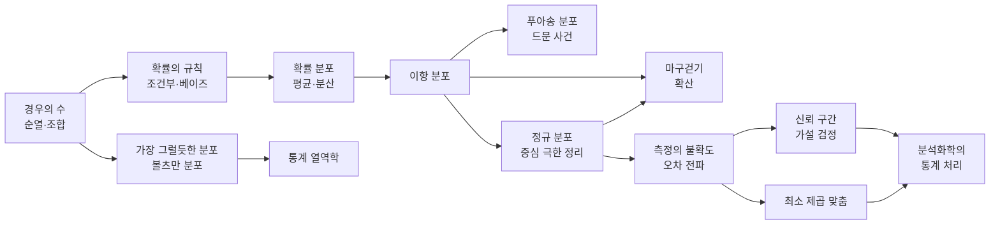

# 수학 도구 7. 확률과 통계 — 무작위 속에서 법칙과 불확도를 읽어 내는 도구
<!-- prev: umath-2, uchem-10, ubio-1 -->
<!-- next: umath-8, pchem-11, achem-1 -->

> [!NOTE]
> **이 단원의 범위**
> - 경우의 수(순열·조합)와 확률의 규칙, 조건부 확률과 베이즈 정리
> - 확률 변수와 분포: 이산·연속 분포, 평균과 분산, 이항·푸아송·정규 분포
> - 가장 그럴듯한 분포: 스털링 근사와 라그랑주 승수로 볼츠만 분포 유도
> - 마구걷기(무작위 행보)와 확산, $\langle x^2\rangle = 2Dt$
> - 측정의 불확도: 평균·표준 편차·표준 오차, 오차 전파
> - 신뢰 구간과 가설 검정의 기초($t$ 분포, $p$값, 두 종류의 오류)
> - 최소 제곱 맞춤: 직선 맞춤의 유도, 기울기·절편의 불확도, 선형화

**학습 목표**

1. 순열·조합으로 경우의 수를 세고, 곱셈 규칙·덧셈 규칙·조건부 확률·베이즈 정리로 유전·진단·분자 서열의 확률을 계산할 수 있다.
2. 이산·연속 확률 변수의 평균과 분산을 합과 적분으로 계산하고, 이항·푸아송·정규 분포가 나오는 조건과 서로의 근사 관계를 설명할 수 있다.
3. 스털링 근사와 라그랑주 승수법으로 고정된 입자 수와 에너지 아래 가장 그럴듯한 분포가 볼츠만 분포임을 유도하고, 준위의 점유 비율을 계산할 수 있다.
4. 1차원 마구걷기에서 $\langle x^2\rangle \propto N$을 유도하고 확산 계수와 연결하여 확산 시간을 어림할 수 있다.
5. 반복 측정의 평균·표준 편차·평균의 표준 오차를 구하고, 편미분을 써서 계산 결과의 불확도를 전파할 수 있다.
6. $t$ 분포로 신뢰 구간을 만들고, 귀무가설·$p$값·유의 수준을 써서 측정값과 기준값, 두 측정의 차이를 검정할 수 있다.
7. 최소 제곱법의 정규 방정식을 유도하고, 선형화한 과학 자료(아레니우스 도시, 검정 곡선)에서 기울기·절편과 그 불확도를 구할 수 있다.

**이 단원의 학습 사다리**

| 단계 | 무엇을 하나? |
|---|---|
| STEP 1. 이전 학습 다시 보기 | 볼츠만 식 $S = k_\mathrm{B}\ln W$, 경우의 수, 유효 숫자, 실험 설계와 대조군 |
| STEP 2. 기초 다지기 | 합의 기호와 가중 평균, 스털링 근사, 라그랑주 승수법, 가우스 적분 |
| STEP 3. 핵심 개념 | 확률의 규칙 → 분포와 평균·분산 → 이항·푸아송·정규 → 볼츠만 분포 → 마구걷기와 확산 → 불확도와 오차 전파 → 신뢰 구간과 검정 → 최소 제곱 |
| STEP 4. 오개념 바로잡기 | "표준 편차와 표준 오차는 같다", "$p = 0.03$이면 가설이 틀릴 확률이 3 %다" 같은 착각 |
| STEP 5. 더 깊은 수학 | 측도로 세운 확률, 정보 엔트로피와 최대 엔트로피, 몬테카를로, 랑주뱅 방정식 |
| STEP 6. 이 도구가 쓰이는 곳 | 통계 열역학, 분석화학의 통계 처리, 크로마토그래피 띠 넓어짐, 질량 스펙트럼의 동위 원소 무늬 |

---

## 🗺️ 단원 들어가기

방사성 시료 옆에 계수기를 두면 '딸깍' 소리가 불규칙하게 난다. 다음 원자가 언제 붕괴할지는 누구도 모른다. 그런데 같은 시료를 1분씩 여러 번 세면 계수의 평균은 놀랍도록 일정하고, 그 흩어짐의 크기마저 미리 계산할 수 있다(평균의 제곱근 정도). 기체 분자 하나의 속력은 충돌마다 바뀌지만, $10^{23}$개 분자의 속력 분포는 온도 하나로 정해진다. 잉크 분자 하나는 아무렇게나 떠돌지만 잉크 방울이 퍼지는 넓이는 시간에 정확히 비례해 커진다.

과학은 이렇게 **개개의 무작위**와 **집단의 법칙**이 함께 있는 세계를 다룬다. 그 둘을 잇는 언어가 확률이다. 그리고 실험실에서 얻는 모든 숫자는 측정의 흩어짐을 안고 있으므로, "이 값이 얼마나 믿을 만한가", "두 값의 차이가 진짜인가"에 답하는 언어가 통계이다.

이 단원은 확률·통계를 **과학의 도구 상자**로 익힌다. 엄밀한 증명보다 뜻과 계산법과 쓰임에 집중한다. 마지막에는 경우의 수를 세는 일에서 출발해 물리화학의 심장인 **볼츠만 분포**를 직접 유도하고, 분석화학 실험 보고서에 들어갈 **불확도와 최소 제곱 맞춤**까지 손으로 계산할 수 있게 된다.

---

## STEP 1. 🔙 이전 학습 다시 보기

### 연계 개념표

| 이전 단원 | 그때 배운 것 | 이 단원에서 확장되는 것 |
|---|---|---|
| 일반화학 「화학 열역학」 '엔트로피의 통계적 의미' | 미시 상태 수 $W = \binom{N}{n}$, 볼츠만 식 $S = k_\mathrm{B}\ln W$, 반반 배치가 압도적으로 많다 | 여러 준위에 입자를 나누는 $W = N!/\prod n_i!$를 **최대화**하여 볼츠만 분포를 유도한다. "압도적으로 많다"를 $1/\sqrt{N}$로 정량화 |
| 수학 도구 「적분과 급수」 '스털링 근사', '가우스 적분' | $\ln N! \approx N\ln N - N$, $\int e^{-ax^2}dx = \sqrt{\pi/a}$ | 스털링 근사로 $\ln W$를 미분 가능한 식으로, 가우스 적분으로 정규 분포의 정규화·분산 계산 |
| 수학 도구 「미분과 편미분」 '극값과 라그랑주 승수법', '전미분' | 제약 조건이 있는 극값, $df = \sum(\partial f/\partial x_i)dx_i$ | 라그랑주 승수 $\alpha$, $\beta$가 볼츠만 분포의 정규화 상수와 $1/k_\mathrm{B}T$가 된다. 전미분이 오차 전파 공식이 된다 |
| 일반화학 「물질과 화학량론」 '측정과 유효 숫자' | 정확도·정밀도, 유효 숫자의 규칙 | 정밀도를 표준 편차로, 유효 숫자를 불확도로 바꾸어 정량적으로 다룬다 |
| 일반생명과학 「생명의 화학」 '생물학의 탐구 방법' | 가설, 대조군, 반복, "실험은 가설을 지지하거나 기각할 뿐 증명하지 않는다" | 그 판단을 **귀무가설과 $p$값**이라는 숫자로 내리는 법 |
| 일반화학 「화학 반응 속도론」 | 1차 반응 $[A] = [A]_0e^{-kt}$, 아레니우스 식 | 분자 하나의 수명이 지수 분포를 따른다는 확률적 해석, 아레니우스 도시의 최소 제곱 맞춤 |

### 준비 운동 (사전 진단)

**Q1.** 구별되는 분자 6개를 상자의 왼쪽·오른쪽에 나눌 때, 왼쪽에 정확히 2개가 있는 배치의 수는?

**Q2.** 동전을 3번 던질 때 앞면이 적어도 한 번 나올 확률은?

**Q3.** 어떤 시료의 질량을 다섯 번 재어 2.31, 2.29, 2.33, 2.30, 2.32 g을 얻었다. 평균은? 이 측정은 '정확'한가, '정밀'한가?

**Q4.** $\dfrac{d}{dx}\left(x\ln x - x\right)$를 구하시오.

정답 및 해설

**Q1.** $\binom{6}{2} = \dfrac{6!}{2!\,4!} = 15$가지.

**Q2.** $1 - (1/2)^3 = 7/8$. '적어도 하나'는 여사건(하나도 없음)을 빼는 것이 가장 쉽다(STEP 3 ①).

**Q3.** 평균 2.31 g. 값들이 서로 가까우므로 **정밀**하다. 참값을 모르므로 정확한지는 알 수 없다. 정확도는 계통 오차, 정밀도는 우연 오차와 관련된다(STEP 3 ⑥).

**Q4.** $\ln x + 1 - 1 = \ln x$. 이 결과가 스털링 근사를 미분할 때 그대로 쓰인다(STEP 2, STEP 3 ④).

---

## STEP 2. 🧱 기초 다지기

### 디딤돌 1. 합의 기호와 가중 평균 — 평균은 '확률로 가중한 합'이다

값 $x_i$가 확률(또는 비율) $p_i$로 나타날 때 평균은 각 값에 그 확률을 곱해 더한 것이다. 연속적인 값이면 합이 적분으로 바뀐다(수학 도구 「적분과 급수」에서 익힌 정적분의 뜻).

$$
\langle x\rangle = \sum_i x_i\,p_i \quad\left(\sum_i p_i = 1\right), \qquad \langle x\rangle = \int x\,p(x)\,dx \quad\left(\int p(x)\,dx = 1\right)
$$

꺾쇠 $\langle\ \rangle$는 물리화학에서 평균(기댓값)을 나타내는 표준 기호이다. 수학 책의 $E[X]$와 같다.

| 기호 규칙 | 식 | 쓰임 |
|---|---|---|
| 상수배 | $\sum_i c\,x_i = c\sum_i x_i$ | 단위 바꾸기 |
| 합의 분리 | $\sum_i (x_i + y_i) = \sum_i x_i + \sum_i y_i$ | 평균의 선형성 $\langle x + y\rangle = \langle x\rangle + \langle y\rangle$ |
| 상수의 합 | $\sum_{i=1}^{n} c = nc$ | 평균 $\bar x = \frac{1}{n}\sum x_i$의 계산 |
| 이중 합 | $\left(\sum_i a_i\right)\left(\sum_j b_j\right) = \sum_i\sum_j a_i b_j$ | 독립 사건의 확률 곱 |

#### 예제 1 — 염소의 평균 원자량

자연계 염소는 $^{35}\mathrm{Cl}$(질량 34.969 u, 존재비 75.76 %)과 $^{37}\mathrm{Cl}$(36.966 u, 24.24 %)로 이루어진다. 평균 원자량을 구하시오.

**풀이**
존재비가 곧 '임의로 고른 염소 원자 하나가 그 동위 원소일 확률'이다.

$$
\langle m\rangle = 34.969\times0.7576 + 36.966\times0.2424 = 35.453\ \mathrm{u}
$$

**의미** 주기율표의 원자량은 확률로 가중한 평균이다. 질량이 35.453 u인 염소 원자는 하나도 없다. 평균은 '가장 흔한 값'도 '실제로 있는 값'도 아닐 수 있다.

### 디딤돌 2. 스털링 근사 — 큰 수의 계승을 다루는 법

입자 배치의 수에는 $N!$이 나오는데, $N \sim 10^{23}$이면 계산기로도 다룰 수 없다. 수학 도구 「적분과 급수」 '스털링 근사'에서 $\ln N! = \sum_{k=1}^{N}\ln k \approx \int_1^N \ln x\,dx$로 얻은 결과를 쓴다.

$$
\ln N! \approx N\ln N - N \qquad \left(\text{더 정밀하게는 } + \tfrac{1}{2}\ln(2\pi N)\right)
$$

| $N$ | $\ln N!$ (정확) | $N\ln N - N$ | 상대 오차 |
|---|---|---|---|
| 10 | 15.10 | 13.03 | 14 % |
| 100 | 363.74 | 360.52 | 0.9 % |
| $10^6$ | $1.28155\times10^7$ | $1.28155\times10^7$ | $6\times10^{-7}$ |

#### 예제 2 — 스털링 근사의 미분

$\dfrac{d}{dN}\ln N!$을 스털링 근사로 구하고, 그 뜻을 말하시오.

**풀이**
$\dfrac{d}{dN}(N\ln N - N) = \ln N + 1 - 1 = \ln N$.
정의로 보면 $\ln N! - \ln(N-1)! = \ln N$이므로, $N$이 클 때 '하나 늘렸을 때의 증가'와 미분이 같아진다.

**의미** 입자 수 $n_i$가 매우 크면 $n_i$를 연속 변수처럼 미분할 수 있고, $\partial \ln n_i!/\partial n_i = \ln n_i$가 된다. 이것이 STEP 3 ④에서 볼츠만 분포를 유도하는 열쇠이다.

### 디딤돌 3. 라그랑주 승수법 — 제약이 있는 최댓값

수학 도구 「미분과 편미분」 '극값과 라그랑주 승수법'에서 익힌 방법이다. $g(x_1, \dots, x_n) = c$라는 제약 아래 $f$를 최대로 하려면, 승수 $\lambda$를 도입해

$$
\frac{\partial f}{\partial x_i} - \lambda\frac{\partial g}{\partial x_i} = 0 \quad (i = 1, \dots, n)
$$

을 풀고, 마지막에 제약 조건으로 $\lambda$를 정한다. 제약이 둘이면 승수도 둘이다.

#### 예제 3 — 모르는 것이 가장 많은 분포

세 가지 결과의 확률 $p_1, p_2, p_3$에 대하여 $H = -\sum_i p_i\ln p_i$를 $\sum_i p_i = 1$ 아래에서 최대로 하는 분포를 구하시오.

**풀이**
$\dfrac{\partial}{\partial p_i}\left[-\sum_j p_j\ln p_j - \lambda\sum_j p_j\right] = -\ln p_i - 1 - \lambda = 0$
→ $p_i = e^{-1-\lambda}$로 $i$와 무관하다. 제약에서 $3e^{-1-\lambda} = 1$이므로 $p_1 = p_2 = p_3 = 1/3$.

**의미** 다른 정보(제약)가 없으면 가장 '고른' 분포가 답이다. 에너지라는 제약을 하나 더 넣으면 고른 분포가 기울어져 볼츠만 분포가 된다(STEP 3 ④). $H$는 정보 엔트로피이며 STEP 5에서 다시 만난다.

### 디딤돌 4. 가우스 적분 — 정규 분포의 계산 도구

수학 도구 「적분과 급수」에서 극좌표로 계산한 결과와, 그것을 $a$로 미분해 얻은 식이다($a > 0$).

$$
\int_{-\infty}^{\infty} e^{-ax^2}dx = \sqrt{\frac{\pi}{a}}, \qquad \int_{-\infty}^{\infty} x^2e^{-ax^2}dx = \frac{1}{2a}\sqrt{\frac{\pi}{a}}, \qquad \int_{-\infty}^{\infty} x\,e^{-ax^2}dx = 0
$$

세 번째 적분이 0인 것은 피적분 함수가 홀함수이기 때문이다.

#### 예제 4 — 정규 분포의 정규화와 분산

$p(x) = C e^{-x^2/2\sigma^2}$가 확률 밀도가 되도록 $C$를 정하고, $\langle x^2\rangle$을 구하시오.

**풀이**
$a = 1/2\sigma^2$로 놓는다. $\int p\,dx = C\sqrt{2\pi\sigma^2} = 1$에서 $C = 1/\sqrt{2\pi\sigma^2}$.
$\langle x^2\rangle = C\cdot\dfrac{1}{2a}\sqrt{\dfrac{\pi}{a}} = \dfrac{1}{\sqrt{2\pi\sigma^2}}\cdot\sigma^2\cdot\sqrt{2\pi\sigma^2} = \sigma^2$.

**의미** 정규 분포 식에 들어 있는 $\sigma$가 바로 표준 편차이다. 맥스웰 속도 분포, 확산하는 분자의 위치 분포, 측정 오차의 분포가 모두 이 꼴이므로 이 두 적분으로 대부분의 계산이 끝난다.

---

## STEP 3. 📘 핵심 개념

### ① 경우의 수와 확률 — 세는 법과 확률의 규칙

#### 순열과 조합

| 세는 대상 | 식 | 과학의 예 |
|---|---|---|
| 서로 다른 $n$개를 일렬로 배열 | $n!$ | 서로 다른 아미노산 5개로 만드는 펩타이드 서열(각 1개씩) $5! = 120$ |
| $n$개 중 $r$개를 골라 **순서 있게** 배열(순열) | $\dfrac{n!}{(n-r)!}$ | 선수 10명 중 1·2·3등 — 순서가 의미 있을 때 |
| $n$개 중 $r$개를 **순서 없이** 고르기(조합) | $\dbinom{n}{r} = \dfrac{n!}{r!\,(n-r)!}$ | 분자 $N$개 중 $n$개가 왼쪽 칸에 있는 배치 |
| $k$종류에서 중복을 허락해 길이 $r$의 서열 | $k^r$ | DNA 염기 4종으로 길이 $r$인 서열 $4^r$ |
| $N$개를 $n_1, n_2, \dots$개씩 여러 무리로 나누기(다항 계수) | $\dfrac{N!}{n_1!\,n_2!\cdots}$ | 분자 $N$개를 에너지 준위에 나누는 배치 수(④) |

다항 계수는 조합의 일반화이다. $N$개를 일렬로 세우는 $N!$가지 가운데, 같은 무리 안에서 순서만 바뀐 것은 같은 배치이므로 각 무리의 $n_i!$로 나누어 준다.

#### 확률의 기본 규칙

모든 결과가 똑같이 일어날 만할 때 사건 $A$의 확률은 $P(A) = \dfrac{A\text{에 속하는 결과 수}}{\text{전체 결과 수}}$이다. 일반적으로 확률은 다음 규칙을 따른다.

| 규칙 | 식 | 쓸 때 |
|---|---|---|
| 여사건 | $P(\text{not }A) = 1 - P(A)$ | "적어도 하나"를 계산할 때 |
| 덧셈 규칙 | $P(A\text{ or }B) = P(A) + P(B) - P(A\text{ and }B)$ | 배반 사건이면 마지막 항이 0 |
| 곱셈 규칙 | $P(A\text{ and }B) = P(A)\,P(B\mid A)$ | 차례로 일어나는 사건 |
| 독립 | $P(B\mid A) = P(B)$ ⇔ $P(A\text{ and }B) = P(A)P(B)$ | 서로 영향을 주지 않는 분자·유전자·붕괴 |

$P(B\mid A)$는 '$A$가 일어났을 때 $B$의 확률', 즉 **조건부 확률(conditional probability)** 이다.

#### 예제 5 — 제한 효소 자리는 몇 개쯤 있을까

어떤 제한 효소는 6개 염기로 된 특정 서열을 인식해 자른다. 네 염기가 각각 1/4의 확률로 무작위하게 놓인 DNA라고 가정할 때 (1) 임의의 위치에서 그 서열이 나타날 확률, (2) 48 502 bp짜리 선형 DNA에서 기대되는 자리의 수를 구하시오.

**풀이**
(1) 여섯 자리가 각각 독립으로 맞아야 하므로 곱셈 규칙: $(1/4)^6 = 1/4096 = 2.44\times10^{-4}$.
(2) 서열이 시작될 수 있는 위치는 $48\,502 - 5 = 48\,497$곳이다. 기댓값은 위치마다의 확률을 더한 것이므로 $48\,497/4096 \approx 11.8$개.

**의미** 6염기 인식 효소는 평균 약 4 kb마다 한 번 자른다는 어림이 여기서 나온다. 실제 DNA는 염기 조성이 고르지 않고 서열에 치우침이 있어 실제 자리 수는 이 값에서 꽤 벗어날 수 있다. 그 차이 자체가 '무작위 모형에서 벗어난 생물학적 정보'이다.

#### 베이즈 정리 — 원인의 확률을 거꾸로 구하기

곱셈 규칙을 두 가지 순서로 쓰면 $P(A)P(B\mid A) = P(B)P(A\mid B)$이다. 이를 정리한 것이 **베이즈 정리(Bayes' theorem)** 이다.

$$
P(A\mid B) = \frac{P(B\mid A)\,P(A)}{P(B)}, \qquad P(B) = P(B\mid A)P(A) + P(B\mid \text{not }A)\,P(\text{not }A)
$$

$P(A)$를 **사전 확률**, $P(A\mid B)$를 자료 $B$를 본 뒤의 **사후 확률**이라 한다. 과학에서는 "가설이 맞다면 이 자료가 나올 확률"($P(\text{자료}\mid\text{가설})$)은 계산하기 쉽지만, 정말 알고 싶은 것은 "이 자료를 보았을 때 가설이 맞을 확률"($P(\text{가설}\mid\text{자료})$)이다. 베이즈 정리가 둘을 잇는다.

<!-- fig:umath-7-bayes-area -->

#### 예제 6 — 양성 판정을 받으면 정말 병이 있을까

어떤 질병의 유병률이 1.0 %이다. 진단 검사의 민감도(환자를 양성으로 판정할 확률)는 95 %, 특이도(건강한 사람을 음성으로 판정할 확률)는 98 %이다. (1) 무작위로 고른 사람이 양성 판정을 받았을 때 실제로 병이 있을 확률은? (2) 독립적인 같은 검사를 한 번 더 해서 또 양성이면?

**풀이**
(1) 사건을 $D$(병 있음), $+$(양성)로 쓴다.
$P(+) = 0.95\times0.010 + 0.02\times0.990 = 0.0095 + 0.0198 = 0.0293$
$P(D\mid +) = \dfrac{0.0095}{0.0293} = 0.324$ → 약 32 %
(2) 첫 검사 뒤의 사후 확률 0.324를 새 사전 확률로 쓴다.
$P(D\mid ++) = \dfrac{0.95\times0.324}{0.95\times0.324 + 0.02\times0.676} = 0.958$ → 약 96 %

**의미** 98 % 정확한 검사라도 드문 질병에서는 양성의 3분의 2가 거짓 양성이다. 건강한 사람이 압도적으로 많아 그 2 %가 환자의 95 %보다 수가 많기 때문이다. 자료가 쌓일 때마다 사후 확률을 갱신하는 것이 베이즈 추론의 기본 방식이며, 독립성 가정(두 검사의 오류가 서로 무관)이 깨지면 (2)의 값은 과대평가된다.

> [!TIP]
> 💡 **요령** — 조건부 확률이 헷갈리면 **10 000명 표**를 만든다. 유병률 1 %면 환자 100명(양성 95, 음성 5), 건강한 사람 9900명(양성 198, 음성 9702). "양성 293명 중 환자 95명"이 바로 답이다. 확률을 사람 수로 바꾸면 직관이 돌아온다.

#### ✔ 바로 확인

1. DNA 염기 4종으로 만들 수 있는 길이 5인 서열은 모두 몇 가지인가?
2. (O/X) 두 사건이 배반이면(동시에 일어날 수 없으면) 서로 독립이다.
3. 이형 접합 부모($Aa \times Aa$) 사이의 자녀 하나가 열성 동형 접합($aa$)일 확률과, 자녀 셋 중 적어도 하나가 $aa$일 확률을 구하시오.
4. 빈칸: $P(A\mid B) = P(B\mid A)P(A)/P(B)$에서 $P(A)$를 (    ) 확률이라 한다.

정답

1. $4^5 = 1024$가지
2. X — 배반이면 한쪽이 일어났을 때 다른 쪽의 확률이 0으로 바뀌므로 오히려 강하게 **종속**이다(확률이 0인 사건은 예외).
3. $1/4$, $1 - (3/4)^3 = 37/64 \approx 0.578$
4. 사전 — 자료를 보기 전의 확률이다.

### ② 확률 변수와 분포 — 평균과 분산

값이 확률적으로 정해지는 양을 **확률 변수(random variable)** 라 한다. 붕괴한 원자 수, 분자의 속력, 측정값이 모두 확률 변수이다.

| 구분 | 이산 확률 변수 | 연속 확률 변수 |
|---|---|---|
| 값 | 셀 수 있는 값 $x_i$ (0, 1, 2, …) | 구간의 모든 실수 |
| 분포를 나타내는 것 | 확률 질량 함수 $P(x_i)$ | **확률 밀도 함수(probability density function)** $p(x)$ |
| 확률 | $P(X = x_i)$ 그 자체 | $P(a \le X \le b) = \int_a^b p(x)\,dx$ (한 점의 확률은 0) |
| 정규화 | $\sum_i P(x_i) = 1$ | $\int p(x)\,dx = 1$ |
| 평균 | $\mu = \langle x\rangle = \sum_i x_iP(x_i)$ | $\mu = \int x\,p(x)\,dx$ |
| 함수의 평균 | $\langle f(x)\rangle = \sum_i f(x_i)P(x_i)$ | $\langle f(x)\rangle = \int f(x)\,p(x)\,dx$ |
| 예 | 1분 동안의 방사선 계수 | 분자의 속력, 반응한 분자의 수명 |

확률 밀도의 단위는 '변수 단위의 역수'이다. 예컨대 속력 분포 $p(v)$의 단위는 $\mathrm{s/m}$이고, $p(v)\,dv$가 무차원 확률이 된다.

#### 분산과 표준 편차

평균만으로는 분포의 '퍼짐'을 알 수 없다. 평균에서 벗어난 정도의 제곱을 평균한 것이 **분산(variance)** 이고, 그 제곱근이 **표준 편차(standard deviation)** 이다.

$$
\sigma^2 = \langle (x - \mu)^2\rangle = \langle x^2\rangle - \langle x\rangle^2, \qquad \sigma = \sqrt{\sigma^2}
$$

두 번째 등식은 전개하면 바로 나온다: $\langle x^2 - 2\mu x + \mu^2\rangle = \langle x^2\rangle - 2\mu\langle x\rangle + \mu^2 = \langle x^2\rangle - \mu^2$. "제곱의 평균에서 평균의 제곱을 뺀다"는 이 꼴은 통계 열역학에서 에너지의 요동과 열용량을 잇는 식으로 다시 나온다.

| 성질 | 식 | 쓰임 |
|---|---|---|
| 상수를 더함 | $\sigma^2(x + c) = \sigma^2(x)$ | 기준점을 옮겨도 퍼짐은 같다 |
| 상수배 | $\sigma^2(cx) = c^2\sigma^2(x)$ | 단위 환산 |
| **독립**인 두 변수의 합·차 | $\sigma^2(x \pm y) = \sigma^2(x) + \sigma^2(y)$ | 무게 차, 마구걷기, 오차 전파 |
| 독립인 같은 분포 $n$개의 평균 | $\sigma^2(\bar x) = \sigma^2/n$ | 반복 측정의 효과(⑥) |

독립인 변수의 **분산이 더해진다**는 성질(표준 편차가 더해지는 것이 아니다)이 이 단원 후반부 전체의 뼈대이다. 차를 구할 때에도 분산은 **더해진다**는 점에 주의한다.

#### 예제 7 — 분자 하나의 수명: 지수 분포

1차 반응 $\mathrm{A \rightarrow P}$에서 $[A] = [A]_0e^{-kt}$이다. 시각 0에 있던 분자 하나가 $t$와 $t + dt$ 사이에 반응할 확률 밀도는 $p(t) = ke^{-kt}$이다($t \ge 0$). (1) 정규화되었음을 보이고, (2) 평균 수명 $\langle t\rangle$과 표준 편차를 구하시오. (3) 분자 하나가 평균 수명보다 오래 살아남을 확률은?

**풀이**
(1) $\int_0^\infty ke^{-kt}dt = [-e^{-kt}]_0^\infty = 1$.
(2) 부분 적분(수학 도구 「적분과 급수」)으로 $\langle t\rangle = \int_0^\infty t\,ke^{-kt}dt = 1/k$, $\langle t^2\rangle = 2/k^2$. 따라서 $\sigma^2 = 2/k^2 - 1/k^2 = 1/k^2$, $\sigma = 1/k$.
(3) $P(t > 1/k) = \int_{1/k}^\infty ke^{-kt}dt = e^{-1} = 0.368$.

**의미** $p(t)$는 남은 분율 $[A]/[A]_0 = e^{-kt}$를 미분해 부호를 바꾼 것이다($-d/dt$). 평균 수명 $\tau = 1/k$는 반감기 $t_{1/2} = \ln 2/k$의 1.44배이며, 표준 편차가 평균과 같을 만큼 수명이 크게 흩어진다. 개개 분자의 반응 시각은 전혀 예측할 수 없지만, 그 분포는 $k$ 하나로 완전히 정해진다.

<!-- fig:umath-7-exponential-lifetime -->

#### ✔ 바로 확인

1. (O/X) 연속 확률 변수에서 $p(x)$의 값은 확률이므로 1을 넘을 수 없다.
2. 주사위 눈 $X$의 평균과 분산을 구하시오.
3. 질량이 각각 $\sigma = 0.10\ \mathrm{mg}$의 독립 오차를 가진 두 측정값의 차의 표준 편차는?

정답

1. X — 확률 밀도이므로 넓이 $p(x)\,dx$가 확률이다. 폭이 좁은 분포에서는 $p(x)$가 1을 훨씬 넘을 수 있다.
2. 평균 3.5, 분산 $35/12 \approx 2.92$ — $\langle x^2\rangle = 91/6$, $91/6 - 3.5^2 = 35/12$.
3. $0.14\ \mathrm{mg}$ — $\sqrt{0.10^2 + 0.10^2}$. 차를 구해도 분산은 더해진다.

### ③ 세 가지 대표 분포 — 이항·푸아송·정규

#### 이항 분포 — 성공 확률 $p$인 시행을 $n$번

결과가 둘뿐인(성공·실패) 독립 시행을 $n$번 할 때 성공 횟수 $k$의 분포가 **이항 분포(binomial distribution)** 이다. 특정 순서의 확률은 $p^k(1-p)^{n-k}$이고, 성공이 어디서 일어나는지 고르는 방법이 $\binom{n}{k}$가지이므로

$$
P(k) = \binom{n}{k}p^k(1-p)^{n-k}, \qquad \mu = np, \qquad \sigma^2 = np(1-p)
$$

평균과 분산은 '시행 하나'(성공이면 1, 실패면 0)의 평균 $p$, 분산 $p - p^2 = p(1-p)$를 $n$번 더한 것이다(독립이므로 분산이 더해진다).

#### 예제 8 — 염소 분자의 질량 스펙트럼

염소 분자 $\mathrm{Cl_2}$의 질량 스펙트럼에는 $m/z$ 70, 72, 74에 봉우리가 나타난다. 원자 하나가 $^{37}\mathrm{Cl}$일 확률을 $q = 0.2424$로 하여 세 봉우리의 상대 세기를 구하시오(가장 큰 것을 100으로).

**풀이**
$^{37}\mathrm{Cl}$의 개수 $k$는 $n = 2$, $p = q$인 이항 분포를 따른다.

| 봉우리 | 조성 | 확률 | 상대 세기 |
|---|---|---|---|
| $m/z$ 70 ($k = 0$) | $^{35}\mathrm{Cl}{-}^{35}\mathrm{Cl}$ | $(0.7576)^2 = 0.5740$ | 100 |
| $m/z$ 72 ($k = 1$) | $^{35}\mathrm{Cl}{-}^{37}\mathrm{Cl}$ | $2(0.7576)(0.2424) = 0.3673$ | 64 |
| $m/z$ 74 ($k = 2$) | $^{37}\mathrm{Cl}{-}^{37}\mathrm{Cl}$ | $(0.2424)^2 = 0.0588$ | 10 |

**의미** 존재비를 대략 3 : 1로 보면 $(3 + 1)^2$의 전개 9 : 6 : 1이 되어 100 : 67 : 11에 가깝다. 염소가 둘 들어 있는 분자가 이 '9 : 6 : 1' 무늬를 보이는 것은 유기화학의 질량 분석에서 염소 개수를 알아내는 단서가 된다. 탄소 $n$개짜리 분자에서 $^{13}\mathrm{C}$(존재비 약 1.07 %)가 만드는 M+1 봉우리의 상대 세기가 대략 $1.1\,n$ %인 것도 같은 이항 분포의 결과이다.

<!-- fig:umath-7-cl2-mass-spectrum -->

#### 푸아송 분포 — 드문 사건을 셀 때

방사성 원자는 $10^{20}$개나 되지만 1초 동안 그중 하나가 붕괴할 확률은 아주 작다. 이처럼 $n \to \infty$, $p \to 0$이면서 평균 $\lambda = np$가 일정한 극한에서 이항 분포는 **푸아송 분포(Poisson distribution)** 가 된다.

$$
P(k) = \frac{\lambda^k e^{-\lambda}}{k!}, \qquad \mu = \lambda, \qquad \sigma^2 = \lambda
$$

**유도의 뼈대** $\binom{n}{k}p^k(1-p)^{n-k}$에서 $k \ll n$이면 $\binom{n}{k} \approx n^k/k!$이고, $p = \lambda/n$을 넣으면 $(np)^k/k! = \lambda^k/k!$이다. 남은 인수는 $(1 - \lambda/n)^{n-k} \to e^{-\lambda}$이다(로그를 취해 수학 도구 「적분과 급수」의 테일러 근사 $\ln(1 - \lambda/n) \approx -\lambda/n$을 쓰면 $(n-k)\ln(1 - \lambda/n) \to -\lambda$). 분산은 $np(1-p) \to \lambda$이다.

**평균과 분산이 같다**는 것이 푸아송 분포의 특징이다. 그래서 $N$개를 센 계수 측정의 불확도는 $\sqrt{N}$, 상대 불확도는 $1/\sqrt{N}$이다. 1 % 정밀도를 원하면 $10^4$개를 세어야 한다. 방사선 계수, 광자 계수(형광, 천문 관측), 단분자 실험, 세포 안의 적은 수의 분자 등 '셀 수 있는 드문 사건'은 모두 이 분포를 따른다.

#### 예제 9 — 배경 방사선 속의 신호

어떤 검출기의 배경 계수는 평균 3.0회/분이다. (1) 1분 동안 한 번도 세지 않을 확률, (2) 1분 동안 8회 이상 셀 확률을 구하시오. (3) 실제로 어느 시료에서 1분에 8회를 셌다면, 이것을 시료가 방사능을 띤다는 증거로 볼 수 있는가?

**풀이**
(1) $P(0) = e^{-3.0} = 0.050$
(2) $P(k \ge 8) = 1 - \sum_{k=0}^{7}\dfrac{3^k e^{-3}}{k!} = 1 - 0.988 = 0.012$
(3) 배경만으로 8회 이상이 나올 확률이 약 1.2 %이므로 우연으로 보기는 어렵지만, 그렇다고 확정할 수도 없다. 측정 시간을 늘려(예컨대 10분) 계수를 키우면 상대 요동이 $1/\sqrt{N}$로 줄어 판단이 훨씬 확실해진다. 이런 판단을 체계화한 것이 ⑦의 가설 검정이다.

#### 정규 분포 — 많은 작은 요인이 더해질 때

**정규 분포(normal distribution, 가우스 분포)** 는 평균 $\mu$, 표준 편차 $\sigma$인 종 모양의 연속 분포이다.

$$
p(x) = \frac{1}{\sigma\sqrt{2\pi}}\exp\!\left[-\frac{(x - \mu)^2}{2\sigma^2}\right]
$$

정규 분포가 자연에 그토록 흔한 이유는 **중심 극한 정리(central limit theorem)** 때문이다. 서로 독립인 많은 작은 요인이 더해진 양은, 각 요인의 분포가 무엇이든(분산이 유한하면) 정규 분포에 가까워진다. 측정 오차(온도의 흔들림, 전기 잡음, 눈금 읽기의 차이가 더해진 것), 분자의 변위(무수한 충돌의 합, ⑤), 기체 분자 속도의 한 성분이 모두 그렇다. 이항 분포도 $n$개 시행의 합이므로 $np(1-p) \gtrsim 10$이면 평균 $np$, 분산 $np(1-p)$인 정규 분포로 근사할 수 있고, 푸아송 분포도 $\lambda \gtrsim 10$이면 평균·분산 $\lambda$인 정규 분포에 가깝다.

변수를 $z = (x - \mu)/\sigma$로 **표준화**하면 모든 정규 분포가 평균 0, 표준 편차 1인 표준 정규 분포 하나로 정리된다.

| 구간 | 그 안에 들 확률 | 바깥(양쪽 합) |
|---|---|---|
| $\mu \pm 1\sigma$ | 68.3 % | 31.7 % |
| $\mu \pm 1.96\sigma$ | 95.0 % | 5.0 % |
| $\mu \pm 2\sigma$ | 95.4 % | 4.6 % |
| $\mu \pm 2.58\sigma$ | 99.0 % | 1.0 % |
| $\mu \pm 3\sigma$ | 99.7 % | 0.3 % |

| 한쪽 꼬리 $z$ | 1.0 | 1.5 | 2.0 | 2.5 | 3.0 |
|---|---|---|---|---|---|
| $P(Z > z)$ | 0.159 | 0.067 | 0.023 | 0.0062 | 0.0013 |

<!-- fig:umath-7-normal-sigma -->

#### 예제 10 — 피펫의 부피와 평균의 힘

10 mL 부피 피펫으로 옮긴 부피가 평균 10.00 mL, 표준 편차 0.020 mL인 정규 분포를 따른다고 하자. (1) 한 번 옮긴 부피가 10.05 mL를 넘을 확률은? (2) 네 번 옮긴 부피의 평균이 10.02 mL를 넘을 확률은?

**풀이**
(1) $z = (10.05 - 10.00)/0.020 = 2.5$ → $P(Z > 2.5) = 0.0062$ (약 0.6 %)
(2) 네 번의 평균은 표준 편차가 $0.020/\sqrt{4} = 0.010\ \mathrm{mL}$인 정규 분포를 따른다. $z = 0.02/0.010 = 2.0$ → $P = 0.023$ (약 2.3 %)

**의미** 평균을 내면 퍼짐이 $1/\sqrt{n}$로 줄어든다. 그러나 피펫 자체의 눈금이 0.03 mL 어긋나 있다면(계통 오차) 아무리 평균을 내도 그 어긋남은 줄지 않는다(⑥).

| 분포 | 쓰는 상황 | 평균 | 분산 | 극한 관계 |
|---|---|---|---|---|
| 이항 | $n$번 독립 시행 중 성공 수 | $np$ | $np(1-p)$ | — |
| 푸아송 | 드문 사건의 계수 | $\lambda$ | $\lambda$ | 이항에서 $n \to \infty$, $np = \lambda$ |
| 정규 | 많은 작은 요인의 합, 측정 오차 | $\mu$ | $\sigma^2$ | 이항·푸아송에서 평균이 클 때 |
| 지수 | 1차 과정의 대기 시간·수명 | $1/k$ | $1/k^2$ | 푸아송 과정의 사건 간격 |

<!-- sim:mj-binomial-poisson-normal -->

#### ✔ 바로 확인

1. 탄소 10개를 가진 분자에서 $^{13}\mathrm{C}$(존재비 1.07 %)가 하나도 없을 확률과 M+1/M 세기비를 구하시오(다른 원소의 동위 원소는 무시).
2. (O/X) 푸아송 분포에서 평균이 100이면 표준 편차도 100이다.
3. 방사선 계수 측정에서 상대 불확도를 0.5 %로 하려면 몇 개를 세어야 하는가?
4. 정규 분포에서 평균보다 $2\sigma$ 이상 **큰** 값이 나올 확률은 약 몇 %인가?

정답

1. $(0.9893)^{10} = 0.898$, M+1/M $= 10\times0.0107/0.9893 \approx 0.108$ (약 10.8 %)
2. X — 분산이 100이므로 표준 편차는 10이다.
3. $4\times10^4$개 — $1/\sqrt{N} = 0.005$.
4. 약 2.3 % — 양쪽 합 4.6 %의 절반.

### ④ 가장 그럴듯한 분포 — 라그랑주 승수로 유도하는 볼츠만 분포

일반화학 「화학 열역학」에서는 분자를 상자의 두 칸에 나누는 배치를 세었다. 이제 칸 대신 **에너지 준위**를 놓는다. 분자 $N$개가 에너지 $\varepsilon_0, \varepsilon_1, \varepsilon_2, \dots$인 준위에 각각 $n_0, n_1, n_2, \dots$개씩 들어가 있다. 이 숫자들의 묶음 $\{n_j\}$를 하나의 **배치(configuration)** 라 하자. 질문은 이것이다. 전체 분자 수와 전체 에너지가 정해져 있을 때, **어떤 배치가 가장 그럴듯한가?**

#### 가정

1. 분자는 서로 구별되고(자리나 번호로), 상호작용이 약해 각 분자의 에너지를 따로 적을 수 있다.
2. 전체 분자 수와 전체 에너지가 일정하다: $\sum_j n_j = N$, $\sum_j n_j\varepsilon_j = E$.
3. 이 두 조건을 만족하는 모든 미시 상태는 똑같이 일어날 만하다(**등확률의 원리**).
4. 각 준위의 $n_j$가 매우 커서 스털링 근사를 쓸 수 있다.

#### 유도

**1단계 — 배치의 무게를 센다.** 배치 $\{n_j\}$를 실현하는 미시 상태의 수는 $N$개를 무리로 나누는 다항 계수이다(①).

$$
W(\{n_j\}) = \frac{N!}{n_0!\,n_1!\,n_2!\cdots}
$$

등확률의 원리에 따라 배치의 확률은 $W$에 비례한다. $N$이 크면 $W$는 한 배치에서 극도로 뾰족한 최댓값을 가진다(최댓값에서 벗어난 배치의 상대적 폭은 $1/\sqrt{N}$ 정도로 줄어든다, ⑤ 참고). 그래서 '가장 그럴듯한 배치'가 사실상 '관측되는 배치'이다.

**2단계 — 로그를 취하고 스털링 근사를 쓴다.** $W$를 최대로 하는 것과 $\ln W$를 최대로 하는 것은 같다.

$$
\ln W = \ln N! - \sum_j \ln n_j! \approx (N\ln N - N) - \sum_j (n_j\ln n_j - n_j) = N\ln N - \sum_j n_j\ln n_j
$$

($\sum_j n_j = N$이므로 $-N$과 $+\sum_j n_j$가 지워진다.)

**3단계 — $n_j$로 미분한다.** $N = \sum_k n_k$도 $n_j$에 의존한다는 점에 주의하면

$$
\frac{\partial \ln W}{\partial n_j} = (\ln N + 1) - (\ln n_j + 1) = -\ln\frac{n_j}{N}
$$

**4단계 — 두 제약에 승수를 붙인다.** 제약이 둘(입자 수, 에너지)이므로 승수 $\alpha$, $\beta$를 쓴다(STEP 2 디딤돌 3). 부호는 나중 결과가 깔끔하도록 고른 관례이다.

$$
\frac{\partial \ln W}{\partial n_j} + \alpha\frac{\partial N}{\partial n_j} - \beta\frac{\partial E}{\partial n_j} = -\ln\frac{n_j}{N} + \alpha - \beta\varepsilon_j = 0
$$

**5단계 — 풀고 정규화한다.** $n_j/N = e^{\alpha}e^{-\beta\varepsilon_j}$이고, $\sum_j n_j/N = 1$에서 $e^{\alpha} = 1/\sum_j e^{-\beta\varepsilon_j}$이다.

$$
\boxed{\;\frac{n_j}{N} = \frac{e^{-\beta\varepsilon_j}}{q}, \qquad q = \sum_j e^{-\beta\varepsilon_j}\;}
$$

$q$를 **분자 분배 함수(molecular partition function)** 라 한다. 이것이 **볼츠만 분포(Boltzmann distribution)** 이다.

**6단계 — $\beta$의 정체.** 최대점에서 $\ln W$의 작은 변화는 4단계 식에 따라 $d\ln W = \sum_j(-\alpha + \beta\varepsilon_j)dn_j = -\alpha\,dN + \beta\,dE$이다. 분자 수가 일정하고($dN = 0$) 준위의 위치가 변하지 않는(부피 일정) 가열에서는 $dE = dq_\text{가역}$이다. 볼츠만 식 $S = k_\mathrm{B}\ln W$를 쓰면

$$
dS = k_\mathrm{B}\,d\ln W = k_\mathrm{B}\beta\,dq_\text{가역}
$$

이 열역학의 정의 $dS = dq_\text{가역}/T$와 같아야 하므로 $\beta = 1/k_\mathrm{B}T$이다.

#### 결과와 적용 한계

같은 에너지를 가진 상태가 $g_j$개 있는 준위(축퇴도 $g_j$)라면 각 상태에 볼츠만 인자를 주므로

$$
\frac{n_j}{N} = \frac{g_j\,e^{-\varepsilon_j/k_\mathrm{B}T}}{q}, \qquad \frac{n_2}{n_1} = \frac{g_2}{g_1}\exp\!\left(-\frac{\varepsilon_2 - \varepsilon_1}{k_\mathrm{B}T}\right)
$$

- 두 준위의 점유비는 **에너지 차와 $k_\mathrm{B}T$의 비**만으로 정해진다. 1 mol 단위로는 $\varepsilon/k_\mathrm{B}T = E_\text{몰}/RT$이다.
- 에너지가 높을수록 점유가 지수적으로 줄어든다. 온도가 무한히 높으면 모든 상태가 똑같이 점유된다(상태 하나하나는 같은 확률, 준위로는 $g_j$에 비례).
- 적용 한계: 분자가 구별되지 않는 기체에서는 $W$를 다르게 세어야 하지만, 준위 수가 분자 수보다 훨씬 많은 보통의 온도·밀도에서는 같은 볼츠만 분포가 나온다. 아주 낮은 온도·높은 밀도의 양자 기체(전자, 헬륨-4 등)에서는 페르미–디랙·보스–아인슈타인 분포로 바뀐다(STEP 5). 자세한 셈법과 분배 함수의 활용은 물리화학 「통계 열역학」에서 다룬다.

25 ℃에서 $k_\mathrm{B}T$의 크기를 여러 단위로 기억해 두면 편하다.

| 단위 | 25 ℃(298 K)의 $k_\mathrm{B}T$ (또는 $RT$) |
|---|---|
| J (분자 하나) | $4.12\times10^{-21}$ |
| kJ/mol | 2.48 |
| eV | 0.0257 |
| 파수 $\mathrm{cm^{-1}}$ ($k_\mathrm{B}T/hc$) | 207 |

| 운동 (예) | 준위 간격 (파수, 약) | 25 ℃에서 위 준위/아래 준위 (축퇴 무시) | 해석 |
|---|---|---|---|
| 분자 회전 | $10\ \mathrm{cm^{-1}}$ | 0.95 | 많은 준위가 고르게 점유 |
| 낮은 진동 (무거운 원자) | $200\ \mathrm{cm^{-1}}$ | 0.38 | 들뜬 준위도 상당히 점유 |
| 진동 (C–C 신축 정도) | $1000\ \mathrm{cm^{-1}}$ | 0.008 | 대부분 바닥 준위 |
| HCl 진동 | $2886\ \mathrm{cm^{-1}}$ | $9\times10^{-7}$ | 사실상 모두 바닥 준위 |
| 전자 들뜸 (가시광선) | $20\,000\ \mathrm{cm^{-1}}$ | $10^{-42}$ | 열로는 들뜨지 않는다 |

<!-- fig:umath-7-boltzmann-occupation -->

#### 예제 11 — 불꽃 속 나트륨 원자는 얼마나 들떠 있을까

나트륨의 노란 빛(파장 약 589 nm)은 3p → 3s 전이에서 나온다. 3s 준위의 축퇴도는 2, 3p 준위는 6이다. 2000 K, 2500 K, 3000 K의 불꽃에서 들뜬 원자와 바닥 상태 원자의 비 $N_{3p}/N_{3s}$를 구하시오. ($h = 6.626\times10^{-34}\ \mathrm{J\cdot s}$, $c = 2.998\times10^8\ \mathrm{m/s}$, $k_\mathrm{B} = 1.381\times10^{-23}\ \mathrm{J/K}$)

**풀이**
$\Delta\varepsilon = hc/\lambda = \dfrac{(6.626\times10^{-34})(2.998\times10^8)}{589\times10^{-9}} = 3.37\times10^{-19}\ \mathrm{J}$ (2.10 eV)
$\dfrac{N_{3p}}{N_{3s}} = \dfrac{6}{2}\exp\!\left(-\dfrac{\Delta\varepsilon}{k_\mathrm{B}T}\right)$

| $T$ (K) | $\Delta\varepsilon/k_\mathrm{B}T$ | $N_{3p}/N_{3s}$ |
|---|---|---|
| 2000 | 12.2 | $1.5\times10^{-5}$ |
| 2500 | 9.77 | $1.7\times10^{-4}$ |
| 3000 | 8.14 | $8.7\times10^{-4}$ |

**의미** 불꽃 속 나트륨 원자의 0.1 %도 들떠 있지 않다. 그런데 온도가 2500 K에서 약 2.4 %(60 K)만 올라가도 비는 약 26 % 커진다($\Delta\varepsilon/k_\mathrm{B}T$가 크므로 작은 온도 변화가 지수에서 크게 증폭된다). 그래서 원자 방출 분석은 불꽃 온도의 안정성에 민감하고, 바닥 상태 원자를 보는 원자 흡수 분석은 덜 민감하다(분석화학 「원자 분광법과 질량 분석법」).

#### 예제 12 — 높이에 따른 대기압: 퍼텐셜 에너지의 볼츠만 분포

온도가 288 K로 일정한 대기에서 공기 분자(평균 몰질량 28.97 g/mol)의 수밀도가 볼츠만 분포 $n(h) \propto e^{-mgh/k_\mathrm{B}T}$를 따른다고 하자. (1) 기압이 $1/e$로 줄어드는 높이(규모 높이) $H = k_\mathrm{B}T/mg$를 구하고, (2) 높이 5.0 km와 8.85 km(에베레스트 정상)에서 지표 기압에 대한 비를 구하시오. ($g = 9.80\ \mathrm{m/s^2}$, $N_\mathrm{A} = 6.022\times10^{23}\ \mathrm{mol^{-1}}$)

**풀이**
(1) $m = \dfrac{0.02897}{6.022\times10^{23}} = 4.81\times10^{-26}\ \mathrm{kg}$
$H = \dfrac{(1.381\times10^{-23})(288)}{(4.81\times10^{-26})(9.80)} = 8.43\times10^3\ \mathrm{m}$ (약 8.4 km)
(같은 값을 몰 단위로 $H = RT/Mg$로 구해도 된다.)
(2) 이상 기체에서 압력은 수밀도에 비례하므로 $P/P_0 = e^{-h/H}$
5.0 km: $e^{-5.0/8.43} = 0.55$, 8.85 km: $e^{-8.85/8.43} = 0.35$

**의미** 실제 에베레스트 정상의 기압은 해수면의 약 3분의 1로, 이 단순한 모형이 꽤 잘 맞는다. 실제 대기는 위로 갈수록 기온이 낮아져 기압이 조금 더 빨리 준다. 에너지 준위가 연속인 경우에도 볼츠만 인자가 그대로 쓰인다는 점, 그리고 무거운 분자일수록 $H$가 작아 아래쪽에 몰린다는 점(원심 분리·침강 평형의 원리)이 이 예제의 핵심이다.

> [!TIP]
> 💡 **비유** — 볼츠만 분포는 **'에너지 세금'** 이다. 높은 층(높은 에너지 준위)에 살려면 $\varepsilon$만큼 세금을 내야 하고, 온도 $k_\mathrm{B}T$는 분자들의 '평균 소득'이다. 세금이 소득의 몇 배인가($\varepsilon/k_\mathrm{B}T$)가 그 층의 인구를 $e^{-\varepsilon/k_\mathrm{B}T}$로 정한다. 소득이 늘면(온도가 오르면) 높은 층으로 이사하는 분자가 늘어난다.

#### ✔ 바로 확인

1. 축퇴가 없는 두 준위의 에너지 차가 정확히 $k_\mathrm{B}T$일 때 위 준위/아래 준위의 점유비는?
2. 빈칸: 볼츠만 분포 유도에서 에너지 제약에 붙인 라그랑주 승수 $\beta$는 (    )와 같다.
3. (O/X) 온도를 아무리 높여도 위 준위의 분자 수가 아래 준위보다 많아질 수는 없다(축퇴도가 같을 때).
4. 37 ℃에서 몰당 에너지 차 $10.0\ \mathrm{kJ/mol}$인 두 상태(축퇴 같음)의 점유비는?

정답

1. $e^{-1} \approx 0.368$
2. $1/k_\mathrm{B}T$ — $dS = k_\mathrm{B}\beta\,dq_\text{가역}$을 $dS = dq_\text{가역}/T$와 맞추어 얻는다.
3. O — 열평형에서는 $e^{-\Delta\varepsilon/k_\mathrm{B}T} < 1$이므로 많아야 같아질 뿐이다. 위 준위가 더 많은 '밀도 반전'은 레이저처럼 평형에서 벗어난 상태에서만 생긴다.
4. 약 0.021 — $\exp(-10\,000/(8.314\times310.15)) = e^{-3.88}$.

### ⑤ 마구걷기와 확산 — 무작위 걸음이 만드는 규칙

물속 당 분자는 1초에 $10^{12}$번 넘게 물 분자와 부딪히며 방향을 바꾼다. 한 걸음 한 걸음은 무작위하지만, 많은 걸음이 쌓인 결과는 놀랍도록 규칙적이다. 이것을 수학적으로 다루는 모형이 **마구걷기(random walk, 무작위 행보)** 이다.

#### 1차원 마구걷기의 유도

**가정** 입자가 같은 시간 간격 $\tau$마다 길이 $l$만큼 오른쪽(+) 또는 왼쪽(−)으로 확률 1/2씩 움직이고, 걸음끼리는 독립이다.

**1단계 — 평균 변위.** $i$번째 걸음을 $s_i = \pm l$로 쓰면 $N$걸음 뒤의 위치는 $x = \sum_{i=1}^{N}s_i$이다. $\langle s_i\rangle = 0$이므로 $\langle x\rangle = 0$. 평균적으로는 제자리이다.

**2단계 — 제곱 평균 변위.**

$$
\langle x^2\rangle = \left\langle\sum_i s_i\sum_j s_j\right\rangle = \sum_i\langle s_i^2\rangle + \sum_{i\neq j}\langle s_is_j\rangle = Nl^2 + 0
$$

$s_i^2 = l^2$는 늘 같고, 서로 다른 두 걸음은 독립이라 $\langle s_is_j\rangle = \langle s_i\rangle\langle s_j\rangle = 0$이다. ②의 '독립 변수의 분산은 더해진다'를 그대로 쓴 것이다.

$$
x_\text{rms} = \sqrt{\langle x^2\rangle} = \sqrt{N}\,l
$$

**3단계 — 분포.** 오른쪽 걸음 수 $n_\mathrm{R}$은 $n = N$, $p = 1/2$인 이항 분포를 따르고 $x = (2n_\mathrm{R} - N)l$이다. $N$이 크면 중심 극한 정리에 따라 $x$는 평균 0, 분산 $Nl^2$인 정규 분포가 된다.

**4단계 — 시간으로 바꾼다.** 시간 $t$ 동안 걸음 수는 $N = t/\tau$이므로 $\langle x^2\rangle = (l^2/\tau)\,t$이다. 비례 상수를 $2D$로 놓아 **확산 계수(diffusion coefficient)** $D = l^2/2\tau$를 정의하면

$$
\boxed{\;\langle x^2\rangle = 2Dt\;}, \qquad p(x, t) = \frac{1}{\sqrt{4\pi Dt}}\exp\!\left(-\frac{x^2}{4Dt}\right)
$$

이 정규 분포는 확산 방정식 $\partial c/\partial t = D\,\partial^2c/\partial x^2$의 해이기도 하다(다음 단원 「편미분방정식과 특수 함수」). 개개의 무작위 걸음(미시)과 농도의 매끄러운 퍼짐(거시)이 같은 것을 다른 눈으로 본 것이다.

**결과와 적용 한계** 세 방향의 운동은 독립이므로 2차원에서는 $\langle r^2\rangle = 4Dt$, 3차원에서는 $\langle r^2\rangle = 6Dt$이다. 확산 거리는 시간의 **제곱근**에 비례한다($r \propto \sqrt{t}$). 마구걷기 모형은 걸음 하나의 시간·길이보다 훨씬 긴 시간·큰 거리에서만 정확하고, 흐름(대류)이나 외부 힘이 있으면 평균 변위가 0이 아니게 된다(표류). 구형 입자의 확산 계수는 **스토크스–아인슈타인 식(Stokes–Einstein equation)** $D = k_\mathrm{B}T/6\pi\eta r$($\eta$: 점성도, $r$: 반지름)로 어림할 수 있다.

<!-- fig:umath-7-random-walk-1d -->

<!-- fig:umath-7-diffusion-spread -->

#### 예제 13 — 확산만으로 얼마나 멀리 갈 수 있나

물에서 어떤 단백질의 확산 계수가 $1.0\times10^{-10}\ \mathrm{m^2/s}$, 산소 분자는 약 $2\times10^{-9}\ \mathrm{m^2/s}$이다. 한 방향으로 rms 거리 (1) 10 μm(세포 크기), (2) 1.0 cm만큼 퍼지는 데 걸리는 시간을 $t = x^2/2D$로 어림하시오.

**풀이**

| 이동 거리 | 단백질 ($D = 1.0\times10^{-10}$) | 산소 ($D \approx 2\times10^{-9}$) |
|---|---|---|
| 10 μm | $\dfrac{(1.0\times10^{-5})^2}{2\times1.0\times10^{-10}} = 0.50\ \mathrm{s}$ | 약 0.025 s |
| 1.0 cm | $5.0\times10^5\ \mathrm{s}$ (약 6일) | 약 $2.5\times10^4\ \mathrm{s}$ (약 7시간) |

**의미** 거리가 1000배가 되면 시간은 100만 배가 된다. 세포 하나 안에서는 확산만으로 1초 안에 물질이 골고루 퍼지지만, 몸 크기에서는 확산이 터무니없이 느리다. 그래서 큰 생물은 순환계(혈액의 흐름)로 물질을 나르고, 허파꽈리·모세 혈관 벽처럼 확산이 맡는 마지막 구간은 1 μm 안팎으로 얇다(일반생명과학 「동물의 구조와 기능 Ⅰ」).

<!-- sim:mj-random-walk-2d -->

> [!NOTE]
> 마구걷기는 확산만의 모형이 아니다. 고분자 사슬의 모양(결합 하나하나를 걸음으로 본 **무작위 코일**, 개념 확인 문제 12), 크로마토그래피 칼럼에서 띠가 넓어지는 현상(분자가 정지상과 이동상을 무작위로 오가며 생기는 퍼짐), 주가의 움직임에도 같은 수학이 쓰인다. 공통점은 '독립인 작은 변위의 합'이다.

#### ✔ 바로 확인

1. 1차원 마구걷기에서 걸음 수를 4배로 늘리면 rms 변위는 몇 배가 되는가?
2. (O/X) 마구걷기하는 입자의 평균 변위 $\langle x\rangle$은 시간에 비례해 커진다.
3. 확산 계수 $D = 5.0\times10^{-10}\ \mathrm{m^2/s}$인 분자가 3차원에서 10 s 동안 퍼지는 rms 거리는?
4. 빈칸: 3차원 확산에서 $\langle r^2\rangle = (\quad)Dt$이다.

정답

1. 2배 — $x_\text{rms} = \sqrt{N}\,l$.
2. X — 평균 변위는 0이다. 시간에 비례하는 것은 **제곱** 평균 변위 $\langle x^2\rangle$이다.
3. 약 $1.7\times10^{-4}\ \mathrm{m}$(0.17 mm) — $\sqrt{6\times5.0\times10^{-10}\times10} = \sqrt{3.0\times10^{-8}}$.
4. 6 — 세 방향 각각 $2Dt$.

### ⑥ 측정의 불확도와 오차 전파

모든 측정값은 참값과 조금씩 다르다. 그 차이를 **오차(error)**, 측정값이 퍼져 있을 범위를 수치로 나타낸 것을 **불확도(uncertainty)** 라 한다. 실험 보고서의 숫자는 "값 ± 불확도"가 한 묶음이다.

#### 계통 오차와 우연 오차

| 구분 | 계통 오차(systematic error) | 우연 오차(random error) |
|---|---|---|
| 성질 | 늘 같은 방향·같은 크기로 어긋난다 | 측정마다 무작위하게 ± 로 흩어진다 |
| 원인의 예 | 눈금이 틀린 피펫, 순도가 낮은 표준물, 보정하지 않은 저울, 온도 보정 누락 | 눈금 읽기, 전기 잡음, 온도의 작은 흔들림, 방사선 계수의 요동 |
| 관련된 품질 | **정확도(accuracy)**: 참값에 얼마나 가까운가 | **정밀도(precision)**: 반복 측정이 서로 얼마나 가까운가 |
| 반복 측정으로 | 줄지 않는다 | 평균을 내면 $1/\sqrt{n}$로 준다 |
| 찾아내는 법 | 인증 표준 물질 측정, 다른 방법과 비교(⑦의 검정) | 반복 측정의 표준 편차 |
| 통계로 다룰 수 있나 | 없다(원인을 찾아 보정해야 한다) | 있다(이 소절의 방법) |

<!-- fig:umath-7-accuracy-precision -->

#### 표본의 평균·표준 편차·표준 오차

같은 양을 $n$번 측정해 $x_1, \dots, x_n$을 얻었다. 측정이 무한히 반복될 때의 분포(모집단)의 평균 $\mu$와 표준 편차 $\sigma$는 알 수 없으므로, 표본에서 추정한다.

$$
\bar x = \frac{1}{n}\sum_{i=1}^{n}x_i, \qquad s = \sqrt{\frac{\sum_{i}(x_i - \bar x)^2}{n - 1}}, \qquad s_{\bar x} = \frac{s}{\sqrt{n}}
$$

- **표본 표준 편차** $s$: 측정값 **하나**가 흩어지는 정도. 분모가 $n - 1$인 까닭은 편차를 참평균 $\mu$가 아니라 같은 자료로 구한 $\bar x$에서 재기 때문이다. $\bar x$는 자료에 가장 가깝게 놓이는 값이라 편차의 제곱합이 조금 작게 나온다. 이를 보정하는 것이 $n - 1$(**자유도**)이다. 평균을 구하는 데 정보 하나를 썼다고 생각하면 된다.
- **평균의 표준 오차(standard error of the mean)** $s_{\bar x}$: 평균값 $\bar x$가 흩어지는 정도. ②의 $\sigma^2(\bar x) = \sigma^2/n$에서 나온다.
- **상대 표준 편차(RSD)** $= s/\bar x$ (백분율로 나타내면 변동 계수).

#### 예제 14 — 수산화 나트륨 용액의 표준화

프탈산 수소 칼륨으로 NaOH 용액의 농도를 다섯 번 표준화하여 0.1023, 0.1019, 0.1027, 0.1021, 0.1025 M을 얻었다. 평균, 표준 편차, 상대 표준 편차, 평균의 표준 오차를 구하시오.

**풀이**
$\bar x = 0.5115/5 = 0.10230\ \mathrm{M}$
편차: $0, -0.0004, +0.0004, -0.0002, +0.0002$ → 제곱합 $= (0 + 16 + 16 + 4 + 4)\times10^{-8} = 4.0\times10^{-7}$
$s = \sqrt{4.0\times10^{-7}/4} = 3.2\times10^{-4}\ \mathrm{M}$, RSD $= 0.31\ \%$
$s_{\bar x} = 3.2\times10^{-4}/\sqrt{5} = 1.4\times10^{-4}\ \mathrm{M}$

**의미** 보고할 때는 어떤 불확도인지 밝힌다. 예컨대 "$0.1023 \pm 0.0003\ \mathrm{M}$ (표준 편차, $n = 5$)". 불확도는 유효 숫자 한두 자리로 쓰고, 값은 불확도의 마지막 자리에 맞춰 반올림한다. 이 값이 '참농도'에 가까운지는 표준물의 순도와 저울의 보정 같은 **계통 오차**에 달려 있으며, 반복 측정만으로는 알 수 없다.

#### 오차 전파 — 계산 결과의 불확도

측정값 $x, y, \dots$로 계산한 양 $f(x, y, \dots)$의 불확도는 어떻게 될까? 수학 도구 「미분과 편미분」의 **전미분**에서 출발한다. 각 측정값의 작은 오차 $\delta x, \delta y$가 만드는 $f$의 오차는

$$
\delta f \approx \frac{\partial f}{\partial x}\delta x + \frac{\partial f}{\partial y}\delta y
$$

이다. 양변을 제곱해 평균을 내면, $\delta x$와 $\delta y$가 **독립**일 때 교차항 $\langle\delta x\,\delta y\rangle$이 0이 되어(②의 분산 덧셈)

$$
\boxed{\;\sigma_f^2 = \left(\frac{\partial f}{\partial x}\right)^2\sigma_x^2 + \left(\frac{\partial f}{\partial y}\right)^2\sigma_y^2 + \cdots\;}
$$

**가정과 한계** ① 오차가 작아 1차 테일러 근사(수학 도구 「적분과 급수」)가 성립한다. ② 각 오차가 서로 독립이다. 같은 측정값이 식에 두 번 이상 들어가거나 같은 저울·같은 표준물을 공유하면 독립이 아니므로, 식을 먼저 정리하거나 공분산 항을 넣어야 한다.

| $f$ | 불확도 | 기억할 말 |
|---|---|---|
| $x + y$, $x - y$ | $\sigma_f = \sqrt{\sigma_x^2 + \sigma_y^2}$ | 합·차는 **절대** 불확도를 제곱해 더한다 |
| $cx$ ($c$는 정확한 상수) | $\sigma_f = \lvert c\rvert\sigma_x$ | 상수배 |
| $xy$, $x/y$ | $\dfrac{\sigma_f}{\lvert f\rvert} = \sqrt{\left(\dfrac{\sigma_x}{x}\right)^2 + \left(\dfrac{\sigma_y}{y}\right)^2}$ | 곱·몫은 **상대** 불확도를 제곱해 더한다 |
| $x^n$ | $\dfrac{\sigma_f}{\lvert f\rvert} = \lvert n\rvert\dfrac{\sigma_x}{\lvert x\rvert}$ | 거듭제곱은 상대 불확도를 $n$배 |
| $\ln x$ | $\sigma_f = \dfrac{\sigma_x}{x}$ | 로그의 절대 불확도 = 원래 값의 상대 불확도 |
| $10^x$ | $\dfrac{\sigma_f}{f} = (\ln 10)\,\sigma_x \approx 2.303\,\sigma_x$ | pH → $[\mathrm{H^+}]$ |
| $e^x$ | $\dfrac{\sigma_f}{f} = \sigma_x$ | 볼츠만 인자, 아레니우스 식 |

#### 예제 15 — 기체의 몰수와 수소 이온 농도의 불확도

(1) 압력 $P = 101.3 \pm 0.2\ \mathrm{kPa}$, 부피 $V = 2.500 \pm 0.005\ \mathrm{L}$, 온도 $T = 298.2 \pm 0.3\ \mathrm{K}$인 이상 기체의 몰수 $n = PV/RT$와 그 불확도를 구하시오($R$은 정확하다고 본다). 어느 측정이 불확도에 가장 크게 기여하는가?
(2) 혈액의 pH가 $7.40 \pm 0.02$로 측정되었다. $[\mathrm{H^+}]$와 그 불확도는?

**풀이**
(1) $n = \dfrac{(101.3\times10^3)(2.500\times10^{-3})}{8.314\times298.2} = 0.10215\ \mathrm{mol}$
상대 불확도: $P$ 0.197 %, $V$ 0.200 %, $T$ 0.101 %
$\dfrac{\sigma_n}{n} = \sqrt{0.197^2 + 0.200^2 + 0.101^2}\ \% = 0.298\ \%$ → $\sigma_n = 0.00030\ \mathrm{mol}$
$n = 0.1022 \pm 0.0003\ \mathrm{mol}$. 부피와 압력의 기여가 비슷하게 가장 크다.
(2) $[\mathrm{H^+}] = 10^{-7.40} = 3.98\times10^{-8}\ \mathrm{M}$
$\sigma/[\mathrm{H^+}] = 2.303\times0.02 = 0.046$ (4.6 %) → $[\mathrm{H^+}] = (3.98 \pm 0.18)\times10^{-8}\ \mathrm{M}$

**의미** 제곱해서 더하므로 **가장 큰 상대 불확도가 결과를 지배한다.** (1)에서 온도계를 열 배 좋게 바꿔도 결과의 불확도는 0.298 %에서 0.281 %로 거의 줄지 않는다. 실험을 개선할 때는 가장 큰 기여부터 줄인다. (2)에서 pH의 작은 불확도(소수 둘째 자리의 2)가 농도로는 5 % 가까운 불확도가 된다는 것도 기억할 만하다.

> [!WARNING]
> **같은 측정값이 두 번 나오면** 공식을 기계적으로 쓰면 틀린다. 예컨대 몰분율 $x_\mathrm{A} = n_\mathrm{A}/(n_\mathrm{A} + n_\mathrm{B})$에서 분자 $n_\mathrm{A}$와 분모의 $n_\mathrm{A}$는 같은 측정이므로 독립이 아니다. 이때는 $\partial x_\mathrm{A}/\partial n_\mathrm{A}$와 $\partial x_\mathrm{A}/\partial n_\mathrm{B}$를 식 전체에서 직접 구해 일반식에 넣어야 한다. 또 $x - x$처럼 같은 값을 빼면 불확도는 $\sqrt{2}\sigma$가 아니라 0이다.

#### ✔ 바로 확인

1. 용기의 질량을 재어 $24.1187 \pm 0.0002\ \mathrm{g}$, 시료를 넣고 $25.3412 \pm 0.0002\ \mathrm{g}$을 얻었다. 시료의 질량과 불확도는?
2. (O/X) 측정을 100번 반복하면 계통 오차가 10분의 1로 줄어든다.
3. 구의 반지름을 상대 불확도 1.0 %로 재었다. 부피의 상대 불확도는?
4. 빈칸: 표본 표준 편차를 구할 때 분모를 $n$ 대신 (    )로 쓴다.

정답

1. $1.2225 \pm 0.0003\ \mathrm{g}$ — 차의 불확도 $\sqrt{0.0002^2 + 0.0002^2} = 0.00028$.
2. X — 반복 측정은 우연 오차의 영향만 줄인다. 계통 오차는 원인을 찾아 보정해야 한다.
3. 3.0 % — $V \propto r^3$이므로 상대 불확도가 3배.
4. $n - 1$ — 같은 자료로 구한 평균을 썼기 때문(자유도).

### ⑦ 신뢰 구간과 가설 검정의 기초

평균 $\bar x$는 참평균 $\mu$의 추정값일 뿐이다. 측정을 다시 하면 $\bar x$도 달라진다. 그렇다면 $\mu$는 **어느 범위**에 있다고 말할 수 있을까? 그리고 두 값의 차이가 측정의 흩어짐으로 설명되는 우연인지, 진짜 차이인지 어떻게 판단할까?

#### 신뢰 구간과 $t$ 분포

모집단의 $\sigma$를 안다면 $\bar x$는 표준 편차 $\sigma/\sqrt{n}$인 정규 분포를 따르므로, $\bar x \pm 1.96\,\sigma/\sqrt{n}$ 구간을 만드는 절차는 95 %의 경우에 $\mu$를 포함한다. 그러나 실제로는 $\sigma$ 대신 표본의 $s$를 써야 하고, 측정 횟수가 적으면 $s$ 자체가 크게 흔들린다. 고셋('스튜던트'라는 필명)은 이 추가 불확실성을 반영한 **$t$ 분포(Student's $t$ distribution)** 를 찾았다. $t = (\bar x - \mu)/(s/\sqrt{n})$은 자유도 $\nu = n - 1$인 $t$ 분포를 따른다. $t$ 분포는 정규 분포보다 꼬리가 두껍고, $\nu$가 커지면 정규 분포가 된다.

$$
\boxed{\;\mu = \bar x \pm t_{\nu}\,\frac{s}{\sqrt{n}}\;} \qquad (\nu = n - 1)
$$

| 자유도 $\nu$ | 1 | 2 | 3 | 4 | 5 | 6 | 9 | 19 | $\infty$ |
|---|---|---|---|---|---|---|---|---|---|
| 95 % ($t_{0.975}$) | 12.71 | 4.30 | 3.18 | 2.78 | 2.57 | 2.45 | 2.26 | 2.09 | 1.96 |
| 99 % ($t_{0.995}$) | 63.66 | 9.92 | 5.84 | 4.60 | 4.03 | 3.71 | 3.25 | 2.86 | 2.58 |

<!-- fig:umath-7-t-distribution -->

**95 % 신뢰 구간의 바른 뜻** "이 구간 안에 $\mu$가 있을 확률이 95 %"가 아니다. $\mu$는 정해진 값이고 구간이 실험마다 달라지는 것이다. 같은 절차로 신뢰 구간을 100번 만들면 그중 약 95개가 $\mu$를 포함한다는 뜻이다.

#### 가설 검정의 절차

일반생명과학 「생명의 화학」의 가설 연역적 탐구를 숫자로 하는 방법이다.

| 단계 | 하는 일 | 예 (기준값과 비교) |
|---|---|---|
| ① 가설 세우기 | **귀무가설(null hypothesis)** $H_0$: 차이가 없다. 대립가설 $H_1$: 차이가 있다 | $H_0$: $\mu = \mu_0$, $H_1$: $\mu \ne \mu_0$ |
| ② 유의 수준 정하기 | 자료를 보기 **전에** $\alpha$를 정한다(보통 0.05) | $\alpha = 0.05$ |
| ③ 검정 통계량 계산 | $H_0$가 참일 때의 분포를 아는 양 | $t = \dfrac{\lvert\bar x - \mu_0\rvert}{s/\sqrt{n}}$, $\nu = n - 1$ |
| ④ $p$값 또는 임계값과 비교 | **$p$값**: $H_0$가 참일 때 지금만큼 또는 더 극단적인 결과가 나올 확률 | $t > t_\text{임계}$ (즉 $p < \alpha$)이면 $H_0$ 기각 |
| ⑤ 결론 | 기각하면 "유의한 차이가 있다", 못 하면 "차이가 있다는 증거가 부족하다" | $H_0$를 '증명'하지는 않는다 |

| | $H_0$가 실제로 참 | $H_0$가 실제로 거짓 |
|---|---|---|
| $H_0$ 기각 | **1종 오류**(거짓 양성), 확률 $\alpha$ | 옳은 판단 (확률 = 검정력) |
| $H_0$ 기각 못 함 | 옳은 판단 | **2종 오류**(거짓 음성), 확률 $\beta$ |

$\alpha$를 작게 하면 1종 오류는 줄지만 2종 오류가 늘어난다. 둘을 함께 줄이는 방법은 측정 횟수를 늘리거나 측정의 정밀도를 높이는 것뿐이다.

두 측정 결과(예: 두 분석법, 처리군과 대조군)의 평균을 비교할 때는 두 표본의 표준 편차를 합친 **합동 표준 편차** $s_\text{합동}$을 쓴다.

$$
t = \frac{\lvert\bar x_1 - \bar x_2\rvert}{s_\text{합동}\sqrt{\dfrac{1}{n_1} + \dfrac{1}{n_2}}}, \qquad s_\text{합동} = \sqrt{\frac{(n_1 - 1)s_1^2 + (n_2 - 1)s_2^2}{n_1 + n_2 - 2}}, \qquad \nu = n_1 + n_2 - 2
$$

이 식은 두 표본의 모집단 표준 편차가 같다고 가정한다. 그 가정의 검정(F 검정), 이상값을 버릴지 판단하는 검정, 짝지은 자료의 검정은 분석화학 「분석 과정과 측정 자료의 통계 처리」에서 다룬다.

#### 예제 16 — 인증 표준 용액과 비교하기

질산 이온 농도가 $12.50\ \mathrm{mg/L}$로 인증된 표준 용액을 새 분석법으로 다섯 번 측정하여 12.38, 12.61, 12.44, 12.29, 12.48 mg/L을 얻었다. (1) 95 % 신뢰 구간을 구하고, (2) 이 분석법에 계통 오차가 있는지 $\alpha = 0.05$로 검정하시오.

**풀이**
(1) $\bar x = 12.440$, $s = 0.119\ \mathrm{mg/L}$, $\nu = 4$에서 $t_{0.975} = 2.78$
$\mu = 12.440 \pm 2.78\times\dfrac{0.119}{\sqrt{5}} = 12.44 \pm 0.15\ \mathrm{mg/L}$ → 12.29 ~ 12.59
(2) $H_0$: $\mu = 12.50$. $t_\text{계산} = \dfrac{\lvert12.440 - 12.50\rvert}{0.119/\sqrt{5}} = \dfrac{0.060}{0.0532} = 1.13$
$t_\text{계산} = 1.13 < t_\text{임계} = 2.78$ → $H_0$를 기각할 수 없다($p \approx 0.32$).

**의미** 신뢰 구간이 인증값 12.50을 포함한다는 것과 $t$ 검정에서 기각하지 못한다는 것은 같은 판단이다. 결론은 "계통 오차가 **없다**"가 아니라 "이 정밀도와 측정 횟수로는 0.06 mg/L 정도의 차이를 **가려낼 수 없다**"이다. 측정을 20번으로 늘렸는데도 평균과 표준 편차가 같게 나온다면 $t = 0.060/(0.119/\sqrt{20}) = 2.25 > 2.09$가 되어 유의한 차이로 판정된다.

#### ✔ 바로 확인

1. (O/X) $p = 0.03$이면 귀무가설이 참일 확률이 3 %이다.
2. 측정 4번의 평균이 50.0, 표준 편차가 2.0일 때 95 % 신뢰 구간의 반폭은? ($\nu = 3$에서 $t = 3.18$)
3. 빈칸: 실제로는 차이가 없는데 차이가 있다고 판정하는 잘못을 (    ) 오류라 한다.

정답

1. X — $p$값은 "$H_0$가 참이라고 할 때 이만큼 극단적인 자료가 나올 확률"이다. $H_0$ 자체의 확률이 아니다(그것을 구하려면 ①의 베이즈 정리와 사전 확률이 필요하다).
2. 약 3.2 — $3.18\times2.0/\sqrt{4}$.
3. 1종 — 그 확률이 유의 수준 $\alpha$이다.

### ⑧ 최소 제곱 맞춤 — 자료에 가장 잘 맞는 직선

과학 법칙은 흔히 두 양의 관계로 나타난다. 흡광도와 농도(비어 법칙), $\ln k$와 $1/T$(아레니우스 식), $\ln[A]$와 $t$(1차 반응). 측정점은 우연 오차 때문에 한 직선 위에 정확히 놓이지 않는다. **가장 잘 맞는 직선**을 정하는 표준 방법이 **최소 제곱법(method of least squares)** 이다.

#### 가정

1. 모형은 $y = mx + b$이다.
2. $x$의 오차는 $y$의 오차에 비해 무시할 수 있다(가로축은 정확히 정한 농도·온도·시간).
3. 각 $y_i$의 오차는 서로 독립이고, 평균 0, 같은 표준 편차 $\sigma$인 정규 분포를 따른다.

#### 유도

**1단계 — 무엇을 최소로 하나.** 점 $i$의 **잔차(residual)** $r_i = y_i - (mx_i + b)$의 제곱합을 최소로 한다.

$$
S(m, b) = \sum_{i=1}^{n}\left(y_i - mx_i - b\right)^2
$$

왜 제곱합일까? 가정 3에서 자료 전체가 나올 확률(우도)은 $\prod_i \exp(-r_i^2/2\sigma^2) = \exp(-S/2\sigma^2)$에 비례한다. 이 확률을 최대로 하는 직선이 곧 $S$를 최소로 하는 직선이다. 최소 제곱법은 '자료를 가장 그럴듯하게 만드는 직선'을 고르는 방법이다.

**2단계 — 편미분을 0으로 놓는다**(수학 도구 「미분과 편미분」의 극값 조건).

$$
\frac{\partial S}{\partial b} = -2\sum_i(y_i - mx_i - b) = 0, \qquad \frac{\partial S}{\partial m} = -2\sum_i x_i(y_i - mx_i - b) = 0
$$

**3단계 — 정규 방정식을 푼다.** 첫 식에서 $\sum y_i = m\sum x_i + nb$, 즉 $b = \bar y - m\bar x$이다(**맞춘 직선은 무게중심 $(\bar x, \bar y)$를 지난다**). 이것을 둘째 식에 넣고 정리하면

$$
\boxed{\;m = \frac{S_{xy}}{S_{xx}}, \qquad b = \bar y - m\bar x\;}, \qquad S_{xx} = \sum_i(x_i - \bar x)^2, \quad S_{xy} = \sum_i(x_i - \bar x)(y_i - \bar y)
$$

**4단계 — 불확도.** 직선 주위로 점들이 흩어진 정도는 잔차로 추정한다. 매개변수 둘($m$, $b$)을 자료에서 구했으므로 자유도는 $n - 2$이다.

$$
s_y = \sqrt{\frac{\sum_i r_i^2}{n - 2}}, \qquad s_m = \frac{s_y}{\sqrt{S_{xx}}}, \qquad s_b = s_y\sqrt{\frac{\sum_i x_i^2}{n\,S_{xx}}}
$$

$s_m$의 식은 $m = \sum_i (x_i - \bar x)y_i/S_{xx}$가 $y_i$의 일차 결합이라는 점에서 ⑥의 오차 전파로 바로 나온다: $\sigma_m^2 = \sum_i (x_i - \bar x)^2\sigma^2/S_{xx}^2 = \sigma^2/S_{xx}$. $x$값을 **넓게 퍼뜨릴수록**($S_{xx}$가 클수록) 기울기가 정밀해진다는 실험 설계의 원칙이 이 식에 들어 있다. 기울기의 신뢰 구간은 $m \pm t_{n-2}\,s_m$이다.

**적용 한계** 결정 계수 $R^2 = 1 - \sum r_i^2/\sum(y_i - \bar y)^2$는 1에 가까울수록 직선이 변화를 잘 설명한다는 뜻이지만, 곡선 관계도 $R^2 = 0.99$를 줄 수 있다. 모형이 맞는지는 **잔차 그림**(잔차를 $x$에 대해 그린 것)이 무작위인지로 판단한다. 가정 2·3이 깨지면(점마다 불확도가 다르면) 각 점에 $1/\sigma_i^2$의 무게를 주는 **가중 최소 제곱**을 쓴다.

#### 선형화 — 과학의 비선형 법칙을 직선으로

| 법칙 | 선형화한 식 | $y$ | $x$ | 기울기 → 얻는 양 |
|---|---|---|---|---|
| 아레니우스 식 $k = Ae^{-E_\mathrm{a}/RT}$ | $\ln k = -\dfrac{E_\mathrm{a}}{R}\cdot\dfrac{1}{T} + \ln A$ | $\ln k$ | $1/T$ | $-E_\mathrm{a}/R$ |
| 1차 반응 $[A] = [A]_0e^{-kt}$ | $\ln[A] = -kt + \ln[A]_0$ | $\ln[A]$ | $t$ | $-k$ |
| 2차 반응 | $\dfrac{1}{[A]} = kt + \dfrac{1}{[A]_0}$ | $1/[A]$ | $t$ | $k$ |
| 클라우지우스–클라페이롱 식 | $\ln P = -\dfrac{\Delta H_\text{증발}}{R}\cdot\dfrac{1}{T} + C$ | $\ln P$ | $1/T$ | $-\Delta H_\text{증발}/R$ |
| 비어 법칙 $A = \varepsilon bc$ | 그대로 | $A$ | $c$ | $\varepsilon b$ |
| 미카엘리스–멘텐 식(라인위버–버크) | $\dfrac{1}{v} = \dfrac{K_\mathrm{M}}{V_\text{max}}\cdot\dfrac{1}{[S]} + \dfrac{1}{V_\text{max}}$ | $1/v$ | $1/[S]$ | $K_\mathrm{M}/V_\text{max}$ |

> [!WARNING]
> 변수를 바꾸면 오차의 크기도 바뀐다. $y$를 $\ln y$로 바꾸면 각 점의 불확도는 $\sigma_y/y$가 되므로(⑥의 표), $y$가 작은 점의 불확도가 커진다. 라인위버–버크 도시는 가장 부정확한 낮은 기질 농도의 점을 가장 멀리 보내 기울기를 크게 좌우하게 만든다. 그래서 오늘날에는 원래 식에 비선형 최소 제곱을 직접 적용하는 것이 표준이다.

#### 예제 17 — 아레니우스 도시로 활성화 에너지와 그 불확도 구하기

어떤 반응의 속도 상수를 다섯 온도에서 측정하였다. 최소 제곱법으로 활성화 에너지 $E_\mathrm{a}$와 그 95 % 신뢰 구간을 구하시오.

| $T$ (K) | 300 | 310 | 320 | 330 | 340 |
|---|---|---|---|---|---|
| $k$ ($\mathrm{s^{-1}}$) | 0.0172 | 0.0468 | 0.113 | 0.271 | 0.596 |

**풀이**
① 선형화: $x = 1000/T$ (단위 $\mathrm{K^{-1}}$에 1000을 곱한 값), $y = \ln k$

| $x = 1000/T$ | 3.3333 | 3.2258 | 3.1250 | 3.0303 | 2.9412 |
|---|---|---|---|---|---|
| $y = \ln k$ | −4.0628 | −3.0619 | −2.1804 | −1.3056 | −0.5175 |

② 합: $\bar x = 3.13112$, $\bar y = -2.22565$, $S_{xx} = 0.096136$, $S_{xy} = -0.86816$
③ 기울기와 절편: $m = -0.86816/0.096136 = -9.0306$ (단위 $1000\ \mathrm{K}$), $b = -2.22565 - (-9.0306)(3.13112) = 26.05$
④ 잔차: $-0.011, +0.019, -0.010, +0.010, -0.007$ → $\sum r_i^2 = 7.21\times10^{-4}$, $s_y = \sqrt{7.21\times10^{-4}/3} = 0.0155$
$s_m = 0.0155/\sqrt{0.096136} = 0.0500$ (단위 $1000\ \mathrm{K}$)
⑤ $E_\mathrm{a} = -mR = 9030.6\ \mathrm{K}\times8.314\ \mathrm{J/(mol\cdot K)} = 75.08\ \mathrm{kJ/mol}$, $s_{E_\mathrm{a}} = 50.0\times8.314 = 0.42\ \mathrm{kJ/mol}$
95 % 신뢰 구간($\nu = 3$, $t = 3.18$): $E_\mathrm{a} = 75.1 \pm 1.3\ \mathrm{kJ/mol}$

**의미** 다섯 점만으로 활성화 에너지를 약 2 % 안에서 정했다. 자유도가 3뿐이라 $t$값(3.18)이 커서 신뢰 구간이 표준 오차의 3배이다. 온도 범위를 넓히면 $S_{xx}$가 커져 $s_m$이 줄어든다. 맞춘 직선으로 350 K의 속도 상수를 예측하면 $k = \exp(-9.0306\times1000/350 + 26.05) \approx 1.28\ \mathrm{s^{-1}}$이지만, 측정 범위 바깥으로의 외삽은 불확도가 빠르게 커진다는 점에 주의한다.

<!-- fig:umath-7-q-arrhenius-fit -->

> [!TIP]
> 💡 **요령** — 최소 제곱 계산은 손으로 할 때 **편차 형식**($x_i - \bar x$)을 쓰면 반올림 오차가 적다. $\sum x_i^2 - n\bar x^2$처럼 큰 두 수를 빼는 식은 유효 숫자가 크게 사라질 수 있다. 스프레드시트에서는 SLOPE, INTERCEPT, LINEST 함수로 기울기·절편과 그 표준 오차를 한 번에 얻는다.

#### ✔ 바로 확인

1. (O/X) 최소 제곱 직선은 항상 자료의 무게중심 $(\bar x, \bar y)$를 지난다.
2. 1차 반응의 농도 자료로 속도 상수를 구하려면 무엇을 세로축, 무엇을 가로축으로 그려야 하는가?
3. 빈칸: 직선 맞춤에서 $s_y$를 구할 때 자유도는 (    )이다.
4. 같은 수의 점으로 기울기를 더 정밀하게 정하려면 $x$값을 어떻게 고르는 것이 좋은가?

정답

1. O — $\partial S/\partial b = 0$에서 $b = \bar y - m\bar x$.
2. 세로축 $\ln[A]$, 가로축 $t$ — 기울기가 $-k$.
3. $n - 2$ — 기울기와 절편 두 매개변수를 자료로 정했기 때문이다.
4. 측정 범위 안에서 $x$를 넓게 퍼뜨린다 — $s_m = s_y/\sqrt{S_{xx}}$에서 $S_{xx}$가 커진다(다만 직선 관계가 성립하는 범위 안에서).

---

## STEP 4. ⚠️ 오개념 바로잡기

| 오개념 | 왜 틀렸나 | 바른 이해 |
|---|---|---|
| 표준 편차와 평균의 표준 오차는 같은 것이다 | 표준 편차 $s$는 측정값 **하나**의 흩어짐, 표준 오차 $s/\sqrt{n}$은 **평균**의 흩어짐이다 | 측정 횟수를 늘리면 $s$는 일정한 값에 가까워지고 $s/\sqrt{n}$만 줄어든다. 보고할 때 어느 것인지 밝힌다 |
| $p = 0.03$이면 귀무가설이 참일 확률이 3 %이다 | $p$값은 "$H_0$가 참일 때 이만큼 극단적인 자료가 나올 확률"이다 | $H_0$의 확률을 말하려면 사전 확률과 베이즈 정리가 필요하다(예제 6의 진단 검사와 같은 구조) |
| 검정에서 유의하지 않으면 차이가 없다는 것이 증명된다 | 차이를 가려낼 만큼 자료가 정밀하지 않았을 수도 있다(2종 오류) | "차이가 있다는 증거가 부족하다"고 말한다. 측정 횟수를 늘리면 같은 차이도 유의해질 수 있다(예제 16) |
| 두 값의 차의 불확도는 두 불확도의 차이다 | 독립인 오차는 서로 상쇄되지 않고 무작위로 쌓인다 | 합이든 차이든 분산이 **더해진다**: $\sigma = \sqrt{\sigma_1^2 + \sigma_2^2}$ |
| 측정을 많이 반복하면 어떤 오차든 줄일 수 있다 | 반복은 우연 오차만 평균으로 줄인다 | 계통 오차는 인증 표준 물질·다른 방법과의 비교로 찾아 보정한다 |
| $R^2 = 0.99$이면 직선 모형이 옳다 | 곡선 관계나 이상값이 있어도 $R^2$는 1에 가까울 수 있다 | 잔차 그림이 무작위인지 보고, 모형의 물리적 근거를 확인한다 |
| 확산 거리는 시간에 비례한다 | 평균 변위는 0이고, 퍼진 거리의 제곱이 시간에 비례한다 | $x_\text{rms} = \sqrt{2Dt}$: 거리를 10배 가려면 시간이 100배 든다 |
| 볼츠만 분포에서 온도를 아주 높이면 분자가 모두 높은 준위로 올라간다 | 볼츠만 인자 $e^{-\varepsilon/k_\mathrm{B}T}$는 1을 넘지 않는다 | 온도가 무한대여도 각 **상태**의 점유가 같아질 뿐이다. 준위의 점유는 축퇴도 $g_j$에 비례한다 |

---

## STEP 5. 🎓 다음 단계로 한 걸음 더 — 더 깊은 수학 맛보기

> [!CAUTION]
> 여기부터는 학부 과정의 범위를 넘는 대학원·연구 수준 맛보기이다. 이 단원의 도구가 더 깊은 수학과 연구 방법으로 어떻게 이어지는지 보여 주기 위한 것으로, 평가 대상이 아니다.

### 대학원 과목·연구 분야와의 연결

| 대학원 과목·연구 분야 | 이 단원에서 이어지는 것 |
|---|---|
| 측도론적 확률론(해석학) | 확률을 '사건의 집합에 넓이를 주는 함수'로 엄밀하게 세운다. 중심 극한 정리·큰 수의 법칙의 증명 |
| 확률 과정과 확률 미분방정식 | 마구걷기의 연속 극한(브라운 운동, 위너 과정), 랑주뱅 방정식, 포커–플랑크 방정식 |
| 정보 이론 | 섀넌 엔트로피 $H = -\sum p_i\ln p_i$, 최대 엔트로피 원리 |
| 고급 통계 역학 | 양자 통계(페르미–디랙, 보스–아인슈타인), 요동–흩어지기 정리, 비평형 통계 역학 |
| 베이즈 통계와 기계 학습 | 사후 분포, 마르코프 연쇄 몬테카를로(MCMC), 불확도를 포함한 모형 비교 |
| 분자 시뮬레이션 | 메트로폴리스 몬테카를로, 분자 동역학에서 확산 계수·자유 에너지 계산 |
| 계량 화학(케모메트릭스) | 다변량 회귀, 주성분 분석, 실험 계획법 |

### 맛보기 ① 최대 엔트로피 — 볼츠만 분포를 정보로 읽기

STEP 2 예제 3에서 아무 제약이 없으면 $H = -\sum_i p_i\ln p_i$를 최대로 하는 분포가 균일 분포였다. 여기에 "평균 에너지가 $\langle\varepsilon\rangle$이다"라는 제약을 하나 더 넣어 보자.

$$
\frac{\partial}{\partial p_j}\left[-\sum_i p_i\ln p_i - \lambda\sum_i p_i - \beta\sum_i p_i\varepsilon_i\right] = -\ln p_j - 1 - \lambda - \beta\varepsilon_j = 0 \;\Rightarrow\; p_j \propto e^{-\beta\varepsilon_j}
$$

④에서 배치의 수를 세어 얻은 볼츠만 분포가 다시 나왔다. 실제로 ④의 $\ln W/N \approx -\sum_j (n_j/N)\ln(n_j/N)$이므로 두 계산은 같은 것이다. 이 관점(제인스의 최대 엔트로피 원리)에서는 볼츠만 분포를 "평균 에너지만 알고 나머지는 전혀 모를 때 가장 편견 없는 추측"으로 읽는다. 열역학 엔트로피 $S = -k_\mathrm{B}\sum_i p_i\ln p_i$(깁스 엔트로피)와 정보 엔트로피가 상수 $k_\mathrm{B}$만큼만 다르다는 이 연결은 정보의 물리학(지우는 데 드는 최소 에너지 $k_\mathrm{B}T\ln 2$, 란다우어 원리)까지 이어진다.

### 맛보기 ② 랑주뱅 방정식 — 무작위 힘을 받는 운동

⑤의 마구걷기는 걸음의 모양을 묻지 않았다. 실제 브라운 입자에는 유체의 마찰력 $-\gamma v$와, 분자 충돌로 생기는 무작위 힘 $F(t)$가 작용한다.

$$
m\frac{dv}{dt} = -\gamma v + F(t), \qquad \langle F(t)\rangle = 0, \qquad \langle F(t)F(t')\rangle = 2\gamma k_\mathrm{B}T\,\delta(t - t')
$$

무작위 힘의 세기가 마찰 계수 $\gamma$와 온도로 정해진다는 마지막 식이 **요동–흩어지기 정리**의 가장 단순한 예이다. 이 방정식을 풀면 긴 시간에서 $\langle x^2\rangle = 2Dt$와 아인슈타인 관계 $D = k_\mathrm{B}T/\gamma$가 나온다($\gamma = 6\pi\eta r$이면 스토크스–아인슈타인 식). 이 식에 쓰인 $\delta$ 함수는 다음 단원에서 다룬다. 확률 미분방정식은 세포 안 분자 수의 요동, 단백질 접힘, 금융 수학에 같은 꼴로 쓰인다.

### 학부 vs 대학원·연구

| 주제 | 학부 (이 단원) | 대학원·연구 |
|---|---|---|
| 확률의 기초 | 경우의 수, 규칙, 베이즈 정리 | 측도론, 조건부 기댓값, 수렴의 여러 뜻 |
| 분포 | 이항·푸아송·정규·지수 | 다변량 분포, 극값 분포, 두꺼운 꼬리 분포 |
| 볼츠만 분포 | 라그랑주 승수 유도, 점유비 계산 | 앙상블 이론, 양자 통계, 최대 엔트로피 |
| 확산 | 마구걷기, $\langle x^2\rangle = 2Dt$ | 랑주뱅·포커–플랑크 방정식, 이상 확산 |
| 자료 분석 | 평균·표준 편차, 오차 전파, $t$ 검정, 직선 최소 제곱 | 비선형·가중 맞춤, 공분산 행렬, 베이즈 모형 비교, 몬테카를로 불확도 평가 |

---

## STEP 6. 🏭 생활·산업·진로 연결 — 이 도구가 쓰이는 전공 단원

### 사례 1. 통계 열역학 — 분자 자료로 열역학 함수를 계산한다

- **원리** ④의 볼츠만 분포와 분배 함수 $q = \sum_j g_je^{-\varepsilon_j/k_\mathrm{B}T}$.
- **어디에 쓰이나** 물리화학 「통계 열역학」에서 $q$를 병진·회전·진동·전자 부분으로 나누어 계산하고, 거기서 내부 에너지·엔트로피·평형 상수를 얻는다. 이 단원에서 한 라그랑주 승수 유도가 그 단원의 출발점이다. 분광학에서 봉우리의 세기가 아래 준위의 점유에 비례하는 것(물리화학 「분자 분광학」), NMR의 감도가 낮은 까닭(개념 확인 문제 6)도 같은 분포에서 나온다.

### 사례 2. 분석화학의 통계 처리와 품질 관리

- **원리** ⑥의 불확도와 오차 전파, ⑦의 신뢰 구간과 $t$ 검정, ⑧의 최소 제곱.
- **어디에 쓰이나** 분석화학 「분석 과정과 측정 자료의 통계 처리」에서 이 도구들로 검정 곡선과 검출 한계를 정하고, F 검정·이상값 검정을 더한다. 「액체 크로마토그래피·전기 영동과 분석의 품질 보증」의 관리도는 관리 시료의 측정값이 평균 ± $3\sigma$를 벗어나는지 매일 확인하는 것으로, 정규 분포의 99.7 % 구간을 그대로 쓴다. 의약품·식품·환경 분석의 공인 시험 성적서에는 반드시 측정 불확도가 함께 적힌다.

### 사례 3. 크로마토그래피의 띠 넓어짐 — 칼럼 속의 마구걷기

- **원리** ⑤의 마구걷기와 중심 극한 정리.
- **어디에 쓰이나** 칼럼을 지나는 분자는 정지상에 붙었다 떨어지기를 무작위하게 되풀이하고, 이동상 속에서 확산하며, 충전 입자 사이의 여러 경로를 무작위로 고른다. 이 작은 무작위 변위들이 더해져 봉우리는 정규 분포 모양이 되고, 그 분산이 이동 거리에 비례해 커진다($\sigma^2 = HL$, $H$: 단 높이). 분석화학 「분리의 원리와 기체 크로마토그래피」의 단 이론과 반 딤터 식이 이 생각 위에 서 있다.

### 사례 4. 질량 스펙트럼과 계수 통계

- **원리** ③의 이항 분포(동위 원소 조합), 푸아송 분포($\sqrt{N}$ 잡음).
- **어디에 쓰이나** 유기화학 「구조 결정: 질량 분석법과 분광법」에서 M+1, M+2 봉우리의 세기로 탄소·염소·브로민의 개수를 추정한다. 이온·광자를 세는 검출기의 신호 대 잡음비는 $\sqrt{N}$에 비례하므로, 신호를 $n$번 평균하면 신호 대 잡음비가 $\sqrt{n}$배가 된다(분석화학 「분광 분석의 기초와 분자 분광법」). 방사성 탄소 연대 측정의 불확도(개념 확인 문제 11)도 같은 원리이다.

| 이 단원의 도구 | 쓰이는 전공 단원 | 무엇에 쓰나 |
|---|---|---|
| 볼츠만 분포, 분배 함수 | 물리화학 「통계 열역학」, 「분자 분광학」 | 열역학 함수, 스펙트럼 세기, 평형 상수 |
| 마구걷기, 확산 계수 | 물리화학 「반응 속도론과 반응 동역학」, 분석화학 「분리의 원리와 기체 크로마토그래피」 | 확산 지배 반응 속도, 띠 넓어짐 |
| 정규 분포, $t$ 검정, 오차 전파 | 분석화학 「분석 과정과 측정 자료의 통계 처리」 | 신뢰 구간, 방법 비교, 결과 보고 |
| 최소 제곱 맞춤 | 분석화학 전반, 생화학 「효소: 촉매 작용·반응 속도론·조절」 | 검정 곡선, $K_\mathrm{M}$·$V_\text{max}$ 결정, 아레니우스 도시 |
| 이항·푸아송 분포 | 유기화학 「구조 결정: 질량 분석법과 분광법」, 생화학 「핵산의 구조와 분자생물학 기술」 | 동위 원소 무늬, 서열 출현 빈도, 정량 PCR의 계수 통계 |
| 베이즈 정리 | 생화학·임상 분석, 계산 화학 | 진단 검사 해석, 매개변수 추정 |

### 관련 진로

| 진로 | 이 단원의 도구를 쓰는 방식 | 관련 학과 |
|---|---|---|
| 분석·품질 관리 연구원 | 측정 불확도 평가, 분석법 검증, 관리도 | 화학과, 화학공학과, 약학과 |
| 계산화학·분자 시뮬레이션 연구원 | 볼츠만 가중 평균, 몬테카를로, 확산 계수 계산 | 화학과, 물리학과 |
| 생물정보학·생명 통계 연구원 | 서열 통계, 유전체 자료의 다중 검정, 베이즈 추론 | 생명과학과, 통계학과, 컴퓨터공학과 |
| 임상 연구·역학 연구원 | 진단 검사 평가, 임상 시험 설계와 가설 검정 | 의학, 보건학, 통계학과 |
| 반도체·소재 공정 엔지니어 | 공정 관리도, 실험 계획법, 확산(도핑) 공정 | 신소재공학과, 전자공학과, 화학공학과 |

---

## 🔬 탐구 활동

### 활동 A. (손 계산·스프레드시트) 동전으로 하는 방사성 붕괴 모의 실험

**목표** 확률적인 '붕괴'를 직접 만들어 지수 감소를 확인하고, 최소 제곱 맞춤으로 붕괴 상수를 구하며, 남은 개수의 흩어짐이 이항 분포의 예측과 맞는지 확인한다.

**준비물** 동전 100개(또는 주사위 100개), 큰 쟁반, 스프레드시트 프로그램

**과정**
1. 동전 100개를 쟁반에 쏟는다. 앞면이 나온 동전을 '붕괴한 원자'로 보고 꺼낸다. 남은 수 $N_1$을 기록한다.
2. 남은 동전만 다시 쏟아 같은 일을 되풀이한다. 남은 수가 3개 이하가 될 때까지 회차 $n$과 $N_n$을 기록한다.
3. 1~2를 모둠별로 4번 반복한다(또는 모둠끼리 자료를 모은다).
4. 각 회차의 평균 $\bar N_n$과 표준 편차 $s_n$을 구한다.
5. $\ln\bar N_n$을 $n$에 대해 그리고, ⑧의 식(또는 SLOPE 함수)으로 기울기와 그 표준 오차를 구한다. 이론 기울기 $\ln(1/2) = -0.693$과 비교한다.
6. 각 회차의 $s_n$을 이항 분포의 예측 $\sqrt{100\,p_n(1 - p_n)}$과 비교한다($p_n = (1/2)^n$은 동전 하나가 $n$회차까지 살아남을 확률. 앞 회차의 남은 수도 흩어지므로 $\sqrt{\bar N_{n-1}/4}$로 하면 2회차부터 흩어짐을 작게 예측한다).
7. (선택) 주사위로 바꾸어 '6이 나오면 붕괴'로 하면 붕괴 확률이 1/6이다. 이론 기울기 $\ln(5/6) = -0.182$와 비교한다.

**결과 기록**

| 회차 $n$ | $N_n$ (1회) | $N_n$ (2회) | $N_n$ (3회) | $N_n$ (4회) | $\bar N_n$ | $s_n$ | 이항 분포 예측 $\sigma$ | $\ln\bar N_n$ |
|---|---|---|---|---|---|---|---|---|
| 0 | 100 | 100 | 100 | 100 | 100 | 0 | 0 | 4.605 |
| 1 | | | | | | | 5.0 | |
| 2 | | | | | | | | |
| 3 | | | | | | | | |
| 4 | | | | | | | | |
| 5 | | | | | | | | |

**생각해 보기**
1. 회차가 늘어날수록 $\ln\bar N_n$ 그래프의 점이 직선에서 더 많이 벗어나는 까닭을 ⑥의 표($\ln x$의 불확도 $= \sigma_x/x$)로 설명해 보자. 이 자료에 보통 최소 제곱을 쓰는 것이 왜 완전히 옳지는 않은가?
2. 동전 하나하나가 언제 '붕괴'할지 예측할 수 있는가? 그런데도 반감기(1회차)가 정해지는 까닭은?
3. 처음 동전이 10개뿐이었다면 결과가 어떻게 달라질지 $1/\sqrt{N}$으로 예측해 보자.

<!-- fig:umath-7-coin-decay -->

### 활동 B. (스프레드시트) 마구걷기와 확산 계수

**목표** 난수로 1차원 마구걷기를 만들어 $\langle x^2\rangle \propto N$과 정규 분포를 확인하고, 걸음 길이·시간에서 확산 계수를 구한다.

**준비물** 스프레드시트 프로그램(RAND, IF, AVERAGE, VAR 함수)

**과정**
1. A열에 걸음 번호 1~400을 쓴다.
2. B열부터 200개 열(보행자 200명)에 `=IF(RAND()<0.5,-1,1)`을 채워 각 걸음을 만든다.
3. 다른 시트에 각 보행자의 누적 위치(앞 칸 + 현재 걸음)를 계산한다.
4. 걸음 수 $N$ = 25, 50, 100, 200, 400에서 200명의 위치의 평균 $\langle x\rangle$과 제곱 평균 $\langle x^2\rangle$을 구한다.
5. $\langle x^2\rangle$을 $N$에 대해 그리고 원점을 지나는 직선의 기울기를 구한다(이론값 1, 걸음 길이 $l = 1$).
6. $N = 400$의 위치 히스토그램(구간 폭 4)을 그리고, 평균 0, 표준 편차 20인 정규 분포 곡선과 겹쳐 본다.
7. 걸음 하나를 $l = 0.10\ \mathrm{nm}$, $\tau = 5.0\ \mathrm{ps}$로 정하면 $D = l^2/2\tau$는 얼마인가? 물속 작은 분자의 확산 계수(약 $10^{-9}\ \mathrm{m^2/s}$)와 비교하고, 이 분자가 1 μm를 퍼지는 데 몇 걸음이 필요한지 어림한다.

**결과 기록**

| 걸음 수 $N$ | 25 | 50 | 100 | 200 | 400 |
|---|---|---|---|---|---|
| $\langle x\rangle$ | | | | | |
| $\langle x^2\rangle$ | | | | | |
| 이론 $\langle x^2\rangle = N$ | 25 | 50 | 100 | 200 | 400 |
| $\langle x^2\rangle/N$ | | | | | |

**생각해 보기**
1. $\langle x\rangle$은 0에 가깝지만 정확히 0이 아니다. 그 흩어짐의 크기를 $\sqrt{\langle x^2\rangle/200}$으로 예측하고 결과와 비교해 보자.
2. 보행자를 20명으로 줄이면 $\langle x^2\rangle/N$의 흩어짐이 어떻게 변하는가?
3. 걸음이 오른쪽으로 확률 0.55로 치우치면 $\langle x\rangle$과 분산은 $N$에 따라 어떻게 변하는가? 이것이 전기장 속 이온의 이동(전기 영동)과 어떻게 닮았는지 생각해 보자.

---

## ✅ 개념 확인 문제

### 기본

**1. [생명과학 연계]** (1) DNA 염기 4종으로 만들 수 있는 코돈(염기 3개)은 모두 몇 가지인가? (2) 20종의 아미노산으로 만들 수 있는 길이 10인 펩타이드 서열은 모두 몇 가지인가?

정답 및 해설

**정답** (1) 64가지 (2) $1.024\times10^{13}$가지

(1) 각 자리에 4가지씩 중복을 허락하므로 $4^3 = 64$. 아미노산 20종과 종결 신호를 나타내기에 충분하다($4^2 = 16$으로는 모자란다).
(2) $20^{10} = 1.024\times10^{13}$. 짧은 펩타이드조차 가능한 서열을 모두 합성해 시험하기는 어렵다는 것이 단백질 설계 문제의 출발점이다.

**2. [생명과학 연계]** 이형 접합 부모($Aa \times Aa$)의 자녀 4명에 대하여 (1) 정확히 한 명이 열성 동형 접합($aa$)일 확률, (2) 적어도 한 명이 $aa$일 확률을 구하시오.

정답 및 해설

**정답** (1) 0.422 (2) 0.684

(1) 이항 분포 $n = 4$, $p = 1/4$: $\binom{4}{1}(1/4)(3/4)^3 = 4\times0.25\times0.4219 = 0.422$
(2) 여사건: $1 - (3/4)^4 = 1 - 0.316 = 0.684$
자녀마다 유전자 조합이 독립이라는 가정을 썼다.

**3.** 어떤 방사성 시료의 평균 계수율이 2.5회/초이다. (1) 1초 동안 한 번도 세지 않을 확률을 구하시오. (2) 1분 동안 센 계수의 기댓값, 표준 편차, 상대 표준 편차를 구하시오.

정답 및 해설

**정답** (1) 0.082 (2) 150회, 12회, 8.2 %

(1) 푸아송 분포 $P(0) = e^{-2.5} = 0.082$
(2) $\lambda = 2.5\times60 = 150$, $\sigma = \sqrt{150} = 12.2$, $\sigma/\lambda = 1/\sqrt{150} = 0.082$. 측정 시간을 4배로 늘리면 상대 표준 편차는 절반이 된다.

**4.** 어떤 녹는점 측정 장치의 우연 오차는 평균 0, 표준 편차 0.30 ℃인 정규 분포를 따른다. (1) 한 번 측정한 값이 참값에서 0.60 ℃ 넘게 벗어날 확률을 구하시오. (2) 측정값의 99 %가 들어가는 참값 주위의 범위를 구하시오.

정답 및 해설

**정답** (1) 약 4.6 % (2) 참값 ± 0.77 ℃

(1) $0.60/0.30 = 2.0\sigma$. 양쪽 꼬리의 합은 $1 - 0.954 = 0.046$.
(2) 99 % 구간은 $\pm2.58\sigma = \pm0.77$ ℃.
계통 오차(예: 온도계 보정 어긋남)는 이 계산에 들어 있지 않다.

**5.** 광물 시료의 질량이 $5.382 \pm 0.002\ \mathrm{g}$, 부피가 $2.00 \pm 0.02\ \mathrm{mL}$로 측정되었다. 밀도와 그 불확도를 구하고, 불확도를 줄이려면 어느 측정을 개선해야 하는지 쓰시오.

정답 및 해설

**정답** $2.69 \pm 0.03\ \mathrm{g/mL}$, 부피 측정

$\rho = 5.382/2.00 = 2.691\ \mathrm{g/mL}$. 몫이므로 상대 불확도를 제곱해 더한다: $\sqrt{(0.002/5.382)^2 + (0.02/2.00)^2} = \sqrt{(0.037\ \%)^2 + (1.0\ \%)^2} = 1.0\ \%$ → $\sigma_\rho = 0.027\ \mathrm{g/mL}$.
부피의 상대 불확도(1 %)가 질량(0.04 %)보다 약 27배 크므로 결과를 사실상 혼자 정한다. 저울을 바꾸는 것은 의미가 없고, 부피 측정을 개선해야 한다.

### 응용

**6. [물리화학 연계]** 400 MHz NMR 분광기의 자기장 속에서 양성자 스핀의 두 상태 에너지 차는 $\Delta\varepsilon = h\nu$($\nu = 400\ \mathrm{MHz}$)이다. 25 ℃에서 (1) 위 상태/아래 상태의 점유비를 구하고, (2) 아래 상태가 더 많은 비율 $(N_\text{아래} - N_\text{위})/N$을 어림하시오. (3) NMR이 적외선 분광법보다 감도가 낮은 까닭을 이 결과로 설명하시오. ($h = 6.626\times10^{-34}\ \mathrm{J\cdot s}$, $k_\mathrm{B} = 1.381\times10^{-23}\ \mathrm{J/K}$)

정답 및 해설

**정답** (1) 0.999936 (2) 약 $3.2\times10^{-5}$ (3) 서술

(1) $\dfrac{h\nu}{k_\mathrm{B}T} = \dfrac{(6.626\times10^{-34})(4.00\times10^8)}{(1.381\times10^{-23})(298.15)} = 6.44\times10^{-5}$, 점유비 $= e^{-6.44\times10^{-5}} = 0.999936$
(2) $x = h\nu/k_\mathrm{B}T \ll 1$이면 $e^{-x} \approx 1 - x$(수학 도구 「적분과 급수」의 테일러 근사)이므로 $\dfrac{N_\text{아래} - N_\text{위}}{N_\text{아래} + N_\text{위}} = \dfrac{1 - e^{-x}}{1 + e^{-x}} \approx \dfrac{x}{2} = 3.2\times10^{-5}$. 백만 개 중 약 32개만 더 많다.
(3) 흡수 신호는 아래·위 상태의 **점유 차이**에 비례한다(위 상태의 분자는 같은 빛으로 유도 방출을 한다). 적외선 진동 전이는 $\Delta\varepsilon \gg k_\mathrm{B}T$여서 거의 모든 분자가 아래 상태에 있지만, NMR은 $\Delta\varepsilon \ll k_\mathrm{B}T$라 차이가 $10^{-5}$ 정도에 불과하다. 그래서 NMR은 더 센 자기장(큰 $\nu$)과 많은 반복 측정(신호 대 잡음비 $\propto\sqrt{n}$)을 쓴다.

**7. [생명과학·물리학 연계]** 현미경으로 물(25 ℃) 속의 구형 입자 하나의 위치를 추적하여 평면 위의 변위를 얻었다. 그림과 같은 궤적 여러 개에서 구한 제곱 평균 변위가 1.0 s 동안 $\langle r^2\rangle = 2.0\ \mathrm{\mu m^2}$이었다. (1) 확산 계수를 구하시오. (2) 스토크스–아인슈타인 식으로 입자의 반지름을 구하시오. ($\eta = 8.9\times10^{-4}\ \mathrm{Pa\cdot s}$, $k_\mathrm{B} = 1.381\times10^{-23}\ \mathrm{J/K}$)

<!-- fig:umath-7-q-brownian-track -->

정답 및 해설

**정답** (1) $5.0\times10^{-13}\ \mathrm{m^2/s}$ (2) 약 0.49 μm

(1) 2차원이므로 $\langle r^2\rangle = 4Dt$: $D = \dfrac{2.0\times10^{-12}\ \mathrm{m^2}}{4\times1.0\ \mathrm{s}} = 5.0\times10^{-13}\ \mathrm{m^2/s}$
(2) $r = \dfrac{k_\mathrm{B}T}{6\pi\eta D} = \dfrac{(1.381\times10^{-23})(298.15)}{6\pi(8.9\times10^{-4})(5.0\times10^{-13})} = 4.9\times10^{-7}\ \mathrm{m}$
거꾸로 반지름을 아는 입자의 $\langle r^2\rangle$을 재면 $k_\mathrm{B}$, 나아가 아보가드로수를 구할 수 있다. 20세기 초 페랭의 실험이 바로 이것으로, 분자의 실재를 확인한 증거가 되었다. 1차원 식($2Dt$)을 쓰면 $D$를 2배로 잘못 구하게 된다.

**8.** 혈청 시료의 포도당 농도를 여섯 번 측정하여 4.12, 4.05, 4.18, 4.09, 4.15, 4.11 mM을 얻었다. 평균, 표준 편차, 평균의 95 % 신뢰 구간을 구하시오. ($\nu = 5$에서 $t_{0.975} = 2.57$)

정답 및 해설

**정답** $\bar x = 4.117\ \mathrm{mM}$, $s = 0.045\ \mathrm{mM}$, $4.12 \pm 0.05\ \mathrm{mM}$

$\bar x = 24.70/6 = 4.117$. 편차 $+0.003, -0.067, +0.063, -0.027, +0.033, -0.007$의 제곱합 $= 0.01033$, $s = \sqrt{0.01033/5} = 0.0455$.
반폭 $= 2.57\times0.0455/\sqrt{6} = 0.048$ → $4.12 \pm 0.05\ \mathrm{mM}$ (95 %, $n = 6$).

**9.** 비어 법칙을 확인하려고 표준 용액의 흡광도를 측정하였다. 최소 제곱 직선 $A = mc + b$를 구하고, 흡광도가 0.450인 미지 시료의 농도를 구하시오.

| $c$ (mM) | 0 | 1.00 | 2.00 | 3.00 |
|---|---|---|---|---|
| $A$ | 0.020 | 0.210 | 0.390 | 0.620 |

정답 및 해설

**정답** $A = 0.198c + 0.013$, 약 2.21 mM

$\bar c = 1.50$, $\bar A = 0.310$, $S_{xx} = 2.25 + 0.25 + 0.25 + 2.25 = 5.00$
$S_{xy} = (-1.5)(-0.29) + (-0.5)(-0.10) + (0.5)(0.08) + (1.5)(0.31) = 0.435 + 0.050 + 0.040 + 0.465 = 0.990$
$m = 0.990/5.00 = 0.198\ \mathrm{mM^{-1}}$, $b = 0.310 - 0.198\times1.50 = 0.013$
$c = (0.450 - 0.013)/0.198 = 2.21\ \mathrm{mM}$. 미지 시료의 흡광도가 검정 범위(0.02~0.62) 안에 있어 외삽이 아니다.

### 융합·서술형

**10. [열역학 연계]** 상자 안 기체 분자 $N$개가 각각 독립적으로 왼쪽 절반에 있을 확률이 1/2이다. (1) $N = 100$일 때 왼쪽에 60개 이상 있을 확률을 정규 근사로 어림하시오. (2) $N = 1.0\times10^{20}$일 때 왼쪽 분자 수의 상대 요동 $\sigma_n/\langle n\rangle$을 구하시오. (3) 이 결과를 바탕으로, 분자 하나하나는 무작위로 움직이는데 거시적인 기체의 밀도는 왜 늘 고르게 측정되는지 서술하시오.

정답 및 해설

**정답** (1) 약 0.03 (2) $1.0\times10^{-10}$ (3) 서술

(1) 이항 분포 $\mu = 50$, $\sigma = \sqrt{100\times0.5\times0.5} = 5.0$. 60개 이상은 연속 보정을 하면 $z = (59.5 - 50)/5.0 = 1.9$ → $P \approx 0.029$ (정확한 이항 계산 0.028, 보정 없이 $z = 2.0$으로 하면 0.023).
(2) $\sigma_n = \sqrt{N}/2$, $\langle n\rangle = N/2$이므로 $\sigma_n/\langle n\rangle = 1/\sqrt{N} = 1.0\times10^{-10}$.
(3) **예시 답안** 분자 수가 많으면 평균 주위의 상대 요동이 $1/\sqrt{N}$로 줄어든다. 분자가 100개이면 60 : 40 정도의 치우침이 3 % 확률로 생기지만, $10^{20}$개이면 상대 요동이 $10^{-10}$이어서 밀도가 백만분의 일($10^{-6}$)만 치우치는 것도 표준 편차의 1만 배에 해당해 사실상 일어나지 않는다. 그래서 거시적 양은 확률 변수이면서도 결정론적인 법칙처럼 보인다. 열역학 제2법칙이 '압도적인 확률의 법칙'인 것도 같은 까닭이다(일반화학 「화학 열역학」).

**채점 포인트** ① 이항 분포의 평균·표준 편차와 정규 근사 ② 상대 요동 $1/\sqrt{N}$의 유도 ③ 큰 $N$에서 치우침이 표준 편차의 몇 배인지로 '일어나지 않음'을 정량적으로 논증 ④ 거시 법칙의 결정성과 연결

**11. [지구과학 연계]** 방사성 탄소 연대 측정에서 시료의 $^{14}\mathrm{C}$ 방사능 $A$와 살아 있는 생물의 방사능 $A_0$로부터 연대 $t = \tau\ln(A_0/A)$를 구한다($\tau$: 평균 수명, 반감기 5730년). 시료를 세어 $^{14}\mathrm{C}$ 붕괴를 4000회 기록했다. (1) $\tau$를 구하시오. (2) 계수 통계만 고려할 때 연대의 불확도를 구하시오($A_0$는 정확하다고 본다). (3) 불확도를 ±40년으로 줄이려면 몇 회를 세어야 하는지 구하고, 오래된 시료일수록 이 방법이 어려워지는 까닭을 서술하시오.

정답 및 해설

**정답** (1) 약 8270년 (2) 약 ±130년 (3) 약 $4.3\times10^4$회, 서술

(1) $\tau = t_{1/2}/\ln 2 = 5730/0.6931 = 8267$년
(2) 푸아송 계수의 상대 불확도 $\sigma_A/A = 1/\sqrt{4000} = 0.0158$. $t = \tau(\ln A_0 - \ln A)$이므로 ⑥의 로그 규칙으로 $\sigma_t = \tau\,\sigma_A/A = 8267\times0.0158 = 131$년.
(3) $\tau/\sqrt{N} = 40$에서 $N = (8267/40)^2 = 4.3\times10^4$회.
**예시 답안** 시료가 오래될수록 $^{14}\mathrm{C}$가 지수적으로 줄어 같은 시간 동안 세는 계수가 작아진다. 같은 불확도를 얻으려면 측정 시간이나 시료량이 그만큼 늘어나야 하고, 계수율이 배경 방사선과 비슷해지면 배경의 요동까지 더해진다. 그래서 수만 년 이상 된 시료는 붕괴를 기다리지 않고 $^{14}\mathrm{C}$ 원자를 직접 세는 가속기 질량 분석으로 측정한다.

**채점 포인트** ① 푸아송 계수의 $1/\sqrt{N}$ ② 로그의 오차 전파 $\sigma_t = \tau\sigma_A/A$ ③ 필요한 계수의 역산 ④ 지수 감소·배경과 연결한 서술

### 실력 다지기

**12. [고분자 연계]** 폴리에틸렌 사슬을 탄소–탄소 결합 1000개(결합 길이 0.154 nm)가 이어진 3차원 마구걷기로 보자. 그림처럼 결합 하나가 걸음 하나이다. (1) 결합 방향이 서로 완전히 독립이라면(자유 연결 사슬) 양 끝 거리의 rms 값 $\sqrt{\langle R^2\rangle}$은? 사슬을 쭉 편 길이와 비교하시오. (2) 실제로는 결합각이 $\varphi = 109.5°$로 고정되어 있어 $\langle R^2\rangle = nb^2\dfrac{1 - \cos\varphi}{1 + \cos\varphi}$가 된다(결합 둘레의 회전은 자유롭다고 본다). rms 값을 다시 구하시오.

<!-- fig:umath-7-q-polymer-chain -->

정답 및 해설

**정답** (1) 4.87 nm, 편 길이 154 nm의 약 3 % (2) 약 6.9 nm

(1) 3차원 마구걷기에서도 서로 다른 걸음 벡터의 내적 평균이 0이므로 $\langle R^2\rangle = \sum_i\langle\mathbf{b}_i\cdot\mathbf{b}_i\rangle = nb^2$. $\sqrt{\langle R^2\rangle} = \sqrt{1000}\times0.154 = 4.87\ \mathrm{nm}$. 편 길이 $nb = 154\ \mathrm{nm}$의 $1/\sqrt{n} \approx 3.2\ \%$이다.
(2) $\cos109.5° = -0.334$, $\dfrac{1 + 0.334}{1 - 0.334} = 2.00$ → $\sqrt{2.00\times1000}\times0.154 = 6.89\ \mathrm{nm}$
결합각 제약이 이웃 결합 방향 사이에 상관을 만들어 사슬을 조금 더 펴지게 하지만, $\sqrt{n}$ 비례는 그대로이다. 고분자가 실처럼 뭉친 '무작위 코일'이 되는 것, 늘이면 엔트로피가 줄어 되돌아가려는 고무 탄성이 생기는 것이 이 결과에서 나온다.

**13. [분석화학 연계]** 같은 철광석 시료의 철 함량(질량 %)을 두 방법으로 각각 네 번 측정하였다. 두 방법의 결과에 유의한 차이가 있는지 $\alpha = 0.05$로 검정하시오. ($\nu = 6$에서 $t_{0.975} = 2.45$)

| 방법 A | 5.21 | 5.28 | 5.18 | 5.25 |
|---|---|---|---|---|
| 방법 B | 5.34 | 5.39 | 5.30 | 5.37 |

정답 및 해설

**정답** $t = 4.08 > 2.45$, 유의한 차이가 있다.

$\bar x_\mathrm{A} = 5.230$, $s_\mathrm{A} = 0.0440$; $\bar x_\mathrm{B} = 5.350$, $s_\mathrm{B} = 0.0392$
$s_\text{합동} = \sqrt{\dfrac{3(0.0440)^2 + 3(0.0392)^2}{6}} = 0.0416$
$t = \dfrac{0.120}{0.0416\sqrt{1/4 + 1/4}} = \dfrac{0.120}{0.0294} = 4.08$
$4.08 > 2.45$이므로 $H_0$(두 방법의 평균이 같다)를 기각한다($p \approx 0.007$). 어느 쪽이 참값에 가까운지는 이 검정으로 알 수 없으며, 인증 표준 물질을 두 방법으로 측정해 계통 오차가 있는 쪽을 찾아야 한다.

**14. [생명과학 연계]** 멘델은 꽃 색깔에 대한 잡종 2대에서 보라색 705개체, 흰색 224개체를 얻었다. 3 : 1 분리비가 맞다고 가정하고 (1) 보라색 개체 수의 기댓값과 표준 편차를 구하시오. (2) 관측값이 기댓값에서 표준 편차의 몇 배 떨어져 있는지 구하고, 이 자료가 3 : 1 가설과 맞는지 판단하시오.

정답 및 해설

**정답** (1) 696.75개체, 13.2개체 (2) 약 $0.63\sigma$, 가설과 잘 맞는다.

(1) 개체마다 보라색일 확률 3/4인 이항 분포: $\mu = 929\times0.75 = 696.75$, $\sigma = \sqrt{929\times0.75\times0.25} = 13.2$
(2) $z = (705 - 696.75)/13.2 = 0.63$. 양쪽 꼬리 확률이 약 0.53이므로 3 : 1에서 이만한 벗어남은 흔히 생긴다. 가설을 기각할 근거가 없다.
($z^2 = 0.39$는 카이제곱 검정 통계량 $\sum(\text{관측} - \text{기대})^2/\text{기대} = 0.098 + 0.293 = 0.39$와 같다. 두 범주의 카이제곱 검정은 이항 분포의 정규 근사와 같은 검정이다.)

**15. [물리화학 연계]** 어떤 반응의 속도 상수가 298.0 K에서 $k_1 = (2.50 \pm 0.05)\times10^{-4}\ \mathrm{s^{-1}}$, 318.0 K에서 $k_2 = (1.60 \pm 0.04)\times10^{-3}\ \mathrm{s^{-1}}$이다(온도는 정확하다고 본다). 두 온도의 아레니우스 식 $E_\mathrm{a} = \dfrac{R\ln(k_2/k_1)}{1/T_1 - 1/T_2}$로 활성화 에너지와 그 불확도를 구하시오.

정답 및 해설

**정답** $E_\mathrm{a} = 73.1 \pm 1.3\ \mathrm{kJ/mol}$

① $\ln(k_2/k_1) = \ln 6.40 = 1.856$, $1/T_1 - 1/T_2 = 2.1105\times10^{-4}\ \mathrm{K^{-1}}$
$E_\mathrm{a} = 8.314\times1.856/2.1105\times10^{-4} = 7.31\times10^4\ \mathrm{J/mol}$
② $\ln(k_2/k_1) = \ln k_2 - \ln k_1$이고 $\sigma_{\ln k} = \sigma_k/k$이므로 $\sigma_{\ln(k_2/k_1)} = \sqrt{0.020^2 + 0.025^2} = 0.0320$
③ $E_\mathrm{a}$는 $\ln(k_2/k_1)$에 비례하므로 $\sigma_{E_\mathrm{a}} = 8.314\times0.0320/2.1105\times10^{-4} = 1.26\times10^3\ \mathrm{J/mol}$
두 점만으로는 측정이 직선에 맞는지 확인할 수 없고 자유도도 없다. 여러 온도에서 측정해 예제 17처럼 최소 제곱으로 맞추는 것이 좋다. 온도 간격을 넓히면 분모가 커져 불확도가 줄어든다.

### 도전

**16. [유도·물리화학 연계]** 에너지 $\varepsilon_j$인 준위에 서로 다른 상태가 $g_j$개 있다(축퇴도 $g_j$). (1) 분자 $n_j$개가 그 준위의 $g_j$개 상태에 들어가는 방법이 $g_j^{\,n_j}$가지임을 써서 배치의 무게 $W$를 쓰고, ④의 라그랑주 승수법을 따라 $n_j/N = g_je^{-\beta\varepsilon_j}/q$를 유도하시오. (2) 그림과 같은 두 준위 계($g_0 = 1$, $\varepsilon_0 = 0$; $g_1 = 3$, $\varepsilon_1/k_\mathrm{B} = 500\ \mathrm{K}$)에서 위 준위의 분율을 100 K, 300 K, 1000 K, 그리고 $T \to \infty$에서 구하시오. (3) 위 준위의 분율이 1/2을 넘을 수 있는가? 이것이 '평형에서는 위가 아래보다 많아질 수 없다'(④의 바로 확인 3)와 모순되지 않는 까닭을 설명하시오.

<!-- fig:umath-7-q-two-level -->

정답 및 해설

**정답** (1) 유도 (2) 0.020, 0.36, 0.65, 0.75 (3) 넘을 수 있다, 서술

(1) 분자를 준위별 무리로 나누는 방법 $N!/\prod n_j!$에, 각 분자가 준위 안의 $g_j$개 상태 가운데 하나를 고르는 방법 $\prod g_j^{\,n_j}$를 곱한다.
$W = N!\prod_j\dfrac{g_j^{\,n_j}}{n_j!}$, $\ln W \approx N\ln N - \sum_j n_j\ln n_j + \sum_j n_j\ln g_j$
$\dfrac{\partial\ln W}{\partial n_j} = -\ln\dfrac{n_j}{N} + \ln g_j$. 제약을 넣으면 $-\ln\dfrac{n_j}{N} + \ln g_j + \alpha - \beta\varepsilon_j = 0$ → $\dfrac{n_j}{N} = g_je^{\alpha}e^{-\beta\varepsilon_j}$, 정규화로 $e^{\alpha} = 1/q$, $q = \sum_j g_je^{-\beta\varepsilon_j}$.
(2) $f_1 = \dfrac{3e^{-500/T}}{1 + 3e^{-500/T}}$

| $T$ (K) | 100 | 300 | 1000 | $\infty$ |
|---|---|---|---|---|
| $f_1$ | 0.020 | 0.36 | 0.65 | 0.75 |

(3) **예시 답안** 1000 K에서 이미 0.65로 1/2을 넘고, 무한대 온도에서는 $g_1/(g_0 + g_1) = 3/4$에 가까워진다. 그러나 위 준위의 **상태 하나**당 점유는 $f_1/3$으로, 1000 K에서 0.215이고 아래 상태의 점유 0.355보다 늘 작다($e^{-\varepsilon/k_\mathrm{B}T} < 1$). 볼츠만 인자는 상태 하나하나에 붙는 것이고, 준위의 인구는 거기에 상태 수를 곱한 것이므로 모순이 아니다. 진짜 밀도 반전은 상태 하나당 점유가 뒤집히는 것이다.

**채점 포인트** ① $W$에 $g_j^{\,n_j}$를 넣음 ② 미분과 두 승수로 $g_je^{-\beta\varepsilon_j}/q$ 도출 ③ 네 온도의 분율 계산과 고온 극한 $3/4$ ④ 준위의 점유와 상태의 점유를 구별한 설명

**17. [실험 설계·오류 찾기]** 한 학생이 어떤 색소의 검정 곡선을 만들며 "농도 0이면 흡광도도 0"이라는 이유로 원점을 지나는 직선 $A = mc$를 맞추었다.

| $c$ (μM) | 2.0 | 4.0 | 6.0 | 8.0 | 10.0 |
|---|---|---|---|---|---|
| $A$ | 0.149 | 0.248 | 0.352 | 0.447 | 0.551 |

(1) $S = \sum(A_i - mc_i)^2$을 최소로 하는 $m$이 $m = \sum c_iA_i/\sum c_i^2$임을 유도하고, 이 자료로 $m$과 각 점의 잔차를 구하시오. (2) 잔차에서 어떤 문제가 보이는가? 절편이 있는 직선 $A = mc + b$로 다시 맞추면 $m = 0.05015\ \mathrm{\mu M^{-1}}$, $b = 0.0485$, $s_b = 0.0024$이다. 절편이 0과 유의하게 다른지 판단하시오($\nu = 3$에서 $t_{0.975} = 3.18$). (3) 흡광도가 0.300인 미지 시료의 농도를 두 직선으로 각각 구하고, 학생의 방법이 만드는 오차의 크기와 그 물리적 원인을 추정하시오.

정답 및 해설

**정답** (1) $m = 0.0568\ \mathrm{\mu M^{-1}}$ (2) 잔차가 체계적으로 +에서 −로 변한다, 절편은 유의하다 (3) 5.29 μM 대 5.01 μM, 약 5 % 과대

<!-- fig:umath-7-q-calibration-residuals -->

(1) $\dfrac{dS}{dm} = -2\sum c_i(A_i - mc_i) = 0$ → $m = \dfrac{\sum c_iA_i}{\sum c_i^2} = \dfrac{12.488}{220.0} = 0.05676\ \mathrm{\mu M^{-1}}$
잔차 $A_i - mc_i$: $+0.035, +0.021, +0.011, -0.007, -0.017$
(2) 잔차가 무작위하지 않고 농도에 따라 한 방향으로 줄어든다. 모형(원점 통과)이 자료와 맞지 않는다는 신호이다. 절편 있는 맞춤에서 $t = b/s_b = 0.0485/0.0024 = 20 \gg 3.18$이므로 절편은 0과 유의하게 다르다. 잔차도 $\pm0.003$ 안에서 무작위이다.
(3) 원점 직선: $c = 0.300/0.05676 = 5.29\ \mathrm{\mu M}$. 절편 직선: $c = (0.300 - 0.0485)/0.05015 = 5.01\ \mathrm{\mu M}$. 학생의 방법은 약 5.4 % 크게 준다.
원인으로는 바탕 용액(용매, 시약, 큐벳)의 흡광 약 0.05를 빼지 않았거나 영점 조정이 어긋난 것을 생각할 수 있다. 이론('농도 0이면 흡광도 0')은 **바탕을 뺀** 흡광도에 대한 것이다. 바탕 시료를 측정해 빼거나, 절편이 있는 모형으로 맞추고 절편의 유의성을 검정해야 한다.

**채점 포인트** ① 원점 통과 모형의 최소 제곱 유도 ② 잔차의 체계적 패턴으로 모형 오류 판단 ③ 절편의 $t$ 검정 ④ 두 결과의 비교와 물리적 원인(바탕 흡광) 제시

**18. [연구 설계·생명과학 연계]** 한 연구실이 어떤 화합물이 세포의 유전자 20개의 발현을 바꾸는지 조사하였다. 유전자마다 처리군과 대조군을 $t$ 검정으로 비교하여 $\alpha = 0.05$에서 유전자 하나가 유의하다고 나왔고, "이 화합물은 유전자 X를 조절한다"고 결론 내렸다. (1) 실제로는 화합물이 어떤 유전자에도 영향을 주지 않는다고 하자. 20개의 독립적인 검정 가운데 적어도 하나가 유의하게 나올 확률과, 거짓 양성 개수의 기댓값을 구하시오. (2) 전체 1종 오류 확률을 0.05 이하로 묶으려면 유전자 하나의 유의 수준을 얼마로 해야 하는가(가장 단순한 본페로니 보정)? 보정 후 전체 1종 오류 확률은? (3) 이 연구의 결론이 왜 성급한지, 그리고 결론을 믿을 만하게 하려면 실험을 어떻게 설계해야 하는지 서술하시오.

정답 및 해설

**정답** (1) 약 0.64, 1.0개 (2) 0.0025, 약 0.049 (3) 서술

(1) 검정마다 거짓 양성 확률이 0.05이고 독립이므로 $1 - 0.95^{20} = 0.64$. 거짓 양성 수는 $n = 20$, $p = 0.05$인 이항 분포이므로 기댓값 $np = 1.0$개.
(2) $\alpha' = 0.05/20 = 0.0025$. 이때 $1 - (1 - 0.0025)^{20} = 0.049$로 0.05 이하이다.
(3) **예시 답안** 아무 효과가 없어도 20개를 검정하면 평균 한 개는 $p < 0.05$로 나온다. 따라서 유의한 유전자가 하나 나왔다는 사실만으로는 우연과 구별되지 않는다. 믿을 만한 결론을 위해서는 ① 자료를 보기 전에 검정할 가설(유전자)과 보정 방법을 정해 두고, ② 다중 검정 보정(본페로니 또는 거짓 발견률 조절)을 적용하며, ③ 유의하게 나온 유전자를 **새로운 독립 실험**으로 다시 확인하고, ④ 충분한 반복 수로 검정력을 확보해야 한다. 생물학적으로 그럴듯한 기작(사전 확률)이 있는지도 함께 따진다(①의 베이즈 정리).

**채점 포인트** ① $1 - 0.95^{20}$과 기댓값 $np$ ② 본페로니 보정과 보정 후 확률 ③ 다중 비교가 거짓 양성을 만든다는 지적 ④ 사전 가설 설정·보정·독립 재현 중 두 가지 이상의 설계 개선

---

## 📝 한눈에 정리

### 핵심 요약

- 경우의 수는 순열 $n!/(n-r)!$, 조합 $\binom{n}{r}$, 다항 계수 $N!/\prod n_i!$로 센다. 확률은 여사건·덧셈·곱셈 규칙을 따르고, **베이즈 정리** $P(A\mid B) = P(B\mid A)P(A)/P(B)$가 자료에서 원인의 확률을 거꾸로 구한다.
- 평균은 확률로 가중한 합(또는 적분) $\langle x\rangle = \sum x_iP_i$, 분산은 $\sigma^2 = \langle x^2\rangle - \langle x\rangle^2$이다. **독립인 변수의 분산은 합·차 모두에서 더해진다.**
- **이항 분포**($np$, $np(1-p)$)는 독립 시행, **푸아송 분포**(평균 = 분산 = $\lambda$)는 드문 사건의 계수($\sqrt{N}$ 잡음), **정규 분포**는 많은 작은 요인의 합(중심 극한 정리)에서 나온다. 1차 과정의 수명은 지수 분포를 따른다.
- 고정된 $N$과 $E$ 아래에서 $W = N!/\prod n_j!$를 스털링 근사와 라그랑주 승수로 최대화하면 **볼츠만 분포** $n_j/N = g_je^{-\varepsilon_j/k_\mathrm{B}T}/q$가 나오고, 에너지 승수가 $\beta = 1/k_\mathrm{B}T$이다.
- 점유비는 $\Delta\varepsilon/k_\mathrm{B}T$로 정해진다. 25 ℃에서 $k_\mathrm{B}T$는 2.48 kJ/mol, 0.0257 eV, 207 $\mathrm{cm^{-1}}$이다.
- **마구걷기**에서 $\langle x\rangle = 0$, $\langle x^2\rangle = Nl^2$이고 분포는 정규 분포로 간다. 시간으로 쓰면 $\langle x^2\rangle = 2Dt$(3차원 $6Dt$)이며 확산 거리는 $\sqrt{t}$에 비례한다.
- 반복 측정은 $\bar x$, $s$(분모 $n - 1$), 표준 오차 $s/\sqrt{n}$으로 요약한다. 반복은 우연 오차만 줄이고 계통 오차는 줄이지 못한다.
- **오차 전파** $\sigma_f^2 = \sum(\partial f/\partial x_i)^2\sigma_i^2$: 합·차는 절대 불확도, 곱·몫은 상대 불확도를 제곱해 더하고, 가장 큰 기여가 결과를 지배한다.
- **신뢰 구간** $\bar x \pm t_\nu s/\sqrt{n}$과 **$t$ 검정**으로 기준값·두 측정을 비교한다. $p$값은 $H_0$가 참일 때 자료의 확률이며, 1종(α)·2종(β) 오류가 있다. 다중 검정은 보정이 필요하다.
- **최소 제곱법**은 잔차 제곱합을 최소화해 $m = S_{xy}/S_{xx}$, $b = \bar y - m\bar x$를 주고, $s_m = s_y/\sqrt{S_{xx}}$로 기울기의 불확도를 준다. 비선형 법칙은 선형화하되 오차의 변형과 잔차 그림을 함께 본다.

| 주요 식 | 쓰임 |
|---|---|
| $P(A\mid B) = \dfrac{P(B\mid A)P(A)}{P(B)}$ | 베이즈 정리, 진단 검사 |
| $P(k) = \binom{n}{k}p^k(1-p)^{n-k}$, $\mu = np$, $\sigma^2 = np(1-p)$ | 이항 분포 |
| $P(k) = \lambda^ke^{-\lambda}/k!$, $\sigma^2 = \lambda$ | 푸아송 분포, 계수 통계 |
| $p(x) = \dfrac{1}{\sigma\sqrt{2\pi}}e^{-(x-\mu)^2/2\sigma^2}$ | 정규 분포 |
| $n_j/N = g_je^{-\varepsilon_j/k_\mathrm{B}T}/q$ | 볼츠만 분포 |
| $\langle x^2\rangle = Nl^2 = 2Dt$, $\langle r^2\rangle = 6Dt$ | 마구걷기와 확산 |
| $s = \sqrt{\sum(x_i - \bar x)^2/(n-1)}$, $s_{\bar x} = s/\sqrt{n}$ | 반복 측정 |
| $\sigma_f^2 = \sum_i(\partial f/\partial x_i)^2\sigma_i^2$ | 오차 전파 |
| $\mu = \bar x \pm t_\nu s/\sqrt{n}$ | 신뢰 구간 |
| $m = S_{xy}/S_{xx}$, $b = \bar y - m\bar x$, $s_m = s_y/\sqrt{S_{xx}}$ | 최소 제곱 직선 |

### 핵심 용어

| 용어 | 뜻 |
|---|---|
| 조건부 확률 | 사건 $A$가 일어났다는 조건 아래 사건 $B$의 확률 $P(B\mid A)$ |
| 베이즈 정리(Bayes' theorem) | 사전 확률과 자료의 확률로 사후 확률을 구하는 식 |
| 확률 밀도 함수 | 연속 확률 변수에서 구간의 넓이가 확률이 되는 함수 |
| 분산(variance) | 평균에서 벗어난 정도의 제곱의 평균 $\sigma^2$ |
| 이항 분포 | 성공 확률 $p$인 독립 시행 $n$번의 성공 횟수 분포 |
| 푸아송 분포 | 평균 $\lambda$인 드문 사건의 개수 분포. 평균과 분산이 같다 |
| 정규 분포 | 평균 $\mu$, 표준 편차 $\sigma$인 종 모양 분포. 많은 작은 요인의 합이 따른다 |
| 중심 극한 정리 | 독립인 많은 확률 변수의 합은 정규 분포에 가까워진다는 정리 |
| 볼츠만 분포 | 열평형에서 상태의 점유가 $e^{-\varepsilon/k_\mathrm{B}T}$에 비례한다는 분포 |
| 분배 함수(partition function) | $q = \sum_j g_je^{-\varepsilon_j/k_\mathrm{B}T}$, 볼츠만 분포의 정규화 상수 |
| 마구걷기(random walk) | 독립인 무작위 걸음의 합으로 위치가 정해지는 운동 모형 |
| 확산 계수 | $\langle x^2\rangle = 2Dt$의 비례 상수 $D$ |
| 표준 오차 | 평균값의 표준 편차 $s/\sqrt{n}$ |
| 오차 전파 | 측정값의 불확도가 계산 결과의 불확도로 옮겨 가는 것 |
| 신뢰 구간 | 같은 절차로 만들면 정해진 비율(예: 95 %)로 참값을 포함하는 구간 |
| $p$값 | 귀무가설이 참일 때 관측한 만큼 또는 더 극단적인 결과가 나올 확률 |
| 최소 제곱법 | 잔차 제곱합을 최소로 하는 모형 매개변수를 고르는 방법 |

### 다음 단원으로

이 단원의 마구걷기는 분자 하나의 무작위 걸음에서 출발해 $p(x, t) = (4\pi Dt)^{-1/2}e^{-x^2/4Dt}$라는 농도의 매끄러운 퍼짐에 도착했다. 이 함수는 사실 **확산 방정식** $\partial c/\partial t = D\,\partial^2c/\partial x^2$의 해이다. 다음 단원 「편미분방정식과 특수 함수」에서는 확산(열) 방정식, 파동 방정식, 슈뢰딩거 방정식을 변수 분리법으로 풀고, 경계 조건이 어떻게 양자화를 낳는지 본다. 한편 이 단원의 볼츠만 분포는 물리화학 「통계 열역학」에서 분배 함수로 열역학 전체를 다시 세우는 출발점이 되고, 불확도·검정·최소 제곱은 분석화학 「분석 과정과 측정 자료의 통계 처리」에서 실제 분석 자료에 쓰인다.
