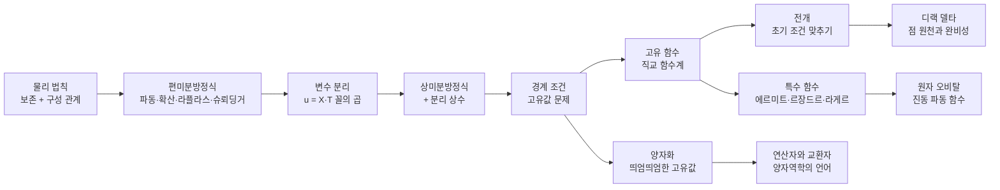

# 수학 도구 8. 편미분방정식과 특수 함수 — 경계가 해를 고르고, 고유 함수가 세계를 짓는다
<!-- prev: umath-4, umath-5, umath-6, uphy-6 -->
<!-- next: pchem-7 -->

> [!NOTE]
> **이 단원의 범위**
> - 편미분방정식의 대표적인 예: 파동 방정식, 확산(열) 방정식, 라플라스 방정식, 슈뢰딩거 방정식
> - 변수 분리법과 분리 상수
> - 경계 조건과 양자화: 고유값 문제로서의 편미분방정식
> - 직교 함수와 함수의 전개(일반화된 푸리에 급수, 완비성)
> - 특수 함수 맛보기: 에르미트 함수, 르장드르 다항식, 구면 조화 함수, 라게르 함수와 그 모양
> - 연산자와 교환자
> - 디랙 델타 함수

**학습 목표**

1. 파동·확산·라플라스·슈뢰딩거 방정식이 각각 어떤 물리 상황에서 나오는지 설명하고, 주어진 함수가 그 방정식의 해인지 편미분으로 확인할 수 있다.
2. 변수 분리법으로 편미분방정식을 상미분방정식 몇 개로 나누고, 분리 상수의 뜻을 설명할 수 있다.
3. 경계 조건이 분리 상수를 띄엄띄엄한 값(고유값)으로 제한하는 과정을 따라가, 줄의 정상파와 상자 속 입자의 에너지 양자화를 같은 수학으로 이해할 수 있다.
4. 함수의 내적과 직교성을 정의하고, 주어진 초기 조건을 고유 함수로 전개하여 계수를 계산할 수 있다.
5. 에르미트·르장드르·구면 조화·라게르 함수가 어떤 방정식에서 나오는지 알고, 마디의 수와 위치를 계산해 오비탈과 진동 파동 함수의 모양을 읽을 수 있다.
6. 연산자의 고유값 방정식과 교환자를 계산하고, 교환자가 0이 아닌 두 물리량이 동시에 정해지지 않는다는 뜻을 설명할 수 있다.
7. 디랙 델타 함수의 정의와 거르기 성질을 써서 점 전하, 순간 방출, 이상적인 스펙트럼선을 수식으로 표현할 수 있다.

**이 단원의 학습 사다리**

| 단계 | 무엇을 하나? |
|---|---|
| STEP 1. 이전 학습 다시 보기 | 파동 방정식과 정상파, 무한 우물, 2계 상미분방정식, 행렬의 고유값, 푸리에 급수 |
| STEP 2. 기초 다지기 | 편미분과 라플라시안, $y'' = \pm k^2y$의 해, 고유값 문제의 생각, 사인 함수의 직교성 |
| STEP 3. 핵심 개념 | 네 가지 방정식 → 변수 분리 → 경계 조건과 양자화 → 직교 전개 → 2·3차원과 구면 좌표 → 에르미트 → 르장드르·구면 조화 → 라게르 → 연산자와 교환자 → 디랙 델타 |
| STEP 4. 오개념 바로잡기 | "분리된 해 하나가 일반해다", "마디가 많으면 에너지가 낮다" 같은 착각 |
| STEP 5. 더 깊은 수학 | 슈투름–리우빌 이론, 그린 함수, 베셀 함수, 수치 해법(유한 차분) |
| STEP 6. 이 도구가 쓰이는 전공 단원 | 양자역학의 기초, 진동·회전과 수소 원자, 분자 분광학, 확산과 크로마토그래피 |

---

## 🗺️ 단원 들어가기

기타 줄을 튕기면 특정한 높이의 소리만 난다. 수소 원자는 특정한 색의 빛만 낸다. 뜨거운 쇠막대를 찬물에 담그면 온도 분포가 처음에는 울퉁불퉁하다가 곧 매끄러운 산 모양 하나로 정리된 뒤 사라진다. 세 장면은 물리적으로 전혀 다르지만, 수학으로는 **같은 이야기**이다. 모두 위치와 시간 두 변수에 함께 의존하는 양을 다루는 **편미분방정식**이고, 모두 **경계 조건**이 허락하는 '모양(고유 함수)'만 살아남으며, 실제 상태는 그 모양들의 **겹침(전개)**으로 쓰인다.

일반물리학에서 우리는 줄의 파동 방정식을 유도하고 정상파의 진동수가 $f_n = nv/2L$로 띄엄띄엄하다는 것을 보았다. 「현대 물리」에서는 상자 속 전자의 에너지가 $n^2$에 비례해 양자화된다는 것을 보았다. 이 단원에서는 이 두 결과가 우연히 닮은 것이 아니라 **같은 고유값 문제의 두 얼굴**임을 확인하고, 그 방법을 열의 흐름·분자의 확산·전위·원자 오비탈로 넓힌다.

수학 도구 단원이므로 엄밀한 증명보다는 "어떻게 풀고, 결과를 어떻게 읽는가"에 집중한다. 이 단원을 마치면 물리화학의 「양자역학의 기초」에서 나오는 연산자·고유값·교환자, 「진동·회전 운동과 수소 원자」에서 나오는 에르미트·구면 조화·라게르 함수를 **처음 보는 기호가 아니라 이미 다뤄 본 도구**로 만나게 된다.

---

## STEP 1. 🔙 이전 학습 다시 보기

### 연계 개념표

| 이전 단원 | 그때 배운 것 | 이 단원에서 확장되는 것 |
|---|---|---|
| 일반물리학 「파동과 소리」 | 줄의 작은 조각에 뉴턴 법칙을 적용한 파동 방정식, 정상파 $2y_m\sin kx\cos\omega t$, 양 끝 고정 줄의 $f_n = nv/2L$ | 정상파를 **변수 분리의 해**로 다시 얻고, $n$이 정수인 까닭을 경계 조건의 고유값 문제로 설명 |
| 일반물리학 「현대 물리」 | 무한 퍼텐셜 우물의 $E_n = n^2h^2/8mL^2$, 터널링, 수소 원자의 양자수 $n, l, m_l$ | 같은 양자화를 줄의 정상파와 같은 수학으로, 양자수 $l, m_l$이 구면 조화 함수에서 나오는 과정 |
| 수학 도구 4 「상미분방정식」 | 상수 계수 2계 선형 방정식(조화 진동자), 급수 해법의 생각(에르미트·르장드르 방정식이 나오는 까닭) | 편미분방정식을 쪼개면 바로 그 상미분방정식들이 나온다. 급수 해가 끊기는 조건이 곧 양자화 |
| 수학 도구 5 「선형대수」 | 고유값과 고유벡터, 에르미트 행렬의 실수 고유값과 직교 고유벡터, 대각화 | 행렬 → **미분 연산자**, 벡터 → **함수**, 고유벡터 → **고유 함수**로 같은 구조를 옮김 |
| 수학 도구 6 「복소수와 푸리에 해석」 | 오일러 공식, 푸리에 급수와 푸리에 변환, 불확정성 | 사인·코사인 말고 다른 직교 함수(르장드르·에르미트)로도 전개할 수 있다는 일반화, 델타 함수의 푸리에 표현 |
| 수학 도구 3 「벡터와 벡터 미적분」, 수학 도구 7 「확률과 통계」 | 라플라시안(직교·구면 좌표), 마구걷기와 확산 | 라플라시안이 들어간 방정식을 구면 좌표에서 분리, 확산 방정식의 가우스 해 |

### 준비 운동 (사전 진단)

**Q1.** $f(x, t) = \sin(3x)\,e^{-2t}$일 때 $\partial f/\partial t$와 $\partial^2 f/\partial x^2$를 구하시오. 두 결과는 어떤 관계인가?

**Q2.** 상미분방정식 $X'' + 4X = 0$의 일반해를 쓰시오. $X(0) = 0$을 더하면 어떻게 되는가?

**Q3.** 행렬 $\begin{pmatrix} 2 & 1 \\ 1 & 2 \end{pmatrix}$의 고유값과 고유벡터를 구하고, 두 고유벡터의 내적을 계산하시오.

**Q4.** 길이 0.65 m인 기타 줄의 파동 속력이 260 m/s이다. 양 끝이 고정되어 있을 때 기본 진동수와 둘째 배음의 진동수를 구하시오.

정답 및 해설

**Q1.** $\partial f/\partial t = -2\sin(3x)e^{-2t}$, $\partial^2 f/\partial x^2 = -9\sin(3x)e^{-2t}$. 따라서 $\partial f/\partial t = \tfrac{2}{9}\,\partial^2 f/\partial x^2$이다. 이 함수는 계수 $D = 2/9$인 확산 방정식의 해이다(STEP 3 ①).

**Q2.** $X = A\cos 2x + B\sin 2x$. $X(0) = 0$이면 $A = 0$이 되어 $X = B\sin 2x$만 남는다. 경계 조건 하나가 해의 '종류'를 반으로 줄인다.

**Q3.** 고유값 3, 1. 고유벡터 $(1, 1)$, $(1, -1)$. 내적 $1 - 1 = 0$으로 서로 직교한다. 대칭 행렬의 고유벡터가 직교한다는 성질이 STEP 3 ④의 '고유 함수의 직교성'으로 이어진다.

**Q4.** $f_1 = v/2L = 260/1.30 = 200\ \mathrm{Hz}$, $f_2 = 2f_1 = 400\ \mathrm{Hz}$.

---

## STEP 2. 🧱 기초 다지기

### 디딤돌 1. 편미분과 라플라시안 — 방정식을 읽는 문법

수학 도구 1 '다변수 함수와 편미분'에서 익힌 대로, $u(x, t)$의 $\partial u/\partial t$는 **위치를 고정하고** 시간에 대해서만 미분한 것이고, $\partial u/\partial x$는 **시각을 고정하고** 위치에 대해서만 미분한 것이다. 편미분방정식은 이런 편도함수 사이의 관계식이다.

공간이 2·3차원이면 2계 공간 미분이 **라플라시안(Laplacian)** $\nabla^2$로 묶인다(수학 도구 3 '라플라시안').

| 좌표 | $\nabla^2 u$ |
|---|---|
| 직교 좌표 $(x, y, z)$ | $\dfrac{\partial^2 u}{\partial x^2} + \dfrac{\partial^2 u}{\partial y^2} + \dfrac{\partial^2 u}{\partial z^2}$ |
| 구면 좌표 $(r, \theta, \phi)$ | $\dfrac{1}{r^2}\dfrac{\partial}{\partial r}\!\left(r^2\dfrac{\partial u}{\partial r}\right) + \dfrac{1}{r^2\sin\theta}\dfrac{\partial}{\partial\theta}\!\left(\sin\theta\dfrac{\partial u}{\partial\theta}\right) + \dfrac{1}{r^2\sin^2\theta}\dfrac{\partial^2 u}{\partial\phi^2}$ |

$\partial^2 u/\partial x^2$는 **굽은 정도(곡률)** 이다. 어떤 점의 값이 이웃 평균보다 낮으면(골짜기) $\partial^2 u/\partial x^2 > 0$, 높으면(봉우리) $< 0$이다. 이 한 가지 해석이 확산·라플라스 방정식의 뜻을 거의 다 알려 준다. **짧은 예:** $u = x^2 - y^2$의 라플라시안은 $2 - 2 = 0$이다. 한 방향으로는 위로 굽고 다른 방향으로는 같은 만큼 아래로 굽은 말안장 모양이어서, 어느 점에서나 '이웃 평균 = 자기 값'이다.

### 디딤돌 2. $X'' = -k^2X$와 $X'' = +k^2X$ — 두 가지 기본 해

변수 분리를 하면 거의 언제나 다음 둘 중 하나의 상미분방정식이 나온다(수학 도구 4 '상수 계수 2계 선형').

| 방정식 | 일반해 | 모양 | 어디서 나오나 |
|---|---|---|---|
| $X'' = -k^2X$ | $A\sin kx + B\cos kx$ (또는 $Ce^{ikx} + De^{-ikx}$) | 진동 | 줄, 상자 속 입자, 고리 위의 입자 |
| $X'' = +k^2X$ | $Ae^{kx} + Be^{-kx}$ (또는 $C\sinh kx + D\cosh kx$) | 지수적 증가·감소 | 장벽 속 파동 함수(터널링), 라플라스 방정식의 한 방향 |
| $X'' = 0$ | $A + Bx$ | 직선 | 정상 상태의 1차원 열전도 |

부호 하나가 진동과 지수를 가른다. 그래서 분리 상수의 **부호**를 정하는 일이 변수 분리에서 가장 먼저 할 일이다. **짧은 예:** $X'' = -9X$, $X(0) = 0$, $X'(0) = 6$이면 $X = 2\sin 3x$이다. ($X' = 3B\cos 3x$에서 $3B = 6$)

### 디딤돌 3. 고유값 문제 — 행렬에서 미분 연산자로

수학 도구 5 '고유값과 고유벡터'에서 $A\mathbf{v} = \lambda\mathbf{v}$는 "행렬 $A$가 방향을 바꾸지 않고 길이만 $\lambda$배 하는 벡터 $\mathbf{v}$"를 찾는 문제였다. 같은 생각을 함수에 적용하면

$$
\hat{L}\,f(x) = \lambda\,f(x)
$$

가 된다. $\hat{L}$은 함수를 받아 함수를 돌려주는 **연산자(operator)** 이고(예: $\hat{L} = d^2/dx^2$), $f$는 **고유 함수(eigenfunction)**, $\lambda$는 **고유값(eigenvalue)** 이다.

| 행렬의 언어 | 함수의 언어 |
|---|---|
| 벡터 $\mathbf{v}$ (성분 $v_i$) | 함수 $f(x)$ (각 $x$에서의 값) |
| 행렬 $A$ | 미분 연산자 $\hat{L}$ |
| 내적 $\mathbf{u}\cdot\mathbf{v} = \sum u_iv_i$ | 내적 $\langle f, g\rangle = \int f^*g\,dx$ |
| 대칭(에르미트) 행렬 | 에르미트 연산자 |
| 실수 고유값, 직교 고유벡터 | 실수 고유값, 직교 고유 함수 |
| 고유벡터로 임의의 벡터를 전개 | 고유 함수로 임의의 함수를 전개 |

**짧은 예** $\dfrac{d^2}{dx^2}\sin 5x = -25\sin 5x$이므로 $\sin 5x$는 연산자 $d^2/dx^2$의 고유 함수이고 고유값은 $-25$이다. 반면 $\dfrac{d^2}{dx^2}x^3 = 6x$는 $x^3$의 상수배가 아니므로 $x^3$은 고유 함수가 아니다.

### 디딤돌 4. 사인 함수의 직교성 — 푸리에 급수 되짚기

수학 도구 6 '푸리에 급수'에서 다음 적분을 썼다. 구간 $[0, L]$에서 양의 정수 $m, n$에 대해

$$
\int_0^L \sin\frac{m\pi x}{L}\sin\frac{n\pi x}{L}\,dx = \begin{cases} L/2 & (m = n) \\ 0 & (m \ne n) \end{cases}
$$

곱셈 공식 $\sin a\sin b = \tfrac12[\cos(a - b) - \cos(a + b)]$을 쓰면, $m \ne n$일 때 두 코사인 모두 구간에서 정수 번의 반주기를 채워 적분이 0이 된다. 이 성질 덕분에 함수를 사인들의 합으로 썼을 때 각 계수를 **하나씩 따로** 꺼낼 수 있다(STEP 3 ④).

**짧은 예** $\displaystyle\int_0^\pi \sin x\sin 2x\,dx = \int_0^\pi 2\sin^2x\cos x\,dx = \left[\tfrac{2}{3}\sin^3x\right]_0^\pi = 0$.

<!-- 그림 요청: 구간 [0, L]에서 sin(πx/L)(파랑), sin(2πx/L)(주황), 두 함수의 곱(회색 채움 영역)을 한 그래프에 그린다. 곱의 그래프에서 x축 위 넓이(+)와 아래 넓이(−)를 다른 빗금으로 칠하고 "넓이의 합 = 0"이라고 적는다. 가로축 x (0, L/2, L 눈금), 세로축 −1~1. -->

---

## STEP 3. 📘 핵심 개념

### ① 네 가지 대표 편미분방정식 — 어디서 나오고 무엇을 말하나

**편미분방정식(partial differential equation, PDE)** 은 둘 이상의 독립 변수를 가진 함수와 그 편도함수 사이의 관계식이다. 과학에서 만나는 편미분방정식은 대부분 다음 네 가지 가운데 하나이거나 그 변형이다.

| 이름 | 식 | 대표 상황 | 해의 성격 |
|---|---|---|---|
| **파동 방정식(wave equation)** | $\dfrac{\partial^2 u}{\partial t^2} = v^2\nabla^2 u$ | 줄·막의 진동, 음파, 전자기파, 지진파 | 모양을 유지하며 속력 $v$로 전파, 에너지 보존 |
| **확산 방정식(diffusion equation)**, 열 방정식 | $\dfrac{\partial u}{\partial t} = D\nabla^2 u$ | 분자 확산, 열전도, 지하수의 퍼짐 | 울퉁불퉁함이 지워지며 평탄해짐, 시간에 대해 비가역 |
| **라플라스 방정식(Laplace equation)** | $\nabla^2 u = 0$ | 정상 상태의 온도·농도, 전하 없는 곳의 전위 | 시간 없음, 경계값만으로 내부가 정해짐 |
| **슈뢰딩거 방정식(Schrödinger equation)** | $i\hbar\dfrac{\partial\Psi}{\partial t} = -\dfrac{\hbar^2}{2m}\nabla^2\Psi + V\Psi$ | 전자·원자·분자의 양자 상태 | 복소수 해, 확률 진폭의 파동 |

#### 확산 방정식의 유도 — 보존 법칙 + 구성 관계

편미분방정식은 대개 두 가지를 합쳐서 얻는다. 하나는 **보존 법칙**(물질·에너지·전하는 저절로 생기거나 사라지지 않는다), 다른 하나는 물질의 성질을 담은 **구성 관계**이다.

가정: 1차원 관 속의 용질 농도 $c(x, t)$, 화학 반응은 없다.

1. **보존**: 폭 $\Delta x$인 얇은 조각에 들어오는 흐름 $J(x)$와 나가는 흐름 $J(x + \Delta x)$의 차이만큼 조각 안의 양이 늘어난다(단면적 $A$).
$$
\frac{\partial}{\partial t}\big(c\,A\,\Delta x\big) = A\,J(x) - A\,J(x + \Delta x) \;\;\Longrightarrow\;\; \frac{\partial c}{\partial t} = -\frac{\partial J}{\partial x} \quad (\Delta x \to 0)
$$
2. **구성 관계(픽의 제1법칙, Fick's first law)**: 흐름은 농도가 낮은 쪽으로, 기울기에 비례한다. $J = -D\,\dfrac{\partial c}{\partial x}$ ($D$: 확산 계수, $\mathrm{m^2/s}$)
3. 2를 1에 넣으면($D$가 일정할 때)
$$
\boxed{\;\frac{\partial c}{\partial t} = D\frac{\partial^2 c}{\partial x^2}\;}
$$

**적용 한계**: $D$가 농도·위치에 따라 변하면 $\partial_x(D\,\partial_x c)$로 써야 하고, 반응이 있으면 생성·소멸 항이 더해진다. 열전도에서는 $c$ 대신 온도 $T$, 픽 법칙 대신 푸리에 열전도 법칙 $q = -\kappa\,\partial T/\partial x$를 쓰면 $D$ 자리에 **열 확산율** $\alpha = \kappa/(\rho c_p)$가 들어간 같은 식이 나온다.

> [!TIP]
> 💡 **읽는 법** — 확산 방정식은 "**골짜기는 차오르고 봉우리는 깎인다**"는 문장이다. $\partial^2 c/\partial x^2 > 0$(그 점이 이웃 평균보다 낮다)이면 $\partial c/\partial t > 0$이 되어 값이 올라간다. 라플라스 방정식 $\nabla^2u = 0$은 그 과정이 다 끝난 상태, 즉 **모든 점이 이웃의 평균과 같은** 상태이다. 그래서 라플라스 방정식의 해는 내부에 봉우리나 골짜기를 가질 수 없고, 최댓값과 최솟값은 반드시 경계에 있다.

#### 파동 방정식과 슈뢰딩거 방정식 — 시간 미분의 차수가 다르다

일반물리학 「파동과 소리」에서 줄에 뉴턴 법칙을 적용해 $\partial^2y/\partial t^2 = (T/\mu)\,\partial^2y/\partial x^2$를 얻었다. 시간에 대해 **2계**이므로 처음 모양과 처음 속도 두 가지를 알아야 앞날이 정해진다. 확산 방정식과 슈뢰딩거 방정식은 시간에 대해 **1계**이므로 처음 상태 하나만 알면 된다. 그런데 슈뢰딩거 방정식에는 $i$가 붙어 있어서 확산처럼 감쇠하지 않고 파동처럼 진동한다(복소 지수 $e^{-i\omega t}$, 수학 도구 6 '오일러 공식').

| 방정식 | 시간 미분 | 필요한 초기 조건 | 비유 |
|---|---|---|---|
| 파동 | 2계 | $u(x, 0)$, $\partial_tu(x, 0)$ | 튕긴 줄 |
| 확산 | 1계 | $u(x, 0)$ | 퍼지는 잉크 |
| 슈뢰딩거 | 1계(허수 계수) | $\Psi(x, 0)$ | '허수 시간'의 확산 = 진동하는 파동 |
| 라플라스 | 없음 | 경계값만 | 팽팽하게 당긴 고무막의 모양 |

네 방정식은 모두 $u$에 대해 **선형**이다. 해 $u_1$, $u_2$가 있으면 $au_1 + bu_2$도 해이다(**중첩 원리**). 이 성질이 뒤에서 '간단한 해를 많이 모아 복잡한 해를 만드는' 전략의 바탕이다.

#### 예제 1 — 확산의 가우스 해와 확산 시간

농도가 $c(x, t) = \dfrac{N}{\sqrt{4\pi Dt}}\exp\!\left(-\dfrac{x^2}{4Dt}\right)$인 분포를 생각하자($N$: 단면적당 총량).
(1) 이 함수가 1차원 확산 방정식을 만족함을 보이시오.
(2) 이 분포의 평균 제곱 변위는 $\langle x^2\rangle = 2Dt$이다. 물속 산소의 확산 계수를 약 $2.0\times10^{-9}\ \mathrm{m^2/s}$라 할 때 제곱 평균 제곱근 변위가 $10\ \mu\mathrm{m}$(세포 하나), $1.0\ \mathrm{mm}$, $1.0\ \mathrm{cm}$가 되는 데 걸리는 시간을 구하시오.

**풀이**
(1) $s = x^2/(4Dt)$라 두고 $c = Nt^{-1/2}e^{-s}/\sqrt{4\pi D}$를 미분한다. 상수 $N/\sqrt{4\pi D}$는 생략하고 $f = t^{-1/2}e^{-x^2/4Dt}$로 쓰면
$$
\frac{\partial f}{\partial t} = f\left(-\frac{1}{2t} + \frac{x^2}{4Dt^2}\right), \qquad \frac{\partial f}{\partial x} = f\left(-\frac{x}{2Dt}\right), \qquad \frac{\partial^2 f}{\partial x^2} = f\left(\frac{x^2}{4D^2t^2} - \frac{1}{2Dt}\right)
$$
세 번째 식에 $D$를 곱하면 첫 번째 식과 같다. 따라서 $\partial c/\partial t = D\,\partial^2c/\partial x^2$이다.
(2) $\sqrt{2Dt} = L$에서 $t = L^2/(2D)$.
- $10\ \mu\mathrm{m}$: $t = (1.0\times10^{-5})^2/(4.0\times10^{-9}) = 0.025\ \mathrm{s}$
- $1.0\ \mathrm{mm}$: $t = (1.0\times10^{-3})^2/(4.0\times10^{-9}) = 2.5\times10^2\ \mathrm{s}$ (약 4분)
- $1.0\ \mathrm{cm}$: $t = 2.5\times10^4\ \mathrm{s}$ (약 7시간)

**의미** 거리가 10배가 되면 시간은 100배가 된다($t \propto L^2$). 세포 안에서는 확산만으로 충분히 빠르지만, 몸 크기의 거리에서는 확산이 터무니없이 느리다. 그래서 큰 생물에는 혈액 순환(대류)이 필요하다. 가우스 해는 수학 도구 7 '마구걷기와 확산'에서 본 마구걷기의 분포와 정확히 같은 모양이다.

<!-- 그림 요청: 확산 방정식의 가우스 해 c(x, t) = (1/√(4πDt)) exp(−x²/4Dt)를 D = 1로 두고 t = 0.05, 0.2, 1, 4 네 시각에 대해 한 그래프에 그린다(가로축 x: −6~6, 세로축 c). 시간이 지날수록 봉우리가 낮아지고 넓어진다. 각 곡선 아래 넓이는 모두 1로 같다는 문구를 넣고, t = 1 곡선에 폭 ±√(2Dt) = ±1.41을 양쪽 화살표로 표시한다. -->

#### ✔ 바로 확인

1. 다음 방정식의 이름을 쓰시오. (가) $\partial u/\partial t = \alpha\,\partial^2u/\partial x^2$ (나) $\nabla^2\phi = 0$ (다) $\partial^2 u/\partial t^2 = v^2\,\partial^2u/\partial x^2$
2. (O/X) 라플라스 방정식의 해는 영역 내부에서 최댓값을 가질 수 있다.
3. 빈칸: 확산 방정식은 보존 법칙 $\partial c/\partial t = -\partial J/\partial x$에 구성 관계인 (    ) 법칙 $J = -D\,\partial c/\partial x$를 넣어 얻는다.
4. 물속에서 $D \approx 1\times10^{-9}\ \mathrm{m^2/s}$인 분자가 1차원으로 $1\ \mu\mathrm{m}$ 퍼지는 데 걸리는 시간은 대략 얼마인가? ($t = L^2/2D$)

정답

1. (가) 확산(열) 방정식 (나) 라플라스 방정식 (다) 파동 방정식
2. X — 모든 점이 이웃의 평균과 같으므로 내부에 봉우리가 생길 수 없다. 최댓값·최솟값은 경계에 있다.
3. 픽의 제1 — 열전도라면 푸리에 법칙.
4. 약 $5\times10^{-4}\ \mathrm{s}$ (0.5 ms) — $(10^{-6})^2/(2\times10^{-9})$.

### ② 변수 분리법 — 편미분방정식을 상미분방정식으로 쪼개기

**변수 분리법(separation of variables)** 은 해를 **각 변수만의 함수의 곱**으로 가정해 보는 방법이다. 길이 $L$인 막대의 1차원 열 방정식으로 과정을 따라가 보자.

$$
\frac{\partial u}{\partial t} = \alpha\frac{\partial^2 u}{\partial x^2}, \qquad u(0, t) = u(L, t) = 0
$$

($u$는 양 끝의 고정 온도를 기준으로 잰 온도이다. 양 끝을 얼음물에 담근 막대를 떠올리면 된다.)

**1단계 — 곱의 꼴을 가정한다.** $u(x, t) = X(x)\,T(t)$로 놓고 대입하면 $X\,T' = \alpha X''\,T$이다.

**2단계 — 변수를 양쪽으로 가른다.** 양변을 $\alpha XT$로 나누면

$$
\underbrace{\frac{T'(t)}{\alpha\,T(t)}}_{t\text{만의 함수}} = \underbrace{\frac{X''(x)}{X(x)}}_{x\text{만의 함수}}
$$

**3단계 — 둘 다 상수여야 한다.** 왼쪽은 $x$를 바꿔도 변하지 않고, 오른쪽은 $t$를 바꿔도 변하지 않는다. 그런데 두 쪽이 모든 $x$, $t$에서 같으므로, 둘 다 $x$에도 $t$에도 의존하지 않는 **상수**여야 한다. 이 상수를 **분리 상수(separation constant)** 라 하고 $-\lambda$로 둔다.

$$
X'' + \lambda X = 0, \qquad T' + \alpha\lambda\,T = 0
$$

편미분방정식 하나가 상미분방정식 두 개가 되었다. 시간 쪽은 곧바로 $T(t) = e^{-\alpha\lambda t}$이다.

**4단계 — 공간 쪽에 경계 조건을 적용한다.** $\lambda$의 부호에 따라 경우를 나눈다(STEP 2 디딤돌 2).

| $\lambda$ | $X(x)$ | $X(0) = X(L) = 0$을 적용하면 |
|---|---|---|
| $\lambda < 0$ ($\lambda = -k^2$) | $Ae^{kx} + Be^{-kx}$ | $A + B = 0$, $Ae^{kL} + Be^{-kL} = 0$ → $A = B = 0$ (해 없음) |
| $\lambda = 0$ | $A + Bx$ | $A = 0$, $BL = 0$ → 해 없음 |
| $\lambda > 0$ ($\lambda = k^2$) | $A\sin kx + B\cos kx$ | $B = 0$, $A\sin kL = 0$ → $kL = n\pi$ |

0이 아닌 해는 $\lambda_n = (n\pi/L)^2$ ($n = 1, 2, 3, \dots$)일 때만 있다.

**5단계 — 모은다.** 각 $n$에 대해 $u_n = \sin(n\pi x/L)\,e^{-\alpha n^2\pi^2 t/L^2}$가 해이고, 방정식이 선형이므로 이들의 합도 해이다.

$$
\boxed{\;u(x, t) = \sum_{n = 1}^{\infty} b_n\sin\frac{n\pi x}{L}\,\exp\!\left(-\frac{t}{\tau_n}\right), \qquad \tau_n = \frac{L^2}{n^2\pi^2\alpha}\;}
$$

계수 $b_n$은 초기 온도 분포 $u(x, 0)$로 정해진다(④에서 계산한다).

> [!IMPORTANT]
> **분리된 해 하나는 일반해가 아니다.** $X(x)T(t)$ 꼴의 해는 특별한 초기 조건(정확히 사인 모양)에서만 그대로 맞는다. 실제 문제는 분리된 해들을 **중첩**해서 초기 조건에 맞춘다. 변수 분리의 진짜 힘은 "곱의 꼴" 자체가 아니라, 곱의 꼴로 얻은 해들이 **완비된 기저**를 이룬다는 데 있다.

**모드마다 사라지는 빠르기가 다르다.** $\tau_n \propto 1/n^2$이므로 마디가 많은(공간적으로 빨리 흔들리는) 모드일수록 훨씬 빨리 사라진다. $n = 3$ 모드는 $n = 1$ 모드보다 9배 빨리 감쇠한다. 그래서 어떤 모양으로 시작하든 조금 지나면 **가장 느린 모드 $\sin(\pi x/L)$ 하나**만 남는다. 확산이 '매끄럽게 만드는' 과정을 모드의 언어로 말하면 이렇다.

<!-- 시뮬레이션 요청: 양 끝 온도 0으로 고정된 막대의 열 방정식. 학생이 초기 온도 분포를 고른다(균일한 직사각형, 삼각형, 한쪽에 치우친 봉우리, 사인 하나). 화면 위에는 u(x, t) 곡선이 시간에 따라 변하고, 아래에는 각 모드 n = 1~15의 계수 크기 |b_n e^{−t/τ_n}| 막대그래프가 함께 줄어든다. 조작 변수: 초기 분포, 열 확산율 α, 모드 수 N(부분합), 재생 속도. 보여 줄 것: 높은 n 모드가 먼저 사라지고 n = 1 모드만 남는 과정, N이 작을 때 t = 0 근처에서 생기는 물결(깁스 현상). -->

#### 시간 의존 슈뢰딩거 방정식의 분리 — 정상 상태

퍼텐셜 $V(x)$가 시간에 의존하지 않으면 $\Psi(x, t) = \psi(x)\,\varphi(t)$로 분리할 수 있다. 대입하고 $\psi\varphi$로 나누면

$$
i\hbar\frac{\varphi'}{\varphi} = \frac{1}{\psi}\left[-\frac{\hbar^2}{2m}\psi'' + V\psi\right] = E \quad (\text{분리 상수})
$$

시간 쪽은 $\varphi = e^{-iEt/\hbar}$, 공간 쪽은

$$
-\frac{\hbar^2}{2m}\frac{d^2\psi}{dx^2} + V(x)\psi = E\psi
$$

이것이 **시간에 무관한 슈뢰딩거 방정식**이다. 분리 상수 $E$가 바로 에너지이다. 이런 해의 확률 밀도 $\lvert\Psi\rvert^2 = \lvert\psi\rvert^2\lvert e^{-iEt/\hbar}\rvert^2 = \lvert\psi\rvert^2$은 시간에 따라 변하지 않으므로 **정상 상태(stationary state)** 라 부른다. 분리 상수가 물리적으로 의미 있는 양(감쇠율, 진동수의 제곱, 에너지)이 되는 일이 아주 흔하다.

| 방정식 | 분리 상수의 물리적 뜻 |
|---|---|
| 열 방정식 | 감쇠율 $1/\tau_n = \alpha\lambda_n$ |
| 파동 방정식 | 각진동수의 제곱 $\omega_n^2 = v^2\lambda_n$ |
| 슈뢰딩거 방정식 | 에너지 $E$ |
| 구면 좌표의 각 부분 | 각운동량 제곱 $l(l + 1)\hbar^2$ (⑦) |

> [!NOTE]
> 변수 분리가 통하려면 ① 방정식이 선형이고 ② 경계가 좌표면(예: $x = 0$, $x = L$, $r = R$)과 일치하며 ③ 계수가 적당히 단순해야 한다. 구 모양 원자에 구면 좌표, 원통형 칼럼에 원통 좌표를 쓰는 까닭이 ②이다. 조건이 맞지 않으면 수치 해법(STEP 5)을 쓴다.

#### 예제 2 — 구리 막대의 온도 모드가 사라지는 시간

길이 0.50 m인 구리 막대의 양 끝을 0 ℃에 고정했다. 구리의 열 확산율은 약 $1.1\times10^{-4}\ \mathrm{m^2/s}$이다.
(1) $n = 1, 2, 3$ 모드의 시간 상수 $\tau_n$을 구하시오.
(2) 처음 온도 분포가 정확히 $u(x, 0) = 40\sin(\pi x/L)\ ^\circ\mathrm{C}$였다면, 가운데 온도가 20 ℃가 되는 데 걸리는 시간은?

**풀이**
(1) $\tau_1 = \dfrac{L^2}{\pi^2\alpha} = \dfrac{0.250}{9.870\times1.1\times10^{-4}} = 2.3\times10^2\ \mathrm{s}$. $\tau_2 = \tau_1/4 = 58\ \mathrm{s}$, $\tau_3 = \tau_1/9 = 26\ \mathrm{s}$.
(2) 초기 분포가 모드 하나이므로 $u = 40\sin(\pi x/L)e^{-t/\tau_1}$이 그대로 해이다. 가운데($x = L/2$)에서 $40e^{-t/\tau_1} = 20$ → $t = \tau_1\ln 2 = 230\times0.693 = 1.6\times10^2\ \mathrm{s}$ (약 2.7분).

**의미** 모드의 진폭은 방사성 붕괴처럼 지수적으로 줄고, '반감기'는 $\tau\ln 2$이다. 막대가 두 배 길면 $\tau$는 네 배가 된다($\tau \propto L^2$). 예제 1의 $t \propto L^2$과 같은 확산의 기본 성질이다.

#### ✔ 바로 확인

1. 변수 분리에서 $T'/(\alpha T) = X''/X$의 양변이 상수여야 하는 까닭을 한 문장으로 쓰시오.
2. 열 방정식에서 $n = 4$ 모드는 $n = 1$ 모드보다 몇 배 빨리 감쇠하는가?
3. (O/X) 시간에 무관한 슈뢰딩거 방정식의 분리 상수 $E$는 계의 에너지이다.
4. 정상 상태 $\Psi = \psi(x)e^{-iEt/\hbar}$의 확률 밀도 $\lvert\Psi\rvert^2$은 시간에 따라 어떻게 변하는가?

정답

1. 왼쪽은 $t$만의, 오른쪽은 $x$만의 함수인데 모든 $x$, $t$에서 같으므로 어느 변수에도 의존할 수 없다.
2. 16배 — $\tau_n \propto 1/n^2$.
3. O
4. 변하지 않는다 — $\lvert e^{-iEt/\hbar}\rvert = 1$.

### ③ 경계 조건과 양자화 — 고유값 문제로서의 편미분방정식

②에서 결정적인 순간은 4단계였다. 미분방정식 $X'' + \lambda X = 0$ 자체는 **모든** $\lambda$에 대해 해가 있지만, 양 끝에서 0이라는 조건을 붙이자 $\lambda = (n\pi/L)^2$만 살아남았다. 이처럼

> **미분방정식 + 동차(0이 되는) 경계 조건 → 0이 아닌 해는 특정한 $\lambda$에서만 존재한다**

는 구조를 **고유값 문제(eigenvalue problem)** 라 한다. 허용된 $\lambda_n$이 고유값, 그때의 $X_n$이 고유 함수이다. 띄엄띄엄한 고유값이 바로 **양자화**의 수학적 정체이다. 양자역학이 특별해서 에너지가 양자화되는 것이 아니라, **갇힌 파동**은 고전이든 양자든 띄엄띄엄한 모드만 가진다.

#### 경계 조건의 종류

| 이름 | 조건 | 물리적 예 | 허용되는 공간 모드 ($0 \le x \le L$) |
|---|---|---|---|
| 디리클레(Dirichlet) 조건 | 값이 고정: $u = 0$ | 고정된 줄의 끝, 얼음물에 담근 막대 끝, 무한 우물의 벽 | $\sin(n\pi x/L)$, $n = 1, 2, \dots$ |
| 노이만(Neumann) 조건 | 기울기가 고정: $\partial u/\partial x = 0$ | 단열된 막대 끝(열 흐름 0), 닫힌 관 끝의 압력, 막힌 벽의 농도 | $\cos(n\pi x/L)$, $n = 0, 1, 2, \dots$ |
| 주기 조건 | $u(x + L) = u(x)$ | 고리 위의 입자, 벤젠 고리의 π 전자, 결정의 주기 경계 | $e^{2\pi inx/L}$, $n = 0, \pm1, \pm2, \dots$ |
| 유한성·규격화 조건 | 무한대에서 $\psi \to 0$, 어디서나 유한 | 조화 진동자, 수소 원자의 지름 부분 | 에르미트 함수, 라게르 함수(⑥, ⑧) |

#### 고전과 양자의 같은 문제

| | 양 끝 고정 줄 | 무한 우물 속 입자 |
|---|---|---|
| 방정식 | $\dfrac{\partial^2y}{\partial t^2} = v^2\dfrac{\partial^2y}{\partial x^2}$ | $-\dfrac{\hbar^2}{2m}\dfrac{d^2\psi}{dx^2} = E\psi$ (우물 안 $V = 0$) |
| 공간 부분 | $X'' = -k^2X$ | $\psi'' = -k^2\psi$, $k^2 = 2mE/\hbar^2$ |
| 경계 조건 | $y(0) = y(L) = 0$ | $\psi(0) = \psi(L) = 0$ |
| 고유값 | $k_n = n\pi/L$ | $k_n = n\pi/L$ |
| 관측되는 양 | $\omega_n = vk_n = n\pi v/L$ → $f_n = nv/2L$ | $E_n = \dfrac{\hbar^2k_n^2}{2m} = \dfrac{n^2h^2}{8mL^2}$ |

수학은 완전히 같다. 다른 것은 고유값을 관측량으로 바꾸는 마지막 식뿐이다. 줄에서는 $\omega \propto k$, 물질파에서는 $E \propto k^2$이어서 줄의 진동수는 $n$에, 입자의 에너지는 $n^2$에 비례한다.

<!-- 그림 요청: 두 열로 나란히 비교하는 그림. 왼쪽 열: 양 끝 고정 줄의 n = 1, 2, 3 정상파 모양(각각 반파장 1, 2, 3개, 마디를 점으로 표시)을 위아래로 쌓고 오른쪽에 f₁, 2f₁, 3f₁. 오른쪽 열: 폭 L 무한 우물 안 ψ₁, ψ₂, ψ₃을 각 에너지 준위 높이(E₁, 4E₁, 9E₁ — 간격이 위로 갈수록 벌어지게)에 그린다. 가운데에 "같은 고유값 문제 k_n = nπ/L"이라는 띠를 둔다. -->

#### 노이만 조건 — 사라지지 않는 모드 $n = 0$

양 끝이 단열된 막대는 $X'(0) = X'(L) = 0$이다. 그러면 $X = A\sin kx + B\cos kx$에서 $X'(0) = Ak = 0$ → $A = 0$, $X'(L) = -Bk\sin kL = 0$ → $k = n\pi/L$이고, 이번에는 $n = 0$(상수 함수)도 허용된다. $n = 0$ 모드의 시간 상수는 무한대이므로 **영원히 남는다**. 단열된 막대는 결국 처음 온도의 평균값으로 고르게 되는데, 그 평균이 바로 $n = 0$ 모드의 계수이다. 열이 빠져나가지 않으니 평균 온도(총 열량)가 보존된다는 물리가 수학에서는 '감쇠하지 않는 고유 함수'로 나타난다.

**갇히지 않으면 양자화도 없다.** 경계가 없는 자유 입자($-\infty < x < \infty$, $V = 0$)는 $\psi = e^{ikx}$가 모든 실수 $k$에서 해이므로 에너지가 **연속**이다. 원자 속 전자도 이온화 에너지보다 큰 에너지에서는 연속 스펙트럼을 가진다. 띄엄띄엄함은 '가둠'에서 온다.

#### 예제 3 — 콘주게이션 분자의 색: 자유 전자 모형

1,3,5-헥사트라이엔($\mathrm{CH_2{=}CH{-}CH{=}CH{-}CH{=}CH_2}$)의 π 전자 6개가 분자 길이 정도의 1차원 상자(길이 $L = 0.70\ \mathrm{nm}$로 가정)에 갇혀 있다고 보자.
(1) 파울리 원리에 따라 각 준위에 전자가 2개씩 들어갈 때 HOMO와 LUMO의 $n$을 쓰시오.
(2) HOMO → LUMO 전이의 에너지와 빛의 파장을 구하시오. ($h = 6.626\times10^{-34}\ \mathrm{J\cdot s}$, $m_e = 9.109\times10^{-31}\ \mathrm{kg}$, $c = 2.998\times10^8\ \mathrm{m/s}$)

**풀이**
(1) 전자 6개가 $n = 1, 2, 3$을 채운다. HOMO는 $n = 3$, LUMO는 $n = 4$이다.
(2) $\Delta E = E_4 - E_3 = (16 - 9)\dfrac{h^2}{8m_eL^2} = \dfrac{7\times(6.626\times10^{-34})^2}{8\times9.109\times10^{-31}\times(0.70\times10^{-9})^2} = 8.6\times10^{-19}\ \mathrm{J}$ (약 5.4 eV)
$\lambda = \dfrac{hc}{\Delta E} = \dfrac{6.626\times10^{-34}\times2.998\times10^8}{8.6\times10^{-19}} = 2.3\times10^{-7}\ \mathrm{m} = 231\ \mathrm{nm}$

**의미** 자외선 영역이며, 실제 헥사트라이엔의 흡수 극대(약 260 nm)와 같은 영역이다. 이렇게 단순한 모형으로 자릿수를 맞히는 것은 '갇힌 전자의 고유값'이라는 핵심이 옳기 때문이다. 이중 결합이 $N$개이면 $\Delta E = (2N + 1)h^2/8m_eL^2$이고 $L$이 $N$에 거의 비례하므로 $\lambda$는 대략 $N$에 비례해 길어진다. 이중 결합이 11개 이어진 β-카로틴이 가시광선(파란빛)을 흡수해 주황색으로 보이는 까닭이다.

#### ✔ 바로 확인

1. 빈칸: 미분방정식에 동차 경계 조건을 붙여 0이 아닌 해가 특정한 값에서만 존재하게 되는 문제를 (    ) 문제라 한다.
2. (O/X) 양 끝이 단열된 막대의 열 방정식에서는 시간이 지나도 사라지지 않는 모드가 있다.
3. 무한 우물에서 $L$을 2배로 늘리면 바닥 상태 에너지는 몇 배가 되는가?
4. 고리(둘레 $2\pi R$) 위의 입자는 $\psi(\phi + 2\pi) = \psi(\phi)$를 만족해야 한다. $\psi = e^{im\phi}$일 때 허용되는 $m$은?

정답

1. 고유값
2. O — $n = 0$인 상수 모드. 그 값이 처음 온도의 평균이다.
3. $1/4$배 — $E_n \propto 1/L^2$.
4. $m = 0, \pm1, \pm2, \dots$ — $e^{2\pi im} = 1$이어야 하므로 정수.

### ④ 직교 함수와 전개 — 초기 조건을 고유 함수로 분해하기

②의 일반해 $u = \sum b_n\sin(n\pi x/L)e^{-t/\tau_n}$에서 $t = 0$으로 두면

$$
u(x, 0) = f(x) = \sum_{n = 1}^\infty b_n\sin\frac{n\pi x}{L}
$$

이다. 주어진 처음 온도 분포 $f(x)$를 사인들의 합으로 나타내는 계수 $b_n$을 찾아야 한다. 벡터를 기저 벡터로 분해할 때처럼 **내적**을 쓰면 된다.

#### 함수의 내적과 직교성

구간 $[a, b]$의 두 함수에 대해 **내적(inner product)** 을

$$
\langle f, g\rangle = \int_a^b f^*(x)\,g(x)\,w(x)\,dx
$$

로 정의한다($f^*$는 켤레 복소수, $w(x) > 0$는 **무게 함수**이며 대개 1이다). $\langle f, g\rangle = 0$이면 두 함수는 **직교(orthogonal)** 한다. $\langle f, f\rangle = 1$이면 **규격화**되었다고 하며, 서로 직교하고 각각 규격화된 함수 모음을 **정규 직교 함수계**라 한다.

| 벡터 | 함수 |
|---|---|
| $\mathbf{v} = \sum_i c_i\mathbf{e}_i$ | $f(x) = \sum_n c_n\varphi_n(x)$ |
| $c_i = \mathbf{e}_i\cdot\mathbf{v}$ (정규 직교 기저) | $c_n = \dfrac{\langle\varphi_n, f\rangle}{\langle\varphi_n, \varphi_n\rangle}$ |
| 피타고라스: $\lvert\mathbf{v}\rvert^2 = \sum c_i^2$ | 파스발 등식: $\langle f, f\rangle = \sum_n \lvert c_n\rvert^2\langle\varphi_n, \varphi_n\rangle$ |

#### 계수를 꺼내는 법

$f = \sum_m c_m\varphi_m$의 양변에 $\varphi_n^*w$를 곱해 적분하면, 직교성 때문에 $m = n$인 항 하나만 남는다.

$$
\langle\varphi_n, f\rangle = \sum_m c_m\langle\varphi_n, \varphi_m\rangle = c_n\langle\varphi_n, \varphi_n\rangle \;\;\Longrightarrow\;\; c_n = \frac{\langle\varphi_n, f\rangle}{\langle\varphi_n, \varphi_n\rangle}
$$

사인 급수에서는 $\langle\varphi_n, \varphi_n\rangle = L/2$이므로 $b_n = \dfrac{2}{L}\displaystyle\int_0^L f(x)\sin\frac{n\pi x}{L}dx$이다. 이것이 수학 도구 6의 푸리에 계수 공식이며, 여기서는 그것을 **고유 함수 전개의 특별한 경우**로 다시 본 것이다. 이렇게 임의의 정규 직교 함수계로 전개한 것을 **일반화된 푸리에 급수**라 한다.

#### 왜 고유 함수들은 직교하는가

연산자 $\hat{L} = d^2/dx^2$와 $X(0) = X(L) = 0$인 함수들을 생각하자. 부분 적분을 두 번 하면 경계 항이 모두 0이 되어

$$
\langle f, \hat{L}g\rangle = \int_0^L f\,g''\,dx = \big[fg' - f'g\big]_0^L + \int_0^L f''g\,dx = \langle\hat{L}f, g\rangle
$$

가 된다(실수 함수의 경우). 이처럼 $\langle f, \hat{L}g\rangle = \langle\hat{L}f, g\rangle$인 연산자를 **에르미트 연산자(Hermitian operator)** (자기 수반 연산자)라 한다. 이제 $\hat{L}\varphi_m = \lambda_m\varphi_m$, $\hat{L}\varphi_n = \lambda_n\varphi_n$이면

$$
\lambda_n\langle\varphi_m, \varphi_n\rangle = \langle\varphi_m, \hat{L}\varphi_n\rangle = \langle\hat{L}\varphi_m, \varphi_n\rangle = \lambda_m^*\langle\varphi_m, \varphi_n\rangle
$$

$m = n$으로 두면 $\lambda_n = \lambda_n^*$, 즉 **고유값은 실수**이다. $m \ne n$이고 $\lambda_m \ne \lambda_n$이면 $(\lambda_n - \lambda_m)\langle\varphi_m, \varphi_n\rangle = 0$에서 $\langle\varphi_m, \varphi_n\rangle = 0$, 즉 **고유 함수는 직교**한다. 대칭 행렬의 고유벡터가 직교한다는 수학 도구 5의 결과와 증명의 줄거리까지 같다. 양자역학에서 관측 가능한 양의 연산자를 모두 에르미트 연산자로 잡는 까닭이 여기에 있다. 측정값(고유값)이 실수여야 하고, 서로 다른 측정값의 상태는 구별되어야(직교해야) 하기 때문이다.

#### 완비성 — 모든 함수를 전개할 수 있는가

고유 함수계가 **완비(complete)** 하다는 것은, 구간에서 제곱 적분이 유한한 어떤 함수도 그 함수계로 전개할 수 있다는 뜻이다(부분합이 평균 제곱 오차의 의미에서 $f$로 수렴한다). 사인 함수계, 이 단원의 특수 함수들은 모두 완비하다. 다만 $f$가 불연속인 곳 근처에서는 부분합이 불연속의 크기(뜀)의 약 9 %만큼 넘쳤다 모자랐다 하는 물결이 끝까지 남는다(**깁스 현상**). 점마다 정확히 수렴하는 것보다 약한 수렴임을 기억해 두자.

<!-- 그림 요청: 구간 [0, L]에서 값이 1인 직사각형 함수(검은 점선)와 그 사인 급수 부분합을 N = 1(n = 1 한 항), N = 3(n = 1, 3, 5), N = 10(홀수 n 10개), N = 50 네 가지로 겹쳐 그린다. 가로축 x/L (0~1), 세로축 −0.2~1.3. x = 0과 x = L 근처에서 부분합이 약 1.18까지 솟는 깁스 물결(사인 급수는 −1에서 +1로 뛰는 홀함수 확장의 급수이므로 뜀 2의 약 9 %인 0.18만큼 넘친다)을 확대 원으로 표시한다. -->

#### 예제 4 — 뜨거운 젤리 판을 찬물에 담그면

두께 $L = 2.0\ \mathrm{cm}$인 넓은 젤리 판(열 확산율은 물과 비슷하게 $\alpha = 1.4\times10^{-7}\ \mathrm{m^2/s}$로 본다)이 처음에 80 ℃로 고르다. 이것을 20 ℃ 물에 담가 두 표면이 곧바로 20 ℃가 되었다고 하자. 두께 방향만 생각한다.
(1) $u = T - 20\ ^\circ\mathrm{C}$로 두고 초기 조건 $u(x, 0) = u_0 = 60\ ^\circ\mathrm{C}$의 사인 급수 계수 $b_n$을 구하시오.
(2) 5분 뒤와 10분 뒤 판 가운데의 온도를 구하시오.
(3) 가운데가 30 ℃가 되는 시각을 구하시오.

**풀이**
(1) $b_n = \dfrac{2}{L}\displaystyle\int_0^L u_0\sin\frac{n\pi x}{L}dx = \frac{2u_0}{n\pi}\big(1 - \cos n\pi\big) = \begin{cases} \dfrac{4u_0}{n\pi} & (n\ \text{홀수}) \\ 0 & (n\ \text{짝수}) \end{cases}$
짝수 모드가 없는 까닭은 초기 분포가 가운데에 대해 대칭인데 짝수 $n$의 사인은 가운데에 대해 반대칭이기 때문이다.
(2) $\tau_1 = \dfrac{L^2}{\pi^2\alpha} = \dfrac{(0.020)^2}{9.870\times1.4\times10^{-7}} = 2.9\times10^2\ \mathrm{s}$, $\tau_n = \tau_1/n^2$.
가운데($x = L/2$)에서 $\sin(n\pi/2) = 1, -1, 1, \dots$ ($n = 1, 3, 5, \dots$)이므로
$$
u\!\left(\tfrac{L}{2}, t\right) = \frac{4u_0}{\pi}\left[e^{-t/\tau_1} - \frac13e^{-9t/\tau_1} + \frac15e^{-25t/\tau_1} - \cdots\right]
$$
$t = 300\ \mathrm{s}$: 첫째 항 $\dfrac{4}{\pi}e^{-1.036} = 0.452$, 둘째 항은 $\dfrac{4}{3\pi}e^{-9.33} \approx 4\times10^{-5}$으로 무시할 수 있다. $u = 0.452\times60 = 27.1$ → $T \approx 47\ ^\circ\mathrm{C}$.
$t = 600\ \mathrm{s}$: $\dfrac{4}{\pi}e^{-2.073} = 0.160$, $u = 9.6$ → $T \approx 30\ ^\circ\mathrm{C}$.
(3) 한 항 근사로 $\dfrac{4}{\pi}e^{-t/\tau_1} = \dfrac{10}{60}$ → $t = \tau_1\ln\dfrac{24}{\pi} = 289\times2.033 = 5.9\times10^2\ \mathrm{s}$ (약 9.8분).

**의미** 처음 순간($t = 0$)의 가운데 값은 급수 $\tfrac{4}{\pi}(1 - \tfrac13 + \tfrac15 - \cdots)$로 정확히 1이 되지만 수렴이 느리다(부분합 1.27, 0.85, 1.10, 0.92, …). 그러나 시간이 조금만 지나면 높은 모드가 사라져 **한 항만으로 충분**해진다. 실제 식품 공정에서 '가장 늦게 식거나 데워지는 점(가운데)'의 온도를 이렇게 첫 항으로 계산한다. 같은 판이 두 배 두꺼우면 시간은 네 배 걸린다.

#### ✔ 바로 확인

1. 빈칸: $\langle f, \hat{L}g\rangle = \langle\hat{L}f, g\rangle$를 만족하는 연산자를 (    ) 연산자라 하며, 그 고유값은 (    )이고 서로 다른 고유값의 고유 함수는 (    )한다.
2. 구간 $[0, \pi]$에서 $\sin x$와 $\sin 3x$의 내적은?
3. $f(x) = 2\sin(\pi x/L) - 0.5\sin(3\pi x/L)$의 사인 급수 계수 $b_1$, $b_2$, $b_3$를 쓰시오.
4. (O/X) 완비한 함수계로 전개한 부분합은 불연속점 근처에서도 항 수를 늘리면 넘침이 사라진다.

정답

1. 에르미트, 실수, 직교
2. 0 — 서로 다른 고유값($-1$, $-9$)을 가진 $d^2/dx^2$의 고유 함수이다.
3. $b_1 = 2$, $b_2 = 0$, $b_3 = -0.5$ — 이미 고유 함수의 합이므로 계수를 바로 읽는다.
4. X — 깁스 현상의 넘침(뜀의 약 9 %)은 폭만 좁아질 뿐 남는다. 평균 제곱 오차의 의미로 수렴한다.

### ⑤ 2·3차원으로 — 축퇴, 라플라스 방정식, 구면 좌표의 분리

#### 직교 좌표의 분리와 축퇴

한 변이 $a$, $b$인 2차원 상자 속 입자는 $\psi(x, y) = X(x)Y(y)$로 분리하면 1차원 문제 두 개가 되고,

$$
\psi_{n_xn_y} = \frac{2}{\sqrt{ab}}\sin\frac{n_x\pi x}{a}\sin\frac{n_y\pi y}{b}, \qquad E = \frac{h^2}{8m}\left(\frac{n_x^2}{a^2} + \frac{n_y^2}{b^2}\right)
$$

이다. 분리 상수가 두 개($E_x + E_y = E$)이므로 양자수도 두 개이다. **차원 하나마다 양자수 하나**가 붙는다. 정사각형($a = b$)이면 $(n_x, n_y) = (1, 2)$와 $(2, 1)$처럼 서로 다른 고유 함수가 같은 에너지를 가진다. 이것을 **축퇴(degeneracy)** 라 한다. 축퇴는 대개 **대칭**에서 온다. 정사각형을 90° 돌리면 $x$와 $y$가 바뀌므로 $\psi_{12}$와 $\psi_{21}$이 같은 에너지일 수밖에 없다. 직사각형으로 대칭을 깨면 축퇴가 풀린다.

#### 예제 5 — 정사각형 양자점의 에너지 준위

한 변이 $a$인 정사각형 2차원 상자에서 $E/E_0 = n_x^2 + n_y^2$ ($E_0 = h^2/8ma^2$)이다.
(1) 가장 낮은 다섯 에너지 준위와 각각의 축퇴도를 구하시오.
(2) 전자 8개를 넣으면(준위마다 공간 상태 하나에 2개) 가장 높은 채워진 준위는 무엇인가?

**풀이**
(1)

| $E/E_0$ | $(n_x, n_y)$ | 축퇴도 |
|---|---|---|
| 2 | (1, 1) | 1 |
| 5 | (1, 2), (2, 1) | 2 |
| 8 | (2, 2) | 1 |
| 10 | (1, 3), (3, 1) | 2 |
| 13 | (2, 3), (3, 2) | 2 |

(2) 2 + 4 + 2 = 8이므로 $E = 8E_0$ 준위까지 채워진다. 다음 전자는 $10E_0$ 준위에 들어간다.

**의미** 나노미터 크기의 반도체 결정(양자점)에서 전자가 실제로 이런 띄엄띄엄한 준위를 가지며, 크기 $a$를 줄이면 모든 준위가 $1/a^2$로 커져 내는 빛의 색이 파란 쪽으로 옮겨 간다. 3차원 상자에서는 $(1, 1, 2)$, $(1, 2, 1)$, $(2, 1, 1)$의 3중 축퇴가 생긴다.

#### 라플라스 방정식 — 경계값 문제

라플라스 방정식에는 시간이 없으므로, 한 방향은 진동하는 함수, 다른 방향은 지수(쌍곡선) 함수가 짝을 이룬다. 한 변이 $a$인 정사각형 판에서 아래·왼쪽·오른쪽 변은 $u = 0$, 위쪽 변($y = a$)은 $u = u_0\sin(\pi x/a)$로 고정되었다고 하자. $u = X(x)Y(y)$를 넣으면 $X''/X = -Y''/Y = -k^2$이고, 옆 변 조건에서 $X = \sin(\pi x/a)$ ($k = \pi/a$), 아래 변 조건 $Y(0) = 0$에서 $Y = \sinh(\pi y/a)$이다.

$$
u(x, y) = u_0\,\frac{\sin(\pi x/a)\,\sinh(\pi y/a)}{\sinh\pi}
$$

판 가운데의 값은 $u_0\sinh(\pi/2)/\sinh\pi = 2.301/11.55\,u_0 \approx 0.20\,u_0$이다. 경계에서 가장 높은 값 $u_0$이 내부로 들어오며 빠르게 줄어든다. 정상 상태의 온도(방열판), 전하가 없는 공간의 전위(전극 사이), 다공질 매질 속 정상 흐름의 압력이 모두 이 방정식을 따른다. 위쪽 변의 분포가 사인 하나가 아니면 ④처럼 사인 급수로 전개해 항마다 같은 계산을 한다.

<!-- 그림 요청: 한 변 a인 정사각형 판의 라플라스 방정식 해 u = sin(πx/a) sinh(πy/a)/sinh π의 등고선 그림(채색 등고선 또는 등치선 0.1, 0.2, …, 0.9). 아래·왼쪽·오른쪽 변에 "u = 0", 위쪽 변에 "u = u₀ sin(πx/a)"라고 표시하고, 판 가운데 점에 "0.20 u₀"를 적는다. 최댓값이 경계(위쪽 가운데)에 있음을 화살표로 강조한다. -->

#### 구면 좌표의 분리 — 원자로 가는 길

원자핵의 쿨롱 퍼텐셜처럼 퍼텐셜이 $r$에만 의존하는 경우($V = V(r)$, **중심력**), 구면 좌표에서 $\psi(r, \theta, \phi) = R(r)\,Y(\theta, \phi)$로 분리한다. STEP 2의 구면 좌표 라플라시안을 시간에 무관한 슈뢰딩거 방정식에 넣고 양변에 $-2mr^2/(\hbar^2 RY)$를 곱하면

$$
\underbrace{\frac{1}{R}\frac{d}{dr}\!\left(r^2\frac{dR}{dr}\right) + \frac{2mr^2}{\hbar^2}\big[E - V(r)\big]}_{r\text{만의 함수}} = \underbrace{-\frac{1}{Y}\left[\frac{1}{\sin\theta}\frac{\partial}{\partial\theta}\!\left(\sin\theta\frac{\partial Y}{\partial\theta}\right) + \frac{1}{\sin^2\theta}\frac{\partial^2 Y}{\partial\phi^2}\right]}_{\theta,\ \phi\text{만의 함수}}
$$

이다. 두 쪽이 같은 상수여야 한다. 뒤에서 보듯 이 상수는 $l(l + 1)$ ($l = 0, 1, 2, \dots$)일 때만 각 부분이 구 전체에서 유한한 해를 가지므로 처음부터 그렇게 쓴다. 그러면 세 개의 방정식이 나온다.

| 부분 | 방정식 | 분리 상수와 조건 | 해 |
|---|---|---|---|
| $\phi$ | $\Phi'' = -m^2\Phi$ | 주기 조건 → $m$은 정수 | $e^{im\phi}$ |
| $\theta$ | 연관 르장드르 방정식 ($x = \cos\theta$) | $\theta = 0, \pi$에서 유한 → $l = 0, 1, 2, \dots$, $\lvert m\rvert \le l$ | 연관 르장드르 함수 $P_l^{\lvert m\rvert}(\cos\theta)$ (⑦) |
| $r$ | 지름 방정식(아래) | 무한대에서 0, 원점에서 유한 → 퍼텐셜에 따라 $E$가 양자화 | 수소 원자: 라게르 함수(⑧) |

각 부분 $Y_l^m(\theta, \phi)$는 **퍼텐셜의 모양과 무관**하다. 중심력이기만 하면 모든 원자, 회전하는 이원자 분자, 구 모양의 진동(지구의 자유 진동, 별의 진동)이 같은 구면 조화 함수를 쓴다. 퍼텐셜은 지름 방정식에만 들어간다. $u(r) = rR(r)$로 두면 지름 방정식은 1차원 슈뢰딩거 방정식 모양이 된다.

$$
-\frac{\hbar^2}{2m}\frac{d^2u}{dr^2} + \left[V(r) + \frac{l(l + 1)\hbar^2}{2mr^2}\right]u = Eu
$$

괄호 안 둘째 항은 각운동량 때문에 생기는 **원심력 장벽**이다. $l > 0$이면 전자가 핵 가까이 오기 어렵다. s 오비탈($l = 0$)만 핵 위치에서 0이 아닌 확률 밀도를 가지는 까닭이다.

#### ✔ 바로 확인

1. 정사각형 2차원 상자에서 $E = 50E_0$ ($E/E_0 = n_x^2 + n_y^2$)인 준위의 축퇴도는? (힌트: $50 = 1 + 49 = 25 + 25$)
2. (O/X) 구면 조화 함수 $Y_l^m$의 모양은 퍼텐셜 $V(r)$의 꼴에 따라 달라진다.
3. 빈칸: 지름 방정식에서 $\dfrac{l(l+1)\hbar^2}{2mr^2}$ 항을 (    ) 장벽이라 한다.
4. 라플라스 방정식에서 한 방향의 해가 $\sin kx$이면 다른 방향의 해는 어떤 꼴인가?

정답

1. 3 — $(1, 7)$, $(7, 1)$, $(5, 5)$. 대칭으로 설명되지 않는 '우연 축퇴'가 섞일 수 있다.
2. X — 중심력이면 퍼텐셜과 관계없이 같다. 퍼텐셜은 지름 부분에만 들어간다.
3. 원심력
4. $\sinh ky$, $\cosh ky$ (또는 $e^{\pm ky}$) — $X''/X = -Y''/Y$이므로 부호가 반대이다.

### ⑥ 특수 함수 Ⅰ — 에르미트 함수와 조화 진동자

이원자 분자의 결합은 평형 길이 근처에서 용수철처럼 진동한다. 환산 질량 $\mu$, 힘 상수 $k$인 1차원 조화 진동자의 슈뢰딩거 방정식은

$$
-\frac{\hbar^2}{2\mu}\frac{d^2\psi}{dx^2} + \frac12kx^2\psi = E\psi, \qquad \omega = \sqrt{k/\mu}
$$

이다. 이번에는 벽이 없다. 대신 **"$x \to \pm\infty$에서 $\psi \to 0$"** 이라는 조건이 경계 조건 노릇을 한다.

#### 유도의 뼈대 — 급수가 끊겨야 한다

1. **무차원화**: 길이의 척도 $\alpha = \sqrt{\hbar/(\mu\omega)}$로 $y = x/\alpha$, 에너지를 $\varepsilon = 2E/(\hbar\omega)$로 두면 $\dfrac{d^2\psi}{dy^2} + (\varepsilon - y^2)\psi = 0$이 된다.
2. **먼 곳의 꼴**: $\lvert y\rvert$가 매우 크면 $\varepsilon$를 무시할 수 있고, $\psi \approx e^{-y^2/2}$가 근사해이다($\psi'' = (y^2 - 1)e^{-y^2/2} \approx y^2\psi$). $e^{+y^2/2}$도 근사해지만 무한대로 커지므로 버린다.
3. **나머지를 다항식으로**: $\psi = H(y)e^{-y^2/2}$를 넣으면 $H$가 만족하는 식은
$$
H'' - 2yH' + (\varepsilon - 1)H = 0
$$
4. **급수 해**(수학 도구 4 '급수 해법의 생각'): $H = \sum_j a_jy^j$를 넣으면 $a_{j+2} = \dfrac{2j + 1 - \varepsilon}{(j + 1)(j + 2)}a_j$이다. 이 급수가 끝없이 이어지면 큰 $y$에서 $H \sim e^{y^2}$처럼 자라 $\psi \sim e^{y^2/2}$가 되어 규격화할 수 없다. 따라서 **급수가 어느 차수 $n$에서 끊겨야** 하고, 그 조건이 $\varepsilon = 2n + 1$이다.
$$
\boxed{\;E_n = \left(n + \frac12\right)\hbar\omega, \qquad n = 0, 1, 2, \dots\;}
$$

이때 $H$가 $n$차 **에르미트 다항식(Hermite polynomial)** $H_n(y)$이고, $\psi_n = N_nH_n(y)e^{-y^2/2}$를 **에르미트 함수**라 한다.

| $n$ | $H_n(y)$ | 마디 수 | 반전성 | $E_n/\hbar\omega$ |
|---|---|---|---|---|
| 0 | $1$ | 0 | 짝 | 1/2 |
| 1 | $2y$ | 1 | 홀 | 3/2 |
| 2 | $4y^2 - 2$ | 2 | 짝 | 5/2 |
| 3 | $8y^3 - 12y$ | 3 | 홀 | 7/2 |

다음 차수는 점화식 $H_{n+1} = 2yH_n - 2nH_{n-1}$로 만든다. 직교성은 무게 함수 $e^{-y^2}$와 함께 성립한다.

$$
\int_{-\infty}^{\infty}H_m(y)H_n(y)\,e^{-y^2}dy = \sqrt{\pi}\,2^nn!\,\delta_{mn}
$$

($\delta_{mn}$은 $m = n$이면 1, 아니면 0인 크로네커 델타.) 그래서 규격화 상수는 $N_n = (2^nn!\,\alpha\sqrt{\pi})^{-1/2}$이다.

<!-- 그림 요청: 조화 진동자 퍼텐셜 V = ½kx²(포물선)을 그리고, n = 0, 1, 2, 3 에너지 준위(같은 간격 ħω의 가로선, E = ½, 3/2, 5/2, 7/2 ħω)를 긋는다. 각 준위선을 기준선으로 삼아 에르미트 함수 ψ_n(x)를 그 높이에 그린다(마디 0, 1, 2, 3개). 각 준위에서 포물선과 만나는 고전적 전환점을 작은 수직 점선으로 표시하고, n = 0 파동 함수가 전환점 바깥(포물선 밖)으로 스며 나간 부분을 옅게 칠한다. 가로축 y = x/α (−4~4). -->

#### 그림에서 읽을 것

- **영점 에너지**: 가장 낮은 에너지가 0이 아니라 $\tfrac12\hbar\omega$이다. 분자는 0 K에서도 진동한다.
- **같은 간격**: 준위 간격이 모두 $\hbar\omega$이다. 적외선 흡수에서 기본 진동수 하나가 두드러지는 까닭이다(실제 분자는 비조화성 때문에 위로 갈수록 간격이 조금씩 좁아진다).
- **마디와 반전성**: $\psi_n$은 마디가 $n$개이고, $n$이 짝수이면 짝함수, 홀수이면 홀함수이다.
- **고전적으로 금지된 영역**: 고전 입자는 $\tfrac12kx^2 \le E$인 곳에만 있지만, $\psi_n$은 그 바깥으로 지수적으로 스며 나간다.

#### 예제 6 — HCl 분자의 진동

$\mathrm{H^{35}Cl}$의 힘 상수를 약 $516\ \mathrm{N/m}$, 환산 질량을 $0.980\ \mathrm{u}$ ($1\ \mathrm{u} = 1.661\times10^{-27}\ \mathrm{kg}$)라 하자.
(1) $\omega$와 진동 파수 $\tilde\nu = \omega/(2\pi c)$를 구하시오.
(2) 영점 에너지를 kJ/mol로 구하시오.
(3) 바닥 상태의 길이 척도 $\alpha$와 고전적 전환점을 구하고, 전환점 바깥에서 발견될 확률을 구하시오. ($\displaystyle\frac{2}{\sqrt\pi}\int_1^\infty e^{-y^2}dy = \mathrm{erfc}(1) = 0.157$)

**풀이**
(1) $\mu = 0.980\times1.661\times10^{-27} = 1.627\times10^{-27}\ \mathrm{kg}$, $\omega = \sqrt{516/1.627\times10^{-27}} = 5.63\times10^{14}\ \mathrm{s^{-1}}$
$\tilde\nu = \dfrac{5.63\times10^{14}}{2\pi\times2.998\times10^{10}\ \mathrm{cm/s}} = 2.99\times10^3\ \mathrm{cm^{-1}}$
(2) $E_0 = \tfrac12\hbar\omega = 0.5\times1.055\times10^{-34}\times5.63\times10^{14} = 2.97\times10^{-20}\ \mathrm{J}$, $N_\mathrm{A}$를 곱하면 $17.9\ \mathrm{kJ/mol}$.
(3) $\alpha = \sqrt{\hbar/(\mu\omega)} = \sqrt{1.055\times10^{-34}/(1.627\times10^{-27}\times5.63\times10^{14})} = 1.07\times10^{-11}\ \mathrm{m} = 10.7\ \mathrm{pm}$.
전환점은 $\tfrac12kx^2 = \tfrac12\hbar\omega$에서 $x^2 = \hbar\omega/k = \hbar/(\mu\omega) = \alpha^2$, 즉 $x = \pm\alpha$ ($y = \pm1$)이다.
$\lvert\psi_0\rvert^2 = \dfrac{1}{\alpha\sqrt\pi}e^{-y^2}$이므로 바깥 확률은 $2\displaystyle\int_1^\infty\frac{e^{-y^2}}{\sqrt\pi}dy = \mathrm{erfc}(1) = 0.157$, 약 16 %이다.

**의미** 진동의 폭(약 11 pm)은 결합 길이(약 127 pm)의 10 % 정도이다. 계산한 파수 약 $2990\ \mathrm{cm^{-1}}$은 조화 근사의 값이며, 실제 HCl의 기본 진동 흡수는 비조화성 때문에 조금 낮은 약 $2890\ \mathrm{cm^{-1}}$에서 나타난다. 바닥 상태 분자의 약 16 %는 고전적으로는 갈 수 없는 길이에서 발견된다. 이 스며 나감이 터널링의 뿌리이다.

#### ✔ 바로 확인

1. 점화식 $H_{n+1} = 2yH_n - 2nH_{n-1}$로 $H_4(y)$를 구하시오.
2. (O/X) 조화 진동자의 에너지 준위 간격은 $n$이 커질수록 벌어진다.
3. 빈칸: 조화 진동자의 급수 해가 규격화되려면 급수가 끊겨야 하고, 그 조건이 $E = (\quad)\hbar\omega$이다.
4. $\psi_5$는 마디가 몇 개이고, 짝함수인가 홀함수인가?

정답

1. $16y^4 - 48y^2 + 12$ — $2y(8y^3 - 12y) - 6(4y^2 - 2)$.
2. X — 모두 $\hbar\omega$로 같다. (무한 우물은 $n^2$이라 벌어진다.)
3. $n + \tfrac12$
4. 5개, 홀함수

### ⑦ 특수 함수 Ⅱ — 르장드르 다항식과 구면 조화 함수

#### 르장드르 방정식과 다항식

⑤의 각 방정식에서 $\phi$에 의존하지 않는 경우($m = 0$)를 먼저 보자. $x = \cos\theta$로 바꾸면($-1 \le x \le 1$) **르장드르 방정식**이 된다.

$$
(1 - x^2)\frac{d^2P}{dx^2} - 2x\frac{dP}{dx} + l(l + 1)P = 0
$$

수학 도구 4에서 보았듯, 이 식을 급수로 풀면 일반적으로 $x = \pm1$ (북극·남극)에서 발산한다. 급수가 다항식으로 끊길 때만 양 극에서 유한하고, 그 조건이 $l$이 0 이상의 정수라는 것이다. 이때의 다항식이 **르장드르 다항식(Legendre polynomial)** $P_l(x)$이다. 양자수 $l$은 이렇게 "극에서 파동 함수가 무한대가 되면 안 된다"는 조건에서 나온다.

$$
P_l(x) = \frac{1}{2^l\,l!}\frac{d^l}{dx^l}(x^2 - 1)^l \qquad (\text{로드리게스 공식})
$$

| $l$ | $P_l(x)$ | $P_l(\cos\theta)$의 마디 ($\theta$) |
|---|---|---|
| 0 | $1$ | 없음 |
| 1 | $x$ | 90° |
| 2 | $\tfrac12(3x^2 - 1)$ | 54.7°, 125.3° |
| 3 | $\tfrac12(5x^3 - 3x)$ | 39.2°, 90°, 140.8° |

직교성은 구간 $[-1, 1]$에서 무게 1로 성립한다. $x = \cos\theta$이면 $dx = -\sin\theta\,d\theta$이므로, 구면 위에서는 넓이 요소의 $\sin\theta$가 무게 노릇을 한다.

$$
\int_{-1}^{1}P_l(x)P_{l'}(x)\,dx = \frac{2}{2l + 1}\,\delta_{ll'}
$$

> [!NOTE]
> **다중극 전개** — 위치 $\mathbf{r}'$의 점전하가 먼 점 $\mathbf{r}$ ($r > r'$)에 만드는 퍼텐셜의 거리 인자는 르장드르 다항식으로 전개된다. 두 벡터 사이의 각을 $\gamma$라 하면
> $$
> \frac{1}{\lvert\mathbf{r} - \mathbf{r}'\rvert} = \sum_{l=0}^\infty \frac{r'^l}{r^{l+1}}P_l(\cos\gamma)
> $$
> $l = 0$이 전하(단극), $l = 1$이 쌍극자, $l = 2$가 사중극자 항이다. 분자의 쌍극자 모멘트와 사중극자 모멘트, 원자핵의 사중극자 모멘트가 모두 이 전개의 계수이다.

#### 연관 르장드르 함수와 구면 조화 함수

$m \ne 0$이면 $\theta$ 방정식에 $-m^2/(1 - x^2)$ 항이 더해지고, 해는 **연관 르장드르 함수** $P_l^{\lvert m\rvert}(x) = (1 - x^2)^{\lvert m\rvert/2}\dfrac{d^{\lvert m\rvert}}{dx^{\lvert m\rvert}}P_l(x)$이다. $P_l$을 $\lvert m\rvert$번 미분하므로 $\lvert m\rvert > l$이면 0이 된다. **$\lvert m\rvert \le l$이라는 조건**이 여기서 나온다. 여기에 $\phi$ 부분 $e^{im\phi}$를 곱하고 규격화한 것이 **구면 조화 함수(spherical harmonics)** $Y_l^m(\theta, \phi)$이다.

$$
\int_0^{2\pi}\!\!\int_0^\pi Y_l^{m*}\,Y_{l'}^{m'}\,\sin\theta\,d\theta\,d\phi = \delta_{ll'}\,\delta_{mm'}
$$

| $l$ | $m$ | $Y_l^m(\theta, \phi)$ | 실수 조합과 오비탈 |
|---|---|---|---|
| 0 | 0 | $\sqrt{1/4\pi}$ | s |
| 1 | 0 | $\sqrt{3/4\pi}\cos\theta$ | $\mathrm{p}_z \propto z/r$ |
| 1 | $\pm1$ | $\mp\sqrt{3/8\pi}\sin\theta\,e^{\pm i\phi}$ | $\mathrm{p}_x \propto \sin\theta\cos\phi$, $\mathrm{p}_y \propto \sin\theta\sin\phi$ |
| 2 | 0 | $\sqrt{5/16\pi}\,(3\cos^2\theta - 1)$ | $\mathrm{d}_{z^2}$ |
| 2 | $\pm1$ | $\mp\sqrt{15/8\pi}\sin\theta\cos\theta\,e^{\pm i\phi}$ | $\mathrm{d}_{xz}$, $\mathrm{d}_{yz}$ |
| 2 | $\pm2$ | $\sqrt{15/32\pi}\sin^2\theta\,e^{\pm 2i\phi}$ | $\mathrm{d}_{x^2-y^2}$, $\mathrm{d}_{xy}$ |

화학에서 그리는 $\mathrm{p}_x$, $\mathrm{d}_{xy}$ 같은 오비탈은 복소수인 $Y_l^{\pm m}$을 더하고 빼서 만든 **실수 조합**이다. 예를 들어 $\dfrac{1}{\sqrt2}\left(Y_1^{-1} - Y_1^{1}\right) = \sqrt{\dfrac{3}{4\pi}}\sin\theta\cos\phi$이고, 직교 좌표로 바꾸면 $x/r$에 비례한다. 같은 $l$에 속한 함수들은 같은 고유값을 가지므로(축퇴) 이렇게 섞어도 여전히 고유 함수이다. (표의 부호 $\mp$는 양자역학에서 널리 쓰는 콘던–쇼틀리(Condon–Shortley) 위상 규약을 따른 것이다. 이 부호를 빼는 규약도 있는데, 그때는 $\mathrm{p}_x \propto Y_1^{1} + Y_1^{-1}$처럼 실수 조합의 부호가 바뀐다. 어느 규약이든 각 함수의 모양과 마디는 같다.)

#### 고유값 방정식으로 본 구면 조화 함수

구면 조화 함수는 각운동량 연산자의 고유 함수이다(⑨). $\hat{L}_z = -i\hbar\,\partial/\partial\phi$이고, $\hat{L}^2$은 ⑤의 각 부분 연산자에 $-\hbar^2$을 곱한 것이다.

$$
\hat{L}^2Y_l^m = l(l + 1)\hbar^2\,Y_l^m, \qquad \hat{L}_zY_l^m = m\hbar\,Y_l^m
$$

$l$은 각운동량의 크기를, $m$은 $z$축 성분을 정한다. 하나의 $l$에 $m = -l, \dots, l$의 $2l + 1$개 함수가 있으므로 p 오비탈은 3개, d 오비탈은 5개이다.

<!-- 그림 요청: 구면 조화 함수의 모양을 3행으로 배열한다. 1행 l = 0: s(구). 2행 l = 1: p_z, p_x, p_y의 극좌표 표면 |Y|(두 엽, 엽마다 부호 +는 빨강, −는 파랑). 3행 l = 2: d_z², d_xz, d_yz, d_xy, d_x²−y² 다섯 개. 각 그림 밑에 각 마디(마디면 또는 마디 원뿔)의 수 l을 적고, d_z² 그림에는 θ = 54.7°, 125.3°의 두 마디 원뿔을 점선으로 표시한다. 좌표축 x, y, z를 각 그림에 작게 넣는다. -->

<!-- 시뮬레이션 요청: 구면 조화 함수 3차원 보기. 학생이 l(0~4)과 m(−l~l)을 고르고 '복소 Y_l^m의 크기와 위상(색상환)'과 '실수 조합 오비탈(부호를 빨강·파랑)' 보기를 전환한다. 조작 변수: l, m, 보기 방식, 회전. 보여 줄 것: 각 마디의 총수 = l, 그중 마디 원뿔 수 l − |m|과 마디면 수 |m|, |m| > l 을 고르면 함수가 0이 된다는 안내. -->

#### 예제 7 — $\mathrm{d}_{z^2}$ 오비탈의 마디 원뿔과 '마법각'

(1) $Y_1^0$이 구면 위에서 규격화되어 있음을 적분으로 확인하시오.
(2) $Y_2^0$의 각 마디가 생기는 $\theta$를 구하시오.
(3) 고체 NMR에서 두 핵 스핀 사이의 쌍극자 상호작용 세기는 두 핵을 잇는 선이 자기장과 이루는 각 $\theta$에 대해 $3\cos^2\theta - 1$에 비례한다. 시료를 어떤 각으로 기울여 빠르게 돌리면 이 상호작용이 평균적으로 사라지는가?

**풀이**
(1) $\displaystyle\int_0^{2\pi}\!\!\int_0^\pi\frac{3}{4\pi}\cos^2\theta\sin\theta\,d\theta\,d\phi = \frac{3}{4\pi}\times2\pi\times\left[-\frac{\cos^3\theta}{3}\right]_0^\pi = \frac{3}{4\pi}\times2\pi\times\frac{2}{3} = 1$
(2) $3\cos^2\theta - 1 = 0$ → $\cos\theta = \pm1/\sqrt3$ → $\theta = 54.7°$, $125.3°$. 마디는 $z$축을 둘러싼 두 개의 원뿔면이다.
(3) $3\cos^2\theta - 1 = 0$인 $\theta = 54.7°$. 이 각으로 기울인 축 둘레로 빠르게 돌리면 모든 방향의 쌍극자 상호작용이 평균적으로 $P_2(\cos 54.7°) = 0$에 비례하게 되어 사라진다.

**의미** 이 각을 **마법각**이라 하고, 이 방법(마법각 회전)은 고체 NMR 스펙트럼의 넓은 봉우리를 좁게 만드는 표준 기법이다. 원자 오비탈의 마디 원뿔과 NMR 장치의 회전축이 같은 르장드르 다항식 $P_2$의 근에서 나온다. 특수 함수는 이렇게 전혀 다른 분야를 같은 숫자로 잇는다.

#### ✔ 바로 확인

1. 로드리게스 공식으로 $P_1(x)$를 구하시오.
2. $l = 3$인 구면 조화 함수는 모두 몇 개인가?
3. (O/X) 연관 르장드르 함수 $P_2^3$은 0이 아닌 함수이다.
4. $\displaystyle\int_{-1}^{1}P_3(x)^2dx$의 값은?

정답

1. $x$ — $\dfrac{1}{2}\dfrac{d}{dx}(x^2 - 1) = x$.
2. 7개 — $m = -3, \dots, 3$.
3. X — $P_2$를 3번 미분하면 0이다. $\lvert m\rvert \le l$이어야 한다.
4. $2/7$ — $2/(2l + 1)$.

### ⑧ 특수 함수 Ⅲ — 라게르 함수와 수소 원자의 지름 부분

#### 유도의 뼈대

수소꼴 원자(핵전하 $Ze$, 전자 하나)의 지름 방정식은 ⑤의 식에 $V = -Ze^2/(4\pi\varepsilon_0r)$를 넣은 것이다. 속박 상태($E < 0$)를 찾는다.

1. **척도**: $\kappa = \sqrt{-2m_eE}/\hbar$로 두고 무차원 변수 $\rho = 2\kappa r$를 쓴다.
2. **먼 곳**: 퍼텐셜 항이 사라지면 $u'' \approx \tfrac14u$ ($\rho$에 대한 미분)이므로 $u \approx e^{-\rho/2}$ (커지는 $e^{+\rho/2}$는 버린다).
3. **원점 근처**: 원심력 항이 지배하여 $u \approx \rho^{l+1}$ (발산하는 $\rho^{-l}$은 버린다).
4. **나머지**: $u = \rho^{l+1}e^{-\rho/2}L(\rho)$를 넣으면($a_0$: 보어 반지름)
$$
\rho L'' + (2l + 2 - \rho)L' + \left(\frac{Z}{\kappa a_0} - l - 1\right)L = 0
$$
이것이 $\alpha = 2l + 1$인 **연관 라게르 방정식** $\rho L'' + (\alpha + 1 - \rho)L' + kL = 0$이다.
5. **끊김 조건**: ⑥과 마찬가지로 급수가 끊기지 않으면 $L \sim e^{\rho}$가 되어 $u$가 발산한다. 다항식으로 끊기려면 $k = Z/(\kappa a_0) - l - 1$이 0 이상의 정수여야 한다. $n = k + l + 1$로 두면 $\kappa = Z/(na_0)$이고
$$
\boxed{\;E_n = -\frac{\hbar^2\kappa^2}{2m_e} = -\frac{Z^2}{n^2}\cdot\frac{\hbar^2}{2m_ea_0^2} = -\frac{Z^2}{n^2}\times13.6\ \mathrm{eV}, \qquad n = l + 1, l + 2, \dots\;}
$$

일반화학에서 보어 모형으로 얻은 에너지가 그대로 나왔다. 동시에 **$l \le n - 1$** 이라는 조건(2s, 2p는 있지만 2d는 없다)도 나왔다. 다항식 $L$의 차수 $k = n - l - 1$이 **지름 마디의 수**이다.

이 다항식을 **연관 라게르 다항식(associated Laguerre polynomial)** $L_{n-l-1}^{2l+1}(\rho)$라 하고, $\rho = 2Zr/(na_0)$이다. (라게르 다항식은 첨자와 규격화를 정하는 방식이 교재마다 둘 이상 있다. 차수가 $n - l - 1$이라는 것, 즉 마디의 수는 어느 규약에서나 같다.)

| 오비탈 | $R_{nl}(r)$ ($\sigma = Zr/a_0$, 공통 인자 $(Z/a_0)^{3/2}$ 생략) | 지름 마디 수 $n - l - 1$ |
|---|---|---|
| 1s | $2e^{-\sigma}$ | 0 |
| 2s | $\dfrac{1}{2\sqrt2}(2 - \sigma)e^{-\sigma/2}$ | 1 ($\sigma = 2$) |
| 2p | $\dfrac{1}{2\sqrt6}\,\sigma e^{-\sigma/2}$ | 0 |
| 3s | $\dfrac{2}{81\sqrt3}(27 - 18\sigma + 2\sigma^2)e^{-\sigma/3}$ | 2 |

지름 부분의 직교성은 무게 $r^2$ (구면 좌표의 부피 요소 $r^2\,dr$)와 함께 같은 $l$끼리 성립한다. 전자를 반지름 $r$과 $r + dr$ 사이에서 찾을 확률은 **지름 분포 함수** $P(r) = r^2R_{nl}^2$이다.

<!-- 그림 요청: 수소 원자의 지름 분포 함수 P(r) = r²R²를 r/a₀ = 0~25 범위에서 1s, 2s, 2p, 3s 네 곡선으로 그린다(위아래 네 칸으로 나누어 같은 가로축을 쓴다). 1s의 최댓값 r = a₀, 2s의 마디 r = 2a₀, 3s의 마디 r = 1.90a₀와 7.10a₀를 점선과 숫자로 표시한다. 각 칸 오른쪽 위에 "지름 마디 n − l − 1 = …"을 적는다. -->

#### 예제 8 — 수소 오비탈의 크기와 마디

수소 원자($Z = 1$, $a_0 = 52.9\ \mathrm{pm}$)에서
(1) 1s 전자의 가장 확률 높은 반지름을 구하시오.
(2) 1s 전자의 평균 반지름 $\langle r\rangle = \displaystyle\int_0^\infty r\,P(r)\,dr$를 구하시오. ($\int_0^\infty x^ne^{-x}dx = n!$)
(3) 2s와 3s 오비탈의 지름 마디의 위치를 pm 단위로 구하시오.

**풀이**
(1) $P(r) = r^2\cdot\dfrac{4}{a_0^3}e^{-2r/a_0}$. $\dfrac{dP}{dr} = \dfrac{4}{a_0^3}e^{-2r/a_0}\left(2r - \dfrac{2r^2}{a_0}\right) = 0$ → $r = a_0 = 52.9\ \mathrm{pm}$.
(2) $\langle r\rangle = \dfrac{4}{a_0^3}\displaystyle\int_0^\infty r^3e^{-2r/a_0}dr$. $x = 2r/a_0$로 바꾸면 $\dfrac{4}{a_0^3}\left(\dfrac{a_0}{2}\right)^4 3! = \dfrac{3}{2}a_0 = 79.4\ \mathrm{pm}$.
(3) 2s: $2 - \sigma = 0$ → $r = 2a_0 = 106\ \mathrm{pm}$.
3s: $2\sigma^2 - 18\sigma + 27 = 0$ → $\sigma = \dfrac{18 \pm\sqrt{324 - 216}}{4} = \dfrac{9 \pm 3\sqrt3}{2} = 1.90,\ 7.10$ → $r = 101\ \mathrm{pm}$, $375\ \mathrm{pm}$.

**의미** 가장 그럴듯한 값($a_0$)과 평균값($1.5a_0$)이 다르다. $P(r)$의 꼬리가 바깥쪽으로 길게 늘어져 있기 때문이다. 3s는 안쪽 마디(101 pm)보다 안쪽에 작은 봉우리를 가지며, 이 영역은 1s 전자가 주로 머무는 곳과 겹친다. 즉 3s 전자의 일부는 안쪽 껍질 깊숙이 **침투**한다. 이 침투가 다전자 원자에서 같은 $n$이라도 s < p < d 순으로 에너지가 낮아지는 까닭(일반화학 「원자의 전자 구조와 주기성」의 유효 핵전하)의 뿌리이다.

#### ✔ 바로 확인

1. 4f 오비탈($n = 4$, $l = 3$)의 지름 마디 수와 각 마디 수는?
2. (O/X) 수소 원자에서 $n = 2$, $l = 2$인 상태가 존재한다.
3. 빈칸: 전자를 반지름 $r$과 $r + dr$ 사이에서 발견할 확률 밀도는 $P(r) = (\quad)R_{nl}^2$이다.
4. $\mathrm{He^+}$ ($Z = 2$)의 1s 전자의 가장 확률 높은 반지름은 수소의 몇 배인가?

정답

1. 지름 마디 0개, 각 마디 3개 — 전체 마디 수는 $n - 1 = 3$.
2. X — $l \le n - 1$이어야 한다.
3. $r^2$
4. $1/2$배 — $R_{10} \propto e^{-Zr/a_0}$이므로 $r_\text{최대} = a_0/Z$.

### ⑨ 연산자와 교환자 — 순서가 중요한 곱셈

#### 연산자와 그 곱

**연산자(operator)** 는 함수를 받아 다른 함수를 돌려주는 규칙이다. 이 단원에서 이미 여러 개를 썼다.

| 연산자 | 하는 일 | 쓰인 곳 |
|---|---|---|
| $\hat{x}$ | $x$를 곱한다: $\hat{x}f = xf$ | 위치 |
| $\hat{p} = -i\hbar\,\dfrac{d}{dx}$ | 미분하고 $-i\hbar$를 곱한다 | 운동량 |
| $\hat{H} = -\dfrac{\hbar^2}{2m}\dfrac{d^2}{dx^2} + V(x)$ | 운동 에너지 + 퍼텐셜 에너지 | 슈뢰딩거 방정식 ②, ⑥ |
| $\hat{L}_z = -i\hbar\,\dfrac{\partial}{\partial\phi}$ | $\phi$로 미분 | 각운동량 ⑦ |
| $\nabla^2$ | 2계 공간 미분의 합 | 확산·라플라스 ① |

모두 **선형 연산자**이다: $\hat{A}(af + bg) = a\hat{A}f + b\hat{A}g$. 연산자의 곱 $\hat{A}\hat{B}f$는 "먼저 $\hat{B}$, 그다음 $\hat{A}$"를 뜻한다. 행렬의 곱처럼 **순서를 바꾸면 결과가 달라질 수 있다**. 그 차이를 재는 것이 **교환자(commutator)** 이다.

$$
[\hat{A}, \hat{B}] = \hat{A}\hat{B} - \hat{B}\hat{A}
$$

#### 가장 중요한 교환자 $[\hat{x}, \hat{p}]$

교환자를 계산할 때는 반드시 **시험 함수 $f$에 작용시켜서** 계산한다.

$$
[\hat{x}, \hat{p}]f = x\left(-i\hbar\frac{df}{dx}\right) - \left(-i\hbar\frac{d}{dx}\right)(xf) = -i\hbar xf' + i\hbar(f + xf') = i\hbar f
$$

$f$는 아무 함수나 되므로

$$
\boxed{\;[\hat{x}, \hat{p}] = i\hbar\;}
$$

곱의 미분 법칙에서 생기는 $f$ 한 항이 교환자의 전부이다. "$x$를 곱하고 미분하기"와 "미분하고 $x$를 곱하기"는 그 한 항만큼 다르다.

| 교환자의 성질 | 식 |
|---|---|
| 반대칭 | $[\hat{A}, \hat{B}] = -[\hat{B}, \hat{A}]$ |
| 곱의 규칙 | $[\hat{A}, \hat{B}\hat{C}] = [\hat{A}, \hat{B}]\hat{C} + \hat{B}[\hat{A}, \hat{C}]$ |
| 자기 자신과 | $[\hat{A}, \hat{A}] = 0$, 함수 $g(\hat{A})$와도 교환 |
| 각운동량 | $[\hat{L}_x, \hat{L}_y] = i\hbar\hat{L}_z$ (순환), $[\hat{L}^2, \hat{L}_z] = 0$ |

#### 교환자가 말해 주는 것

수학 도구 5에서 두 대칭 행렬이 교환하면($AB = BA$) **공통 고유벡터**를 가질 수 있다는 것을 보았다. 연산자도 같다.

- $[\hat{A}, \hat{B}] = 0$이면 두 연산자는 공통 고유 함수의 완비 집합을 가질 수 있다. 양자역학에서는 두 물리량을 **동시에 정확히** 정할 수 있다는 뜻이다. 예: $[\hat{L}^2, \hat{L}_z] = 0$이므로 $Y_l^m$은 $l$과 $m$을 동시에 가진다.
- $[\hat{A}, \hat{B}] \ne 0$이면 일반적으로 공통 고유 함수가 없고, 두 값의 퍼짐에 하한이 생긴다(**로버트슨 부등식**).
$$
\Delta A\,\Delta B \ge \frac12\big\lvert\langle[\hat{A}, \hat{B}]\rangle\big\rvert \;\;\Longrightarrow\;\; \Delta x\,\Delta p \ge \frac{\hbar}{2}
$$
여기서 $\langle\hat{A}\rangle = \int\psi^*\hat{A}\psi\,dx$는 **기댓값**, $\Delta A = \sqrt{\langle\hat{A}^2\rangle - \langle\hat{A}\rangle^2}$는 퍼짐이다. 수학 도구 6에서 푸리에 변환으로 본 위치–파수 불확정성이 교환자 한 줄로 표현된다.
- $[\hat{H}, \hat{A}] = 0$이면 $\hat{A}$의 기댓값은 시간이 지나도 변하지 않는다(보존량). 중심력 문제에서 $[\hat{H}, \hat{L}^2] = 0$이므로 각운동량이 보존되고, 그래서 ⑤의 분리가 가능했다.

#### 예제 9 — 운동량 연산자와 상자 속 전자의 불확정성

(1) $e^{ikx}$와 $\sin kx$가 $\hat{p}$와 $\hat{p}^2$의 고유 함수인지 판정하고, 고유 함수라면 고유값을 쓰시오.
(2) 길이 $L$인 무한 우물의 바닥 상태 $\psi_1 = \sqrt{2/L}\sin(\pi x/L)$에서 $\Delta x$와 $\Delta p$를 구하고 $\Delta x\Delta p \ge \hbar/2$를 확인하시오. ($\langle x\rangle = L/2$, $\langle x^2\rangle = L^2\left(\dfrac13 - \dfrac{1}{2\pi^2}\right)$를 써도 좋다.)

**풀이**
(1) $\hat{p}e^{ikx} = -i\hbar(ik)e^{ikx} = \hbar k\,e^{ikx}$ → 고유값 $\hbar k$. $\hat{p}^2e^{ikx} = \hbar^2k^2e^{ikx}$ → 고유값 $\hbar^2k^2$.
$\hat{p}\sin kx = -i\hbar k\cos kx$는 $\sin kx$의 상수배가 아니므로 $\hat{p}$의 고유 함수가 **아니다**. $\hat{p}^2\sin kx = \hbar^2k^2\sin kx$이므로 $\hat{p}^2$의 고유 함수(고유값 $\hbar^2k^2$)이다.
(2) $\Delta x = \sqrt{\langle x^2\rangle - \langle x\rangle^2} = L\sqrt{\dfrac13 - \dfrac{1}{2\pi^2} - \dfrac14} = L\sqrt{\dfrac{1}{12} - \dfrac{1}{2\pi^2}} = 0.181L$.
$\langle p\rangle = \displaystyle\int\psi_1(-i\hbar\psi_1')dx = 0$ (실수 함수의 $\psi\psi'$는 경계에서 0이 되는 완전 미분), $\langle p^2\rangle = 2m_eE_1 = (\pi\hbar/L)^2$이므로 $\Delta p = \pi\hbar/L$.
$\Delta x\,\Delta p = 0.181\pi\hbar = 0.568\hbar \ge 0.5\hbar$ — 부등식을 만족한다.

**의미** $\sin kx = (e^{ikx} - e^{-ikx})/2i$는 운동량 $+\hbar k$와 $-\hbar k$의 겹침이다. 그래서 운동량의 '크기'($\hat{p}^2$)는 정해져 있지만 '방향'($\hat{p}$)은 정해져 있지 않다. 상자 속 전자는 정상파이므로 양쪽 방향의 운동량을 반반씩 가진다. 곱 $0.568\hbar$은 하한 $0.5\hbar$에 가깝다. 하한에 정확히 닿는 것은 가우스 모양의 파동 함수(조화 진동자의 바닥 상태 $\psi_0$)이다.

#### ✔ 바로 확인

1. $[\hat{x}, \hat{p}^2]$를 곱의 규칙으로 계산하시오.
2. (O/X) $[\hat{A}, \hat{B}] = 0$인 두 물리량은 동시에 정확한 값을 가질 수 있다.
3. 행렬 $\sigma_x = \begin{pmatrix} 0 & 1 \\ 1 & 0 \end{pmatrix}$, $\sigma_z = \begin{pmatrix} 1 & 0 \\ 0 & -1 \end{pmatrix}$의 교환자 $[\sigma_x, \sigma_z]$를 계산하시오.
4. $e^{im\phi}$는 $\hat{L}_z = -i\hbar\,\partial/\partial\phi$의 고유 함수인가? 고유값은?

정답

1. $2i\hbar\hat{p}$ — $[\hat{x}, \hat{p}]\hat{p} + \hat{p}[\hat{x}, \hat{p}] = 2i\hbar\hat{p}$.
2. O — 공통 고유 함수를 가질 수 있다.
3. $\begin{pmatrix} 0 & -2 \\ 2 & 0 \end{pmatrix}$ — $\sigma_x\sigma_z = \begin{pmatrix} 0 & -1 \\ 1 & 0 \end{pmatrix}$, $\sigma_z\sigma_x = \begin{pmatrix} 0 & 1 \\ -1 & 0 \end{pmatrix}$.
4. 예, $m\hbar$

### ⑩ 디랙 델타 함수 — 한 점에 모인 크기

#### 정의와 직관

점전하의 전하 밀도, 한순간에 떨어뜨린 잉크 한 방울의 처음 농도, 망치로 '땅' 친 힘처럼 **한 점(한 순간)에 모두 모인 양**을 수식으로 쓰고 싶을 때가 있다. 넓이 1을 유지한 채 폭을 0으로 줄인 극한이 **디랙 델타 함수(Dirac delta function)** $\delta(x)$이다.

$$
\delta(x) = 0\ (x \ne 0), \qquad \int_{-\infty}^{\infty}\delta(x)\,dx = 1
$$

엄밀히는 보통의 함수가 아니라 적분 안에서만 뜻을 가지는 '일반화된 함수(분포)'이다. 가장 쓸모 있는 그림은 **넓이 1인 가우스의 폭을 줄인 극한**이다.

$$
\delta(x) = \lim_{\sigma \to 0}\frac{1}{\sigma\sqrt{2\pi}}e^{-x^2/2\sigma^2}
$$

이것은 예제 1의 확산 해에서 $t \to 0$으로 보낸 것과 같다($\sigma^2 = 2Dt$). 즉 **확산 방정식의 가우스 해는 처음에 한 점에 모여 있던 물질이 퍼진 결과**이다.

<!-- 그림 요청: 넓이가 1인 가우스 함수 (1/σ√(2π)) exp(−x²/2σ²)를 σ = 1, 0.5, 0.2, 0.05 네 경우로 겹쳐 그린다(가로축 −3~3, 세로축은 σ = 0.2까지 보이게 잘라 0~2.2로 하고, σ = 0.05의 높이 약 8은 위쪽 화살표로 표시). 맨 오른쪽 작은 칸에 x = 0에 세운 위쪽 화살표(높이 1이라는 표기 '넓이 1')로 δ(x)의 기호적 표현을 그린다. -->

#### 거르기 성질과 여러 성질

델타 함수의 진짜 쓸모는 적분에서 **한 점의 값만 골라내는** 성질이다.

$$
\int_{-\infty}^{\infty}f(x)\,\delta(x - a)\,dx = f(a) \qquad (\textbf{거르기 성질, sifting property})
$$

| 성질 | 식 | 비고 |
|---|---|---|
| 척도 바꾸기 | $\delta(ax) = \dfrac{1}{\lvert a\rvert}\delta(x)$ | 단위: $\delta(x)$는 $1/[x]$의 차원 |
| 계단 함수의 도함수 | $\dfrac{d}{dx}\Theta(x) = \delta(x)$ | $\Theta$: $x < 0$에서 0, $x > 0$에서 1 |
| $x$를 곱하면 | $x\,\delta(x) = 0$ | |
| 푸리에 표현 | $\delta(x) = \dfrac{1}{2\pi}\displaystyle\int_{-\infty}^{\infty}e^{ikx}dk$ | 모든 파수가 같은 세기로 섞임 |
| 3차원 | $\delta^3(\mathbf{r}) = \delta(x)\delta(y)\delta(z)$ | 점전하 $\rho = q\,\delta^3(\mathbf{r} - \mathbf{r}_0)$ |
| 완비성 | $\displaystyle\sum_n\varphi_n(x)\varphi_n^*(x') = \delta(x - x')$ | 정규 직교 완비계 |

#### 델타 함수가 쓰이는 자리

- **스펙트럼선**: 수학 도구 6의 푸리에 변환에서 영원히 이어지는 단일 진동수 신호 $e^{i\omega_0t}$의 스펙트럼은 $\omega = \omega_0$에 선 하나, 즉 $2\pi\delta(\omega - \omega_0)$이다(변환 규약에 따라 상수는 다를 수 있다). 실제 선이 폭을 가지는 것은 신호가 유한한 시간 동안만 이어지기 때문이다.
- **완비성의 다른 표현**: 표의 마지막 줄은 "고유 함수를 충분히 모으면 한 점에 모인 함수까지 만들 수 있다"는 뜻이다. 상자 속 입자라면 $\dfrac{2}{L}\displaystyle\sum_n\sin\frac{n\pi x}{L}\sin\frac{n\pi x'}{L} = \delta(x - x')$이다.

#### 예제 10 — 거르기 성질과 크로마토그래피 띠의 퍼짐

(1) 다음 적분을 계산하시오. (가) $\displaystyle\int_{-\infty}^{\infty}(x^3 + 1)\,\delta(x - 2)\,dx$ (나) $\displaystyle\int_{-\infty}^{\infty}\cos x\;\delta(3x)\,dx$ (다) $\displaystyle\int_0^{\infty}e^{x}\,\delta(x + 1)\,dx$
(2) 젤 속 전기 영동에서 단백질을 아주 얇은 띠로 넣었다(처음 농도 $c(x, 0) = N\delta(x)$로 본다). 단백질의 확산 계수가 약 $6.0\times10^{-11}\ \mathrm{m^2/s}$일 때, 띠가 이동하면서 확산만으로 넓어진다면 30분 뒤와 2시간 뒤 띠의 표준 편차 $\sigma$는 각각 얼마인가?

**풀이**
(1) (가) $x = 2$의 값: $2^3 + 1 = 9$
(나) $\delta(3x) = \tfrac13\delta(x)$이므로 $\tfrac13\cos 0 = \tfrac13$
(다) $\delta(x + 1)$은 $x = -1$에 있는데 적분 구간 $[0, \infty)$ 밖이므로 0
(2) 델타 함수 초기 조건에 대한 확산 방정식의 해가 예제 1의 가우스 분포이고 $\sigma = \sqrt{2Dt}$이다.
30분: $\sigma = \sqrt{2\times6.0\times10^{-11}\times1800} = 4.6\times10^{-4}\ \mathrm{m} = 0.46\ \mathrm{mm}$
2시간: 시간이 4배이므로 $\sigma$는 2배, $0.93\ \mathrm{mm}$

**의미** 띠의 폭은 $\sqrt{t}$에 비례해 넓어진다. 분리하려는 두 띠의 간격은 대개 $t$에 비례해 벌어지므로, 오래 돌릴수록 분리가 좋아지지만(간격/폭 $\propto \sqrt t$) 그 이득은 점점 줄어든다. 크로마토그래피와 전기 영동의 '띠 넓어짐' 이론(분석화학)은 이 식에서 출발한다.

#### ✔ 바로 확인

1. $\displaystyle\int_{-\infty}^{\infty}e^{-x^2}\delta(x)\,dx$의 값은?
2. 빈칸: $\delta(x)$의 단위는 $x$의 단위의 (    )이다.
3. (O/X) $\delta(x)$는 $x = 0$에서 값이 1인 함수이다.
4. 길이 $L$인 막대의 가운데에 순간적으로 열량을 주었다(초기 조건 $\propto\delta(x - L/2)$). 사인 급수 계수 $b_n$은 $\sin(n\pi/2)$에 비례한다. 처음부터 계수가 0인 모드는?

정답

1. 1 — $e^{0} = 1$.
2. 역수 — $\int\delta\,dx = 1$이 무차원이어야 한다.
3. X — $x = 0$에서 '무한히 크고' 넓이가 1이다. 값 자체는 정의되지 않는다.
4. 짝수 $n$ 모드 — $\sin(n\pi/2) = 0$. 가운데에 마디가 있는 모드는 가운데 원천으로 들뜨지 않는다.

---

## STEP 4. ⚠️ 오개념 바로잡기

| 오개념 | 왜 틀렸나 | 바른 이해 |
|---|---|---|
| 변수 분리로 얻은 $X(x)T(t)$ 하나가 일반해이다 | 곱의 꼴은 초기 조건이 정확히 그 모양일 때만 맞는다 | 분리된 해들을 **중첩**하고, 계수를 직교성으로 정해 초기 조건에 맞춘다(예제 4) |
| 분리 상수의 부호는 편한 대로 잡으면 된다 | 부호를 잘못 잡으면 경계 조건에서 $A = B = 0$만 남는다. 경우를 나누어 따져야 한다 | 경계 조건이 허락하는 부호와 값만 고유값이 된다(② 4단계 표) |
| 양자화는 양자역학에만 있는 신비한 현상이다 | 기타 줄, 관악기, 막대의 열 모드도 띄엄띄엄하다 | **갇힌 파동**의 고유값 문제이면 고전·양자 모두 양자화된다. 양자역학의 새로움은 $E = \hbar\omega$, $p = \hbar k$로 고유값을 에너지에 잇는 데 있다 |
| 마디가 많은 고유 함수일수록 에너지(감쇠율)가 낮다 | 마디가 많으면 곡률 $\lvert\psi''\rvert$이 커져 운동 에너지 항이 커진다 | 같은 퍼텐셜에서 마디 수가 늘수록 고유값이 커진다. 바닥 상태는 마디가 없다 |
| 두 함수가 직교한다는 것은 곱이 어디서나 0이라는 뜻이다 | $\sin x$와 $\sin 2x$는 곳곳에서 겹친다 | 곱의 **적분**(양·음 넓이의 합)이 0이라는 뜻이다(STEP 2 디딤돌 4) |
| $[\hat{x}, \hat{p}]$은 $x(-i\hbar) - (-i\hbar)x = 0$이다 | 연산자를 숫자처럼 다루어 곱의 미분 법칙에서 생기는 항을 빠뜨렸다 | 반드시 시험 함수에 작용시켜 계산한다. $[\hat{x}, \hat{p}] = i\hbar$ |
| $\mathrm{p}_x$ 오비탈은 $Y_1^{1}$이다 | $Y_1^{\pm1}$은 복소 함수이고, $\mathrm{p}_x$는 둘의 실수 조합이다 | $\mathrm{p}_x \propto Y_1^{-1} - Y_1^{1}$. $\mathrm{p}_x$는 $\hat{L}^2$의 고유 함수이지만 $\hat{L}_z$의 고유 함수는 아니다 |
| $\delta(0) = 1$이다 | 넓이가 1이 되도록 폭을 0으로 줄였으므로 높이는 무한대로 커진다 | $\delta$는 적분 안에서만 뜻이 있다. $\int\delta(x)dx = 1$, $\int f\delta(x - a)dx = f(a)$ |

---

## STEP 5. 🎓 다음 단계로 한 걸음 더

> [!CAUTION]
> 여기부터는 학부 과정의 범위를 넘는 대학원·연구 수준 맛보기이다. 더 깊은 수학(해석학·수리물리·수치 해석)에서 이 단원의 도구가 어떻게 일반화되는지 보여 주기 위한 것으로, 평가 대상이 아니다.

### 대학원 과목·연구 분야와의 연결

| 과목·분야 | 이어지는 내용 |
|---|---|
| 편미분방정식론·수리물리 | 슈투름–리우빌 이론, 그린 함수, 특성 곡선, 해의 존재와 유일성 |
| 함수 해석학 | 힐베르트 공간, 자기 수반 연산자의 스펙트럼 정리, 분포 이론(델타 함수의 엄밀한 정의) |
| 수치 해석 | 유한 차분·유한 요소·스펙트럼 방법, 안정성 분석, 큰 고유값 문제의 반복 해법 |
| 양자 화학·계산 화학 | 가우스 기저 함수 전개, 행렬 고유값 문제로 바꾼 슈뢰딩거 방정식 |
| 지구물리·대기과학 | 구면 조화 함수로 지구 중력장·자기장·기후 모형 전개 |

### 맛보기 ① 슈투름–리우빌 이론 — 특수 함수의 공통 뿌리

이 단원의 고유값 문제는 모두 다음 꼴로 쓸 수 있다.

$$
-\frac{d}{dx}\!\left[p(x)\frac{dy}{dx}\right] + q(x)\,y = \lambda\,w(x)\,y
$$

적당한 경계 조건 아래 이 연산자는 에르미트 연산자가 되고, 그러면 ④에서 보인 것처럼 고유값은 실수, 고유 함수는 무게 $w(x)$에 대해 직교하며, 고유 함수 전체가 완비한 기저를 이룬다(**슈투름–리우빌 이론**). 또 $n$번째 고유 함수는 구간 안에 마디를 정확히 $n - 1$개 가진다(맨 아래가 1번째일 때).

| 함수 | $p(x)$ | $w(x)$ | 구간 |
|---|---|---|---|
| 사인·코사인 | 1 | 1 | $[0, L]$ |
| 르장드르 | $1 - x^2$ | 1 | $[-1, 1]$ |
| 에르미트 | $e^{-x^2}$ | $e^{-x^2}$ | $(-\infty, \infty)$ |
| 라게르 | $xe^{-x}$ | $e^{-x}$ | $[0, \infty)$ |
| 베셀 (원형 막) | $x$ | $x$ | $[0, a]$ |

특수 함수가 많아 보이지만, 모두 "**구간과 무게가 다른 사인 함수**"라고 보면 된다. 원통 좌표에서 변수 분리를 하면 나오는 **베셀 함수**(북의 진동, 원통형 칼럼 속 확산, 광섬유의 모드)도 같은 가족이다.

### 맛보기 ② 그린 함수와 수치 해법

선형 방정식 $\hat{L}u = s(x)$에서 델타 원천에 대한 해 $\hat{L}G(x, x') = \delta(x - x')$를 알면 $u(x) = \int G(x, x')s(x')dx'$이다. 예를 들어 무한 공간의 확산 방정식의 그린 함수가 예제 1의 가우스 함수이고, 3차원 푸아송 방정식 $\nabla^2\phi = -\rho/\varepsilon_0$의 그린 함수가 쿨롱 퍼텐셜 $1/(4\pi\varepsilon_0\lvert\mathbf{r} - \mathbf{r}'\rvert)$이다.

모양이 복잡한 영역에서는 해석해가 없으므로 공간을 격자로 나누어 미분을 차분으로 바꾼다. 그러면 편미분방정식이 거대한 **행렬 고유값 문제나 연립 방정식**이 되어 수학 도구 5의 도구로 돌아온다. 탐구 활동 A가 그 가장 단순한 예이다.

### 학부 vs 대학원·연구

| 주제 | 학부 (이 단원) | 대학원·연구 |
|---|---|---|
| 풀이법 | 변수 분리, 급수 전개 | 그린 함수, 변환법, 특성 곡선, 수치 해법 |
| 고유값 문제 | 경계 조건으로 양자화, 직교성의 계산 | 슈투름–리우빌 이론, 연속 스펙트럼, 스펙트럼 정리 |
| 특수 함수 | 낮은 차수의 식과 마디, 모양 읽기 | 생성 함수, 점화식, 점근 전개, 베셀·초기하 함수 |
| 델타 함수 | 거르기 성질과 극한 그림 | 분포 이론, 시험 함수 공간 |
| 계산 | 손 계산, 스프레드시트 | 유한 요소 프로그램, 큰 행렬의 고유값 계산 |

---

## STEP 6. 🏭 생활·산업·진로 연결

### 이 도구가 쓰이는 전공 단원

| 전공 단원 | 이 단원의 어느 도구가 쓰이나 |
|---|---|
| 물리화학 「양자역학의 기초」 | 슈뢰딩거 방정식의 분리와 정상 상태(②), 상자 속 입자와 축퇴(③, ⑤), 연산자·기댓값·교환자와 불확정성(⑨) |
| 물리화학 「진동·회전 운동과 수소 원자」 | 에르미트 함수(⑥), 구면 조화 함수와 각운동량(⑦), 라게르 함수와 지름 분포(⑧) |
| 물리화학 「다전자 원자와 화학 결합」 | 기저 함수로 전개한 파동 함수와 직교성(④), 침투와 가려막기(⑧) |
| 물리화학 「분자 분광학」 | 직교성에서 나오는 선택 규칙(문제 11), 델타 함수 모양의 스펙트럼선과 선 너비(⑩) |
| 물리화학 「반응 속도론과 반응 동역학」, 분석화학 「분리의 원리와 기체 크로마토그래피」 | 확산 방정식과 확산 지배 반응, 띠 넓어짐(①, ⑩) |
| 무기화학 「원자 구조와 주기성」 | 수소꼴 오비탈의 지름·각 부분과 마디(⑦, ⑧) |

### 연구·산업 사례

| 사례 | 원리 | 어디에 쓰이나 |
|---|---|---|
| 반도체 공정의 도핑 확산 | 확산 방정식의 해(①, ⑩). 얇게 입힌 불순물(델타 원천)은 가우스 분포로, 표면 농도가 일정하면 오차 함수 분포로 퍼진다 | 실리콘에 붕소·인을 확산시키는 열처리의 온도와 시간으로 접합 깊이($\propto\sqrt{Dt}$)를 나노미터 단위로 맞춘다 |
| MRI의 확산 강조 영상 | 물 분자의 확산(①)과 핵스핀 신호의 푸리에 분석(⑩) | 조직 속 물의 확산 정도로 뇌졸중을 조기에 찾고, 확산의 방향성으로 신경 섬유의 경로를 추적한다 |
| 지구의 중력장과 기후 모형 | 구면 위의 함수를 구면 조화 함수로 전개(④, ⑦) | 위성으로 잰 중력장·자기장을 수백 차수까지의 구면 조화 계수로 발표하고, 전 지구 기상·기후 모형의 상당수가 대기의 장을 이 함수로 전개해 계산한다 |
| 양자점 디스플레이와 나노 소재 | 갇힌 전자의 고유값이 크기에 따라 $1/a^2$로 변한다(③, ⑤) | 크기만 바꿔 발광 색을 고르는 양자점을 디스플레이, 생체 형광 표지, 태양 전지 연구에 쓴다 |

### 관련 진로

| 진로 | 하는 일 | 관련 학과 |
|---|---|---|
| 계산 화학자·양자 화학자 | 슈뢰딩거 방정식을 기저 함수로 전개해 분자 성질 계산 | 화학과, 물리학과 |
| 분광학·영상 연구원 | NMR·MRI·분광 신호의 해석과 장비 개발 | 화학과, 물리학과, 의공학과 |
| 반도체 공정 엔지니어 | 확산·열처리 공정 모형화 | 신소재공학과, 전자공학과, 화학공학과 |
| 기후·지구물리 모형 연구원 | 구면 위 편미분방정식의 수치 해법 | 대기과학과, 지구환경과학과, 수학과 |

---

## 🔬 탐구 활동

### 활동 A. (스프레드시트 실습) 유한 차분법으로 열 방정식 풀고 푸리에 해와 비교하기

**목표** 열 방정식을 격자 위의 차분식으로 바꾸어 직접 풀어 보고, 예제 4의 푸리에 급수 해(첫 항 근사)와 비교한다. 시간 간격이 너무 크면 계산이 무너지는 까닭을 확인한다.

**준비물** 스프레드시트 프로그램, 예제 4의 조건(두께 $L = 2.0\ \mathrm{cm}$, $\alpha = 1.4\times10^{-7}\ \mathrm{m^2/s}$, 처음 $u_0 = 60\ ^\circ\mathrm{C}$, 양면 $u = 0$)

**과정**
1. 두께를 10칸으로 나눈다: $\Delta x = 0.20\ \mathrm{cm}$, 격자점 $x_0, \dots, x_{10}$ (B열~L열).
2. $\partial^2u/\partial x^2 \approx (u_{i+1} - 2u_i + u_{i-1})/\Delta x^2$, $\partial u/\partial t \approx (u_i^{\text{새}} - u_i)/\Delta t$로 바꾸면 다음 줄(새 시각)의 값은
$$
u_i^{\text{새}} = u_i + r\,(u_{i+1} - 2u_i + u_{i-1}), \qquad r = \frac{\alpha\,\Delta t}{\Delta x^2}
$$
3. $r = 0.25$가 되도록 $\Delta t$를 정한다($\Delta t = 0.25\times(0.0020)^2/1.4\times10^{-7} \approx 7.1\ \mathrm{s}$). 첫 줄은 양 끝 0, 나머지 60을 넣는다. 둘째 줄부터 위 식을 채우고 양 끝 칸은 늘 0으로 둔다.
4. 아래로 약 85줄(약 600 s)까지 복사한다. 가운데 칸($x_5$)의 값을 시간에 대해 그래프로 그리고, 같은 그래프에 $u = \dfrac{4u_0}{\pi}e^{-t/\tau_1}$ ($\tau_1 = 289\ \mathrm{s}$)를 겹친다.
5. $r = 0.60$이 되도록 $\Delta t$를 키워 같은 계산을 다시 하고 무엇이 달라지는지 관찰한다.

<!-- 그림 요청: 유한 차분 격자의 모식도. 가로축은 위치 격자점 x₀ … x₁₀(양 끝 칸은 회색 "u = 0" 고정), 세로축은 시간 단계 n, n+1. n+1 줄의 한 칸 u_i에 n 줄의 세 칸 u_{i−1}, u_i, u_{i+1}에서 화살표 세 개가 모이고, 화살표 옆에 가중치 r, 1 − 2r, r을 적는다. 오른쪽에 "r = αΔt/Δx²"를 적는다. -->

**결과 기록**

| 시각 (s) | 차분법 가운데 값 ($r = 0.25$) | 첫 항 근사 $\tfrac{4u_0}{\pi}e^{-t/\tau_1}$ | 상대 차이 (%) |
|---|---|---|---|
| 0 | | | |
| 150 | | | |
| 300 | | | |
| 450 | | | |
| 600 | | | |

**생각해 보기**
1. $t = 0$ 근처에서 두 방법이 크게 다르고 시간이 지나면 거의 같아지는 까닭을 '높은 모드의 감쇠'로 설명해 보자.
2. 차분식에서 $u_i^{\text{새}}$는 이웃 세 칸의 **가중 평균**이다. 가중치 $r$, $1 - 2r$, $r$ 가운데 하나가 음수가 되는 조건은 무엇이며, 그것이 $r = 0.60$에서 본 현상과 어떻게 이어지는가?

### 활동 B. (손 계산·스프레드시트) 사다리꼴 적분으로 특수 함수의 직교성 확인하기

**목표** 수학 도구 2 '수치 적분(사다리꼴·심프슨)'의 방법으로 르장드르 다항식과 에르미트 함수의 직교성·규격화를 수치로 확인하고, 결과를 분광학의 선택 규칙과 잇는다.

**과정**
1. $x = -1$부터 $1$까지 0.05 간격으로 41개 점을 만들고 $P_1$, $P_2$, $P_3$를 계산한다.
2. $P_1P_2$, $P_2^2$, $x\,P_2$의 열을 만들어 사다리꼴 공식으로 적분한다.
3. $y = -5$부터 $5$까지 0.1 간격으로 $\psi_0 \propto e^{-y^2/2}$, $\psi_1 \propto 2ye^{-y^2/2}$, $\psi_2 \propto (4y^2 - 2)e^{-y^2/2}$를 계산하고 $\int\psi_m\psi_n\,dy$와 $\int\psi_m\,y\,\psi_n\,dy$를 표로 만든다.

**결과 기록**

| 적분 | 수치 결과 | 해석값 |
|---|---|---|
| $\int P_1P_2\,dx$ | | 0 |
| $\int P_2^2\,dx$ | | $2/5$ |
| $\int x\,P_2\,dx$ | | 0 |
| $\int\psi_0\,y\,\psi_1\,dy$ (규격화 전) | | $\sqrt\pi$ |
| $\int\psi_0\,y\,\psi_2\,dy$ | | 0 |

**생각해 보기**
1. $\int\psi_m\,y\,\psi_n\,dy$가 0이 아닌 것은 $m$과 $n$이 어떤 관계일 때인가? 조화 진동자의 적외선 흡수에서 '$\Delta n = \pm1$'만 강하게 보이는 까닭과 이어 보자(진동 전이의 세기는 이 적분의 제곱에 비례한다).

---

## ✅ 개념 확인 문제

### 기본

**1.** 다음 두 함수가 각각 어떤 편미분방정식을 만족하는지 쓰고, 계수($D$ 또는 $v$)를 구하시오.
(1) $u(x, t) = e^{-4t}\sin 2x$ (2) $u(x, t) = \sin(x - 3t)$

정답 및 해설

**정답** (1) 확산 방정식, $D = 1$ (2) 파동 방정식, $v = 3$

(1) $\partial_tu = -4u$, $\partial_x^2u = -4u$이므로 $\partial_tu = 1\cdot\partial_x^2u$.
(2) $\partial_t^2u = -9u$, $\partial_x^2u = -u$이므로 $\partial_t^2u = 9\,\partial_x^2u$, $v = 3$. 모양이 속력 3으로 $+x$ 방향으로 움직이는 진행파이다.

**2.** 구간 $0 \le x \le \pi$에서 $\partial u/\partial t = 2\,\partial^2u/\partial x^2$, $u(0, t) = u(\pi, t) = 0$이다. (1) 변수 분리로 얻는 고유 함수와 고유값을 쓰시오. (2) 초기 조건이 $u(x, 0) = 3\sin x + \sin 4x$일 때 $u(x, t)$를 구하시오.

정답 및 해설

**정답** (1) $\sin nx$, $\lambda_n = n^2$ ($n = 1, 2, \dots$) (2) $u = 3e^{-2t}\sin x + e^{-32t}\sin 4x$

(1) $X'' + \lambda X = 0$, $X(0) = X(\pi) = 0$에서 $X = \sin nx$, $\lambda = n^2$. 시간 부분은 $e^{-2n^2t}$.
(2) 초기 조건이 이미 고유 함수의 합이므로 각 항에 그 모드의 감쇠 인자를 붙인다. $n = 4$ 항은 $n = 1$ 항보다 16배 빨리 사라진다.

**3.** 길이 1.0 nm인 1차원 무한 우물 속 전자에 대하여 (1) 바닥 상태 에너지(eV), (2) $n = 1 \rightarrow 2$ 전이에 해당하는 빛의 파장을 구하시오. ($h = 6.626\times10^{-34}\ \mathrm{J\cdot s}$, $m_e = 9.109\times10^{-31}\ \mathrm{kg}$, $1\ \mathrm{eV} = 1.602\times10^{-19}\ \mathrm{J}$)

정답 및 해설

**정답** (1) 0.376 eV (2) 약 $1.10\ \mu\mathrm{m}$

(1) $E_1 = \dfrac{h^2}{8m_eL^2} = \dfrac{(6.626\times10^{-34})^2}{8\times9.109\times10^{-31}\times(1.0\times10^{-9})^2} = 6.02\times10^{-20}\ \mathrm{J} = 0.376\ \mathrm{eV}$
(2) $\Delta E = 3E_1 = 1.13\ \mathrm{eV}$, $\lambda = hc/\Delta E = 1240\ \mathrm{eV\cdot nm}/1.13\ \mathrm{eV} = 1.10\times10^3\ \mathrm{nm}$ (근적외선).

**4.** (1) $\displaystyle\int_{-1}^{1}P_1(x)P_3(x)\,dx$를 계산하시오. (2) $x^2$을 르장드르 다항식 $P_0$, $P_2$의 합으로 나타내시오.

정답 및 해설

**정답** (1) 0 (2) $x^2 = \tfrac13P_0 + \tfrac23P_2$

(1) $\displaystyle\int_{-1}^1 x\cdot\tfrac12(5x^3 - 3x)dx = \tfrac12\left(5\cdot\tfrac25 - 3\cdot\tfrac23\right) = \tfrac12(2 - 2) = 0$. 서로 다른 $l$의 르장드르 다항식은 직교한다.
(2) $P_2 = \tfrac32x^2 - \tfrac12$에서 $x^2 = \tfrac23P_2 + \tfrac13$. 계수 공식 $c_l = \dfrac{2l + 1}{2}\displaystyle\int_{-1}^1x^2P_l\,dx$로 구해도 $c_0 = \tfrac12\cdot\tfrac23 = \tfrac13$, $c_2 = \tfrac52\cdot\tfrac{4}{15} = \tfrac23$로 같다.

**5.** 수소 원자의 3p, 3d, 4d, 5s 오비탈에 대하여 지름 마디 수와 각 마디 수를 표로 정리하시오.

정답 및 해설

**정답**

| 오비탈 | 지름 마디 $n - l - 1$ | 각 마디 $l$ |
|---|---|---|
| 3p | 1 | 1 |
| 3d | 0 | 2 |
| 4d | 1 | 2 |
| 5s | 4 | 0 |

지름 마디 수는 라게르 다항식의 차수, 각 마디 수는 구면 조화 함수의 $l$이다. 전체 마디 수는 언제나 $n - 1$이다.

### 응용

**6.** 길이 0.30 m인 알루미늄 막대(열 확산율 약 $9.7\times10^{-5}\ \mathrm{m^2/s}$)의 옆면과 양 끝을 모두 단열하였다. 처음 온도가 아래 그림처럼 $T(x, 0) = 50 + 30\cos(\pi x/L)\ (^\circ\mathrm{C})$였다. (1) 충분한 시간이 지난 뒤의 온도를 구하시오. (2) $x = 0$에서 온도와 최종 온도의 차이가 1 ℃ 이하가 되는 데 걸리는 시간을 구하시오.

<!-- 그림 요청: 양 끝과 옆면이 단열재(빗금)로 감싸인 길이 L = 0.30 m 막대. 그 아래에 처음 온도 분포 T(x, 0) = 50 + 30 cos(πx/L) 그래프(가로축 x: 0~L, 세로축 T: 0~90 ℃, x = 0에서 80 ℃, x = L에서 20 ℃)를 그린다. 양 끝에 "열 흐름 0 (∂T/∂x = 0)"이라고 적는다. -->

정답 및 해설

**정답** (1) 50 ℃ (2) 약 $3.2\times10^2\ \mathrm{s}$

(1) 단열 경계(노이만 조건)의 고유 함수는 $\cos(n\pi x/L)$이고 $n = 0$ 모드(상수 50)는 감쇠하지 않는다. 처음 분포의 평균이 50 ℃이므로 최종 온도는 50 ℃이다.
(2) $n = 1$ 모드의 시간 상수 $\tau_1 = \dfrac{L^2}{\pi^2\alpha} = \dfrac{0.090}{9.870\times9.7\times10^{-5}} = 94\ \mathrm{s}$. $30e^{-t/\tau_1} = 1$ → $t = 94\ln 30 = 3.2\times10^2\ \mathrm{s}$ (약 5분).

**7.** 한 변이 $a$인 정육면체 상자 속 입자의 에너지는 $E/E_0 = n_x^2 + n_y^2 + n_z^2$ ($E_0 = h^2/8ma^2$)이다. 가장 낮은 여섯 준위의 $E/E_0$와 축퇴도를 구하고, $E = 14E_0$ 준위의 축퇴도가 큰 까닭을 설명하시오.

정답 및 해설

**정답** 3(1), 6(3), 9(3), 11(3), 12(1), 14(6)

6은 (1,1,2)의 세 배열, 9는 (1,2,2), 11은 (1,1,3), 12는 (2,2,2) 하나, 14는 (1,2,3)의 세 수가 모두 달라 배열이 $3! = 6$가지이다. 정육면체의 대칭(축 바꾸기)이 같은 에너지의 상태를 여럿 만든다. 세 양자수가 모두 다를 때 축퇴도가 가장 크다.

**8. [화학 연계]** $\mathrm{H^{35}Cl}$의 조화 진동 파수는 예제 6에서 약 $2990\ \mathrm{cm^{-1}}$였다. 수소를 중수소로 바꾼 $\mathrm{D^{35}Cl}$에서도 힘 상수는 같다(전자 구조가 같다). 환산 질량을 $\mu_\mathrm{H} = 0.980\ \mathrm{u}$, $\mu_\mathrm{D} = 1.904\ \mathrm{u}$로 하여 (1) DCl의 진동 파수와 (2) 두 분자의 영점 에너지 차이(kJ/mol)를 구하시오. (영점 에너지는 $\tfrac12hc\tilde\nu$, HCl은 17.9 kJ/mol)

정답 및 해설

**정답** (1) 약 $2.14\times10^3\ \mathrm{cm^{-1}}$ (2) 약 5.1 kJ/mol

(1) $\omega = \sqrt{k/\mu}$이므로 $\tilde\nu_\mathrm{D} = \tilde\nu_\mathrm{H}\sqrt{\mu_\mathrm{H}/\mu_\mathrm{D}} = 2990\times\sqrt{0.980/1.904} = 2990\times0.717 = 2.14\times10^3\ \mathrm{cm^{-1}}$
(2) 영점 에너지도 같은 비율로 작아진다: $17.9\times0.717 = 12.8\ \mathrm{kJ/mol}$, 차이 $5.1\ \mathrm{kJ/mol}$.
수소를 중수소로 바꾸면 결합의 영점 에너지가 낮아져 결합을 끊는 데 더 많은 에너지가 든다. 반응 속도의 동위 원소 효과의 주된 원인이다.

**9.** $\mathrm{p}_x$ 오비탈의 각 부분 $f = \sqrt{3/4\pi}\sin\theta\cos\phi$에 대하여 (1) $\hat{L}_z = -i\hbar\,\partial/\partial\phi$의 고유 함수인지 판정하시오. (2) 이 상태에서 $\hat{L}_z$의 기댓값을 구하시오. (3) $\hat{L}^2$의 고유 함수인지 판정하고, 그렇다면 고유값을 쓰시오.

정답 및 해설

**정답** (1) 아니다 (2) 0 (3) 고유 함수, $2\hbar^2$

(1) $\hat{L}_zf = -i\hbar\sqrt{3/4\pi}\sin\theta(-\sin\phi) = i\hbar\sqrt{3/4\pi}\sin\theta\sin\phi$로, $\mathrm{p}_y$ 모양이 되어 $f$의 상수배가 아니다.
(2) $\langle L_z\rangle = \int f^*\hat{L}_zf\,d\Omega \propto i\hbar\displaystyle\int_0^{2\pi}\cos\phi\sin\phi\,d\phi = 0$. $f = (Y_1^{-1} - Y_1^{1})/\sqrt2$는 $m = +1$과 $m = -1$을 반씩 섞은 상태이므로 평균이 0이다.
(3) $Y_1^{1}$과 $Y_1^{-1}$이 모두 $\hat{L}^2$의 고유값 $l(l + 1)\hbar^2 = 2\hbar^2$를 가지므로 그 조합도 같은 고유값의 고유 함수이다.

### 융합·서술형

**10. [지구과학 연계]** 지표면 온도가 1년 주기로 $T_\text{표면} = \bar{T} + A\cos\omega t$처럼 변한다. 땅속 깊이 $z$에서의 온도 변화는 확산 방정식 $\partial u/\partial t = \alpha\,\partial^2u/\partial z^2$를 따르며, 그 해는
$$
u(z, t) = Ae^{-z/d}\cos\!\left(\omega t - \frac{z}{d}\right), \qquad d = \sqrt{\frac{2\alpha}{\omega}}
$$
이다($u = T - \bar{T}$). 흙과 암석의 열 확산율을 약 $1.0\times10^{-6}\ \mathrm{m^2/s}$로 할 때 (1) 이 함수가 확산 방정식을 만족함을 보이시오. (2) $d$를 구하고, 연교차의 진폭이 지표의 5 %로 줄어드는 깊이를 구하시오. (3) 그 깊이에서는 1년 중 언제 가장 따뜻한가? 이것이 지하 저장고나 지열 냉난방에 주는 뜻을 서술하시오.

정답 및 해설

**정답** (1) 풀이 참고 (2) $d \approx 3.2\ \mathrm{m}$, 약 9.5 m (3) 약 반년 늦게, 즉 겨울에 가장 따뜻하다.

(1) $\phi = \omega t - z/d$로 두면 $\partial_tu = -A\omega e^{-z/d}\sin\phi$. $\partial_zu = -\dfrac{A}{d}e^{-z/d}(\cos\phi - \sin\phi)$, $\partial_z^2u = \dfrac{A}{d^2}e^{-z/d}\big[(\cos\phi - \sin\phi) + (-\sin\phi - \cos\phi)\big] = -\dfrac{2A}{d^2}e^{-z/d}\sin\phi$. 따라서 $\alpha\,\partial_z^2u = -\dfrac{2\alpha}{d^2}Ae^{-z/d}\sin\phi = -\omega Ae^{-z/d}\sin\phi = \partial_tu$ ($d^2 = 2\alpha/\omega$).
(2) $\omega = 2\pi/(3.156\times10^7\ \mathrm{s}) = 1.99\times10^{-7}\ \mathrm{s^{-1}}$, $d = \sqrt{2\times1.0\times10^{-6}/1.99\times10^{-7}} = 3.2\ \mathrm{m}$. $e^{-z/d} = 0.05$ → $z = d\ln 20 = 3.17\times3.00 = 9.5\ \mathrm{m}$.
(3) **예시 답안** 위상 지연이 $z/d = 3.0\ \mathrm{rad}$로 반 주기($\pi$)에 가깝다. 약 $3.0/2\pi = 0.48$년, 즉 거의 반년 늦게 최고 온도가 오므로 약 9.5 m 깊이에서는 지표가 가장 추운 겨울 무렵에 가장 따뜻하다. 그 깊이의 온도는 거의 일정(연평균 기온에 가까움)하므로 땅속 저장고는 계절과 관계없이 온도가 안정하고, 지열 냉난방은 이 일정한 온도를 여름에는 냉열원, 겨울에는 온열원으로 쓴다.

**채점 포인트** ① 편미분을 정확히 계산해 $d^2 = 2\alpha/\omega$에서 등식 성립 확인 ② $d$와 $z = d\ln20$ 계산 ③ 위상 지연을 시간으로 바꾸어 계절을 판단 ④ 감쇠와 지연을 실제 활용과 연결

<!-- 그림 요청: 문제 10 해설용. 가로축 온도 편차 u/A (−1~1), 세로축 깊이 z (0~12 m, 아래로 증가). 1년 중 네 시점(ωt = 0, π/2, π, 3π/2)의 u(z) 곡선을 서로 다른 색으로 그리고, 바깥 포락선 ±e^{−z/d} (d = 3.2 m)를 점선으로 그린다. z = 9.5 m에 가로 점선과 "진폭 5 %" 표시를 넣는다. -->

**11. [물리·화학 연계 — 분광학의 선택 규칙]** 원자가 $z$ 방향으로 편광된 빛을 흡수해 상태 $Y_l^m$에서 $Y_{l'}^{m'}$으로 전이할 세기는 각 적분 $I = \displaystyle\int Y_{l'}^{m'*}\cos\theta\,Y_l^m\,d\Omega$의 제곱에 비례한다($d\Omega = \sin\theta\,d\theta\,d\phi$). (1) s → s, s → p$_z$($Y_1^0$), s → d$_{z^2}$($Y_2^0$) 전이의 $I$를 계산하시오. (2) 결과를 바탕으로 '$\Delta l = \pm1$' 선택 규칙이 나오는 까닭을 함수의 반전성(짝·홀)과 직교성으로 서술하시오.

정답 및 해설

**정답** (1) s → s: 0, s → p$_z$: $1/\sqrt3$, s → d$_{z^2}$: 0 (2) 서술

(1) s → s: $\dfrac{1}{4\pi}\displaystyle\int\cos\theta\,d\Omega = \dfrac{1}{4\pi}\cdot2\pi\int_0^\pi\cos\theta\sin\theta\,d\theta = 0$
s → p$_z$: $\dfrac{1}{\sqrt{4\pi}}\sqrt{\dfrac{3}{4\pi}}\displaystyle\int\cos^2\theta\,d\Omega = \dfrac{\sqrt3}{4\pi}\cdot\dfrac{4\pi}{3} = \dfrac{1}{\sqrt3}$
s → d$_{z^2}$: $\cos\theta\,(3\cos^2\theta - 1)$은 $x = \cos\theta$의 홀함수이므로 $[-1, 1]$ 적분이 0이다.
(2) **예시 답안** $\cos\theta = P_1$이므로 $\cos\theta\,Y_l^0$은 $P_{l-1}$과 $P_{l+1}$의 조합으로 쓸 수 있다(르장드르 다항식의 점화식). 따라서 르장드르 다항식의 직교성에 의해 $l' = l \pm 1$인 상태와만 적분이 0이 아니다. 반전성으로 보면 $Y_l$의 반전성은 $(-1)^l$, $\cos\theta$는 홀이므로 피적분 함수가 짝이 되려면 $l$과 $l'$의 홀짝이 달라야 한다. 빛이 각운동량 $\hbar$ 하나를 가져온다는 물리적 해석과 같은 결론이다.

**채점 포인트** ① 세 적분의 정확한 계산 ② 홀함수 적분이 0임을 이용 ③ 직교성(또는 점화식)으로 $l' = l \pm 1$을 끌어냄 ④ 반전성 논리의 일관성

### 실력 다지기

**12. [자료 해석]** 두께 3.0 cm인 판 모양 시료를 처음에 고르게 데운 뒤 두 면을 일정한 온도의 물에 담갔다. 판 가운데의 온도와 물 온도의 차이 $u$를 쟀더니 다음과 같았다.

| $t$ (s) | 600 | 900 | 1200 | 1500 |
|---|---|---|---|---|
| $u$ (℃) | 28.5 | 17.4 | 10.6 | 6.5 |

(1) $\ln u$–$t$ 자료로 $n = 1$ 모드의 시간 상수 $\tau_1$을 구하고, 시료의 열 확산율 $\alpha$를 구하시오. (2) 첫 항 근사 $u = \dfrac{4u_0}{\pi}e^{-t/\tau_1}$로 처음 온도 차 $u_0$을 구하시오. (3) $t = 600\ \mathrm{s}$보다 이른 자료를 쓰지 않은 까닭은?

정답 및 해설

**정답** (1) $\tau_1 \approx 6.1\times10^2\ \mathrm{s}$, $\alpha \approx 1.5\times10^{-7}\ \mathrm{m^2/s}$ (2) 약 60 ℃ (3) 서술

(1) $\ln u$: 3.350, 2.856, 2.361, 1.872. 거의 직선이고 기울기는 $(1.872 - 3.350)/900 = -1.64\times10^{-3}\ \mathrm{s^{-1}}$, $\tau_1 = 609\ \mathrm{s}$.
$\alpha = \dfrac{L^2}{\pi^2\tau_1} = \dfrac{(0.030)^2}{9.870\times609} = 1.5\times10^{-7}\ \mathrm{m^2/s}$ (물과 비슷하다).
(2) $t = 0$으로 외삽: $\ln u(0) = 3.350 + 600\times1.64\times10^{-3} = 4.335$, $u(0) = 76.3 = 4u_0/\pi$ → $u_0 = 60\ ^\circ\mathrm{C}$.
(3) 처음에는 $n = 3, 5, \dots$ 모드가 남아 있어 $\ln u$가 직선이 아니다. $n = 3$ 모드는 $n = 1$보다 9배 빨리 사라지므로, $t \gtrsim \tau_1$ 이후에야 한 항 근사가 성립한다(600 s에서 $n = 3$ 모드의 상대 크기는 약 0.01 %).

**13.** 조화 진동자의 $\psi_0$과 $\psi_1$에서 퍼텐셜 에너지의 기댓값 $\langle V\rangle = \tfrac12k\langle x^2\rangle$을 구하고, 각 상태의 전체 에너지와 비교하시오. ($x = \alpha y$, $\alpha^2 = \hbar/(\mu\omega)$, $\int y^2e^{-y^2}dy = \sqrt\pi/2$, $\int y^4e^{-y^2}dy = 3\sqrt\pi/4$, 적분 구간은 $(-\infty, \infty)$)

정답 및 해설

**정답** $\psi_0$: $\langle V\rangle = \tfrac14\hbar\omega = E_0/2$, $\psi_1$: $\langle V\rangle = \tfrac34\hbar\omega = E_1/2$

$\psi_0$: $\langle y^2\rangle = \dfrac{\int y^2e^{-y^2}dy}{\int e^{-y^2}dy} = \dfrac{\sqrt\pi/2}{\sqrt\pi} = \dfrac12$, $\langle V\rangle = \tfrac12k\alpha^2\cdot\tfrac12 = \tfrac14k\dfrac{\hbar}{\mu\omega} = \tfrac14\hbar\omega$ ($k/\mu = \omega^2$).
$\psi_1 \propto ye^{-y^2/2}$: $\langle y^2\rangle = \dfrac{\int y^4e^{-y^2}dy}{\int y^2e^{-y^2}dy} = \dfrac{3}{2}$, $\langle V\rangle = \tfrac34\hbar\omega$.
두 경우 모두 퍼텐셜 에너지가 전체 에너지의 정확히 절반이다(나머지 절반은 운동 에너지). 고전 조화 진동자의 시간 평균과 같은 결론이며, 이를 **비리얼 정리**라 한다.

**14.** 길이 1.0 nm인 무한 우물 속 전자가 $t = 0$에 $\Psi = \dfrac{1}{\sqrt2}(\psi_1 + \psi_2)$ 상태에 있다. (1) 에너지를 측정하면 어떤 값이 어떤 확률로 나오며, 에너지의 기댓값은 얼마인가? (기본 문제 3: $E_1 = 0.376\ \mathrm{eV}$) (2) 시간에 따른 $\Psi(x, t)$를 쓰고, $\lvert\Psi\rvert^2$이 주기적으로 변함을 보이시오. 그 주기를 구하시오. ($h = 4.136\times10^{-15}\ \mathrm{eV\cdot s}$)

정답 및 해설

**정답** (1) $E_1$과 $4E_1$이 각각 1/2, 기댓값 $2.5E_1 = 0.94\ \mathrm{eV}$ (2) 주기 약 3.7 fs

(1) 전개 계수 $c_1 = c_2 = 1/\sqrt2$의 제곱이 확률이다. $\langle E\rangle = \tfrac12E_1 + \tfrac12(4E_1) = 2.5\times0.376 = 0.94\ \mathrm{eV}$.
(2) 각 고유 함수에 제 시간 인자를 붙인다: $\Psi = \dfrac{1}{\sqrt2}\left(\psi_1e^{-iE_1t/\hbar} + \psi_2e^{-iE_2t/\hbar}\right)$.
$\lvert\Psi\rvert^2 = \tfrac12\left[\psi_1^2 + \psi_2^2 + 2\psi_1\psi_2\cos\dfrac{(E_2 - E_1)t}{\hbar}\right]$ — 교차 항이 각진동수 $(E_2 - E_1)/\hbar$로 진동한다.
주기 $T = \dfrac{h}{E_2 - E_1} = \dfrac{4.136\times10^{-15}}{1.128} = 3.7\times10^{-15}\ \mathrm{s}$.
고유 상태 하나는 정상 상태이지만, 에너지가 다른 고유 상태의 겹침은 확률 밀도가 우물 안을 좌우로 오가는 '움직이는' 상태가 된다.

<!-- 그림 요청: 문제 14 해설용. 무한 우물(0~L) 안에서 |Ψ(x, t)|² = ½[ψ₁² + ψ₂² + 2ψ₁ψ₂ cos(Δω t)]를 Δω t = 0, π/2, π 세 시점에 대해 세 칸으로 나란히 그린다. Δω t = 0에서는 왼쪽(x < L/2)에, π에서는 오른쪽에 확률이 몰리고, π/2에서는 좌우 대칭이다. 각 칸 위에 시각 t = 0, T/4, T/2 (T ≈ 3.7 fs)를 적는다. -->

**15.** 수소 원자의 지름 함수 $R_{10} = 2e^{-\sigma}$, $R_{20} = \dfrac{1}{2\sqrt2}(2 - \sigma)e^{-\sigma/2}$, $R_{21} = \dfrac{1}{2\sqrt6}\sigma e^{-\sigma/2}$ ($\sigma = r/a_0$, $a_0 = 1$ 단위)에 대하여 (1) $\displaystyle\int_0^\infty R_{10}R_{20}\,r^2dr = 0$임을 보이시오. ($\int_0^\infty x^ne^{-ax}dx = n!/a^{n+1}$) (2) $\displaystyle\int_0^\infty R_{10}R_{21}\,r^2dr$는 0이 아니다. 그런데도 1s와 2p 오비탈이 직교하는 까닭은 무엇인가?

정답 및 해설

**정답** (1) 풀이 참고 (2) 각 부분이 직교하기 때문이다.

(1) $\displaystyle\int_0^\infty R_{10}R_{20}r^2dr = \frac{1}{\sqrt2}\int_0^\infty(2 - r)r^2e^{-3r/2}dr = \frac{1}{\sqrt2}\left[2\cdot\frac{2!}{(3/2)^3} - \frac{3!}{(3/2)^4}\right] = \frac{1}{\sqrt2}\left[\frac{32}{27} - \frac{32}{27}\right] = 0$
같은 $l$의 지름 함수끼리는 무게 $r^2$에 대해 직교한다. 2s의 마디가 바로 이 직교성을 만족시키는 자리에 있다.
(2) 전체 파동 함수의 내적은 지름 적분 × 각 적분이다. 1s의 각 부분 $Y_0^0$과 2p의 $Y_1^m$은 구면에서 직교하므로 지름 적분(약 0.48)과 관계없이 전체 내적이 0이다. 서로 다른 $l$의 지름 함수끼리는 직교할 필요가 없다.

### 도전

**16. [오류 찾기·수치 실험 설계]** 한 학생이 탐구 활동 A의 차분식 $u_i^{\text{새}} = u_i + r(u_{i+1} - 2u_i + u_{i-1})$로 열 방정식을 풀면서 계산을 빨리 끝내려고 $r = 0.60$으로 두었다. 몇십 단계 뒤 가운데 부근의 값이 아래 그림처럼 이웃 칸마다 부호가 바뀌며 점점 커졌다.
(1) 격자 위의 모드 $u_i = G^n\sin(kx_i)$를 차분식에 넣어, 한 단계마다 진폭에 곱해지는 증폭률이 $G = 1 - 4r\sin^2(k\Delta x/2)$임을 보이시오.
(2) 가장 빠르게 흔들리는 모드($k\Delta x = \pi$, 이웃 칸마다 부호가 바뀜)의 $G$를 $r = 0.25$와 $r = 0.60$에서 구하고, 관찰된 현상을 설명하시오.
(3) 안정한 계산을 위한 $\Delta t$의 조건을 쓰고, 탐구 활동 A($\Delta x = 0.20\ \mathrm{cm}$, $\alpha = 1.4\times10^{-7}\ \mathrm{m^2/s}$)에서 허용되는 최대 $\Delta t$를 구하시오.

<!-- 그림 요청: 가로축 격자점 번호 i (0~10), 세로축 u. r = 0.25로 계산한 매끄러운 종 모양 분포(파랑 점과 선)와, r = 0.60으로 계산해 가운데 부근에서 이웃 점마다 위아래로 번갈아 튀며 진폭이 커지는 분포(빨강 점과 선)를 같은 시각에 겹쳐 그린다. 양 끝 점은 모두 0. -->

정답 및 해설

**정답** (1) 풀이 참고 (2) $r = 0.25$: $G = 0$, $r = 0.60$: $G = -1.4$ (3) $r \le 1/2$, $\Delta t \le 14\ \mathrm{s}$

(1) $\sin k(x_i \pm \Delta x) = \sin kx_i\cos k\Delta x \pm \cos kx_i\sin k\Delta x$이므로 $u_{i+1} + u_{i-1} = 2\cos(k\Delta x)\,u_i$이다. 대입하면 $u_i^{\text{새}} = u_i[1 + r(2\cos k\Delta x - 2)] = u_i\left[1 - 4r\sin^2\dfrac{k\Delta x}{2}\right]$.
(2) $k\Delta x = \pi$이면 $\sin^2(\pi/2) = 1$이므로 $G = 1 - 4r$. $r = 0.25$: $G = 0$ (한 단계에 사라짐). $r = 0.60$: $G = -1.4$ — 단계마다 부호가 바뀌며 1.4배씩 커진다. 반올림 오차로 아주 조금 섞인 이 모드가 기하급수적으로 자라 관찰된 지그재그 폭주가 된다. 실제 열 방정식에서는 모든 모드가 감쇠해야 하므로($0 < e^{-\Delta t/\tau_n} < 1$) 이 결과는 물리가 아니라 계산법의 결함이다.
(3) 모든 모드에서 $\lvert G\rvert \le 1$이려면 $1 - 4r \ge -1$, 즉 $r = \alpha\Delta t/\Delta x^2 \le 1/2$. $\Delta t \le \dfrac{\Delta x^2}{2\alpha} = \dfrac{(2.0\times10^{-3})^2}{2\times1.4\times10^{-7}} = 14\ \mathrm{s}$.
격자를 촘촘히 하면($\Delta x$를 반으로) 허용 $\Delta t$는 $1/4$로 줄어 계산량이 크게 는다. 이 제약을 피하려고 연구에서는 음함수(암시적) 차분법을 쓴다.

**채점 포인트** ① 삼각 함수 덧셈 정리로 증폭률 유도 ② 최고 모드에서 $G = 1 - 4r$ 계산과 $\lvert G\rvert > 1$의 의미 해석 ③ 안정 조건 $r \le 1/2$과 $\Delta t$ 계산 ④ 물리적 감쇠와 수치적 증폭을 구별

**17. [유도 — 델타 퍼텐셜의 속박 상태]** 질량 $m$인 입자가 $V(x) = -g\,\delta(x)$ ($g > 0$)인 1차원 퍼텐셜에 있다. 아주 좁고 깊은 끌림 우물(예: 1차원 사슬 속 불순물 원자 하나)의 모형이다.
(1) $x \ne 0$에서 속박 상태($E < 0$)의 해가 $\psi = Ae^{-\kappa\lvert x\rvert}$ ($\kappa = \sqrt{-2mE}/\hbar$)임을 보이시오.
(2) 슈뢰딩거 방정식을 $x = -\epsilon$부터 $+\epsilon$까지 적분하고 $\epsilon \to 0$으로 보내, $\psi'$의 불연속 조건 $\psi'(0^+) - \psi'(0^-) = -\dfrac{2mg}{\hbar^2}\psi(0)$을 유도하시오.
(3) 속박 상태의 에너지와 규격화 상수 $A$를 구하고, 속박 상태가 몇 개인지 쓰시오.

정답 및 해설

**정답** (1) 풀이 참고 (2) 풀이 참고 (3) $E = -\dfrac{mg^2}{2\hbar^2}$, $A = \sqrt\kappa$, 속박 상태는 1개

(1) $x \ne 0$에서 $V = 0$이므로 $\psi'' = \kappa^2\psi$, 해는 $e^{\pm\kappa x}$. $x \to \pm\infty$에서 0이 되어야 하므로 $x > 0$에서는 $e^{-\kappa x}$, $x < 0$에서는 $e^{\kappa x}$만 남는다. $\psi$가 $x = 0$에서 연속이어야 하므로 두 쪽의 계수가 같아 $Ae^{-\kappa\lvert x\rvert}$이다.
(2) $-\dfrac{\hbar^2}{2m}\displaystyle\int_{-\epsilon}^{\epsilon}\psi''dx - g\int_{-\epsilon}^{\epsilon}\delta(x)\psi\,dx = E\int_{-\epsilon}^{\epsilon}\psi\,dx$. 첫 항은 $-\dfrac{\hbar^2}{2m}[\psi'(\epsilon) - \psi'(-\epsilon)]$, 둘째 항은 거르기 성질로 $-g\psi(0)$, 오른쪽은 $\psi$가 유한하므로 $\epsilon \to 0$에서 0이다. 따라서 $\psi'(0^+) - \psi'(0^-) = -\dfrac{2mg}{\hbar^2}\psi(0)$.
(3) $\psi'(0^+) - \psi'(0^-) = -\kappa A - \kappa A = -2\kappa A$이고 $\psi(0) = A$이므로 $2\kappa = 2mg/\hbar^2$, $\kappa = mg/\hbar^2$. $E = -\dfrac{\hbar^2\kappa^2}{2m} = -\dfrac{mg^2}{2\hbar^2}$.
규격화: $\displaystyle\int_{-\infty}^{\infty}A^2e^{-2\kappa\lvert x\rvert}dx = A^2/\kappa = 1$ → $A = \sqrt\kappa$.
$\kappa$가 하나로 정해지고, 마디가 있는 홀함수 해는 $x = 0$에서 $\psi = 0$이 되어 델타 퍼텐셜을 느끼지 못하므로 속박되지 않는다. 속박 상태는 **하나**뿐이다. 끌림이 셀수록($g$가 클수록) 더 깊고($E \propto -g^2$) 더 좁게($1/\kappa \propto 1/g$) 묶인다.

**채점 포인트** ① 무한대 조건과 연속 조건으로 해의 꼴 결정 ② 적분과 거르기 성질로 기울기 불연속 유도 ③ 고유값 조건에서 $\kappa$, $E$, $A$ 계산 ④ 속박 상태가 하나인 까닭(홀함수 해는 원천을 느끼지 못함)

<!-- 그림 요청: 문제 17 해설용. x = 0에 아래로 뻗은 화살표(델타 우물 −gδ(x))를 그리고, 그 위에 뾰족한 꼭짓점을 가진 ψ(x) = √κ e^{−κ|x|}(가로축 κx: −4~4)를 그린다. x = 0에서 왼쪽 기울기 +κA, 오른쪽 기울기 −κA를 짧은 접선으로 표시하고 "기울기 차 = −2mg ψ(0)/ħ²"을 적는다. 에너지 준위 E = −mg²/2ħ²을 가로 점선으로 표시한다. -->

---

## 📝 한눈에 정리

### 핵심 요약

- 과학의 대표 편미분방정식은 **파동**($\partial_t^2u = v^2\nabla^2u$), **확산**($\partial_tu = D\nabla^2u$), **라플라스**($\nabla^2u = 0$), **슈뢰딩거**($i\hbar\partial_t\Psi = \hat{H}\Psi$) 방정식이며, 대개 보존 법칙과 구성 관계(픽·푸리에 법칙)를 합쳐 얻는다. 모두 선형이라 중첩 원리가 성립한다.
- **변수 분리법**은 해를 $X(x)T(t)$로 놓아 편미분방정식을 상미분방정식으로 쪼갠다. 분리 상수는 감쇠율, 진동수의 제곱, 에너지 같은 물리량이 된다.
- 동차 **경계 조건**을 붙이면 분리 상수가 띄엄띄엄한 **고유값**만 허용된다. 줄의 $f_n = nv/2L$과 상자 속 입자의 $E_n = n^2h^2/8mL^2$은 같은 고유값 문제 $k_n = n\pi/L$에서 나온다. 갇히지 않으면 양자화도 없다.
- 확산의 모드는 $\tau_n \propto L^2/n^2$로 감쇠하므로 높은 모드가 먼저 사라지고 결국 가장 낮은 모드만 남는다. 확산 거리는 $\sqrt{2Dt}$이다.
- 에르미트 연산자의 고유값은 실수, 고유 함수는 **직교**하며 완비한 기저를 이룬다. 계수는 $c_n = \langle\varphi_n, f\rangle/\langle\varphi_n, \varphi_n\rangle$로 하나씩 꺼낸다.
- 2·3차원에서는 차원마다 양자수가 하나씩 붙고, 대칭이 **축퇴**를 만든다. 중심력 문제는 $R(r)Y_l^m(\theta, \phi)$로 분리되며 각 부분은 퍼텐셜과 무관하다.
- **에르미트 함수**(조화 진동자, $E_n = (n + \tfrac12)\hbar\omega$), **르장드르 다항식·구면 조화 함수**(각 부분, $l(l + 1)\hbar^2$, $m\hbar$), **라게르 함수**(수소 지름 부분, $E_n = -13.6Z^2/n^2\ \mathrm{eV}$)는 모두 '급수가 끊겨야 한다'는 조건에서 양자수가 나온다.
- 마디의 수는 고유값의 순서를 알려 준다. 오비탈의 지름 마디는 $n - l - 1$개, 각 마디는 $l$개이다.
- **교환자** $[\hat{A}, \hat{B}] = \hat{A}\hat{B} - \hat{B}\hat{A}$는 시험 함수에 작용시켜 계산한다. $[\hat{x}, \hat{p}] = i\hbar$이고, 교환하지 않는 두 물리량은 $\Delta A\Delta B \ge \tfrac12\lvert\langle[\hat{A}, \hat{B}]\rangle\rvert$의 불확정성을 가진다.
- **디랙 델타 함수**는 넓이 1을 한 점에 모은 극한이며 $\int f(x)\delta(x - a)dx = f(a)$이다. 점 원천, 순간 방출, 이상적인 스펙트럼선, 완비성을 표현한다.

| 주요 식 | 쓰임 |
|---|---|
| $\partial_tc = D\,\partial_x^2c$, 가우스 해 $\dfrac{1}{\sqrt{4\pi Dt}}e^{-x^2/4Dt}$, $\langle x^2\rangle = 2Dt$ | 확산·열전도 |
| $u = \sum b_n\sin(n\pi x/L)e^{-t/\tau_n}$, $\tau_n = L^2/(n^2\pi^2\alpha)$ | 양 끝 고정 온도의 막대·판 |
| $b_n = \dfrac{2}{L}\displaystyle\int_0^Lf(x)\sin\frac{n\pi x}{L}dx$ | 사인 급수 계수 |
| $E_n = \dfrac{n^2h^2}{8mL^2}$, $E = \dfrac{h^2}{8m}\left(\dfrac{n_x^2}{a^2} + \dfrac{n_y^2}{b^2}\right)$ | 상자 속 입자, 축퇴 |
| $E_n = (n + \tfrac12)\hbar\omega$, $\psi_n \propto H_n(y)e^{-y^2/2}$, $y = x\sqrt{\mu\omega/\hbar}$ | 조화 진동자 |
| $\hat{L}^2Y_l^m = l(l + 1)\hbar^2Y_l^m$, $\hat{L}_zY_l^m = m\hbar Y_l^m$, $\int_{-1}^1P_lP_{l'}dx = \dfrac{2\delta_{ll'}}{2l + 1}$ | 각운동량, 르장드르 직교성 |
| $E_n = -\dfrac{Z^2}{n^2}\times13.6\ \mathrm{eV}$, $P(r) = r^2R_{nl}^2$ | 수소꼴 원자 |
| $[\hat{x}, \hat{p}] = i\hbar$, $\Delta x\Delta p \ge \hbar/2$ | 교환자와 불확정성 |
| $\int f(x)\delta(x - a)dx = f(a)$, $\delta(ax) = \delta(x)/\lvert a\rvert$ | 델타 함수 |

### 핵심 용어

| 용어 | 뜻 |
|---|---|
| 편미분방정식(PDE) | 둘 이상의 독립 변수를 가진 함수와 그 편도함수 사이의 관계식 |
| 확산 방정식 | $\partial_tu = D\nabla^2u$, 농도·온도의 울퉁불퉁함이 지워지는 과정 |
| 라플라스 방정식 | $\nabla^2u = 0$, 정상 상태·전하 없는 공간의 전위 |
| 변수 분리법 | 해를 각 변수만의 함수의 곱으로 놓아 상미분방정식으로 쪼개는 방법 |
| 분리 상수 | 변수 분리에서 양쪽이 같아야 하는 상수, 고유값이 된다 |
| 경계 조건 | 영역의 경계에서 해가 만족해야 할 조건(디리클레·노이만·주기) |
| 고유값 문제 | 동차 경계 조건 아래 0이 아닌 해가 특정한 값에서만 존재하는 문제 |
| 고유 함수 | 연산자를 작용시키면 자기 자신의 상수배가 되는 함수 |
| 직교 | 두 함수의 내적(곱의 적분)이 0인 것 |
| 완비성 | 함수계로 구간의 임의의 함수를 전개할 수 있는 성질 |
| 축퇴 | 서로 다른 고유 함수가 같은 고유값을 가지는 것 |
| 에르미트 다항식 | 조화 진동자의 파동 함수에 들어가는 다항식 $H_n$ |
| 르장드르 다항식 | 구면 좌표 $\theta$ 방정식($m = 0$)의 다항식 해 $P_l(\cos\theta)$ |
| 구면 조화 함수 | 구면 위의 직교 함수 $Y_l^m(\theta, \phi)$, 각운동량의 고유 함수 |
| 라게르 다항식 | 수소꼴 원자의 지름 함수에 들어가는 다항식, 차수 = 지름 마디 수 |
| 교환자 | $[\hat{A}, \hat{B}] = \hat{A}\hat{B} - \hat{B}\hat{A}$, 두 연산의 순서에 따른 차이 |
| 디랙 델타 함수 | 한 점 밖에서 0이고 넓이가 1인 일반화된 함수 |

### 다음 단원으로

이 단원으로 수학 도구 상자가 모두 갖추어졌다. 물리화학 「양자역학의 기초」에서는 이 단원의 수학에 **물리적 가설**이 더해진다. 파동 함수의 제곱이 확률 밀도라는 보른의 해석, 관측 가능한 양은 에르미트 연산자이고 측정값은 그 고유값이라는 가설, 교환자에서 나오는 불확정성 원리가 차례로 나오며, 상자 속 입자(1·2·3차원, 축퇴)와 터널링을 본격적으로 계산한다. 이어지는 「진동·회전 운동과 수소 원자」에서는 이 단원에서 맛본 에르미트·구면 조화·라게르 함수가 분자의 진동·회전 스펙트럼과 원자 오비탈로 다시 등장한다.
