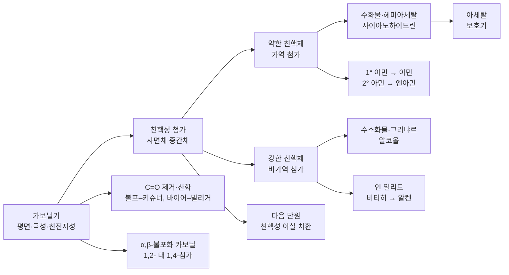

# 유기화학 10. 알데하이드와 케톤 — 카보닐 탄소에 무엇이 더해지고, 무엇이 남는가
<!-- prev: ochem-9, ochem-8, ochem-6, ochem-1 -->
<!-- next: ochem-11 -->

> [!NOTE]
> **이 단원의 범위**
> - 알데하이드·케톤의 명명법, 카보닐기의 구조(극성, 결합 길이, 분광 특징)와 반응성, 물리적 성질
> - 알데하이드·케톤의 합성(알코올의 산화, 오존 분해, 알카인의 수화, 프리델–크래프츠 아실화, 카복실산 유도체에서)
> - 친핵성 첨가의 일반 메커니즘: 염기성(음이온 친핵체) 조건과 산 촉매 조건, 반응성 순서(알데하이드 > 케톤)의 입체·전자적 근거, 가역 첨가와 비가역 첨가
> - 가역 첨가의 평형: 수화물, 헤미아세탈과 아세탈(산 촉매 7단계 메커니즘, 고리형 아세탈), 아세탈 보호기, 사이아노하이드린
> - 질소 친핵체: 1° 아민 → 이민, 2° 아민 → 엔아민, 옥심·하이드라존, 이민 생성의 pH 의존성
> - 수소화물 환원과 그리냐르 반응(카보닐 쪽에서 본 메커니즘과 선택성), 비티히 반응(일리드, 옥사포스페테인, E/Z)
> - 볼프–키슈너·클레멘젠 환원, 바이어–빌리거 산화(이동 우선순위와 입체 유지)
> - α,β-불포화 카보닐 화합물의 1,2-첨가와 1,4-첨가(콘주게이션 첨가): 그리냐르 시약 대 유기 구리 시약

**학습 목표**

1. 알데하이드·케톤을 IUPAC 규칙으로 이름 짓고, 카보닐기의 극성과 공명으로 끓는점·용해도·IR·NMR 특징과 친전자성을 설명할 수 있다.
2. 친핵성 첨가의 메커니즘을 염기성 조건과 산 촉매 조건으로 나누어 굽은 화살표로 쓰고, 알데하이드 > 케톤의 반응성 순서와 첨가가 가역인지 비가역인지를 친핵체의 염기도로 판단할 수 있다.
3. 수화물·헤미아세탈·사이아노하이드린의 평형 상수로 평형 조성을 계산하고, 아세탈 생성의 7단계 메커니즘을 쓰며, 아세탈을 보호기로 쓰는 합성 경로를 설계할 수 있다.
4. 1° 아민과 2° 아민이 각각 이민과 엔아민을 주는 까닭을 메커니즘으로 설명하고, 이민 생성 속도가 pH 4~5에서 가장 빠른 까닭을 분율식으로 정량화할 수 있다.
5. 비티히 반응, 볼프–키슈너·클레멘젠 환원, 바이어–빌리거 산화의 생성물(이중 결합의 위치와 E/Z, 산소가 끼어드는 자리와 입체)을 예측하고 조건에 맞는 시약을 고를 수 있다.
6. α,β-불포화 카보닐 화합물에서 1,2-첨가와 1,4-첨가를 구별하고, 시약(그리냐르·유기 리튬 대 길먼 시약·약한 친핵체)에 따른 주생성물을 예측할 수 있다.

**이 단원의 학습 사다리**

| 단계 | 무엇을 하나? |
|---|---|
| STEP 1. 이전 학습 다시 보기 | 카보닐의 공명과 $\mathrm{p}K_\mathrm{a}$, 알코올의 산화와 환원, 그리냐르 시약, 1,2-/1,4-첨가, 프리델–크래프츠 아실화 |
| STEP 2. 기초 다지기 | 분율식으로 pH와 양성자화 상태 읽기, 평형 상수로 조성 계산하기, 친핵체의 염기도와 가역성, 산화 수준 세기 |
| STEP 3. 핵심 개념 | 구조와 이름 → 합성 → 친핵성 첨가의 일반론 → 수화물 → 헤미아세탈·아세탈 → 보호기 → 사이아노하이드린 → 이민 → 엔아민·옥심 → 수소화물·그리냐르 → 비티히 → 볼프–키슈너·클레멘젠 → 바이어–빌리거 → 콘주게이션 첨가 |
| STEP 4. 오개념 바로잡기 | "산 촉매가 평형을 밀어 준다", "아세탈은 산에도 안정하다", "이민은 산이 셀수록 빨리 생긴다" 같은 착각 |
| STEP 5. 대학원·연구로 | 펠킨–안 모형으로 본 입체 선택적 첨가, 이미늄·엔아민 유기 촉매 |
| STEP 6. 생활·산업·진로 | 시각의 레티날 슈프 염기, 당화 헤모글로빈, 아세톤 사이아노하이드린 공정, 락톤과 고분자 |

---

## 🗺️ 단원 들어가기

아세톤을 산소 동위 원소 $^{18}\mathrm{O}$로 표지한 물 $\mathrm{H_2{}^{18}O}$에 녹여 두면, 몇 분 지나지 않아 아세톤의 카보닐 산소가 $^{18}\mathrm{O}$로 바뀐다. 그런데 용액을 아무리 분석해도 물이 첨가된 생성물(프로페인-2,2-다이올)은 0.1 %쯤밖에 보이지 않는다. 반응이 일어나지 않는 것처럼 보이는데 산소는 바뀌었다. 물은 아세톤에 **끊임없이 붙었다 떨어지고** 있었고, 평형이 출발 물질 쪽에 있을 뿐이었다. 같은 실험을 폼알데하이드로 하면 이번에는 거의 전부가 물이 첨가된 형태(메테인다이올)로 존재한다. 같은 C=O인데 왜 이렇게 다른가? 또 메탄올에 산을 한 방울 떨어뜨리면 같은 아세톤이 아세탈이 되는데, 거기에 염기를 넣으면 꿈쩍도 하지 않던 아세탈이 묽은 산 수용액에서는 다시 아세톤으로 돌아간다.

「알코올·에터·에폭사이드와 황 화합물」에서 우리는 카보닐 화합물에 수소화 이온과 그리냐르 시약을 더해 알코올을 만들었다. 그때는 카보닐을 '알코올의 원료'로만 보았다. 이 단원에서는 시선을 카보닐 쪽으로 옮긴다. 카보닐 탄소는 **평면이고, 부분 양전하를 띠며, 산소가 전자를 받아 줄 준비가 되어 있는** 친전자체이다. 이 한 가지 성질에서 이 단원의 거의 모든 반응이 나온다. 무엇이 다르냐 하면 **친핵체**가 다르다. 친핵체가 물·알코올·아민처럼 약하면 첨가가 가역이 되어 평형을 다뤄야 하고, 산 촉매가 필요하며, 떨어져 나갈 수 있는 원자단이 있으면 첨가 뒤에 물이 빠지는 단계가 이어진다(아세탈, 이민, 엔아민). 친핵체가 수소화 이온·탄소 음이온처럼 강하면 첨가는 비가역이고 알코올에서 멈춘다. 인 일리드는 첨가 뒤 산소를 통째로 떼어 가 알켄을 남긴다(비티히 반응).

이 단원을 마치면 "이 카보닐 화합물에 이 시약을 이 조건에서 넣으면 무엇이 생기고, 그것이 다시 출발 물질로 돌아갈 수 있는가?"에 메커니즘으로 답할 수 있다. 다음 단원 「카복실산과 그 유도체」의 친핵성 아실 치환은 이 단원의 사면체 중간체에서 이탈기가 떨어지는 경우이고, 그다음 「카보닐 α 자리의 반응과 축합 반응」은 카보닐이 이번에는 **친핵체(엔올레이트)** 를 만드는 쪽으로 쓰인다.

---

## STEP 1. 🔙 이전 학습 다시 보기

### 연계 개념표

| 이전 단원 | 그때 배운 것 | 이 단원에서 확장되는 것 |
|---|---|---|
| 유기화학 「구조와 결합, 산과 염기」 '공명', '$\mathrm{p}K_\mathrm{a}$ 표', '굽은 화살표' | C=O의 극성과 $\mathrm{C^+{-}O^-}$ 공명 기여, 양성자화된 케톤의 $\mathrm{p}K_\mathrm{a}$ 약 −7, 화살표의 기본 무늬 | 공명으로 카보닐의 **친전자성**과 산 촉매 효과를 설명, 친핵체 짝산의 $\mathrm{p}K_\mathrm{a}$로 **가역성**을 판단 |
| 유기화학 「알코올·에터·에폭사이드와 황 화합물」 '수소화물 환원', '그리냐르 시약', '산화', '보호기' | $\mathrm{NaBH_4}$·$\mathrm{LiAlH_4}$ 환원, RMgX의 첨가로 1°·2°·3° 알코올, PCC·스원 산화, 수화물을 거친 과산화, 실릴 에터와 THP 보호기 | 같은 반응을 **카보닐 쪽 메커니즘**(사면체 중간체, 비가역성, 화학 선택성)으로 되짚고, 알코올 대신 **카보닐을 보호**하는 아세탈 |
| 유기화학 「알켄과 알카인」 '오존 분해', '알카인의 수화와 토토머화' | 알켄 → 카보닐 화합물 두 개, 말단 알카인 → 메틸 케톤(마르코브니코프) 또는 알데하이드(수소화 붕소화) | 알데하이드·케톤의 **합성법** 목록에 넣기 |
| 유기화학 「콘주게이션계와 방향족성」 '1,2-첨가와 1,4-첨가' | 콘주게이션 다이엔에 HBr이 1,2- 또는 1,4-로 첨가, 속도론적·열역학적 지배 | 같은 생각을 α,β-불포화 카보닐의 **친핵성** 첨가에 적용(그리냐르 1,2, 길먼 1,4) |
| 유기화학 「방향족 화합물의 반응」 '프리델–크래프츠 아실화' | 아실륨 이온의 친전자성 방향족 치환으로 아릴 케톤 합성 | 아릴 케톤을 볼프–키슈너·클레멘젠 환원으로 **알킬 벤젠**으로 바꾸기(자리 옮김 없는 알킬화) |
| 일반화학 「화학 평형」·「화학 열역학」 | $K$와 조성, 르샤틀리에 원리, $\Delta G^\circ = -RT\ln K$ | 첨가 평형의 정량(수화 상수), 물을 빼서 아세탈 평형을 미는 **딘–스타크** 장치 |

### 준비 운동 (사전 진단)

**Q1.** 아세톤의 C=O에 대해 두 공명 구조를 쓰고, 어느 원자가 친핵체에 공격받는지 설명하시오.

**Q2.** 수산화 이온(짝산 $\mathrm{H_2O}$, $\mathrm{p}K_\mathrm{a}$ 15.7)과 수소화 이온(짝산 $\mathrm{H_2}$, $\mathrm{p}K_\mathrm{a}$ 35) 가운데 이탈기로 떨어져 나가기 쉬운 것은 어느 것인가?

**Q3.** 사이클로헥산올을 PCC로 산화한 생성물과, 그 생성물을 $\mathrm{CH_3MgBr}$로 처리한 뒤 산으로 가공한 생성물을 쓰시오.

**Q4.** 뷰타-1,3-다이엔에 HBr이 첨가될 때 '1,4-첨가'란 어느 탄소에 H와 Br이 붙는 것인가?

정답 및 해설

**Q1.** $\mathrm{(CH_3)_2C{=}O \leftrightarrow (CH_3)_2C^+{-}O^-}$. 오른쪽 구조의 기여 때문에 탄소가 부분 양전하($\delta+$)를 띠므로 친핵체는 **카보닐 탄소**를 공격한다. 산소는 π 전자쌍을 받아 알콕사이드가 된다.

**Q2.** 수산화 이온. 짝산의 $\mathrm{p}K_\mathrm{a}$가 작을수록(약한 염기일수록) 좋은 이탈기이다. 수소화 이온은 수산화 이온보다 약 $10^{19}$배 강한 염기여서 사실상 떨어져 나가지 않는다. 이 차이가 ③에서 '가역 첨가'와 '비가역 첨가'를 가른다.

**Q3.** 사이클로헥산온 → 1-메틸사이클로헥산-1-올(「알코올·에터·에폭사이드와 황 화합물」 ④).

**Q4.** C1에 H, C4에 Br이 붙고 이중 결합은 C2=C3으로 옮겨 간다(1-브로모뷰트-2-엔). ⑭에서 α,β-불포화 카보닐의 '1,4'는 카보닐 산소를 1번으로 센다는 점이 다르다.

---

## STEP 2. 🧱 기초 다지기

### 디딤돌 1. 분율식 — pH가 정하는 양성자화 상태

「구조와 결합, 산과 염기」에서 쓴 헨더슨–하셀바흐 식을 분율로 바꾸면, 산 HA가 양성자가 떨어진 형태로 있는 분율은

$$
f_{\mathrm{A^-}} = \frac{1}{1 + 10^{\,\mathrm{p}K_\mathrm{a} - \mathrm{pH}}}
$$

이다. 이 단원에서 이 식은 두 번 쓰인다. 하나는 **아민**이다. 아민 친핵체는 비공유 전자쌍이 있어야 공격하는데, 산성 용액에서는 암모늄 이온($\mathrm{RNH_3^+}$, $\mathrm{p}K_\mathrm{a}$ 약 10.6)이 되어 전자쌍을 잃는다. 다른 하나는 **카보닐 자체**이다. 양성자화된 케톤의 $\mathrm{p}K_\mathrm{a}$는 약 −7이므로, 묽은 산(pH 1~5)에서 양성자화된 카보닐은 $10^{-8}$ 이하로 극히 적다. 그래도 산 촉매가 듣는 것은, 그 적은 양이 중성 카보닐보다 엄청나게 반응성이 크기 때문이다.

| pH | 메틸아민의 자유 아민 분율 ($\mathrm{p}K_\mathrm{aH}$ 10.6) | 양성자화된 케톤의 분율 ($\mathrm{p}K_\mathrm{a}$ −7) |
|---|---|---|
| 1 | $2.5\times10^{-10}$ | $1\times10^{-8}$ |
| 3 | $2.5\times10^{-8}$ | $1\times10^{-10}$ |
| 4.5 | $7.9\times10^{-7}$ | $3\times10^{-12}$ |
| 7 | $2.5\times10^{-4}$ | $1\times10^{-14}$ |
| 9 | $2.5\times10^{-2}$ | $1\times10^{-16}$ |

pH를 낮추면 카보닐은 활성화되지만 친핵체가 사라진다. 이 **줄다리기**가 ⑧에서 이민 생성 속도가 중간 pH에서 가장 빠른 까닭이다.

#### 예제 1 — 하이드록실아민은 몇 % 자유 상태인가

하이드록실아민($\mathrm{NH_2OH}$)의 짝산 $\mathrm{NH_3OH^+}$의 $\mathrm{p}K_\mathrm{a}$는 약 6.0이다. pH 4.5 아세트산 완충 용액에서 자유 하이드록실아민의 분율을 구하고, 메틸아민(10.6)과 비교하시오.

**풀이**
식 세우기: $f = 1/(1 + 10^{\,\mathrm{p}K_\mathrm{a} - \mathrm{pH}})$.
대입: 하이드록실아민 $f = 1/(1 + 10^{1.5}) = 1/32.6 = 0.031$ (약 3 %). 메틸아민 $f = 1/(1 + 10^{6.1}) = 7.9\times10^{-7}$.
**의미** 같은 pH에서 하이드록실아민은 메틸아민보다 약 $4\times10^4$배 많이 '쓸 수 있는' 상태로 있다. 염기성이 약한 질소 친핵체(하이드록실아민, 하이드라진 유도체)가 약산성 조건에서 카보닐과 잘 반응하는 까닭이다(⑨).

### 디딤돌 2. 평형 상수로 조성 계산하기 — 무엇을 넣고 무엇을 뺄 것인가

카보닐 첨가 가운데 많은 것이 가역이다. 이때 생성물이 얼마나 생기는지는 평형 상수가 정한다. 물이 용매인 반응에서는 물의 활동도를 1로 두어 $K$에 포함시킨다.

$$
\mathrm{R_2C{=}O + H_2O \rightleftharpoons R_2C(OH)_2}, \qquad K_\text{수화} = \frac{[\mathrm{R_2C(OH)_2}]}{[\mathrm{R_2C{=}O}]}, \qquad \text{수화물 분율} = \frac{K}{1+K}
$$

반응물이 두 가지인 첨가($\mathrm{R_2C{=}O + HCN}$)는 $K$가 $\mathrm{M^{-1}}$ 단위를 가지므로 조성이 **농도에 따라** 달라진다. 반응이 물을 내놓으면($\mathrm{R_2C{=}O + 2ROH \rightleftharpoons R_2C(OR)_2 + H_2O}$) 물을 계속 빼내어 $Q < K$를 유지하면 반응이 끝까지 간다. 일반화학 「화학 평형」의 르샤틀리에 원리를 실험 장치(딘–스타크 트랩, 분자체)로 구현하는 것이다.

#### 예제 2 — 사이아노하이드린 평형의 농도 의존

아세톤 + HCN ⇌ 아세톤 사이아노하이드린의 평형 상수를 약 $30\ \mathrm{M^{-1}}$이라 하자. 아세톤이 HCN보다 훨씬 적게 들어 있어 HCN 농도가 거의 변하지 않는다고 보고, $[\mathrm{HCN}] = 0.10\ \mathrm{M}$과 $1.0\ \mathrm{M}$일 때 사이아노하이드린으로 바뀐 아세톤의 분율을 구하시오.

**풀이**
식 세우기: $\dfrac{[\text{사이아노하이드린}]}{[\text{아세톤}]} = K[\mathrm{HCN}]$, 분율 $= \dfrac{K[\mathrm{HCN}]}{1 + K[\mathrm{HCN}]}$.
대입: 0.10 M → $3.0/4.0 = 0.75$, 1.0 M → $30/31 = 0.97$.
**의미** $K$가 1보다 훨씬 큰 것 같아도 단위가 $\mathrm{M^{-1}}$인 평형은 묽은 조건에서 크게 되돌아간다. 같은 까닭으로 사슬형 헤미아세탈은 알코올을 용매로 쓸 때만 눈에 띄게 생긴다(⑤).

### 디딤돌 3. 친핵체의 염기도와 가역성 — 짝산의 $\mathrm{p}K_\mathrm{a}$ 하나로 판단하기

친핵체가 카보닐에 첨가해 사면체 알콕사이드가 되면, 그 알콕사이드는 두 길 중 하나를 간다. 양성자를 받아 생성물이 되거나, O의 전자쌍이 C=O를 되살리며 방금 붙은 친핵체를 **이탈기로** 밀어낸다. 친핵체가 좋은 이탈기일수록, 즉 **약한 염기**일수록 되돌아가기 쉽다.

| 친핵체 | 짝산의 $\mathrm{p}K_\mathrm{a}$ (약) | 알콕사이드($\mathrm{p}K_\mathrm{a}$ 약 16)와 비교 | 첨가는 |
|---|---|---|---|
| $\mathrm{H_2O}$, $\mathrm{ROH}$ (중성) | −1.7, −2 (짝산 $\mathrm{H_3O^+}$, $\mathrm{ROH_2^+}$) | 훨씬 좋은 이탈기 | 가역 |
| $\mathrm{CN^-}$ | 9.2 (HCN) | 더 좋은 이탈기 | 가역 |
| $\mathrm{RNH_2}$, $\mathrm{R_2NH}$ (중성) | 10~11 (암모늄) | 좋은 이탈기 | 가역 |
| $\mathrm{OH^-}$, $\mathrm{RO^-}$ | 15.7, 16 | 비슷 | 가역 |
| $\mathrm{H^-}$ ($\mathrm{NaBH_4}$, $\mathrm{LiAlH_4}$) | 35 ($\mathrm{H_2}$) | 매우 나쁜 이탈기 | **비가역** |
| $\mathrm{R^-}$ (RMgX, RLi) | 약 50 (알케인) | 매우 나쁜 이탈기 | **비가역** |

> [!TIP]
> 💡 **요령** — "짝산의 $\mathrm{p}K_\mathrm{a}$가 알콕사이드의 짝산(약 16)보다 **작으면 가역, 훨씬 크면 비가역**." 가역 첨가는 평형(⑤~⑨)을, 비가역 첨가는 속도와 선택성(⑩~⑪)을 다룬다고 기억하면 단원의 지도가 둘로 나뉜다.

### 디딤돌 4. 산화 수준 세기 — 무엇이 환원이고 무엇이 산화인가

「알코올·에터·에폭사이드와 황 화합물」 디딤돌 2의 방법으로 카보닐 탄소의 산화수를 센다(C에 대해 O 결합 하나 +1, H 하나 −1, C는 0).

| 변환 | 반응 탄소의 산화수 | 분류 |
|---|---|---|
| 케톤 $\mathrm{R_2C{=}O}$ → 알코올 $\mathrm{R_2CHOH}$ (수소화물) | +2 → 0 | 환원 |
| 케톤 → 메틸렌 $\mathrm{R_2CH_2}$ (볼프–키슈너, 클레멘젠) | +2 → −2 | 4전자 환원 |
| 케톤 → 수화물·아세탈·이민 | +2 → +2 | 산화·환원 아님 |
| 케톤 $\mathrm{RCOR'}$ → 에스터 $\mathrm{RCOOR'}$ (바이어–빌리거) | 카보닐 C: +2 → +3 | 산화(산소 원자 하나 삽입) |
| 알데하이드 $\mathrm{RCHO}$ → 카복실산 $\mathrm{RCOOH}$ | +1 → +3 | 산화 |

수화물·아세탈·이민은 산화 수준이 카보닐과 같으므로, 산화·환원제 없이 물만 더하거나 빼서 서로 오간다. 이 사실이 ⑤~⑨의 반응들이 모두 **가수 분해로 되돌릴 수 있는** 까닭이다.

---

## STEP 3. 📘 핵심 개념

### ① 카보닐기의 구조와 성질, 알데하이드·케톤의 명명법

#### 카보닐기 — 평면이고, 극성이며, 한쪽이 비어 있다

**카보닐기**(carbonyl group) C=O의 탄소는 $sp^2$ 혼성이다. 세 개의 σ 결합이 한 평면에서 약 120°로 벌어지고, 탄소와 산소의 p 오비탈이 겹쳐 π 결합을 만든다. 산소에는 비공유 전자쌍이 둘 있다. 탄소에 H가 하나 이상 붙은 것($\mathrm{RCHO}$)이 **알데하이드**(aldehyde), 탄소 원자단 둘이 붙은 것($\mathrm{RCOR'}$)이 **케톤**(ketone)이다.

| 성질 | 값 (약) | 무엇을 뜻하나 |
|---|---|---|
| C=O 결합 길이 | 121~122 pm (C=C는 134 pm) | 산소가 작고 결합이 강하다 |
| C=O 결합 에너지 | 740~750 kJ/mol (C=C 약 610) | C=O는 C=C보다 훨씬 강하지만, π 결합은 극성이 커서 **불균일하게** 잘 깨진다 |
| 쌍극자 모멘트 | 폼알데하이드 2.3 D, 아세톤 2.9 D | 탄소 $\delta+$, 산소 $\delta-$ |
| 결합각 | 약 120° | 친핵체가 평면의 위·아래 어느 쪽에서든 다가갈 수 있다 |

카보닐의 반응성은 두 공명 구조로 요약된다. $\mathrm{R_2C{=}O \leftrightarrow R_2C^+{-}O^-}$. 오른쪽 구조의 기여 때문에 탄소는 친전자체이고 산소는 약한 루이스 염기이다. 분자 오비탈로 말하면 비어 있는 가장 낮은 오비탈(LUMO)은 C=O의 **π\* 오비탈**이며, 이 오비탈은 산소보다 **탄소 쪽 계수가 크다.** 친핵체의 HOMO가 이 π\*에 전자를 넣으면 C=O π 결합이 약해지고 새 C–Nu 결합이 생긴다. 친핵체는 C=O 축에 수직으로 오지 않고 산소 반대쪽으로 약간 기울어진 약 107°의 각도로 다가간다(**뷔르기–두니츠 궤적**, Bürgi–Dunitz trajectory). π\* 오비탈과 최대로 겹치면서 산소 쪽 전자 밀도의 반발을 피하는 방향이다.

<!-- 그림 요청: 카보닐기의 구조 세 칸. (가) 아세톤(SMILES CC(C)=O)의 공-막대 모형, C=O 길이 '121 pm', C–C–C 각 '약 117°', O에 비공유 전자쌍 두 개(sp2 방향), 탄소 'δ+'·산소 'δ−', 쌍극자 화살표(C → O 쪽, +끝 표시 있는 화살표) '2.9 D'. (나) 공명 구조 R2C=O ↔ R2C⁺–O⁻ 와 굽은 화살표 1개(C=O π 결합 가운데 → O). (다) π* 오비탈 그림: C와 O의 p 엽(탄소 쪽 엽을 더 크게, 위상을 두 색으로, C–O 사이에 마디), 친핵체 Nu⁻가 산소 반대쪽으로 기울어 약 107°로 탄소의 큰 엽에 다가가는 점선 화살표와 '뷔르기–두니츠 각 약 107°' 각도 표시. -->

#### 물리적 성질

카보닐 화합물은 극성이 커서 같은 크기의 알케인·에터보다 끓는점이 높지만, O–H가 없으므로 서로 수소 결합을 하지 못해 알코올보다는 낮다. 반면 물의 H와는 수소 결합을 받을 수 있어 작은 것은 물에 잘 녹는다(아세톤은 물과 완전히 섞인다).

| 화합물 (몰질량 약 72~74 g/mol) | 축약 구조식 | 끓는점 (℃, 약) | 분자 사이의 주된 힘 |
|---|---|---|---|
| 펜테인 | $\mathrm{CH_3(CH_2)_3CH_3}$ | 36 | 분산력 |
| 다이에틸 에터 | $\mathrm{CH_3CH_2OCH_2CH_3}$ | 35 | 분산력 + 약한 쌍극자 |
| 뷰탄알 | $\mathrm{CH_3CH_2CH_2CHO}$ | 75 | 쌍극자–쌍극자 |
| 뷰탄-2-온 | $\mathrm{CH_3CH_2COCH_3}$ | 80 | 쌍극자–쌍극자 |
| 뷰탄-1-올 | $\mathrm{CH_3(CH_2)_3OH}$ | 117 | 수소 결합 |

#### 분광학적 특징 (「구조 결정: 질량 분석법과 분광법」 되짚기)

| 방법 | 알데하이드 | 케톤 |
|---|---|---|
| IR C=O 신축 | 1725~1730 $\mathrm{cm^{-1}}$ (콘주게이션되면 약 1700) | 1715 $\mathrm{cm^{-1}}$ (콘주게이션되면 1675~1690) |
| IR C–H | 알데하이드 C–H 약 2720·2820 (약함, 두 개) | 없음 |
| $^1\mathrm{H}$ NMR | CHO 양성자 9~10 ppm (이웃 CH와 작은 짝지음) | α-H 2.0~2.5 ppm |
| $^{13}\mathrm{C}$ NMR | C=O 190~205 ppm | C=O 205~220 ppm |
| 질량 분석 | α 절단, 맥라퍼티 자리 옮김 | α 절단(아실륨 이온), 메틸 케톤은 m/z 43 |

#### 명명법

| 규칙 | 알데하이드 | 케톤 |
|---|---|---|
| 접미사 | 알케인 이름의 끝 '-에인'을 **'-알'**로 (CHO 탄소가 C1) | '-에인'을 **'-온'**으로, C=O 탄소에 가장 작은 번호 |
| 고리에 붙은 경우 | 고리 이름 + **'-카브알데하이드'** (CHO 탄소는 번호에 넣지 않는다) | 고리 이름 + '-온' (C=O 탄소가 C1) |
| 접두사(더 높은 작용기가 있을 때) | '폼일-' (또는 '옥소-'로 사슬에 포함) | **'옥소-'** |
| 관용명 | 폼알데하이드 $\mathrm{HCHO}$, 아세트알데하이드 $\mathrm{CH_3CHO}$, 벤즈알데하이드 $\mathrm{C_6H_5CHO}$ | 아세톤 $\mathrm{(CH_3)_2CO}$, 아세토페논 $\mathrm{C_6H_5COCH_3}$, 벤조페논 $\mathrm{(C_6H_5)_2CO}$ |

작용기의 우선순위는 카복실산 > 에스터 > 아마이드 > 나이트릴 > **알데하이드 > 케톤** > 알코올 > 아민 순이다. 알데하이드와 케톤이 함께 있으면 알데하이드가 이름의 끝을 차지하고 케톤은 '옥소-'가 된다.

#### 예제 3 — 이름 짓기

다음 화합물의 IUPAC 이름을 쓰시오.
(1) $\mathrm{(CH_3)_2CHCH_2CHO}$ (2) $\mathrm{CH_3COCH_2CH_2CHO}$ (3) $\mathrm{(CH_3)_2C(OH)CH_2COCH_3}$ (4) $\mathrm{CH_3CH{=}CHCOCH_3}$ (트랜스) (5) 사이클로헥세인 고리에 CHO가 붙은 것

**풀이**
(1) 3-메틸뷰탄알 — CHO 탄소가 C1이므로 메틸은 C3에 있다.
(2) 4-옥소펜탄알 — 알데하이드가 우선이므로 CHO가 C1, 케톤은 C4의 '옥소'.
(3) 4-하이드록시-4-메틸펜탄-2-온 — 케톤이 알코올보다 우선이므로 C=O에 작은 번호(C2), OH는 접두사(SMILES `CC(=O)CC(C)(C)O`).
(4) (E)-펜트-3-엔-2-온 — C=O에 작은 번호를 주고, 이중 결합은 C3=C4(SMILES `C/C=C/C(C)=O`).
(5) 사이클로헥세인카브알데하이드(SMILES `O=CC1CCCCC1`).
**의미** 번호는 언제나 '이름의 끝을 차지하는 작용기'에 가장 작은 수를 주는 데서 시작한다. (2)에서 케톤 쪽에서 세면 펜탄-2-온이 되지만, 알데하이드가 있으므로 그럴 수 없다.

#### ✔ 바로 확인

1. 빈칸: 카보닐 탄소의 혼성은 (    )이고, C=O의 LUMO는 (    ) 오비탈이다.
2. (O/X) 뷰탄알은 뷰탄-1-올보다 끓는점이 높다.
3. $\mathrm{C_6H_5COCH_2CH_3}$의 IUPAC 이름은?
4. IR에서 1730 $\mathrm{cm^{-1}}$의 강한 띠와 2720 $\mathrm{cm^{-1}}$의 약한 띠가 함께 보이면 어떤 작용기인가?

정답

1. $sp^2$, π\* — 탄소 쪽 계수가 커서 친핵체가 탄소를 공격한다.
2. X — 카보닐 화합물끼리는 수소 결합을 하지 못한다(75 ℃ 대 117 ℃).
3. 1-페닐프로판-1-온(관용명 프로피오페논)
4. 알데하이드 — 2720·2820의 알데하이드 C–H 신축이 케톤과 가른다.

### ② 알데하이드와 케톤의 합성

앞 단원들에서 이미 여러 반응이 알데하이드·케톤을 만들었다. 여기서는 그것들을 '합성법 목록'으로 모으고, 카복실산 유도체에서 출발하는 방법을 덧붙인다(유도체 쪽의 메커니즘은 다음 단원 「카복실산과 그 유도체」에서 다룬다).

| 출발 물질 | 시약 | 생성물 | 단원 |
|---|---|---|---|
| 1° 알코올 | PCC 또는 데스–마틴 퍼아이오디네인, $\mathrm{CH_2Cl_2}$, 또는 스원 산화 | 알데하이드(물이 없어 멈춘다) | 「알코올·에터·에폭사이드와 황 화합물」 |
| 2° 알코올 | 위 시약 또는 존스 시약($\mathrm{CrO_3}$, $\mathrm{H_2SO_4}$) | 케톤 | 같은 단원 |
| 알켄 | ① $\mathrm{O_3}$ ② $\mathrm{(CH_3)_2S}$ 또는 Zn, $\mathrm{H_2O}$ | 알데하이드·케톤(C=C가 C=O 두 개로) | 「알켄과 알카인」 |
| 말단 알카인 | $\mathrm{H_2O}$, $\mathrm{H_2SO_4}$, $\mathrm{HgSO_4}$ | 메틸 케톤(마르코브니코프, 엔올의 토토머화) | 같은 단원 |
| 말단 알카인 | ① 부피 큰 보레인(9-BBN 등) ② $\mathrm{H_2O_2}$, NaOH | 알데하이드(반마르코브니코프) | 같은 단원 |
| 방향족 고리 | $\mathrm{RCOCl}$, $\mathrm{AlCl_3}$ | 아릴 케톤(프리델–크래프츠 아실화, 자리 옮김 없음, 한 번만 치환) | 「방향족 화합물의 반응」 |
| 에스터 | DIBAL-H(수소화 다이아이소뷰틸알루미늄) 1 당량, −78 ℃, 이어서 $\mathrm{H_2O}$ | 알데하이드 | 다음 단원 |
| 산 염화물 | $\mathrm{LiAlH(O{}^tBu)_3}$, −78 ℃ | 알데하이드 | 다음 단원 |
| 산 염화물 | 길먼 시약 $\mathrm{R'_2CuLi}$ | 케톤 $\mathrm{RCOR'}$ | 다음 단원, ⑭ |
| 나이트릴 | ① $\mathrm{R'MgBr}$ ② $\mathrm{H_3O^+}$ | 케톤 $\mathrm{RCOR'}$ (이민 음이온을 거쳐 가수 분해, ⑧) | 다음 단원 |

에스터와 산 염화물을 **알데하이드에서 멈추게** 하는 요령은 반응성을 낮춘 수소화물 시약과 낮은 온도이다. $\mathrm{LiAlH_4}$를 쓰면 처음 생긴 알데하이드가 출발 물질보다 더 빨리 환원되어 1° 알코올까지 간다. DIBAL-H는 −78 ℃에서 에스터에 수소화 이온 하나를 준 사면체 중간체가 알루미늄에 붙들린 채 안정하게 머물다가, 물로 가공할 때 비로소 무너져 알데하이드를 내놓는다. 나이트릴에 그리냐르 시약이 첨가하면 음전하를 띤 이민 음이온($\mathrm{R(R')C{=}N^-}$)이 생기는데, 음전하를 띤 이 중간체에는 두 번째 그리냐르 시약이 첨가하지 않으므로 가수 분해 뒤 케톤에서 멈춘다.

#### 예제 4 — 같은 케톤에 이르는 세 길

1-페닐프로판-1-온($\mathrm{C_6H_5COCH_2CH_3}$, SMILES `CCC(=O)c1ccccc1`)을 (1) 벤젠에서, (2) 벤즈알데하이드에서, (3) 벤조나이트릴에서 만드는 경로를 쓰시오.

**풀이**
(1) 벤젠 + 염화 프로파노일 $\mathrm{CH_3CH_2COCl}$, $\mathrm{AlCl_3}$ → 프리델–크래프츠 아실화. 아실륨 이온은 자리 옮김을 하지 않는다.
(2) 벤즈알데하이드 + $\mathrm{CH_3CH_2MgBr}$, 이어서 $\mathrm{NH_4Cl}$ 수용액 가공 → 1-페닐프로판-1-올(2° 알코올, 라세미) → PCC, $\mathrm{CH_2Cl_2}$ → 1-페닐프로판-1-온.
(3) 벤조나이트릴 $\mathrm{C_6H_5CN}$ + $\mathrm{CH_3CH_2MgBr}$ → 이민 음이온 → $\mathrm{H_3O^+}$ → 이민 → 케톤(이민의 가수 분해, ⑧).
**의미** 같은 C(=O)–C 결합을 (1)은 방향족 친전자성 치환으로, (2)는 C–C 결합을 먼저 만든 뒤 산화로, (3)은 나이트릴 탄소를 카보닐 탄소의 '가면'으로 써서 만든다. 출발 물질의 값, 고리에 다른 치환기가 있는지(프리델–크래프츠는 강한 비활성화기가 있으면 안 된다)로 고른다.

#### ✔ 바로 확인

1. 1-메틸사이클로헥센을 ① $\mathrm{O_3}$ ② $\mathrm{(CH_3)_2S}$로 처리한 생성물의 이름은?
2. (O/X) 에스터를 $\mathrm{LiAlH_4}$로 처리하면 알데하이드에서 멈춘다.
3. 펜트-1-인을 $\mathrm{H_2SO_4}$, $\mathrm{HgSO_4}$ 수용액으로 처리한 생성물은?

정답

1. 6-옥소헵탄알 — 고리가 열려 메틸이 붙은 쪽은 케톤, 다른 쪽은 알데하이드가 된다(SMILES `CC(=O)CCCCC=O`).
2. X — 알데하이드가 에스터보다 빨리 환원되어 1° 알코올이 된다. DIBAL-H, −78 ℃가 필요하다.
3. 펜탄-2-온 — 마르코브니코프 수화로 엔올이 생기고 케톤으로 토토머화한다.

### ③ 친핵성 첨가의 일반 메커니즘 — 염기성 조건과 산 촉매 조건

#### 두 단계의 기본 무늬

카보닐에 대한 **친핵성 첨가**(nucleophilic addition)는 친핵체가 카보닐 탄소에 결합하고 C=O π 결합의 전자쌍이 산소로 밀려나 **사면체 중간체**(tetrahedral intermediate)가 생기는 반응이다. 탄소는 $sp^2$(평면, 120°)에서 $sp^3$(사면체, 109.5°)로 바뀐다. 산소가 양성자를 받으면 첨가 생성물이 된다. 무엇이 먼저 일어나느냐에 따라 두 가지 무늬가 있다.

**(가) 염기성(음이온 친핵체) 조건** — 강한 친핵체가 먼저 공격한다.

$$
\mathrm{Nu^- + R_2C{=}O \longrightarrow R_2C(Nu){-}O^- \xrightarrow{\ \mathrm{H{-}A}\ } R_2C(Nu){-}OH + A^-}
$$

1단계: Nu의 전자쌍 → 카보닐 C, C=O π 전자쌍 → O (알콕사이드 사면체 중간체). 2단계: O⁻의 전자쌍 → H–A의 H, H–A 결합 → A(양성자 전달). $\mathrm{OH^-}$, $\mathrm{CN^-}$, $\mathrm{RO^-}$ 같은 촉매량의 염기가 중성 친핵체(물, HCN, 알코올)를 음이온으로 바꾸어 첨가를 빠르게 하는 것이 **염기 촉매**이다. 2단계에서 $\mathrm{H{-}Nu}$가 양성자를 주면 $\mathrm{Nu^-}$가 다시 생기므로 염기는 소모되지 않는다.

**(나) 산 촉매 조건** — 카보닐이 먼저 활성화된다.

$$
\mathrm{R_2C{=}O + H{-}A \rightleftharpoons R_2C{=}OH^+ \xrightarrow{\ \mathrm{H{-}Nu}\ } R_2C(OH){-}NuH^+ \xrightarrow{\ -H^+\ } R_2C(OH){-}Nu}
$$

1단계: 카보닐 O의 비공유 전자쌍 → H–A의 H, H–A 결합 → A. 생긴 양성자화된 카보닐은 $\mathrm{R_2C{=}OH^+ \leftrightarrow R_2C^+{-}OH}$의 공명으로 탄소의 양전하가 훨씬 커진다. 2단계: 약한 중성 친핵체(물·알코올)의 전자쌍 → C, C=O π 전자쌍 → O(이제 중성 OH). 3단계: 양전하를 띤 친핵체 쪽 원자의 H를 염기(용매)가 떼어 간다. 산은 다시 생기므로 촉매이다.

<!-- 그림 요청: 친핵성 첨가의 두 메커니즘을 위아래 두 줄로 비교. (위, '염기성 조건') 아세트알데하이드(SMILES CC=O) + HO⁻ : HO⁻의 O 전자쌍 → 카보닐 C 화살표, C=O π 결합 → O 화살표 → 사면체 알콕사이드 중간체 CH3CH(OH)O⁻(C를 사면체로, 쐐기·점선) → O⁻ 전자쌍 → H2O의 H, H–OH 결합 → O 화살표 → 에테인-1,1-다이올(SMILES CC(O)O) + HO⁻('재생' 이름표). (아래, '산 촉매 조건') 같은 알데하이드 + H3O⁺ : 카보닐 O 전자쌍 → H3O⁺의 H, H–O 결합 → O 화살표 → 양성자화된 카보닐(공명 구조 CH3CH=OH⁺ ↔ CH3CH⁺–OH를 괄호 안에) → H2O의 O 전자쌍 → C, C=O π → O 화살표 → CH3CH(OH)(OH2⁺) → H2O가 OH2⁺의 H를 떼는 화살표 2개 → 수화물 + H3O⁺('재생'). 두 줄 오른쪽에 '활성화되는 것: 친핵체(위) / 카보닐(아래)' 메모. -->

| 비교 | 염기성 조건 | 산 촉매 조건 |
|---|---|---|
| 먼저 일어나는 일 | 친핵체가 공격 | 카보닐 O가 양성자화 |
| 활성화되는 쪽 | 친핵체(음이온으로) | 친전자체(양이온으로) |
| 알맞은 친핵체 | $\mathrm{OH^-}$, $\mathrm{CN^-}$, $\mathrm{RO^-}$, $\mathrm{H^-}$, $\mathrm{R^-}$ | $\mathrm{H_2O}$, ROH, 아민(약산성) |
| 중간체의 전하 | 음이온(알콕사이드) | 양이온(옥소늄) |
| 쓰이는 반응 | 사이아노하이드린, 염기 촉매 수화, 수소화물·그리냐르 | 아세탈, 산 촉매 수화, 이민·엔아민의 탈수 단계 |

> [!IMPORTANT]
> **촉매는 평형 상수를 바꾸지 않는다.** 산이든 염기든 정반응과 역반응을 같은 비율로 빠르게 할 뿐이다. 아세톤의 수화 평형(④)은 산을 넣어도 0.1 %이고, 산은 그 0.1 %에 **빨리 도달하게** 할 뿐이다. 평형을 밀려면 반응물을 과량 넣거나 생성물을 빼내야 한다(디딤돌 2).

#### 반응성의 순서 — 알데하이드 > 케톤

같은 친핵체에 대해 반응성(평형 상수와 속도 모두)은 대체로 **폼알데하이드 > 다른 알데하이드 > 케톤**이다. 두 가지 효과가 같은 방향으로 작용한다.

1. **입체 효과** — 첨가가 일어나면 120°의 평면 탄소가 109.5°의 사면체 탄소가 되어 치환기끼리 가까워진다. 알데하이드는 그중 하나가 작은 H이므로 사면체 생성물(과 그리로 가는 전이 상태)이 덜 붐빈다. 케톤에서는 두 탄소 원자단이 서로, 그리고 새로 온 친핵체와 부딪친다. 다이-tert-뷰틸 케톤처럼 부피 큰 케톤은 거의 첨가를 하지 않는다.
2. **전자 효과** — 알킬기는 초공액으로 카보닐 탄소의 부분 양전하에 전자를 준다(「유기 반응의 개관과 알킬 할라이드의 치환·제거 반응」의 탄소 양이온 안정화와 같은 원리). 알킬이 둘인 케톤은 카보닐이 **출발 상태에서 더 안정**하고 덜 친전자성이다. 반대로 $\mathrm{CF_3}$, $\mathrm{CCl_3}$ 같은 전자 끌기 원자단은 카보닐을 불안정하게 하고 친전자성을 키운다.

여기에 덧붙여, 아릴기가 붙으면 C=O가 고리와 **콘주게이션**되어 출발 상태가 안정해지므로(공명으로 고리의 π 전자가 카보닐 탄소 쪽으로 흘러든다) 벤즈알데하이드는 지방족 알데하이드보다 덜 반응성이다. 고리 무리가 큰 사이클로프로판온은 사면체로 바뀌면 각 무리(60°에 묶인 $sp^2$ 탄소)가 풀리므로 쉽게 첨가한다.

#### 입체화학 — 평면의 두 면

알데하이드 $\mathrm{RCHO}$나 비대칭 케톤 $\mathrm{RCOR'}$의 카보닐 탄소는 **프로카이랄**(「입체화학」 '프로카이랄성')이다. 친핵체가 평면의 위 면과 아래 면에서 공격하면 서로 거울상인 생성물이 생긴다. 카이랄한 환경(효소, 카이랄 촉매, 분자 안의 다른 입체 중심)이 없으면 두 면은 똑같이 공격받아 **라세미 혼합물**이 생긴다.

#### 예제 5 — 반응성 순서와 그 근거

다음 다섯 화합물을 물 첨가(수화)의 평형 상수가 큰 것부터 늘어놓고 각 자리의 근거를 쓰시오. 아세톤, 폼알데하이드, 벤즈알데하이드, 아세트알데하이드, 2,2,4,4-테트라메틸펜탄-3-온(다이-tert-뷰틸 케톤)

**풀이**
폼알데하이드(약 $2\times10^3$) > 아세트알데하이드(약 1) > 벤즈알데하이드(약 $10^{-2}$) > 아세톤(약 $1.4\times10^{-3}$) > 다이-tert-뷰틸 케톤(관찰되지 않을 만큼 작음).
- 폼알데하이드: 치환기가 H 둘로 입체 무리도 전자 주개 효과도 없다.
- 아세트알데하이드: 메틸 하나가 전자를 주고 약간 붐빈다.
- 벤즈알데하이드: 알데하이드이지만 페닐과의 콘주게이션이 출발 상태를 안정화해 아세트알데하이드보다 훨씬 작다.
- 아세톤: 알킬 둘(전자 + 입체).
- 다이-tert-뷰틸 케톤: 사면체가 되면 tert-뷰틸 두 개가 심하게 부딪친다.
**의미** 폼알데하이드와 아세톤만 비교해도 평형 상수가 약 $1.6\times10^6$배 다르며, 이는 25 ℃에서 $\Delta G^\circ$ 차이 약 35 kJ/mol에 해당한다($5.71\times\log(1.6\times10^6) \approx 35$). 치환기 몇 개의 입체·전자 효과가 C=O 하나의 평형을 이만큼 움직인다.

#### ✔ 바로 확인

1. (O/X) 산 촉매를 넣으면 아세톤의 수화 평형이 수화물 쪽으로 이동한다.
2. 빈칸: 염기 촉매는 (    )을/를, 산 촉매는 (    )을/를 활성화한다.
3. 프로판알과 프로판온 가운데 같은 친핵체에 더 빨리 첨가되는 것과 그 까닭 두 가지는?
4. 뷰탄-2-온에 $\mathrm{CN^-}$이 첨가된 생성물이 광학 활성이 없는 까닭은?

정답

1. X — 촉매는 $K$를 바꾸지 않고 평형에 도달하는 속도만 높인다.
2. 친핵체(음이온으로), 카보닐(양성자화로)
3. 프로판알 — H가 작아 사면체가 덜 붐비고(입체), 알킬기 하나만 전자를 주어 카보닐 탄소의 $\delta+$가 더 크다(전자).
4. 평면 카보닐의 두 면이 같은 확률로 공격받아 (R)·(S)가 같은 양 생긴다(라세미).

### ④ 물의 첨가 — 수화물과 가역 첨가의 평형

알데하이드·케톤은 물과 가역적으로 반응해 같은 탄소에 OH가 두 개 붙은 **수화물**(hydrate, 제미널 다이올 gem-diol)을 만든다. 반응은 묽은 산이나 염기로 촉매되며(③의 두 무늬), 수용액에서 수 초~수 분 안에 평형에 이른다.

$$
\mathrm{R_2C{=}O + H_2O \;\rightleftharpoons\; R_2C(OH)_2}
$$

| 카보닐 화합물 | $K_\text{수화}$ (25 ℃, 약) | 수화물 분율 | $\Delta G^\circ$ (kJ/mol) |
|---|---|---|---|
| 헥사플루오로아세톤 $\mathrm{(CF_3)_2CO}$ | $1\times10^{6}$ | 거의 100 % | 약 −35 |
| 폼알데하이드 $\mathrm{HCHO}$ | $2\times10^{3}$ | 99.96 % | −19 |
| 아세트알데하이드 $\mathrm{CH_3CHO}$ | 1.1 | 약 51 % | −0.1 |
| 아세톤 $\mathrm{(CH_3)_2CO}$ | $1.4\times10^{-3}$ | 0.14 % | +16 |

($\Delta G^\circ = -RT\ln K_\text{수화}$, 물의 활동도는 1로 둔다.) 폼알데하이드 수용액(포르말린)은 실제로는 거의 메테인다이올과 그 올리고머의 용액이다. 반대로 아세톤의 수화물은 따로 분리할 수 없다. 물을 증발시키면 평형이 다시 아세톤 쪽으로 가기 때문이다. 트라이클로로아세트알데하이드(클로랄)는 전자 끌기 원자단 $\mathrm{CCl_3}$ 때문에 수화 평형이 크게 오른쪽에 있어, 수화물(클로랄 수화물 $\mathrm{Cl_3CCH(OH)_2}$)이 안정한 고체로 분리된다.

#### 생성물이 보이지 않아도 반응은 일어난다 — 동위 원소 교환

아세톤을 $\mathrm{H_2{}^{18}O}$에 녹이면 수화물은 0.14 %밖에 생기지 않지만, 수화물의 두 OH는 **대칭적으로 같다.** 그중 원래의 $^{16}\mathrm{O}$H가 떨어져 나가면 $^{18}\mathrm{O}$가 카보닐 산소로 남는다. 첨가–제거가 빠르게 되풀이되면서 카보닐 산소가 용매의 산소와 섞인다. 이 실험은 수화가 '평형이 왼쪽에 있는' 반응이지 '일어나지 않는' 반응이 아님을 보여 준다.

<!-- 그림 요청: 아세톤의 18O 교환 메커니즘(산 촉매). 아세톤(SMILES CC(C)=O, 카보닐 O를 검정 '16O') → [H3O⁺] 양성자화 → H2¹⁸O(빨간 O)의 전자쌍 → 카보닐 C 화살표, C=O π → O 화살표 → 양성자 이동 → 수화물 (CH3)2C(¹⁶OH)(¹⁸OH)(검정 OH와 빨간 OH를 나란히, '두 OH는 대칭적으로 같다' 이름표) → 검정 ¹⁶OH가 양성자화되어 H2¹⁶O로 떨어지는 화살표(빨간 O의 전자쌍 → C–O 자리로 C=O 재생) → ¹⁸O-아세톤(빨간 O). 아래쪽에 막대 하나로 '평형 조성: 아세톤 99.86 % / 수화물 0.14 %'. -->

#### 예제 6 — 수화 평형을 자유 에너지로

(1) 아세트알데하이드와 아세톤의 수화물 분율을 표의 $K$로 구하시오. (2) 25 ℃에서 두 화합물의 수화 $\Delta G^\circ$ 차이를 구하고, 메틸 하나가 H를 대신한 효과로 해석하시오.

**풀이**
(1) 아세트알데하이드: $K/(1+K) = 1.06/2.06 = 0.515$ → 약 51 %. 아세톤: $1.4\times10^{-3}/1.0014 = 1.4\times10^{-3}$ → 0.14 %.
(2) $\Delta\Delta G^\circ = RT\ln(K_1/K_2) = 2.479\times\ln(1.06/1.4\times10^{-3}) = 2.479\times6.63 = 16.4\ \mathrm{kJ/mol}$.
**의미** 알데하이드의 H 하나를 메틸로 바꾸면 수화가 약 16 kJ/mol 불리해진다. 이 값에는 사면체 쪽의 입체 무리와 출발 카보닐의 초공액 안정화가 함께 들어 있다. 「구조와 결합, 산과 염기」의 $\mathrm{p}K_\mathrm{a}$와 같은 방식으로, 평형 상수는 '자유 에너지의 장부'로 읽힌다.

#### ✔ 바로 확인

1. 폼알데하이드 수용액에서 가장 많은 화학종은 무엇인가?
2. (O/X) 아세톤을 $\mathrm{H_2{}^{18}O}$에 녹여도 수화물이 0.14 %뿐이므로 카보닐 산소는 표지되지 않는다.
3. 빈칸: 전자 끌기 원자단이 붙은 카보닐은 수화 평형 상수가 (    )진다.

정답

1. 메테인다이올 $\mathrm{CH_2(OH)_2}$ (과 그 올리고머) — $K_\text{수화} \approx 2\times10^3$.
2. X — 첨가와 제거가 빠르게 되풀이되며 산소가 교환된다. 평형의 위치와 반응의 속도는 다른 문제이다.
3. 커 — 카보닐 탄소의 $\delta+$가 커져 출발 상태가 불안정해진다(클로랄, 헥사플루오로아세톤).

### ⑤ 알코올의 첨가 — 헤미아세탈과 아세탈

#### 헤미아세탈

물 대신 알코올이 첨가하면 같은 탄소에 OH와 OR이 붙은 **헤미아세탈**(hemiacetal)이 생긴다. 산과 염기 어느 쪽으로도 촉매되며, 수화물처럼 가역이다. 사슬형 헤미아세탈은 대부분 평형이 불리하여 분리할 수 없지만, 같은 분자 안에 OH와 C=O가 있어 **5원자·6원자 고리**를 만들 수 있으면 고리형 헤미아세탈이 우세하다. 분자 안 반응은 두 분자가 만나야 하는 엔트로피 손실이 없기 때문이다. 5-하이드록시펜탄알(SMILES `OCCCCC=O`)은 수용액에서 대부분 테트라하이드로피란-2-올(옥세인-2-올, SMILES `OC1CCCCO1`)로 존재하며, 포도당이 고리 모양으로 존재하는 것도 같은 원리이다(「생체 분자와 합성 고분자」).

#### 아세탈 — 산 촉매가 반드시 필요하다

헤미아세탈에 알코올이 한 번 더 반응해 OH가 OR로 바뀌면 **아세탈**(acetal, $\mathrm{R_2C(OR')_2}$)과 물이 생긴다. 이 둘째 단계는 헤미아세탈의 OH가 **이탈기로 떨어져야** 하므로 염기로는 일어나지 않는다(수산화 이온은 나쁜 이탈기이다). 산이 OH를 양성자화하여 물이라는 좋은 이탈기로 바꾸어야 한다. 전체는 7단계이다.

$$
\mathrm{R_2C{=}O + 2\,R'OH \;\underset{\ H_3O^+\ }{\overset{\ \text{산 촉매(TsOH 등)}\ }{\rightleftharpoons}}\; R_2C(OR')_2 + H_2O}
$$

| 단계 | 무엇이 일어나나 | 굽은 화살표 |
|---|---|---|
| 1 | 카보닐 O의 양성자화 | O 전자쌍 → $\mathrm{H{-}OR'H^+}$의 H, H–O 결합 → O |
| 2 | 알코올의 첨가 | $\mathrm{R'OH}$의 O 전자쌍 → C, C=O π 전자쌍 → O(이제 OH) |
| 3 | 탈양성자화 → **헤미아세탈** | 용매 알코올의 O 전자쌍 → $\mathrm{O^+{-}H}$의 H, O–H 결합 → O |
| 4 | OH의 양성자화 | OH의 O 전자쌍 → $\mathrm{H{-}OR'H^+}$의 H |
| 5 | 물이 떨어져 **옥소카베늄 이온** 생성 | OR′의 O 전자쌍 → C–O 자리(C=O⁺R′), C–$\mathrm{OH_2^+}$ 결합 → O(물로 떠남) |
| 6 | 두 번째 알코올의 첨가 | $\mathrm{R'OH}$의 O 전자쌍 → C, C=O⁺ π 전자쌍 → O⁺ |
| 7 | 탈양성자화 → **아세탈** | 용매의 O 전자쌍 → $\mathrm{O^+{-}H}$의 H |

5단계에서 생기는 **옥소카베늄 이온**(oxocarbenium ion) $\mathrm{R_2C{=}O^+R' \leftrightarrow R_2C^+{-}OR'}$은 이웃 산소의 비공유 전자쌍이 공명으로 양전하를 나누어 받아 안정하다. 물이 떠날 때 OR′의 산소가 '밀어 주기' 때문에 이 단계가 가능하다. 단계 1~3과 6~7은 모두 빠른 양성자 이동이거나 친핵체 첨가이고, 보통 5단계가 가장 느리다.

<!-- 그림 요청: 아세탈 생성 7단계 메커니즘(산 촉매). 출발: 사이클로헥산온(SMILES O=C1CCCCC1) + CH3OH, 촉매 H⁺(CH3OH2⁺로 표기). 단계마다 번호 원 ①~⑦과 굽은 화살표를 정확히: ① 카보닐 O 전자쌍 → CH3OH2⁺의 H, H–O 결합 → O(화살표 2개) → 양성자화된 카보닐(공명 C=OH⁺ ↔ C⁺–OH). ② CH3OH의 O 전자쌍 → 카보닐 C, C=O π → O(화살표 2개) → 사면체 중간체(C에 OH, O⁺(H)CH3). ③ CH3OH의 O 전자쌍 → O⁺–H의 H, O–H 결합 → O⁺(화살표 2개) → 헤미아세탈 1-메톡시사이클로헥산-1-올(SMILES COC1(O)CCCCC1, '헤미아세탈' 상자). ④ OH의 O 전자쌍 → CH3OH2⁺의 H(화살표 2개) → C–OH2⁺. ⑤ OCH3의 O 전자쌍 → C–O 사이(새 π), C–OH2⁺ 결합 → O(화살표 2개) → 옥소카베늄 이온(C=O⁺CH3 ↔ C⁺–OCH3 공명 괄호) + H2O. ⑥ 두 번째 CH3OH의 O 전자쌍 → C, C=O⁺ π → O(화살표 2개). ⑦ CH3OH가 O⁺–H의 H를 떼는 화살표 2개 → 아세탈 1,1-다이메톡시사이클로헥세인(SMILES COC1(OC)CCCCC1, '아세탈' 상자) + CH3OH2⁺('촉매 재생'). 모든 단계를 가역 화살표(⇌)로 잇고, 맨 아래에 '역방향(①←⑦): 산 수용액에서 가수 분해' 회색 화살표. -->

> [!TIP]
> 💡 **요령** — 7단계를 외우지 말고 '양성자 주기(P) → 첨가(A) → 양성자 빼기(D)'의 리듬으로 읽는다. 첫 OR이 들어올 때 P–A–D, OH가 나갈 때 P–E(제거), 둘째 OR이 들어올 때 A–D. 산 촉매 반응에서는 **양전하를 띤 산소에서만 결합이 끊기고, 음이온(강염기)은 한 번도 나타나지 않는다.** 이 점검으로 틀린 메커니즘을 걸러 낼 수 있다.

#### 평형을 미는 법 — 고리형 아세탈과 딘–스타크 장치

아세탈 생성은 분자 3개(카보닐 1 + 알코올 2)가 2개(아세탈 + 물)가 되므로 엔트로피가 불리하다. 그래서 두 가지 요령을 쓴다. ① 알코올 대신 **다이올**(에테인-1,2-다이올)을 써서 5원자 고리형 아세탈(1,3-다이옥솔레인)을 만든다. 분자 2개 → 2개가 되어 엔트로피 손실이 작고, 둘째 OH의 첨가가 분자 안 반응이 된다. ② 톨루엔처럼 물과 공비 혼합물을 이루는 용매에서 가열 환류하고 **딘–스타크 트랩**(Dean–Stark trap)으로 물을 계속 빼내거나 분자체로 물을 흡수한다.

#### 예제 7 — 물을 빼면 얼마나 더 가는가

사이클로헥산온 1.0 mol과 에테인-1,2-다이올 1.2 mol을 톨루엔에서 산 촉매로 반응시킨다. 고리형 아세탈 생성 $\mathrm{C_6H_{10}O + HOCH_2CH_2OH \rightleftharpoons C_8H_{14}O_2 + H_2O}$의 평형 상수를 $K = 1.0$이라 하자(가상의 값, 반응 전후 몰수가 같아 부피가 지워진다). (1) 물을 빼지 않을 때의 전환율, (2) 딘–스타크 트랩으로 물을 빼내어 용액에 남은 물이 늘 0.010 mol일 때의 전환율을 구하시오.

**풀이**
전환된 몰수를 $x$라 하면 $K = \dfrac{x\,n_{\mathrm{H_2O}}}{(1.0 - x)(1.2 - x)}$.
(1) $n_{\mathrm{H_2O}} = x$: $x^2 = (1.0 - x)(1.2 - x) \Rightarrow 2.2x = 1.2 \Rightarrow x = 0.545$ → 약 55 %.
(2) $n_{\mathrm{H_2O}} = 0.010$: $0.010x = (1.0 - x)(1.2 - x)$. 풀면 $x = 0.960$ → 96 %.
**의미** 평형 상수는 그대로인데 생성물 하나를 계속 빼내기만 해도 전환율이 55 %에서 96 %로 오른다. 반대로 아세탈을 **산 수용액**에 넣으면 물이 엄청나게 과량이므로 평형이 카보닐 쪽으로 완전히 넘어간다. 같은 평형을 조건으로 양쪽 끝까지 몰 수 있다는 것이 아세탈 보호기의 원리이다.

#### ✔ 바로 확인

1. (O/X) 아세탈 생성은 염기 촉매로도 일어난다.
2. 아세탈 생성 7단계 가운데 물이 떨어지는 단계에서 생기는 양이온 중간체의 이름은?
3. 빈칸: 다이올로 고리형 아세탈을 만들면 (    ) 손실이 작아 평형이 유리하다.
4. 4-하이드록시뷰탄알이 분자 안에서 만드는 고리형 헤미아세탈은 몇 원자 고리인가?

정답

1. X — 헤미아세탈의 OH가 떨어지려면 산이 양성자화하여 물로 바꾸어 주어야 한다. 헤미아세탈까지는 염기로도 촉매된다.
2. 옥소카베늄 이온 — 이웃 OR의 산소가 공명으로 양전하를 안정화한다.
3. 엔트로피 — 분자 3개 → 2개가 아니라 2개 → 2개이다.
4. 5원자 고리 — O, C1(헤미아세탈 탄소), C2, C3, C4(테트라하이드로퓨란-2-올, SMILES `OC1CCCO1`).

### ⑥ 아세탈 보호기 — 염기에는 강하고 산 수용액에는 약하다

아세탈은 **에터 두 개가 한 탄소에 붙은 것**이다. 그래서 에터처럼 염기·친핵체·수소화물·그리냐르 시약·유기 리튬 시약·염기성 산화제에 반응하지 않는다. 그러나 산 수용액에서는 ⑤의 7단계를 거꾸로 밟아 카보닐로 돌아간다. 이 비대칭이 아세탈을 알데하이드·케톤의 이상적인 **보호기**로 만든다.

| 조건 | 아세탈은? |
|---|---|
| $\mathrm{NaOH}$, $\mathrm{RO^-}$, $\mathrm{NaH}$ 등 염기 | 안정 |
| RMgX, RLi, $\mathrm{R_2CuLi}$ | 안정 |
| $\mathrm{NaBH_4}$, $\mathrm{LiAlH_4}$ | 안정 |
| 염기성·중성 산화제($\mathrm{KMnO_4}$ 염기성, PCC 등) | 대체로 안정 |
| 묽은 산 수용액($\mathrm{H_3O^+}$, THF·아세톤–물) | **가수 분해되어 카보닐로** |

#### 예제 8 — 에스터만 바꾸고 케톤은 지키기

4-옥소펜탄산 메틸(SMILES `COC(=O)CCC(C)=O`)에서 5-하이드록시-5-메틸헥산-2-온(SMILES `CC(=O)CCC(C)(C)O`)을 만들고 싶다. 출발 물질에 $\mathrm{CH_3MgBr}$을 그대로 넣으면 왜 안 되는지 쓰고, 바른 경로를 설계하시오.

**풀이**
그대로 넣으면: 케톤이 에스터보다 친전자성이 커서 그리냐르 시약이 **케톤을 먼저** 공격한다. 그리냐르 시약이 충분하면 케톤과 에스터가 모두 반응해 다이올이 생긴다.
바른 경로:
① 에테인-1,2-다이올, TsOH(촉매), 톨루엔, 딘–스타크 → 케톤만 고리형 아세탈로(에스터는 반응하지 않는다): 3-(2-메틸-1,3-다이옥솔레인-2-일)프로판산 메틸(SMILES `COC(=O)CCC1(C)OCCO1`)
② $\mathrm{CH_3MgBr}$ 2 당량 이상, 마른 에터 → 에스터가 3° 알콕사이드로(「알코올·에터·에폭사이드와 황 화합물」 ④)
③ $\mathrm{H_3O^+}$ 수용액 가공 → 알콕사이드 양성자화와 **아세탈 가수 분해가 한 번에** 일어나 5-하이드록시-5-메틸헥산-2-온
**의미** 보호기는 "더 반응성이 큰 작용기를 잠시 숨겨 덜 반응성인 작용기에서 반응을 일으키는" 도구이다. 탈보호를 마지막 산 가공에 겹쳐 단계 하나를 줄였다. 단, 생성물의 3° 알코올은 진한 산과 가열에서 탈수될 수 있으므로 가공은 묽은 산, 실온에서 한다.

<!-- 그림 요청: 예제 8의 보호–반응–탈보호 흐름도(골격 구조식). 4-옥소펜탄산 메틸(SMILES COC(=O)CCC(C)=O, 케톤을 주황·에스터를 파랑) → [HOCH2CH2OH, TsOH, 톨루엔, 딘–스타크(−H2O)] → 고리형 아세탈(SMILES COC(=O)CCC1(C)OCCO1, 다이옥솔레인 고리를 회색 '보호' 상자) → [① CH3MgBr(2 당량 이상), Et2O] → 마그네슘 알콕사이드(에스터 자리가 C(CH3)2–O⁻ ⁺MgBr, 새 C–C 결합 두 개를 색으로) → [② H3O⁺] → 5-하이드록시-5-메틸헥산-2-온(SMILES CC(=O)CCC(C)(C)O, 되살아난 케톤 주황). 위쪽에 회색 점선 '보호 없이 CH3MgBr: 케톤이 먼저 공격받음' 빨간 ×. -->

#### 다른 쓰임 — 다이올 보호와 싸이오아세탈

반대로 1,2- 또는 1,3-**다이올을 보호**할 때는 아세톤(또는 2,2-다이메톡시프로페인)과 산 촉매로 고리형 아세탈(**아세토나이드**)을 만든다. 「알코올·에터·에폭사이드와 황 화합물」의 THP 보호기도 다이하이드로피란에 알코올이 첨가해 생기는 아세탈이다. 알코올 대신 싸이올(에테인-1,2-다이싸이올)을 쓰면 **싸이오아세탈**이 생긴다. 싸이오아세탈은 산 수용액에도 안정하여 떼려면 $\mathrm{Hg^{2+}}$ 염이 필요하고, 라니 니켈로 처리하면 C–S 결합이 수소화 분해되어 $\mathrm{CH_2}$가 된다(⑫의 세 번째 환원법).

#### ✔ 바로 확인

1. (O/X) 아세탈로 보호한 케톤은 $\mathrm{LiAlH_4}$ 환원을 견딘다.
2. 아세탈 보호기를 떼어 내는 조건은?
3. 4-브로모뷰탄알로 그리냐르 시약을 만들려면 먼저 무엇을 해야 하는가?

정답

1. O — 아세탈에는 친전자성 C=O가 없고 에터처럼 강한 염기·친핵체에 반응하지 않는다.
2. 묽은 산 수용액($\mathrm{H_3O^+}$) — 많은 물이 평형을 카보닐 쪽으로 민다.
3. 알데하이드를 고리형 아세탈로 보호한다 — 그대로 두면 생긴 그리냐르 시약이 다른 분자의 CHO를 공격한다.

### ⑦ 사이아노하이드린 — 탄소 친핵체의 가역 첨가

알데하이드와 입체 장애가 작은 케톤에 HCN이 첨가하면 같은 탄소에 OH와 CN이 붙은 **사이아노하이드린**(cyanohydrin)이 생긴다. HCN($\mathrm{p}K_\mathrm{a}$ 9.2)은 약산이어서 그대로는 친핵성이 약하므로, 소량의 염기(또는 NaCN·KCN에 산을 조금 넣은 조건)로 $\mathrm{CN^-}$을 만들어 주는 **염기 촉매** 반응이다.

$$
\mathrm{R_2C{=}O + HCN \;\underset{}{\overset{\ \mathrm{CN^-}\ (\text{촉매})\ }{\rightleftharpoons}}\; R_2C(OH)CN}
$$

1단계: $\mathrm{CN^-}$의 탄소 비공유 전자쌍 → 카보닐 C, C=O π 전자쌍 → O(알콕사이드 사면체 중간체, 새 C–C 결합). 2단계: O⁻의 전자쌍 → H–CN의 H, H–C 결합 → C(새 $\mathrm{CN^-}$ 재생). 디딤돌 3의 표대로 $\mathrm{CN^-}$은 알콕사이드보다 좋은 이탈기이므로 첨가는 **가역**이다. 사이아노하이드린에 염기를 넣으면 거꾸로 카보닐과 $\mathrm{CN^-}$으로 분해된다. 평형은 알데하이드와 고리형 케톤에서는 유리하고, 아세톤에서는 $K$ 약 $30\ \mathrm{M^{-1}}$로 HCN 농도가 높아야 충분히 가며(예제 2), 아릴 케톤과 부피 큰 케톤에서는 불리하다.

<!-- 그림 요청: 벤즈알데하이드(SMILES O=Cc1ccccc1)의 사이아노하이드린 생성 메커니즘과 두 갈래 변환. (위) 1단계: ⁻:C≡N의 탄소 전자쌍 → 카보닐 C, C=O π → O(화살표 2개) → 알콕사이드 사면체 중간체(쐐기·점선, 위·아래 두 면 공격 표시). 2단계: O⁻ 전자쌍 → H–CN의 H, H–C 결합 → C(화살표 2개) → 2-하이드록시-2-페닐아세토나이트릴(만델로나이트릴, 라세미, SMILES N#CC(O)c1ccccc1) + CN⁻('재생'). (아래 왼쪽) H3O⁺, 가열 → 2-하이드록시-2-페닐아세트산(만델산, SMILES OC(=O)C(O)c1ccccc1). (아래 오른쪽) ① LiAlH4 ② H2O → 2-아미노-1-페닐에탄-1-올(SMILES NCC(O)c1ccccc1). 새 C–C 결합을 색으로. -->

사이아노하이드린의 쓸모는 CN이 다른 작용기의 '씨앗'이라는 데 있다. 산 가수 분해하면 **α-하이드록시 카복실산**, $\mathrm{LiAlH_4}$로 환원하면 **β-아미노 알코올**(2-아미노알코올)이 된다. 탄소 하나가 늘어난다.

#### 예제 9 — 사이아노하이드린에서 출발하는 합성과 효소의 입체 선택성

(1) 아세톤에서 2-하이드록시-2-메틸프로판산(SMILES `CC(C)(O)C(=O)O`)을 만드는 경로를 쓰시오. (2) 아몬드 씨앗의 효소(하이드록시나이트릴 분해 효소)는 벤즈알데하이드와 HCN에서 (R)-만델로나이트릴만 만든다. 이 생성물의 입체 중심 우선순위를 매기고 SMILES로 쓰시오.

**풀이**
(1) 아세톤 + HCN(KCN 촉매) → 2-하이드록시-2-메틸프로페인나이트릴(아세톤 사이아노하이드린) → $\mathrm{H_3O^+}$, 가열(나이트릴의 가수 분해) → 2-하이드록시-2-메틸프로판산. 이 분자에는 입체 중심이 없다(메틸 두 개).
(2) 입체 중심의 네 원자단: $\mathrm{-OH}$(O) > $\mathrm{-C{\equiv}N}$(C에 붙은 원자 N,N,N) > $\mathrm{-C_6H_5}$(C,C,C) > $\mathrm{-H}$. (R)-만델로나이트릴은 SMILES `N#C[C@H](O)c1ccccc1`이다(RDKit으로 R 확인).
**의미** 화학 시약은 카보닐의 두 면을 구별하지 못해 라세미 혼합물을 주지만, 효소는 결합 자리에서 한쪽 면만 열어 두어 한 거울상 이성질체만 만든다. 이 효소는 거꾸로 식물이 조직이 손상될 때 사이아노하이드린을 분해해 HCN을 내는 방어 수단이기도 하다(가역 반응의 양방향).

> [!WARNING]
> HCN은 끓는점 약 26 ℃의 맹독성 기체이다. NaCN·KCN에 산을 넣으면 HCN이 발생하므로, 사이아노하이드린 반응은 반드시 성능이 확인된 후드 안에서, 사이안화물 해독 절차를 갖춘 실험실에서만 한다. 사이안화물 폐액은 염기성으로 유지하여 따로 모은다.

#### ✔ 바로 확인

1. 빈칸: 사이아노하이드린 생성은 (    ) 촉매 반응이며, 촉매로 작용하는 화학종은 (    )이다.
2. (O/X) 사이아노하이드린은 염기를 넣으면 카보닐 화합물과 사이안화 이온으로 되돌아갈 수 있다.
3. 사이클로헥산온 사이아노하이드린을 $\mathrm{H_3O^+}$로 가열해 가수 분해한 생성물은?

정답

1. 염기, $\mathrm{CN^-}$ — 2단계에서 HCN이 양성자를 주며 $\mathrm{CN^-}$이 재생된다.
2. O — $\mathrm{CN^-}$은 알콕사이드보다 좋은 이탈기이므로 첨가가 가역이다.
3. 1-하이드록시사이클로헥세인-1-카복실산(SMILES `OC(=O)C1(O)CCCCC1`)

### ⑧ 1° 아민의 첨가 — 이민과 pH 의존성

#### 첨가 뒤에 물이 빠진다

1° 아민 $\mathrm{R'NH_2}$은 알데하이드·케톤과 반응해 C=N 이중 결합을 가진 **이민**(imine, 슈프 염기 Schiff base라고도 한다)과 물을 만든다. 반응은 약산성(pH 4~5)에서 가장 빠르며, 수화·아세탈과 마찬가지로 가역이다.

$$
\mathrm{R_2C{=}O + R'NH_2 \;\underset{\ H_3O^+\ (\text{가수 분해})\ }{\overset{\ \mathrm{pH\ 4\sim5}\ }{\rightleftharpoons}}\; R_2C{=}NR' + H_2O}
$$

| 단계 | 무엇이 일어나나 | 굽은 화살표 |
|---|---|---|
| 1 | 아민의 첨가 | N 전자쌍 → 카보닐 C, C=O π 전자쌍 → O (쌍극성 이온 사면체 중간체: $\mathrm{O^-}$, $\mathrm{N^+H_2R'}$) |
| 2 | 양성자 이동 → **카비놀아민**(헤미아미날) | $\mathrm{N^+{-}H}$의 H가 용매를 거쳐 $\mathrm{O^-}$로(분자 사이 양성자 이동 두 번으로 그린다) |
| 3 | OH의 양성자화 | OH의 O 전자쌍 → $\mathrm{H_3O^+}$의 H |
| 4 | 물이 떨어져 **이미늄 이온** | N 전자쌍 → C–N 자리(C=N⁺), C–$\mathrm{OH_2^+}$ 결합 → O |
| 5 | 탈양성자화 → **이민** | 물의 O 전자쌍 → $\mathrm{N^+{-}H}$의 H, N–H 결합 → N |

4단계는 ⑤의 5단계(옥소카베늄 이온)와 같은 무늬이다. 질소는 산소보다 전기 음성도가 작아 비공유 전자쌍을 더 잘 내주므로 **이미늄 이온**(iminium ion) $\mathrm{R_2C{=}N^+HR'}$은 옥소카베늄 이온보다 안정하다.

<!-- 그림 요청: 사이클로헥산온(SMILES O=C1CCCCC1)과 메틸아민의 이민 생성 메커니즘 5단계. ① CH3NH2의 N 전자쌍 → 카보닐 C, C=O π → O(화살표 2개) → 쌍극성 이온 사면체 중간체(O⁻, N⁺H2CH3). ② 양성자 이동: H2O가 N⁺–H의 H를 떼고(화살표 2개), H3O⁺가 O⁻에 H를 주는(화살표 2개) 두 화살표 쌍 → 카비놀아민 1-(메틸아미노)사이클로헥산-1-올(SMILES CNC1(O)CCCCC1, '카비놀아민' 상자). ③ OH의 O 전자쌍 → H3O⁺의 H(화살표 2개) → C–OH2⁺. ④ N 전자쌍 → C–N 사이, C–OH2⁺ 결합 → O(화살표 2개) → 이미늄 이온(C=N⁺(H)CH3) + H2O. ⑤ H2O의 O 전자쌍 → N⁺–H의 H, N–H 결합 → N(화살표 2개) → N-메틸사이클로헥산이민(SMILES CN=C1CCCCC1) + H3O⁺. 단계를 ⇌로 잇고, ①~②에 '빠름', ④에 'pH 4~5 이상에서 속도 결정', ① 위에 '낮은 pH에서는 자유 아민이 부족해 이 단계가 느려진다' 메모. -->

#### 왜 pH 4~5에서 가장 빠른가

두 요구가 서로 반대 방향이다.
- 1단계에는 **자유 아민**(비공유 전자쌍)이 필요하다. 디딤돌 1처럼 pH가 낮을수록 아민은 암모늄 이온이 되어 친핵성을 잃는다.
- 3~4단계(카비놀아민의 탈수)에는 **산**이 필요하다. OH를 양성자화해 물로 떠나게 해야 하기 때문이다. pH가 높으면 이 단계가 느려진다.

그래서 높은 pH에서는 탈수가, 낮은 pH에서는 첨가가 **속도 결정 단계**가 되며, 그 사이의 약산성(대부분의 아민과 카보닐에서 pH 4~5 부근)에서 속도가 가장 크다. 두 단계가 차례로 일어날 때의 겉보기 속도를 $1/v = 1/v_\text{첨가} + 1/v_\text{탈수}$로 어림하고, $v_\text{첨가} \propto f_\text{아민}$, $v_\text{탈수} \propto [\mathrm{H^+}]$로 두면 종 모양의 곡선을 얻는다(탐구 활동 B).

#### 예제 10 — 종 모양 곡선의 꼭대기

어떤 아민($\mathrm{p}K_\mathrm{aH} = 9.0$)의 이민 생성에서 $v_\text{첨가} = A\,f_\text{아민}$, $v_\text{탈수} = B[\mathrm{H^+}]$이고 비례 상수가 $A = B$(같은 단위로 맞춘 가상의 값)라 하자. (1) 속도가 가장 큰 pH를 구하시오. (2) pH 3과 pH 6에서의 속도는 최대 속도의 몇 %인가?

**풀이**
(1) pH가 $\mathrm{p}K_\mathrm{aH}$보다 충분히 낮으면 $f_\text{아민} \approx 10^{\,\mathrm{pH} - 9.0}$이다. 두 속도가 같아지는 곳($10^{\,\mathrm{pH} - 9.0} = 10^{-\mathrm{pH}}$)에서 직렬 연결의 겉보기 속도가 가장 크므로 $\mathrm{pH} = 4.5$.
(2) $v = 1/(1/f + 1/[\mathrm{H^+}])$로 계산하면 pH 4.5에서 $v_\text{최대} = 1.58\times10^{-5}$, pH 3과 pH 6에서 모두 $1.0\times10^{-6}$ → 최대의 약 6 %.
**의미** pH를 최적점에서 1.5만 벗어나도 속도가 약 16분의 1로 떨어진다. 꼭대기의 위치는 $\mathrm{pH}^* = \tfrac{1}{2}(\mathrm{p}K_\mathrm{aH} + \log(B/A))$로, 아민의 염기도와 두 단계의 고유 속도에 따라 옮겨 간다. 그래서 '최적 pH 4~5'는 법칙이 아니라 흔한 결과이다.

<!-- 그림 요청: 이민 생성 속도의 pH 의존 그래프. 가로축 pH 0~10(1 간격 눈금), 세로축 log(v/v최대) −4~0. 세 곡선: 회색 점선 직선 'v첨가 ∝ f아민' (pKaH 9.0, 기울기 +1, pH 9 근처에서 평평해짐), 회색 점선 직선 'v탈수 ∝ [H⁺]'(기울기 −1), 굵은 실선 '겉보기 속도 1/v = 1/v첨가 + 1/v탈수'(pH 4.5에서 꼭대기 0, pH 3과 6에서 약 −1.2). 꼭대기에 'pH 4.5' 점과 이름표, 왼쪽 영역에 '첨가가 속도 결정(아민이 양성자화됨)', 오른쪽 영역에 '탈수가 속도 결정(산 부족)' 글. -->

<!-- 시뮬레이션 요청: 이민 생성의 pH–속도 탐색기. 슬라이더: pH(0~12), 아민의 pKaH(4~11: 하이드록실아민 6.0, 메틸아민 10.6 등 미리 설정 단추), log(B/A)(−3~+3). 위 창에 자유 아민 분율 f(pH)와 [H⁺]를 로그 눈금으로, 아래 창에 겉보기 속도 v = 1/(1/(A·f) + 1/(B·[H⁺]))의 로그를 실시간 곡선으로 그리고 현재 pH의 점과 최대점 pH* = (pKaH + log(B/A))/2를 표시한다. 옆에 그 pH에서 '속도 결정 단계: 첨가/탈수' 표시등과, 반응 용기 그림 속 아민(중성 파랑, 양성자화 회색) 분자 개수를 분율대로 바꿔 보여 준다. -->

#### 이민의 가수 분해와 쓰임

이민은 산 수용액에서 위 5단계를 거꾸로 밟아 카보닐과 아민으로 돌아간다. ②의 나이트릴 + 그리냐르 반응에서 케톤이 생기는 마지막 단계가 바로 이 가수 분해이다. 이민의 C=N을 $\mathrm{NaBH_3CN}$ 같은 온화한 수소화물로 환원하면 아민이 생기며(**환원성 아미노화**, 「아민과 헤테로고리 화합물」), 생체에서는 피리독살 인산(PLP) 효소들이 아미노산과 이민을 만들어 아미노기를 옮긴다.

#### ✔ 바로 확인

1. 이민 생성에서 물이 떨어지기 직전의 양이온 중간체와 물이 떨어진 직후의 양이온 중간체의 이름을 차례로 쓰시오.
2. (O/X) 이민 생성은 pH 1의 강산에서 가장 빠르다.
3. 벤즈알데하이드와 아닐린($\mathrm{C_6H_5NH_2}$)이 만드는 이민의 축약 구조식은?

정답

1. 양성자화된 카비놀아민($\mathrm{C{-}OH_2^+}$) → 이미늄 이온($\mathrm{C{=}N^+HR'}$)
2. X — 강산에서는 아민이 거의 모두 암모늄 이온이 되어 첨가 단계가 느려진다. 약산성(pH 4~5 부근)에서 가장 빠르다.
3. $\mathrm{C_6H_5CH{=}NC_6H_5}$ (N-벤질리덴아닐린, SMILES `C(=Nc1ccccc1)c1ccccc1`)

### ⑨ 2° 아민과 그 밖의 질소 친핵체 — 엔아민, 옥심, 하이드라존

#### 2° 아민 → 엔아민

2° 아민 $\mathrm{R'_2NH}$도 ⑧의 1~4단계를 똑같이 밟아 이미늄 이온 $\mathrm{R_2C{=}N^+R'_2}$을 만든다. 그러나 이 이미늄 이온의 질소에는 **떼어 낼 H가 없다.** 그래서 5단계에서 염기가 N–H 대신 **α 탄소의 C–H**를 떼어 간다. C–H 결합의 전자쌍이 C=C를 만들고 C=N⁺ π 전자쌍이 질소로 돌아가 중성이 된다. 생성물은 질소가 알켄 탄소에 붙은 **엔아민**(enamine, '엔' + '아민')이다.

$$
\mathrm{R_2CH{-}C(R){=}O + R'_2NH \;\overset{\ H^+\ (\text{촉매}),\ -H_2O\ }{\rightleftharpoons}\; R_2C{=}C(R){-}NR'_2}
$$

예: 사이클로헥산온 + 피롤리딘(TsOH, 톨루엔, 딘–스타크) → 1-(사이클로헥스-1-엔-1-일)피롤리딘(SMILES `C1CCN(C1)C1=CCCCC1`). 엔아민은 질소의 비공유 전자쌍이 C=C와 콘주게이션되어 $\mathrm{R_2C{=}C{-}NR'_2 \leftrightarrow R_2C^-{-}C{=}N^+R'_2}$의 공명으로 **α 탄소가 친핵성**을 띤다. 이 성질은 「카보닐 α 자리의 반응과 축합 반응」의 엔올·엔올레이트 화학(스토크 엔아민 반응)으로 이어진다. 3° 아민은 N–H가 없어 카비놀아민조차 안정하게 만들 수 없으므로 이민도 엔아민도 주지 않는다.

<!-- 그림 요청: 같은 이미늄 이온에서 갈리는 두 길. 가운데에 사이클로헥산온 유래 이미늄 이온 두 개를 나란히: (왼쪽) 1° 아민(CH3NH2)에서 온 C=N⁺(H)CH3, (오른쪽) 2° 아민(피롤리딘, SMILES C1CCNC1)에서 온 C=N⁺(고리, N에 H 없음). 왼쪽: H2O의 O 전자쌍 → N–H의 H, N–H 결합 → N(화살표 2개) → 이민 N-메틸사이클로헥산이민(SMILES CN=C1CCCCC1). 오른쪽: H2O의 O 전자쌍 → α 탄소(C2)의 C–H의 H, C–H 결합 → C1–C2 사이(새 C=C), C=N⁺ π → N(화살표 3개) → 엔아민 1-(사이클로헥스-1-엔-1-일)피롤리딘(SMILES C1CCN(C1)C1=CCCCC1). 오른쪽 아래에 엔아민의 공명 구조(N 전자쌍 → C–N 사이, C=C π → C2 화살표 → C2⁻, C=N⁺)와 'α 탄소가 친핵성' 이름표. 가운데 위에 'N에 H가 있는가?' 갈림 질문. -->

#### 그 밖의 질소 친핵체 — 결정성 유도체

$\mathrm{H_2N{-}Z}$ 꼴의 질소 친핵체도 ⑧과 같은 메커니즘으로 C=N–Z를 만든다. Z가 전자를 끄는 원자(O, N)이면 질소의 염기도가 낮아 약산성에서 자유 형태가 많고(예제 1), 생성물은 가수 분해에 비교적 안정하다. 이런 유도체는 예전에 녹는점으로 미지 카보닐 화합물을 확인하는 데 쓰였다.

| 시약 | 생성물 | 예 (아세톤에서) | 쓰임 |
|---|---|---|---|
| 하이드록실아민 $\mathrm{NH_2OH}$ | **옥심**(oxime) $\mathrm{R_2C{=}NOH}$ | 프로판-2-온 옥심(SMILES `CC(C)=NO`) | 베크만 자리 옮김(사이클로헥산온 옥심 → 카프로락탐) |
| 하이드라진 $\mathrm{H_2NNH_2}$ | **하이드라존**(hydrazone) $\mathrm{R_2C{=}NNH_2}$ | 프로판-2-온 하이드라존 | 볼프–키슈너 환원의 중간체(⑫) |
| 2,4-다이나이트로페닐하이드라진 | 2,4-DNP 하이드라존(노랑~빨강 침전) | 아세톤 2,4-DNP 하이드라존 | 카보닐의 정성 시험(탐구 활동 A) |
| 세미카바자이드 $\mathrm{H_2NNHC(O)NH_2}$ | 세미카바존 | 아세톤 세미카바존 | 결정성 유도체 |

옥심과 하이드라존의 C=N에도 E/Z 이성질체가 생길 수 있다(비대칭 케톤·알데하이드에서).

#### 예제 11 — 아민의 급수로 생성물 가르기

뷰탄-2-온(SMILES `CCC(C)=O`)을 약산 촉매 조건에서 (1) 메틸아민, (2) 다이메틸아민, (3) 트라이메틸아민, (4) 하이드록실아민과 반응시킬 때의 주생성물을 쓰시오.

**풀이**
(1) 1° 아민 → 이민: N-메틸뷰탄-2-이민 $\mathrm{CH_3CH_2C(CH_3){=}NCH_3}$ (E/Z 혼합).
(2) 2° 아민 → 엔아민. α 탄소가 C1(메틸)과 C3(메틸렌) 둘이므로 C=C의 위치가 둘 가능하다: $\mathrm{CH_3CH{=}C(CH_3)N(CH_3)_2}$ (더 치환된 알켄)와 $\mathrm{CH_3CH_2C({=}CH_2)N(CH_3)_2}$. 혼합물이 생긴다(엔아민에서는 N 원자단과 이웃 치환기의 입체 무리가 덜 치환된 쪽을 유리하게 하는 경우가 많아 비율은 구조에 따라 다르다).
(3) 3° 아민은 N–H가 없어 첨가 생성물이 양성자 이동으로 안정해질 수 없다 → 반응 없음(뷰탄-2-온이 그대로 남는다).
(4) 옥심: 뷰탄-2-온 옥심 $\mathrm{CH_3CH_2C(CH_3){=}NOH}$ (E/Z).
**의미** 생성물을 가르는 질문은 "질소에 H가 몇 개 남는가"이다. 둘이면 이민(옥심, 하이드라존), 하나면 엔아민, 없으면 반응이 멈춘다.

#### ✔ 바로 확인

1. 2° 아민이 이민을 만들 수 없는 까닭을 한 문장으로 쓰시오.
2. 빈칸: 엔아민에서 친핵성을 띠는 원자는 (    ) 탄소이다.
3. 사이클로헥산온과 하이드록실아민의 생성물 이름은?

정답

1. 이미늄 이온의 질소에 떼어 낼 H가 없어 C=N 중성 이민이 될 수 없고, 대신 α 탄소의 H를 잃어 엔아민이 된다.
2. α — N의 비공유 전자쌍이 공명으로 α 탄소에 음전하 성격을 준다.
3. 사이클로헥산온 옥심(SMILES `ON=C1CCCCC1`)

### ⑩ 수소화물 환원과 그리냐르 반응 — 카보닐 쪽에서 다시 보기

「알코올·에터·에폭사이드와 황 화합물」 ③·④에서 이 두 반응은 알코올의 합성법이었다. 메커니즘의 화살표는 그대로이고(친핵체의 결합 전자쌍 → 카보닐 C, C=O π → O, 가공에서 O⁻ → 양성자), 여기서는 그 단원에서 미루어 둔 세 가지를 카보닐의 관점에서 정리한다.

**① 왜 비가역인가.** 디딤돌 3의 표대로 $\mathrm{H^-}$(짝산 $\mathrm{p}K_\mathrm{a}$ 35)와 $\mathrm{R^-}$(약 50)는 알콕사이드(16)보다 $10^{19}$~$10^{34}$배 강한 염기이다. 사면체 알콕사이드의 O⁻가 C=O를 되살리며 이들을 밀어내는 일은 사실상 없다. 그래서 수화물·아세탈처럼 '평형의 위치'를 걱정할 필요가 없고, **어느 카보닐이 먼저, 어느 면에서 공격받는가**(속도와 선택성)가 문제가 된다.

**② 화학 선택성.** 반응 속도는 ③의 반응성 순서를 따른다. 알데하이드는 케톤보다 빨리, 케톤은 에스터보다 훨씬 빨리 환원된다. $\mathrm{NaBH_4}$를 낮은 온도에서 적게 쓰면 알데하이드를 케톤 앞에서 선택적으로 환원할 수 있고, 케톤과 에스터가 함께 있으면 $\mathrm{NaBH_4}$는 케톤만 환원한다. α,β-불포화 케톤에서는 $\mathrm{NaBH_4}$가 1,2-첨가와 1,4-첨가를 섞어 일으키므로, 알릴 알코올만 원하면 $\mathrm{NaBH_4}$와 $\mathrm{CeCl_3}$를 함께 쓰는 **루시 환원**(Luche reduction)으로 1,2-첨가를 고른다(⑭).

**③ 그리냐르 시약의 부반응.** 그리냐르 시약은 강한 친핵체이면서 강한 염기이다. 카보닐 탄소가 부피 큰 원자단에 둘러싸여 있으면 친핵성 첨가가 느려지고, 대신 ⓐ α-H를 떼어 **엔올레이트**를 만들거나(가공 뒤 출발 케톤이 그대로 돌아온다), ⓑ β-H가 있는 부피 큰 그리냐르 시약은 6원자 고리 전이 상태로 β 수소를 카보닐에 넘겨 **환원**을 일으킨다(알켄이 함께 생긴다). 이럴 때는 더 작은 유기 리튬 시약을 쓰거나 $\mathrm{CeCl_3}$로 카보닐을 활성화한다.

| 친핵체 | 알데하이드 | 케톤 | 에스터 | α,β-불포화 케톤 |
|---|---|---|---|---|
| $\mathrm{NaBH_4}$ | 빠름 → 1° 알코올 | 보통 → 2° 알코올 | 거의 안 됨 | 1,2-와 1,4- 혼합(루시: 1,2) |
| $\mathrm{LiAlH_4}$ | 빠름 | 빠름 | → 1° 알코올 | 주로 1,2 |
| RMgX, RLi | 2° 알코올 | 3° 알코올 | 두 번 첨가 → 3° 알코올 | 주로 1,2 |
| $\mathrm{R_2CuLi}$ | (느림) | (느림) | 반응 안 함 | **1,4** |

#### 예제 12 — 중수소로 화살표를 확인하기

사이클로헥산온을 (1) $\mathrm{NaBD_4}$, $\mathrm{CH_3OH}$로, (2) $\mathrm{NaBH_4}$, $\mathrm{CH_3OD}$로 환원했다. 각 생성물에서 중수소는 어디에 있는가? (3) 사이클로헥산온을 $\mathrm{CH_3MgBr}$로 처리하고 $\mathrm{D_2O}$로 가공하면?

**풀이**
(1) 수소화(중수소화) 이온은 붕소에서 **카보닐 탄소**로 간다 → 사이클로헥산-1-올-1-d($\mathrm{C_6H_{10}D{-}OH}$, C1에 D, O에 H). O의 H는 용매 메탄올에서 왔다.
(2) C1에는 H, O에는 용매에서 온 D → $\mathrm{C_6H_{11}{-}OD}$. (실제로는 O–D가 공기 중 수분과 빠르게 교환된다.)
(3) 1-메틸사이클로헥산-1-올의 O–D($\mathrm{C_6H_{10}(CH_3){-}OD}$). 탄소에는 D가 들어가지 않는다.
**의미** 동위 원소 표지는 "카보닐 탄소에는 시약의 H가, 산소에는 용매·가공의 H가" 붙는다는 두 단계 메커니즘을 실험으로 가른다. 이 방법은 효소 환원(NADH의 수소화 이온 전달)의 입체 화학을 밝히는 데도 쓰였다.

#### ✔ 바로 확인

1. (O/X) $\mathrm{NaBH_4}$ 환원의 생성물 알코올은 염기 조건에서 다시 케톤과 수소화 이온으로 되돌아간다.
2. 4-옥소사이클로헥세인카복실산 에틸을 $\mathrm{NaBH_4}$로 처리하면 어느 작용기가 환원되는가?
3. 부피 큰 케톤에 그리냐르 시약을 넣었더니 가공 뒤 출발 케톤이 대부분 회수되었다. 그리냐르 시약은 무엇으로 작용했는가?

정답

1. X — 수소화 이온은 매우 나쁜 이탈기여서 첨가가 비가역이다.
2. 케톤만 — 에스터는 $\mathrm{NaBH_4}$로 거의 환원되지 않는다.
3. 염기 — α-H를 떼어 엔올레이트를 만들었고, 가공에서 다시 케톤이 되었다.

