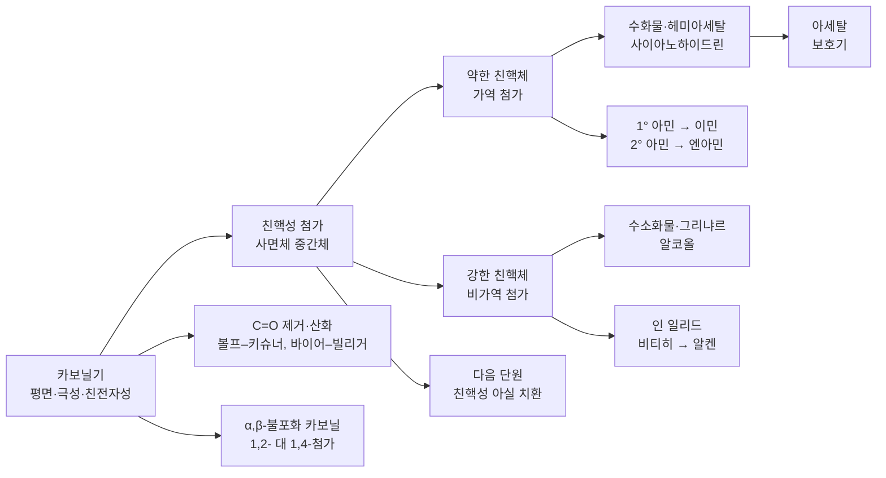

# 유기화학 10. 알데하이드와 케톤 — 카보닐 탄소에 무엇이 더해지고, 무엇이 남는가
<!-- prev: ochem-9, ochem-8, ochem-6, ochem-1 -->
<!-- next: ochem-11 -->

> [!NOTE]
> **이 단원의 범위**
> - 알데하이드·케톤의 명명법, 카보닐기의 구조(극성, 결합 길이, 분광 특징)와 반응성, 물리적 성질
> - 알데하이드·케톤의 합성(알코올의 산화, 오존 분해, 알카인의 수화, 프리델–크래프츠 아실화, 카복실산 유도체에서)
> - 친핵성 첨가의 일반 메커니즘: 염기성(음이온 친핵체) 조건과 산 촉매 조건, 반응성 순서(알데하이드 > 케톤)의 입체·전자적 근거, 가역 첨가와 비가역 첨가
> - 가역 첨가의 평형: 수화물, 헤미아세탈과 아세탈(산 촉매 7단계 메커니즘, 고리형 아세탈), 아세탈 보호기, 사이아노하이드린
> - 질소 친핵체: 1° 아민 → 이민, 2° 아민 → 엔아민, 옥심·하이드라존, 이민 생성의 pH 의존성
> - 수소화물 환원과 그리냐르 반응(카보닐 쪽에서 본 메커니즘과 선택성), 비티히 반응(일리드, 옥사포스페테인, E/Z)
> - 볼프–키슈너·클레멘젠 환원, 바이어–빌리거 산화(이동 우선순위와 입체 유지)
> - α,β-불포화 카보닐 화합물의 1,2-첨가와 1,4-첨가(콘주게이션 첨가): 그리냐르 시약 대 유기 구리 시약

**학습 목표**

1. 알데하이드·케톤을 IUPAC 규칙으로 이름 짓고, 카보닐기의 극성과 공명으로 끓는점·용해도·IR·NMR 특징과 친전자성을 설명할 수 있다.
2. 친핵성 첨가의 메커니즘을 염기성 조건과 산 촉매 조건으로 나누어 굽은 화살표로 쓰고, 알데하이드 > 케톤의 반응성 순서와 첨가가 가역인지 비가역인지를 친핵체의 염기도로 판단할 수 있다.
3. 수화물·헤미아세탈·사이아노하이드린의 평형 상수로 평형 조성을 계산하고, 아세탈 생성의 7단계 메커니즘을 쓰며, 아세탈을 보호기로 쓰는 합성 경로를 설계할 수 있다.
4. 1° 아민과 2° 아민이 각각 이민과 엔아민을 주는 까닭을 메커니즘으로 설명하고, 이민 생성 속도가 pH 4~5에서 가장 빠른 까닭을 분율식으로 정량화할 수 있다.
5. 비티히 반응, 볼프–키슈너·클레멘젠 환원, 바이어–빌리거 산화의 생성물(이중 결합의 위치와 E/Z, 산소가 끼어드는 자리와 입체)을 예측하고 조건에 맞는 시약을 고를 수 있다.
6. α,β-불포화 카보닐 화합물에서 1,2-첨가와 1,4-첨가를 구별하고, 시약(그리냐르·유기 리튬 대 길먼 시약·약한 친핵체)에 따른 주생성물을 예측할 수 있다.

**이 단원의 학습 사다리**

| 단계 | 무엇을 하나? |
|---|---|
| STEP 1. 이전 학습 다시 보기 | 카보닐의 공명과 $\mathrm{p}K_\mathrm{a}$, 알코올의 산화와 환원, 그리냐르 시약, 1,2-/1,4-첨가, 프리델–크래프츠 아실화 |
| STEP 2. 기초 다지기 | 분율식으로 pH와 양성자화 상태 읽기, 평형 상수로 조성 계산하기, 친핵체의 염기도와 가역성, 산화 수준 세기 |
| STEP 3. 핵심 개념 | 구조와 이름 → 합성 → 친핵성 첨가의 일반론 → 수화물 → 헤미아세탈·아세탈 → 보호기 → 사이아노하이드린 → 이민 → 엔아민·옥심 → 수소화물·그리냐르 → 비티히 → 볼프–키슈너·클레멘젠 → 바이어–빌리거 → 콘주게이션 첨가 |
| STEP 4. 오개념 바로잡기 | "산 촉매가 평형을 밀어 준다", "아세탈은 산에도 안정하다", "이민은 산이 셀수록 빨리 생긴다" 같은 착각 |
| STEP 5. 대학원·연구로 | 펠킨–안 모형으로 본 입체 선택적 첨가, 이미늄·엔아민 유기 촉매 |
| STEP 6. 생활·산업·진로 | 시각의 레티날 슈프 염기, 당화 헤모글로빈, 아세톤 사이아노하이드린 공정, 락톤과 고분자 |

---

## 🗺️ 단원 들어가기

아세톤을 산소 동위 원소 $^{18}\mathrm{O}$로 표지한 물 $\mathrm{H_2{}^{18}O}$에 녹여 두면, 몇 분 지나지 않아 아세톤의 카보닐 산소가 $^{18}\mathrm{O}$로 바뀐다. 그런데 용액을 아무리 분석해도 물이 첨가된 생성물(프로페인-2,2-다이올)은 0.1 %쯤밖에 보이지 않는다. 반응이 일어나지 않는 것처럼 보이는데 산소는 바뀌었다. 물은 아세톤에 **끊임없이 붙었다 떨어지고** 있었고, 평형이 출발 물질 쪽에 있을 뿐이었다. 같은 실험을 폼알데하이드로 하면 이번에는 거의 전부가 물이 첨가된 형태(메테인다이올)로 존재한다. 같은 C=O인데 왜 이렇게 다른가? 또 메탄올에 산을 한 방울 떨어뜨리면 같은 아세톤이 아세탈이 되는데, 거기에 염기를 넣으면 꿈쩍도 하지 않던 아세탈이 묽은 산 수용액에서는 다시 아세톤으로 돌아간다.

「알코올·에터·에폭사이드와 황 화합물」에서 우리는 카보닐 화합물에 수소화 이온과 그리냐르 시약을 더해 알코올을 만들었다. 그때는 카보닐을 '알코올의 원료'로만 보았다. 이 단원에서는 시선을 카보닐 쪽으로 옮긴다. 카보닐 탄소는 **평면이고, 부분 양전하를 띠며, 산소가 전자를 받아 줄 준비가 되어 있는** 친전자체이다. 이 한 가지 성질에서 이 단원의 거의 모든 반응이 나온다. 무엇이 다르냐 하면 **친핵체**가 다르다. 친핵체가 물·알코올·아민처럼 약하면 첨가가 가역이 되어 평형을 다뤄야 하고, 산 촉매가 필요하며, 떨어져 나갈 수 있는 원자단이 있으면 첨가 뒤에 물이 빠지는 단계가 이어진다(아세탈, 이민, 엔아민). 친핵체가 수소화 이온·탄소 음이온처럼 강하면 첨가는 비가역이고 알코올에서 멈춘다. 인 일리드는 첨가 뒤 산소를 통째로 떼어 가 알켄을 남긴다(비티히 반응).

이 단원을 마치면 "이 카보닐 화합물에 이 시약을 이 조건에서 넣으면 무엇이 생기고, 그것이 다시 출발 물질로 돌아갈 수 있는가?"에 메커니즘으로 답할 수 있다. 다음 단원 「카복실산과 그 유도체」의 친핵성 아실 치환은 이 단원의 사면체 중간체에서 이탈기가 떨어지는 경우이고, 그다음 「카보닐 α 자리의 반응과 축합 반응」은 카보닐이 이번에는 **친핵체(엔올레이트)** 를 만드는 쪽으로 쓰인다.

---

## STEP 1. 🔙 이전 학습 다시 보기

### 연계 개념표

| 이전 단원 | 그때 배운 것 | 이 단원에서 확장되는 것 |
|---|---|---|
| 유기화학 「구조와 결합, 산과 염기」 '공명', '$\mathrm{p}K_\mathrm{a}$ 표', '굽은 화살표' | C=O의 극성과 $\mathrm{C^+{-}O^-}$ 공명 기여, 양성자화된 케톤의 $\mathrm{p}K_\mathrm{a}$ 약 −7, 화살표의 기본 무늬 | 공명으로 카보닐의 **친전자성**과 산 촉매 효과를 설명, 친핵체 짝산의 $\mathrm{p}K_\mathrm{a}$로 **가역성**을 판단 |
| 유기화학 「알코올·에터·에폭사이드와 황 화합물」 '수소화물 환원', '그리냐르 시약', '산화', '보호기' | $\mathrm{NaBH_4}$·$\mathrm{LiAlH_4}$ 환원, RMgX의 첨가로 1°·2°·3° 알코올, PCC·스원 산화, 수화물을 거친 과잉 산화, 실릴 에터와 THP 보호기 | 같은 반응을 **카보닐 쪽 메커니즘**(사면체 중간체, 비가역성, 화학 선택성)으로 되짚고, 알코올 대신 **카보닐을 보호**하는 아세탈 |
| 유기화학 「알켄과 알카인」 '오존 분해', '알카인의 수화와 토토머화' | 알켄 → 카보닐 화합물 두 개, 말단 알카인 → 메틸 케톤(마르코브니코프) 또는 알데하이드(수소화 붕소화) | 알데하이드·케톤의 **합성법** 목록에 넣기 |
| 유기화학 「콘주게이션계와 방향족성」 '1,2-첨가와 1,4-첨가' | 콘주게이션 다이엔에 HBr이 1,2- 또는 1,4-로 첨가, 속도론적·열역학적 지배 | 같은 생각을 α,β-불포화 카보닐의 **친핵성** 첨가에 적용(그리냐르 1,2, 길먼 1,4) |
| 유기화학 「방향족 화합물의 반응」 '프리델–크래프츠 아실화' | 아실륨 이온의 친전자성 방향족 치환으로 아릴 케톤 합성 | 아릴 케톤을 볼프–키슈너·클레멘젠 환원으로 **알킬 벤젠**으로 바꾸기(자리 옮김 없는 알킬화) |
| 일반화학 「화학 평형」·「화학 열역학」 | $K$와 조성, 르샤틀리에 원리, $\Delta G^\circ = -RT\ln K$ | 첨가 평형의 정량(수화 상수), 물을 빼서 아세탈 평형을 미는 **딘–스타크** 장치 |

### 준비 운동 (사전 진단)

**Q1.** 아세톤의 C=O에 대해 두 공명 구조를 쓰고, 어느 원자가 친핵체에 공격받는지 설명하시오.

**Q2.** 수산화 이온(짝산 $\mathrm{H_2O}$, $\mathrm{p}K_\mathrm{a}$ 15.7)과 수소화 이온(짝산 $\mathrm{H_2}$, $\mathrm{p}K_\mathrm{a}$ 35) 가운데 이탈기로 떨어져 나가기 쉬운 것은 어느 것인가?

**Q3.** 사이클로헥산올을 PCC로 산화한 생성물과, 그 생성물을 $\mathrm{CH_3MgBr}$로 처리한 뒤 산으로 가공한 생성물을 쓰시오.

**Q4.** 뷰타-1,3-다이엔에 HBr이 첨가될 때 '1,4-첨가'란 어느 탄소에 H와 Br이 붙는 것인가?

정답 및 해설

**Q1.** $\mathrm{(CH_3)_2C{=}O \leftrightarrow (CH_3)_2C^+{-}O^-}$. 오른쪽 구조의 기여 때문에 탄소가 부분 양전하($\delta+$)를 띠므로 친핵체는 **카보닐 탄소**를 공격한다. 산소는 π 전자쌍을 받아 알콕사이드가 된다.

**Q2.** 수산화 이온. 짝산의 $\mathrm{p}K_\mathrm{a}$가 작을수록(약한 염기일수록) 좋은 이탈기이다. 수소화 이온은 수산화 이온보다 약 $10^{19}$배 강한 염기여서 사실상 떨어져 나가지 않는다. 이 차이가 ③에서 '가역 첨가'와 '비가역 첨가'를 가른다.

**Q3.** 사이클로헥산온 → 1-메틸사이클로헥산-1-올(「알코올·에터·에폭사이드와 황 화합물」 ④).

**Q4.** C1에 H, C4에 Br이 붙고 이중 결합은 C2=C3으로 옮겨 간다(1-브로모뷰트-2-엔). ⑭에서 α,β-불포화 카보닐의 '1,4'는 카보닐 산소를 1번으로 센다는 점이 다르다.

---

## STEP 2. 🧱 기초 다지기

### 디딤돌 1. 분율식 — pH가 정하는 양성자화 상태

「구조와 결합, 산과 염기」에서 쓴 헨더슨–하셀바흐 식을 분율로 바꾸면, 산 HA가 양성자가 떨어진 형태로 있는 분율은

$$
f_{\mathrm{A^-}} = \frac{1}{1 + 10^{\,\mathrm{p}K_\mathrm{a} - \mathrm{pH}}}
$$

이다. 이 단원에서 이 식은 두 번 쓰인다. 하나는 **아민**이다. 아민 친핵체는 비공유 전자쌍이 있어야 공격하는데, 산성 용액에서는 암모늄 이온($\mathrm{RNH_3^+}$, $\mathrm{p}K_\mathrm{a}$ 약 10.6)이 되어 전자쌍을 잃는다. 다른 하나는 **카보닐 자체**이다. 양성자화된 케톤의 $\mathrm{p}K_\mathrm{a}$는 약 −7이므로, 묽은 산(pH 1~5)에서 양성자화된 카보닐은 $10^{-8}$ 이하로 극히 적다. 그래도 산 촉매가 듣는 것은, 그 적은 양이 중성 카보닐보다 엄청나게 반응성이 크기 때문이다.

| pH | 메틸아민의 자유 아민 분율 ($\mathrm{p}K_\mathrm{aH}$ 10.6) | 양성자화된 케톤의 분율 ($\mathrm{p}K_\mathrm{a}$ −7) |
|---|---|---|
| 1 | $2.5\times10^{-10}$ | $1\times10^{-8}$ |
| 3 | $2.5\times10^{-8}$ | $1\times10^{-10}$ |
| 4.5 | $7.9\times10^{-7}$ | $3\times10^{-12}$ |
| 7 | $2.5\times10^{-4}$ | $1\times10^{-14}$ |
| 9 | $2.5\times10^{-2}$ | $1\times10^{-16}$ |

pH를 낮추면 카보닐은 활성화되지만 친핵체가 사라진다. 이 **줄다리기**가 ⑧에서 이민 생성 속도가 중간 pH에서 가장 빠른 까닭이다.

#### 예제 1 — 하이드록실아민은 몇 % 자유 상태인가

하이드록실아민($\mathrm{NH_2OH}$)의 짝산 $\mathrm{NH_3OH^+}$의 $\mathrm{p}K_\mathrm{a}$는 약 6.0이다. pH 4.5 아세트산 완충 용액에서 자유 하이드록실아민의 분율을 구하고, 메틸아민(10.6)과 비교하시오.

**풀이**
식 세우기: $f = 1/(1 + 10^{\,\mathrm{p}K_\mathrm{a} - \mathrm{pH}})$.
대입: 하이드록실아민 $f = 1/(1 + 10^{1.5}) = 1/32.6 = 0.031$ (약 3 %). 메틸아민 $f = 1/(1 + 10^{6.1}) = 7.9\times10^{-7}$.
**의미** 같은 pH에서 하이드록실아민은 메틸아민보다 약 $4\times10^4$배 많이 '쓸 수 있는' 상태로 있다. 염기성이 약한 질소 친핵체(하이드록실아민, 하이드라진 유도체)가 약산성 조건에서 카보닐과 잘 반응하는 까닭이다(⑨).

### 디딤돌 2. 평형 상수로 조성 계산하기 — 무엇을 넣고 무엇을 뺄 것인가

카보닐 첨가 가운데 많은 것이 가역이다. 이때 생성물이 얼마나 생기는지는 평형 상수가 정한다. 물이 용매인 반응에서는 물의 활동도를 1로 두어 $K$에 포함시킨다.

$$
\mathrm{R_2C{=}O + H_2O \rightleftharpoons R_2C(OH)_2}, \qquad K_\text{수화} = \frac{[\mathrm{R_2C(OH)_2}]}{[\mathrm{R_2C{=}O}]}, \qquad \text{수화물 분율} = \frac{K}{1+K}
$$

반응물이 두 가지인 첨가($\mathrm{R_2C{=}O + HCN}$)는 $K$가 $\mathrm{M^{-1}}$ 단위를 가지므로 조성이 **농도에 따라** 달라진다. 반응이 물을 내놓으면($\mathrm{R_2C{=}O + 2ROH \rightleftharpoons R_2C(OR)_2 + H_2O}$) 물을 계속 빼내어 $Q < K$를 유지하면 반응이 끝까지 간다. 일반화학 「화학 평형」의 르샤틀리에 원리를 실험 장치(딘–스타크 트랩, 분자체)로 구현하는 것이다.

#### 예제 2 — 사이아노하이드린 평형의 농도 의존

아세톤 + HCN ⇌ 아세톤 사이아노하이드린의 평형 상수를 약 $30\ \mathrm{M^{-1}}$이라 하자. 아세톤이 HCN보다 훨씬 적게 들어 있어 HCN 농도가 거의 변하지 않는다고 보고, $[\mathrm{HCN}] = 0.10\ \mathrm{M}$과 $1.0\ \mathrm{M}$일 때 사이아노하이드린으로 바뀐 아세톤의 분율을 구하시오.

**풀이**
식 세우기: $\dfrac{[\text{사이아노하이드린}]}{[\text{아세톤}]} = K[\mathrm{HCN}]$, 분율 $= \dfrac{K[\mathrm{HCN}]}{1 + K[\mathrm{HCN}]}$.
대입: 0.10 M → $3.0/4.0 = 0.75$, 1.0 M → $30/31 = 0.97$.
**의미** $K$가 1보다 훨씬 큰 것 같아도 단위가 $\mathrm{M^{-1}}$인 평형은 묽은 조건에서 크게 되돌아간다. 같은 까닭으로 사슬형 헤미아세탈은 알코올을 용매로 쓸 때만 눈에 띄게 생긴다(⑤).

### 디딤돌 3. 친핵체의 염기도와 가역성 — 짝산의 $\mathrm{p}K_\mathrm{a}$ 하나로 판단하기

친핵체가 카보닐에 첨가해 사면체 알콕사이드가 되면, 그 알콕사이드는 두 길 중 하나를 간다. 양성자를 받아 생성물이 되거나, O의 전자쌍이 C=O를 되살리며 방금 붙은 친핵체를 **이탈기로** 밀어낸다. 친핵체가 좋은 이탈기일수록, 즉 **약한 염기**일수록 되돌아가기 쉽다.

| 친핵체 | 짝산의 $\mathrm{p}K_\mathrm{a}$ (약) | 알콕사이드($\mathrm{p}K_\mathrm{a}$ 약 16)와 비교 | 첨가는 |
|---|---|---|---|
| $\mathrm{H_2O}$, $\mathrm{ROH}$ (중성) | −1.7, −2 (짝산 $\mathrm{H_3O^+}$, $\mathrm{ROH_2^+}$) | 훨씬 좋은 이탈기 | 가역 |
| $\mathrm{CN^-}$ | 9.2 (HCN) | 더 좋은 이탈기 | 가역 |
| $\mathrm{RNH_2}$, $\mathrm{R_2NH}$ (중성) | 10~11 (암모늄) | 좋은 이탈기 | 가역 |
| $\mathrm{OH^-}$, $\mathrm{RO^-}$ | 15.7, 16 | 비슷 | 가역 |
| $\mathrm{H^-}$ ($\mathrm{NaBH_4}$, $\mathrm{LiAlH_4}$) | 35 ($\mathrm{H_2}$) | 매우 나쁜 이탈기 | **비가역** |
| $\mathrm{R^-}$ (RMgX, RLi) | 약 50 (알케인) | 매우 나쁜 이탈기 | **비가역** |

> [!TIP]
> 💡 **요령** — "짝산의 $\mathrm{p}K_\mathrm{a}$가 알콕사이드의 짝산(약 16)보다 **작으면 가역, 훨씬 크면 비가역**." 가역 첨가는 평형(⑤~⑨)을, 비가역 첨가는 속도와 선택성(⑩~⑪)을 다룬다고 기억하면 단원의 지도가 둘로 나뉜다.

### 디딤돌 4. 산화 수준 세기 — 무엇이 환원이고 무엇이 산화인가

「알코올·에터·에폭사이드와 황 화합물」 디딤돌 2의 방법으로 카보닐 탄소의 산화수를 센다(C에 대해 O 결합 하나 +1, H 하나 −1, C는 0).

| 변환 | 반응 탄소의 산화수 | 분류 |
|---|---|---|
| 케톤 $\mathrm{R_2C{=}O}$ → 알코올 $\mathrm{R_2CHOH}$ (수소화물) | +2 → 0 | 환원 |
| 케톤 → 메틸렌 $\mathrm{R_2CH_2}$ (볼프–키슈너, 클레멘젠) | +2 → −2 | 4전자 환원 |
| 케톤 → 수화물·아세탈·이민 | +2 → +2 | 산화·환원 아님 |
| 케톤 $\mathrm{RCOR'}$ → 에스터 $\mathrm{RCOOR'}$ (바이어–빌리거) | 카보닐 C: +2 → +3 | 산화(산소 원자 하나 삽입) |
| 알데하이드 $\mathrm{RCHO}$ → 카복실산 $\mathrm{RCOOH}$ | +1 → +3 | 산화 |

수화물·아세탈·이민은 산화 수준이 카보닐과 같으므로, 산화·환원제 없이 물만 더하거나 빼서 서로 오간다. 이 사실이 ⑤~⑨의 반응들이 모두 **가수 분해로 되돌릴 수 있는** 까닭이다.

---

## STEP 3. 📘 핵심 개념

### ① 카보닐기의 구조와 성질, 알데하이드·케톤의 명명법

#### 카보닐기 — 평면이고, 극성이며, 한쪽이 비어 있다

**카보닐기**(carbonyl group) C=O의 탄소는 $sp^2$ 혼성이다. 세 개의 σ 결합이 한 평면에서 약 120°로 벌어지고, 탄소와 산소의 p 오비탈이 겹쳐 π 결합을 만든다. 산소에는 비공유 전자쌍이 둘 있다. 탄소에 H가 하나 이상 붙은 것($\mathrm{RCHO}$)이 **알데하이드**(aldehyde), 탄소 원자단 둘이 붙은 것($\mathrm{RCOR'}$)이 **케톤**(ketone)이다.

| 성질 | 값 (약) | 무엇을 뜻하나 |
|---|---|---|
| C=O 결합 길이 | 121~122 pm (C=C는 134 pm) | 산소가 작고 결합이 강하다 |
| C=O 결합 에너지 | 740~750 kJ/mol (C=C 약 610) | C=O는 C=C보다 훨씬 강하지만, π 결합은 극성이 커서 **불균일하게** 잘 깨진다 |
| 쌍극자 모멘트 | 폼알데하이드 2.3 D, 아세톤 2.9 D | 탄소 $\delta+$, 산소 $\delta-$ |
| 결합각 | 약 120° | 친핵체가 평면의 위·아래 어느 쪽에서든 다가갈 수 있다 |

카보닐의 반응성은 두 공명 구조로 요약된다. $\mathrm{R_2C{=}O \leftrightarrow R_2C^+{-}O^-}$. 오른쪽 구조의 기여 때문에 탄소는 친전자체이고 산소는 약한 루이스 염기이다. 분자 오비탈로 말하면 비어 있는 가장 낮은 오비탈(LUMO)은 C=O의 **π\* 오비탈**이며, 이 오비탈은 산소보다 **탄소 쪽 계수가 크다.** 친핵체의 HOMO가 이 π\*에 전자를 넣으면 C=O π 결합이 약해지고 새 C–Nu 결합이 생긴다. 친핵체는 C=O 축에 수직으로 오지 않고 산소 반대쪽으로 약간 기울어진 약 107°의 각도로 다가간다(**뷔르기–두니츠 궤적**, Bürgi–Dunitz trajectory). π\* 오비탈과 최대로 겹치면서 산소 쪽 전자 밀도의 반발을 피하는 방향이다.

<!-- fig:ochem-10-carbonyl-structure -->

#### 물리적 성질

카보닐 화합물은 극성이 커서 같은 크기의 알케인·에터보다 끓는점이 높지만, O–H가 없으므로 서로 수소 결합을 하지 못해 알코올보다는 낮다. 반면 물의 H와는 수소 결합을 받을 수 있어 작은 것은 물에 잘 녹는다(아세톤은 물과 완전히 섞인다).

| 화합물 (몰질량 약 72~74 g/mol) | 축약 구조식 | 끓는점 (℃, 약) | 분자 사이의 주된 힘 |
|---|---|---|---|
| 펜테인 | $\mathrm{CH_3(CH_2)_3CH_3}$ | 36 | 분산력 |
| 다이에틸 에터 | $\mathrm{CH_3CH_2OCH_2CH_3}$ | 35 | 분산력 + 약한 쌍극자 |
| 뷰탄알 | $\mathrm{CH_3CH_2CH_2CHO}$ | 75 | 쌍극자–쌍극자 |
| 뷰탄-2-온 | $\mathrm{CH_3CH_2COCH_3}$ | 80 | 쌍극자–쌍극자 |
| 뷰탄-1-올 | $\mathrm{CH_3(CH_2)_3OH}$ | 117 | 수소 결합 |

#### 분광학적 특징 (「구조 결정: 질량 분석법과 분광법」 되짚기)

| 방법 | 알데하이드 | 케톤 |
|---|---|---|
| IR C=O 신축 | 1725~1730 $\mathrm{cm^{-1}}$ (콘주게이션되면 약 1700) | 1715 $\mathrm{cm^{-1}}$ (콘주게이션되면 1675~1690) |
| IR C–H | 알데하이드 C–H 약 2720·2820 (약함, 두 개) | 없음 |
| $^1\mathrm{H}$ NMR | CHO 양성자 9~10 ppm (이웃 CH와 작은 짝지음) | α-H 2.0~2.5 ppm |
| $^{13}\mathrm{C}$ NMR | C=O 190~205 ppm | C=O 205~220 ppm |
| 질량 분석 | α 절단, 맥라퍼티 자리 옮김 | α 절단(아실륨 이온), 메틸 케톤은 m/z 43 |

#### 명명법

| 규칙 | 알데하이드 | 케톤 |
|---|---|---|
| 접미사 | 알케인 이름의 끝 '-에인'을 **'-알'**로 (CHO 탄소가 C1) | '-에인'을 **'-온'**으로, C=O 탄소에 가장 작은 번호 |
| 고리에 붙은 경우 | 고리 이름 + **'-카브알데하이드'** (CHO 탄소는 번호에 넣지 않는다) | 고리 이름 + '-온' (C=O 탄소가 C1) |
| 접두사(더 높은 작용기가 있을 때) | '폼일-' (또는 '옥소-'로 사슬에 포함) | **'옥소-'** |
| 관용명 | 폼알데하이드 $\mathrm{HCHO}$, 아세트알데하이드 $\mathrm{CH_3CHO}$, 벤즈알데하이드 $\mathrm{C_6H_5CHO}$ | 아세톤 $\mathrm{(CH_3)_2CO}$, 아세토페논 $\mathrm{C_6H_5COCH_3}$, 벤조페논 $\mathrm{(C_6H_5)_2CO}$ |

작용기의 우선순위는 카복실산 > 에스터 > 아마이드 > 나이트릴 > **알데하이드 > 케톤** > 알코올 > 아민 순이다. 알데하이드와 케톤이 함께 있으면 알데하이드가 이름의 끝을 차지하고 케톤은 '옥소-'가 된다.

#### 예제 3 — 이름 짓기

다음 화합물의 IUPAC 이름을 쓰시오.
(1) $\mathrm{(CH_3)_2CHCH_2CHO}$ (2) $\mathrm{CH_3COCH_2CH_2CHO}$ (3) $\mathrm{(CH_3)_2C(OH)CH_2COCH_3}$ (4) $\mathrm{CH_3CH{=}CHCOCH_3}$ (트랜스) (5) 사이클로헥세인 고리에 CHO가 붙은 것

**풀이**
(1) 3-메틸뷰탄알 — CHO 탄소가 C1이므로 메틸은 C3에 있다.
(2) 4-옥소펜탄알 — 알데하이드가 우선이므로 CHO가 C1, 케톤은 C4의 '옥소'.
(3) 4-하이드록시-4-메틸펜탄-2-온 — 케톤이 알코올보다 우선이므로 C=O에 작은 번호(C2), OH는 접두사(SMILES `CC(=O)CC(C)(C)O`).
(4) (E)-펜트-3-엔-2-온 — C=O에 작은 번호를 주고, 이중 결합은 C3=C4(SMILES `C/C=C/C(C)=O`).
(5) 사이클로헥세인카브알데하이드(SMILES `O=CC1CCCCC1`).
**의미** 번호는 언제나 '이름의 끝을 차지하는 작용기'에 가장 작은 수를 주는 데서 시작한다. (2)에서 케톤 쪽에서 세면 펜탄-2-온이 되지만, 알데하이드가 있으므로 그럴 수 없다.

#### ✔ 바로 확인

1. 빈칸: 카보닐 탄소의 혼성은 (    )이고, C=O의 LUMO는 (    ) 오비탈이다.
2. (O/X) 뷰탄알은 뷰탄-1-올보다 끓는점이 높다.
3. $\mathrm{C_6H_5COCH_2CH_3}$의 IUPAC 이름은?
4. IR에서 1730 $\mathrm{cm^{-1}}$의 강한 띠와 2720 $\mathrm{cm^{-1}}$의 약한 띠가 함께 보이면 어떤 작용기인가?

정답

1. $sp^2$, π\* — 탄소 쪽 계수가 커서 친핵체가 탄소를 공격한다.
2. X — 카보닐 화합물끼리는 수소 결합을 하지 못한다(75 ℃ 대 117 ℃).
3. 1-페닐프로판-1-온(관용명 프로피오페논)
4. 알데하이드 — 2720·2820의 알데하이드 C–H 신축이 케톤과 가른다.

### ② 알데하이드와 케톤의 합성

앞 단원들에서 이미 여러 반응이 알데하이드·케톤을 만들었다. 여기서는 그것들을 '합성법 목록'으로 모으고, 카복실산 유도체에서 출발하는 방법을 덧붙인다(유도체 쪽의 메커니즘은 다음 단원 「카복실산과 그 유도체」에서 다룬다).

| 출발 물질 | 시약 | 생성물 | 단원 |
|---|---|---|---|
| 1° 알코올 | PCC 또는 데스–마틴 퍼아이오디네인, $\mathrm{CH_2Cl_2}$, 또는 스원 산화 | 알데하이드(물이 없어 멈춘다) | 「알코올·에터·에폭사이드와 황 화합물」 |
| 2° 알코올 | 위 시약 또는 존스 시약($\mathrm{CrO_3}$, $\mathrm{H_2SO_4}$) | 케톤 | 같은 단원 |
| 알켄 | ① $\mathrm{O_3}$ ② $\mathrm{(CH_3)_2S}$ 또는 Zn, $\mathrm{H_2O}$ | 알데하이드·케톤(C=C가 C=O 두 개로) | 「알켄과 알카인」 |
| 말단 알카인 | $\mathrm{H_2O}$, $\mathrm{H_2SO_4}$, $\mathrm{HgSO_4}$ | 메틸 케톤(마르코브니코프, 엔올의 토토머화) | 같은 단원 |
| 말단 알카인 | ① 부피 큰 보레인(9-BBN 등) ② $\mathrm{H_2O_2}$, NaOH | 알데하이드(반마르코브니코프) | 같은 단원 |
| 방향족 고리 | $\mathrm{RCOCl}$, $\mathrm{AlCl_3}$ | 아릴 케톤(프리델–크래프츠 아실화, 자리 옮김 없음, 한 번만 치환) | 「방향족 화합물의 반응」 |
| 에스터 | DIBAL-H(수소화 다이아이소뷰틸알루미늄) 1 당량, −78 ℃, 이어서 $\mathrm{H_2O}$ | 알데하이드 | 다음 단원 |
| 산 염화물 | $\mathrm{LiAlH(O{}^tBu)_3}$, −78 ℃ | 알데하이드 | 다음 단원 |
| 산 염화물 | 길먼 시약 $\mathrm{R'_2CuLi}$ | 케톤 $\mathrm{RCOR'}$ | 다음 단원, ⑭ |
| 나이트릴 | ① $\mathrm{R'MgBr}$ ② $\mathrm{H_3O^+}$ | 케톤 $\mathrm{RCOR'}$ (이민 음이온을 거쳐 가수 분해, ⑧) | 다음 단원 |

에스터와 산 염화물을 **알데하이드에서 멈추게** 하는 요령은 반응성을 낮춘 수소화물 시약과 낮은 온도이다. $\mathrm{LiAlH_4}$를 쓰면 처음 생긴 알데하이드가 출발 물질보다 더 빨리 환원되어 1° 알코올까지 간다. DIBAL-H는 −78 ℃에서 에스터에 수소화 이온 하나를 준 사면체 중간체가 알루미늄에 붙들린 채 안정하게 머물다가, 물로 가공할 때 비로소 무너져 알데하이드를 내놓는다. 나이트릴에 그리냐르 시약이 첨가하면 음전하를 띤 이민 음이온($\mathrm{R(R')C{=}N^-}$)이 생기는데, 음전하를 띤 이 중간체에는 두 번째 그리냐르 시약이 첨가하지 않으므로 가수 분해 뒤 케톤에서 멈춘다.

#### 예제 4 — 같은 케톤에 이르는 세 길

1-페닐프로판-1-온($\mathrm{C_6H_5COCH_2CH_3}$, SMILES `CCC(=O)c1ccccc1`)을 (1) 벤젠에서, (2) 벤즈알데하이드에서, (3) 벤조나이트릴에서 만드는 경로를 쓰시오.

**풀이**
(1) 벤젠 + 염화 프로파노일 $\mathrm{CH_3CH_2COCl}$, $\mathrm{AlCl_3}$ → 프리델–크래프츠 아실화. 아실륨 이온은 자리 옮김을 하지 않는다.
(2) 벤즈알데하이드 + $\mathrm{CH_3CH_2MgBr}$, 이어서 $\mathrm{NH_4Cl}$ 수용액 가공 → 1-페닐프로판-1-올(2° 알코올, 라세미) → PCC, $\mathrm{CH_2Cl_2}$ → 1-페닐프로판-1-온.
(3) 벤조나이트릴 $\mathrm{C_6H_5CN}$ + $\mathrm{CH_3CH_2MgBr}$ → 이민 음이온 → $\mathrm{H_3O^+}$ → 이민 → 케톤(이민의 가수 분해, ⑧).
**의미** 같은 C(=O)–C 결합을 (1)은 방향족 친전자성 치환으로, (2)는 C–C 결합을 먼저 만든 뒤 산화로, (3)은 나이트릴 탄소를 카보닐 탄소의 '가면'으로 써서 만든다. 출발 물질의 값, 고리에 다른 치환기가 있는지(프리델–크래프츠는 강한 비활성화기가 있으면 안 된다)로 고른다.

#### ✔ 바로 확인

1. 1-메틸사이클로헥센을 ① $\mathrm{O_3}$ ② $\mathrm{(CH_3)_2S}$로 처리한 생성물의 이름은?
2. (O/X) 에스터를 $\mathrm{LiAlH_4}$로 처리하면 알데하이드에서 멈춘다.
3. 펜트-1-인을 $\mathrm{H_2SO_4}$, $\mathrm{HgSO_4}$ 수용액으로 처리한 생성물은?

정답

1. 6-옥소헵탄알 — 고리가 열려 메틸이 붙은 쪽은 케톤, 다른 쪽은 알데하이드가 된다(SMILES `CC(=O)CCCCC=O`).
2. X — 알데하이드가 에스터보다 빨리 환원되어 1° 알코올이 된다. DIBAL-H, −78 ℃가 필요하다.
3. 펜탄-2-온 — 마르코브니코프 수화로 엔올이 생기고 케톤으로 토토머화한다.

### ③ 친핵성 첨가의 일반 메커니즘 — 염기성 조건과 산 촉매 조건

#### 두 단계의 기본 무늬

카보닐에 대한 **친핵성 첨가**(nucleophilic addition)는 친핵체가 카보닐 탄소에 결합하고 C=O π 결합의 전자쌍이 산소로 밀려나 **사면체 중간체**(tetrahedral intermediate)가 생기는 반응이다. 탄소는 $sp^2$(평면, 120°)에서 $sp^3$(사면체, 109.5°)로 바뀐다. 산소가 양성자를 받으면 첨가 생성물이 된다. 무엇이 먼저 일어나느냐에 따라 두 가지 무늬가 있다.

**(가) 염기성(음이온 친핵체) 조건** — 강한 친핵체가 먼저 공격한다.

$$
\mathrm{Nu^- + R_2C{=}O \longrightarrow R_2C(Nu){-}O^- \xrightarrow{\ \mathrm{H{-}A}\ } R_2C(Nu){-}OH + A^-}
$$

1단계: Nu의 전자쌍 → 카보닐 C, C=O π 전자쌍 → O (알콕사이드 사면체 중간체). 2단계: O⁻의 전자쌍 → H–A의 H, H–A 결합 → A(양성자 전달). $\mathrm{OH^-}$, $\mathrm{CN^-}$, $\mathrm{RO^-}$ 같은 촉매량의 염기가 중성 친핵체(물, HCN, 알코올)를 음이온으로 바꾸어 첨가를 빠르게 하는 것이 **염기 촉매**이다. 2단계에서 $\mathrm{H{-}Nu}$가 양성자를 주면 $\mathrm{Nu^-}$가 다시 생기므로 염기는 소모되지 않는다.

**(나) 산 촉매 조건** — 카보닐이 먼저 활성화된다.

$$
\mathrm{R_2C{=}O + H{-}A \rightleftharpoons R_2C{=}OH^+ \xrightarrow{\ \mathrm{H{-}Nu}\ } R_2C(OH){-}NuH^+ \xrightarrow{\ -H^+\ } R_2C(OH){-}Nu}
$$

1단계: 카보닐 O의 비공유 전자쌍 → H–A의 H, H–A 결합 → A. 생긴 양성자화된 카보닐은 $\mathrm{R_2C{=}OH^+ \leftrightarrow R_2C^+{-}OH}$의 공명으로 탄소의 양전하가 훨씬 커진다. 2단계: 약한 중성 친핵체(물·알코올)의 전자쌍 → C, C=O π 전자쌍 → O(이제 중성 OH). 3단계: 양전하를 띤 친핵체 쪽 원자의 H를 염기(용매)가 떼어 간다. 산은 다시 생기므로 촉매이다.

<!-- fig:ochem-10-addition-two-modes -->

| 비교 | 염기성 조건 | 산 촉매 조건 |
|---|---|---|
| 먼저 일어나는 일 | 친핵체가 공격 | 카보닐 O가 양성자화 |
| 활성화되는 쪽 | 친핵체(음이온으로) | 친전자체(양이온으로) |
| 알맞은 친핵체 | $\mathrm{OH^-}$, $\mathrm{CN^-}$, $\mathrm{RO^-}$, $\mathrm{H^-}$, $\mathrm{R^-}$ | $\mathrm{H_2O}$, ROH, 아민(약산성) |
| 중간체의 전하 | 음이온(알콕사이드) | 양이온(옥소늄) |
| 쓰이는 반응 | 사이아노하이드린, 염기 촉매 수화, 수소화물·그리냐르 | 아세탈, 산 촉매 수화, 이민·엔아민의 탈수 단계 |

> [!IMPORTANT]
> **촉매는 평형 상수를 바꾸지 않는다.** 산이든 염기든 정반응과 역반응을 같은 비율로 빠르게 할 뿐이다. 아세톤의 수화 평형(④)은 산을 넣어도 0.1 %이고, 산은 그 0.1 %에 **빨리 도달하게** 할 뿐이다. 평형을 밀려면 반응물을 과량 넣거나 생성물을 빼내야 한다(디딤돌 2).

#### 반응성의 순서 — 알데하이드 > 케톤

같은 친핵체에 대해 반응성(평형 상수와 속도 모두)은 대체로 **폼알데하이드 > 다른 알데하이드 > 케톤**이다. 두 가지 효과가 같은 방향으로 작용한다.

1. **입체 효과** — 첨가가 일어나면 120°의 평면 탄소가 109.5°의 사면체 탄소가 되어 치환기끼리 가까워진다. 알데하이드는 그중 하나가 작은 H이므로 사면체 생성물(과 그리로 가는 전이 상태)이 덜 붐빈다. 케톤에서는 두 탄소 원자단이 서로, 그리고 새로 온 친핵체와 부딪친다. 다이-tert-뷰틸 케톤처럼 부피 큰 케톤은 거의 첨가를 하지 않는다.
2. **전자 효과** — 알킬기는 초공액으로 카보닐 탄소의 부분 양전하에 전자를 준다(「유기 반응의 개관과 알킬 할라이드의 치환·제거 반응」의 탄소 양이온 안정화와 같은 원리). 알킬이 둘인 케톤은 카보닐이 **출발 상태에서 더 안정**하고 덜 친전자성이다. 반대로 $\mathrm{CF_3}$, $\mathrm{CCl_3}$ 같은 전자 끌기 원자단은 카보닐을 불안정하게 하고 친전자성을 키운다.

여기에 덧붙여, 아릴기가 붙으면 C=O가 고리와 **콘주게이션**되어 출발 상태가 안정해지므로(공명으로 고리의 π 전자가 카보닐 탄소 쪽으로 흘러든다) 벤즈알데하이드는 지방족 알데하이드보다 덜 반응성이다. 고리 무리가 큰 사이클로프로판온은 사면체로 바뀌면 각 무리(60°에 묶인 $sp^2$ 탄소)가 풀리므로 쉽게 첨가한다.

#### 입체화학 — 평면의 두 면

알데하이드 $\mathrm{RCHO}$나 비대칭 케톤 $\mathrm{RCOR'}$의 카보닐 탄소는 **프로카이랄**(「입체화학」 '프로카이랄성')이다. 친핵체가 평면의 위 면과 아래 면에서 공격하면 서로 거울상인 생성물이 생긴다. 카이랄한 환경(효소, 카이랄 촉매, 분자 안의 다른 입체 중심)이 없으면 두 면은 똑같이 공격받아 **라세미 혼합물**이 생긴다.

#### 예제 5 — 반응성 순서와 그 근거

다음 다섯 화합물을 물 첨가(수화)의 평형 상수가 큰 것부터 늘어놓고 각 자리의 근거를 쓰시오. 아세톤, 폼알데하이드, 벤즈알데하이드, 아세트알데하이드, 2,2,4,4-테트라메틸펜탄-3-온(다이-tert-뷰틸 케톤)

**풀이**
폼알데하이드(약 $2\times10^3$) > 아세트알데하이드(약 1) > 벤즈알데하이드(약 $10^{-2}$) > 아세톤(약 $1.4\times10^{-3}$) > 다이-tert-뷰틸 케톤(관찰되지 않을 만큼 작음).
- 폼알데하이드: 치환기가 H 둘로 입체 무리도 전자 주개 효과도 없다.
- 아세트알데하이드: 메틸 하나가 전자를 주고 약간 붐빈다.
- 벤즈알데하이드: 알데하이드이지만 페닐과의 콘주게이션이 출발 상태를 안정화해 아세트알데하이드보다 훨씬 작다.
- 아세톤: 알킬 둘(전자 + 입체).
- 다이-tert-뷰틸 케톤: 사면체가 되면 tert-뷰틸 두 개가 심하게 부딪친다.
**의미** 폼알데하이드와 아세톤만 비교해도 평형 상수가 약 $1.4\times10^6$배 다르며, 이는 25 ℃에서 $\Delta G^\circ$ 차이 약 35 kJ/mol에 해당한다($5.71\times\log(1.4\times10^6) \approx 35$). 치환기 몇 개의 입체·전자 효과가 C=O 하나의 평형을 이만큼 움직인다.

#### ✔ 바로 확인

1. (O/X) 산 촉매를 넣으면 아세톤의 수화 평형이 수화물 쪽으로 이동한다.
2. 빈칸: 염기 촉매는 (    )을/를, 산 촉매는 (    )을/를 활성화한다.
3. 프로판알과 프로판온 가운데 같은 친핵체에 더 빨리 첨가되는 것과 그 까닭 두 가지는?
4. 뷰탄-2-온에 $\mathrm{CN^-}$이 첨가된 생성물이 광학 활성이 없는 까닭은?

정답

1. X — 촉매는 $K$를 바꾸지 않고 평형에 도달하는 속도만 높인다.
2. 친핵체(음이온으로), 카보닐(양성자화로)
3. 프로판알 — H가 작아 사면체가 덜 붐비고(입체), 알킬기 하나만 전자를 주어 카보닐 탄소의 $\delta+$가 더 크다(전자).
4. 평면 카보닐의 두 면이 같은 확률로 공격받아 (R)·(S)가 같은 양 생긴다(라세미).

### ④ 물의 첨가 — 수화물과 가역 첨가의 평형

알데하이드·케톤은 물과 가역적으로 반응해 같은 탄소에 OH가 두 개 붙은 **수화물**(hydrate, 제미널 다이올 gem-diol)을 만든다. 반응은 묽은 산이나 염기로 촉매되며(③의 두 무늬), 수용액에서 수 초~수 분 안에 평형에 이른다.

$$
\mathrm{R_2C{=}O + H_2O \;\rightleftharpoons\; R_2C(OH)_2}
$$

| 카보닐 화합물 | $K_\text{수화}$ (25 ℃, 약) | 수화물 분율 | $\Delta G^\circ$ (kJ/mol) |
|---|---|---|---|
| 헥사플루오로아세톤 $\mathrm{(CF_3)_2CO}$ | $1\times10^{6}$ | 거의 100 % | 약 −34 |
| 폼알데하이드 $\mathrm{HCHO}$ | $2\times10^{3}$ | 99.95 % | −19 |
| 아세트알데하이드 $\mathrm{CH_3CHO}$ | 1.06 | 약 51 % | −0.1 |
| 아세톤 $\mathrm{(CH_3)_2CO}$ | $1.4\times10^{-3}$ | 0.14 % | +16 |

($\Delta G^\circ = -RT\ln K_\text{수화}$, 물의 활동도는 1로 둔다.) 폼알데하이드 수용액(포르말린)은 실제로는 거의 메테인다이올과 그 올리고머의 용액이다. 반대로 아세톤의 수화물은 따로 분리할 수 없다. 물을 증발시키면 평형이 다시 아세톤 쪽으로 가기 때문이다. 트라이클로로아세트알데하이드(클로랄)는 전자 끌기 원자단 $\mathrm{CCl_3}$ 때문에 수화 평형이 크게 오른쪽에 있어, 수화물(클로랄 수화물 $\mathrm{Cl_3CCH(OH)_2}$)이 안정한 고체로 분리된다.

#### 생성물이 보이지 않아도 반응은 일어난다 — 동위 원소 교환

아세톤을 $\mathrm{H_2{}^{18}O}$에 녹이면 수화물은 0.14 %밖에 생기지 않지만, 수화물의 두 OH는 **대칭적으로 같다.** 그중 원래의 $^{16}\mathrm{O}$H가 떨어져 나가면 $^{18}\mathrm{O}$가 카보닐 산소로 남는다. 첨가–제거가 빠르게 되풀이되면서 카보닐 산소가 용매의 산소와 섞인다. 이 실험은 수화가 '평형이 왼쪽에 있는' 반응이지 '일어나지 않는' 반응이 아님을 보여 준다.

<!-- fig:ochem-10-o18-exchange -->

#### 예제 6 — 수화 평형을 자유 에너지로

(1) 아세트알데하이드와 아세톤의 수화물 분율을 표의 $K$로 구하시오. (2) 25 ℃에서 두 화합물의 수화 $\Delta G^\circ$ 차이를 구하고, 메틸 하나가 H를 대신한 효과로 해석하시오.

**풀이**
(1) 아세트알데하이드: $K/(1+K) = 1.06/2.06 = 0.515$ → 약 51 %. 아세톤: $1.4\times10^{-3}/1.0014 = 1.4\times10^{-3}$ → 0.14 %.
(2) $\Delta\Delta G^\circ = RT\ln(K_1/K_2) = 2.479\times\ln(1.06/1.4\times10^{-3}) = 2.479\times6.63 = 16.4\ \mathrm{kJ/mol}$.
**의미** 알데하이드의 H 하나를 메틸로 바꾸면 수화가 약 16 kJ/mol 불리해진다. 이 값에는 사면체 쪽의 입체 무리와 출발 카보닐의 초공액 안정화가 함께 들어 있다. 「구조와 결합, 산과 염기」의 $\mathrm{p}K_\mathrm{a}$와 같은 방식으로, 평형 상수는 '자유 에너지의 장부'로 읽힌다.

#### ✔ 바로 확인

1. 폼알데하이드 수용액에서 가장 많은 화학종은 무엇인가?
2. (O/X) 아세톤을 $\mathrm{H_2{}^{18}O}$에 녹여도 수화물이 0.14 %뿐이므로 카보닐 산소는 표지되지 않는다.
3. 빈칸: 전자 끌기 원자단이 붙은 카보닐은 수화 평형 상수가 (    )진다.

정답

1. 메테인다이올 $\mathrm{CH_2(OH)_2}$ (과 그 올리고머) — $K_\text{수화} \approx 2\times10^3$.
2. X — 첨가와 제거가 빠르게 되풀이되며 산소가 교환된다. 평형의 위치와 반응의 속도는 다른 문제이다.
3. 커 — 카보닐 탄소의 $\delta+$가 커져 출발 상태가 불안정해진다(클로랄, 헥사플루오로아세톤).

### ⑤ 알코올의 첨가 — 헤미아세탈과 아세탈

#### 헤미아세탈

물 대신 알코올이 첨가하면 같은 탄소에 OH와 OR이 붙은 **헤미아세탈**(hemiacetal)이 생긴다. 산과 염기 어느 쪽으로도 촉매되며, 수화물처럼 가역이다. 사슬형 헤미아세탈은 대부분 평형이 불리하여 분리할 수 없지만, 같은 분자 안에 OH와 C=O가 있어 **5원자·6원자 고리**를 만들 수 있으면 고리형 헤미아세탈이 우세하다. 분자 안 반응은 두 분자가 만나야 하는 엔트로피 손실이 없기 때문이다. 5-하이드록시펜탄알(SMILES `OCCCCC=O`)은 수용액에서 대부분 테트라하이드로피란-2-올(옥세인-2-올, SMILES `OC1CCCCO1`)로 존재하며, 포도당이 고리 모양으로 존재하는 것도 같은 원리이다(「생체 분자와 합성 고분자」).

#### 아세탈 — 산 촉매가 반드시 필요하다

헤미아세탈에 알코올이 한 번 더 반응해 OH가 OR로 바뀌면 **아세탈**(acetal, $\mathrm{R_2C(OR')_2}$)과 물이 생긴다. 이 둘째 단계는 헤미아세탈의 OH가 **이탈기로 떨어져야** 하므로 염기로는 일어나지 않는다(수산화 이온은 나쁜 이탈기이다). 산이 OH를 양성자화하여 물이라는 좋은 이탈기로 바꾸어야 한다. 전체는 7단계이다.

$$
\mathrm{R_2C{=}O + 2\,R'OH \;\underset{\ H_3O^+\ }{\overset{\ \text{산 촉매(TsOH 등)}\ }{\rightleftharpoons}}\; R_2C(OR')_2 + H_2O}
$$

| 단계 | 무엇이 일어나나 | 굽은 화살표 |
|---|---|---|
| 1 | 카보닐 O의 양성자화 | O 전자쌍 → $\mathrm{H{-}OR'H^+}$의 H, H–O 결합 → O |
| 2 | 알코올의 첨가 | $\mathrm{R'OH}$의 O 전자쌍 → C, C=O π 전자쌍 → O(이제 OH) |
| 3 | 탈양성자화 → **헤미아세탈** | 용매 알코올의 O 전자쌍 → $\mathrm{O^+{-}H}$의 H, O–H 결합 → O |
| 4 | OH의 양성자화 | OH의 O 전자쌍 → $\mathrm{H{-}OR'H^+}$의 H |
| 5 | 물이 떨어져 **옥소카베늄 이온** 생성 | OR′의 O 전자쌍 → C–O 자리(C=O⁺R′), C–$\mathrm{OH_2^+}$ 결합 → O(물로 떠남) |
| 6 | 두 번째 알코올의 첨가 | $\mathrm{R'OH}$의 O 전자쌍 → C, C=O⁺ π 전자쌍 → O⁺ |
| 7 | 탈양성자화 → **아세탈** | 용매의 O 전자쌍 → $\mathrm{O^+{-}H}$의 H |

5단계에서 생기는 **옥소카베늄 이온**(oxocarbenium ion) $\mathrm{R_2C{=}O^+R' \leftrightarrow R_2C^+{-}OR'}$은 이웃 산소의 비공유 전자쌍이 공명으로 양전하를 나누어 받아 안정하다. 물이 떠날 때 OR′의 산소가 '밀어 주기' 때문에 이 단계가 가능하다. 단계 1~3과 6~7은 모두 빠른 양성자 이동이거나 친핵체 첨가이고, 보통 5단계가 가장 느리다.

<!-- fig:ochem-10-acetal-mechanism -->

> [!TIP]
> 💡 **요령** — 7단계를 외우지 말고 '양성자 주기(P) → 첨가(A) → 양성자 빼기(D)'의 리듬으로 읽는다. 첫 OR이 들어올 때 P–A–D, OH가 나갈 때 P–E(제거), 둘째 OR이 들어올 때 A–D. 산 촉매 반응에서는 **양전하를 띤 산소에서만 결합이 끊기고, 음이온(강염기)은 한 번도 나타나지 않는다.** 이 점검으로 틀린 메커니즘을 걸러 낼 수 있다.

#### 평형을 미는 법 — 고리형 아세탈과 딘–스타크 장치

아세탈 생성은 분자 3개(카보닐 1 + 알코올 2)가 2개(아세탈 + 물)가 되므로 엔트로피가 불리하다. 그래서 두 가지 요령을 쓴다. ① 알코올 대신 **다이올**(에테인-1,2-다이올)을 써서 5원자 고리형 아세탈(1,3-다이옥솔레인)을 만든다. 분자 2개 → 2개가 되어 엔트로피 손실이 작고, 둘째 OH의 첨가가 분자 안 반응이 된다. ② 톨루엔처럼 물과 공비 혼합물을 이루는 용매에서 가열 환류하고 **딘–스타크 트랩**(Dean–Stark trap)으로 물을 계속 빼내거나 분자체로 물을 흡수한다.

#### 예제 7 — 물을 빼면 얼마나 더 가는가

사이클로헥산온 1.0 mol과 에테인-1,2-다이올 1.2 mol을 톨루엔에서 산 촉매로 반응시킨다. 고리형 아세탈 생성 $\mathrm{C_6H_{10}O + HOCH_2CH_2OH \rightleftharpoons C_8H_{14}O_2 + H_2O}$의 평형 상수를 $K = 1.0$이라 하자(가상의 값, 반응 전후 몰수가 같아 부피가 지워진다). (1) 물을 빼지 않을 때의 전환율, (2) 딘–스타크 트랩으로 물을 빼내어 용액에 남은 물이 늘 0.010 mol일 때의 전환율을 구하시오.

**풀이**
전환된 몰수를 $x$라 하면 $K = \dfrac{x\,n_{\mathrm{H_2O}}}{(1.0 - x)(1.2 - x)}$.
(1) $n_{\mathrm{H_2O}} = x$: $x^2 = (1.0 - x)(1.2 - x) \Rightarrow 2.2x = 1.2 \Rightarrow x = 0.545$ → 약 55 %.
(2) $n_{\mathrm{H_2O}} = 0.010$: $0.010x = (1.0 - x)(1.2 - x)$. 풀면 $x = 0.960$ → 96 %.
**의미** 평형 상수는 그대로인데 생성물 하나를 계속 빼내기만 해도 전환율이 55 %에서 96 %로 오른다. 반대로 아세탈을 **산 수용액**에 넣으면 물이 엄청나게 과량이므로 평형이 카보닐 쪽으로 완전히 넘어간다. 같은 평형을 조건으로 양쪽 끝까지 몰 수 있다는 것이 아세탈 보호기의 원리이다.

#### ✔ 바로 확인

1. (O/X) 아세탈 생성은 염기 촉매로도 일어난다.
2. 아세탈 생성 7단계 가운데 물이 떨어지는 단계에서 생기는 양이온 중간체의 이름은?
3. 빈칸: 다이올로 고리형 아세탈을 만들면 (    ) 손실이 작아 평형이 유리하다.
4. 4-하이드록시뷰탄알이 분자 안에서 만드는 고리형 헤미아세탈은 몇 원자 고리인가?

정답

1. X — 헤미아세탈의 OH가 떨어지려면 산이 양성자화하여 물로 바꾸어 주어야 한다. 헤미아세탈까지는 염기로도 촉매된다.
2. 옥소카베늄 이온 — 이웃 OR의 산소가 공명으로 양전하를 안정화한다.
3. 엔트로피 — 분자 3개 → 2개가 아니라 2개 → 2개이다.
4. 5원자 고리 — O, C1(헤미아세탈 탄소), C2, C3, C4(테트라하이드로퓨란-2-올, SMILES `OC1CCCO1`).

### ⑥ 아세탈 보호기 — 염기에는 강하고 산 수용액에는 약하다

아세탈은 **에터 두 개가 한 탄소에 붙은 것**이다. 그래서 에터처럼 염기·친핵체·수소화물·그리냐르 시약·유기 리튬 시약·염기성 산화제에 반응하지 않는다. 그러나 산 수용액에서는 ⑤의 7단계를 거꾸로 밟아 카보닐로 돌아간다. 이 비대칭이 아세탈을 알데하이드·케톤의 이상적인 **보호기**로 만든다.

| 조건 | 아세탈은? |
|---|---|
| $\mathrm{NaOH}$, $\mathrm{RO^-}$, $\mathrm{NaH}$ 등 염기 | 안정 |
| RMgX, RLi, $\mathrm{R_2CuLi}$ | 안정 |
| $\mathrm{NaBH_4}$, $\mathrm{LiAlH_4}$ | 안정 |
| 염기성·중성 산화제($\mathrm{KMnO_4}$ 염기성, PCC 등) | 대체로 안정 |
| 묽은 산 수용액($\mathrm{H_3O^+}$, THF·아세톤–물) | **가수 분해되어 카보닐로** |

#### 예제 8 — 에스터만 바꾸고 케톤은 지키기

4-옥소펜탄산 메틸(SMILES `COC(=O)CCC(C)=O`)에서 5-하이드록시-5-메틸헥산-2-온(SMILES `CC(=O)CCC(C)(C)O`)을 만들고 싶다. 출발 물질에 $\mathrm{CH_3MgBr}$을 그대로 넣으면 왜 안 되는지 쓰고, 바른 경로를 설계하시오.

**풀이**
그대로 넣으면: 케톤이 에스터보다 친전자성이 커서 그리냐르 시약이 **케톤을 먼저** 공격한다. 그리냐르 시약이 충분하면 케톤과 에스터가 모두 반응해 다이올이 생긴다.
바른 경로:
① 에테인-1,2-다이올, TsOH(촉매), 톨루엔, 딘–스타크 → 케톤만 고리형 아세탈로(에스터는 반응하지 않는다): 3-(2-메틸-1,3-다이옥솔레인-2-일)프로판산 메틸(SMILES `COC(=O)CCC1(C)OCCO1`)
② $\mathrm{CH_3MgBr}$ 2 당량 이상, 마른 에터 → 에스터가 3° 알콕사이드로(「알코올·에터·에폭사이드와 황 화합물」 ④)
③ $\mathrm{H_3O^+}$ 수용액 가공 → 알콕사이드 양성자화와 **아세탈 가수 분해가 한 번에** 일어나 5-하이드록시-5-메틸헥산-2-온
**의미** 보호기는 "더 반응성이 큰 작용기를 잠시 숨겨 덜 반응성인 작용기에서 반응을 일으키는" 도구이다. 탈보호를 마지막 산 가공에 겹쳐 단계 하나를 줄였다. 단, 생성물의 3° 알코올은 진한 산과 가열에서 탈수될 수 있으므로 가공은 묽은 산, 실온에서 한다.

<!-- fig:ochem-10-q-protect-route -->

#### 다른 쓰임 — 다이올 보호와 싸이오아세탈

반대로 1,2- 또는 1,3-**다이올을 보호**할 때는 아세톤(또는 2,2-다이메톡시프로페인)과 산 촉매로 고리형 아세탈(**아세토나이드**)을 만든다. 「알코올·에터·에폭사이드와 황 화합물」의 THP 보호기도 다이하이드로피란에 알코올이 첨가해 생기는 아세탈이다. 알코올 대신 싸이올(에테인-1,2-다이싸이올)을 쓰면 **싸이오아세탈**이 생긴다. 싸이오아세탈은 산 수용액에도 안정하여 떼려면 $\mathrm{Hg^{2+}}$ 염이 필요하고, 라니 니켈로 처리하면 C–S 결합이 수소화 분해되어 $\mathrm{CH_2}$가 된다(⑫의 세 번째 환원법).

#### ✔ 바로 확인

1. (O/X) 아세탈로 보호한 케톤은 $\mathrm{LiAlH_4}$ 환원을 견딘다.
2. 아세탈 보호기를 떼어 내는 조건은?
3. 4-브로모뷰탄알로 그리냐르 시약을 만들려면 먼저 무엇을 해야 하는가?

정답

1. O — 아세탈에는 친전자성 C=O가 없고 에터처럼 강한 염기·친핵체에 반응하지 않는다.
2. 묽은 산 수용액($\mathrm{H_3O^+}$) — 많은 물이 평형을 카보닐 쪽으로 민다.
3. 알데하이드를 고리형 아세탈로 보호한다 — 그대로 두면 생긴 그리냐르 시약이 다른 분자의 CHO를 공격한다.

### ⑦ 사이아노하이드린 — 탄소 친핵체의 가역 첨가

알데하이드와 입체 장애가 작은 케톤에 HCN이 첨가하면 같은 탄소에 OH와 CN이 붙은 **사이아노하이드린**(cyanohydrin)이 생긴다. HCN($\mathrm{p}K_\mathrm{a}$ 9.2)은 약산이어서 그대로는 친핵성이 약하므로, 소량의 염기(또는 NaCN·KCN에 산을 조금 넣은 조건)로 $\mathrm{CN^-}$을 만들어 주는 **염기 촉매** 반응이다.

$$
\mathrm{R_2C{=}O + HCN \;\underset{}{\overset{\ \mathrm{CN^-}\ (\text{촉매})\ }{\rightleftharpoons}}\; R_2C(OH)CN}
$$

1단계: $\mathrm{CN^-}$의 탄소 비공유 전자쌍 → 카보닐 C, C=O π 전자쌍 → O(알콕사이드 사면체 중간체, 새 C–C 결합). 2단계: O⁻의 전자쌍 → H–CN의 H, H–C 결합 → C(새 $\mathrm{CN^-}$ 재생). 디딤돌 3의 표대로 $\mathrm{CN^-}$은 알콕사이드보다 좋은 이탈기이므로 첨가는 **가역**이다. 사이아노하이드린에 염기를 넣으면 거꾸로 카보닐과 $\mathrm{CN^-}$으로 분해된다. 평형은 알데하이드와 고리형 케톤에서는 유리하고, 아세톤에서는 $K$ 약 $30\ \mathrm{M^{-1}}$로 HCN 농도가 높아야 충분히 가며(예제 2), 아릴 케톤과 부피 큰 케톤에서는 불리하다.

<!-- fig:ochem-10-cyanohydrin -->

사이아노하이드린의 쓸모는 CN이 다른 작용기의 '씨앗'이라는 데 있다. 산 가수 분해하면 **α-하이드록시 카복실산**, $\mathrm{LiAlH_4}$로 환원하면 **β-아미노 알코올**(2-아미노알코올)이 된다. 탄소 하나가 늘어난다.

#### 예제 9 — 사이아노하이드린에서 출발하는 합성과 효소의 입체 선택성

(1) 아세톤에서 2-하이드록시-2-메틸프로판산(SMILES `CC(C)(O)C(=O)O`)을 만드는 경로를 쓰시오. (2) 아몬드 씨앗의 효소(하이드록시나이트릴 분해 효소)는 벤즈알데하이드와 HCN에서 (R)-만델로나이트릴만 만든다. 이 생성물의 입체 중심 우선순위를 매기고 SMILES로 쓰시오.

**풀이**
(1) 아세톤 + HCN(KCN 촉매) → 2-하이드록시-2-메틸프로페인나이트릴(아세톤 사이아노하이드린) → $\mathrm{H_3O^+}$, 가열(나이트릴의 가수 분해) → 2-하이드록시-2-메틸프로판산. 이 분자에는 입체 중심이 없다(메틸 두 개).
(2) 입체 중심의 네 원자단: $\mathrm{-OH}$(O) > $\mathrm{-C{\equiv}N}$(C에 붙은 원자 N,N,N) > $\mathrm{-C_6H_5}$(C,C,C) > $\mathrm{-H}$. (R)-만델로나이트릴은 SMILES `N#C[C@H](O)c1ccccc1`이다(RDKit으로 R 확인).
**의미** 화학 시약은 카보닐의 두 면을 구별하지 못해 라세미 혼합물을 주지만, 효소는 결합 자리에서 한쪽 면만 열어 두어 한 거울상 이성질체만 만든다. 이 효소는 거꾸로 식물이 조직이 손상될 때 사이아노하이드린을 분해해 HCN을 내는 방어 수단이기도 하다(가역 반응의 양방향).

> [!WARNING]
> HCN은 끓는점 약 26 ℃의 맹독성 기체이다. NaCN·KCN에 산을 넣으면 HCN이 발생하므로, 사이아노하이드린 반응은 반드시 성능이 확인된 후드 안에서, 사이안화물 해독 절차를 갖춘 실험실에서만 한다. 사이안화물 폐액은 염기성으로 유지하여 따로 모은다.

#### ✔ 바로 확인

1. 빈칸: 사이아노하이드린 생성은 (    ) 촉매 반응이며, 촉매로 작용하는 화학종은 (    )이다.
2. (O/X) 사이아노하이드린은 염기를 넣으면 카보닐 화합물과 사이안화 이온으로 되돌아갈 수 있다.
3. 사이클로헥산온 사이아노하이드린을 $\mathrm{H_3O^+}$로 가열해 가수 분해한 생성물은?

정답

1. 염기, $\mathrm{CN^-}$ — 2단계에서 HCN이 양성자를 주며 $\mathrm{CN^-}$이 재생된다.
2. O — $\mathrm{CN^-}$은 알콕사이드보다 좋은 이탈기이므로 첨가가 가역이다.
3. 1-하이드록시사이클로헥세인-1-카복실산(SMILES `OC(=O)C1(O)CCCCC1`)

### ⑧ 1° 아민의 첨가 — 이민과 pH 의존성

#### 첨가 뒤에 물이 빠진다

1° 아민 $\mathrm{R'NH_2}$은 알데하이드·케톤과 반응해 C=N 이중 결합을 가진 **이민**(imine, 슈프 염기 Schiff base라고도 한다)과 물을 만든다. 반응은 약산성(pH 4~5)에서 가장 빠르며, 수화·아세탈과 마찬가지로 가역이다.

$$
\mathrm{R_2C{=}O + R'NH_2 \;\underset{\ H_3O^+\ (\text{가수 분해})\ }{\overset{\ \mathrm{pH\ 4\sim5}\ }{\rightleftharpoons}}\; R_2C{=}NR' + H_2O}
$$

| 단계 | 무엇이 일어나나 | 굽은 화살표 |
|---|---|---|
| 1 | 아민의 첨가 | N 전자쌍 → 카보닐 C, C=O π 전자쌍 → O (쌍극성 이온 사면체 중간체: $\mathrm{O^-}$, $\mathrm{N^+H_2R'}$) |
| 2 | 양성자 이동 → **카비놀아민**(헤미아미날) | $\mathrm{N^+{-}H}$의 H가 용매를 거쳐 $\mathrm{O^-}$로(분자 사이 양성자 이동 두 번으로 그린다) |
| 3 | OH의 양성자화 | OH의 O 전자쌍 → $\mathrm{H_3O^+}$의 H |
| 4 | 물이 떨어져 **이미늄 이온** | N 전자쌍 → C–N 자리(C=N⁺), C–$\mathrm{OH_2^+}$ 결합 → O |
| 5 | 탈양성자화 → **이민** | 물의 O 전자쌍 → $\mathrm{N^+{-}H}$의 H, N–H 결합 → N |

4단계는 ⑤의 5단계(옥소카베늄 이온)와 같은 무늬이다. 질소는 산소보다 전기 음성도가 작아 비공유 전자쌍을 더 잘 내주므로 **이미늄 이온**(iminium ion) $\mathrm{R_2C{=}N^+HR'}$은 옥소카베늄 이온보다 안정하다.

<!-- fig:ochem-10-imine-mechanism -->

#### 왜 pH 4~5에서 가장 빠른가

두 요구가 서로 반대 방향이다.
- 1단계에는 **자유 아민**(비공유 전자쌍)이 필요하다. 디딤돌 1처럼 pH가 낮을수록 아민은 암모늄 이온이 되어 친핵성을 잃는다.
- 3~4단계(카비놀아민의 탈수)에는 **산**이 필요하다. OH를 양성자화해 물로 떠나게 해야 하기 때문이다. pH가 높으면 이 단계가 느려진다.

그래서 높은 pH에서는 탈수가, 낮은 pH에서는 첨가가 **속도 결정 단계**가 되며, 그 사이의 약산성(대부분의 아민과 카보닐에서 pH 4~5 부근)에서 속도가 가장 크다. 두 단계가 차례로 일어날 때의 겉보기 속도를 $1/v = 1/v_\text{첨가} + 1/v_\text{탈수}$로 어림하고, $v_\text{첨가} \propto f_\text{아민}$, $v_\text{탈수} \propto [\mathrm{H^+}]$로 두면 종 모양의 곡선을 얻는다(탐구 활동 B).

#### 예제 10 — 종 모양 곡선의 꼭대기

어떤 아민($\mathrm{p}K_\mathrm{aH} = 9.0$)의 이민 생성에서 $v_\text{첨가} = A\,f_\text{아민}$, $v_\text{탈수} = B[\mathrm{H^+}]$이고 비례 상수가 $A = B$(같은 단위로 맞춘 가상의 값)라 하자. (1) 속도가 가장 큰 pH를 구하시오. (2) pH 3과 pH 6에서의 속도는 최대 속도의 몇 %인가?

**풀이**
(1) pH가 $\mathrm{p}K_\mathrm{aH}$보다 충분히 낮으면 $f_\text{아민} \approx 10^{\,\mathrm{pH} - 9.0}$이다. 두 속도가 같아지는 곳($10^{\,\mathrm{pH} - 9.0} = 10^{-\mathrm{pH}}$)에서 직렬 연결의 겉보기 속도가 가장 크므로 $\mathrm{pH} = 4.5$.
(2) $v = 1/(1/f + 1/[\mathrm{H^+}])$로 계산하면 pH 4.5에서 $v_\text{최대} = 1.58\times10^{-5}$, pH 3과 pH 6에서 모두 $1.0\times10^{-6}$ → 최대의 약 6 %.
**의미** pH를 최적점에서 1.5만 벗어나도 속도가 약 16분의 1로 떨어진다. 꼭대기의 위치는 $\mathrm{pH}^* = \tfrac{1}{2}(\mathrm{p}K_\mathrm{aH} + \log(B/A))$로, 아민의 염기도와 두 단계의 고유 속도에 따라 옮겨 간다. 그래서 '최적 pH 4~5'는 법칙이 아니라 흔한 결과이다.

<!-- fig:ochem-10-imine-ph-rate -->

<!-- sim:mj-imine-ph-rate -->

#### 이민의 가수 분해와 쓰임

이민은 산 수용액에서 위 5단계를 거꾸로 밟아 카보닐과 아민으로 돌아간다. ②의 나이트릴 + 그리냐르 반응에서 케톤이 생기는 마지막 단계가 바로 이 가수 분해이다. 이민의 C=N을 $\mathrm{NaBH_3CN}$ 같은 온화한 수소화물로 환원하면 아민이 생기며(**환원성 아미노화**, 「아민과 헤테로고리 화합물」), 생체에서는 피리독살 인산(PLP) 효소들이 아미노산과 이민을 만들어 아미노기를 옮긴다.

#### ✔ 바로 확인

1. 이민 생성에서 물이 떨어지기 직전의 양이온 중간체와 물이 떨어진 직후의 양이온 중간체의 이름을 차례로 쓰시오.
2. (O/X) 이민 생성은 pH 1의 강산에서 가장 빠르다.
3. 벤즈알데하이드와 아닐린($\mathrm{C_6H_5NH_2}$)이 만드는 이민의 축약 구조식은?

정답

1. 양성자화된 카비놀아민($\mathrm{C{-}OH_2^+}$) → 이미늄 이온($\mathrm{C{=}N^+HR'}$)
2. X — 강산에서는 아민이 거의 모두 암모늄 이온이 되어 첨가 단계가 느려진다. 약산성(pH 4~5 부근)에서 가장 빠르다.
3. $\mathrm{C_6H_5CH{=}NC_6H_5}$ (N-벤질리덴아닐린, SMILES `C(=Nc1ccccc1)c1ccccc1`)

### ⑨ 2° 아민과 그 밖의 질소 친핵체 — 엔아민, 옥심, 하이드라존

#### 2° 아민 → 엔아민

2° 아민 $\mathrm{R'_2NH}$도 ⑧의 1~4단계를 똑같이 밟아 이미늄 이온 $\mathrm{R_2C{=}N^+R'_2}$을 만든다. 그러나 이 이미늄 이온의 질소에는 **떼어 낼 H가 없다.** 그래서 5단계에서 염기가 N–H 대신 **α 탄소의 C–H**를 떼어 간다. C–H 결합의 전자쌍이 C=C를 만들고 C=N⁺ π 전자쌍이 질소로 돌아가 중성이 된다. 생성물은 질소가 알켄 탄소에 붙은 **엔아민**(enamine, '엔' + '아민')이다.

$$
\mathrm{R_2CH{-}C(R){=}O + R'_2NH \;\overset{\ H^+\ (\text{촉매}),\ -H_2O\ }{\rightleftharpoons}\; R_2C{=}C(R){-}NR'_2}
$$

예: 사이클로헥산온 + 피롤리딘(TsOH, 톨루엔, 딘–스타크) → 1-(사이클로헥스-1-엔-1-일)피롤리딘(SMILES `C1CCN(C1)C1=CCCCC1`). 엔아민은 질소의 비공유 전자쌍이 C=C와 콘주게이션되어 $\mathrm{R_2C{=}C{-}NR'_2 \leftrightarrow R_2C^-{-}C{=}N^+R'_2}$의 공명으로 **α 탄소가 친핵성**을 띤다. 이 성질은 「카보닐 α 자리의 반응과 축합 반응」의 엔올·엔올레이트 화학(스토크 엔아민 반응)으로 이어진다. 3° 아민은 N–H가 없어 카비놀아민조차 안정하게 만들 수 없으므로 이민도 엔아민도 주지 않는다.

<!-- fig:ochem-10-iminium-fork -->

#### 그 밖의 질소 친핵체 — 결정성 유도체

$\mathrm{H_2N{-}Z}$ 꼴의 질소 친핵체도 ⑧과 같은 메커니즘으로 C=N–Z를 만든다. Z가 전자를 끄는 원자(O, N)이면 질소의 염기도가 낮아 약산성에서 자유 형태가 많고(예제 1), 생성물은 가수 분해에 비교적 안정하다. 이런 유도체는 예전에 녹는점으로 미지 카보닐 화합물을 확인하는 데 쓰였다.

| 시약 | 생성물 | 예 (아세톤에서) | 쓰임 |
|---|---|---|---|
| 하이드록실아민 $\mathrm{NH_2OH}$ | **옥심**(oxime) $\mathrm{R_2C{=}NOH}$ | 프로판-2-온 옥심(SMILES `CC(C)=NO`) | 베크만 자리 옮김(사이클로헥산온 옥심 → 카프로락탐) |
| 하이드라진 $\mathrm{H_2NNH_2}$ | **하이드라존**(hydrazone) $\mathrm{R_2C{=}NNH_2}$ | 프로판-2-온 하이드라존 | 볼프–키슈너 환원의 중간체(⑫) |
| 2,4-다이나이트로페닐하이드라진 | 2,4-DNP 하이드라존(노랑~빨강 침전) | 아세톤 2,4-DNP 하이드라존 | 카보닐의 정성 시험(탐구 활동 A) |
| 세미카바자이드 $\mathrm{H_2NNHC(O)NH_2}$ | 세미카바존 | 아세톤 세미카바존 | 결정성 유도체 |

옥심과 하이드라존의 C=N에도 E/Z 이성질체가 생길 수 있다(비대칭 케톤·알데하이드에서).

#### 예제 11 — 아민의 급수로 생성물 가르기

뷰탄-2-온(SMILES `CCC(C)=O`)을 약산 촉매 조건에서 (1) 메틸아민, (2) 다이메틸아민, (3) 트라이메틸아민, (4) 하이드록실아민과 반응시킬 때의 주생성물을 쓰시오.

**풀이**
(1) 1° 아민 → 이민: N-메틸뷰탄-2-이민 $\mathrm{CH_3CH_2C(CH_3){=}NCH_3}$ (E/Z 혼합).
(2) 2° 아민 → 엔아민. α 탄소가 C1(메틸)과 C3(메틸렌) 둘이므로 C=C의 위치가 둘 가능하다: $\mathrm{CH_3CH{=}C(CH_3)N(CH_3)_2}$ (더 치환된 알켄)와 $\mathrm{CH_3CH_2C({=}CH_2)N(CH_3)_2}$. 혼합물이 생긴다(엔아민에서는 N 원자단과 이웃 치환기의 입체 무리가 덜 치환된 쪽을 유리하게 하는 경우가 많아 비율은 구조에 따라 다르다).
(3) 3° 아민은 N–H가 없어 첨가 생성물이 양성자 이동으로 안정해질 수 없다 → 반응 없음(뷰탄-2-온이 그대로 남는다).
(4) 옥심: 뷰탄-2-온 옥심 $\mathrm{CH_3CH_2C(CH_3){=}NOH}$ (E/Z).
**의미** 생성물을 가르는 질문은 "질소에 H가 몇 개 남는가"이다. 둘이면 이민(옥심, 하이드라존), 하나면 엔아민, 없으면 반응이 멈춘다.

#### ✔ 바로 확인

1. 2° 아민이 이민을 만들 수 없는 까닭을 한 문장으로 쓰시오.
2. 빈칸: 엔아민에서 친핵성을 띠는 원자는 (    ) 탄소이다.
3. 사이클로헥산온과 하이드록실아민의 생성물 이름은?

정답

1. 이미늄 이온의 질소에 떼어 낼 H가 없어 C=N 중성 이민이 될 수 없고, 대신 α 탄소의 H를 잃어 엔아민이 된다.
2. α — N의 비공유 전자쌍이 공명으로 α 탄소에 음전하 성격을 준다.
3. 사이클로헥산온 옥심(SMILES `ON=C1CCCCC1`)

### ⑩ 수소화물 환원과 그리냐르 반응 — 카보닐 쪽에서 다시 보기

「알코올·에터·에폭사이드와 황 화합물」 ③·④에서 이 두 반응은 알코올의 합성법이었다. 메커니즘의 화살표는 그대로이고(친핵체의 결합 전자쌍 → 카보닐 C, C=O π → O, 가공에서 O⁻ → 양성자), 여기서는 그 단원에서 미루어 둔 세 가지를 카보닐의 관점에서 정리한다.

**① 왜 비가역인가.** 디딤돌 3의 표대로 $\mathrm{H^-}$(짝산 $\mathrm{p}K_\mathrm{a}$ 35)와 $\mathrm{R^-}$(약 50)는 알콕사이드(16)보다 $10^{19}$~$10^{34}$배 강한 염기이다. 사면체 알콕사이드의 O⁻가 C=O를 되살리며 이들을 밀어내는 일은 사실상 없다. 그래서 수화물·아세탈처럼 '평형의 위치'를 걱정할 필요가 없고, **어느 카보닐이 먼저, 어느 면에서 공격받는가**(속도와 선택성)가 문제가 된다.

**② 화학 선택성.** 반응 속도는 ③의 반응성 순서를 따른다. 알데하이드는 케톤보다 빨리, 케톤은 에스터보다 훨씬 빨리 환원된다. $\mathrm{NaBH_4}$를 낮은 온도에서 적게 쓰면 알데하이드를 케톤 앞에서 선택적으로 환원할 수 있고, 케톤과 에스터가 함께 있으면 $\mathrm{NaBH_4}$는 케톤만 환원한다. α,β-불포화 케톤에서는 $\mathrm{NaBH_4}$가 1,2-첨가와 1,4-첨가를 섞어 일으키므로, 알릴 알코올만 원하면 $\mathrm{NaBH_4}$와 $\mathrm{CeCl_3}$를 함께 쓰는 **루시 환원**(Luche reduction)으로 1,2-첨가를 고른다(⑭).

**③ 그리냐르 시약의 부반응.** 그리냐르 시약은 강한 친핵체이면서 강한 염기이다. 카보닐 탄소가 부피 큰 원자단에 둘러싸여 있으면 친핵성 첨가가 느려지고, 대신 ⓐ α-H를 떼어 **엔올레이트**를 만들거나(가공 뒤 출발 케톤이 그대로 돌아온다), ⓑ β-H가 있는 부피 큰 그리냐르 시약은 6원자 고리 전이 상태로 β 수소를 카보닐에 넘겨 **환원**을 일으킨다(알켄이 함께 생긴다). 이럴 때는 더 작은 유기 리튬 시약을 쓰거나 $\mathrm{CeCl_3}$로 카보닐을 활성화한다.

| 친핵체 | 알데하이드 | 케톤 | 에스터 | α,β-불포화 케톤 |
|---|---|---|---|---|
| $\mathrm{NaBH_4}$ | 빠름 → 1° 알코올 | 보통 → 2° 알코올 | 거의 안 됨 | 1,2-와 1,4- 혼합(루시: 1,2) |
| $\mathrm{LiAlH_4}$ | 빠름 | 빠름 | → 1° 알코올 | 주로 1,2 |
| RMgX, RLi | 2° 알코올 | 3° 알코올 | 두 번 첨가 → 3° 알코올 | 주로 1,2 |
| $\mathrm{R_2CuLi}$ | (느림) | (느림) | 반응 안 함 | **1,4** |

#### 예제 12 — 중수소로 화살표를 확인하기

사이클로헥산온을 (1) $\mathrm{NaBD_4}$, $\mathrm{CH_3OH}$로, (2) $\mathrm{NaBH_4}$, $\mathrm{CH_3OD}$로 환원했다. 각 생성물에서 중수소는 어디에 있는가? (3) 사이클로헥산온을 $\mathrm{CH_3MgBr}$로 처리하고 $\mathrm{D_2O}$로 가공하면?

**풀이**
(1) 수소화(중수소화) 이온은 붕소에서 **카보닐 탄소**로 간다 → 사이클로헥산-1-올-1-d($\mathrm{C_6H_{10}D{-}OH}$, C1에 D, O에 H). O의 H는 용매 메탄올에서 왔다.
(2) C1에는 H, O에는 용매에서 온 D → $\mathrm{C_6H_{11}{-}OD}$. (실제로는 O–D가 공기 중 수분과 빠르게 교환된다.)
(3) 1-메틸사이클로헥산-1-올의 O–D($\mathrm{C_6H_{10}(CH_3){-}OD}$). 탄소에는 D가 들어가지 않는다.
**의미** 동위 원소 표지는 "카보닐 탄소에는 시약의 H가, 산소에는 용매·가공의 H가" 붙는다는 두 단계 메커니즘을 실험으로 가른다. 이 방법은 효소 환원(NADH의 수소화 이온 전달)의 입체 화학을 밝히는 데도 쓰였다.

#### ✔ 바로 확인

1. (O/X) $\mathrm{NaBH_4}$ 환원의 생성물 알코올은 염기 조건에서 다시 케톤과 수소화 이온으로 되돌아간다.
2. 4-옥소사이클로헥세인카복실산 에틸을 $\mathrm{NaBH_4}$로 처리하면 어느 작용기가 환원되는가?
3. 부피 큰 케톤에 그리냐르 시약을 넣었더니 가공 뒤 출발 케톤이 대부분 회수되었다. 그리냐르 시약은 무엇으로 작용했는가?

정답

1. X — 수소화 이온은 매우 나쁜 이탈기여서 첨가가 비가역이다.
2. 케톤만 — 에스터는 $\mathrm{NaBH_4}$로 거의 환원되지 않는다.
3. 염기 — α-H를 떼어 엔올레이트를 만들었고, 가공에서 다시 케톤이 되었다.

### ⑪ 비티히 반응 — 카보닐 산소를 탄소로 바꾸기

#### 인 일리드

**비티히 반응**(Wittig reaction)은 알데하이드·케톤의 C=O를 C=C로 바꾸는 반응이다. 탄소 친핵체로 **인 일리드**(phosphorus ylide) $\mathrm{Ph_3P{=}CR_2 \leftrightarrow Ph_3P^+{-}C^-R_2}$를 쓴다. **일리드**(ylide)는 양전하를 띤 원자와 음전하를 띤 탄소가 이웃한 중성 분자이다. 일리드는 두 단계로 만든다.

$$
\mathrm{Ph_3P + CH_3Br \xrightarrow{\ \mathrm{S_N2}\ } Ph_3P^+CH_3\ Br^- \xrightarrow{\ \mathrm{BuLi,\ THF}\ } Ph_3P{=}CH_2 + C_4H_{10} + LiBr}
$$

트라이페닐포스핀은 좋은 친핵체여서 1°·메틸 할라이드와 $\mathrm{S_N2}$로 포스포늄 염을 만든다(「유기 반응의 개관과 알킬 할라이드의 치환·제거 반응」). 양전하를 띤 인 옆의 C–H는 $\mathrm{p}K_\mathrm{a}$ 약 22(DMSO 기준)로 산성이 커서 뷰틸리튬·NaH·NaNH₂ 같은 강염기로 뗄 수 있다. 생긴 탄소 음이온은 이웃 $\mathrm{P^+}$의 양전하로 안정화된다.

#### 메커니즘 — 옥사포스페테인을 거쳐

1. **[2+2] 고리 첨가**: 일리드 탄소의 전자쌍 → 카보닐 C(새 C–C 결합), 동시에 카보닐 O의 전자쌍 → P(새 P–O 결합)로 4원자 고리 **옥사포스페테인**(oxaphosphetane, P–C–C–O 고리)이 생긴다. 예전에는 먼저 쌍극성 이온(베타인)이 생긴다고 설명했지만, 리튬 염이 없는 조건에서는 옥사포스페테인이 직접 생긴다는 증거가 많다.
2. **고리 역첨가**: 옥사포스페테인의 C–P 결합 전자쌍 → C–C 사이(새 C=C π), P–O 결합이 P=O로, C–O 결합 전자쌍 → O–P 사이로 재배열되며 고리가 거꾸로 갈라져 **알켄**과 **트라이페닐포스핀 옥사이드** $\mathrm{Ph_3P{=}O}$가 생긴다.

반응을 끌고 가는 힘은 매우 강한 P=O 결합의 생성이다.

<!-- fig:ochem-10-wittig -->

#### 비티히 반응의 장점과 입체 선택성

- **이중 결합의 위치가 정해진다.** C=C는 반드시 원래 C=O가 있던 자리에 생긴다. 알코올의 탈수(「알코올·에터·에폭사이드와 황 화합물」 ⑦)는 자이체프 규칙에 따라 더 치환된 알켄이 주로 생기므로, 메틸렌사이클로헥세인 같은 덜 치환된 알켄은 비티히 반응으로만 깔끔하게 만들 수 있다.
- **E/Z는 일리드의 종류로 정해진다.**

| 일리드 | 예 | 반응성 | 주된 알켄 |
|---|---|---|---|
| 안정화되지 않은 일리드(R = H, 알킬) | $\mathrm{Ph_3P{=}CHCH_2CH_3}$ | 크다, 알데하이드·케톤 모두 | **Z** (알데하이드와) |
| 안정화된 일리드(R = $\mathrm{CO_2R'}$, COR', CN) | $\mathrm{Ph_3P{=}CHCO_2CH_2CH_3}$ | 작다, 주로 알데하이드 | **E** |
| 반쯤 안정화된 일리드(R = 아릴) | $\mathrm{Ph_3P{=}CHC_6H_5}$ | 중간 | E/Z 혼합 |

안정화되지 않은 일리드는 반응성이 커서 반응물을 닮은 이른 전이 상태를 거쳐 빠르고 비가역적으로 첨가한다. 이 주름진 4원자 고리 전이 상태에서는 알데하이드의 R이 인의 페닐기들과 부딪치지 않도록 고리 바깥쪽을 향하고, 고리가 주름져 있어 일리드의 R과는 서로 비스듬히 비켜 놓일 수 있으므로 cis 배치가 유리하여 cis 옥사포스페테인이 주로 생기고, 이것이 입체 특이적으로 갈라져 Z 알켄이 된다(자세한 해석은 아직 논의 중이다). 안정화된 일리드는 첨가가 느리고 더 안정한 trans 옥사포스페테인 쪽으로 가서 E 알켄을 준다. 포스폰산 에스터(예: $\mathrm{(EtO)_2P(O)CH_2CO_2Et}$)에서 만든 음이온을 쓰는 변형(호너–워즈워스–에먼스 반응)은 E 알켄을 더 높은 선택성으로 주며 부산물이 물에 녹아 제거가 쉽다.

#### 예제 13 — 비티히인가, 그리냐르–탈수인가

(1) 사이클로헥산온에서 메틸렌사이클로헥세인(SMILES `C=C1CCCCC1`)을 만드는 두 경로 ⓐ $\mathrm{CH_3MgBr}$ 첨가 → 산 촉매 탈수, ⓑ $\mathrm{Ph_3P{=}CH_2}$의 주생성물을 비교하시오. (2) ⓑ의 원자 경제성(원하는 생성물의 몰질량 ÷ 반응물 몰질량의 합)을 구하시오(사이클로헥산온 98.15, $\mathrm{Ph_3P{=}CH_2}$ 276.32, 메틸렌사이클로헥세인 96.17 g/mol). (3) (Z)-프로프-1-엔-1-일벤젠(SMILES `C/C=C\c1ccccc1`)을 비티히 반응으로 만드는 조합을 쓰시오.

**풀이**
(1) ⓐ 1-메틸사이클로헥산-1-올을 거친 E1 탈수는 3° 탄소 양이온에서 더 치환된 알켄을 주므로 주생성물은 **1-메틸사이클로헥센**(SMILES `CC1=CCCCC1`)이고 메틸렌사이클로헥세인은 소량이다. ⓑ 이중 결합이 고리 밖 C=CH₂ 자리에만 생기므로 메틸렌사이클로헥세인 하나만 얻는다.
(2) $\dfrac{96.17}{98.15 + 276.32} = 0.257$ → 약 26 %. 반응물 질량의 약 4분의 3이 $\mathrm{Ph_3P{=}O}$(278.29 g/mol)로 버려진다.
(3) 벤즈알데하이드 + 안정화되지 않은 일리드 $\mathrm{Ph_3P{=}CHCH_3}$(브로민화 에틸트라이페닐포스포늄 + BuLi) → Z가 주생성물. 반대 조합(아세트알데하이드 + $\mathrm{Ph_3P{=}CHC_6H_5}$)은 반쯤 안정화된 일리드라 E/Z 혼합물을 준다.
**의미** 비티히 반응은 위치를 완벽하게 정하는 대신 원자 경제성이 낮다. 산업에서는 $\mathrm{Ph_3P{=}O}$를 회수·재생하는 공정이나 원자 경제성이 높은 촉매 반응(올레핀 복분해 등)과 저울질한다.

#### ✔ 바로 확인

1. 비티히 반응의 4원자 고리 중간체의 이름과 고리를 이루는 네 원자는?
2. (O/X) 안정화된 일리드 $\mathrm{Ph_3P{=}CHCO_2Et}$와 알데하이드의 반응은 주로 Z 알켄을 준다.
3. 뷰탄-2-온과 $\mathrm{Ph_3P{=}CH_2}$의 생성물 이름은?

정답

1. 옥사포스페테인 — O, P, C, C
2. X — 안정화된 일리드는 주로 E 알켄(예: 벤즈알데하이드에서 (E)-신남산 에틸, SMILES `CCOC(=O)/C=C/c1ccccc1`)을 준다.
3. 2-메틸뷰트-1-엔($\mathrm{CH_2{=}C(CH_3)CH_2CH_3}$)

### ⑫ C=O를 $\mathrm{CH_2}$로 — 볼프–키슈너 환원과 클레멘젠 환원

수소화물 환원은 C=O를 CH–OH(산화수 +2 → 0)까지 바꾼다. 카보닐 산소를 완전히 떼어 $\mathrm{CH_2}$(−2)로 만드는 4전자 환원에는 두 고전적 방법이 있다. 하나는 **강염기**, 하나는 **강산**을 쓰므로 기질에 따라 고른다.

| 방법 | 조건 | 견디지 못하는 작용기 | 메커니즘 |
|---|---|---|---|
| **볼프–키슈너 환원**(Wolff–Kishner reduction) | $\mathrm{H_2NNH_2}$, KOH, 다이에틸렌 글라이콜, 약 200 ℃ (황민룽 변법) | 에스터·할로젠화 알킬 등 염기에 민감한 것 | 하이드라존 → $\mathrm{N_2}$ 방출 → 탄소 음이온 |
| **클레멘젠 환원**(Clemmensen reduction) | Zn(Hg)(아연 아말감), 진한 HCl, 가열 | 아세탈, 3° 알코올 등 산에 민감한 것 | 아연 표면에서의 전자 전달(자세한 경로는 확립되지 않음) |
| 싸이오아세탈 + 라니 니켈 | ① $\mathrm{HSCH_2CH_2SH}$, $\mathrm{BF_3}$ ② 라니 Ni, $\mathrm{H_2}$ | (중성에 가까움) | C–S 결합의 수소화 분해 |

#### 볼프–키슈너 환원의 메커니즘

1. 카보닐 + 하이드라진 → **하이드라존** $\mathrm{R_2C{=}NNH_2}$ (⑨, 물이 빠진다).
2. $\mathrm{OH^-}$가 말단 N–H의 양성자를 뗀다. 생긴 음이온은 $\mathrm{R_2C{=}N{-}NH^- \leftrightarrow R_2C^-{-}N{=}NH}$의 공명을 가진다.
3. 탄소 쪽 음전하가 물(용매)에서 양성자를 받는다: C의 전자쌍 → $\mathrm{H_2O}$의 H → $\mathrm{R_2CH{-}N{=}NH}$(다이이민).
4. $\mathrm{OH^-}$가 남은 N–H를 뗀다 → $\mathrm{R_2CH{-}N{=}N^-}$.
5. **질소 기체가 떨어진다**: C–N 결합 전자쌍 → C(탄소 음이온), N=N이 $\mathrm{N{\equiv}N}$으로. 매우 안정한 $\mathrm{N_2}$의 생성과 기체의 이탈이 이 단계를 비가역으로 만든다.
6. 탄소 음이온이 물에서 양성자를 받아 $\mathrm{R_2CH_2}$.

높은 온도(약 200 ℃)는 2~5단계의 느린 탈양성자화와 $\mathrm{N_2}$ 이탈을 위해 필요하고, 끓는점이 높은 다이에틸렌 글라이콜을 용매로 쓴다. 하이드라존 생성 뒤 물과 남은 하이드라진을 증류해 내어 온도를 올리는 것이 황민룽 변법의 요령이다.

<!-- 그림 요청: 아세토페논(SMILES CC(=O)c1ccccc1)의 볼프–키슈너 환원 메커니즘. ① 아세토페논 + H2NNH2 → (−H2O, ⑨와 같은 경로를 회색 상자로 생략) 하이드라존(SMILES CC(=NN)c1ccccc1). ② HO⁻의 O 전자쌍 → 말단 NH2의 H, N–H 결합 → N(화살표 2개) → 하이드라존 음이온(공명: C=N–NH⁻ ↔ ⁻C–N=NH, 굽은 화살표 2개로 공명 표시). ③ 탄소 음이온 전자쌍 → H2O의 H, H–O 결합 → O(화살표 2개) → 다이이민 C6H5CH(CH3)–N=NH. ④ HO⁻ → N–H의 H(화살표 2개) → C6H5CH(CH3)–N=N⁻. ⑤ C–N 결합 → C, N=N⁻의 N 전자쌍 → N≡N(화살표 2개) → 탄소 음이온 C6H5CH⁻CH3 + N2↑(기체 기호, 굵게 '비가역'). ⑥ 탄소 음이온 → H2O의 H(화살표 2개) → 에틸벤젠(SMILES CCc1ccccc1) + HO⁻('재생'). 조건 상자 'KOH, 다이에틸렌 글라이콜, 약 200 ℃'. -->

#### 예제 14 — 자리 옮김 없는 프로필벤젠

(1) 벤젠과 1-클로로프로페인, $\mathrm{AlCl_3}$로 프리델–크래프츠 알킬화를 하면 주생성물이 프로필벤젠이 아닌 까닭은? (2) 프로필벤젠(SMILES `CCCc1ccccc1`)을 벤젠에서 두 단계로 만드는 경로를 쓰고, 두 번째 단계로 볼프–키슈너와 클레멘젠 중 어느 것이든 쓸 수 있는지 판단하시오.

**풀이**
(1) 1° 탄소 양이온(또는 그 성격의 착물)이 1,2-수소화 이온 이동으로 2° 양이온이 되어, 주생성물은 아이소프로필벤젠(큐멘)이다(「방향족 화합물의 반응」).
(2) ① 염화 프로파노일, $\mathrm{AlCl_3}$ → 1-페닐프로판-1-온(아실륨 이온은 자리 옮김하지 않는다). ② $\mathrm{H_2NNH_2}$, KOH, 200 ℃ 또는 Zn(Hg), HCl → 프로필벤젠. 다른 작용기가 없으므로 둘 다 쓸 수 있다. 고리에 에스터가 있다면 클레멘젠, 아세탈이 있다면 볼프–키슈너를 고른다.
**의미** '아실화 + 환원'은 프리델–크래프츠 알킬화의 두 약점(탄소 양이온 자리 옮김, 여러 번 알킬화)을 피하는 표준 전략이다. 아실기는 고리를 비활성화하므로 한 번만 붙는다.

#### ✔ 바로 확인

1. 볼프–키슈너 환원을 비가역으로 만드는 단계는?
2. 4-(2-메틸-1,3-다이옥솔레인-2-일)뷰탄-2-온처럼 아세탈과 케톤이 함께 있는 분자에서 케톤만 $\mathrm{CH_2}$로 바꾸려면 두 방법 가운데 무엇을 쓰는가?
3. (O/X) 클레멘젠 환원은 C=O를 CH–OH로 바꾼다.

정답

1. $\mathrm{N_2}$ 기체가 떨어지며 탄소 음이온이 생기는 단계
2. 볼프–키슈너 — 클레멘젠의 진한 HCl은 아세탈을 가수 분해한다.
3. X — $\mathrm{CH_2}$까지 환원한다(4전자 환원).

### ⑬ 바이어–빌리거 산화 — 케톤의 C–C 사이에 산소를 끼워 넣기

#### 메커니즘

케톤을 과산(mCPBA, 즉 3-클로로퍼옥시벤조산, 또는 트라이플루오로퍼아세트산)으로 처리하면 카보닐 탄소와 한쪽 탄소 사이에 산소 원자가 들어가 **에스터**가 된다. 고리 케톤은 **락톤**(고리형 에스터)이 된다. 이것이 **바이어–빌리거 산화**(Baeyer–Villiger oxidation)이다.

1. 카보닐 O가 산(과산 자신)으로 양성자화되어 활성화된다.
2. 과산의 말단 O–OH 산소가 카보닐 C에 **첨가**한다 → 사면체 중간체(**크리기 중간체**, Criegee intermediate): 카보닐 탄소에 OH, R, R′, $\mathrm{O{-}O{-}C(O)Ar}$가 붙는다.
3. **협동적 이동**: 카보닐 탄소의 원자단 R 하나가 결합 전자쌍과 함께 이웃 산소로 옮겨 가고, 동시에 약한 O–O 결합이 끊겨 카복실산 음이온($\mathrm{ArCOO^-}$)이 떠나며, OH의 산소 전자쌍이 C=O⁺H를 만든다.
4. 탈양성자화 → 에스터 $\mathrm{R'C(O)OR}$.

3단계에서 옮겨 가는 원자단은 이동하는 순간 부분 양전하를 견뎌야 한다(탄소 양이온 자리 옮김과 비슷한 전이 상태). 그래서 **양전하를 잘 안정화하는 원자단이 먼저 이동한다.**

$$
\text{이동 우선순위:}\quad \mathrm{H} > 3^\circ\ \text{알킬} > 2^\circ\ \text{알킬} \approx \text{아릴(페닐)} > 1^\circ\ \text{알킬} > \text{메틸}
$$

'2° ≈ 아릴'은 대략 같다는 뜻이다. 사이클로헥실 같은 2° 알킬은 페닐보다 조금 앞서고, 고리에 전자 주개가 있는 아릴은 더 잘, 전자 끌개가 있는 아릴은 덜 이동하므로 이 둘이 경쟁하는 기질은 혼합물을 줄 수 있다. 알데하이드에서는 H가 이동하여 **카복실산**이 된다. 이동하는 원자단이 입체 중심이면 그 탄소는 결합을 놓지 않은 채 옮겨 가므로 **배치가 유지**된다.

<!-- 그림 요청: 바이어–빌리거 산화 메커니즘(사이클로헥실 메틸 케톤 1-사이클로헥실에탄-1-온, SMILES CC(=O)C1CCCCC1 + mCPBA). ① 카보닐 O 전자쌍 → mCPBA의 O–O–H 양성자(과산의 산성 H, 화살표 2개) → 양성자화 카보닐. ② mCPBA 음이온 또는 과산의 말단 O–O–H의 O 전자쌍 → 카보닐 C, C=O π → O(화살표 2개) → 크리기 중간체(사면체 C에 OH, CH3, 사이클로헥실, O–O–C(=O)Ar(Ar = 3-클로로페닐), '크리기 중간체' 상자). ③ 협동 이동: OH의 O 전자쌍 → C–O 사이(C=O⁺H 생성), 사이클로헥실–C 결합 → 이웃 O(사이클로헥실이 O로 옮겨 감), O–O 결합 → 아릴카복실레이트 쪽 O(화살표 3개, 이동하는 사이클로헥실을 색으로, 'δ+를 견디는 2° 알킬이 이동, 메틸은 남음'). ④ 탈양성자화 → 아세트산 사이클로헥실(SMILES CC(=O)OC1CCCCC1) + 3-클로로벤조산(SMILES OC(=O)c1cccc(Cl)c1). 오른쪽 위에 이동 우선순위 사다리 'H > 3° > 2° ≈ 아릴 > 1° > CH3'. -->

#### 예제 15 — 산소는 어느 쪽에 들어가는가

다음 케톤을 mCPBA로 처리한 주생성물을 쓰시오. (1) 아세토페논 (2) 사이클로헥산온 (3) 2-메틸사이클로헥산온(라세미) (4) (R)-3-메틸펜탄-2-온(SMILES `CC(=O)[C@H](C)CC`) (5) 벤즈알데하이드

**풀이**
(1) 페닐 > 메틸 → 페닐이 산소로 이동: **아세트산 페닐** $\mathrm{CH_3COOC_6H_5}$ (SMILES `CC(=O)Oc1ccccc1`). 벤조산 메틸이 아니다.
(2) 고리가 하나 커진 락톤: **옥세판-2-온**(ε-카프로락톤, SMILES `O=C1CCCCCO1`).
(3) 2° 고리 탄소(C2, 메틸이 붙은 쪽) > 1° 고리 탄소(C6) → C1과 C2 사이에 O가 들어간다: **7-메틸옥세판-2-온**(SMILES `CC1CCCCC(=O)O1`, 라세미).
(4) 2° 알킬(뷰탄-2-일) > 메틸 → **아세트산 (R)-뷰탄-2-일**(SMILES `CC(=O)O[C@H](C)CC`). 이동하는 탄소의 배치가 유지되고, 우선순위 1번 원자단(C(=O)CH₃ → O)이 같은 자리에 들어가며 나머지 순서도 같아 기호도 R 그대로이다(RDKit 확인).
(5) H가 이동 → **벤조산**.
**의미** 바이어–빌리거 산화는 "C–C 결합 하나를 C–O–C로 바꾸는" 드문 반응이다. 케톤을 에스터로, 이어 가수 분해하면 알코올로 만들 수 있어, (4)처럼 입체 중심이 있는 케톤에서 **배치가 유지된 알코올**((R)-뷰탄-2-올)을 얻는 길이 된다.

#### ✔ 바로 확인

1. 바이어–빌리거 산화에서 과산이 첨가해 생기는 사면체 중간체의 이름은?
2. 3,3-다이메틸뷰탄-2-온(tert-뷰틸 메틸 케톤)의 생성물은?
3. (O/X) 이동하는 원자단이 입체 중심이면 그 배치는 반전된다.

정답

1. 크리기 중간체
2. 아세트산 tert-뷰틸 $\mathrm{CH_3COOC(CH_3)_3}$ — 3° 알킬이 메틸보다 먼저 이동한다.
3. X — 결합을 놓지 않고 옮겨 가므로 유지된다.

### ⑭ α,β-불포화 카보닐 화합물 — 1,2-첨가와 1,4-첨가

#### 두 곳의 친전자성 자리

C=C가 C=O와 콘주게이션된 **α,β-불포화 카보닐 화합물**(enone 등)에서는 카보닐 탄소 말고도 **β 탄소**가 친전자성이다. 공명 구조로 보면 양전하가 C=O 탄소와 β 탄소 두 곳에 나뉜다.

$$
\mathrm{C_\beta{=}C_\alpha{-}C{=}O \;\leftrightarrow\; C_\beta{=}C_\alpha{-}C^+{-}O^- \;\leftrightarrow\; {}^+C_\beta{-}C_\alpha{=}C{-}O^-}
$$

산소를 1번으로 세어, 친핵체가 카보닐 탄소(2번)에 붙고 산소(1번)에 H가 붙는 것이 **1,2-첨가**(직접 첨가), β 탄소(4번)에 붙고 산소(1번)에서 시작해 결국 α 탄소에 H가 붙는 것이 **1,4-첨가**(콘주게이션 첨가, conjugate addition)이다. 1,4-첨가의 첫 생성물은 **엔올레이트**이며, 가공에서 양성자를 받아 엔올이 되고 곧 케톤으로 토토머화한다. 그래서 겉보기 결과는 C=C에 Nu와 H가 첨가된 **포화 카보닐 화합물**이다(C=O는 그대로 남는다).

<!-- 그림 요청: 뷰트-3-엔-2-온(메틸 바이닐 케톤, SMILES C=CC(C)=O)에 대한 1,2-첨가와 1,4-첨가 비교. (위) 공명 구조 세 개(C=C–C=O ↔ C=C–C⁺–O⁻ ↔ ⁺C–C=C–O⁻), 원자 위에 번호 'O1, C2, C3(α), C4(β)'와 δ+ 두 곳(C2, C4) 강조. (왼쪽 아래, '1,2-첨가: CH3MgBr') CH3–MgBr의 C–Mg 결합 → C2, C=O π → O(화살표 2개) → 마그네슘 알콕사이드 → H3O⁺ → 2-메틸뷰트-3-엔-2-올(SMILES C=CC(C)(C)O, C=C가 남음). (오른쪽 아래, '1,4-첨가: (CH3)2CuLi') CH3 → C4(β 탄소), C3=C4 π → C2–C3 사이, C=O π → O(화살표 3개) → 엔올레이트(O⁻–C2=C3) → H3O⁺: O 또는 C3 양성자화 → 엔올 → 토토머화(화살표 표시) → 펜탄-2-온(SMILES CCCC(C)=O, C=O가 남음). 두 생성물에서 새로 붙은 CH3를 같은 색으로. -->

#### 어느 쪽으로 가는가 — 시약이 정한다

| 시약 | 주된 첨가 | 까닭 |
|---|---|---|
| RLi, RMgX | **1,2** | 반응성이 큰 '굳은'(전하 지배) 친핵체가 양전하가 더 큰 카보닐 탄소를 빠르게, 비가역적으로 공격 — 속도론적 지배 |
| $\mathrm{LiAlH_4}$, $\mathrm{NaBH_4}$/$\mathrm{CeCl_3}$(루시) | 1,2 | 같은 까닭 |
| **길먼 시약** $\mathrm{R_2CuLi}$ (유기 구리 리튬) | **1,4** | '무른' 탄소 친핵체, 구리가 C=C에 배위한 뒤 β 탄소로 알킬을 넘긴다 |
| $\mathrm{RMgX}$ + 촉매량 CuI | 1,4 | 그 자리에서 유기 구리 화학종이 생긴다 |
| 약하고 가역적인 친핵체: 아민, 싸이올, $\mathrm{CN^-}$, 엔올레이트 | 1,4 | 1,2-첨가는 가역이라 되돌아가고, C=O를 지키는 1,4-생성물이 열역학적으로 더 안정 |

「콘주게이션계와 방향족성」의 다이엔에서처럼 1,2-첨가는 대체로 **빠르고**(속도론적 생성물), 1,4-생성물은 강한 C=O(약 740 kJ/mol)를 남기고 C=C(약 610 kJ/mol)를 없애므로 **더 안정**하다(열역학적 생성물). 첨가가 비가역인 강한 친핵체는 빠른 1,2에 머물고, 가역인 약한 친핵체는 결국 1,4로 간다. 길먼 시약은 메커니즘 자체가 달라(구리의 산화성 첨가와 환원성 제거가 관여한다) 비가역이면서도 1,4를 고른다. 길먼 시약은 2 RLi + CuI → $\mathrm{R_2CuLi}$ + LiI로 만든다.

엔올레이트가 친핵체인 1,4-첨가(마이클 첨가)와 그것을 이용한 고리 만들기(로빈슨 고리화)는 「카보닐 α 자리의 반응과 축합 반응」에서 다룬다.

#### 예제 16 — 같은 엔온, 다른 시약

사이클로헥스-2-엔-1-온(SMILES `O=C1CCCC=C1`)을 다음 시약으로 처리하고 $\mathrm{NH_4Cl}$ 수용액으로 가공한 주생성물을 쓰시오. (1) $\mathrm{CH_3MgBr}$ (2) $\mathrm{(CH_3)_2CuLi}$ (3) $\mathrm{CH_3NH_2}$(촉매 없이, 실온, 메탄올) (4) $\mathrm{NaBH_4}$, $\mathrm{CeCl_3}$, 메탄올

**풀이**
(1) 1,2-첨가 → **1-메틸사이클로헥스-2-엔-1-올**(SMILES `CC1(O)CCCC=C1`, 라세미). 가공을 진한 산으로 하면 이 3° 알릴 알코올이 쉽게 탈수·자리 옮김하므로 약산성 가공을 쓴다.
(2) 1,4-첨가 → **3-메틸사이클로헥산-1-온**(SMILES `CC1CCCC(=O)C1`, C3이 새 입체 중심, 라세미: (R)은 `C[C@@H]1CCCC(=O)C1`).
(3) 아민은 가역적인 약한 친핵체 → 1,4-첨가(아자-마이클) → **3-(메틸아미노)사이클로헥산-1-온**(SMILES `CNC1CCCC(=O)C1`). 산 촉매와 물 제거 조건이면 카보닐과 이민·엔아민도 만들 수 있다.
(4) 루시 환원 → **사이클로헥스-2-엔-1-올**(SMILES `OC1CCCC=C1`, 라세미).
**의미** 같은 엔온에서 C=C를 남길지(1,2) C=O를 남길지(1,4)를 시약 하나로 고른다. 역합성에서 "β 탄소에 알킬기가 있는 케톤"을 보면 길먼 시약의 1,4-첨가를 먼저 떠올린다.

#### ✔ 바로 확인

1. 빈칸: α,β-불포화 케톤에서 그리냐르 시약은 주로 (    )-첨가, 길먼 시약은 주로 (    )-첨가를 한다.
2. 1,4-첨가의 첫 중간체는 무엇이며, 최종 생성물에서 C=O는 남는가?
3. (O/X) 1,4-생성물은 대개 1,2-생성물보다 열역학적으로 덜 안정하다.

정답

1. 1,2, 1,4
2. 엔올레이트 — 가공에서 α 탄소가 양성자를 받아(엔올을 거쳐) 포화 케톤이 되므로 C=O는 남는다.
3. X — C=O(약 740 kJ/mol)를 남기고 C=C를 없애므로 대개 더 안정하다.

---

## STEP 4. ⚠️ 오개념 바로잡기

| 흔한 오개념 | 왜 틀렸나 | 바른 이해 |
|---|---|---|
| 산 촉매를 넣으면 수화·아세탈 평형이 생성물 쪽으로 간다 | 촉매는 정반응과 역반응을 함께 빠르게 하므로 $K$를 바꾸지 않는다 | 평형을 미는 것은 반응물 과량, 생성물(물) 제거, 고리형 아세탈 같은 **조건과 구조**이다(예제 7) |
| 아세탈은 에터처럼 산에도 염기에도 안정하다 | 아세탈의 산소는 양성자화되면 이웃 OR이 밀어 주어 옥소카베늄 이온으로 쉽게 떨어진다 | 아세탈은 **염기·친핵체에는 안정, 산 수용액에서는 가수 분해**된다. 그래서 보호기가 된다 |
| 수화물이 거의 보이지 않으니 아세톤은 물과 반응하지 않는다 | $\mathrm{H_2{}^{18}O}$ 교환이 수 분 안에 일어난다 | 평형의 **위치**(0.14 %)와 반응의 **속도**는 별개이다 |
| 이민 생성은 산이 셀수록 빠르다 | 강산에서는 아민이 암모늄 이온이 되어 첨가할 전자쌍이 없다 | 첨가(자유 아민 필요)와 탈수(산 필요)의 줄다리기로 **약산성(pH 4~5 부근)에서 최대**이다 |
| 2° 아민도 산 촉매로 이민을 만든다 | 이미늄 이온의 질소에 떼어 낼 H가 없다 | 2° 아민은 α-H를 잃어 **엔아민**이 되고, 3° 아민은 둘 다 만들지 못한다 |
| 그리냐르 시약은 α,β-불포화 케톤의 β 탄소에 첨가한다 | 반응성이 큰 RMgX는 양전하가 큰 카보닐 탄소를 빠르게 비가역적으로 공격한다 | RMgX·RLi는 **1,2-첨가**, β 탄소에 알킬을 넣으려면 **길먼 시약**(또는 촉매량 Cu)을 쓴다 |
| 바이어–빌리거 산화에서는 작은 원자단이 옮겨 간다 | 이동하는 원자단은 전이 상태에서 부분 양전하를 견뎌야 한다 | 양전하를 잘 안정화하는 원자단이 이동한다: H > 3° > 2° ≈ 아릴 > 1° > **메틸(가장 느림)**. 배치는 유지 |
| 볼프–키슈너·클레멘젠 환원은 수소화물 환원처럼 알코올을 준다 | 두 반응은 산소를 완전히 떼어 낸다 | C=O → $\mathrm{CH_2}$ (4전자 환원). 알코올을 원하면 $\mathrm{NaBH_4}$ |

---

## STEP 5. 🎓 다음 단계로 한 걸음 더

> [!CAUTION]
> 여기부터는 학부 과정의 범위를 넘는 대학원·연구 수준 맛보기이다. 이 단원의 '평면 카보닐의 두 면'과 '이미늄·엔아민'이 입체 선택적 합성과 촉매 연구에서 어떻게 쓰이는지 보여 주기 위한 것으로, 평가 대상이 아니다.

### 대학원 과목·연구 분야와의 연결

| 과목·분야 | 이어지는 내용 |
|---|---|
| 고급 유기화학(물리 유기화학) | 카보닐 첨가의 선형 자유 에너지 관계(해밋 도시), 일반 산·염기 촉매(브뢴스테드 촉매 법칙), 첨가 평형의 정량 |
| 입체 선택적 합성 | 펠킨–안 모형, 킬레이트 조절 첨가, 비대칭 환원(CBS 환원, 노요리 수소화) |
| 유기 촉매 | 카이랄 2° 아민 촉매의 이미늄·엔아민 활성화 |
| 유기 금속 화학 | 유기 구리 시약의 메커니즘(Cu(Ⅲ) 중간체), 촉매적 비대칭 콘주게이션 첨가 |
| 효소학·화학생물학 | 알돌레이스·PLP 효소의 슈프 염기, 바이어–빌리거 산화 효소(플라빈 의존) |

### 맛보기 ① 펠킨–안 모형 — 이웃 입체 중심이 정하는 면

카보닐의 α 탄소가 입체 중심이면 두 면은 더 이상 같지 않다(부분 입체 이성질의 면). **펠킨–안 모형**(Felkin–Anh model)은 이렇게 예측한다. α 탄소의 세 치환기 가운데 가장 큰 것(L)을 C=O에 수직으로 두어, 친핵체가 L의 반대쪽에서 뷔르기–두니츠 각(약 107°)으로 다가가되 중간 크기(M)가 아니라 작은 것(S) 옆을 지나도록 놓는다. 이 모형으로 (S)-2-페닐프로판알에 대한 그리냐르 첨가에서 어느 부분 입체 이성질체가 주로 생기는지를 맞힐 수 있다. α 자리에 OR처럼 금속에 배위할 수 있는 원자단이 있으면 금속이 카보닐 O와 OR을 함께 붙잡아(킬레이트) 정반대의 면이 열리기도 한다.

### 맛보기 ② 이미늄·엔아민 유기 촉매

⑧·⑨에서 아민과 카보닐은 가역적으로 이미늄 이온과 엔아민을 만들었다. 카이랄 2° 아민(프롤린이나 그 유도체)을 **촉매량** 쓰면, α,β-불포화 알데하이드가 이미늄 이온이 되어 LUMO가 낮아지고(더 강한 친전자체), 포화 알데하이드는 엔아민이 되어 HOMO가 높아진다(더 강한 친핵체). 반응이 끝나면 물이 이미늄을 가수 분해해 생성물을 풀어 주고 아민은 다시 쓰인다. 카이랄 아민의 한쪽 면을 부피 큰 원자단이 막아 한 거울상 이성질체만 생긴다. 금속 없이 작은 유기 분자로 비대칭 촉매 작용을 하는 이 분야는 2021년 노벨 화학상의 주제였다.

### 학부 vs 대학원·연구

| 주제 | 학부 (이 단원) | 대학원·연구 |
|---|---|---|
| 카보닐 첨가의 입체화학 | 두 면이 같으면 라세미, 효소는 한 면 | 펠킨–안·킬레이트 모형, 비대칭 촉매로 높은 거울상 초과량 |
| 이민·엔아민 | 생성 메커니즘과 pH 의존성 | 촉매 회로의 활성 중간체, 동적 공유 결합 화학 |
| 1,2- 대 1,4-첨가 | 시약별 경향(RMgX 1,2, $\mathrm{R_2CuLi}$ 1,4) | 유기 구리의 메커니즘, 촉매적 비대칭 콘주게이션 첨가 |
| 바이어–빌리거 | 이동 우선순위와 입체 유지 | 효소·카이랄 촉매를 쓴 비대칭(대칭 깨기) 산화 |
| 비티히 | 일리드 종류별 E/Z | 슐로서 변형, 촉매적 비티히, 원자 경제성 개선 |

---

## STEP 6. 🏭 생활·산업·진로 연결

### 사례 1. 시각 — 레티날의 양성자화된 슈프 염기

- **원리** 이민 생성(⑧)과 콘주게이션.
- **어디에 쓰이나** 눈의 막대 세포에 있는 로돕신은 단백질 옵신의 라이신 곁사슬 아미노기와 11-cis-레티날(알데하이드)이 만든 **양성자화된 이민**(슈프 염기)이다. 양성자화된 이민은 긴 콘주게이션 사슬과 함께 가시광선(최대 흡수 약 500 nm)을 흡수한다. 빛이 11-cis 이중 결합을 all-trans로 바꾸면 단백질 구조가 바뀌어 신경 신호가 시작되고, 결국 이민이 가수 분해되어 레티날이 떨어져 나간다.

### 사례 2. 당화 헤모글로빈 — 혈액 속의 이민

- **원리** 포도당의 사슬형(알데하이드, 고리형 헤미아세탈과 평형)이 단백질의 아미노기와 이민을 만든 뒤 자리 옮김으로 안정한 생성물이 된다.
- **어디에 쓰이나** 헤모글로빈 β 사슬 말단 발린의 아미노기가 포도당과 천천히 반응한 비율(HbA1c)은 지난 2~3개월의 평균 혈당을 반영하므로 당뇨병 진단과 관리의 지표로 쓰인다. 가역 첨가(이민)와 이어지는 비가역 단계가 '기억'을 만든다.

### 사례 3. 아세톤 사이아노하이드린과 투명 플라스틱

- **원리** 사이아노하이드린 생성(⑦).
- **어디에 쓰이나** 아세톤에 HCN을 첨가해 아세톤 사이아노하이드린을 만들고, 이것을 황산·메탄올로 처리해 메타크릴산 메틸을 얻는 공정이 오랫동안 아크릴 수지(폴리메타크릴산 메틸) 원료의 주된 생산법이었다. 맹독성 HCN을 다루고 황산 암모늄 부산물이 많아, 원자 경제성이 높은 다른 경로(에틸렌·아이소뷰틸렌 기반)로 바꾸는 연구가 이어지고 있다.

### 사례 4. 락톤과 고분자 — 바이어–빌리거에서 생분해성 플라스틱으로

- **원리** 바이어–빌리거 산화(⑬)와 옥심(⑨).
- **어디에 쓰이나** 사이클로헥산온을 과산으로 산화해 얻는 ε-카프로락톤은 고리 열림 중합으로 생분해성 고분자 폴리카프로락톤이 되어 의료용 봉합사·약물 전달체에 쓰인다. 같은 사이클로헥산온을 하이드록실아민과 반응시킨 옥심은 베크만 자리 옮김으로 카프로락탐이 되고, 이것은 나일론 6의 단위체이다(「카복실산과 그 유도체」의 축합 중합체).

### 관련 진로

| 진로 | 하는 일 | 이 단원과의 연결 |
|---|---|---|
| 의약 화학자 | 후보 물질 합성, 보호기 전략 설계 | 아세탈 보호기, 환원성 아미노화, 비티히 반응 |
| 공정 화학자 | 대량 합성 경로 개발, 안전·원자 경제성 평가 | 사이아노하이드린 공정, 볼프–키슈너의 고온 조건, $\mathrm{Ph_3PO}$ 처리 |
| 고분자 화학자 | 단위체 합성과 중합 | 카프로락톤·카프로락탐, 아크릴 단위체 |
| 임상 화학·진단 연구원 | 바이오마커 분석법 개발 | HbA1c, 카보닐 유도체화 분석 |
| 화학생물학자·효소 공학자 | 효소의 메커니즘 연구, 생촉매 개발 | 슈프 염기 효소, 하이드록시나이트릴 분해 효소, 바이어–빌리거 효소 |
| 향료·식품 화학자 | 알데하이드·케톤 향 성분 분석과 안정화 | 아세탈로 향 성분 보호, 이민(메일라드 반응) |

---

## 🔬 탐구 활동

### 활동 A. (실험) 2,4-DNP 시험과 톨렌스 시험으로 카보닐 화합물 가려내기

**목표** 카보닐 화합물의 첨가–제거 반응(⑨)으로 알데하이드·케톤을 확인하고, 알데하이드만 산화되는 성질로 둘을 구별한다.

**준비물** 시료(아세톤, 사이클로헥산온, 벤즈알데하이드, 뷰탄알, 대조로 사이클로헥산올), 2,4-다이나이트로페닐하이드라진(2,4-DNPH) 시약(인산·에탄올 용액으로 조제된 것), 질산 은 5 % 용액, 수산화 나트륨 10 % 용액, 묽은 암모니아수, 시험관, 물중탕(약 50 ℃), 보안경, 니트릴 장갑

**과정**
1. **2,4-DNP 시험**: 시험관에 2,4-DNPH 시약 2 mL를 넣고 시료 2~3방울을 넣어 흔든다. 1~5분 안에 노랑~주황~빨강 침전이 생기는지 관찰한다.
2. **톨렌스 시약 조제**(쓰기 직전에): 깨끗한 시험관에 질산 은 용액 2 mL, NaOH 용액 1방울을 넣어 생긴 갈색 산화 은 침전이 막 녹을 때까지 암모니아수를 한 방울씩 넣는다.
3. **톨렌스 시험**: 시약에 시료 2~3방울을 넣고 50 ℃ 물중탕에서 몇 분 둔다. 은거울 또는 검은 침전이 생기는지 관찰한다.
4. 결과를 표에 기록하고, 사이클로헥산올이 두 시험 모두 음성인지 확인한다.

**결과 기록**

| 시료 | 2,4-DNP 침전 (색) | 톨렌스 은거울 | 판정 |
|---|---|---|---|
| 아세톤 | | | |
| 사이클로헥산온 | | | |
| 벤즈알데하이드 | | | |
| 뷰탄알 | | | |
| 사이클로헥산올 | | | |

**생각해 보기**
1. 2,4-DNP 침전이 생기는 반응의 메커니즘을 ⑧의 5단계로 쓰고, 왜 이 시약이 산성 용액으로 조제되는지 설명해 보자.
2. 벤즈알데하이드의 2,4-DNP 하이드라존이 아세톤의 것보다 진한 색(주황~빨강)을 띠는 까닭을 콘주게이션으로 설명해 보자.
3. 톨렌스 시험에서 알데하이드는 무엇으로 산화되고 은 이온은 무엇으로 환원되는가? 산화수 변화를 써 보자. 케톤이 음성인 까닭은?

> [!WARNING]
> **안전 수칙** 보안경·장갑·실험복을 착용하고 후드에서 한다. 2,4-DNPH는 마른 고체 상태에서 충격·마찰에 민감하므로 젖은 상태로 보관된 것이나 조제된 용액만 쓰고 고체를 말리지 않는다. 톨렌스 시약은 **반드시 쓰기 직전에 조제하고 남은 것을 보관하지 않는다**(오래 두면 폭발성 은 화합물이 생길 수 있다). 실험이 끝나면 곧바로 묽은 질산으로 은 화합물을 녹여 지정된 중금속 폐액 용기에 버린다. 질산 은은 피부를 검게 물들이고, 알데하이드 시료는 자극성이 있으므로 냄새를 직접 맡지 않는다.

### 활동 B. (계산 실습) 스프레드시트로 이민 생성의 pH–속도 곡선 그리기

**목표** ⑧의 두 단계 모형으로 pH–속도 곡선을 직접 계산하고, 최적 pH가 아민의 염기도와 두 단계의 상대 속도에 따라 어떻게 옮겨 가는지 확인한다.

**과정**
1. A열에 pH 0부터 12까지 0.25 간격으로 입력한다.
2. 고정 셀에 $\mathrm{p}K_\mathrm{aH}$(처음에는 9.0)와 $\log(B/A)$(처음에는 0)를 넣는다.
3. B열에 자유 아민 분율 $f = 1/(1 + 10^{\,\mathrm{p}K_\mathrm{aH} - \mathrm{pH}})$, C열에 $[\mathrm{H^+}] = 10^{-\mathrm{pH}}$, D열에 $v_1 = f$, E열에 $v_2 = 10^{\log(B/A)}\times[\mathrm{H^+}]$를 계산한다.
4. F열에 $v = 1/(1/v_1 + 1/v_2)$, G열에 $\log(v/v_\text{최대})$를 계산하고 G열을 pH에 대해 그린다.
5. $\mathrm{p}K_\mathrm{aH}$를 6.0(하이드록실아민), 10.6(메틸아민)으로, $\log(B/A)$를 −2, +2로 바꾸어 꼭대기의 위치를 기록한다.

**결과 기록**

| $\mathrm{p}K_\mathrm{aH}$ | $\log(B/A)$ | 꼭대기 pH (그래프) | $\tfrac{1}{2}(\mathrm{p}K_\mathrm{aH} + \log(B/A))$ | pH 3에서 $v/v_\text{최대}$ |
|---|---|---|---|---|
| 9.0 | 0 | | | |
| 6.0 | 0 | | | |
| 10.6 | −2 | | | |
| 10.6 | +2 | | | |

**생각해 보기**
1. 곡선의 왼쪽과 오른쪽 기울기가 각각 +1과 −1에 가까운 까닭을 두 단계의 속도식으로 설명해 보자.
2. 염기성이 약한 하이드록실아민은 같은 조건의 메틸아민보다 최적 pH가 낮은가, 높은가? 예제 1과 연결해 보자.
3. 실제 실험 자료에서는 꼭대기가 모형보다 무디거나 뾰족하다. 모형이 빠뜨린 효과(일반 산 촉매, 카비놀아민 평형, 완충 용액의 종류)를 토의해 보자.

---

## ✅ 개념 확인 문제

### 기본

**1.** 다음 화합물의 IUPAC 이름을 쓰시오. (1) $\mathrm{CH_3CH_2CH(CH_3)CHO}$ (2) $\mathrm{(CH_3)_2CHCOCH_2CH_3}$ (3) $\mathrm{OHCCH_2CH_2CH_2COCH_3}$ (4) $\mathrm{C_6H_5COC_6H_5}$

정답 및 해설

**정답** (1) 2-메틸뷰탄알 (2) 2-메틸펜탄-3-온 (3) 5-옥소헥산알 (4) 다이페닐메탄온(벤조페논)

(1) CHO 탄소가 C1, 메틸은 C2. (2) C=O에 가장 작은 번호를 주면 양쪽 끝 어디서 세어도 C3이고, 그다음 치환기(메틸)에 작은 번호가 가도록 아이소프로필 쪽에서 센다. (3) 알데하이드가 우선이므로 CHO가 C1, 케톤은 C5의 '옥소'. (4) 탄소 하나짜리 '메탄온'에 페닐 두 개.

**2.** 사이클로헥산온을 다음 조건으로 처리했을 때의 주생성물(가공 뒤)을 쓰시오. (1) 과량의 메탄올, 촉매량 TsOH, 분자체 (2) 에테인-1,2-다이올, TsOH, 톨루엔, 딘–스타크 (3) KCN, HCN (4) $\mathrm{NaBH_4}$, 메탄올 (5) $\mathrm{Ph_3P{=}CHCH_3}$

정답 및 해설

**정답** (1) 1,1-다이메톡시사이클로헥세인 (2) 1,4-다이옥사스파이로[4.5]데케인(사이클로헥산온 에틸렌 아세탈, SMILES `C1CCC2(CC1)OCCO2`) (3) 1-하이드록시사이클로헥세인-1-카보나이트릴 (4) 사이클로헥산올 (5) 에틸리덴사이클로헥세인($\mathrm{C_6H_{10}{=}CHCH_3}$)

(1)·(2)는 산 촉매 아세탈 생성이며 물을 빼서 평형을 민다. (3)은 염기 촉매 사이아노하이드린. (4)는 비가역 수소화물 첨가. (5)는 비티히 반응이고, 고리 쪽 알켄 탄소(C1)에 붙은 두 원자단(C2 쪽과 C6 쪽 고리 사슬)이 같아 이 알켄에는 E/Z가 없다.

**3.** 다음 네 화합물을 수화 평형 상수가 큰 것부터 늘어놓고, 가장 큰 것과 가장 작은 것의 자리를 입체·전자 효과로 설명하시오. 아세톤, 펜탄-3-온, 아세트알데하이드, 폼알데하이드

정답 및 해설

**정답** 폼알데하이드 > 아세트알데하이드 > 아세톤 > 펜탄-3-온

폼알데하이드는 치환기가 H뿐이라 사면체가 되어도 붐비지 않고, 전자를 주는 알킬기가 없어 카보닐 탄소의 $\delta+$가 가장 크다. 펜탄-3-온은 아세톤보다 큰 에틸기 둘이 사면체에서 더 부딪치고, 초공액 전자 주기도 비슷하거나 약간 크다. 알데하이드 > 케톤, 작은 치환기 > 큰 치환기의 두 경향이 겹친다.

**4.** 2,2-다이메톡시프로페인을 묽은 산 수용액에서 가수 분해할 때 (1) 첫 두 단계의 굽은 화살표를 말로 쓰고, (2) 생기는 양이온 중간체의 이름과 그것이 안정한 까닭을 쓰시오. (3) 최종 생성물은?

정답 및 해설

**정답** (1) 서술 (2) 옥소카베늄 이온, 이웃 산소의 공명 (3) 아세톤 + 메탄올 2분자

(1) ① 한 메톡시 O의 비공유 전자쌍 → $\mathrm{H_3O^+}$의 H, H–O 결합 → O(양성자화). ② 다른 메톡시 O의 전자쌍 → C–O 사이, 양성자화된 C–$\mathrm{O^+(H)CH_3}$ 결합 → O(메탄올이 떠남).
(2) $\mathrm{(CH_3)_2C{=}O^+CH_3 \leftrightarrow (CH_3)_2C^+{-}OCH_3}$ — 양전하가 산소의 비공유 전자쌍으로 나뉘어 안정하다(⑤ 5단계의 역).
(3) 이어서 물의 첨가 → 탈양성자화 → 헤미아세탈 → 양성자화 → 메탄올 이탈 → 아세톤. 7단계를 거꾸로 밟는다.

<!-- 그림 요청: 문제 4 해설용. 2,2-다이메톡시프로페인(SMILES COC(C)(C)OC)의 산 가수 분해 7단계를 ⑤의 그림과 같은 형식(번호 원 ①~⑦, 각 단계 굽은 화살표 2개)으로 역방향으로 그린다: ① O 양성자화 → ② CH3OH 이탈로 옥소카베늄 이온((CH3)2C=O⁺CH3, 공명 괄호) → ③ H2O 첨가 → ④ 탈양성자화 → 헤미아세탈 2-메톡시프로판-2-올(SMILES COC(C)(C)O) → ⑤ OCH3 양성자화 → ⑥ OH 전자쌍이 밀어 CH3OH 이탈(양성자화된 아세톤) → ⑦ 탈양성자화 → 아세톤(SMILES CC(C)=O). 떠나는 두 메탄올을 같은 색으로. -->

**5.** 어떤 알데하이드의 25 ℃ 수화 평형 상수가 $K_\text{수화} = 0.25$이다. (1) 수용액에서 수화물의 분율을 구하시오. (2) 수화의 $\Delta G^\circ$를 구하시오. ($R = 8.314\ \mathrm{J/(mol\cdot K)}$)

정답 및 해설

**정답** (1) 20 % (2) $+3.4\ \mathrm{kJ/mol}$

(1) $K/(1+K) = 0.25/1.25 = 0.20$. (2) $\Delta G^\circ = -RT\ln K = -8.314\times298.15\times\ln 0.25 = +3.44\times10^3\ \mathrm{J/mol}$. $K < 1$이므로 양수이다. 물의 활동도를 1로 두었다.

### 응용

**6.** 사이클로펜탄온(SMILES `O=C1CCCC1`)을 다음 시약과 반응시킨 주생성물을 쓰시오. (1) 벤질아민 $\mathrm{C_6H_5CH_2NH_2}$, pH 약 5 (2) 모폴린(2° 아민, SMILES `C1COCCN1`), TsOH, 딘–스타크 (3) ① $\mathrm{H_2NNH_2}$ ② KOH, 다이에틸렌 글라이콜, 200 ℃ (4) $\mathrm{NH_2OH}$, pH 약 4.5

정답 및 해설

**정답** (1) N-벤질사이클로펜탄이민(SMILES `C(N=C1CCCC1)c1ccccc1`) (2) 4-(사이클로펜트-1-엔-1-일)모폴린(SMILES `C1CC(=CC1)N1CCOCC1`) (3) 사이클로펜테인 (4) 사이클로펜탄온 옥심(SMILES `ON=C1CCCC1`)

(1) 1° 아민 → 이민. (2) 2° 아민 → 이미늄 이온 → α-H를 잃고 엔아민. (3) 하이드라존을 거친 볼프–키슈너 환원으로 C=O → $\mathrm{CH_2}$. (4) 하이드록실아민($\mathrm{p}K_\mathrm{aH}$ 약 6)은 약산성에서도 상당 부분 자유 상태라 빠르게 옥심을 만든다.

**7.** 아래 그림의 알켄 2-메틸-1-페닐프로프-1-엔($\mathrm{C_6H_5CH{=}C(CH_3)_2}$, SMILES `CC(C)=Cc1ccccc1`)을 비티히 반응으로 만드는 두 가지 단절을 쓰고, 일리드를 만드는 단계까지 고려해 어느 쪽이 나은지 판단하시오.

<!-- 그림 요청: 문제 7의 표적 분자 2-메틸-1-페닐프로프-1-엔(SMILES CC(C)=Cc1ccccc1)의 골격 구조식 하나. C=C 결합에 물결선 단절 표시(역합성 기호 ⇒ 없이 결합 위의 물결선만), 이름표 '표적'. 해답을 드러내는 카보닐·일리드 조각은 그리지 않는다. -->

정답 및 해설

**정답** ⓐ 벤즈알데하이드 + $\mathrm{Ph_3P{=}C(CH_3)_2}$ ⓑ 아세톤 + $\mathrm{Ph_3P{=}CHC_6H_5}$ — ⓑ가 낫다.

일리드의 전구체 포스포늄 염은 $\mathrm{Ph_3P}$의 $\mathrm{S_N2}$로 만든다. ⓐ는 2-브로모프로페인(2° 할라이드)이 필요해 $\mathrm{S_N2}$가 느리고 제거가 경쟁한다. ⓑ는 브로민화 벤질(벤질 자리, $\mathrm{S_N2}$가 매우 빠름)로 쉽게 만든다. 생성 알켄의 한 탄소에 메틸 두 개가 있어 E/Z 문제가 없으므로 반쯤 안정화된 일리드를 써도 혼합물이 생기지 않는다. 케톤(아세톤)은 알데하이드보다 덜 반응성이지만 이 일리드와는 충분히 반응한다.

**8.** 다음 케톤을 mCPBA로 처리했을 때의 주생성물을 쓰고, 이동한 원자단을 밝히시오. (1) 3-메틸뷰탄-2-온 (2) 사이클로펜탄온 (3) 1-페닐프로판-1-온 (4) 4-tert-뷰틸사이클로헥산온

정답 및 해설

**정답** (1) 아세트산 아이소프로필(SMILES `CC(=O)OC(C)C`, 2° 알킬 이동) (2) 옥세인-2-온(δ-발레로락톤, SMILES `O=C1CCCCO1`) (3) 프로판산 페닐(SMILES `CCC(=O)Oc1ccccc1`, 페닐 이동) (4) 5-tert-뷰틸옥세판-2-온(SMILES `CC(C)(C)C1CCOC(=O)CC1`)

(1) 아이소프로필(2°) > 메틸. (2) 고리 탄소가 같으므로 어느 쪽이든 같은 6원자 락톤. (3) 페닐 > 에틸(1°). (4) 두 α 탄소가 대칭으로 같고(둘 다 고리의 $\mathrm{CH_2}$), 산소가 들어가 7원자 락톤이 되며 tert-뷰틸은 새 번호로 C5에 놓인다.

**9.** (E)-펜트-3-엔-2-온($\mathrm{CH_3COCH{=}CHCH_3}$)을 (1) $\mathrm{C_6H_5MgBr}$, (2) $\mathrm{(C_6H_5)_2CuLi}$로 처리하고 $\mathrm{NH_4Cl}$ 수용액으로 가공한 주생성물을 쓰고, 각각 몇 개의 입체 중심이 생기는지 쓰시오.

정답 및 해설

**정답** (1) (E)-2-페닐펜트-3-엔-2-올(SMILES `C/C=C/C(C)(O)c1ccccc1`), 입체 중심 1개(라세미) (2) 4-페닐펜탄-2-온(SMILES `CC(=O)CC(C)c1ccccc1`), 입체 중심 1개(라세미)

(1) 그리냐르 시약은 1,2-첨가: 카보닐 탄소에 페닐이 붙고 C=C(E)는 그대로 남는다. (2) 길먼 시약은 1,4-첨가: β 탄소(C4)에 페닐이 붙고 엔올레이트가 가공에서 케톤이 된다. 두 경우 모두 평면 카보닐·평면 알켄의 두 면이 같은 확률로 공격받아 라세미이다.

### 융합·서술형

**10. [생명과학 연계]** 포도당은 수용액에서 99 % 이상이 6원자 고리형(피라노스)으로 존재한다. 포도당은 톨렌스 시험에서 은거울을 만들지만, 포도당을 메탄올과 산 촉매로 처리해 얻은 메틸 글루코사이드는 은거울을 만들지 않는다. (1) 포도당의 고리가 어떤 작용기들의 반응으로 생기는지 쓰고, 고리형이 우세한 까닭을 설명하시오. (2) 두 화합물의 톨렌스 시험 결과가 다른 까닭을 이 단원의 개념으로 서술하시오.

정답 및 해설

**정답** (1) C5의 OH와 C1의 알데하이드가 분자 안 헤미아세탈을 만든다. (2) 서술

(1) 사슬형 포도당의 C5–OH가 C1 알데하이드에 첨가하여 고리형 헤미아세탈이 된다. 분자 안 반응이라 두 분자가 만나는 엔트로피 손실이 없고, 6원자 고리는 고리 무리가 거의 없으며, 고리의 큰 치환기들이 적도 방향에 놓여 안정하다.
(2) **예시 답안** 포도당의 헤미아세탈은 가역이어서 염기성 톨렌스 시약 속에서도 적은 양의 사슬형 알데하이드와 평형을 이룬다. 그 알데하이드가 은 이온에 산화되면 평형이 다시 사슬형 쪽으로 보충되어 결국 전부 반응한다. 메틸 글루코사이드는 C1이 **아세탈**이다. 아세탈은 염기에서 열리지 않으므로(⑥) 알데하이드가 생기지 않고, 은거울이 생기지 않는다.

**채점 포인트** ① 헤미아세탈의 분자 안 형성과 고리형이 우세한 근거 ② 헤미아세탈 ⇌ 사슬형 알데하이드 평형과 르샤틀리에식 보충 ③ 아세탈은 염기 조건에서 안정하여 열리지 않음

<!-- 그림 요청: 문제 10 해설용. 가운데에 사슬형 D-포도당(피셔 투영식, C1 CHO), 왼쪽에 β-D-글루코피라노스(하워스 투영식, C1 OH 위쪽), 둘 사이 ⇌ 와 'C5–OH가 C1=O에 첨가(헤미아세탈)' 이름표. 오른쪽에 메틸 β-D-글루코피라노사이드(하워스, C1에 OCH3, '아세탈' 상자)와 'CH3OH, H⁺' 화살표. 아래 줄: 사슬형 포도당 → [Ag(NH3)2⁺, OH⁻] → 글루콘산 음이온 + Ag(은거울 아이콘), 메틸 글루코사이드 → [같은 시약] → 빨간 × '열리지 않음'. -->

**11. [의약·화학공학 연계]** 종양 조직과 세포 속 엔도솜은 pH가 약 5.0으로 혈액(pH 7.4)보다 산성이다. 약물을 아세탈 연결부로 고분자에 매달아 두면 산성 환경에서만 약물이 풀려나게 할 수 있다. 아세탈의 가수 분해 속도가 $[\mathrm{H_3O^+}]$에 비례한다고 하자(특정 산 촉매). (1) pH 5.0에서 반감기가 2.0 h이면 pH 7.4에서 반감기는 얼마인가? (2) 이 설계가 '혈액에서는 안정하고 표적에서는 풀린다'는 요구를 어떻게 만족하는지, 그리고 연결부를 에스터로 바꾸면 무엇이 달라질지 서술하시오.

정답 및 해설

**정답** (1) 약 $5.0\times10^2$ h (약 21일) (2) 서술

(1) $k \propto [\mathrm{H_3O^+}]$이므로 $k_{5.0}/k_{7.4} = 10^{7.4 - 5.0} = 10^{2.4} = 251$. 반감기는 $k$에 반비례하므로 $2.0\times251 = 502\ \mathrm{h} \approx 21$일.
(2) **예시 답안** 아세탈은 염기·중성에서는 거의 가수 분해되지 않고 산 촉매로만 열린다. pH가 2.4 낮아지면 속도가 약 250배 커져, 순환하는 몇 시간 동안은 약물이 거의 붙어 있다가 엔도솜에서 몇 시간 안에 풀려난다. 연결부를 에스터로 바꾸면 혈액의 에스터 가수 분해 효소와 염기 촉매 가수 분해(다음 단원)로도 끊어지므로 pH 선택성이 떨어진다. 아세탈 고리의 치환기(전자 주개는 옥소카베늄 이온을 안정화해 빠르게, 전자 끌개는 느리게)로 반감기를 조절할 수 있다.

**채점 포인트** ① $10^{\Delta\mathrm{pH}}$로 속도 비 계산 ② 반감기 ∝ $1/k$ ③ 아세탈의 산·염기 비대칭 안정성 ④ 에스터와의 차이(효소·염기 가수 분해) 또는 치환기 효과

**12. [분광학 연계]** 사이클로헥산온과 $\mathrm{Ph_3P{=}CH_2}$의 반응을 IR와 $^1\mathrm{H}$·$^{13}\mathrm{C}$ NMR로 추적하려 한다. 반응이 끝났음을 확인할 수 있는 신호의 변화를 세 가지 이상 쓰고, 생성물에서 $\mathrm{Ph_3P{=}O}$를 떼어 내지 않고 NMR을 찍으면 어떤 신호가 섞여 보일지 쓰시오.

정답 및 해설

**정답** 서술

**예시 답안** ① IR: 1715 $\mathrm{cm^{-1}}$의 강한 C=O 띠가 사라지고, 약 1650 $\mathrm{cm^{-1}}$의 약한 C=C 신축과 3000을 조금 넘는 =C–H 신축(약 3070), 고리 밖 메틸렌의 =C–H 굽힘(약 890)이 나타난다. ② $^1\mathrm{H}$ NMR: 카보닐 α-H(약 2.3 ppm, 4H)가 사라지고 알릴 자리 $\mathrm{CH_2}$(약 2.1 ppm, 4H)와 알켄 =$\mathrm{CH_2}$(약 4.6 ppm, 2H) 신호가 나타난다. ③ $^{13}\mathrm{C}$ NMR: 약 212 ppm의 C=O 신호가 사라지고 약 150 ppm(4차 알켄 탄소)과 약 107 ppm(=$\mathrm{CH_2}$) 신호가 나타난다. $\mathrm{Ph_3P{=}O}$가 남아 있으면 7.4~7.7 ppm에 방향족 H 15개 분의 다중선이 크게 섞이고, $^{13}\mathrm{C}$에서는 인과 짝지은 방향족 탄소 신호(약 128~133 ppm, 이중선)가 보인다. IR에서는 약 1190 $\mathrm{cm^{-1}}$의 강한 P=O 띠가 남는다.

**채점 포인트** ① C=O 소실(IR 또는 $^{13}\mathrm{C}$) ② 고리 밖 알켄의 새 신호(=$\mathrm{CH_2}$ 약 4.6 ppm 또는 약 107·150 ppm) ③ 부산물 $\mathrm{Ph_3PO}$의 방향족·P=O 신호 구별

### 실력 다지기

**13.** 분자식 $\mathrm{C_5H_{10}O}$인 화합물 X의 IR는 1715 $\mathrm{cm^{-1}}$에 강한 띠를 보이고 2720 부근에는 띠가 없다. $^{13}\mathrm{C}$ NMR에는 신호가 세 개(약 212, 35, 8 ppm) 있고, $^1\mathrm{H}$ NMR에는 2.4 ppm(4H, 사중선)과 1.0 ppm(6H, 삼중선)만 있다(아래 그림). (1) X의 구조를 정하시오. (2) X를 $\mathrm{NaBH_4}$로 환원한 생성물은 광학 활성을 띨 수 있는가? (3) X를 mCPBA로 산화한 생성물은?

<!-- 그림 요청: 문제 13의 스펙트럼 모식도 두 칸. (위) ¹³C NMR(양성자 짝풀림): 가로축 220 → 0 ppm, 막대 세 개 212(작은 높이), 35, 8 ppm, 각 막대 위에 ppm 숫자만. (아래) ¹H NMR: 가로축 4 → 0 ppm, 2.44 ppm 사중선(J 약 7 Hz, 적분 '4H'), 1.05 ppm 삼중선(J 약 7 Hz, 적분 '6H'), TMS 0 ppm 기준 막대. 구조나 이름은 쓰지 않는다. -->

정답 및 해설

**정답** (1) 펜탄-3-온 $\mathrm{CH_3CH_2COCH_2CH_3}$ (2) 띨 수 없다 (3) 프로판산 에틸

(1) 불포화도 1 = C=O(IR 1715, 알데하이드 C–H 없음 → 케톤). 탄소 5개인데 $^{13}\mathrm{C}$ 신호가 셋이므로 대칭이 있다. 에틸 두 개(사중선 4H + 삼중선 6H)가 C=O 양쪽에 있는 펜탄-3-온이다(212 C=O, 35 $\mathrm{CH_2}$, 8 $\mathrm{CH_3}$).
(2) 펜탄-3-올의 C3에는 에틸 두 개가 붙어 있어 입체 중심이 아니다. 광학 활성 없음.
(3) 두 원자단이 모두 1° 에틸이므로 어느 쪽이 이동해도 같다: $\mathrm{CH_3CH_2COOCH_2CH_3}$ (SMILES `CCOC(=O)CC`).

**14.** 4-tert-뷰틸사이클로헥산온 0.200 mol과 에테인-1,2-다이올 0.30 mol, TsOH 0.5 g을 톨루엔에서 가열 환류하며 딘–스타크 트랩으로 물을 모았다. (1) 반응이 완결되면 이론상 몇 mL의 물이 모이는가? (물의 밀도 1.00 g/mL, 몰질량 18.02 g/mol) (2) 트랩에 3.4 mL가 모였을 때의 전환율은? (3) 반응 뒤 산 촉매를 탄산수소 나트륨 수용액으로 중화하지 않고 물로 씻으면 어떤 문제가 생길 수 있는가?

정답 및 해설

**정답** (1) 3.6 mL (2) 약 94 % (3) 서술

(1) 케톤 1 mol당 물 1 mol: $0.200\times18.02 = 3.60\ \mathrm{g} = 3.6\ \mathrm{mL}$.
(2) $3.4/18.02 = 0.189\ \mathrm{mol}$, $0.189/0.200 = 0.94$.
(3) 산이 남은 채 물과 섞이면 아세탈이 다시 가수 분해되어 케톤으로 돌아간다. 아세탈은 산 **수용액**에 약하므로, 가공 전에 염기로 촉매를 중화해야 한다.

**15.** 사이클로헥스-2-엔-1-온 9.61 g(96.13 g/mol)에 3-메틸 콘주게이션 첨가를 하려고 CuI와 메틸리튬으로 길먼 시약을 만들었다. (1) 엔온 1 당량에 필요한 MeLi와 CuI(190.45 g/mol)의 최소량(mol, g)을 구하시오. (2) 3-메틸사이클로헥산온(112.17 g/mol) 9.0 g을 얻었다면 수득률은? (3) 길먼 시약 대신 MeLi를 같은 몰수로 넣었다면 주생성물은 무엇인가?

정답 및 해설

**정답** (1) MeLi 0.200 mol, CuI 0.100 mol(19.0 g) (2) 80 % (3) 1-메틸사이클로헥스-2-엔-1-올

(1) 엔온 $9.61/96.13 = 0.100\ \mathrm{mol}$. $\mathrm{2MeLi + CuI \rightarrow Me_2CuLi + LiI}$이고 메틸 둘 가운데 **하나만** 옮겨 가므로, 엔온 0.100 mol에 $\mathrm{Me_2CuLi}$ 0.100 mol, 즉 MeLi 0.200 mol과 CuI 0.100 mol($0.100\times190.45 = 19.0\ \mathrm{g}$)이 필요하다.
(2) $9.0/112.17 = 0.0802\ \mathrm{mol}$, $0.0802/0.100 = 0.80$.
(3) 유기 리튬은 1,2-첨가를 하므로 3° 알릴 알코올이 생긴다.

**16.** 4-브로모벤즈알데하이드(SMILES `O=Cc1ccc(Br)cc1`)에서 4-(1-하이드록시에틸)벤즈알데하이드(SMILES `CC(O)c1ccc(C=O)cc1`)를 합성하는 경로를 쓰시오. 각 단계의 시약과, 보호기가 없으면 무엇이 잘못되는지 쓰시오.

정답 및 해설

**정답** ① 에테인-1,2-다이올, TsOH, 딘–스타크 → 2-(4-브로모페닐)-1,3-다이옥솔레인 ② Mg, 마른 THF → 아릴 그리냐르 시약 ③ $\mathrm{CH_3CHO}$, 이어서 $\mathrm{H_3O^+}$(묽은 산) 가공 → 알콕사이드 양성자화와 아세탈 탈보호가 함께 일어나 목표물

보호하지 않으면 Mg로 만든 그리냐르 시약(또는 만드는 도중의 화학종)이 다른 분자의 CHO를 공격해 중합·이량체가 생긴다. ③에서 아세트알데하이드에 첨가해 생기는 2° 벤질 알코올은 진한 산과 가열에서 탈수될 수 있으므로 묽은 산, 실온에서 가공한다. 생성물의 C1은 입체 중심(라세미)이다.

### 도전

**17. [메커니즘 추론]** 5-하이드록시펜탄-2-온(SMILES `CC(=O)CCCO`)을 메탄올과 촉매량의 산으로 처리하면 2,2-다이메톡시 화합물이 아니라 분자식 $\mathrm{C_6H_{12}O_2}$인 고리 화합물 Y가 주로 생긴다. (1) Y의 구조와 이름을 쓰시오. (2) Y가 생기는 메커니즘을 단계별로(굽은 화살표의 시작과 끝, 중간체) 쓰시오. (3) 다이메톡시 아세탈보다 Y가 우세한 까닭을 설명하시오. (4) 5-하이드록시펜탄-2-온을 메탄올 없이 물에 녹이면 어떤 평형이 관찰될지 예측하시오.

정답 및 해설

**정답** (1) 2-메톡시-2-메틸옥솔레인(2-메톡시-2-메틸테트라하이드로퓨란, SMILES `COC1(C)CCCO1`) (2) 서술 (3) 분자 안 고리 닫힘 (4) 사슬형 ⇌ 고리형 헤미아세탈

(2) ① 카보닐 O 전자쌍 → $\mathrm{CH_3OH_2^+}$의 H(양성자화). ② **분자 안** C5–OH의 O 전자쌍 → 카보닐 C, C=O π → O(5원자 고리 닫힘). ③ 탈양성자화 → 고리형 헤미아세탈 2-메틸옥솔레인-2-올(SMILES `CC1(O)CCCO1`). ④ 고리 밖 OH의 양성자화. ⑤ 고리 산소의 전자쌍이 밀어 물이 떠남 → 고리형 옥소카베늄 이온. ⑥ $\mathrm{CH_3OH}$의 O 전자쌍 → C, C=O⁺ π → O⁺. ⑦ 탈양성자화 → Y.
(3) 고리 닫힘은 분자 안 반응이라 두 분자가 만나는 엔트로피 손실이 없고, 5원자 고리는 무리가 작다. 다이메톡시 아세탈을 만들려면 메탄올 두 분자가 들어와야 하지만, Y는 한 분자만 들어오고 분자 안 OH가 나머지 자리를 채운다. 분자 3개 → 2개(다이메톡시 + 물)보다 2개 → 2개(Y + 물)가 유리하다.
(4) 물에서는 사슬형 하이드록시 케톤과 고리형 헤미아세탈이 평형을 이룬다(케톤이라 알데하이드보다 헤미아세탈 쪽 비율이 작지만 눈에 띄게 존재한다). 산이나 염기로 촉매된다.

**채점 포인트** ① Y의 구조와 분자식 확인($\mathrm{C_6H_{12}O_2}$) ② 7단계의 순서와 화살표(분자 안 첨가가 2단계에서) ③ 옥소카베늄 이온 중간체 ④ 엔트로피(분자 안 반응)로 선택성 설명

<!-- 그림 요청: 문제 17 해설용 메커니즘. 5-하이드록시펜탄-2-온(SMILES CC(=O)CCCO)을 C5–OH가 카보닐 쪽으로 휘어 오는 고리 모양 배치로 그리고, ⑤의 7단계 그림과 같은 형식으로: ① 카보닐 양성자화 → ② 사슬 끝 OH의 O → 카보닐 C(5원자 고리 닫힘 화살표, 'intramolecular' 대신 '분자 안' 이름표), C=O π → O → ③ 탈양성자화 → 고리형 헤미아세탈 2-메틸옥솔레인-2-올(SMILES CC1(O)CCCO1) → ④ OH 양성자화 → ⑤ 고리 O 전자쌍이 밀어 H2O 이탈 → 고리형 옥소카베늄 이온(공명 괄호) → ⑥ CH3OH 첨가 → ⑦ 탈양성자화 → 2-메톡시-2-메틸옥솔레인(SMILES COC1(C)CCCO1). 회색 곁가지로 '다이메톡시 아세탈 CC(OC)(OC)CCCO: 소량' 표시. -->

**18. [실험 설계·오류 찾기]** 4-옥소사이클로헥세인카복실산 에틸(SMILES `CCOC(=O)C1CCC(=O)CC1`)에서 사이클로헥세인카복실산 에틸(SMILES `CCOC(=O)C1CCCCC1`)을 만들려고 세 학생이 다음과 같이 했다. 각 계획의 문제를 지적하고, 문제가 있다면 바른 방법을 제안하시오.
- 학생 A: $\mathrm{H_2NNH_2}$, KOH, 다이에틸렌 글라이콜, 200 ℃.
- 학생 B: 먼저 케톤을 에테인-1,2-다이올로 아세탈 보호한 뒤 Zn(Hg), 진한 HCl, 가열.
- 학생 C: ① 에테인-1,2-다이싸이올, $\mathrm{BF_3}$ ② 라니 니켈, 에탄올.

정답 및 해설

**정답** A: 에스터가 비누화된다. B: 환원할 케톤을 보호해 버렸고, 진한 산이 아세탈도 연다. C: 적절하다(또는 보호 없이 클레멘젠).

- 학생 A: 볼프–키슈너의 KOH와 200 ℃에서 에틸 에스터가 가수 분해(비누화)되어 카복실산 염이 된다. 게다가 하이드라진이 에스터와 반응해 하이드라자이드를 만들 수 있다. 목표물이 에스터이므로 맞지 않는다(산 가공 뒤 다시 에스터화하면 한 단계가 늘어난다).
- 학생 B: 보호기는 **반응하지 말아야 할** 작용기에 붙이는 것인데, 환원하려는 케톤을 막았다. 또한 클레멘젠의 진한 HCl은 아세탈을 가수 분해하므로 보호 자체도 견디지 못한다. 보호 없이 바로 Zn(Hg), HCl을 쓰면 된다(에스터는 산에서 비교적 견디지만, 오래 가열하면 일부 가수 분해될 수 있으므로 조건을 짧게 한다).
- 학생 C: 케톤만 싸이오아세탈(1,3-다이싸이올레인)로 바뀌고, 라니 니켈이 C–S 결합을 수소화 분해하여 $\mathrm{CH_2}$로 만든다. 거의 중성이라 에스터가 남는다. 세 계획 가운데 가장 적절하다.

**채점 포인트** ① A의 염기 조건과 에스터의 비누화 ② B의 보호기 오용과 아세탈의 산 불안정성 ③ C의 화학 선택성(중성 조건) ④ 작용기 공존을 근거로 방법 선택

**19. [유도]** ⑧의 두 단계 모형에서 겉보기 속도를 $v = \left(\dfrac{1}{A f} + \dfrac{1}{B h}\right)^{-1}$로 둔다. 여기서 $h = [\mathrm{H^+}]$, $f = \dfrac{K_\mathrm{a}}{h + K_\mathrm{a}}$(자유 아민 분율, $K_\mathrm{a}$는 암모늄 이온의 산 해리 상수)이다. (1) $v$가 최대가 되는 $h$를 근사 없이 구하고, $\mathrm{pH}^* = \tfrac{1}{2}\left(\mathrm{p}K_\mathrm{aH} + \log\dfrac{B}{A}\right)$임을 보이시오. (2) 최대 속도 $v_\text{최대}$를 $A$, $B$, $K_\mathrm{a}$로 나타내시오($h^* \gg K_\mathrm{a}$로 근사해도 된다). (3) 아민을 메틸아민($\mathrm{p}K_\mathrm{aH}$ 10.6)에서 하이드록실아민(6.0)으로 바꾸고 $A$, $B$가 같다면 최적 pH는 얼마나, 어느 쪽으로 옮겨 가는가?

정답 및 해설

**정답** (1) $h^* = \sqrt{AK_\mathrm{a}/B}$ (2) $v_\text{최대} \approx \tfrac{1}{2}\sqrt{ABK_\mathrm{a}}$ (3) 2.3만큼 낮은 쪽으로

(1) $v$가 최대이려면 분모 $D(h) = \dfrac{1}{Af} + \dfrac{1}{Bh} = \dfrac{h + K_\mathrm{a}}{AK_\mathrm{a}} + \dfrac{1}{Bh}$가 최소여야 한다. $\dfrac{dD}{dh} = \dfrac{1}{AK_\mathrm{a}} - \dfrac{1}{Bh^2} = 0 \Rightarrow h^{*2} = \dfrac{AK_\mathrm{a}}{B}$. $\dfrac{d^2D}{dh^2} = \dfrac{2}{Bh^3} > 0$이므로 최소(즉 $v$의 최대)이다. 로그를 취해 $-2\log h^* = -\log K_\mathrm{a} - \log(A/B)$, 곧 $\mathrm{pH}^* = \tfrac{1}{2}(\mathrm{p}K_\mathrm{aH} + \log(B/A))$. $f$의 분모 $h + K_\mathrm{a}$의 $K_\mathrm{a}$ 항은 $h$에 대해 상수이므로 미분에서 사라져, 이 결과는 근사 없이 성립한다(sympy로 확인).
(2) $D(h^*) = \dfrac{h^*}{AK_\mathrm{a}} + \dfrac{1}{A} + \dfrac{1}{Bh^*}$. $h^* \gg K_\mathrm{a}$이면 가운데 항 $1/A$는 첫 항 $h^*/(AK_\mathrm{a})$보다 훨씬 작아 버릴 수 있고, 나머지 두 항은 $h^*$에서 같은 값 $1/\sqrt{ABK_\mathrm{a}}$를 가지므로 $D \approx 2/\sqrt{ABK_\mathrm{a}}$, $v_\text{최대} \approx \tfrac{1}{2}\sqrt{ABK_\mathrm{a}}$.
(3) $\Delta\mathrm{pH}^* = \tfrac{1}{2}(6.0 - 10.6) = -2.3$. 염기성이 약한 아민일수록 최적 pH가 낮아진다. 약한 염기는 낮은 pH에서도 자유 형태가 남아 있으므로, 탈수를 빠르게 하는 산성 쪽으로 꼭대기가 옮겨 간다(실제로는 $A$, $B$도 아민마다 달라 꼭대기가 이만큼 옮겨 가지는 않는다).

**채점 포인트** ① 분모의 최소 조건으로 미분 ② 이계 도함수 또는 그래프로 최대 확인 ③ $K_\mathrm{a}$ 항이 상수여서 근사 없이 성립함 ④ $\mathrm{p}K_\mathrm{aH}$ 변화의 절반만큼 이동함을 해석

---

## 📝 한눈에 정리

### 핵심 요약

- 카보닐 탄소는 $sp^2$ 평면이며 $\mathrm{C^+{-}O^-}$ 공명과 탄소 쪽 계수가 큰 π\* LUMO 때문에 친전자체이다. 알데하이드는 '-알', 케톤은 '-온'으로 이름 짓고, 알데하이드가 케톤보다 우선한다. IR 1715(케톤)·1730과 2720(알데하이드), $^1\mathrm{H}$ 9~10 ppm(CHO)이 특징이다.
- 친핵성 첨가는 사면체 중간체를 거친다. **염기성 조건**은 친핵체를 음이온으로, **산 촉매 조건**은 카보닐을 양성자화해 활성화한다. 촉매는 평형 상수를 바꾸지 않는다.
- 반응성은 폼알데하이드 > 알데하이드 > 케톤: 사면체가 될 때의 **입체 무리**와 알킬기의 **전자 주기**가 케톤을 불리하게 한다. 전자 끌기 원자단은 반응성을 키우고, 아릴 콘주게이션은 낮춘다.
- 친핵체 짝산의 $\mathrm{p}K_\mathrm{a}$가 알콕사이드(약 16)보다 작으면 첨가는 **가역**(물·알코올·아민·$\mathrm{CN^-}$), 훨씬 크면 **비가역**($\mathrm{H^-}$, $\mathrm{R^-}$)이다.
- 수화물·헤미아세탈·사이아노하이드린은 가역 첨가의 평형이며 $K$로 조성을 계산한다. 분자 안 5·6원자 고리 헤미아세탈은 우세하다.
- **아세탈**은 산 촉매 7단계(양성자화–첨가–탈양성자화–양성자화–물 이탈(옥소카베늄 이온)–첨가–탈양성자화)로 생기며, 물을 빼서 평형을 민다. 염기·친핵체·수소화물에 안정하고 산 수용액에서 가수 분해되므로 **보호기**로 쓴다.
- 1° 아민은 **이민**, 2° 아민은 α-H를 잃어 **엔아민**을 준다. 이민 생성은 첨가(자유 아민 필요)와 탈수(산 필요)의 줄다리기로 **pH 4~5 부근**에서 가장 빠르다($\mathrm{pH}^* = \tfrac{1}{2}(\mathrm{p}K_\mathrm{aH} + \log(B/A))$).
- **비티히 반응**은 일리드 → 옥사포스페테인 → 알켄 + $\mathrm{Ph_3P{=}O}$로 C=O 자리에 정확히 C=C를 만든다. 안정화되지 않은 일리드는 Z, 안정화된 일리드는 E.
- **볼프–키슈너**(하이드라존, KOH, 200 ℃, $\mathrm{N_2}$ 방출)와 **클레멘젠**(Zn(Hg), HCl)은 C=O를 $\mathrm{CH_2}$로 바꾸며 기질의 염기·산 민감성으로 고른다. **바이어–빌리거 산화**는 H > 3° > 2° ≈ 아릴 > 1° > 메틸 순으로 이동하여 에스터·락톤을 주고 이동 탄소의 배치는 유지된다.
- α,β-불포화 카보닐에서 RMgX·RLi는 **1,2-첨가**, 길먼 시약 $\mathrm{R_2CuLi}$와 약하고 가역적인 친핵체는 **1,4-첨가**(엔올레이트를 거쳐 포화 카보닐)를 한다.

| 반응 | 시약·조건 | 생성물 | 가역성·특징 |
|---|---|---|---|
| 수화 | $\mathrm{H_2O}$, 산 또는 염기 | $\mathrm{R_2C(OH)_2}$ | 가역, $K$는 구조에 따라 $10^{-3}$~$10^{6}$ |
| 아세탈 생성 | 2 ROH 또는 다이올, $\mathrm{H^+}$, −$\mathrm{H_2O}$ | $\mathrm{R_2C(OR')_2}$ | 가역, 산 수용액에서 가수 분해 |
| 사이아노하이드린 | HCN, $\mathrm{CN^-}$(촉매) | $\mathrm{R_2C(OH)CN}$ | 가역, 염기 촉매 |
| 이민 / 엔아민 | $\mathrm{R'NH_2}$ / $\mathrm{R'_2NH}$, pH 4~5, −$\mathrm{H_2O}$ | $\mathrm{R_2C{=}NR'}$ / $\mathrm{C{=}C{-}NR'_2}$ | 가역, 이미늄 이온 경유 |
| 수소화물 환원 | $\mathrm{NaBH_4}$ 또는 $\mathrm{LiAlH_4}$, 이어서 $\mathrm{H^+}$ | 1°·2° 알코올 | 비가역 |
| 그리냐르 반응 | RMgX, 이어서 $\mathrm{H_3O^+}$ | 2°·3° 알코올 | 비가역, 엔온에 1,2 |
| 비티히 반응 | $\mathrm{Ph_3P{=}CR_2}$ | 알켄 + $\mathrm{Ph_3PO}$ | 옥사포스페테인, E/Z는 일리드가 결정 |
| 볼프–키슈너 / 클레멘젠 | $\mathrm{H_2NNH_2}$, KOH, Δ / Zn(Hg), HCl | $\mathrm{R_2CH_2}$ | 염기성 / 산성 |
| 바이어–빌리거 | mCPBA | 에스터, 락톤 | 크리기 중간체, 배치 유지 |
| 콘주게이션 첨가 | $\mathrm{R_2CuLi}$ | β-치환 카보닐 | 1,4, 엔올레이트 경유 |

### 핵심 용어

| 용어 | 뜻 |
|---|---|
| 카보닐기(carbonyl group) | C=O. 탄소가 $sp^2$이고 극성이 커서 탄소가 친전자성을 띤다 |
| 친핵성 첨가(nucleophilic addition) | 친핵체가 카보닐 탄소에 결합하고 π 전자가 산소로 가 사면체 중간체가 생기는 반응 |
| 사면체 중간체(tetrahedral intermediate) | 친핵체 첨가 뒤 $sp^3$이 된 카보닐 탄소를 가진 중간체 |
| 수화물(gem-다이올) | 같은 탄소에 OH 두 개가 붙은 카보닐의 물 첨가 생성물 |
| 헤미아세탈(hemiacetal) | 같은 탄소에 OH와 OR이 붙은 화합물, 알코올 한 분자의 첨가 생성물 |
| 아세탈(acetal) | 같은 탄소에 OR 두 개가 붙은 화합물, 산 수용액에서만 가수 분해 |
| 옥소카베늄 이온(oxocarbenium ion) | $\mathrm{R_2C{=}O^+R'}$, 아세탈 생성·가수 분해의 양이온 중간체 |
| 보호기(protecting group) | 다른 반응 동안 작용기를 잠시 반응하지 않게 바꾸어 두었다가 되돌리는 원자단 |
| 사이아노하이드린(cyanohydrin) | 같은 탄소에 OH와 CN이 붙은 HCN 첨가 생성물 |
| 이민(imine, 슈프 염기) | $\mathrm{R_2C{=}NR'}$, 1° 아민과 카보닐의 첨가–제거 생성물 |
| 엔아민(enamine) | 질소가 알켄 탄소에 붙은 $\mathrm{C{=}C{-}NR_2}$, 2° 아민에서 생기며 α 탄소가 친핵성 |
| 일리드(ylide) | 이웃한 원자에 양전하와 탄소 음전하가 있는 중성 분자(예: $\mathrm{Ph_3P^+{-}CH_2^-}$) |
| 옥사포스페테인(oxaphosphetane) | 비티히 반응의 P–C–C–O 4원자 고리 중간체 |
| 크리기 중간체(Criegee intermediate) | 바이어–빌리거 산화에서 과산이 첨가해 생긴 사면체 중간체 |
| 콘주게이션 첨가(1,4-첨가) | α,β-불포화 카보닐의 β 탄소에 친핵체가 첨가하는 반응 |
| 길먼 시약(Gilman reagent) | 유기 구리 리튬 $\mathrm{R_2CuLi}$, 엔온에 1,4-첨가 |

### 다음 단원으로

이 단원의 사면체 중간체는 언제나 **양성자를 받거나**(알코올), **물을 잃거나**(아세탈, 이민), **산소를 통째로 잃었다**(비티히). 그런데 카보닐 탄소에 처음부터 좋은 이탈기(Cl, OCOR, OR)가 붙어 있다면 어떻게 될까? 사면체 중간체가 무너지며 그 이탈기를 밀어내고 C=O가 되살아난다. 첨가 뒤 제거, 곧 **친핵성 아실 치환**이다. 다음 단원 「카복실산과 그 유도체」에서는 산 염화물·산 무수물·에스터·아마이드의 반응성 순서를 이탈기의 염기도(디딤돌 3의 $\mathrm{p}K_\mathrm{a}$ 표)로 설명하고, 에스터를 DIBAL-H로 알데하이드에서 멈추거나 그리냐르 시약으로 3° 알코올까지 보내는 까닭을 이 단원의 반응성 순서로 이해하게 된다. 그 뒤 「카보닐 α 자리의 반응과 축합 반응」에서는 엔아민과 엔올레이트가 친핵체가 되어, 이 단원의 카보닐 첨가와 1,4-첨가를 C–C 결합을 만드는 도구(알돌·마이클 반응)로 바꾼다.
