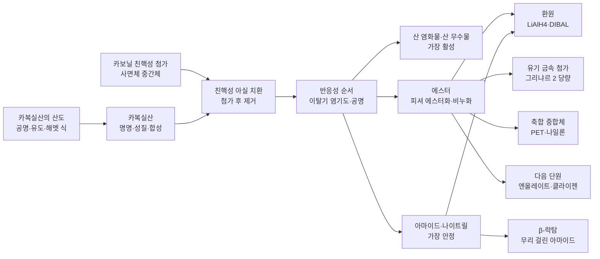

# 유기화학 11. 카복실산과 그 유도체 — 붙었다가 떨어지는 두 단계, 친핵성 아실 치환의 문법
<!-- prev: ochem-10, ochem-1, ochem-6, uchem-12 -->
<!-- next: ochem-12 -->

> [!NOTE]
> **이 단원의 범위**
> - 카복실산의 명명법과 물리적 성질, 산도와 치환기 효과(유도 효과, 해멧 식), 카복실산의 합성
> - 친핵성 아실 치환의 일반 메커니즘(사면체 중간체, 산·염기 촉매)과 그 실험적 근거(¹⁸O 표지)
> - 유도체의 반응성 순서(산 염화물 > 산 무수물 > 에스터 ≈ 카복실산 > 아마이드 > 카복실산 이온)와 상호 변환의 규칙
> - 산 염화물·산 무수물·에스터·아마이드·나이트릴의 합성과 반응(가수 분해, 알코올 분해, 가아민 분해)
> - 피셔 에스터화와 비누화, 에스터 교환, 락톤과 락탐
> - 환원($\mathrm{LiAlH_4}$, $\mathrm{NaBH_4}$, $\mathrm{BH_3}$, DIBAL)과 유기 금속 시약(그리냐르 시약, 길만 시약)의 첨가
> - 축합 중합체(폴리에스터·폴리아마이드)와 β-락탐 항생제의 반응성

**학습 목표**

1. 카복실산과 유도체를 IUPAC 이름과 관용명으로 부르고, 수소 결합 이합체로 끓는점·용해도를 설명할 수 있다.
2. 카복실산의 산도를 짝염기의 공명과 치환기의 유도 효과로 설명하고, $\mathrm{p}K_\mathrm{a}$ 차이를 자유 에너지로, 벤조산 유도체의 $\mathrm{p}K_\mathrm{a}$를 해멧 식으로 계산할 수 있다.
3. 친핵성 아실 치환을 '첨가 → 사면체 중간체 → 제거'의 두 단계로 굽은 화살표와 양성자 이동까지 쓰고, 알데하이드·케톤의 친핵성 첨가와 갈라지는 지점을 설명할 수 있다.
4. 유도체의 반응성 순서를 이탈기의 염기도와 공명 안정화로 설명하고, '반응성이 큰 유도체에서 작은 유도체로'의 규칙으로 변환 경로를 설계할 수 있다.
5. 피셔 에스터화 6단계와 비누화의 메커니즘을 쓰고, ¹⁸O 표지 실험으로 아실–산소 결합이 끊어짐을 논증하며, 평형 상수로 에스터의 수득률을 계산할 수 있다.
6. 환원 시약과 유기 금속 시약의 선택성(에스터 → 1° 알코올·알데하이드, 아마이드 → 아민, 나이트릴 → 아민·알데하이드·케톤, 에스터 + 그리냐르 시약 2 당량 → 3° 알코올)을 메커니즘으로 예측할 수 있다.
7. 나일론 6,6·PET의 축합 중합을 카로더스 식으로 정량화하고, β-락탐 항생제가 효소를 아실화하는 까닭을 고리 무리와 아마이드 공명의 약화로 설명할 수 있다.

**이 단원의 학습 사다리**

| 단계 | 무엇을 하나? |
|---|---|
| STEP 1. 이전 학습 다시 보기 | $\mathrm{p}K_\mathrm{a}$와 산도의 요인, 이탈기, 카보닐의 친핵성 첨가, 그리냐르 시약과 수소화물 환원 |
| STEP 2. 기초 다지기 | $\mathrm{p}K_\mathrm{a}$와 자유 에너지·분율, 사면체 중간체 되짚기, 평형 상수로 수득률 계산, 2차 속도식 |
| STEP 3. 핵심 개념 | 명명·성질 → 산도 → 합성 → 친핵성 아실 치환 → 반응성 순서 → 산 염화물·무수물 → 에스터 → 아마이드·나이트릴 → 환원 → 유기 금속 → 중합체와 β-락탐 |
| STEP 4. 오개념 바로잡기 | "비누화는 피셔 에스터화의 역반응일 뿐이다", "에스터에 그리냐르 시약 1 당량이면 케톤이 남는다" 같은 착각 |
| STEP 5. 대학원·연구로 | 해멧 ρ로 읽는 전이 상태의 전하, 뒤틀린 아마이드와 입체 전자 효과 |
| STEP 6. 생활·산업·진로 | 비누와 바이오디젤, 아스피린과 에스터 전구 약물, PET의 화학적 재활용, 항생제 내성 |

---

## 🗺️ 단원 들어가기

과일 향의 아세트산 아이소펜틸(바나나 향), 비누, 아스피린, 나일론 스타킹, 페트병, 단백질의 펩타이드 결합, 페니실린. 겉보기에 아무 관계가 없는 이 물질들은 모두 **아실기**(acyl group) $\mathrm{R{-}C({=}O){-}}$에 무언가가 붙은 화합물, 즉 **카복실산과 그 유도체**이다. 그리고 이들이 만들어지고 끊어지는 반응은 거의 모두 **한 가지 메커니즘**으로 설명된다.

「알데하이드와 케톤」에서 우리는 친핵체가 카보닐 탄소에 **첨가**하여 사면체 알콕사이드가 생기는 반응을 보았다. 케톤에서는 그 사면체 중간체가 양성자를 받아 알코올이 되고 끝난다. 탄소에 붙은 H나 알킬기는 떨어져 나갈 수 없기 때문이다. 그런데 카보닐 탄소에 Cl, OR, $\mathrm{NR_2}$처럼 **떨어져 나갈 수 있는 원자단**이 붙어 있으면 이야기가 달라진다. 사면체 중간체가 산소의 전자쌍으로 C=O를 다시 만들면서 그 원자단을 밀어낸다. 결과는 첨가가 아니라 **치환**이다. 이것이 **친핵성 아실 치환**(nucleophilic acyl substitution)이다.

이 단원을 마치면 "산 염화물로는 무엇이든 만들 수 있는데 아마이드는 왜 그렇게 끊기 어려운가", "에스터를 염기로 끊으면 왜 되돌아오지 않는가", "같은 에스터가 $\mathrm{LiAlH_4}$로는 알코올이, DIBAL로는 알데하이드가 되는 까닭은 무엇인가", "페니실린은 어떻게 세균의 효소를 죽이는가"에 메커니즘으로 답할 수 있다. 다음 단원 「카보닐 α 자리의 반응과 축합 반응」에서는 이 단원의 에스터가 엔올레이트가 되어 다른 에스터를 공격하는 클라이젠 축합으로 이어진다.

---

## STEP 1. 🔙 이전 학습 다시 보기

### 연계 개념표

| 이전 단원 | 그때 배운 것 | 이 단원에서 확장되는 것 |
|---|---|---|
| 일반화학 「핵화학·배위 화학·유기화학 개관」 '작용기', '축합 중합' | 카복실산·에스터·아마이드의 작용기, 에스터화가 물이 빠지는 축합이라는 것, 나일론·PET의 단위체 | 에스터화가 **어느 결합**에서 일어나는지(¹⁸O), 평형의 정량, 중합도를 카로더스 식으로 |
| 유기화학 「구조와 결합, 산과 염기」 '$\mathrm{p}K_\mathrm{a}$와 평형의 방향', '산도를 정하는 요인', '공명' | 이정표 산(카복실산 약 5), 카복실산 이온의 두 동등한 공명 구조, 유도 효과의 거리 의존(클로로뷰탄산), 아마이드의 공명과 회전 장벽 | 치환기 효과를 **해멧 식**으로 정량화, 유도체마다 다른 공명 기여가 **반응성 순서**를 정함 |
| 유기화학 「유기 반응의 개관과 알킬 할라이드의 치환·제거 반응」 '이탈기' | 좋은 이탈기 = 약한 염기(짝산 $\mathrm{p}K_\mathrm{a}$가 작다), 사이안화 이온의 $\mathrm{S_N2}$ | 사면체 중간체에서 떨어지는 $\mathrm{Cl^-}$, $\mathrm{RCOO^-}$, $\mathrm{RO^-}$, $\mathrm{R_2N^-}$의 순서. $\mathrm{S_N2}$로 나이트릴과 에스터 만들기 |
| 유기화학 「알코올·에터·에폭사이드와 황 화합물」 '수소화물 환원', '그리냐르 시약' | $\mathrm{NaBH_4}$·$\mathrm{LiAlH_4}$의 세기 차이, 에스터 + 그리냐르 시약(2 당량) → 3° 알코올(생성물과 화학량론) | 그 결과를 **메커니즘**으로: 왜 중간의 알데하이드·케톤에서 멈추지 않는가, DIBAL·길만 시약으로는 어떻게 멈추는가 |
| 유기화학 「알데하이드와 케톤」 '친핵성 첨가의 일반 메커니즘', '수소화물 환원과 그리냐르 반응' | 카보닐에 친핵체가 첨가해 사면체 중간체, 산 촉매(카보닐 양성자화)와 염기 촉매(센 친핵체) | 같은 사면체 중간체가 **이탈기를 밀어내며** 무너지는 두 번째 단계 |
| 유기화학 「구조 결정: 질량 분석법과 분광법」 '적외선 분광법' | C=O 신축 약 $1700\ \mathrm{cm^{-1}}$, 카복실산의 넓은 O–H | 유도체마다 C=O 파수가 다른 까닭($1800$ → $1650\ \mathrm{cm^{-1}}$)을 공명과 유도로 해석 |

### 준비 운동 (사전 진단)

**Q1.** 아세트산($\mathrm{p}K_\mathrm{a} = 4.76$)이 에탄올($\mathrm{p}K_\mathrm{a} \approx 16$)보다 훨씬 강한 산인 까닭을 짝염기의 구조로 한 문장으로 쓰시오.

**Q2.** 다음 음이온을 이탈기로서 좋은 것부터 늘어놓으시오. $\mathrm{CH_3O^-}$, $\mathrm{Cl^-}$, $\mathrm{CH_3COO^-}$, $\mathrm{NH_2^-}$ (짝산의 $\mathrm{p}K_\mathrm{a}$: 메탄올 15.5, HCl 약 −7, 아세트산 4.76, 암모니아 약 38)

**Q3.** 아세톤에 $\mathrm{NaBH_4}$를 넣고 메탄올에서 반응시키면 무엇이 생기는가? 첫 단계에서 수소화 이온이 공격하는 원자와, 그 결과 생기는 중간체의 탄소 혼성을 쓰시오.

**Q4.** 벤조산 메틸에 $\mathrm{CH_3MgBr}$를 과량 넣은 뒤 묽은 산으로 가공하면 무엇이 생기는가? 그리냐르 시약은 에스터 1 mol당 몇 mol이 소모되는가?

정답 및 해설

**Q1.** 아세트산 이온은 음전하가 동등한 산소 두 개에 공명으로 퍼지지만, 에톡사이드 이온은 산소 하나에 음전하가 모여 있다(「구조와 결합, 산과 염기」 ⑨ 요인 2).

**Q2.** $\mathrm{Cl^- > CH_3COO^- > CH_3O^- > NH_2^-}$. 짝산이 강할수록(짝산의 $\mathrm{p}K_\mathrm{a}$가 작을수록) 그 음이온은 약한 염기이고 좋은 이탈기이다. 이 순서가 그대로 STEP 3 ⑤의 유도체 반응성 순서가 된다.

**Q3.** 프로판-2-올. 수소화 이온은 카보닐 **탄소**를 공격하고, 그 결과 $sp^3$ 탄소를 가진 사면체 알콕사이드가 생긴다. 메탄올(용매)이 산소에 양성자를 주어 알코올이 된다.

**Q4.** 2-페닐프로판-2-올($\mathrm{C_6H_5C(CH_3)_2OH}$). 2 mol이 소모된다(「알코올·에터·에폭사이드와 황 화합물」 ④). 왜 중간의 아세토페논에서 멈추지 않는지는 이 단원 ⑩에서 메커니즘으로 설명한다.

---

## STEP 2. 🧱 기초 다지기

### 디딤돌 1. $\mathrm{p}K_\mathrm{a}$ 한 단위 = 5.71 kJ/mol, 그리고 pH가 정하는 분율

「구조와 결합, 산과 염기」 디딤돌 2·4에서 쓴 두 식을 다시 꺼낸다.

$$
\Delta G^\circ_\text{해리} = 2.303RT\,\mathrm{p}K_\mathrm{a} \;\approx 5.71\ \mathrm{kJ/mol} \times \mathrm{p}K_\mathrm{a}\ (25\ ^\circ\mathrm{C}), \qquad
\frac{[\mathrm{A^-}]}{[\mathrm{HA}]} = 10^{\,\mathrm{pH} - \mathrm{p}K_\mathrm{a}}
$$

두 산의 $\mathrm{p}K_\mathrm{a}$ 차이 $\Delta\mathrm{p}K_\mathrm{a}$는 해리 자유 에너지의 차이 $5.71\,\Delta\mathrm{p}K_\mathrm{a}$ kJ/mol이고, 이 차이는 거의 모두 **짝염기(카복실산 이온)의 안정화 차이**에서 온다. 두 번째 식은 카복실산이 어떤 pH에서 중성 분자(유기 용매에 녹는다)로 있는지, 이온(물에 녹는다)으로 있는지를 알려 준다.

| pH − $\mathrm{p}K_\mathrm{a}$ | −2 | −1 | 0 | +1 | +2 | +3 |
|---|---|---|---|---|---|---|
| 이온 형태 $\mathrm{RCOO^-}$의 분율 | 1 % | 9 % | 50 % | 91 % | 99 % | 99.9 % |

#### 예제 1 — 클로로아세트산과 체액 속의 아세트산

(1) 클로로아세트산($\mathrm{p}K_\mathrm{a} = 2.87$)의 짝염기는 아세트산($\mathrm{p}K_\mathrm{a} = 4.76$)의 짝염기보다 25 ℃에서 몇 kJ/mol 더 안정한가? (2) pH 7.4의 혈장에서 아세트산의 몇 %가 아세트산 이온으로 있는가?

**풀이**
(1) $\Delta\mathrm{p}K_\mathrm{a} = 4.76 - 2.87 = 1.89$, $\Delta(\Delta G^\circ) = 5.71\times1.89 = 10.8\ \mathrm{kJ/mol}$.
(2) $[\mathrm{A^-}]/[\mathrm{HA}] = 10^{7.4 - 4.76} = 10^{2.64} = 437$, 분율 $= 437/438 = 0.998$, 즉 99.8 %.
**의미** 생체 안에서 카복실산은 거의 모두 **카복실산 이온**으로 있다. 그래서 생화학 책은 아세트산 대신 '아세트산 이온(아세테이트)', 피루브산 대신 '피루브산 이온'이라고 쓴다. ⑤에서 보듯 카복실산 이온은 유도체 가운데 친핵성 아실 치환에 **가장 둔한** 형태이다. 세포가 카복실산을 반응시킬 때 먼저 ATP나 조효소 A로 '활성화'하는 까닭이다.

### 디딤돌 2. 사면체 중간체 — 「알데하이드와 케톤」에서 가져올 것

친핵성 첨가의 핵심만 되짚는다. 카보닐 탄소는 $sp^2$ 평면이고, C=O π* 오비탈(LUMO)이 탄소 쪽으로 크게 나와 있다. 친핵체는 C=O 평면에 대해 약 105°의 각도(뷔르기–두니츠 각)로 탄소에 다가가 결합을 만들고, π 전자쌍은 산소로 밀려 **사면체 알콕사이드 중간체**(tetrahedral intermediate)가 생긴다. 탄소는 $sp^2$ → $sp^3$로 바뀐다.

| 촉매 조건 | 첫 단계 | 친핵체 | 예 |
|---|---|---|---|
| 염기성·중성(센 친핵체) | 친핵체가 바로 카보닐 탄소를 공격 | $\mathrm{HO^-}$, $\mathrm{RO^-}$, $\mathrm{H^-}$, $\mathrm{R^-}$(RMgX), $\mathrm{RNH_2}$ | 비누화, 수소화물 환원, 그리냐르 첨가 |
| 산성(약한 친핵체) | 카보닐 **산소**에 양성자가 붙어 탄소가 더 친전자성이 된다 | $\mathrm{H_2O}$, ROH | 피셔 에스터화, 아마이드의 산 가수 분해 |

케톤에서는 사면체 중간체의 탄소에 붙은 네 원자단이 O⁻(또는 OH), R, R′, Nu이다. R과 R′은 탄소 음이온($\mathrm{p}K_\mathrm{a}$ 약 50의 짝염기)으로 떨어져야 하므로 떨어지지 못한다. 카복실산 유도체 $\mathrm{RCOY}$에서는 사면체 중간체에 **Y가 하나 더** 붙어 있고, Y가 충분히 약한 염기이면 떨어진다. 이 단원의 모든 반응은 이 차이 하나에서 출발한다.

<!-- fig:ochem-11-addition-vs-substitution -->

### 디딤돌 3. 평형 상수로 수득률 계산하기 — 이차 방정식 하나

피셔 에스터화는 평형 반응이다. 아세트산과 에탄올의 에스터화는 평형 상수가 약 4로, 에너지 차이가 거의 없는 '평평한' 반응이다.

$$
\mathrm{CH_3COOH + CH_3CH_2OH \rightleftharpoons CH_3COOCH_2CH_3 + H_2O}, \qquad K = \frac{[\text{에스터}][\mathrm{H_2O}]}{[\text{산}][\text{알코올}]} \approx 4
$$

산 $a$ mol, 알코올 $b$ mol(물 없이 시작)에서 에스터가 $x$ mol 생기면 부피는 약분되어

$$
\frac{x^2}{(a - x)(b - x)} = K \quad\Longrightarrow\quad (1 - K)x^2 + K(a + b)x - Kab = 0
$$

이고, $0 < x < \min(a, b)$인 근을 고른다.

#### 예제 2 — 알코올을 과량으로 쓰는 까닭

$K = 4.0$일 때 아세트산 1.0 mol에 에탄올을 (1) 1.0 mol (2) 3.0 mol (3) 10 mol 넣었을 때 아세트산 기준 에스터 수득률(평형)을 구하시오.

**풀이**
(1) $a = b = 1$이면 $x/(1 - x) = 2$, $x = 2/3$ → 67 %.
(2) $-3x^2 + 16x - 12 = 0$, $x = \dfrac{16 - \sqrt{256 - 144}}{6} = \dfrac{16 - 10.58}{6} = 0.903$ → 90 %.
(3) $-3x^2 + 44x - 40 = 0$, $x = \dfrac{44 - \sqrt{1936 - 480}}{6} = \dfrac{44 - 38.16}{6} = 0.974$ → 97 %.
**의미** 르샤틀리에 원리를 숫자로 본 것이다. 실험실에서는 알코올을 용매로 쓸 만큼 과량 넣거나, 생기는 물을 딘–스타크 장치나 분자체로 계속 빼내 평형을 오른쪽으로 민다. 반대로 에스터를 끊을 때(산 가수 분해)는 물을 과량으로 쓴다. 같은 평형을 어느 쪽에서 미느냐의 문제이다.

### 디딤돌 4. 2차 속도식 — 비누화의 시간 규모

비누화(⑦)는 에스터와 수산화 이온이 한 번씩 만나는 단계가 속도를 정하므로 $v = k[\text{에스터}][\mathrm{OH^-}]$이다. 일반화학 「화학 반응 속도론」에서처럼 두 농도가 같게($c_0$) 시작하면

$$
\frac{1}{c} - \frac{1}{c_0} = kt, \qquad t_{1/2} = \frac{1}{kc_0}
$$

이다. 1차 반응과 달리 반감기가 처음 농도에 반비례한다.

#### 예제 3 — 아세트산 에틸의 비누화

25 ℃에서 아세트산 에틸의 비누화 속도 상수는 약 $0.11\ \mathrm{M^{-1}s^{-1}}$이다. 에스터와 NaOH를 모두 0.050 M로 섞었을 때 (1) 반감기 (2) 90 % 반응하는 데 걸리는 시간을 구하시오.

**풀이**
(1) $t_{1/2} = 1/(0.11\times0.050) = 182\ \mathrm{s} \approx 3.0\ \mathrm{min}$.
(2) 90 % 반응하면 $c = 0.10c_0$이므로 $kt = 1/(0.10c_0) - 1/c_0 = 9/c_0$, $t = 9/(0.11\times0.050) = 1.6\times10^3\ \mathrm{s} \approx 27\ \mathrm{min}$.
**의미** 실온에서도 수십 분이면 끝나는 반응이다. 같은 에스터를 순수한 물에만 두면 몇 년이 걸린다. 수산화 이온은 물보다 훨씬 센 친핵체이고, 생성물 카복실산이 곧바로 이온이 되어 되돌아오지 않기 때문이다(⑦). 이 반응은 전기 전도도로 쉽게 추적할 수 있어(이동도가 큰 $\mathrm{OH^-}$가 이동도가 작은 $\mathrm{CH_3COO^-}$로 바뀐다) 학부 물리화학 실험의 단골 주제이다.

---

## STEP 3. 📘 핵심 개념

### ① 카복실산과 유도체의 이름, 그리고 물리적 성질

#### 카복실산의 이름

**카복실산**(carboxylic acid)은 카보닐 탄소에 하이드록시기가 붙은 **카복실기**(carboxyl group) $\mathrm{-COOH}$를 가진다. IUPAC 이름은 카복실기 탄소를 포함한 가장 긴 사슬의 알케인 이름에서 끝의 '-e'를 '-oic acid'로 바꾼다. 한국어로는 '-산'을 붙인다. 번호는 **카복실기 탄소를 1번**으로 매긴다. 고리에 카복실기가 붙으면 고리 이름 뒤에 '카복실산'을 붙이고, 고리에 붙은 탄소를 1번으로 한다.

| 구조 | IUPAC 이름 | 관용명 | $\mathrm{p}K_\mathrm{a}$ | 어디서 |
|---|---|---|---|---|
| $\mathrm{HCOOH}$ | 메탄산 | 폼산 | 3.75 | 개미 |
| $\mathrm{CH_3COOH}$ | 에탄산 | 아세트산 | 4.76 | 식초 |
| $\mathrm{CH_3CH_2COOH}$ | 프로판산 | 프로피온산 | 4.87 | 치즈 |
| $\mathrm{CH_3(CH_2)_2COOH}$ | 뷰탄산 | 뷰티르산 | 4.82 | 상한 버터 |
| $\mathrm{CH_3(CH_2)_{16}COOH}$ | 옥타데칸산 | 스테아르산 | — | 동물성 지방 |
| $\mathrm{C_6H_5COOH}$ | 벤조산 | — | 4.20 | 방부제 |
| $\mathrm{HOOC{-}COOH}$ | 에테인다이오산 | 옥살산 | 1.25, 4.27(약) | 시금치 |
| $\mathrm{HOOC(CH_2)_4COOH}$ | 헥세인다이오산 | 아디프산 | 4.4, 5.4(약) | 나일론 6,6 원료 |
| $\mathrm{HOOC{-}C_6H_4{-}COOH}$ (1,4) | 벤젠-1,4-다이카복실산 | 테레프탈산 | — | PET 원료 |

관용명을 쓸 때는 카복실기 탄소 바로 옆을 α, 그다음을 β, γ, δ로 부른다. 예를 들어 $\mathrm{CH_3CH(OH)COOH}$는 2-하이드록시프로판산(IUPAC)이자 α-하이드록시프로피온산, 흔히 젖산이다. α, β 표기는 이 단원의 'β-락탐'과 다음 단원의 'α 수소'에서 계속 쓰인다.

#### 유도체의 이름

카복실산의 OH를 다른 원자단 Y로 바꾼 $\mathrm{RCOY}$가 **카복실산 유도체**(carboxylic acid derivative)이다. 나이트릴 $\mathrm{RC{\equiv}N}$은 카보닐이 없지만, 탄소의 산화수가 카복실산과 같고(+3) 가수 분해하면 카복실산이 되므로 유도체에 함께 넣는다.

| 무리 | 일반식 | 이름 붙이는 법 | 예 (IUPAC / 관용) | SMILES |
|---|---|---|---|---|
| **산 염화물**(acid chloride, 아실 클로라이드) | $\mathrm{RCOCl}$ | '-oic acid' → '-oyl chloride' | 에타노일 클로라이드 / 염화 아세틸 | `CC(=O)Cl` |
| **산 무수물**(acid anhydride) | $\mathrm{RCOOCOR}$ | 산 이름 + '무수물' | 에탄산 무수물 / 아세트산 무수물 | `CC(=O)OC(C)=O` |
| **에스터**(ester) | $\mathrm{RCOOR'}$ | 산 이름 + 알킬 이름(영어는 알킬 + '-oate') | 에탄산 에틸 / 아세트산 에틸 | `CCOC(C)=O` |
| **아마이드**(amide) | $\mathrm{RCONR'_2}$ | '-oic acid' → '-amide', N의 치환기는 N-으로 | 에탄아마이드 / 아세트아마이드, N,N-다이메틸메탄아마이드(DMF) | `CC(N)=O`, `CN(C)C=O` |
| **나이트릴**(nitrile) | $\mathrm{RC{\equiv}N}$ | 알케인(탄소 수는 CN 탄소 포함) + '나이트릴' | 에테인나이트릴 / 아세토나이트릴, 벤조나이트릴 | `CC#N` |
| **카복실산 이온**(carboxylate) | $\mathrm{RCOO^-M^+}$ | 산 이름 + 금속 이름 | 아세트산 나트륨 | `CC(=O)[O-].[Na+]` |

고리 모양 에스터는 **락톤**(lactone), 고리 모양 아마이드는 **락탐**(lactam)이라 하고, 고리에 들어간 카보닐 탄소와 헤테로 원자 사이의 탄소 수에 따라 β(4원 고리), γ(5원), δ(6원), ε(7원)를 붙인다. γ-뷰티로락톤(SMILES `O=C1CCCO1`), β-락탐(아제티딘-2-온, SMILES `O=C1CCN1`), ε-카프로락탐(SMILES `O=C1CCCCCN1`, 나일론 6의 원료)이 대표적이다.

#### 물리적 성질 — 수소 결합 이합체

카복실산은 O–H(수소 결합 주개)와 C=O(받개)를 함께 가져, 액체와 기체 상태에서 두 분자가 수소 결합 두 개로 맞물린 8원 고리 **이합체**(dimer)를 만든다. 그래서 몰질량이 비슷한 알코올보다 끓는점이 높다.

<!-- fig:ochem-11-acid-dimer -->

| 화합물 | 몰질량 (g/mol) | 끓는점 (℃) | 분자 사이의 주된 힘 |
|---|---|---|---|
| 프로판-1-올 | 60 | 97 | 수소 결합(사슬) |
| 아세트산 | 60 | 118 | 수소 결합 이합체 |
| 아세트산 메틸 | 74 | 57 | 쌍극자–쌍극자(수소 결합 주개 없음) |
| 아세트산 에틸 | 88 | 77 | 쌍극자–쌍극자 |
| 염화 아세틸 | 78.5 | 51 | 쌍극자–쌍극자 |
| 아세트산 무수물 | 102 | 140 | 쌍극자–쌍극자 |
| 아세토나이트릴 | 41 | 82 | 큰 쌍극자 모멘트(약 3.9 D) |
| 아세트아마이드 | 59 | 221 (녹는점 81) | N–H···O=C 수소 결합 그물 |
| N,N-다이메틸아세트아마이드 | 87 | 165 | 큰 쌍극자, N–H 없음 |

에스터·산 염화물·산 무수물은 수소 결합 주개가 없어 카복실산보다 끓는점이 낮다. 1차·2차 아마이드는 N–H가 있어 끓는점이 매우 높고, 아마이드 사이의 N–H···O=C 수소 결합은 단백질의 2차 구조와 나일론의 질긴 성질의 바탕이다. 탄소 4개 정도까지의 카복실산은 물과 잘 섞이지만, 사슬이 길어지면 녹지 않는다. 그래도 염기 수용액에서는 카복실산 이온이 되어 녹는다(산–염기 추출, 「구조와 결합, 산과 염기」 탐구 활동 A).

카복실산의 분광학적 특징은 IR에서 이합체의 매우 넓은 O–H 신축(약 $2500\sim3300\ \mathrm{cm^{-1}}$)과 C=O 신축(약 $1710\ \mathrm{cm^{-1}}$), $^1\mathrm{H}$ NMR에서 약 10~13 ppm의 넓은 단일선(D₂O를 넣으면 사라진다), $^{13}\mathrm{C}$ NMR에서 약 170~185 ppm의 카보닐 탄소이다(「구조 결정: 질량 분석법과 분광법」).

#### ✔ 바로 확인

1. IUPAC 이름: $\mathrm{CH_3CH_2CH(CH_3)COOH}$
2. (O/X) 아세트산 에틸은 아세트산보다 몰질량이 크므로 끓는점도 높다.
3. 빈칸: 고리 모양 아마이드를 (    ), 고리 모양 에스터를 (    )이라 한다.
4. 아세토나이트릴을 가수 분해하면 어떤 카복실산이 되는가?

정답

1. 2-메틸뷰탄산 — 카복실기 탄소가 1번이므로 메틸기는 2번 탄소에 있다.
2. X — 아세트산(118 ℃)은 수소 결합 이합체를 만들지만 에스터(77 ℃)는 수소 결합 주개가 없다.
3. 락탐, 락톤
4. 아세트산 — 나이트릴의 탄소 수(CN 탄소 포함)가 그대로 카복실산의 탄소 수가 된다.

### ② 카복실산의 산도와 치환기 효과

#### 왜 알코올보다 $10^{11}$배 강한가

카복실산이 양성자를 내놓으면 **카복실산 이온**(carboxylate ion)이 생기고, 그 음전하는 두 개의 **동등한** 산소에 공명으로 반씩 퍼진다. 알콕사이드는 산소 하나에 음전하가 모여 있다. 실험적 증거는 결합 길이이다. 폼산의 두 C–O 결합은 약 1.20 Å(C=O)과 1.34 Å(C–O)로 다르지만, 폼산 나트륨의 두 C–O는 모두 약 1.26 Å로 같다. 공명 혼성체에서 두 결합이 '1.5중 결합'이 된 것이다.

<!-- fig:ochem-11-acetate-resonance -->

#### 유도 효과 — 전자 끌기 원자단이 가까울수록 강해진다

카복실산 이온의 음전하를 끌어당기는 원자단은 산을 강하게 하고, 전자를 미는 원자단은 약하게 한다. 「구조와 결합, 산과 염기」에서 Cl의 위치에 따른 클로로뷰탄산을 보았으니, 여기서는 **원자단의 수와 종류**를 바꾼 아세트산 유도체를 본다.

| 산 | $\mathrm{p}K_\mathrm{a}$ (25 ℃, 물) | 아세트산보다 강한 정도 ($K_\mathrm{a}$ 비) | 짝염기의 상대 안정화 (kJ/mol) |
|---|---|---|---|
| $\mathrm{CH_3COOH}$ | 4.76 | 1 | 0 |
| $\mathrm{ICH_2COOH}$ | 3.18 | 38 | 9.0 |
| $\mathrm{BrCH_2COOH}$ | 2.90 | 72 | 10.6 |
| $\mathrm{ClCH_2COOH}$ | 2.87 | 78 | 10.8 |
| $\mathrm{FCH_2COOH}$ | 2.59 | 148 | 12.4 |
| $\mathrm{NCCH_2COOH}$ | 2.47 | 195 | 13.1 |
| $\mathrm{Cl_2CHCOOH}$ | 약 1.3 | 약 $3\times10^3$ | 약 20 |
| $\mathrm{Cl_3CCOOH}$ | 약 0.65 | 약 $1\times10^4$ | 약 23 |
| $\mathrm{F_3CCOOH}$ | 약 0.2 | 약 $4\times10^4$ | 약 26 |

할로젠의 전기 음성도 순서(F > Cl > Br > I)대로 산이 강해지고, 같은 할로젠이 늘면 효과가 거의 더해진다. 알킬기는 반대로 약하게 산을 약화시킨다(폼산 3.75 → 아세트산 4.76 → 프로판산 4.87). 알킬기가 카복실산 이온에 전자를 조금 밀어 주는 것과, 큰 알킬기가 이온 주위의 물 분자 배치를 방해해 **용매화**를 약하게 하는 것이 함께 작용한다.

#### 예제 4 — 유도 효과는 더해지는가

표의 값으로 (1) Cl 하나, 둘, 셋이 붙을 때 $\mathrm{p}K_\mathrm{a}$ 감소량을 구하고, (2) Cl 하나의 효과가 단순히 세 번 더해진다면 트라이클로로아세트산의 $\mathrm{p}K_\mathrm{a}$는 얼마로 예측되는지 실제 값과 비교하시오.

**풀이**
(1) 감소량: Cl 1개 $4.76 - 2.87 = 1.89$, 2개 약 $4.76 - 1.3 = 3.5$, 3개 약 $4.76 - 0.65 = 4.1$.
(2) 단순 합이면 $4.76 - 3\times1.89 = -0.91$로 예측되지만 실제는 약 0.65이다. 두 번째, 세 번째 Cl의 효과는 각각 약 1.6, 약 0.6으로 점점 줄어든다.
**의미** 유도 효과는 '대체로 더해지지만' 포화된다. 카복실산 이온의 음전하가 이미 상당히 끌려간 뒤에는 Cl을 더 붙여도 끌어갈 몫이 적고, 세 Cl이 서로의 전자도 끌어 효과가 줄어든다. 효과의 크기를 kJ/mol로 말하면, Cl 하나가 짝염기를 약 11 kJ/mol 안정하게 한다. 수소 결합 하나의 세기(약 20 kJ/mol)의 절반쯤이다.

#### 벤조산과 해멧 식 — 치환기 효과를 하나의 숫자로

벤젠 고리를 사이에 두면 치환기는 고리를 따라 전자를 끌거나 미는 공명 효과까지 전한다. 해멧(Hammett)은 25 ℃ 물에서 벤조산의 이온화를 기준 반응으로 삼아 메타·파라 치환기 X의 **치환기 상수** $\sigma_\mathrm{X}$를 정의했다.

$$
\sigma_\mathrm{X} \equiv \log\frac{K_\mathrm{a}(\mathrm{X{-}C_6H_4COOH})}{K_\mathrm{a}(\mathrm{C_6H_5COOH})} = \mathrm{p}K_\mathrm{a}(\text{벤조산}) - \mathrm{p}K_\mathrm{a}(\text{치환 벤조산})
$$

$\sigma > 0$이면 전자 끌기(산을 강하게), $\sigma < 0$이면 전자 주기이다. 다른 반응(에스터의 비누화, 다른 산의 이온화)에서도 메타·파라 치환체의 속도·평형 상수가

$$
\log\frac{k_\mathrm{X}}{k_\mathrm{H}} = \rho\,\sigma_\mathrm{X} \qquad \left(\text{또는 } \log\frac{K_\mathrm{X}}{K_\mathrm{H}} = \rho\,\sigma_\mathrm{X}\right)
$$

를 잘 따른다. 이것이 **해멧 식**(Hammett equation)이다. **반응 상수** $\rho$는 그 반응이 치환기에 얼마나 민감한지, 그리고 그 부호는 반응 중심에 음전하가 생기는지($\rho > 0$) 양전하가 생기는지($\rho < 0$)를 알려 준다. 정의에 따라 벤조산 이온화의 $\rho = 1$이다.

| 치환기 | $\sigma_\mathrm{meta}$ | $\sigma_\mathrm{para}$ | 해석 |
|---|---|---|---|
| $\mathrm{-NO_2}$ | 0.71 | 0.78 | 유도 + 공명 끌기, 파라에서 공명이 더해진다 |
| $\mathrm{-CN}$ | 0.56 | 0.66 | 유도 + 공명 끌기 |
| $\mathrm{-Cl}$ | 0.37 | 0.23 | 유도 끌기, 파라에서는 공명 주기가 일부 상쇄 |
| $\mathrm{-H}$ | 0 | 0 | 기준 |
| $\mathrm{-CH_3}$ | −0.07 | −0.17 | 약한 주기(초공액) |
| $\mathrm{-OCH_3}$ | 0.12 | −0.27 | 메타에서는 유도 끌기, 파라에서는 공명 주기가 이긴다 |

메톡시기의 두 값의 부호가 다르다는 점이 중요하다. 메타 자리에서는 산소의 공명 주기가 카복실기가 붙은 탄소까지 전해지지 않아 전기 음성도(유도 끌기)만 남는다. 파라 자리에서는 산소의 비공유 전자쌍이 고리를 통해 카복실기가 붙은 탄소까지 전자를 밀어 준다(「방향족 화합물의 반응」 '치환기 효과'의 오쏘·파라 지향과 같은 원리).

<!-- fig:ochem-11-hammett-plot -->

#### 예제 5 — 해멧 식으로 $\mathrm{p}K_\mathrm{a}$ 예측하기

벤조산의 $\mathrm{p}K_\mathrm{a} = 4.20$이다. (1) 4-나이트로벤조산, 3-클로로벤조산, 4-메톡시벤조산의 $\mathrm{p}K_\mathrm{a}$를 예측하시오. (2) 어떤 치환 벤조산의 $\mathrm{p}K_\mathrm{a}$가 3.66이었다. 이 치환기의 $\sigma$를 구하고, 위 표에서 어느 치환기에 가까운지 쓰시오.

**풀이**
(1) $\mathrm{p}K_\mathrm{a} = 4.20 - \sigma$. 4-나이트로: $4.20 - 0.78 = 3.42$ (실측 3.44), 3-클로로: $4.20 - 0.37 = 3.83$ (실측 3.83), 4-메톡시: $4.20 + 0.27 = 4.47$ (실측 4.47).
(2) $\sigma = 4.20 - 3.66 = 0.54$로, 메타 사이아노기($\sigma_\mathrm{meta} = 0.56$)에 가깝다.
**의미** 벤조산에서는 정의상 실측과 거의 맞는다. 해멧 식의 진짜 쓸모는 같은 $\sigma$로 **다른 반응**을 예측하는 데 있다. 예를 들어 벤조산 에틸의 비누화는 $\rho \approx +2.5$이므로, 4-나이트로벤조산 에틸은 벤조산 에틸보다 $10^{2.5\times0.78} \approx 90$배 빨리 비누화된다. $\rho$가 양수라는 것은 속도 결정 단계의 전이 상태(⑦의 사면체 중간체로 가는 길)에서 **음전하가 쌓인다**는 뜻이다(STEP 5 맛보기 ①).

#### ✔ 바로 확인

1. 산의 세기 순서: $\mathrm{CH_3COOH}$, $\mathrm{CF_3COOH}$, $\mathrm{ClCH_2COOH}$, $\mathrm{CH_3CH_2OH}$
2. (O/X) 아세트산 이온의 두 C–O 결합 길이는 서로 다르다.
3. 빈칸: 해멧 식에서 반응 상수 $\rho$가 양수이면 반응 중심에 (    ) 전하가 쌓이는 반응이다.
4. 4-메틸벤조산($\sigma_\mathrm{para} = -0.17$)의 $\mathrm{p}K_\mathrm{a}$를 예측하시오. (벤조산 4.20)

정답

1. $\mathrm{CF_3COOH > ClCH_2COOH > CH_3COOH > CH_3CH_2OH}$ — 유도 효과의 크기와 수, 그리고 카복실산 이온의 공명.
2. X — 공명 혼성체이므로 두 결합 모두 약 1.26 Å로 같다.
3. 음(−)
4. 약 4.37 — $4.20 - (-0.17)$. 실측값(4.37)과 같다.

### ③ 카복실산의 합성

카복실산을 만드는 길은 탄소 골격이 **그대로**인 것(산화, 유도체의 가수 분해)과 탄소가 **하나 늘어나는** 것(그리냐르 시약의 카복실화, 나이트릴의 가수 분해)으로 나뉜다.

| 방법 | 반응 | 탄소 수 | 주의 |
|---|---|---|---|
| 1° 알코올·알데하이드의 산화 | $\mathrm{RCH_2OH \xrightarrow{CrO_3,\ H_2SO_4,\ H_2O} RCOOH}$ (존스 산화), $\mathrm{KMnO_4}$ | 그대로 | 2° 알코올은 케톤에서 멈춘다(「알코올·에터·에폭사이드와 황 화합물」) |
| 알킬벤젠의 곁사슬 산화 | $\mathrm{C_6H_5CH_2CH_3 \xrightarrow{KMnO_4,\ H_2O,\ \Delta;\ H_3O^+} C_6H_5COOH}$ | 고리에 붙은 탄소 하나만 남는다 | 벤질 자리에 H가 하나 이상 있어야 한다(tert-뷰틸벤젠은 산화되지 않는다) |
| 알켄·알카인의 산화적 절단 | $\mathrm{RCH{=}CHR' \xrightarrow{KMnO_4,\ \Delta}}$ 또는 $\mathrm{O_3}$ 뒤 산화적 가공 → $\mathrm{RCOOH + R'COOH}$ | 줄어든다 | 「알켄과 알카인」 '오존 분해' |
| 그리냐르 시약의 카복실화 | $\mathrm{RMgX \xrightarrow{1.\ CO_2\ \ 2.\ H_3O^+} RCOOH}$ | +1 | 분자 안에 OH, NH, COOH 같은 산성 수소나 C=O가 있으면 안 된다 |
| 나이트릴의 가수 분해 | $\mathrm{RX \xrightarrow{NaCN,\ DMSO} RCN \xrightarrow{H_3O^+,\ \Delta} RCOOH + NH_4^+}$ | +1 | 첫 단계가 $\mathrm{S_N2}$이므로 1°·2° 할로젠화물만(3°는 제거) |
| 유도체의 가수 분해 | 에스터·아마이드·산 염화물 + 물(산 또는 염기) | 그대로 | ⑥~⑧ |

#### 그리냐르 시약의 카복실화 — $\mathrm{CO_2}$는 카보닐 화합물이다

이산화 탄소의 탄소는 산소 두 개에 둘러싸여 강한 친전자체이다. 그리냐르 시약의 C–Mg 결합 전자쌍이 $\mathrm{CO_2}$의 탄소를 공격하면, 한 C=O의 π 전자쌍이 산소로 가서 카복실산 마그네슘 염이 된다. 이 염은 음전하가 두 산소에 퍼진 카복실산 이온이므로 그리냐르 시약과 더 반응하지 않는다. 마지막에 산을 넣어 양성자를 주면 카복실산이 된다. 실험실에서는 그리냐르 용액을 잘게 부순 드라이아이스 위에 붓는다.

<!-- fig:ochem-11-grignard-carboxylation -->

#### 예제 6 — 두 경로 가운데 무엇을 고를까

다음 카복실산을 주어진 출발 물질에서 탄소 하나를 늘려 만들려 한다. 그리냐르 경로와 나이트릴 경로 가운데 알맞은 것을 고르고 까닭을 쓰시오.
(1) 2-클로로-2-메틸프로페인 → 2,2-다이메틸프로판산(SMILES `CC(C)(C)C(=O)O`)
(2) 3-브로모프로판-1-올(SMILES `OCCCBr`) → 4-하이드록시뷰탄산
(3) 브로모사이클로헥세인 → 사이클로헥세인카복실산

**풀이**
(1) **그리냐르 경로.** 3차 할로젠화물에 사이안화 이온을 넣으면 $\mathrm{S_N2}$ 대신 E2가 일어나 2-메틸프로펜이 생긴다. 3차 할로젠화물로도 그리냐르 시약 $\mathrm{(CH_3)_3CMgCl}$은 만들 수 있으므로 $\mathrm{CO_2}$와 반응시킨 뒤 산으로 가공한다.
(2) **나이트릴 경로.** 분자 안의 OH가 그리냐르 시약을 바로 파괴하므로(산–염기 반응) 그리냐르 경로는 보호기 없이는 불가능하다. 1차 브로민화물은 $\mathrm{S_N2}$가 잘 되므로 NaCN으로 4-하이드록시뷰테인나이트릴(SMILES `OCCCC#N`)을 만들고 염기로 가수 분해한다. 이때 산성으로 만들며 가열하면 분자 안의 OH가 카복실기와 에스터화하여 5원 고리 γ-뷰티로락톤이 되기 쉬우므로, 원하는 것이 열린 사슬 산이면 염(4-하이드록시뷰탄산 나트륨)으로 두는 편이 낫다.
(3) **둘 다 가능하지만 그리냐르 경로가 낫다.** 2차 할로젠화물에서 $\mathrm{S_N2}$는 느리고 사이안화 이온의 염기성 때문에 E2(사이클로헥센)가 경쟁한다. 그리냐르 시약은 2차에서도 잘 만들어진다.
**의미** 두 경로는 서로의 약점을 메운다. 그리냐르 경로는 산성 수소·카보닐에 약하고, 나이트릴 경로는 $\mathrm{S_N2}$가 안 되는 기질에 약하다.

#### ✔ 바로 확인

1. 1-브로모뷰테인에서 펜탄산을 만드는 두 가지 길을 시약만으로 쓰시오.
2. (O/X) 4-tert-뷰틸톨루엔을 뜨거운 $\mathrm{KMnO_4}$로 산화하면 벤젠-1,4-다이카복실산이 된다.
3. 그리냐르 시약과 $\mathrm{CO_2}$의 반응 생성물이 그리냐르 시약과 더 반응하지 않는 까닭은?

정답

1. ① Mg, 에터 → 1. $\mathrm{CO_2}$ 2. $\mathrm{H_3O^+}$ ② NaCN(DMSO) → $\mathrm{H_3O^+}$, 가열
2. X — 메틸기는 카복실기로 산화되지만 tert-뷰틸기는 벤질 자리에 H가 없어 산화되지 않는다. 생성물은 4-tert-뷰틸벤조산이다.
3. 카복실산 이온(마그네슘 염)은 음전하가 두 산소에 퍼져 카보닐 탄소의 친전자성이 매우 작기 때문이다.

### ④ 친핵성 아실 치환의 메커니즘 — 첨가하고, 그다음 떨어진다

#### 일반 메커니즘: 두 단계와 사면체 중간체

카복실산 유도체 $\mathrm{RCOY}$에 친핵체 $\mathrm{Nu^-}$가 반응하여 $\mathrm{RCONu + Y^-}$가 되는 반응을 **친핵성 아실 치환**이라 한다. 겉보기는 $\mathrm{S_N2}$처럼 '바꿔치기'이지만 메커니즘은 전혀 다르다.

1. **첨가**: Nu의 전자쌍 → 카보닐 탄소, C=O π 전자쌍 → O. $sp^3$ 탄소를 가진 사면체 알콕사이드 중간체가 생긴다.
2. **제거**: O⁻의 전자쌍이 되돌아와 C=O를 다시 만들고, 동시에 C–Y 결합 전자쌍이 Y로 간다. Y⁻가 떨어진다.

$$
\mathrm{R{-}\overset{O}{\overset{\Vert}{C}}{-}Y + Nu^-} \;\rightleftharpoons\; \mathrm{R{-}\underset{Nu}{\underset{\vert}{C}}(O^-){-}Y} \;\longrightarrow\; \mathrm{R{-}\overset{O}{\overset{\Vert}{C}}{-}Nu + Y^-}
$$

<!-- fig:ochem-11-nas-general -->

**왜 $\mathrm{S_N2}$처럼 한 번에 일어나지 않는가.** $sp^2$ 카보닐 탄소의 C–Y σ* 오비탈은 평면 안에 있어 뒤쪽 공격이 분자 자신에 가려지고, 반면 π*(C=O)는 비어 있으며 에너지가 낮다. 친핵체는 쉬운 길인 π*로 들어가 결합을 만들고, π 전자쌍을 산소에 '맡겨 두었다가' 나중에 Y를 밀어내는 데 쓴다. 산소가 전자쌍의 **임시 저장소** 역할을 하는 것이다.

#### 산 촉매 메커니즘: 약한 친핵체를 위하여

물이나 알코올처럼 약한 중성 친핵체는 카보닐 탄소를 직접 공격하기 어렵다. 산성 조건에서는 먼저 카보닐 산소가 양성자화되어 탄소의 친전자성이 크게 커진다(「구조와 결합, 산과 염기」 예제 21). 그다음 중성 친핵체가 첨가하고, 사면체 중간체 안에서 **양성자가 옮겨 다니며** 떨어질 원자단을 중성 분자(물, 알코올)로 만든 뒤 떨어뜨린다. 산 촉매 메커니즘은 단계가 많아 보이지만 규칙은 하나이다. **강한 염기(음이온)를 떨어뜨리지 않고 늘 중성 분자를 떨어뜨린다.**

| 조건 | 친핵체 | 사면체 중간체 | 떨어지는 것 | 대표 반응 |
|---|---|---|---|---|
| 염기성 | 음이온($\mathrm{HO^-}$, $\mathrm{RO^-}$) 또는 센 중성 친핵체($\mathrm{RNH_2}$) | 알콕사이드(음전하) | 음이온 $\mathrm{Y^-}$ | 비누화, 가아민 분해 |
| 산성 | 중성($\mathrm{H_2O}$, ROH) | 양성자 이동으로 중성 → 양이온 | 중성 분자 HY | 피셔 에스터화, 산 가수 분해 |

#### 반응 에너지 도표

<!-- fig:ochem-11-nas-energy -->

에너지 도표에서 사면체 중간체는 두 언덕 사이의 골짜기이다. 이탈기가 좋으면(Cl) 두 번째 언덕이 낮아 첫 단계(첨가)가 속도를 정하고, 이탈기가 나쁘면(아마이드의 $\mathrm{NH_2}$) 두 번째 언덕이 높아져 사면체 중간체가 친핵체를 도로 내놓고 출발 물질로 돌아가는 일이 잦아진다. 사면체 중간체는 언제나 **세 갈래 길**(원래 친핵체를 내놓기, Y를 내놓기, 다른 원자단을 내놓기) 앞에 서 있고, 가장 약한 염기가 가장 먼저 떨어진다.

<!-- sim:mj-acyl-substitution-energy -->

#### 실험적 근거 — 카보닐 산소의 ¹⁸O 교환

사면체 중간체는 수명이 짧아 직접 보기 어렵다. 그 존재를 처음 설득력 있게 보인 것은 벤더(Bender)의 ¹⁸O 교환 실험이다. 카보닐 산소를 ¹⁸O로 표지한 벤조산 에틸 $\mathrm{C_6H_5C({=}^{18}O)OCH_2CH_3}$을 보통 물($\mathrm{H_2^{16}O}$) 속에서 수산화 이온으로 비누화하다가 **반응을 중간에 멈추고** 남은 에스터를 회수하면, 그 에스터의 ¹⁸O 함량이 처음보다 **줄어 있다**.

에스터가 한 번에 치환된다면(한 단계 메커니즘) 반응하지 않고 남은 에스터는 손대지 않은 그대로여야 한다. 표지가 빠졌다는 것은 다음 경로가 있다는 뜻이다. $\mathrm{HO^-}$가 첨가해 사면체 중간체가 생기면, 그 안의 두 산소($\mathrm{^{18}O^-}$와 $\mathrm{^{16}OH}$)는 빠른 양성자 이동으로 **서로 동등해진다**. 이 중간체가 에톡사이드 대신 수산화 이온을 떨어뜨려 에스터로 돌아갈 때, 절반은 $\mathrm{^{18}OH^-}$를 떨어뜨려 표지가 빠진 에스터가 된다. 즉 **사면체 중간체는 실재하고, 가역적으로 생겼다가 되돌아간다.**

<!-- fig:ochem-11-bender-exchange -->

#### 예제 7 — 사면체 중간체는 어느 쪽으로 무너지는가

위 실험에서 가수 분해 속도 상수와 표지 교환 속도 상수의 비가 $k_\mathrm{h}/k_\mathrm{ex} = 5.0$으로 측정되었다고 하자(설명을 위한 가상의 값). 사면체 중간체가 두 산소가 동등해진 뒤 에톡사이드를 떨어뜨리는 속도 상수를 $k_2$, 수산화 이온 하나를 떨어뜨리는 속도 상수를 $k_{-1}$(두 OH 가운데 어느 쪽이든)이라 하고, 양성자 이동은 매우 빠르다고 가정한다. 사면체 중간체 가운데 생성물로 가는 비율을 구하시오.

**풀이**
식 세우기: 중간체가 출발 물질로 되돌아갈 때 표지된 OH와 표지되지 않은 OH가 같은 확률로 떨어지므로, 표지가 빠지는 속도는 되돌아가는 속도의 절반이다. 따라서 $\dfrac{k_\mathrm{h}}{k_\mathrm{ex}} = \dfrac{k_2}{k_{-1}/2} = \dfrac{2k_2}{k_{-1}}$.
대입: $k_2/k_{-1} = 5.0/2 = 2.5$. 생성물로 가는 비율 $= \dfrac{k_2}{k_2 + k_{-1}} = \dfrac{2.5}{3.5} = 0.71$.
**의미** 사면체 중간체의 약 70 %가 생성물로, 약 30 %가 출발 물질로 되돌아간다. 두 이탈기 $\mathrm{EtO^-}$(에탄올 $\mathrm{p}K_\mathrm{a}$ 약 16)와 $\mathrm{HO^-}$(물 15.7)의 염기도가 비슷하니 두 길이 비슷하게 경쟁하는 것이 자연스럽다. 아마이드의 비누화처럼 이탈기($\mathrm{NH_2^-}$)가 훨씬 나쁘면 되돌아가는 쪽이 압도적으로 많아지고, 반응이 느려진다.

#### ✔ 바로 확인

1. (O/X) 친핵성 아실 치환에서 카보닐 탄소는 $sp^2$ → $sp^3$ → $sp^2$로 혼성이 바뀐다.
2. 빈칸: 산 촉매 친핵성 아실 치환에서 떨어지는 원자단은 언제나 음이온이 아니라 (    ) 분자이다.
3. 벤더의 실험에서 반응 도중 회수한 **출발 에스터**의 ¹⁸O가 줄어든 것이 무엇의 증거인지 쓰시오.

정답

1. O — 첨가로 사면체 중간체($sp^3$)가 되고, 제거로 다시 카보닐($sp^2$)이 된다.
2. 중성 — 물, 알코올, 아민처럼 짝산이 강한 형태로 만든 뒤 떨어뜨린다.
3. 물(수산화 이온)이 첨가한 사면체 중간체가 실재하며 가역적으로 출발 물질로 되돌아간다는 증거이다. 한 단계 치환이라면 남은 에스터의 표지는 변하지 않아야 한다.

### ⑤ 유도체의 반응성 순서와 상호 변환의 규칙

#### 순서와 그 두 가지 까닭

친핵성 아실 치환에 대한 반응성은 다음 순서이다.

$$
\text{산 염화물} > \text{산 무수물} > \text{에스터} \approx \text{카복실산} > \text{아마이드} > \text{카복실산 이온}
$$

이 순서는 두 가지 요인이 **같은 방향**으로 작용한 결과이다.

**(1) 이탈기의 염기도.** 사면체 중간체가 무너질 때 떨어지는 $\mathrm{Y^-}$가 약한 염기일수록 두 번째 단계가 쉽고, 반응 전체가 내리막이 된다. 이탈기의 짝산 $\mathrm{p}K_\mathrm{a}$가 그 척도이다.

**(2) Y의 공명 주기.** Y의 비공유 전자쌍이 C=O와 공명하여(아래 그림) 카보닐 탄소의 양전하를 덜어 주면, 출발 물질 자체가 안정해지고 친전자성이 작아져 첫 단계(첨가)가 어려워진다. N은 전기 음성도가 작아 전자쌍을 가장 잘 내주고, Cl은 3p 오비탈이 탄소의 2p와 크기가 맞지 않아 거의 내주지 못한다. 산 무수물의 가운데 O는 전자쌍을 카보닐 **두 개**에 나누어 주어야 하므로 에스터의 O보다 한 카보닐에 덜 준다. 카복실산 이온은 음전하가 두 O에 퍼져 있어 친핵체가 다가오기조차 어렵고, 떨어져야 할 것이 $\mathrm{O^{2-}}$라 사실상 치환되지 않는다.

<!-- fig:ochem-11-derivative-resonance -->

| 유도체 | 이탈기 $\mathrm{Y^-}$ | 짝산 HY의 $\mathrm{p}K_\mathrm{a}$ | Y의 공명 주기 | IR C=O 신축 ($\mathrm{cm^{-1}}$, 약) | 물과의 반응 |
|---|---|---|---|---|---|
| 산 염화물 $\mathrm{RCOCl}$ | $\mathrm{Cl^-}$ | 약 −7 | 거의 없음 | 1800 | 실온에서 격렬 |
| 산 무수물 $\mathrm{(RCO)_2O}$ | $\mathrm{RCOO^-}$ | 약 4.8 | 작음(나눠 가짐) | 1820, 1760 (두 개) | 실온에서 천천히 |
| 에스터 $\mathrm{RCOOR'}$ | $\mathrm{R'O^-}$ | 약 16 | 보통 | 1740 | 산·염기 촉매와 가열 필요 |
| 카복실산 $\mathrm{RCOOH}$ | $\mathrm{HO^-}$ | 15.7 | 보통 | 1710 (이합체) | (물과 교환할 뿐) |
| 아마이드 $\mathrm{RCONR'_2}$ | $\mathrm{R'_2N^-}$ | 약 38 | 큼 | 1650~1690 | 센 산·염기와 오랜 가열 |
| 카복실산 이온 $\mathrm{RCOO^-}$ | ($\mathrm{O^{2-}}$) | — | 매우 큼(음전하) | 1550~1610, 약 1400 | 반응하지 않음 |

IR의 C=O 파수는 공명 주기를 보여 주는 증거이다. Y가 전자쌍을 C=O 쪽으로 많이 줄수록 C=O의 단일 결합 성격이 커져 결합이 약해지고 파수가 낮아진다(아마이드 1650). 반대로 Cl은 공명으로는 거의 주지 못하고 유도 효과로 탄소의 전자를 끌어 C=O를 짧고 단단하게 만든다(1800). 산 무수물의 두 띠는 두 C=O의 대칭·비대칭 신축이다.

> [!NOTE]
> 카복실산과 에스터가 '≈'인 데에는 단서가 붙는다. 산 촉매 조건에서는 둘이 비슷하지만, 염기성 조건에서는 카복실산이 먼저 양성자를 잃어 **카복실산 이온**(맨 아래)이 되므로 친핵체와 거의 반응하지 않는다. 카복실산을 직접 아마이드로 바꾸기 어려운 까닭도 이것이다. 아민을 넣으면 산–염기 반응으로 암모늄 카복실산 염이 먼저 생긴다(⑧).

#### 상호 변환의 규칙 — 내리막으로만 바로 간다

친핵성 아실 치환은 대개 사면체 중간체에서 **가장 약한 염기**가 떨어지는 쪽으로 진행하고, 반응 전체도 덜 안정한 유도체에서 더 안정한 유도체로 가는 내리막이다. 그래서 다음 규칙이 성립한다.

> [!IMPORTANT]
> **더 반응성이 큰 유도체에서 덜 큰 유도체로만 바로 바꿀 수 있다.** 산 염화물은 무수물·에스터·카복실산·아마이드로, 무수물은 에스터·카복실산·아마이드로, 에스터는 (다른) 에스터·아마이드·카복실산으로, 아마이드는 카복실산(이온)으로 바꿀 수 있다. 사다리를 **거슬러 오르려면** 먼저 카복실산으로 내려간 뒤, OH를 좋은 이탈기로 바꾸는 시약($\mathrm{SOCl_2}$, DCC 같은 짝지음 시약)으로 '활성화'한다.

<!-- fig:ochem-11-interconversion-ladder -->

#### 예제 8 — 바로 일어나는가, 일어나지 않는가

다음 반응이 실온 근처에서 직접 일어나는지 판단하고, 일어나면 생성물을, 일어나지 않으면 원하는 생성물을 얻는 방법을 쓰시오.
(1) 아세트산 무수물 + 메탄올 (2) 아세트산 에틸 + 염화 나트륨(→ 염화 아세틸을 원함) (3) 벤조일 클로라이드 + 아세트산 나트륨 (4) 아세트아마이드 + 메탄올(→ 아세트산 메틸을 원함)

**풀이**
(1) 일어난다. 무수물 → 에스터(내리막). 생성물: 아세트산 메틸(SMILES `COC(C)=O`) + 아세트산. 떨어지는 것은 아세트산 이온(약한 염기)이다.
(2) 일어나지 않는다. 사면체 중간체가 생기더라도 $\mathrm{Cl^-}$가 에톡사이드보다 훨씬 약한 염기이므로 $\mathrm{Cl^-}$가 다시 떨어진다. 에스터를 NaOH로 비누화하고 산으로 카복실산을 얻은 다음 $\mathrm{SOCl_2}$로 처리한다.
(3) 일어난다. 산 염화물 → 무수물. 생성물: 아세트산 벤조산 혼합 무수물(SMILES `CC(=O)OC(=O)c1ccccc1`) + NaCl.
(4) 직접은 일어나지 않는다(오르막). 아마이드를 센 산으로 가열해 가수 분해(아세트산 + $\mathrm{NH_4^+}$)한 뒤 메탄올과 피셔 에스터화한다.
**의미** 생성물을 예측할 때 "사면체 중간체에 붙은 원자단 가운데 무엇이 가장 약한 염기인가?"를 묻는 습관이 반응 대부분을 해결한다.

#### ✔ 바로 확인

1. 반응성 순서로 늘어놓으시오: 아세트아마이드, 염화 아세틸, 아세트산 에틸, 아세트산 무수물
2. (O/X) 아마이드의 C=O 신축 파수가 에스터보다 낮은 것은 N의 공명 주기가 C=O의 단일 결합 성격을 키우기 때문이다.
3. 빈칸: 카복실산을 산 염화물로 바꾸려면 OH를 좋은 이탈기로 만드는 시약, 예컨대 (    )이 필요하다.

정답

1. 염화 아세틸 > 아세트산 무수물 > 아세트산 에틸 > 아세트아마이드
2. O — 공명 기여 $\mathrm{R{-}C(O^-){=}N^+R_2}$가 크다.
3. 염화 싸이오닐($\mathrm{SOCl_2}$) — 또는 염화 옥살릴 $\mathrm{(COCl)_2}$.

### ⑥ 산 염화물과 산 무수물 — 사다리의 꼭대기

#### 산 염화물의 합성: 염화 싸이오닐

카복실산의 OH는 나쁜 이탈기($\mathrm{HO^-}$)이다. **염화 싸이오닐**(thionyl chloride, $\mathrm{SOCl_2}$)은 이 OH를 **아실 클로로설파이트** $\mathrm{RC({=}O)OS({=}O)Cl}$이라는 매우 좋은 이탈기로 바꾼 뒤, 떨어져 나온 염화 이온이 친핵성 아실 치환을 하게 한다.

$$
\mathrm{RCOOH + SOCl_2 \longrightarrow RCOCl + SO_2(g) + HCl(g)}
$$

1. 카복실산 OH의 산소 전자쌍 → $\mathrm{SOCl_2}$의 황, 동시에 S–Cl 결합 → Cl($\mathrm{Cl^-}$가 떨어진다). 황 위에서도 첨가(S=O π → O)와 제거가 차례로 일어난다고 볼 수 있지만, 아래 그림은 이를 화살표 두 개의 한 단계로 줄여 그렸다. 양성자를 잃으면 아실 클로로설파이트가 된다.
2. $\mathrm{Cl^-}$ → 카보닐 탄소(첨가), 사면체 중간체.
3. O⁻가 C=O를 다시 만들며 $\mathrm{^-OS({=}O)Cl}$이 떨어지고, 이것이 $\mathrm{SO_2}$ 기체와 $\mathrm{Cl^-}$로 쪼개진다.

부산물이 모두 기체로 빠져나가므로 평형이 아니라 한쪽으로 완결된다. 같은 일을 더 온화하게 하는 시약이 **염화 옥살릴** $\mathrm{(COCl)_2}$(촉매량의 DMF와 함께, 부산물 $\mathrm{CO}$, $\mathrm{CO_2}$, HCl)이며, $\mathrm{PCl_5}$나 $\mathrm{PCl_3}$도 쓰인다.

<!-- fig:ochem-11-thionyl-chloride -->

#### 산 염화물의 반응

산 염화물은 거의 모든 산소·질소 친핵체와 실온 이하에서 빠르게 반응한다. 반응마다 HCl이 1 mol 생기므로 그것을 잡을 **염기**를 함께 넣는다.

| 친핵체 | 생성물 | 함께 넣는 염기 | 반응식 |
|---|---|---|---|
| 물 | 카복실산 | (없어도 됨) | $\mathrm{RCOCl + H_2O \rightarrow RCOOH + HCl}$ |
| 알코올 | 에스터 | 피리딘, 트라이에틸아민 | $\mathrm{RCOCl + R'OH \xrightarrow{C_5H_5N} RCOOR' + C_5H_5NH^+Cl^-}$ |
| 암모니아·1°·2° 아민 | 아마이드 | 아민 1 당량 더 또는 NaOH 수용액 | $\mathrm{RCOCl + 2R'_2NH \rightarrow RCONR'_2 + R'_2NH_2^+Cl^-}$ |
| 카복실산 이온 | 산 무수물 | — | $\mathrm{RCOCl + R'COO^-Na^+ \rightarrow RCOOCOR' + NaCl}$ |
| 벤젠 + $\mathrm{AlCl_3}$ | 아릴 케톤 | — | 프리델–크래프츠 아실화(「방향족 화합물의 반응」) |
| 수소화물·유기 금속 | 알데하이드·알코올·케톤 | — | ⑨, ⑩ |

**가아민 분해**(aminolysis)에서 아민을 2 당량 쓰는 까닭은 메커니즘에 있다. 아민의 N 전자쌍이 카보닐 탄소에 첨가하면 N에 양전하가 있는 사면체 중간체(쯔비터 이온)가 생기고, 그것이 $\mathrm{Cl^-}$를 내놓으면 **양성자화된 아마이드**가 된다. 이 양성자를 두 번째 아민 분자가 떼어 가며 암모늄 염이 된다. 염기를 따로 넣지 않으면 생긴 HCl이 남은 아민을 암모늄 이온으로 바꾸어 버리고, 암모늄 이온은 전자쌍이 없어 친핵체가 아니므로 아민의 절반이 낭비된다. 비싼 아민을 쓸 때는 대신 NaOH 수용액과 유기 용매의 두 층에서 반응시키는데(**쇼텐–바우만 조건**, Schotten–Baumann), 산 염화물은 유기층에 있어 물과는 느리게 반응하고 아민과는 빠르게 반응한다.

<!-- fig:ochem-11-aminolysis -->

#### 예제 9 — 가아민 분해의 화학량론

벤조일 클로라이드 7.03 g(몰질량 140.57 g/mol)에서 N-메틸벤즈아마이드(135.17 g/mol)를 만든다. (1) 다른 염기 없이 메틸아민만 쓸 때 필요한 최소량(mol)은? (2) 메틸아민을 1.0 당량만 넣으면 이론상 아마이드는 최대 몇 g 생기는가? (3) 메틸아민 1.0 당량과 트라이에틸아민 1.1 당량을 쓰면 이론 수득량은?

**풀이**
(1) 벤조일 클로라이드 $7.03/140.57 = 0.0500\ \mathrm{mol}$. 아마이드 1 mol마다 HCl 1 mol을 잡을 아민이 1 mol 더 필요하므로 메틸아민 $0.100\ \mathrm{mol}$.
(2) 메틸아민 0.0500 mol 가운데 절반이 친핵체, 절반이 염기로 쓰이므로 아마이드는 최대 $0.0250\ \mathrm{mol} = 0.0250\times135.17 = 3.38\ \mathrm{g}$.
(3) HCl은 트라이에틸아민(3° 아민, N–H가 없어 아마이드를 만들지 않는다)이 잡으므로 아마이드 $0.0500\ \mathrm{mol} = 6.76\ \mathrm{g}$.
**의미** 3° 아민은 N–H가 없어 아실화되더라도 안정한 아마이드가 되지 못한다(아실암모늄 이온은 다시 아실 공여체가 된다). 그래서 3° 아민과 피리딘은 '산 청소부'로 쓰인다. 피리딘은 산 염화물과 아실피리디늄 이온을 만들어 오히려 아실화를 촉진하기도 한다.

#### 산 무수물 — 한결 다루기 쉬운 아실화제

산 무수물은 산 염화물에 카복실산 이온을 반응시켜 만들거나, 다이카복실산을 가열해 분자 안에서 물을 빼 5원·6원 고리 무수물로 만든다(예: 뷰테인다이오산 → 석신산 무수물, 벤젠-1,2-다이카복실산 → 프탈산 무수물). 반응은 산 염화물과 같은 꼴이되 떨어지는 것이 카복실산 이온이므로, 부산물이 부식성 HCl이 아니라 카복실산이다. 반응이 덜 격렬하고 값이 싸서 공업적 아세틸화에는 **아세트산 무수물**이 널리 쓰인다.

$$
\mathrm{(CH_3CO)_2O + R'OH \longrightarrow CH_3COOR' + CH_3COOH}, \qquad
\mathrm{(CH_3CO)_2O + R'NH_2 \longrightarrow CH_3CONHR' + CH_3COOH}
$$

대표 예가 살리실산(2-하이드록시벤조산)의 페놀 OH를 아세틸화하는 **아스피린**(2-아세톡시벤조산) 합성과, 4-아미노페놀의 아미노기를 아세틸화하는 **아세트아미노펜**(파라세타몰) 합성이다. 4-아미노페놀에서는 N이 O보다 친핵성이 커서 아마이드가 먼저 생긴다(화학 선택성).

<!-- fig:ochem-11-aspirin-synthesis -->

#### 예제 10 — 아스피린의 수득률

살리실산 2.00 g(138.12 g/mol)에 아세트산 무수물 5.0 mL(밀도 1.08 g/mL, 102.09 g/mol)와 진한 인산 몇 방울을 넣고 데운 뒤, 물을 넣어 남은 무수물을 분해하고 결정을 얻었다. 마른 아스피린(180.16 g/mol)이 2.10 g이었다. (1) 한계 반응물과 (2) 수득률을 구하시오. (3) 반응 뒤에 물을 넣는 까닭을 반응식으로 쓰시오.

**풀이**
(1) 살리실산 $2.00/138.12 = 0.01448\ \mathrm{mol}$, 무수물 $5.0\times1.08/102.09 = 0.0529\ \mathrm{mol}$(약 3.7 당량). 한계 반응물은 살리실산.
(2) 이론 수득량 $0.01448\times180.16 = 2.61\ \mathrm{g}$, 수득률 $2.10/2.61 = 0.805$ → 약 80 %.
(3) $\mathrm{(CH_3CO)_2O + H_2O \rightarrow 2CH_3COOH}$. 과량의 무수물을 물에 녹는 아세트산으로 바꾸어 결정에서 씻어 낸다. 무수물은 에스터보다 반응성이 크므로 이 조건에서 물과 반응하지만, 생성물 아스피린의 에스터는 짧은 시간 동안에는 거의 가수 분해되지 않는다.
**의미** 사다리의 순서(무수물 > 에스터)가 '과량의 시약만 골라 없애는' 정제 전략이 된다. 그러나 아스피린도 습한 곳에 오래 두면 천천히 가수 분해되어 식초 냄새(아세트산)가 난다.

#### ✔ 바로 확인

1. 프로판산을 염화 프로파노일로 바꾸는 시약과 기체 부산물 두 가지를 쓰시오.
2. (O/X) 염화 아세틸과 다이에틸아민으로 N,N-다이에틸아세트아마이드를 만들 때 다이에틸아민은 최소 1 당량이면 충분하다(다른 염기 없음).
3. 4-아미노페놀과 아세트산 무수물 1 당량의 주생성물은?

정답

1. $\mathrm{SOCl_2}$, 부산물 $\mathrm{SO_2}$와 HCl
2. X — 2 당량이 필요하다. 1 당량은 HCl을 잡는 염기로 쓰여 다이에틸암모늄 염화물이 된다.
3. 아세트아미노펜(N-(4-하이드록시페닐)아세트아마이드, SMILES `CC(=O)Nc1ccc(O)cc1`) — 아미노기가 페놀 OH보다 친핵성이 크다.

### ⑦ 에스터 — 피셔 에스터화, 비누화, 그리고 ¹⁸O가 알려 준 것

#### 에스터를 만드는 세 길

| 방법 | 반응 | 특징 |
|---|---|---|
| 피셔 에스터화 | $\mathrm{RCOOH + R'OH \underset{}{\overset{H_2SO_4}{\rightleftharpoons}} RCOOR' + H_2O}$ | 평형($K$ 약 1~10). 알코올 과량이나 물 제거로 민다. 1°·2° 알코올에 알맞다 |
| 산 염화물·무수물의 알코올 분해 | $\mathrm{RCOCl + R'OH \xrightarrow{\text{피리딘}} RCOOR'}$ | 내리막이라 완결. 3° 알코올·페놀에도 쓸 수 있다 |
| 카복실산 이온의 알킬화($\mathrm{S_N2}$) | $\mathrm{RCOO^- + CH_3I \rightarrow RCOOCH_3 + I^-}$ | 카복실산 이온이 친핵체. 1° 할로젠화물·메틸에 한정(「유기 반응의 개관과…」 ④) |

#### 피셔 에스터화의 여섯 단계

**피셔 에스터화**(Fischer esterification)는 산 촉매 친핵성 아실 치환의 전형이다. 벤조산과 메탄올($\mathrm{H_2SO_4}$ 촉매)로 쓰면 다음과 같다. 단계마다 무엇이 전자쌍을 주고 무엇이 받는지 확인하자.

1. **카보닐 산소의 양성자화**: C=O 산소의 비공유 전자쌍 → $\mathrm{H{-}OCH_3^+}$(양성자화된 메탄올, 실질적인 산)의 H, H–O 결합 → O. 공명 안정화된 양이온 $\mathrm{C_6H_5C({=}O^+H)OH \leftrightarrow C_6H_5C^+(OH)_2}$가 생긴다.
2. **친핵체의 첨가**: 메탄올 O의 전자쌍 → 카보닐 탄소, C=O⁺H의 π 전자쌍 → O. 메탄올 산소에 양전하가 있는 사면체 중간체(옥소늄 이온)가 생긴다.
3. **탈양성자화**: 메탄올(용매)이 옥소늄 O–H의 H를 떼어 간다. 중성 사면체 중간체 $\mathrm{C_6H_5C(OH)_2(OCH_3)}$가 된다.
4. **떠날 OH의 양성자화**: 두 OH 가운데 하나가 양성자를 받아 $\mathrm{-OH_2^+}$(좋은 이탈기 물)가 된다.
5. **물의 이탈**: 남은 OH 산소의 전자쌍 → C–O 결합 자리(C=O⁺H 형성), $\mathrm{C{-}OH_2^+}$ 결합 → O. 물이 떨어지고 양성자화된 에스터가 생긴다.
6. **탈양성자화**: 메탄올이 C=O⁺H의 양성자를 떼어 가 벤조산 메틸이 되고, 촉매 $\mathrm{H^+}$가 되돌아온다.

<!-- fig:ochem-11-fischer-esterification -->

2·3·4단계를 묶어 보면 사면체 중간체에서 양성자 하나가 **메탄올에서 온 O**로부터 **원래 OH**로 옮겨 간 것이다. 산 촉매는 이렇게 떠날 원자단을 미리 양성자화해 물이라는 약한 염기로 만든다. 모든 단계가 가역이므로 같은 그림을 오른쪽에서 왼쪽으로 읽으면 **에스터의 산 촉매 가수 분해**가 된다(미시적 가역성).

#### ¹⁸O 표지 — 어느 결합이 끊어지는가

에스터화에서 물이 빠질 때, 그 산소는 카복실산의 OH에서 왔을까(**아실–산소 결합** 절단), 알코올의 OH에서 왔을까(**알킬–산소 결합** 절단)? 반응식만으로는 구별할 수 없다. 1938년 로버츠와 유리(Roberts, Urey)는 ¹⁸O로 표지한 메탄올 $\mathrm{CH_3{}^{18}OH}$로 벤조산을 에스터화하여 이 문제를 풀었다. 표지는 **에스터에** 들어가고 생긴 물에는 들어가지 않았다.

$$
\mathrm{C_6H_5CO{-}OH + H{-}{}^{18}OCH_3 \xrightarrow{H^+} C_6H_5CO{-}{}^{18}OCH_3 + H_2O}
$$

따라서 끊어지는 것은 카복실산의 C(=O)–OH, 즉 **아실–산소 결합**이고 알코올의 C–O 결합은 그대로 남는다. 메탄올의 O가 카보닐 탄소를 공격한다는 위 메커니즘과 정확히 맞는다. 거꾸로 알콕시 산소를 ¹⁸O로 표지한 에스터를 가수 분해하면(산이든 염기든) 표지는 **알코올 쪽**으로 나온다. 같은 결합이 반대 방향으로 끊어지는 것이다.

> [!NOTE]
> 예외도 메커니즘이 설명한다. **tert-뷰틸 에스터**를 산으로 가수 분해하면 표지가 카복실산 쪽에 남고 tert-뷰틸 알코올(또는 2-메틸프로펜)에는 들어가지 않는다. 양성자화된 에스터에서 안정한 3차 탄소 양이온이 떨어지는 $\mathrm{S_N1}$형 **알킬–산소 결합** 절단이 일어나기 때문이다. tert-뷰틸 에스터가 산에 약하고 염기에 강한 '카복실산 보호기'로 쓰이는 까닭이다(펩타이드 합성, 「생체 분자와 합성 고분자」).

#### 예제 11 — 질량 스펙트럼으로 결합 절단 판정하기

(1) 벤조산과 $\mathrm{CH_3{}^{18}OH}$의 피셔 에스터화에서 생기는 에스터의 분자 이온 $m/z$를, 아실–산소 절단인 경우와 알킬–산소 절단인 경우로 나누어 예측하시오(가장 많은 동위 원소 기준, ¹⁶O에 비해 ¹⁸O는 2 큼). (2) 프로판산 에틸의 에톡시 산소를 ¹⁸O로 표지한 $\mathrm{CH_3CH_2CO{-}{}^{18}OCH_2CH_3}$를 NaOH로 비누화하면 표지는 어느 생성물에 있고, 그 분자의 분자량은 얼마인가?

**풀이**
(1) 벤조산 메틸 $\mathrm{C_8H_8O_2}$의 분자 이온은 $m/z = 136$이다. 아실–산소 절단이면 메탄올의 ¹⁸O가 에스터에 들어가 $m/z = 138$, 알킬–산소 절단이면 메탄올의 $\mathrm{CH_3}$만 들어가고 산소는 모두 벤조산의 것이므로 $m/z = 136$(그리고 생긴 물이 $\mathrm{H_2{}^{18}O}$, 질량 20). 실제 관찰은 138이다.
(2) 수산화 이온이 카보닐 탄소를 공격하고 사면체 중간체에서 $\mathrm{CH_3CH_2{}^{18}O^-}$가 떨어지므로 표지는 **에탄올**에 있다. $\mathrm{CH_3CH_2{}^{18}OH}$의 분자량은 $46 + 2 = 48$이다. 프로판산 이온에는 표지가 없다.
**의미** 동위 원소 표지는 '원자에 이름표를 달아' 결합이 어디서 끊기는지를 직접 보여 준다. 메커니즘 연구에서 속도 법칙(몇 분자가 관여하는가), 입체화학(어느 방향에서 공격하는가)과 함께 가장 강력한 증거이다.

#### 비누화 — 마지막 산–염기 단계가 반응을 끝낸다

에스터를 수산화 나트륨 수용액과 가열하면 카복실산 이온과 알코올이 된다. 이것이 **비누화**(saponification)이다. 동물성 지방(트라이아실글리세롤)을 비누화하면 지방산 나트륨, 즉 비누와 글리세롤이 생긴다는 데서 이름이 왔다.

1. **첨가**: $\mathrm{HO^-}$의 전자쌍 → 카보닐 탄소, C=O π → O. 사면체 알콕사이드 중간체.
2. **제거**: O⁻ → C–O 자리, C–OR′ 결합 → O. 알콕사이드 $\mathrm{R'O^-}$가 떨어지고 카복실산이 생긴다.
3. **비가역 탈양성자화**: $\mathrm{R'O^-}$(또는 $\mathrm{HO^-}$)가 카복실산의 O–H 양성자를 떼어 카복실산 이온과 알코올이 된다.
4. **가공**: 반응이 끝난 뒤 산($\mathrm{H_3O^+}$)을 넣어야 카복실산을 얻는다.

<!-- fig:ochem-11-saponification -->

**왜 되돌아오지 않는가.** 3단계의 평형 상수는 $\mathrm{p}K_\mathrm{a}$ 두 개로 바로 계산된다(「구조와 결합, 산과 염기」 ⑧).

$$
\mathrm{CH_3COOH + CH_3CH_2O^- \rightleftharpoons CH_3COO^- + CH_3CH_2OH}, \qquad \log K = \mathrm{p}K_\mathrm{a}(\text{에탄올}) - \mathrm{p}K_\mathrm{a}(\text{아세트산}) \approx 16 - 4.76 = 11.2
$$

$K \approx 10^{11}$이므로 생긴 카복실산은 곧바로 카복실산 이온으로 '잠긴다'. 카복실산 이온은 반응성 사다리의 맨 아래에 있어 알코올과 다시 에스터를 만들지 못한다. 그래서 **비누화는 비가역**이고 1 당량 이상의 염기가 **소모된다**(촉매가 아니다). 반면 산 촉매 가수 분해는 피셔 에스터화의 역반응이므로 평형이며, 물을 과량 써야 끝까지 간다.

| 비교 | 산 촉매 가수 분해 | 비누화(염기성 가수 분해) |
|---|---|---|
| 시약의 역할 | $\mathrm{H^+}$는 촉매 | $\mathrm{OH^-}$는 1 당량 이상 소모 |
| 평형 | 가역(피셔 에스터화의 역) | 비가역(카복실산 이온 생성) |
| 첫 생성물 | 카복실산 + 알코올 | 카복실산 이온 + 알코올 |
| 친핵체 | 물(약함), 카보닐 양성자화로 보완 | 수산화 이온(강함) |
| 끊어지는 결합 | 아실–산소(3차 알킬 에스터는 알킬–산소) | 아실–산소 |

#### 에스터 교환과 락톤

에스터를 다른 알코올과 산 또는 그 알코올의 알콕사이드 촉매로 데우면 알콕시기가 바뀐다. 이것이 **에스터 교환**(transesterification)이다. 메커니즘은 피셔 에스터화(산 촉매)나 비누화의 앞 두 단계(염기 촉매)와 같고, 친핵체가 알코올·알콕사이드라는 것만 다르다. 염기 촉매일 때 떨어지는 것도 알콕사이드라 카복실산 이온이 생기지 않으므로 **촉매량**의 염기로 충분하고, 반응은 평형이다. 식물성 기름(트라이아실글리세롤)을 메탄올과 NaOH 또는 메톡사이드 촉매로 에스터 교환하면 지방산 메틸 에스터(**바이오디젤**)와 글리세롤이 생긴다(STEP 6).

같은 분자 안에 OH와 COOH가 있으면 분자 안 에스터화로 **락톤**이 생긴다. 5원(γ)과 6원(δ) 락톤은 고리 무리가 작고 엔트로피 손실도 작아 산성에서 저절로 잘 닫힌다. 락톤도 비누화하면 고리가 열려 하이드록시 카복실산 이온이 된다.

#### ✔ 바로 확인

1. 피셔 에스터화의 여섯 단계 가운데 탄소–산소 결합이 **새로 생기는** 단계와 **끊어지는** 단계의 번호를 쓰시오.
2. (O/X) 비누화에서 수산화 나트륨은 촉매이므로 0.1 당량이면 충분하다.
3. 카보닐 산소가 아닌 알콕시 산소를 ¹⁸O로 표지한 아세트산 메틸 $\mathrm{CH_3CO{-}{}^{18}OCH_3}$를 산 촉매로 가수 분해하면 표지는 어디에 나타나는가?
4. 염기 촉매 에스터 교환에 촉매량의 염기로 충분한 까닭은?

정답

1. 생기는 단계 ②(메탄올 O–카보닐 C), 끊어지는 단계 ⑤(C–OH₂⁺)
2. X — 생긴 카복실산이 염기를 소모해 카복실산 이온이 되므로 1 당량 이상이 필요하다.
3. 메탄올($\mathrm{CH_3{}^{18}OH}$) — 아실–산소 결합이 끊어지고 메탄올이 이탈기로 떨어진다.
4. 사면체 중간체에서 떨어지는 것이 알콕사이드이므로 염기가 다시 생기고, 카복실산 이온처럼 염기를 '가두는' 생성물이 생기지 않기 때문이다.

### ⑧ 아마이드와 나이트릴 — 사다리의 바닥

#### 아마이드의 구조와 성질

아마이드의 N 비공유 전자쌍은 C=O와 강하게 공명하여 C–N 결합이 부분 이중 결합 성격을 띤다. 그 결과 (1) C–N 결합 주위의 여섯 원자(카보닐 C의 두 치환기, O, N과 N의 두 치환기)가 **한 평면**에 놓이고, (2) C–N 회전 장벽이 약 75~90 kJ/mol로 커서 DMF의 두 메틸기는 실온 $^1\mathrm{H}$ NMR에서 서로 다른 두 신호로 보이며, (3) N이 거의 염기성을 띠지 않는다. 아마이드를 양성자화하면 양성자는 N이 아니라 **카보닐 산소**에 붙는다(그래야 공명이 유지된다). 양성자화된 아마이드의 $\mathrm{p}K_\mathrm{a}$는 약 0이다. 단백질의 펩타이드 결합이 평면이고 단단한 것도 이 공명 때문이다(「아미노산과 단백질의 구조」).

#### 아마이드를 만드는 길

| 방법 | 반응 | 비고 |
|---|---|---|
| 산 염화물·무수물 + 아민 | ⑥의 가아민 분해 | 가장 흔하다 |
| 에스터 + 아민(또는 $\mathrm{NH_3}$) | $\mathrm{RCOOR' + NH_3 \rightarrow RCONH_2 + R'OH}$ | 내리막이지만 느려서 가열이 필요하다 |
| 카복실산 + 아민, 가열 | $\mathrm{RCOO^-\,{}^+H_3NR' \xrightarrow{\ \Delta\ (\text{약 }200\ ^\circ C)\ } RCONHR' + H_2O}$ | 먼저 염이 생긴다. 높은 온도에서 물을 빼며 아마이드가 된다(나일론 염, ⑪) |
| 카복실산 + 아민 + 짝지음 시약 | DCC(다이사이클로헥실카보다이이미드) 등이 OH를 활성화 | 실온에서 된다. 펩타이드 합성의 기본(「생체 분자와 합성 고분자」) |

#### 아마이드의 가수 분해

아마이드는 사다리의 바닥 근처에 있어, 센 산이나 센 염기와 함께 오래 가열해야 가수 분해된다(단백질의 펩타이드 결합은 중성 물에서 반감기가 수백 년에 이른다고 어림된다). 그래도 두 조건 모두 마지막에 산–염기 반응이 생성물을 '잠가' 반응이 비가역으로 끝난다.

**산성 조건**(예: 6 M HCl, 가열)

1. 카보닐 **산소**의 양성자화(N이 아니라 O).
2. 물 O의 전자쌍 → 카보닐 탄소, C=O⁺H π → O. 옥소늄 사면체 중간체.
3. 양성자 이동: 물에서 온 O⁺–H의 양성자가 떨어지고, **N에 양성자**가 붙어 $\mathrm{-NH_3^+}$(또는 $\mathrm{-NR_2H^+}$)가 된다. 이제 이탈기는 중성 아민이다.
4. OH 산소의 전자쌍 → C–O 자리, C–N 결합 → N. 아민이 떨어지고 양성자화된 카복실산이 생긴다.
5. 카복실산이 양성자를 내놓고, 떨어진 아민은 산성 용액에서 즉시 암모늄 이온이 된다.

$$
\mathrm{NH_3 + H_3O^+ \rightleftharpoons NH_4^+ + H_2O}, \qquad \log K = 9.25 - (-1.7) \approx 11
$$

암모늄 이온은 전자쌍이 없어 친핵체가 아니므로 역반응(아민이 카복실산을 공격)이 막힌다.

<!-- fig:ochem-11-amide-hydrolysis -->

**염기성 조건**(예: NaOH 수용액, 가열) — $\mathrm{HO^-}$가 첨가해 사면체 알콕사이드가 생긴 뒤, 아주 나쁜 이탈기 $\mathrm{NH_2^-}$가 떨어지는 단계가 가장 어렵다. 실제로는 사면체 중간체가 한 번 더 탈양성자화된 이음이온에서 아마이드 이온이 떨어지거나, 물이 N에 양성자를 주는 것과 동시에 C–N이 끊어지는 경로로 진행된다고 본다. 생긴 카복실산은 곧바로 카복실산 이온이 되고, 암모니아가 기체로 빠져나간다.

#### 예제 12 — 모기 기피제 DEET의 합성 설계

N,N-다이에틸-3-메틸벤즈아마이드(DEET, SMILES `CCN(CC)C(=O)c1cccc(C)c1`)를 3-메틸벤조산과 다이에틸아민으로 만들려 한다. (1) 두 화합물을 섞어 실온에 두면 무엇이 생기는가? (2) 두 단계 합성을 시약과 함께 쓰고, 각 단계의 반응 종류를 밝히시오. (3) 다이에틸아민을 2.0 당량보다 적게 쓰려면 무엇을 더 넣어야 하는가?

**풀이**
(1) 산–염기 반응으로 다이에틸암모늄 3-메틸벤조산 염이 생긴다. $\log K = \mathrm{p}K_\mathrm{a}(\mathrm{Et_2NH_2^+}) - \mathrm{p}K_\mathrm{a}(\text{산}) \approx 11.0 - 4.3 \approx 7$로 거의 완전하다. 카복실산 이온은 친핵체에 반응하지 않으므로 아마이드는 생기지 않는다.
(2) ① $\mathrm{SOCl_2}$(가열) → 3-메틸벤조일 클로라이드(SMILES `Cc1cccc(C(=O)Cl)c1`): OH를 활성화한 친핵성 아실 치환. ② 다이에틸아민 2 당량(에터 또는 $\mathrm{CH_2Cl_2}$, 0 ℃) → DEET + $\mathrm{Et_2NH_2^+Cl^-}$: 가아민 분해.
(3) 트라이에틸아민이나 NaOH 수용액(쇼텐–바우만 조건)을 산 청소부로 넣는다.
**의미** "카복실산 + 아민 → 아마이드"는 종이 위에서는 한 줄이지만, 실제로는 사다리를 한 번 **올라갔다가**(활성화) 내려와야 한다. 생체에서는 같은 일을 ATP가 한다. 리보솜은 아미노산을 먼저 아미노아실-tRNA(에스터)로 활성화한 뒤 아마이드(펩타이드 결합)로 내려보낸다.

#### 나이트릴의 합성과 가수 분해

**나이트릴**은 C≡N의 탄소가 친전자성(δ+)이고 질소에 비공유 전자쌍이 있는 직선형 작용기이다($sp$ 혼성). 두 가지 길로 만든다.

- 1°·2° 할로젠화 알킬 + $\mathrm{NaCN}$(DMSO): $\mathrm{S_N2}$. 탄소가 하나 늘어난다.
- 1° 아마이드의 탈수: $\mathrm{RCONH_2 \xrightarrow{SOCl_2\ \text{또는}\ P_4O_{10}} RC{\equiv}N}$. 탄소 수 그대로.

나이트릴의 가수 분해는 C≡N에 물이 두 번 첨가되는 과정이다. 산성 조건에서는 N이 양성자화되어 탄소가 더 친전자성이 되고, 물이 탄소를 공격한 뒤 양성자 이동으로 **이미드산**(imidic acid, $\mathrm{RC(OH){=}NH}$)이 생긴다. 이미드산은 케토–엔올과 같은 꼴의 토토머화로 더 안정한 **아마이드**가 되고, 아마이드는 위의 경로로 카복실산과 암모늄 이온이 된다. 염기성 조건에서는 $\mathrm{HO^-}$가 C≡N 탄소를 직접 공격한다. 조건을 온화하게 하면 아마이드 단계에서 멈출 수도 있다.

<!-- fig:ochem-11-nitrile-hydrolysis -->

#### ✔ 바로 확인

1. (O/X) 아마이드에 산을 넣으면 양성자는 주로 질소에 붙는다.
2. 아세트아마이드를 6 M HCl로 오래 가열했을 때의 생성물 두 가지를 쓰시오.
3. 브로모메틸벤젠(벤질 브로마이드)에서 페닐아세트산을 만드는 두 단계 시약을 쓰시오.
4. 빈칸: 나이트릴의 가수 분해에서 처음 생기는 (    )은 토토머화하여 아마이드가 된다.

정답

1. X — 카보닐 산소에 붙는다. N에 붙으면 N의 전자쌍이 공명에 쓰일 수 없게 되어 불리하다.
2. 아세트산과 염화 암모늄($\mathrm{NH_4^+Cl^-}$)
3. ① NaCN, DMSO($\mathrm{S_N2}$) → 페닐아세토나이트릴 ② $\mathrm{H_3O^+}$, 가열
4. 이미드산($\mathrm{RC(OH){=}NH}$)

### ⑨ 환원 — 시약이 정하는 도착점

#### 시약별 선택성

수소화물 $\mathrm{H^-}$도 친핵체이므로 유도체의 환원은 친핵성 아실 치환에서 시작한다. 다만 치환 생성물(알데하이드)이 출발 물질보다 반응성이 크면 곧바로 두 번째 수소화 이온을 받아 알코올까지 가 버린다. 어디서 멈추는지는 **시약의 세기, 온도, 사면체 중간체의 수명**이 정한다.

| 기질 | $\mathrm{LiAlH_4}$ (THF, 뒤에 $\mathrm{H_3O^+}$) | $\mathrm{NaBH_4}$ (알코올) | $\mathrm{BH_3{\cdot}THF}$ | DIBAL (1 당량, −78 ℃) |
|---|---|---|---|---|
| 산 염화물 $\mathrm{RCOCl}$ | $\mathrm{RCH_2OH}$ | $\mathrm{RCH_2OH}$ | — | $\mathrm{RCHO}$ (또는 $\mathrm{LiAlH(OC(CH_3)_3)_3}$, −78 ℃) |
| 에스터 $\mathrm{RCOOR'}$ | $\mathrm{RCH_2OH + R'OH}$ | 거의 반응 안 함 | 느림 | $\mathrm{RCHO + R'OH}$ |
| 카복실산 $\mathrm{RCOOH}$ | $\mathrm{RCH_2OH}$ (먼저 $\mathrm{H_2}$ 발생) | 반응 안 함(염만 생김) | $\mathrm{RCH_2OH}$ (빠름, 선택적) | — |
| 아마이드 $\mathrm{RCONR'_2}$ | $\mathrm{RCH_2NR'_2}$ (아민) | 반응 안 함 | $\mathrm{RCH_2NR'_2}$ | (조건에 따라 알데하이드) |
| 나이트릴 $\mathrm{RC{\equiv}N}$ | $\mathrm{RCH_2NH_2}$ | 반응 안 함 | — | $\mathrm{RCHO}$ (가수 분해 가공 뒤) |

$\mathrm{NaBH_4}$가 에스터·아마이드를 거의 환원하지 못하는 까닭은 ⑤의 공명 주기 때문이다. 알콕시·아미노기의 전자쌍이 카보닐 탄소의 친전자성을 낮춰, B–H보다 극성이 큰 Al–H가 필요하다(「알코올·에터·에폭사이드와 황 화합물」 ③). 보레인 $\mathrm{BH_3}$은 반대로 **루이스 산**이어서 전자가 풍부한 카보닐(카복실산, 아마이드)의 산소에 먼저 배위한 뒤 수소화 이온을 옮기므로, 에스터가 있어도 카복실산만 골라 환원한다.

#### $\mathrm{LiAlH_4}$에 의한 에스터 환원 — 왜 알데하이드에서 멈추지 않는가

1. $\mathrm{AlH_4^-}$의 Al–H 결합 전자쌍 → 카보닐 탄소, C=O π → O(산소는 $\mathrm{Li^+}$나 Al에 배위한다). 사면체 알콕사이드 중간체.
2. O⁻ → C–O 자리, C–OR′ → O. $\mathrm{R'O^-}$가 떨어지고 **알데하이드**가 생긴다.
3. 알데하이드는 OR′의 공명 주기가 없어 에스터보다 친전자성이 크므로, 남은 $\mathrm{LiAlH_4}$와 에스터보다 **빨리** 반응한다. 두 번째 수소화 이온이 첨가해 1° 알콕사이드가 된다.
4. 가공($\mathrm{H_3O^+}$)으로 알콕사이드에 양성자를 주어 1° 알코올.

<!-- fig:ochem-11-lialh4-ester -->

**아마이드는 다르게 무너진다.** 아마이드에 수소화 이온이 첨가한 사면체 중간체에서는 $\mathrm{R_2N^-}$(아주 나쁜 이탈기) 대신 **산소**가 떨어진다. 산소는 알루미늄에 붙어 있어(중간체에서 $\mathrm{C{-}O{-}AlH_3^-}$) 알루미네이트 종으로 떨어질 수 있는 좋은 이탈기가 된다. N의 비공유 전자쌍이 C–O 결합을 밀어내며 **이미늄 이온** $\mathrm{RCH{=}N^+R'_2}$이 생기고, 이것이 두 번째 수소화 이온을 받아 아민이 된다. 그래서 아마이드의 C=O는 통째로 $\mathrm{CH_2}$가 되고, 탄소–질소 결합은 그대로 남는다. 나이트릴은 수소화 이온 두 개를 차례로 받아(이민 음이온 → 이음이온) 가공 뒤 1° 아민 $\mathrm{RCH_2NH_2}$가 된다.

<!-- fig:ochem-11-lialh4-amide -->

#### DIBAL과 −78 ℃ — 사면체 중간체를 붙잡아 두기

**DIBAL**(다이아이소뷰틸알루미늄 하이드라이드, $\mathrm{[(CH_3)_2CHCH_2]_2AlH}$)은 Al–H가 하나뿐인 중성 루이스 산이다. Al이 먼저 카보닐 산소에 배위한 뒤 수소화 이온을 넘겨, 산소가 알루미늄에 붙은 사면체 중간체(알루미늄 헤미아세탈)를 만든다. −78 ℃(드라이아이스–아세톤 중탕)에서는 이 중간체가 **무너지지 않는다**. 알데하이드가 생기지 않으니 두 번째 환원도 일어나지 않는다. 남은 DIBAL을 모두 분해한 뒤 차가운 물·산으로 가공하면 그제야 중간체가 헤미아세탈 → 알데하이드로 무너진다. 이때는 이미 수소화물이 없다. 1 당량과 낮은 온도 둘 다가 조건이다. 온도가 오르면 중간체가 가공 전에 무너져 알데하이드가 DIBAL과 또 반응하고, 과량을 쓰면 알코올까지 간다.

<!-- fig:ochem-11-dibal -->

#### 예제 13 — 수소화물의 당량

벤조산 에틸 15.0 g(150.17 g/mol)을 $\mathrm{LiAlH_4}$(37.95 g/mol)로 벤질 알코올(108.14 g/mol)로 환원한다. (1) 이론상 필요한 $\mathrm{LiAlH_4}$의 최소 질량은? (2) 같은 몰수의 **벤조산**을 환원한다면 최소 질량은? (3) 벤질 알코올의 이론 수득량은?

**풀이**
(1) 벤조산 에틸 $15.0/150.17 = 0.0999\ \mathrm{mol}$. 에스터 1 mol에 수소화 이온 2 mol이 필요하고, $\mathrm{LiAlH_4}$ 1 mol은 수소화 이온 4 mol을 낸다. $\mathrm{LiAlH_4}$ $0.0999\times2/4 = 0.0499\ \mathrm{mol} = 1.90\ \mathrm{g}$.
(2) 카복실산은 먼저 O–H 양성자가 수소화 이온 하나와 반응해 $\mathrm{H_2}$가 되고(산–염기), 그다음 두 개가 환원에 쓰여 모두 3 mol이 필요하다. $0.0999\times3/4 = 0.0749\ \mathrm{mol} = 2.84\ \mathrm{g}$.
(3) $0.0999\times108.14 = 10.8\ \mathrm{g}$.
**의미** 실제로는 시약의 일부가 수분과 반응하고 마지막 수소화 이온들은 느리게 전달되므로 계산값의 1.5~2배를 쓴다. 카복실산을 환원할 때 생기는 $\mathrm{H_2}$ 기체(이 경우 약 0.1 mol, 실온에서 약 2.4 L)는 화재 위험이 크므로 시약을 천천히 넣는다.

#### 예제 14 — 한 분자 안의 두 카보닐

헥세인다이오산 모노메틸 에스터(6-메톡시-6-옥소헥산산, SMILES `COC(=O)CCCCC(=O)O`)를 다음 시약으로 처리한 뒤 가공했다. 주생성물을 쓰시오. (1) $\mathrm{NaBH_4}$, 메탄올 (2) $\mathrm{BH_3{\cdot}THF}$ (3) $\mathrm{LiAlH_4}$ 과량, THF

**풀이**
(1) 변화 없음. 카복실산은 염(카복실산 나트륨)이 될 뿐이고 에스터는 $\mathrm{NaBH_4}$로 거의 환원되지 않는다. 가공하면 출발 물질이 돌아온다.
(2) 카복실산만 환원된다: 6-하이드록시헥산산 메틸(SMILES `COC(=O)CCCCCO`).
(3) 둘 다 환원된다: 헥세인-1,6-다이올(SMILES `OCCCCCCO`)과 메탄올.
**의미** $\mathrm{LiAlH_4}$는 친핵성이 센 수소화 이온 주개라 전자가 **부족한** 카보닐부터, $\mathrm{BH_3}$은 루이스 산이라 전자가 **풍부한** 카보닐부터 공격한다. 서로 반대의 선택성을 가진 두 시약을 알면 보호기 없이 한쪽만 고를 수 있다.

#### ✔ 바로 확인

1. 펜테인나이트릴을 (1) $\mathrm{LiAlH_4}$ 다음 $\mathrm{H_2O}$ (2) DIBAL(−78 ℃) 다음 $\mathrm{H_3O^+}$로 처리한 생성물은?
2. (O/X) $\mathrm{LiAlH_4}$로 에스터를 환원하는 도중에 알데하이드가 상당량 쌓인다.
3. N-메틸아세트아마이드($\mathrm{CH_3CONHCH_3}$)를 $\mathrm{LiAlH_4}$로 환원한 생성물의 이름은?

정답

1. (1) 펜탄-1-아민($\mathrm{CH_3(CH_2)_4NH_2}$) (2) 펜탄알($\mathrm{CH_3(CH_2)_3CHO}$)
2. X — 알데하이드가 에스터보다 반응성이 커서 생기자마자 환원된다.
3. N-메틸에탄아민($\mathrm{CH_3CH_2NHCH_3}$) — C=O가 $\mathrm{CH_2}$가 되고 C–N 결합은 남는다.

### ⑩ 유기 금속 시약의 첨가 — 그리냐르 시약 2 당량과 그 대안

#### 에스터 + 그리냐르 시약: 케톤은 지나가는 정거장이다

그리냐르 시약의 탄소 친핵체는 수소화 이온과 같은 길을 간다. 에스터 $\mathrm{RCOOR'}$ + $\mathrm{R''MgX}$:

1. C–Mg 결합 전자쌍 → 카보닐 탄소, C=O π → O(O는 Mg에 배위). 사면체 마그네슘 알콕사이드.
2. O⁻ → C–O 자리, C–OR′ → O. $\mathrm{R'OMgX}$가 떨어지고 **케톤** $\mathrm{RCOR''}$이 생긴다.
3. 케톤은 에스터보다 친전자성이 크므로 두 번째 $\mathrm{R''MgX}$가 바로 첨가한다(「알데하이드와 케톤」의 그리냐르 반응). 3° 알콕사이드.
4. 가공($\mathrm{NH_4Cl}$ 또는 묽은 산) → 3° 알코올 $\mathrm{RR''_2COH}$. 새 알킬기 두 개가 같다.

<!-- fig:ochem-11-ester-grignard -->

폼산 에스터($\mathrm{HCOOR'}$)는 같은 반응으로 같은 R 두 개를 가진 **2° 알코올**을, 락톤은 한쪽 끝에 3° 알코올·다른 끝에 1° 알코올이 있는 **다이올**을 준다. 산 염화물도 그리냐르 시약 2 당량과 3° 알코올이 된다. 카복실산에 그리냐르 시약을 넣으면 산–염기 반응만 일어나 알케인과 카복실산 마그네슘 염이 생기므로 쓸모가 없다.

#### 케톤에서 멈추는 세 가지 방법

| 방법 | 반응 | 멈추는 까닭 |
|---|---|---|
| 산 염화물 + **길만 시약**(다이알킬구리 리튬) | $\mathrm{RCOCl + R'_2CuLi \xrightarrow{-78\ ^\circ C} RCOR'}$ | 구리 시약은 무른 친핵체여서 반응성이 매우 큰 산 염화물과는 반응하지만 케톤에는 거의 첨가하지 않는다 |
| 나이트릴 + 그리냐르 시약 | $\mathrm{RC{\equiv}N + R'MgX \rightarrow RC(R'){=}N^-MgX^+ \xrightarrow{H_3O^+} RCOR'}$ | 첫 첨가로 생긴 **이민 음이온**은 음전하를 띠어 두 번째 친핵체를 밀어낸다. 케톤은 가공(이민의 가수 분해) 때에야 생기는데 그때는 그리냐르 시약이 이미 없다 |
| 와인렙 아마이드 + 그리냐르·유기 리튬 | $\mathrm{RCON(OCH_3)CH_3 + R'MgX \rightarrow \cdots \xrightarrow{H_3O^+} RCOR'}$ | 사면체 중간체의 Mg가 두 산소(O⁻와 $\mathrm{OCH_3}$)에 킬레이트되어 가공 전까지 무너지지 않는다(DIBAL과 같은 원리) |

<!-- fig:ochem-11-nitrile-grignard -->

#### 예제 15 — 같은 케톤, 서로 다른 출발점

1-페닐프로판-1-온(SMILES `CCC(=O)c1ccccc1`)을 만들려 한다. (1) 나이트릴과 그리냐르 시약으로 만드는 두 조합을 쓰시오. (2) 산 염화물로 만드는 방법을 쓰시오. (3) 한 학생이 벤조산 메틸에 $\mathrm{CH_3CH_2MgBr}$ 1.0 당량을 넣었다. 무엇이 주로 얻어지는가?

**풀이**
(1) ① 벤조나이트릴 + $\mathrm{CH_3CH_2MgBr}$, 이어서 $\mathrm{H_3O^+}$ ② 프로페인나이트릴($\mathrm{CH_3CH_2CN}$) + $\mathrm{C_6H_5MgBr}$, 이어서 $\mathrm{H_3O^+}$
(2) 벤조일 클로라이드 + $\mathrm{(CH_3CH_2)_2CuLi}$(−78 ℃). 또는 염화 프로파노일 + 벤젠 + $\mathrm{AlCl_3}$(프리델–크래프츠 아실화).
(3) 중간 케톤이 남은 에스터보다 빨리 반응하므로, 그리냐르 시약 1 당량은 에스터 약 0.5 당량을 3-페닐펜탄-3-올(SMILES `CCC(O)(CC)c1ccccc1`)로 바꾸는 데 쓰이고 나머지 약 0.5 당량의 에스터는 그대로 남는다. 원하는 케톤은 거의 얻어지지 않는다.
**의미** "중간 생성물이 출발 물질보다 반응성이 크면 멈출 수 없다"는 것이 이 단원 환원·첨가 반응의 공통 규칙이다. 멈추려면 중간 생성물이 **생기지 않게**(사면체 중간체·이민 음이온으로 붙잡아 두기) 하거나, 출발 물질만 반응하는 **약한 시약**(길만 시약, $\mathrm{LiAlH(OC(CH_3)_3)_3}$)을 쓴다.

#### ✔ 바로 확인

1. 폼산 에틸에 $\mathrm{CH_3MgBr}$ 과량을 넣고 가공한 생성물은?
2. (O/X) 아세트산에 $\mathrm{CH_3MgBr}$ 2 당량을 넣고 가공하면 2-메틸프로판-2-올이 생긴다.
3. γ-뷰티로락톤에 $\mathrm{CH_3MgBr}$ 과량을 넣고 가공한 생성물의 축약 구조식을 쓰시오.

정답

1. 프로판-2-올($\mathrm{(CH_3)_2CHOH}$) — 폼산 에스터 + 같은 R 두 개 → 2° 알코올.
2. X — 첫 당량은 산–염기 반응으로 메테인과 아세트산 마그네슘 염을 만들고, 카복실산 이온은 그리냐르 시약과 더 반응하지 않는다. 가공하면 아세트산이 돌아온다.
3. $\mathrm{(CH_3)_2C(OH)CH_2CH_2CH_2OH}$ (4-메틸펜테인-1,4-다이올) — 고리가 열리며 한쪽 끝은 3° 알코올, 다른 끝은 1° 알코올이 된다.

### ⑪ 축합 중합체와 β-락탐 — 같은 반응을 고분자와 약물로

#### 폴리아마이드와 폴리에스터

작용기가 **양 끝에 두 개씩** 있는 단위체로 친핵성 아실 치환을 되풀이하면 사슬이 끝없이 이어진다. 결합이 하나 생길 때마다 물·HCl·메탄올 같은 작은 분자가 빠지므로 **축합 중합**(condensation polymerization)이라 하고, 사슬이 단계적으로 커지므로 **단계 성장 중합**(step-growth polymerization)이라고도 한다.

| 중합체 | 단위체 | 연결 | 반복 단위 | 쓰임 |
|---|---|---|---|---|
| 나일론 6,6 | 헥세인-1,6-다이아민(SMILES `NCCCCCCN`) + 헥세인다이오산(SMILES `OC(=O)CCCCC(=O)O`) | 아마이드 | $\mathrm{{-}[NH(CH_2)_6NHCO(CH_2)_4CO]{-}}$ (226.32 g/mol) | 섬유, 엔지니어링 플라스틱 |
| 나일론 6 | ε-카프로락탐의 고리 열림 | 아마이드 | $\mathrm{{-}[NH(CH_2)_5CO]{-}}$ | 섬유 |
| 케블라 | 벤젠-1,4-다이아민 + 테레프탈로일 클로라이드 | 아마이드(방향족) | $\mathrm{{-}[NHC_6H_4NHCOC_6H_4CO]{-}}$ | 방탄복, 고강도 섬유 |
| PET | 테레프탈산(또는 테레프탈산 다이메틸) + 에테인-1,2-다이올 | 에스터 | $\mathrm{{-}[OCH_2CH_2OCOC_6H_4CO]{-}}$ (192.17 g/mol) | 음료병, 폴리에스터 섬유 |
| 폴리락트산(PLA) | 젖산의 고리 이합체(락타이드)의 고리 열림 | 에스터 | $\mathrm{{-}[OCH(CH_3)CO]{-}}$ | 생분해성 플라스틱, 녹는 봉합사 |

나일론 6,6은 '탄소 6개 다이아민 + 탄소 6개 다이카복실산'이라는 뜻이다. 공업적으로는 두 단위체를 먼저 1 : 1 염(헥사메틸렌다이암모늄 아디프산 염, 나일론 염)으로 결정화해 몰비를 정확히 맞춘 뒤, 약 270 ℃로 가열하며 물을 빼낸다. 카복실산과 아민을 그냥 데우면 아마이드가 되는 ⑧의 반응이다. PET는 테레프탈산 다이메틸과 에테인-1,2-다이올의 **에스터 교환**(메탄올이 빠짐)으로 저분자 에스터를 만든 뒤, 고온·감압에서 다이올을 빼내며 사슬을 잇는다. 아마이드 사이의 수소 결합은 나일론과 케블라의 강도를, 고리가 많은 단단한 사슬은 PET의 내열성을 만든다.

<!-- fig:ochem-11-condensation-polymers -->

#### 카로더스 식 — 왜 99 %로는 부족한가

같은 몰수의 AA형(다이아민)과 BB형(다이카복실산) 단위체를 모두 $N_0$개 섞었다고 하자. A 작용기의 수는 $N_0$개이다. **가정**: 모든 작용기의 반응성은 사슬 길이와 무관하고, 고리화는 없다. A 작용기 가운데 반응한 분율을 $p$(반응 진척도)라 하면 생긴 결합의 수는 $pN_0$이다. 결합이 하나 생길 때마다 분자 두 개가 하나로 합쳐져 분자 수가 하나 준다. 따라서 남은 분자 수는 $N = N_0 - pN_0 = N_0(1 - p)$이고, 분자 하나에 든 단위체의 평균 수(**수 평균 중합도**)는

$$
\bar{X}_n = \frac{N_0}{N} = \frac{1}{1 - p}
$$

이다(**카로더스 식**, Carothers equation). 두 단위체의 몰비가 정확히 1이 아니어서 B 작용기에 대한 A 작용기의 비가 $r < 1$이면, 같은 방식으로 세어 $\bar{X}_n = \dfrac{1 + r}{1 + r - 2rp}$가 되고, 완전히 반응해도($p = 1$) $\bar{X}_n = (1 + r)/(1 - r)$에서 멈춘다.

#### 예제 16 — 나일론 6,6의 분자량

나일론 6,6의 반복 단위(226.32 g/mol)는 단위체 두 개에서 나오므로, 단위체 하나당 평균 질량은 113.16 g/mol이다. (1) $p = 0.98$, $0.99$, $0.995$에서 $\bar{X}_n$과 수 평균 몰질량 $\bar{M}_n \approx 113.16\,\bar{X}_n$을 구하시오. (2) 다이아민이 1 % 부족해 $r = 0.99$이면 $p = 1$과 $p = 0.99$에서 $\bar{X}_n$은?

**풀이**
(1) $p = 0.98$: $\bar{X}_n = 50$, $\bar{M}_n \approx 5.7\times10^3$. $p = 0.99$: 100, $1.1\times10^4$. $p = 0.995$: 200, $2.3\times10^4\ \mathrm{g/mol}$.
(2) $p = 1$: $\bar{X}_n = 1.99/0.01 = 199$. $p = 0.99$: $\bar{X}_n = \dfrac{1.99}{1.99 - 2(0.99)(0.99)} = \dfrac{1.99}{0.0298} = 67$.
**의미** 섬유로 쓸 만한 나일론($\bar{M}_n$ 약 $10^4$ 이상)을 얻으려면 반응이 99 % 이상 진행되고 몰비가 1 % 안쪽으로 맞아야 한다. 보통 유기 반응에서 '수득률 90 %'는 훌륭하지만 단계 성장 중합에서 $p = 0.90$이면 $\bar{X}_n = 10$, 끈적한 기름에 불과하다. 나일론 염을 결정으로 만드는 것, 평형인 에스터화에서 물·다이올을 철저히 빼내는 것은 모두 이 식 때문이다. 같은 원리로 폴리에스터를 메탄올·글라이콜·물로 되돌리는 **화학적 재활용**(가메탄올 분해, 가글라이콜 분해, 가수 분해)도 친핵성 아실 치환이다(STEP 6).

#### β-락탐 — 무리 걸린 아마이드

페니실린 G(SMILES `CC1(C)S[C@@H]2[C@H](NC(=O)Cc3ccccc3)C(=O)N2[C@H]1C(=O)O`, (2S,5R,6R))와 세팔로스포린의 핵심은 4원 고리 아마이드인 **β-락탐**이다. 보통의 아마이드는 사다리의 바닥이지만 β-락탐은 에스터보다도 쉽게 친핵체와 반응한다. 두 까닭이 있다.

1. **고리 무리**: 4원 고리의 결합각은 약 90°로, $sp^2$ 카보닐 탄소의 이상적인 120°에서 크게 벗어난다. 사면체 중간체($sp^3$, 109.5°)로 가면 각 무리가 줄어들고, 고리가 열리면 무리가 모두 풀린다.
2. **아마이드 공명의 약화**: 페니실린에서는 β-락탐이 5원 싸이아졸리딘 고리와 N을 공유하며 접혀 있어, N이 평면이 되지 못하고 **피라미드형**이다. N의 비공유 전자쌍이 C=O의 π계와 나란하지 않으니 공명 주기가 크게 줄고, 카보닐은 케톤에 가까운 친전자성을 띤다. IR의 C=O 신축이 보통 아마이드(약 $1650\ \mathrm{cm^{-1}}$)보다 훨씬 높은 약 $1770\ \mathrm{cm^{-1}}$에 나타나는 것이 그 증거이다.

세균은 세포벽의 펩티도글리칸 사슬을 **트랜스펩티데이스**(페니실린 결합 단백질)로 엮는데, 이 효소의 활성 자리에는 친핵체인 세린 OH가 있다. 페니실린은 효소의 원래 기질(D-알라닐-D-알라닌 끝)과 모양이 닮아 활성 자리에 들어가고, 세린 OH가 β-락탐의 카보닐을 공격해 친핵성 아실 치환이 일어난다. 고리가 열리며 효소와 약물이 **에스터 결합**으로 이어진 아실–효소가 생기는데, 이 에스터는 매우 느리게 가수 분해되어 효소가 사실상 영구히 막힌다. 세포벽을 엮지 못한 세균은 삼투압을 견디지 못하고 터진다. 거꾸로 내성균이 만드는 **β-락타메이스**는 같은 세린 아실화를 하되 그 아실–효소 에스터를 물로 빠르게 끊어 약을 분해한다. 클라불란산(SMILES `OC/C=C1\O[C@@H]2CC(=O)N2[C@H]1C(=O)O`, (2R,5R,Z)) 같은 β-락타메이스 저해제는 β-락타메이스를 아실화한 뒤 다른 반응으로 효소를 붙잡아 둔다.

<!-- fig:ochem-11-penicillin-acylation -->

#### ✔ 바로 확인

1. 반응 진척도 $p = 0.95$일 때 카로더스 식으로 $\bar{X}_n$은?
2. (O/X) PET의 단위체를 연결하는 결합은 아마이드 결합이다.
3. 페니실린의 β-락탐 C=O 신축 파수가 보통 아마이드보다 높은 까닭 한 가지를 쓰시오.

정답

1. 20 — $1/(1 - 0.95)$.
2. X — 에스터 결합(폴리에스터)이다. 나일론과 케블라가 아마이드(폴리아마이드)이다.
3. N이 피라미드형이라 비공유 전자쌍이 C=O와 공명하지 못해 C=O의 이중 결합 성격이 크다. (4원 고리의 각 무리도 C=O 파수를 높인다.)

---

## STEP 4. ⚠️ 오개념 바로잡기

| 오개념 | 왜 틀렸나 | 바른 이해 |
|---|---|---|
| 비누화는 피셔 에스터화의 역반응일 뿐이다 | 피셔 에스터화의 역반응은 **산 촉매 가수 분해**(평형)이다. 비누화는 마지막에 카복실산이 카복실산 이온으로 탈양성자화되며($K \approx 10^{11}$) 되돌아오지 않는다 | 비누화는 비가역이고 염기를 1 당량 이상 **소모**한다. 카복실산을 얻으려면 산으로 가공한다 |
| 친핵성 아실 치환은 카보닐 탄소에서 일어나는 $\mathrm{S_N2}$이다 | $sp^2$ 탄소의 C–Y σ*는 뒤쪽 공격이 어렵고, 비어 있는 π*로의 첨가가 쉽다. 카보닐 ¹⁸O 교환(벤더)이 사면체 중간체의 가역적 생성을 보여 준다 | **첨가 → 사면체 중간체 → 제거**의 두 단계. 입체 반전 같은 $\mathrm{S_N2}$의 특징이 없다 |
| 에스터를 가수 분해하면 알코올 쪽의 C–O 결합이 끊어진다 | ¹⁸O 표지 알코올로 만든 에스터를 가수 분해하면 표지가 알코올로 돌아온다 | 끊어지는 것은 **아실–산소** 결합이다. 3° 알킬 에스터의 산 가수 분해만 탄소 양이온을 거치는 알킬–산소 절단이다 |
| 카복실산과 아민을 섞으면 아마이드가 생긴다 | 산–염기 반응이 훨씬 빨라 암모늄 카복실산 염이 생기고, 카복실산 이온은 친핵체와 반응하지 않는다 | 약 200 ℃ 가열(물 제거)이나, $\mathrm{SOCl_2}$·DCC로 **활성화**한 뒤 아민을 넣는다 |
| 에스터에 그리냐르 시약 1 당량을 넣으면 케톤에서 멈춘다 | 중간 케톤이 에스터보다 반응성이 커서 먼저 소모된다 | 에스터의 절반이 3° 알코올, 절반은 그대로. 케톤을 원하면 나이트릴 + RMgX, 산 염화물 + 길만 시약, 와인렙 아마이드를 쓴다 |
| DIBAL은 약한 환원제라서 에스터를 알데하이드에서 멈추게 한다 | DIBAL도 알데하이드를 빨리 환원한다. 멈추는 까닭은 −78 ℃에서 알루미늄 헤미아세탈 중간체가 가공 전까지 무너지지 않기 때문이다 | **1 당량 + 낮은 온도 + 차가운 가공**이 함께 필요하다. 하나라도 어기면 1° 알코올이 섞인다 |
| 아마이드에 산을 가하면 N이 양성자화된다 | N의 전자쌍은 공명에 쓰이고 있어 N 양성자화는 공명을 잃는다 | 양성자는 **카보닐 산소**에 붙는다(양성자화된 아마이드 $\mathrm{p}K_\mathrm{a}$ 약 0). 가수 분해 도중 사면체 중간체에서야 N이 양성자화된다 |
| $\mathrm{NaBH_4}$는 카보닐이면 무엇이든 환원한다 | 에스터·아마이드·카복실산은 공명 주기 때문에 친전자성이 작아 $\mathrm{NaBH_4}$로 거의 환원되지 않는다 | $\mathrm{NaBH_4}$: 알데하이드·케톤·산 염화물. 에스터·아마이드·나이트릴은 $\mathrm{LiAlH_4}$, 카복실산만 고를 때는 $\mathrm{BH_3}$ |

---

## STEP 5. 🎓 다음 단계로 한 걸음 더

> [!CAUTION]
> 여기부터는 학부 과정의 범위를 넘는 대학원·연구 수준 맛보기이다. 평가 대상이 아니며, 이 단원의 개념이 어디로 이어지는지 보여 주기 위한 것이다.

### 대학원 과목·연구 분야와의 연결

| 대학원 과목·연구 분야 | 이어지는 내용 |
|---|---|
| 물리 유기화학 | 선형 자유 에너지 관계(해멧 ρ, 브뢴스테드 β)로 아실 전이의 전이 상태 분석, 동위 원소 효과, 사면체 중간체의 직접 관찰 |
| 입체 전자 효과와 반응 설계 | 사면체 중간체의 비공유 전자쌍 배치가 어느 결합이 끊길지 정한다는 생각, 뒤틀린 아마이드 |
| 펩타이드·단백질 화학 | 짝지음 시약의 메커니즘과 라세미화(옥사졸론), 고체상 합성, 천연 화학적 결찰(싸이오에스터) |
| 효소학·의약 화학 | 세린 가수 분해 효소의 촉매 3인조와 옥시음이온 구멍, 공유 결합 저해제, β-락타메이스와 내성 |
| 고분자 화학 | 단계 성장 중합의 분자량 분포(플로리 분포), 고리화, 해중합과 순환 고분자 |

### 맛보기 ① 해멧 ρ로 읽는 전이 상태의 전하

② 예제 5에서 벤조산 에틸의 비누화는 $\rho \approx +2.5$였다. 벤조산 이온화($\rho = 1$)보다 치환기에 2.5배 민감하다는 뜻이다. 이온화에서는 음전하가 카복실산 이온의 두 산소에 퍼져 고리에서 멀리 있지만, 비누화의 속도 결정 단계에서는 수산화 이온이 첨가하면서 음전하가 고리에 붙은 **카보닐 탄소 바로 옆의 산소**에 생긴다. 전자 끌기 치환기는 이 음전하를 안정하게 해 전이 상태를 낮춘다. 같은 실험을 산 촉매 가수 분해로 하면 $\rho$가 0에 가깝다. 산 촉매에서는 카보닐 양성자화(전자 주기가 유리)와 물의 첨가(전자 끌기가 유리)의 효과가 서로 상쇄되기 때문이다. 이렇게 $\rho$의 크기와 부호는 보이지 않는 전이 상태의 전하 분포를 숫자로 재는 도구가 된다. 연구에서는 이탈기 짝산의 $\mathrm{p}K_\mathrm{a}$에 대한 속도의 기울기($\beta_\text{이탈기}$)를 함께 재서, 첨가와 제거 가운데 어느 단계가 속도를 정하는지, 혹은 사면체 중간체 없이 한 단계(협동)로 가는지까지 판정한다.

### 맛보기 ② 뒤틀린 아마이드 — 공명을 끄면 아마이드는 케톤이 된다

⑪에서 β-락탐의 반응성이 N의 피라미드화에서 온다고 했다. 이 생각을 극단까지 밀어붙인 분자가 2-퀴누클리돈(1-아자바이사이클로[2.2.2]옥탄-2-온, SMILES `O=C1CC2CCN1CC2`)이다. 다리 걸린 고리 때문에 N의 비공유 전자쌍이 C=O의 π계와 **직교**하여 공명이 완전히 꺼진다. 이 분자는 오랫동안 합성이 어렵다가 2000년대에 염의 형태로 분리되었는데, 물에서 아주 빠르게 가수 분해되고 C=O 신축이 보통 아마이드보다 훨씬 높은, 케톤과 비슷하거나 그보다 높은 파수에 나타나며, 양성자는 산소가 아닌 **질소**에 붙는다. 보통 아마이드의 성질(평면, 안정, O-양성자화, 낮은 C=O 파수)이 모두 공명 하나에서 나온다는 것을 거꾸로 증명한 셈이다. 오늘날 연구자들은 의도적으로 아마이드를 비틀거나 N에 전자 끌기 원자단을 붙여 '끊기 어려운 아마이드 결합'을 금속 촉매 반응의 출발점으로 쓰는 **아마이드 결합 활성화** 화학을 발전시키고 있다.

### 학부 vs 대학원·연구

| 주제 | 학부(이 단원) | 대학원·연구 |
|---|---|---|
| 메커니즘의 근거 | ¹⁸O 표지, 생성물과 화학량론 | 선형 자유 에너지 관계, 동위 원소 효과, 저온 분광학으로 중간체 관찰 |
| 반응성 순서 | 이탈기 염기도 + 공명 주기 | 입체 전자 효과, 뒤틀린 아마이드, 계산으로 본 사면체 중간체의 에너지 |
| 환원·첨가의 선택성 | 시약 표, 온도와 당량 | 킬레이트 제어, 비대칭 환원, 촉매적 수소화 |
| 아마이드 결합 형성 | 산 염화물, DCC | 라세미화 없는 짝지음, 효소·촉매적 아마이드 형성 |
| 중합 | 카로더스 식 | 분자량 분포, 고분자 해중합과 순환 설계 |

---

## STEP 6. 🏭 생활·산업·진로 연결

### 사례 1. 비누와 바이오디젤 — 같은 기름, 다른 친핵체

- **원리** 트라이아실글리세롤(지방·기름)의 에스터 세 개를 수산화 이온으로 끊으면 비누화(⑦), 메탄올로 바꾸면 에스터 교환(⑦)이다.
- **어디에 쓰이나** 비누는 지방산 나트륨·칼륨으로, 긴 탄화수소 꼬리와 카복실산 이온 머리가 기름때를 미셀로 감싼다. 바이오디젤은 기름을 메톡사이드 촉매로 지방산 메틸 에스터로 바꾼 것으로, 점도가 낮아 디젤 엔진에 쓸 수 있다. 기름에 물이나 유리 지방산이 많으면 촉매 염기가 비누화에 **소모되어** 비누가 생기고 층 분리가 어려워지므로, 폐식용유는 먼저 산 촉매로 유리 지방산을 에스터화한 뒤 염기 촉매 에스터 교환을 하는 2단계 공정을 쓴다(개념 확인 문제 12).

### 사례 2. 아스피린과 에스터 전구 약물

- **원리** 에스터는 생체의 카복실에스터 가수 분해 효소가 끊을 수 있는 '시간차 스위치'이다.
- **어디에 쓰이나** 아스피린은 아세틸기를 사이클로옥시제네이스 효소의 세린에 옮겨(친핵성 아실 치환) 효소를 비가역적으로 막는다. 카복실산 약물이 이온화되어 장에서 잘 흡수되지 않을 때는 에스터로 바꾸어 흡수시킨 뒤 간에서 가수 분해되게 하는데, 독감 치료제 오셀타미비르(에틸 에스터 → 카복실산)가 대표적인 **전구 약물**(prodrug)이다. 약의 유효 기간과 보관 조건(습기 차단)도 에스터·아마이드의 가수 분해 속도로 정해진다.

### 사례 3. PET의 화학적 재활용

- **원리** 폴리에스터의 에스터 결합을 메탄올·글라이콜·물로 끊는 친핵성 아실 치환(⑪, 개념 확인 문제 11).
- **어디에 쓰이나** 기계적 재활용(녹여 다시 성형)은 사슬이 끊어지고 불순물이 섞여 품질이 떨어진다. 화학적 재활용은 PET를 단위체(테레프탈산 다이메틸, 테레프탈산, 에테인-1,2-다이올)로 되돌려 다시 중합하므로 새것과 같은 품질을 얻는다. PET를 분해하는 효소(PET 가수 분해 효소)를 개량해 낮은 온도에서 단위체로 되돌리는 연구도 활발하다. 이 효소들도 세린 OH로 에스터를 아실화하는 같은 메커니즘을 쓴다.

### 사례 4. β-락탐 항생제와 내성의 경쟁

- **원리** 무리 걸린 β-락탐이 트랜스펩티데이스의 세린을 아실화한다. 내성균의 β-락타메이스는 아실–효소를 빠르게 가수 분해한다(⑪).
- **어디에 쓰이나** 아목시실린 + 클라불란산처럼 β-락탐과 β-락타메이스 저해제를 함께 쓰는 복합제가 널리 쓰인다. 최근에는 β-락탐 고리가 아니면서 같은 세린을 카바모일화하는 저해제(아비박탐 등)도 개발되었다. 세균과 화학자의 경쟁은 결국 '어느 쪽의 친핵성 아실 치환이 더 빠른가'의 싸움이다.

### 관련 진로

| 진로 | 하는 일 | 관련 학과 |
|---|---|---|
| 의약 화학자 | 전구 약물·공유 결합 저해제 설계, 대사 안정성 개선 | 화학과, 약학과 |
| 공정 화학자 | 에스터화·아마이드화 공정의 수득률·안전·폐기물 최적화 | 화학과, 화학공학과 |
| 고분자 연구원 | 폴리아마이드·폴리에스터 합성, 화학적 재활용 공정 | 고분자공학과, 화학공학과 |
| 바이오 연료·유지 화학 엔지니어 | 바이오디젤, 계면 활성제, 유지 가공 | 화학공학과, 식품공학과 |
| 미생물·감염 연구원 | 항생제 내성 기전, 새 β-락타메이스 저해제 평가 | 미생물학과, 약학과, 생명과학과 |
| 향료·식품 화학자 | 에스터 향료의 합성과 분석 | 화학과, 식품공학과 |

---

## 🔬 탐구 활동

### 활동 A. (실험) 두 액체의 경계에서 나일론 실 뽑기

**목표** 산 염화물과 다이아민의 계면 축합 중합으로 나일론 6,10을 만들고, 화학량론과 산 청소부의 역할을 확인한다.

**준비물** 데케인다이오일 다이클로라이드(세바코일 클로라이드) 5 % 헥세인(또는 사이클로헥세인) 용액 10 mL, 헥세인-1,6-다이아민 5 % 수용액 10 mL(NaOH 약 0.5 g을 녹인 것), 50 mL 비커, 핀셋, 유리 막대, 물로 적신 거름종이, 보안경, 니트릴 장갑, 흄 후드

**과정**
1. 흄 후드 안에서 비커에 다이아민 수용액 10 mL를 넣는다.
2. 산 염화물 헥세인 용액 10 mL를 비커 벽을 따라 **천천히** 부어 수용액 위에 층이 지게 한다(헥세인 층이 위).
3. 두 층의 경계에 생긴 막을 핀셋으로 집어 천천히 들어 올리며 유리 막대에 감는다. 감은 길이와 끊어질 때까지의 시간을 기록한다.
4. 실을 물로 여러 번 씻고 거름종이 위에서 말린 뒤 질량을 잰다.
5. 대조 실험: NaOH를 넣지 않은 다이아민 수용액으로 같은 실험을 하고 결과를 비교한다.

**결과 기록**

| 조건 | 감은 실의 길이 (cm) | 마른 질량 (g) | 이론 수득량 (g) | 관찰 |
|---|---|---|---|---|
| NaOH 있음 | | | | |
| NaOH 없음 | | | | |

**생각해 보기**
1. 반응식을 쓰고, 반복 단위의 몰질량(282.4 g/mol)으로 이론 수득량을 계산해 보자. 어느 쪽이 한계 반응물인가?
2. NaOH가 없을 때 실이 덜 생기는 까닭을 ⑥의 '아민 2 당량' 논리로 설명해 보자.
3. 중합이 **경계면에서만** 일어나는 까닭과, 이 방법에서는 몰비를 정확히 맞추지 않아도 긴 사슬이 생기는 까닭을 토의해 보자(산 염화물의 반응성, 확산).

> [!WARNING]
> **안전 수칙** 반드시 흄 후드에서 보안경과 니트릴 장갑을 착용한다. 산 염화물은 피부·눈·호흡기를 부식시키고 습기와 반응해 HCl을 낸다. 헥세인-1,6-다이아민은 부식성이고 흡입하면 해롭다. 헥세인은 인화성이므로 불꽃을 멀리한다. 나일론 실은 반응하지 않은 단위체가 묻어 있으므로 맨손으로 만지지 말고 충분히 씻은 뒤 다룬다. 남은 두 용액은 섞어 반응을 끝낸 뒤 지정된 폐액 용기에 버린다.

### 활동 B. (계산 실습) 스프레드시트로 에스터화 평형과 중합도 따져 보기

**목표** 평형 상수와 물 제거가 에스터 수득률에 주는 효과, 반응 진척도와 몰비가 중합도에 주는 효과를 정량적으로 비교한다.

**과정**
1. A열에 알코올 당량 $b$ = 1, 1.5, 2, 3, 5, 10을 넣는다. $K = 4.0$, 산 $a = 1$로 두고 B열에 디딤돌 3의 이차 방정식 근 $x = \dfrac{-K(a+b) + \sqrt{K^2(a+b)^2 + 4(1-K)Kab}}{2(1-K)}$를 계산한다($1 - K < 0$이므로 근의 공식에서 0과 1 사이의 근을 고른다).
2. 생긴 물의 분율 $f$만 남고 나머지가 제거된다고 보고 $\dfrac{x\cdot fx}{(1-x)(b-x)} = K$를 '목표값 찾기'로 풀어, $f$ = 1, 0.5, 0.1, 0.01에서 $b = 1$일 때의 수득률을 구한다.
3. 다른 시트에 $p$ = 0.90, 0.95, 0.98, 0.99, 0.995, 0.999와 $r$ = 1, 0.999, 0.99, 0.98에 대해 $\bar{X}_n = (1+r)/(1+r-2rp)$를 표로 만들고, 나일론 6,6의 $\bar{M}_n = 113.16\,\bar{X}_n$을 계산한다.

**결과 기록**

| 조건 | 수득률 또는 $\bar{X}_n$ | 해석 |
|---|---|---|
| $b = 1$, 물 제거 없음 | | |
| $b = 10$, 물 제거 없음 | | |
| $b = 1$, 물 99 % 제거 | | |
| $p = 0.99$, $r = 1$ | | |
| $p = 0.999$, $r = 0.99$ | | |

**생각해 보기**
1. 알코올 10 당량과 물 99 % 제거 가운데 어느 쪽이 수득률을 더 크게 높이는가? 실제 공정에서 무엇을 고를지 비용과 함께 토의해 보자.
2. 저분자 에스터화에서 '수득률 97 %'는 훌륭하다. 같은 97 %가 중합에서는 어떤 $\bar{X}_n$을 주는가?
3. $r = 0.99$일 때 $p$를 아무리 키워도 $\bar{X}_n$이 199를 넘지 못하는 까닭을 사슬 끝 작용기로 설명해 보자.

---

## ✅ 개념 확인 문제

### 기본

**1.** 다음 화합물의 IUPAC 이름(한국어)을 쓰시오.
(1) $\mathrm{CH_3CH_2CH_2COCl}$ (2) $\mathrm{C_6H_5COOCH_2CH_3}$ (3) $\mathrm{CH_3CH_2CON(CH_3)_2}$ (4) $\mathrm{(CH_3)_2CHC{\equiv}N}$ (5) $\mathrm{(CH_3CH_2CO)_2O}$

정답 및 해설

**정답** (1) 뷰타노일 클로라이드(염화 뷰타노일) (2) 벤조산 에틸 (3) N,N-다이메틸프로판아마이드 (4) 2-메틸프로페인나이트릴 (5) 프로판산 무수물

(1) 뷰탄산의 '-oic acid'를 '-oyl chloride'로. (2) 산 이름 + 알킬 이름(영어로는 ethyl benzoate). (3) 프로판산 → 프로판아마이드, N에 붙은 메틸 두 개는 N,N-. (4) 나이트릴은 CN 탄소를 포함해 사슬을 세므로 탄소 3개 사슬(프로페인)의 2번에 메틸이 있다. (5) 같은 산 두 분자의 무수물.

**2.** 다음 산을 강한 것부터 늘어놓고, 근거를 한 줄씩 쓰시오. 아세트산, 벤조산, 4-나이트로벤조산, 4-메톡시벤조산 ($\sigma_\mathrm{para}$: $\mathrm{NO_2}$ 0.78, $\mathrm{OCH_3}$ −0.27, 벤조산 $\mathrm{p}K_\mathrm{a}$ 4.20, 아세트산 4.76)

정답 및 해설

**정답** 4-나이트로벤조산(약 3.42) > 벤조산(4.20) > 4-메톡시벤조산(약 4.47) > 아세트산(4.76)

나이트로기는 유도·공명으로 전자를 끌어 카복실산 이온을 안정하게 한다($\sigma > 0$). 파라 메톡시기는 공명으로 전자를 밀어 주어 이온을 불안정하게 한다($\sigma < 0$). 그래도 4-메톡시벤조산이 아세트산보다 강한 것은, $sp^2$ 탄소에 붙은 카복실기(벤조산)가 $sp^3$ 메틸에 붙은 것보다 짝염기를 더 안정하게 하기 때문이다.

**3.** 염화 아세틸을 다음 시약과 반응시킬 때의 유기 생성물을 쓰시오. (1) 물 (2) 에탄올, 피리딘 (3) 암모니아 2 당량 (4) 벤조산 나트륨

정답 및 해설

**정답** (1) 아세트산 (2) 아세트산 에틸 (3) 아세트아마이드(+ 염화 암모늄) (4) 아세트산 벤조산 무수물(혼합 무수물, SMILES `CC(=O)OC(=O)c1ccccc1`)

모두 산 염화물이 사다리 아래쪽 유도체로 내려가는 친핵성 아실 치환이며, 떨어지는 것은 매우 약한 염기인 $\mathrm{Cl^-}$이다. (2)의 피리딘과 (3)의 두 번째 암모니아는 HCl을 잡는다.

**4.** 벤조산에서 다음 화합물을 얻는 시약을 쓰시오(여러 단계 가능). (1) 벤질 알코올 (2) 벤즈알데하이드 (3) N,N-다이메틸벤질아민

정답 및 해설

**정답** (1) $\mathrm{LiAlH_4}$(또는 $\mathrm{BH_3{\cdot}THF}$) → $\mathrm{H_3O^+}$ (2) ① $\mathrm{CH_3OH}$, $\mathrm{H_2SO_4}$(피셔 에스터화) ② DIBAL 1 당량, −78 ℃ → $\mathrm{H_3O^+}$ (또는 ① $\mathrm{SOCl_2}$ ② $\mathrm{LiAlH(OC(CH_3)_3)_3}$, −78 ℃) (3) ① $\mathrm{SOCl_2}$ ② $\mathrm{(CH_3)_2NH}$ 2 당량 ③ $\mathrm{LiAlH_4}$ → $\mathrm{H_2O}$

(2)에서 카복실산을 바로 DIBAL로 처리하면 먼저 산–염기 반응이 일어나고 알데하이드에서 멈추기 어렵다. 에스터나 산 염화물로 바꾼 뒤 사면체 중간체를 붙잡는 조건을 쓴다. (3)은 아마이드를 만든 뒤 C=O를 $\mathrm{CH_2}$로 환원한다.

**5.** 벤조산 메틸 1.00 mol을 NaOH 수용액 1.20 mol과 가열하였다. (1) 반응이 끝났을 때 용액에 있는 유기 화학종과 남은 NaOH의 양은? (2) 벤조산을 고체로 얻으려면 무엇을 해야 하는가?

정답 및 해설

**정답** (1) 벤조산 나트륨(벤조산 이온) 1.00 mol, 메탄올 1.00 mol, 남은 NaOH 0.20 mol (2) 묽은 염산 같은 센 산으로 pH 2 이하로 만든다.

(1) 비누화는 염기를 1 당량 소모한다. 생긴 벤조산이 메톡사이드(또는 수산화 이온)에 탈양성자화되어 이온으로 녹아 있다. (2) 벤조산($\mathrm{p}K_\mathrm{a}$ 4.20)은 pH 2에서 99 % 이상 중성 분자가 되고, 찬물에 잘 녹지 않아 침전한다.

### 응용

**6.** 프로판산과 뷰탄-1-올의 에스터화 평형 상수가 $K = 3.5$라 하자(가상의 값). (1) 프로판산 1.0 mol과 뷰탄-1-올 2.0 mol에서 평형의 에스터 수득률을 구하시오. (2) 같은 몰비에서 생기는 물의 90 %를 딘–스타크 장치로 계속 빼낸다면 수득률은 얼마가 되는가?

정답 및 해설

**정답** (1) 약 83 % (2) 약 97 %

(1) $\dfrac{x^2}{(1-x)(2-x)} = 3.5$ → $-2.5x^2 + 10.5x - 7.0 = 0$, $x = \dfrac{10.5 - \sqrt{110.25 - 70}}{5} = \dfrac{10.5 - 6.344}{5} = 0.831$.
(2) 남는 물이 $0.1x$이므로 $\dfrac{x\cdot0.1x}{(1-x)(2-x)} = 3.5$, 즉 $K_\text{유효} = 35$로 같다. $-34x^2 + 105x - 70 = 0$, $x = \dfrac{105 - \sqrt{11025 - 9520}}{68} = \dfrac{105 - 38.79}{68} = 0.974$.
물을 빼는 것은 평형 상수를 키운 것과 같은 효과를 낸다.

**7.** 벤조산 에틸의 비누화에서 $\rho = +2.5$이다. 같은 조건에서 (1) 4-클로로벤조산 에틸($\sigma_\mathrm{para} = 0.23$)과 (2) 4-메톡시벤조산 에틸($\sigma_\mathrm{para} = -0.27$)의 속도 상수는 벤조산 에틸의 몇 배인가? (3) $\rho$가 양수라는 사실이 메커니즘에 대해 알려 주는 것을 쓰시오.

정답 및 해설

**정답** (1) 약 3.8배 (2) 약 0.21배 (3) 속도 결정 단계에서 반응 중심(카보닐 근처)에 음전하가 쌓인다.

(1) $\log(k_\mathrm{X}/k_\mathrm{H}) = 2.5\times0.23 = 0.575$ → $10^{0.575} = 3.8$. (2) $2.5\times(-0.27) = -0.675$ → $0.21$. (3) 전자 끌기 치환기가 반응을 빠르게 하므로 전이 상태가 출발 물질보다 음전하를 더 많이 띤다. 수산화 이온이 첨가해 사면체 알콕사이드로 가는 단계가 속도를 정한다는 메커니즘과 맞는다.

**8.** 3-메틸펜탄-3-올($\mathrm{(CH_3CH_2)_2C(OH)CH_3}$, SMILES `CCC(C)(O)CC`)을 에스터와 그리냐르 시약으로 만들려 한다. (1) 알맞은 에스터와 그리냐르 시약을 쓰시오. (2) 한 학생이 프로판산 메틸과 $\mathrm{CH_3MgBr}$ 과량을 썼다. 무엇이 생기는가?

정답 및 해설

**정답** (1) 아세트산 에틸(또는 아세트산 메틸) + $\mathrm{CH_3CH_2MgBr}$ 2 당량 이상, 이어서 $\mathrm{NH_4Cl}$ 가공 (2) 2-메틸뷰탄-2-올($\mathrm{CH_3CH_2C(OH)(CH_3)_2}$)

(1) 에스터에서 첨가되는 두 알킬기는 **같다**. 생성물에서 같은 것은 에틸 두 개이므로 그리냐르 시약이 에틸, 남은 메틸과 카보닐 탄소는 에스터의 아실 부분(아세틸)에서 온다. (2) 아실 부분이 프로파노일이고 메틸 두 개가 붙으므로 2-메틸뷰탄-2-올이다. 케톤(뷰탄-2-온) + 에틸 그리냐르 시약도 (1)의 답이 될 수 있다.

**9.** 헥세인나이트릴($\mathrm{CH_3(CH_2)_4CN}$)을 다음 조건으로 처리했을 때의 주생성물을 쓰시오. (1) $\mathrm{H_3O^+}$, 오래 가열 (2) $\mathrm{LiAlH_4}$ 과량 → $\mathrm{H_2O}$ (3) DIBAL 1 당량, −78 ℃ → $\mathrm{H_3O^+}$ (4) $\mathrm{CH_3MgBr}$ → $\mathrm{H_3O^+}$

정답 및 해설

**정답** (1) 헥산산 (2) 헥산-1-아민 (3) 헥산알 (4) 헵탄-2-온

(1) 나이트릴 → (이미드산) → 아마이드 → 카복실산 + $\mathrm{NH_4^+}$. (2) 수소화 이온 두 개 → $\mathrm{RCH_2NH_2}$. (3) 수소화 이온 하나를 받은 이민–알루미늄 착물이 가공 때 가수 분해되어 알데하이드. (4) 이민 음이온이 두 번째 첨가를 막고, 가공 때 가수 분해되어 메틸 케톤 $\mathrm{CH_3(CH_2)_4COCH_3}$가 된다.

### 융합·서술형

**10. [생명과학 연계]** 세포는 아세트산을 그대로 쓰지 않고 조효소 A의 싸이올(R′SH)과 결합한 **싸이오에스터** 아세틸-CoA($\mathrm{CH_3CO{-}SR'}$)로 바꾸어 쓴다. 싸이오에스터는 산소 에스터보다 친핵성 아실 치환에 대한 반응성이 크다. 그 까닭을 이 단원의 두 요인(Y의 공명 주기, 이탈기의 염기도)으로 서술하시오. (싸이올의 $\mathrm{p}K_\mathrm{a}$ 약 10, 알코올 약 16)

정답 및 해설

**정답** 서술

**예시 답안** ① 공명 주기: 황의 비공유 전자쌍은 3p 오비탈에 있어 탄소의 2p 오비탈과 크기가 맞지 않아 C=O와의 공명이 약하다. 그래서 싸이오에스터의 카보닐 탄소는 산소 에스터보다 친전자성이 크고, 출발 물질이 공명으로 덜 안정화되어 있다(산 염화물의 Cl과 같은 까닭). ② 이탈기: 떨어지는 싸이올레이트 $\mathrm{R'S^-}$의 짝산 $\mathrm{p}K_\mathrm{a}$가 약 10으로 알콕사이드(약 16)보다 6단위 작다. 약한 염기이므로 사면체 중간체에서 더 쉽게 떨어진다. 두 효과 덕분에 아세틸-CoA는 생체의 온화한 조건(중성, 37 ℃)에서도 효소의 도움으로 아세틸기를 다른 분자에 넘겨준다(시트르산 회로, 지방산 합성). 한편 산 염화물만큼 반응성이 크지는 않아 물속에서 저절로 분해되지 않을 만큼 안정하다.

**채점 포인트** ① 3p–2p 겹침이 나빠 공명 주기가 약함 ② 싸이올레이트가 약한 염기(좋은 이탈기)임을 $\mathrm{p}K_\mathrm{a}$로 ③ 생체에서 '적당히 활성화된' 유도체라는 의미

**11. [환경·화학공학 연계]** PET 1.00 kg(반복 단위 $\mathrm{C_{10}H_8O_4}$, 192.17 g/mol)을 메탄올과 촉매로 완전히 가메탄올 분해한다. (1) 생기는 테레프탈산 다이메틸(194.19 g/mol)과 에테인-1,2-다이올(62.07 g/mol)의 질량, 소모되는 메탄올(32.04 g/mol)의 질량을 구하시오. (2) 이 반응의 종류와, 메탄올을 과량 쓰는 까닭을 서술하시오.

정답 및 해설

**정답** (1) 테레프탈산 다이메틸 약 1.01 kg, 에테인-1,2-다이올 약 323 g, 메탄올 약 333 g 소모 (2) 서술

(1) 반복 단위 $1000/192.17 = 5.20\ \mathrm{mol}$. 반복 단위마다 에스터 결합 두 개가 메탄올 두 분자와 교환되어 테레프탈산 다이메틸 1분자와 다이올 1분자가 된다. 테레프탈산 다이메틸 $5.20\times194.19 = 1.01\times10^3\ \mathrm{g}$, 다이올 $5.20\times62.07 = 323\ \mathrm{g}$, 메탄올 $2\times5.20\times32.04 = 333\ \mathrm{g}$. (질량 보존: $1000 + 333 = 1010 + 323$)
(2) **예시 답안** 에스터의 알콕시기가 다른 알코올로 바뀌는 **에스터 교환**(친핵성 아실 치환)이다. 염기 촉매일 때 떨어지는 것은 알콕사이드(다이올의 알콕사이드)라 촉매가 소모되지 않는다. 에스터 교환은 평형이므로 메탄올을 과량 써서(그리고 생기는 다이올·에스터를 분리해) 평형을 단위체 쪽으로 민다. 중합 때 다이올을 빼내 사슬을 키웠던 것과 정확히 반대 방향으로 같은 평형을 미는 것이다.

**채점 포인트** ① 반복 단위 몰수와 화학량론(메탄올 2 mol) ② 에스터 교환 메커니즘 ③ 르샤틀리에 원리로 과량의 의미

**12. [에너지·산업 연계]** 트라이스테아린(글리세롤 트라이스테아르산 에스터, $\mathrm{C_{57}H_{110}O_6}$, 891.5 g/mol) 100 kg을 메탄올과 에스터 교환하여 스테아르산 메틸(298.5 g/mol)을 만든다. (1) 필요한 메탄올의 최소 질량과 생기는 바이오디젤·글리세롤(92.09 g/mol)의 이론 질량을 구하시오. (2) 원료 기름에 물이 섞여 있으면 NaOH 촉매가 효과를 잃고 비누가 생긴다. 그 까닭을 반응식과 함께 서술하시오.

정답 및 해설

**정답** (1) 메탄올 약 10.8 kg, 스테아르산 메틸 약 100.5 kg, 글리세롤 약 10.3 kg (2) 서술

(1) 트라이스테아린 $100\ \mathrm{kg}/891.5 = 0.1122\ \mathrm{kmol}$. 메탄올 3배 $0.3365\ \mathrm{kmol}\times32.04 = 10.8\ \mathrm{kg}$. 스테아르산 메틸 $0.3365\times298.5 = 100.5\ \mathrm{kg}$, 글리세롤 $0.1122\times92.09 = 10.3\ \mathrm{kg}$. (질량 보존: $100 + 10.8 \approx 100.5 + 10.3$)
(2) **예시 답안** 물이 있으면 수산화 이온(또는 메톡사이드가 물과 평형을 이루어 생긴 수산화 이온)이 에스터를 **비누화**한다. $\mathrm{RCOOR' + OH^- \rightarrow RCOO^- + R'OH}$. 이 반응은 카복실산 이온이 생기며 비가역으로 끝나 염기를 **소모**하므로 촉매가 줄어든다. 생긴 지방산 나트륨(비누)은 계면 활성제여서 에멀젼을 만들어 글리세롤 층과 바이오디젤 층의 분리를 어렵게 한다. 그래서 원료를 미리 말리고, 유리 지방산이 많은 원료는 산 촉매 에스터화로 먼저 처리한다.

**채점 포인트** ① 화학량론(메탄올 3 mol)과 질량 보존 확인 ② 비누화가 비가역이며 염기를 소모함 ③ 비누의 계면 활성으로 생기는 공정 문제

### 실력 다지기

**13.** 아래 그림처럼 다섯 화합물 A~E의 IR 스펙트럼에서 $1600\sim2300\ \mathrm{cm^{-1}}$ 사이의 가장 강한 흡수를 읽었다. A 약 1810, B 약 1820과 1760(두 개), C 약 1740, D 약 1660, E 약 2250(1700 부근에 흡수 없음). A~E는 염화 프로파노일, 프로판산 무수물, 프로판산 에틸, N,N-다이메틸프로판아마이드, 프로페인나이트릴 가운데 하나이다. (1) 각각을 짝지으시오. (2) A·C·D의 파수 순서를 공명과 유도 효과로 설명하고, (3) 이 순서가 친핵성 아실 치환의 반응성 순서와 같은 까닭을 쓰시오.

<!-- fig:ochem-11-q-ir-bands -->

정답 및 해설

**정답** (1) A 염화 프로파노일, B 프로판산 무수물, C 프로판산 에틸, D N,N-다이메틸프로판아마이드, E 프로페인나이트릴 (2)·(3) 서술

(2) C=O 파수는 결합의 세기를 반영한다. N은 전자쌍을 가장 잘 내주어 $\mathrm{C(O^-){=}N^+}$ 기여가 커 C=O의 단일 결합 성격이 크다(D, 가장 낮음). 에스터의 O는 덜 내준다(C). Cl은 3p–2p 겹침이 나빠 거의 내주지 못하고 유도 효과로 탄소의 전자를 끌어 C=O를 단단하게 한다(A, 가장 높음). B의 두 띠는 두 C=O의 대칭·비대칭 신축이고, E는 C≡N 신축이다.
(3) 공명 주기가 클수록 카보닐 탄소의 친전자성이 작고 출발 물질이 안정하므로 친핵체의 첨가가 어렵다. 게다가 공명 주기가 큰 원자단(N)일수록 그 음이온이 강한 염기라 이탈기로도 나쁘다. 그래서 IR 파수의 순서(A > C > D)와 반응성 순서(산 염화물 > 에스터 > 아마이드)가 일치한다.

**14.** 벤조산 메틸을 $\mathrm{H_2{}^{18}O}$(¹⁸O만으로 된 물)에 녹인 NaOH로 비누화한 뒤, 생성물을 분리해 질량 분석했다. (1) 아실–산소 절단 메커니즘이 옳다면 메탄올과 (산으로 가공한) 벤조산의 분자 이온 $m/z$는 각각 얼마인가? (2) 만약 수산화 이온이 메틸 탄소를 공격하는 $\mathrm{S_N2}$(알킬–산소 절단)라면 각각 얼마인가? (보통 동위 원소 기준: 메탄올 32, 벤조산 122. 가공은 짧게 하여 산소 교환은 무시하고, 반응 도중 남은 에스터의 카보닐 산소가 ④의 벤더 교환으로 ¹⁸O로 바뀌는 효과도 무시한다.)

정답 및 해설

**정답** (1) 메탄올 32, 벤조산 124 (2) 메탄올 34, 벤조산 122

<!-- fig:ochem-11-q-o18-pathways -->

(1) 수산화 이온(¹⁸O)이 카보닐 탄소에 첨가하고 $\mathrm{CH_3O^-}$가 떨어지므로 ¹⁸O는 벤조산 이온에 들어간다. 가공한 벤조산에는 ¹⁸O가 하나 있어 $122 + 2 = 124$, 메탄올은 원래 에스터의 산소를 가져가 32이다.
(2) $\mathrm{S_N2}$라면 ¹⁸O가 메틸 탄소에 붙어 메탄올이 $\mathrm{CH_3{}^{18}OH}$(34)가 되고, 벤조산 이온은 원래의 산소 두 개를 그대로 가져 122이다. 실제 실험에서는 (1)이 관찰된다. 다만 사면체 중간체가 출발 물질로 되돌아가며 남은 에스터의 카보닐 산소가 ¹⁸O로 바뀌므로(④ 벤더 실험), 엄밀히는 ¹⁸O 두 개를 가진 벤조산($m/z$ 126)도 일부 섞인다. 메탄올이 34가 되지 않는다는 결론은 그대로이다. (메틸 에스터에서는 $\mathrm{S_N2}$ 경로가 아주 조금 섞일 수 있는 특수한 조건도 알려져 있지만, 보통의 비누화는 압도적으로 아실–산소 절단이다.)

**15.** 수 평균 몰질량이 약 $1.5\times10^4\ \mathrm{g/mol}$인 나일론 6,6을 얻으려 한다(단위체 하나당 113.16 g/mol). (1) 몰비가 정확히 1일 때 필요한 반응 진척도 $p$는? (2) 다이카복실산이 0.5 % 많아 $r = 0.995$라면 $p = 1$에서 얻을 수 있는 최대 $\bar{X}_n$과, 목표 $\bar{M}_n$을 얻기 위한 $p$는?

정답 및 해설

**정답** (1) $p \approx 0.9925$ (2) 최대 $\bar{X}_n = 399$, $p \approx 0.9949$

(1) $\bar{X}_n = 15000/113.16 = 132.6$, $p = 1 - 1/132.6 = 0.99246$.
(2) $\bar{X}_n^\text{max} = (1 + r)/(1 - r) = 1.995/0.005 = 399$. $\bar{X}_n = \dfrac{1+r}{1+r-2rp} = 132.6$에서 $1 + r - 2rp = 1.995/132.6 = 0.01505$, $p = \dfrac{1.995 - 0.01505}{2\times0.995} = 0.99495$.
몰비가 0.5 % 어긋나기만 해도 같은 분자량을 얻으려면 진척도를 0.9925에서 0.9949로 더 끌어올려야 한다. 남은 작용기의 수로 말하면 0.75 %에서 0.51 %로, 약 3분의 1을 더 반응시켜야 한다.

**16.** 25 ℃에서 아세트산 에틸과 NaOH를 모두 0.0200 M로 섞고 $\mathrm{OH^-}$ 농도를 전도도로 측정하여 다음 자료를 얻었다. (1) 이 반응이 2차임을 자료로 보이고 속도 상수를 구하시오. (2) 반감기를 구하시오. (3) 두 농도를 모두 0.0400 M로 하면 반감기는 어떻게 되는가?

| $t$ (s) | 0 | 300 | 600 | 1200 | 1800 |
|---|---|---|---|---|---|
| $[\mathrm{OH^-}]$ (M) | 0.0200 | 0.0120 | 0.00862 | 0.00549 | 0.00403 |

정답 및 해설

**정답** (1) $k \approx 0.110\ \mathrm{M^{-1}s^{-1}}$ (2) 약 455 s (3) 약 227 s로 절반이 된다.

(1) $1/[\mathrm{OH^-}]$: 50.0, 83.3, 116.0, 182.1, 248.1 $\mathrm{M^{-1}}$. 시간 간격마다 증가량이 $33.3/300$, $32.7/300$, $66.1/600$, $66.0/600$으로 일정하므로 $1/c$–$t$가 직선(2차)이다. 기울기 $= (248.1 - 50.0)/1800 = 0.110\ \mathrm{M^{-1}s^{-1}}$. 반면 $\ln c$는 −3.91, −4.42, −4.75, −5.20, −5.51로 간격마다 감소량이 줄어들어 직선이 아니다(1차가 아님).
(2) $t_{1/2} = 1/(kc_0) = 1/(0.110\times0.0200) = 455\ \mathrm{s}$. 자료에서도 300 s와 600 s 사이(0.0100 M가 되는 때)에 해당한다.
(3) $t_{1/2} = 1/(0.110\times0.0400) = 227\ \mathrm{s}$. 2차 반응의 반감기는 처음 농도에 반비례한다.

### 도전

**17. [입체화학으로 본 결합 절단]** 아래 그림의 아세트산 (R)-뷰탄-2-일(SMILES `CC(=O)O[C@H](C)CC`)을 (가) NaOH 수용액으로 비누화하거나 (나) 묽은 황산으로 가수 분해한 뒤 뷰탄-2-올을 분리해 비선광도를 재었다. (1) 아실–산소 절단이면 뷰탄-2-올의 배치는 무엇인가? (2) 알킬–산소 결합이 $\mathrm{S_N2}$로 끊어진다면, $\mathrm{S_N1}$로 끊어진다면 각각 어떤 결과가 예상되는가? (3) 실제로 두 조건 모두 광학적으로 순수한 (R)-뷰탄-2-올이 얻어졌다. 이 결과가 ¹⁸O 실험과 어떻게 같은 결론을 주는지 쓰고, 같은 실험을 아세트산 tert-뷰틸로 하지 않는 까닭을 쓰시오.

<!-- fig:ochem-11-q-butyl-acetate -->

정답 및 해설

**정답** (1) (R) (2) $\mathrm{S_N2}$: (S)로 반전, $\mathrm{S_N1}$: 라세미(또는 부분 라세미) (3) 서술

(1) 아실–산소(ⓐ) 결합이 끊어지면 입체 중심 C2와 산소 사이의 결합(ⓑ)은 그대로이다. 입체 중심의 결합이 하나도 끊어지지 않으므로 배치가 유지되어 (R)-뷰탄-2-올(SMILES `C[C@@H](O)CC`)이 된다(C2의 우선순위 OH > 에틸 > 메틸 > H는 에스터의 OAc > 에틸 > 메틸 > H와 같은 순서라 기호도 R로 같다).
(2) ⓑ가 $\mathrm{S_N2}$로 끊어지면 물(수산화 이온)이 C2의 뒤쪽을 공격해 (S)-뷰탄-2-올. $\mathrm{S_N1}$이면 2차 탄소 양이온을 거쳐 라세미화(그리고 뷰텐 같은 제거 생성물)가 일어난다.
(3) **예시 답안** 배치가 완전히 유지되었다는 것은 알킬–산소 결합이 끊어지지 않았다는 뜻이다. 즉 끊어진 것은 아실–산소 결합이며, ¹⁸O 표지가 알코올 쪽에 남는다는 결과와 같은 결론이다. 원자에 이름표(동위 원소)를 다는 대신 입체 중심의 기하학을 이름표로 쓴 실험이다. tert-뷰틸 에스터는 알코올 쪽 탄소가 입체 중심이 아니어서 배치를 볼 수 없고, 게다가 산 조건에서는 3차 탄소 양이온을 거치는 알킬–산소 절단이 실제로 일어나므로 일반적인 결론을 끌어내기에 알맞지 않다.

**채점 포인트** ① 입체 중심의 결합이 끊기지 않으면 배치 유지 ② $\mathrm{S_N2}$ 반전, $\mathrm{S_N1}$ 라세미화를 바르게 예측 ③ ¹⁸O 결과와 같은 결론(아실–산소 절단)을 논증 ④ tert-뷰틸 에스터의 예외와 입체 중심 부재를 지적

**18. [합성 설계]** 헥산산 하나에서 출발하여 다음 화합물을 만드는 경로를 시약과 함께 쓰시오. 각 경로에서 '사다리'를 오르는 단계(활성화)와 내려가는 단계를 구별하시오. (1) 헵탄-2-온 (2) 헥산알 (3) N-메틸헥산-1-아민 (4) 헵탄산(탄소 하나 증가)

정답 및 해설

**정답** 아래 예시(다른 합리적 경로도 정답)

<!-- fig:ochem-11-q-synthesis-map -->

(1) ① $\mathrm{SOCl_2}$ → 헥사노일 클로라이드(활성화) ② $\mathrm{(CH_3)_2CuLi}$, −78 ℃ → 헵탄-2-온. (또는 헥산산에 직접 $\mathrm{CH_3Li}$ 2 당량: 첫 당량이 카복실산 리튬 염을, 둘째 당량이 이음이온 사면체 중간체를 만들고 → $\mathrm{H_3O^+}$ 가공 때 케톤이 된다)
(2) ① $\mathrm{SOCl_2}$ ② $\mathrm{LiAlH(OC(CH_3)_3)_3}$, −78 ℃. 또는 ① $\mathrm{CH_3OH}$, $\mathrm{H^+}$ ② DIBAL 1 당량, −78 ℃ → $\mathrm{H_3O^+}$.
(3) ① $\mathrm{SOCl_2}$ ② $\mathrm{CH_3NH_2}$ 2 당량 → N-메틸헥산아마이드(내려가기) ③ $\mathrm{LiAlH_4}$ → $\mathrm{H_2O}$ → N-메틸헥산-1-아민.
(4) ① $\mathrm{LiAlH_4}$ → 헥산-1-올 ② $\mathrm{PBr_3}$ → 1-브로모헥세인 ③ NaCN, DMSO → 헵테인나이트릴 ④ $\mathrm{H_3O^+}$, 가열 → 헵탄산. (③ 대신 Mg, 에터 → $\mathrm{CO_2}$ → $\mathrm{H_3O^+}$도 된다.)

**채점 포인트** ① 카복실산을 직접 쓰지 않고 산 염화물·에스터로 활성화 ② 알데하이드·케톤에서 멈추는 시약(길만, $\mathrm{LiAlH(OC(CH_3)_3)_3}$, DIBAL −78 ℃)의 선택 ③ 아마이드 → 아민 환원 ④ 탄소 증가에 $\mathrm{S_N2}$ 사이안화 또는 카복실화를 씀

**19. [실험 오류 찾기]** 국소 마취제 벤조카인(4-아미노벤조산 에틸, SMILES `CCOC(=O)c1ccc(N)cc1`)을 4-아미노벤조산(SMILES `Nc1ccc(cc1)C(=O)O`)으로 만들려 한다(아래 그림). 학생 갑은 ① $\mathrm{SOCl_2}$로 산 염화물을 만든 뒤 ② 에탄올을 넣으려 했다. 학생 을은 에탄올 과량과 진한 황산 **촉매량**(0.05 당량)으로 피셔 에스터화를 했는데 반응이 거의 일어나지 않았다. (1) 갑의 경로에서 어떤 부반응이 예상되는가? (2) 을의 실험이 실패한 까닭과 고치는 방법을 쓰시오. (3) 반응 뒤 생성물을 고체로 얻으려면 가공을 어떻게 해야 하는가?

<!-- fig:ochem-11-q-benzocaine -->

정답 및 해설

**정답** (1) 분자 사이의 아마이드화(자기 축합·올리고머) (2) 황산이 아미노기에 먼저 소모된다 → 1 당량 이상 사용 (3) 탄산 나트륨 수용액으로 중화

(1) 분자 안의 아미노기는 좋은 친핵체이다. 산 염화물이 생기면 다른 분자의 $\mathrm{NH_2}$와 빠르게 반응해 아마이드 결합으로 이어진 이합체·올리고머(폴리아마이드)가 생긴다. 에탄올보다 아민이 훨씬 센 친핵체이므로 에스터는 거의 생기지 않는다. (게다가 $\mathrm{SOCl_2}$ 자체가 아민과 반응한다.)
(2) 아미노기(아닐리늄 이온의 $\mathrm{p}K_\mathrm{a}$ 약 2.4)가 황산의 양성자를 먼저 받아 $\mathrm{-NH_3^+}$가 되므로, 촉매량의 산은 모두 아미노기에 '갇혀' 카보닐을 양성자화할 산이 남지 않는다. 황산을 **1 당량보다 넉넉히**(아미노기 몫 + 촉매 몫) 쓰면 된다. 이렇게 하면 아미노기가 암모늄 이온으로 **보호**되어 친핵체로 작용하지 못하는 장점도 있다.
(3) 반응 혼합물을 물에 붓고 탄산 나트륨 수용액으로 pH 약 8까지 중화하면 $\mathrm{-NH_3^+}$가 $\mathrm{-NH_2}$로 돌아가 물에 잘 녹지 않는 벤조카인이 침전한다. 수산화 나트륨처럼 센 염기를 과량 쓰고 가열하면 에스터가 비누화될 수 있으므로 피한다.

**채점 포인트** ① 산 염화물 + 분자 안 아민의 자기 아실화 ② 염기성 작용기가 산 촉매를 소모한다는 화학량론 ③ 암모늄 형성이 보호기 역할을 함 ④ 가공에서 약염기로 중화(비누화 회피)

---

## 📝 한눈에 정리

### 핵심 요약

- 카복실산은 IUPAC 이름에서 카복실기 탄소를 1번으로 세고, 유도체는 산 염화물(-oyl chloride), 산 무수물, 에스터(산 + 알킬), 아마이드(-amide), 나이트릴로 부른다. 카복실산은 수소 결합 이합체를 만들어 끓는점이 높다.
- 카복실산의 산도($\mathrm{p}K_\mathrm{a}$ 약 4~5)는 음전하가 두 동등한 산소에 퍼지는 공명에서 오며, 전자 끌기 치환기가 가까울수록·많을수록 강해진다. $\Delta\mathrm{p}K_\mathrm{a}$ 1 = 5.71 kJ/mol. 벤조산 유도체는 해멧 식 $\log(K_\mathrm{X}/K_\mathrm{H}) = \rho\sigma$를 따른다.
- 카복실산은 산화(1° 알코올, 알킬벤젠), 그리냐르 시약 + $\mathrm{CO_2}$(탄소 +1), 나이트릴의 가수 분해(탄소 +1, $\mathrm{S_N2}$ 가능한 기질)로 만든다.
- **친핵성 아실 치환**은 첨가 → 사면체 중간체 → 이탈기 제거의 두 단계이다. 산 촉매에서는 카보닐 산소를 양성자화하고 언제나 중성 분자를 떨어뜨린다. 카보닐 ¹⁸O 교환이 사면체 중간체의 증거이다.
- 반응성 순서 **산 염화물 > 산 무수물 > 에스터 ≈ 카복실산 > 아마이드 > 카복실산 이온**은 이탈기의 염기도와 Y의 공명 주기가 함께 정하며, IR C=O 파수(1800 → 1650 cm⁻¹)에도 나타난다. 반응성이 큰 유도체에서 작은 유도체로만 바로 바뀌고, 거슬러 오르려면 $\mathrm{SOCl_2}$ 등으로 활성화한다.
- 산 염화물은 $\mathrm{SOCl_2}$로 만들고, 물·알코올·아민(2 당량 또는 산 청소부)·카복실산 이온과 반응한다. 산 무수물은 더 온화한 아실화제이다(아스피린, 아세트아미노펜).
- **피셔 에스터화**는 6단계 평형($K$ 약 4)이며 알코올 과량·물 제거로 민다. ¹⁸O 표지로 **아실–산소 결합**이 끊어짐이 증명되었다. **비누화**는 카복실산 이온 생성($K \approx 10^{11}$)으로 비가역이고 염기를 소모한다.
- 아마이드는 공명으로 평면·안정하고 O에서 양성자화된다. 가수 분해에는 센 산·염기와 가열이 필요하며 암모늄 이온·카복실산 이온 생성으로 끝난다. 나이트릴은 이미드산 → 아마이드 → 카복실산으로 가수 분해된다.
- $\mathrm{LiAlH_4}$: 에스터·산 → 1° 알코올, 아마이드 → 아민, 나이트릴 → 1° 아민. $\mathrm{NaBH_4}$는 에스터·아마이드를 거의 환원하지 못하고, $\mathrm{BH_3}$은 카복실산을 골라 환원한다. DIBAL(1 당량, −78 ℃)은 사면체 중간체를 붙잡아 에스터·나이트릴을 알데하이드로 멈춘다. 에스터 + 그리냐르 시약 2 당량 → 3° 알코올, 케톤에서 멈추려면 나이트릴 + RMgX, 산 염화물 + 길만 시약.
- 축합 중합(나일론 6,6, PET)은 친핵성 아실 치환의 반복이며 $\bar{X}_n = 1/(1-p)$이다. β-락탐은 고리 무리와 아마이드 공명의 약화로 반응성이 커 트랜스펩티데이스의 세린을 아실화한다.

| 주요 식·반응 | 쓰임 |
|---|---|
| $\Delta(\Delta G^\circ) = 2.303RT\,\Delta\mathrm{p}K_\mathrm{a}$, $\log(K_\mathrm{X}/K_\mathrm{H}) = \rho\sigma_\mathrm{X}$ | 치환기 효과의 정량 |
| $\mathrm{RCOY + Nu^- \rightleftharpoons [RC(O^-)(Y)Nu] \rightarrow RCONu + Y^-}$ | 친핵성 아실 치환 |
| $\mathrm{RCOOH + R'OH \rightleftharpoons RCOOR' + H_2O}$, $x^2/[(a-x)(b-x)] = K$ | 피셔 에스터화와 수득률 |
| $\mathrm{RCOOR' + OH^- \rightarrow RCOO^- + R'OH}$, $1/c - 1/c_0 = kt$ | 비누화(비가역, 2차) |
| $\mathrm{RCOOH \xrightarrow{SOCl_2} RCOCl \xrightarrow{2R'_2NH} RCONR'_2}$ | 활성화와 아마이드 합성 |
| $\mathrm{RCOOR' \xrightarrow{LiAlH_4} RCH_2OH}$, $\mathrm{\xrightarrow{DIBAL,\ -78\ ^\circ C} RCHO}$ | 환원의 선택 |
| $\mathrm{RCOOR' + 2R''MgX \rightarrow RR''_2COH}$, $\mathrm{RCN + R''MgX \rightarrow RCOR''}$ | 유기 금속 첨가 |
| $\bar{X}_n = 1/(1-p)$, $\bar{X}_n = (1+r)/(1+r-2rp)$ | 단계 성장 중합도 |

### 핵심 용어

| 용어 | 뜻 |
|---|---|
| 아실기 | $\mathrm{R{-}C({=}O){-}}$, 카복실산과 유도체에 공통인 부분 |
| 카복실산 유도체 | 카복실산의 OH를 Cl, OCOR, OR, $\mathrm{NR_2}$ 등으로 바꾼 화합물(나이트릴 포함) |
| 친핵성 아실 치환 | 친핵체가 카보닐에 첨가한 뒤 이탈기가 떨어져 아실기의 짝이 바뀌는 반응 |
| 사면체 중간체 | 카보닐 탄소에 친핵체가 첨가해 생긴 $sp^3$ 중간체 |
| 해멧 식 | $\log(k_\mathrm{X}/k_\mathrm{H}) = \rho\sigma$, 치환기 효과의 선형 자유 에너지 관계 |
| 염화 싸이오닐 | 카복실산을 산 염화물로 바꾸는 시약($\mathrm{SOCl_2}$) |
| 가아민 분해 | 아민이 친핵체인 아실 치환, 아마이드 생성 |
| 피셔 에스터화 | 산 촉매로 카복실산과 알코올에서 에스터를 만드는 평형 반응 |
| 아실–산소 결합 절단 | 에스터 생성·가수 분해에서 C(=O)–O 결합이 끊어지는 것(¹⁸O로 증명) |
| 비누화 | 에스터의 염기성 가수 분해, 카복실산 이온 생성으로 비가역 |
| 에스터 교환 | 에스터의 알콕시기를 다른 알코올로 바꾸는 반응 |
| 락톤 / 락탐 | 고리 모양 에스터 / 고리 모양 아마이드 |
| 이미드산 | 나이트릴 가수 분해에서 생기는 $\mathrm{RC(OH){=}NH}$, 아마이드의 토토머 |
| DIBAL | 다이아이소뷰틸알루미늄 하이드라이드, −78 ℃에서 에스터·나이트릴을 알데하이드로 |
| 길만 시약 | 다이알킬구리 리튬 $\mathrm{R_2CuLi}$, 산 염화물을 케톤으로 |
| 카로더스 식 | 단계 성장 중합에서 중합도와 반응 진척도의 관계 |
| β-락탐 | 4원 고리 아마이드, 페니실린·세팔로스포린의 반응 중심 |

### 다음 단원으로

이 단원에서 카보닐 탄소는 언제나 **친전자체**였다. 그런데 에스터의 α 탄소에 붙은 수소는 카보닐 덕분에 산성($\mathrm{p}K_\mathrm{a}$ 약 25)을 띠고, 센 염기가 그 수소를 떼면 엔올레이트라는 탄소 **친핵체**가 생긴다. 다음 단원 「카보닐 α 자리의 반응과 축합 반응」에서는 엔올레이트가 다른 에스터의 카보닐을 공격하는 클라이젠 축합(사면체 중간체에서 알콕사이드가 떨어지는, 이 단원과 똑같은 친핵성 아실 치환), 말론산 에스터 합성, 그리고 β-케토산의 탈카복실화를 다룬다. 이 단원의 사다리와 사면체 중간체가 탄소–탄소 결합을 만드는 도구로 바뀌는 것이다.
