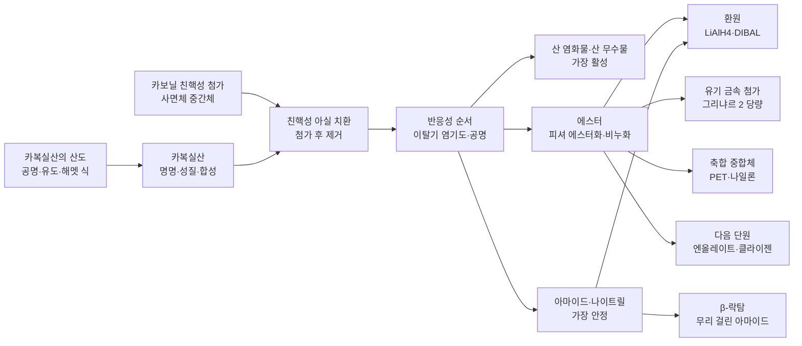

# 유기화학 11. 카복실산과 그 유도체 — 붙었다가 떨어지는 두 단계, 친핵성 아실 치환의 문법
<!-- prev: ochem-10, ochem-1, ochem-6, uchem-12 -->
<!-- next: ochem-12 -->

> [!NOTE]
> **이 단원의 범위**
> - 카복실산의 명명법과 물리적 성질, 산도와 치환기 효과(유도 효과, 해멧 식), 카복실산의 합성
> - 친핵성 아실 치환의 일반 메커니즘(사면체 중간체, 산·염기 촉매)과 그 실험적 근거(¹⁸O 표지)
> - 유도체의 반응성 순서(산 염화물 > 산 무수물 > 에스터 ≈ 카복실산 > 아마이드 > 카복실산 이온)와 상호 변환의 규칙
> - 산 염화물·산 무수물·에스터·아마이드·나이트릴의 합성과 반응(가수 분해, 알코올 분해, 가아민 분해)
> - 피셔 에스터화와 비누화, 에스터 교환, 락톤과 락탐
> - 환원($\mathrm{LiAlH_4}$, $\mathrm{NaBH_4}$, $\mathrm{BH_3}$, DIBAL)과 유기 금속 시약(그리냐르 시약, 길만 시약)의 첨가
> - 축합 중합체(폴리에스터·폴리아마이드)와 β-락탐 항생제의 반응성

**학습 목표**

1. 카복실산과 유도체를 IUPAC 이름과 관용명으로 부르고, 수소 결합 이합체로 끓는점·용해도를 설명할 수 있다.
2. 카복실산의 산도를 짝염기의 공명과 치환기의 유도 효과로 설명하고, $\mathrm{p}K_\mathrm{a}$ 차이를 자유 에너지로, 벤조산 유도체의 $\mathrm{p}K_\mathrm{a}$를 해멧 식으로 계산할 수 있다.
3. 친핵성 아실 치환을 '첨가 → 사면체 중간체 → 제거'의 두 단계로 굽은 화살표와 양성자 이동까지 쓰고, 알데하이드·케톤의 친핵성 첨가와 갈라지는 지점을 설명할 수 있다.
4. 유도체의 반응성 순서를 이탈기의 염기도와 공명 안정화로 설명하고, '반응성이 큰 유도체에서 작은 유도체로'의 규칙으로 변환 경로를 설계할 수 있다.
5. 피셔 에스터화 6단계와 비누화의 메커니즘을 쓰고, ¹⁸O 표지 실험으로 아실–산소 결합이 끊어짐을 논증하며, 평형 상수로 에스터의 수득률을 계산할 수 있다.
6. 환원 시약과 유기 금속 시약의 선택성(에스터 → 1° 알코올·알데하이드, 아마이드 → 아민, 나이트릴 → 아민·알데하이드·케톤, 에스터 + 그리냐르 시약 2 당량 → 3° 알코올)을 메커니즘으로 예측할 수 있다.
7. 나일론 6,6·PET의 축합 중합을 카로더스 식으로 정량화하고, β-락탐 항생제가 효소를 아실화하는 까닭을 고리 무리와 아마이드 공명의 약화로 설명할 수 있다.

**이 단원의 학습 사다리**

| 단계 | 무엇을 하나? |
|---|---|
| STEP 1. 이전 학습 다시 보기 | $\mathrm{p}K_\mathrm{a}$와 산도의 요인, 이탈기, 카보닐의 친핵성 첨가, 그리냐르 시약과 수소화물 환원 |
| STEP 2. 기초 다지기 | $\mathrm{p}K_\mathrm{a}$와 자유 에너지·분율, 사면체 중간체 되짚기, 평형 상수로 수득률 계산, 2차 속도식 |
| STEP 3. 핵심 개념 | 명명·성질 → 산도 → 합성 → 친핵성 아실 치환 → 반응성 순서 → 산 염화물·무수물 → 에스터 → 아마이드·나이트릴 → 환원 → 유기 금속 → 중합체와 β-락탐 |
| STEP 4. 오개념 바로잡기 | "비누화는 피셔 에스터화의 역반응일 뿐이다", "에스터에 그리냐르 시약 1 당량이면 케톤이 남는다" 같은 착각 |
| STEP 5. 대학원·연구로 | 해멧 ρ로 읽는 전이 상태의 전하, 뒤틀린 아마이드와 입체 전자 효과 |
| STEP 6. 생활·산업·진로 | 비누와 바이오디젤, 아스피린과 에스터 전구 약물, PET의 화학적 재활용, 항생제 내성 |

---

## 🗺️ 단원 들어가기

과일 향의 아세트산 아이소펜틸(바나나 향), 비누, 아스피린, 나일론 스타킹, 페트병, 단백질의 펩타이드 결합, 페니실린. 겉보기에 아무 관계가 없는 이 물질들은 모두 **아실기**(acyl group) $\mathrm{R{-}C({=}O){-}}$에 무언가가 붙은 화합물, 즉 **카복실산과 그 유도체**이다. 그리고 이들이 만들어지고 끊어지는 반응은 거의 모두 **한 가지 메커니즘**으로 설명된다.

「알데하이드와 케톤」에서 우리는 친핵체가 카보닐 탄소에 **첨가**하여 사면체 알콕사이드가 생기는 반응을 보았다. 케톤에서는 그 사면체 중간체가 양성자를 받아 알코올이 되고 끝난다. 탄소에 붙은 H나 알킬기는 떨어져 나갈 수 없기 때문이다. 그런데 카보닐 탄소에 Cl, OR, $\mathrm{NR_2}$처럼 **떨어져 나갈 수 있는 원자단**이 붙어 있으면 이야기가 달라진다. 사면체 중간체가 산소의 전자쌍으로 C=O를 다시 만들면서 그 원자단을 밀어낸다. 결과는 첨가가 아니라 **치환**이다. 이것이 **친핵성 아실 치환**(nucleophilic acyl substitution)이다.

이 단원을 마치면 "산 염화물로는 무엇이든 만들 수 있는데 아마이드는 왜 그렇게 끊기 어려운가", "에스터를 염기로 끊으면 왜 되돌아오지 않는가", "같은 에스터가 $\mathrm{LiAlH_4}$로는 알코올이, DIBAL로는 알데하이드가 되는 까닭은 무엇인가", "페니실린은 어떻게 세균의 효소를 죽이는가"에 메커니즘으로 답할 수 있다. 다음 단원 「카보닐 α 자리의 반응과 축합 반응」에서는 이 단원의 에스터가 엔올레이트가 되어 다른 에스터를 공격하는 클라이젠 축합으로 이어진다.

---

## STEP 1. 🔙 이전 학습 다시 보기

### 연계 개념표

| 이전 단원 | 그때 배운 것 | 이 단원에서 확장되는 것 |
|---|---|---|
| 일반화학 「핵화학·배위 화학·유기화학 개관」 '작용기', '축합 중합' | 카복실산·에스터·아마이드의 작용기, 에스터화가 물이 빠지는 축합이라는 것, 나일론·PET의 단위체 | 에스터화가 **어느 결합**에서 일어나는지(¹⁸O), 평형의 정량, 중합도를 카로더스 식으로 |
| 유기화학 「구조와 결합, 산과 염기」 '$\mathrm{p}K_\mathrm{a}$와 평형의 방향', '산도를 정하는 요인', '공명' | 이정표 산(카복실산 약 5), 카복실산 이온의 두 동등한 공명 구조, 유도 효과의 거리 의존(클로로뷰탄산), 아마이드의 공명과 회전 장벽 | 치환기 효과를 **해멧 식**으로 정량화, 유도체마다 다른 공명 기여가 **반응성 순서**를 정함 |
| 유기화학 「유기 반응의 개관과 알킬 할라이드의 치환·제거 반응」 '이탈기' | 좋은 이탈기 = 약한 염기(짝산 $\mathrm{p}K_\mathrm{a}$가 작다), 사이안화 이온의 $\mathrm{S_N2}$ | 사면체 중간체에서 떨어지는 $\mathrm{Cl^-}$, $\mathrm{RCOO^-}$, $\mathrm{RO^-}$, $\mathrm{R_2N^-}$의 순서. $\mathrm{S_N2}$로 나이트릴과 에스터 만들기 |
| 유기화학 「알코올·에터·에폭사이드와 황 화합물」 '수소화물 환원', '그리냐르 시약' | $\mathrm{NaBH_4}$·$\mathrm{LiAlH_4}$의 세기 차이, 에스터 + 그리냐르 시약(2 당량) → 3° 알코올(생성물과 화학량론) | 그 결과를 **메커니즘**으로: 왜 중간의 알데하이드·케톤에서 멈추지 않는가, DIBAL·길만 시약으로는 어떻게 멈추는가 |
| 유기화학 「알데하이드와 케톤」 '친핵성 첨가의 일반 메커니즘', '수소화물 환원과 그리냐르 반응' | 카보닐에 친핵체가 첨가해 사면체 중간체, 산 촉매(카보닐 양성자화)와 염기 촉매(센 친핵체) | 같은 사면체 중간체가 **이탈기를 밀어내며** 무너지는 두 번째 단계 |
| 유기화학 「구조 결정: 질량 분석법과 분광법」 '적외선 분광법' | C=O 신축 약 $1700\ \mathrm{cm^{-1}}$, 카복실산의 넓은 O–H | 유도체마다 C=O 파수가 다른 까닭($1800$ → $1650\ \mathrm{cm^{-1}}$)을 공명과 유도로 해석 |

### 준비 운동 (사전 진단)

**Q1.** 아세트산($\mathrm{p}K_\mathrm{a} = 4.76$)이 에탄올($\mathrm{p}K_\mathrm{a} \approx 16$)보다 훨씬 강한 산인 까닭을 짝염기의 구조로 한 문장으로 쓰시오.

**Q2.** 다음 음이온을 이탈기로서 좋은 것부터 늘어놓으시오. $\mathrm{CH_3O^-}$, $\mathrm{Cl^-}$, $\mathrm{CH_3COO^-}$, $\mathrm{NH_2^-}$ (짝산의 $\mathrm{p}K_\mathrm{a}$: 메탄올 15.5, HCl 약 −7, 아세트산 4.76, 암모니아 약 38)

**Q3.** 아세톤에 $\mathrm{NaBH_4}$를 넣고 메탄올에서 반응시키면 무엇이 생기는가? 첫 단계에서 수소화 이온이 공격하는 원자와, 그 결과 생기는 중간체의 탄소 혼성을 쓰시오.

**Q4.** 벤조산 메틸에 $\mathrm{CH_3MgBr}$를 과량 넣은 뒤 묽은 산으로 가공하면 무엇이 생기는가? 그리냐르 시약은 에스터 1 mol당 몇 mol이 소모되는가?

정답 및 해설

**Q1.** 아세트산 이온은 음전하가 동등한 산소 두 개에 공명으로 퍼지지만, 에톡사이드 이온은 산소 하나에 음전하가 모여 있다(「구조와 결합, 산과 염기」 ⑨ 요인 2).

**Q2.** $\mathrm{Cl^- > CH_3COO^- > CH_3O^- > NH_2^-}$. 짝산이 강할수록(짝산의 $\mathrm{p}K_\mathrm{a}$가 작을수록) 그 음이온은 약한 염기이고 좋은 이탈기이다. 이 순서가 그대로 STEP 3 ⑤의 유도체 반응성 순서가 된다.

**Q3.** 프로판-2-올. 수소화 이온은 카보닐 **탄소**를 공격하고, 그 결과 $sp^3$ 탄소를 가진 사면체 알콕사이드가 생긴다. 메탄올(용매)이 산소에 양성자를 주어 알코올이 된다.

**Q4.** 2-페닐프로판-2-올($\mathrm{C_6H_5C(CH_3)_2OH}$). 2 mol이 소모된다(「알코올·에터·에폭사이드와 황 화합물」 ④). 왜 중간의 아세토페논에서 멈추지 않는지는 이 단원 ⑩에서 메커니즘으로 설명한다.

---

## STEP 2. 🧱 기초 다지기

### 디딤돌 1. $\mathrm{p}K_\mathrm{a}$ 한 단위 = 5.71 kJ/mol, 그리고 pH가 정하는 분율

「구조와 결합, 산과 염기」 디딤돌 2·4에서 쓴 두 식을 다시 꺼낸다.

$$
\Delta G^\circ_\text{해리} = 2.303RT\,\mathrm{p}K_\mathrm{a} \;\approx 5.71\ \mathrm{kJ/mol} \times \mathrm{p}K_\mathrm{a}\ (25\ ^\circ\mathrm{C}), \qquad
\frac{[\mathrm{A^-}]}{[\mathrm{HA}]} = 10^{\,\mathrm{pH} - \mathrm{p}K_\mathrm{a}}
$$

두 산의 $\mathrm{p}K_\mathrm{a}$ 차이 $\Delta\mathrm{p}K_\mathrm{a}$는 해리 자유 에너지의 차이 $5.71\,\Delta\mathrm{p}K_\mathrm{a}$ kJ/mol이고, 이 차이는 거의 모두 **짝염기(카복실산 이온)의 안정화 차이**에서 온다. 두 번째 식은 카복실산이 어떤 pH에서 중성 분자(유기 용매에 녹는다)로 있는지, 이온(물에 녹는다)으로 있는지를 알려 준다.

| pH − $\mathrm{p}K_\mathrm{a}$ | −2 | −1 | 0 | +1 | +2 | +3 |
|---|---|---|---|---|---|---|
| 이온 형태 $\mathrm{RCOO^-}$의 분율 | 1 % | 9 % | 50 % | 91 % | 99 % | 99.9 % |

#### 예제 1 — 클로로아세트산과 체액 속의 아세트산

(1) 클로로아세트산($\mathrm{p}K_\mathrm{a} = 2.87$)의 짝염기는 아세트산($\mathrm{p}K_\mathrm{a} = 4.76$)의 짝염기보다 25 ℃에서 몇 kJ/mol 더 안정한가? (2) pH 7.4의 혈장에서 아세트산의 몇 %가 아세트산 이온으로 있는가?

**풀이**
(1) $\Delta\mathrm{p}K_\mathrm{a} = 4.76 - 2.87 = 1.89$, $\Delta(\Delta G^\circ) = 5.71\times1.89 = 10.8\ \mathrm{kJ/mol}$.
(2) $[\mathrm{A^-}]/[\mathrm{HA}] = 10^{7.4 - 4.76} = 10^{2.64} = 437$, 분율 $= 437/438 = 0.998$, 즉 99.8 %.
**의미** 생체 안에서 카복실산은 거의 모두 **카복실산 이온**으로 있다. 그래서 생화학 책은 아세트산 대신 '아세트산 이온(아세테이트)', 피루브산 대신 '피루브산 이온'이라고 쓴다. ⑤에서 보듯 카복실산 이온은 유도체 가운데 친핵성 아실 치환에 **가장 둔한** 형태이다. 세포가 카복실산을 반응시킬 때 먼저 ATP나 조효소 A로 '활성화'하는 까닭이다.

### 디딤돌 2. 사면체 중간체 — 「알데하이드와 케톤」에서 가져올 것

친핵성 첨가의 핵심만 되짚는다. 카보닐 탄소는 $sp^2$ 평면이고, C=O π* 오비탈(LUMO)이 탄소 쪽으로 크게 나와 있다. 친핵체는 C=O 평면에 대해 약 105°의 각도(뷔르기–두니츠 각)로 탄소에 다가가 결합을 만들고, π 전자쌍은 산소로 밀려 **사면체 알콕사이드 중간체**(tetrahedral intermediate)가 생긴다. 탄소는 $sp^2$ → $sp^3$로 바뀐다.

| 촉매 조건 | 첫 단계 | 친핵체 | 예 |
|---|---|---|---|
| 염기성·중성(센 친핵체) | 친핵체가 바로 카보닐 탄소를 공격 | $\mathrm{HO^-}$, $\mathrm{RO^-}$, $\mathrm{H^-}$, $\mathrm{R^-}$(RMgX), $\mathrm{RNH_2}$ | 비누화, 수소화물 환원, 그리냐르 첨가 |
| 산성(약한 친핵체) | 카보닐 **산소**에 양성자가 붙어 탄소가 더 친전자성이 된다 | $\mathrm{H_2O}$, ROH | 피셔 에스터화, 아마이드의 산 가수 분해 |

케톤에서는 사면체 중간체의 탄소에 붙은 네 원자단이 O⁻(또는 OH), R, R′, Nu이다. R과 R′은 탄소 음이온($\mathrm{p}K_\mathrm{a}$ 약 50의 짝염기)으로 떨어져야 하므로 떨어지지 못한다. 카복실산 유도체 $\mathrm{RCOY}$에서는 사면체 중간체에 **Y가 하나 더** 붙어 있고, Y가 충분히 약한 염기이면 떨어진다. 이 단원의 모든 반응은 이 차이 하나에서 출발한다.

<!-- 그림 요청: 두 경로를 위아래로 비교. (위) 친핵성 첨가: 아세톤(SMILES CC(C)=O) + 사이안화 이온. N≡C⁻의 탄소 전자쌍 → 카보닐 C 굽은 화살표, C=O π → O 화살표 → 사면체 알콕사이드(탄소 sp³, 네 원자단 CH3·CH3·CN·O⁻) → H2O에서 양성자를 받아 2-하이드록시-2-메틸프로페인나이트릴(SMILES CC(C)(O)C#N). 오른쪽 끝 '첨가로 끝남 — CH3⁻는 떨어지지 못한다'. (아래) 친핵성 아실 치환: 염화 아세틸(SMILES CC(=O)Cl) + 메톡사이드. 1단계 화살표 2개(CH3O⁻ 전자쌍 → 카보닐 C, C=O π → O) → 사면체 중간체(꺾쇠 없이, 탄소에 CH3·Cl·OCH3·O⁻) → 2단계 화살표 2개(O⁻ 전자쌍 → C–O 자리로 C=O 다시 형성, C–Cl 결합 → Cl) → 아세트산 메틸(SMILES COC(C)=O) + Cl⁻. 사면체 중간체에 '같은 중간체', 2단계에 '이탈기가 떨어진다' 이름표. 두 경로의 사면체 중간체가 세로로 나란히 오게 배치. -->

### 디딤돌 3. 평형 상수로 수득률 계산하기 — 이차 방정식 하나

피셔 에스터화는 평형 반응이다. 아세트산과 에탄올의 에스터화는 평형 상수가 약 4로, 에너지 차이가 거의 없는 '평평한' 반응이다.

$$
\mathrm{CH_3COOH + CH_3CH_2OH \rightleftharpoons CH_3COOCH_2CH_3 + H_2O}, \qquad K = \frac{[\text{에스터}][\mathrm{H_2O}]}{[\text{산}][\text{알코올}]} \approx 4
$$

산 $a$ mol, 알코올 $b$ mol(물 없이 시작)에서 에스터가 $x$ mol 생기면 부피는 약분되어

$$
\frac{x^2}{(a - x)(b - x)} = K \quad\Longrightarrow\quad (1 - K)x^2 + K(a + b)x - Kab = 0
$$

이고, $0 < x < \min(a, b)$인 근을 고른다.

#### 예제 2 — 알코올을 과량으로 쓰는 까닭

$K = 4.0$일 때 아세트산 1.0 mol에 에탄올을 (1) 1.0 mol (2) 3.0 mol (3) 10 mol 넣었을 때 아세트산 기준 에스터 수득률(평형)을 구하시오.

**풀이**
(1) $a = b = 1$이면 $x/(1 - x) = 2$, $x = 2/3$ → 67 %.
(2) $-3x^2 + 16x - 12 = 0$, $x = \dfrac{16 - \sqrt{256 - 144}}{6} = \dfrac{16 - 10.58}{6} = 0.903$ → 90 %.
(3) $-3x^2 + 44x - 40 = 0$, $x = \dfrac{44 - \sqrt{1936 - 480}}{6} = \dfrac{44 - 38.16}{6} = 0.974$ → 97 %.
**의미** 르샤틀리에 원리를 숫자로 본 것이다. 실험실에서는 알코올을 용매로 쓸 만큼 과량 넣거나, 생기는 물을 딘–스타크 장치나 분자체로 계속 빼내 평형을 오른쪽으로 민다. 반대로 에스터를 끊을 때(산 가수 분해)는 물을 과량으로 쓴다. 같은 평형을 어느 쪽에서 미느냐의 문제이다.

### 디딤돌 4. 2차 속도식 — 비누화의 시간 규모

비누화(⑦)는 에스터와 수산화 이온이 한 번씩 만나는 단계가 속도를 정하므로 $v = k[\text{에스터}][\mathrm{OH^-}]$이다. 일반화학 「화학 반응 속도론」에서처럼 두 농도가 같게($c_0$) 시작하면

$$
\frac{1}{c} - \frac{1}{c_0} = kt, \qquad t_{1/2} = \frac{1}{kc_0}
$$

이다. 1차 반응과 달리 반감기가 처음 농도에 반비례한다.

#### 예제 3 — 아세트산 에틸의 비누화

25 ℃에서 아세트산 에틸의 비누화 속도 상수는 약 $0.11\ \mathrm{M^{-1}s^{-1}}$이다. 에스터와 NaOH를 모두 0.050 M로 섞었을 때 (1) 반감기 (2) 90 % 반응하는 데 걸리는 시간을 구하시오.

**풀이**
(1) $t_{1/2} = 1/(0.11\times0.050) = 182\ \mathrm{s} \approx 3.0\ \mathrm{min}$.
(2) 90 % 반응하면 $c = 0.10c_0$이므로 $kt = 1/(0.10c_0) - 1/c_0 = 9/c_0$, $t = 9/(0.11\times0.050) = 1.6\times10^3\ \mathrm{s} \approx 27\ \mathrm{min}$.
**의미** 실온에서도 수십 분이면 끝나는 반응이다. 같은 에스터를 순수한 물에만 두면 몇 년이 걸린다. 수산화 이온은 물보다 훨씬 센 친핵체이고, 생성물 카복실산이 곧바로 이온이 되어 되돌아오지 않기 때문이다(⑦). 이 반응은 전기 전도도로 쉽게 추적할 수 있어(이동도가 큰 $\mathrm{OH^-}$가 이동도가 작은 $\mathrm{CH_3COO^-}$로 바뀐다) 학부 물리화학 실험의 단골 주제이다.

---

## STEP 3. 📘 핵심 개념

### ① 카복실산과 유도체의 이름, 그리고 물리적 성질

#### 카복실산의 이름

**카복실산**(carboxylic acid)은 카보닐 탄소에 하이드록시기가 붙은 **카복실기**(carboxyl group) $\mathrm{-COOH}$를 가진다. IUPAC 이름은 카복실기 탄소를 포함한 가장 긴 사슬의 알케인 이름에서 끝의 '-e'를 '-oic acid'로 바꾼다. 한국어로는 '-산'을 붙인다. 번호는 **카복실기 탄소를 1번**으로 매긴다. 고리에 카복실기가 붙으면 고리 이름 뒤에 '카복실산'을 붙이고, 고리에 붙은 탄소를 1번으로 한다.

| 구조 | IUPAC 이름 | 관용명 | $\mathrm{p}K_\mathrm{a}$ | 어디서 |
|---|---|---|---|---|
| $\mathrm{HCOOH}$ | 메탄산 | 폼산 | 3.75 | 개미 |
| $\mathrm{CH_3COOH}$ | 에탄산 | 아세트산 | 4.76 | 식초 |
| $\mathrm{CH_3CH_2COOH}$ | 프로판산 | 프로피온산 | 4.87 | 치즈 |
| $\mathrm{CH_3(CH_2)_2COOH}$ | 뷰탄산 | 뷰티르산 | 4.82 | 상한 버터 |
| $\mathrm{CH_3(CH_2)_{16}COOH}$ | 옥타데칸산 | 스테아르산 | — | 동물성 지방 |
| $\mathrm{C_6H_5COOH}$ | 벤조산 | — | 4.20 | 방부제 |
| $\mathrm{HOOC{-}COOH}$ | 에테인다이오산 | 옥살산 | 1.25, 4.27(약) | 시금치 |
| $\mathrm{HOOC(CH_2)_4COOH}$ | 헥세인다이오산 | 아디프산 | 4.4, 5.4(약) | 나일론 6,6 원료 |
| $\mathrm{HOOC{-}C_6H_4{-}COOH}$ (1,4) | 벤젠-1,4-다이카복실산 | 테레프탈산 | — | PET 원료 |

관용명을 쓸 때는 카복실기 탄소 바로 옆을 α, 그다음을 β, γ, δ로 부른다. 예를 들어 $\mathrm{CH_3CH(OH)COOH}$는 2-하이드록시프로판산(IUPAC)이자 α-하이드록시프로피온산, 흔히 젖산이다. α, β 표기는 이 단원의 'β-락탐'과 다음 단원의 'α 수소'에서 계속 쓰인다.

#### 유도체의 이름

카복실산의 OH를 다른 원자단 Y로 바꾼 $\mathrm{RCOY}$가 **카복실산 유도체**(carboxylic acid derivative)이다. 나이트릴 $\mathrm{RC{\equiv}N}$은 카보닐이 없지만, 탄소의 산화수가 카복실산과 같고(+3) 가수 분해하면 카복실산이 되므로 유도체에 함께 넣는다.

| 무리 | 일반식 | 이름 붙이는 법 | 예 (IUPAC / 관용) | SMILES |
|---|---|---|---|---|
| **산 염화물**(acid chloride, 아실 클로라이드) | $\mathrm{RCOCl}$ | '-oic acid' → '-oyl chloride' | 에타노일 클로라이드 / 염화 아세틸 | `CC(=O)Cl` |
| **산 무수물**(acid anhydride) | $\mathrm{RCOOCOR}$ | 산 이름 + '무수물' | 에탄산 무수물 / 아세트산 무수물 | `CC(=O)OC(C)=O` |
| **에스터**(ester) | $\mathrm{RCOOR'}$ | 산 이름 + 알킬 이름(영어는 알킬 + '-oate') | 에탄산 에틸 / 아세트산 에틸 | `CCOC(C)=O` |
| **아마이드**(amide) | $\mathrm{RCONR'_2}$ | '-oic acid' → '-amide', N의 치환기는 N-으로 | 에탄아마이드 / 아세트아마이드, N,N-다이메틸메탄아마이드(DMF) | `CC(N)=O`, `CN(C)C=O` |
| **나이트릴**(nitrile) | $\mathrm{RC{\equiv}N}$ | 알케인(탄소 수는 CN 탄소 포함) + '나이트릴' | 에테인나이트릴 / 아세토나이트릴, 벤조나이트릴 | `CC#N` |
| **카복실산 이온**(carboxylate) | $\mathrm{RCOO^-M^+}$ | 산 이름 + 금속 이름 | 아세트산 나트륨 | `CC(=O)[O-].[Na+]` |

고리 모양 에스터는 **락톤**(lactone), 고리 모양 아마이드는 **락탐**(lactam)이라 하고, 고리에 들어간 카보닐 탄소와 헤테로 원자 사이의 탄소 수에 따라 β(4원 고리), γ(5원), δ(6원), ε(7원)를 붙인다. γ-뷰티로락톤(SMILES `O=C1CCCO1`), β-락탐(아제티딘-2-온, SMILES `O=C1CCN1`), ε-카프로락탐(SMILES `O=C1CCCCCN1`, 나일론 6의 원료)이 대표적이다.

#### 물리적 성질 — 수소 결합 이합체

카복실산은 O–H(수소 결합 주개)와 C=O(받개)를 함께 가져, 액체와 기체 상태에서 두 분자가 수소 결합 두 개로 맞물린 8원 고리 **이합체**(dimer)를 만든다. 그래서 몰질량이 비슷한 알코올보다 끓는점이 높다.

<!-- 그림 요청: 아세트산(SMILES CC(=O)O) 두 분자의 수소 결합 이합체. 두 분자를 마주 보게 놓고 한 분자의 O–H의 H가 다른 분자의 C=O 산소 쪽으로, 그 반대도 마찬가지로 향해 8원 고리(O=C–O–H···O=C–O–H···)를 이룬다. 수소 결합은 점선, 길이 이름표 'O···O 약 2.7 Å'. 옆에 비교로 프로판-1-올(SMILES CCCO) 세 분자가 O–H···O 수소 결합 하나씩으로 사슬처럼 이어진 모습. 아래에 작은 표: 아세트산 60 g/mol, 끓는점 118 ℃ / 프로판-1-올 60 g/mol, 97 ℃. -->

| 화합물 | 몰질량 (g/mol) | 끓는점 (℃) | 분자 사이의 주된 힘 |
|---|---|---|---|
| 프로판-1-올 | 60 | 97 | 수소 결합(사슬) |
| 아세트산 | 60 | 118 | 수소 결합 이합체 |
| 아세트산 메틸 | 74 | 57 | 쌍극자–쌍극자(수소 결합 주개 없음) |
| 아세트산 에틸 | 88 | 77 | 쌍극자–쌍극자 |
| 염화 아세틸 | 78.5 | 51 | 쌍극자–쌍극자 |
| 아세트산 무수물 | 102 | 140 | 쌍극자–쌍극자 |
| 아세토나이트릴 | 41 | 82 | 큰 쌍극자 모멘트(약 3.9 D) |
| 아세트아마이드 | 59 | 221 (녹는점 81) | N–H···O=C 수소 결합 그물 |
| N,N-다이메틸아세트아마이드 | 87 | 165 | 큰 쌍극자, N–H 없음 |

에스터·산 염화물·산 무수물은 수소 결합 주개가 없어 카복실산보다 끓는점이 낮다. 1차·2차 아마이드는 N–H가 있어 끓는점이 매우 높고, 아마이드 사이의 N–H···O=C 수소 결합은 단백질의 2차 구조와 나일론의 질긴 성질의 바탕이다. 탄소 4개 정도까지의 카복실산은 물과 잘 섞이지만, 사슬이 길어지면 녹지 않는다. 그래도 염기 수용액에서는 카복실산 이온이 되어 녹는다(산–염기 추출, 「구조와 결합, 산과 염기」 탐구 활동 A).

카복실산의 분광학적 특징은 IR에서 이합체의 매우 넓은 O–H 신축(약 $2500\sim3300\ \mathrm{cm^{-1}}$)과 C=O 신축(약 $1710\ \mathrm{cm^{-1}}$), $^1\mathrm{H}$ NMR에서 약 10~13 ppm의 넓은 단일선(D₂O를 넣으면 사라진다), $^{13}\mathrm{C}$ NMR에서 약 170~185 ppm의 카보닐 탄소이다(「구조 결정: 질량 분석법과 분광법」).

#### ✔ 바로 확인

1. IUPAC 이름: $\mathrm{CH_3CH_2CH(CH_3)COOH}$
2. (O/X) 아세트산 에틸은 아세트산보다 몰질량이 크므로 끓는점도 높다.
3. 빈칸: 고리 모양 아마이드를 (    ), 고리 모양 에스터를 (    )이라 한다.
4. 아세토나이트릴을 가수 분해하면 어떤 카복실산이 되는가?

정답

1. 2-메틸뷰탄산 — 카복실기 탄소가 1번이므로 메틸기는 2번 탄소에 있다.
2. X — 아세트산(118 ℃)은 수소 결합 이합체를 만들지만 에스터(77 ℃)는 수소 결합 주개가 없다.
3. 락탐, 락톤
4. 아세트산 — 나이트릴의 탄소 수(CN 탄소 포함)가 그대로 카복실산의 탄소 수가 된다.

### ② 카복실산의 산도와 치환기 효과

#### 왜 알코올보다 $10^{11}$배 강한가

카복실산이 양성자를 내놓으면 **카복실산 이온**(carboxylate ion)이 생기고, 그 음전하는 두 개의 **동등한** 산소에 공명으로 반씩 퍼진다. 알콕사이드는 산소 하나에 음전하가 모여 있다. 실험적 증거는 결합 길이이다. 폼산의 두 C–O 결합은 약 1.20 Å(C=O)과 1.34 Å(C–O)로 다르지만, 폼산 나트륨의 두 C–O는 모두 약 1.26 Å로 같다. 공명 혼성체에서 두 결합이 '1.5중 결합'이 된 것이다.

<!-- 그림 요청: 아세트산 이온(SMILES CC(=O)[O-])의 공명. (왼쪽) 두 공명 구조를 ↔로 잇고, 첫 구조에서 O⁻의 비공유 전자쌍 → C–O 결합 자리 굽은 화살표, C=O π 결합 → 위쪽 O 굽은 화살표. (가운데) 공명 혼성체: 두 C–O를 실선 + 점선으로, 각 O에 'δ−(−1/2)', 결합 길이 '1.26 Å' 둘 다. (오른쪽) 비교로 에톡사이드 이온(SMILES CC[O-]), O 하나에 −1 전하 집중. 아래 행에 정전기 퍼텐셜 지도 두 개(아세트산 이온: 빨강이 두 O에 고르게, 에톡사이드: 빨강이 O 하나에 진하게). -->

#### 유도 효과 — 전자 끌기 원자단이 가까울수록 강해진다

카복실산 이온의 음전하를 끌어당기는 원자단은 산을 강하게 하고, 전자를 미는 원자단은 약하게 한다. 「구조와 결합, 산과 염기」에서 Cl의 위치에 따른 클로로뷰탄산을 보았으니, 여기서는 **원자단의 수와 종류**를 바꾼 아세트산 유도체를 본다.

| 산 | $\mathrm{p}K_\mathrm{a}$ (25 ℃, 물) | 아세트산보다 강한 정도 ($K_\mathrm{a}$ 비) | 짝염기의 상대 안정화 (kJ/mol) |
|---|---|---|---|
| $\mathrm{CH_3COOH}$ | 4.76 | 1 | 0 |
| $\mathrm{ICH_2COOH}$ | 3.18 | 38 | 9.0 |
| $\mathrm{BrCH_2COOH}$ | 2.90 | 72 | 10.6 |
| $\mathrm{ClCH_2COOH}$ | 2.87 | 78 | 10.8 |
| $\mathrm{FCH_2COOH}$ | 2.59 | 148 | 12.4 |
| $\mathrm{NCCH_2COOH}$ | 2.47 | 195 | 13.1 |
| $\mathrm{Cl_2CHCOOH}$ | 약 1.3 | 약 $3\times10^3$ | 약 20 |
| $\mathrm{Cl_3CCOOH}$ | 약 0.7 | 약 $1\times10^4$ | 약 23 |
| $\mathrm{F_3CCOOH}$ | 약 0.2 | 약 $4\times10^4$ | 약 26 |

할로젠의 전기 음성도 순서(F > Cl > Br > I)대로 산이 강해지고, 같은 할로젠이 늘면 효과가 거의 더해진다. 알킬기는 반대로 약하게 산을 약화시킨다(폼산 3.75 → 아세트산 4.76 → 프로판산 4.87). 알킬기가 카복실산 이온에 전자를 조금 밀어 주는 것과, 큰 알킬기가 이온 주위의 물 분자 배치를 방해해 **용매화**를 약하게 하는 것이 함께 작용한다.

#### 예제 4 — 유도 효과는 더해지는가

표의 값으로 (1) Cl 하나, 둘, 셋이 붙을 때 $\mathrm{p}K_\mathrm{a}$ 감소량을 구하고, (2) Cl 하나의 효과가 단순히 세 번 더해진다면 트라이클로로아세트산의 $\mathrm{p}K_\mathrm{a}$는 얼마로 예측되는지 실제 값과 비교하시오.

**풀이**
(1) 감소량: Cl 1개 $4.76 - 2.87 = 1.89$, 2개 약 $4.76 - 1.3 = 3.5$, 3개 약 $4.76 - 0.7 = 4.1$.
(2) 단순 합이면 $4.76 - 3\times1.89 = -0.91$로 예측되지만 실제는 약 0.7이다. 두 번째, 세 번째 Cl의 효과는 각각 약 1.6, 약 0.6으로 점점 줄어든다.
**의미** 유도 효과는 '대체로 더해지지만' 포화된다. 카복실산 이온의 음전하가 이미 상당히 끌려간 뒤에는 Cl을 더 붙여도 끌어갈 몫이 적고, 세 Cl이 서로의 전자도 끌어 효과가 줄어든다. 효과의 크기를 kJ/mol로 말하면, Cl 하나가 짝염기를 약 11 kJ/mol 안정하게 한다. 수소 결합 하나의 세기(약 20 kJ/mol)의 절반쯤이다.

#### 벤조산과 해멧 식 — 치환기 효과를 하나의 숫자로

벤젠 고리를 사이에 두면 치환기는 고리를 따라 전자를 끌거나 미는 공명 효과까지 전한다. 해멧(Hammett)은 25 ℃ 물에서 벤조산의 이온화를 기준 반응으로 삼아 메타·파라 치환기 X의 **치환기 상수** $\sigma_\mathrm{X}$를 정의했다.

$$
\sigma_\mathrm{X} \equiv \log\frac{K_\mathrm{a}(\mathrm{X{-}C_6H_4COOH})}{K_\mathrm{a}(\mathrm{C_6H_5COOH})} = \mathrm{p}K_\mathrm{a}(\text{벤조산}) - \mathrm{p}K_\mathrm{a}(\text{치환 벤조산})
$$

$\sigma > 0$이면 전자 끌기(산을 강하게), $\sigma < 0$이면 전자 주기이다. 다른 반응(에스터의 비누화, 다른 산의 이온화)에서도 메타·파라 치환체의 속도·평형 상수가

$$
\log\frac{k_\mathrm{X}}{k_\mathrm{H}} = \rho\,\sigma_\mathrm{X} \qquad \left(\text{또는 } \log\frac{K_\mathrm{X}}{K_\mathrm{H}} = \rho\,\sigma_\mathrm{X}\right)
$$

를 잘 따른다. 이것이 **해멧 식**(Hammett equation)이다. **반응 상수** $\rho$는 그 반응이 치환기에 얼마나 민감한지, 그리고 그 부호는 반응 중심에 음전하가 생기는지($\rho > 0$) 양전하가 생기는지($\rho < 0$)를 알려 준다. 정의에 따라 벤조산 이온화의 $\rho = 1$이다.

| 치환기 | $\sigma_\mathrm{meta}$ | $\sigma_\mathrm{para}$ | 해석 |
|---|---|---|---|
| $\mathrm{-NO_2}$ | 0.71 | 0.78 | 유도 + 공명 끌기, 파라에서 공명이 더해진다 |
| $\mathrm{-CN}$ | 0.56 | 0.66 | 유도 + 공명 끌기 |
| $\mathrm{-Cl}$ | 0.37 | 0.23 | 유도 끌기, 파라에서는 공명 주기가 일부 상쇄 |
| $\mathrm{-H}$ | 0 | 0 | 기준 |
| $\mathrm{-CH_3}$ | −0.07 | −0.17 | 약한 주기(초공액) |
| $\mathrm{-OCH_3}$ | 0.12 | −0.27 | 메타에서는 유도 끌기, 파라에서는 공명 주기가 이긴다 |

메톡시기의 두 값의 부호가 다르다는 점이 중요하다. 메타 자리에서는 산소의 공명 주기가 카복실기가 붙은 탄소까지 전해지지 않아 전기 음성도(유도 끌기)만 남는다. 파라 자리에서는 산소의 비공유 전자쌍이 고리를 통해 카복실기가 붙은 탄소까지 전자를 밀어 준다(「방향족 화합물의 반응」 '치환기 효과'의 오쏘·파라 지향과 같은 원리).

<!-- 그림 요청: 해멧 도시. 가로축 'σ (치환기 상수)' −0.4 ~ 0.9, 세로축 'log(K_X/K_H)' −0.4 ~ 0.9. 벤조산 이온화의 점 7개를 정확한 좌표로: p-OCH3(−0.27, −0.27), p-CH3(−0.17, −0.17), H(0, 0), p-Cl(0.23, 0.22), m-Cl(0.37, 0.37), m-NO2(0.71, 0.75), p-NO2(0.78, 0.76). 기울기 1인 직선과 이름표 'ρ = 1.00 (정의)'. 같은 그림에 다른 색으로 벤조산 에틸의 염기성 가수 분해 직선(기울기 약 2.5, 원점 통과, 점 없이 직선만)과 'ρ ≈ +2.5' 이름표. 각 점 옆에 치환기 이름. -->

#### 예제 5 — 해멧 식으로 $\mathrm{p}K_\mathrm{a}$ 예측하기

벤조산의 $\mathrm{p}K_\mathrm{a} = 4.20$이다. (1) 4-나이트로벤조산, 3-클로로벤조산, 4-메톡시벤조산의 $\mathrm{p}K_\mathrm{a}$를 예측하시오. (2) 어떤 치환 벤조산의 $\mathrm{p}K_\mathrm{a}$가 3.66이었다. 이 치환기의 $\sigma$를 구하고, 위 표에서 어느 치환기에 가까운지 쓰시오.

**풀이**
(1) $\mathrm{p}K_\mathrm{a} = 4.20 - \sigma$. 4-나이트로: $4.20 - 0.78 = 3.42$ (실측 3.44), 3-클로로: $4.20 - 0.37 = 3.83$ (실측 3.83), 4-메톡시: $4.20 + 0.27 = 4.47$ (실측 4.47).
(2) $\sigma = 4.20 - 3.66 = 0.54$로, 메타 사이아노기($\sigma_\mathrm{meta} = 0.56$)에 가깝다.
**의미** 벤조산에서는 정의상 실측과 거의 맞는다. 해멧 식의 진짜 쓸모는 같은 $\sigma$로 **다른 반응**을 예측하는 데 있다. 예를 들어 벤조산 에틸의 비누화는 $\rho \approx +2.5$이므로, 4-나이트로벤조산 에틸은 벤조산 에틸보다 $10^{2.5\times0.78} \approx 90$배 빨리 비누화된다. $\rho$가 양수라는 것은 속도 결정 단계의 전이 상태(⑦의 사면체 중간체로 가는 길)에서 **음전하가 쌓인다**는 뜻이다(STEP 5 맛보기 ①).

#### ✔ 바로 확인

1. 산의 세기 순서: $\mathrm{CH_3COOH}$, $\mathrm{CF_3COOH}$, $\mathrm{ClCH_2COOH}$, $\mathrm{CH_3CH_2OH}$
2. (O/X) 아세트산 이온의 두 C–O 결합 길이는 서로 다르다.
3. 빈칸: 해멧 식에서 반응 상수 $\rho$가 양수이면 반응 중심에 (    ) 전하가 쌓이는 반응이다.
4. 4-메틸벤조산($\sigma_\mathrm{para} = -0.17$)의 $\mathrm{p}K_\mathrm{a}$를 예측하시오. (벤조산 4.20)

정답

1. $\mathrm{CF_3COOH > ClCH_2COOH > CH_3COOH > CH_3CH_2OH}$ — 유도 효과의 크기와 수, 그리고 카복실산 이온의 공명.
2. X — 공명 혼성체이므로 두 결합 모두 약 1.26 Å로 같다.
3. 음(−)
4. 약 4.37 — $4.20 - (-0.17)$. 실측값(4.37)과 같다.

### ③ 카복실산의 합성

카복실산을 만드는 길은 탄소 골격이 **그대로**인 것(산화, 유도체의 가수 분해)과 탄소가 **하나 늘어나는** 것(그리냐르 시약의 카복실화, 나이트릴의 가수 분해)으로 나뉜다.

| 방법 | 반응 | 탄소 수 | 주의 |
|---|---|---|---|
| 1° 알코올·알데하이드의 산화 | $\mathrm{RCH_2OH \xrightarrow{CrO_3,\ H_2SO_4,\ H_2O} RCOOH}$ (존스 산화), $\mathrm{KMnO_4}$ | 그대로 | 2° 알코올은 케톤에서 멈춘다(「알코올·에터·에폭사이드와 황 화합물」) |
| 알킬벤젠의 곁사슬 산화 | $\mathrm{C_6H_5CH_2CH_3 \xrightarrow{KMnO_4,\ H_2O,\ \Delta;\ H_3O^+} C_6H_5COOH}$ | 고리에 붙은 탄소 하나만 남는다 | 벤질 자리에 H가 하나 이상 있어야 한다(tert-뷰틸벤젠은 산화되지 않는다) |
| 알켄·알카인의 산화적 절단 | $\mathrm{RCH{=}CHR' \xrightarrow{KMnO_4,\ \Delta}}$ 또는 $\mathrm{O_3}$ 뒤 산화적 가공 → $\mathrm{RCOOH + R'COOH}$ | 줄어든다 | 「알켄과 알카인」 '오존 분해' |
| 그리냐르 시약의 카복실화 | $\mathrm{RMgX \xrightarrow{1.\ CO_2\ \ 2.\ H_3O^+} RCOOH}$ | +1 | 분자 안에 OH, NH, COOH 같은 산성 수소나 C=O가 있으면 안 된다 |
| 나이트릴의 가수 분해 | $\mathrm{RX \xrightarrow{NaCN,\ DMSO} RCN \xrightarrow{H_3O^+,\ \Delta} RCOOH + NH_4^+}$ | +1 | 첫 단계가 $\mathrm{S_N2}$이므로 1°·2° 할로젠화물만(3°는 제거) |
| 유도체의 가수 분해 | 에스터·아마이드·산 염화물 + 물(산 또는 염기) | 그대로 | ⑥~⑧ |

#### 그리냐르 시약의 카복실화 — $\mathrm{CO_2}$는 카보닐 화합물이다

이산화 탄소의 탄소는 산소 두 개에 둘러싸여 강한 친전자체이다. 그리냐르 시약의 C–Mg 결합 전자쌍이 $\mathrm{CO_2}$의 탄소를 공격하면, 한 C=O의 π 전자쌍이 산소로 가서 카복실산 마그네슘 염이 된다. 이 염은 음전하가 두 산소에 퍼진 카복실산 이온이므로 그리냐르 시약과 더 반응하지 않는다. 마지막에 산을 넣어 양성자를 주면 카복실산이 된다. 실험실에서는 그리냐르 용액을 잘게 부순 드라이아이스 위에 붓는다.

<!-- 그림 요청: 브로모벤젠(SMILES Brc1ccccc1)에서 벤조산까지. 1단계: Mg, 마른 에터 → 브로민화 페닐마그네슘(C6H5–MgBr). 2단계: C–Mg 결합 가운데에서 O=C=O의 가운데 탄소로 굽은 화살표 1개, 한 C=O π 결합 → 그 O 굽은 화살표 1개 → 벤조산 마그네슘 염(C6H5–COO⁻ ⁺MgBr, 음전하를 두 O에 걸친 공명 표시). 3단계: COO⁻의 O 전자쌍 → H3O⁺의 H, H–O 결합 → O 화살표 2개 → 벤조산(SMILES OC(=O)c1ccccc1). 새로 생긴 C–C 결합과 CO2에서 온 탄소를 색으로 강조하고 '탄소 하나 증가' 이름표. -->

#### 예제 6 — 두 경로 가운데 무엇을 고를까

다음 카복실산을 주어진 출발 물질에서 탄소 하나를 늘려 만들려 한다. 그리냐르 경로와 나이트릴 경로 가운데 알맞은 것을 고르고 까닭을 쓰시오.
(1) 2-클로로-2-메틸프로페인 → 2,2-다이메틸프로판산(SMILES `CC(C)(C)C(=O)O`)
(2) 3-브로모프로판-1-올(SMILES `OCCCBr`) → 4-하이드록시뷰탄산
(3) 브로모사이클로헥세인 → 사이클로헥세인카복실산

**풀이**
(1) **그리냐르 경로.** 3차 할로젠화물에 사이안화 이온을 넣으면 $\mathrm{S_N2}$ 대신 E2가 일어나 2-메틸프로펜이 생긴다. 3차 할로젠화물로도 그리냐르 시약 $\mathrm{(CH_3)_3CMgCl}$은 만들 수 있으므로 $\mathrm{CO_2}$와 반응시킨 뒤 산으로 가공한다.
(2) **나이트릴 경로.** 분자 안의 OH가 그리냐르 시약을 바로 파괴하므로(산–염기 반응) 그리냐르 경로는 보호기 없이는 불가능하다. 1차 브로민화물은 $\mathrm{S_N2}$가 잘 되므로 NaCN으로 4-하이드록시뷰테인나이트릴(SMILES `OCCCC#N`)을 만들고 염기로 가수 분해한다. 이때 산성으로 만들며 가열하면 분자 안의 OH가 카복실기와 에스터화하여 5원 고리 γ-뷰티로락톤이 되기 쉬우므로, 원하는 것이 열린 사슬 산이면 염(4-하이드록시뷰탄산 나트륨)으로 두는 편이 낫다.
(3) **둘 다 가능하지만 그리냐르 경로가 낫다.** 2차 할로젠화물에서 $\mathrm{S_N2}$는 느리고 사이안화 이온의 염기성 때문에 E2(사이클로헥센)가 경쟁한다. 그리냐르 시약은 2차에서도 잘 만들어진다.
**의미** 두 경로는 서로의 약점을 메운다. 그리냐르 경로는 산성 수소·카보닐에 약하고, 나이트릴 경로는 $\mathrm{S_N2}$가 안 되는 기질에 약하다.

#### ✔ 바로 확인

1. 1-브로모뷰테인에서 펜탄산을 만드는 두 가지 길을 시약만으로 쓰시오.
2. (O/X) 4-tert-뷰틸톨루엔을 뜨거운 $\mathrm{KMnO_4}$로 산화하면 벤젠-1,4-다이카복실산이 된다.
3. 그리냐르 시약과 $\mathrm{CO_2}$의 반응 생성물이 그리냐르 시약과 더 반응하지 않는 까닭은?

정답

1. ① Mg, 에터 → 1. $\mathrm{CO_2}$ 2. $\mathrm{H_3O^+}$ ② NaCN(DMSO) → $\mathrm{H_3O^+}$, 가열
2. X — 메틸기는 카복실기로 산화되지만 tert-뷰틸기는 벤질 자리에 H가 없어 산화되지 않는다. 생성물은 4-tert-뷰틸벤조산이다.
3. 카복실산 이온(마그네슘 염)은 음전하가 두 산소에 퍼져 카보닐 탄소의 친전자성이 매우 작기 때문이다.

