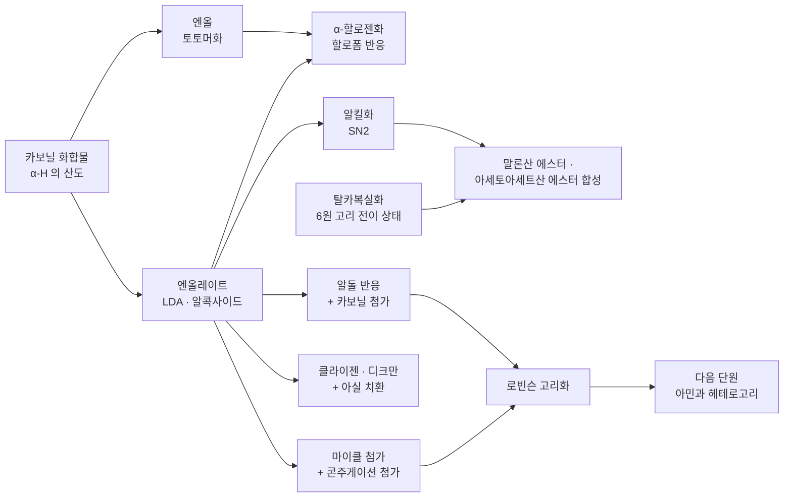

# 유기화학 12. 카보닐 α 자리의 반응과 축합 반응 — 카보닐 옆 탄소가 친핵체로 변할 때
<!-- prev: ochem-11, ochem-10, ochem-1, ochem-4 -->
<!-- next: ochem-13 -->

> [!NOTE]
> **이 단원의 범위**
> - 케토–엔올 토토머화(산·염기 촉매 메커니즘), 엔올의 비율을 정하는 요인, α 자리의 라세미화와 H/D 교환
> - α 수소의 산도($\mathrm{p}K_\mathrm{a}$ 표)와 엔올레이트의 공명, 염기의 선택(LDA), 속도론적·열역학적 엔올레이트
> - α-할로젠화(산 촉매·염기 촉매), 할로폼 반응, 카복실산의 α-브로민화(개관)
> - 엔올레이트의 알킬화와 그 한계, 탈카복실화(6원 고리 전이 상태), 말론산 에스터 합성과 아세토아세트산 에스터 합성
> - 알돌 반응과 알돌 축합(E1cB 탈수), 교차 알돌과 분자 내 알돌
> - 클라이젠 축합·교차 클라이젠·디크만 축합과 염기 1당량의 역할
> - 마이클 첨가와 로빈슨 고리화, 1,3-·1,5-이산소 관계를 읽는 역합성

**학습 목표**

1. 케토–엔올 토토머화의 산 촉매·염기 촉매 메커니즘을 굽은 화살표로 쓰고, 엔올 상수와 $\mathrm{p}K_\mathrm{a}$의 열역학적 순환으로 엔올의 비율과 산도를 계산할 수 있다.
2. 카보닐 화합물의 α-H $\mathrm{p}K_\mathrm{a}$(케톤 약 19~20, 에스터 약 25, β-다이케톤 약 9, β-케토에스터 약 11, 말론산 에스터 약 13)를 공명과 유도 효과로 설명하고, 짝산의 $\mathrm{p}K_\mathrm{a}$로 엔올레이트를 얼마나 만들 수 있는지 판단해 염기를 고를 수 있다.
3. 비대칭 케톤에서 속도론적 엔올레이트(LDA, −78 ℃, 덜 치환된 쪽)와 열역학적 엔올레이트(알콕사이드, 실온, 더 치환된 쪽)가 생기는 까닭을 에너지 도표로 설명하고 알킬화 생성물을 예측할 수 있다.
4. 산·염기 조건의 α-할로젠화와 할로폼 반응, 엔올레이트의 $\mathrm{S_N2}$ 알킬화를 메커니즘과 함께 쓰고, 말론산 에스터·아세토아세트산 에스터 합성에서 탈카복실화의 6원 고리 전이 상태를 이용해 카복실산과 메틸 케톤을 설계할 수 있다.
5. 알돌 첨가·알돌 축합·교차 알돌·분자 내 알돌, 클라이젠·디크만 축합의 생성물을 예측하고, 평형을 미는 요인(탈수, 생성물의 탈양성자화)과 교차 반응을 깔끔하게 만드는 조건을 설명할 수 있다.
6. 마이클 첨가와 로빈슨 고리화의 단계를 쓰고, 표적 분자에서 1,3-·1,5-이산소 관계와 α,β-불포화 카보닐을 찾아 역합성으로 출발 물질과 조건을 제안할 수 있다.

**이 단원의 학습 사다리**

| 단계 | 무엇을 하나? |
|---|---|
| STEP 1. 이전 학습 다시 보기 | 엔올레이트의 공명과 $\mathrm{p}K_\mathrm{a}$ 표, 친핵성 첨가와 친핵성 아실 치환, E1cB, $\mathrm{S_N2}$의 기질 조건 |
| STEP 2. 기초 다지기 | $\Delta\mathrm{p}K_\mathrm{a}$로 탈양성자화 정도 읽기, 열역학적 순환(엔올 상수와 $\mathrm{p}K_\mathrm{a}$), 속도론적·열역학적 지배, 역합성의 이산소 관계 |
| STEP 3. 핵심 개념 | 토토머화 → α-H 산도와 엔올레이트 → 속도론적·열역학적 엔올레이트 → α-할로젠화 → 알킬화 → 탈카복실화 → 말론산·아세토아세트산 에스터 합성 → 알돌 → 교차·분자 내 알돌 → 클라이젠·디크만 → 마이클 → 로빈슨 고리화 |
| STEP 4. 오개념 바로잡기 | "엔올레이트는 탄소 음이온이니 음전하가 탄소에 있다", "클라이젠 축합은 촉매량의 염기로 충분하다" 같은 착각 |
| STEP 5. 대학원·연구로 | 짐머만–트랙슬러 전이 상태와 알돌의 부분 입체 선택성, 키랄 보조기와 유기 촉매 알돌 |
| STEP 6. 생활·산업·진로 | 해당 과정의 알돌레이스, 지방산 합성의 탈카복실 클라이젠, 2-에틸헥산올 공정, 스테로이드 합성 |

---

## 🗺️ 단원 들어가기

아세톤을 무거운 물($\mathrm{D_2O}$)에 녹이고 수산화 나트륨을 아주 조금 넣어 두면, 몇 시간 뒤 아세톤의 여섯 수소가 모두 중수소로 바뀐다. 질량 분석으로 보면 분자량 58이 64가 된다. 그런데 아세톤의 C–H는 분명 탄소에 붙은 수소이고, 프로페인의 C–H($\mathrm{p}K_\mathrm{a}$ 약 50)는 같은 조건에서 꿈쩍도 하지 않는다. 카보닐기 바로 옆, 이른바 **α 자리**의 수소만 유난히 잘 떨어지는 것이다.

「구조와 결합, 산과 염기」에서 그 까닭을 한 줄로 보았다. α-H를 떼고 남은 음이온은 음전하를 산소로 넘기는 공명 구조를 가진다(엔올레이트). 「알데하이드와 케톤」과 「카복실산과 그 유도체」에서 카보닐 탄소는 언제나 **친전자체**였다. 이 단원에서는 같은 카보닐 화합물이 α 탄소를 통해 **친핵체**가 된다. 그러면 한 카보닐 화합물의 α 탄소가 다른 카보닐 화합물의 카보닐 탄소를 공격할 수 있다. 이것이 알돌 반응·클라이젠 축합이며, 유기 합성에서 C–C 결합을 만드는 가장 오래되고 가장 많이 쓰이는 방법이다. 생명체도 해당 과정, 시트르산 회로, 지방산 합성에서 같은 반응을 효소로 돌린다.

이 단원을 마치면 "이 표적 분자의 C–C 결합은 어느 두 카보닐 화합물에서 왔을까?"를 역으로 읽고, 어떤 염기를 어떤 온도에서 써야 원하는 자리에서 원하는 반응만 일어나는지 근거를 들어 고를 수 있다.

---

## STEP 1. 🔙 이전 학습 다시 보기

### 연계 개념표

| 이전 단원 | 그때 배운 것 | 이 단원에서 확장되는 것 |
|---|---|---|
| 유기화학 「구조와 결합, 산과 염기」 '공명', '$\mathrm{p}K_\mathrm{a}$와 평형의 방향' | 엔올레이트의 두 공명 구조(음전하는 주로 O), 아세톤 α-H $\mathrm{p}K_\mathrm{a}$ 19, $\log K = \mathrm{p}K_\mathrm{a}(\text{오른쪽 산}) - \mathrm{p}K_\mathrm{a}(\text{왼쪽 산})$ | 카보닐 화합물 전체의 α-H $\mathrm{p}K_\mathrm{a}$ 표, **염기를 고르는 계산**, 엔올 상수와 $\mathrm{p}K_\mathrm{a}$를 잇는 열역학적 순환 |
| 유기화학 「유기 반응의 개관과 알킬 할라이드의 치환·제거 반응」 '$\mathrm{S_N2}$', 'E1cB' | 메틸·1차 기질이 좋고 3차는 E2로 간다, 카보닐 옆 β-하이드록시기의 E1cB 탈수 | 엔올레이트를 친핵체로 쓰는 **알킬화**의 기질 조건, 알돌 축합의 탈수 단계 |
| 유기화학 「콘주게이션계와 방향족성」 '1,2-첨가와 1,4-첨가' | 속도론적 지배와 열역학적 지배, 낮은 온도·짧은 시간 대 높은 온도·평형 | 같은 두 지배를 **엔올레이트의 위치 선택성**에 적용 |
| 유기화학 「알데하이드와 케톤」 '친핵성 첨가', '엔아민', '콘주게이션 첨가' | 친핵체가 C=O 탄소를 공격해 사면체 알콕사이드를 만든다, α,β-불포화 카보닐의 1,2-/1,4-첨가 | 친핵체가 **다른 카보닐 화합물의 엔올레이트**인 경우가 알돌 반응, 1,4-첨가가 마이클 첨가 |
| 유기화학 「카복실산과 그 유도체」 '친핵성 아실 치환' | 첨가–제거(사면체 중간체에서 이탈기 OR이 떠남), 에스터의 비누화 | 친핵체가 **에스터의 엔올레이트**인 경우가 클라이젠 축합, 비누화 뒤의 탈카복실화 |

### 준비 운동 (사전 진단)

**Q1.** 아세톤 엔올레이트 $\mathrm{[CH_2COCH_3]^-}$의 두 공명 구조를 축약 구조식으로 쓰고, 굽은 화살표 두 개의 시작과 끝을 말로 쓰시오.

**Q2.** 아세톤($\mathrm{p}K_\mathrm{a}$ 19)을 나트륨 에톡사이드(에탄올 $\mathrm{p}K_\mathrm{a}$ 16)로 처리할 때 탈양성자화 평형 상수는 얼마인가?

**Q3.** 브로모메테인, 2-브로모-2-메틸프로페인 가운데 강한 음이온 친핵체와 $\mathrm{S_N2}$ 치환을 잘하는 것은? 다른 하나에서는 주로 무슨 반응이 일어나는가?

**Q4.** 에틸 아세테이트에 수산화 이온이 반응하는 비누화의 첫 단계에서 생기는 중간체의 이름과, 그 중간체에서 떨어져 나가는 원자단을 쓰시오.

정답 및 해설

**Q1.** $\mathrm{{}^-CH_2{-}C({=}O){-}CH_3 \leftrightarrow CH_2{=}C(O^-){-}CH_3}$. ① α 탄소의 비공유 전자쌍 → $\mathrm{C_\alpha{-}C}$ 결합 자리(새 C=C), ② C=O π 결합 → O. 음전하가 전기 음성인 O에 있는 오른쪽 구조가 주된 기여 구조이다(「구조와 결합, 산과 염기」 예제 14).

**Q2.** $\log K = 16 - 19 = -3$, $K = 1\times10^{-3}$. 평형은 왼쪽(케톤 + 에톡사이드)에 치우치지만, 소량의 엔올레이트가 끊임없이 생겼다가 사라진다. 이 '조금씩 생기는 엔올레이트'로 충분한 반응(알돌, 할로젠화)과 그렇지 않은 반응(알킬화)이 이 단원에서 갈린다.

**Q3.** 브로모메테인. 2-브로모-2-메틸프로페인은 3차라 뒤쪽 공격이 막혀 있고, 강한 염기와는 E2 제거로 2-메틸프로펜이 된다.

**Q4.** 사면체 중간체(사면체 알콕사이드). 수산화 이온이 C=O 탄소에 첨가해 생기고, 다시 C=O가 만들어지면서 에톡사이드($\mathrm{CH_3CH_2O^-}$)가 떨어진다. 클라이젠 축합은 이 반응에서 수산화 이온 자리에 에스터 엔올레이트가 들어간 것이다.

---

## STEP 2. 🧱 기초 다지기

### 디딤돌 1. $\Delta\mathrm{p}K_\mathrm{a}$로 탈양성자화의 정도 읽기

「구조와 결합, 산과 염기」 ⑧에서 유도한 식을 그대로 쓴다. 카보닐 화합물 HA와 염기 $\mathrm{B^-}$의 반응 $\mathrm{HA + B^- \rightleftharpoons A^- + HB}$에서

$$
\log K = \mathrm{p}K_\mathrm{a}(\mathrm{HB}) - \mathrm{p}K_\mathrm{a}(\mathrm{HA})
$$

이다. 이 단원에서는 이 $K$로 두 가지를 판단한다.

| 판단할 것 | 필요한 $K$ | 까닭 |
|---|---|---|
| 엔올레이트를 **거의 다** 만들어 놓고 친전자체를 넣을 수 있는가(알킬화, 방향을 정한 알돌) | $K \gg 1$ (대략 $10^{3}$ 이상) | 남은 케톤이나 염기가 친전자체와 따로 반응하면 부생성물이 생긴다 |
| 엔올레이트가 **조금만** 생겨도 되는가(알돌, 클라이젠, 할로젠화) | $K \ll 1$이어도 된다 | 생긴 엔올레이트가 곧바로 반응하고, 평형이 다시 엔올레이트를 보충한다 |

#### 예제 1 — 염기에 따라 아세톤 엔올레이트는 얼마나 생기나

아세톤($\mathrm{p}K_\mathrm{a}$ 19)을 같은 몰수의 (1) 수산화 나트륨(물 15.7), (2) 나트륨 에톡사이드(에탄올 16), (3) 칼륨 tert-뷰톡사이드(tert-뷰탄올 18), (4) 리튬 다이아이소프로필아마이드(LDA, 다이아이소프로필아민 36)와 섞었다. 각각의 $K$를 구하고, 짝산도 같은 몰수로 생긴다고 보는 단순 모형에서 엔올레이트로 바뀐 아세톤의 분율 $x$를 구하시오.

**풀이**
식 세우기: 처음 농도를 1로 두면 평형에서 $\dfrac{x^2}{(1-x)^2} = K$이므로 $x = \dfrac{\sqrt{K}}{1+\sqrt{K}}$이다.

| 염기 | $\log K$ | $K$ | 엔올레이트 분율 $x$ |
|---|---|---|---|
| NaOH | $15.7 - 19 = -3.3$ | $5\times10^{-4}$ | 약 2 % |
| NaOEt | $-3$ | $1\times10^{-3}$ | 약 3 % |
| KOtBu | $-1$ | 0.1 | 약 24 % |
| LDA | $+17$ | $10^{17}$ | 100 %(사실상 완결) |

**의미** 알콕사이드는 엔올레이트를 '조금씩' 만들 뿐이고, 케톤과 엔올레이트가 함께 있는 용액이 된다. 그 엔올레이트가 옆의 케톤을 공격하면 알돌 반응이다. 반대로 LDA는 케톤을 남김없이 엔올레이트로 바꾼다. 실제 용액에서는 짝산이 용매(에탄올·물)여서 엔올레이트의 비율이 이 모형보다 더 작지만, 결론(알콕사이드는 소량, LDA는 완결)은 같다.

### 디딤돌 2. 열역학적 순환 — 엔올 상수와 두 $\mathrm{p}K_\mathrm{a}$

케톤(K), 엔올(E), 엔올레이트($\mathrm{E^-}$)는 하나의 삼각형으로 이어진다. 케톤에서 α-H를 떼든, 엔올에서 O–H를 떼든 **같은 엔올레이트**가 생기기 때문이다.

$$
\mathrm{K \;\xrightarrow{K_\mathrm{E}}\; E}, \qquad \mathrm{E \;\xrightarrow{K_\mathrm{a}^\mathrm{E}}\; E^- + H^+}, \qquad \mathrm{K \;\xrightarrow{K_\mathrm{a}^\mathrm{K}}\; E^- + H^+}
$$

자유 에너지는 상태 함수이므로 첫째와 둘째 과정을 더하면 셋째가 된다. 평형 상수는 곱해진다.

$$
K_\mathrm{a}^\mathrm{K} = K_\mathrm{E}\,K_\mathrm{a}^\mathrm{E} \quad\Longrightarrow\quad \mathrm{p}K_\mathrm{a}^\mathrm{K} = \mathrm{p}K_\mathrm{E} + \mathrm{p}K_\mathrm{a}^\mathrm{E}
$$

($\mathrm{p}K_\mathrm{E} = -\log K_\mathrm{E}$.) 아세톤의 엔올 상수는 물에서 약 $5\times10^{-9}$($\mathrm{p}K_\mathrm{E} \approx 8.3$)이므로, 엔올(프로프-1-엔-2-올)의 O–H $\mathrm{p}K_\mathrm{a}$는 약 $19 - 8.3 \approx 11$이다. 엔올의 O–H는 알코올(16)보다 훨씬 산성이고 페놀(10)과 비슷하다. 페놀도 '방향족 고리에 붙은 엔올'이니 놀랍지 않다. 이 순환은 ①에서 엔올의 비율을, ②에서 엔올레이트의 안정성을 따질 때 계속 쓰인다.

### 디딤돌 3. 속도론적 지배와 열역학적 지배 — 다시 한 번

「콘주게이션계와 방향족성」의 1,2-/1,4-첨가에서 본 두 가지 지배를 되짚는다. 같은 출발 물질에서 두 생성물 A, B가 경쟁할 때

| | 속도론적 지배 | 열역학적 지배 |
|---|---|---|
| 조건 | 낮은 온도, 짧은 시간, **되돌아갈 수 없음** | 높은 온도, 긴 시간, **A ⇌ B가 오갈 수 있음** |
| 생성물 비 | $[\mathrm{A}]/[\mathrm{B}] = k_\mathrm{A}/k_\mathrm{B} = e^{\Delta\Delta G^\ddagger/RT}$ | $[\mathrm{A}]/[\mathrm{B}] = K = e^{-\Delta G^\circ/RT}$ |
| 정하는 것 | 두 **전이 상태**의 높이 차 | 두 **생성물**의 안정성 차 |

25 ℃에서 $RT\ln 10 = 5.71\ \mathrm{kJ/mol}$, −78 ℃(195 K)에서는 $3.74\ \mathrm{kJ/mol}$이다. 낮은 온도일수록 같은 에너지 차가 더 큰 선택성을 준다. ③에서 이 표를 그대로 엔올레이트에 쓴다.

### 디딤돌 4. 역합성의 눈 — 이산소 관계 세기

카보닐 축합 생성물에는 '지문'이 있다. 두 산소 작용기(C=O, OH, 또는 C=O가 있던 자리의 C=C) 사이의 거리를 탄소 번호로 센다. 카보닐 탄소를 1번으로 놓고 다른 산소가 붙은 탄소의 번호를 읽는다.

| 표적의 무늬 | 이산소 관계 | 떠올릴 반응 | 끊을 결합 |
|---|---|---|---|
| β-하이드록시 카보닐 $\mathrm{O{=}C{-}C{-}C{-}OH}$ | 1,3 | 알돌 첨가 | $\mathrm{C_\alpha{-}C_\beta}$ |
| α,β-불포화 카보닐 $\mathrm{O{=}C{-}C{=}C}$ | (1,3이 탈수된 것) | 알돌 축합 | $\mathrm{C_\alpha{=}C_\beta}$ |
| β-다이카보닐 $\mathrm{O{=}C{-}C{-}C{=}O}$ | 1,3 | 클라이젠·디크만 축합 | $\mathrm{C_\alpha{-}C}$(아실) |
| 1,5-다이카보닐 $\mathrm{O{=}C{-}C{-}C{-}C{-}C{=}O}$ | 1,5 | 마이클 첨가 | $\mathrm{C_\alpha{-}C_\beta}$(받개 쪽) |
| 고리 속 α,β-불포화 케톤 + 그 옆에 붙은 고리 | 1,5 + 1,3 | 로빈슨 고리화 | 마이클 결합 + 알돌 결합 |
| $\mathrm{R{-}CH_2{-}COOH}$, $\mathrm{R{-}CH_2{-}COCH_3}$ | — | 말론산·아세토아세트산 에스터 합성 | $\mathrm{R{-}C_\alpha}$ |

> [!TIP]
> 💡 **요령** — 1,3 관계는 '엔올레이트 + 카보닐 탄소', 1,5 관계는 '엔올레이트 + β 탄소'에서 생긴다. 표적에서 카보닐을 찾고, 그 α 탄소와 이웃한 결합 중 어느 것이 '두 조각을 잇는 결합'인지 찾는 것이 이 단원 역합성의 전부이다. ⑫에서 종합해 연습한다.

---

## STEP 3. 📘 핵심 개념

### ① 케토–엔올 토토머화

카보닐 화합물의 α 탄소에 H가 있으면, 그 H가 산소로 옮겨 가고 C=O가 C=C로 바뀐 **엔올(enol)**(ene + ol, 알켄 + 알코올)과 평형을 이룬다. 원자(H)의 위치가 바뀌므로 둘은 공명 구조가 아니라 서로 다른 분자, 곧 구조 이성질체이다. 양성자 하나의 이동으로 빠르게 서로 바뀌는 구조 이성질체를 **토토머(tautomer)**, 그 상호 변환을 **토토머화(tautomerization)** 라 한다.

$$
\mathrm{CH_3{-}C({=}O){-}CH_3 \;\rightleftharpoons\; CH_2{=}C(OH){-}CH_3} \qquad K_\mathrm{E} = \frac{[\text{엔올}]}{[\text{케토}]}
$$

「알켄과 알카인」에서 알카인의 수화가 엔올을 거쳐 케톤이 되는 것을 보았다. 그 마지막 단계가 바로 엔올 → 케토 토토머화이다.

<!-- 그림 요청: 네 쌍의 케토–엔올 토토머를 위아래 두 줄로 나란히(왼쪽 케토형 ⇌ 오른쪽 엔올형, 평형 화살표의 길이로 치우침을 표시). ① 프로판-2-온(아세톤, SMILES CC(C)=O) ⇌ 프로프-1-엔-2-올(SMILES C=C(C)O), 'K_E 약 5×10⁻⁹'. ② 사이클로헥산온(SMILES O=C1CCCCC1) ⇌ 사이클로헥스-1-엔-1-올(SMILES OC1=CCCCC1), '약 4×10⁻⁷'. ③ 펜테인-2,4-다이온(SMILES CC(=O)CC(C)=O) ⇌ (Z)-4-하이드록시펜트-3-엔-2-온(SMILES C/C(O)=C/C(C)=O): 엔올형은 O–H···O=C 분자 내 수소 결합(점선)으로 닫힌 6원 고리 모양으로 그리고 '순수한 액체에서 약 80 % 엔올' 이름표. ④ 사이클로헥사-2,4-다이엔-1-온(SMILES O=C1CC=CC=C1) ⇌ 페놀(SMILES Oc1ccccc1), '방향족 → 사실상 100 % 엔올'. 각 쌍에서 옮겨 간 H를 색으로 강조한다. -->

#### 평형은 왜 케토 쪽인가

| 화합물 | 엔올 상수 $K_\mathrm{E}$ (물, 25 ℃, 약) | 엔올의 비율 |
|---|---|---|
| 에탄알(아세트알데하이드) | $6\times10^{-7}$ | 백만 분의 1 수준 |
| 아세톤 | $5\times10^{-9}$ | 1억 분의 1 수준 |
| 사이클로헥산온 | $4\times10^{-7}$ | 백만 분의 1 수준 |
| 펜테인-2,4-다이온 | 물에서 약 0.2, 순수한 액체에서 약 4 | 약 15~20 %, 약 80 % |
| 페놀(엔올형)과 사이클로헥사다이엔온 | 엔올 쪽으로 압도적 | 사실상 100 % |

단순한 케톤에서 엔올이 이렇게 적은 까닭은 결합 에너지에 있다. 평균 결합 에너지로 어림하면 케토형의 $\mathrm{C{=}O + C{-}H + C{-}C}$(약 745 + 413 + 348 kJ/mol)가 엔올형의 $\mathrm{C{=}C + O{-}H + C{-}O}$(약 611 + 463 + 358 kJ/mol)보다 약 70 kJ/mol 더 강하다. 평균값이라 실제 차이($\Delta G^\circ$ 약 45 kJ/mol, 예제 2)보다 크게 나오지만, **C=O 이중 결합이 C=C 이중 결합보다 훨씬 강하다**는 것이 핵심이다.

엔올을 안정하게 하는 요인이 있으면 비율이 크게 오른다.

| 엔올을 늘리는 요인 | 예 | 까닭 |
|---|---|---|
| 콘주게이션 | 펜테인-2,4-다이온의 엔올: C=C가 다른 C=O와 콘주게이션 | π 전자의 비편재화 |
| 분자 내 수소 결합 | 같은 엔올의 O–H···O=C 6원 고리 | 엔올에만 있는 추가 안정화. 수소 결합을 빼앗는 물에서는 비율이 줄어든다 |
| 방향족성 | 페놀 | 케토형이 되면 방향족 안정화(약 150 kJ/mol)를 잃는다 |

#### 산 촉매와 염기 촉매 메커니즘

순수한 케톤에서 토토머화는 느리다. α 탄소의 H를 직접 산소로 옮기는 분자 내 경로는 4원 고리 전이 상태가 되어 기하학적으로 불가능하기 때문이다. 산이나 염기가 양성자를 **한 번은 떼고 한 번은 붙여** 주면 빨라진다. 두 메커니즘은 순서만 다르다.

**산 촉매(먼저 O에 붙이고, 나중에 C에서 뗀다)**
1. 카보닐 O의 비공유 전자쌍 → $\mathrm{H_3O^+}$의 H, H–O 결합 전자쌍 → O(물이 떨어짐). 양성자화된 카보닐(옥소카베늄 이온, 양전하는 O와 카보닐 C에 공명으로 퍼짐)이 생긴다.
2. 물 O의 전자쌍 → α 탄소의 H, $\mathrm{C_\alpha{-}H}$ 결합 전자쌍 → $\mathrm{C_\alpha{-}C}$ 결합 자리(새 C=C), C=O⁺의 π 전자쌍 → O(양전하 해소). 엔올과 $\mathrm{H_3O^+}$가 생긴다.

**염기 촉매(먼저 C에서 떼고, 나중에 O에 붙인다)**
1. $\mathrm{HO^-}$ O의 전자쌍 → α-H, $\mathrm{C_\alpha{-}H}$ 결합 전자쌍 → $\mathrm{C_\alpha{-}C}$ 결합 자리, C=O π 전자쌍 → O. 엔올레이트(두 공명 구조)와 물이 생긴다.
2. 엔올레이트 O의 전자쌍 → 물의 H, H–O 결합 전자쌍 → O. 엔올과 $\mathrm{HO^-}$가 생긴다. (같은 엔올레이트가 C 쪽으로 양성자를 받으면 다시 케톤이 된다.)

<!-- 그림 요청: 아세톤(SMILES CC(C)=O)의 산 촉매 엔올화 메커니즘(위 줄)과 염기 촉매 엔올화 메커니즘(아래 줄). 위 줄: ① 아세톤 카보닐 O의 비공유 전자쌍 → H3O⁺의 H 굽은 화살표, H–O 결합 → O 화살표 → 양성자화된 아세톤의 두 공명 구조 (CH3)2C=OH⁺ ↔ (CH3)2C⁺–OH (공명 화살표 ↔). ② 물 O 전자쌍 → CH3의 H 화살표, C–H 결합 → C–C 결합 자리 화살표, C=O⁺의 π 전자쌍 → O 화살표(3개) → 프로프-1-엔-2-올(SMILES C=C(C)O) + H3O⁺. 아래 줄: ① HO⁻ O 전자쌍 → CH3의 H, C–H → C–C 자리, C=O π → O(화살표 3개) → 엔올레이트의 두 공명 구조 ⁻CH2–C(=O)CH3 ↔ CH2=C(O⁻)CH3 (오른쪽 구조에 '주된 기여 구조') + H2O. ② 엔올레이트 O⁻ 전자쌍 → H2O의 H, H–O → O 화살표 → 엔올 + HO⁻. 두 줄 오른쪽 끝에 '촉매: 처음과 끝에 H3O⁺ / HO⁻ 가 그대로' 이름표. -->

#### 토토머화가 남기는 흔적 — 라세미화와 H/D 교환

엔올과 엔올레이트의 α 탄소는 $sp^2$이고 평면이다. 그래서 α 탄소가 입체 중심인 카보닐 화합물은 산이나 염기 속에서 **라세미화**된다. 평면 엔올의 위·아래 어느 면으로든 양성자가 다시 붙을 수 있기 때문이다. 같은 반응을 $\mathrm{D_2O}$에서 하면 α-H가 모두 D로 바뀐다.

<!-- 그림 요청: (S)-3-페닐뷰탄-2-온(SMILES CC(=O)[C@@H](C)c1ccccc1)의 염기 촉매 라세미화. 왼쪽: 쐐기·점선 구조(C3에 페닐 쐐기, H 점선, CH3와 C(=O)CH3는 종이 면). HO⁻ → C3–H 화살표로 탈양성자화 → 가운데: 평면 엔올레이트를 비스듬히 본 그림(C2=C3 평면, 위아래로 p 오비탈 엽, C3의 페닐·메틸이 평면에). 가운데에서 두 갈래: 물 분자가 위쪽 면에서 양성자를 주는 화살표 → (S)체, 아래쪽 면에서 주는 화살표 → (R)-3-페닐뷰탄-2-온(SMILES CC(=O)[C@H](C)c1ccccc1). 두 갈래에 '50 : 50' 이름표. -->

#### 예제 2 — 엔올 상수를 자유 에너지로

(1) 25 ℃에서 아세톤($K_\mathrm{E} = 5\times10^{-9}$)과 사이클로헥산온($4\times10^{-7}$)의 엔올화 $\Delta G^\circ$를 구하시오. (2) 아세톤 1 mol 속에 엔올 분자는 몇 개 있는가? (3) 순수한 펜테인-2,4-다이온의 엔올 비율이 80 %일 때 $\Delta G^\circ$는?

**풀이**
(1) $\Delta G^\circ = -RT\ln K_\mathrm{E} = 2.303RT\,\mathrm{p}K_\mathrm{E}$. 아세톤: $5.71\times8.3 = 47\ \mathrm{kJ/mol}$. 사이클로헥산온: $\mathrm{p}K_\mathrm{E} = 6.4$, $5.71\times6.4 = 37\ \mathrm{kJ/mol}$.
(2) $6.02\times10^{23}\times5\times10^{-9} = 3\times10^{15}$개. 분율은 작아도 개수는 막대하다.
(3) $K_\mathrm{E} = 80/20 = 4$, $\Delta G^\circ = -8.314\times298.15\times\ln 4 = -3.4\ \mathrm{kJ/mol}$.
**의미** 콘주게이션과 수소 결합이 단순 케톤에 비해 엔올을 약 50 kJ/mol 안정화해 평형을 뒤집는다. 또 아세톤의 엔올이 1억 분의 1뿐이어도 엔올을 거치는 반응(④의 할로젠화)이 잘 일어나는 것은, 엔올이 소모되는 즉시 평형이 다시 엔올을 만들어 주기 때문이다.

#### 예제 3 — 중수소 교환과 라세미화 예측

다음을 $\mathrm{D_2O}$ 속에서 NaOD와 오래 두었다. (1) 2-메틸사이클로헥산온 $\mathrm{C_7H_{12}O}$(분자량 112)는 H가 몇 개 D로 바뀌고 분자 이온은 m/z 얼마가 되는가? (2) (S)-3-페닐뷰탄-2-온은 광학 활성을 잃는가? (3) (R)-3-메틸사이클로헥산온은?

**풀이**
(1) α 탄소는 C2(H 1개)와 C6(H 2개)이다. α-H 3개가 모두 D로 바뀌어 m/z 115이다.
(2) 잃는다. 입체 중심 C3이 α 탄소이고 H를 가지므로 평면 엔올레이트를 거쳐 라세미화된다.
(3) 잃지 않는다. 입체 중심 C3은 β 탄소이다. 엔올레이트는 C2나 C6에서만 생기고 C3의 결합은 그대로이다. (α-H인 C2·C6의 H 4개는 D로 바뀐다.)
**의미** α 자리의 입체 중심은 산·염기 조건에서 지키기 어렵다. 합성에서 α 입체 중심을 만든 뒤에는 강한 산·염기와 열을 피한다.

#### ✔ 바로 확인

1. (O/X) 케토형과 엔올형은 같은 분자의 두 공명 구조이다.
2. 빈칸: 단순한 케톤에서 케토형이 압도적으로 우세한 주된 까닭은 (    ) 결합이 C=C 결합보다 훨씬 강하기 때문이다.
3. 산 촉매 엔올화에서 첫 단계에 양성자가 붙는 원자는?
4. 사이클로헥산온을 $\mathrm{D_2O}$/NaOD에 두면 분자 이온의 m/z는 98에서 얼마가 되는가?

정답

1. X — H 원자의 위치가 다르므로 서로 다른 분자(토토머)이다. 공명은 전자만 옮긴다.
2. C=O — 결합 에너지의 합이 케토형 쪽이 크다.
3. 카보닐 산소 — 그다음 물이 α-H를 뗀다.
4. 102 — α-H 4개(C2, C6에 2개씩)가 D로 바뀐다.

### ② α 수소의 산도와 엔올레이트

α-H가 산성인 까닭은 짝염기에 있다. α-H를 떼고 남은 전자쌍은 C=O의 π계와 나란한 p 오비탈에 놓이고, 음전하가 전기 음성인 산소로 비편재화된다(「구조와 결합, 산과 염기」 공명 무늬 ①). 이 음이온을 **엔올레이트 이온(enolate ion)** 이라 한다. 카보닐기의 유도 효과(δ+ 탄소)와 α 탄소의 일부 $sp^2$ 성격도 보탬이 된다.

#### α-H의 $\mathrm{p}K_\mathrm{a}$ 표

| 화합물 (축약 구조식) | 산성 수소 | $\mathrm{p}K_\mathrm{a}$ (약) | 짝염기의 음전하가 퍼지는 곳 |
|---|---|---|---|
| 에테인 $\mathrm{CH_3CH_3}$ | C–H | 50 | 퍼지지 않음 |
| N,N-다이메틸아세트아마이드 $\mathrm{CH_3CON(CH_3)_2}$ | α-H | 30 | O 하나(N의 공여가 방해) |
| 에틸 아세테이트 $\mathrm{CH_3COOC_2H_5}$ | α-H | 25 | O 하나(OR의 공여가 방해) |
| 아세토나이트릴 $\mathrm{CH_3CN}$ | α-H | 25 | N |
| 아세톤 $\mathrm{CH_3COCH_3}$ | α-H | 19 | O 하나 |
| 에탄알 $\mathrm{CH_3CHO}$ | α-H | 17 | O 하나 |
| 다이에틸 말로네이트 $\mathrm{CH_2(COOC_2H_5)_2}$ | 두 C=O 사이 $\mathrm{CH_2}$ | 13 | O 두 개 |
| 에틸 3-옥소뷰타노에이트(아세토아세트산 에틸) $\mathrm{CH_3COCH_2COOC_2H_5}$ | 두 C=O 사이 $\mathrm{CH_2}$ | 11 | O 두 개 |
| 펜테인-2,4-다이온 $\mathrm{CH_3COCH_2COCH_3}$ | 두 C=O 사이 $\mathrm{CH_2}$ | 9 | O 두 개 |
| 나이트로메테인 $\mathrm{CH_3NO_2}$ | α-H | 10 | 나이트로기의 O 두 개 |

(물을 기준으로 옮긴 값이다. 18보다 큰 값은 다른 용매의 자료에서 옮긴 어림값이므로 자릿수 정도로 쓴다. 이 책의 「구조와 결합, 산과 염기」 $\mathrm{p}K_\mathrm{a}$ 표와 같은 기준이다.)

표에서 세 가지 경향을 읽는다.

1. **카보닐이 둘이면 훨씬 강해진다.** β-다이카보닐 화합물의 엔올레이트는 음전하를 두 산소와 가운데 탄소에 나누는 공명 구조 셋을 가진다. 아세톤(19)과 펜테인-2,4-다이온(9) 사이는 $10^{10}$배이다.
2. **에스터·아마이드는 케톤보다 약하다.** 에스터의 OR 산소(아마이드는 N)가 비공유 전자쌍을 이미 C=O에 내주고 있어($\mathrm{R{-}C(O^-){=}O^+R}$ 공명), C=O가 엔올레이트의 음전하를 받아들일 여력이 적다. 그래서 β-다이카보닐 중에서도 다이케톤(9) < 케토에스터(11) < 다이에스터(13) 순서로 $\mathrm{p}K_\mathrm{a}$가 커진다.
3. **알데하이드는 케톤보다 조금 강하다.** 케톤의 두 번째 알킬기가 전자를 밀어 음이온을 약간 불안정하게 한다.

<!-- 그림 요청: 엔올레이트의 공명과 오비탈 두 칸. (왼쪽) 아세톤 엔올레이트: 두 공명 구조 ⁻CH2–C(=O)–CH3 ↔ CH2=C(–O⁻)–CH3 와 굽은 화살표 2개(C 전자쌍 → C–C 자리, C=O π → O). 그 아래에 세 원자 C–C–O에 나란한 p 오비탈 세 개(알릴 음이온과 같은 π계)와 'HOMO 계수: α 탄소에서 가장 큼' 이름표, 정전기 퍼텐셜 색(O 진한 빨강, α 탄소 옅은 빨강). (오른쪽) 펜테인-2,4-다이온 엔올레이트(SMILES CC(=O)[CH-]C(C)=O)의 공명 구조 셋: 음전하가 가운데 탄소 / 왼쪽 O / 오른쪽 O에 있는 구조를 화살표로 잇고, 아래에 'pKa 9 — 음전하가 O 두 개로 퍼짐'. -->

#### 엔올레이트는 두 자리 친핵체이다

엔올레이트의 음전하는 대부분 산소에 있지만, 친전자체와의 반응은 대개 **탄소**에서 일어난다. 이렇게 두 자리에서 반응할 수 있는 친핵체를 **양쪽 자리 친핵체(ambident nucleophile)** 라 한다.

- **C 쪽 공격**: 생성물에 강한 C=O가 남는다(열역학적으로 유리). HOMO의 계수도 α 탄소에서 크다. 알킬 할라이드, 알데하이드·케톤, 에스터, α,β-불포화 카보닐 같은 대부분의 탄소 친전자체가 여기에 속한다.
- **O 쪽 공격**: 산소와 아주 강한 결합을 만드는 친전자체(클로로트라이메틸실레인, 산 무수물 등)는 O를 공격한다. 클로로트라이메틸실레인과의 반응으로 생기는 **실릴 엔올 에터**($\mathrm{CH_2{=}C(OSiMe_3)CH_3}$)는 엔올레이트를 분리·보관하는 형태로 쓰인다.

#### 염기 고르기 — LDA

케톤을 엔올레이트로 **완전히** 바꾸려면 짝산의 $\mathrm{p}K_\mathrm{a}$가 25 이상인 염기가 필요하다. 그러면서도 염기 자신이 카보닐 탄소를 공격(친핵성 첨가)하면 안 된다. 가장 널리 쓰이는 답이 **리튬 다이아이소프로필아마이드(lithium diisopropylamide, LDA)** $\mathrm{[(CH_3)_2CH]_2N^-Li^+}$이다.

| 성질 | 내용 | 쓸모 |
|---|---|---|
| 염기의 세기 | 짝산 다이아이소프로필아민의 $\mathrm{p}K_\mathrm{a}$ 약 36 | 케톤(19)·에스터(25)를 사실상 완전히 탈양성자화 ($K \approx 10^{11}\sim10^{17}$) |
| 부피 | N에 아이소프로필기 둘 | 카보닐 탄소를 공격하지 못한다(친핵성이 아주 작다). 덜 붐빈 α-H를 고른다(③) |
| 만드는 법 | 다이아이소프로필아민 + 뷰틸리튬, THF, −78 ℃~0 ℃ | 쓰기 직전에 만든다. 부산물은 뷰테인 기체 |
| 용매·온도 | THF, −78 ℃ | 비양성자성이라 엔올레이트를 되돌려 놓을 양성자가 없다 |

다른 염기와 비교하면 다음과 같다. 수소화 나트륨(NaH)은 $\mathrm{H_2}$ 기체를 내보내며 비가역적으로 탈양성자화하지만 느리고 불균일하다. 수산화 이온·알콕사이드는 케톤·에스터를 일부만 엔올레이트로 바꾸고, β-다이카보닐 화합물(9~13)은 거의 완전히 바꾼다(예제 4). 리튬 헥사메틸다이실라자이드(LiHMDS, 짝산 $\mathrm{p}K_\mathrm{a}$ 약 26)는 LDA보다 약하지만 더 부피가 크다.

#### 예제 4 — 어느 염기면 충분한가

(1) 다이에틸 말로네이트를 나트륨 에톡사이드로, (2) 에틸 아세테이트를 나트륨 에톡사이드로, (3) 펜테인-2,4-다이온을 수산화 나트륨으로, (4) 에틸 아세테이트를 LDA로 처리할 때의 $K$를 구하고, 엔올레이트가 '거의 완전히' 생기는지 판단하시오.

**풀이**
(1) $\log K = 16 - 13 = 3$, $K = 10^3$ → 거의 완전(남는 말로네이트 약 3 %, 디딤돌 1의 모형).
(2) $\log K = 16 - 25 = -9$, $K = 10^{-9}$ → 극미량.
(3) $\log K = 15.7 - 9 = 6.7$, $K \approx 5\times10^6$ → 완전.
(4) $\log K = 36 - 25 = 11$, $K = 10^{11}$ → 완전.
**의미** β-다이카보닐 화합물은 '값싼' 알콕사이드로 충분하고, 단순 케톤·에스터를 완전히 엔올레이트로 바꾸려면 LDA가 필요하다. ⑦의 말론산 에스터 합성이 NaOEt로, ⑤의 케톤 알킬화가 LDA로 하는 까닭이 이 한 줄의 계산에 있다.

> [!WARNING]
> 에스터를 알콕사이드로 다룰 때는 **에스터의 알콕시기와 같은 알콕사이드**를 쓴다(에틸 에스터에는 NaOEt). 다른 알콕사이드는 카보닐 탄소를 공격해 에스터 교환을 일으키고, 수산화 이온은 비누화를 일으킨다(「카복실산과 그 유도체」).

#### ✔ 바로 확인

1. 다음을 α-H가 산성인 것부터 쓰시오: 에틸 아세테이트, 펜테인-2,4-다이온, 아세톤, 다이에틸 말로네이트
2. (O/X) 엔올레이트의 음전하는 주로 산소에 있으므로 알킬 할라이드와는 주로 산소에서 반응한다.
3. 빈칸: LDA의 짝산은 (    )이며, 그 $\mathrm{p}K_\mathrm{a}$는 약 36이다.
4. 에스터가 케톤보다 α-H 산도가 약한 까닭을 한 문장으로 쓰시오.

정답

1. 펜테인-2,4-다이온(9) > 다이에틸 말로네이트(13) > 아세톤(19) > 에틸 아세테이트(25)
2. X — 생성물에 강한 C=O가 남는 탄소 쪽 공격이 대부분이다. O 공격은 실릴 염화물처럼 O와 아주 강한 결합을 만드는 친전자체에서 일어난다.
3. 다이아이소프로필아민 — $\mathrm{[(CH_3)_2CH]_2NH}$.
4. 에스터의 OR 산소가 비공유 전자쌍을 C=O에 이미 내주고 있어, C=O가 엔올레이트의 음전하를 받아들이는 능력이 줄기 때문이다.

### ③ 속도론적 엔올레이트와 열역학적 엔올레이트

2-메틸사이클로헥산온처럼 α 탄소가 두 개이고 치환 정도가 다른 케톤은 두 가지 엔올레이트를 만들 수 있다.

- C6(H 2개, 덜 치환된 쪽)에서 H를 떼면 **6-메틸사이클로헥스-1-엔-1-올레이트**: C=C에 치환기가 적다(삼치환 알켄 꼴).
- C2(H 1개, 메틸이 붙은 쪽)에서 H를 떼면 **2-메틸사이클로헥스-1-엔-1-올레이트**: C=C가 사치환 알켄 꼴이다.

「알켄과 알카인」에서 본 대로 더 치환된 알켄이 더 안정하므로, 두 번째가 **열역학적 엔올레이트(thermodynamic enolate)** 이다. 그러나 C6의 H는 두 개이고 메틸기에 가리지 않아 염기가 다가가기 쉽다. 그래서 탈양성자화 자체는 C6 쪽이 빠르고, 첫 번째가 **속도론적 엔올레이트(kinetic enolate)** 이다.

<!-- 그림 요청: 2-메틸사이클로헥산온(SMILES CC1CCCCC1=O)에서 두 엔올레이트로 가는 두 갈래. 가운데에 케톤 골격 구조식(C2의 H 하나와 C6의 H 둘을 서로 다른 색으로). 왼쪽 갈래: 'LDA, THF, −78 ℃' 조건 아래 LDA의 N(아이소프로필기 둘을 크게)이 C6–H로 다가가는 그림과 굽은 화살표(N 전자쌍 → H, C6–H → C6–C1 자리, C=O π → O) → 리튬 6-메틸사이클로헥스-1-엔-1-올레이트(SMILES [Li+].CC1CCCC=C1[O-]), '속도론적, 덜 치환된 C=C, 약 99 %'. 오른쪽 갈래: 'NaOEt/EtOH 또는 KOtBu/tBuOH, 실온, 평형' 조건 아래 → 2-메틸사이클로헥스-1-엔-1-올레이트(SMILES CC1=C([O-])CCCC1), '열역학적, 더 치환된 C=C, 주'. 두 엔올레이트 사이에 '양성자 교환으로 평형(ROH 있을 때만)' 이중 화살표. -->

#### 에너지 도표로 보기

두 경로는 디딤돌 3의 표에 그대로 들어맞는다.

| | 속도론적 엔올레이트 | 열역학적 엔올레이트 |
|---|---|---|
| 염기 | 강하고 부피 큰 염기(LDA), 케톤보다 **많이** | 약간 약한 염기(알콕사이드, 짝산 $\mathrm{p}K_\mathrm{a}$ 16~18), 또는 케톤이 조금 **남게** |
| 용매 | 비양성자성(THF) | 양성자성(알코올) 가능 |
| 온도·시간 | −78 ℃, 짧게 | 실온 이상, 길게 |
| 되돌아감 | 없음(짝산 $\mathrm{p}K_\mathrm{a}$ 36 ≫ 19, 양성자 원천 없음) | 있음(엔올레이트 ⇌ 케톤 ⇌ 다른 엔올레이트) |
| 정하는 것 | 탈양성자화 **전이 상태**의 높이 | **엔올레이트** 자체의 안정성 |
| 결과 | 덜 치환된 쪽 | 더 치환된 쪽 |

열역학적 조건에서 '평형'이 이루어지려면 엔올레이트가 다시 양성자를 받을 수 있어야 한다. 알코올 용매나, 일부러 남겨 둔 케톤(케톤의 α-H가 엔올레이트에 양성자를 건넨다)이 그 역할을 한다. LDA를 케톤보다 조금 많이 쓰고 케톤을 LDA 용액에 천천히 넣는 까닭은, 케톤이 남아 있는 순간이 없게 하여 이 평형을 막기 위해서이다.

<!-- 그림 요청: 속도론적·열역학적 엔올레이트의 깁스 에너지 도표. 세로축 G(kJ/mol), 가로축 반응 좌표. 가운데에 '2-메틸사이클로헥산온 + 염기'(높이 0). 왼쪽으로 낮은 꼭대기 TS_k(예: +40)를 넘어 속도론적 엔올레이트(+8), 오른쪽으로 더 높은 꼭대기 TS_t(예: +47)를 넘어 열역학적 엔올레이트(+2, 더 낮음). 두 꼭대기 높이 차에 'ΔΔG‡ 약 7.5 kJ/mol (−78 ℃에서 99 : 1)', 두 골짜기 높이 차에 'ΔG° (더 치환된 쪽이 더 안정)' 양방향 화살표. 왼쪽 위에 'LDA, −78 ℃: 꼭대기 차가 결정', 오른쪽 위에 'ROH, 실온: 골짜기 차가 결정' 상자. 세로축의 수치는 '모식적'이라고 작게 적는다. -->

<!-- 시뮬레이션 요청: 엔올레이트 위치 선택성 탐색기. 2-메틸사이클로헥산온을 기준으로, 사용자가 ① 염기(LDA, LiHMDS, KOtBu, NaOEt, NaH)와 그 당량(0.9~1.2), ② 온도(−78~25 ℃), ③ 반응 시간(1 min~10 h), ④ 양성자성 첨가물(tBuOH 0~1 당량) 슬라이더를 고른다. 내부 모형은 두 탈양성자화 속도 상수(ΔΔG‡ 7.5 kJ/mol, 아이링 식)와 두 엔올레이트 사이 양성자 교환 속도(남은 케톤·ROH 농도에 비례), 평형 비(ΔG° 약 5 kJ/mol)로 두 엔올레이트 농도의 시간 변화를 수치로 적분한다. 출력: 시간에 따른 두 엔올레이트 분율 곡선, 최종 비율 막대, 그리고 MeI로 가둔 생성물(2,6-다이메틸사이클로헥산온 대 2,2-다이메틸사이클로헥산온)의 구조와 비. -->

#### 예제 5 — 위치 선택성과 에너지 차

2-메틸사이클로헥산온을 (가) LDA(1.05 당량), THF, −78 ℃로 처리한 뒤 아이오도메테인을 넣었다. (나) 칼륨 tert-뷰톡사이드, tert-뷰탄올, 실온에서 평형에 이르게 한 뒤 아이오도메테인을 넣었다. (1) 각각의 주생성물을 쓰시오. (2) (가)의 엔올레이트 비가 99 : 1이라면 두 탈양성자화 전이 상태의 $\Delta\Delta G^\ddagger$는 얼마인가? (3) (나)의 엔올레이트 비가 1 : 9(덜 : 더 치환)라면 두 엔올레이트의 $\Delta G^\circ$ 차는 얼마인가?

**풀이**
(1) (가) 속도론적 엔올레이트의 C6이 메틸화 → **2,6-다이메틸사이클로헥산온**(SMILES `CC1CCCC(C)C1=O`, 시스·트랜스 혼합). (나) 열역학적 엔올레이트의 C2가 메틸화 → **2,2-다이메틸사이클로헥산온**(`CC1(C)CCCCC1=O`).
(2) $\Delta\Delta G^\ddagger = RT\ln 99 = 8.314\times195.15\times\ln 99 = 7.5\ \mathrm{kJ/mol}$.
(3) $\Delta G^\circ = RT\ln 9 = 8.314\times298.15\times\ln 9 = 5.4\ \mathrm{kJ/mol}$ (더 치환된 쪽이 안정).
**의미** 몇 kJ/mol의 차이가 조건에 따라 생성물을 완전히 뒤바꾼다. (나)의 조건에서는 실제로 다중 알킬화, 엔올레이트와 남은 케톤의 알돌 같은 부반응이 섞이므로, '더 치환된 쪽'에 알킬기를 깔끔하게 넣을 때는 ⑦의 β-케토에스터 경로를 많이 쓴다.

#### ✔ 바로 확인

1. 빈칸: LDA, THF, −78 ℃에서는 (    ) 엔올레이트가, 알콕사이드와 실온·평형 조건에서는 (    ) 엔올레이트가 주로 생긴다.
2. (O/X) 속도론적 엔올레이트가 더 안정한 엔올레이트이다.
3. 3-메틸뷰탄-2-온 $\mathrm{CH_3COCH(CH_3)_2}$을 LDA(−78 ℃)로 처리할 때 H가 떨어지는 탄소는? (C1 또는 C3)
4. 열역학적 엔올레이트를 얻는 데 양성자 원천(ROH나 남은 케톤)이 필요한 까닭은?

정답

1. 속도론적(덜 치환된 쪽), 열역학적(더 치환된 쪽)
2. X — 더 빨리 생길 뿐이고, 더 안정한 것은 더 치환된 C=C를 가진 열역학적 엔올레이트이다.
3. C1(메틸) — H가 셋이고 가리지 않는다.
4. 엔올레이트가 양성자를 다시 받아 케톤으로 돌아가야 두 엔올레이트 사이에 평형이 이루어지기 때문이다.

### ④ α-할로젠화와 할로폼 반응

엔올과 엔올레이트는 전자가 풍부한 C=C를 가지므로 할로젠($\mathrm{Cl_2}$, $\mathrm{Br_2}$, $\mathrm{I_2}$)과 반응한다. 결과는 α-H 하나가 할로젠으로 바뀐 **α-할로 카보닐 화합물**이다. 산성 조건과 염기성 조건에서 메커니즘과 결과가 뚜렷하게 다르다.

#### 산 촉매 α-할로젠화 — 엔올을 거친다

$$
\mathrm{C_6H_{10}O \;(사이클로헥산온) + Br_2 \xrightarrow{\;CH_3COOH\;} 2\text{-브로모사이클로헥산온} + HBr}
$$

1. (①의 산 촉매 엔올화) 케톤 → 엔올. **속도 결정 단계**이다.
2. 엔올의 C=C π 전자쌍 → Br–Br의 가까운 Br, Br–Br 결합 전자쌍 → 먼 Br(브로민화 이온). 동시에 엔올 O의 비공유 전자쌍이 C–O 결합 자리로 들어와 양성자화된 카보닐(옥소카베늄 이온)이 된다.
3. 물(또는 $\mathrm{Br^-}$)이 O–H의 H를 떼어 α-브로모 케톤과 HBr이 생긴다.

<!-- 그림 요청: 사이클로헥산온(SMILES O=C1CCCCC1)의 산 촉매 α-브로민화 메커니즘. ① 산 촉매 엔올화(두 단계를 작게: O 양성자화 → α-H 제거)로 사이클로헥스-1-엔-1-올(SMILES OC1=CCCCC1), 이 단계에 '느림(속도 결정)' 이름표. ② 엔올의 O 비공유 전자쌍 → C1–O 결합 자리 화살표, C1=C2 π → Br–Br의 가까운 Br 화살표, Br–Br 결합 → 먼 Br 화살표(3개) → C2에 Br이 붙은 양성자화된 카보닐(C1=O⁺–H) + Br⁻. ③ Br⁻ 또는 물이 O–H의 H를 떼는 화살표 2개 → 2-브로모사이클로헥산-1-온(SMILES O=C1CCCCC1Br) + HBr. 오른쪽에 '할로젠 하나 들어가면 멈춘다: C–Br의 전자 끌기가 O의 양성자화를 어렵게 함' 상자. -->

산 촉매 할로젠화의 두 가지 특징이 메커니즘에서 바로 나온다.

- **한 번만 들어간다.** 할로젠이 붙으면 그 전자 끌기 효과 때문에 카보닐 산소가 양성자를 덜 받아들이고, 엔올화(1단계)가 느려진다. 그래서 일할로젠화물에서 멈춘다.
- **더 치환된 α 탄소에 들어간다.** 산성 조건에서 엔올화는 평형이며, 더 치환된 C=C를 가진 엔올이 더 안정하다. 2-메틸사이클로헥산온은 주로 2-브로모-2-메틸사이클로헥산온이 된다. 이것을 피리딘과 가열하면 E2로 HBr이 빠져 2-메틸사이클로헥스-2-엔-1-온(α,β-불포화 케톤)이 된다. 카보닐과 콘주게이션된 C=C를 만드는 고전적 방법이다.

#### 예제 6 — 속도 법칙이 말해 주는 것

25 ℃에서 아세톤의 산 촉매 아이오딘화 $\mathrm{CH_3COCH_3 + I_2 \rightarrow CH_3COCH_2I + HI}$의 처음 속도($\mathrm{I_2}$의 색이 사라지는 속도)를 측정하였다.

| 실험 | [아세톤] (M) | $[\mathrm{H^+}]$ (M) | $[\mathrm{I_2}]$ (M) | 처음 속도 ($\mathrm{M/s}$) |
|---|---|---|---|---|
| 1 | 0.40 | 0.10 | 0.0010 | $1.12\times10^{-6}$ |
| 2 | 0.80 | 0.10 | 0.0010 | $2.24\times10^{-6}$ |
| 3 | 0.40 | 0.20 | 0.0010 | $2.24\times10^{-6}$ |
| 4 | 0.40 | 0.10 | 0.0020 | $1.12\times10^{-6}$ |

(1) 속도 법칙과 속도 상수를 구하시오. (2) 실험 1에서 $\mathrm{I_2}$가 모두 사라지는 데 걸리는 시간을 어림하시오. (3) 같은 조건에서 브로민화의 속도, 그리고 $\mathrm{D_3O^+}$/$\mathrm{D_2O}$에서 아세톤에 D가 처음 들어가는 속도는 어떠할지 예측하시오.

**풀이**
(1) 1 → 2: 아세톤 2배에 속도 2배(1차). 1 → 3: $\mathrm{H^+}$ 2배에 2배(1차). 1 → 4: $\mathrm{I_2}$ 2배에 변화 없음(0차). $v = k[\text{아세톤}][\mathrm{H^+}]$, $k = \dfrac{1.12\times10^{-6}}{0.40\times0.10} = 2.8\times10^{-5}\ \mathrm{M^{-1}s^{-1}}$.
(2) $\mathrm{I_2}$에 대해 0차이고 아세톤·산은 거의 줄지 않으므로 속도가 일정하다. $t = 0.0010/1.12\times10^{-6} = 8.9\times10^{2}\ \mathrm{s}$(약 15분).
(3) 모두 같은 속도이다. 할로젠이 속도 법칙에 없다는 것은 할로젠이 속도 결정 단계 **뒤**에 들어온다는 뜻이고, 속도 결정 단계는 할로젠 종류와 무관한 엔올화이다. H/D 교환의 처음 속도와 (α 입체 중심이 있으면) 라세미화 속도도 같은 엔올화 속도이다.
**의미** 할로젠화·H/D 교환·라세미화의 속도가 일치한다는 실험 사실이 '셋이 공통 중간체(엔올)를 거친다'는 증거이다. 탐구 활동 B에서 이 실험을 자료로 다시 분석한다.

#### 염기 촉진 α-할로젠화 — 엔올레이트를 거치고 멈추지 않는다

염기 속에서는 엔올레이트가 할로젠을 공격한다. 이번에는 할로젠이 하나 들어가면 남은 α-H가 **더 산성**이 된다(할로젠의 유도 효과가 엔올레이트를 안정화). 그래서 두 번째, 세 번째 할로젠화가 첫 번째보다 빠르고, 같은 탄소의 H가 모두 할로젠으로 바뀔 때까지 멈추지 않는다. 염기는 HX를 중화하며 소모되므로 '촉매'가 아니라 '촉진'이라 한다.

#### 할로폼 반응

메틸 케톤 $\mathrm{RCOCH_3}$을 과량의 할로젠과 수산화 나트륨으로 처리하면, 메틸기가 $\mathrm{CX_3}$로 바뀐 뒤 그 원자단이 **떨어져 나간다**.

$$
\mathrm{RCOCH_3 + 3X_2 + 4NaOH \longrightarrow RCOONa + CHX_3 + 3NaX + 3H_2O}
$$

1. 엔올레이트 형성과 할로젠화를 세 번 되풀이: $\mathrm{RCOCH_3 \rightarrow RCOCH_2X \rightarrow RCOCHX_2 \rightarrow RCOCX_3}$.
2. $\mathrm{HO^-}$ O의 전자쌍 → 카보닐 탄소, C=O π → O. **사면체 중간체**(알콕사이드)가 생긴다(「카복실산과 그 유도체」의 첨가 단계와 같다).
3. O⁻의 전자쌍 → C–O 결합 자리(C=O 재형성), C–$\mathrm{CX_3}$ 결합 전자쌍 → $\mathrm{CX_3}$. 할로젠 셋의 유도 효과로 안정해진 $\mathrm{{}^-CX_3}$가 이탈기로 떠나고 카복실산이 남는다.
4. 산–염기: 카복실산(약 5)이 $\mathrm{{}^-CX_3}$에 양성자를 주어 카복실산 이온과 **할로폼** $\mathrm{CHX_3}$이 된다. 이 비가역적 양성자 전달이 전체를 끝까지 민다.

<!-- 그림 요청: 할로폼 반응 메커니즘(예: 아세토페논, SMILES CC(=O)c1ccccc1, I2/NaOH). 위 줄: HO⁻ → CH3의 H, 엔올레이트, 엔올레이트 C=C π → I–I, I–I → I⁻ 화살표로 PhCOCH2I(SMILES ICC(=O)c1ccccc1) 생성; '×3 (갈수록 빨라짐)' 표시와 함께 PhCOCI3(SMILES IC(I)(I)C(=O)c1ccccc1). 아래 줄: ① HO⁻의 O 전자쌍 → 카보닐 C, C=O π → O 화살표 → 사면체 중간체 Ph–C(O⁻)(OH)–CI3 (꺾쇠 괄호, '사면체 중간체'). ② O⁻ 전자쌍 → C–O 결합 자리, C–CI3 결합 → CI3 화살표 → 벤조산(SMILES OC(=O)c1ccccc1) + ⁻CI3. ③ 벤조산의 O–H의 H → ⁻CI3 의 탄소로 가는 양성자 전달 화살표 → 벤조산 이온 + CHI3(아이오도폼, '노란 침전'). -->

**아이오도폼 시험**: $\mathrm{I_2}$/NaOH로 하면 노란 고체 아이오도폼($\mathrm{CHI_3}$, 녹는점 약 119 ℃)이 가라앉아 $\mathrm{CH_3CO{-}}$ 무리의 존재를 알려 준다. 에탄올과 $\mathrm{CH_3CH(OH){-}R}$꼴의 2차 알코올도 반응 조건에서 아이오딘에 산화되어 메틸 케톤(또는 아세트알데하이드)이 되므로 양성이다.

#### 카복실산의 α-브로민화(개관)

카복실산은 엔올화가 거의 되지 않아(염기에서는 카복실산 이온이 되어 α-H가 더 떨어지지 않는다) 직접 할로젠화되지 않는다. 브로민과 촉매량의 삼브로민화 인($\mathrm{PBr_3}$)을 쓰면, 산이 먼저 엔올화가 쉬운 **산 브로민화물**로 바뀐 뒤 α 자리가 브로민화되고, 물로 처리하면 2-브로모카복실산이 된다(**헬–폴하르트–젤린스키 반응**, Hell–Volhard–Zelinsky reaction). 2-브로모프로판산에 암모니아를 $\mathrm{S_N2}$로 반응시키면 아미노산(알라닌, 라세미)이 된다.

#### 예제 7 — 할로폼 반응의 생성물과 시험

(1) 3,3-다이메틸뷰탄-2-온 $\mathrm{CH_3COC(CH_3)_3}$을 과량의 $\mathrm{Br_2}$/NaOH로 처리한 뒤 산성화했다. 유기 생성물 두 가지를 쓰시오. (2) 다음 가운데 아이오도폼 시험이 양성인 것을 모두 고르시오. 뷰탄-2-온, 펜탄-3-온, 프로판-2-올, 에탄올, 프로판알, 아세토페논

**풀이**
(1) 메틸기만 할로젠화된다(반대쪽 tert-뷰틸에는 α-H가 없다). $\mathrm{CH_3COC(CH_3)_3 \rightarrow Br_3CCOC(CH_3)_3}$ → 수산화 이온 첨가와 $\mathrm{{}^-CBr_3}$ 이탈 → **2,2-다이메틸프로판산** $\mathrm{(CH_3)_3CCOOH}$(산성화 후)과 **브로모폼** $\mathrm{CHBr_3}$.
(2) 뷰탄-2-온($\mathrm{CH_3CO{-}}$), 프로판-2-올(산화되어 아세톤), 에탄올(산화되어 아세트알데하이드 $\mathrm{CH_3CHO}$), 아세토페논. 펜탄-3-온은 양쪽 모두 에틸, 프로판알은 $\mathrm{CH_3CH_2CHO}$로 $\mathrm{CH_3CO{-}}$가 없다.
**의미** 할로폼 반응은 메틸 케톤을 탄소 하나 짧은 카복실산으로 바꾸는 합성법이기도 하다.

#### ✔ 바로 확인

1. (O/X) 산 촉매 α-브로민화의 속도는 $[\mathrm{Br_2}]$에 비례한다.
2. 빈칸: 염기성 조건에서 할로젠이 하나 들어가면 남은 α-H의 산도가 (    )져서 다할로젠화가 일어난다.
3. 할로폼 반응에서 떨어져 나가는 이탈기는?
4. 2-메틸사이클로헥산온의 산 촉매 브로민화 주생성물은?

정답

1. X — $v = k[\text{케톤}][\mathrm{H^+}]$이며 할로젠에 대해 0차이다. 엔올화가 속도 결정 단계이다.
2. 커 — 할로젠의 유도 효과가 엔올레이트를 안정화한다.
3. 트라이할로메틸 음이온 $\mathrm{{}^-CX_3}$ — 곧바로 양성자를 받아 할로폼 $\mathrm{CHX_3}$이 된다.
4. 2-브로모-2-메틸사이클로헥산온 — 산성 조건에서는 더 치환된(더 안정한) 엔올을 거친다.

### ⑤ 엔올레이트의 알킬화

LDA로 미리 만든 엔올레이트에 알킬 할라이드를 넣으면, 엔올레이트의 α 탄소가 친핵체가 되어 $\mathrm{S_N2}$ 반응으로 새 C–C 결합을 만든다.

$$
\text{사이클로헥산온} \xrightarrow{\;1)\ \mathrm{LDA,\ THF,\ -78\,^\circ C}\;\; 2)\ \mathrm{CH_2{=}CHCH_2Br}\;} \text{2-(프로프-2-엔-1-일)사이클로헥산-1-온}
$$

굽은 화살표는 세 개이다. 엔올레이트 O의 전자쌍 → C–O 결합 자리(C=O 재형성), C=C π 전자쌍 → 알킬 할라이드의 탄소(뒤쪽 공격), C–Br 결합 전자쌍 → Br.

<!-- 그림 요청: 엔올레이트 알킬화 메커니즘 두 단계. ① 사이클로헥산온(SMILES O=C1CCCCC1) + LDA(SMILES [Li+].CC(C)[N-]C(C)C): N 전자쌍 → C2–H의 H, C2–H → C1–C2 자리, C=O π → O 화살표 3개 → 리튬 사이클로헥스-1-엔-1-올레이트(O–Li 결합을 점선으로) + 다이아이소프로필아민. ② 엔올레이트 + 3-브로모프로프-1-엔(알릴 브로마이드, SMILES C=CCBr): O 전자쌍 → C1–O 자리, C1=C2 π → CH2Br의 탄소(Br 반대쪽에서), C–Br → Br 화살표 3개. 가운데에 SN2 전이 상태를 작게(C2···CH2···Br 일직선, 점선). 오른쪽: 2-(프로프-2-엔-1-일)사이클로헥산-1-온(SMILES C=CCC1CCCCC1=O, 라세미) + LiBr. 아래에 '좋은 친전자체: CH3–X, 1° RCH2–X, 알릴·벤질 할라이드 / 나쁨: 2°(느림, E2 경쟁), 3°(E2만), 바이닐·아릴 할라이드(반응 안 함)' 표. -->

#### 알킬화의 조건과 한계

| 항목 | 좋은 선택 | 피할 것과 그 까닭 |
|---|---|---|
| 엔올레이트 만들기 | LDA(1당량 남짓), THF, −78 ℃로 **완전히** | 알콕사이드·NaOH: 케톤과 엔올레이트가 공존해 알돌이 경쟁하고, 생성물이 다시 엔올레이트가 되어 다중 알킬화된다 |
| 친전자체 | 아이오도메테인, 1차 알킬 할라이드, 알릴·벤질 할라이드, α-할로 에스터 | 2차는 느리고 E2가 섞인다. 3차는 E2만 일어난다(엔올레이트도 강염기이다). 바이닐·아릴 할라이드는 $\mathrm{S_N2}$를 하지 않는다(「유기 반응의 개관과 알킬 할라이드의 치환·제거 반응」) |
| 위치 | 비대칭 케톤이면 ③의 규칙(LDA: 덜 치환된 쪽) | 열역학적 조건에서 더 치환된 쪽을 깨끗이 알킬화하기는 어렵다 → ⑦의 β-케토에스터 경로 |

에스터·나이트릴도 LDA로 엔올레이트를 만들어 같은 방식으로 알킬화할 수 있다. 에스터 엔올레이트는 −78 ℃에서는 자기 자신과의 클라이젠 축합(⑩)이 느려 알킬화가 먼저 일어난다.

> [!NOTE]
> **엔아민을 쓰는 우회로** — 「알데하이드와 케톤」에서 본 대로 케톤과 2차 아민(피롤리딘 등)은 엔아민을 만든다. 엔아민의 α 탄소도 질소 전자쌍 덕분에 친핵성이어서 알릴·벤질 할라이드나 α-할로 카보닐 화합물과 반응하고, 생긴 이미늄 이온을 물로 가수 분해하면 α-알킬 케톤이 된다(스토크 엔아민 반응, Stork enamine reaction). 중성 조건이라 다중 알킬화가 적다.

#### 예제 8 — 알킬화가 되는 것과 안 되는 것

사이클로헥산온을 LDA(THF, −78 ℃)로 처리한 뒤 다음 친전자체를 넣었다. 주생성물을 쓰고, 알킬화가 실패하는 경우는 그 까닭을 쓰시오. (1) 1-아이오도뷰테인 (2) (브로모메틸)벤젠 (3) 2-브로모-2-메틸프로페인 (4) 브로모벤젠

**풀이**
(1) 2-뷰틸사이클로헥산온 — 1차 아이오딘화물, 좋은 $\mathrm{S_N2}$ 기질.
(2) 2-벤질사이클로헥산온 — 벤질 자리는 $\mathrm{S_N2}$가 특히 빠르다.
(3) 알킬화 실패. 3차 할라이드의 뒤쪽은 막혀 있고, 강염기인 엔올레이트가 β-H를 떼어 E2로 2-메틸프로펜을 만든다. 엔올레이트는 양성자를 받아 사이클로헥산온으로 되돌아간다.
(4) 반응하지 않는다. $sp^2$ 탄소의 C–Br은 뒤쪽 공격이 불가능하다.
**의미** 엔올레이트 알킬화는 '$\mathrm{S_N2}$가 잘되는 친전자체'라는 조건을 그대로 물려받는다. tert-뷰틸기 같은 3차 원자단을 α 자리에 붙이려면 다른 방법(실릴 엔올 에터와 3차 탄소 양이온의 반응 등)이 필요하다.

#### ✔ 바로 확인

1. (O/X) 엔올레이트 알킬화에서 엔올레이트는 친전자체로 작용한다.
2. 고르기: LDA로 만든 사이클로헥산온 엔올레이트와 가장 잘 반응하는 것은? 클로로벤젠, 아이오도메테인, 2-아이오도-2-메틸프로페인
3. 케톤의 알킬화에 NaOEt 대신 LDA를 쓰는 까닭 두 가지는?

정답

1. X — 엔올레이트의 α 탄소가 친핵체이고, 알킬 할라이드가 친전자체이다.
2. 아이오도메테인 — 메틸 할라이드는 $\mathrm{S_N2}$가 가장 빠르다. 클로로벤젠은 반응하지 않고, 3차 할라이드는 E2를 한다.
3. ① 케톤을 엔올레이트로 완전히 바꾸어 남은 케톤과의 알돌을 막는다. ② 생성물이 다시 엔올레이트가 되는 양성자 교환을 막아 다중 알킬화를 줄인다(그 밖에: 에톡사이드 자신이 알킬 할라이드와 반응해 에터를 만드는 것도 막는다).

### ⑥ 탈카복실화 — 6원 고리 전이 상태

카복실산은 보통 가열해도 $\mathrm{CO_2}$를 잃지 않는다. 그러나 카복실기에서 탄소 하나 건너(β 자리)에 또 하나의 C=O가 있는 **β-케토산**과 **말론산**(프로페인다이오산) 유도체는 약하게 가열하면(말론산 유도체는 대개 100~150 ℃) 쉽게 $\mathrm{CO_2}$를 내놓는다.

$$
\mathrm{CH_3COCH_2COOH \xrightarrow{\;\Delta\;} CH_3COCH_3 + CO_2}, \qquad \mathrm{HOOCCH_2COOH \xrightarrow{\;\Delta\;} CH_3COOH + CO_2}
$$

#### 메커니즘 — 고리형 협동 과정

β-케토산은 카복실기의 O–H와 β 자리 C=O의 산소가 분자 내 수소 결합으로 가까이 놓인 6원 고리 배치를 취한다. 이 배치에서 세 쌍의 전자가 고리를 따라 **한꺼번에** 움직인다.

1. 카복실기 O–H 결합의 전자쌍 → C–O 결합 자리(카복실 탄소가 $\mathrm{O{=}C{=}O}$가 된다).
2. $\mathrm{C_\alpha{-}COOH}$ σ 결합의 전자쌍 → $\mathrm{C_\alpha{-}C}$(케톤) 결합 자리(새 C=C).
3. 케톤 C=O의 π 전자쌍 → 카복실기에서 오던 H(새 O–H).

생성물은 $\mathrm{CO_2}$와 **엔올**이고, 엔올은 곧 케토형으로 토토머화한다(①). 「콘주게이션계와 방향족성」에서 본 고리형 협동 반응과 같은 종류로, 전자 여섯 개가 고리 모양 전이 상태를 따라 재배치된다. 말론산에서는 β 자리의 C=O가 두 번째 카복실기이고, 생기는 엔올은 1,1-엔다이올($\mathrm{CH_2{=}C(OH)_2}$)이다.

<!-- 그림 요청: β-케토산 탈카복실화의 6원 고리 전이 상태. 왼쪽: 3-옥소뷰탄산(SMILES CC(=O)CC(=O)O)을 분자 내 수소 결합(카복실 O–H···O=C 케톤, 점선)으로 닫힌 6원 고리 배치로 그린다. 고리 원자에 번호: 케톤 O, 케톤 C, Cα, 카복실 C, 카복실 OH의 O, H. 굽은 화살표 3개: O–H 결합 → C–O 자리(카복실 C=O 이중 결합 하나 더), Cα–C(카복실) 결합 → Cα–C(케톤) 자리, 케톤 C=O π → H. 가운데: 꺾쇠와 ‡로 묶은 고리 전이 상태(끊어지는 결합·생기는 결합을 점선으로, '전자 6개 고리형 재배치'). 오른쪽: 프로프-1-엔-2-올(SMILES C=C(C)O) + O=C=O, 이어서 토토머화 평형 화살표 → 아세톤(SMILES CC(C)=O). 아래 칸에 같은 그림을 프로페인다이오산(말론산, SMILES OC(=O)CC(=O)O)으로: 생성물 에텐-1,1-다이올(SMILES C=C(O)O) → 아세트산(SMILES CC(=O)O). -->

#### 실험적 근거 — 엔올이 생길 수 없으면 멈춘다

이 메커니즘이 옳다면 탈카복실화가 일어나려면 α 탄소와 β 카보닐 탄소 사이에 **C=C(엔올)가 생길 수 있어야** 한다. 케토핀산(7,7-다이메틸-2-옥소바이사이클로[2.2.1]헵테인-1-카복실산)은 β-케토산인데도 녹는점 위로 가열해도 쉽게 $\mathrm{CO_2}$를 잃지 않는다. 카복실기가 붙은 α 탄소가 다리목(bridgehead) 탄소여서, 그 자리에 C=C를 가진 엔올은 작은 두 고리 화합물의 다리목에 이중 결합을 둘 수 없다는 **브레트 규칙(Bredt's rule)** 에 막힌다. 고리 전이 상태와 엔올 중간체를 거친다는 강한 증거이다.

#### 예제 9 — 어느 산이 가열로 $\mathrm{CO_2}$를 잃는가

다음 산을 150 ℃로 가열했다. 탈카복실화가 쉽게 일어나는 것의 유기 생성물을 쓰고, 그렇지 않은 것은 까닭을 쓰시오. (1) 2-에틸프로페인다이오산(에틸말론산) $\mathrm{CH_3CH_2CH(COOH)_2}$ (2) 2,2-다이메틸-3-옥소뷰탄산 $\mathrm{CH_3COC(CH_3)_2COOH}$ (3) 4-옥소펜탄산 $\mathrm{CH_3COCH_2CH_2COOH}$ (4) 케토핀산

**풀이**
(1) 뷰탄산 $\mathrm{CH_3CH_2CH_2COOH}$. 말론산 유도체이다.
(2) 3-메틸뷰탄-2-온 $\mathrm{CH_3COCH(CH_3)_2}$. α 탄소에 H가 없어도 상관없다. 생기는 엔올 $\mathrm{CH_3C(OH){=}C(CH_3)_2}$의 C=C는 α 탄소와 케톤 탄소 사이에 생기고, 양성자는 카복실기에서 온다.
(3) 쉽게 일어나지 않는다. 케톤이 카복실기의 γ 자리에 있어 6원 고리 전이 상태를 만들 수 없다(7원 고리가 되고, 생길 C=C도 없다).
(4) 쉽게 일어나지 않는다. 엔올의 C=C가 다리목에 생겨야 하므로(브레트 규칙) 전이 상태가 크게 불안정하다.
**의미** 탈카복실화의 조건은 '카복실기에서 탄소 하나 건너 C=O'이다. ⑦의 두 합성법은 이 조건을 일부러 만들었다가 마지막에 이용한다.

> [!TIP]
> 💡 **비유** — β-케토산의 탈카복실화는 회전문과 같다. 수소 하나가 케톤 산소로 넘어가는 순간, 반대편에서는 $\mathrm{CO_2}$가 빠져나가고 그 사이에서 C=C가 닫힌다. 회전문(6원 고리)이 돌 공간이 없으면(γ-케토산, 다리목) 아무도 나가지 못한다.

#### ✔ 바로 확인

1. 빈칸: 탈카복실화가 쉬운 것은 카복실기의 (    ) 자리에 C=O가 있는 산이다.
2. β-케토산의 탈카복실화에서 처음 생기는 유기 생성물은 케톤인가, 엔올인가?
3. (O/X) 아세트산은 150 ℃로 가열하면 쉽게 메테인과 $\mathrm{CO_2}$가 된다.

정답

1. β — β-케토산, 말론산 유도체.
2. 엔올 — 6원 고리 전이 상태에서 엔올과 $\mathrm{CO_2}$가 생기고, 엔올이 토토머화해 케톤이 된다.
3. X — β 자리에 전자쌍을 받아 줄 C=O가 없어 고리 전이 상태를 만들 수 없다.

### ⑦ 말론산 에스터 합성과 아세토아세트산 에스터 합성

⑤의 직접 알킬화에는 LDA와 −78 ℃가 필요하고, 비대칭 케톤에서는 위치 문제가 남는다. β-다이카보닐 화합물을 쓰면 이 문제가 한꺼번에 풀린다. 두 C=O 사이의 $\mathrm{CH_2}$는 산성이 강해(11~13) **나트륨 에톡사이드**로 완전히 엔올레이트가 되고(예제 4), 알킬화가 반드시 그 자리에서만 일어난다. 알킬화가 끝나면 에스터를 가수 분해해 β-케토산(또는 말론산)으로 만들고, 가열해 ⑥의 탈카복실화로 '도우미' 카복실기를 떼어 낸다.

#### 말론산 에스터 합성 — $\mathrm{R{-}CH_2{-}COOH}$를 만든다

$$
\mathrm{CH_2(COOEt)_2 \xrightarrow{\;NaOEt,\ EtOH\;} {}^-CH(COOEt)_2 \xrightarrow{\;R{-}X\;} RCH(COOEt)_2 \xrightarrow{\;H_3O^+,\ \Delta\;} RCH_2COOH + CO_2 + 2EtOH}
$$

| 단계 | 일어나는 일 | 메커니즘의 요점 |
|---|---|---|
| 1. 엔올레이트 | NaOEt가 가운데 $\mathrm{CH_2}$의 H를 뗀다 | $K = 10^{16-13} = 10^3$, 음전하는 두 C=O의 O에 퍼진다 |
| 2. 알킬화 | 엔올레이트 탄소가 $\mathrm{R{-}X}$를 $\mathrm{S_N2}$로 공격 | 1차·메틸·알릴·벤질 할라이드(⑤와 같은 조건) |
| (2′. 두 번째 알킬화) | 남은 H 하나를 NaOEt로 다시 떼고 $\mathrm{R'{-}X}$ | 다이알킬 말론산 에스터 → $\mathrm{RR'CHCOOH}$ |
| 3. 가수 분해 | 두 에스터가 카복실산이 된다(산 촉매 가수 분해, 또는 비누화 후 산성화) | 「카복실산과 그 유도체」의 친핵성 아실 치환 |
| 4. 탈카복실화 | 치환 말론산이 가열로 $\mathrm{CO_2}$ 하나를 잃는다 | 6원 고리 전이 상태 → 엔다이올 → 토토머화 |

결과적으로 알킬 할라이드 $\mathrm{R{-}X}$의 R에 $\mathrm{{-}CH_2COOH}$를 붙인 셈이 된다. 말론산 에스터는 '$\mathrm{{}^-CH_2COOH}$'라는 직접 쓸 수 없는 합성 단위(합성 등가물, synthetic equivalent)의 역할을 한다.

<!-- 그림 요청: 말론산 에스터 합성의 전 과정(헥산산 합성 예). ① 다이에틸 프로페인다이오에이트(다이에틸 말로네이트, SMILES CCOC(=O)CC(=O)OCC) + EtO⁻: EtO⁻ 전자쌍 → 가운데 CH2의 H, C–H → C–C(=O) 자리, C=O π → O 화살표 → 엔올레이트(SMILES CCOC(=O)[CH-]C(=O)OCC)의 공명 구조 셋(음전하가 C, 왼쪽 O, 오른쪽 O) + EtOH. ② 엔올레이트 + 1-브로모뷰테인(SMILES CCCCBr): 탄소 → CH2Br 탄소, C–Br → Br 화살표(SN2) → 다이에틸 2-뷰틸프로페인다이오에이트(SMILES CCCCC(C(=O)OCC)C(=O)OCC). ③ 'H3O⁺, 가열' 화살표로 2-뷰틸프로페인다이오산(SMILES CCCCC(C(=O)O)C(=O)O) + 2 EtOH (가수 분해는 화살표 없이). ④ 6원 고리 배치의 탈카복실화(화살표 3개) → 헥스-1-엔-1,1-다이올(SMILES CCCCC=C(O)O) + CO2 → 토토머화 → 헥산산(SMILES CCCCCC(=O)O). 원래 말론산 에스터의 탄소 두 개(CH2와 남는 카복실 C)를 색으로 칠해 생성물에서 어디로 갔는지 보이게 한다. -->

#### 아세토아세트산 에스터 합성 — $\mathrm{R{-}CH_2{-}COCH_3}$를 만든다

같은 일을 에틸 3-옥소뷰타노에이트(아세토아세트산 에틸, $\mathrm{p}K_\mathrm{a}$ 11)로 하면, 가수 분해·탈카복실화 뒤에 남는 것이 메틸 케톤이다.

$$
\mathrm{CH_3COCH_2COOEt \xrightarrow{\;1)\ NaOEt\;\; 2)\ R{-}X\;} CH_3COCHRCOOEt \xrightarrow{\;H_3O^+,\ \Delta\;} CH_3COCH_2R + CO_2 + EtOH}
$$

아세토아세트산 에스터는 '$\mathrm{{}^-CH_2COCH_3}$'(아세톤 엔올레이트)의 합성 등가물이다. 아세톤에 직접 염기와 알킬 할라이드를 넣으면 알돌과 다중 알킬화가 섞이지만, 이 경로는 한 자리에 한 번(또는 두 번)만 깔끔하게 알킬기를 넣는다.

<!-- 그림 요청: 아세토아세트산 에스터 합성(4-페닐뷰탄-2-온 합성 예). ① 에틸 3-옥소뷰타노에이트(SMILES CCOC(=O)CC(C)=O) + NaOEt → 엔올레이트(SMILES CCOC(=O)[CH-]C(C)=O, 공명 구조 셋은 작게) ② + (브로모메틸)벤젠(SMILES BrCc1ccccc1), SN2 화살표 2개 → 에틸 2-벤질-3-옥소뷰타노에이트(SMILES CCOC(=O)C(Cc1ccccc1)C(C)=O) ③ 'H3O⁺' → 2-벤질-3-옥소뷰탄산 ④ '가열' 6원 고리 탈카복실화(화살표 3개) → 4-페닐뷰트-1-엔-2-올(엔올) + CO2 → 토토머화 → 4-페닐뷰탄-2-온(SMILES CC(=O)CCc1ccccc1). 아래쪽에 비교 상자: '말론산 에스터 → R–CH2–COOH / 아세토아세트산 에스터 → R–CH2–CO–CH3'와 각각 남는 원자단을 색으로. -->

#### 예제 10 — 말론산 에스터 합성의 설계

다이에틸 말로네이트에서 다음 화합물을 만드는 시약과 순서를 쓰시오. (1) 2-메틸헥산산 $\mathrm{CH_3(CH_2)_3CH(CH_3)COOH}$ (2) 사이클로펜테인카복실산

**풀이**
(1) 역합성: 카복실기의 α 탄소(C2)에 붙은 두 원자단은 뷰틸과 메틸이다. 말론산 에스터의 가운데 탄소가 C2가 된다.
① NaOEt/EtOH, ② 1-브로모뷰테인 → 다이에틸 2-뷰틸프로페인다이오에이트, ③ NaOEt, ④ $\mathrm{CH_3I}$ → 다이에틸 2-뷰틸-2-메틸프로페인다이오에이트, ⑤ $\mathrm{H_3O^+}$, 가열 → 2-메틸헥산산. (큰 원자단을 먼저 넣는 것이 보통이다. 두 번째 알킬화가 더 붐빈 엔올레이트에서 일어나므로, 작은 $\mathrm{CH_3I}$를 나중에 쓰는 편이 수월하다.)
(2) 가운데 탄소가 고리의 한 꼭짓점이 되도록 **1,4-다이브로모뷰테인**과 NaOEt **2당량**을 쓴다. 첫 알킬화는 분자 사이 $\mathrm{S_N2}$, 두 번째는 같은 분자의 다른 쪽 끝을 공격하는 분자 내 $\mathrm{S_N2}$로 5원 고리를 닫는다 → 다이에틸 사이클로펜테인-1,1-다이카복실레이트 → $\mathrm{H_3O^+}$, 가열 → 사이클로펜테인카복실산.
**의미** 말론산 에스터 합성의 표적은 '$\mathrm{{-}CH_2COOH}$, $\mathrm{{-}CHR{-}COOH}$, 고리에 붙은 $\mathrm{{-}COOH}$'이다. 3,3-다이메틸뷰탄산 $\mathrm{(CH_3)_3C{-}CH_2COOH}$처럼 α 탄소에 3차 원자단이 붙은 산은 3차 할라이드의 $\mathrm{S_N2}$가 필요하므로 이 방법으로 만들 수 없다.

#### 예제 11 — 아세토아세트산 에스터 합성의 양적 관계

에틸 3-옥소뷰타노에이트 13.0 g(분자량 130.14)을 NaOEt, 이어서 (브로모메틸)벤젠과 반응시킨 뒤 산 가수 분해·가열하여 4-페닐뷰탄-2-온(분자량 148.20)을 얻었다. (1) 이론 수득량을 구하시오. (2) 전체 수율이 65 %이면 몇 g을 얻는가? (3) 이 과정에서 생기는 $\mathrm{CO_2}$의 탄소는 출발 물질의 어느 탄소인가?

**풀이**
(1) $13.0/130.14 = 0.0999\ \mathrm{mol}$. 1 : 1 관계이므로 $0.0999\times148.20 = 14.8\ \mathrm{g}$.
(2) $14.8\times0.65 = 9.62\ \mathrm{g}$.
(3) 에스터의 카보닐 탄소(C1). 에톡시기는 가수 분해로 에탄올이 되고, C1이 카복실기를 거쳐 $\mathrm{CO_2}$로 떠난다. 생성물의 탄소 10개는 출발 물질의 C2·C3·C4(3개)와 벤질기(7개)에서 왔다.
**의미** 아세토아세트산 에스터 6개 탄소 가운데 생성물에 남는 것은 셋(아세톤 골격)뿐이다. 원자 경제성은 낮지만 위치 선택성과 깔끔함으로 그 값을 치른다.

#### ✔ 바로 확인

1. 빈칸: 말론산 에스터 합성은 알킬 할라이드 R–X로부터 (    )를, 아세토아세트산 에스터 합성은 (    )를 만든다.
2. (O/X) 말론산 에스터의 알킬화에는 LDA가 꼭 필요하다.
3. 다이에틸 말로네이트를 NaOEt와 브로모에테인으로 두 번 알킬화하고 가수 분해·탈카복실화하면 무엇이 생기는가?

정답

1. $\mathrm{R{-}CH_2{-}COOH}$(카복실산), $\mathrm{R{-}CH_2{-}COCH_3}$(메틸 케톤)
2. X — 두 C=O 사이 H의 $\mathrm{p}K_\mathrm{a}$가 약 13이므로 NaOEt(16)로 충분하다.
3. 2-에틸뷰탄산 $\mathrm{(CH_3CH_2)_2CHCOOH}$

### ⑧ 알돌 반응과 알돌 축합

엔올레이트가 알킬 할라이드 대신 **다른 카보닐 화합물의 C=O 탄소**를 공격하면 어떻게 될까? 그것이 **알돌 반응(aldol reaction)** 이다. 엔올레이트(친핵체)와 카보닐 화합물(친전자체)이 같은 분자에서 나오므로, 묽은 염기 한 방울로 알데하이드 두 분자가 하나로 이어진다. 생성물은 β-하이드록시 알데하이드(aldehyde + alcohol = aldol) 또는 β-하이드록시 케톤이다.

$$
\mathrm{2\,CH_3CH_2CHO \xrightarrow{\;NaOH\ (묽음),\ 5\,^\circ C\;} CH_3CH_2CH(OH){-}CH(CH_3){-}CHO}
$$

프로판알 두 분자에서 3-하이드록시-2-메틸펜탄알이 생긴다. 한 분자의 α 탄소(C2)가 다른 분자의 카보닐 탄소(C1)와 새 C–C 결합을 만든다.

#### 메커니즘 — 세 단계, 모두 가역

1. **엔올레이트 형성**: $\mathrm{HO^-}$ O의 전자쌍 → 프로판알 C2–H의 H, C2–H 결합 전자쌍 → C1–C2 결합 자리, C=O π → O. (소량의 엔올레이트, 예제 1)
2. **친핵성 첨가**: 엔올레이트 O의 전자쌍 → O–C1 결합 자리(C=O 재형성), C1=C2 π 전자쌍 → 두 번째 프로판알의 카보닐 탄소, 그 C=O π → O. **사면체 알콕사이드 중간체**가 생긴다. 「알데하이드와 케톤」의 친핵성 첨가에서 친핵체가 엔올레이트 탄소인 경우이다.
3. **양성자 전달**: 알콕사이드 O의 전자쌍 → 물의 H, H–O 결합 → O. 알돌과 $\mathrm{HO^-}$(촉매 재생).

<!-- 그림 요청: 프로판알(SMILES CCC=O)의 염기 촉매 알돌 첨가 메커니즘. ① HO⁻ 전자쌍 → C2–H, C2–H → C1–C2 자리, C=O π → O 화살표 3개 → 프로판알 엔올레이트의 두 공명 구조(⁻CH(CH3)–CHO ↔ CH3CH=CH–O⁻). ② 엔올레이트(O⁻ 형태로 그림) O 전자쌍 → C–O 자리, C=C π → 두 번째 프로판알의 카보닐 C, 그 C=O π → O 화살표 3개 → 꺾쇠로 묶은 사면체 알콕사이드 중간체 CH3CH2–CH(O⁻)–CH(CH3)–CHO('사면체 중간체: 새 C–C 결합을 굵게'). ③ O⁻ 전자쌍 → H2O 의 H, H–O → O 화살표 → 3-하이드록시-2-메틸펜탄알(SMILES CCC(O)C(C)C=O, 두 입체 중심, 부분 입체 이성질체 혼합) + HO⁻. 새로 생긴 C2–C3 결합을 색으로 강조하고 각 원자에 생성물 번호(C1~C5)를 단다. -->

#### 알돌 평형과 탈수 — 알돌 축합

세 단계가 모두 가역이므로 알돌 첨가는 평형 반응이다. 두 분자가 하나가 되어 엔트로피가 줄고($\Delta S^\circ < 0$), 대신 C–C 결합이 생겨 엔탈피가 준다. 알데하이드는 평형이 생성물 쪽이지만, 케톤은 카보닐 탄소가 더 붐비고 덜 친전자성이라 평형이 출발 물질 쪽이다. 아세톤의 알돌 생성물 4-하이드록시-4-메틸펜탄-2-온(다이아세톤 알코올)은 평형에서 몇 % 수준밖에 생기지 않는다.

그런데 알돌 생성물을 더 세게 가열하거나 산·염기를 더 넣으면 물이 빠져 **α,β-불포화 카보닐 화합물**이 된다. 이 첨가 + 탈수 전체를 **알돌 축합(aldol condensation)** 이라 한다('축합'은 작은 분자를 잃으며 두 분자가 이어진다는 뜻).

$$
\mathrm{CH_3CH_2CH(OH)CH(CH_3)CHO \xrightarrow{\;NaOH,\ \Delta\;} CH_3CH_2CH{=}C(CH_3)CHO + H_2O}
$$

생성물은 주로 (E)-2-메틸펜트-2-엔알이다(CHO와 에틸이 C=C의 반대쪽).

**염기 조건의 탈수는 E1cB이다**(「유기 반응의 개관과 알킬 할라이드의 치환·제거 반응」 ⑧).
1. $\mathrm{HO^-}$가 α-H(C2의 H, 카보닐과 OH 사이)를 떼어 엔올레이트를 만든다.
2. 엔올레이트 O의 전자쌍 → O–C1 결합 자리, 이어서 C1=C2 대신 C2=C3 π를 만들며 C3–OH 결합 전자쌍 → OH. 나쁜 이탈기인 $\mathrm{HO^-}$가 떠날 수 있는 것은 엔올레이트의 큰 에너지가 밀어내고, 생성물이 C=O와 콘주게이션된 안정한 알켄이기 때문이다.

산 조건에서는 엔올을 거쳐 OH가 양성자화($\mathrm{{-}OH_2^+}$)된 뒤 물이 떠나는 경로로 탈수된다. 어느 쪽이든 탈수는 사실상 비가역이어서(콘주게이션 안정화 + 물 한 분자 방출로 엔트로피 증가) **불리한 알돌 평형을 생성물 쪽으로 끌어당긴다.** 아세톤도 산이나 염기와 가열하면 탈수 생성물 4-메틸펜트-3-엔-2-온(메시틸 옥사이드)이 상당량 생긴다.

<!-- 그림 요청: 알돌 생성물의 E1cB 탈수 메커니즘. 기질 3-하이드록시-2-메틸펜탄알(SMILES CCC(O)C(C)C=O). ① HO⁻ 전자쌍 → C2–H, C2–H → C1–C2 자리, C1=O π → O 화살표 3개 → 엔올레이트 중간체(C2=C1–O⁻, C3에 OH 그대로; 꺾쇠, '탄소 음이온(엔올레이트) 중간체'). ② O⁻ 전자쌍 → O–C1 자리(C=O 재형성), C1=C2 π → C2–C3 자리, C3–OH 결합 → OH 화살표 3개 → (E)-2-메틸펜트-2-엔알(SMILES CC/C=C(\C)C=O) + HO⁻. 생성물 옆에 'C=C와 C=O 콘주게이션' 이름표와 p 오비탈 네 개를 나란히 작게. 아래 칸에 알돌 첨가·탈수의 에너지 도표: 출발 물질(0), 알돌(약간 낮거나 높음, '가역'), 탈수 생성물 + 물(훨씬 낮음, '탈수가 평형을 끈다'). -->

#### 예제 12 — 알돌 생성물을 원자 번호로 읽기

(1) 뷰탄알 $\mathrm{CH_3CH_2CH_2CHO}$의 알돌 첨가 생성물과 알돌 축합 생성물을 쓰시오. (2) 사이클로헥산온의 알돌 축합 생성물을 쓰시오.

**풀이**
(1) 한 분자의 C2(α)가 다른 분자의 C1(카보닐)에 붙는다. 첨가: $\mathrm{CH_3CH_2CH_2CH(OH){-}CH(CH_2CH_3){-}CHO}$ = **2-에틸-3-하이드록시헥산알**. 축합: C2–C3 사이에서 물이 빠져 $\mathrm{CH_3CH_2CH_2CH{=}C(CH_2CH_3)CHO}$ = **(E)-2-에틸헥스-2-엔알**.
(2) 한 고리의 C2가 다른 고리의 C1에 붙어 2-(1-하이드록시사이클로헥실)사이클로헥산-1-온이 되고, OH가 붙은 탄소와 이웃 탄소 사이에서 물이 빠진다. C=O와 콘주게이션된 2-(사이클로헥실리덴)사이클로헥산-1-온(SMILES `O=C1CCCCC1=C1CCCCC1`)과, 다른 고리 안쪽으로 C=C가 생긴 2-(사이클로헥스-1-엔-1-일)사이클로헥산-1-온(`O=C1CCCCC1C1=CCCCC1`)이 섞여 생긴다. 앞의 것은 콘주게이션으로, 뒤의 것은 고리 안 삼치환 알켄과 덜한 입체 무리로 안정해져 두 이성질체의 안정성이 비슷하기 때문이다.
**의미** 알돌 생성물은 언제나 '카보닐 + 그 α 탄소 + 상대의 카보닐 탄소(이제 OH가 붙음)'의 3탄소 단위를 가진다. 이 1,3-이산소 관계가 디딤돌 4의 지문이다. (1)의 축합 생성물을 수소화하면 가소제 원료인 2-에틸헥산-1-올이 된다(STEP 6).

#### ✔ 바로 확인

1. 빈칸: 알돌 첨가 생성물에서 OH가 붙은 탄소는 카보닐의 (    ) 탄소이다.
2. (O/X) 알돌 첨가는 비가역 반응이다.
3. 알돌 생성물의 염기 촉매 탈수는 어떤 제거 메커니즘으로 일어나는가?
4. 에탄알의 알돌 축합 생성물의 이름은?

정답

1. β — 그래서 β-하이드록시 카보닐 화합물이라 한다.
2. X — 세 단계가 모두 가역이다. 케톤의 알돌은 평형이 출발 물질 쪽이고, 역알돌이 일어난다.
3. E1cB — α-H를 먼저 떼어 엔올레이트를 만든 뒤 $\mathrm{HO^-}$가 떠난다.
4. (E)-뷰트-2-엔알(크로톤알데하이드) $\mathrm{CH_3CH{=}CHCHO}$ — 3-하이드록시뷰탄알을 거친다.

### ⑨ 교차 알돌 반응과 분자 내 알돌 반응

#### 교차 알돌 — 왜 보통은 엉망이 되는가

α-H를 가진 서로 다른 두 알데하이드 A와 B를 염기와 섞으면, 엔올레이트도 둘(A⁻, B⁻), 친전자체도 둘(A, B)이므로 첨가 생성물이 **네 가지**(A⁻+A, B⁻+B, A⁻+B, B⁻+A) 생긴다. 각각에 부분 입체 이성질체와 탈수 생성물까지 더하면 분리하기 어려운 혼합물이 된다. 교차 알돌을 쓸모 있게 만들려면 '누가 엔올레이트가 되고 누가 받는가'를 하나로 정해 주어야 한다.

| 깔끔하게 만드는 전략 | 방법 | 예 |
|---|---|---|
| ① 한쪽에 α-H가 없다 | α-H 없는 알데하이드(벤즈알데하이드, 폼알데하이드, 2,2-다이메틸프로판알)는 엔올레이트가 될 수 없고 친전자체로만 작용한다. 이것을 염기와 함께 두고 다른 성분을 **천천히** 넣는다 | 벤즈알데하이드 + 아세톤 → (E)-4-페닐뷰트-3-엔-2-온 (**클라이젠–슈미트 반응**, Claisen–Schmidt reaction) |
| ② 친전자성의 차이 | 케톤과 알데하이드: 알데하이드가 훨씬 좋은 친전자체이고, 케톤끼리의 알돌은 평형이 불리하다. ①과 겹칠 때 가장 깨끗하다 | 아세톤(과량) + 벤즈알데하이드 |
| ③ 엔올레이트를 미리 만든다 | LDA, −78 ℃로 한 성분을 **완전히** 엔올레이트로 바꾼 뒤 다른 카보닐 화합물을 넣는다(**방향을 정한 알돌**, directed aldol). 남은 케톤이 없어 자기 알돌이 일어나지 않는다 | 아세토페논 + LDA, 이어서 에탄알 → 3-하이드록시-1-페닐뷰탄-1-온 |

<!-- 그림 요청: 교차 알돌을 깔끔하게 만드는 두 전략을 위아래 두 줄로. (위) 클라이젠–슈미트: 아세톤(SMILES CC(C)=O) + NaOH → 엔올레이트, 엔올레이트 C → 벤즈알데하이드(SMILES O=Cc1ccccc1) 카보닐 C 화살표(C=O π → O 화살표 포함) → 사면체 알콕사이드 → 양성자 전달 → 4-하이드록시-4-페닐뷰탄-2-온(SMILES CC(=O)CC(O)c1ccccc1) → E1cB 탈수 → (E)-4-페닐뷰트-3-엔-2-온(SMILES CC(=O)/C=C/c1ccccc1). 벤즈알데하이드 옆에 'α-H 없음: 엔올레이트가 될 수 없다' 이름표. 같은 줄 오른쪽 끝에 벤즈알데하이드 2당량일 때의 (1E,4E)-1,5-다이페닐펜타-1,4-다이엔-3-온(SMILES O=C(/C=C/c1ccccc1)/C=C/c1ccccc1). (아래) 방향을 정한 알돌: 아세토페논(SMILES CC(=O)c1ccccc1) + LDA, THF, −78 ℃ → 리튬 엔올레이트(완전 전환, '케톤 남지 않음'), 이어서 에탄알(SMILES CC=O) 첨가, 리튬이 두 산소를 잇는 6원 고리 배치를 점선으로 → 리튬 알콕사이드 → 'NH4Cl 수용액' → 3-하이드록시-1-페닐뷰탄-1-온(SMILES CC(O)CC(=O)c1ccccc1, 라세미). -->

폼알데하이드는 α-H가 없고 아주 친전자성이어서, 과량을 쓰면 α-H를 모두 하이드록시메틸기로 바꾸기도 한다. 아세트알데하이드와 과량의 폼알데하이드에서 수지·도료 원료인 펜타에리트리톨 $\mathrm{C(CH_2OH)_4}$을 만드는 공정은 교차 알돌 세 번과 마지막의 산화–환원(카니차로 반응)으로 이루어진다.

#### 예제 13 — 교차 알돌의 생성물 예측

(1) 프로판알과 뷰탄알을 묽은 NaOH와 섞었다. 생길 수 있는 알돌 첨가 생성물(구조 이성질체) 네 가지를 쓰시오. (2) 벤즈알데하이드와 아세톤을 1 : 1(아세톤 과량), 2 : 1로 NaOH/에탄올에서 반응시킬 때의 주생성물을 쓰시오. (3) 3-하이드록시-1-페닐뷰탄-1-온을 하나의 교차 알돌로 만들려면 무엇을 어떻게 섞는가?

**풀이**
(1) 프로판알 엔올레이트 + 프로판알 → 3-하이드록시-2-메틸펜탄알, 뷰탄알 엔올레이트 + 뷰탄알 → 2-에틸-3-하이드록시헥산알, 프로판알 엔올레이트 + 뷰탄알 → 3-하이드록시-2-메틸헥산알, 뷰탄알 엔올레이트 + 프로판알 → 2-에틸-3-하이드록시펜탄알.
(2) 1 : 1(아세톤 과량): (E)-4-페닐뷰트-3-엔-2-온(벤질리덴아세톤). 2 : 1: 생성물의 남은 메틸기가 다시 엔올레이트가 되어 두 번째 벤즈알데하이드와 축합 → (1E,4E)-1,5-다이페닐펜타-1,4-다이엔-3-온(다이벤질리덴아세톤). 두 경우 모두 C=C가 벤젠 고리·C=O와 콘주게이션되어 탈수가 쉽게 일어난다.
(3) 표적의 C2–C3 결합을 끊으면 아세토페논의 엔올레이트(C2 쪽)와 에탄알(C3 쪽)이다. 에탄알도 α-H가 있으므로 그냥 섞으면 에탄알끼리의 알돌이 경쟁한다. → 아세토페논을 LDA(THF, −78 ℃)로 완전히 엔올레이트로 만든 뒤 에탄알을 넣고, 낮은 온도에서 반응을 멈춘다(염화 암모늄 수용액).
**의미** 교차 알돌의 성공 여부는 '엔올레이트가 될 수 있는 성분이 하나로 정해져 있는가'로 판단한다.

#### 분자 내 알돌 — 5원·6원 고리가 생긴다

한 분자에 카보닐이 두 개 있으면 엔올레이트와 카보닐이 같은 분자 안에서 만나 고리가 닫힌다. 헵테인-2,6-다이온을 염기와 가열하면 3-메틸사이클로헥스-2-엔-1-온이 생긴다.

$$
\mathrm{CH_3CO(CH_2)_3COCH_3 \xrightarrow{\;NaOH,\ H_2O,\ \Delta\;} \text{3-메틸사이클로헥스-2-엔-1-온} + H_2O}
$$

이 분자에서 엔올레이트가 될 수 있는 탄소는 C1(=C7, 두 메틸)과 C3(=C5)이고, 공격받을 카보닐은 C2와 C6이다. 가능한 조합의 고리 크기를 세면 다음과 같다.

| 엔올레이트 탄소 | 공격받는 카보닐 | 새 고리 | 결과 |
|---|---|---|---|
| C1 | C6 | 6원(C1–C2–C3–C4–C5–C6) | **3-메틸사이클로헥스-2-엔-1-온** (주) |
| C3 | C6 | 4원(C3–C4–C5–C6) | 고리 무리가 커서 생기지 않음 |
| C1 | C2 | 3원 | 생기지 않음 |

5원·6원 고리가 유리한 까닭은 두 가지이다. 첫째, 고리 무리가 거의 없다(「알케인과 사이클로알케인」). 둘째, 사슬 양 끝이 만날 확률(엔트로피)이 고리가 작을수록 크지만 3·4원 고리는 무리가 너무 크고, 7원 이상은 만날 확률이 줄어든다. 게다가 알돌의 모든 단계가 가역이므로 설령 다른 고리가 조금 생겨도 역알돌로 되돌아가고, 결국 가장 안정한(탈수까지 끝난) 5·6원 고리 생성물에 모인다.

<!-- 그림 요청: 분자 내 알돌 축합의 고리 크기 비교 두 칸. (왼쪽) 헥세인-2,5-다이온(SMILES CC(=O)CCC(C)=O)의 C1 엔올레이트가 C5 카보닐을 공격하는 굽은 화살표(엔올레이트 C=C π → C5, C5=O π → O)와 5원 고리 사면체 알콕사이드 → 탈수 → 3-메틸사이클로펜트-2-엔-1-온(SMILES CC1=CC(=O)CC1). 옆에 회색으로 C3 엔올레이트가 C5를 공격하면 생길 3원 고리를 그리고 빨간 ×. (오른쪽) 헵테인-2,6-다이온(SMILES CC(=O)CCCC(C)=O)의 C1 엔올레이트 → C6 공격, 6원 고리 → 3-메틸사이클로헥스-2-엔-1-온(SMILES CC1=CC(=O)CCC1). 회색으로 C3 엔올레이트 → C6 공격의 4원 고리와 빨간 ×. 각 사슬의 탄소에 번호 C1~C7을 단다. -->

#### 예제 14 — 고리 크기로 생성물 고르기

옥테인-2,7-다이온 $\mathrm{CH_3CO(CH_2)_4COCH_3}$을 NaOH와 가열했다. 가능한 엔올레이트–카보닐 조합의 고리 크기를 따져 주생성물을 쓰시오.

**풀이**
엔올레이트 탄소: C1(메틸)과 C3. 공격받는 카보닐: 반대쪽 C7(같은 쪽 C2는 고리가 3원 이하라 제외).
- C1 → C7: C1부터 C7까지 7원 고리 — 불리.
- C3 → C7: C3–C4–C5–C6–C7의 **5원 고리** — 유리.
C3이 고리 탄소가 되고 아세틸기(C1–C2)를 달고 남는다. C7은 메틸(C8)과 OH를 가진 고리 탄소가 되며, C3–H와 C7–OH 사이에서 물이 빠져 아세틸기와 콘주게이션된 C=C가 고리 안에 생긴다. 주생성물: **1-(2-메틸사이클로펜트-1-엔-1-일)에탄-1-온**(SMILES `CC1=C(C(C)=O)CCC1`).
**의미** 같은 '다이온'이라도 두 카보닐 사이의 거리에 따라 메틸 엔올레이트가 쓰이기도(헵테인-2,6-다이온), 안쪽 $\mathrm{CH_2}$ 엔올레이트가 쓰이기도(옥테인-2,7-다이온) 한다. 고리 크기를 먼저 세면 된다.

#### ✔ 바로 확인

1. (O/X) α-H를 가진 서로 다른 두 알데하이드를 염기와 섞으면 하나의 교차 알돌 생성물만 생긴다.
2. 빈칸: 벤즈알데하이드는 (    )가 없으므로 교차 알돌에서 친전자체로만 작용한다.
3. 헥세인-2,5-다이온의 분자 내 알돌 축합 생성물은?
4. 분자 내 알돌에서 4원 고리 생성물이 거의 생기지 않는 까닭을 두 가지 쓰시오.

정답

1. X — 엔올레이트 둘 × 친전자체 둘로 첨가 생성물이 네 가지 생긴다.
2. α-H
3. 3-메틸사이클로펜트-2-엔-1-온 — C1 엔올레이트가 C5를 공격해 5원 고리를 만든다.
4. ① 4원 고리는 고리 무리가 커서 전이 상태와 생성물이 불안정하다. ② 알돌이 가역이라 생겨도 역알돌로 되돌아가고, 열역학적으로 안정한 5·6원 고리 생성물로 모인다.

### ⑩ 클라이젠 축합과 디크만 축합

에스터의 엔올레이트가 다른 에스터 분자의 카보닐을 공격하면 어떻게 될까? 첫 단계는 알돌과 같지만, 생긴 사면체 중간체에는 **이탈기(알콕사이드)** 가 붙어 있다. 그래서 알돌처럼 양성자를 받아 알코올이 되는 대신, 「카복실산과 그 유도체」의 친핵성 아실 치환처럼 알콕사이드를 내보내고 C=O를 되살린다. 결과는 β-케토에스터이다. 이것이 **클라이젠 축합(Claisen condensation)** 이다.

$$
\mathrm{2\,CH_3COOEt \xrightarrow{\;1)\ NaOEt\ (1\ 당량),\ EtOH\;\; 2)\ H_3O^+\;} CH_3COCH_2COOEt + EtOH}
$$

#### 메커니즘 — 다섯 단계

1. **엔올레이트 형성**: $\mathrm{EtO^-}$ O의 전자쌍 → $\mathrm{CH_3}$의 α-H, C–H → C–C(=O) 결합 자리, C=O π → O. ($K \approx 10^{16-25} = 10^{-9}$, 극미량)
2. **첨가**: 엔올레이트 C=C π → 두 번째 에틸 아세테이트의 카보닐 C, 그 C=O π → O. **사면체 중간체**(O⁻, OEt, $\mathrm{CH_3}$, $\mathrm{CH_2COOEt}$가 붙은 $sp^3$ 탄소).
3. **제거**: O⁻ 전자쌍 → C–O 결합 자리(C=O 재형성), C–OEt 결합 전자쌍 → OEt. $\mathrm{EtO^-}$가 떠나고 에틸 3-옥소뷰타노에이트가 생긴다.
4. **생성물의 탈양성자화**: $\mathrm{EtO^-}$가 두 C=O 사이의 $\mathrm{CH_2}$ H를 뗀다. $\log K = 16 - 11 = 5$, $K = 10^5$. 공명 안정화된 β-케토에스터 엔올레이트(나트륨 염)가 쌓인다.
5. **산 처리**: 반응이 끝난 뒤 $\mathrm{H_3O^+}$를 넣어 엔올레이트에 양성자를 붙여 중성 β-케토에스터를 얻는다.

<!-- 그림 요청: 에틸 아세테이트(SMILES CCOC(C)=O)의 클라이젠 축합 메커니즘 다섯 단계. ① EtO⁻ → α-H, C–H → C–C 자리, C=O π → O 화살표 3개 → 에스터 엔올레이트(⁻CH2–COOEt ↔ CH2=C(O⁻)OEt) + EtOH, 'K ≈ 10⁻⁹'. ② 엔올레이트 C=C π → 두 번째 에틸 아세테이트 카보닐 C, 그 C=O π → O 화살표 → 꺾쇠로 묶은 사면체 중간체(SMILES CCOC(C)([O-])CC(=O)OCC, '사면체 중간체: 이탈기 OEt 를 가짐'). ③ O⁻ 전자쌍 → C–O 자리, C–OEt 결합 → OEt 화살표 → 에틸 3-옥소뷰타노에이트(SMILES CCOC(=O)CC(C)=O) + EtO⁻. ④ EtO⁻ → 가운데 CH2 의 H 화살표 → β-케토에스터 엔올레이트(SMILES CCOC(=O)[CH-]C(C)=O, 공명 구조 셋) + EtOH, 'pKa 11 대 16 → K = 10⁵, 평형을 끌어당김' 강조 상자. ⑤ 'H3O⁺ 처리' → 중성 β-케토에스터. ①~③ 위에는 '가역(전체로는 불리)', ④ 위에는 '사실상 비가역' 이름표. -->

#### 염기가 1당량 필요한 까닭

1~3단계만 보면 클라이젠 축합은 평형 상수가 1보다 작다. 에스터 두 분자의 공명 안정화(OR가 C=O에 공여)가 β-케토에스터의 케톤 쪽에서 하나 사라지고, 두 분자가 하나가 되어 엔트로피도 준다. 이 불리한 평형을 끌어당기는 것이 4단계이다. 생성물 β-케토에스터는 출발 에스터(25)는 물론 에탄올(16)보다도 훨씬 강한 산(11)이므로, 생기자마자 에톡사이드에게 양성자를 빼앗겨 안정한 엔올레이트가 된다. 이 단계의 $K = 10^5$이 전체 평형을 생성물 쪽으로 민다.

그 결과 **에톡사이드는 촉매가 아니라 반응물**이다. β-케토에스터 한 분자마다 염기 한 분자가 엔올레이트 염의 짝으로 묶이므로 염기가 적어도 1당량 필요하다. 반응이 끝나면 산을 넣어 엔올레이트를 중성 생성물로 되돌린다.

이 사실에서 중요한 예측이 나온다. **α-H가 하나뿐인 에스터는 NaOEt로 클라이젠 축합이 되지 않는다.** 에틸 2-메틸프로파노에이트 $\mathrm{(CH_3)_2CHCOOEt}$의 축합 생성물 에틸 2,2,4-트라이메틸-3-옥소펜타노에이트에는 두 C=O 사이에 H가 없어 4단계가 불가능하다. 생성물은 에톡사이드에 다시 분해된다(역클라이젠). 이런 에스터는 트라이페닐메틸 나트륨처럼 훨씬 강한 염기로 엔올레이트를 완전히 만들어야 축합시킬 수 있다.

#### 교차 클라이젠 축합

교차 알돌과 같은 논리로, 한쪽 에스터에 α-H가 없으면 깔끔하다. **α-H 없는 에스터**(벤조산 에틸, 폼산 에틸, 탄산 다이에틸, 옥살산 다이에틸)를 과량 두고 염기와 함께 α-H 있는 에스터를 천천히 넣는다.

| α-H 없는 에스터 | 들어가는 원자단 | 예 (상대: 에틸 아세테이트) |
|---|---|---|
| 벤조산 에틸 $\mathrm{C_6H_5COOEt}$ | 벤조일 | 에틸 3-옥소-3-페닐프로파노에이트 |
| 폼산 에틸 $\mathrm{HCOOEt}$ | 폼일(CHO) | 에틸 3-옥소프로파노에이트 |
| 탄산 다이에틸 $\mathrm{(EtO)_2CO}$ | 에톡시카보닐(COOEt) | 다이에틸 말로네이트 |
| 옥살산 다이에틸 $\mathrm{(COOEt)_2}$ | 에톡시옥살릴 | 다이에틸 2-옥소뷰테인다이오에이트 |

**케톤 + 에스터**도 깔끔한 교차 클라이젠이 된다. 케톤의 α-H(19)가 에스터(25)보다 훨씬 산성이므로 엔올레이트는 거의 케톤에서만 생기고, 에스터가 그 엔올레이트에 아실기를 건넨다. 아세톤과 에틸 아세테이트를 NaOEt(또는 NaH)로 반응시키면 펜테인-2,4-다이온이 생긴다. 생성물 β-다이케톤(9)이 탈양성자화되어 평형을 끈다.

#### 디크만 축합 — 분자 내 클라이젠

한 분자에 에스터가 둘 있으면 분자 내 클라이젠으로 고리형 β-케토에스터가 생긴다. 이것이 **디크만 축합(Dieckmann condensation)** 이다. 분자 내 알돌과 같이 **5원·6원 고리**가 잘 생긴다.

- 다이에틸 헥세인다이오에이트(1,6-다이에스터) → 에틸 2-옥소사이클로펜테인-1-카복실레이트(5원 고리)
- 다이에틸 헵테인다이오에이트(1,7-다이에스터) → 에틸 2-옥소사이클로헥세인-1-카복실레이트(6원 고리)

생성물은 고리형 β-케토에스터이므로 ⑦의 아세토아세트산 에스터 합성을 그대로 이어 쓸 수 있다. 알킬화 → 가수 분해 → 탈카복실화로 **2-치환 사이클로알칸온**을 얻는다.

<!-- 그림 요청: 다이에틸 헥세인다이오에이트(SMILES CCOC(=O)CCCCC(=O)OCC)의 디크만 축합. ① EtO⁻ → C2–H 탈양성자화(화살표 3개) → C2 엔올레이트. ② 엔올레이트 C2 → 같은 분자의 C6 에스터 카보닐 C, C6=O π → O 화살표 → 5원 고리 사면체 중간체(고리 원자 C2–C3–C4–C5–C6에 번호, C6에 O⁻와 OEt). ③ O⁻ → C–O 자리, C–OEt → OEt 화살표 → 에틸 2-옥소사이클로펜테인-1-카복실레이트(SMILES CCOC(=O)C1CCCC1=O) + EtO⁻. ④ EtO⁻ 가 고리의 두 C=O 사이 C–H 를 떼는 화살표 → 안정한 엔올레이트(음전하 두 O에). ⑤ H3O⁺ → 중성 생성물. 오른쪽에 작게 다이에틸 헵테인다이오에이트(SMILES CCOC(=O)CCCCCC(=O)OCC) → 에틸 2-옥소사이클로헥세인-1-카복실레이트(SMILES CCOC(=O)C1CCCCC1=O) 반응식만. -->

#### 예제 15 — 클라이젠 축합의 생성물과 염기의 역할

(1) 에틸 프로파노에이트 $\mathrm{CH_3CH_2COOEt}$을 NaOEt(1당량)와 가열한 뒤 산 처리했다. 생성물을 쓰시오. (2) 같은 조건에서 에틸 2-메틸프로파노에이트는 축합 생성물을 거의 주지 않는다. 그 까닭을 평형으로 설명하시오. (3) 벤조산 에틸(과량)과 에틸 아세테이트의 교차 클라이젠 생성물과, 에틸 아세테이트를 벤조산 에틸·염기 혼합물에 **천천히** 넣는 까닭을 쓰시오.

**풀이**
(1) 엔올레이트 $\mathrm{CH_3CH^-COOEt}$의 C2가 다른 분자의 C1을 공격하고 $\mathrm{EtO^-}$가 떠난다. **에틸 2-메틸-3-옥소펜타노에이트** $\mathrm{CH_3CH_2CO{-}CH(CH_3){-}COOEt}$(SMILES `CCOC(=O)C(C)C(=O)CC`). 두 C=O 사이에 H가 하나 남아 4단계($K = 10^5$)가 가능하다.
(2) 축합 생성물 $\mathrm{(CH_3)_2CHCO{-}C(CH_3)_2{-}COOEt}$은 두 C=O 사이 탄소에 H가 없다. 평형을 끌어당길 4단계가 없으므로 불리한 1~3단계 평형만 남아, 생성물이 생겨도 에톡사이드가 카보닐을 공격해 역클라이젠으로 되돌린다.
(3) 에틸 3-옥소-3-페닐프로파노에이트 $\mathrm{C_6H_5COCH_2COOEt}$. 에틸 아세테이트를 천천히 넣으면 그 엔올레이트 주변에 늘 벤조산 에틸이 많고 에틸 아세테이트는 적어, 자기 축합(에틸 아세토아세테이트 생성)보다 교차 반응이 우세해진다. 벤조산 에틸은 α-H가 없어 엔올레이트가 되지 않는다.
**의미** 클라이젠 축합의 생성물을 예측할 때는 '두 C=O 사이에 떼어 낼 H가 남는가'를 반드시 확인한다.

#### 예제 16 — 디크만 축합에서 2-메틸사이클로헥산온으로

다이에틸 헵테인다이오에이트에서 2-메틸사이클로헥산온을 만드는 단계와 각 단계의 생성물을 쓰시오.

**풀이**
① NaOEt(1당량), 이어서 $\mathrm{H_3O^+}$ → 에틸 2-옥소사이클로헥세인-1-카복실레이트(디크만, 6원 고리). ② NaOEt, 이어서 $\mathrm{CH_3I}$ → 에틸 1-메틸-2-옥소사이클로헥세인-1-카복실레이트(두 C=O 사이 탄소의 알킬화). ③ $\mathrm{H_3O^+}$, 가열 → 가수 분해와 탈카복실화 → **2-메틸사이클로헥산온**.
**의미** ②의 알킬화는 두 C=O 사이의 탄소에서만 일어나므로, 디크만 생성물은 '자리가 정해진 엔올레이트'를 주는 도구이다. 사이클로헥산온을 LDA로 직접 메틸화하면 2,6-다이메틸화 같은 다중 알킬화가 일부 섞이지만, 이 경로는 메틸기가 정확히 하나, 정해진 자리에만 들어간다. 탈카복실화의 6원 고리 전이 상태에는 α 탄소의 H가 필요 없으므로(예제 9의 (2)) ②에서 사차 탄소가 되어도 ③이 문제없이 진행된다.

#### ✔ 바로 확인

1. 빈칸: 클라이젠 축합의 사면체 중간체에서 떨어져 나가는 원자단은 (    )이다.
2. (O/X) 클라이젠 축합은 촉매량의 에톡사이드로 충분하다.
3. 다이에틸 헥세인다이오에이트의 디크만 축합 생성물의 고리 크기는?
4. 아세톤과 에틸 아세테이트를 NaH와 반응시키면 무엇이 생기는가?

정답

1. 알콕사이드($\mathrm{EtO^-}$) — 친핵성 아실 치환의 제거 단계이다.
2. X — 생성물 β-케토에스터가 염기와 1 : 1로 엔올레이트 염이 되어야 평형이 생성물 쪽으로 가므로 1당량이 필요하다.
3. 5원 고리 — 에틸 2-옥소사이클로펜테인-1-카복실레이트.
4. 펜테인-2,4-다이온 — 더 산성인 아세톤 쪽 엔올레이트가 에스터에게서 아세틸기를 받는다.

### ⑪ 마이클 첨가

「알데하이드와 케톤」의 콘주게이션 첨가에서 보았듯, α,β-불포화 카보닐 화합물에는 친전자성 자리가 두 곳 있다. 카보닐 탄소(1,2-첨가)와 β 탄소(1,4-첨가)이다. β 탄소가 친전자성인 것은 공명 구조 $\mathrm{C{=}C{-}C{=}O \leftrightarrow {}^+C{-}C{=}C{-}O^-}$에서 양전하가 β 탄소에 놓이기 때문이다. 안정화된 엔올레이트가 이 β 탄소에 1,4-첨가하는 반응을 **마이클 첨가(Michael addition)** 라 한다. 엔올레이트를 내놓는 쪽을 **마이클 주개(Michael donor)**, α,β-불포화 화합물을 **마이클 받개(Michael acceptor)** 라 한다.

$$
\mathrm{CH_2(COOEt)_2 + CH_2{=}CHCOCH_3 \xrightarrow{\;NaOEt\ (촉매),\ EtOH\;} (EtOOC)_2CH{-}CH_2CH_2COCH_3}
$$

다이에틸 말로네이트와 뷰트-3-엔-2-온(메틸 바이닐 케톤)에서 다이에틸 2-(3-옥소뷰틸)프로페인다이오에이트가 생긴다.

#### 메커니즘

1. **주개의 엔올레이트**: $\mathrm{EtO^-}$가 말로네이트의 가운데 H를 뗀다($K = 10^3$).
2. **1,4-첨가**: 엔올레이트 탄소의 전자쌍(C=C π) → 받개의 β 탄소, 받개의 $\mathrm{C_\beta{=}C_\alpha}$ π → $\mathrm{C_\alpha{-}C}$(=O) 결합 자리, C=O π → O. 받개 쪽에 **새 엔올레이트**가 생긴다.
3. **양성자 전달**: 새 엔올레이트(케톤 엔올레이트, 짝산 $\mathrm{p}K_\mathrm{a}$ 약 19)가 에탄올(16)에서 양성자를 받아 케토형이 되고 $\mathrm{EtO^-}$가 재생된다. 새 엔올레이트가 출발 말로네이트 엔올레이트보다 강한 염기이므로 이 단계는 유리하고, 그래서 **염기가 촉매량으로 충분하다**(클라이젠과의 차이).

<!-- 그림 요청: 다이에틸 말로네이트(SMILES CCOC(=O)CC(=O)OCC)와 뷰트-3-엔-2-온(SMILES C=CC(C)=O)의 마이클 첨가 메커니즘. 맨 위에 받개의 두 공명 구조 CH2=CH–C(=O)CH3 ↔ ⁺CH2–CH=C(O⁻)CH3 로 'β 탄소 δ+' 표시(β, α 이름표). ① EtO⁻ → 말로네이트 CH2 의 H 탈양성자화 → 말로네이트 엔올레이트(SMILES CCOC(=O)[CH-]C(=O)OCC). ② 엔올레이트 탄소 전자쌍 → 받개 β 탄소(CH2), Cβ=Cα π → Cα–C(=O) 자리, C=O π → O 화살표 3개 → 새 엔올레이트(SMILES CCOC(=O)C(CC=C(C)[O-])C(=O)OCC, '받개 쪽 엔올레이트'). ③ 에탄올 O–H 의 H → 새 엔올레이트의 α 탄소(C 쪽 양성자화) 화살표, H–O → O → 다이에틸 2-(3-옥소뷰틸)프로페인다이오에이트(SMILES CCOC(=O)C(CCC(C)=O)C(=O)OCC) + EtO⁻('촉매 재생'). 생성물의 두 카보닐 탄소 사이 1,5 관계를 번호 1~5로 표시. -->

#### 1,2-첨가인가, 1,4-첨가인가

| 친핵체 | 주로 | 까닭 |
|---|---|---|
| 안정화된 엔올레이트(말로네이트, β-케토에스터, β-다이케톤), 엔아민, 나이트로알케인 음이온, 사이안화 이온, 싸이올레이트 | 1,4 (마이클) | 1,2-첨가가 가역이어서 열역학적 생성물(강한 C=O를 지닌 1,4-생성물)로 모인다. 무른(soft) 친핵체는 LUMO 계수가 큰 β 탄소와 잘 겹친다 |
| 유기 구리 시약 $\mathrm{R_2CuLi}$ | 1,4 | 「알데하이드와 케톤」의 콘주게이션 첨가 |
| 유기 리튬·그리냐르 시약, $\mathrm{LiAlH_4}$ | 1,2 | 빠르고 비가역적인 첨가, 단단한(hard) 친핵체 |

마이클 받개로는 α,β-불포화 케톤·알데하이드 외에도 아크릴산 에스터($\mathrm{CH_2{=}CHCOOR}$), 아크릴로나이트릴($\mathrm{CH_2{=}CHCN}$), 나이트로알켄($\mathrm{RCH{=}CHNO_2}$)이 쓰인다. 모두 C=C가 전자 끌기기와 콘주게이션되어 β 탄소가 친전자성이다.

#### 예제 17 — 1,5-다이카보닐의 역합성

(1) 사이클로헥스-2-엔-1-온과 다이에틸 말로네이트를 촉매량의 NaOEt와 반응시킨 생성물을 쓰시오. (2) 5-옥소헥산산 $\mathrm{CH_3CO(CH_2)_3COOH}$을 마이클 첨가와 말론산 에스터 합성으로 만드는 경로를 쓰시오.

**풀이**
(1) 말로네이트 엔올레이트가 고리의 β 탄소(C3)에 첨가 → 다이에틸 2-(3-옥소사이클로헥실)프로페인다이오에이트(SMILES `CCOC(=O)C(C(=O)OCC)C1CCCC(=O)C1`, 라세미).
(2) 역합성: 카복실기 C1과 케톤 C5가 **1,5 관계**이다. C2–C3 결합을 끊으면 C2는 '$\mathrm{{}^-CH_2COOH}$'(말론산 에스터의 가운데 탄소), C3–C4–C5–C6은 메틸 바이닐 케톤(β 탄소가 C3)이다. → ① 다이에틸 말로네이트 + 뷰트-3-엔-2-온, NaOEt(촉매), EtOH → 다이에틸 2-(3-옥소뷰틸)프로페인다이오에이트 ② $\mathrm{H_3O^+}$, 가열 → 가수 분해와 탈카복실화 → 5-옥소헥산산.
**의미** 1,5-이산소 관계는 마이클 첨가의 지문이다. 이 1,5-다이카보닐이 다시 분자 내 알돌을 하면 6원 고리가 된다. 그것이 다음 소절의 로빈슨 고리화이다.

#### ✔ 바로 확인

1. 빈칸: 마이클 첨가에서 친핵체는 α,β-불포화 카보닐 화합물의 (    ) 탄소를 공격한다.
2. (O/X) 마이클 첨가에는 염기가 1당량 이상 꼭 필요하다.
3. 고르기: 사이클로헥스-2-엔-1-온에 주로 1,2-첨가하는 것은? (가) 다이에틸 말로네이트/NaOEt (나) 메틸리튬 (다) 리튬 다이메틸큐프레이트
4. 마이클 첨가 생성물에서 두 카보닐 탄소는 몇 번 관계에 있는가?

정답

1. β — 공명 구조에서 양전하가 β 탄소에 놓인다.
2. X — 첨가 뒤 생기는 엔올레이트가 더 강한 염기라 용매에서 양성자를 받으며 알콕사이드를 재생하므로 촉매량으로 된다.
3. (나) — 단단하고 비가역적으로 첨가하는 유기 리튬은 카보닐 탄소를 공격한다. (가)와 (다)는 1,4-첨가.
4. 1,5 관계

### ⑫ 로빈슨 고리화와 축합 반응의 역합성

#### 로빈슨 고리화 — 마이클 + 분자 내 알돌

케톤의 엔올레이트가 메틸 바이닐 케톤에 마이클 첨가하면 1,5-다이케톤이 생긴다. 이 다이케톤은 ⑨에서 본 대로 분자 내 알돌로 6원 고리를 닫을 수 있고, 탈수하면 고리 속 α,β-불포화 케톤(사이클로헥센온)이 된다. 기존 고리 위에 새 6원 고리를 하나 덧붙이는 이 연속 반응을 **로빈슨 고리화(Robinson annulation)** 라 한다('annulation'은 고리를 만든다는 뜻).

$$
\text{사이클로헥산온} + \mathrm{CH_2{=}CHCOCH_3} \xrightarrow{\;\mathrm{NaOEt,\ EtOH,\ \Delta}\;} \text{4,4a,5,6,7,8-헥사하이드로나프탈렌-2(3}H\text{)-온} + \mathrm{H_2O}
$$

| 단계 | 반응 | 중간체 |
|---|---|---|
| 1 | 사이클로헥산온 엔올레이트(C2)가 메틸 바이닐 케톤의 β 탄소에 **마이클 첨가** | 2-(3-옥소뷰틸)사이클로헥산-1-온(1,5-다이케톤) |
| 2 | 곁사슬 메틸 케톤의 $\mathrm{CH_3}$에서 엔올레이트가 생겨 고리의 C=O(C1)를 공격(**분자 내 알돌**, 6원 고리) | 8a-하이드록시옥타하이드로나프탈렌-2(1H)-온(β-하이드록시 케톤) |
| 3 | E1cB **탈수** — 새 고리의 C1–H와 고리 접합부의 OH 사이 | 4,4a,5,6,7,8-헥사하이드로나프탈렌-2(3H)-온(콘주게이션 엔온, 라세미) |

2단계에서 다른 엔올레이트가 다른 카보닐을 공격하는 조합도 있다. 곁사슬의 $\mathrm{CH_2}$(케톤 옆)가 고리 C=O를 공격하면 4원 고리가 되어 불리하다. 고리의 C6이 곁사슬 C=O를 공격하면 다리 걸친 두 고리 화합물이 될 수 있지만, 그 생성물은 다리목 규칙 때문에 탈수해 콘주게이션 엔온이 될 수 없다. 가역적인 알돌 단계를 거치며 결국 탈수까지 끝난 융합 고리 엔온으로 모인다.

<!-- 그림 요청: 로빈슨 고리화 전 과정(사이클로헥산온 + 메틸 바이닐 케톤). 위 줄 '마이클 첨가': 사이클로헥산온(SMILES O=C1CCCCC1) 엔올레이트(C2⁻ ↔ O⁻ 형태) → 뷰트-3-엔-2-온(SMILES C=CC(C)=O) β 탄소 공격(화살표 3개) → 받개 엔올레이트(SMILES CC([O-])=CCC1CCCCC1=O) → 양성자 전달 → 2-(3-옥소뷰틸)사이클로헥산-1-온(SMILES CC(=O)CCC1CCCCC1=O, 1,5 관계 번호 표시). 가운데 줄 '분자 내 알돌': 곁사슬 CH3 탈양성자화로 엔올레이트 → 엔올레이트 C → 고리 C1=O 탄소 공격, C=O π → O 화살표 → 새 6원 고리 알콕사이드 → 양성자 전달 → 8a-하이드록시옥타하이드로나프탈렌-2(1H)-온(SMILES O=C1CCC2CCCCC2(O)C1). 아래 줄 'E1cB 탈수': C1–H 탈양성자화(화살표 3개) → 엔올레이트 → HO⁻ 이탈(화살표 3개) → 4,4a,5,6,7,8-헥사하이드로나프탈렌-2(3H)-온(SMILES O=C1CCC2CCCCC2=C1). 새로 만들어진 고리의 여섯 원자를 옅은 색으로 칠하고, 메틸 바이닐 케톤에서 온 네 탄소에 별표. -->

로빈슨 고리화는 스테로이드와 테르펜처럼 6원 고리가 여러 개 융합된 천연물의 합성에서 핵심 단계이다. 2-메틸사이클로헥세인-1,3-다이온과 메틸 바이닐 케톤에서 얻는 **빌란트–미셔 케톤**(8a-메틸-3,4,8,8a-테트라하이드로나프탈렌-1,6(2H,7H)-다이온)은 스테로이드 합성의 대표적인 출발 물질이다.

#### 예제 18 — 로빈슨 고리화의 역합성

4a-메틸-4,4a,5,6,7,8-헥사하이드로나프탈렌-2(3H)-온(SMILES `CC12CCCCC1=CC(=O)CC2`)을 로빈슨 고리화로 만들 때의 출발 물질과, 마이클 단계에서 어느 엔올레이트를 써야 하는지 쓰시오.

**풀이**
역합성 ① 엔온의 C=C를 알돌로 되돌린다(C8a–OH와 C1–H를 다시 붙인다). ② 새 고리의 C1–C8a 결합(알돌 결합)을 끊으면 1,5-다이케톤 2-메틸-2-(3-옥소뷰틸)사이클로헥산-1-온(`CC(=O)CCC1(C)CCCCC1=O`)이 된다. ③ 그 곁사슬이 붙은 C2–$\mathrm{CH_2}$ 결합(마이클 결합)을 끊으면 **2-메틸사이클로헥산온**과 **메틸 바이닐 케톤**이다.
마이클 단계에서는 2-메틸사이클로헥산온의 **더 치환된 쪽(C2)** 에서 엔올레이트가 반응해야 한다. 알콕사이드·실온 이상의 평형 조건(열역학적 엔올레이트, ③)에서 반응시키며, 받개가 메틸기를 가진 C2에 붙어 사차 탄소(4a)가 생긴다.
**의미** 스테로이드의 고리 접합부에 있는 각 메틸기(사차 탄소)는 바로 이 '열역학적 엔올레이트의 마이클 첨가'로 만들어진다. LDA(−78 ℃)를 쓰면 C6에서 반응해 다른 이성질체가 된다.

#### 축합 반응의 역합성 — 지문 찾기

디딤돌 4의 표를 이 단원의 모든 반응으로 채우면 다음과 같다.

| 표적에서 찾는 것 | 끊는 결합 | 합성 방향의 반응과 조건 |
|---|---|---|
| 카보닐의 α 탄소에 붙은 1차 알킬기 | $\mathrm{C_\alpha{-}R}$ | LDA, −78 ℃ → $\mathrm{R{-}X}$ (⑤) |
| $\mathrm{R{-}CH_2{-}COOH}$ / $\mathrm{R{-}CH_2{-}COCH_3}$ | $\mathrm{R{-}CH_2}$ | 말론산 / 아세토아세트산 에스터 + NaOEt + $\mathrm{R{-}X}$, $\mathrm{H_3O^+}$, Δ (⑦) |
| β-하이드록시 카보닐 | $\mathrm{C_\alpha{-}C_\beta}$ | 알돌 첨가(낮은 온도) 또는 LDA로 방향을 정한 알돌 (⑧⑨) |
| α,β-불포화 카보닐 | $\mathrm{C_\alpha{=}C_\beta}$ | 알돌 축합(가열), 클라이젠–슈미트 (⑧⑨) |
| 고리 속 엔온(5·6원) | 고리의 $\mathrm{C_\alpha{=}C_\beta}$ | 분자 내 알돌 (⑨) |
| β-케토에스터 / β-다이케톤 | $\mathrm{C_\alpha{-}C}$(아실) | 클라이젠·교차 클라이젠, 케톤 + 에스터 (⑩) |
| 고리형 β-케토에스터(5·6원) | 고리의 $\mathrm{C_\alpha{-}C}$(아실) | 디크만 (⑩) |
| 1,5-다이카보닐 | 받개 쪽 $\mathrm{C_\alpha{-}C_\beta}$ | 마이클 (⑪) |
| 고리 접합부에 붙은 사이클로헥센온 | 알돌 결합 + 마이클 결합 | 로빈슨 고리화 (⑫) |

#### 예제 19 — 같은 표적, 두 경로

4-페닐뷰탄-2-온 $\mathrm{C_6H_5CH_2CH_2COCH_3}$을 (가) 아세토아세트산 에스터 합성, (나) 교차 알돌 축합과 그 뒤의 환원으로 만드는 경로를 각각 쓰고, 끊는 결합이 어떻게 다른지 비교하시오.

**풀이**
(가) C3–C4 결합(카보닐 α 탄소와 벤질 탄소 사이)을 끊는다: '$\mathrm{{}^-CH_2COCH_3}$' + $\mathrm{C_6H_5CH_2Br}$. → 에틸 3-옥소뷰타노에이트, NaOEt, (브로모메틸)벤젠 → $\mathrm{H_3O^+}$, 가열(예제 11).
(나) C3–C4 결합을 끊되, 그 자리가 원래 C=C였다고 본다: (E)-4-페닐뷰트-3-엔-2-온의 수소화. 그 엔온은 C3=C4를 알돌 축합으로 되돌려 아세톤 + 벤즈알데하이드. → 벤즈알데하이드 + 아세톤(과량), NaOH → (E)-4-페닐뷰트-3-엔-2-온 → $\mathrm{H_2}$, Pd/C(C=C만 선택적으로 환원하는 조건)로 4-페닐뷰탄-2-온.
**비교** 같은 C3–C4 결합이지만 (가)는 $\mathrm{S_N2}$(친핵체 C3 + 친전자체 C4–Br), (나)는 알돌(친핵체 C3 + 친전자체 C4=O)로 만든다. (나)는 원자 경제성이 높지만 C=C 환원 단계가 하나 더 필요하다.
**의미** 역합성에서 같은 결합을 '극성의 짝'을 달리해 끊으면 서로 다른 경로가 나온다. 친전자체 탄소가 할라이드에서 오는가, 카보닐에서 오는가의 차이이다.

#### ✔ 바로 확인

1. 빈칸: 로빈슨 고리화는 (    ) 첨가와 분자 내 (    ) 축합이 이어진 반응이다.
2. 로빈슨 고리화로 새로 생기는 고리의 크기는?
3. 표적에 두 카보닐이 1,3 관계로 있는 β-케토에스터가 보인다. 떠올릴 반응은?
4. (O/X) 2-메틸사이클로헥산온과 메틸 바이닐 케톤의 로빈슨 고리화에서 사차 탄소를 가진 생성물을 얻으려면 LDA, −78 ℃가 알맞다.

정답

1. 마이클, 알돌
2. 6원 고리 — 사이클로헥센온 고리가 덧붙는다.
3. 클라이젠 축합(고리형이면 디크만 축합)
4. X — 메틸이 붙은 C2에서 반응해야 하므로 더 치환된 열역학적 엔올레이트를 쓰는 평형 조건(알콕사이드, 실온 이상)이 알맞다.

---

## STEP 4. ⚠️ 오개념 바로잡기

| 흔한 오개념 | 왜 틀렸나 | 바른 이해 |
|---|---|---|
| 엔올레이트는 '탄소 음이온'이므로 음전하가 주로 탄소에 있다 | 공명 구조 가운데 음전하가 O에 있는 쪽이 주된 기여 구조이다(「구조와 결합, 산과 염기」 기준 4) | 음전하는 주로 O에 있지만, HOMO 계수가 크고 생성물에 C=O가 남는 **탄소**에서 대부분의 친전자체와 반응한다(양쪽 자리 친핵체) |
| 케토형과 엔올형은 공명 구조이다 | H 원자가 C에서 O로 옮겨 갔다. 공명은 전자만 옮긴다 | 둘은 서로 다른 분자(토토머)이며 평형을 이루고, 분리할 수 있는 경우도 있다 |
| NaOH나 NaOEt는 강염기이므로 케톤을 완전히 엔올레이트로 바꾼다 | $\log K = 16 - 19 = -3$ | 알콕사이드는 케톤 엔올레이트를 소량만 만든다. 완전히 바꾸려면 LDA(짝산 36). β-다이카보닐(9~13)은 알콕사이드로 충분하다 |
| LDA로 만든 엔올레이트는 더 안정한 엔올레이트이다 | LDA, −78 ℃는 비가역 조건이라 전이 상태 높이가 생성물을 정한다 | LDA는 **속도론적**(덜 치환된) 엔올레이트, 평형 조건은 **열역학적**(더 치환된) 엔올레이트를 준다 |
| 클라이젠 축합은 알돌처럼 염기 촉매로 충분하다 | 1~3단계의 평형은 불리하다 | 생성물 β-케토에스터의 탈양성자화($K \approx 10^5$)가 평형을 끌기 때문에 염기가 **1당량** 소모된다. 그래서 α-H가 하나뿐인 에스터는 NaOEt로 축합되지 않는다 |
| 알돌 생성물의 탈수는 E2 또는 E1이다 | $\mathrm{HO^-}$는 나쁜 이탈기이고, 카보닐 옆 α-H가 산성이다 | 염기 조건에서는 엔올레이트를 먼저 만드는 **E1cB**이다(산 조건에서는 엔올을 거쳐 $\mathrm{{-}OH_2^+}$가 떠난다) |
| 카복실산은 가열하면 모두 $\mathrm{CO_2}$를 잃는다 | 6원 고리 전이 상태에는 카복실기 β 자리의 C=O가 필요하다 | β-케토산·말론산 유도체만 쉽게 탈카복실화된다. γ-케토산, 다리목 β-케토산(브레트 규칙)은 잘 안 된다 |
| 산 촉매 할로젠화의 속도는 할로젠 농도에 비례한다 | 할로젠은 속도 결정 단계(엔올화) 뒤에 반응한다 | $v = k[\text{케톤}][\mathrm{H^+}]$이며, 할로젠화·H/D 교환·라세미화의 속도가 같다 |

---

## STEP 5. 🎓 다음 단계로 한 걸음 더

> [!CAUTION]
> 여기부터는 학부 과정의 범위를 넘는 대학원·연구 수준 맛보기이다. 이 단원의 알돌·엔올레이트 화학이 입체 선택적 합성과 촉매 연구에서 어떻게 확장되는지 보여 주기 위한 것으로, 평가 대상이 아니다.

### 대학원 과목·연구 분야와의 연결

| 과목·분야 | 이어지는 내용 |
|---|---|
| 고급 유기 합성 | 엔올레이트의 기하(E/Z)와 알돌의 부분 입체 선택성, 키랄 보조기(에번스 옥사졸리딘온), 실릴 엔올 에터의 루이스 산 촉매 알돌(무카이야마 알돌) |
| 물리 유기화학 | 엔올레이트의 응집체(리튬 엔올레이트의 사량체·이량체)와 반응성, 탄소 산의 고유 장벽(탈양성자화가 O–H보다 느린 까닭), 친핵성 척도 |
| 유기 촉매·비대칭 촉매 | 프롤린·2차 아민 촉매가 엔아민을 거쳐 일으키는 비대칭 알돌·마이클 반응 |
| 생물 유기화학·효소학 | 알돌레이스·클라이젠 효소(폴리케타이드 합성 효소)의 메커니즘과 공학 |
| 천연물 전합성 | 폴리케타이드(마크롤라이드 항생제)의 반복 알돌 구축, 스테로이드의 로빈슨 고리화 |

### 맛보기 ① 짐머만–트랙슬러 전이 상태 — 엔올레이트의 기하가 알돌의 입체를 정한다

프로판알 같은 알데하이드와 에틸 케톤의 알돌에서는 새 입체 중심이 두 개(α 탄소와 β 탄소) 생겨 **syn·anti** 두 부분 입체 이성질체가 가능하다. 리튬이나 붕소 엔올레이트는 금속이 엔올레이트 O와 알데하이드 O를 동시에 붙잡은 **6원 고리 의자 형태 전이 상태**를 거친다고 본다(짐머만–트랙슬러 모형, Zimmerman–Traxler model). 알데하이드의 R기는 의자의 적도 자리를 차지하므로, 엔올레이트의 기하가 생성물을 정한다. (Z)-엔올레이트는 주로 syn 알돌, (E)-엔올레이트는 주로 anti 알돌을 준다. 「알케인과 사이클로알케인」의 의자 형태와 A값이 반응 전이 상태의 설계 도구가 되는 셈이다. 여기에 키랄 보조기를 붙이면 네 입체 이성질체 가운데 하나만을 골라 만들 수 있다.

### 맛보기 ② 유기 촉매 알돌 — 효소를 흉내 낸 작은 분자

1970년대 초, 아미노산 프롤린을 소량 넣으면 2-메틸사이클로펜테인-1,3-다이온과 메틸 바이닐 케톤에서 얻은 트라이온이 **한쪽 거울상 이성질체가 우세한** 분자 내 알돌 생성물이 된다는 것이 보고되었다(하요시–패리시–에더–자우어–비헤르트 반응). 프롤린의 2차 아민이 케톤과 엔아민을 만들고, 카복실기가 수소 결합으로 받개 카보닐을 붙잡아 한쪽 면에서만 공격하게 한다. 이것은 STEP 6의 1형 알돌레이스(라이신이 엔아민을 만든다)와 같은 전략이다. 2000년 무렵 이 원리가 분자 사이 알돌로 확장되면서 '유기 촉매' 분야가 크게 성장했고, 비대칭 유기 촉매의 개발은 2021년 노벨 화학상의 주제가 되었다.

### 학부 vs 대학원·연구

| 주제 | 학부(이 단원) | 대학원·연구 |
|---|---|---|
| 엔올레이트 | 공명, $\mathrm{p}K_\mathrm{a}$, 속도론적·열역학적 위치 선택성 | 응집 상태, E/Z 기하의 조절, 용매·첨가제(HMPA, 크라운 에터) 효과 |
| 알돌 | 생성물의 구조식, 교차·분자 내 조건 | syn/anti 부분 입체 선택성, 거울상 선택적 촉매, 무카이야마 알돌 |
| 알킬화 | $\mathrm{S_N2}$의 기질 조건 | 키랄 보조기·상 전이 촉매에 의한 비대칭 알킬화 |
| 클라이젠·마이클 | 평형을 미는 단계, 1,2/1,4 선택성 | 효소의 탈카복실 클라이젠, 비대칭 마이클·연쇄(도미노) 반응 |
| 역합성 | 이산소 관계로 결합 끊기 | 컴퓨터 지원 역합성, 다단계 전합성 전략 |

---

## STEP 6. 🏭 생활·산업·진로 연결

### 사례 1. 해당 과정의 알돌레이스 — 세포 속의 역알돌

- **원리** 역알돌 반응(⑧)과 엔아민 친핵체(⑤ NOTE).
- **어디에 쓰이나** 해당 과정의 넷째 단계에서 과당-1,6-비스인산은 알돌레이스에 의해 다이하이드록시아세톤 인산과 글리세르알데하이드-3-인산으로 쪼개진다. 탄소 6개가 3개 + 3개로 나뉘는, 알돌 첨가를 거꾸로 돌린 반응이다. 동물의 알돌레이스(1형)는 활성 자리 라이신의 아미노기가 기질의 C=O와 이민(시프 염기)을 만들어, pH 7의 물에서 생기기 어려운 엔올레이트 대신 엔아민을 중간체로 쓴다. 생화학 「생체 에너지학과 해당 과정」에서 자세히 다룬다.

### 사례 2. 지방산 합성과 분해 — 클라이젠과 역클라이젠

- **원리** 클라이젠 축합(⑩)과 탈카복실화(⑥).
- **어디에 쓰이나** 지방산 합성 효소는 아실기(싸이오에스터)와 말론일-ACP를 축합해 사슬을 탄소 2개씩 늘린다. 이때 말론일기의 카복실기가 $\mathrm{CO_2}$로 떨어지며 엔올레이트를 만들어 주므로(탈카복실 클라이젠), 강염기 없이도 C–C 결합이 생기고 $\mathrm{CO_2}$ 방출이 평형을 민다. 시트르산 회로의 시트르산 생성 효소는 아세틸-CoA의 엔올(엔올레이트)을 옥살로아세트산의 케톤에 첨가하는 알돌형 반응을 하고, β 산화의 마지막 단계(싸이올레이스)는 β-케토아실-CoA를 쪼개는 역클라이젠 반응이다. 싸이오에스터는 산소 에스터보다 α-H가 산성이고 카보닐이 더 친전자성이어서 생체 축합 반응에 알맞다.

### 사례 3. 2-에틸헥산올 공정 — 알돌 축합의 대규모 이용

- **원리** 알돌 축합(예제 12)과 수소화.
- **어디에 쓰이나** 프로펜의 하이드로폼일화로 얻은 뷰탄알을 염기로 알돌 축합해 2-에틸헥스-2-엔알을 만들고, 이것을 수소화하면 2-에틸헥산-1-올이 된다. 이 알코올은 폴리염화 바이닐(PVC)을 부드럽게 하는 가소제 에스터와 아크릴산 에스터의 원료로 대량 생산된다. 아세톤의 알돌 축합으로 얻은 메시틸 옥사이드를 수소화한 4-메틸펜탄-2-온(메틸 아이소뷰틸 케톤)도 대표적인 산업 용매이다.

### 사례 4. 의약품과 스테로이드 합성 — 고리를 덧붙이는 기술

- **원리** 로빈슨 고리화(⑫), 말론산 에스터 합성(⑦).
- **어디에 쓰이나** 스테로이드 호르몬과 그 유사 약물의 전합성에서 빌란트–미셔 케톤 같은 로빈슨 고리화 생성물이 출발점으로 쓰여 왔다. 다이에틸 말로네이트를 두 번 알킬화한 뒤 요소와 축합하면 바비투르산 계열 진정제의 골격이 생긴다. 최근 의약 공정에서는 거울상 선택적 유기 촉매 알돌·마이클 반응이 키랄 중간체를 만드는 데 쓰인다.

### 관련 진로

| 진로 | 하는 일 | 관련 학과 |
|---|---|---|
| 의약 화학자·공정 화학자 | 신약 후보 물질의 합성 경로 설계, 대량 생산 공정의 축합 반응 최적화 | 화학과, 약학과, 화학공학과 |
| 천연물 합성 연구원 | 항생제·항암 천연물의 다단계 전합성 | 화학과 |
| 석유화학·정밀화학 엔지니어 | 알돌·수소화 공정(가소제, 용매, 향료)의 촉매·조건 관리 | 화학공학과, 화학과 |
| 효소 공학·합성 생물학 연구원 | 알돌레이스·폴리케타이드 합성 효소를 개량해 새 화합물 생산 | 생명공학과, 화학생물공학과 |
| 향료·화장품 연구원 | 알돌 축합으로 얻는 향료 성분(시남알데하이드 유도체 등)의 합성과 안정성 평가 | 화학과, 화장품공학과 |

---

## 🔬 탐구 활동

### 활동 A. (실험) 클라이젠–슈미트 반응으로 다이벤질리덴아세톤 합성하기

**목표** 벤즈알데하이드 2당량과 아세톤의 교차 알돌 축합으로 (1E,4E)-1,5-다이페닐펜타-1,4-다이엔-3-온을 합성하고, 수율과 녹는점으로 교차 알돌이 깔끔하게 일어나는 조건을 확인한다.

**준비물** 벤즈알데하이드(2.0 mL, 밀도 1.044 g/mL), 아세톤(0.70 mL, 밀도 0.791 g/mL), 수산화 나트륨 수용액(10 %, 20 mL), 에탄올(95 %, 20 mL), 삼각 플라스크(125 mL), 자석 젓개, 얼음 중탕, 감압 거름 장치, 녹는점 측정기, 보안경, 니트릴 장갑

**과정**
1. 삼각 플라스크에 NaOH 수용액과 에탄올을 넣고 젓는다(에탄올은 생성물이 너무 일찍 덩어리로 굳지 않게 한다).
2. 다른 시험관에 벤즈알데하이드와 아세톤을 섞은 뒤, 이 혼합물의 절반을 플라스크에 넣고 15분 젓는다. 노란 고체가 생기기 시작한다.
3. 나머지 절반을 넣고 15분 더 젓는다(아세톤이 처음부터 많이 있으면 벤질리덴아세톤에서 멈추는 분자가 늘어난다).
4. 얼음 중탕에서 식힌 뒤 감압 거름으로 고체를 모으고, 찬물로 거름종이 위의 고체를 씻어 NaOH를 없앤다(씻은 물의 pH를 확인한다).
5. 뜨거운 에탄올(또는 에틸 아세테이트)에서 재결정하여 말린 뒤 질량과 녹는점을 잰다(문헌값 약 110~111 ℃).

**결과 기록**

| 항목 | 값 |
|---|---|
| 벤즈알데하이드 (mmol) | |
| 아세톤 (mmol), 한정 반응물 | |
| 이론 수득량 (g) | |
| 얻은 질량 (g)과 수율 (%) | |
| 녹는점 (℃) | |
| 관찰(색, 결정 모양) | |

**생각해 보기**
1. 벤즈알데하이드 19.7 mmol, 아세톤 9.53 mmol일 때 한정 반응물과 이론 수득량(분자량 234.30)을 계산해 보자.
2. 아세톤끼리의 알돌이나 벤즈알데하이드의 자기 반응이 거의 일어나지 않는 까닭을 ⑨의 전략 ①·②로 설명해 보자.
3. 생성물이 진한 노란색인 까닭을 콘주게이션계의 길이로 설명하고(「구조 결정: 질량 분석법과 분광법」의 자외선–가시광선 분광법), 벤질리덴아세톤과 흡수 파장을 비교해 예측해 보자.
4. 녹는점이 문헌값보다 낮고 범위가 넓다면 어떤 불순물을 의심할 수 있는가?

> [!WARNING]
> **안전 수칙** 보안경과 장갑을 반드시 착용한다. 수산화 나트륨 용액은 피부와 눈에 심한 손상을 주므로 묻으면 즉시 많은 물로 씻는다. 벤즈알데하이드는 피부·호흡기를 자극하므로 후드 안에서 다룬다. 아세톤·에탄올은 인화성이므로 불꽃과 가열판 가까이에서 다루지 않고, 재결정은 물중탕이나 덮개 있는 가열판에서 한다. 폐액은 유기 폐액과 염기성 수용액 폐액으로 나누어 모은다.

### 활동 B. (자료 분석) 아세톤 아이오딘화의 온도 의존과 엔올화의 활성화 에너지

**목표** 산 촉매 아이오딘화의 처음 속도가 $[\mathrm{I_2}]$에 대해 0차라는 사실(예제 6)을 이용해, 여러 온도의 $[\mathrm{I_2}]$–시간 자료에서 엔올화 속도 상수를 구하고 아레니우스 도시로 활성화 에너지를 얻는다.

**준비물** 스프레드시트 프로그램, 아래 모의 자료(분광 광도계로 $\mathrm{I_2}$의 흡광도를 재어 농도로 바꾼 값이라고 가정한다. 모든 실험에서 [아세톤] = 0.40 M, $[\mathrm{H^+}]$ = 0.10 M)

| 15 ℃: $t$ (s) | 0 | 120 | 240 | 360 | 480 | 600 |
|---|---|---|---|---|---|---|
| $[\mathrm{I_2}]$ (mM) | 1.000 | 0.960 | 0.919 | 0.879 | 0.839 | 0.798 |

| 25 ℃: $t$ (s) | 0 | 120 | 240 | 360 | 480 | 600 |
|---|---|---|---|---|---|---|
| $[\mathrm{I_2}]$ (mM) | 1.000 | 0.866 | 0.731 | 0.597 | 0.462 | 0.328 |

| 35 ℃: $t$ (s) | 0 | 30 | 60 | 90 | 120 | 150 |
|---|---|---|---|---|---|---|
| $[\mathrm{I_2}]$ (mM) | 1.000 | 0.896 | 0.793 | 0.689 | 0.586 | 0.482 |

**과정**
1. 각 온도에서 $[\mathrm{I_2}]$–$t$ 그래프를 그리고 직선인지 확인한다(0차의 증거).
2. 기울기의 크기(처음 속도 $v$)를 구하고 $k = v/([\text{아세톤}][\mathrm{H^+}])$를 계산한다.
3. $\ln k$를 $1/T$에 대해 그려 기울기 $-E_\mathrm{a}/R$로부터 $E_\mathrm{a}$를 구한다.
4. (선택) 아이링 식(「유기 반응의 개관과 알킬 할라이드의 치환·제거 반응」 디딤돌 1)으로 25 ℃의 $\Delta G^\ddagger$를 구한다.

**결과 기록**

| 온도 (K) | $v$ (M/s) | $k$ ($\mathrm{M^{-1}s^{-1}}$) | $\ln k$ | $1/T$ (K⁻¹) |
|---|---|---|---|---|
| 288.15 | | | | |
| 298.15 | | | | |
| 308.15 | | | | |

**생각해 보기**
1. 이 실험에서 측정한 활성화 에너지는 어느 단계의 것인가? 아이오딘 대신 브로민을 썼다면 값이 달라질까?
2. 35 ℃ 자료를 600 s까지 쟀다면 그래프는 어떻게 보이겠는가? 0차 구간을 쓸 때 주의할 점은?
3. $\mathrm{D_2O}$ 속에서 같은 실험을 하면 속도가 달라질 수 있다. 어떤 결합이 속도 결정 단계에서 끊어지는지와 관련지어 예측해 보자.
