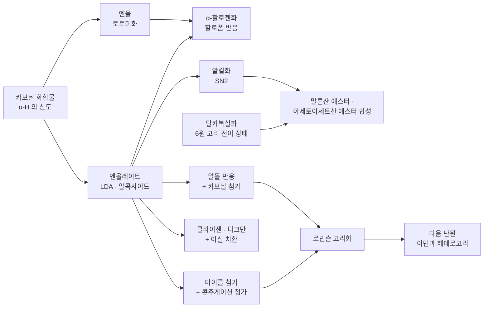

# 유기화학 12. 카보닐 α 자리의 반응과 축합 반응 — 카보닐 옆 탄소가 친핵체로 변할 때
<!-- prev: ochem-11, ochem-10, ochem-1, ochem-4 -->
<!-- next: ochem-13 -->

> [!NOTE]
> **이 단원의 범위**
> - 케토–엔올 토토머화(산·염기 촉매 메커니즘), 엔올의 비율을 정하는 요인, α 자리의 라세미화와 H/D 교환
> - α 수소의 산도($\mathrm{p}K_\mathrm{a}$ 표)와 엔올레이트의 공명, 염기의 선택(LDA), 속도론적·열역학적 엔올레이트
> - α-할로젠화(산 촉매·염기 촉매), 할로폼 반응, 카복실산의 α-브로민화(개관)
> - 엔올레이트의 알킬화와 그 한계, 탈카복실화(6원 고리 전이 상태), 말론산 에스터 합성과 아세토아세트산 에스터 합성
> - 알돌 반응과 알돌 축합(E1cB 탈수), 교차 알돌과 분자 내 알돌
> - 클라이젠 축합·교차 클라이젠·디크만 축합과 염기 1당량의 역할
> - 마이클 첨가와 로빈슨 고리화, 1,3-·1,5-이산소 관계를 읽는 역합성

**학습 목표**

1. 케토–엔올 토토머화의 산 촉매·염기 촉매 메커니즘을 굽은 화살표로 쓰고, 엔올 상수와 $\mathrm{p}K_\mathrm{a}$의 열역학적 순환으로 엔올의 비율과 산도를 계산할 수 있다.
2. 카보닐 화합물의 α-H $\mathrm{p}K_\mathrm{a}$(케톤 약 19~20, 에스터 약 25, β-다이케톤 약 9, β-케토에스터 약 11, 말론산 에스터 약 13)를 공명과 유도 효과로 설명하고, 짝산의 $\mathrm{p}K_\mathrm{a}$로 엔올레이트를 얼마나 만들 수 있는지 판단해 염기를 고를 수 있다.
3. 비대칭 케톤에서 속도론적 엔올레이트(LDA, −78 ℃, 덜 치환된 쪽)와 열역학적 엔올레이트(알콕사이드, 실온, 더 치환된 쪽)가 생기는 까닭을 에너지 도표로 설명하고 알킬화 생성물을 예측할 수 있다.
4. 산·염기 조건의 α-할로젠화와 할로폼 반응, 엔올레이트의 $\mathrm{S_N2}$ 알킬화를 메커니즘과 함께 쓰고, 말론산 에스터·아세토아세트산 에스터 합성에서 탈카복실화의 6원 고리 전이 상태를 이용해 카복실산과 메틸 케톤을 설계할 수 있다.
5. 알돌 첨가·알돌 축합·교차 알돌·분자 내 알돌, 클라이젠·디크만 축합의 생성물을 예측하고, 평형을 미는 요인(탈수, 생성물의 탈양성자화)과 교차 반응을 깔끔하게 만드는 조건을 설명할 수 있다.
6. 마이클 첨가와 로빈슨 고리화의 단계를 쓰고, 표적 분자에서 1,3-·1,5-이산소 관계와 α,β-불포화 카보닐을 찾아 역합성으로 출발 물질과 조건을 제안할 수 있다.

**이 단원의 학습 사다리**

| 단계 | 무엇을 하나? |
|---|---|
| STEP 1. 이전 학습 다시 보기 | 엔올레이트의 공명과 $\mathrm{p}K_\mathrm{a}$ 표, 친핵성 첨가와 친핵성 아실 치환, E1cB, $\mathrm{S_N2}$의 기질 조건 |
| STEP 2. 기초 다지기 | $\Delta\mathrm{p}K_\mathrm{a}$로 탈양성자화 정도 읽기, 열역학적 순환(엔올 상수와 $\mathrm{p}K_\mathrm{a}$), 속도론적·열역학적 지배, 역합성의 이산소 관계 |
| STEP 3. 핵심 개념 | 토토머화 → α-H 산도와 엔올레이트 → 속도론적·열역학적 엔올레이트 → α-할로젠화 → 알킬화 → 탈카복실화 → 말론산·아세토아세트산 에스터 합성 → 알돌 → 교차·분자 내 알돌 → 클라이젠·디크만 → 마이클 → 로빈슨 고리화 |
| STEP 4. 오개념 바로잡기 | "엔올레이트는 탄소 음이온이니 음전하가 탄소에 있다", "클라이젠 축합은 촉매량의 염기로 충분하다" 같은 착각 |
| STEP 5. 대학원·연구로 | 짐머만–트랙슬러 전이 상태와 알돌의 부분 입체 선택성, 키랄 보조기와 유기 촉매 알돌 |
| STEP 6. 생활·산업·진로 | 해당 과정의 알돌레이스, 지방산 합성의 탈카복실 클라이젠, 2-에틸헥산올 공정, 스테로이드 합성 |

---

## 🗺️ 단원 들어가기

아세톤을 무거운 물($\mathrm{D_2O}$)에 녹이고 수산화 나트륨을 아주 조금 넣어 두면, 몇 시간 뒤 아세톤의 여섯 수소가 모두 중수소로 바뀐다. 질량 분석으로 보면 분자량 58이 64가 된다. 그런데 아세톤의 C–H는 분명 탄소에 붙은 수소이고, 프로페인의 C–H($\mathrm{p}K_\mathrm{a}$ 약 50)는 같은 조건에서 꿈쩍도 하지 않는다. 카보닐기 바로 옆, 이른바 **α 자리**의 수소만 유난히 잘 떨어지는 것이다.

「구조와 결합, 산과 염기」에서 그 까닭을 한 줄로 보았다. α-H를 떼고 남은 음이온은 음전하를 산소로 넘기는 공명 구조를 가진다(엔올레이트). 「알데하이드와 케톤」과 「카복실산과 그 유도체」에서 카보닐 탄소는 언제나 **친전자체**였다. 이 단원에서는 같은 카보닐 화합물이 α 탄소를 통해 **친핵체**가 된다. 그러면 한 카보닐 화합물의 α 탄소가 다른 카보닐 화합물의 카보닐 탄소를 공격할 수 있다. 이것이 알돌 반응·클라이젠 축합이며, 유기 합성에서 C–C 결합을 만드는 가장 오래되고 가장 많이 쓰이는 방법이다. 생명체도 해당 과정, 시트르산 회로, 지방산 합성에서 같은 반응을 효소로 돌린다.

이 단원을 마치면 "이 표적 분자의 C–C 결합은 어느 두 카보닐 화합물에서 왔을까?"를 역으로 읽고, 어떤 염기를 어떤 온도에서 써야 원하는 자리에서 원하는 반응만 일어나는지 근거를 들어 고를 수 있다.

---

## STEP 1. 🔙 이전 학습 다시 보기

### 연계 개념표

| 이전 단원 | 그때 배운 것 | 이 단원에서 확장되는 것 |
|---|---|---|
| 유기화학 「구조와 결합, 산과 염기」 '공명', '$\mathrm{p}K_\mathrm{a}$와 평형의 방향' | 엔올레이트의 두 공명 구조(음전하는 주로 O), 아세톤 α-H $\mathrm{p}K_\mathrm{a}$ 19, $\log K = \mathrm{p}K_\mathrm{a}(\text{오른쪽 산}) - \mathrm{p}K_\mathrm{a}(\text{왼쪽 산})$ | 카보닐 화합물 전체의 α-H $\mathrm{p}K_\mathrm{a}$ 표, **염기를 고르는 계산**, 엔올 상수와 $\mathrm{p}K_\mathrm{a}$를 잇는 열역학적 순환 |
| 유기화학 「유기 반응의 개관과 알킬 할라이드의 치환·제거 반응」 '$\mathrm{S_N2}$', 'E1cB' | 메틸·1차 기질이 좋고 3차는 E2로 간다, 카보닐 옆 β-하이드록시기의 E1cB 탈수 | 엔올레이트를 친핵체로 쓰는 **알킬화**의 기질 조건, 알돌 축합의 탈수 단계 |
| 유기화학 「콘주게이션계와 방향족성」 '1,2-첨가와 1,4-첨가' | 속도론적 지배와 열역학적 지배, 낮은 온도·짧은 시간 대 높은 온도·평형 | 같은 두 지배를 **엔올레이트의 위치 선택성**에 적용 |
| 유기화학 「알데하이드와 케톤」 '친핵성 첨가', '엔아민', '콘주게이션 첨가' | 친핵체가 C=O 탄소를 공격해 사면체 알콕사이드를 만든다, α,β-불포화 카보닐의 1,2-/1,4-첨가 | 친핵체가 **다른 카보닐 화합물의 엔올레이트**인 경우가 알돌 반응, 1,4-첨가가 마이클 첨가 |
| 유기화학 「카복실산과 그 유도체」 '친핵성 아실 치환' | 첨가–제거(사면체 중간체에서 이탈기 OR이 떠남), 에스터의 비누화 | 친핵체가 **에스터의 엔올레이트**인 경우가 클라이젠 축합, 비누화 뒤의 탈카복실화 |

### 준비 운동 (사전 진단)

**Q1.** 아세톤 엔올레이트 $\mathrm{[CH_2COCH_3]^-}$의 두 공명 구조를 축약 구조식으로 쓰고, 굽은 화살표 두 개의 시작과 끝을 말로 쓰시오.

**Q2.** 아세톤($\mathrm{p}K_\mathrm{a}$ 19)을 나트륨 에톡사이드(에탄올 $\mathrm{p}K_\mathrm{a}$ 16)로 처리할 때 탈양성자화 평형 상수는 얼마인가?

**Q3.** 브로모메테인, 2-브로모-2-메틸프로페인 가운데 강한 음이온 친핵체와 $\mathrm{S_N2}$ 치환을 잘하는 것은? 다른 하나에서는 주로 무슨 반응이 일어나는가?

**Q4.** 에틸 아세테이트에 수산화 이온이 반응하는 비누화의 첫 단계에서 생기는 중간체의 이름과, 그 중간체에서 떨어져 나가는 원자단을 쓰시오.

정답 및 해설

**Q1.** $\mathrm{{}^-CH_2{-}C({=}O){-}CH_3 \leftrightarrow CH_2{=}C(O^-){-}CH_3}$. ① α 탄소의 비공유 전자쌍 → $\mathrm{C_\alpha{-}C}$ 결합 자리(새 C=C), ② C=O π 결합 → O. 음전하가 전기 음성인 O에 있는 오른쪽 구조가 주된 기여 구조이다(「구조와 결합, 산과 염기」 예제 14).

**Q2.** $\log K = 16 - 19 = -3$, $K = 1\times10^{-3}$. 평형은 왼쪽(케톤 + 에톡사이드)에 치우치지만, 소량의 엔올레이트가 끊임없이 생겼다가 사라진다. 이 '조금씩 생기는 엔올레이트'로 충분한 반응(알돌, 할로젠화)과 그렇지 않은 반응(알킬화)이 이 단원에서 갈린다.

**Q3.** 브로모메테인. 2-브로모-2-메틸프로페인은 3차라 뒤쪽 공격이 막혀 있고, 강한 염기와는 E2 제거로 2-메틸프로펜이 된다.

**Q4.** 사면체 중간체(사면체 알콕사이드). 수산화 이온이 C=O 탄소에 첨가해 생기고, 다시 C=O가 만들어지면서 에톡사이드($\mathrm{CH_3CH_2O^-}$)가 떨어진다. 클라이젠 축합은 이 반응에서 수산화 이온 자리에 에스터 엔올레이트가 들어간 것이다.

---

## STEP 2. 🧱 기초 다지기

### 디딤돌 1. $\Delta\mathrm{p}K_\mathrm{a}$로 탈양성자화의 정도 읽기

「구조와 결합, 산과 염기」 ⑧에서 유도한 식을 그대로 쓴다. 카보닐 화합물 HA와 염기 $\mathrm{B^-}$의 반응 $\mathrm{HA + B^- \rightleftharpoons A^- + HB}$에서

$$
\log K = \mathrm{p}K_\mathrm{a}(\mathrm{HB}) - \mathrm{p}K_\mathrm{a}(\mathrm{HA})
$$

이다. 이 단원에서는 이 $K$로 두 가지를 판단한다.

| 판단할 것 | 필요한 $K$ | 까닭 |
|---|---|---|
| 엔올레이트를 **거의 다** 만들어 놓고 친전자체를 넣을 수 있는가(알킬화, 방향을 정한 알돌) | $K \gg 1$ (대략 $10^{3}$ 이상) | 남은 케톤이나 염기가 친전자체와 따로 반응하면 부생성물이 생긴다 |
| 엔올레이트가 **조금만** 생겨도 되는가(알돌, 클라이젠, 할로젠화) | $K \ll 1$이어도 된다 | 생긴 엔올레이트가 곧바로 반응하고, 평형이 다시 엔올레이트를 보충한다 |

#### 예제 1 — 염기에 따라 아세톤 엔올레이트는 얼마나 생기나

아세톤($\mathrm{p}K_\mathrm{a}$ 19)을 같은 몰수의 (1) 수산화 나트륨(물 15.7), (2) 나트륨 에톡사이드(에탄올 16), (3) 칼륨 tert-뷰톡사이드(tert-뷰탄올 18), (4) 리튬 다이아이소프로필아마이드(LDA, 다이아이소프로필아민 36)와 섞었다. 각각의 $K$를 구하고, 짝산도 같은 몰수로 생긴다고 보는 단순 모형에서 엔올레이트로 바뀐 아세톤의 분율 $x$를 구하시오.

**풀이**
식 세우기: 처음 농도를 1로 두면 평형에서 $\dfrac{x^2}{(1-x)^2} = K$이므로 $x = \dfrac{\sqrt{K}}{1+\sqrt{K}}$이다.

| 염기 | $\log K$ | $K$ | 엔올레이트 분율 $x$ |
|---|---|---|---|
| NaOH | $15.7 - 19 = -3.3$ | $5\times10^{-4}$ | 약 2 % |
| NaOEt | $-3$ | $1\times10^{-3}$ | 약 3 % |
| KOtBu | $-1$ | 0.1 | 약 24 % |
| LDA | $+17$ | $10^{17}$ | 100 %(사실상 완결) |

**의미** 알콕사이드는 엔올레이트를 '조금씩' 만들 뿐이고, 케톤과 엔올레이트가 함께 있는 용액이 된다. 그 엔올레이트가 옆의 케톤을 공격하면 알돌 반응이다. 반대로 LDA는 케톤을 남김없이 엔올레이트로 바꾼다. 실제 용액에서는 짝산이 용매(에탄올·물)여서 엔올레이트의 비율이 이 모형보다 더 작지만, 결론(알콕사이드는 소량, LDA는 완결)은 같다.

### 디딤돌 2. 열역학적 순환 — 엔올 상수와 두 $\mathrm{p}K_\mathrm{a}$

케톤(K), 엔올(E), 엔올레이트($\mathrm{E^-}$)는 하나의 삼각형으로 이어진다. 케톤에서 α-H를 떼든, 엔올에서 O–H를 떼든 **같은 엔올레이트**가 생기기 때문이다.

$$
\mathrm{K \;\xrightarrow{K_\mathrm{E}}\; E}, \qquad \mathrm{E \;\xrightarrow{K_\mathrm{a}^\mathrm{E}}\; E^- + H^+}, \qquad \mathrm{K \;\xrightarrow{K_\mathrm{a}^\mathrm{K}}\; E^- + H^+}
$$

자유 에너지는 상태 함수이므로 첫째와 둘째 과정을 더하면 셋째가 된다. 평형 상수는 곱해진다.

$$
K_\mathrm{a}^\mathrm{K} = K_\mathrm{E}\,K_\mathrm{a}^\mathrm{E} \quad\Longrightarrow\quad \mathrm{p}K_\mathrm{a}^\mathrm{K} = \mathrm{p}K_\mathrm{E} + \mathrm{p}K_\mathrm{a}^\mathrm{E}
$$

($\mathrm{p}K_\mathrm{E} = -\log K_\mathrm{E}$.) 아세톤의 엔올 상수는 물에서 약 $5\times10^{-9}$($\mathrm{p}K_\mathrm{E} \approx 8.3$)이므로, 엔올(프로프-1-엔-2-올)의 O–H $\mathrm{p}K_\mathrm{a}$는 약 $19 - 8.3 \approx 11$이다. 엔올의 O–H는 알코올(16)보다 훨씬 산성이고 페놀(10)과 비슷하다. 페놀도 '방향족 고리에 붙은 엔올'이니 놀랍지 않다. 이 순환은 ①에서 엔올의 비율을, ②에서 엔올레이트의 안정성을 따질 때 계속 쓰인다.

### 디딤돌 3. 속도론적 지배와 열역학적 지배 — 다시 한 번

「콘주게이션계와 방향족성」의 1,2-/1,4-첨가에서 본 두 가지 지배를 되짚는다. 같은 출발 물질에서 두 생성물 A, B가 경쟁할 때

| | 속도론적 지배 | 열역학적 지배 |
|---|---|---|
| 조건 | 낮은 온도, 짧은 시간, **되돌아갈 수 없음** | 높은 온도, 긴 시간, **A ⇌ B가 오갈 수 있음** |
| 생성물 비 | $[\mathrm{A}]/[\mathrm{B}] = k_\mathrm{A}/k_\mathrm{B} = e^{\Delta\Delta G^\ddagger/RT}$ | $[\mathrm{A}]/[\mathrm{B}] = K = e^{-\Delta G^\circ/RT}$ |
| 정하는 것 | 두 **전이 상태**의 높이 차 | 두 **생성물**의 안정성 차 |

25 ℃에서 $RT\ln 10 = 5.71\ \mathrm{kJ/mol}$, −78 ℃(195 K)에서는 $3.74\ \mathrm{kJ/mol}$이다. 낮은 온도일수록 같은 에너지 차가 더 큰 선택성을 준다. ③에서 이 표를 그대로 엔올레이트에 쓴다.

### 디딤돌 4. 역합성의 눈 — 이산소 관계 세기

카보닐 축합 생성물에는 '지문'이 있다. 두 산소 작용기(C=O, OH, 또는 C=O가 있던 자리의 C=C) 사이의 거리를 탄소 번호로 센다. 카보닐 탄소를 1번으로 놓고 다른 산소가 붙은 탄소의 번호를 읽는다.

| 표적의 무늬 | 이산소 관계 | 떠올릴 반응 | 끊을 결합 |
|---|---|---|---|
| β-하이드록시 카보닐 $\mathrm{O{=}C{-}C{-}C{-}OH}$ | 1,3 | 알돌 첨가 | $\mathrm{C_\alpha{-}C_\beta}$ |
| α,β-불포화 카보닐 $\mathrm{O{=}C{-}C{=}C}$ | (1,3이 탈수된 것) | 알돌 축합 | $\mathrm{C_\alpha{=}C_\beta}$ |
| β-다이카보닐 $\mathrm{O{=}C{-}C{-}C{=}O}$ | 1,3 | 클라이젠·디크만 축합 | $\mathrm{C_\alpha{-}C}$(아실) |
| 1,5-다이카보닐 $\mathrm{O{=}C{-}C{-}C{-}C{-}C{=}O}$ | 1,5 | 마이클 첨가 | $\mathrm{C_\alpha{-}C_\beta}$(받개 쪽) |
| 고리 속 α,β-불포화 케톤 + 그 옆에 붙은 고리 | 1,5 + 1,3 | 로빈슨 고리화 | 마이클 결합 + 알돌 결합 |
| $\mathrm{R{-}CH_2{-}COOH}$, $\mathrm{R{-}CH_2{-}COCH_3}$ | — | 말론산·아세토아세트산 에스터 합성 | $\mathrm{R{-}C_\alpha}$ |

> [!TIP]
> 💡 **요령** — 1,3 관계는 '엔올레이트 + 카보닐 탄소', 1,5 관계는 '엔올레이트 + β 탄소'에서 생긴다. 표적에서 카보닐을 찾고, 그 α 탄소와 이웃한 결합 중 어느 것이 '두 조각을 잇는 결합'인지 찾는 것이 이 단원 역합성의 전부이다. ⑫에서 종합해 연습한다.

---
