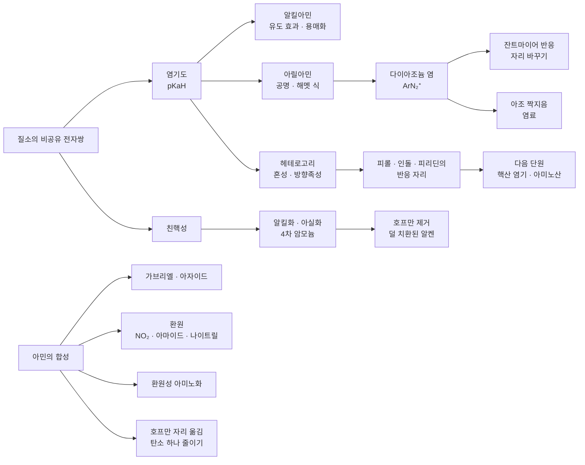

# 유기화학 13. 아민과 헤테로고리 화합물 — 질소의 비공유 전자쌍 하나가 정하는 염기도와 반응
<!-- prev: ochem-12, ochem-11, ochem-9, ochem-8, ochem-1 -->
<!-- next: ochem-14 -->

> [!NOTE]
> **이 단원의 범위**
> - 아민의 분류와 명명법, 피라미드 구조와 물리적 성질, 분광학적 특징(IR의 N–H 신축, 질량 스펙트럼의 α 절단)
> - 아민의 염기도: 알킬아민(기체와 용액의 순서, 유도 효과), 아릴아민(공명과 해멧 식), 헤테로고리 아민(혼성과 방향족성), 산–염기 추출
> - 아민의 합성: 암모니아 알킬화의 한계, 아자이드와 가브리엘 합성, 나이트로·아마이드·나이트릴·아자이드의 환원, 환원성 아미노화, 호프만 자리 옮김(커티어스 자리 옮김 포함)
> - 아민의 반응: 알킬화와 4차 암모늄 염, 아실화와 설폰아마이드, 호프만 제거(덜 치환된 알켄)와 코프 제거
> - 아질산과 아민, 아릴 다이아조늄 염의 치환(잔트마이어 반응, 슈만 반응, 페놀화, 탈아미노화)과 아조 짝지음(아조 염료, pH 의존성)
> - 헤테로고리의 반응성: 피롤·퓨란·싸이오펜(C2 치환), 인돌(C3 치환), 피리딘(C3의 친전자성 치환, C2·C4의 친핵성 치환, N-산화물), 퀴놀린·이미다졸·피리미딘·퓨린 개관

**학습 목표**

1. 아민을 1°·2°·3°·4차 암모늄으로 분류하고 이름을 붙이며, 피라미드 구조와 수소 결합으로 끓는점·용해도를 설명하고, IR·질량 스펙트럼으로 아민의 급수를 가릴 수 있다.
2. 알킬아민·아릴아민·헤테로고리 아민의 $\mathrm{p}K_\mathrm{aH}$를 유도 효과·공명·혼성·방향족성·용매화로 설명하고, 해멧 식과 분율식으로 염기도와 pH에 따른 양성자화 정도·추출 효율을 계산할 수 있다.
3. 1°·2°·3° 아민을 만드는 경로(가브리엘 합성, 아자이드 환원, 나이트로·아마이드·나이트릴 환원, 환원성 아미노화, 호프만 자리 옮김) 가운데 과알킬화를 피하고 탄소 수를 맞추는 경로를 골라 역합성으로 설계할 수 있다.
4. 아민의 아실화·설폰일화와 호프만 제거의 메커니즘을 쓰고, 호프만 제거가 덜 치환된 알켄을 주는 까닭을 이탈기와 전이 상태로 설명할 수 있다.
5. 아릴 다이아조늄 염의 생성 메커니즘(나이트로소늄 이온)과 잔트마이어 반응·아조 짝지음을 쓰고, 다이아조늄 염을 '자리 바꾸기 도구'로 써서 직접 치환으로 만들 수 없는 다치환 벤젠을 합성할 수 있다.
6. 피롤·인돌·피리딘의 친전자성·친핵성 치환 자리를 양이온·음이온 중간체의 공명 구조로 예측하고, 헤테로고리의 반응성을 벤젠과 비교할 수 있다.

**이 단원의 학습 사다리**

| 단계 | 무엇을 하나? |
|---|---|
| STEP 1. 이전 학습 다시 보기 | $\mathrm{p}K_\mathrm{aH}$와 혼성, 헤테로고리의 방향족성 판정, $\mathrm{S_N2}$와 E2, 친전자성 방향족 치환, 이민, 아마이드와 나이트릴 |
| STEP 2. 기초 다지기 | 분율식과 산–염기 추출, 해멧 식 되짚기, 질소 작용기의 산화 수준, C–N 결합의 역합성 |
| STEP 3. 핵심 개념 | 구조와 이름 → 알킬아민의 염기도 → 아릴·헤테로고리 아민의 염기도 → 직접 알킬화와 가브리엘 합성 → 환원으로 만드는 아민 → 환원성 아미노화 → 호프만 자리 옮김 → 아실화·설폰일화 → 호프만 제거 → 다이아조늄 염과 잔트마이어 반응 → 아조 짝지음 → 다섯 고리 헤테로고리와 인돌 → 피리딘과 그 친척 |
| STEP 4. 오개념 바로잡기 | "3° 아민이 언제나 가장 강한 염기이다", "피롤도 질소가 있으니 염기이다", "다이아조늄 이온의 N₂는 나쁜 이탈기이다" 같은 착각 |
| STEP 5. 대학원·연구로 | 팔라듐 촉매 C–N 짝지음(부흐발트–하트위그), 피리딘의 C–H 작용기화와 고리 합성 |
| STEP 6. 생활·산업·진로 | 의약품의 염 형태와 질소 헤테로고리, 아조 염료, 나일론의 다이아민, 나이트로소아민 불순물 관리 |

---

## 🗺️ 단원 들어가기

생선 비린내는 트라이메틸아민 $\mathrm{(CH_3)_3N}$의 냄새이다. 생선 요리에 레몬즙이나 식초를 뿌리면 비린내가 줄어드는 까닭을 우리는 이미 안다. 아민은 염기이고, 산을 만나면 암모늄 염 $\mathrm{(CH_3)_3NH^+}$이 된다. 이온은 휘발하지 않으므로 코에 닿지 않는다. 같은 일이 약국에서도 일어난다. 알약 성분표의 '○○ 염산염'은 대부분 아민 약물을 염산과 짝지어 물에 잘 녹고 오래 보관할 수 있게 한 것이다.

질소의 비공유 전자쌍 하나가 이 모든 것을 정한다. 이 전자쌍은 양성자를 받으면 **염기**, 탄소를 공격하면 **친핵체**가 된다. 그런데 같은 전자쌍이 벤젠 고리와 공명하면(아닐린) 염기도가 백만 분의 1로 줄고, 방향족 고리의 π계에 들어가 버리면(피롤) 아예 염기 노릇을 하지 않는다. 「구조와 결합, 산과 염기」에서 짝산의 $\mathrm{p}K_\mathrm{a}$로 염기도를 재는 법을, 「콘주게이션계와 방향족성」에서 피롤·피리딘의 전자쌍이 어디에 있는지를 이미 보았다. 이 단원은 그 두 가지를 출발점으로 삼아 아민을 **어떻게 만들고**, 아민으로 **무엇을 할 수 있는지**로 나아간다.

아민 합성의 첫 걸림돌은 의외로 "너무 반응을 잘한다"는 것이다. 암모니아에 할로젠화 알킬을 넣으면 생긴 아민이 다시 할로젠화 알킬을 공격해 섞인 생성물이 나온다. 그래서 유기화학자는 질소를 '한 번만 반응하는 형태'(아자이드, 프탈이미드, 이민, 아마이드)로 들여보낸 뒤 환원해 아민으로 바꾼다. 반대로 아민의 질소를 떼어 내는 길도 있다. 질소를 $\mathrm{-N_2^+}$로 바꾸면 가장 좋은 이탈기인 질소 기체가 떨어지면서, 벤젠 고리의 그 자리에 할로젠·사이아노기·하이드록시기·수소를 마음대로 넣을 수 있다. 마지막으로 질소가 고리 안으로 들어간 헤테로고리 — 피리딘·피롤·인돌·이미다졸·퓨린 — 는 DNA의 염기, 비타민, 그리고 시판 의약품의 대다수를 이루는 뼈대이다.

---

## STEP 1. 🔙 이전 학습 다시 보기

### 연계 개념표

| 이전 단원 | 그때 배운 것 | 이 단원에서 확장되는 것 |
|---|---|---|
| 일반화학 「산·염기와 수용액 평형」 '약염기' | $K_b$, $\mathrm{p}K_a + \mathrm{p}K_b = 14.00$(25 ℃), 메틸아민 수용액의 pH | 염기도를 **짝산의 $\mathrm{p}K_\mathrm{a}$**($\mathrm{p}K_\mathrm{aH}$) 하나로 통일, 구조로 $\mathrm{p}K_\mathrm{aH}$를 예측 |
| 유기화학 「구조와 결합, 산과 염기」 '염기의 세기', '산도를 정하는 요인' | 메틸아민 10.6 > 피리딘 5.2 > 아닐린 4.6 > 아마이드, 혼성(s 성격)과 공명이 전자쌍을 붙든다 | 1°·2°·3° 아민의 순서가 기체와 물에서 다른 까닭(용매화), 치환 아닐린의 정량 예측(해멧 식) |
| 유기화학 「입체화학」 '탄소 아닌 입체 중심' | 아민 질소의 피라미드 반전(약 25 kJ/mol), 4차 암모늄 이온은 분할된다 | 피라미드 구조를 물리적 성질·반응성과 연결 |
| 유기화학 「유기 반응의 개관과 알킬 할라이드의 치환·제거 반응」 '$\mathrm{S_N2}$', 'E2' | 아자이드 이온의 $\mathrm{S_N2}$, 부피 큰 염기의 호프만 생성물 | 아민의 **과알킬화**, 아자이드 → 아민, 이탈기가 $\mathrm{-NR_3^+}$인 **호프만 제거** |
| 유기화학 「콘주게이션계와 방향족성」 '방향족 이온과 헤테로고리' | 피리딘형 N(전자쌍은 π계 밖)과 피롤형 N(π계 안), 짝산 $\mathrm{p}K_\mathrm{a}$ 표, 이미다졸 | 같은 판정을 **반응 자리**(피롤 C2, 인돌 C3, 피리딘 C3·C2·C4)의 예측으로 확장 |
| 유기화학 「방향족 화합물의 반응」 '나이트로 → 아민', '너무 센 활성화기', '친핵성 방향족 치환' | $\mathrm{ArNO_2 \rightarrow ArNH_2}$, 아닐린의 과반응과 아세트아닐라이드 보호, 마이젠하이머 착물 | 아닐린 → **다이아조늄 염** → 여러 작용기로 바꾸기, 피리딘의 친핵성 치환 |
| 유기화학 「알데하이드와 케톤」 '이민과 엔아민' | 1° 아민 → 이민, 2° 아민 → 엔아민, 이민 생성의 pH 의존성 | 이민·이미늄 이온을 **그 자리에서 환원**하는 환원성 아미노화 |
| 유기화학 「카복실산과 그 유도체」 '아마이드와 나이트릴', '환원' | 산 염화물 + 아민 → 아마이드, $\mathrm{LiAlH_4}$로 아마이드·나이트릴 → 아민 | 아마이드에서 탄소 하나를 빼는 **호프만 자리 옮김**, 아민 합성 경로의 비교 |

### 준비 운동 (사전 진단)

**Q1.** 메틸아민의 짝산 $\mathrm{CH_3NH_3^+}$의 $\mathrm{p}K_\mathrm{a}$는 10.6이다. 메틸아민의 $\mathrm{p}K_\mathrm{b}$와 $K_b$를 구하시오(25 ℃).

**Q2.** 피리딘과 피롤 가운데 염기인 것은? 다른 하나에 양성자가 질소에 붙기 어려운 까닭을 '방향족성'이라는 말을 써서 한 문장으로 쓰시오.

**Q3.** 1-브로모뷰테인에 아자이드화 나트륨을 DMF에서 반응시킨 생성물을 쓰고, 이 반응의 메커니즘 이름을 쓰시오.

**Q4.** 사이클로헥산온과 메틸아민을 약산성 조건에서 반응시킨 생성물의 작용기 이름과, 그 생성물에 $\mathrm{H_2}$와 Pd 촉매를 작용시키면 무엇이 될지 예상하시오.

정답 및 해설

**Q1.** $\mathrm{p}K_\mathrm{b} = 14.00 - 10.6 = 3.4$, $K_b = 10^{-3.4} \approx 4\times10^{-4}$. 이 단원에서는 $\mathrm{p}K_\mathrm{b}$ 대신 $\mathrm{p}K_\mathrm{aH} = 10.6$을 그대로 쓴다. 값이 클수록 강한 염기이다.

**Q2.** 피리딘. 피롤의 질소 전자쌍은 고리의 방향족 6 π 전자에 들어가 있으므로, 그 전자쌍에 양성자가 붙으면 질소가 $sp^3$이 되면서 방향족성을 잃는다.

**Q3.** 1-아자이도뷰테인 $\mathrm{CH_3CH_2CH_2CH_2N_3}$(뷰틸 아자이드). $\mathrm{S_N2}$. ④에서 이것을 환원해 뷰탄-1-아민을 얻는다.

**Q4.** 이민(N-메틸사이클로헥산-1-이민). C=N이 환원되면 N-메틸사이클로헥산아민 $\mathrm{C_6H_{11}NHCH_3}$이 된다. 이민을 만들면서 동시에 환원하는 것이 ⑥의 환원성 아미노화이다.

---

## STEP 2. 🧱 기초 다지기

### 디딤돌 1. 분율식과 산–염기 추출 — pH 하나로 아민을 옮긴다

아민 B와 짝산 $\mathrm{BH^+}$의 비는 헨더슨–하셀바흐 식으로 정해진다(「알데하이드와 케톤」 디딤돌 1).

$$
\frac{[\mathrm{B}]}{[\mathrm{BH^+}]} = 10^{\,\mathrm{pH} - \mathrm{p}K_\mathrm{aH}}, \qquad f_\mathrm{B} = \frac{1}{1 + 10^{\,\mathrm{p}K_\mathrm{aH} - \mathrm{pH}}}
$$

$f_\mathrm{B}$는 자유 아민(중성)의 분율이다. pH가 $\mathrm{p}K_\mathrm{aH}$보다 2 낮으면 아민의 99 %가 암모늄 이온이고, 2 높으면 99 %가 자유 아민이다.

이 분율이 **산–염기 추출**의 원리이다. 물과 섞이지 않는 유기 용매(다이에틸 에터, 아세트산 에틸, 다이클로로메테인)와 물을 함께 흔들면, 중성 아민 B는 유기층으로 잘 가지만 이온 $\mathrm{BH^+}$는 물층에 남는다. 중성 분자의 **분배 계수** $P = [\mathrm{B}]_\text{유기}/[\mathrm{B}]_\text{물}$에 대하여, 물층의 모든 형태를 합쳐 센 **분배비**는

$$
D = \frac{[\mathrm{B}]_\text{유기}}{[\mathrm{B}]_\text{물} + [\mathrm{BH^+}]_\text{물}} = P\,f_\mathrm{B}
$$

이다($\mathrm{BH^+}$는 유기층에 들어가지 않는다고 본다). 같은 부피의 두 층을 한 번 흔들었을 때 유기층으로 옮겨 간 분율은 $E = D/(1 + D)$이다.

#### 예제 1 — 벤질아민은 언제 유기층으로 가는가

벤질아민 $\mathrm{C_6H_5CH_2NH_2}$($\mathrm{p}K_\mathrm{aH}$ 9.34, 에터/물 분배 계수 $P = 20$으로 둔다)을 같은 부피의 에터와 수용액으로 한 번 추출한다. 수용액의 pH가 (1) 2.0, (2) 7.0, (3) 12.0일 때 유기층으로 옮겨 가는 분율 $E$를 구하시오.

**풀이**
식 세우기: $f_\mathrm{B} = 1/(1 + 10^{9.34 - \mathrm{pH}})$, $D = 20f_\mathrm{B}$, $E = D/(1 + D)$.

| pH | $f_\mathrm{B}$ | $D$ | $E$ |
|---|---|---|---|
| 2.0 | $4.6\times10^{-8}$ | $9.1\times10^{-7}$ | 사실상 0 |
| 7.0 | $4.6\times10^{-3}$ | 0.091 | 0.083 (약 8 %) |
| 12.0 | 0.998 | 20.0 | 0.95 |

**의미** 묽은 염산으로 씻으면 아민은 물층으로 '끌려 들어가고', 그 물층을 NaOH로 염기성(pH 12)으로 만든 뒤 에터로 다시 추출하면 아민만 되돌아 나온다. 중성 유기물(예: 나프탈렌)은 어느 pH에서도 유기층에 남고, 카복실산은 반대로 염기성 물층으로 간다. 이 원리로 세 성분을 나누는 실험을 탐구 활동 A에서 한다. 생체에서도 같은 일이 일어난다. 세포막은 '유기층'이어서 중성 아민만 통과한다(STEP 6).

<!-- 시뮬레이션 요청: 아민의 pH–분율·추출 탐색기. 슬라이더: 수용액 pH(0~14), 아민의 pKaH(0~12; 미리 설정 단추: 아닐린 4.6, 피리딘 5.2, 이미다졸 7.0, 벤질아민 9.34, 트라이에틸아민 10.75, 피페리딘 11.1), 분배 계수 log P(−1~4), 유기층/물층 부피비(0.2~5), 추출 횟수(1~4). 위 그래프: 가로축 pH, 세로축 분율(0~1), 곡선 f_B(자유 아민)와 1 − f_B(암모늄 이온)이 pKaH에서 0.5로 교차, 현재 pH에 세로선. 아래 그림: 분액 깔때기 두 층(위 유기층·아래 물층, 에터 기준)에 B 분자(파란 점)와 BH⁺(빨간 점)이 계산된 비율대로 흩어져 있고, 옆에 'E = 유기층으로 옮겨 간 분율' 숫자. 같은 그림에 선택 단추로 카복실산(pKa 4.2)과 중성 화합물을 함께 넣어 세 성분이 pH에 따라 어느 층으로 가는지 비교. -->

### 디딤돌 2. 해멧 식 되짚기 — 치환 아닐린의 염기도를 숫자 하나로

「카복실산과 그 유도체」 ②에서 벤조산의 이온화로 치환기 상수 $\sigma$를 정의하고, 다른 반응에서도 $\log(K_\mathrm{X}/K_\mathrm{H}) = \rho\sigma_\mathrm{X}$가 성립함을 보았다. 아닐리늄 이온 $\mathrm{X{-}C_6H_4NH_3^+}$의 산 해리에 적용하면

$$
\mathrm{p}K_\mathrm{aH}(\mathrm{X}) = \mathrm{p}K_\mathrm{aH}(\mathrm{H}) - \rho\,\sigma_\mathrm{X}, \qquad \mathrm{p}K_\mathrm{aH}(\mathrm{H}) = 4.60,\ \ \rho \approx 2.89\ (\text{물, }25\,^\circ\mathrm{C})
$$

이다. $\rho$가 벤조산(1.00)의 약 3배인 것은 반응 중심(N)이 고리에 **바로** 붙어 있기 때문이다(벤조산은 C=O 탄소 하나를 사이에 둔다). 전자 끄는 기($\sigma > 0$)는 $\mathrm{p}K_\mathrm{aH}$를 낮춘다(염기를 약하게 한다).

#### 예제 2 — 3-클로로아닐린의 $\mathrm{p}K_\mathrm{aH}$ 예측

$\sigma_\mathrm{m}(\mathrm{Cl}) = 0.37$, $\sigma_\mathrm{p}(\mathrm{CH_3}) = -0.17$을 써서 3-클로로아닐린과 4-메틸아닐린(p-톨루이딘)의 $\mathrm{p}K_\mathrm{aH}$를 예측하고 실측값(3.52, 5.08)과 비교하시오.

**풀이**
3-클로로아닐린: $4.60 - 2.89\times0.37 = 4.60 - 1.07 = 3.53$ (실측 3.52).
4-메틸아닐린: $4.60 - 2.89\times(-0.17) = 4.60 + 0.49 = 5.09$ (실측 5.08).
**의미** 해멧 식은 메타·파라 치환 아닐린 대부분을 0.1 단위 안에서 맞힌다. 그런데 4-나이트로아닐린에서는 크게 어긋난다. 그 까닭(직접 공명)이 ③의 핵심이다.

### 디딤돌 3. 질소 작용기의 산화 수준 — 환원에 전자가 몇 개 필요한가

질소는 −3(아민)부터 +3(나이트로기의 형식 산화수)까지 여러 산화 상태를 가진다. 아민을 환원으로 만들 때는 출발 작용기가 아민보다 몇 단계 '위'에 있는지를 세면 필요한 환원제의 양이 나온다. 산화수는 전기 음성도가 큰 원자에 결합 전자를 모두 준다고 보고 센다(C–N 결합 전자는 N에, N–H는 N에, N–O는 O에).

| 작용기 | 예 | N의 산화수 | 아민까지 필요한 전자 수 |
|---|---|---|---|
| 아민 | $\mathrm{C_6H_5NH_2}$ | −3 | 0 |
| 하이드록실아민 | $\mathrm{C_6H_5NHOH}$ | −1 | 2 |
| 나이트로소 | $\mathrm{C_6H_5N{=}O}$ | +1 | 4 |
| 나이트로 | $\mathrm{C_6H_5NO_2}$ | +3 | 6 |
| 아자이드 $\mathrm{RN_3}$ → $\mathrm{RNH_2 + N_2}$ | $\mathrm{C_4H_9N_3}$ | (평균) | 2 |
| 나이트릴 $\mathrm{RC{\equiv}N}$ → $\mathrm{RCH_2NH_2}$ | $\mathrm{CH_3CN}$ | −3 (탄소가 환원됨) | 4 (C의 산화수가 +3 → −1) |

나이트로기의 환원은 다음 반쪽 반응으로 정리된다.

$$
\mathrm{ArNO_2 + 6H^+ + 6e^- \longrightarrow ArNH_2 + 2H_2O}
$$

#### 예제 3 — 철 가루로 나이트로벤젠 환원하기

나이트로벤젠 12.3 g(123.11 g/mol)을 철 가루와 염산으로 아닐린(93.13 g/mol)까지 환원한다. 철은 $\mathrm{Fe^{2+}}$로 산화된다고 할 때 (1) 전체 반응식을 쓰고 (2) 필요한 철의 최소 질량(55.85 g/mol)과 (3) 아닐린의 이론 수득량을 구하시오.

**풀이**
(1) 철 1 mol이 전자 2 mol을 내므로 철 3 mol이 필요하다.

$$
\mathrm{C_6H_5NO_2 + 3Fe + 6H^+ \longrightarrow C_6H_5NH_2 + 3Fe^{2+} + 2H_2O}
$$

(2) 나이트로벤젠 $12.3/123.11 = 0.0999\ \mathrm{mol}$, 철 $3\times0.0999\times55.85 = 16.7\ \mathrm{g}$.
(3) $0.0999\times93.13 = 9.30\ \mathrm{g}$. 산성 용액에서는 아닐리늄 염($\mathrm{C_6H_5NH_3^+}$)으로 있으므로 NaOH로 염기성으로 만든 뒤 꺼낸다(디딤돌 1).
**의미** 같은 질량의 나이트로벤젠을 수소 기체로 환원하면 $\mathrm{H_2}$ 3 당량이 필요하다($\mathrm{ArNO_2 + 3H_2 \rightarrow ArNH_2 + 2H_2O}$). 산업에서는 촉매 수소화가 철 환원을 대부분 대신했다. 철 슬러지(산화철)가 남지 않기 때문이다.

### 디딤돌 4. C–N 결합의 역합성 — 어디를 끊고, 질소를 무엇으로 들여보낼까

아민을 역합성으로 볼 때는 질소에 붙은 C–N 결합 하나를 끊는다. 끊은 뒤 탄소 쪽이 **친전자체**(할로젠화 알킬, 카보닐 화합물, 카복실산 유도체)가 되고 질소 쪽이 **친핵체**가 된다. 질소 친핵체를 '날것'(암모니아·아민)으로 쓰면 과알킬화가 일어나므로, 한 번만 반응하도록 '포장된' 질소를 고른다.

| 표적의 질소 주변 | 끊을 결합 | 탄소 쪽 출발 물질 | 질소 쪽 시약 | 소절 |
|---|---|---|---|---|
| $\mathrm{R{-}CH_2{-}NH_2}$ (1°) | $\mathrm{CH_2{-}N}$ | $\mathrm{RCH_2Br}$ | 프탈이미드 음이온 또는 $\mathrm{N_3^-}$, 뒤에 해제·환원 | ④ |
| $\mathrm{R{-}CH_2{-}NH_2}$ (1°) | $\mathrm{R{-}CH_2}$ (탄소 하나 추가) | $\mathrm{RBr}$ | $\mathrm{CN^-}$, 뒤에 $\mathrm{LiAlH_4}$ | ⑤ |
| $\mathrm{R_2CH{-}NHR'}$ (2°) | $\mathrm{CH{-}N}$ | $\mathrm{R_2C{=}O}$ | $\mathrm{R'NH_2}$ + 환원제 | ⑥ |
| $\mathrm{R{-}CH_2{-}NR'_2}$ | $\mathrm{CH_2{-}N}$ | $\mathrm{RCOCl}$ | $\mathrm{R'_2NH}$, 뒤에 $\mathrm{LiAlH_4}$(아마이드 환원) | ⑤ |
| $\mathrm{Ar{-}NH_2}$ | $\mathrm{Ar{-}N}$ | $\mathrm{ArH}$ | $\mathrm{HNO_3/H_2SO_4}$, 뒤에 환원 | ⑤ |
| $\mathrm{R{-}NH_2}$, R이 3°이거나 탄소 하나가 줄어든 골격 | $\mathrm{R{-}N}$ | $\mathrm{RCONH_2}$ | $\mathrm{Br_2}$, NaOH | ⑦ |

#### 예제 4 — 같은 아민, 세 가지 끊기

사이클로헥실메테인아민 $\mathrm{C_6H_{11}CH_2NH_2}$를 만드는 경로를 세 가지 제안하시오.

**풀이**
① $\mathrm{CH_2{-}N}$을 끊는다 → (브로모메틸)사이클로헥세인 + 프탈이미드 칼륨, 뒤에 하이드라진(가브리엘 합성, ④).
② 같은 결합을 끊되 탄소 쪽을 카보닐로 → 사이클로헥세인카브알데하이드 + $\mathrm{NH_3}$, $\mathrm{H_2}$/Ni 또는 $\mathrm{NaBH_3CN}$(환원성 아미노화, ⑥).
③ $\mathrm{C_6H_{11}{-}CH_2}$를 끊는다 → 브로모사이클로헥세인 + $\mathrm{CN^-}$ → 사이클로헥세인카보나이트릴 → $\mathrm{LiAlH_4}$(⑤). 다만 2° 할로젠화 알킬의 $\mathrm{S_N2}$는 E2와 경쟁하므로, 실제로는 사이클로헥세인카복실산 → 아마이드 → $\mathrm{LiAlH_4}$ 환원 쪽이 깔끔하다.
**의미** 한 표적에 길이 여럿 있을 때는 ① 과알킬화가 없는가 ② 탄소 수가 맞는가 ③ 출발 물질의 $\mathrm{S_N2}$가 잘 되는가(1°인가) ④ 다른 작용기가 환원제를 견디는가를 차례로 따진다.

---
