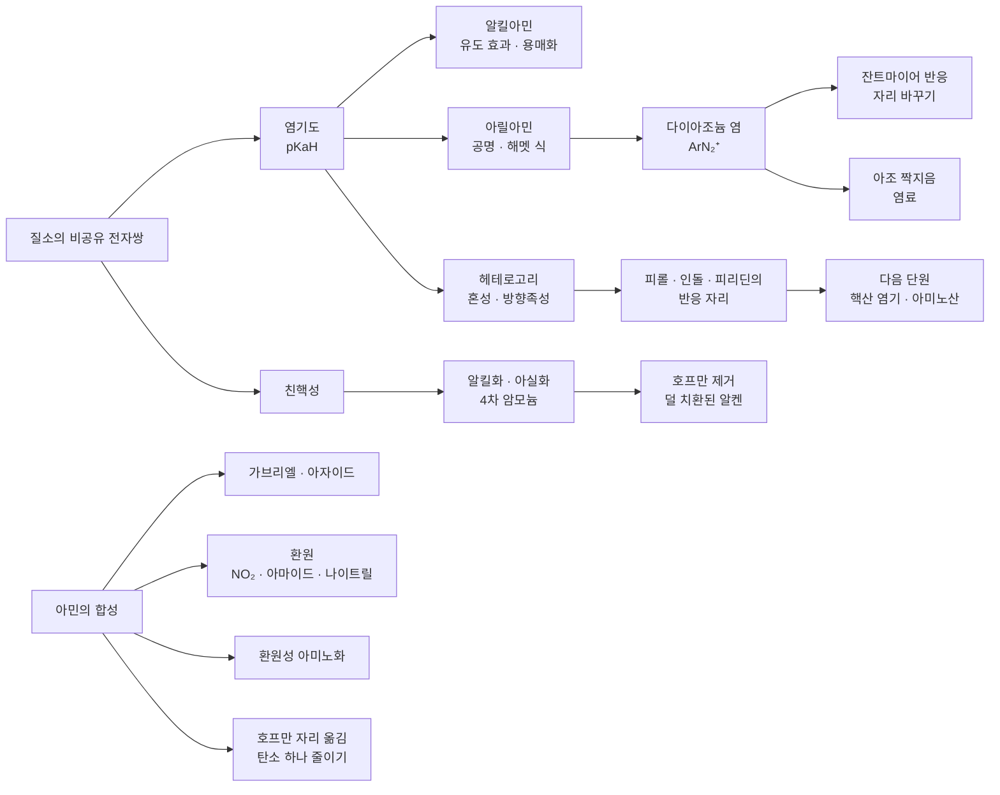

# 유기화학 13. 아민과 헤테로고리 화합물 — 질소의 비공유 전자쌍 하나가 정하는 염기도와 반응
<!-- prev: ochem-12, ochem-11, ochem-9, ochem-8, ochem-1 -->
<!-- next: ochem-14 -->

> [!NOTE]
> **이 단원의 범위**
> - 아민의 분류와 명명법, 피라미드 구조와 물리적 성질, 분광학적 특징(IR의 N–H 신축, 질량 스펙트럼의 α 절단)
> - 아민의 염기도: 알킬아민(기체와 용액의 순서, 유도 효과), 아릴아민(공명과 해멧 식), 헤테로고리 아민(혼성과 방향족성), 산–염기 추출
> - 아민의 합성: 암모니아 알킬화의 한계, 아자이드와 가브리엘 합성, 나이트로·아마이드·나이트릴·아자이드의 환원, 환원성 아미노화, 호프만 자리 옮김(커티어스 자리 옮김 포함)
> - 아민의 반응: 알킬화와 4차 암모늄 염, 아실화와 설폰아마이드, 호프만 제거(덜 치환된 알켄)와 코프 제거
> - 아질산과 아민, 아릴 다이아조늄 염의 치환(잔트마이어 반응, 슈만 반응, 페놀화, 탈아미노화)과 아조 짝지음(아조 염료, pH 의존성)
> - 헤테로고리의 반응성: 피롤·퓨란·싸이오펜(C2 치환), 인돌(C3 치환), 피리딘(C3의 친전자성 치환, C2·C4의 친핵성 치환, N-산화물), 퀴놀린·이미다졸·피리미딘·퓨린 개관

**학습 목표**

1. 아민을 1°·2°·3°·4차 암모늄으로 분류하고 이름을 붙이며, 피라미드 구조와 수소 결합으로 끓는점·용해도를 설명하고, IR·질량 스펙트럼으로 아민의 급수를 가릴 수 있다.
2. 알킬아민·아릴아민·헤테로고리 아민의 $\mathrm{p}K_\mathrm{aH}$를 유도 효과·공명·혼성·방향족성·용매화로 설명하고, 해멧 식과 분율식으로 염기도와 pH에 따른 양성자화 정도·추출 효율을 계산할 수 있다.
3. 1°·2°·3° 아민을 만드는 경로(가브리엘 합성, 아자이드 환원, 나이트로·아마이드·나이트릴 환원, 환원성 아미노화, 호프만 자리 옮김) 가운데 과알킬화를 피하고 탄소 수를 맞추는 경로를 골라 역합성으로 설계할 수 있다.
4. 아민의 아실화·설폰일화와 호프만 제거의 메커니즘을 쓰고, 호프만 제거가 덜 치환된 알켄을 주는 까닭을 이탈기와 전이 상태로 설명할 수 있다.
5. 아릴 다이아조늄 염의 생성 메커니즘(나이트로소늄 이온)과 잔트마이어 반응·아조 짝지음을 쓰고, 다이아조늄 염을 '자리 바꾸기 도구'로 써서 직접 치환으로 만들 수 없는 다치환 벤젠을 합성할 수 있다.
6. 피롤·인돌·피리딘의 친전자성·친핵성 치환 자리를 양이온·음이온 중간체의 공명 구조로 예측하고, 헤테로고리의 반응성을 벤젠과 비교할 수 있다.

**이 단원의 학습 사다리**

| 단계 | 무엇을 하나? |
|---|---|
| STEP 1. 이전 학습 다시 보기 | $\mathrm{p}K_\mathrm{aH}$와 혼성, 헤테로고리의 방향족성 판정, $\mathrm{S_N2}$와 E2, 친전자성 방향족 치환, 이민, 아마이드와 나이트릴 |
| STEP 2. 기초 다지기 | 분율식과 산–염기 추출, 해멧 식 되짚기, 질소 작용기의 산화 수준, C–N 결합의 역합성 |
| STEP 3. 핵심 개념 | 구조와 이름 → 알킬아민의 염기도 → 아릴·헤테로고리 아민의 염기도 → 직접 알킬화와 가브리엘 합성 → 환원으로 만드는 아민 → 환원성 아미노화 → 호프만 자리 옮김 → 아실화·설폰일화 → 호프만 제거 → 다이아조늄 염과 잔트마이어 반응 → 아조 짝지음 → 다섯 고리 헤테로고리와 인돌 → 피리딘과 그 친척 |
| STEP 4. 오개념 바로잡기 | "3° 아민이 언제나 가장 강한 염기이다", "피롤도 질소가 있으니 염기이다", "다이아조늄 이온의 N₂는 나쁜 이탈기이다" 같은 착각 |
| STEP 5. 대학원·연구로 | 팔라듐 촉매 C–N 짝지음(부흐발트–하트위그), 피리딘의 C–H 작용기화와 고리 합성 |
| STEP 6. 생활·산업·진로 | 의약품의 염 형태와 질소 헤테로고리, 아조 염료, 나일론의 다이아민, 나이트로소아민 불순물 관리 |

---

## 🗺️ 단원 들어가기

생선 비린내는 트라이메틸아민 $\mathrm{(CH_3)_3N}$의 냄새이다. 생선 요리에 레몬즙이나 식초를 뿌리면 비린내가 줄어드는 까닭을 우리는 이미 안다. 아민은 염기이고, 산을 만나면 암모늄 염 $\mathrm{(CH_3)_3NH^+}$이 된다. 이온은 휘발하지 않으므로 코에 닿지 않는다. 같은 일이 약국에서도 일어난다. 알약 성분표의 '○○ 염산염'은 대부분 아민 약물을 염산과 짝지어 물에 잘 녹고 오래 보관할 수 있게 한 것이다.

질소의 비공유 전자쌍 하나가 이 모든 것을 정한다. 이 전자쌍은 양성자를 받으면 **염기**, 탄소를 공격하면 **친핵체**가 된다. 그런데 같은 전자쌍이 벤젠 고리와 공명하면(아닐린) 염기도가 백만 분의 1로 줄고, 방향족 고리의 π계에 들어가 버리면(피롤) 아예 염기 노릇을 하지 않는다. 「구조와 결합, 산과 염기」에서 짝산의 $\mathrm{p}K_\mathrm{a}$로 염기도를 재는 법을, 「콘주게이션계와 방향족성」에서 피롤·피리딘의 전자쌍이 어디에 있는지를 이미 보았다. 이 단원은 그 두 가지를 출발점으로 삼아 아민을 **어떻게 만들고**, 아민으로 **무엇을 할 수 있는지**로 나아간다.

아민 합성의 첫 걸림돌은 의외로 "너무 반응을 잘한다"는 것이다. 암모니아에 할로젠화 알킬을 넣으면 생긴 아민이 다시 할로젠화 알킬을 공격해 섞인 생성물이 나온다. 그래서 유기화학자는 질소를 '한 번만 반응하는 형태'(아자이드, 프탈이미드, 이민, 아마이드)로 들여보낸 뒤 환원해 아민으로 바꾼다. 반대로 아민의 질소를 떼어 내는 길도 있다. 질소를 $\mathrm{-N_2^+}$로 바꾸면 가장 좋은 이탈기인 질소 기체가 떨어지면서, 벤젠 고리의 그 자리에 할로젠·사이아노기·하이드록시기·수소를 마음대로 넣을 수 있다. 마지막으로 질소가 고리 안으로 들어간 헤테로고리 — 피리딘·피롤·인돌·이미다졸·퓨린 — 는 DNA의 염기, 비타민, 그리고 시판 의약품의 대다수를 이루는 뼈대이다.

---

## STEP 1. 🔙 이전 학습 다시 보기

### 연계 개념표

| 이전 단원 | 그때 배운 것 | 이 단원에서 확장되는 것 |
|---|---|---|
| 일반화학 「산·염기와 수용액 평형」 '약염기' | $K_b$, $\mathrm{p}K_a + \mathrm{p}K_b = 14.00$(25 ℃), 메틸아민 수용액의 pH | 염기도를 **짝산의 $\mathrm{p}K_\mathrm{a}$**($\mathrm{p}K_\mathrm{aH}$) 하나로 통일, 구조로 $\mathrm{p}K_\mathrm{aH}$를 예측 |
| 유기화학 「구조와 결합, 산과 염기」 '염기의 세기', '산도를 정하는 요인' | 메틸아민 10.6 > 피리딘 5.2 > 아닐린 4.6 > 아마이드, 혼성(s 성격)과 공명이 전자쌍을 붙든다 | 1°·2°·3° 아민의 순서가 기체와 물에서 다른 까닭(용매화), 치환 아닐린의 정량 예측(해멧 식) |
| 유기화학 「입체화학」 '탄소 아닌 입체 중심' | 아민 질소의 피라미드 반전(약 25 kJ/mol), 4차 암모늄 이온은 분할된다 | 피라미드 구조를 물리적 성질·반응성과 연결 |
| 유기화학 「유기 반응의 개관과 알킬 할라이드의 치환·제거 반응」 '$\mathrm{S_N2}$', 'E2' | 아자이드 이온의 $\mathrm{S_N2}$, 부피 큰 염기의 호프만 생성물 | 아민의 **과알킬화**, 아자이드 → 아민, 이탈기가 $\mathrm{-NR_3^+}$인 **호프만 제거** |
| 유기화학 「콘주게이션계와 방향족성」 '방향족 이온과 헤테로고리' | 피리딘형 N(전자쌍은 π계 밖)과 피롤형 N(π계 안), 짝산 $\mathrm{p}K_\mathrm{a}$ 표, 이미다졸 | 같은 판정을 **반응 자리**(피롤 C2, 인돌 C3, 피리딘 C3·C2·C4)의 예측으로 확장 |
| 유기화학 「방향족 화합물의 반응」 '나이트로 → 아민', '너무 센 활성화기', '친핵성 방향족 치환' | $\mathrm{ArNO_2 \rightarrow ArNH_2}$, 아닐린의 과반응과 아세트아닐라이드 보호, 마이젠하이머 착물 | 아닐린 → **다이아조늄 염** → 여러 작용기로 바꾸기, 피리딘의 친핵성 치환 |
| 유기화학 「알데하이드와 케톤」 '이민과 엔아민' | 1° 아민 → 이민, 2° 아민 → 엔아민, 이민 생성의 pH 의존성 | 이민·이미늄 이온을 **그 자리에서 환원**하는 환원성 아미노화 |
| 유기화학 「카복실산과 그 유도체」 '아마이드와 나이트릴', '환원' | 산 염화물 + 아민 → 아마이드, $\mathrm{LiAlH_4}$로 아마이드·나이트릴 → 아민 | 아마이드에서 탄소 하나를 빼는 **호프만 자리 옮김**, 아민 합성 경로의 비교 |

### 준비 운동 (사전 진단)

**Q1.** 메틸아민의 짝산 $\mathrm{CH_3NH_3^+}$의 $\mathrm{p}K_\mathrm{a}$는 10.6이다. 메틸아민의 $\mathrm{p}K_\mathrm{b}$와 $K_b$를 구하시오(25 ℃).

**Q2.** 피리딘과 피롤 가운데 염기인 것은? 다른 하나에 양성자가 질소에 붙기 어려운 까닭을 '방향족성'이라는 말을 써서 한 문장으로 쓰시오.

**Q3.** 1-브로모뷰테인에 아자이드화 나트륨을 DMF에서 반응시킨 생성물을 쓰고, 이 반응의 메커니즘 이름을 쓰시오.

**Q4.** 사이클로헥산온과 메틸아민을 약산성 조건에서 반응시킨 생성물의 작용기 이름과, 그 생성물에 $\mathrm{H_2}$와 Pd 촉매를 작용시키면 무엇이 될지 예상하시오.

정답 및 해설

**Q1.** $\mathrm{p}K_\mathrm{b} = 14.00 - 10.6 = 3.4$, $K_b = 10^{-3.4} \approx 4\times10^{-4}$. 이 단원에서는 $\mathrm{p}K_\mathrm{b}$ 대신 $\mathrm{p}K_\mathrm{aH} = 10.6$을 그대로 쓴다. 값이 클수록 강한 염기이다.

**Q2.** 피리딘. 피롤의 질소 전자쌍은 고리의 방향족 6 π 전자에 들어가 있으므로, 그 전자쌍에 양성자가 붙으면 질소가 $sp^3$이 되면서 방향족성을 잃는다.

**Q3.** 1-아자이도뷰테인 $\mathrm{CH_3CH_2CH_2CH_2N_3}$(뷰틸 아자이드). $\mathrm{S_N2}$. ④에서 이것을 환원해 뷰탄-1-아민을 얻는다.

**Q4.** 이민(N-메틸사이클로헥산-1-이민). C=N이 환원되면 N-메틸사이클로헥산아민 $\mathrm{C_6H_{11}NHCH_3}$이 된다. 이민을 만들면서 동시에 환원하는 것이 ⑥의 환원성 아미노화이다.

---

## STEP 2. 🧱 기초 다지기

### 디딤돌 1. 분율식과 산–염기 추출 — pH 하나로 아민을 옮긴다

아민 B와 짝산 $\mathrm{BH^+}$의 비는 헨더슨–하셀바흐 식으로 정해진다(「알데하이드와 케톤」 디딤돌 1).

$$
\frac{[\mathrm{B}]}{[\mathrm{BH^+}]} = 10^{\,\mathrm{pH} - \mathrm{p}K_\mathrm{aH}}, \qquad f_\mathrm{B} = \frac{1}{1 + 10^{\,\mathrm{p}K_\mathrm{aH} - \mathrm{pH}}}
$$

$f_\mathrm{B}$는 자유 아민(중성)의 분율이다. pH가 $\mathrm{p}K_\mathrm{aH}$보다 2 낮으면 아민의 99 %가 암모늄 이온이고, 2 높으면 99 %가 자유 아민이다.

이 분율이 **산–염기 추출**의 원리이다. 물과 섞이지 않는 유기 용매(다이에틸 에터, 아세트산 에틸, 다이클로로메테인)와 물을 함께 흔들면, 중성 아민 B는 유기층으로 잘 가지만 이온 $\mathrm{BH^+}$는 물층에 남는다. 중성 분자의 **분배 계수** $P = [\mathrm{B}]_\text{유기}/[\mathrm{B}]_\text{물}$에 대하여, 물층의 모든 형태를 합쳐 센 **분배비**는

$$
D = \frac{[\mathrm{B}]_\text{유기}}{[\mathrm{B}]_\text{물} + [\mathrm{BH^+}]_\text{물}} = P\,f_\mathrm{B}
$$

이다($\mathrm{BH^+}$는 유기층에 들어가지 않는다고 본다). 같은 부피의 두 층을 한 번 흔들었을 때 유기층으로 옮겨 간 분율은 $E = D/(1 + D)$이다.

#### 예제 1 — 벤질아민은 언제 유기층으로 가는가

벤질아민 $\mathrm{C_6H_5CH_2NH_2}$($\mathrm{p}K_\mathrm{aH}$ 9.34, 에터/물 분배 계수 $P = 20$으로 둔다)을 같은 부피의 에터와 수용액으로 한 번 추출한다. 수용액의 pH가 (1) 2.0, (2) 7.0, (3) 12.0일 때 유기층으로 옮겨 가는 분율 $E$를 구하시오.

**풀이**
식 세우기: $f_\mathrm{B} = 1/(1 + 10^{9.34 - \mathrm{pH}})$, $D = 20f_\mathrm{B}$, $E = D/(1 + D)$.

| pH | $f_\mathrm{B}$ | $D$ | $E$ |
|---|---|---|---|
| 2.0 | $4.6\times10^{-8}$ | $9.1\times10^{-7}$ | 사실상 0 |
| 7.0 | $4.6\times10^{-3}$ | 0.091 | 0.083 (약 8 %) |
| 12.0 | 0.998 | 20.0 | 0.95 |

**의미** 묽은 염산으로 씻으면 아민은 물층으로 '끌려 들어가고', 그 물층을 NaOH로 염기성(pH 12)으로 만든 뒤 에터로 다시 추출하면 아민만 되돌아 나온다. 중성 유기물(예: 나프탈렌)은 어느 pH에서도 유기층에 남고, 카복실산은 반대로 염기성 물층으로 간다. 이 원리로 세 성분을 나누는 실험을 탐구 활동 A에서 한다. 생체에서도 같은 일이 일어난다. 세포막은 '유기층'이어서 중성 아민만 통과한다(STEP 6).

<!-- 시뮬레이션 요청: 아민의 pH–분율·추출 탐색기. 슬라이더: 수용액 pH(0~14), 아민의 pKaH(0~12; 미리 설정 단추: 아닐린 4.6, 피리딘 5.2, 이미다졸 7.0, 벤질아민 9.34, 트라이에틸아민 10.75, 피페리딘 11.1), 분배 계수 log P(−1~4), 유기층/물층 부피비(0.2~5), 추출 횟수(1~4). 위 그래프: 가로축 pH, 세로축 분율(0~1), 곡선 f_B(자유 아민)와 1 − f_B(암모늄 이온)이 pKaH에서 0.5로 교차, 현재 pH에 세로선. 아래 그림: 분액 깔때기 두 층(위 유기층·아래 물층, 에터 기준)에 B 분자(파란 점)와 BH⁺(빨간 점)이 계산된 비율대로 흩어져 있고, 옆에 'E = 유기층으로 옮겨 간 분율' 숫자. 같은 그림에 선택 단추로 카복실산(pKa 4.2)과 중성 화합물을 함께 넣어 세 성분이 pH에 따라 어느 층으로 가는지 비교. -->

### 디딤돌 2. 해멧 식 되짚기 — 치환 아닐린의 염기도를 숫자 하나로

「카복실산과 그 유도체」 ②에서 벤조산의 이온화로 치환기 상수 $\sigma$를 정의하고, 다른 반응에서도 $\log(K_\mathrm{X}/K_\mathrm{H}) = \rho\sigma_\mathrm{X}$가 성립함을 보았다. 아닐리늄 이온 $\mathrm{X{-}C_6H_4NH_3^+}$의 산 해리에 적용하면

$$
\mathrm{p}K_\mathrm{aH}(\mathrm{X}) = \mathrm{p}K_\mathrm{aH}(\mathrm{H}) - \rho\,\sigma_\mathrm{X}, \qquad \mathrm{p}K_\mathrm{aH}(\mathrm{H}) = 4.60,\ \ \rho \approx 2.89\ (\text{물, }25\,^\circ\mathrm{C})
$$

이다. $\rho$가 벤조산(1.00)의 약 3배인 것은 반응 중심(N)이 고리에 **바로** 붙어 있기 때문이다(벤조산은 C=O 탄소 하나를 사이에 둔다). 전자 끄는 기($\sigma > 0$)는 $\mathrm{p}K_\mathrm{aH}$를 낮춘다(염기를 약하게 한다).

#### 예제 2 — 3-클로로아닐린의 $\mathrm{p}K_\mathrm{aH}$ 예측

$\sigma_\mathrm{m}(\mathrm{Cl}) = 0.37$, $\sigma_\mathrm{p}(\mathrm{CH_3}) = -0.17$을 써서 3-클로로아닐린과 4-메틸아닐린(p-톨루이딘)의 $\mathrm{p}K_\mathrm{aH}$를 예측하고 실측값(3.52, 5.08)과 비교하시오.

**풀이**
3-클로로아닐린: $4.60 - 2.89\times0.37 = 4.60 - 1.07 = 3.53$ (실측 3.52).
4-메틸아닐린: $4.60 - 2.89\times(-0.17) = 4.60 + 0.49 = 5.09$ (실측 5.08).
**의미** 해멧 식은 메타·파라 치환 아닐린 대부분을 0.1 단위 안에서 맞힌다. 그런데 4-나이트로아닐린에서는 크게 어긋난다. 그 까닭(직접 공명)이 ③의 핵심이다.

### 디딤돌 3. 질소 작용기의 산화 수준 — 환원에 전자가 몇 개 필요한가

질소는 −3(아민)부터 +3(나이트로기의 형식 산화수)까지 여러 산화 상태를 가진다. 아민을 환원으로 만들 때는 출발 작용기가 아민보다 몇 단계 '위'에 있는지를 세면 필요한 환원제의 양이 나온다. 산화수는 전기 음성도가 큰 원자에 결합 전자를 모두 준다고 보고 센다(C–N 결합 전자는 N에, N–H는 N에, N–O는 O에).

| 작용기 | 예 | N의 산화수 | 아민까지 필요한 전자 수 |
|---|---|---|---|
| 아민 | $\mathrm{C_6H_5NH_2}$ | −3 | 0 |
| 하이드록실아민 | $\mathrm{C_6H_5NHOH}$ | −1 | 2 |
| 나이트로소 | $\mathrm{C_6H_5N{=}O}$ | +1 | 4 |
| 나이트로 | $\mathrm{C_6H_5NO_2}$ | +3 | 6 |
| 아자이드 $\mathrm{RN_3}$ → $\mathrm{RNH_2 + N_2}$ | $\mathrm{C_4H_9N_3}$ | (평균) | 2 |
| 나이트릴 $\mathrm{RC{\equiv}N}$ → $\mathrm{RCH_2NH_2}$ | $\mathrm{CH_3CN}$ | −3 (탄소가 환원됨) | 4 (C의 산화수가 +3 → −1) |

나이트로기의 환원은 다음 반쪽 반응으로 정리된다.

$$
\mathrm{ArNO_2 + 6H^+ + 6e^- \longrightarrow ArNH_2 + 2H_2O}
$$

#### 예제 3 — 철 가루로 나이트로벤젠 환원하기

나이트로벤젠 12.3 g(123.11 g/mol)을 철 가루와 염산으로 아닐린(93.13 g/mol)까지 환원한다. 철은 $\mathrm{Fe^{2+}}$로 산화된다고 할 때 (1) 전체 반응식을 쓰고 (2) 필요한 철의 최소 질량(55.85 g/mol)과 (3) 아닐린의 이론 수득량을 구하시오.

**풀이**
(1) 철 1 mol이 전자 2 mol을 내므로 철 3 mol이 필요하다.

$$
\mathrm{C_6H_5NO_2 + 3Fe + 6H^+ \longrightarrow C_6H_5NH_2 + 3Fe^{2+} + 2H_2O}
$$

(2) 나이트로벤젠 $12.3/123.11 = 0.0999\ \mathrm{mol}$, 철 $3\times0.0999\times55.85 = 16.7\ \mathrm{g}$.
(3) $0.0999\times93.13 = 9.30\ \mathrm{g}$. 산성 용액에서는 아닐리늄 염($\mathrm{C_6H_5NH_3^+}$)으로 있으므로 NaOH로 염기성으로 만든 뒤 꺼낸다(디딤돌 1).
**의미** 같은 질량의 나이트로벤젠을 수소 기체로 환원하면 $\mathrm{H_2}$ 3 당량이 필요하다($\mathrm{ArNO_2 + 3H_2 \rightarrow ArNH_2 + 2H_2O}$). 산업에서는 촉매 수소화가 철 환원을 대부분 대신했다. 철 슬러지(산화철)가 남지 않기 때문이다.

### 디딤돌 4. C–N 결합의 역합성 — 어디를 끊고, 질소를 무엇으로 들여보낼까

아민을 역합성으로 볼 때는 질소에 붙은 C–N 결합 하나를 끊는다. 끊은 뒤 탄소 쪽이 **친전자체**(할로젠화 알킬, 카보닐 화합물, 카복실산 유도체)가 되고 질소 쪽이 **친핵체**가 된다. 질소 친핵체를 '날것'(암모니아·아민)으로 쓰면 과알킬화가 일어나므로, 한 번만 반응하도록 '포장된' 질소를 고른다.

| 표적의 질소 주변 | 끊을 결합 | 탄소 쪽 출발 물질 | 질소 쪽 시약 | 소절 |
|---|---|---|---|---|
| $\mathrm{R{-}CH_2{-}NH_2}$ (1°) | $\mathrm{CH_2{-}N}$ | $\mathrm{RCH_2Br}$ | 프탈이미드 음이온 또는 $\mathrm{N_3^-}$, 뒤에 해제·환원 | ④ |
| $\mathrm{R{-}CH_2{-}NH_2}$ (1°) | $\mathrm{R{-}CH_2}$ (탄소 하나 추가) | $\mathrm{RBr}$ | $\mathrm{CN^-}$, 뒤에 $\mathrm{LiAlH_4}$ | ⑤ |
| $\mathrm{R_2CH{-}NHR'}$ (2°) | $\mathrm{CH{-}N}$ | $\mathrm{R_2C{=}O}$ | $\mathrm{R'NH_2}$ + 환원제 | ⑥ |
| $\mathrm{R{-}CH_2{-}NR'_2}$ | $\mathrm{CH_2{-}N}$ | $\mathrm{RCOCl}$ | $\mathrm{R'_2NH}$, 뒤에 $\mathrm{LiAlH_4}$(아마이드 환원) | ⑤ |
| $\mathrm{Ar{-}NH_2}$ | $\mathrm{Ar{-}N}$ | $\mathrm{ArH}$ | $\mathrm{HNO_3/H_2SO_4}$, 뒤에 환원 | ⑤ |
| $\mathrm{R{-}NH_2}$, R이 3°이거나 탄소 하나가 줄어든 골격 | $\mathrm{R{-}N}$ | $\mathrm{RCONH_2}$ | $\mathrm{Br_2}$, NaOH | ⑦ |

#### 예제 4 — 같은 아민, 세 가지 끊기

사이클로헥실메테인아민 $\mathrm{C_6H_{11}CH_2NH_2}$를 만드는 경로를 세 가지 제안하시오.

**풀이**
① $\mathrm{CH_2{-}N}$을 끊는다 → (브로모메틸)사이클로헥세인 + 프탈이미드 칼륨, 뒤에 하이드라진(가브리엘 합성, ④).
② 같은 결합을 끊되 탄소 쪽을 카보닐로 → 사이클로헥세인카브알데하이드 + $\mathrm{NH_3}$, $\mathrm{H_2}$/Ni 또는 $\mathrm{NaBH_3CN}$(환원성 아미노화, ⑥).
③ $\mathrm{C_6H_{11}{-}CH_2}$를 끊는다 → 브로모사이클로헥세인 + $\mathrm{CN^-}$ → 사이클로헥세인카보나이트릴 → $\mathrm{LiAlH_4}$(⑤). 다만 2° 할로젠화 알킬의 $\mathrm{S_N2}$는 E2와 경쟁하므로, 실제로는 사이클로헥세인카복실산 → 아마이드 → $\mathrm{LiAlH_4}$ 환원 쪽이 깔끔하다.
**의미** 한 표적에 길이 여럿 있을 때는 ① 과알킬화가 없는가 ② 탄소 수가 맞는가 ③ 출발 물질의 $\mathrm{S_N2}$가 잘 되는가(1°인가) ④ 다른 작용기가 환원제를 견디는가를 차례로 따진다.

---

## STEP 3. 📘 핵심 개념

### ① 아민의 구조와 이름, 성질과 스펙트럼

**아민(amine)** 은 암모니아의 수소를 탄소 원자단으로 바꾼 화합물이다. 「구조와 결합, 산과 염기」에서 본 대로 급수는 **질소에 붙은 탄소의 수**로 센다. 질소에 탄소 넷이 붙어 양전하를 띠면 **4차 암모늄 이온(quaternary ammonium ion)** 이다.

| 급수 | 일반식 | 예 (SMILES) | IUPAC 이름 (관용명) |
|---|---|---|---|
| 1° | $\mathrm{RNH_2}$ | `CCCCN` | 뷰탄-1-아민 (뷰틸아민) |
| 2° | $\mathrm{R_2NH}$ | `CCNCC` | N-에틸에탄아민 (다이에틸아민) |
| 3° | $\mathrm{R_3N}$ | `CCN(CC)CC` | N,N-다이에틸에탄아민 (트라이에틸아민) |
| 4차 | $\mathrm{R_4N^+X^-}$ | `C[N+](C)(C)C.[Br-]` | 브로민화 테트라메틸암모늄 |
| 아릴 | $\mathrm{ArNH_2}$ | `Nc1ccccc1` | 벤젠아민 (아닐린) |
| 고리형 2° | — | `C1CCNCC1` | 피페리딘 |

#### 이름 붙이기

- 1° 아민은 모체 알케인의 어미 '-에인(-ane)'의 '-e'를 '-아민(-amine)'으로 바꾸고 질소가 붙은 탄소의 위치 번호를 넣는다: $\mathrm{CH_3CH(NH_2)CH_2CH_3}$은 뷰탄-2-아민.
- 2°·3° 아민은 가장 긴 원자단을 모체로 삼고, 질소에 붙은 나머지 원자단을 **N-** 위치 기호와 함께 앞에 붙인다: $\mathrm{CH_3CH_2CH_2N(CH_3)_2}$는 N,N-다이메틸프로판-1-아민.
- 우선순위가 더 높은 작용기(카복실산, 에스터, 아마이드, 나이트릴, 카보닐, 알코올)가 있으면 아민은 접두사 **아미노-(amino-)** 가 된다: $\mathrm{H_2NCH_2CH_2OH}$은 2-아미노에탄올, $\mathrm{H_2NCH_2COOH}$은 아미노아세트산(글라이신).
- 아민의 짝산은 '-아미늄'(아닐리늄, 피리디늄)이나 '○○암모늄'으로 부른다. 의약품 이름의 '○○ 염산염(hydrochloride)'은 아민 + HCl의 암모늄 염이다.

#### 구조 — 피라미드와 뒤집힘

알킬아민의 질소는 $sp^3$에 가깝고 비공유 전자쌍이 네 번째 꼭짓점을 차지하는 **삼각뿔**(피라미드)이다. 트라이메틸아민의 C–N–C 각은 약 108°이다. 「입체화학」 ⑧에서 본 대로 이 피라미드는 평면 전이 상태를 지나 1초에 수억 번 **뒤집히므로**(장벽 약 25 kJ/mol), 세 원자단이 다른 아민도 분할되지 않는다. 반면 아닐린의 질소는 전자쌍이 고리와 공명하려고 평면 쪽으로 기울어(피라미드가 얕아져) $sp^2$와 $sp^3$의 중간이다. 이 차이가 ③의 염기도 차이로 이어진다.

<!-- 그림 요청: 아민 질소의 모양 세 칸. (가) 트라이메틸아민(SMILES CN(C)C)의 공–막대 3차원 구조: N 위에 비공유 전자쌍 엽(sp³), C–N–C 각 '약 108°'. (나) 아닐린(SMILES Nc1ccccc1): 고리 평면을 옆에서 본 그림, NH2가 고리 평면에서 조금만 기울어진 얕은 피라미드(평면과의 각 '약 40°'), N의 전자쌍 엽이 고리의 p 오비탈과 거의 나란히 겹치는 모습, 이름표 'sp²와 sp³의 중간 · 고리와 공명'. (다) 테트라메틸암모늄 이온(SMILES C[N+](C)(C)C): 정사면체, N에 ⊕, '전자쌍 없음 → 염기도·친핵성 없음'. -->

#### 물리적 성질 — 수소 결합은 하되 알코올보다 약하게

1°·2° 아민은 N–H로 수소 결합을 주고받지만, N이 O보다 전기 음성도가 작아 N–H···N 수소 결합은 O–H···O보다 약하다. 3° 아민은 수소 결합 주개가 없다. 그래서 분자량이 비슷한 화합물의 끓는점은 다음 순서가 된다.

| 화합물 (분자량) | 축약 구조식 | 끓는점 (℃, 약) | 분자 사이 수소 결합 |
|---|---|---|---|
| 뷰테인 (58) | $\mathrm{CH_3CH_2CH_2CH_3}$ | −0.5 | 없음 |
| 트라이메틸아민 (59) | $\mathrm{(CH_3)_3N}$ | 3 | 받개만(주개 없음) |
| N-메틸에탄아민 (59) | $\mathrm{CH_3CH_2NHCH_3}$ | 37 | N–H 1개 |
| 프로판-1-아민 (59) | $\mathrm{CH_3CH_2CH_2NH_2}$ | 48 | N–H 2개 |
| 프로판-1-올 (60) | $\mathrm{CH_3CH_2CH_2OH}$ | 97 | O–H, 더 강함 |

물에 대해서는 세 급수 모두 질소 전자쌍이 물의 O–H에서 수소 결합을 받으므로, 탄소 6개 정도까지의 아민은 물에 잘 녹는다. 작은 아민은 암모니아 냄새나 비린내가 나고, 1,5-다이아미노펜테인(카다베린)·1,4-다이아미노뷰테인(퓨트레신)은 썩은 고기 냄새의 원인이다.

#### 스펙트럼으로 아민 알아보기

「구조 결정: 질량 분석법과 분광법」의 도구로 아민을 다음과 같이 가린다.

| 방법 | 1° 아민 | 2° 아민 | 3° 아민 |
|---|---|---|---|
| IR N–H 신축 | 3300~3500 cm⁻¹에 **두 개**(대칭·비대칭), O–H보다 좁고 약하다 | 하나 | 없음 |
| IR N–H 굽힘 | 약 1600 cm⁻¹ | 약함 | 없음 |
| $^1\mathrm{H}$ NMR | N–H δ 약 0.5~3(넓음, $\mathrm{D_2O}$를 넣으면 사라짐), $\mathrm{CH{-}N}$ δ 약 2.3~3.0 | 같음 | $\mathrm{CH{-}N}$ δ 약 2.2~2.6 |
| $^{13}\mathrm{C}$ NMR | C–N δ 약 30~60 | 같음 | 같음 |
| 질량 분석 | 질소 1개 → 분자 이온 **홀수**(질소 규칙). **α 절단**으로 이미늄 이온이 기준 봉우리 | 같음 | 같음 |

**α 절단**은 아민 분자 이온에서 질소 바로 옆 탄소(α 탄소)와 그 이웃(β) 사이의 결합이 끊어져, 가장 큰 알킬 라디칼이 떨어지고 질소의 전자쌍이 양전하를 안정화하는 **이미늄 이온** $\mathrm{R_2C{=}N^+R_2}$이 남는 조각내기이다. $\mathrm{RCH_2NH_2}$꼴의 1° 아민은 $\mathrm{CH_2{=}NH_2^+}$(m/z 30)이 기준 봉우리가 된다.

<!-- 그림 요청: 뷰탄-1-아민(SMILES CCCCN)의 질량 스펙트럼 α 절단. 위: 분자 이온 라디칼 양이온 [CH3CH2CH2–CH2–NH2]•⁺ (N에 홀전자 하나와 ⊕), 반쪽 화살표(낚싯바늘 화살표) 3개: ① N의 홀전자 → C1–N 사이(새 π 결합 자리), ② C1–C2 결합 전자 하나 → C1–N 사이, ③ C1–C2 결합의 다른 전자 하나 → C2(떨어지는 프로필 라디칼 쪽). 생성물: CH2=NH2⁺ (m/z 30) + •CH2CH2CH3(중성, 검출 안 됨). 아래: 막대 스펙트럼 가로축 m/z 10~80, 막대 30(100 %, '기준 봉우리'), 73(분자 이온, 약 10 %), 44·56·58 작은 막대. -->

#### 예제 5 — $\mathrm{C_4H_{11}N}$ 이성질체 가리기

분자 이온이 m/z 73인 세 아민 A, B, C의 자료이다. 구조를 정하시오.
A: 기준 봉우리 m/z 30, IR 3370·3290 cm⁻¹(두 개). B: 기준 봉우리 m/z 58, IR 약 3280 cm⁻¹(하나), $^1\mathrm{H}$ NMR δ 1.1(t, 6H), 2.6(q, 4H), 약 1.0(넓은 s, 1H). C: 기준 봉우리 m/z 58, IR 두 개, $^1\mathrm{H}$ NMR δ 1.15(s, 9H), 약 1.2(넓은 s, 2H).

**풀이**
- 분자량 73은 홀수 → 질소 1개, $\mathrm{C_4H_{11}N}$은 불포화도 0.
- A: N–H 두 개 → 1°. m/z 30($\mathrm{CH_2{=}NH_2^+}$)은 $\mathrm{{-}CH_2NH_2}$가 있다는 뜻이다. 뷰탄-1-아민 또는 2-메틸프로판-1-아민이다(이 자료만으로는 둘을 가리지 못한다. NMR에서 메틸이 삼중선 3H인지 이중선 6H인지로 가린다).
- B: N–H 하나 → 2°. 대칭인 에틸기 두 개(t 6H, q 4H) → **다이에틸아민**. α 절단으로 $\mathrm{CH_3}$(15)가 떨어져 $\mathrm{CH_3CH_2NH{=}CH_2^+}$(m/z 58).
- C: 1°, 9H 단일선 → **2-메틸프로판-2-아민**(tert-뷰틸아민). α 탄소가 4°이므로 메틸 하나가 떨어져 $\mathrm{(CH_3)_2C{=}NH_2^+}$(m/z 58).
**의미** 질량 분석은 '질소 옆에 무엇이 있는가', IR은 '질소에 H가 몇 개인가', NMR은 '전체 골격'을 알려 준다. 뷰탄-2-아민이라면 α 탄소에서 더 큰 에틸 라디칼이 떨어져 m/z 44가 기준 봉우리가 된다.

#### ✔ 바로 확인

1. (O/X) 2-메틸프로판-2-아민 $\mathrm{(CH_3)_3CNH_2}$은 3차 아민이다.
2. $\mathrm{CH_3CH_2CH_2N(CH_3)_2}$의 IUPAC 이름은?
3. 프로판-1-아민, 트라이메틸아민, 프로판-1-올을 끓는점이 높은 것부터 늘어놓으시오.
4. 빈칸: 2° 아민의 IR 스펙트럼에는 3300~3500 cm⁻¹에 N–H 신축 띠가 (    )개 나타난다.

정답

1. X — 질소에 붙은 탄소가 하나이므로 1차 아민이다.
2. N,N-다이메틸프로판-1-아민
3. 프로판-1-올(97 ℃) > 프로판-1-아민(48 ℃) > 트라이메틸아민(3 ℃) — O–H 수소 결합 > N–H 수소 결합 > 수소 결합 주개 없음.
4. 1

### ② 알킬아민의 염기도 — 기체와 물에서 순서가 다른 까닭

염기도는 「구조와 결합, 산과 염기」에서 정한 대로 **짝산의 $\mathrm{p}K_\mathrm{a}$**($\mathrm{p}K_\mathrm{aH}$)로 나타낸다. 클수록 강한 염기이다.

| 아민 | 짝산 | $\mathrm{p}K_\mathrm{aH}$ (물, 25 ℃) | 기체상 양성자 친화도 (kJ/mol, 약) |
|---|---|---|---|
| 암모니아 $\mathrm{NH_3}$ | $\mathrm{NH_4^+}$ | 9.25 | 854 |
| 메틸아민 $\mathrm{CH_3NH_2}$ | $\mathrm{CH_3NH_3^+}$ | 10.64 | 899 |
| 다이메틸아민 $\mathrm{(CH_3)_2NH}$ | $\mathrm{(CH_3)_2NH_2^+}$ | 10.73 | 930 |
| 트라이메틸아민 $\mathrm{(CH_3)_3N}$ | $\mathrm{(CH_3)_3NH^+}$ | 9.80 | 949 |
| 에틸아민 | | 10.67 | |
| 다이에틸아민 | | 약 11.0 | |
| 트라이에틸아민 | | 10.75 | |
| 피페리딘 (고리형 2°) | | 11.1 | |
| 벤질아민 $\mathrm{C_6H_5CH_2NH_2}$ | | 9.34 | |
| 모폴린 (고리에 O) | | 8.4 | |
| 2,2,2-트라이플루오로에탄아민 $\mathrm{CF_3CH_2NH_2}$ | | 5.7 | |

(**양성자 친화도**는 기체에서 $\mathrm{B + H^+ \rightarrow BH^+}$의 $-\Delta H$이다.)

#### 기체에서는 깔끔하게 3° > 2° > 1° > NH₃

기체에서는 용매가 없으므로 염기도가 분자 자신의 성질만 반영한다. 알킬기는 수소보다 전자를 잘 밀어 주고(유도 효과), 더 중요하게는 크고 **분극되기 쉬워** 질소의 양전하를 넓게 퍼뜨린다. 메틸기가 하나 늘 때마다 양성자 친화도가 45, 31, 19 kJ/mol씩 커진다(효과는 점점 포화된다).

#### 물에서는 순서가 뒤엉킨다 — 용매화

물에서는 트라이메틸아민(9.80)이 메틸아민(10.64)보다 약한 염기이다. 짝산이 물에 어떻게 녹아 있는지가 다르기 때문이다. 암모늄 이온은 N–H 수소로 물 분자에 **수소 결합을 주어** 양전하를 안정화한다.

| 짝산 | 수소 결합을 줄 수 있는 N–H | 용매화에 의한 안정화 |
|---|---|---|
| $\mathrm{RNH_3^+}$ | 3개 | 가장 크다 |
| $\mathrm{R_2NH_2^+}$ | 2개 | 중간 |
| $\mathrm{R_3NH^+}$ | 1개 | 가장 작고, 알킬기가 물을 가로막기도 한다 |

알킬기가 늘면 **분자 자신의 효과**(염기도 증가)와 **용매화 효과**(짝산 안정화 감소)가 반대 방향으로 작용한다. 1°에서 2°까지는 앞의 것이 조금 이기고, 3°에서는 뒤의 것이 이긴다. 그 결과 물에서 알킬아민의 $\mathrm{p}K_\mathrm{aH}$는 모두 10~11 근처에 몰려 있다. 실용적인 결론은 "**단순 알킬아민은 급수와 관계없이 $\mathrm{p}K_\mathrm{aH}$ 약 10~11의 염기**"이다.

#### 유도 효과와 혼성

질소 근처에 전자 끄는 기가 있으면 염기도가 크게 떨어진다. $\mathrm{CF_3}$ 하나가 β 자리에 오면 $\mathrm{p}K_\mathrm{aH}$가 약 5 줄고(에틸아민 10.67 → 5.7), 모폴린의 고리 산소는 피페리딘(11.1)보다 약 2.7을 낮춘다. 벤질아민(9.34)도 $sp^2$ 탄소인 페닐기의 약한 유도 끌기 때문에 에틸아민보다 약하다. 혼성의 효과는 「구조와 결합, 산과 염기」에서 본 그대로이다: $sp^3$ N(아민, 약 10~11) > $sp^2$ N(피리딘·이민, 약 5~7) > $sp$ N(나이트릴, 약 −10).

**아마이드는 염기가 아니다.** 아마이드 질소의 전자쌍은 C=O와 공명해 있고(「카복실산과 그 유도체」), 강산에서 양성자는 N이 아니라 **카보닐 O**에 붙는다($\mathrm{p}K_\mathrm{aH}$ 약 −0.5). 그래서 아마이드를 만드는 아실화는 질소의 염기성·친핵성을 '꺼 두는' 보호법이 된다(⑧).

<!-- 그림 요청: 메틸아민 짝산 세 가지의 용매화 비교 그림. 왼쪽부터 CH3NH3⁺, (CH3)2NH2⁺, (CH3)3NH⁺ 을 공–막대로 그리고, 각 N–H 마다 물 분자 하나가 O 쪽으로 수소 결합(점선)을 받는 모습(각각 물 3, 2, 1개). 메틸기는 회색 구로 크게 그려 물이 다가가지 못하는 느낌. 아래에 두 줄 막대: '기체 양성자 친화도(kJ/mol): 899, 930, 949'(오른쪽으로 갈수록 커짐, 파랑), '물에서 pKaH: 10.64, 10.73, 9.80'(빨강, 오른쪽에서 꺾임). 화살표 이름표 '알킬기의 전자 공여 ↑' / '용매화 ↓'. -->

#### 예제 6 — 염기도 차이를 에너지로

25 ℃ 물에서 (1) 에틸아민(10.67)과 2,2,2-트라이플루오로에탄아민(5.7)의 짝산 해리 $\Delta G^\circ$ 차이를 구하시오. (2) 메틸아민과 트라이메틸아민의 기체상 양성자 친화도 차이(약 50 kJ/mol)가 물에서는 반대 방향의 $\mathrm{p}K_\mathrm{aH}$ 차이(−0.84)로 바뀐다. 물에서의 차이를 kJ/mol로 바꾸고, 용매화가 두 이온의 안정성에 얼마만큼의 차이를 만들었는지 어림하시오. ($2.303RT = 5.71\ \mathrm{kJ/mol}$)

**풀이**
(1) $\Delta\Delta G^\circ = 5.71\times(10.67 - 5.7) = 5.71\times4.97 = 28\ \mathrm{kJ/mol}$. $\mathrm{CF_3}$의 유도 끌기가 암모늄 이온을 28 kJ/mol 불안정하게 했다.
(2) 물에서 트라이메틸아민 쪽이 $5.71\times0.84 = 4.8\ \mathrm{kJ/mol}$ 불리하다. 기체에서는 약 50 kJ/mol 유리했으므로, 엔트로피 등을 무시하고 엔탈피만으로 어림하면 용매화가 메틸암모늄 이온을 트라이메틸암모늄 이온보다 약 $50 + 5 \approx 55\ \mathrm{kJ/mol}$ 더 안정하게 했다. N–H 수소 결합 두 개분의 크기이다.
**의미** 용액의 염기도는 '분자의 본성'과 '용매와의 상호작용'의 작은 차이이다. 수십 kJ/mol의 두 효과가 거의 상쇄되어 몇 kJ/mol의 차이만 남는다. 용매를 바꾸면(예: 비양성자성 용매) 순서가 다시 바뀌는 까닭이다.

#### ✔ 바로 확인

1. (O/X) 물에서 트라이메틸아민은 메틸아민보다 강한 염기이다.
2. 빈칸: 물에서 3° 암모늄 이온이 1° 암모늄 이온보다 덜 안정한 주된 까닭은 물에 줄 수 있는 (    )가 적기 때문이다.
3. 피페리딘(11.1)과 모폴린(8.4) 가운데 pH 9.0 완충 용액에서 더 많이 양성자화되는 것은?
4. 아세트아마이드에 강산을 넣을 때 양성자가 붙는 원자는?

정답

1. X — 기체에서는 강하지만 물에서는 $\mathrm{p}K_\mathrm{aH}$ 9.80으로 메틸아민(10.64)보다 약하다.
2. N–H 수소 결합(수소 결합 주개)
3. 피페리딘 — $\mathrm{p}K_\mathrm{aH}$가 pH보다 2.1 크므로 약 99 %가 양성자화된다(모폴린은 약 20 %).
4. 카보닐 산소 — N의 전자쌍은 C=O와 공명해 있다.

### ③ 아릴아민과 헤테로고리 아민의 염기도

#### 아닐린 — 전자쌍이 고리로 새어 나간다

사이클로헥산아민($\mathrm{p}K_\mathrm{aH}$ 10.64)과 아닐린(4.60)은 탄소 수가 같지만 염기도가 약 $10^6$배 다르다. 아닐린의 N 전자쌍은 벤젠 고리의 π계와 겹쳐 오쏘·파라 탄소로 비편재화된다(「방향족 화합물의 반응」에서 아닐린이 강한 오쏘·파라 활성화기였던 바로 그 공명). 양성자가 붙으면 전자쌍이 N–H 결합에 묶여 이 공명을 잃는다. 즉 **자유 아민이 공명으로 안정화되어 있고, 짝산에는 그 안정화가 없다.** 염기도 차이 6.0을 에너지로 바꾸면 $5.71\times6.04 \approx 34\ \mathrm{kJ/mol}$이다.

<!-- 그림 요청: 아닐린(SMILES Nc1ccccc1)의 공명 구조 다섯 개를 ↔ 로 잇기. ① 중성 케쿨레 구조 2개, ② N 전자쌍 → C(ipso)–N 사이, 고리 π → 오쏘 탄소로 가는 굽은 화살표로 만든 전하 분리 구조 3개(N에 ⊕, 오쏘 C 두 곳과 파라 C 한 곳에 각각 ⊖, C=N⁺H2 이중 결합). 오른쪽에 아닐리늄 이온 C6H5NH3⁺(SMILES [NH3+]c1ccccc1): N에 전자쌍 없음, '고리와 공명 불가'. 아래에 에너지 막대: 아닐린은 공명으로 내려가 있고 짝산은 그대로, 'pKaH 10.64 → 4.60 : 약 34 kJ/mol'. -->

#### 치환 아닐린 — 해멧 식과 직접 공명

디딤돌 2의 해멧 식이 대부분 잘 맞지만, 파라 자리의 강한 π 받개(나이트로기, 사이아노기)에서는 크게 어긋난다.

| 아닐린 | $\sigma$ | 해멧 예측 $\mathrm{p}K_\mathrm{aH}$ | 실측 $\mathrm{p}K_\mathrm{aH}$ |
|---|---|---|---|
| 4-메톡시아닐린 | −0.27 | 5.38 | 5.34 |
| 4-메틸아닐린 | −0.17 | 5.09 | 5.08 |
| 아닐린 | 0 | 4.60 | 4.60 |
| 4-클로로아닐린 | 0.23 | 3.94 | 3.98 |
| 3-나이트로아닐린 | 0.71 | 2.55 | 2.47 |
| 4-사이아노아닐린 | 0.66 | 2.69 | 1.74 |
| 4-나이트로아닐린 | 0.78 | 2.35 | 1.0 |

4-나이트로아닐린에서는 N의 전자쌍이 고리를 **관통해** 나이트로기의 산소까지 직접 들어간다($\mathrm{H_2N^+{=}C_6H_4{=}NO_2^-}$꼴의 공명 구조). 벤조산에서는 반응 중심(카복실기)이 전자를 고리로 내주지 않으므로 이 '관통 공명'이 $\sigma_\mathrm{p}$에 들어 있지 않다. 그래서 전자쌍 주개가 반응 중심인 반응에는 관통 공명을 반영한 **$\sigma^-$**(나이트로기 1.27, 사이아노기 1.00)를 쓴다. 그러면 예측이 $4.60 - 2.89\times1.27 = 0.93$(실측 1.0), $4.60 - 2.89\times1.00 = 1.71$(실측 1.74)로 맞는다.

다른 아릴아민의 값도 같은 논리로 읽는다. N,N-다이메틸아닐린(5.1)은 아닐린보다 조금 강하고, 다이페닐아민(0.8)은 전자쌍이 고리 두 개로 퍼져 훨씬 약하다. **아세트아닐라이드**는 아마이드여서 염기가 아니다.

#### 헤테로고리 아민 — 혼성과 방향족성

「콘주게이션계와 방향족성」 ⑧에서 피리딘(5.2), 피롤(약 −4, C2에 양성자화), 이미다졸(7.0), 피리미딘(1.3)의 값을 전자쌍의 위치로 설명했다. 여기에 포화 고리와 몇 가지를 더해 비교한다.

| 화합물 | N의 상태 | $\mathrm{p}K_\mathrm{aH}$ (약) | 판단 근거 |
|---|---|---|---|
| 피페리딘 | $sp^3$, 포화 고리 | 11.1 | 보통의 2° 아민 |
| 피리딘 | $sp^2$, 전자쌍은 고리 평면(π계 밖) | 5.2 | s 성격이 커서 전자쌍을 덜 내준다 |
| 4-(다이메틸아미노)피리딘(DMAP) | 고리 N | 9.6 | $\mathrm{Me_2N}$의 공명 공여가 고리 N의 양전하를 퍼뜨린다 |
| 2-아미노피리딘 | 고리 N에 양성자화 | 6.9 | 같은 공명(아미노 N이 아니라 고리 N이 염기 자리) |
| 퀴놀린 | 피리딘형 | 4.9 | 피리딘과 비슷 |
| 이미다졸 | 피리딘형 N3 | 7.0 | 양성자화된 이온이 두 N에 양전하를 대칭으로 나눈다 |
| 피롤리딘 | $sp^3$, 포화 고리 | 11.3 | 보통의 2° 아민 |
| 피롤 | 전자쌍이 방향족 π계 안 | 약 −4 | N에 붙으면 방향족성 상실, C2에 양성자화 |
| 인돌 | 전자쌍이 π계 안 | 약 −3.6 | C3에 양성자화 |

같은 오각 고리인 피롤리딘(11.3)과 피롤(약 −4)의 차이 15 자릿수가 '전자쌍이 방향족 π계에 들어가 있는가'의 크기이다.

<!-- 그림 요청: 질소 염기도의 사다리(세로축 pKaH, −5 ~ 12, 눈금 1). 왼쪽 열에 구조식과 값을 높이에 맞춰 배치: 피롤리딘(SMILES C1CCNC1) 11.3, 피페리딘(SMILES C1CCNCC1) 11.1, 트라이에틸아민 10.75, 사이클로헥산아민 10.64, DMAP(SMILES CN(C)c1ccncc1) 9.6, 벤질아민 9.34, 모폴린(SMILES C1COCCN1) 8.4, 이미다졸(SMILES c1c[nH]cn1) 7.0, 2-아미노피리딘(SMILES Nc1ccccn1) 6.9, 피리딘(SMILES c1ccncc1) 5.2, 아닐린 4.6, 4-나이트로아닐린(SMILES Nc1ccc(cc1)[N+](=O)[O-]) 1.0, 다이페닐아민 0.8, 아세트아마이드(O-양성자화) 약 −0.5, 인돌(SMILES c1ccc2[nH]ccc2c1) 약 −3.6, 피롤(SMILES c1cc[nH]c1) 약 −4. 각 구조의 염기 자리(양성자가 붙는 원자)를 빨간 원으로 표시(피롤은 C2, 인돌은 C3, 2-아미노피리딘은 고리 N, DMAP은 고리 N). 오른쪽에 세로 띠로 '생리적 pH 7.4' 가로선. -->

#### 예제 7 — DMAP은 왜 피리딘보다 만 배 강한 염기인가

(1) DMAP(9.6)과 피리딘(5.2)의 염기도 차이를 배수와 kJ/mol로 나타내시오. (2) DMAP이 고리 질소에서 양성자를 받은 짝산의 공명 구조를 써서 까닭을 설명하시오. (3) pH 7.4에서 DMAP과 피리딘의 양성자화 분율을 구하시오.

**풀이**
(1) $10^{4.4} \approx 2.5\times10^4$배, $5.71\times4.4 = 25\ \mathrm{kJ/mol}$.
(2) 고리 N–H⁺의 양전하가 파라 자리의 $\mathrm{Me_2N}$ 전자쌍과 공명해 $\mathrm{Me_2N^+{=}C}$ 구조로 퍼진다(아미딘과 같은 공명). 4번 자리의 아미노 N 쪽에 양성자가 붙으면 이 공명을 쓸 수 없으므로, 양성자는 고리 N에 붙는다.
(3) 양성자화 분율 $= 1/(1 + 10^{\,\mathrm{pH} - \mathrm{p}K_\mathrm{aH}})$. DMAP $1/(1 + 10^{-2.2}) = 0.994$(약 99 %), 피리딘 $1/(1 + 10^{2.2}) = 0.0063$(약 0.6 %).
**의미** 같은 '피리딘형 질소'도 고리에 붙은 치환기의 공명으로 염기도가 네 자릿수 달라진다. DMAP은 그 강한 전자쌍으로 아실화 촉매가 된다(⑧).

#### ✔ 바로 확인

1. (O/X) 아닐린이 사이클로헥산아민보다 약한 염기인 주된 까닭은 짝산인 아닐리늄 이온이 공명으로 불안정해지기 때문이다.
2. 4-나이트로아닐린의 $\mathrm{p}K_\mathrm{aH}$를 해멧 식으로 예측할 때 $\sigma_\mathrm{p}$ 대신 써야 하는 치환기 상수는?
3. 고르기: 더 강한 염기는? (가) 피롤과 피롤리딘 (나) 4-메톡시아닐린과 4-클로로아닐린
4. 2-아미노피리딘에서 양성자가 붙는 질소는?

정답

1. X — 자유 아민(아닐린)이 공명으로 **안정화**되어 있고 짝산은 그 안정화를 잃는다. 짝산이 불안정해지는 것이 아니다.
2. $\sigma^-$(나이트로기 1.27) — 전자쌍이 나이트로기까지 관통 공명한다.
3. (가) 피롤리딘 (나) 4-메톡시아닐린
4. 고리 질소 — 양전하가 아미노기의 전자쌍과 공명으로 퍼진다.

