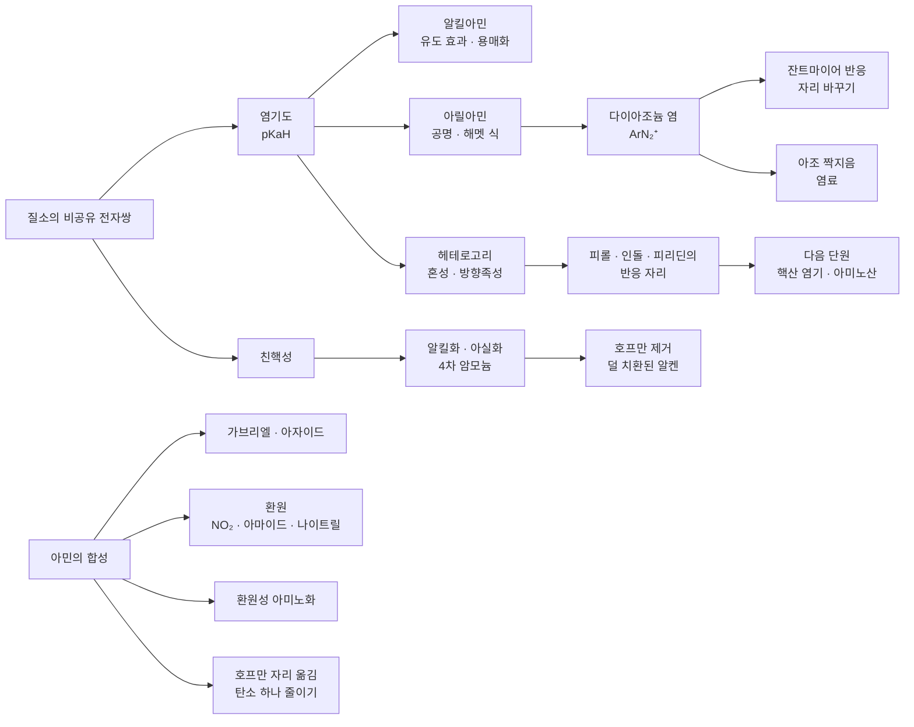

# 유기화학 13. 아민과 헤테로고리 화합물 — 질소의 비공유 전자쌍 하나가 정하는 염기도와 반응
<!-- prev: ochem-12, ochem-11, ochem-9, ochem-8, ochem-1 -->
<!-- next: ochem-14 -->

> [!NOTE]
> **이 단원의 범위**
> - 아민의 분류와 명명법, 피라미드 구조와 물리적 성질, 분광학적 특징(IR의 N–H 신축, 질량 스펙트럼의 α 절단)
> - 아민의 염기도: 알킬아민(기체와 용액의 순서, 유도 효과), 아릴아민(공명과 해멧 식), 헤테로고리 아민(혼성과 방향족성), 산–염기 추출
> - 아민의 합성: 암모니아 알킬화의 한계, 아자이드와 가브리엘 합성, 나이트로·아마이드·나이트릴·아자이드의 환원, 환원성 아미노화, 호프만 자리 옮김(커티어스 자리 옮김 포함)
> - 아민의 반응: 알킬화와 4차 암모늄 염, 아실화와 설폰아마이드, 호프만 제거(덜 치환된 알켄)와 코프 제거
> - 아질산과 아민, 아릴 다이아조늄 염의 치환(잔트마이어 반응, 슈만 반응, 페놀화, 탈아미노화)과 아조 짝지음(아조 염료, pH 의존성)
> - 헤테로고리의 반응성: 피롤·퓨란·싸이오펜(C2 치환), 인돌(C3 치환), 피리딘(C3의 친전자성 치환, C2·C4의 친핵성 치환, N-산화물), 퀴놀린·이미다졸·피리미딘·퓨린 개관

**학습 목표**

1. 아민을 1°·2°·3°·4차 암모늄으로 분류하고 이름을 붙이며, 피라미드 구조와 수소 결합으로 끓는점·용해도를 설명하고, IR·질량 스펙트럼으로 아민의 급수를 가릴 수 있다.
2. 알킬아민·아릴아민·헤테로고리 아민의 $\mathrm{p}K_\mathrm{aH}$를 유도 효과·공명·혼성·방향족성·용매화로 설명하고, 해멧 식과 분율식으로 염기도와 pH에 따른 양성자화 정도·추출 효율을 계산할 수 있다.
3. 1°·2°·3° 아민을 만드는 경로(가브리엘 합성, 아자이드 환원, 나이트로·아마이드·나이트릴 환원, 환원성 아미노화, 호프만 자리 옮김) 가운데 과알킬화를 피하고 탄소 수를 맞추는 경로를 골라 역합성으로 설계할 수 있다.
4. 아민의 아실화·설폰일화와 호프만 제거의 메커니즘을 쓰고, 호프만 제거가 덜 치환된 알켄을 주는 까닭을 이탈기와 전이 상태로 설명할 수 있다.
5. 아릴 다이아조늄 염의 생성 메커니즘(나이트로소늄 이온)과 잔트마이어 반응·아조 짝지음을 쓰고, 다이아조늄 염을 '자리 바꾸기 도구'로 써서 직접 치환으로 만들 수 없는 다치환 벤젠을 합성할 수 있다.
6. 피롤·인돌·피리딘의 친전자성·친핵성 치환 자리를 양이온·음이온 중간체의 공명 구조로 예측하고, 헤테로고리의 반응성을 벤젠과 비교할 수 있다.

**이 단원의 학습 사다리**

| 단계 | 무엇을 하나? |
|---|---|
| STEP 1. 이전 학습 다시 보기 | $\mathrm{p}K_\mathrm{aH}$와 혼성, 헤테로고리의 방향족성 판정, $\mathrm{S_N2}$와 E2, 친전자성 방향족 치환, 이민, 아마이드와 나이트릴 |
| STEP 2. 기초 다지기 | 분율식과 산–염기 추출, 해멧 식 되짚기, 질소 작용기의 산화 수준, C–N 결합의 역합성 |
| STEP 3. 핵심 개념 | 구조와 이름 → 알킬아민의 염기도 → 아릴·헤테로고리 아민의 염기도 → 직접 알킬화와 가브리엘 합성 → 환원으로 만드는 아민 → 환원성 아미노화 → 호프만 자리 옮김 → 아실화·설폰일화 → 호프만 제거 → 다이아조늄 염과 잔트마이어 반응 → 아조 짝지음 → 다섯 고리 헤테로고리와 인돌 → 피리딘과 그 친척 |
| STEP 4. 오개념 바로잡기 | "3° 아민이 언제나 가장 강한 염기이다", "피롤도 질소가 있으니 염기이다", "다이아조늄 이온의 N₂는 나쁜 이탈기이다" 같은 착각 |
| STEP 5. 대학원·연구로 | 팔라듐 촉매 C–N 짝지음(부흐발트–하트위그), 피리딘의 C–H 작용기화와 고리 합성 |
| STEP 6. 생활·산업·진로 | 의약품의 염 형태와 질소 헤테로고리, 아조 염료, 나일론의 다이아민, 나이트로소아민 불순물 관리 |

---

## 🗺️ 단원 들어가기

생선 비린내는 트라이메틸아민 $\mathrm{(CH_3)_3N}$의 냄새이다. 생선 요리에 레몬즙이나 식초를 뿌리면 비린내가 줄어드는 까닭을 우리는 이미 안다. 아민은 염기이고, 산을 만나면 암모늄 염 $\mathrm{(CH_3)_3NH^+}$이 된다. 이온은 휘발하지 않으므로 코에 닿지 않는다. 같은 일이 약국에서도 일어난다. 알약 성분표의 '○○ 염산염'은 대부분 아민 약물을 염산과 짝지어 물에 잘 녹고 오래 보관할 수 있게 한 것이다.

질소의 비공유 전자쌍 하나가 이 모든 것을 정한다. 이 전자쌍은 양성자를 받으면 **염기**, 탄소를 공격하면 **친핵체**가 된다. 그런데 같은 전자쌍이 벤젠 고리와 공명하면(아닐린) 염기도가 백만 분의 1로 줄고, 방향족 고리의 π계에 들어가 버리면(피롤) 아예 염기 노릇을 하지 않는다. 「구조와 결합, 산과 염기」에서 짝산의 $\mathrm{p}K_\mathrm{a}$로 염기도를 재는 법을, 「콘주게이션계와 방향족성」에서 피롤·피리딘의 전자쌍이 어디에 있는지를 이미 보았다. 이 단원은 그 두 가지를 출발점으로 삼아 아민을 **어떻게 만들고**, 아민으로 **무엇을 할 수 있는지**로 나아간다.

아민 합성의 첫 걸림돌은 의외로 "너무 반응을 잘한다"는 것이다. 암모니아에 할로젠화 알킬을 넣으면 생긴 아민이 다시 할로젠화 알킬을 공격해 섞인 생성물이 나온다. 그래서 유기화학자는 질소를 '한 번만 반응하는 형태'(아자이드, 프탈이미드, 이민, 아마이드)로 들여보낸 뒤 환원해 아민으로 바꾼다. 반대로 아민의 질소를 떼어 내는 길도 있다. 질소를 $\mathrm{-N_2^+}$로 바꾸면 가장 좋은 이탈기인 질소 기체가 떨어지면서, 벤젠 고리의 그 자리에 할로젠·사이아노기·하이드록시기·수소를 마음대로 넣을 수 있다. 마지막으로 질소가 고리 안으로 들어간 헤테로고리 — 피리딘·피롤·인돌·이미다졸·퓨린 — 는 DNA의 염기, 비타민, 그리고 시판 의약품의 대다수를 이루는 뼈대이다.

---

## STEP 1. 🔙 이전 학습 다시 보기

### 연계 개념표

| 이전 단원 | 그때 배운 것 | 이 단원에서 확장되는 것 |
|---|---|---|
| 일반화학 「산·염기와 수용액 평형」 '약염기' | $K_b$, $\mathrm{p}K_a + \mathrm{p}K_b = 14.00$(25 ℃), 메틸아민 수용액의 pH | 염기도를 **짝산의 $\mathrm{p}K_\mathrm{a}$**($\mathrm{p}K_\mathrm{aH}$) 하나로 통일, 구조로 $\mathrm{p}K_\mathrm{aH}$를 예측 |
| 유기화학 「구조와 결합, 산과 염기」 '염기의 세기', '산도를 정하는 요인' | 메틸아민 10.6 > 피리딘 5.2 > 아닐린 4.6 > 아마이드, 혼성(s 성격)과 공명이 전자쌍을 붙든다 | 1°·2°·3° 아민의 순서가 기체와 물에서 다른 까닭(용매화), 치환 아닐린의 정량 예측(해멧 식) |
| 유기화학 「입체화학」 '탄소 아닌 입체 중심' | 아민 질소의 피라미드 반전(약 25 kJ/mol), 4차 암모늄 이온은 분할된다 | 피라미드 구조를 물리적 성질·반응성과 연결 |
| 유기화학 「유기 반응의 개관과 알킬 할라이드의 치환·제거 반응」 '$\mathrm{S_N2}$', 'E2' | 아자이드 이온의 $\mathrm{S_N2}$, 부피 큰 염기의 호프만 생성물 | 아민의 **과알킬화**, 아자이드 → 아민, 이탈기가 $\mathrm{-NR_3^+}$인 **호프만 제거** |
| 유기화학 「콘주게이션계와 방향족성」 '방향족 이온과 헤테로고리' | 피리딘형 N(전자쌍은 π계 밖)과 피롤형 N(π계 안), 짝산 $\mathrm{p}K_\mathrm{a}$ 표, 이미다졸 | 같은 판정을 **반응 자리**(피롤 C2, 인돌 C3, 피리딘 C3·C2·C4)의 예측으로 확장 |
| 유기화학 「방향족 화합물의 반응」 '나이트로 → 아민', '너무 센 활성화기', '친핵성 방향족 치환' | $\mathrm{ArNO_2 \rightarrow ArNH_2}$, 아닐린의 과반응과 아세트아닐라이드 보호, 마이젠하이머 착물 | 아닐린 → **다이아조늄 염** → 여러 작용기로 바꾸기, 피리딘의 친핵성 치환 |
| 유기화학 「알데하이드와 케톤」 '이민과 엔아민' | 1° 아민 → 이민, 2° 아민 → 엔아민, 이민 생성의 pH 의존성 | 이민·이미늄 이온을 **그 자리에서 환원**하는 환원성 아미노화 |
| 유기화학 「카복실산과 그 유도체」 '아마이드와 나이트릴', '환원' | 산 염화물 + 아민 → 아마이드, $\mathrm{LiAlH_4}$로 아마이드·나이트릴 → 아민 | 아마이드에서 탄소 하나를 빼는 **호프만 자리 옮김**, 아민 합성 경로의 비교 |

### 준비 운동 (사전 진단)

**Q1.** 메틸아민의 짝산 $\mathrm{CH_3NH_3^+}$의 $\mathrm{p}K_\mathrm{a}$는 10.6이다. 메틸아민의 $\mathrm{p}K_\mathrm{b}$와 $K_b$를 구하시오(25 ℃).

**Q2.** 피리딘과 피롤 가운데 염기인 것은? 다른 하나에 양성자가 질소에 붙기 어려운 까닭을 '방향족성'이라는 말을 써서 한 문장으로 쓰시오.

**Q3.** 1-브로모뷰테인에 아자이드화 나트륨을 DMF에서 반응시킨 생성물을 쓰고, 이 반응의 메커니즘 이름을 쓰시오.

**Q4.** 사이클로헥산온과 메틸아민을 약산성 조건에서 반응시킨 생성물의 작용기 이름과, 그 생성물에 $\mathrm{H_2}$와 Pd 촉매를 작용시키면 무엇이 될지 예상하시오.

정답 및 해설

**Q1.** $\mathrm{p}K_\mathrm{b} = 14.00 - 10.6 = 3.4$, $K_b = 10^{-3.4} \approx 4\times10^{-4}$. 이 단원에서는 $\mathrm{p}K_\mathrm{b}$ 대신 $\mathrm{p}K_\mathrm{aH} = 10.6$을 그대로 쓴다. 값이 클수록 강한 염기이다.

**Q2.** 피리딘. 피롤의 질소 전자쌍은 고리의 방향족 6 π 전자에 들어가 있으므로, 그 전자쌍에 양성자가 붙으면 질소가 $sp^3$이 되면서 방향족성을 잃는다.

**Q3.** 1-아자이도뷰테인 $\mathrm{CH_3CH_2CH_2CH_2N_3}$(뷰틸 아자이드). $\mathrm{S_N2}$. ④에서 이것을 환원해 뷰탄-1-아민을 얻는다.

**Q4.** 이민(N-메틸사이클로헥산-1-이민). C=N이 환원되면 N-메틸사이클로헥산아민 $\mathrm{C_6H_{11}NHCH_3}$이 된다. 이민을 만들면서 동시에 환원하는 것이 ⑥의 환원성 아미노화이다.

---

## STEP 2. 🧱 기초 다지기

### 디딤돌 1. 분율식과 산–염기 추출 — pH 하나로 아민을 옮긴다

아민 B와 짝산 $\mathrm{BH^+}$의 비는 헨더슨–하셀바흐 식으로 정해진다(「알데하이드와 케톤」 디딤돌 1).

$$
\frac{[\mathrm{B}]}{[\mathrm{BH^+}]} = 10^{\,\mathrm{pH} - \mathrm{p}K_\mathrm{aH}}, \qquad f_\mathrm{B} = \frac{1}{1 + 10^{\,\mathrm{p}K_\mathrm{aH} - \mathrm{pH}}}
$$

$f_\mathrm{B}$는 자유 아민(중성)의 분율이다. pH가 $\mathrm{p}K_\mathrm{aH}$보다 2 낮으면 아민의 99 %가 암모늄 이온이고, 2 높으면 99 %가 자유 아민이다.

이 분율이 **산–염기 추출**의 원리이다. 물과 섞이지 않는 유기 용매(다이에틸 에터, 아세트산 에틸, 다이클로로메테인)와 물을 함께 흔들면, 중성 아민 B는 유기층으로 잘 가지만 이온 $\mathrm{BH^+}$는 물층에 남는다. 중성 분자의 **분배 계수** $P = [\mathrm{B}]_\text{유기}/[\mathrm{B}]_\text{물}$에 대하여, 물층의 모든 형태를 합쳐 센 **분배비**는

$$
D = \frac{[\mathrm{B}]_\text{유기}}{[\mathrm{B}]_\text{물} + [\mathrm{BH^+}]_\text{물}} = P\,f_\mathrm{B}
$$

이다($\mathrm{BH^+}$는 유기층에 들어가지 않는다고 본다). 같은 부피의 두 층을 한 번 흔들었을 때 유기층으로 옮겨 간 분율은 $E = D/(1 + D)$이다.

#### 예제 1 — 벤질아민은 언제 유기층으로 가는가

벤질아민 $\mathrm{C_6H_5CH_2NH_2}$($\mathrm{p}K_\mathrm{aH}$ 9.34, 에터/물 분배 계수 $P = 20$으로 둔다)을 같은 부피의 에터와 수용액으로 한 번 추출한다. 수용액의 pH가 (1) 2.0, (2) 7.0, (3) 12.0일 때 유기층으로 옮겨 가는 분율 $E$를 구하시오.

**풀이**
식 세우기: $f_\mathrm{B} = 1/(1 + 10^{9.34 - \mathrm{pH}})$, $D = 20f_\mathrm{B}$, $E = D/(1 + D)$.

| pH | $f_\mathrm{B}$ | $D$ | $E$ |
|---|---|---|---|
| 2.0 | $4.6\times10^{-8}$ | $9.1\times10^{-7}$ | 사실상 0 |
| 7.0 | $4.6\times10^{-3}$ | 0.091 | 0.083 (약 8 %) |
| 12.0 | 0.998 | 20.0 | 0.95 |

**의미** 묽은 염산으로 씻으면 아민은 물층으로 '끌려 들어가고', 그 물층을 NaOH로 염기성(pH 12)으로 만든 뒤 에터로 다시 추출하면 아민만 되돌아 나온다. 중성 유기물(예: 나프탈렌)은 어느 pH에서도 유기층에 남고, 카복실산은 반대로 염기성 물층으로 간다. 이 원리로 세 성분을 나누는 실험을 탐구 활동 A에서 한다. 생체에서도 같은 일이 일어난다. 세포막은 '유기층'이어서 중성 아민만 통과한다(STEP 6).

<!-- 시뮬레이션 요청: 아민의 pH–분율·추출 탐색기. 슬라이더: 수용액 pH(0~14), 아민의 pKaH(0~12; 미리 설정 단추: 아닐린 4.6, 피리딘 5.2, 이미다졸 7.0, 벤질아민 9.34, 트라이에틸아민 10.75, 피페리딘 11.1), 분배 계수 log P(−1~4), 유기층/물층 부피비(0.2~5), 추출 횟수(1~4). 위 그래프: 가로축 pH, 세로축 분율(0~1), 곡선 f_B(자유 아민)와 1 − f_B(암모늄 이온)이 pKaH에서 0.5로 교차, 현재 pH에 세로선. 아래 그림: 분액 깔때기 두 층(위 유기층·아래 물층, 에터 기준)에 B 분자(파란 점)와 BH⁺(빨간 점)이 계산된 비율대로 흩어져 있고, 옆에 'E = 유기층으로 옮겨 간 분율' 숫자. 같은 그림에 선택 단추로 카복실산(pKa 4.2)과 중성 화합물을 함께 넣어 세 성분이 pH에 따라 어느 층으로 가는지 비교. -->

### 디딤돌 2. 해멧 식 되짚기 — 치환 아닐린의 염기도를 숫자 하나로

「카복실산과 그 유도체」 ②에서 벤조산의 이온화로 치환기 상수 $\sigma$를 정의하고, 다른 반응에서도 $\log(K_\mathrm{X}/K_\mathrm{H}) = \rho\sigma_\mathrm{X}$가 성립함을 보았다. 아닐리늄 이온 $\mathrm{X{-}C_6H_4NH_3^+}$의 산 해리에 적용하면

$$
\mathrm{p}K_\mathrm{aH}(\mathrm{X}) = \mathrm{p}K_\mathrm{aH}(\mathrm{H}) - \rho\,\sigma_\mathrm{X}, \qquad \mathrm{p}K_\mathrm{aH}(\mathrm{H}) = 4.60,\ \ \rho \approx 2.89\ (\text{물, }25\,^\circ\mathrm{C})
$$

이다. $\rho$가 벤조산(1.00)의 약 3배인 것은 반응 중심(N)이 고리에 **바로** 붙어 있기 때문이다(벤조산은 C=O 탄소 하나를 사이에 둔다). 전자 끄는 기($\sigma > 0$)는 $\mathrm{p}K_\mathrm{aH}$를 낮춘다(염기를 약하게 한다).

#### 예제 2 — 3-클로로아닐린의 $\mathrm{p}K_\mathrm{aH}$ 예측

$\sigma_\mathrm{m}(\mathrm{Cl}) = 0.37$, $\sigma_\mathrm{p}(\mathrm{CH_3}) = -0.17$을 써서 3-클로로아닐린과 4-메틸아닐린(p-톨루이딘)의 $\mathrm{p}K_\mathrm{aH}$를 예측하고 실측값(3.52, 5.08)과 비교하시오.

**풀이**
3-클로로아닐린: $4.60 - 2.89\times0.37 = 4.60 - 1.07 = 3.53$ (실측 3.52).
4-메틸아닐린: $4.60 - 2.89\times(-0.17) = 4.60 + 0.49 = 5.09$ (실측 5.08).
**의미** 해멧 식은 메타·파라 치환 아닐린 대부분을 0.1 단위 안에서 맞힌다. 그런데 4-나이트로아닐린에서는 크게 어긋난다. 그 까닭(직접 공명)이 ③의 핵심이다.

### 디딤돌 3. 질소 작용기의 산화 수준 — 환원에 전자가 몇 개 필요한가

질소는 −3(아민)부터 +3(나이트로기의 형식 산화수)까지 여러 산화 상태를 가진다. 아민을 환원으로 만들 때는 출발 작용기가 아민보다 몇 단계 '위'에 있는지를 세면 필요한 환원제의 양이 나온다. 산화수는 전기 음성도가 큰 원자에 결합 전자를 모두 준다고 보고 센다(C–N 결합 전자는 N에, N–H는 N에, N–O는 O에).

| 작용기 | 예 | N의 산화수 | 아민까지 필요한 전자 수 |
|---|---|---|---|
| 아민 | $\mathrm{C_6H_5NH_2}$ | −3 | 0 |
| 하이드록실아민 | $\mathrm{C_6H_5NHOH}$ | −1 | 2 |
| 나이트로소 | $\mathrm{C_6H_5N{=}O}$ | +1 | 4 |
| 나이트로 | $\mathrm{C_6H_5NO_2}$ | +3 | 6 |
| 아자이드 $\mathrm{RN_3}$ → $\mathrm{RNH_2 + N_2}$ | $\mathrm{C_4H_9N_3}$ | (평균) | 2 |
| 나이트릴 $\mathrm{RC{\equiv}N}$ → $\mathrm{RCH_2NH_2}$ | $\mathrm{CH_3CN}$ | −3 (탄소가 환원됨) | 4 (C의 산화수가 +3 → −1) |

나이트로기의 환원은 다음 반쪽 반응으로 정리된다.

$$
\mathrm{ArNO_2 + 6H^+ + 6e^- \longrightarrow ArNH_2 + 2H_2O}
$$

#### 예제 3 — 철 가루로 나이트로벤젠 환원하기

나이트로벤젠 12.3 g(123.11 g/mol)을 철 가루와 염산으로 아닐린(93.13 g/mol)까지 환원한다. 철은 $\mathrm{Fe^{2+}}$로 산화된다고 할 때 (1) 전체 반응식을 쓰고 (2) 필요한 철의 최소 질량(55.85 g/mol)과 (3) 아닐린의 이론 수득량을 구하시오.

**풀이**
(1) 철 1 mol이 전자 2 mol을 내므로 철 3 mol이 필요하다.

$$
\mathrm{C_6H_5NO_2 + 3Fe + 6H^+ \longrightarrow C_6H_5NH_2 + 3Fe^{2+} + 2H_2O}
$$

(2) 나이트로벤젠 $12.3/123.11 = 0.0999\ \mathrm{mol}$, 철 $3\times0.0999\times55.85 = 16.7\ \mathrm{g}$.
(3) $0.0999\times93.13 = 9.30\ \mathrm{g}$. 산성 용액에서는 아닐리늄 염($\mathrm{C_6H_5NH_3^+}$)으로 있으므로 NaOH로 염기성으로 만든 뒤 꺼낸다(디딤돌 1).
**의미** 같은 질량의 나이트로벤젠을 수소 기체로 환원하면 $\mathrm{H_2}$ 3 당량이 필요하다($\mathrm{ArNO_2 + 3H_2 \rightarrow ArNH_2 + 2H_2O}$). 산업에서는 촉매 수소화가 철 환원을 대부분 대신했다. 철 슬러지(산화철)가 남지 않기 때문이다.

### 디딤돌 4. C–N 결합의 역합성 — 어디를 끊고, 질소를 무엇으로 들여보낼까

아민을 역합성으로 볼 때는 질소에 붙은 C–N 결합 하나를 끊는다. 끊은 뒤 탄소 쪽이 **친전자체**(할로젠화 알킬, 카보닐 화합물, 카복실산 유도체)가 되고 질소 쪽이 **친핵체**가 된다. 질소 친핵체를 '날것'(암모니아·아민)으로 쓰면 과알킬화가 일어나므로, 한 번만 반응하도록 '포장된' 질소를 고른다.

| 표적의 질소 주변 | 끊을 결합 | 탄소 쪽 출발 물질 | 질소 쪽 시약 | 소절 |
|---|---|---|---|---|
| $\mathrm{R{-}CH_2{-}NH_2}$ (1°) | $\mathrm{CH_2{-}N}$ | $\mathrm{RCH_2Br}$ | 프탈이미드 음이온 또는 $\mathrm{N_3^-}$, 뒤에 해제·환원 | ④ |
| $\mathrm{R{-}CH_2{-}NH_2}$ (1°) | $\mathrm{R{-}CH_2}$ (탄소 하나 추가) | $\mathrm{RBr}$ | $\mathrm{CN^-}$, 뒤에 $\mathrm{LiAlH_4}$ | ⑤ |
| $\mathrm{R_2CH{-}NHR'}$ (2°) | $\mathrm{CH{-}N}$ | $\mathrm{R_2C{=}O}$ | $\mathrm{R'NH_2}$ + 환원제 | ⑥ |
| $\mathrm{R{-}CH_2{-}NR'_2}$ | $\mathrm{CH_2{-}N}$ | $\mathrm{RCOCl}$ | $\mathrm{R'_2NH}$, 뒤에 $\mathrm{LiAlH_4}$(아마이드 환원) | ⑤ |
| $\mathrm{Ar{-}NH_2}$ | $\mathrm{Ar{-}N}$ | $\mathrm{ArH}$ | $\mathrm{HNO_3/H_2SO_4}$, 뒤에 환원 | ⑤ |
| $\mathrm{R{-}NH_2}$, R이 3°이거나 탄소 하나가 줄어든 골격 | $\mathrm{R{-}N}$ | $\mathrm{RCONH_2}$ | $\mathrm{Br_2}$, NaOH | ⑦ |

#### 예제 4 — 같은 아민, 세 가지 끊기

사이클로헥실메테인아민 $\mathrm{C_6H_{11}CH_2NH_2}$를 만드는 경로를 세 가지 제안하시오.

**풀이**
① $\mathrm{CH_2{-}N}$을 끊는다 → (브로모메틸)사이클로헥세인 + 프탈이미드 칼륨, 뒤에 하이드라진(가브리엘 합성, ④).
② 같은 결합을 끊되 탄소 쪽을 카보닐로 → 사이클로헥세인카브알데하이드 + $\mathrm{NH_3}$, $\mathrm{H_2}$/Ni 또는 $\mathrm{NaBH_3CN}$(환원성 아미노화, ⑥).
③ $\mathrm{C_6H_{11}{-}CH_2}$를 끊는다 → 브로모사이클로헥세인 + $\mathrm{CN^-}$ → 사이클로헥세인카보나이트릴 → $\mathrm{LiAlH_4}$(⑤). 다만 2° 할로젠화 알킬의 $\mathrm{S_N2}$는 E2와 경쟁하므로, 실제로는 사이클로헥세인카복실산 → 아마이드 → $\mathrm{LiAlH_4}$ 환원 쪽이 깔끔하다.
**의미** 한 표적에 길이 여럿 있을 때는 ① 과알킬화가 없는가 ② 탄소 수가 맞는가 ③ 출발 물질의 $\mathrm{S_N2}$가 잘 되는가(1°인가) ④ 다른 작용기가 환원제를 견디는가를 차례로 따진다.

---

## STEP 3. 📘 핵심 개념

### ① 아민의 구조와 이름, 성질과 스펙트럼

**아민(amine)** 은 암모니아의 수소를 탄소 원자단으로 바꾼 화합물이다. 「구조와 결합, 산과 염기」에서 본 대로 급수는 **질소에 붙은 탄소의 수**로 센다. 질소에 탄소 넷이 붙어 양전하를 띠면 **4차 암모늄 이온(quaternary ammonium ion)** 이다.

| 급수 | 일반식 | 예 (SMILES) | IUPAC 이름 (관용명) |
|---|---|---|---|
| 1° | $\mathrm{RNH_2}$ | `CCCCN` | 뷰탄-1-아민 (뷰틸아민) |
| 2° | $\mathrm{R_2NH}$ | `CCNCC` | N-에틸에탄아민 (다이에틸아민) |
| 3° | $\mathrm{R_3N}$ | `CCN(CC)CC` | N,N-다이에틸에탄아민 (트라이에틸아민) |
| 4차 | $\mathrm{R_4N^+X^-}$ | `C[N+](C)(C)C.[Br-]` | 브로민화 테트라메틸암모늄 |
| 아릴 | $\mathrm{ArNH_2}$ | `Nc1ccccc1` | 벤젠아민 (아닐린) |
| 고리형 2° | — | `C1CCNCC1` | 피페리딘 |

#### 이름 붙이기

- 1° 아민은 모체 알케인의 어미 '-에인(-ane)'의 '-e'를 '-아민(-amine)'으로 바꾸고 질소가 붙은 탄소의 위치 번호를 넣는다: $\mathrm{CH_3CH(NH_2)CH_2CH_3}$은 뷰탄-2-아민.
- 2°·3° 아민은 가장 긴 원자단을 모체로 삼고, 질소에 붙은 나머지 원자단을 **N-** 위치 기호와 함께 앞에 붙인다: $\mathrm{CH_3CH_2CH_2N(CH_3)_2}$는 N,N-다이메틸프로판-1-아민.
- 우선순위가 더 높은 작용기(카복실산, 에스터, 아마이드, 나이트릴, 카보닐, 알코올)가 있으면 아민은 접두사 **아미노-(amino-)** 가 된다: $\mathrm{H_2NCH_2CH_2OH}$은 2-아미노에탄올, $\mathrm{H_2NCH_2COOH}$은 아미노아세트산(글라이신).
- 아민의 짝산은 '-아미늄'(아닐리늄, 피리디늄)이나 '○○암모늄'으로 부른다. 의약품 이름의 '○○ 염산염(hydrochloride)'은 아민 + HCl의 암모늄 염이다.

#### 구조 — 피라미드와 뒤집힘

알킬아민의 질소는 $sp^3$에 가깝고 비공유 전자쌍이 네 번째 꼭짓점을 차지하는 **삼각뿔**(피라미드)이다. 트라이메틸아민의 C–N–C 각은 약 108°이다. 「입체화학」 ⑧에서 본 대로 이 피라미드는 평면 전이 상태를 지나 1초에 수억 번 **뒤집히므로**(장벽 약 25 kJ/mol), 세 원자단이 다른 아민도 분할되지 않는다. 반면 아닐린의 질소는 전자쌍이 고리와 공명하려고 평면 쪽으로 기울어(피라미드가 얕아져) $sp^2$와 $sp^3$의 중간이다. 이 차이가 ③의 염기도 차이로 이어진다.

<!-- 그림 요청: 아민 질소의 모양 세 칸. (가) 트라이메틸아민(SMILES CN(C)C)의 공–막대 3차원 구조: N 위에 비공유 전자쌍 엽(sp³), C–N–C 각 '약 108°'. (나) 아닐린(SMILES Nc1ccccc1): 고리 평면을 옆에서 본 그림, NH2가 고리 평면에서 조금만 기울어진 얕은 피라미드(평면과의 각 '약 40°'), N의 전자쌍 엽이 고리의 p 오비탈과 거의 나란히 겹치는 모습, 이름표 'sp²와 sp³의 중간 · 고리와 공명'. (다) 테트라메틸암모늄 이온(SMILES C[N+](C)(C)C): 정사면체, N에 ⊕, '전자쌍 없음 → 염기도·친핵성 없음'. -->

#### 물리적 성질 — 수소 결합은 하되 알코올보다 약하게

1°·2° 아민은 N–H로 수소 결합을 주고받지만, N이 O보다 전기 음성도가 작아 N–H···N 수소 결합은 O–H···O보다 약하다. 3° 아민은 수소 결합 주개가 없다. 그래서 분자량이 비슷한 화합물의 끓는점은 다음 순서가 된다.

| 화합물 (분자량) | 축약 구조식 | 끓는점 (℃, 약) | 분자 사이 수소 결합 |
|---|---|---|---|
| 뷰테인 (58) | $\mathrm{CH_3CH_2CH_2CH_3}$ | −0.5 | 없음 |
| 트라이메틸아민 (59) | $\mathrm{(CH_3)_3N}$ | 3 | 받개만(주개 없음) |
| N-메틸에탄아민 (59) | $\mathrm{CH_3CH_2NHCH_3}$ | 37 | N–H 1개 |
| 프로판-1-아민 (59) | $\mathrm{CH_3CH_2CH_2NH_2}$ | 48 | N–H 2개 |
| 프로판-1-올 (60) | $\mathrm{CH_3CH_2CH_2OH}$ | 97 | O–H, 더 강함 |

물에 대해서는 세 급수 모두 질소 전자쌍이 물의 O–H에서 수소 결합을 받으므로, 탄소 6개 정도까지의 아민은 물에 잘 녹는다. 작은 아민은 암모니아 냄새나 비린내가 나고, 1,5-다이아미노펜테인(카다베린)·1,4-다이아미노뷰테인(퓨트레신)은 썩은 고기 냄새의 원인이다.

#### 스펙트럼으로 아민 알아보기

「구조 결정: 질량 분석법과 분광법」의 도구로 아민을 다음과 같이 가린다.

| 방법 | 1° 아민 | 2° 아민 | 3° 아민 |
|---|---|---|---|
| IR N–H 신축 | 3300~3500 cm⁻¹에 **두 개**(대칭·비대칭), O–H보다 좁고 약하다 | 하나 | 없음 |
| IR N–H 굽힘 | 약 1600 cm⁻¹ | 약함 | 없음 |
| $^1\mathrm{H}$ NMR | N–H δ 약 0.5~3(넓음, $\mathrm{D_2O}$를 넣으면 사라짐), $\mathrm{CH{-}N}$ δ 약 2.3~3.0 | 같음 | $\mathrm{CH{-}N}$ δ 약 2.2~2.6 |
| $^{13}\mathrm{C}$ NMR | C–N δ 약 30~60 | 같음 | 같음 |
| 질량 분석 | 질소 1개 → 분자 이온 **홀수**(질소 규칙). **α 절단**으로 이미늄 이온이 기준 봉우리 | 같음 | 같음 |

**α 절단**은 아민 분자 이온에서 질소 바로 옆 탄소(α 탄소)와 그 이웃(β) 사이의 결합이 끊어져, 가장 큰 알킬 라디칼이 떨어지고 질소의 전자쌍이 양전하를 안정화하는 **이미늄 이온** $\mathrm{R_2C{=}N^+R_2}$이 남는 조각내기이다. $\mathrm{RCH_2NH_2}$꼴의 1° 아민은 $\mathrm{CH_2{=}NH_2^+}$(m/z 30)이 기준 봉우리가 된다.

<!-- 그림 요청: 뷰탄-1-아민(SMILES CCCCN)의 질량 스펙트럼 α 절단. 위: 분자 이온 라디칼 양이온 [CH3CH2CH2–CH2–NH2]•⁺ (N에 홀전자 하나와 ⊕), 반쪽 화살표(낚싯바늘 화살표) 3개: ① N의 홀전자 → C1–N 사이(새 π 결합 자리), ② C1–C2 결합 전자 하나 → C1–N 사이, ③ C1–C2 결합의 다른 전자 하나 → C2(떨어지는 프로필 라디칼 쪽). 생성물: CH2=NH2⁺ (m/z 30) + •CH2CH2CH3(중성, 검출 안 됨). 아래: 막대 스펙트럼 가로축 m/z 10~80, 막대 30(100 %, '기준 봉우리'), 73(분자 이온, 약 10 %), 44·56·58 작은 막대. -->

#### 예제 5 — $\mathrm{C_4H_{11}N}$ 이성질체 가리기

분자 이온이 m/z 73인 세 아민 A, B, C의 자료이다. 구조를 정하시오.
A: 기준 봉우리 m/z 30, IR 3370·3290 cm⁻¹(두 개). B: 기준 봉우리 m/z 58, IR 약 3280 cm⁻¹(하나), $^1\mathrm{H}$ NMR δ 1.1(t, 6H), 2.6(q, 4H), 약 1.0(넓은 s, 1H). C: 기준 봉우리 m/z 58, IR 두 개, $^1\mathrm{H}$ NMR δ 1.15(s, 9H), 약 1.2(넓은 s, 2H).

**풀이**
- 분자량 73은 홀수 → 질소 1개, $\mathrm{C_4H_{11}N}$은 불포화도 0.
- A: N–H 두 개 → 1°. m/z 30($\mathrm{CH_2{=}NH_2^+}$)은 $\mathrm{{-}CH_2NH_2}$가 있다는 뜻이다. 뷰탄-1-아민 또는 2-메틸프로판-1-아민이다(이 자료만으로는 둘을 가리지 못한다. NMR에서 메틸이 삼중선 3H인지 이중선 6H인지로 가린다).
- B: N–H 하나 → 2°. 대칭인 에틸기 두 개(t 6H, q 4H) → **다이에틸아민**. α 절단으로 $\mathrm{CH_3}$(15)가 떨어져 $\mathrm{CH_3CH_2NH{=}CH_2^+}$(m/z 58).
- C: 1°, 9H 단일선 → **2-메틸프로판-2-아민**(tert-뷰틸아민). α 탄소가 4°이므로 메틸 하나가 떨어져 $\mathrm{(CH_3)_2C{=}NH_2^+}$(m/z 58).
**의미** 질량 분석은 '질소 옆에 무엇이 있는가', IR은 '질소에 H가 몇 개인가', NMR은 '전체 골격'을 알려 준다. 뷰탄-2-아민이라면 α 탄소에서 더 큰 에틸 라디칼이 떨어져 m/z 44가 기준 봉우리가 된다.

#### ✔ 바로 확인

1. (O/X) 2-메틸프로판-2-아민 $\mathrm{(CH_3)_3CNH_2}$은 3차 아민이다.
2. $\mathrm{CH_3CH_2CH_2N(CH_3)_2}$의 IUPAC 이름은?
3. 프로판-1-아민, 트라이메틸아민, 프로판-1-올을 끓는점이 높은 것부터 늘어놓으시오.
4. 빈칸: 2° 아민의 IR 스펙트럼에는 3300~3500 cm⁻¹에 N–H 신축 띠가 (    )개 나타난다.

정답

1. X — 질소에 붙은 탄소가 하나이므로 1차 아민이다.
2. N,N-다이메틸프로판-1-아민
3. 프로판-1-올(97 ℃) > 프로판-1-아민(48 ℃) > 트라이메틸아민(3 ℃) — O–H 수소 결합 > N–H 수소 결합 > 수소 결합 주개 없음.
4. 1

### ② 알킬아민의 염기도 — 기체와 물에서 순서가 다른 까닭

염기도는 「구조와 결합, 산과 염기」에서 정한 대로 **짝산의 $\mathrm{p}K_\mathrm{a}$**($\mathrm{p}K_\mathrm{aH}$)로 나타낸다. 클수록 강한 염기이다.

| 아민 | 짝산 | $\mathrm{p}K_\mathrm{aH}$ (물, 25 ℃) | 기체상 양성자 친화도 (kJ/mol, 약) |
|---|---|---|---|
| 암모니아 $\mathrm{NH_3}$ | $\mathrm{NH_4^+}$ | 9.25 | 854 |
| 메틸아민 $\mathrm{CH_3NH_2}$ | $\mathrm{CH_3NH_3^+}$ | 10.64 | 899 |
| 다이메틸아민 $\mathrm{(CH_3)_2NH}$ | $\mathrm{(CH_3)_2NH_2^+}$ | 10.73 | 930 |
| 트라이메틸아민 $\mathrm{(CH_3)_3N}$ | $\mathrm{(CH_3)_3NH^+}$ | 9.80 | 949 |
| 에틸아민 | | 10.67 | |
| 다이에틸아민 | | 약 11.0 | |
| 트라이에틸아민 | | 10.75 | |
| 피페리딘 (고리형 2°) | | 11.1 | |
| 벤질아민 $\mathrm{C_6H_5CH_2NH_2}$ | | 9.34 | |
| 모폴린 (고리에 O) | | 8.4 | |
| 2,2,2-트라이플루오로에탄아민 $\mathrm{CF_3CH_2NH_2}$ | | 5.7 | |

(**양성자 친화도**는 기체에서 $\mathrm{B + H^+ \rightarrow BH^+}$의 $-\Delta H$이다.)

#### 기체에서는 깔끔하게 3° > 2° > 1° > NH₃

기체에서는 용매가 없으므로 염기도가 분자 자신의 성질만 반영한다. 알킬기는 수소보다 전자를 잘 밀어 주고(유도 효과), 더 중요하게는 크고 **분극되기 쉬워** 질소의 양전하를 넓게 퍼뜨린다. 메틸기가 하나 늘 때마다 양성자 친화도가 45, 31, 19 kJ/mol씩 커진다(효과는 점점 포화된다).

#### 물에서는 순서가 뒤엉킨다 — 용매화

물에서는 트라이메틸아민(9.80)이 메틸아민(10.64)보다 약한 염기이다. 짝산이 물에 어떻게 녹아 있는지가 다르기 때문이다. 암모늄 이온은 N–H 수소로 물 분자에 **수소 결합을 주어** 양전하를 안정화한다.

| 짝산 | 수소 결합을 줄 수 있는 N–H | 용매화에 의한 안정화 |
|---|---|---|
| $\mathrm{RNH_3^+}$ | 3개 | 가장 크다 |
| $\mathrm{R_2NH_2^+}$ | 2개 | 중간 |
| $\mathrm{R_3NH^+}$ | 1개 | 가장 작고, 알킬기가 물을 가로막기도 한다 |

알킬기가 늘면 **분자 자신의 효과**(염기도 증가)와 **용매화 효과**(짝산 안정화 감소)가 반대 방향으로 작용한다. 1°에서 2°까지는 앞의 것이 조금 이기고, 3°에서는 뒤의 것이 이긴다. 그 결과 물에서 알킬아민의 $\mathrm{p}K_\mathrm{aH}$는 모두 10~11 근처에 몰려 있다. 실용적인 결론은 "**단순 알킬아민은 급수와 관계없이 $\mathrm{p}K_\mathrm{aH}$ 약 10~11의 염기**"이다.

#### 유도 효과와 혼성

질소 근처에 전자 끄는 기가 있으면 염기도가 크게 떨어진다. $\mathrm{CF_3}$ 하나가 β 자리에 오면 $\mathrm{p}K_\mathrm{aH}$가 약 5 줄고(에틸아민 10.67 → 5.7), 모폴린의 고리 산소는 피페리딘(11.1)보다 약 2.7을 낮춘다. 벤질아민(9.34)도 $sp^2$ 탄소인 페닐기의 약한 유도 끌기 때문에 에틸아민보다 약하다. 혼성의 효과는 「구조와 결합, 산과 염기」에서 본 그대로이다: $sp^3$ N(아민, 약 10~11) > $sp^2$ N(피리딘·이민, 약 5~7) > $sp$ N(나이트릴, 약 −10).

**아마이드는 염기가 아니다.** 아마이드 질소의 전자쌍은 C=O와 공명해 있고(「카복실산과 그 유도체」), 강산에서 양성자는 N이 아니라 **카보닐 O**에 붙는다($\mathrm{p}K_\mathrm{aH}$ 약 −0.5). 그래서 아마이드를 만드는 아실화는 질소의 염기성·친핵성을 '꺼 두는' 보호법이 된다(⑧).

<!-- 그림 요청: 메틸아민 짝산 세 가지의 용매화 비교 그림. 왼쪽부터 CH3NH3⁺, (CH3)2NH2⁺, (CH3)3NH⁺ 을 공–막대로 그리고, 각 N–H 마다 물 분자 하나가 O 쪽으로 수소 결합(점선)을 받는 모습(각각 물 3, 2, 1개). 메틸기는 회색 구로 크게 그려 물이 다가가지 못하는 느낌. 아래에 두 줄 막대: '기체 양성자 친화도(kJ/mol): 899, 930, 949'(오른쪽으로 갈수록 커짐, 파랑), '물에서 pKaH: 10.64, 10.73, 9.80'(빨강, 오른쪽에서 꺾임). 화살표 이름표 '알킬기의 전자 공여 ↑' / '용매화 ↓'. -->

#### 예제 6 — 염기도 차이를 에너지로

25 ℃ 물에서 (1) 에틸아민(10.67)과 2,2,2-트라이플루오로에탄아민(5.7)의 짝산 해리 $\Delta G^\circ$ 차이를 구하시오. (2) 메틸아민과 트라이메틸아민의 기체상 양성자 친화도 차이(약 50 kJ/mol)가 물에서는 반대 방향의 $\mathrm{p}K_\mathrm{aH}$ 차이(−0.84)로 바뀐다. 물에서의 차이를 kJ/mol로 바꾸고, 용매화가 두 이온의 안정성에 얼마만큼의 차이를 만들었는지 어림하시오. ($2.303RT = 5.71\ \mathrm{kJ/mol}$)

**풀이**
(1) $\Delta\Delta G^\circ = 5.71\times(10.67 - 5.7) = 5.71\times4.97 = 28\ \mathrm{kJ/mol}$. $\mathrm{CF_3}$의 유도 끌기가 암모늄 이온을 28 kJ/mol 불안정하게 했다.
(2) 물에서 트라이메틸아민 쪽이 $5.71\times0.84 = 4.8\ \mathrm{kJ/mol}$ 불리하다. 기체에서는 약 50 kJ/mol 유리했으므로, 엔트로피 등을 무시하고 엔탈피만으로 어림하면 용매화가 메틸암모늄 이온을 트라이메틸암모늄 이온보다 약 $50 + 5 \approx 55\ \mathrm{kJ/mol}$ 더 안정하게 했다. N–H 수소 결합 두 개분의 크기이다.
**의미** 용액의 염기도는 '분자의 본성'과 '용매와의 상호작용'의 작은 차이이다. 수십 kJ/mol의 두 효과가 거의 상쇄되어 몇 kJ/mol의 차이만 남는다. 용매를 바꾸면(예: 비양성자성 용매) 순서가 다시 바뀌는 까닭이다.

#### ✔ 바로 확인

1. (O/X) 물에서 트라이메틸아민은 메틸아민보다 강한 염기이다.
2. 빈칸: 물에서 3° 암모늄 이온이 1° 암모늄 이온보다 덜 안정한 주된 까닭은 물에 줄 수 있는 (    )가 적기 때문이다.
3. 피페리딘(11.1)과 모폴린(8.4) 가운데 pH 9.0 완충 용액에서 더 많이 양성자화되는 것은?
4. 아세트아마이드에 강산을 넣을 때 양성자가 붙는 원자는?

정답

1. X — 기체에서는 강하지만 물에서는 $\mathrm{p}K_\mathrm{aH}$ 9.80으로 메틸아민(10.64)보다 약하다.
2. N–H 수소 결합(수소 결합 주개)
3. 피페리딘 — $\mathrm{p}K_\mathrm{aH}$가 pH보다 2.1 크므로 약 99 %가 양성자화된다(모폴린은 약 20 %).
4. 카보닐 산소 — N의 전자쌍은 C=O와 공명해 있다.

### ③ 아릴아민과 헤테로고리 아민의 염기도

#### 아닐린 — 전자쌍이 고리로 새어 나간다

사이클로헥산아민($\mathrm{p}K_\mathrm{aH}$ 10.64)과 아닐린(4.60)은 탄소 수가 같지만 염기도가 약 $10^6$배 다르다. 아닐린의 N 전자쌍은 벤젠 고리의 π계와 겹쳐 오쏘·파라 탄소로 비편재화된다(「방향족 화합물의 반응」에서 아닐린이 강한 오쏘·파라 활성화기였던 바로 그 공명). 양성자가 붙으면 전자쌍이 N–H 결합에 묶여 이 공명을 잃는다. 즉 **자유 아민이 공명으로 안정화되어 있고, 짝산에는 그 안정화가 없다.** 염기도 차이 6.0을 에너지로 바꾸면 $5.71\times6.04 \approx 34\ \mathrm{kJ/mol}$이다.

<!-- 그림 요청: 아닐린(SMILES Nc1ccccc1)의 공명 구조 다섯 개를 ↔ 로 잇기. ① 중성 케쿨레 구조 2개, ② N 전자쌍 → C(ipso)–N 사이, 고리 π → 오쏘 탄소로 가는 굽은 화살표로 만든 전하 분리 구조 3개(N에 ⊕, 오쏘 C 두 곳과 파라 C 한 곳에 각각 ⊖, C=N⁺H2 이중 결합). 오른쪽에 아닐리늄 이온 C6H5NH3⁺(SMILES [NH3+]c1ccccc1): N에 전자쌍 없음, '고리와 공명 불가'. 아래에 에너지 막대: 아닐린은 공명으로 내려가 있고 짝산은 그대로, 'pKaH 10.64 → 4.60 : 약 34 kJ/mol'. -->

#### 치환 아닐린 — 해멧 식과 직접 공명

디딤돌 2의 해멧 식이 대부분 잘 맞지만, 파라 자리의 강한 π 받개(나이트로기, 사이아노기)에서는 크게 어긋난다.

| 아닐린 | $\sigma$ | 해멧 예측 $\mathrm{p}K_\mathrm{aH}$ | 실측 $\mathrm{p}K_\mathrm{aH}$ |
|---|---|---|---|
| 4-메톡시아닐린 | −0.27 | 5.38 | 5.34 |
| 4-메틸아닐린 | −0.17 | 5.09 | 5.08 |
| 아닐린 | 0 | 4.60 | 4.60 |
| 4-클로로아닐린 | 0.23 | 3.94 | 3.98 |
| 3-나이트로아닐린 | 0.71 | 2.55 | 2.47 |
| 4-사이아노아닐린 | 0.66 | 2.69 | 1.74 |
| 4-나이트로아닐린 | 0.78 | 2.35 | 1.0 |

4-나이트로아닐린에서는 N의 전자쌍이 고리를 **관통해** 나이트로기의 산소까지 직접 들어간다($\mathrm{H_2N^+{=}C_6H_4{=}NO_2^-}$꼴의 공명 구조). 벤조산에서는 반응 중심(카복실기)이 전자를 고리로 내주지 않으므로 이 '관통 공명'이 $\sigma_\mathrm{p}$에 들어 있지 않다. 그래서 전자쌍 주개가 반응 중심인 반응에는 관통 공명을 반영한 **$\sigma^-$**(나이트로기 1.27, 사이아노기 1.00)를 쓴다. 그러면 예측이 $4.60 - 2.89\times1.27 = 0.93$(실측 1.0), $4.60 - 2.89\times1.00 = 1.71$(실측 1.74)로 맞는다.

다른 아릴아민의 값도 같은 논리로 읽는다. N,N-다이메틸아닐린(5.1)은 아닐린보다 조금 강하고, 다이페닐아민(0.8)은 전자쌍이 고리 두 개로 퍼져 훨씬 약하다. **아세트아닐라이드**는 아마이드여서 염기가 아니다.

#### 헤테로고리 아민 — 혼성과 방향족성

「콘주게이션계와 방향족성」 ⑧에서 피리딘(5.2), 피롤(약 −4, C2에 양성자화), 이미다졸(7.0), 피리미딘(1.3)의 값을 전자쌍의 위치로 설명했다. 여기에 포화 고리와 몇 가지를 더해 비교한다.

| 화합물 | N의 상태 | $\mathrm{p}K_\mathrm{aH}$ (약) | 판단 근거 |
|---|---|---|---|
| 피페리딘 | $sp^3$, 포화 고리 | 11.1 | 보통의 2° 아민 |
| 피리딘 | $sp^2$, 전자쌍은 고리 평면(π계 밖) | 5.2 | s 성격이 커서 전자쌍을 덜 내준다 |
| 4-(다이메틸아미노)피리딘(DMAP) | 고리 N | 9.6 | $\mathrm{Me_2N}$의 공명 공여가 고리 N의 양전하를 퍼뜨린다 |
| 2-아미노피리딘 | 고리 N에 양성자화 | 6.9 | 같은 공명(아미노 N이 아니라 고리 N이 염기 자리) |
| 퀴놀린 | 피리딘형 | 4.9 | 피리딘과 비슷 |
| 이미다졸 | 피리딘형 N3 | 7.0 | 양성자화된 이온이 두 N에 양전하를 대칭으로 나눈다 |
| 피롤리딘 | $sp^3$, 포화 고리 | 11.3 | 보통의 2° 아민 |
| 피롤 | 전자쌍이 방향족 π계 안 | 약 −4 | N에 붙으면 방향족성 상실, C2에 양성자화 |
| 인돌 | 전자쌍이 π계 안 | 약 −3.6 | C3에 양성자화 |

같은 오각 고리인 피롤리딘(11.3)과 피롤(약 −4)의 차이 15 자릿수가 '전자쌍이 방향족 π계에 들어가 있는가'의 크기이다.

<!-- 그림 요청: 질소 염기도의 사다리(세로축 pKaH, −5 ~ 12, 눈금 1). 왼쪽 열에 구조식과 값을 높이에 맞춰 배치: 피롤리딘(SMILES C1CCNC1) 11.3, 피페리딘(SMILES C1CCNCC1) 11.1, 트라이에틸아민 10.75, 사이클로헥산아민 10.64, DMAP(SMILES CN(C)c1ccncc1) 9.6, 벤질아민 9.34, 모폴린(SMILES C1COCCN1) 8.4, 이미다졸(SMILES c1c[nH]cn1) 7.0, 2-아미노피리딘(SMILES Nc1ccccn1) 6.9, 피리딘(SMILES c1ccncc1) 5.2, 아닐린 4.6, 4-나이트로아닐린(SMILES Nc1ccc(cc1)[N+](=O)[O-]) 1.0, 다이페닐아민 0.8, 아세트아마이드(O-양성자화) 약 −0.5, 인돌(SMILES c1ccc2[nH]ccc2c1) 약 −3.6, 피롤(SMILES c1cc[nH]c1) 약 −4. 각 구조의 염기 자리(양성자가 붙는 원자)를 빨간 원으로 표시(피롤은 C2, 인돌은 C3, 2-아미노피리딘은 고리 N, DMAP은 고리 N). 오른쪽에 세로 띠로 '생리적 pH 7.4' 가로선. -->

#### 예제 7 — DMAP은 왜 피리딘보다 만 배 강한 염기인가

(1) DMAP(9.6)과 피리딘(5.2)의 염기도 차이를 배수와 kJ/mol로 나타내시오. (2) DMAP이 고리 질소에서 양성자를 받은 짝산의 공명 구조를 써서 까닭을 설명하시오. (3) pH 7.4에서 DMAP과 피리딘의 양성자화 분율을 구하시오.

**풀이**
(1) $10^{4.4} \approx 2.5\times10^4$배, $5.71\times4.4 = 25\ \mathrm{kJ/mol}$.
(2) 고리 N–H⁺의 양전하가 파라 자리의 $\mathrm{Me_2N}$ 전자쌍과 공명해 $\mathrm{Me_2N^+{=}C}$ 구조로 퍼진다(아미딘과 같은 공명). 4번 자리의 아미노 N 쪽에 양성자가 붙으면 이 공명을 쓸 수 없으므로, 양성자는 고리 N에 붙는다.
(3) 양성자화 분율 $= 1/(1 + 10^{\,\mathrm{pH} - \mathrm{p}K_\mathrm{aH}})$. DMAP $1/(1 + 10^{-2.2}) = 0.994$(약 99 %), 피리딘 $1/(1 + 10^{2.2}) = 0.0063$(약 0.6 %).
**의미** 같은 '피리딘형 질소'도 고리에 붙은 치환기의 공명으로 염기도가 네 자릿수 달라진다. DMAP은 그 강한 전자쌍으로 아실화 촉매가 된다(⑧).

#### ✔ 바로 확인

1. (O/X) 아닐린이 사이클로헥산아민보다 약한 염기인 주된 까닭은 짝산인 아닐리늄 이온이 공명으로 불안정해지기 때문이다.
2. 4-나이트로아닐린의 $\mathrm{p}K_\mathrm{aH}$를 해멧 식으로 예측할 때 $\sigma_\mathrm{p}$ 대신 써야 하는 치환기 상수는?
3. 고르기: 더 강한 염기는? (가) 피롤과 피롤리딘 (나) 4-메톡시아닐린과 4-클로로아닐린
4. 2-아미노피리딘에서 양성자가 붙는 질소는?

정답

1. X — 자유 아민(아닐린)이 공명으로 **안정화**되어 있고 짝산은 그 안정화를 잃는다. 짝산이 불안정해지는 것이 아니다.
2. $\sigma^-$(나이트로기 1.27) — 전자쌍이 나이트로기까지 관통 공명한다.
3. (가) 피롤리딘 (나) 4-메톡시아닐린
4. 고리 질소 — 양전하가 아미노기의 전자쌍과 공명으로 퍼진다.

### ④ 질소를 직접 붙이기 — 과알킬화의 함정, 아자이드와 가브리엘 합성

#### 암모니아의 알킬화는 왜 멈추지 않는가

암모니아는 좋은 친핵체여서 1° 할로젠화 알킬과 $\mathrm{S_N2}$ 반응을 한다. 문제는 생성물이다. 생긴 1° 아민은 알킬기의 전자 공여로 암모니아보다 **조금 더 좋은 친핵체**이고, 염기도도 비슷해서 반응 혼합물 안에서 같은 할로젠화 알킬과 다시 반응한다.

$$
\mathrm{NH_3 \xrightarrow{RX} RNH_2 \xrightarrow{RX} R_2NH \xrightarrow{RX} R_3N \xrightarrow{RX} R_4N^+X^-}
$$

각 단계에서 생기는 HX는 남은 아민을 암모늄 염으로 잡아 간다. 결국 1°·2°·3° 아민과 4차 암모늄 염의 혼합물이 된다. 1° 아민을 원하면 암모니아를 아주 많이(수십 당량) 넣어 할로젠화 알킬이 생성물보다 암모니아를 만날 확률을 높이는 수밖에 없다. 반대로 끝까지 알킬화한 **4차 암모늄 염**은 깔끔하게 얻을 수 있다(⑨의 호프만 제거의 출발점). 실제로 직접 알킬화가 잘 쓰이는 경우는 메틸화로 4차 암모늄 염을 만들 때, 그리고 분자 안에서 고리를 닫을 때 정도이다.

#### 아자이드 — 한 번만 붙고, 환원하면 아민

**아자이드 이온** $\mathrm{N_3^-}$(아자이드화 나트륨 $\mathrm{NaN_3}$)은 작고 강한 친핵체이면서 염기성은 약하다(짝산 $\mathrm{HN_3}$의 $\mathrm{p}K_\mathrm{a}$ 약 4.7). 「유기 반응의 개관과 알킬 할라이드의 치환·제거 반응」에서 본 대로 1°·2° 할로젠화 알킬이나 토실레이트와 $\mathrm{S_N2}$ 반응을 해 **알킬 아자이드** $\mathrm{RN_3}$을 준다. 알킬 아자이드의 말단 질소는 더 이상 친핵성이 없어 과알킬화가 일어나지 않는다. 이것을 환원하면 질소 기체가 빠지며 1° 아민이 된다.

$$
\mathrm{RCH_2Br \xrightarrow{NaN_3,\ DMF} RCH_2N_3 \xrightarrow{1)\ LiAlH_4\quad 2)\ H_2O} RCH_2NH_2} \qquad (\text{또는 } \mathrm{H_2},\ \mathrm{Pd/C};\ \mathrm{PPh_3},\ \mathrm{H_2O})
$$

$\mathrm{S_N2}$ 단계에서 입체 배치가 반전되고 환원 단계에서는 C–N 결합이 건드려지지 않으므로, 카이랄 아민을 원하는 배치로 만들 수 있다. 예: (R)-2-브로모옥테인(SMILES `CCCCCC[C@@H](C)Br`) → (S)-2-아자이도옥테인 → (S)-옥탄-2-아민(SMILES `CCCCCC[C@H](C)N`).

> [!WARNING]
> **아자이드의 안전** 아자이드화 나트륨은 독성이 크고, 산과 만나면 독성·폭발성의 $\mathrm{HN_3}$ 기체를 낸다. 다이클로로메테인과 섞으면 폭발성 다이아자이도메테인이 생길 수 있고, 납·구리 배관에 버리면 폭발성 금속 아자이드가 쌓인다. 분자량이 작은 유기 아자이드(탄소 수/질소 수 비가 3보다 작은 것)는 충격·열에 폭발할 수 있으므로 소량을 용액 상태로만 다룬다.

#### 가브리엘 합성 — 프탈이미드로 감싼 질소

**가브리엘 합성(Gabriel synthesis)** 은 질소를 **프탈이미드**(SMILES `O=C1NC(=O)c2ccccc12`)로 감싸 들여보낸다. 프탈이미드의 N–H는 두 카보닐 사이에 있어 산성이 크다($\mathrm{p}K_\mathrm{a}$ 약 8.3). 짝염기의 음전하가 두 산소로 퍼지기 때문이다(β-다이카보닐 화합물의 엔올레이트와 같은 원리, 「카보닐 α 자리의 반응과 축합 반응」).

1. **탈양성자화**: 프탈이미드 + KOH(에탄올) → 프탈이미드 칼륨. 수산화 이온(물 $\mathrm{p}K_\mathrm{a}$ 15.7)으로 충분하다.
2. **알킬화($\mathrm{S_N2}$)**: 프탈이미드 음이온의 N 전자쌍 → 1° 할로젠화 알킬의 탄소(C–X 결합 전자쌍 → X) → N-알킬프탈이미드. 생성물의 질소는 두 카보닐과 공명해 있고 N–H도 없으므로 **두 번째 알킬화가 일어나지 않는다.**
3. **해제**: 하이드라진 $\mathrm{H_2NNH_2}$을 에탄올에서 가열하면(잉–맨스케 방법) 하이드라진이 두 카보닐을 차례로 친핵성 아실 치환해 고리 모양의 프탈하이드라자이드(SMILES `O=C1NNC(=O)c2ccccc12`, 침전)를 만들고 1° 아민이 풀려난다. 진한 산이나 염기로 가수 분해해도 되지만 조건이 거칠다.

$$
\mathrm{PhthN^-K^+ + RCH_2Br \longrightarrow PhthN{-}CH_2R \xrightarrow{H_2NNH_2,\ \Delta} RCH_2NH_2 + (\text{프탈하이드라자이드})}
$$

(Phth는 프탈로일기 $\mathrm{C_6H_4(CO)_2}$.) 친핵체가 크고 $\mathrm{S_N2}$로 들어가므로 메틸·1° 할로젠화 알킬에서 잘 되고, 2°에서는 느리며 3°와 할로젠화 아릴에서는 되지 않는다. 아미노산 합성에도 쓰인다(「생체 분자와 합성 고분자」).

<!-- 그림 요청: 가브리엘 합성 세 단계의 메커니즘. ① 프탈이미드(SMILES O=C1NC(=O)c2ccccc12) N–H를 HO⁻가 떼는 화살표(HO⁻ 전자쌍 → H, N–H 결합 → N) → 프탈이미드 음이온의 공명 구조 셋(음전하가 N, 왼쪽 O, 오른쪽 O). ② 음이온 N 전자쌍 → 브로민화 벤질(SMILES BrCc1ccccc1)의 CH2 탄소, C–Br 결합 → Br 화살표 2개 → N-벤질프탈이미드(SMILES O=C1N(Cc2ccccc2)C(=O)c2ccccc12) + Br⁻, 옆에 'N에 H 없음 · 전자쌍은 C=O와 공명 → 두 번째 알킬화 없음'. ③ 하이드라진 NH2 전자쌍 → 한쪽 카보닐 C, C=O π → O(사면체 중간체), 이어서 C–N(이미드) 결합이 끊어지며 고리가 열리고, 하이드라진의 다른 NH2가 두 번째 카보닐을 같은 방식으로 공격 → 프탈하이드라자이드(SMILES O=C1NNC(=O)c2ccccc12, '침전') + 벤질아민(SMILES NCc1ccccc1). -->

#### 예제 8 — 가브리엘 합성의 양과 과알킬화의 비교

브로민화 벤질 8.55 g(171.04 g/mol)과 프탈이미드 칼륨(185.22 g/mol) 1.00 당량으로 N-벤질프탈이미드(237.26 g/mol)를 만들고 하이드라진으로 벤질아민(107.16 g/mol)을 풀었다. (1) 필요한 프탈이미드 칼륨의 질량과 N-벤질프탈이미드의 이론 수득량은? (2) 두 단계의 수득률이 각각 90 %일 때 벤질아민은 몇 g 얻는가? (3) 같은 벤질아민을 브로민화 벤질과 암모니아 2 당량으로 만들려 하면 무엇이 문제인가?

**풀이**
(1) 브로민화 벤질 $8.55/171.04 = 0.0500\ \mathrm{mol}$. 프탈이미드 칼륨 $0.0500\times185.22 = 9.26\ \mathrm{g}$, N-벤질프탈이미드 $0.0500\times237.26 = 11.9\ \mathrm{g}$.
(2) $0.0500\times0.90\times0.90\times107.16 = 4.34\ \mathrm{g}$.
(3) 암모니아 1 당량은 HBr을 잡는 데 쓰여 친핵체로 남는 것이 적고, 생긴 벤질아민이 브로민화 벤질을 다시 공격해 다이벤질아민·트라이벤질아민이 섞인다. 1° 아민만 얻으려면 암모니아를 매우 많이 써야 한다.
**의미** 가브리엘 합성의 질소는 '알킬화될 수 있는 자리가 하나뿐인' 질소이다. 질소 원자 하나를 들여보내기 위해 147 g/mol짜리 프탈이미드를 쓰고 버리는 셈이지만, 생성물이 하나로 정해진다는 이점이 그 비용보다 크다.

#### ✔ 바로 확인

1. (O/X) 1-브로모뷰테인과 암모니아 1 당량을 반응시키면 뷰탄-1-아민만 깨끗이 얻는다.
2. 빈칸: 프탈이미드의 N–H가 산성($\mathrm{p}K_\mathrm{a}$ 약 8.3)인 까닭은 짝염기의 음전하가 두 (    ) 산소로 퍼지기 때문이다.
3. (S)-2-브로모옥테인을 $\mathrm{NaN_3}$으로 치환한 뒤 $\mathrm{LiAlH_4}$로 환원하면 생성물의 배치는?
4. 가브리엘 합성으로 2-메틸프로판-2-아민(tert-뷰틸아민)을 만들 수 없는 까닭은?

정답

1. X — 생긴 아민이 다시 알킬화되어 2°·3° 아민과 4차 암모늄 염이 섞인다.
2. 카보닐
3. (R)-옥탄-2-아민 — $\mathrm{S_N2}$에서 반전되고, 환원은 C–N 결합을 건드리지 않는다.
4. 2-브로모-2-메틸프로페인은 3° 할로젠화 알킬이어서 $\mathrm{S_N2}$가 되지 않고 제거(E2)가 일어난다.

### ⑤ 환원으로 만드는 아민 — 나이트로·아마이드·나이트릴·아자이드

질소가 이미 들어 있는 작용기를 환원하면 아민이 된다. 대부분은 앞 단원에서 배운 반응이므로, 여기서는 **어떤 아민이 생기는가(급수와 탄소 수)** 의 관점에서 한 표로 묶는다.

| 출발 작용기 | 시약 | 생성물 | 탄소 수 변화 | 앞 단원 |
|---|---|---|---|---|
| 나이트로 아렌 $\mathrm{ArNO_2}$ | $\mathrm{H_2}$, Pd/C 또는 Fe(Sn), HCl 뒤 NaOH | $\mathrm{ArNH_2}$ (1° 아릴) | 0 | 「방향족 화합물의 반응」 |
| 아마이드 $\mathrm{RCONR'_2}$ | 1) $\mathrm{LiAlH_4}$ 2) $\mathrm{H_2O}$ | $\mathrm{RCH_2NR'_2}$ (1°·2°·3° 모두 가능) | 0 (C=O → $\mathrm{CH_2}$) | 「카복실산과 그 유도체」 ⑨ |
| 나이트릴 $\mathrm{RC{\equiv}N}$ | 1) $\mathrm{LiAlH_4}$ 2) $\mathrm{H_2O}$, 또는 $\mathrm{H_2}$/라니 니켈 | $\mathrm{RCH_2NH_2}$ (1°) | 할로젠화 알킬보다 +1 | 「카복실산과 그 유도체」 ⑨ |
| 아자이드 $\mathrm{RN_3}$ | $\mathrm{LiAlH_4}$, $\mathrm{H_2}$/Pd, $\mathrm{PPh_3}$/$\mathrm{H_2O}$ | $\mathrm{RNH_2}$ (1°) | 0 | ④ |
| 옥심 $\mathrm{R_2C{=}NOH}$ | $\mathrm{H_2}$/Ni, $\mathrm{LiAlH_4}$ | $\mathrm{R_2CHNH_2}$ (1°) | 0 | 「알데하이드와 케톤」 ⑨ |
| 이민·이미늄 | ⑥의 환원성 아미노화 | 1°·2°·3° | 0 | ⑥ |

몇 가지를 되짚는다.

- **아마이드의 환원**은 아민 합성에서 가장 융통성이 크다. 산 염화물 + 아민(가아민 분해)으로 아마이드를 만들고 $\mathrm{LiAlH_4}$로 C=O를 $\mathrm{CH_2}$로 바꾸면, 질소에 원하는 원자단을 **한 번에 하나씩** 붙일 수 있다. 아마이드의 질소는 알킬화와 달리 두 번 아실화되지 않으므로 과반응이 없다. 사면체 중간체에서 질소가 아니라 산소(알루미늄 알콕사이드)가 떨어져 이미늄 이온이 생기고, 그것이 다시 수소화 이온을 받는다는 점이 에스터의 환원(알코올이 됨)과 다르다.
- **나이트릴 경로**는 할로젠화 알킬에 탄소 하나를 더한 1° 아민 $\mathrm{RCH_2NH_2}$을 준다($\mathrm{RBr \xrightarrow{NaCN} RCN \rightarrow RCH_2NH_2}$). 호프만 자리 옮김(⑦)이 탄소 하나를 빼는 것과 짝을 이룬다.
- **나이트로기의 환원**은 아릴아민을 만드는 거의 유일한 일반적 방법이다(아릴 할라이드는 $\mathrm{S_N2}$를 하지 않는다). 이렇게 만든 아닐린이 ⑩의 다이아조늄 염의 출발 물질이 된다.

<!-- 그림 요청: '아민으로 가는 길' 지도. 가운데에 세 표적: 1° 아민 RCH2NH2, 2° 아민 RCH2NHR′, 3° 아민 RCH2NR′2, 그리고 아릴아민 ArNH2. 바깥에서 화살표로 들어오는 출발 물질과 시약: RCH2Br → (NaN3 → LiAlH4) 또는 (프탈이미드 K, 하이드라진) → 1°; R–Br → (NaCN → LiAlH4) → RCH2NH2(이름표 '탄소 +1'); RCONH2 → LiAlH4 → RCH2NH2; RCONH2 → Br2, NaOH → RNH2(이름표 '탄소 −1', 다른 색); RCONHR′ → LiAlH4 → 2°; RCONR′2 → LiAlH4 → 3°; RCHO + R′NH2 → NaBH3CN → 2°; RCHO + R′2NH → NaBH(OAc)3 → 3°; ArH → HNO3/H2SO4 → ArNO2 → H2, Pd/C → ArNH2. 과알킬화 경로(RCH2Br + NH3)는 회색 점선과 '혼합물' 이름표. -->

#### 예제 9 — 출발 물질에 맞는 길 고르기

다음 변환의 시약을 쓰시오. (1) 1-브로모펜테인 → 헥산-1-아민 (2) 1-브로모펜테인 → 펜탄-1-아민 (3) 벤조산 → N-메틸-1-페닐메테인아민 $\mathrm{C_6H_5CH_2NHCH_3}$ (4) 톨루엔 → 4-메틸아닐린

**풀이**
(1) 탄소가 하나 늘었다 → $\mathrm{NaCN}$(DMSO, $\mathrm{S_N2}$)로 헥산나이트릴, 1) $\mathrm{LiAlH_4}$ 2) $\mathrm{H_2O}$.
(2) 탄소 수 그대로, 1° → 프탈이미드 칼륨 뒤 하이드라진(가브리엘), 또는 $\mathrm{NaN_3}$ 뒤 $\mathrm{LiAlH_4}$.
(3) 질소에 메틸, C=O 자리가 $\mathrm{CH_2}$ → $\mathrm{SOCl_2}$로 벤조일 클로라이드, 메틸아민 2 당량으로 N-메틸벤즈아마이드, 1) $\mathrm{LiAlH_4}$ 2) $\mathrm{H_2O}$.
(4) $\mathrm{HNO_3/H_2SO_4}$(메틸은 오쏘·파라 지향, 파라 이성질체 분리) → 4-나이트로톨루엔 → $\mathrm{H_2}$, Pd/C (또는 Fe, HCl 뒤 NaOH).
**의미** 생성물과 출발 물질의 **탄소 수**와 **질소에 붙은 원자단**을 먼저 비교하면 길이 거의 정해진다.

#### ✔ 바로 확인

1. 빈칸: 나이트릴을 $\mathrm{LiAlH_4}$로 환원하면 (    )° 아민이 생긴다.
2. (O/X) N,N-다이에틸아세트아마이드를 $\mathrm{LiAlH_4}$로 환원하면 에탄올과 다이에틸아민이 생긴다.
3. 1-브로모뷰테인에서 펜탄-1-아민을 만드는 두 단계 시약은?

정답

1. 1
2. X — 아마이드는 C=O가 $\mathrm{CH_2}$가 되어 3° 아민 N,N-다이에틸에탄아민(트라이에틸아민)이 된다. C–N 결합은 남는다.
3. $\mathrm{NaCN}$ → 1) $\mathrm{LiAlH_4}$ 2) $\mathrm{H_2O}$

### ⑥ 환원성 아미노화 — 이민을 만들면서 바로 환원한다

「알데하이드와 케톤」 ⑧·⑨에서 알데하이드·케톤이 1° 아민과 이민을, 2° 아민과 이미늄 이온(그리고 엔아민)을 만드는 것을 보았다. 그 C=N 결합을 반응 용기 안에서 곧바로 환원하면 C–N 단일 결합, 곧 아민이 된다. 이것이 **환원성 아미노화(reductive amination)** 이다.

$$
\mathrm{R_2C{=}O + R'NH_2 \underset{-H_2O}{\rightleftharpoons} R_2C{=}NR' \ (\text{또는 } R_2C{=}N^+HR') \xrightarrow{[H]} R_2CH{-}NHR'}
$$

| 질소 쪽 | 거치는 중간체 | 생성물 |
|---|---|---|
| $\mathrm{NH_3}$ (아세트산 암모늄) | 이민 $\mathrm{R_2C{=}NH}$ | 1° 아민 $\mathrm{R_2CHNH_2}$ |
| 1° 아민 $\mathrm{R'NH_2}$ | 이민·이미늄 | 2° 아민 $\mathrm{R_2CHNHR'}$ |
| 2° 아민 $\mathrm{R'_2NH}$ | 이미늄 $\mathrm{R_2C{=}N^+R'_2}$ | 3° 아민 $\mathrm{R_2CHNR'_2}$ |

#### 환원제를 고르는 논리 — 카보닐은 두고 이미늄만

반응 용기에는 카보닐 화합물, 아민, 이민(이미늄)이 함께 있다. 환원제가 카보닐까지 환원해 버리면 알코올이 부생성물로 생긴다. 그래서 **이미늄 이온은 빨리, 카보닐은 느리게** 환원하는 약한 수소화물 공여체를 쓴다.

- **사이아노수소화 붕소 나트륨** $\mathrm{NaBH_3CN}$: 사이아노기가 전자를 끌어 B–H의 수소화물 공여 능력이 $\mathrm{NaBH_4}$보다 훨씬 약하다. pH 6~7에서는 중성 카보닐을 거의 환원하지 못하지만, 양전하를 띠어 훨씬 친전자적인 **이미늄 이온**은 빨리 환원한다. 약산성은 이민 생성(「알데하이드와 케톤」의 pH 의존성)에도 알맞다. (산이 너무 세면 독성의 HCN이 나오므로 pH를 지키고 후드에서 다룬다.)
- **트라이아세톡시수소화 붕소 나트륨** $\mathrm{NaBH(OAc)_3}$: 아세톡시기 셋이 전자를 끌고 부피가 커서 더 순하다. 사이아노기가 없어 더 안전하므로 요즘 실험실에서 많이 쓴다(아세트산 촉매, 다이클로로에테인).
- **촉매 수소화** $\mathrm{H_2}$/Pd 또는 Ni: 산업 공정에서 쓴다. 다른 C=C도 환원될 수 있다.

<!-- 그림 요청: 사이클로헥산온(SMILES O=C1CCCCC1)과 에틸아민의 환원성 아미노화. 위 줄(이미늄 생성, 「알데하이드와 케톤」의 이민 생성 단계를 간략히): 사이클로헥산온 + CH3CH2NH2 ⇌ 카비놀아민 ⇌ (−H2O, H⁺) 이미늄 이온 C6H10=N⁺H–CH2CH3. 아래 줄(환원): NaBH3CN의 B–H 결합 전자쌍 → 이미늄 C(=N⁺의 탄소) 굽은 화살표, C=N⁺ π 결합 전자쌍 → N 굽은 화살표 → N-에틸사이클로헥산아민(SMILES CCNC1CCCCC1) + BH2CN. 옆에 비교 상자: 같은 NaBH3CN이 중성 사이클로헥산온 C=O를 공격하는 화살표는 회색 점선과 'pH 6~7에서 매우 느림', 이미늄 쪽은 굵은 화살표 '빠름 (양전하 → 강한 친전자체)'. -->

#### 예제 10 — 2° 아민을 두 방향에서

N-에틸사이클로헥산아민(SMILES `CCNC1CCCCC1`)을 환원성 아미노화로 만드는 두 조합을 쓰고, 각각에 필요한 시약을 제시하시오. 또 같은 표적을 사이클로헥산아민과 브로모에테인의 직접 알킬화로 만들 때의 문제를 쓰시오.

**풀이**
① 고리 쪽 C–N을 끊는다 → 사이클로헥산온 + 에틸아민, $\mathrm{NaBH_3CN}$(메탄올, pH 약 6) 또는 $\mathrm{NaBH(OAc)_3}$/AcOH.
② 에틸 쪽 C–N을 끊는다 → 사이클로헥산아민 + 에탄알(아세트알데하이드), 같은 환원제.
직접 알킬화는 생긴 2° 아민이 다시 브로모에테인과 반응해 N,N-다이에틸사이클로헥산아민(3°)과 4차 암모늄 염이 섞인다. 환원성 아미노화에서는 2° 아민 생성물이 알데하이드와 다시 반응할 수 있지만(이미늄 → 3° 아민), 아민을 조금 과량으로 쓰면 억제할 수 있다.
**의미** 환원성 아미노화는 '카보닐 화합물이 곧 알킬화제'인 방법이다. 할로젠화 알킬의 $\mathrm{S_N2}$로는 불가능한 2° 탄소–N 결합(①)도 쉽게 만든다. 의약품 합성에서 C–N 결합을 만드는 가장 흔한 반응 가운데 하나이다. 몸에서도 아미노기 전이 효소가 피리독살 인산(비타민 B₆)과 이민을 만들어 아미노산의 질소를 옮긴다(생화학 「아미노산·뉴클레오타이드 대사와 대사의 통합」).

> [!TIP]
> 💡 **요령** — 1°·2° 아민을 끝까지 메틸화해 3° 아민 $\mathrm{R{-}N(CH_3)_2}$을 만들 때는 폼알데하이드와 폼산을 함께 가열하는 **에슈바일러–클라크 반응**(Eschweiler–Clarke reaction)이 편하다. 폼알데하이드가 이미늄 이온을 만들고 폼산이 수소화 이온을 주며($\mathrm{CO_2}$로 빠져나감), 3° 아민에서는 더 이상 이미늄이 생기지 않으므로 4차 암모늄 염으로 넘어가지 않는다.

#### ✔ 바로 확인

1. 아세톤 + 메틸아민을 $\mathrm{NaBH_3CN}$으로 환원성 아미노화한 생성물의 이름은?
2. (O/X) $\mathrm{NaBH_3CN}$이 이민·이미늄 이온을 카보닐보다 빨리 환원하는 것은 이미늄 이온이 양전하를 띠어 더 강한 친전자체이기 때문이다.
3. 3° 아민 N,N-다이메틸사이클로헥산아민을 사이클로헥산온에서 한 단계로 만들려면 어떤 아민을 쓰는가?

정답

1. N-메틸프로판-2-아민 $\mathrm{(CH_3)_2CHNHCH_3}$
2. O
3. 다이메틸아민 — 이미늄 이온 $\mathrm{C_6H_{10}{=}N^+(CH_3)_2}$을 거쳐 환원된다.

### ⑦ 호프만 자리 옮김 — 탄소 하나를 떼어 내며 질소를 옮긴다

1° 아마이드 $\mathrm{RCONH_2}$에 브로민과 수산화 나트륨 수용액을 작용시켜 데우면, 카보닐 탄소가 $\mathrm{CO_2}$(탄산 이온)로 빠지고 **탄소가 하나 적은 1° 아민** $\mathrm{RNH_2}$이 생긴다. 이것이 **호프만 자리 옮김(Hofmann rearrangement)** 이다.

$$
\mathrm{RCONH_2 + Br_2 + 4\,OH^- \longrightarrow RNH_2 + CO_3^{2-} + 2Br^- + 2H_2O}
$$

#### 메커니즘

1. **N-브로민화**: 아마이드 N–H는 약한 산($\mathrm{p}K_\mathrm{a}$ 약 17)이어서 $\mathrm{HO^-}$가 일부 떼어 낸다. 아마이드 음이온의 N 전자쌍 → $\mathrm{Br{-}Br}$의 Br, Br–Br 결합 → 다른 Br. **N-브로모아마이드** $\mathrm{RCONHBr}$이 생긴다.
2. **두 번째 탈양성자화**: N에 Br과 카보닐이 함께 붙어 남은 N–H는 더 산성이 된다. $\mathrm{HO^-}$가 떼어 N-브로모아마이드 음이온 $\mathrm{RCON^-Br}$을 만든다.
3. **자리 옮김(속도 결정 단계)**: 한 단계에서 세 가지가 함께 일어난다. N의 음전하(전자쌍) → C–N 사이(새 C=N π 결합 자리), R–C(카보닐) 결합 전자쌍 → R이 N으로 옮겨 가며 새 R–N 결합, N–Br 결합 전자쌍 → Br(브로민화 이온이 떨어짐). 생성물은 **아이소사이아네이트** $\mathrm{R{-}N{=}C{=}O}$이다.
4. **물의 첨가**: $\mathrm{HO^-}$의 전자쌍 → 아이소사이아네이트의 가운데 탄소, C=N π → N. 양성자 이동으로 **카밤산** $\mathrm{RNHCOOH}$(염기 속에서는 카밤산 이온)이 된다.
5. **탈카복실화**: 카밤산은 불안정해 $\mathrm{CO_2}$를 내놓고 아민이 된다(염기 속에서 $\mathrm{CO_2}$는 탄산 이온으로 잡힌다).

3단계에서 R은 전자쌍을 데리고 옮겨 가며(카보닐 탄소에서 떨어지는 것과 질소에 붙는 것이 동시에), 옮겨 가는 탄소의 **입체 배치가 그대로 유지된다.** 「알데하이드와 케톤」의 바이어–빌리거 산화에서 R이 산소로 옮겨 갈 때 배치가 유지된 것과 같은 1,2-자리 옮김이다.

<!-- 그림 요청: 벤즈아마이드(SMILES NC(=O)c1ccccc1)의 호프만 자리 옮김 메커니즘 다섯 단계를 한 줄씩. ① HO⁻ 전자쌍 → N–H의 H, N–H 결합 → N → 아마이드 음이온 / 음이온 N 전자쌍 → Br–Br의 Br, Br–Br 결합 → 다른 Br(화살표 2개) → N-브로모벤즈아마이드 PhC(=O)NHBr. ② HO⁻ → N–H의 H, N–H 결합 → N → PhC(=O)N⁻Br. ③ 굽은 화살표 3개를 한 그림에: N의 비공유 전자쌍 → C–N 사이, 페닐–C(=O) 결합 → N(페닐이 질소로 이동, 이동하는 결합에 굵은 강조), N–Br 결합 → Br → 페닐 아이소사이아네이트 Ph–N=C=O(SMILES O=C=Nc1ccccc1) + Br⁻. ④ HO⁻ 전자쌍 → N=C=O의 가운데 C, C=N π → N → 양성자 이동 후 카밤산 PhNHCOOH. ⑤ 카밤산 이온에서 C–N 결합 전자쌍이 N으로 가며 CO2가 떨어지는 화살표 → 아닐린(SMILES Nc1ccccc1) + CO2(염기에서 CO3²⁻). 맨 아래 '탄소 수: 7 → 6'. -->

#### 커티어스 자리 옮김 — 같은 아이소사이아네이트, 다른 이탈기

산 염화물에 아자이드화 나트륨을 반응시키면 **아실 아자이드** $\mathrm{RCON_3}$이 생기고, 이것을 데우면 질소 기체가 떨어지면서 R이 질소로 옮겨 가 같은 아이소사이아네이트가 된다(**커티어스 자리 옮김**, Curtius rearrangement). 이탈기가 $\mathrm{Br^-}$ 대신 $\mathrm{N_2}$이고, 물이나 염기가 없는 중성 조건에서 일어난다는 점이 다르다. 그래서 생긴 아이소사이아네이트를 물 대신 알코올로 잡아 **카바메이트** $\mathrm{RNHCOOR'}$(아민의 보호기 형태, 「생체 분자와 합성 고분자」의 Boc·Cbz)로 얻을 수 있다.

$$
\mathrm{RCOCl \xrightarrow{NaN_3} RCON_3 \xrightarrow{\Delta,\ -N_2} R{-}N{=}C{=}O \xrightarrow{H_2O} RNH_2 + CO_2 \quad\text{또는}\quad \xrightarrow{R'OH} RNHCOOR'}
$$

#### 예제 11 — 입체 배치가 유지되는 자리 옮김

(S)-2-메틸뷰탄아마이드(SMILES `CC[C@H](C)C(N)=O`) 10.1 g(101.15 g/mol)을 $\mathrm{Br_2}$와 NaOH로 호프만 자리 옮김시켰다. (1) 생성물의 이름과 입체 배치를 쓰시오. (2) 필요한 $\mathrm{Br_2}$와 NaOH의 최소 몰수, 아민(73.14 g/mol)의 이론 수득량을 구하시오. (3) 같은 아민을 2-브로모뷰테인과 가브리엘 합성으로 만들 때 생기는 문제 두 가지를 쓰시오.

**풀이**
(1) 옮겨 가는 원자단은 입체 중심을 가진 sec-뷰틸기이고 배치가 유지된다. 생성물은 **(S)-뷰탄-2-아민**(SMILES `CC[C@H](C)N`). 입체 중심에서 $\mathrm{{-}CONH_2}$가 있던 자리에 $\mathrm{{-}NH_2}$가 그대로 들어간다. 두 원자단 모두 CIP 순위 1위이므로 기호도 S로 같다.
(2) 아마이드 $10.1/101.15 = 0.0999\ \mathrm{mol}$. $\mathrm{Br_2}$ 0.0999 mol(1 당량), NaOH $4\times0.0999 = 0.400\ \mathrm{mol}$. 아민 $0.0999\times73.14 = 7.30\ \mathrm{g}$.
(3) ① 2° 할로젠화 알킬이라 $\mathrm{S_N2}$가 느리고 E2(뷰텐)와 경쟁한다. ② $\mathrm{S_N2}$로 반전되므로 (S)-아민을 얻으려면 (R)-2-브로모뷰테인이 필요하다(라세미 출발 물질이면 라세미 아민).
**의미** 호프만·커티어스 자리 옮김은 3° 탄소에 붙은 아민(예: 1-아다만탄아민 계열)이나 카이랄 탄소에 붙은 아민처럼 $\mathrm{S_N2}$로는 만들기 어려운 아민을 카복실산 유도체에서 얻는 길이다.

#### ✔ 바로 확인

1. 헥산아마이드를 $\mathrm{Br_2}$, NaOH로 처리하면 생기는 아민은?
2. 빈칸: 호프만 자리 옮김에서 R이 옮겨 간 직후 생기는 중간체는 (    )이다.
3. (O/X) 호프만 자리 옮김에서 옮겨 가는 탄소의 입체 배치는 반전된다.
4. 커티어스 자리 옮김에서 떨어지는 이탈기는?

정답

1. 펜탄-1-아민 $\mathrm{CH_3(CH_2)_4NH_2}$ — 탄소가 하나 줄어든다.
2. 아이소사이아네이트 $\mathrm{R{-}N{=}C{=}O}$
3. X — 유지된다. R이 전자쌍을 데리고 같은 쪽 면으로 옮겨 간다.
4. 질소 기체 $\mathrm{N_2}$

### ⑧ 아민의 반응 Ⅰ — 아실화·설폰일화와 4차 암모늄 염

#### 아실화 — 한 번에 멈추는 질소

1°·2° 아민은 산 염화물·산 무수물과 친핵성 아실 치환을 해 아마이드가 된다(「카복실산과 그 유도체」 ⑥의 가아민 분해). 생긴 아마이드의 질소는 전자쌍이 C=O와 공명해 염기성도 친핵성도 거의 없으므로 **두 번째 아실화가 일어나지 않는다.** 알킬화와 정반대이다. 이 성질 때문에 아실화는

- 아민을 **보호**하는 방법이 되고(아닐린 → 아세트아닐라이드로 과반응·산화 방지, 「방향족 화합물의 반응」),
- 아마이드를 거쳐 $\mathrm{LiAlH_4}$로 환원하면 '한 번에 하나씩' 알킬화한 효과를 낸다(⑤).

3° 아민은 N–H가 없어 안정한 아마이드가 되지 못한다. 그 대신 **아실암모늄 이온**을 잠깐 만들었다가 다른 친핵체에 아실기를 넘겨준다. 이것을 촉매로 쓴 것이 **DMAP**이다. 알코올의 아세틸화에 DMAP을 조금 넣으면, DMAP의 고리 질소가 아세트산 무수물을 공격해 N-아세틸피리디늄 이온을 만들고(③에서 본 강한 전자쌍 공여 덕분에 빠르다), 이 이온이 무수물보다 훨씬 강한 아실화제로 알코올에 아세틸기를 넘기며 DMAP을 되돌려 준다. 피리딘만 쓸 때보다 속도가 수천 배 이상 빨라진다.

<!-- 그림 요청: DMAP 촉매 아세틸화의 촉매 순환. 순환 위쪽: DMAP(SMILES CN(C)c1ccncc1)의 고리 N 전자쌍 → 아세트산 무수물의 카보닐 C 화살표, π → O, 사면체 중간체에서 아세트산 이온이 떨어짐 → N-아세틸-4-(다이메틸아미노)피리디늄 이온(SMILES CC(=O)[n+]1ccc(cc1)N(C)C, 양전하가 Me2N=C 공명으로 퍼진 구조도 ↔로 함께). 순환 아래쪽: 알코올 R–OH의 O 전자쌍 → 아세틸 카보닐 C, 사면체 중간체에서 DMAP이 이탈 → 에스터 R–OAc + DMAP(재생) + H⁺(아세트산 이온/트라이에틸아민이 받음). 가운데 '촉매량 DMAP, 화학량론적 Et3N'. -->

#### 설폰일화와 힌스버그 시험

벤젠설폰일 클로라이드 $\mathrm{C_6H_5SO_2Cl}$도 1°·2° 아민과 반응해 **설폰아마이드** $\mathrm{C_6H_5SO_2NR_2}$를 만든다. 1° 아민에서 생긴 설폰아마이드 $\mathrm{C_6H_5SO_2NHR}$의 N–H는 강한 전자 끄는 설폰일기 때문에 산성($\mathrm{p}K_\mathrm{a}$ 약 10)이어서 NaOH 수용액에 음이온으로 녹는다. 이 차이로 세 급수를 가르는 것이 **힌스버그 시험**(Hinsberg test)이다.

| 아민 | NaOH 수용액 속 $\mathrm{C_6H_5SO_2Cl}$과의 반응 | 관찰 | 산성화하면 |
|---|---|---|---|
| 1° | $\mathrm{C_6H_5SO_2NHR}$ → 음이온 $\mathrm{C_6H_5SO_2N^-R}$ | 맑은 용액(녹음) | 설폰아마이드 침전 |
| 2° | $\mathrm{C_6H_5SO_2NR_2}$ (N–H 없음) | 녹지 않는 침전·기름 | 변화 없음 |
| 3° | 안정한 생성물 없음 | 아민이 그대로 남아 녹지 않음 | 아민이 암모늄 염으로 녹는다 |

설폰아마이드는 그 자체로 중요한 약물군이다. 최초의 합성 항균제인 설폰아마이드계 약물(설파닐아마이드, SMILES `Nc1ccc(cc1)S(N)(=O)=O`)은 세균의 엽산 합성에서 4-아미노벤조산을 흉내 낸다.

#### 4차 암모늄 염

3° 아민을 할로젠화 메틸 같은 반응성 큰 할로젠화 알킬로 알킬화하면 4차 암모늄 염이 된다(**멘슈트킨 반응**, Menshutkin reaction). 4차 암모늄 이온은 전자쌍이 없어 염기도 친핵체도 아니며, 산과 염기에 안정하다. 긴 사슬이 하나 붙은 것은 양이온 계면 활성제(소독제·섬유 유연제)로, 테트라뷰틸암모늄 같은 것은 물층의 음이온을 유기층으로 데려가는 **상 이동 촉매**로 쓰인다. 생체의 콜린 $\mathrm{(CH_3)_3N^+CH_2CH_2OH}$과 신경 전달 물질 아세틸콜린도 4차 암모늄 이온이다.

#### 예제 12 — 힌스버그 시험으로 이성질체 가리기

$\mathrm{C_7H_9N}$의 방향족 아민 세 가지 X, Y, Z가 있다. NaOH 수용액과 벤젠설폰일 클로라이드로 흔들었더니 X는 맑은 용액이 되었다가 HCl로 산성화하자 침전이 생겼고, Y는 기름 같은 불용성 생성물을 주었으며, Z는 반응하지 않고 남은 기름이 묽은 HCl에 녹았다. X, Y, Z의 구조로 가능한 것을 하나씩 쓰시오. (Z는 $\mathrm{C_7H_9N}$ 가운데 3° 아민이 없다는 점에 주의하라.)

**풀이**
- X: 1° 아민 → 4-메틸아닐린, 벤질아민 등(벤질아민 $\mathrm{C_6H_5CH_2NH_2}$도 $\mathrm{C_7H_9N}$이다).
- Y: 2° 아민 → N-메틸아닐린 $\mathrm{C_6H_5NHCH_3}$.
- Z: $\mathrm{C_7H_9N}$에는 질소에 탄소 셋이 붙을 수 있는 방향족 구조가 없다(N,N-다이메틸아닐린은 $\mathrm{C_8H_{11}N}$). 그러므로 Z가 정말 반응하지 않았다면 시료가 틀렸거나, 2,6-다이메틸피리딘(2,6-루티딘, SMILES `Cc1cccc(C)n1`, $\mathrm{C_7H_9N}$)처럼 N–H 없는 **헤테로고리 3° 아민**이다. 루티딘은 묽은 HCl에 피리디늄 염으로 녹는다.
**의미** 분자식과 시험 결과가 함께 '모순 없이' 맞아야 한다. 힌스버그 시험의 3° 판정에는 헤테로고리 질소도 포함된다.

#### ✔ 바로 확인

1. (O/X) 아민을 아세틸화하면 생긴 아마이드가 다시 아세틸화되어 이중 아실화물이 주로 생긴다.
2. 힌스버그 시험에서 NaOH 수용액에 녹는 설폰아마이드를 주는 아민의 급수는?
3. 빈칸: 3° 아민이 할로젠화 알킬과 반응해 4차 암모늄 염이 되는 반응을 (    ) 반응이라 한다.

정답

1. X — 아마이드 질소는 전자쌍이 C=O와 공명해 친핵성이 거의 없다.
2. 1° — 남은 N–H가 산성이어서 음이온으로 녹는다.
3. 멘슈트킨

### ⑨ 아민의 반응 Ⅱ — 호프만 제거와 코프 제거

아미노기 $\mathrm{NH_2^-}$는 매우 나쁜 이탈기이다(짝산 $\mathrm{NH_3}$의 $\mathrm{p}K_\mathrm{a}$ 약 38). 그러나 질소를 끝까지 메틸화해 **트라이메틸암모늄기** $\mathrm{{-}N^+(CH_3)_3}$로 만들면 중성 트라이메틸아민($\mathrm{p}K_\mathrm{aH}$ 9.8)으로 떨어질 수 있다. 할로젠화 알킬의 할로젠 자리에 이 기가 있는 셈이므로, 염기와 열로 E2 제거를 시킬 수 있다. 이것이 **호프만 제거(Hofmann elimination)** 이다.

1. **완전 메틸화**: 아민 + $\mathrm{CH_3I}$ 과량(1° 아민은 3 당량, 2°는 2 당량, 3°는 1 당량) → 아이오딘화 트라이메틸알킬암모늄.
2. **음이온 교환**: 산화 은 $\mathrm{Ag_2O}$와 물 → AgI가 침전되고 수산화 4차 암모늄 $\mathrm{R{-}N^+(CH_3)_3\ OH^-}$이 남는다(강염기 $\mathrm{HO^-}$를 반대 이온으로 붙여 놓는다).
3. **가열(약 100~200 ℃)**: $\mathrm{HO^-}$가 β-H를 떼고, C–N 결합이 끊어지며 알켄 + $\mathrm{(CH_3)_3N}$ + $\mathrm{H_2O}$.

#### 왜 덜 치환된 알켄이 생기는가

할로젠화 알킬의 E2는 보통 더 치환된(더 안정한) 알켄, 곧 **자이체프 생성물**을 준다. 호프만 제거는 반대로 **덜 치환된 알켄(호프만 생성물)** 을 준다.

$$
\mathrm{CH_3CH_2CH(CH_3){-}N^+(CH_3)_3\ OH^- \xrightarrow{\Delta} \underset{\text{주생성물}}{CH_2{=}CHCH_2CH_3} + CH_3CH{=}CHCH_3\ (\text{소량}) + N(CH_3)_3 + H_2O}
$$

| 요인 | 설명 |
|---|---|
| 나쁜 이탈기 → 'E1cB 쪽으로 기운' 전이 상태 | C–N 결합이 늦게 끊어지므로, 전이 상태에서 C–H가 먼저 많이 끊어져 β 탄소에 음전하가 쌓인다. 알켄의 안정성보다 **β-H의 산도**가 중요해지고, 탄소 음이온은 알킬기가 적은 쪽($\mathrm{CH_3} > \mathrm{CH_2} > \mathrm{CH}$)이 안정하다 |
| 부피 큰 이탈기 | $\mathrm{{-}N(CH_3)_3^+}$는 크다. 안쪽 β-H를 안티 준평면에 놓는 형태에서는 이탈기와 사슬의 알킬기가 부딪치므로, 바깥쪽 $\mathrm{CH_3}$의 H가 쉽게 접근된다(「유기 반응의 개관과 알킬 할라이드의 치환·제거 반응」의 부피 큰 염기와 같은 결과) |

이 반응은 질소를 포함한 천연물(알칼로이드)의 구조를 밝히는 데 오랫동안 쓰였다. 고리 속 질소에 이 반응을 두 번 하면 고리가 열리며 질소가 완전히 떨어져 나간다(예제 13).

<!-- 그림 요청: 호프만 제거의 위치 선택성 비교. 가운데에 (뷰탄-2-일)트라이메틸암모늄 이온(SMILES CCC(C)[N+](C)(C)C)의 뉴먼 투영식 두 개. 왼쪽: C2–C1 축을 따라 본 것, C1의 H가 N⁺Me3과 안티, 방해 없음 → HO⁻ 전자쌍 → H, C1–H → C1–C2 사이, C2–N 결합 → N 화살표 3개 → 뷰트-1-엔(SMILES C=CCC) '주생성물(호프만)'. 오른쪽: C2–C3 축, C3의 H가 N⁺Me3과 안티인 형태에서 C3의 CH3가 N⁺Me3 옆(고슈)에 붙어 '입체 방해' 빨간 표시 → 뷰트-2-엔(SMILES C/C=C/C) '소량'. 아래에 전이 상태 그림: C–H가 많이 끊어지고 C–N은 조금만 늘어난 상태, β 탄소에 δ⁻, 이름표 'E1cB 쪽 E2 전이 상태'. 비교로 2-브로모뷰테인 + EtO⁻ 는 뷰트-2-엔이 주생성물이라는 작은 상자. -->

#### 코프 제거 — 같은 방향, 다른 기하

3° 아민을 과산화 수소나 과산(mCPBA)으로 산화하면 **아민 산화물** $\mathrm{R_3N^+{-}O^-}$이 된다. 이것을 약 100~150 ℃로 데우면 산화물의 산소가 같은 쪽(신)의 β-H를 5원 고리 전이 상태로 떼어 내며 알켄과 N,N-다이알킬하이드록실아민이 생긴다(**코프 제거**, Cope elimination). 외부 염기가 필요 없는 **신 제거**이고, 호프만 제거처럼 덜 치환된 알켄이 주로 생긴다.

#### 예제 13 — 고리를 여는 호프만 제거 두 번

N-메틸피페리딘(SMILES `CN1CCCCC1`)을 (가) $\mathrm{CH_3I}$ 과량 → $\mathrm{Ag_2O}$, $\mathrm{H_2O}$ → 가열한 뒤, 생성물에 같은 과정을 한 번 더 했다. (1) 첫 번째와 두 번째 생성물을 쓰시오. (2) 전체에 쓰인 $\mathrm{CH_3I}$의 최소 당량은? (3) 피페리딘(N–H) 자체에서 출발하면 몇 당량이 필요한가?

**풀이**
(1) 1차: 아이오딘화 N,N-다이메틸피페리디늄 → 수산화물 → β-H(고리의 C3 쪽 H)가 떨어지며 C2–N 결합이 끊어져 고리가 열린다 → **N,N-다이메틸펜트-4-엔-1-아민** $\mathrm{CH_2{=}CHCH_2CH_2CH_2N(CH_3)_2}$(SMILES `C=CCCCN(C)C`).
2차: 이 3° 아민을 메틸화 → $\mathrm{{-}CH_2N^+(CH_3)_3}$, 제거 → **펜타-1,4-다이엔** $\mathrm{CH_2{=}CHCH_2CH{=}CH_2}$ + 트라이메틸아민.
(2) 1차 1 당량 + 2차 1 당량 = 2 당량.
(3) 피페리딘은 2° 아민이므로 1차 메틸화에 2 당량이 필요하다. 모두 3 당량.
**의미** 두 번의 호프만 제거는 고리 질소를 '잘라 내어' 탄소 골격만 남긴다. 탄소 사슬의 모양(펜타다이엔, 다섯 탄소)에서 원래 고리의 크기를 알 수 있다.

#### ✔ 바로 확인

1. (O/X) 호프만 제거는 자이체프 규칙을 따라 더 치환된 알켄을 주생성물로 준다.
2. 호프만 제거에서 $\mathrm{Ag_2O}$와 물을 쓰는 까닭은?
3. 빈칸: 아민 산화물이 가열로 β-H와 함께 떨어지는 신 제거를 (    ) 제거라 한다.
4. 2-메틸뷰탄-2-아민 $\mathrm{(CH_3)_2C(NH_2)CH_2CH_3}$을 호프만 제거하면 주생성물은?

정답

1. X — 덜 치환된 알켄(호프만 생성물)이 주생성물이다.
2. 아이오딘화 이온을 AgI로 침전시켜 없애고 반대 이온을 수산화 이온(염기)으로 바꾸기 위해서이다.
3. 코프
4. 2-메틸뷰트-1-엔 $\mathrm{CH_2{=}C(CH_3)CH_2CH_3}$ — 메틸기의 H(6개, 가장 산성이고 접근이 쉬움)가 떨어진다.

### ⑩ 아릴 다이아조늄 염 Ⅰ — 만들기와 잔트마이어 반응

#### 아질산과 나이트로소늄 이온

아질산 나트륨 $\mathrm{NaNO_2}$을 차가운 묽은 산(HCl, $\mathrm{H_2SO_4}$)에 넣으면 불안정한 **아질산** HONO가 생기고, 이것이 양성자를 받아 물을 잃으면 강한 친전자체인 **나이트로소늄 이온** $\mathrm{NO^+}$($\mathrm{{:}N{\equiv}O^+}$)이 된다.

$$
\mathrm{NaNO_2 + HCl \rightarrow HONO + NaCl}, \qquad \mathrm{HONO + H^+ \rightleftharpoons H_2O{-}NO^+ \rightleftharpoons H_2O + NO^+}
$$

1° 아릴아민이 $\mathrm{NO^+}$를 만나면 다음 단계를 거쳐 **아릴 다이아조늄 이온** $\mathrm{Ar{-}N^+{\equiv}N}$이 된다(**다이아조화**, diazotization).

1. 아민 N 전자쌍 → $\mathrm{NO^+}$의 N, N≡O의 π 하나 → O. 탈양성자화로 **N-나이트로소아민** $\mathrm{ArNH{-}N{=}O}$.
2. 양성자 이동(토토머화)으로 **다이아조하이드록사이드** $\mathrm{Ar{-}N{=}N{-}OH}$.
3. OH에 양성자가 붙고, N의 전자쌍 → N–N 사이(새 π 결합), N–O 결합 → O로 물이 떨어진다 → $\mathrm{Ar{-}N^+{\equiv}N}$.

반응은 **0~5 ℃**에서 한다. 아릴 다이아조늄 이온은 고리와 N≡N이 콘주게이션되어 차가운 수용액에서 잠시 안정하지만, 데우면 질소 기체를 내며 분해된다. **마른 다이아조늄 염은 충격에 폭발할 수 있으므로** 분리하지 않고 용액 그대로 다음 반응에 쓴다(테트라플루오로붕산염은 예외적으로 비교적 안정하다).

알킬아민의 경우는 다르다. 1° 알킬아민에서 생긴 알킬 다이아조늄 이온 $\mathrm{R{-}N_2^+}$은 콘주게이션 안정화가 없어 곧바로 $\mathrm{N_2}$를 잃고 **탄소 양이온**이 되므로, 치환·제거·자리 옮김 생성물의 혼합물이 된다(합성적 쓸모는 적다). 2° 아민(알킬·아릴 모두)은 1단계에서 멈춰 **N-나이트로소아민** $\mathrm{R_2N{-}N{=}O}$이 된다. N-나이트로소아민은 대부분 강한 **발암 물질**이다(STEP 6).

<!-- 그림 요청: 아닐린(SMILES Nc1ccccc1)의 다이아조화 메커니즘. 왼쪽 위: HONO의 OH 양성자화 → H2O–N=O⁺ → H2O 이탈 → NO⁺([N+]#O). ① 아닐린 N 전자쌍 → NO⁺의 N, N≡O π → O 화살표 2개 → Ph–N⁺H2–N=O → 탈양성자화(물이 H를 뗌) → N-나이트로소아닐린 Ph–NH–N=O. ② 양성자 이동 두 번(N–H의 H가 O로) → 다이아조하이드록사이드 Ph–N=N–OH. ③ OH에 H⁺, 그다음 N(Ph 쪽) 전자쌍 → N–N 사이, N–O 결합 → O(물 이탈) 화살표 2개 → 벤젠다이아조늄 이온(SMILES N#[N+]c1ccccc1). 오른쪽에 다이아조늄 이온의 공명 구조 Ar–N⁺≡N ↔ Ar–N=N⁺ 와 '0~5 ℃에서만, 마른 염은 폭발 위험' 경고 이름표. -->

#### 다이아조늄기를 바꾸는 반응 — $\mathrm{N_2}$는 최고의 이탈기

다이아조늄기가 떨어지면 매우 안정한 $\mathrm{N_2}$ 기체가 생긴다. 그래서 다이아조늄 이온은 친핵체와 만나 쉽게 치환된다. 일부는 아릴 양이온·아릴 라디칼을 거친다.

| 반응 | 시약 | 생성물 | 이름 |
|---|---|---|---|
| 염소화 | CuCl, HCl | $\mathrm{ArCl}$ | 잔트마이어 반응 |
| 브로민화 | CuBr, HBr | $\mathrm{ArBr}$ | 잔트마이어 반응 |
| 사이아노화 | CuCN, KCN | $\mathrm{ArCN}$ | 잔트마이어 반응 |
| 아이오딘화 | KI | $\mathrm{ArI}$ | (구리 필요 없음) |
| 플루오린화 | $\mathrm{HBF_4}$로 $\mathrm{ArN_2^+BF_4^-}$ 침전, 마른 뒤 가열 | $\mathrm{ArF + BF_3 + N_2}$ | 발츠–시만 반응 |
| 하이드록시화 | $\mathrm{H_2O}$, 가열(또는 $\mathrm{Cu_2O}$, $\mathrm{Cu(NO_3)_2}$) | $\mathrm{ArOH}$ | 페놀 합성 |
| 수소로 바꾸기 | 하이포아인산 $\mathrm{H_3PO_2}$ | $\mathrm{ArH}$ | 환원성 탈아미노화 |

**잔트마이어 반응(Sandmeyer reaction)** 에서는 구리(Ⅰ)가 전자 하나를 다이아조늄 이온에 주어 아릴 라디칼과 $\mathrm{N_2}$를 만들고($\mathrm{ArN_2^+ + Cu^IX \rightarrow Ar^\bullet + N_2 + Cu^{II}X^+}$), 아릴 라디칼이 구리(Ⅱ)에서 X를 받아 ArX가 되며 구리(Ⅰ)가 되돌아온다(라디칼–산화환원 순환).

이 표의 힘은 합성 설계에서 나온다. 「방향족 화합물의 반응」에서 치환기의 지향 효과 때문에 직접 만들 수 없던 배치가 있었다. 아미노기($\mathrm{-NH_2}$, 강한 오쏘·파라 지향)를 **지향기로 실컷 쓰고 나서** 다이아조늄 염을 거쳐 원하는 원자(심지어 H)로 바꾸면 된다.

#### 예제 14 — 다이아조늄 염으로 지향 효과를 '속이기'

(1) 벤젠에서 1,3,5-트라이브로모벤젠을 합성하시오. (2) 4-메틸아닐린에서 3-브로모톨루엔을 합성하시오. (3) (1)의 다이아조화 단계에서 다이아조늄 염 10.0 mmol이 $\mathrm{H_3PO_2}$와 완전히 반응할 때 25 ℃, 1 atm에서 나오는 질소 기체의 부피는? (몰 부피 24.5 L/mol)

**풀이**
(1) 세 Br이 서로 메타이다. Br은 오쏘·파라 지향이라 직접 넣을 수 없다. 벤젠 → $\mathrm{HNO_3/H_2SO_4}$ → $\mathrm{H_2}$, Pd/C(아닐린) → $\mathrm{Br_2}$, $\mathrm{H_2O}$(2,4,6-트라이브로모아닐린, 아미노기의 두 오쏘와 파라) → $\mathrm{NaNO_2}$, $\mathrm{H_2SO_4}$, 0 ℃ → $\mathrm{H_3PO_2}$(아미노기를 H로) → 1,3,5-트라이브로모벤젠(SMILES `Brc1cc(Br)cc(Br)c1`).
(2) 메틸과 Br이 메타이다. 4-메틸아닐린 → 아세트산 무수물(아세트아닐라이드로 과반응 방지) → $\mathrm{Br_2}$(아세트아마이드기의 오쏘, 곧 메틸의 메타) → 산 가수 분해(2-브로모-4-메틸아닐린, SMILES `Cc1ccc(N)c(Br)c1`) → $\mathrm{NaNO_2}$, HCl, 0 ℃ → $\mathrm{H_3PO_2}$ → 3-브로모톨루엔(SMILES `Brc1cccc(C)c1`).
(3) $\mathrm{ArN_2^+}$ 1 mol당 $\mathrm{N_2}$ 1 mol: $0.0100\times24.5 = 0.245\ \mathrm{L} = 245\ \mathrm{mL}$.
**의미** 아미노기는 '임시 지향기'이다. 다이아조늄 염을 거치면 넣었던 자리를 흔적 없이 지우거나, 직접 넣기 어려운 F·I·CN·OH로 바꿀 수 있다. (3)처럼 기체가 많이 나오므로 반응 용기는 열어 두고, 거품이 넘치지 않게 천천히 넣는다.

#### ✔ 바로 확인

1. 빈칸: 다이아조화에서 아민을 공격하는 친전자체는 (    ) 이온이다.
2. 벤젠다이아조늄 염화물을 CuCN과 반응시킨 생성물은?
3. (O/X) 1° 알킬아민도 아릴아민처럼 0 ℃에서 안정한 다이아조늄 염을 만든다.
4. 벤젠다이아조늄 염으로 플루오로벤젠을 만드는 시약은?

정답

1. 나이트로소늄($\mathrm{NO^+}$)
2. 벤조나이트릴 $\mathrm{C_6H_5CN}$
3. X — 알킬 다이아조늄 이온은 곧바로 $\mathrm{N_2}$를 잃어 탄소 양이온이 되고 혼합물을 준다.
4. $\mathrm{HBF_4}$(테트라플루오로붕산 다이아조늄염을 만든 뒤 가열, 발츠–시만 반응)

### ⑪ 아릴 다이아조늄 염 Ⅱ — 아조 짝지음과 아조 염료

다이아조늄 이온은 말단 질소가 약한 친전자체이다. 벤젠 자체와는 반응하지 않지만, **강하게 활성화된 고리**(페놀레이트, 아닐린·N,N-다이알킬아닐린)와는 친전자성 방향족 치환을 해 두 고리를 $\mathrm{{-}N{=}N{-}}$로 잇는다. 이것이 **아조 짝지음(azo coupling)** 이고, 생성물 $\mathrm{Ar{-}N{=}N{-}Ar'}$을 **아조 화합물**이라 한다.

$$
\mathrm{C_6H_5N_2^+ + C_6H_5O^- \longrightarrow 4\text{-}HO{-}C_6H_4{-}N{=}N{-}C_6H_5}\ (\text{4-(페닐다이아젠일)페놀})
$$

메커니즘은 「방향족 화합물의 반응」 ②의 두 단계 그대로이다. ① 활성화된 고리의 π 전자쌍(파라 탄소) → 다이아조늄의 말단 N, N≡N의 π 하나 → 안쪽 N. 공명 안정화된 양이온(페놀레이트에서는 C=O를 가진 중성 다이엔온) 중간체. ② 파라 탄소의 H가 떨어지며 방향족성 회복. 친전자체가 크고 약하므로 **파라**를 강하게 선호하고, 파라가 막혀 있으면 오쏘로 간다.

#### pH가 정하는 짝지음 속도

짝지음에는 두 가지가 동시에 필요하다.

- **짝지음 상대의 활성 형태**: 페놀은 페놀레이트 음이온($\mathrm{p}K_\mathrm{a}$ 10.0)이어야 충분히 활성화된다 → pH가 높을수록 좋다. 아닐린류는 자유 아민이어야 한다(아닐리늄 이온은 비활성화) → pH가 아민의 $\mathrm{p}K_\mathrm{aH}$보다 높아야 한다.
- **다이아조늄 이온 자신**: 염기성이 강해지면 $\mathrm{HO^-}$가 말단 N에 붙어 다이아조하이드록사이드·다이아조테이트($\mathrm{Ar{-}N{=}N{-}O^-}$)가 되어 친전자성을 잃는다 → pH가 너무 높으면 나쁘다.

그래서 「알데하이드와 케톤」의 이민 생성처럼 **중간의 최적 pH**가 생긴다. 실제로 페놀은 약염기성(pH 약 9~10), 아닐린류는 약산성~중성(pH 약 4~7)에서 짝지음한다.

<!-- 그림 요청: 벤젠다이아조늄 이온(SMILES N#[N+]c1ccccc1)과 페놀레이트(SMILES [O-]c1ccccc1)의 아조 짝지음 메커니즘. ① 페놀레이트 O⁻ 전자쌍 → O–C 사이(C=O 형성), 고리의 C(ipso)=C(오쏘)… 파라 쪽 π 전자쌍 → 다이아조늄 말단 N, N≡N⁺의 π 하나 → 안쪽 N(굽은 화살표 3개) → 사이클로헥사다이엔온 중간체(파라 탄소가 sp³, H와 N=N–Ph가 붙음). ② 염기(물/HO⁻) 전자쌍 → 파라 탄소의 H, C–H 결합 → 고리, C=O π → O 화살표 → (E)-4-(페닐다이아젠일)페놀(SMILES Oc1ccc(cc1)/N=N/c1ccccc1, 주황색 고체). 옆에 pH 그림 축: 왼쪽 '낮은 pH: 페놀(비활성)', 가운데 'pH 9~10 최적', 오른쪽 '높은 pH: 다이아조테이트 Ar–N=N–O⁻ (비활성)'. -->

#### 예제 15 — 최적 pH의 단순 모형

페놀($\mathrm{p}K_\mathrm{a}$ 10.0)과 다이아조늄 이온의 짝지음 속도가 [다이아조늄 이온] × [페놀레이트]에 비례한다고 하자. 이 문제의 모형에서는 다이아조늄 이온이 '친전자성 형태로 남는 분율'을 $f_\mathrm{D} = 1/(1 + 10^{\,\mathrm{pH} - 11.0})$로 둔다. (1) 상대 속도가 가장 큰 pH를 구하시오. (2) pH 7.0, 9.0, 12.0에서의 속도를 최대값에 대한 비로 구하시오.

**풀이**
페놀레이트 분율 $f_\mathrm{P} = 1/(1 + 10^{\,10.0 - \mathrm{pH}})$, 속도 $\propto f_\mathrm{P}f_\mathrm{D}$.
(1) $\ln(f_\mathrm{P}f_\mathrm{D})$를 pH로 미분해 0으로 놓으면 $10^{10.0 - \mathrm{pH}}\cdot\dfrac{1}{1 + 10^{10.0-\mathrm{pH}}} = 10^{\,\mathrm{pH} - 11.0}\cdot\dfrac{1}{1 + 10^{\mathrm{pH}-11.0}}$, 곧 $1 - f_\mathrm{P} = 1 - f_\mathrm{D}$이다. 두 곡선이 대칭으로 엇갈리는 점, $\mathrm{pH}^* = (10.0 + 11.0)/2 = 10.5$.
(2) $f_\mathrm{P}f_\mathrm{D}$는 pH 10.5에서 0.577이다. pH 7.0: $0.000999/0.577 = 0.0017$, pH 9.0: $0.0900/0.577 = 0.16$, pH 12.0: $0.0900/0.577 = 0.16$.
**의미** 최적점에서 1.5만 벗어나도 속도가 6분의 1로 떨어지고, 중성에서는 600분의 1이다. 두 '활성 형태'가 서로 반대 방향의 pH를 원할 때 최적 pH는 두 $\mathrm{p}K$의 평균 근처에 놓인다. 이민 생성(「알데하이드와 케톤」 예제 10)과 같은 구조의 논리이다. 실제로는 높은 pH에서 다이아조늄 염이 분해되는 부반응도 있어 조금 낮은 pH 9~10을 쓴다.

#### 아조 염료와 지시약

아조 화합물은 두 방향족 고리가 N=N으로 콘주게이션되어 가시광선을 흡수한다(「구조 결정」의 자외선–가시광선 분광법: 콘주게이션이 길수록 흡수 파장이 길다). 고리에 전자 주개(OH, $\mathrm{NMe_2}$)와 받개($\mathrm{SO_3^-}$, $\mathrm{NO_2}$)를 붙여 노랑·주황·빨강을 낸다. 합성 염료의 큰 부분이 아조 염료이다. 설폰산기를 붙이면 물에 녹아 섬유를 물들인다.

**메틸 오렌지**(SMILES `CN(C)c1ccc(cc1)/N=N/c1ccc(cc1)S(=O)(=O)[O-]`)는 설파닐산(4-아미노벤젠설폰산)을 다이아조화하고 N,N-다이메틸아닐린과 짝지어 만든다. 산성에서 양성자가 아조 질소에 붙으면 콘주게이션 양상이 바뀌어 빨간색, 그보다 염기성에서는 노란색이다(변색 범위 pH 약 3.1~4.4). 탐구 활동 B에서 직접 만든다.

#### ✔ 바로 확인

1. (O/X) 벤젠다이아조늄 이온은 벤젠과도 아조 짝지음을 한다.
2. 빈칸: 페놀과의 아조 짝지음은 주로 하이드록시기의 (    ) 자리에서 일어난다.
3. 페놀과의 짝지음을 pH 13 이상에서 하면 느려지는 까닭은?
4. 메틸 오렌지를 만들 때 다이아조화하는 화합물과 짝지음 상대는?

정답

1. X — 다이아조늄 이온은 약한 친전자체여서 페놀레이트·아닐린처럼 강하게 활성화된 고리와만 반응한다.
2. 파라
3. 다이아조늄 이온이 수산화 이온과 결합해 친전자성이 없는 다이아조테이트로 바뀌기 때문이다.
4. 설파닐산(4-아미노벤젠설폰산)을 다이아조화하고, N,N-다이메틸아닐린과 짝지운다.

### ⑫ 헤테로고리 Ⅰ — 피롤·퓨란·싸이오펜과 인돌의 반응성

「콘주게이션계와 방향족성」 ⑧의 결론을 한 줄로 되짚으면, 피롤·퓨란·싸이오펜은 **다섯 원자에 π 전자 6개**가 퍼진 방향족 고리이다. 탄소 하나당 π 전자가 1.2개로 벤젠(1개)보다 많다. 그래서 이들은 **전자가 풍부한 방향족**이며, 벤젠보다 훨씬 빠르게 친전자성 방향족 치환을 한다. 반응성은 대략 피롤 > 퓨란 > 싸이오펜 > 벤젠이다(헤테로 원자가 전자쌍을 잘 내줄수록 빠르다. 방향족 안정화의 순서와는 반대이다).

#### 왜 C2에서 치환되는가

친전자체가 C2를 공격할 때와 C3을 공격할 때 생기는 양이온 중간체를 비교한다.

| 공격 자리 | 양전하가 퍼지는 원자 | 공명 구조 수 | 판단 |
|---|---|---|---|
| C2 | C3, C5, **N** | 3 | 양전하가 고리 둘레의 알릴형 계 전체와 N으로 퍼진다 → 더 안정 |
| C3 | C2, **N** | 2 | C4–C5 이중 결합이 콘주게이션에서 빠진다 |

두 경우 모두 N의 전자쌍이 양전하를 받는 구조(이미늄형, 모든 원자가 옥텟)가 있지만, C2 공격은 공명 구조가 하나 더 많다. 그래서 피롤·퓨란·싸이오펜은 **C2(α 자리)** 에서 치환되고, C2·C5가 모두 막혀 있을 때만 C3에서 반응한다.

<!-- 그림 요청: 피롤(SMILES c1cc[nH]c1)의 친전자성 치환 자리 비교 두 줄. 위 줄 'C2 공격': E⁺가 C2를 공격(C2=C3 π 전자쌍 → E 화살표)한 양이온 중간체의 공명 구조 3개(양전하가 C3 / C5 / N(이미늄, C=N⁺–H)) 를 ↔ 로 잇고, 그다음 C2–H가 떨어져 2-치환 피롤. 아래 줄 'C3 공격': 공명 구조 2개(양전하가 C2 / N)만 그리고 C4=C5가 고립되어 있음을 회색으로 표시. 오른쪽에 에너지 도표: C2 경로의 전이 상태가 C3 경로보다 낮음. 모든 구조에 원자 번호 N1, C2~C5. -->

#### 순한 시약으로, 산은 조심해서

전자가 풍부한 고리는 벤젠에 쓰던 강한 조건을 견디지 못한다. 피롤과 퓨란은 강산 속에서 양성자가 탄소에 붙은 뒤 다른 분자와 연쇄로 반응해 **중합**(검은 타르)된다. 그래서 루이스 산 촉매 없이, 또는 약한 시약으로 반응시킨다.

| 반응 | 피롤 | 퓨란 | 싸이오펜 |
|---|---|---|---|
| 아실화 | 아세트산 무수물, 가열 → 2-아세틸피롤 | 아세트산 무수물 + 약한 루이스 산($\mathrm{BF_3}$) → 2-아세틸퓨란 | 아세트산 무수물 + $\mathrm{SnCl_4}$ 또는 인산 → 2-아세틸싸이오펜 |
| 폼일화 | $\mathrm{POCl_3}$, DMF(빌스마이어–하크 반응) → 피롤-2-카브알데하이드 | 같음 | 같음 |
| 할로젠화 | 매우 빨라 여러 번 치환되기 쉽다 | 순한 조건 | $\mathrm{Br_2}$ → 2-브로모싸이오펜(더 넣으면 2,5-다이브로모) |

피롤의 N–H는 약한 산($\mathrm{p}K_\mathrm{a}$ 약 17)이어서 NaH 같은 강염기로 떼어 낸 피롤 음이온을 할로젠화 알킬로 **N-알킬화**할 수 있다.

#### 다섯 고리 헤테로고리를 만드는 한 가지 방법 — 팔–크노르 합성

1,4-다이카보닐 화합물에 암모니아나 1° 아민을 반응시키면 두 번의 이민(엔아민) 생성과 탈수로 피롤이 된다(**팔–크노르 합성**, Paal–Knorr synthesis). 산 촉매만으로 탈수 고리화하면 퓨란, 황화 인($\mathrm{P_4S_{10}}$)을 쓰면 싸이오펜이 된다. 예: 헥세인-2,5-다이온(SMILES `CC(=O)CCC(C)=O`) + $\mathrm{NH_3}$ → 2,5-다이메틸피롤(SMILES `Cc1ccc(C)[nH]1`). 역합성으로 보면 "피롤의 N을 빼고 C2·C5를 C=O로 되돌린" 것이 출발 물질이다.

#### 인돌 — C3에서 반응한다

**인돌**(SMILES `c1ccc2[nH]ccc2c1`)은 벤젠 고리와 피롤 고리가 C3a–C7a를 공유하며 붙은 것이다. 피롤과 달리 친전자체는 **C3**를 공격한다. C3 공격으로 생긴 양이온은 양전하가 C2에 놓이고, 바로 옆 N의 전자쌍이 C2=N⁺ 이미늄 구조로 이를 안정화하는데, 이때 **벤젠 고리의 6 π 전자는 그대로 유지된다.** C2를 공격하면 양전하가 C3에 놓이고, 이것을 N으로 넘기려면 벤젠 고리의 방향족성을 깨는 공명 구조를 써야 한다. 그래서 빌스마이어–하크 반응은 인돌-3-카브알데하이드(SMILES `O=Cc1c[nH]c2ccccc12`)를 준다.

인돌은 생체에서 매우 흔하다. 아미노산 트립토판, 신경 전달 물질 세로토닌(5-하이드록시트립타민, SMILES `NCCc1c[nH]c2ccc(O)cc12`), 식물 생장 호르몬 인돌-3-아세트산, 그리고 많은 알칼로이드의 뼈대이다. 이들 대부분이 C3에 곁사슬을 가진 것은 생합성에서도 C3이 친핵성 자리이기 때문이다.

<!-- 그림 요청: 인돌(SMILES c1ccc2[nH]ccc2c1, 원자 번호 N1, C2, C3, C3a, C4~C7, C7a 표시)의 C3 공격과 C2 공격 비교. 왼쪽 'C3 공격': E⁺가 C3에 붙은 양이온 → 공명 구조 2개(양전하 C2 ↔ C2=N⁺–H 이미늄), 벤젠 고리를 초록으로 칠하고 '벤젠 고리 6π 유지'. 오른쪽 'C2 공격': E⁺가 C2에 붙은 양이온 → 양전하 C3, 이를 N으로 넘기는 공명 구조에서 벤젠 고리가 깨진 o-퀴노이드 형태를 빨간색으로 '방향족성 상실'. 아래에 생성물 인돌-3-카브알데하이드(SMILES O=Cc1c[nH]c2ccccc12)와 세로토닌(SMILES NCCc1c[nH]c2ccc(O)cc12) 구조, C3 곁사슬 강조. -->

#### 예제 16 — 다섯 고리 헤테로고리의 치환 자리

다음 반응의 주생성물을 쓰고 그 자리를 고른 까닭을 한 문장씩 쓰시오. (1) 싸이오펜 + $\mathrm{Br_2}$(1 당량, 아세트산) (2) 2-메틸퓨란 + 아세트산 무수물/$\mathrm{BF_3}$ (3) 인돌 + $\mathrm{POCl_3}$/DMF, 이어서 물 (4) 2,5-다이메틸피롤 + 아세트산 무수물, 가열

**풀이**
(1) 2-브로모싸이오펜 — C2 공격 중간체의 공명 구조가 셋이다.
(2) 1-(5-메틸퓨란-2-일)에탄온(5-메틸-2-아세틸퓨란) — 남은 α 자리(C5)가 공격받는다. 메틸의 전자 공여도 C5의 양이온 중간체를 돕는다.
(3) 인돌-3-카브알데하이드 — C3 공격은 벤젠 고리의 방향족성을 지킨 채 N이 양전하를 받는다.
(4) 3-아세틸-2,5-다이메틸피롤 — α 자리가 모두 막혀 β 자리(C3)에서 치환된다.
**의미** "α 자리 먼저, 막히면 β", 그리고 "인돌은 C3"라는 두 규칙이 모두 '양이온 중간체에 방향족 고리와 헤테로 원자의 옥텟을 최대한 남기는가'라는 하나의 원리에서 나온다.

#### ✔ 바로 확인

1. (O/X) 피롤은 벤젠보다 친전자성 방향족 치환을 느리게 한다.
2. 빈칸: 피롤의 C2 공격 양이온 중간체의 공명 구조는 (    )개, C3 공격은 (    )개이다.
3. 피롤에 진한 황산과 질산의 혼산을 쓰지 않는 까닭은?
4. 헥세인-2,5-다이온과 메틸아민을 반응시킨 팔–크노르 생성물은?

정답

1. X — 전자가 풍부해 훨씬 빠르다.
2. 3, 2
3. 강산 속에서 고리 탄소에 양성자가 붙어 중합(타르화)되기 때문이다.
4. 1,2,5-트라이메틸피롤(SMILES `Cc1ccc(C)n1C`)

### ⑬ 헤테로고리 Ⅱ — 피리딘과 그 친척들

피리딘(SMILES `c1ccncc1`)은 벤젠의 CH 하나를 N으로 바꾼 6 π 전자 방향족이다. 질소의 전자쌍은 고리 평면에 있어 방향족성과 무관하게 **염기·친핵체**로 작용하고($\mathrm{p}K_\mathrm{aH}$ 5.2), 전기 음성인 질소가 고리의 π 전자를 끌어당겨 고리 탄소는 **전자가 부족**하다. 피롤과 정반대이다.

| | 벤젠 | 피리딘 | 피롤 |
|---|---|---|---|
| 고리 탄소의 π 전자 밀도 | 기준 | 부족(특히 C2·C4·C6) | 풍부 |
| 친전자성 치환 | 보통 | 매우 느림, C3 | 매우 빠름, C2 |
| 친핵성 치환 | 활성화기가 있어야 | C2·C4에서 비교적 쉽다 | 거의 없음 |
| 질소의 역할 | — | 염기·친핵체(전자쌍이 π계 밖) | 염기 아님(전자쌍이 π계 안) |

#### 친전자성 치환 — 느리고, C3에서

피리딘은 나이트로벤젠처럼 비활성화된 방향족이다. 두 가지 까닭이 겹친다.

1. **고리의 전자 부족**: C2나 C4를 공격하면 양이온 중간체의 공명 구조 하나에서 양전하가 **질소**에 놓이는데, 이때 질소는 전자 여섯 개(육중항)만 가진다. 전기 음성인 원자의 육중항 양이온은 매우 불안정하다. C3 공격에서는 양전하가 C2, C4, C6에만 놓이고 질소에 가지 않는다. 그래서 C3이 '덜 나쁜' 자리이다(나이트로벤젠의 메타 지향과 같은 논리).
2. **질소의 양성자화·착물화**: 친전자성 치환의 산성 조건(혼산, 루이스 산)에서는 피리딘이 먼저 피리디늄 이온이나 루이스 산 착물이 되어 고리에 양전하가 생긴다. 고리는 더욱 비활성화된다. 프리델–크래프츠 반응은 일어나지 않는다.

그래서 브로민화는 발연 황산 속 약 130 ℃ 이상에서 3-브로모피리딘을, 나이트로화는 300 ℃ 가까운 가혹한 조건에서도 낮은 수득률로 3-나이트로피리딘을 준다.

**피리딘 N-산화물**은 이 문제를 우회한다. 피리딘을 과산(또는 $\mathrm{H_2O_2}$/아세트산)으로 산화해 $\mathrm{N^+{-}O^-}$를 만들면, 산소의 전자쌍이 고리로 공명 공여해 C4(와 C2)의 전자 밀도를 높인다. N-산화물은 비교적 순한 조건에서 **C4**에서 나이트로화되고(4-나이트로피리딘 N-산화물, SMILES `[O-][n+]1ccc(cc1)[N+](=O)[O-]`), 이어서 $\mathrm{PCl_3}$로 산소를 떼어 내면 4-나이트로피리딘이 된다.

<!-- 그림 요청: 피리딘(SMILES c1ccncc1)의 친전자성 치환 자리 비교 세 줄. 각 줄에 E⁺가 C2 / C3 / C4를 공격한 양이온 중간체의 공명 구조 3개씩. C2·C4 공격 줄에는 양전하가 N에 놓인 구조(N에 전자 6개, ⊕, 빨간 테두리 '육중항 N⁺ — 매우 불리')가 하나씩 포함, C3 공격 줄은 양전하가 C2·C4·C6에만 있어 초록 테두리 '가장 덜 나쁨'. 오른쪽 위 작은 상자: 혼산 속에서는 피리디늄 이온(SMILES c1cc[nH+]cc1)이 되어 더 비활성화. 아래에 N-산화물 경로: 피리딘 → (H2O2, AcOH) 피리딘 N-산화물(SMILES [O-][n+]1ccccc1) 공명 구조(O⁻ 전자쌍이 고리로 들어가 C4에 ⊖) → HNO3/H2SO4 → 4-나이트로피리딘 N-산화물 → PCl3 → 4-나이트로피리딘(SMILES [O-][N+](=O)c1ccncc1). -->

#### 친핵성 치환 — C2와 C4에서

전자가 부족한 고리는 친핵체를 반긴다. 2-클로로피리딘이나 4-클로로피리딘은 나트륨 메톡사이드·아민과 가열하면 Cl이 치환된다. 「방향족 화합물의 반응」 ⑩의 첨가–제거 메커니즘에서 친핵체가 C2(또는 C4)에 첨가하면 생긴 음이온 중간체(마이젠하이머형)의 음전하가 **전기 음성인 질소**에 놓이는 공명 구조가 있기 때문이다. 고리 질소가 나이트로기 하나 몫의 '전자 끄는 기' 노릇을 하는 셈이다. 3-클로로피리딘은 음전하가 질소로 가지 못해 훨씬 느리다.

$$
\mathrm{2\text{-}ClC_5H_4N + NaOCH_3 \xrightarrow{CH_3OH,\ \Delta} 2\text{-}CH_3OC_5H_4N + NaCl}
$$

이탈기가 없어도 매우 강한 친핵체는 C2를 공격한다. 피리딘을 나트륨 아마이드와 가열하면 $\mathrm{NH_2^-}$가 C2에 첨가한 뒤 **수소화 이온**이 떨어져(곧바로 아미노기의 N–H와 반응해 $\mathrm{H_2}$로 나간다) 물 처리 뒤 2-아미노피리딘이 된다. 이것이 **치치바빈 반응**(Chichibabin reaction)이다. 수소화 이온은 보통 아주 나쁜 이탈기이지만, 방향족성을 되찾는 큰 이득과 $\mathrm{H_2}$ 기체의 생성이 반응을 끌고 간다.

#### 2-하이드록시피리딘과 2-피리돈

2-하이드록시피리딘은 사실상 **2-피리돈**(피리딘-2(1H)-온, SMILES `O=c1cccc[nH]1`) 토토머로 존재한다(물에서는 피리돈형이 압도적이다). 피리돈형도 N의 전자쌍이 고리에 들어가 아마이드이면서 방향족성의 상당 부분을 유지한다. 같은 아마이드–이미드산 토토머화가 핵산 염기(사이토신·싸이민·구아닌·유라실)의 C=O·N–H 배치를 정하고, 그 배치가 DNA 염기쌍의 수소 결합 무늬를 정한다(「생체 분자와 합성 고분자」).

#### 퀴놀린·이미다졸·피리미딘·퓨린 — 한눈에

| 고리 | SMILES | 특징 | 생체·의약에서 |
|---|---|---|---|
| 퀴놀린 | `c1ccc2ncccc2c1` | 피리딘 + 벤젠. 친전자체는 **벤젠 고리**(C5, C8), 친핵체는 피리딘 고리(C2, C4) | 말라리아 약 퀴닌·클로로퀸의 뼈대 |
| 아이소퀴놀린 | `c1ccc2cnccc2c1` | 친핵체는 C1 | 파파베린, 많은 알칼로이드 |
| 이미다졸 | `c1c[nH]cn1` | 피리딘형 N + 피롤형 N, $\mathrm{p}K_\mathrm{aH}$ 7.0 | 히스티딘(효소의 산–염기 촉매), 히스타민 |
| 피리미딘 | `c1cncnc1` | 피리딘형 N 둘, 더 전자 부족($\mathrm{p}K_\mathrm{aH}$ 1.3) | 사이토신·싸이민·유라실, 비타민 B₁ |
| 퓨린 | `c1ncc2[nH]cnc2n1` | 피리미딘 + 이미다졸 | 아데닌·구아닌, 카페인, ATP |

<!-- 그림 요청: 생체 속 질소 헤테로고리 한 판(골격 구조식, 헤테로 원자 색 구분, 피리딘형 N은 파랑·피롤형 N은 빨강). 위 줄: 아데닌(SMILES Nc1ncnc2[nH]cnc12), 구아닌(SMILES Nc1nc2[nH]cnc2c(=O)[nH]1), 사이토신(SMILES Nc1cc[nH]c(=O)n1), 싸이민(SMILES Cc1c[nH]c(=O)[nH]c1=O). 아래 줄: 히스티딘 곁사슬의 이미다졸(SMILES N[C@@H](Cc1c[nH]cn1)C(=O)O, L-히스티딘), 트립토판(SMILES N[C@@H](Cc1c[nH]c2ccccc12)C(=O)O, L-트립토판), 니코틴아마이드(SMILES NC(=O)c1cccnc1, NAD⁺의 피리딘 고리), 카페인(SMILES Cn1cnc2c1c(=O)n(C)c(=O)n2C). 각 구조 아래 이름과 고리 종류(퓨린/피리미딘/이미다졸/인돌/피리딘). -->

#### 예제 17 — 피리딘 반응의 자리 예측

다음의 주생성물을 쓰시오. (1) 피리딘 + $\mathrm{Br_2}$, 발연 황산, 가열 (2) 4-클로로피리딘 + 다이메틸아민, 가열 (3) 3-메틸피리딘 + $\mathrm{NaNH_2}$, 가열 뒤 물 (4) 피리딘 + $\mathrm{CH_3I}$ (5) 피리딘 N-산화물 + 혼산, 이어서 $\mathrm{PCl_3}$

**풀이**
(1) 3-브로모피리딘 — C3 공격만 질소에 육중항 양전하를 두지 않는다.
(2) 4-(다이메틸아미노)피리딘(DMAP) — C4 첨가 음이온의 음전하가 N에 놓인다(첨가–제거).
(3) 주로 2-아미노-3-메틸피리딘과 2-아미노-5-메틸피리딘 — 치치바빈 반응은 N 옆의 C2 또는 C6을 공격한다(메틸 쪽과 반대쪽 두 α 자리. 비율은 조건에 따라 다르다).
(4) 아이오딘화 1-메틸피리디늄 — 질소 전자쌍의 $\mathrm{S_N2}$(멘슈트킨 반응). 고리 탄소가 아니라 N이 친핵체이다.
(5) 4-나이트로피리딘 — N-산화물의 산소가 C4를 활성화하고, $\mathrm{PCl_3}$가 산소를 떼어 낸다.
**의미** 피리딘에서는 반응 자리를 '질소가 어디에 전하를 받아 주는가'로 정한다. 양전하는 질소를 피하고(C3), 음전하는 질소를 찾아간다(C2·C4).

#### ✔ 바로 확인

1. (O/X) 피리딘의 친전자성 치환이 C3에서 일어나는 것은 C3 공격 중간체에서 양전하가 질소에 놓이지 않기 때문이다.
2. 2-클로로피리딘과 3-클로로피리딘 가운데 메톡사이드와 빨리 반응하는 것은?
3. 빈칸: 피리딘을 나트륨 아마이드로 가열해 2-아미노피리딘을 얻는 반응을 (    ) 반응이라 한다.
4. 퀴놀린을 혼산으로 나이트로화하면 어느 고리가 반응하는가?

정답

1. O
2. 2-클로로피리딘 — 음이온 중간체의 음전하가 고리 질소에 놓일 수 있다.
3. 치치바빈
4. 벤젠 고리(C5와 C8) — 피리딘 고리는 전자가 부족하고, 산성에서는 퀴놀리늄 이온이 되어 더 비활성화된다.

---
