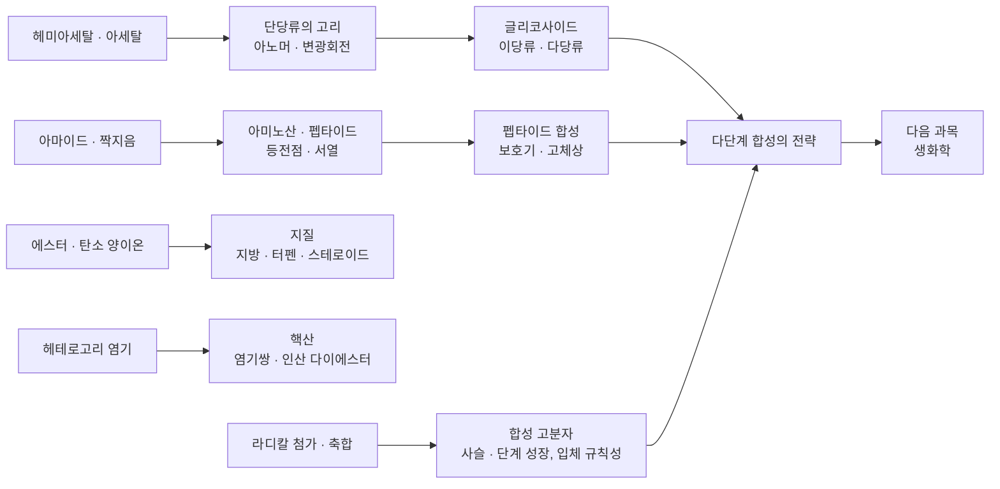

# 유기화학 14. 생체 분자와 합성 고분자 — 아세탈·아마이드·에스터 세 가지 결합으로 짓는 생명과 플라스틱
<!-- prev: ochem-13, ubio-1, ochem-3, ochem-10, ochem-11 -->
<!-- next: bchem-1 -->

> [!NOTE]
> **이 단원의 범위**
> - 탄수화물: 알도스·케토스와 D계열 가계도, 피셔·하워스 투영식과 의자 형태, 아노머와 변광회전(아노머 효과), 단당류의 반응(환원·산화·사슬 늘리기), 글리코사이드, 이당류·다당류와 메틸화 분석
> - 아미노산과 펩타이드: 쌍극성 이온과 등전점, 펩타이드 결합과 서열 결정(에드만 분해), 펩타이드 합성의 보호기(Boc·Fmoc·Cbz)와 짝지음(DCC), 라세미화, 메리필드 고체상 합성
> - 지질: 지방산과 트라이글리세라이드(비누화값·아이오딘가), 인지질, 터펜(아이소프렌 규칙)과 스테로이드(고리 접합과 입체 중심)
> - 핵산: 뉴클레오사이드와 뉴클레오타이드(N-글리코사이드, 인산 다이에스터), 염기의 토토머와 왓슨–크릭 염기쌍, RNA가 염기에 약한 까닭, 포스포아미다이트 합성 개관
> - 합성 고분자: 사슬 성장 중합(라디칼·양이온·음이온·리빙·고리 열림·배위)과 단계 성장 중합(분자량 분포, 폴리우레테인), 입체 규칙성과 지글러–나타 촉매, 공중합체와 유리 전이
> - 다단계 합성의 전략 정리: 역합성, 반응 순서, 직교 보호기, 선형·수렴 합성의 수득률

**학습 목표**

1. D-알도스의 피셔 투영식을 하워스 투영식과 의자 형태로 옮기고, 아노머·에피머를 판별하며, 변광회전 자료로 아노머의 평형 조성과 아노머 효과의 크기를 계산할 수 있다.
2. 단당류의 환원·산화·사슬 늘리기 반응과 글리코사이드 생성을 「알데하이드와 케톤」의 헤미아세탈·아세탈 화학으로 설명하고, 환원당·비환원당과 이당류·다당류의 결합 방식을 구조로 판단할 수 있다.
3. 아미노산과 펩타이드의 전하를 pH와 $\mathrm{p}K_\mathrm{a}$로 계산해 등전점을 구하고, 에드만 분해와 부분 가수 분해 자료로 펩타이드 서열을 결정할 수 있다.
4. 보호기(Boc·Fmoc·Cbz, 에스터)와 짝지음 시약(DCC)의 메커니즘으로 펩타이드 합성 경로를 설계하고, 라세미화를 막는 조건과 고체상 합성의 수득률 한계를 설명할 수 있다.
5. 트라이글리세라이드·인지질·터펜·스테로이드의 구조를 작용기와 입체화학으로 읽고, 비누화값·아이오딘가로 지방의 평균 몰질량과 불포화도를 계산할 수 있다.
6. 뉴클레오타이드의 구조와 염기쌍의 수소 결합 무늬를 설명하고, RNA와 DNA의 화학적 안정성 차이를 분자 안 친핵체로 설명할 수 있다.
7. 사슬 성장·단계 성장 중합의 메커니즘과 분자량–전환율 관계, 분자량 분포($\bar{M}_n$, $\bar{M}_w$, 분산도)를 계산하고, 입체 규칙성·공중합체 구조가 물성을 정하는 까닭을 설명하며, 다단계 합성 경로를 전략적으로 짤 수 있다.

**이 단원의 학습 사다리**

| 단계 | 무엇을 하나? |
|---|---|
| STEP 1. 이전 학습 다시 보기 | 피셔 투영식과 D/L, 의자 형태와 A값, 헤미아세탈·아세탈, 아마이드·에스터, 라디칼 중합과 축합 중합 |
| STEP 2. 기초 다지기 | 다시 쓰는 결합 세 가지, 분율식으로 전하 세기, 곱해지는 수득률, 수 평균과 무게 평균 |
| STEP 3. 핵심 개념 | 단당류 → 고리 구조 → 변광회전 → 단당류의 반응 → 글리코사이드 → 이당류·다당류 → 아미노산 → 펩타이드와 서열 → 펩타이드 합성 → 고체상 합성 → 지방과 인지질 → 터펜과 스테로이드 → 핵산 → 사슬 성장 중합 → 단계 성장과 입체 규칙성 → 다단계 합성 전략 |
| STEP 4. 오개념 바로잡기 | "β-글루코스는 OH가 위에 있으니 축 방향이다", "등전점에서는 아미노산이 전하를 띠지 않는 분자이다" 같은 착각 |
| STEP 5. 대학원·연구로 | 천연 화학적 결합(단백질의 화학 합성), 화학적으로 순환하는 고분자 |
| STEP 6. 생활·산업·진로 | 펩타이드 의약품, 핵산 의약품과 mRNA, 생분해성 폴리락타이드, 스테로이드 의약품 |

---

## 🗺️ 단원 들어가기

빵 한 조각, 손톱, 머리카락, 세포막, 유전자. 그리고 페트병, 나일론 옷, 아크릴 판, 스펀지. 생명체가 만든 분자와 공장이 만든 분자는 겉보기에 전혀 다르지만, 유기화학의 눈으로 보면 놀랄 만큼 닮았다. 거의 모두가 **작은 단위체를 같은 종류의 결합으로 수백~수만 번 이은 것**이고, 그 결합은 우리가 이미 배운 몇 가지뿐이다.

| 거대 분자 | 단위체 | 단위체를 잇는 결합 | 처음 배운 곳 |
|---|---|---|---|
| 녹말·셀룰로스 | 글루코스 | **아세탈**(글리코사이드 결합) | 「알데하이드와 케톤」 ⑤ |
| 단백질 | 아미노산 | **아마이드**(펩타이드 결합) | 「카복실산과 그 유도체」 ⑧ |
| 지방 | 글리세롤 + 지방산 | **에스터** | 「카복실산과 그 유도체」 ⑦ |
| DNA·RNA | 뉴클레오타이드 | **인산 다이에스터** + N-글리코사이드 | 「아민과 헤테로고리 화합물」의 염기 |
| 폴리에틸렌·폴리스타이렌 | 알켄 | C–C (첨가) | 「알켄과 알카인」 ⑨ |
| 나일론·PET | 다이아민·다이올 + 다이카복실산 | 아마이드·에스터 | 「카복실산과 그 유도체」 ⑪ |

이 단원은 유기화학의 마지막 단원이다. 새로운 반응을 많이 배우기보다, 13개 단원에서 익힌 반응이 **생체 분자와 고분자라는 큰 무대에서 어떻게 쓰이는지**를 본다. 글루코스가 고리를 만드는 것은 분자 안 헤미아세탈 생성이고, 펩타이드 합성의 어려움은 '아마이드를 만들고 싶은 곳에서만 만드는' 화학 선택성의 문제이며, 폴리프로필렌의 녹는점은 입체화학이 정한다. 대사와 효소의 작동은 다음 과목인 생화학이 다룬다. 여기서는 그 분자들의 **구조와 반응**을 유기화학의 언어로 정확히 읽어 두는 것이 목표이다.

---

## STEP 1. 🔙 이전 학습 다시 보기

### 연계 개념표

| 이전 단원 | 그때 배운 것 | 이 단원에서 확장되는 것 |
|---|---|---|
| 일반생명과학 「생명의 화학」 '탄수화물'~'핵산' | 네 가지 생체 거대 분자의 이름과 역할, 축합과 가수 분해, α/β 글리코사이드 결합, 단백질의 네 단계 구조 | 같은 분자를 **입체 구조와 반응 메커니즘**으로: 아노머가 생기는 까닭, 등전점 계산, 펩타이드를 실험실에서 만드는 법 |
| 유기화학 「입체화학」 ⑥ '피셔 투영식', ⑪ '카이랄성과 생체 활성' | 피셔 투영식의 약속, D/L 표기, D-글루코스 (2R,3S,4R,5R), L-아미노산 | D-알도스 가계도, 에피머, 피셔 → 하워스 → 의자 형태의 변환 |
| 유기화학 「알케인과 사이클로알케인」 ⑧ 'A값', STEP 5 '아노머 효과' | 적도 치환기가 안정, OH의 A값 약 3.9 kJ/mol, 아노머 효과의 이름 | β-D-글루코피라노스가 모두 적도인 까닭, 변광회전 자료로 아노머 효과를 **숫자로** |
| 유기화학 「알데하이드와 케톤」 ⑤·⑥ '헤미아세탈과 아세탈' | 5·6원 고리 헤미아세탈이 우세, 아세탈은 산 촉매로만 생기고 염기에 안정 | 단당류의 고리 열림–닫힘(변광회전), 글리코사이드 = 아세탈, 환원당 판별 |
| 유기화학 「카복실산과 그 유도체」 ⑦·⑧·⑪ | 비누화, 아마이드의 공명과 평면성, DCC 짝지음, 카로더스 식 | 트라이글리세라이드의 비누화값, 보호기 전략과 고체상 합성, 분자량 **분포** |
| 유기화학 「알켄과 알카인」 ⑨ '라디칼 중합과 천장 온도' | 라디칼 사슬 중합의 개시·전파·종결, 머리–꼬리 연결, 천장 온도 | 양이온·음이온·리빙·배위 중합, 입체 규칙성 |
| 유기화학 「아민과 헤테로고리 화합물」 '피리미딘·퓨린 개관' | 헤테로고리 질소의 염기도와 방향족성, 아마이드형 질소 | 핵산 염기의 토토머와 수소 결합 무늬 |

### 준비 운동 (사전 진단)

**Q1.** D-글루코스 사슬형의 피셔 투영식에서 C2~C5의 OH가 각각 왼쪽인지 오른쪽인지 쓰고, 왜 'D'인지 설명하시오.

**Q2.** 5-하이드록시펜탄알은 수용액에서 대부분 고리형으로 존재한다. 이 고리형 화합물의 작용기 이름과 고리의 원자 수를 쓰시오.

**Q3.** 아세탈은 NaOH 수용액과 묽은 HCl 수용액 가운데 어느 쪽에서 가수 분해되는가? 그 까닭을 한 문장으로 쓰시오.

**Q4.** 아세트산($\mathrm{p}K_\mathrm{a}$ 4.76)이 pH 6.76의 완충 용액에 녹아 있다. 아세트산 이온으로 있는 분율은?

정답 및 해설

**Q1.** C2 오른쪽, C3 왼쪽, C4 오른쪽, C5 오른쪽. 카보닐에서 가장 먼 입체 중심(C5)의 OH가 오른쪽이므로 D이다(「입체화학」 ⑥).

**Q2.** 헤미아세탈, 6원자 고리(O 1개 + C 5개). 분자 안 반응이라 엔트로피 손실이 작다(「알데하이드와 케톤」 ⑤). 글루코스의 고리도 같은 원리이다.

**Q3.** 묽은 HCl 수용액. 아세탈의 OR이 떨어지려면 산이 산소를 양성자화하여 좋은 이탈기(알코올)로 바꾸어야 하고, 이때 옥소카베늄 이온이 생긴다. 염기에서는 이탈기가 알콕사이드여서 떨어지지 않는다.

**Q4.** $1/(1 + 10^{4.76 - 6.76}) = 1/1.01 = 0.990$, 약 99 %. pH가 $\mathrm{p}K_\mathrm{a}$보다 2 높으면 짝염기가 99 %이다. 이 계산이 ⑦의 등전점과 전하 계산의 바탕이다.

---

## STEP 2. 🧱 기초 다지기

### 디딤돌 1. 다시 쓰는 결합 세 가지 — 언제 생기고 언제 끊어지나

이 단원의 생체 분자는 아세탈·아마이드·에스터, 세 결합으로 대부분 설명된다. 「알데하이드와 케톤」과 「카복실산과 그 유도체」에서 배운 성질을 한 표로 모아 두자.

| 결합 | 생체 분자의 이름 | 만드는 조건(실험실) | 끊는 조건 | 안정한 조건 |
|---|---|---|---|---|
| 아세탈 $\mathrm{R_2C(OR')_2}$ | 글리코사이드 결합 | 알코올 + 산 촉매(물 제거) | 산 수용액(옥소카베늄 이온 경유) | 염기, 수소화물, 산화제 |
| 아마이드 $\mathrm{RCONHR'}$ | 펩타이드 결합 | 활성화한 카복실산 + 아민(DCC 등) | 6 M HCl, 110 ℃, 약 24 h 같은 센 조건 | 중성 물(반감기 수백 년으로 어림) |
| 에스터 $\mathrm{RCOOR'}$ | 지방, 인지질의 아실 결합 | 산 염화물·무수물 + 알코올, 피셔 에스터화 | 염기(비누화), 산 수용액 | 중성의 묽은 조건 |
| 인산 다이에스터 $\mathrm{(RO)_2PO_2^-}$ | 핵산 주사슬 | (생체: 효소, 실험실: 포스포아미다이트) | 센 염기·효소, RNA는 묽은 염기에서도 | 중성(음전하가 친핵체를 밀어낸다) |

> [!TIP]
> 💡 **요령** — 생체 분자의 반응을 보면 먼저 "이것은 어느 결합의 어느 반응인가"를 묻는다. 글루코스의 변광회전은 헤미아세탈의 열림–닫힘, 글리코사이드의 가수 분해는 아세탈의 가수 분해, 비누는 에스터의 비누화, 에드만 분해는 아이소싸이오사이아네이트에 대한 아민의 첨가와 분자 안 아실 치환이다. 새로 외울 것은 거의 없다.

### 디딤돌 2. 분율식으로 전하 세기

산 HA의 $\mathrm{p}K_\mathrm{a}$와 용액의 pH가 주어지면, 탈양성자화된 분율은 다음과 같다(「알데하이드와 케톤」 디딤돌 1).

$$
\alpha_{\mathrm{A^-}} = \frac{1}{1 + 10^{\mathrm{p}K_\mathrm{a} - \mathrm{pH}}}, \qquad \alpha_{\mathrm{HA}} = \frac{1}{1 + 10^{\mathrm{pH} - \mathrm{p}K_\mathrm{a}}}
$$

여러 이온화 원자단을 가진 분자의 **평균 전하**는 원자단마다 독립이라고 보고 더한다.

$$
\bar{q}(\mathrm{pH}) = \sum_{\text{양이온성 }i} \frac{1}{1 + 10^{\mathrm{pH} - \mathrm{p}K_{\mathrm{a},i}}} \; - \sum_{\text{음이온성 }j} \frac{1}{1 + 10^{\mathrm{p}K_{\mathrm{a},j} - \mathrm{pH}}}
$$

양이온성 원자단은 $\mathrm{-NH_3^+}$, 구아니디늄, 이미다졸륨처럼 양성자를 잃으면 중성이 되는 것, 음이온성은 $\mathrm{-COOH}$, $\mathrm{-SH}$, 페놀 OH처럼 양성자를 잃으면 음전하가 되는 것이다. $\bar{q} = 0$이 되는 pH가 **등전점**이다(⑦).

#### 예제 1 — 글리신의 평균 전하

글리신($\mathrm{p}K_{\mathrm{a}1} = 2.34$, $\mathrm{p}K_{\mathrm{a}2} = 9.60$)의 평균 전하를 pH 2.34, 7.00, 9.60에서 구하시오.

**풀이**
식 세우기: $\bar{q} = \dfrac{1}{1 + 10^{\mathrm{pH} - 9.60}} - \dfrac{1}{1 + 10^{2.34 - \mathrm{pH}}}$.
pH 2.34: $\dfrac{1}{1 + 10^{-7.26}} - \dfrac{1}{1 + 1} = 1.000 - 0.500 = +0.50$
pH 7.00: $\dfrac{1}{1 + 10^{-2.60}} - \dfrac{1}{1 + 10^{-4.66}} = 0.9975 - 1.0000 = -0.003 \approx 0$
pH 9.60: $0.500 - 1.000 = -0.50$
**의미** 중성 근처에서는 두 원자단이 모두 이온화된 **쌍극성 이온**(+1과 −1)이 대부분이어서 평균 전하가 거의 0이다. $\mathrm{p}K_\mathrm{a}$와 같은 pH에서는 그 원자단이 정확히 반만 이온화된다.

### 디딤돌 3. 곱해지는 수득률

여러 단계를 차례로 거치는 합성에서 전체 수득률은 단계 수득률의 **곱**이다. 단계마다 수득률 $y$인 반응을 $n$번 하면

$$
Y = y^n, \qquad \ln Y = n\ln y \approx -n(1 - y) \quad (y \text{가 1에 가까울 때})
$$

| 단계 수득률 $y$ | 20단계 | 50단계 | 100단계 |
|---|---|---|---|
| 0.90 | 0.12 | 0.0052 | $2.7\times10^{-5}$ |
| 0.99 | 0.82 | 0.61 | 0.37 |
| 0.995 | 0.90 | 0.78 | 0.61 |

단계 수가 많으면 99 %와 99.5 %의 차이가 결정적이 된다. 단백질 크기의 펩타이드를 화학적으로 만들기 어려운 까닭(⑩)과, 긴 합성을 **수렴형**으로 짜는 까닭(⑯)이 이 표 하나에 들어 있다.

#### 예제 2 — 몇 단계까지 가능한가

단계 수득률이 98 %일 때 전체 수득률을 50 % 이상으로 지키려면 최대 몇 단계까지 할 수 있는가?

**풀이**
$0.98^n \ge 0.50 \Rightarrow n \le \dfrac{\ln 0.50}{\ln 0.98} = \dfrac{-0.6931}{-0.02020} = 34.3$. 따라서 34단계. 어림식 $n \approx 0.693/(1 - y) = 34.7$도 거의 같다.
**의미** 단계 수득률의 '손실'($1 - y$)을 절반으로 줄이면 같은 전체 수득률로 갈 수 있는 단계 수가 2배가 된다.

### 디딤돌 4. 수 평균과 무게 평균 — 분포를 가진 분자의 '평균 몰질량'

합성 고분자의 사슬 길이는 하나로 정해지지 않고 분포를 가진다. 몰질량 $M_i$인 사슬이 $N_i$ mol 있을 때 두 가지 평균을 쓴다(수학 도구 「확률과 통계」 '평균과 분산').

$$
\bar{M}_n = \frac{\sum N_i M_i}{\sum N_i}, \qquad \bar{M}_w = \frac{\sum N_i M_i^2}{\sum N_i M_i}, \qquad Đ = \frac{\bar{M}_w}{\bar{M}_n} \ge 1
$$

$\bar{M}_n$(**수 평균 몰질량**)은 사슬 한 개당 평균이고, $\bar{M}_w$(**무게 평균 몰질량**)는 질량으로 가중한 평균이라 무거운 사슬을 더 크게 센다. 둘의 비 **분산도**(dispersity, $Đ$)는 모든 사슬의 길이가 같을 때만 1이다. 수학적으로 $\bar{M}_w/\bar{M}_n = 1 + \sigma^2/\bar{M}_n^2$($\sigma^2$는 수 분포의 분산)이므로 분포가 넓을수록 커진다. 단백질·DNA처럼 서열이 정해진 생체 고분자는 $Đ = 1$이고, 합성 고분자는 대개 1.01~수 사이이다.

#### 예제 3 — 두 종류 사슬의 혼합물

몰질량 10 kg/mol인 사슬 1.0 mol과 100 kg/mol인 사슬 1.0 mol을 섞었다. $\bar{M}_n$, $\bar{M}_w$, $Đ$를 구하시오.

**풀이**
$\bar{M}_n = \dfrac{10 + 100}{2} = 55\ \mathrm{kg/mol}$, $\bar{M}_w = \dfrac{10^2 + 100^2}{10 + 100} = \dfrac{10\,100}{110} = 91.8\ \mathrm{kg/mol}$, $Đ = 91.8/55 = 1.67$.
**의미** 사슬 수는 같지만 질량의 91 %가 무거운 사슬에 있으므로 $\bar{M}_w$는 무거운 쪽으로 쏠린다. 삼투압·말단기 분석은 $\bar{M}_n$을, 빛 산란은 $\bar{M}_w$를 준다. 녹은 고분자의 점성처럼 긴 사슬이 좌우하는 물성은 $\bar{M}_w$와 더 잘 맞는다.

---

## STEP 3. 📘 핵심 개념

### ① 단당류의 분류와 D-알도스 가계도

**탄수화물**(carbohydrate)은 대개 $\mathrm{C_n(H_2O)_n}$ 꼴의 폴리하이드록시 알데하이드·케톤과 그 축합물이다. 더 작은 당으로 가수 분해되지 않는 것을 **단당류**(monosaccharide)라 한다. 단당류는 두 기준으로 나눈다.

| 기준 | 이름 | 예 |
|---|---|---|
| 카보닐의 종류 | **알도스**(aldose, C1이 CHO) / **케토스**(ketose, 보통 C2가 C=O) | 글루코스·갈락토스(알도스), 프럭토스(케토스) |
| 탄소 수 | 트라이오스(3)·테트로스(4)·펜토스(5)·헥소스(6) | 글리세르알데하이드(알도트라이오스), 리보스(알도펜토스), 글루코스(알도헥소스), 프럭토스(케토헥소스) |

알도헥소스의 사슬형에는 입체 중심이 C2~C5의 4개 있으므로 입체 이성질체가 $2^4 = 16$가지, 그 가운데 C5의 OH가 오른쪽인 **D계열**이 8가지이다. 케토헥소스는 C2가 카보닐이어서 입체 중심이 3개($2^3 = 8$가지, D계열 4가지)이다.

#### D-알도스 가계도

D-글리세르알데하이드의 C1(CHO) 아래에 새 입체 중심 H–C–OH를 하나 끼워 넣으면 OH가 오른쪽인 것과 왼쪽인 것 두 가지가 생긴다. 이것을 되풀이하면 D-알도스 전체가 하나의 가계도로 정리된다. 실제로 이 '끼워 넣기'는 ④의 킬리아니–피셔 합성으로 실험실에서 할 수 있다. 가계도의 모든 당은 맨 아래 입체 중심의 OH가 오른쪽(D)이라는 점이 같다.

| 탄소 수 | D-알도스 (C2, C3, C4, C5의 OH 방향: 오=오른쪽, 왼=왼쪽) |
|---|---|
| 3 | 글리세르알데하이드 (오) |
| 4 | 에리트로스 (오 오), 트레오스 (왼 오) |
| 5 | 리보스 (오 오 오), 아라비노스 (왼 오 오), 자일로스 (오 왼 오), 릭소스 (왼 왼 오) |
| 6 | 알로스 (오 오 오 오), 알트로스 (왼 오 오 오), **글루코스 (오 왼 오 오)**, **만노스 (왼 왼 오 오)**, 굴로스 (오 오 왼 오), 이도스 (왼 오 왼 오), **갈락토스 (오 왼 왼 오)**, 탈로스 (왼 왼 왼 오) |

<!-- fig:ochem-14-d-aldose-tree -->

#### 에피머

입체 중심이 여러 개인 두 부분 입체 이성질체가 **단 한 곳**에서만 배치가 다르면 서로 **에피머**(epimer)라 한다. D-글루코스와 D-만노스는 C2 에피머, D-글루코스와 D-갈락토스는 C4 에피머이다. D-만노스와 D-갈락토스는 C2와 C4 두 곳이 달라 에피머가 아니다. 에피머는 거울상이 아니므로 녹는점·용해도·비선광도가 모두 다르다.

#### 케토스 — D-프럭토스

D-프럭토스는 C1이 $\mathrm{CH_2OH}$, C2가 C=O이고 C3(왼), C4(오), C5(오)이다. C3~C5의 배치는 D-글루코스와 같다. 그래서 염기성 수용액에서 D-글루코스, D-만노스, D-프럭토스는 같은 **엔다이올**(C1=C2에 OH가 하나씩) 중간체를 거쳐 서로 바뀐다(로브리 드 브라윈–판 에켄스테인 자리 옮김, Lobry de Bruyn–van Ekenstein). 엔다이올이 다시 케토 형태로 돌아갈 때 C2의 양성자가 어느 면에서 들어오느냐에 따라 글루코스 또는 만노스가 되고, C2 쪽 OH가 C=O로 되면 프럭토스가 된다. 「카보닐 α 자리의 반응과 축합 반응」 ①의 케토–엔올 토토머화와 같은 반응이다.

$$
\text{D-글루코스} \rightleftharpoons \text{엔다이올} \rightleftharpoons \text{D-프럭토스}, \qquad \text{엔다이올} \rightleftharpoons \text{D-만노스} \quad (\mathrm{OH^-}\ \text{촉매})
$$

#### 예제 4 — 피셔 투영식으로 당 알아보기

다음 알도헥소스 X, Y의 이름과 D/L을 쓰고, D-글루코스와 어떤 관계인지 밝히시오. 피셔 투영식에서 C2~C5의 OH 방향은 X: 왼, 왼, 오, 오 / Y: 왼, 오, 왼, 왼 이다.

**풀이**
X: C5 OH 오른쪽 → D. 가계도에서 (왼 왼 오 오)는 **D-만노스**이고, D-글루코스(오 왼 오 오)와는 C2만 다르므로 **C2 에피머**이다.
Y: C5 OH 왼쪽 → L. 모든 OH를 반대로 뒤집으면 (오 왼 오 오) = D-글루코스이므로 Y는 **L-글루코스**, D-글루코스의 **거울상 이성질체**이다.
**의미** 이름(글루코스)은 입체 중심들의 '상대 배치'에 붙고, D/L은 맨 아래 입체 중심 하나로 정한다. 모든 중심이 뒤집혀야 거울상이고, 한 곳만 뒤집히면 에피머, 둘 이상이면 그냥 부분 입체 이성질체이다.

#### ✔ 바로 확인

1. 알도펜토스의 입체 이성질체는 모두 몇 가지이고, 그중 D계열은 몇 가지인가?
2. (O/X) D-갈락토스와 D-만노스는 에피머이다.
3. 빈칸: D-프럭토스는 C2가 카보닐인 (    )헥소스이다.
4. D-글루코스를 염기 수용액에 오래 두면 D-만노스와 D-프럭토스가 생긴다. 공통 중간체의 이름은?

정답

1. 8가지, D계열 4가지 — 입체 중심 C2~C4의 3개, $2^3 = 8$.
2. X — C2와 C4 두 곳이 다르다. 에피머는 한 곳만 다른 쌍이다.
3. 케토
4. 엔다이올 — C2의 입체 정보가 사라진 평면 중간체이다.

### ② 고리 구조 — 하워스 투영식과 의자 형태

「알데하이드와 케톤」 ⑤에서 본 대로 같은 분자 안의 OH와 C=O는 5·6원자 고리 헤미아세탈을 잘 만든다. 알도헥소스에서는 C5의 OH가 C1(CHO)을 공격해 **6원자 고리**(산소 1 + 탄소 5)를, C4의 OH가 공격하면 5원자 고리를 만든다. 6원자 고리 당을 테트라하이드로피란에 빗대어 **피라노스**(pyranose), 5원자 고리 당을 테트라하이드로퓨란에 빗대어 **퓨라노스**(furanose)라 한다. 수용액의 D-글루코스는 99 % 이상이 피라노스이고, 사슬형 알데하이드는 약 0.01 % 이하에 불과하다. D-프럭토스는 C5의 OH가 C2(케톤)를 공격한 퓨라노스와 C6의 OH가 공격한 피라노스가 섞여 있다. 고리가 닫힐 때 평면 C=O의 두 면 중 어느 쪽에서 OH가 공격하느냐에 따라 C1에 **새 입체 중심**이 생긴다. 이 탄소를 **아노머 탄소**(anomeric carbon), C1 배치만 다른 두 고리형 부분 입체 이성질체를 **아노머**(anomer)라 하고 α, β로 구별한다.

#### 피셔 → 하워스 변환 규칙

**하워스 투영식**(Haworth projection)은 고리를 종이 면에 거의 수직인 평면 육각형으로 그리고, 앞쪽 변을 굵게 한 그림이다. 고리 산소를 오른쪽 뒤에, 아노머 탄소(C1)를 오른쪽에 두고 시계 방향으로 C1 → C2 → C3 → C4 → C5를 배치한다. 이렇게 두면 다음 규칙이 성립한다.

| 피셔 투영식 | 하워스 투영식 | 까닭 |
|---|---|---|
| 오른쪽의 OH | **아래** | 사슬을 오른쪽으로 눕혀 고리를 만들면 오른쪽 원자단이 아래로 간다 |
| 왼쪽의 OH | **위** | 같은 회전 |
| D-당의 C5 $\mathrm{CH_2OH}$ | **위** | C5–C4 결합을 돌려 C5의 O를 고리 쪽으로 향하게 하면 $\mathrm{CH_2OH}$가 위로 간다 |
| α-아노머 (D-당) | 아노머 OH가 **아래** (C5의 $\mathrm{CH_2OH}$와 반대쪽, 트랜스) | 정의: 아노머 탄소의 배치가 D/L을 정한 탄소(C5)의 배치와 피셔 투영식에서 같은 쪽 |
| β-아노머 (D-당) | 아노머 OH가 **위** ($\mathrm{CH_2OH}$와 같은 쪽, 시스) | |

<!-- fig:ochem-14-glucose-cyclization -->

#### 의자 형태 — 왜 β-D-글루코스가 '완벽한' 당인가

하워스 투영식은 위·아래만 알려 주는 평면 그림이다. 실제 피라노스 고리는 사이클로헥세인처럼 **의자 형태**이다(「알케인과 사이클로알케인」 ⑦). D-글루코피라노스는 C5의 $\mathrm{CH_2OH}$가 적도에 오는 의자(${}^4C_1$ 형태)를 택한다. 하워스의 '위·아래'를 의자에 옮기면, β-D-글루코피라노스는 C1~C5의 다섯 치환기(OH 네 개와 $\mathrm{CH_2OH}$)가 **모두 적도**에 놓인다. 알도헥소스 8가지 가운데 이런 것은 β-D-글루코스 하나뿐이다. 자연에서 글루코스가 가장 흔한 단당류라는 사실과 무관하지 않다고 여겨진다.

| 치환기 | α-D-글루코피라노스 (${}^4C_1$) | β-D-글루코피라노스 (${}^4C_1$) |
|---|---|---|
| C1 OH | **축**(아래) | 적도(위쪽으로 비스듬히) |
| C2 OH | 적도(아래) | 적도(아래) |
| C3 OH | 적도(위) | 적도(위) |
| C4 OH | 적도(아래) | 적도(아래) |
| C5 $\mathrm{CH_2OH}$ | 적도(위) | 적도(위) |

<!-- fig:ochem-14-glucose-chairs -->

#### 예제 5 — β-D-갈락토피라노스의 의자 형태

β-D-갈락토피라노스(SMILES `OC[C@H]1O[C@@H](O)[C@H](O)[C@@H](O)[C@H]1O`)를 ${}^4C_1$ 의자로 그릴 때 축에 놓이는 OH는 어느 것인가? 같은 의자에서 β-D-만노피라노스는 어떤가?

**풀이**
D-갈락토스는 D-글루코스의 C4 에피머이다. 피셔 투영식에서 C4의 OH가 왼쪽 → 하워스에서 **위**. ${}^4C_1$ 의자에서 C4의 적도 결합은 아래쪽으로 비스듬하고 축 결합이 위를 향하므로, 위를 향한 C4 OH는 **축**이다. 나머지(C1 β 위, C2 아래, C3 위, C5 위)는 글루코스와 같아 적도이다. 축 OH는 C4의 하나.
β-D-만노스는 C2 에피머이므로 C2 OH가 하워스에서 위, ${}^4C_1$ 의자에서 **축**이다.
**의미** 글루코스의 에피머는 모두 '축 OH 하나'를 갖는다. 에피머 사이의 성질 차이(용해도, 효소 인식, 아노머 비율)가 이 축 OH 하나에서 비롯된다.

#### ✔ 바로 확인

1. (O/X) α-D-글루코피라노스의 하워스 투영식에서 C1의 OH는 $\mathrm{CH_2OH}$와 같은 쪽(위)이다.
2. 빈칸: 피셔 투영식에서 오른쪽에 있던 OH는 하워스 투영식에서 (    )를 향한다.
3. 수용액에서 D-리보스의 5원자 고리형을 무엇이라 부르는가?
4. ${}^4C_1$ 의자의 β-D-글루코피라노스에서 축에 놓인 OH는 몇 개인가?

정답

1. X — α는 아래(트랜스), β가 위(시스)이다.
2. 아래
3. 퓨라노스(D-리보퓨라노스) — C4의 OH가 C1을 공격한 고리이다.
4. 0개 — 다섯 치환기가 모두 적도이다.

### ③ 변광회전과 아노머 효과

순수한 α-D-글루코피라노스 결정(비선광도 $[\alpha]_\mathrm{D} = +112.2$)을 물에 녹이면 회전각이 서서히 줄어 몇 시간 뒤 +52.7에서 멈춘다. 순수한 β 결정($+18.7$)을 녹이면 회전각이 커져 같은 +52.7에 이른다. 이처럼 용액의 비선광도가 시간에 따라 변해 평형값에 이르는 현상을 **변광회전**(mutarotation)이라 한다. 두 아노머가 사슬형을 거쳐 서로 바뀌기 때문이다.

#### 메커니즘 — 헤미아세탈의 열림과 닫힘

변광회전은 산과 염기 어느 쪽으로도 촉매된다. 산 촉매 경로는 다음과 같다(「알데하이드와 케톤」 ⑤ 헤미아세탈 생성의 역반응과 정반응).

| 단계 | 일어나는 일 | 굽은 화살표 |
|---|---|---|
| 1 | 고리 산소 O5의 양성자화 | O5의 비공유 전자쌍 → $\mathrm{H_3O^+}$의 H, H–O 결합 → O |
| 2 | 고리 열림 | C1–OH 산소의 비공유 전자쌍 → C1–O 사이(C=O⁺H 생성), C1–O5 결합 전자쌍 → O5(C5의 OH가 된다) |
| 3 | 탈양성자화 → 사슬형 알데하이드 | 물의 O → $\mathrm{C{=}O^+H}$의 H |
| 4~6 | 1~3의 역과정 | C5의 OH가 평면 C=O의 **반대쪽 면**을 공격하면 다른 아노머 |

사슬형 알데하이드에서 C1은 평면이므로 C5 OH가 어느 면을 공격하느냐에 따라 α 또는 β가 된다. C2~C5의 배치는 반응 중 전혀 건드리지 않는다.

<!-- fig:ochem-14-mutarotation-mechanism -->

#### 예제 6 — 비선광도로 아노머 비율 구하기

25 ℃ 물에서 α-D-글루코피라노스 +112.2, β-아노머 +18.7, 평형 혼합물 +52.7이다. 사슬형·퓨라노스의 양은 무시하고 (1) 평형에서 β의 몰분율 (2) 평형 상수 $K = [\beta]/[\alpha]$와 $\Delta G^\circ(\alpha \rightarrow \beta)$를 구하시오.

**풀이**
(1) 비선광도는 성분의 질량 분율로 가중 평균된다(두 아노머의 몰질량이 같으므로 몰분율과 같다). β의 분율을 $x$라 하면
$112.2(1 - x) + 18.7x = 52.7 \Rightarrow x = \dfrac{112.2 - 52.7}{112.2 - 18.7} = \dfrac{59.5}{93.5} = 0.636$
(2) $K = 0.636/0.364 = 1.75$, $\Delta G^\circ = -RT\ln K = -(8.314)(298.15)\ln 1.75 = -1.39\ \mathrm{kJ/mol}$
**의미** β가 더 많지만 차이는 생각보다 작다. 아래에서 이 '생각보다'를 정량화한다.

#### 아노머 효과

β에서 C1의 OH는 적도, α에서는 축이다. 사이클로헥세인의 OH A값(약 3.9 kJ/mol, 「알케인과 사이클로알케인」 ⑧)만 생각하면 β가 약 3.9 kJ/mol 더 안정해 β : α ≈ 83 : 17이어야 한다. 실제는 64 : 36이고 에너지 차는 1.4 kJ/mol뿐이다. 차이 약 2.5 kJ/mol만큼 **축 방향의 전기 음성 치환기를 편드는 효과**가 있다. 이것이 **아노머 효과**(anomeric effect)이다.

고리 산소의 비공유 전자쌍이 들어 있는 오비탈($n_\mathrm{O}$)이 축 방향 C1–O1 결합의 반결합 오비탈($\sigma^*_\mathrm{C{-}O}$)과 안티 준평면으로 나란하면 전자가 퍼져(초공액) 안정해진다. 적도 C1–O1은 이 배치를 이룰 수 없다. 또 적도 C1–O1의 쌍극자는 고리 산소의 쌍극자와 거의 같은 방향이어서 정전기적으로 불리하다는 설명도 함께 쓰인다. 물은 쌍극자를 잘 가려 주고 OH와 수소 결합해 적도 쪽을 유리하게 하므로, 물에서 아노머 효과는 작게 나타난다. 메틸 글리코사이드를 메탄올에서 평형시키면 α가 우세하다(메틸 D-글루코피라노사이드 α : β 약 2 : 1). 전기 음성도가 큰 Cl이나 OAc가 C1에 붙으면 α(축)가 압도적이 된다.

<!-- sim:mj-mutarotation -->

#### ✔ 바로 확인

1. (O/X) 변광회전이 일어나는 동안 D-글루코스의 C3 배치도 뒤집혔다가 돌아온다.
2. 순수한 β-D-글루코피라노스를 물에 녹였을 때 비선광도는 커지는가, 작아지는가?
3. 빈칸: 피라노스 고리의 아노머 탄소에 붙은 전기 음성 치환기가 축 방향을 선호하는 현상을 (    )라 한다.
4. 평형에서 β가 64 %라면 α는 몇 %인가? (사슬형 무시)

정답

1. X — 고리가 열리고 닫혀도 C2~C5의 결합은 끊기지 않는다. 바뀌는 것은 C1뿐이다.
2. 커진다 — +18.7에서 평형값 +52.7로.
3. 아노머 효과
4. 36 %

### ④ 단당류의 반응 — 알코올이자 카보닐 화합물

단당류는 OH가 여럿인 알코올이면서, 고리–사슬 평형을 통해 소량의 알데하이드(또는 케톤)를 늘 내놓는 카보닐 화합물이다. 반응도 이 두 얼굴로 나뉜다.

#### OH의 반응 — 에스터와 에터

| 반응 | 시약 | 생성물 | 쓰임 |
|---|---|---|---|
| 아세틸화 | 아세트산 무수물, 피리딘 | 펜타-O-아세틸 글루코피라노스 | OH를 모두 가려 유기 용매에 녹고 결정화·분석이 쉬워진다 |
| 메틸화(에터화) | $\mathrm{CH_3I}$ + $\mathrm{Ag_2O}$ 또는 NaH/DMSO | 메틸 에터(아노머 OH는 메틸 글리코사이드) | ⑥의 메틸화 분석 |
| 벤질화 | NaH 뒤 $\mathrm{C_6H_5CH_2Br}$ | 벤질 에터 | 합성의 영구 보호기, $\mathrm{H_2}$/Pd로 제거(「알코올·에터·에폭사이드와 황 화합물」 ⑨) |
| 아세토나이드 | 아세톤, 산 촉매 | 시스 다이올의 고리형 아세탈 | 특정 OH 쌍만 보호(「알데하이드와 케톤」 ⑥) |

당의 메틸 에터는 보통의 에터처럼 산 가수 분해에 안정하지만, 아노머 탄소의 OMe(글리코사이드)는 아세탈이므로 묽은 산에서 떨어진다. 이 차이가 메틸화 분석의 핵심이다.

#### 카보닐의 반응 — 환원

$\mathrm{NaBH_4}$는 고리–사슬 평형으로 생기는 사슬형 알데하이드를 환원해 평형을 끌어당기며, 결국 당 전체를 폴리올인 **알디톨**(alditol)로 바꾼다.

$$
\text{D-글루코스} \xrightarrow{\ \mathrm{NaBH_4},\ \mathrm{H_2O}\ } \text{D-글루시톨(소비톨)}
$$

D-글루시톨(SMILES `OC[C@@H](O)[C@@H](O)[C@H](O)[C@@H](O)CO`)은 무설탕 감미료로 쓰인다. D-프럭토스를 환원하면 C2가 새 입체 중심이 되어 D-글루시톨과 D-만니톨의 혼합물이 생긴다. 양 끝이 모두 $\mathrm{CH_2OH}$가 되므로 D-알로스·D-갈락토스의 알디톨처럼 메조 화합물이 되기도 한다.

#### 카보닐의 반응 — 산화와 환원당

| 시약 | 산화되는 곳 | 생성물 |
|---|---|---|
| 브로민 물($\mathrm{Br_2}$, $\mathrm{H_2O}$, pH 약 5~6) | C1 CHO만 | **알돈산**(aldonic acid): D-글루콘산. 흔히 고리형 락톤으로 존재 |
| 묽은 질산($\mathrm{HNO_3}$, 가열) | C1 CHO와 C6 $\mathrm{CH_2OH}$ | **알다르산**(aldaric acid): D-글루카르산 |
| 톨렌스 시약($\mathrm{Ag(NH_3)_2^+}$), 베네딕트·펠링 시약($\mathrm{Cu^{2+}}$ 착물, 염기성) | C1(또는 엔다이올) | 은거울·적갈색 $\mathrm{Cu_2O}$ 침전 → **환원당** 판별 |

톨렌스·베네딕트 시약을 환원하는 당을 **환원당**(reducing sugar)이라 한다. 헤미아세탈(고리–사슬 평형이 있는 아노머 탄소)을 가진 당은 모두 환원당이다. 케토스인 D-프럭토스도 염기성 시약 속에서 엔다이올을 거쳐 알도스로 바뀌므로 양성이다. 반대로 아노머 탄소가 아세탈로 묶인 메틸 글리코사이드나 수크로스는 사슬형을 내놓지 못해 **비환원당**이다(⑤·⑥).

#### 사슬 늘리기와 줄이기

- **킬리아니–피셔 합성**(Kiliani–Fischer synthesis): 알도스에 HCN을 첨가해 사이아노하이드린(「알데하이드와 케톤」 ⑦)을 만들고, 나이트릴을 이민을 거쳐 알데하이드로 바꾼다(현대식: 부분 피독된 Pd 촉매로 수소화 뒤 가수 분해). 탄소가 하나 늘고 새 C2는 두 배치가 모두 생기므로 **C2 에피머 한 쌍**이 얻어진다. D-아라비노스 → D-글루코스 + D-만노스.
- **볼 분해**(Wohl degradation): 알도스를 옥심으로 만든 뒤 탈수해 나이트릴로 바꾸고, 염기로 사이아노하이드린 형성의 역반응을 일으켜 HCN을 잃게 한다. 탄소가 하나 줄고 C2의 입체 정보가 사라진다. D-글루코스와 D-만노스는 둘 다 D-아라비노스가 된다.

#### 예제 7 — 피셔식 추론: 알다르산의 광학 활성

(1) D-알도펜토스 네 가지 가운데 질산 산화로 광학 비활성 알다르산을 주는 것을 고르시오. (2) 어떤 D-알도펜토스 P는 광학 활성 알다르산을 주고, 킬리아니–피셔 합성으로 얻은 두 알도헥소스가 **둘 다** 광학 활성 알다르산을 준다. P는 무엇인가?

**풀이**
(1) 알다르산은 양 끝이 모두 COOH이므로, 피셔 투영식에서 가운데 가로선에 대해 OH 배치가 위아래 대칭이면 메조(비활성)이다. 리보스(오 오 오): 대칭 → 메조. 아라비노스(왼 오 오): 비대칭 → 활성. 자일로스(오 왼 오): 대칭 → 메조. 릭소스(왼 왼 오): 활성. 답 **D-리보스, D-자일로스**.
(2) 활성 알다르산을 주는 후보는 아라비노스와 릭소스. 아라비노스(C3 왼, C4 오) → 글루코스(오 왼 오 오)·만노스(왼 왼 오 오). 두 알다르산 모두 대칭이 아니므로 활성. 릭소스(C3 왼, C4 왼) → 갈락토스(오 왼 왼 오)·탈로스(왼 왼 왼 오). 갈락토스의 알다르산(점액산)은 대칭이라 메조. 따라서 **P = D-아라비노스**.
**의미** 피셔는 19세기 말 이런 추론의 고리(산화, 사슬 늘리기, 양 끝 바꾸기)를 이어 X선 없이 글루코스의 상대 배치를 정했다. 「입체화학」의 메조 판정이 실제 구조 결정의 도구였던 셈이다.

<!-- fig:ochem-14-q-ex7-aldaric-acids -->

#### ✔ 바로 확인

1. D-글루코스를 $\mathrm{NaBH_4}$로 환원한 생성물의 이름은?
2. (O/X) D-프럭토스는 알데하이드기가 없으므로 베네딕트 시약을 환원하지 못한다.
3. D-글루코스를 브로민 물과 묽은 질산으로 각각 산화한 생성물의 종류를 쓰시오.
4. D-리보스에 킬리아니–피셔 합성을 하면 어떤 두 당이 생기는가?

정답

1. D-글루시톨(소비톨)
2. X — 염기성 시약 속에서 엔다이올을 거쳐 알도스로 바뀌므로 환원당이다.
3. 브로민 물: 알돈산(D-글루콘산), 질산: 알다르산(D-글루카르산)
4. D-알로스와 D-알트로스 — 새 C2의 OH가 오른쪽·왼쪽인 C2 에피머 쌍.

### ⑤ 글리코사이드 — 당의 아세탈

단당류를 메탄올과 산 촉매(HCl)로 가열하면 아노머 탄소의 OH만 OMe로 바뀐 **메틸 글리코사이드**가 생긴다. 헤미아세탈이 아세탈이 된 것이며, 「알데하이드와 케톤」 ⑤의 7단계 중 4~7단계와 같다. 아노머 탄소가 OR로 묶인 아세탈을 **글리코사이드**(glycoside), 그 C1–O–R 결합을 **글리코사이드 결합**(glycosidic bond)이라 한다. R이 다른 당이면 이당류·다당류가 되고, R 자리에 질소가 오면(C1–N) **N-글리코사이드**로 뉴클레오사이드(⑬)가 된다.

$$
\text{D-글루코스} + \mathrm{CH_3OH} \xrightarrow{\ \mathrm{HCl}\ (\text{촉매}),\ \text{가열}\ } \text{메틸 }\alpha\text{-D-글루코피라노사이드} + \beta\text{-아노머} + \mathrm{H_2O}
$$

| 단계 | 일어나는 일 | 굽은 화살표 |
|---|---|---|
| 1 | 아노머 OH의 양성자화 | C1–OH 산소의 전자쌍 → $\mathrm{H^+}$ |
| 2 | 물이 떨어져 **옥소카베늄 이온** 생성 | 고리 O5의 비공유 전자쌍 → O5–C1 사이(C1=O5⁺), C1–$\mathrm{OH_2^+}$ 결합 → O(물로 떠남) |
| 3 | 메탄올의 첨가 | $\mathrm{CH_3OH}$의 O 전자쌍 → C1(위 면 또는 아래 면), C1=O5⁺ π → O5 |
| 4 | 탈양성자화 | 용매 O → $\mathrm{O^+{-}H}$의 H |

2단계의 옥소카베늄 이온은 C1이 평면이므로 메탄올이 두 면 어디로든 들어가 α와 β가 함께 생긴다. 평형으로 놓아 두면 아노머 효과 때문에 α가 우세하다. 다른 OH들은 반응하지 않는다. 일반 알코올의 OH를 이탈기로 만들려면 탄소 양이온이 생겨야 하는데, 아노머 탄소에서만 이웃 고리 산소가 양전하를 공명으로 받쳐 주기 때문이다. 천연에는 당이 알코올·페놀과 글리코사이드로 묶인 화합물이 매우 많다. 버드나무 껍질의 살리신(2-(하이드록시메틸)페닐 β-D-글루코피라노사이드), 아몬드 씨앗의 아미그달린처럼, 당은 물에 잘 녹지 않는 분자를 녹게 하고 저장·운반하는 '손잡이' 역할을 한다.

<!-- fig:ochem-14-methyl-glycoside -->

#### 글리코사이드의 성질

| 성질 | 헤미아세탈(자유 당) | 글리코사이드(아세탈) |
|---|---|---|
| 변광회전 | 한다 | 하지 않는다 |
| 환원당 시험 | 양성 | 음성 |
| 염기 수용액 | 고리–사슬 평형, 엔다이올 자리 옮김 | 안정 |
| 묽은 산 수용액, 가열 | — | 가수 분해되어 자유 당 + 알코올 |
| 효소 | — | 글리코사이드 가수 분해 효소가 α/β를 구별해 자른다 |

#### 예제 8 — 글리코사이드인가, 헤미아세탈인가

다음 중 톨렌스 시험에 양성이고 변광회전하는 것을 모두 고르시오. (가) 메틸 β-D-글루코피라노사이드 (나) 2,3,4,6-테트라-O-메틸-D-글루코피라노스 (다) 펜타-O-메틸-D-글루코피라노스 (라) D-갈락토스

**풀이**
판단 기준은 **C1이 OH(헤미아세탈)인가, OR(아세탈)인가**이다.
(가) C1이 OMe → 아세탈 → 음성. (나) C2·C3·C4·C6의 OH만 메틸 에터이고 C1은 OH → 헤미아세탈 → **양성**, 변광회전. (다) C1도 OMe → 아세탈 → 음성. (라) 자유 당 → **양성**.
답 (나), (라).
**의미** 다른 OH가 몇 개 메틸화되었든 상관없다. 아노머 탄소 하나가 결정한다. (나)는 (다)를 묽은 산으로 처리해 C1의 OMe만 떼어 낸 것이며, ⑥의 메틸화 분석에서 바로 이 차이를 이용한다.

#### ✔ 바로 확인

1. (O/X) 메틸 α-D-글루코피라노사이드는 물에서 β-아노머로 변광회전한다.
2. 빈칸: 글리코사이드 생성과 가수 분해의 핵심 중간체는 고리 산소가 양전하를 받쳐 주는 (    ) 이온이다.
3. 메틸 글리코사이드를 만들 때 C2~C6의 OH가 메틸화되지 않는 까닭은?

정답

1. X — 아세탈이므로 고리가 열리지 않는다.
2. 옥소카베늄
3. 그 OH들이 떨어지면 공명 안정화가 없는 불안정한 탄소 양이온이 생겨야 하므로, 산 촉매 조건에서 치환이 일어나지 않는다. 아노머 탄소만 고리 산소가 양전하를 나누어 받는다.

### ⑥ 이당류와 다당류 — 어느 탄소와 어느 탄소가, 어떤 방향으로

이당류는 한 단당류의 아노머 탄소가 다른 단당류의 OH와 글리코사이드 결합을 한 것이다. 이름을 붙일 때는 **결합하는 두 탄소의 번호와 아노머 탄소의 α/β**를 쓴다. 예를 들어 α(1→4)는 '앞 당의 C1(α 배치)이 뒤 당의 C4의 O와 결합'이라는 뜻이다. 뒤 당의 아노머 탄소가 자유로우면(헤미아세탈) 그 쪽을 **환원 말단**(reducing end)이라 하고, 이당류 전체가 환원당이며 변광회전한다.

| 이당류 | 구성 | 결합 | 환원당 | SMILES (환원 말단은 β로 적음) |
|---|---|---|---|---|
| 말토스(엿당) | 글루코스 + 글루코스 | α(1→4) | 예 | `OC[C@H]1O[C@H](O[C@H]2[C@H](O)[C@@H](O)[C@H](O)O[C@@H]2CO)[C@H](O)[C@@H](O)[C@@H]1O` |
| 셀로바이오스 | 글루코스 + 글루코스 | β(1→4) | 예 | `OC[C@H]1O[C@@H](O[C@H]2[C@H](O)[C@@H](O)[C@H](O)O[C@@H]2CO)[C@H](O)[C@@H](O)[C@@H]1O` |
| 락토스(젖당) | 갈락토스 + 글루코스 | β(1→4) | 예 | `OC[C@H]1O[C@@H](O[C@H]2[C@H](O)[C@@H](O)[C@H](O)O[C@@H]2CO)[C@H](O)[C@@H](O)[C@H]1O` |
| 수크로스(설탕) | 글루코스 + 프럭토스 | α(1↔2)β, 두 아노머 탄소끼리 | **아니요** | `OC[C@H]1O[C@@](CO)(O[C@H]2O[C@H](CO)[C@@H](O)[C@H](O)[C@H]2O)[C@@H](O)[C@@H]1O` |

수크로스는 글루코스의 C1(α)과 프럭토스의 C2(β)가 **두 아노머 탄소끼리** 묶여 있어 헤미아세탈이 하나도 없다. 그래서 비환원당이고 변광회전하지 않는다. 산이나 효소(인버테이스)로 가수 분해하면 회전 부호가 +에서 −로 바뀌는 '전화당'이 된다(「입체화학」 탐구 활동 A).

<!-- fig:ochem-14-disaccharides -->

#### 다당류

| 다당류 | 단위와 결합 | 모양 | 역할 |
|---|---|---|---|
| 아밀로스(녹말의 약 20~30 %) | 글루코스, α(1→4) 사슬 | 나선(한 바퀴에 약 6단위). 아이오딘이 나선 속에 들어가 청자색 | 식물의 에너지 저장 |
| 아밀로펙틴(녹말의 나머지) | α(1→4) 사슬 + 약 24~30단위마다 α(1→6) 가지 | 가지 친 나무 모양 | 식물의 에너지 저장 |
| 글리코젠 | 아밀로펙틴과 같은 결합, 가지가 더 잦다(약 8~12단위마다) | 더 촘촘한 공 모양 | 동물의 간·근육 저장 |
| 셀룰로스 | 글루코스, β(1→4) | 곧게 뻗은 사슬, 사슬끼리 수소 결합으로 판·미세 섬유 | 식물 세포벽 |
| 키틴 | N-아세틸글루코사민, β(1→4) | 셀룰로스와 비슷한 곧은 사슬 | 절지동물 껍데기, 균류 세포벽 |

α(1→4)와 β(1→4)의 차이는 C1 결합 하나의 방향뿐이지만 모양은 크게 다르다. β-글루코스 단위를 β(1→4)로 이으면 두 결합(C1–O, C4–O)이 모두 적도에 놓여 고리의 양쪽으로 곧게 뻗고, 이웃 단위가 번갈아 180° 뒤집힌 납작한 리본이 된다. 이 리본에서 C3–OH와 이웃 고리의 O5 사이에 사슬 안 수소 결합이 생기고, 리본끼리 겹쳐 쌓이며 사슬 사이 수소 결합이 촘촘히 생겨 물에 녹지 않는 결정성 섬유가 된다. α(1→4)에서는 C1–O가 축이어서 사슬이 한 방향으로 꺾이며 감겨 나선이 된다. 나선은 물이 드나들 수 있고 효소가 끝에서부터 쉽게 잘라 쓴다.

#### 메틸화 분석 — 결합 자리를 읽는 화학적 방법

다당류의 OH를 모두 메틸 에터로 바꾼 뒤(⑤의 표) 묽은 산으로 글리코사이드 결합만 가수 분해하면, 원래 **결합에 쓰였던 OH 자리만 자유 OH**로 남은 메틸화 단당류들이 생긴다. 이 조각들을 기체 크로마토그래피–질량 분석으로 확인하면 결합 위치를 알 수 있다. (환원 말단 단위는 처음 메틸화 때 C1도 메틸 글리코사이드가 되지만 가수 분해에서 다시 떨어지므로 사슬 안 단위와 같은 조각을 준다. 긴 사슬에서는 그 양이 무시할 만하다.)

| 생성된 조각 | 원래 그 단위의 처지 |
|---|---|
| 2,3,4,6-테트라-O-메틸글루코스 | 비환원 말단(C1만 결합에 쓰임) |
| 2,3,6-트라이-O-메틸글루코스 | 사슬 안의 (1→4) 단위(C1과 C4가 결합에 쓰임) |
| 2,3-다이-O-메틸글루코스 | 가지점(C1, C4, C6이 모두 결합에 쓰임) |

#### 예제 9 — 가지의 간격 구하기

어떤 녹말 시료를 메틸화 분석했더니 2,3,4,6-테트라-O-메틸글루코스 4.0 %, 2,3-다이-O-메틸글루코스 4.0 %, 2,3,6-트라이-O-메틸글루코스 92 %(몰 백분율)를 얻었다. (1) 가지는 평균 몇 단위마다 하나인가? (2) 이 시료는 아밀로스, 아밀로펙틴, 글리코젠 중 어느 것에 가까운가?

**풀이**
(1) 가지점 하나가 생길 때마다 비환원 말단이 하나 늘어나므로 두 조각의 양이 같다(4.0 % = 4.0 %). 글루코스 100단위마다 가지점이 4개이므로 $100/4.0 = 25$단위마다 하나.
(2) 약 25단위마다 가지 → **아밀로펙틴**. 아밀로스라면 다이메틸 조각이 거의 없고, 글리코젠이라면 약 8~12단위마다(다이메틸 조각 약 8~12 %)였을 것이다.
**의미** 반응 두 개(에터화 = 윌리엄슨형 $\mathrm{S_N2}$, 아세탈 가수 분해)의 **선택성 차이**만으로 거대 분자의 가지 구조를 읽었다. 메틸 에터는 산에 안정하고 글리코사이드(아세탈)는 산에 약하다는, 디딤돌 1의 표 그대로이다.

#### ✔ 바로 확인

1. (O/X) 수크로스는 환원 말단이 없어 톨렌스 시험에 음성이다.
2. 셀로바이오스와 말토스의 구조 차이를 한 줄로 쓰시오.
3. 말토스를 메틸화 분석하면 어떤 두 조각이 같은 양으로 생기는가?
4. 빈칸: 아밀로펙틴의 가지점은 (    ) 결합이다.

정답

1. O — 두 아노머 탄소가 서로 묶여 헤미아세탈이 없다.
2. 셀로바이오스는 β(1→4), 말토스는 α(1→4) — 비환원 쪽 C1의 배치만 다르다.
3. 2,3,4,6-테트라-O-메틸글루코스와 2,3,6-트라이-O-메틸글루코스
4. α(1→6)

### ⑦ 아미노산 — 쌍극성 이온과 등전점

단백질을 이루는 20가지 **α-아미노산**(α-amino acid)은 카복실기 바로 옆 탄소(α 탄소)에 아미노기와 곁사슬 R이 붙은 $\mathrm{H_2N{-}CHR{-}COOH}$이다. 글리신(R = H)을 빼면 α 탄소가 입체 중심이고, 단백질의 아미노산은 모두 **L** 배치이다(대부분 (S), 시스테인은 (R), 「입체화학」 ⑥). 프롤린은 곁사슬이 아미노기 질소와 고리를 이룬 2차 아민이다.

#### 쌍극성 이온

아미노산은 녹는점이 매우 높고(글리신은 약 230 ℃ 이상에서 분해), 물에 잘 녹으며 유기 용매에는 거의 녹지 않는다. 고체와 중성 수용액에서 아미노산이 $\mathrm{H_2N{-}CHR{-}COOH}$가 아니라 **쌍극성 이온**(zwitterion) $\mathrm{{}^+H_3N{-}CHR{-}COO^-}$으로 있기 때문이다. 분자 안 산–염기 반응의 평형 상수로 확인해 보자.

$$
\mathrm{H_2N{-}CH_2{-}COOH \rightleftharpoons {}^+H_3N{-}CH_2{-}COO^-}, \qquad \log K \approx \mathrm{p}K_\mathrm{a}(\mathrm{-NH_3^+}) - \mathrm{p}K_\mathrm{a}(\mathrm{-COOH}) = 9.60 - 2.34 \approx 7
$$

(엄밀히는 중성형의 미시적 $\mathrm{p}K_\mathrm{a}$가 측정값과 조금 다르지만, 쌍극성 이온이 약 $10^5$배 이상 우세하다는 결론은 같다.) 아미노산의 COOH가 아세트산(4.76)보다 훨씬 강한 산인 까닭은 바로 옆의 $\mathrm{-NH_3^+}$가 유도 효과로 카복실산 이온을 안정화하기 때문이고, $\mathrm{-NH_3^+}$가 메틸암모늄(10.6)보다 약간 강한 산인 것은 옆의 카보닐이 전자를 끌기 때문이다.

#### 이온화하는 곁사슬과 $\mathrm{p}K_\mathrm{a}$

| 아미노산 | 곁사슬 | $\mathrm{p}K_{\mathrm{a}1}$ (α-COOH) | $\mathrm{p}K_{\mathrm{a}2}$ (α-$\mathrm{NH_3^+}$) | $\mathrm{p}K_\mathrm{R}$ (곁사슬) | 등전점 pI |
|---|---|---|---|---|---|
| 글리신 | –H | 2.34 | 9.60 | — | 5.97 |
| 알라닌 | $\mathrm{-CH_3}$ | 2.34 | 9.69 | — | 6.02 |
| 아스파트산 | $\mathrm{-CH_2COOH}$ | 1.88 | 9.60 | 3.65 | 2.77 |
| 글루탐산 | $\mathrm{-(CH_2)_2COOH}$ | 2.19 | 9.67 | 4.25 | 3.22 |
| 히스티딘 | 이미다졸릴메틸 | 1.82 | 9.17 | 6.00 | 7.59 |
| 시스테인 | $\mathrm{-CH_2SH}$ | 1.96 | 10.28 | 8.18 | 5.07 |
| 타이로신 | 4-하이드록시벤질 | 2.20 | 9.11 | 10.07 | 5.66 |
| 라이신 | $\mathrm{-(CH_2)_4NH_3^+}$ | 2.18 | 8.95 | 10.53 | 9.74 |
| 아르지닌 | 구아니디노프로필 | 2.17 | 9.04 | 12.48 | 10.76 |

(25 ℃ 값, 약. 출처마다 0.1 정도 다르다.) 아르지닌의 구아니디늄 이온이 매우 약한 산(센 염기의 짝산)인 것은 양전하가 세 질소에 공명으로 퍼지기 때문이고, 히스티딘의 이미다졸 $\mathrm{p}K_\mathrm{a}$가 6 근처인 것은 sp² 질소의 비공유 전자쌍이 방향족 π 계에 쓰이지 않는 피리딘형 질소이기 때문이다(「아민과 헤테로고리 화합물」). 히스티딘이 생리적 pH에서 양성자를 주고받는 효소 촉매의 단골이 되는 까닭이다.

#### 등전점

평균 전하가 0이 되는 pH를 **등전점**(isoelectric point, pI)이라 한다. 등전점에서도 분자는 전하를 '안' 띠는 것이 아니라 대부분 **+1과 −1을 함께 띤 쌍극성 이온**이다. 이온화 원자단이 둘뿐이면, 쌍극성 이온 양쪽의 두 $\mathrm{p}K_\mathrm{a}$의 평균이 pI이다.

유도: 글리신의 세 형태를 $\mathrm{H_2A^+}$, $\mathrm{HA^{\pm}}$, $\mathrm{A^-}$라 하면 평균 전하 0은 $[\mathrm{H_2A^+}] = [\mathrm{A^-}]$와 같다. $K_{\mathrm{a}1} = [\mathrm{H^+}][\mathrm{HA}]/[\mathrm{H_2A^+}]$, $K_{\mathrm{a}2} = [\mathrm{H^+}][\mathrm{A^-}]/[\mathrm{HA}]$를 곱하면 $K_{\mathrm{a}1}K_{\mathrm{a}2} = [\mathrm{H^+}]^2[\mathrm{A^-}]/[\mathrm{H_2A^+}] = [\mathrm{H^+}]^2$. 따라서

$$
\mathrm{pI} = \frac{\mathrm{p}K_{\mathrm{a}1} + \mathrm{p}K_{\mathrm{a}2}}{2}
$$

곁사슬이 이온화하면 **전하가 0인 형태를 사이에 둔 두 $\mathrm{p}K_\mathrm{a}$**를 고른다. 아스파트산은 +1 → 0 → −1 → −2로 가므로 0을 낀 1.88과 3.65의 평균 2.77, 라이신은 +2 → +1 → 0 → −1이므로 8.95와 10.53의 평균 9.74이다.

#### 예제 10 — 전기 영동의 방향

pH 6.0 완충 용액에서 글리신, 아스파트산, 라이신 혼합물을 전기 영동하였다. 각 아미노산은 어느 전극 쪽으로 움직이는가?

**풀이**
pH > pI이면 평균 전하가 음수(양성자를 내놓은 쪽), pH < pI이면 양수이다.
글리신 pI 5.97 ≈ 6.0 → 평균 전하 거의 0, 거의 움직이지 않는다.
아스파트산 pI 2.77 < 6.0 → 음전하(약 −1) → **양극(+)** 쪽.
라이신 pI 9.74 > 6.0 → 양전하(약 +1) → **음극(−)** 쪽.
**의미** pH와 pI의 비교 하나로 방향을 정할 수 있다. 정밀한 전하(예: 아스파트산은 pH 6.0에서 $-1.00$, 라이신은 $+1.00$)는 디딤돌 2의 식으로 계산한다. 단백질의 분리·정제(생화학 「단백질의 기능과 연구 방법」)가 이 원리를 쓴다. (아미노산 자체는 앞 단원의 반응, 예컨대 이민에 사이아나이드를 첨가하는 **스트레커 합성**이나 말론산 에스터 합성으로 라세미체로 만들 수 있고, L형만 얻으려면 분할이나 비대칭 합성이 필요하다.)

#### ✔ 바로 확인

1. (O/X) 등전점에서 아미노산 분자는 대부분 전하를 띤 원자단이 전혀 없는 중성 분자이다.
2. 글루탐산의 등전점을 표의 값으로 계산하시오.
3. pH 7.4에서 히스티딘 곁사슬 이미다졸의 양성자화된 분율은? ($\mathrm{p}K_\mathrm{R}$ 6.00)
4. 빈칸: 알데하이드, 암모니아, HCN으로 α-아미노산을 만드는 방법을 (    ) 합성이라 한다.

정답

1. X — 대부분 $\mathrm{{}^+H_3N}$와 $\mathrm{COO^-}$를 함께 가진 쌍극성 이온이고, 알짜 전하만 0이다.
2. 3.22 — 0을 낀 두 값 2.19와 4.25의 평균.
3. 약 3.8 % — $1/(1 + 10^{7.4 - 6.00}) = 0.038$.
4. 스트레커

### ⑧ 펩타이드 결합과 서열 결정

한 아미노산의 α-COOH와 다른 아미노산의 α-$\mathrm{NH_2}$가 아마이드로 이어진 것을 **펩타이드**(peptide), 그 아마이드 결합을 **펩타이드 결합**이라 한다. 펩타이드는 자유 $\mathrm{NH_3^+}$가 있는 **N-말단**에서 자유 $\mathrm{COO^-}$가 있는 **C-말단** 쪽으로 쓴다. Ala-Gly(SMILES `C[C@H](N)C(=O)NCC(=O)O`)는 알라닌이 N-말단, 글리신이 C-말단이며 Gly-Ala와는 다른 화합물이다.

펩타이드 결합은 「카복실산과 그 유도체」 ⑧의 아마이드이다. N의 전자쌍이 C=O와 공명하여 C–N이 부분 이중 결합(약 133 pm, 보통 C–N 약 147 pm)이 되고, $\mathrm{C_\alpha{-}C({=}O){-}N(H){-}C_\alpha}$의 여섯 원자가 한 평면에 놓이며, 입체 장애가 작은 **트랜스**(두 $\mathrm{C_\alpha}$가 반대쪽) 배치가 압도적이다. 단백질 사슬의 자유로운 회전은 $\mathrm{C_\alpha}$ 양쪽의 단일 결합(φ, ψ)에만 남는다(생화학 「아미노산과 단백질의 구조」). 시스테인 두 개는 산화되어 **다이설파이드 다리**로 사슬을 묶는다(「알코올·에터·에폭사이드와 황 화합물」 ⑬). 서열을 결정하기 전에는 이 다리를 환원(싸이올)하거나 과폼산으로 산화(설폰산)해 끊어 둔다.

#### 조성 — 완전 가수 분해

펩타이드를 6 M HCl, 약 110 ℃에서 24시간 가열하면 모든 펩타이드 결합이 끊어진다. 생긴 아미노산을 크로마토그래피로 분리하고 닌하이드린(1차 아민과 반응해 보라색 색소)으로 정량하면 **조성**을 안다. 순서는 알 수 없다. (이 조건에서 트립토판은 분해되고, 아스파라진·글루타민은 아스파트산·글루탐산으로 가수 분해된다.)

#### 에드만 분해 — N-말단에서 하나씩

**에드만 분해**(Edman degradation)는 N-말단 아미노산 하나만 떼어 내고 나머지 사슬은 그대로 남기는 방법이다. 이것을 되풀이하면 서열을 N-말단부터 차례로 읽는다.

1. **첨가**: 약염기 조건(pH 약 9)에서 N-말단의 자유 아미노기가 페닐 아이소싸이오사이아네이트(PITC, $\mathrm{C_6H_5{-}N{=}C{=}S}$)의 중심 탄소를 공격한다. N의 전자쌍 → C, C=N π → N(양성자가 붙는다). 생성물은 페닐싸이오카바모일(PTC) 펩타이드(싸이오유레아).
2. **고리화–절단**: 물이 없는 산(트라이플루오로아세트산)에서 싸이오유레아의 황이 바로 옆 첫 번째 펩타이드 결합의 카보닐 탄소를 공격한다(분자 안 친핵성 아실 치환). 5원자 고리의 사면체 중간체가 무너지며 두 번째 아미노산의 질소가 이탈기로 떨어진다. 결과: 짧아진 펩타이드(새 N-말단) + 아닐리노싸이아졸린온(ATZ).
3. **자리 옮김**: ATZ를 산 수용액에서 데우면 더 안정한 **페닐싸이오하이단토인**(PTH) 유도체로 자리 옮김한다. PTH-아미노산을 HPLC에서 표준물과 비교해 정체를 밝힌다.

물이 없는 산을 쓰는 까닭은, 물이 있으면 다른 펩타이드 결합도 가수 분해되기 때문이다. 2단계에서는 황이 가까이 있는(5원자 고리) **첫 번째** 아마이드만 공격할 수 있다. 분자 안 반응의 유효 농도가 위치 선택성을 만든다.

<!-- fig:ochem-14-edman-degradation -->

#### 부분 가수 분해 — 조각을 겹쳐 읽기

에드만 분해는 한 번에 수율이 100 %가 아니어서 약 30~50 잔기를 넘으면 신호가 흐려진다. 긴 사슬은 먼저 특정 자리에서 자르는 시약으로 조각을 내어 각 조각을 읽고, 겹치는 부분으로 이어 붙인다.

| 시약 | 자르는 자리 |
|---|---|
| 트립신(효소) | 라이신(K)·아르지닌(R)의 C쪽 펩타이드 결합(다음이 프롤린이면 자르지 않음) |
| 키모트립신(효소) | 페닐알라닌(F)·타이로신(Y)·트립토판(W)의 C쪽 |
| 브로민화 사이안(BrCN) | 메싸이오닌(M)의 C쪽(황이 친핵체로 BrCN을 공격한 뒤 분자 안 고리화) |

#### 예제 11 — 조각을 이어 서열 정하기

7잔기 펩타이드의 조성은 Ala, Gly, Lys, Phe, Ser, Tyr, Val 각 1개이다. 에드만 분해 첫 회차에 PTH-Val이 나왔다. 트립신 처리로 Val-Phe-Lys와 (Ala, Gly, Ser, Tyr) 조각이, 키모트립신 처리로 Val-Phe, Lys-Ser-Tyr, Gly-Ala 조각이 나왔다. 서열을 쓰시오.

**풀이**
① N-말단은 Val. ② 트립신은 Lys 뒤에서 자르므로 Val-Phe-Lys | (나머지 4개). ③ 키모트립신은 Phe·Tyr 뒤에서 자른다. Val-Phe | Lys-Ser-Tyr | Gly-Ala. Lys-Ser-Tyr가 Val-Phe-Lys와 Lys에서 겹치고, Tyr 뒤에 Gly-Ala가 온다. 서열: **Val-Phe-Lys-Ser-Tyr-Gly-Ala**. 확인: 트립신 조각의 나머지 4개 = Ser, Tyr, Gly, Ala ✓, C-말단 Ala는 키모트립신으로 잘리지 않는다 ✓.
**의미** 서로 다른 자리에서 자르는 두 시약의 조각을 겹쳐 놓는 것은 직소 퍼즐과 같다. 오늘날에는 질량 분석으로 조각의 질량과 조각내기 무늬를 읽어 같은 일을 훨씬 빨리 한다.

#### ✔ 바로 확인

1. (O/X) Ala-Gly와 Gly-Ala는 같은 화합물이다.
2. 서로 다른 아미노산 세 가지를 하나씩 써서 만들 수 있는 트라이펩타이드는 몇 가지인가?
3. 에드만 분해의 고리화 단계를 물이 없는 산에서 하는 까닭은?
4. 트립신은 어떤 아미노산의 C쪽을 자르는가?

정답

1. X — N-말단과 C-말단이 바뀐 서로 다른 화합물(구조 이성질체)이다.
2. 6가지 — $3! = 6$.
3. 물이 있으면 다른 펩타이드 결합까지 가수 분해되어 서열 정보가 섞이기 때문이다.
4. 라이신과 아르지닌

### ⑨ 펩타이드 합성 — 보호기와 짝지음

알라닌과 글리신을 섞고 짝지음 시약을 넣으면 Ala-Gly만 생기지 않는다. 두 아미노산 모두 $\mathrm{NH_2}$와 COOH를 가지므로 Ala-Ala, Ala-Gly, Gly-Ala, Gly-Gly 네 가지 이펩타이드와 더 긴 사슬의 혼합물이 생긴다. 원하는 한 결합만 만들려면 ① **반응하지 말아야 할 아미노기와 카복실기를 보호**하고 ② 남은 하나의 COOH를 **활성화**해 남은 하나의 $\mathrm{NH_2}$와 짝지은 뒤 ③ 보호기를 떼어야 한다.

$$
\text{PG}^{1}\text{-NH-CHR}^1\text{-COOH} + \mathrm{H_2N{-}CHR^2{-}CO{-}OPG^2} \xrightarrow{\ \text{짝지음 시약}\ } \text{PG}^1\text{-Xaa}^1\text{-Xaa}^2\text{-OPG}^2 \xrightarrow{\ \text{탈보호}\ } \text{H-Xaa}^1\text{-Xaa}^2\text{-OH}
$$

#### 아미노기의 보호기 — 세 가지 카바메이트

아미노기는 **카바메이트**(carbamate, $\mathrm{R'O{-}C({=}O){-}NHR}$)로 보호한다. 아마이드처럼 N의 전자쌍이 카보닐과 공명하여 친핵성이 사라지지만, 알콕시 부분을 특별한 조건에서 떼어 낼 수 있게 골랐다. 떼어 내면 카밤산($\mathrm{HO{-}C({=}O){-}NHR}$)이 생기고, 카밤산은 저절로 $\mathrm{CO_2}$를 잃고 아민이 된다.

| 보호기 | 붙이기 | 떼어 내기 | 떼어 내는 메커니즘 | 견디는 조건 |
|---|---|---|---|---|
| **Boc**(tert-뷰톡시카보닐) | $\mathrm{Boc_2O}$(다이-tert-뷰틸 다이카보네이트), 염기 | 트라이플루오로아세트산(TFA) | 카보닐 O 양성자화 → **tert-뷰틸 양이온**이 떨어짐($\mathrm{S_N1}$/E1형) → 2-메틸프로펜 + 카밤산 → $\mathrm{CO_2}$ | 염기, 친핵체, $\mathrm{H_2}$/Pd |
| **Fmoc**(9-플루오렌일메톡시카보닐) | Fmoc-Cl 또는 Fmoc-OSu, 염기 | 피페리딘(DMF 중 약 20 %) | 플루오렌 C9–H의 탈양성자화(산성: 음이온이 방향족 사이클로펜타다이엔일 음이온꼴) → **E1cB** 제거 → 다이벤조풀벤 + 카바메이트 이온 → $\mathrm{CO_2}$ | 산(TFA), $\mathrm{H_2}$/Pd(느림) |
| **Cbz**(Z, 벤질옥시카보닐) | 클로로폼산 벤질, 염기(쇼텐–바우만) | $\mathrm{H_2}$, Pd/C (또는 HBr/아세트산) | 벤질 C–O의 **가수소 분해** → 톨루엔 + 카밤산 → $\mathrm{CO_2}$ | 약한 산과 염기 |

C-말단 카복실기는 에스터로 보호한다. 메틸·에틸 에스터(비누화로 제거), 벤질 에스터($\mathrm{H_2}$/Pd), tert-뷰틸 에스터(TFA)가 쓰인다. 곁사슬의 작용기(라이신의 $\mathrm{NH_2}$, 아스파트산·글루탐산의 COOH, 세린의 OH, 시스테인의 SH)도 따로 보호한다.

<!-- fig:ochem-14-boc-fmoc-removal -->

#### DCC 짝지음과 그 메커니즘

카복실산과 아민은 섞으면 염만 만든다(「카복실산과 그 유도체」 ⑤·⑧). **DCC**(N,N′-다이사이클로헥실카보다이이미드, SMILES `C1CCC(CC1)N=C=NC1CCCCC1`)는 COOH의 OH를 좋은 이탈기로 바꾸어 준다.

1. 카복실산이 DCC의 N에 양성자를 주고, 카복실산 이온의 O가 양성자화된 카보다이이미드의 중심 탄소를 공격한다 → **O-아실아이소유레아**(반응성이 산 무수물과 비슷한 '활성 에스터').
2. 아민의 N 전자쌍 → 아실 카보닐 탄소, C=O π → O → 사면체 중간체.
3. 사면체 중간체가 무너지며 O-아실아이소유레아 쪽 산소가 이탈 → **아마이드** + 다이사이클로헥실유레아(DCU). DCU는 대부분의 용매에 녹지 않아 걸러 낸다. DCU가 되며 생기는 강한 C=O 결합이 반응을 끌고 간다. 활성 중간체가 오래 남으면 O → N 아실 이동으로 반응성 없는 N-아실유레아가 되거나 라세미화가 일어나므로, 보통 HOBt(1-하이드록시벤조트라이아졸)를 함께 넣어 O-아실아이소유레아를 곧바로 덜 반응성이지만 더 깨끗한 OBt 에스터로 바꾼다.

<!-- fig:ochem-14-dcc-coupling -->

#### 라세미화 — 옥사졸론을 피하라

활성화된 아미노산의 α-H는 산성이 커진다. 특히 N이 아실기(아마이드, 곧 펩타이드 사슬의 일부)로 덮인 아미노산을 활성화하면, 그 아마이드의 카보닐 산소가 활성화된 카보닐을 분자 안에서 공격해 5원자 고리 **옥사졸론**(5(4H)-oxazolone)이 생긴다. 옥사졸론의 C4–H는 떼어 내면 방향족 음이온꼴이 되어 매우 산성($\mathrm{p}K_\mathrm{a}$ 약 9)이므로 염기에서 쉽게 엔올화되어 **α 탄소의 배치를 잃는다**(「카보닐 α 자리의 반응과 축합 반응」 ①의 라세미화).

카바메이트 보호기(Boc, Fmoc, Cbz)는 N 쪽 카보닐이 알콕시기에 붙어 있어 옥사졸론을 잘 만들지 않는다. 그래서 펩타이드는 보통 **카바메이트로 보호한 아미노산을 한 잔기씩** C-말단 쪽에서 N-말단 쪽으로 붙여 나간다. 이미 만든 펩타이드 조각 두 개를 이을 때는 활성화되는 쪽 C-말단 잔기가 아실 아마이드이므로 라세미화 위험이 크다. 그 자리에 카이랄 중심이 없는 글리신이나 옥사졸론을 만들 수 없는 프롤린을 두는 것이 요령이다.

#### 예제 12 — 아스파탐 설계

아스파탐은 L-아스파틸-L-페닐알라닌 메틸 에스터(Asp-Phe-OMe, SMILES `COC(=O)[C@H](Cc1ccccc1)NC(=O)[C@@H](N)CC(=O)O`)이다. Asp의 α-COOH가 Phe의 $\mathrm{NH_2}$와 아마이드를 이룬다. (1) 보호 없이 Asp, Phe-OMe, DCC를 섞으면 생길 수 있는 부생성물 두 가지를 쓰시오. (2) 보호기 Cbz와 벤질 에스터를 써서 3단계 경로를 쓰시오. (3) 마지막 탈보호에서 메틸 에스터가 살아남는 까닭은?

**풀이**
(1) ① Asp의 곁사슬 β-COOH가 활성화되어 생긴 β-아마이드(β-Asp-Phe-OMe, 쓴맛) ② Asp의 $\mathrm{NH_2}$가 다른 Asp의 활성 COOH를 공격한 Asp-Asp 사슬. 그 밖에 옥사졸론·라세미화.
(2) ① Asp의 $\mathrm{NH_2}$는 Cbz, β-COOH는 벤질 에스터로 보호한 Z-Asp(OBn)-OH(SMILES `O=C(O)[C@H](CC(=O)OCc1ccccc1)NC(=O)OCc1ccccc1`)를 준비한다. ② Z-Asp(OBn)-OH + H-Phe-OMe, DCC/HOBt → Z-Asp(OBn)-Phe-OMe. ③ $\mathrm{H_2}$, Pd/C → Cbz와 벤질 에스터가 **한 번에** 가수소 분해되어 아스파탐 + 톨루엔 2 + $\mathrm{CO_2}$.
(3) 가수소 분해는 **벤질** C–O 결합(벤젠 고리 옆의 약한 결합)만 끊는다. 메틸 에스터에는 벤질 자리가 없어 그대로 남는다.
**의미** 같은 조건으로 떨어지는 보호기를 일부러 모아 탈보호를 한 단계로 줄였고, 남겨야 할 원자단(메틸 에스터)은 다른 조건에서만 떨어지는 것으로 골랐다. 보호기 선택은 결국 '어떤 조건에서 무엇을 남길 것인가'의 설계이다(⑯ 직교 보호기).

#### ✔ 바로 확인

1. Boc와 Fmoc를 각각 떼어 내는 시약은?
2. (O/X) DCC 짝지음에서 생기는 부산물 DCU는 물에 잘 녹아 수용액 세척으로 제거한다.
3. 빈칸: Fmoc의 제거는 플루오렌 C9–H의 탈양성자화에 이은 (    ) 제거이다.
4. 펩타이드 조각을 이을 때 C-말단에 글리신이 오도록 나누면 좋은 까닭은?

정답

1. Boc: TFA(산), Fmoc: 피페리딘(염기)
2. X — DCU는 대부분의 용매에 녹지 않아 걸러 낸다.
3. E1cB
4. 글리신은 α 탄소가 입체 중심이 아니어서 활성화 때 옥사졸론을 거쳐도 라세미화될 배치가 없다.

### ⑩ 고체상 펩타이드 합성

용액에서 한 잔기를 붙일 때마다 생성물을 분리·정제하면 수십 잔기 펩타이드에는 수십 번의 정제가 필요하다. 메리필드(Merrifield)는 1960년대 초 **자라는 사슬의 C-말단을 불용성 고분자 알갱이(수지)에 공유 결합으로 묶어 두는** 방법을 고안했다(1984년 노벨 화학상). 사슬이 수지에 붙어 있으므로 과량의 시약과 부산물은 **씻어 내기만** 하면 되고, 시약을 크게 과량으로 써서 각 단계를 거의 완결시킬 수 있다. 이것이 **고체상 펩타이드 합성**(solid-phase peptide synthesis, SPPS)이다. 수지는 다이바이닐벤젠으로 가교한 폴리스타이렌 알갱이에 연결 고리(링커)를 단 것으로, 처음 메리필드 수지는 클로로메틸화한 폴리스타이렌(첫 아미노산의 카복실산 이온이 $\mathrm{S_N2}$로 벤질 에스터를 만든다)이었고, 오늘날 흔한 Fmoc/tBu 방식은 산에 약한 4-알콕시벤질 알코올 링커(왕 수지)를 쓴다.

**Fmoc/tBu 방식의 한 사이클**은 Fmoc-AA$_1$-O-수지에서 시작해 ① 20 % 피페리딘/DMF로 Fmoc 제거(E1cB) ② DMF 세척(다이벤조풀벤 부가물 제거) ③ Fmoc-AA$_2$-OH(3~5 당량) + 활성화제(DIC/HOBt 등)로 짝지음 ④ 세척을 되풀이한다. 마지막에 TFA + 양이온 청소제(물, 트라이아이소프로필실레인 등)로 곁사슬의 tBu·Boc·트리틸 보호기 제거와 수지에서 떼어 내기를 **한 번에** 한다. **직교성**이 핵심이다. 사이클마다 떼는 N-말단 보호기(Fmoc, 염기)와 끝까지 남겨야 하는 곁사슬 보호기·링커(tBu계, 산)가 서로 다른 조건에서 떨어진다. 마지막 TFA 처리에서 생기는 tert-뷰틸 양이온은 트립토판·메싸이오닌 같은 친핵성 곁사슬을 알킬화할 수 있어 청소제로 가로챈다. 옛 Boc/벤질 방식은 사이클마다 TFA로 Boc를 떼고, 마지막에 무수 HF로 벤질계 보호기와 링커를 떼었다.

<!-- fig:ochem-14-spps-cycle -->

#### 예제 13 — 고체상 합성의 수득률과 결손 서열

30잔기 펩타이드를 SPPS로 만든다. 첫 잔기는 수지에 붙어 있고 이어서 29번의 사이클(탈보호 + 짝지음)을 한다. (1) 사이클마다 99.0 %가 완결될 때 목표 사슬의 비율은? (2) 98.0 %라면? (3) 매 사이클 끝에 아세트산 무수물로 반응하지 않은 아미노기를 아세틸화(캡핑)하는 까닭은?

**풀이**
(1) $0.990^{29} = 0.747$ → 약 75 %. (2) $0.980^{29} = 0.557$ → 약 56 %.
(3) 짝지음이 안 된 사슬은 다음 사이클에 다시 자라 '한 잔기가 빠진' **결손 서열**(n−1, n−2 …)이 된다. 결손 서열은 목표물과 길이·성질이 거의 같아 분리하기 어렵다. 캡핑하면 그 사슬이 더 자라지 못해 훨씬 짧은 절단 서열로 남아 HPLC로 쉽게 분리된다.
**의미** 디딤돌 3의 곱셈 법칙 그대로, 사이클 효율 1 %의 차이가 30잔기에서 순도 약 20 %의 차이가 된다. 그래서 50잔기를 넘는 단백질은 짧은 조각을 따로 만들어 화학적으로 잇거나(STEP 5) 생물학적으로 발현한다.

#### ✔ 바로 확인

1. (O/X) 고체상 펩타이드 합성에서 사슬은 N-말단에서 C-말단 쪽으로 자란다.
2. 고체상 합성에서 시약을 크게 과량으로 쓸 수 있는 까닭은?
3. 사이클 효율 99.5 %로 29사이클을 하면 목표 사슬은 약 몇 %인가?
4. 빈칸: Fmoc/tBu 방식에서 사이클마다 떼는 보호기와 마지막에 떼는 보호기가 서로 다른 조건에서 떨어지는 성질을 (    )이라 한다.

정답

1. X — C-말단이 수지에 붙고 N-말단 쪽으로 자란다(N → C로 잇는 생체의 리보솜과는 반대 방향).
2. 남은 시약과 부산물을 세척만으로 제거할 수 있기 때문이다.
3. 약 86 % — $0.995^{29} = 0.865$.
4. 직교성

### ⑪ 지질 Ⅰ — 지방산, 트라이글리세라이드, 인지질

**지질**(lipid)은 구조가 아니라 성질(물에 녹지 않고 비극성 유기 용매에 녹음)로 묶은 무리이다. 에스터를 가진 지질(지방, 왁스, 인지질)은 비누화되고, 터펜과 스테로이드(⑫)는 비누화되지 않는다.

#### 지방산

천연 지방산은 대부분 **짝수 개의 탄소**를 가진 곧은 사슬 카복실산이다. 생합성이 아세틸(C2) 단위를 클라이젠형 축합으로 두 개씩 붙여 나가기 때문이다(「카보닐 α 자리의 반응과 축합 반응」 STEP 6). 불포화 지방산의 이중 결합은 거의 언제나 **시스(Z)**이고, 둘 이상이면 $\mathrm{CH_2}$ 하나를 사이에 둔 '메틸렌 끊김' 배열이다.

| 지방산 | 표기 (탄소 수 : 이중 결합 수) | 구조 | 녹는점 (℃, 약) |
|---|---|---|---|
| 팔미트산 | 16:0 | $\mathrm{CH_3(CH_2)_{14}COOH}$ | 63 |
| 스테아르산 | 18:0 | $\mathrm{CH_3(CH_2)_{16}COOH}$ | 69 |
| 올레산 | 18:1 (9Z) | `CCCCCCCC/C=C\CCCCCCCC(=O)O` | 13 |
| 리놀레산 | 18:2 (9Z,12Z) | `CCCCC/C=C\C/C=C\CCCCCCCC(=O)O` | −5 |
| α-리놀렌산 | 18:3 (9Z,12Z,15Z) | 이중 결합 셋, 모두 시스 | −11 |

시스 이중 결합은 사슬을 약 30° 꺾어 사슬끼리 나란히 쌓이는 것을 방해한다. 분산력이 줄어 녹는점이 크게 낮아진다. 이중 결합 사이의 $\mathrm{CH_2}$(이중 알릴 자리)의 C–H는 약 315 kJ/mol로 보통 $\mathrm{CH_2}$(약 410)보다 훨씬 약해, 공기 중 산소에 의한 라디칼 자동 산화(산패)의 출발점이 된다. 생긴 라디칼은 펜타다이엔일 라디칼로 공명 안정화된다(「콘주게이션계와 방향족성」 '알릴계').

#### 트라이글리세라이드와 비누화

**트라이글리세라이드**(triglyceride, 트라이아실글리세롤)는 글리세롤의 OH 세 개가 모두 지방산과 에스터를 이룬 것이다. 실온에서 고체이면 지방(포화 지방산이 많다), 액체이면 기름(불포화 지방산이 많다)이라 부른다. 수산화 나트륨으로 비누화하면(「카복실산과 그 유도체」 ⑦) 글리세롤과 지방산 나트륨, 곧 **비누**가 생긴다. 비누 음이온은 긴 소수성 꼬리와 이온성 머리를 가진 양친매성 분자로, 물속에서 꼬리를 안으로 모은 **미셀**을 만들어 기름때를 감싼다.

$$
\text{트라이글리세라이드} + 3\,\mathrm{NaOH} \rightarrow \text{글리세롤} + 3\,\mathrm{RCOO^-Na^+}
$$

- **비누화값**(saponification value): 지방 1 g을 비누화하는 데 드는 KOH의 mg 수. 트라이글리세라이드 1 mol은 KOH 3 mol을 쓰므로 $\text{비누화값} = \dfrac{3 \times 56.11 \times 1000}{M}$. 평균 몰질량 $M$이 작을수록(짧은 사슬일수록) 크다.
- **아이오딘가**(iodine value): 지방 100 g에 첨가되는 $\mathrm{I_2}$의 g 수. 이중 결합 하나에 $\mathrm{I_2}$(253.8 g/mol) 하나가 붙으므로 불포화도의 척도이다(「알켄과 알카인」 STEP 6).

#### 예제 14 — 비누화값과 아이오딘가로 지방 읽기

어떤 기름의 비누화값이 190.0, 아이오딘가가 86.0이다. 단일 트라이글리세라이드라고 보고 (1) 평균 몰질량 (2) 분자 하나의 C=C 수를 구하고 (3) 어떤 트라이글리세라이드일지 추정하시오. (KOH 56.11, $\mathrm{I_2}$ 253.8 g/mol, 트라이올레인 $\mathrm{C_{57}H_{104}O_6}$ 885.4 g/mol)

**풀이**
(1) $M = \dfrac{3 \times 56.11 \times 1000}{190.0} = 885.9\ \mathrm{g/mol}$
(2) 100 g은 $100/885.9 = 0.1129\ \mathrm{mol}$. 첨가된 $\mathrm{I_2}$는 $86.0/253.8 = 0.3389\ \mathrm{mol}$. C=C 수 $= 0.3389/0.1129 = 3.00$.
(3) C18 지방산 셋에 이중 결합이 하나씩 → **트라이올레인**(글리세롤 트라이올레에이트)과 맞는다(계산값 885.4).
**의미** 두 적정값만으로 '사슬의 길이'와 '이중 결합의 수'를 따로 얻었다. 실제 기름은 혼합물이므로 평균값으로 읽는다. 예를 들어 올리브유는 아이오딘가가 약 80 안팎으로 주성분이 올레산이고, 리놀레산이 많은 해바라기유는 약 120~140이다.

#### 인지질

**글리세로인지질**(glycerophospholipid)은 글리세롤의 두 OH가 지방산과 에스터를, 나머지 하나가 인산과 에스터를 이루고 인산에 다시 작은 극성 원자단(콜린, 에탄올아민, 세린 등)이 에스터로 붙은 것이다. 두 소수성 꼬리와 전하를 띤 머리를 가져, 물속에서 미셀 대신 **이중층**을 만든다. 세포막의 기본 뼈대이다(생화학 「탄수화물·지질과 생체막」).

글리세롤 자체는 아카이랄이지만 두 $\mathrm{CH_2OH}$는 **거울상 위치**(enantiotopic)이다(「입체화학」 ⑨). 한쪽에만 인산이 붙으면 C2가 입체 중심이 된다. 생체의 인지질은 모두 한 거울상(sn-글리세롤-3-인산 유도체, C2가 (R))이며, 이를 나타내려고 **sn 번호**(입체 특이적 번호 매김)를 쓴다. 예: 1-팔미토일-2-올레오일-sn-글리세로-3-포스포콜린(POPC, SMILES `CCCCCCCCCCCCCCCC(=O)OC[C@H](COP(=O)([O-])OCC[N+](C)(C)C)OC(=O)CCCCCCC/C=C\CCCCCCCC`).

<!-- fig:ochem-14-lipid-structures -->

#### ✔ 바로 확인

1. (O/X) 천연 불포화 지방산의 이중 결합은 대부분 트랜스이다.
2. 트라이스테아린($M = 891.5$)의 비누화값을 구하시오.
3. 빈칸: 비누 음이온이 물에서 꼬리를 안으로 모아 만드는 공 모양 집합체를 (    )이라 한다.
4. 글리세롤은 아카이랄인데 인지질의 C2는 왜 입체 중심인가?

정답

1. X — 대부분 시스(Z)이다.
2. 약 188.8 — $3 \times 56.11 \times 1000/891.5$.
3. 미셀
4. 두 $\mathrm{CH_2O}$ 쪽에 서로 다른 원자단(아실기와 인산기)이 붙어 C2의 네 원자단이 모두 달라지기 때문이다.

### ⑫ 지질 Ⅱ — 터펜과 스테로이드

#### 아이소프렌 규칙

식물의 정유(박하, 레몬, 장미 향)에서 얻은 많은 화합물은 탄소 수가 5의 배수이고, 탄소 골격을 2-메틸뷰타-1,3-다이엔(**아이소프렌**) 단위 $\mathrm{C_5}$로 나눌 수 있다. 이런 화합물을 **터펜**(terpene)이라 하고(산소를 가진 것은 터페노이드), 대부분 한 단위의 '꼬리'(아이소프로필 쪽 끝)와 다음 단위의 '머리'(가지에서 먼 $\mathrm{CH_2}$ 끝)가 이어진 **머리–꼬리 연결**이다(**아이소프렌 규칙**).

| 무리 | 탄소 수 | 아이소프렌 단위 | 예 |
|---|---|---|---|
| 모노터펜 | $\mathrm{C_{10}}$ | 2 | 제라니올(장미), 리모넨(레몬), 멘톨(박하) |
| 세스퀴터펜 | $\mathrm{C_{15}}$ | 3 | 파네솔 |
| 다이터펜 | $\mathrm{C_{20}}$ | 4 | 레티놀(비타민 A) |
| 트라이터펜 | $\mathrm{C_{30}}$ | 6 | 스쿠알렌, 라노스테롤 |
| 테트라터펜 | $\mathrm{C_{40}}$ | 8 | β-카로틴 |

#### 생합성을 유기화학으로 읽기 — 알릴 양이온의 첨가

생체는 아이소프렌 자체가 아니라 두 가지 $\mathrm{C_5}$ 이인산 에스터, 아이소펜텐일 이인산(IPP)과 다이메틸알릴 이인산(DMAPP)을 쓰며, 효소 안의 일을 메커니즘으로 보면 이 책의 반응 그대로이다. DMAPP의 이인산(좋은 이탈기)이 떨어져 **알릴 양이온**이 생기고($\mathrm{S_N1}$형 이온화), IPP의 말단 C=C가 그 C1을 공격해 마르코브니코프 방향으로 3차 탄소 양이온이 생긴 뒤(친전자성 첨가), 이웃 양성자가 떨어져(E1) 제라닐 이인산(GPP, $\mathrm{C_{10}}$, (E))이 된다. 이것이 머리–꼬리 연결이다. 같은 반응을 되풀이하면 FPP($\mathrm{C_{15}}$), FPP 두 분자를 C1끼리 이으면 스쿠알렌($\mathrm{C_{30}}$)이고, 스쿠알렌 에폭사이드의 **양이온 고리화 연쇄**로 라노스테롤을 거쳐 콜레스테롤이 된다. 효소의 조절과 경로의 세부는 생화학 「지질 대사」에서 다룬다.

<!-- fig:ochem-14-gpp-formation -->

#### 스테로이드

**스테로이드**(steroid)는 6–6–6–5원자 고리 네 개(A, B, C, D)가 이어진 골격을 가진 트라이터페노이드 유래 화합물이다. 고리가 서로 두 원자를 공유하며(접합) 이어지므로, 접합 탄소의 H나 메틸이 같은 쪽이면 시스, 반대쪽이면 트랜스 접합이다. 트랜스 접합한 두 사이클로헥세인 고리(트랜스-데칼린)는 고리 뒤집힘이 불가능하다(뒤집으면 접합 결합 둘이 모두 축이 되어야 하는데, 이웃한 두 축 결합은 서로 180°를 향해 고리를 닫을 수 없다). 그래서 B/C·C/D가 트랜스로 접합된 스테로이드 골격은 거의 평평하고 단단한 판이다. 평평한 판의 위쪽 면을 β(쐐기), 아래쪽 면을 α(점선)라 부른다. 콜레스테롤(SMILES `C[C@H](CCCC(C)C)[C@H]1CC[C@@H]2[C@@]1(CC[C@H]3[C@H]2CC=C4[C@@]3(CC[C@@H](C4)O)C)C`)에서 두 각 메틸(C18, C19)과 C3의 OH는 모두 β이고, 3β-OH는 A 고리의 **적도**에 놓인다. 콜레스테롤의 입체 중심은 8개(C3, C8, C9, C10, C13, C14, C17, C20)로 이론적으로 $2^8 = 256$가지 입체 이성질체가 가능하지만 자연은 한 가지만 만든다.

| 스테로이드 | 특징 | SMILES |
|---|---|---|
| 콜레스테롤 | C5=C6, 3β-OH, C17에 8탄소 곁사슬 | 위 본문 |
| 테스토스테론 | A 고리에 α,β-불포화 케톤(C4=C5–C3=O), 17β-OH | `C[C@]12CC[C@H]3[C@H]([C@@H]1CC[C@@H]2O)CCC4=CC(=O)CC[C@]34C` |
| 에스트라다이올 | A 고리가 **방향족**(페놀), C19 메틸 없음 | `C[C@]12CC[C@H]3[C@H]([C@@H]1CC[C@@H]2O)CCC4=C3C=CC(=C4)O` |

<!-- fig:ochem-14-cholesterol -->

#### 예제 15 — 터펜과 스테로이드 읽기

(1) β-카로틴 $\mathrm{C_{40}H_{56}}$은 아이소프렌 단위 몇 개로 이루어지는가? 스쿠알렌에서 머리–꼬리 규칙이 깨지는 곳은 어디이며 왜 그런가? (2) 테스토스테론(SMILES 위 표)의 입체 중심은 몇 개인가? (3) 콜레스테롤의 3β-OH가 적도에 놓인다는 것은 반응성에 어떤 영향을 주는가?

**풀이**
(1) $40/5 = 8$개(테트라터펜). 스쿠알렌은 FPP 두 분자가 이인산이 붙어 있던 C1끼리 이어진 것이므로 **분자 가운데의 한 결합**에서만 연결 방향이 거꾸로 되고, 그 결합을 중심으로 분자가 대칭이다. 이 가운데 연결을 교재에 따라 '꼬리–꼬리' 또는 '머리–머리'라 부르는데, 어느 끝을 머리로 정하느냐의 약속 차이일 뿐이다. 그 밖의 연결은 모두 머리–꼬리이다. β-카로틴도 같은 방식으로 가운데에서 방향이 뒤집힌다.
(2) 6개 — C8, C9, C10, C13, C14, C17(CIP: 8R, 9S, 10R, 13S, 14S, 17S). C3은 카보닐이어서 입체 중심이 아니고, 곁사슬 대신 OH만 있어 C20도 없다.
(3) 적도 OH는 입체 장애가 작아 에스터화(아실화)가 빠르다. 반대로 E2 제거처럼 축 배치(안티 준평면)가 필요한 반응에는 불리하다(「유기 반응의 개관과 알킬 할라이드의 치환·제거 반응」 E2). 고리가 뒤집히지 않으므로 축·적도가 고정되어, 스테로이드는 형태 분석의 고전적 시험대가 되었다.
**의미** 고리가 뒤집히지 않는 골격에서는 「알케인과 사이클로알케인」의 축·적도 구분이 '평균'이 아니라 고정된 사실이 된다.

#### ✔ 바로 확인

1. 모노터펜은 탄소 몇 개, 아이소프렌 단위 몇 개인가?
2. (O/X) 스테로이드는 에스터 결합이 있어 비누화된다.
3. 빈칸: 트랜스 접합한 두 6원자 고리는 고리 (    )이 불가능하다.
4. IPP와 DMAPP가 결합할 때 IPP의 C=C는 친핵체인가, 친전자체인가?

정답

1. 10개, 2단위
2. X — 스테로이드 골격은 탄화수소 고리이므로 비누화되지 않는다(콜레스테롤 에스터처럼 에스터가 붙은 경우는 그 에스터만 비누화된다).
3. 뒤집힘
4. 친핵체 — π 전자가 알릴 양이온(친전자체)을 공격한다.

### ⑬ 핵산 — 뉴클레오타이드와 염기쌍

#### 뉴클레오사이드와 뉴클레오타이드

**뉴클레오사이드**(nucleoside)는 퓨라노스 당(RNA는 D-리보스, DNA는 2-데옥시-D-리보스)의 아노머 탄소 C1′에 헤테로고리 **염기**가 질소로 붙은 **N-글리코사이드**이다(⑤). 퓨린 염기(아데닌 A, 구아닌 G)는 N9로, 피리미딘 염기(사이토신 C, 티민 T, 유라실 U)는 N1로 붙고, 결합은 언제나 **β**(염기가 C5′의 $\mathrm{CH_2OH}$와 같은 쪽, 하워스에서 위)이다. 당의 탄소에는 염기 번호와 구별하려고 프라임(′)을 붙인다. 뉴클레오사이드의 5′-OH가 인산 에스터가 된 것이 **뉴클레오타이드**(nucleotide)이다.

| 뉴클레오사이드 | 당 | 염기 | SMILES |
|---|---|---|---|
| 유리딘 | 리보스 | 유라실 | `OC[C@H]1O[C@@H](n2ccc(=O)[nH]c2=O)[C@H](O)[C@@H]1O` |
| 2′-데옥시아데노신 | 2-데옥시리보스 | 아데닌 | `Nc1ncnc2c1ncn2[C@H]1C[C@H](O)[C@@H](CO)O1` |
| 티미딘 | 2-데옥시리보스 | 티민 | `Cc1cn([C@H]2C[C@H](O)[C@@H](CO)O2)c(=O)[nH]c1=O` |

핵산 사슬은 한 뉴클레오타이드의 3′-OH와 다음 뉴클레오타이드의 5′-인산이 **인산 다이에스터**로 이어진 것이다. 사슬은 자유 5′ 끝에서 3′ 끝 방향으로 쓴다. 인산 다이에스터의 남은 P–OH는 $\mathrm{p}K_\mathrm{a}$가 약 1이어서 생리적 pH에서 완전히 음이온이다. 이 음전하는 사슬을 물에 녹게 하고, 친핵체(수산화 이온)가 인 원자에 다가가는 것을 정전기적으로 막아 DNA를 가수 분해에 매우 강하게 만든다.

#### 염기의 토토머와 수소 결합 무늬

핵산 염기는 「아민과 헤테로고리 화합물」의 방향족 헤테로고리이며, 고리에 붙은 C=O와 $\mathrm{NH_2}$ 때문에 토토머를 가질 수 있다. 수용액에서 압도적인 형태는 **락탐**(C=O와 N–H, 「카복실산과 그 유도체」의 아마이드꼴) 형태와 **아미노**($\mathrm{NH_2}$) 형태이다. 이 주된 토토머에서 각 염기는 정해진 수소 결합 주개(D)·받개(A) 무늬를 가지며, 이 무늬가 맞는 짝끼리만 염기쌍을 이룬다.

| 염기쌍 | 수소 결합 (퓨린 쪽 원자 … 피리미딘 쪽 원자) | 개수 |
|---|---|---|
| A–T (RNA는 A–U) | A의 N6–H(주개) … T의 O4(받개) / A의 N1(받개) … T의 N3–H(주개) | 2 |
| G–C | G의 O6(받개) … C의 N4–H(주개) / G의 N1–H(주개) … C의 N3(받개) / G의 N2–H(주개) … C의 O2(받개) | 3 |

두 쌍은 C1′–C1′ 거리가 약 1.08 nm로 거의 같아 이중 나선 안에서 서로 바꾸어 들어갈 수 있다. 드물게 생기는 소수 토토머(예: 구아닌의 락팀 엔올형, 사이토신의 이미노형)는 주개·받개 무늬가 뒤바뀌어 잘못된 짝(G–T 등)을 만들 수 있다.

<!-- fig:ochem-14-base-pairs -->

#### RNA는 왜 염기에 약한가 — 이웃 OH의 공격

RNA를 묽은 NaOH에 두면 몇 시간 안에 뉴클레오타이드로 끊어지지만, DNA는 같은 조건에서 거의 변하지 않는다. 차이는 리보스의 **2′-OH** 하나이다. 염기에서 탈양성자화된 2′-O⁻가 바로 옆 3′-인산의 인 원자를 **분자 안에서** 공격하여 5원자 고리를 만들고, 5′-O가 이탈기로 떨어지면서 사슬이 끊긴다(2′,3′-고리형 인산 + 5′-OH). 고리형 인산은 다시 가수 분해되어 2′- 또는 3′-인산이 된다. 분자 안 친핵체는 유효 농도가 매우 커서 음전하의 반발을 이겨 낸다. 에드만 분해(⑧)에서 황이 첫 번째 펩타이드 결합만 공격한 것과 같은 '이웃 원자단 참여'이다. DNA에는 2′-OH가 없어 이 경로가 막혀 있다. 유전 정보를 오래 보관하는 분자가 2-데옥시리보스를 쓰는 화학적 이유이다. PCR 프라이머 같은 짧은 DNA는 펩타이드와 같은 원리의 고체상 합성으로 만들되, 방향은 **3′ → 5′**이다. 수지에 붙은 사슬의 5′-OH 보호기(DMT 에터)를 산으로 떼고, 다음 뉴클레오사이드의 3′-**포스포아미다이트**(P(Ⅲ))를 짝지은 뒤 P(Ⅴ)로 산화하는 사이클을 되풀이한다(사이클 효율 99 % 이상, 100염기 안팎까지).

<!-- fig:ochem-14-rna-hydrolysis -->

#### 예제 16 — 염기쌍 세기와 안정성

DNA 가닥 5′-GCATGC-3′에 대하여 (1) 상보 가닥을 5′ → 3′으로 쓰시오. (2) 이 이중 가닥의 염기쌍 수소 결합은 모두 몇 개인가? (3) 같은 길이의 5′-ATATAT-3′ 이중 가닥과 비교해 어느 쪽이 더 높은 온도까지 이중 가닥을 유지하겠는가?

**풀이**
(1) 짝은 G–C, A–T이고 두 가닥은 역평행이다. 3′-CGTACG-5′를 5′부터 읽으면 **5′-GCATGC-3′**(자기 상보 서열).
(2) G–C 4쌍 × 3 + A–T 2쌍 × 2 = 12 + 4 = **16개**.
(3) GCATGC. G–C가 수소 결합이 하나 더 많고, 이중 나선의 안정성에 크게 기여하는 염기 쌓임(π 쌓임) 상호작용도 G–C가 많은 서열에서 대체로 더 크다. ATATAT는 수소 결합 12개이다.
**의미** 염기쌍의 수소 결합 무늬는 주개·받개의 기하학적 맞춤이며, 이중 나선의 열 안정성(녹는 온도)은 수소 결합 수만이 아니라 쌓임까지 합쳐 정해진다(생화학 「핵산의 구조와 분자생물학 기술」).

#### ✔ 바로 확인

1. (O/X) 뉴클레오사이드의 염기와 당은 O-글리코사이드 결합으로 이어져 있다.
2. 퓨린 염기는 당의 C1′에 몇 번 질소로 붙는가?
3. 빈칸: RNA가 염기에서 쉽게 가수 분해되는 것은 리보스의 (    )이 이웃 인산을 분자 안에서 공격하기 때문이다.
4. DNA의 고체상 화학 합성은 어느 방향으로 사슬을 늘리는가?

정답

1. X — C1′–N 결합의 N-글리코사이드이다.
2. N9 (피리미딘은 N1)
3. 2′-OH
4. 3′ → 5′ (생체의 중합 효소는 5′ → 3′)

### ⑭ 합성 고분자 Ⅰ — 사슬 성장 중합

중합은 메커니즘에 따라 두 가지로 나뉜다. **사슬 성장 중합**(chain-growth polymerization)은 활성 중심(라디칼·양이온·음이온·금속–탄소 결합)을 가진 사슬 끝에 단위체가 하나씩 빠르게 붙는다. **단계 성장 중합**(step-growth polymerization)은 작용기를 가진 어떤 분자(단위체, 이량체, 올리고머)끼리도 반응해 사슬이 차츰 길어진다(⑮).

| 비교 | 사슬 성장 | 단계 성장 |
|---|---|---|
| 반응하는 것 | 활성 사슬 끝 + 단위체 | 아무 두 분자의 작용기 |
| 반응 초기 | 긴 사슬이 곧바로 생기고 남은 단위체와 공존 | 단위체가 금방 사라지고 짧은 올리고머가 많다 |
| 분자량과 전환율 | 전환율이 낮아도 분자량이 크다(리빙 중합은 전환율에 비례) | 전환율 99 % 이상에서야 커진다(카로더스 식) |
| 예 | 폴리에틸렌, 폴리스타이렌, PMMA, 나일론 6(고리 열림) | 나일론 6,6, PET, 폴리우레테인, 폴리카보네이트 |

<!-- fig:ochem-14-dp-conversion -->

#### 개시 방식에 따른 사슬 성장 중합

| 종류 | 개시제 | 잘 되는 단위체 | 성장 사슬 끝 | 예 |
|---|---|---|---|---|
| 라디칼 | 과산화물, AIBN | 대부분의 바이닐 단위체 | 라디칼 | 폴리스타이렌, PVC, PMMA(「알켄과 알카인」 ⑨) |
| 양이온 | $\mathrm{BF_3}$/$\mathrm{H_2O}$, $\mathrm{AlCl_3}$ 같은 루이스 산 + 양성자 공급원 | 전자 주는 치환기: 2-메틸프로펜(3차 양이온), 바이닐 에터(산소가 양이온 안정화) | 탄소 양이온 | 폴리아이소뷰틸렌(뷰틸 고무) |
| 음이온 | BuLi, 아마이드, 심지어 물·$\mathrm{OH^-}$ | 전자 끄는 치환기: 스타이렌, 아크릴로나이트릴, 2-사이아노아크릴산 메틸 | 탄소 음이온(공명 안정화) | 순간 접착제(공기 중 수분만으로 개시되는 연속 마이클 첨가), 블록 공중합체 |
| 고리 열림 | 친핵체·산·금속 알콕사이드 | 무리 있는 고리: 에폭사이드, 락탐, 락톤 | 알콕사이드·아실 금속 등 | PEG, 나일론 6, 폴리락타이드 |
| 배위(금속 촉매) | 지글러–나타·메탈로센 촉매 | 에텐, 프로펜 | 금속–탄소 결합 | 고밀도 폴리에틸렌, 아이소택틱 폴리프로필렌(⑮) |

단위체의 치환기가 개시 방식을 정하는 원리는 「알켄과 알카인」의 친전자성 첨가와 같다. 사슬 끝의 활성 중심이 **더 안정한 중간체**가 되는 쪽으로 단위체가 붙는다.

#### 리빙 음이온 중합

순수한 스타이렌을 THF에서 sec-뷰틸리튬으로 개시하면, 탄소 음이온 사슬 끝은 라디칼처럼 서로 만나 소멸하지 않는다(같은 전하끼리 밀어낸다). 물·산소·$\mathrm{CO_2}$ 같은 불순물이 없으면 단위체가 다 떨어진 뒤에도 사슬 끝이 '살아' 있어 **리빙 중합**(living polymerization)이라 한다. 결과는 세 가지이다. ① 모든 사슬이 거의 동시에 시작해 같은 속도로 자라므로 사슬 길이가 고르다(푸아송 분포, $Đ \approx 1 + 1/\bar{X}_n$). ② 중합도를 단위체/개시제 몰비로 정할 수 있다. ③ 다른 단위체를 이어 넣으면 **블록 공중합체**가 된다(⑮). 개시제 하나당 사슬 하나가 자라므로 $\bar{X}_n = ([\mathrm{M}]_0 - [\mathrm{M}])/[\mathrm{I}]_0$이다. 예를 들어 스타이렌 10.4 g(0.0999 mol)을 sec-뷰틸리튬 1.00 mmol로 모두 중합하면 $\bar{X}_n \approx 100$, $\bar{M}_n \approx 1.05\times10^4$ g/mol(끝 원자단 포함), $Đ \approx 1.01$로 라디칼 중합(대개 1.5~2 이상)보다 훨씬 좁다. 대신 활성 말단이 극도로 센 염기여서 물·산소를 철저히 없애야 한다.

#### 고리 열림 중합

무리 있는 고리 단위체는 고리가 열리며 사슬로 이어진다. 결합의 종류는 단위체와 같지만(에스터는 에스터, 아마이드는 아마이드) 메커니즘은 사슬 끝의 친핵체가 다음 고리를 여는 사슬 성장이다. 옥시레인(에틸렌 옥사이드, 3원자 고리 무리 약 110 kJ/mol)은 $\mathrm{RO^-}$로 열려 폴리에틸렌 글라이콜(PEG)이, ε-카프로락탐(7원자 락탐)은 물을 개시제로 약 250 ℃에서 나일론 6이, L-락타이드(락트산의 6원자 고리 이량체 에스터, SMILES `C[C@@H]1OC(=O)[C@H](C)OC1=O`)는 주석(Ⅱ) 2-에틸헥산오에이트 + 알코올로 폴리(L-락트산)(PLA)이 된다. 원동력은 모두 고리 무리의 해소이다.

#### ✔ 바로 확인

1. (O/X) 2-메틸프로펜은 양이온 중합이 잘 되고, 아크릴로나이트릴은 음이온 중합이 잘 된다.
2. 리빙 음이온 중합의 사슬 끝이 서로 만나 종결되지 않는 까닭은?
3. 빈칸: ε-카프로락탐의 고리 열림 중합으로 얻는 고분자는 (    )이다.
4. 사슬 성장 중합과 단계 성장 중합 가운데 전환율 50 %에서 이미 긴 사슬이 있는 것은?

정답

1. O — 메틸 두 개가 3차 양이온을, CN이 공명 안정화된 탄소 음이온을 만든다.
2. 사슬 끝이 모두 같은 음전하를 띠어 서로 반응하지 않기 때문이다(라디칼은 만나면 결합한다).
3. 나일론 6
4. 사슬 성장 중합

### ⑮ 합성 고분자 Ⅱ — 단계 성장 중합, 입체 규칙성, 공중합체

#### 단계 성장 중합과 분자량 분포

「카복실산과 그 유도체」 ⑪에서 A–A + B–B(또는 A–B) 단위체의 축합 중합은 작용기의 반응 진척도 $p$에 대해 $\bar{X}_n = 1/(1 - p)$(카로더스 식)를 따른다고 보았다. 같은 가정(모든 작용기의 반응성이 사슬 길이와 무관)으로 **분포**도 구할 수 있다. A–B 단위체에서 임의로 고른 사슬이 정확히 $x$개 단위로 이루어지려면 $x - 1$개의 결합이 생기고(각 확률 $p$) 끝 작용기 하나는 반응하지 않아야 한다(확률 $1 - p$).

$$
\text{수 분율 } n_x = p^{x-1}(1 - p), \qquad \text{무게 분율 } w_x = x\,p^{x-1}(1 - p)^2
$$

이것이 **플로리 분포**(가장 그럴듯한 분포)이다. 등비급수의 합을 계산하면(개념 확인 문제 17)

$$
\bar{X}_n = \frac{1}{1 - p}, \qquad \bar{X}_w = \frac{1 + p}{1 - p}, \qquad Đ = 1 + p \;\rightarrow\; 2 \quad (p \rightarrow 1)
$$

고분자량의 단계 성장 중합체는 분산도가 약 2에 이른다($p = 0.99$에서 $\bar{X}_n = 100$, $\bar{X}_w = 199$, $Đ = 1.99$).

#### 폴리우레테인 — 덧붙임형 단계 성장

모든 단계 성장 중합이 작은 분자를 내놓는 것은 아니다. 다이아이소사이아네이트 $\mathrm{O{=}C{=}N{-}R{-}N{=}C{=}O}$와 다이올 $\mathrm{HO{-}R'{-}OH}$는 첨가만으로 **우레테인**(카바메이트) 결합을 만든다. 알코올 O의 전자쌍이 아이소사이아네이트의 중심 탄소(양쪽 N과 O에 끌려 매우 친전자성)를 공격하고, C=N π 전자가 N으로 가 생긴 음이온에 양성자가 옮겨 $\mathrm{R{-}NH{-}C({=}O){-}O{-}R'}$가 된다. 단위체가 사슬 끝이 아니라 아무 분자의 작용기와도 반응하므로 단계 성장이다. 반복 단위는 $\mathrm{[{-}C({=}O)NH{-}R{-}NHC({=}O)O{-}R'{-}O{-}]}$이다. 물을 조금 넣으면 아이소사이아네이트 + 물 → 카밤산 → 아민 + $\mathrm{CO_2}$가 되어(⑨의 카밤산과 같은 분해), 생긴 $\mathrm{CO_2}$ 기포가 고분자를 부풀려 **폴리우레테인 폼**(스펀지)이 된다. 생긴 아민은 다른 아이소사이아네이트와 유레아 결합을 만든다.

#### 입체 규칙성과 지글러–나타 촉매

프로펜처럼 $\mathrm{CH_2{=}CHR}$ 단위체가 머리–꼬리로 이어지면 사슬의 하나 걸러 탄소가 모두 입체 중심(실질적으로는 사슬이 길어 카이랄성보다 상대 배치가 중요하다)이 된다. 주사슬을 평면 지그재그로 펼쳤을 때 R의 배치로 셋으로 나눈다.

| 이름 | R의 배치 | 성질(폴리프로필렌의 예) |
|---|---|---|
| **아이소택틱**(isotactic) | 모두 같은 쪽 | 사슬이 규칙적으로 나선을 이뤄 잘 결정화. 녹는점 약 160~170 ℃, 단단한 플라스틱 |
| **신디오택틱**(syndiotactic) | 번갈아 반대쪽 | 결정성, 녹는점이 아이소택틱보다 조금 낮다 |
| **어택틱**(atactic) | 무작위 | 결정화하지 못해 끈적한 무정형 고체(접착제 원료) |

<!-- fig:ochem-14-polypropylene-tacticity -->

라디칼 중합으로는 입체 배치를 조절할 수 없어 어택틱 고분자가 생긴다. 지글러(Ziegler)와 나타(Natta)는 1950년대에 $\mathrm{TiCl_4}$(또는 $\mathrm{TiCl_3}$)와 트라이에틸알루미늄 같은 알킬알루미늄을 섞은 촉매로 상온·상압에서 곧은 사슬 폴리에틸렌(고밀도)과 **아이소택틱 폴리프로필렌**을 만들었다(1963년 노벨 화학상). 받아들여지는 메커니즘(코시–알만 메커니즘)은 다음과 같다. ① 알킬알루미늄이 Ti에 알킬기를 붙이고 빈 배위 자리를 만든다. ② 알켄이 빈 자리에 π 결합으로 배위한다. ③ Ti–C 결합에 알켄이 **이동 삽입**되어 사슬이 두 탄소 늘고 빈 자리가 다시 생긴다(「유기 금속 화학·촉매·생무기화학」의 삽입 반응). 촉매 활성점이 카이랄한 환경이어서 프로펜이 매번 같은 면으로 배위해 메틸의 배치가 반복된다. 리간드를 정밀하게 설계한 **메탈로센 촉매**는 아이소택틱·신디오택틱을 골라 만들 수 있다.

#### 공중합체와 열적 성질

두 단위체를 함께 중합한 **공중합체**(copolymer)는 배열에 따라 무작위(–ABBABAAB–), 교대(–ABABAB–), **블록**(–AAAA–BBBB–), 그래프트(A 주사슬에 B 곁사슬) 공중합체로 나뉜다. 블록 공중합체에서는 서로 섞이지 않는 블록이 나노미터 크기로 상분리한다. SBS 고무에서는 단단한 폴리스타이렌 블록이 작은 섬처럼 모여 물리적 가교점이 되고, 사이의 폴리뷰타다이엔 블록이 고무 탄성을 준다. 가열하면 섬이 녹아 다시 성형할 수 있다. 비결정성 고분자는 온도를 올리면 어느 온도에서 단단한 유리 상태에서 말랑한 고무 상태로 바뀐다. 이 온도를 **유리 전이 온도**($T_\mathrm{g}$)라 하며, 사슬 단위의 큰 운동이 풀리는 온도이다. 결정성 부분은 그보다 높은 녹는점($T_\mathrm{m}$)에서 녹는다.

| 고분자 | $T_\mathrm{g}$ (℃, 약) | 실온 상태 | 까닭 |
|---|---|---|---|
| 폴리스타이렌(어택틱) | 100 | 단단한 유리 | 큰 페닐기가 주사슬 회전을 막는다 |
| PMMA | 105 | 단단한 유리(아크릴 판) | 한 탄소에 메틸과 에스터 |
| PET | 70 | 단단함(부분 결정) | 벤젠 고리가 주사슬에 |
| 천연 고무(시스-1,4-폴리아이소프렌) | −70 | 고무(황으로 가교(가황)하면 탄성체) | 시스 이중 결합이 사슬 쌓임을 막고 사슬이 유연 |

#### 예제 17 — 단계 성장 중합체의 분포와 폴리우레테인

(1) A–B형 단위체 하이드록시산의 축합 중합에서 $p = 0.995$일 때 $\bar{X}_n$, $\bar{X}_w$, $Đ$를 구하시오. (2) 이 시료에서 단위체(x = 1)로 남은 분자의 수 분율과 무게 분율을 구하시오. (3) 헥세인-1,6-다이아이소사이아네이트와 뷰테인-1,4-다이올의 중합에서 반복 단위의 축약 구조식을 쓰고, 물이 섞여 있을 때 생기는 일을 쓰시오.

**풀이**
(1) $\bar{X}_n = 1/0.005 = 200$, $\bar{X}_w = 1.995/0.005 = 399$, $Đ = 1.995$.
(2) $n_1 = p^0(1 - p) = 0.005$ → 분자 수의 0.5 %가 단위체이다. $w_1 = 1\times(0.005)^2 = 2.5\times10^{-5}$ → 질량으로는 0.0025 %뿐이다.
(3) $\mathrm{[{-}C({=}O)NH(CH_2)_6NHC({=}O)O(CH_2)_4O{-}]_n}$. 물이 있으면 NCO + $\mathrm{H_2O}$ → 카밤산 → 아민 + $\mathrm{CO_2}$로 기포가 생기고, 아민이 NCO와 유레아 결합을 만든다. 작용기 몰비가 어긋나 분자량도 낮아진다.
**의미** 플로리 분포에서는 어떤 $p$에서든 **가장 많은 분자는 단위체**이지만, 질량은 긴 사슬에 몰려 있다. 수 분율과 무게 분율을 구별하는 것이 디딤돌 4의 요점이다.

#### ✔ 바로 확인

1. 단계 성장 중합에서 $p \rightarrow 1$일 때 분산도는 얼마에 가까워지는가?
2. (O/X) 폴리우레테인의 중합에서는 물이 빠져나온다.
3. 빈칸: 곁가지 R이 모두 주사슬의 같은 쪽에 놓인 고분자를 (    ) 고분자라 한다.
4. 실온에서 천연 고무가 말랑하고 폴리스타이렌이 단단한 까닭을 $T_\mathrm{g}$로 설명하시오.

정답

1. 2
2. X — 알코올이 아이소사이아네이트에 **첨가**할 뿐 빠지는 작은 분자가 없다.
3. 아이소택틱
4. 천연 고무의 $T_\mathrm{g}$(약 −70 ℃)는 실온보다 낮아 고무 상태이고, 폴리스타이렌의 $T_\mathrm{g}$(약 100 ℃)는 실온보다 높아 유리 상태이다.

### ⑯ 다단계 합성의 전략 정리

유기화학 14개 단원의 반응은 결국 "원하는 분자를 어떻게 만드는가"라는 한 질문으로 모인다. 「알켄과 알카인」 ⑫에서 시작한 역합성의 생각을 이 단원의 생체 분자 합성까지 포함해 원칙으로 정리한다.

| 원칙 | 내용 | 이 책의 예 |
|---|---|---|
| 1. 거꾸로 끊는다 | 표적의 결합을 **알고 있는 반응의 역**으로 끊어 합성 단위(신톤)와 실제 시약(합성 등가물)을 찾는다 | C–C: 그리냐르·알돌·마이클, C–N: 환원성 아미노화·가브리엘, 아마이드: 짝지음 |
| 2. 작용기를 바꿔 끊기 쉽게 | 끊을 수 없으면 작용기 변환(FGI)으로 끊을 수 있는 꼴로 바꾼다 | 아민 ⇐ 나이트로·아마이드, 알코올 ⇐ 카보닐 |
| 3. 순서가 위치를 정한다 | 지향 효과·반응성은 그때 분자에 있는 작용기가 정한다 | 방향족 치환의 순서(「방향족 화합물의 반응」), 산화와 환원의 순서 |
| 4. 화학 선택성과 보호기 | 더 반응성이 큰 작용기를 가리거나 시약을 골라 원하는 곳만 반응시킨다 | 아세탈 보호(케톤), TBS(알코올), Boc·Fmoc(아민) |
| 5. 직교 보호기 | 서로 다른 조건에서 떨어지는 보호기를 조합해 원하는 순서로 하나씩 연다 | Fmoc(염기)·tBu(산)·Bn/Cbz($\mathrm{H_2}$/Pd)·TBS($\mathrm{F^-}$) |
| 6. 입체 중심은 일찍, 확실하게 | 입체 특이적 반응이나 카이랄 출발 물질(아미노산·당)을 쓴다 | $\mathrm{S_N2}$ 반전, 신 첨가, L-아미노산 |
| 7. 수렴형으로 짠다 | 큰 조각을 따로 만들어 마지막에 잇는다. 가장 긴 직선 경로가 짧을수록 수득률이 높다 | 펩타이드 조각 잇기, 복잡한 천연물 |

#### 예제 18 — 반응 순서: 벤조카인

국소 마취제 벤조카인(4-아미노벤조산 에틸, SMILES `CCOC(=O)c1ccc(N)cc1`)을 톨루엔에서 만드는 4단계 경로를 쓰고, 순서를 바꾸면 안 되는 까닭 두 가지를 설명하시오.

**풀이**
① $\mathrm{HNO_3}$, $\mathrm{H_2SO_4}$ → 4-나이트로톨루엔(메틸은 오쏘·파라 지향, 파라를 분리) ② $\mathrm{KMnO_4}$, 가열 → 4-나이트로벤조산(벤질 자리 산화) ③ 에탄올, $\mathrm{H_2SO_4}$ → 4-나이트로벤조산 에틸(피셔 에스터화) ④ $\mathrm{H_2}$, Pd/C (또는 Sn/HCl 뒤 염기) → 벤조카인.
까닭 ⑴ 나이트로화를 산화보다 늦게 하면 COOH가 **메타 지향**이라 3-나이트로 화합물이 생긴다. 파라 관계는 메틸이 있을 때 들여와야 한다. ⑵ 나이트로를 먼저 아민으로 환원하면 다음 $\mathrm{KMnO_4}$ 산화에서 아민(전자가 풍부한 아닐린)이 산화되어 망가진다. 산화는 환원보다 먼저 한다.
**의미** 같은 네 반응이라도 순서가 위치 선택성과 작용기의 생존을 모두 정한다(원칙 3·4).

#### 예제 19 — 선형 합성과 수렴 합성

단계 수득률이 모두 80 %라 하자. (1) 출발 물질에서 8단계를 차례로 거치는 선형 합성의 전체 수득률은? (2) 같은 표적을 4단계짜리 두 조각 A, B로 나누어 각각 만든 뒤 마지막 한 단계로 잇는다면(가장 긴 직선 경로 5단계), 출발 물질 기준 수득률은?

**풀이**
(1) $0.80^8 = 0.168$ → 약 17 %.
(2) 각 조각까지 $0.80^4 = 0.410$, 연결 단계를 거치면 $0.410\times0.80 = 0.328$ → 약 33 %. 총 단계 수는 9단계로 더 많지만, 어떤 원자도 5단계보다 많이 거치지 않는다.
**의미** 수득률을 정하는 것은 전체 단계 수가 아니라 **가장 긴 직선 경로**이다(디딤돌 3). 200잔기 단백질을 한 잔기씩 늘리는 대신 50잔기 조각 넷을 잇는 전략(STEP 5)이 같은 원리이다.

#### ✔ 바로 확인

1. 아세탈(산에 약함), TBS 에터($\mathrm{F^-}$에 약함), 벤질 에터($\mathrm{H_2}$/Pd에 약함)를 한 분자에 함께 쓰는 까닭을 한 단어로 쓰시오.
2. (O/X) 벤젠에서 3-브로모나이트로벤젠을 만들려면 브로민화를 먼저 한다.
3. 빈칸: 다단계 합성의 수득률은 전체 단계 수보다 가장 긴 (    ) 경로의 길이가 정한다.

정답

1. 직교성(직교 보호기) — 하나씩 골라 뗄 수 있다.
2. X — Br은 오쏘·파라 지향이므로 메타 관계는 메타 지향기인 나이트로를 먼저 들인 뒤 브로민화해야 한다.
3. 직선

---

## STEP 4. ⚠️ 오개념 바로잡기

| 오개념 | 왜 틀렸나 | 바른 이해 |
|---|---|---|
| β-D-글루코스는 C1 OH가 '위'이므로 축 방향이다 | 하워스의 위·아래는 의자의 축·적도와 다른 정보이다 | ${}^4C_1$ 의자에서 β-D-글루코피라노스는 다섯 치환기가 모두 적도이고, α의 C1 OH가 축이다 |
| D-당은 우선성(+), L-당은 좌선성(−)이다 | D/L은 맨 아래 입체 중심의 배치 이름이다 | D-프럭토스는 좌선성이다. 회전 방향은 측정해야 안다 |
| 프럭토스는 케톤이라 환원당이 아니다 | 염기성 시험 조건에서 엔다이올을 거쳐 알도스로 바뀐다 | 헤미아세탈(또는 헤미케탈)이 있는 당은 모두 환원당, 아세탈로 묶인 당(수크로스, 글리코사이드)은 비환원당 |
| 등전점에서 아미노산은 전하가 전혀 없는 분자이다 | 알짜 전하가 0일 뿐, 대부분 +와 −를 함께 가진 쌍극성 이온이다 | pI에서 전기장 속 이동이 멈추고 용해도가 가장 작아진다 |
| 아미노산 두 개와 DCC만 섞으면 원하는 이펩타이드가 생긴다 | 두 분자 모두 $\mathrm{NH_2}$와 COOH를 가져 네 가지 이펩타이드와 올리고머가 생긴다 | 한쪽 N과 다른 쪽 C를 보호하고, 남은 하나의 COOH만 활성화한다 |
| 고체상 합성은 단계마다 정제하지 않으니 순도가 떨어진다 | 정제 대신 과량 시약과 세척으로 각 단계를 거의 완결시킨다 | 순도의 한계는 사이클 효율의 곱($y^n$)과 결손 서열에서 온다. 캡핑과 높은 효율로 관리한다 |
| DNA가 안정한 것은 이중 나선의 수소 결합 덕분이다 | 한 가닥 DNA도 염기에서 RNA보다 훨씬 안정하다 | 공유 결합의 안정성은 2′-OH가 없는 데서(이웃 원자단 공격 불가) 온다 |
| 단계 성장 중합은 반응이 절반 진행되면 고분자가 절반 생긴다 | $\bar{X}_n = 1/(1 - p)$, $p = 0.5$에서 $\bar{X}_n = 2$ | 쓸 만한 고분자는 $p > 0.99$에서야 생긴다. 사슬 성장은 처음부터 긴 사슬이 생긴다 |

---

## STEP 5. 🎓 다음 단계로 한 걸음 더

> [!CAUTION]
> 여기부터는 학부 과정의 범위를 넘는 대학원·연구 수준 맛보기이다. 평가 대상이 아니며, 이 단원의 개념이 어디로 이어지는지 보여 주기 위한 것이다.

### 대학원 과목·연구 분야와의 연결

| 대학원 과목·연구 분야 | 이어지는 내용 |
|---|---|
| 화학 생물학 | 단백질의 화학 합성과 결찰, 바이오 직교 반응(생체 안에서만 선택적으로 일어나는 반응), 비천연 아미노산 |
| 당화학 | 아노머 탄소의 입체 선택적 글리코실화, 자동화 올리고당 합성, 당 백신 |
| 핵산 화학 | 변형 뉴클레오사이드(인산 싸이오에이트, 2′-O-메틸), 안티센스·siRNA 의약품 |
| 고분자 화학 | 제어 라디칼 중합, 순서가 정해진 고분자, 화학적으로 순환하는 고분자 |
| 천연물 전합성 | 수렴 전략, 생합성 모방 양이온 고리화 |

### 맛보기 ① 천연 화학적 결찰 — 단백질을 화학으로 잇기

고체상 합성으로는 약 50잔기를 넘기 어렵다(예제 13). 1994년 무렵 보고된 **천연 화학적 결찰**(native chemical ligation)은 보호기 없는 두 펩타이드를 물에서 잇는다. 한 조각의 C-말단을 **싸이오에스터**로, 다른 조각의 N-말단을 **시스테인**으로 만든다. 시스테인의 싸이올이 싸이오에스터와 싸이오에스터 교환을 하여(친핵성 아실 치환, 황끼리는 가역) 두 조각이 황으로 이어진 뒤, 바로 옆 아미노기가 5원자 고리 전이 상태를 거쳐 아실기를 S에서 N으로 옮긴다(**S → N 아실 이동**). 아마이드가 싸이오에스터보다 훨씬 안정하므로 이 단계는 비가역이고, 그 자리에 보통의 펩타이드 결합이 생긴다. 에드만 분해·RNA 가수 분해에서 본 '분자 안 친핵체'가 이번에는 결합을 **만드는** 데 쓰인 것이다. 이 방법으로 100~200잔기 단백질과 거울상 단백질(D-아미노산으로만 된 효소)도 합성되었다.

### 맛보기 ② 화학적으로 순환하는 고분자

중합의 천장 온도 $T_\mathrm{c} = \Delta H_\mathrm{p}/\Delta S_\mathrm{p}$를 일부러 **낮게** 설계하면, 쓰는 온도에서는 고분자로 안정하고 조금 가열하면 단위체로 되돌아가는 재료를 만들 수 있다. γ-뷰티로락톤은 고리 무리가 작아 오랫동안 '중합하지 않는 단위체'로 여겨졌으나, 매우 낮은 온도(약 −40 ℃)에서 단위체를 진하게 하여 고분자량의 폴리(γ-뷰티로락톤)을 얻고, 이를 가열해 단위체로 거의 완전히 되돌리는 결과가 2010년대에 보고되었다. 열역학(14단원 내내 쓴 $\Delta G = \Delta H - T\Delta S$)으로 재활용의 출구를 설계한 예이다.

### 학부 vs 대학원·연구

| 주제 | 학부(이 단원) | 대학원·연구 |
|---|---|---|
| 당 | 피셔·하워스, 아노머 효과의 크기, 메틸화 분석 | 입체 선택적 글리코실화, 이웃 원자단 참여의 정밀 조절 |
| 펩타이드 | Boc·Fmoc, DCC, SPPS 수득률 | 천연 화학적 결찰, 고리형·스테이플 펩타이드 의약 |
| 핵산 | 염기쌍, 2′-OH 공격, 포스포아미다이트 개관 | 변형 뼈대 의약품, 효소적 DNA 합성 |
| 고분자 | 사슬·단계 성장, 플로리 분포, 지글러–나타 | 리빙 라디칼 중합, 순서 정해진 고분자, 순환 설계 |
| 합성 전략 | 역합성 원칙, 반응 순서, 수렴형 | 컴퓨터 보조 역합성, 단계 경제성·원자 경제성 |

---

## STEP 6. 🏭 생활·산업·진로 연결

### 사례 1. 펩타이드 의약품

**원리** Fmoc/tBu 고체상 합성(⑩), 직교 보호기(⑨), 사이클 효율의 곱(디딤돌 3).
**어디에 쓰이나** 수십 잔기 길이의 펩타이드 호르몬 유사체(당뇨병·비만 치료제로 쓰이는 GLP-1 유사체 등)가 큰 시장을 이루면서, 수 kg~수백 kg 규모의 고체상·용액상 펩타이드 합성 공정이 개발되었다. 지방산 사슬을 곁사슬에 붙여 혈액 단백질과 결합시키는 등의 화학적 변형으로 몸 안 반감기를 늘린다. 공정 화학자는 결손 서열과 라세미화 불순물을 줄이고, DMF 같은 용매의 사용을 줄이는 방법을 찾는다.

### 사례 2. 핵산 의약품과 mRNA

**원리** 2′-OH가 만드는 RNA의 불안정성(⑬), 포스포아미다이트 합성.
**어디에 쓰이나** 안티센스 올리고뉴클레오타이드와 siRNA 의약품은 인산의 O 하나를 S로 바꾼 인산 싸이오에이트, 2′-OH를 2′-O-메틸이나 2′-F로 바꾼 변형 뉴클레오사이드를 써서 가수 분해 효소와 염기에 견디게 한다. mRNA 백신은 유리딘 대신 N1-메틸슈도유리딘 같은 변형 뉴클레오사이드를 넣어 면역 반응을 조절하고 번역 효율을 높였다. 모두 염기·당의 작은 화학적 변화가 분자의 운명을 바꾼다는 예이다.

### 사례 3. 생분해성 고분자 폴리락타이드

**원리** 고리 열림 중합(⑭), 에스터의 가수 분해, 입체 규칙성(⑮).
**어디에 쓰이나** 옥수수·사탕수수의 녹말·당(⑥)을 발효해 얻은 L-락트산을 이량화한 L-락타이드로 PLA를 만든다. 주사슬의 에스터는 퇴비화 조건(높은 온도와 습도)에서 가수 분해된다. L-락타이드만 쓴 PLA는 결정성이 있고, 약간의 D-락타이드를 섞으면 결정성이 떨어져 투명하고 유연해진다. 녹는 봉합사·약물 전달용 미립자에도 쓰인다.

### 사례 4. 스테로이드 의약품

**원리** 스테로이드 골격의 입체화학(⑫), 다단계 합성 전략(⑯).
**어디에 쓰이나** 입체 중심이 6~8개인 스테로이드를 처음부터 합성하는 것은 비싸므로, 식물에서 얻은 스테로이드(예: 마의 다이오스게닌)에서 곁사슬만 화학적으로 잘라 프로제스테론을 만드는 반합성이 1940년대에 개발되어 경구 피임약과 코르티코스테로이드 대량 생산의 길을 열었다. 이미 자연이 맞춰 놓은 입체 중심을 '빌려 쓰는' 전략이다. 오늘날에는 미생물 효소로 특정 자리를 산화하는 생물 전환도 함께 쓴다.

### 관련 진로

| 분야 | 하는 일 | 이 단원과의 연결 |
|---|---|---|
| 펩타이드·올리고 공정 화학자 | 의약품용 펩타이드·핵산의 합성 공정 개발 | 보호기, 짝지음, 고체상 합성 |
| 당화학·식품 화학자 | 감미료·식이 섬유·당 의약 연구, 녹말 가공 | 단당류의 반응, 글리코사이드 결합 |
| 고분자 화학자·재료 엔지니어 | 새 중합 촉매, 생분해성·재활용 고분자 개발 | 사슬·단계 성장, 입체 규칙성, 천장 온도 |
| 의약 화학자 | 천연물·스테로이드·핵산 유도체 설계와 합성 | 다단계 합성 전략, 입체화학 |
| 화장품·세제 연구원 | 계면 활성제·지질 제형 설계 | 비누·인지질의 양친매성, 미셀 |

---

## 🔬 탐구 활동

### 활동 A. (실험) 환원당과 비환원당 — 베네딕트 시험과 수크로스의 가수 분해

**목표** 여러 당의 베네딕트 시험 결과로 헤미아세탈의 유무(환원당)를 판별하고, 수크로스를 산으로 가수 분해하여 글리코사이드 결합이 끊어지면 환원당이 생기는 것을 확인한다.

**준비물** 1 % 수용액(글루코스, 프럭토스, 수크로스, 락토스, 녹말), 베네딕트 시약(황산 구리(Ⅱ)·시트르산 나트륨·탄산 나트륨 수용액), 2 M 염산, 2 M 탄산수소 나트륨 용액, 아이오딘–아이오딘화 칼륨 용액, 시험관과 받침, 끓는 물중탕, 스포이트, pH 시험지, 보안경, 시험관 집게

**과정**
1. 시험관 5개에 각 당 용액 2 mL와 베네딕트 시약 2 mL를 넣고 끓는 물중탕에서 3~5분 가열한 뒤 색(파랑 → 초록 → 노랑 → 주황 → 적갈색 침전)을 기록한다.
2. 녹말 용액 1 mL에 아이오딘 용액 한 방울을 넣어 색을 본다.
3. 새 시험관에 수크로스 용액 2 mL와 2 M 염산 0.5 mL를 넣고 끓는 물중탕에서 10분 가열한다. 식힌 뒤 탄산수소 나트륨 용액을 거품이 멎을 때까지 조금씩 넣어 중화한다(pH 시험지로 약염기성 확인).
4. 3의 용액에 베네딕트 시약 2 mL를 넣고 1과 같이 가열한다.
5. (선택) 녹말 용액도 3~4와 같이 처리하고, 가열 시간을 2분, 10분, 20분으로 바꾸어 아이오딘 반응과 베네딕트 반응을 비교한다.

**결과 기록**

| 시료 | 베네딕트 (처리 전) | 산 가수 분해 뒤 베네딕트 | 아이오딘 반응 | 판단(헤미아세탈 유무) |
|---|---|---|---|---|
| 글루코스 | | — | — | |
| 프럭토스 | | — | — | |
| 수크로스 | | | — | |
| 락토스 | | — | — | |
| 녹말 | | | | |

**생각해 보기**
1. 프럭토스가 양성인 까닭을 엔다이올로 설명해 보자(①).
2. 수크로스가 처리 전에는 음성, 가수 분해 뒤에는 양성인 까닭을 두 아노머 탄소의 결합으로 설명해 보자.
3. 3단계에서 중화하지 않으면 왜 베네딕트 시험이 잘 되지 않겠는가? (시약이 염기성 구리 착물이라는 점을 생각하라.)
4. 녹말을 오래 가수 분해할수록 아이오딘 반응이 약해지고 베네딕트 반응이 강해지는 까닭을 아밀로스 나선과 환원 말단의 수로 설명해 보자.

> [!WARNING]
> **안전 수칙** 보안경을 착용한다. 끓는 물중탕의 시험관은 집게로 다루고 입구를 사람 쪽으로 향하지 않는다(갑자기 끓어 넘칠 수 있다). 2 M 염산이 피부에 묻으면 많은 물로 씻는다. 산을 탄산수소 나트륨으로 중화할 때 $\mathrm{CO_2}$ 거품이 세게 나므로 조금씩 넣는다. 구리 화합물이 든 폐액은 하수구에 버리지 말고 중금속 폐액 용기에 모은다.

### 활동 B. (계산 실습) 스프레드시트로 펩타이드의 전하 곡선과 합성 수득률 계산하기

**목표** 펩타이드의 평균 전하를 pH의 함수로 계산해 등전점을 구하고, 고체상 합성의 사이클 효율이 순도에 미치는 영향을 정량화한다.

**준비물** 스프레드시트, ⑦의 $\mathrm{p}K_\mathrm{a}$ 표. 펩타이드 안에서는 말단과 곁사슬의 $\mathrm{p}K_\mathrm{a}$가 자유 아미노산과 조금 다르므로 다음 대략값을 쓴다: N-말단 8.0, C-말단 3.1, Asp 3.9, Glu 4.1, His 6.0, Cys 8.3, Tyr 10.1, Lys 10.5, Arg 12.5.

<!-- sim:mj-peptide-charge -->

**과정**
1. A열에 pH 0.0~14.0을 0.1 간격으로 넣는다.
2. 트라이펩타이드 Lys-Ala-Asp에 대해 양이온성 원자단(N-말단, Lys)과 음이온성 원자단(C-말단, Asp)의 분율을 디딤돌 2의 식으로 각 열에 계산하고, 그 합으로 평균 전하 $\bar{q}$를 구한다.
3. $\bar{q}$–pH 그래프를 그리고 $\bar{q} = 0$인 pH(등전점)를 찾는다(목표값 찾기 기능 또는 부호가 바뀌는 두 행 사이의 선형 보간).
4. 같은 작업을 Gly-His-Gly에 대해 하고, pH 7.4의 평균 전하를 읽는다.
5. 다른 시트에서 사이클 수 $n$ = 1~60, 사이클 효율 $y$ = 0.97, 0.98, 0.99, 0.995에 대해 $y^n$을 계산하고 그래프로 그린다.

**결과 기록**

| 항목 | 값 |
|---|---|
| Lys-Ala-Asp의 pI | |
| Lys-Ala-Asp의 pH 2, 7, 11에서 $\bar{q}$ | |
| Gly-His-Gly의 pI와 pH 7.4의 $\bar{q}$ | |
| $y = 0.99$일 때 목표 사슬이 50 % 아래로 떨어지는 사이클 수 | |

**생각해 보기**
1. Lys-Ala-Asp의 pI(계산하면 약 6.0)가 Lys과 Asp의 곁사슬 $\mathrm{p}K_\mathrm{a}$ 평균과 다른 까닭을 '0을 낀 두 $\mathrm{p}K_\mathrm{a}$'로 설명해 보자.
2. 히스티딘이 든 펩타이드의 전하가 생리적 pH 근처에서 가장 민감하게 변하는 까닭은?
3. 이 모형은 원자단끼리의 상호작용을 무시한다. 실제 단백질에서 $\mathrm{p}K_\mathrm{a}$가 달라지는 경우를 하나 들어 보자(「알코올·에터·에폭사이드와 황 화합물」 예제 22).

---

## ✅ 개념 확인 문제

### 기본

**1.** 다음 하워스 투영식 설명을 보고 당의 이름(α/β, D/L 포함)을 쓰시오. 6원자 고리, 고리 산소는 오른쪽 뒤, C5의 $\mathrm{CH_2OH}$ 위, C1 OH 아래, C2 OH 아래, C3 OH 위, C4 OH 위.

<!-- fig:ochem-14-q-p1-haworth -->

정답 및 해설

**정답** α-D-갈락토피라노스

C5의 $\mathrm{CH_2OH}$가 위 → D. 하워스의 아래 = 피셔의 오른쪽이므로 C2 오, C3 왼, C4 왼 → (C5 오와 합쳐) 오 왼 왼 오 = 갈락토스. C1 OH가 $\mathrm{CH_2OH}$와 반대쪽(아래) → α.

**2.** 다음 가운데 톨렌스 시험에 양성인 것을 모두 고르시오. (가) 말토스 (나) 수크로스 (다) 메틸 α-D-글루코피라노사이드 (라) 락토스 (마) D-프럭토스

정답 및 해설

**정답** (가), (라), (마)

말토스·락토스는 환원 말단(헤미아세탈)이 있고, 프럭토스는 염기성 조건에서 엔다이올을 거쳐 알도스가 된다. 수크로스는 두 아노머 탄소가 묶여 있고, 메틸 글리코사이드는 아세탈이다.

**3.** 아스파트산(1.88, 9.60, 곁사슬 3.65)과 아르지닌(2.17, 9.04, 곁사슬 12.48)의 등전점을 구하고, pH 7.0에서 전기 영동할 때 각각 어느 전극으로 움직이는지 쓰시오.

정답 및 해설

**정답** Asp pI 2.77 → 양극, Arg pI 10.76 → 음극

Asp는 +1 → 0 → −1 → −2이므로 0을 낀 1.88과 3.65의 평균. Arg는 +2 → +1 → 0 → −1이므로 9.04와 12.48의 평균. pH 7.0 > 2.77이면 음전하, < 10.76이면 양전하이다.

**4.** 트라이펩타이드 Gly-Ala-Phe에 대하여 (1) N-말단과 C-말단 아미노산은? (2) 이 세 아미노산을 하나씩 써서 만들 수 있는 트라이펩타이드는 모두 몇 가지인가? (3) 에드만 분해 첫 회차에 나오는 PTH-아미노산은?

정답 및 해설

**정답** (1) N-말단 Gly, C-말단 Phe (2) 6가지 (3) PTH-Gly

펩타이드는 N-말단에서 C-말단 쪽으로 쓴다. $3! = 6$. 에드만 분해는 N-말단부터 떼어 낸다.

**5.** 다음을 사슬 성장 중합과 단계 성장 중합으로 나누시오. (가) 폴리스타이렌 (나) PET (다) 폴리우레테인 (라) 리빙 음이온 중합한 폴리뷰타다이엔 (마) 나일론 6,6

정답 및 해설

**정답** 사슬 성장: (가), (라) / 단계 성장: (나), (다), (마)

폴리우레테인은 작은 분자가 빠지지 않지만 아무 두 분자의 작용기끼리 반응하므로 단계 성장이다. 분류 기준은 '빠지는 분자'가 아니라 '무엇과 무엇이 반응하는가'이다.

### 응용

**6.** 25 ℃ 물에서 α-D-갈락토피라노스의 비선광도는 +150.7, β는 +52.8, 평형 혼합물은 +80.2이다. 피라노스 이외의 형태는 무시하고 (1) 평형의 β 분율 (2) $\Delta G^\circ(\alpha \rightarrow \beta)$를 구하시오.

정답 및 해설

**정답** (1) 0.720 (2) 약 −2.34 kJ/mol

(1) $x = \dfrac{150.7 - 80.2}{150.7 - 52.8} = \dfrac{70.5}{97.9} = 0.720$
(2) $K = 0.720/0.280 = 2.57$, $\Delta G^\circ = -8.314\times298.15\times\ln 2.57 = -2.34\times10^3\ \mathrm{J/mol}$. 글루코스(−1.39)보다 β가 더 우세하다.

**7.** 어떤 글리코젠 시료의 메틸화 분석에서 2,3-다이-O-메틸글루코스가 전체 글루코스 조각의 9.1 %(몰)였다. (1) 가지는 평균 몇 단위마다 하나인가? (2) 2,3,4,6-테트라-O-메틸글루코스는 약 몇 %이겠는가? (3) 시료를 메틸화하지 않고 바로 가수 분해하면 무엇을 알 수 없게 되는가?

정답 및 해설

**정답** (1) 약 11단위 (2) 약 9.1 % (3) 결합 위치

(1) $100/9.1 = 11$. (2) 가지점 하나마다 비환원 말단이 하나씩 늘므로 같은 양. (3) 모든 단위가 그냥 글루코스가 되어 어느 OH가 결합에 쓰였는지 구별할 수 없다. 메틸화는 '결합하지 않은 OH'에 표지를 다는 단계이다.

**8.** Gly-Ala를 만들려고 한다. (1) Boc와 메틸 에스터를 써서 짝지음 전 두 반응물을 쓰고, (2) DCC 짝지음 뒤 두 보호기를 떼는 조건과 순서를 쓰시오. (3) 메틸 에스터를 비누화할 때 주의할 점은?

정답 및 해설

**정답** (1) Boc-Gly-OH와 H-Ala-OMe (2) 예: NaOH 수용액으로 비누화 뒤 산성화, 그다음 TFA로 Boc 제거(또는 TFA 먼저, 비누화 나중) (3) 라세미화

(1) 아미노기를 보호한 Gly와 카복실기를 보호한 Ala. (2) Boc는 산(TFA)에, 메틸 에스터는 염기에 떨어지므로 서로 영향 없이 따로 뗄 수 있다. (3) 강한 염기에서 Ala 잔기의 α-H가 떨어져 배치를 잃을 수 있으므로 묽은 염기, 낮은 온도, 짧은 시간으로 한다. 그래서 실제로는 벤질 에스터($\mathrm{H_2}$/Pd)나 tert-뷰틸 에스터(TFA, Boc와 동시 제거)를 더 많이 쓴다.

**9.** 프로펜을 (가) 과산화물로 라디칼 중합하려 하면 고분자가 잘 생기지 않고, (나) $\mathrm{TiCl_3}$/$\mathrm{AlEt_2Cl}$ 촉매로는 녹는점 약 165 ℃의 고분자가 생긴다. 두 결과를 설명하시오.

정답 및 해설

**정답** (가) 사슬 이동으로 중합이 멈춘다 (나) 아이소택틱 폴리프로필렌

(가) 성장 라디칼이 단위체의 메틸 C–H(알릴 자리)에서 H를 떼어 공명 안정화된 알릴 라디칼을 만들고, 이 라디칼은 중합을 잘 개시하지 못한다(「알켄과 알카인」 ⑨). (나) 지글러–나타 촉매에서 프로펜이 Ti–C 결합에 매번 같은 면으로 삽입되어 메틸이 모두 같은 쪽에 놓인 아이소택틱 사슬이 생기고, 규칙적인 사슬이 결정화하여 녹는점이 높다.

### 융합·서술형

**10. [생명과학 연계]** 녹말과 셀룰로스는 모두 글루코스로만 이루어져 있지만 녹말은 물에 퍼지고 소화되며, 셀룰로스는 물에 녹지 않는 섬유이다. 이 차이를 의자 형태와 글리코사이드 결합의 방향, 수소 결합으로 서술하시오.

정답 및 해설

<!-- fig:ochem-14-q-p10-cellulose-amylose -->

**예시 답안** 셀룰로스의 β(1→4) 결합에서는 C1–O와 C4–O가 모두 적도에 놓여 사슬이 곧게 뻗고 이웃 단위가 번갈아 뒤집힌 납작한 리본이 된다. 리본 안(C3–OH … O5′)과 리본 사이에 수소 결합이 촘촘히 생겨 결정성 미세 섬유가 되므로 물이 들어가지 못한다. 녹말(아밀로스)의 α(1→4) 결합은 C1–O가 축이어서 사슬이 매 단위 꺾여 나선이 되고, 나선 바깥의 OH가 물과 수소 결합하며, 아밀로펙틴은 가지까지 있어 결정화가 어렵다. 소화 효소는 α 결합을 자르도록 활성 자리가 맞추어져 있어 β 결합인 셀룰로스를 자르지 못한다.

**채점 포인트** ① β(1→4)에서 두 결합이 적도 → 곧은 사슬 ② 사슬 안·사이 수소 결합으로 결정성 섬유 ③ α(1→4)의 축 결합 → 나선, 물과의 수소 결합 ④ 효소의 α/β 선택성

**11. [화학·환경 연계]** PET·PLA 같은 에스터 고분자와 폴리에틸렌을 화학적으로 재활용(단위체로 되돌리기)하는 쉬움을 비교하고, 그 까닭을 주사슬 결합의 종류와 반응으로 서술하시오.

정답 및 해설

**예시 답안** PET와 PLA의 주사슬에는 에스터가 있어 메탄올이나 에틸렌 글라이콜과의 에스터 교환, 가수 분해 같은 친핵성 아실 치환으로 정해진 자리에서 끊어 단위체(테레프탈산 에스터, 락트산·락타이드)를 되찾을 수 있다. 반면 폴리에틸렌의 주사슬은 C–C와 C–H뿐이어서 친핵체가 공격할 자리가 없고, 끊으려면 고온의 라디칼 분해가 필요한데 이 반응은 아무 데서나 끊어져 단위체 대신 여러 탄화수소 혼합물이 생긴다. 천장 온도가 수백 ℃로 높아 해중합도 깨끗하지 않다.

**채점 포인트** ① 에스터 = 친핵성 아실 치환 자리 ② 정해진 자리에서 끊겨 단위체 회수 ③ C–C 주사슬은 라디칼 분해로 무작위 절단 ④ 천장 온도 또는 결합의 반응성 언급

### 실력 다지기

**12.** D-알도펜토스 X를 질산으로 산화하면 광학 비활성 알다르산이 생긴다. X를 볼 분해하여 얻은 D-알도테트로스 Y를 질산으로 산화하면 광학 활성 알다르산이 생긴다. X와 Y는 무엇인가?

정답 및 해설

**정답** X = D-자일로스, Y = D-트레오스

<!-- fig:ochem-14-q-p12-wohl -->

비활성 알다르산을 주는 D-알도펜토스는 리보스(오 오 오)와 자일로스(오 왼 오)이다(예제 7). 볼 분해는 C1을 떼어 C2를 새 C1(CHO)으로 만든다. 리보스 → (C3 오, C4 오) = D-에리트로스, 알다르산은 메조 타타르산(비활성). 자일로스 → (C3 왼, C4 오) = D-트레오스, 알다르산은 (−)형 카이랄 타타르산(활성). 따라서 X = 자일로스.

**13.** 8잔기 펩타이드의 조성은 Arg, Gly, Leu, Lys, Met, Phe, Ser, Tyr 각 1개이다. 에드만 분해 첫 회차에 PTH-Ser가 나왔다. 트립신 조각: Ser-Tyr-Lys, Gly-Phe-Arg, Met-Leu. 브로민화 사이안 조각: (Ser, Tyr, Lys, Gly, Phe, Arg, Met) 7잔기 하나와 Leu. 서열을 쓰시오.

정답 및 해설

**정답** Ser-Tyr-Lys-Gly-Phe-Arg-Met-Leu

N-말단 Ser → Ser-Tyr-Lys가 맨 앞. BrCN은 Met 뒤를 자르고 Leu 하나가 떨어졌으므로 Met-Leu가 C-말단이다. 남은 Gly-Phe-Arg가 가운데. 트립신은 Lys·Arg 뒤를 자르므로 세 조각과 모순이 없고, C-말단 Leu는 잘리지 않는다.

**14.** 어떤 지방의 비누화값이 196.0이고 아이오딘가가 0이다. (1) 평균 몰질량은? (2) 포화 지방산 한 종류로만 이루어진 트라이글리세라이드라고 가정하고 지방산의 탄소 수 $n$을 계산한 뒤, 이 가정이 맞는지 판단하시오. (트라이글리세라이드 $\mathrm{C_3H_5(OCOC_{n-1}H_{2n-1})_3}$, 원자량 C 12.011, H 1.008, O 15.999)

정답 및 해설

**정답** (1) 약 858.8 g/mol (2) 계산값 $n \approx 17.2$ — 한 종류의 짝수 탄소 지방산으로는 맞지 않으며, C16과 C18 포화 지방산이 섞인 지방으로 판단한다

(1) $M = 3\times56.11\times1000/196.0 = 858.8$
(2) 트라이글리세라이드의 분자식은 $\mathrm{C_{3n+3}H_{6n+2}O_6}$이다. 몰질량 $M = 12.011(3n + 3) + 1.008(6n + 2) + 15.999\times6 = 42.081n + 134.04$. $n = (858.8 - 134.04)/42.081 = 17.2$. 짝수 탄소인 팔미트산(n = 16, 트라이팔미틴 807.3)과 스테아르산(n = 18, 트라이스테아린 891.5) 사이이므로, 이 지방은 두 포화 지방산이 섞인 혼합물(평균 탄소 수 약 17)로 판단한다. 비누화값만으로는 평균 사슬 길이만 알 수 있다.

**15.** A–B형 단위체의 단계 성장 중합에서 $\bar{M}_n = 2.00\times10^4$ g/mol인 고분자를 얻으려 한다. 반복 단위의 몰질량은 100.0 g/mol이다(끝 원자단 무시). (1) 필요한 반응 진척도 $p$ (2) 그때의 $\bar{M}_w$ (3) 같은 $\bar{M}_n$을 리빙 음이온 중합으로 만들면 $Đ$는 대략 얼마인가?

정답 및 해설

**정답** (1) 0.995 (2) $3.99\times10^4$ g/mol (3) 약 1.005

(1) $\bar{X}_n = 200 = 1/(1 - p)$ → $p = 0.995$ (2) $Đ = 1 + p = 1.995$, $\bar{M}_w = 1.995\times2.00\times10^4 = 3.99\times10^4$ (3) $1 + 1/\bar{X}_n = 1 + 1/200 = 1.005$

### 도전

**16. [자료 해석·아노머 효과]** 예제 6의 글루코스 자료와 OH의 A값(3.9 kJ/mol)으로 (1) A값만으로 예측한 β 분율 (2) 아노머 효과의 크기를 어림하시오. (3) 메틸 D-글루코피라노사이드는 메탄올에서 α가 약 2/3이다. 같은 방식으로 이 경우의 아노머 효과를 어림하고(OMe의 A값 2.5 kJ/mol), 물과 메탄올 차이 말고도 값이 달라질 수 있는 까닭을 하나 쓰시오.

정답 및 해설

**정답** (1) 약 0.83 (2) 약 2.5 kJ/mol (3) 약 4.2 kJ/mol, 서술

(1) $K = e^{3900/(8.314\times298.15)} = 4.8$, β 분율 $= 4.8/5.8 = 0.83$
(2) 실제 $\Delta G^\circ = -1.39$ kJ/mol. A값만이라면 −3.9. 차이 $3.9 - 1.39 \approx 2.5$ kJ/mol가 축(α)을 편드는 효과이다.
(3) α : β = 2 : 1이면 $\Delta G^\circ(\alpha \rightarrow \beta) = -RT\ln(1/2) = +1.72$ kJ/mol. 입체 효과만이면 −2.5 kJ/mol이어야 하므로 아노머 효과 ≈ 2.5 + 1.72 ≈ 4.2 kJ/mol. 까닭의 예: 아노머 탄소의 OMe는 C2–OH와의 고시 상호작용이나 고리 산소와의 쌍극자 상호작용이 사이클로헥세인과 달라 A값을 그대로 옮길 수 없다. 메탄올은 물보다 극성이 작아 쌍극자 반발을 덜 가려 준다. 또 OH는 수소 결합 주개로서 용매와 강하게 수소 결합한다.

**채점 포인트** ① $K = e^{A/RT}$로 β 분율 ② 실제와 예측의 $\Delta G$ 차로 아노머 효과 ③ 메틸 글리코사이드의 부호 처리 ④ 용매·치환기에 따른 한계를 근거와 함께

**17. [유도]** A–B형 단계 성장 중합의 플로리 분포 $n_x = p^{x-1}(1 - p)$에서 (1) $\sum_{x=1}^\infty n_x = 1$임을 보이고 (2) $\bar{X}_n = 1/(1 - p)$, (3) $\bar{X}_w = (1 + p)/(1 - p)$를 유도하시오. ($\sum_{x\ge1} x p^{x-1} = 1/(1-p)^2$, $\sum_{x\ge1} x^2 p^{x-1} = (1+p)/(1-p)^3$)

정답 및 해설

**정답** 아래 유도

(1) $\sum p^{x-1}(1 - p) = (1 - p)\cdot\dfrac{1}{1 - p} = 1$ (등비급수, $0 \le p < 1$)
(2) $\bar{X}_n = \sum x\,n_x = (1 - p)\sum x p^{x-1} = (1 - p)\cdot\dfrac{1}{(1 - p)^2} = \dfrac{1}{1 - p}$ — 카로더스 식과 같다.
(3) $\bar{X}_w = \dfrac{\sum x^2 n_x}{\sum x\,n_x} = \dfrac{(1 - p)(1 + p)/(1 - p)^3}{1/(1 - p)} = \dfrac{1 + p}{1 - p}$. 따라서 $Đ = 1 + p$.
두 급수 공식은 $\sum p^x = p/(1 - p)$를 $p$로 미분해 얻는다: $\dfrac{d}{dp}\dfrac{1}{1-p} = \dfrac{1}{(1-p)^2}$, 이것에 $p$를 곱해 다시 미분하면 $\dfrac{1+p}{(1-p)^3}$.

**채점 포인트** ① 정규화 ② 1차 모멘트로 $\bar{X}_n$ ③ 2차/1차 모멘트 비로 $\bar{X}_w$ ④ 가정(작용기 반응성이 길이와 무관, 고리화 없음) 언급

**18. [합성 설계·오류 찾기]** 한 학생이 트라이펩타이드 H-Lys-Gly-Phe-OH를 Fmoc 고체상 합성으로 만들려고 다음 계획을 세웠다. ① Fmoc-Lys(Fmoc)-OH를 수지에 붙인다 ② 피페리딘 ③ Fmoc-Gly-OH, DIC/HOBt ④ 피페리딘 ⑤ Fmoc-Phe-OH, DIC/HOBt ⑥ 피페리딘 ⑦ TFA로 떼어 낸다. 잘못된 점 두 가지를 찾아 고치고, 바른 계획에서 생성물이 Lys-Gly-Phe가 되는 까닭을 쓰시오.

정답 및 해설

**정답** ① 합성 방향이 거꾸로이다 ② Lys 곁사슬에 Fmoc를 쓰면 안 된다

(1) SPPS는 C-말단을 수지에 붙이고 N-말단 쪽으로 자란다. 이 계획대로면 Lys이 C-말단인 Phe-Gly-Lys이 생긴다. 바른 순서: Fmoc-Phe-O-수지 → 피페리딘 → Fmoc-Gly-OH 짝지음 → 피페리딘 → Fmoc-Lys(Boc)-OH 짝지음 → 피페리딘 → TFA.
(2) 곁사슬 ε-아미노기를 Fmoc로 보호하면 첫 피페리딘 처리에서 함께 떨어져, 그 아미노기에서도 사슬이 자란다(가지 친 펩타이드). 곁사슬은 마지막 TFA에서만 떨어지는 Boc로 보호해야 한다(직교성).
바른 계획에서는 수지에 붙은 Phe가 C-말단, 마지막에 붙인 Lys이 N-말단이 되고, TFA가 Lys의 Boc 제거와 수지 분리를 한 번에 해 H-Lys-Gly-Phe-OH를 준다.

**채점 포인트** ① C → N 방향 지적 ② 곁사슬 보호기의 직교성 ③ 바른 순서와 TFA의 이중 역할

---

## 📝 한눈에 정리

### 핵심 요약

- D-알도스는 C1 아래에 입체 중심을 하나씩 끼워 넣은 가계도로 정리되고, 한 곳만 배치가 다른 쌍이 **에피머**이다. 피셔의 오른쪽 OH는 하워스에서 아래, D-당의 $\mathrm{CH_2OH}$는 위이다.
- 단당류는 분자 안 **헤미아세탈**로 피라노스·퓨라노스 고리를 만들고 새 입체 중심(아노머 탄소)에서 α·β가 생긴다. β-D-글루코피라노스는 다섯 치환기가 모두 적도이다.
- **변광회전**은 고리의 열림–닫힘이며, 비선광도로 α : β(글루코스 약 36 : 64)와 **아노머 효과**(약 2.5 kJ/mol)를 계산할 수 있다.
- 헤미아세탈이 있으면 **환원당**, 아노머 탄소가 아세탈(**글리코사이드**)로 묶이면 비환원당이다. 이당류·다당류의 성질은 결합 자리와 α/β가 정하며, **메틸화 분석**으로 읽는다.
- 아미노산은 **쌍극성 이온**이고, **등전점**은 전하 0인 형태를 낀 두 $\mathrm{p}K_\mathrm{a}$의 평균이다. 서열은 **에드만 분해**와 부분 가수 분해 조각을 겹쳐 결정한다.
- 펩타이드 합성은 카바메이트 보호기(**Boc**: 산, **Fmoc**: 염기 E1cB, **Cbz**: $\mathrm{H_2}$/Pd)와 **DCC** 짝지음, 옥사졸론 라세미화의 회피, **고체상 합성**(수득률 $y^n$)이 핵심이다.
- 지방은 트라이글리세라이드 에스터(비누화값·아이오딘가), 인지질은 이중층을 만드는 양친매성 분자이고, **터펜**은 아이소프렌 머리–꼬리 연결(알릴 양이온 화학), **스테로이드**는 트랜스 접합 네 고리의 단단한 골격이다.
- 핵산은 β-N-글리코사이드 뉴클레오사이드가 **인산 다이에스터**로 이어진 사슬이며, 염기의 주된 토토머가 A–T(2개)·G–C(3개) 수소 결합 무늬를 정하고, RNA는 **2′-OH**의 분자 안 공격 때문에 염기에 약하다.
- **사슬 성장 중합**(라디칼·양이온·음이온·리빙·고리 열림·배위)은 처음부터 긴 사슬을, **단계 성장 중합**은 $p \rightarrow 1$에서야 긴 사슬과 $Đ = 1 + p$의 분포를 준다. 입체 규칙성(지글러–나타)과 공중합체 구조, $T_\mathrm{g}$가 물성을 정한다.
- 다단계 합성은 역합성, 반응 순서, 화학 선택성과 **직교 보호기**, **수렴형** 설계(가장 긴 직선 경로)로 짠다.

| 주요 식·반응 | 쓰임 |
|---|---|
| $x_\beta = ([\alpha]_\alpha - [\alpha]_\text{평형})/([\alpha]_\alpha - [\alpha]_\beta)$ | 변광회전으로 아노머 비율 |
| 단당류 + ROH $\xrightarrow{\mathrm{H^+}}$ 글리코사이드 (옥소카베늄 이온) | 글리코사이드 생성·가수 분해 |
| $\mathrm{pI} = (\mathrm{p}K_{\mathrm{a},i} + \mathrm{p}K_{\mathrm{a},j})/2$ (0을 낀 두 값) | 등전점 |
| $\bar{q} = \sum_+ 1/(1 + 10^{\mathrm{pH} - \mathrm{p}K_\mathrm{a}}) - \sum_- 1/(1 + 10^{\mathrm{p}K_\mathrm{a} - \mathrm{pH}})$ | 펩타이드의 평균 전하 |
| $\mathrm{RCOOH + R'NH_2 \xrightarrow{DCC} RCONHR' + DCU}$ | 펩타이드 결합 형성 |
| 비누화값 $= 3\times56.11\times1000/M$ | 지방의 평균 몰질량 |
| $\bar{X}_n = 1/(1 - p)$, $Đ = 1 + p$ / 리빙: $\bar{X}_n = \Delta[\mathrm{M}]/[\mathrm{I}]_0$, $Đ \approx 1 + 1/\bar{X}_n$ | 단계 성장·리빙 중합의 분자량 |
| $Y = y^n$ | 다단계·고체상 합성의 수득률 |

### 핵심 용어

| 용어 | 뜻 |
|---|---|
| 에피머(epimer) | 입체 중심 하나에서만 배치가 다른 부분 입체 이성질체 |
| 아노머(anomer) | 고리형 당에서 아노머 탄소의 배치만 다른 α·β 이성질체 |
| 하워스 투영식 | 고리를 평면 육각형으로 그려 치환기의 위·아래를 나타낸 그림 |
| 변광회전(mutarotation) | 아노머의 상호 변환으로 비선광도가 평형값으로 변하는 현상 |
| 아노머 효과 | 아노머 탄소의 전기 음성 치환기가 축 방향을 선호하는 입체 전자 효과 |
| 글리코사이드(glycoside) | 당의 아노머 탄소가 OR(또는 NR)과 아세탈을 이룬 화합물 |
| 환원당 | 헤미아세탈을 가져 톨렌스·베네딕트 시약을 환원하는 당 |
| 쌍극성 이온(zwitterion) | 한 분자 안에 양전하와 음전하를 함께 가진 중성 이온 |
| 등전점(pI) | 분자의 평균 전하가 0이 되는 pH |
| 에드만 분해 | PITC로 N-말단 아미노산을 하나씩 떼어 PTH 유도체로 확인하는 서열 결정법 |
| 고체상 펩타이드 합성 | 수지에 C-말단을 묶고 보호–탈보호–짝지음을 되풀이해 사슬을 늘리는 방법 |
| 직교 보호기 | 서로 다른 조건에서 하나씩 골라 뗄 수 있는 보호기의 조합 |
| 아이소프렌 규칙 | 터펜의 골격이 $\mathrm{C_5}$ 아이소프렌 단위의 머리–꼬리 연결로 이루어진다는 규칙 |
| 리빙 중합 | 종결·이동 없이 사슬 끝이 활성으로 남는 사슬 성장 중합 |
| 분산도(Đ) | $\bar{M}_w/\bar{M}_n$, 분자량 분포의 넓이 |
| 입체 규칙성(tacticity) | 고분자 주사슬을 따라 곁가지 배치가 반복되는 규칙(아이소·신디오·어택틱) |

### 다음 단원으로

유기화학 14개 단원을 지나며 우리는 결합 하나하나가 어떻게 만들어지고 끊어지는지를 굽은 화살표로 따라가는 법을 익혔다. 이 단원에서 본 글루코스, 아미노산, 지방산, 뉴클레오타이드는 생명체 안에서도 똑같은 화학을 따른다. 다만 거기에서는 반응이 물속에서, 37 ℃에서, 효소라는 정교한 촉매 위에서 일어나며, 약한 상호작용과 열역학이 분자의 모양과 반응의 방향을 정한다. 다음 과목 생화학의 첫 단원 「물과 생체 분자의 화학적 기초」에서는 물과 약한 상호작용, 생체 완충계, 생화학적 표준 상태의 자유 에너지로 출발해, 이 단원의 분자들이 세포 안에서 어떻게 일하는지를 살펴본다.
