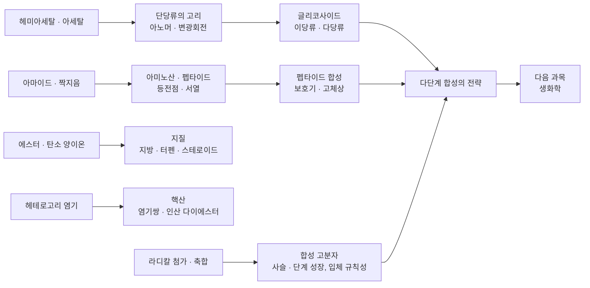

# 유기화학 14. 생체 분자와 합성 고분자 — 아세탈·아마이드·에스터 세 가지 결합으로 짓는 생명과 플라스틱
<!-- prev: ochem-13, ubio-1, ochem-3, ochem-10, ochem-11 -->
<!-- next: bchem-1 -->

> [!NOTE]
> **이 단원의 범위**
> - 탄수화물: 알도스·케토스와 D계열 가계도, 피셔·하워스 투영식과 의자 형태, 아노머와 변광회전(아노머 효과), 단당류의 반응(환원·산화·사슬 늘리기), 글리코사이드, 이당류·다당류와 메틸화 분석
> - 아미노산과 펩타이드: 쌍극성 이온과 등전점, 펩타이드 결합과 서열 결정(에드만 분해), 펩타이드 합성의 보호기(Boc·Fmoc·Cbz)와 짝지음(DCC), 라세미화, 메리필드 고체상 합성
> - 지질: 지방산과 트라이글리세라이드(비누화값·아이오딘가), 인지질, 터펜(아이소프렌 규칙)과 스테로이드(고리 접합과 입체 중심)
> - 핵산: 뉴클레오사이드와 뉴클레오타이드(N-글리코사이드, 인산 다이에스터), 염기의 토토머와 왓슨–크릭 염기쌍, RNA가 염기에 약한 까닭, 포스포아미다이트 합성 개관
> - 합성 고분자: 사슬 성장 중합(라디칼·양이온·음이온·리빙·고리 열림·배위)과 단계 성장 중합(분자량 분포, 폴리우레테인), 입체 규칙성과 지글러–나타 촉매, 공중합체와 유리 전이
> - 다단계 합성의 전략 정리: 역합성, 반응 순서, 직교 보호기, 선형·수렴 합성의 수득률

**학습 목표**

1. D-알도스의 피셔 투영식을 하워스 투영식과 의자 형태로 옮기고, 아노머·에피머를 판별하며, 변광회전 자료로 아노머의 평형 조성과 아노머 효과의 크기를 계산할 수 있다.
2. 단당류의 환원·산화·사슬 늘리기 반응과 글리코사이드 생성을 「알데하이드와 케톤」의 헤미아세탈·아세탈 화학으로 설명하고, 환원당·비환원당과 이당류·다당류의 결합 방식을 구조로 판단할 수 있다.
3. 아미노산과 펩타이드의 전하를 pH와 $\mathrm{p}K_\mathrm{a}$로 계산해 등전점을 구하고, 에드만 분해와 부분 가수 분해 자료로 펩타이드 서열을 결정할 수 있다.
4. 보호기(Boc·Fmoc·Cbz, 에스터)와 짝지음 시약(DCC)의 메커니즘으로 펩타이드 합성 경로를 설계하고, 라세미화를 막는 조건과 고체상 합성의 수득률 한계를 설명할 수 있다.
5. 트라이글리세라이드·인지질·터펜·스테로이드의 구조를 작용기와 입체화학으로 읽고, 비누화값·아이오딘가로 지방의 평균 몰질량과 불포화도를 계산할 수 있다.
6. 뉴클레오타이드의 구조와 염기쌍의 수소 결합 무늬를 설명하고, RNA와 DNA의 화학적 안정성 차이를 분자 안 친핵체로 설명할 수 있다.
7. 사슬 성장·단계 성장 중합의 메커니즘과 분자량–전환율 관계, 분자량 분포($\bar{M}_n$, $\bar{M}_w$, 분산도)를 계산하고, 입체 규칙성·공중합체 구조가 물성을 정하는 까닭을 설명하며, 다단계 합성 경로를 전략적으로 짤 수 있다.

**이 단원의 학습 사다리**

| 단계 | 무엇을 하나? |
|---|---|
| STEP 1. 이전 학습 다시 보기 | 피셔 투영식과 D/L, 의자 형태와 A값, 헤미아세탈·아세탈, 아마이드·에스터, 라디칼 중합과 축합 중합 |
| STEP 2. 기초 다지기 | 다시 쓰는 결합 세 가지, 분율식으로 전하 세기, 곱해지는 수득률, 수 평균과 무게 평균 |
| STEP 3. 핵심 개념 | 단당류 → 고리 구조 → 변광회전 → 단당류의 반응 → 글리코사이드 → 이당류·다당류 → 아미노산 → 펩타이드와 서열 → 펩타이드 합성 → 고체상 합성 → 지방과 인지질 → 터펜과 스테로이드 → 핵산 → 사슬 성장 중합 → 단계 성장과 입체 규칙성 → 다단계 합성 전략 |
| STEP 4. 오개념 바로잡기 | "β-글루코스는 OH가 위에 있으니 축 방향이다", "등전점에서는 아미노산이 전하를 띠지 않는 분자이다" 같은 착각 |
| STEP 5. 대학원·연구로 | 천연 화학적 결합(단백질의 화학 합성), 화학적으로 순환하는 고분자 |
| STEP 6. 생활·산업·진로 | 펩타이드 의약품, 핵산 의약품과 mRNA, 생분해성 폴리락타이드, 스테로이드 의약품 |

---

## 🗺️ 단원 들어가기

빵 한 조각, 손톱, 머리카락, 세포막, 유전자. 그리고 페트병, 나일론 옷, 아크릴 판, 스펀지. 생명체가 만든 분자와 공장이 만든 분자는 겉보기에 전혀 다르지만, 유기화학의 눈으로 보면 놀랄 만큼 닮았다. 거의 모두가 **작은 단위체를 같은 종류의 결합으로 수백~수만 번 이은 것**이고, 그 결합은 우리가 이미 배운 몇 가지뿐이다.

| 거대 분자 | 단위체 | 단위체를 잇는 결합 | 처음 배운 곳 |
|---|---|---|---|
| 녹말·셀룰로스 | 글루코스 | **아세탈**(글리코사이드 결합) | 「알데하이드와 케톤」 ⑤ |
| 단백질 | 아미노산 | **아마이드**(펩타이드 결합) | 「카복실산과 그 유도체」 ⑧ |
| 지방 | 글리세롤 + 지방산 | **에스터** | 「카복실산과 그 유도체」 ⑦ |
| DNA·RNA | 뉴클레오타이드 | **인산 다이에스터** + N-글리코사이드 | 「아민과 헤테로고리 화합물」의 염기 |
| 폴리에틸렌·폴리스타이렌 | 알켄 | C–C (첨가) | 「알켄과 알카인」 ⑨ |
| 나일론·PET | 다이아민·다이올 + 다이카복실산 | 아마이드·에스터 | 「카복실산과 그 유도체」 ⑪ |

이 단원은 유기화학의 마지막 단원이다. 새로운 반응을 많이 배우기보다, 13개 단원에서 익힌 반응이 **생체 분자와 고분자라는 큰 무대에서 어떻게 쓰이는지**를 본다. 글루코스가 고리를 만드는 것은 분자 안 헤미아세탈 생성이고, 펩타이드 합성의 어려움은 '아마이드를 만들고 싶은 곳에서만 만드는' 화학 선택성의 문제이며, 폴리프로필렌의 녹는점은 입체화학이 정한다. 대사와 효소의 작동은 다음 과목인 생화학이 다룬다. 여기서는 그 분자들의 **구조와 반응**을 유기화학의 언어로 정확히 읽어 두는 것이 목표이다.

---

## STEP 1. 🔙 이전 학습 다시 보기

### 연계 개념표

| 이전 단원 | 그때 배운 것 | 이 단원에서 확장되는 것 |
|---|---|---|
| 일반생명과학 「생명의 화학」 '탄수화물'~'핵산' | 네 가지 생체 거대 분자의 이름과 역할, 축합과 가수 분해, α/β 글리코사이드 결합, 단백질의 네 단계 구조 | 같은 분자를 **입체 구조와 반응 메커니즘**으로: 아노머가 생기는 까닭, 등전점 계산, 펩타이드를 실험실에서 만드는 법 |
| 유기화학 「입체화학」 ⑥ '피셔 투영식', ⑪ '카이랄성과 생체 활성' | 피셔 투영식의 약속, D/L 표기, D-글루코스 (2R,3S,4R,5R), L-아미노산 | D-알도스 가계도, 에피머, 피셔 → 하워스 → 의자 형태의 변환 |
| 유기화학 「알케인과 사이클로알케인」 ⑧ 'A값', STEP 5 '아노머 효과' | 적도 치환기가 안정, OH의 A값 약 3.9 kJ/mol, 아노머 효과의 이름 | β-D-글루코피라노스가 모두 적도인 까닭, 변광회전 자료로 아노머 효과를 **숫자로** |
| 유기화학 「알데하이드와 케톤」 ⑤·⑥ '헤미아세탈과 아세탈' | 5·6원 고리 헤미아세탈이 우세, 아세탈은 산 촉매로만 생기고 염기에 안정 | 단당류의 고리 열림–닫힘(변광회전), 글리코사이드 = 아세탈, 환원당 판별 |
| 유기화학 「카복실산과 그 유도체」 ⑦·⑧·⑪ | 비누화, 아마이드의 공명과 평면성, DCC 짝지음, 카로더스 식 | 트라이글리세라이드의 비누화값, 보호기 전략과 고체상 합성, 분자량 **분포** |
| 유기화학 「알켄과 알카인」 ⑨ '라디칼 중합과 천장 온도' | 라디칼 사슬 중합의 개시·전파·종결, 머리–꼬리 연결, 천장 온도 | 양이온·음이온·리빙·배위 중합, 입체 규칙성 |
| 유기화학 「아민과 헤테로고리 화합물」 '피리미딘·퓨린 개관' | 헤테로고리 질소의 염기도와 방향족성, 아마이드형 질소 | 핵산 염기의 토토머와 수소 결합 무늬 |

### 준비 운동 (사전 진단)

**Q1.** D-글루코스 사슬형의 피셔 투영식에서 C2~C5의 OH가 각각 왼쪽인지 오른쪽인지 쓰고, 왜 'D'인지 설명하시오.

**Q2.** 5-하이드록시펜탄알은 수용액에서 대부분 고리형으로 존재한다. 이 고리형 화합물의 작용기 이름과 고리의 원자 수를 쓰시오.

**Q3.** 아세탈은 NaOH 수용액과 묽은 HCl 수용액 가운데 어느 쪽에서 가수 분해되는가? 그 까닭을 한 문장으로 쓰시오.

**Q4.** 아세트산($\mathrm{p}K_\mathrm{a}$ 4.76)이 pH 6.76의 완충 용액에 녹아 있다. 아세트산 이온으로 있는 분율은?

정답 및 해설

**Q1.** C2 오른쪽, C3 왼쪽, C4 오른쪽, C5 오른쪽. 카보닐에서 가장 먼 입체 중심(C5)의 OH가 오른쪽이므로 D이다(「입체화학」 ⑥).

**Q2.** 헤미아세탈, 6원자 고리(O 1개 + C 5개). 분자 안 반응이라 엔트로피 손실이 작다(「알데하이드와 케톤」 ⑤). 글루코스의 고리도 같은 원리이다.

**Q3.** 묽은 HCl 수용액. 아세탈의 OR이 떨어지려면 산이 산소를 양성자화하여 좋은 이탈기(알코올)로 바꾸어야 하고, 이때 옥소카베늄 이온이 생긴다. 염기에서는 이탈기가 알콕사이드여서 떨어지지 않는다.

**Q4.** $1/(1 + 10^{4.76 - 6.76}) = 1/1.01 = 0.990$, 약 99 %. pH가 $\mathrm{p}K_\mathrm{a}$보다 2 높으면 짝염기가 99 %이다. 이 계산이 ⑦의 등전점과 전하 계산의 바탕이다.

---

## STEP 2. 🧱 기초 다지기

### 디딤돌 1. 다시 쓰는 결합 세 가지 — 언제 생기고 언제 끊어지나

이 단원의 생체 분자는 아세탈·아마이드·에스터, 세 결합으로 대부분 설명된다. 「알데하이드와 케톤」과 「카복실산과 그 유도체」에서 배운 성질을 한 표로 모아 두자.

| 결합 | 생체 분자의 이름 | 만드는 조건(실험실) | 끊는 조건 | 안정한 조건 |
|---|---|---|---|---|
| 아세탈 $\mathrm{R_2C(OR')_2}$ | 글리코사이드 결합 | 알코올 + 산 촉매(물 제거) | 산 수용액(옥소카베늄 이온 경유) | 염기, 수소화물, 산화제 |
| 아마이드 $\mathrm{RCONHR'}$ | 펩타이드 결합 | 활성화한 카복실산 + 아민(DCC 등) | 6 M HCl, 110 ℃, 약 24 h 같은 센 조건 | 중성 물(반감기 수백 년으로 어림) |
| 에스터 $\mathrm{RCOOR'}$ | 지방, 인지질의 아실 결합 | 산 염화물·무수물 + 알코올, 피셔 에스터화 | 염기(비누화), 산 수용액 | 중성의 묽은 조건 |
| 인산 다이에스터 $\mathrm{(RO)_2PO_2^-}$ | 핵산 주사슬 | (생체: 효소, 실험실: 포스포아미다이트) | 센 염기·효소, RNA는 묽은 염기에서도 | 중성(음전하가 친핵체를 밀어낸다) |

> [!TIP]
> 💡 **요령** — 생체 분자의 반응을 보면 먼저 "이것은 어느 결합의 어느 반응인가"를 묻는다. 글루코스의 변광회전은 헤미아세탈의 열림–닫힘, 글리코사이드의 가수 분해는 아세탈의 가수 분해, 비누는 에스터의 비누화, 에드만 분해는 아이소싸이오사이아네이트에 대한 아민의 첨가와 분자 안 아실 치환이다. 새로 외울 것은 거의 없다.

### 디딤돌 2. 분율식으로 전하 세기

산 HA의 $\mathrm{p}K_\mathrm{a}$와 용액의 pH가 주어지면, 탈양성자화된 분율은 다음과 같다(「알데하이드와 케톤」 디딤돌 1).

$$
\alpha_{\mathrm{A^-}} = \frac{1}{1 + 10^{\mathrm{p}K_\mathrm{a} - \mathrm{pH}}}, \qquad \alpha_{\mathrm{HA}} = \frac{1}{1 + 10^{\mathrm{pH} - \mathrm{p}K_\mathrm{a}}}
$$

여러 이온화 원자단을 가진 분자의 **평균 전하**는 원자단마다 독립이라고 보고 더한다.

$$
\bar{q}(\mathrm{pH}) = \sum_{\text{양이온성 }i} \frac{1}{1 + 10^{\mathrm{pH} - \mathrm{p}K_{\mathrm{a},i}}} \; - \sum_{\text{음이온성 }j} \frac{1}{1 + 10^{\mathrm{p}K_{\mathrm{a},j} - \mathrm{pH}}}
$$

양이온성 원자단은 $\mathrm{-NH_3^+}$, 구아니디늄, 이미다졸륨처럼 양성자를 잃으면 중성이 되는 것, 음이온성은 $\mathrm{-COOH}$, $\mathrm{-SH}$, 페놀 OH처럼 양성자를 잃으면 음전하가 되는 것이다. $\bar{q} = 0$이 되는 pH가 **등전점**이다(⑦).

#### 예제 1 — 글리신의 평균 전하

글리신($\mathrm{p}K_{\mathrm{a}1} = 2.34$, $\mathrm{p}K_{\mathrm{a}2} = 9.60$)의 평균 전하를 pH 2.34, 7.00, 9.60에서 구하시오.

**풀이**
식 세우기: $\bar{q} = \dfrac{1}{1 + 10^{\mathrm{pH} - 9.60}} - \dfrac{1}{1 + 10^{2.34 - \mathrm{pH}}}$.
pH 2.34: $\dfrac{1}{1 + 10^{-7.26}} - \dfrac{1}{1 + 1} = 1.000 - 0.500 = +0.50$
pH 7.00: $\dfrac{1}{1 + 10^{-2.60}} - \dfrac{1}{1 + 10^{-4.66}} = 0.9975 - 1.0000 = -0.003 \approx 0$
pH 9.60: $0.500 - 1.000 = -0.50$
**의미** 중성 근처에서는 두 원자단이 모두 이온화된 **쌍극성 이온**(+1과 −1)이 대부분이어서 평균 전하가 거의 0이다. $\mathrm{p}K_\mathrm{a}$와 같은 pH에서는 그 원자단이 정확히 반만 이온화된다.

### 디딤돌 3. 곱해지는 수득률

여러 단계를 차례로 거치는 합성에서 전체 수득률은 단계 수득률의 **곱**이다. 단계마다 수득률 $y$인 반응을 $n$번 하면

$$
Y = y^n, \qquad \ln Y = n\ln y \approx -n(1 - y) \quad (y \text{가 1에 가까울 때})
$$

| 단계 수득률 $y$ | 20단계 | 50단계 | 100단계 |
|---|---|---|---|
| 0.90 | 0.12 | 0.0052 | $2.7\times10^{-5}$ |
| 0.99 | 0.82 | 0.61 | 0.37 |
| 0.995 | 0.90 | 0.78 | 0.61 |

단계 수가 많으면 99 %와 99.5 %의 차이가 결정적이 된다. 단백질 크기의 펩타이드를 화학적으로 만들기 어려운 까닭(⑩)과, 긴 합성을 **수렴형**으로 짜는 까닭(⑯)이 이 표 하나에 들어 있다.

#### 예제 2 — 몇 단계까지 가능한가

단계 수득률이 98 %일 때 전체 수득률을 50 % 이상으로 지키려면 최대 몇 단계까지 할 수 있는가?

**풀이**
$0.98^n \ge 0.50 \Rightarrow n \le \dfrac{\ln 0.50}{\ln 0.98} = \dfrac{-0.6931}{-0.02020} = 34.3$. 따라서 34단계. 어림식 $n \approx 0.693/(1 - y) = 34.7$도 거의 같다.
**의미** 단계 수득률의 '손실'($1 - y$)을 절반으로 줄이면 같은 전체 수득률로 갈 수 있는 단계 수가 2배가 된다.

### 디딤돌 4. 수 평균과 무게 평균 — 분포를 가진 분자의 '평균 몰질량'

합성 고분자의 사슬 길이는 하나로 정해지지 않고 분포를 가진다. 몰질량 $M_i$인 사슬이 $N_i$ mol 있을 때 두 가지 평균을 쓴다(수학 도구 「확률과 통계」 '평균과 분산').

$$
\bar{M}_n = \frac{\sum N_i M_i}{\sum N_i}, \qquad \bar{M}_w = \frac{\sum N_i M_i^2}{\sum N_i M_i}, \qquad Đ = \frac{\bar{M}_w}{\bar{M}_n} \ge 1
$$

$\bar{M}_n$(**수 평균 몰질량**)은 사슬 한 개당 평균이고, $\bar{M}_w$(**무게 평균 몰질량**)는 질량으로 가중한 평균이라 무거운 사슬을 더 크게 센다. 둘의 비 **분산도**(dispersity, $Đ$)는 모든 사슬의 길이가 같을 때만 1이다. 수학적으로 $\bar{M}_w/\bar{M}_n = 1 + \sigma^2/\bar{M}_n^2$($\sigma^2$는 수 분포의 분산)이므로 분포가 넓을수록 커진다. 단백질·DNA처럼 서열이 정해진 생체 고분자는 $Đ = 1$이고, 합성 고분자는 대개 1.01~수 사이이다.

#### 예제 3 — 두 종류 사슬의 혼합물

몰질량 10 kg/mol인 사슬 1.0 mol과 100 kg/mol인 사슬 1.0 mol을 섞었다. $\bar{M}_n$, $\bar{M}_w$, $Đ$를 구하시오.

**풀이**
$\bar{M}_n = \dfrac{10 + 100}{2} = 55\ \mathrm{kg/mol}$, $\bar{M}_w = \dfrac{10^2 + 100^2}{10 + 100} = \dfrac{10\,100}{110} = 91.8\ \mathrm{kg/mol}$, $Đ = 91.8/55 = 1.67$.
**의미** 사슬 수는 같지만 질량의 91 %가 무거운 사슬에 있으므로 $\bar{M}_w$는 무거운 쪽으로 쏠린다. 삼투압·말단기 분석은 $\bar{M}_n$을, 빛 산란은 $\bar{M}_w$를 준다. 녹은 고분자의 점성처럼 긴 사슬이 좌우하는 물성은 $\bar{M}_w$와 더 잘 맞는다.

---

## STEP 3. 📘 핵심 개념

