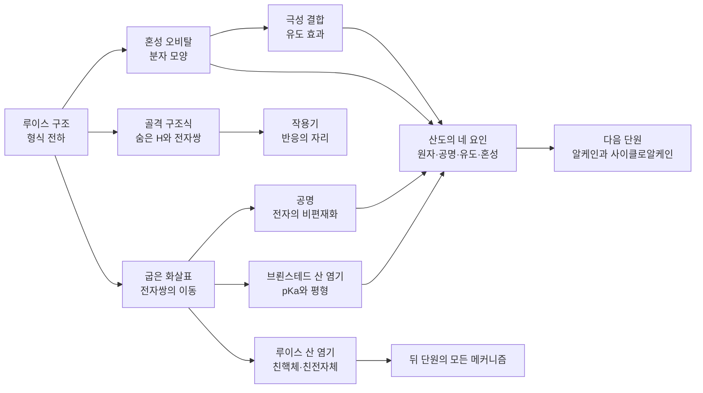

# 유기화학 1. 구조와 결합, 산과 염기 — 전자가 어디에 있는지가 모든 것을 정한다
<!-- prev: uchem-5, uchem-9, uchem-12 -->
<!-- next: ochem-2 -->

> [!NOTE]
> **이 단원의 범위**
> - 루이스 구조와 형식 전하, 탄소·질소·산소의 결합 무늬
> - 혼성 오비탈($sp^3$, $sp^2$, $sp$)과 분자 모양, s 성격과 결합각의 관계
> - 극성 공유 결합, 쌍극자 모멘트, 유도 효과
> - 골격 구조식 그리기와 읽기, 작용기 개관
> - 굽은 화살표 표기법(전자쌍 이동의 규칙과 기본 무늬)
> - 공명과 전자의 비편재화(공명 구조 그리기, 주된 기여 구조 고르기)
> - 브뢴스테드·루이스 산 염기, $\mathrm{p}K_\mathrm{a}$와 산–염기 평형의 방향, 산도를 정하는 요인(원자·공명·유도·혼성)

**학습 목표**

1. 유기 분자의 루이스 구조를 체계적으로 그리고 형식 전하를 계산하여, 탄소·질소·산소·할로젠의 중성·양이온·음이온 결합 무늬를 한눈에 알아볼 수 있다.
2. 혼성 오비탈로 단일·이중·삼중 결합의 σ·π 구성과 분자 모양을 설명하고, 혼성의 s 성격과 결합각·결합 길이·결합 세기의 관계를 정량적으로 다룰 수 있다.
3. 전기 음성도 차이로 결합의 극성과 분자의 쌍극자 모멘트를 예측하고, 유도 효과가 결합을 따라 전달되며 거리에 따라 약해지는 것을 자료로 설명할 수 있다.
4. 골격 구조식을 그리고 읽어 분자식·작용기·숨은 수소와 비공유 전자쌍을 정확히 복원할 수 있다.
5. 굽은 화살표의 규칙에 따라 전자쌍의 이동을 그리고, 이를 써서 공명 구조를 만들고 주된 기여 구조를 고를 수 있다.
6. $\mathrm{p}K_\mathrm{a}$ 표로 산–염기 반응의 평형 상수와 방향을 계산하고, 원자·공명·유도·혼성의 네 요인으로 처음 보는 산의 세기를 예측할 수 있다.
7. 브뢴스테드 산 염기와 루이스 산 염기를 굽은 화살표로 같은 언어로 나타내고, 친핵체·친전자체 개념으로 이어 갈 수 있다.

**이 단원의 학습 사다리**

| 단계 | 무엇을 하나? |
|---|---|
| STEP 1. 이전 학습 다시 보기 | 일반화학의 루이스 구조·VSEPR·혼성 오비탈, 산·염기와 $K_\mathrm{a}$, 유기화학 개관의 작용기 |
| STEP 2. 기초 다지기 | 쌍극자의 벡터 합, 로그와 $\Delta G^\circ = 2.303RT\,\Delta\mathrm{p}K_\mathrm{a}$, 오비탈의 선형 결합과 직교성, 헨더슨–하셀바흐 식 |
| STEP 3. 핵심 개념 | 루이스 구조 → 혼성 → 극성과 유도 효과 → 골격 구조식 → 작용기 → 굽은 화살표 → 공명 → $\mathrm{p}K_\mathrm{a}$와 평형 → 산도의 네 요인 → 루이스 산 염기 |
| STEP 4. 오개념 바로잡기 | "공명 구조는 빠르게 바뀌는 이성질체이다", "화살표는 양성자가 움직이는 방향으로 긋는다" 같은 착각 |
| STEP 5. 대학원·연구로 | 기체상 산도와 용매화, 비수용매의 $\mathrm{p}K_\mathrm{a}$ 척도, 자연 결합 오비탈 분석 |
| STEP 6. 생활·산업·진로 | 약물의 이온화와 흡수, 산–염기 추출 공정, 초강산과 촉매, 계산 화학으로 $\mathrm{p}K_\mathrm{a}$ 예측 |

---

## 🗺️ 단원 들어가기

식초의 아세트산($\mathrm{CH_3COOH}$)과 술의 에탄올($\mathrm{CH_3CH_2OH}$)은 둘 다 O–H 결합을 가진다. 그런데 아세트산은 물에 녹아 신맛을 낼 만큼 양성자를 잘 내놓고, 에탄올은 거의 내놓지 않는다. 두 산의 세기 차이는 무려 $10^{11}$배이다. O–H 결합 하나만 보면 차이가 없는데, 왜 이렇게 다를까? 답은 양성자가 떠난 뒤 남는 **전자쌍이 어디에, 얼마나 넓게 퍼져 있을 수 있는가**에 있다.

유기화학은 수천만 종의 화합물과 수만 가지 반응을 다룬다. 이것을 하나하나 외우는 것은 불가능하다. 다행히 거의 모든 유기 반응은 "전자가 풍부한 곳에서 전자가 부족한 곳으로 전자쌍이 움직인다"는 하나의 원리로 읽을 수 있다. 이 원리를 쓰려면 세 가지가 필요하다. 첫째, 분자 속 전자가 어디에 있는지 **그리는 법**(루이스 구조, 형식 전하, 골격 구조식). 둘째, 전자가 어디에 치우쳐 있고 얼마나 퍼져 있는지 **판단하는 법**(혼성, 극성, 유도 효과, 공명). 셋째, 전자가 움직이는 것을 **기록하는 법**(굽은 화살표). 그리고 이 셋을 처음으로 시험하는 무대가 가장 단순한 반응인 **산–염기 반응**이다.

이 단원에서 익히는 그림 그리는 법과 화살표 긋는 법은 유기화학의 나머지 모든 단원에서 매일 쓰인다. 「알케인과 사이클로알케인」의 형태 분석에서 「카보닐 α 자리의 반응과 축합 반응」의 엔올레이트까지, 모든 메커니즘이 여기서 정한 규칙으로 그려진다.

---

## STEP 1. 🔙 이전 학습 다시 보기

### 연계 개념표

| 이전 단원 | 그때 배운 것 | 이 단원에서 확장되는 것 |
|---|---|---|
| 일반화학 「화학 결합과 분자 구조」 '루이스 구조와 형식 전하' | 전자점식, 형식 전하 $= V - N - B/2$로 구조 고르기, 공명 혼성체 | 유기 원자의 **결합 무늬**(결합 수 + 비공유 전자쌍 수 ↔ 형식 전하)를 외워 계산 없이 전하를 읽기, 굽은 화살표로 공명 구조를 **만들고** 주된 기여 구조를 규칙으로 고르기 |
| 일반화학 「화학 결합과 분자 구조」 'VSEPR, 혼성 오비탈' | 전자 영역 수로 모양 예측, $sp$·$sp^2$·$sp^3$, σ·π 결합 | s 성격과 결합각의 정량 관계($\cos\theta = -\alpha/(1-\alpha)$), 혼성에 따른 결합 길이·세기·전기 음성도, 공명에 참여하는 비공유 전자쌍의 혼성 |
| 일반화학 「화학 결합과 분자 구조」 '전기 음성도와 쌍극자 모멘트' | 결합의 극성, $\mu = Qr$, 분자의 극성은 벡터 합 | 결합 극성이 이웃 결합으로 전달되는 **유도 효과**, 그 거리 의존을 $\mathrm{p}K_\mathrm{a}$ 자료로 확인 |
| 일반화학 「산·염기와 수용액 평형」 | 브뢴스테드–로리·루이스 정의, $K_\mathrm{a}$, $\mathrm{p}K_\mathrm{a}$, 짝산–짝염기, 헨더슨–하셀바흐 식, 수평화 효과 | $\mathrm{p}K_\mathrm{a}$가 $-10$에서 50까지 걸친 유기 산의 표, $\Delta\mathrm{p}K_\mathrm{a}$로 **평형 상수를 바로 계산**, 짝염기의 안정성으로 산도를 **예측** |
| 일반화학 「핵화학·배위 화학·유기화학 개관」 '탄화수소, 작용기, 기본 유기 반응' | 알케인·알켄·알카인·방향족, 작용기 표, 치환·첨가·제거, 마르코브니코프 규칙의 결과 | 작용기를 **골격 구조식**으로 그리고 읽기, 반응 결과를 외우는 대신 굽은 화살표로 **전자의 흐름**을 쓰기 시작 |

### 준비 운동 (사전 진단)

**Q1.** 하이드로늄 이온 $\mathrm{H_3O^+}$에서 산소의 형식 전하를 계산하시오.

**Q2.** 에텐($\mathrm{CH_2{=}CH_2}$)의 탄소 혼성과 H–C–H 결합각은 대략 얼마인가? 이중 결합은 어떤 결합 두 개로 이루어지는가?

**Q3.** 아세트산의 $K_\mathrm{a} = 1.8\times10^{-5}$이다. $\mathrm{p}K_\mathrm{a}$를 구하시오. $\mathrm{p}K_\mathrm{a}$가 더 작은 산은 더 강한가, 더 약한가?

**Q4.** 다음 중 루이스 산인 것을 모두 고르시오. $\mathrm{BF_3}$, $\mathrm{NH_3}$, $\mathrm{H^+}$, $\mathrm{AlCl_3}$, $\mathrm{OH^-}$

정답 및 해설

**Q1.** $+1$ — 원자가 전자 $V = 6$, 비공유 전자 $N = 2$(전자쌍 1개), 결합 전자 $B = 6$(결합 3개). $6 - 2 - 3 = +1$.

**Q2.** $sp^2$, 약 120°. 이중 결합은 σ 결합 1개와 π 결합 1개로 이루어진다.

**Q3.** $\mathrm{p}K_\mathrm{a} = -\log(1.8\times10^{-5}) = 4.74$. $\mathrm{p}K_\mathrm{a}$가 작을수록 $K_\mathrm{a}$가 크므로 더 강한 산이다. (아세트산의 $\mathrm{p}K_\mathrm{a}$는 자료에 따라 4.74~4.76으로 적는다. 이 단원에서는 4.76을 쓴다.)

**Q4.** $\mathrm{BF_3}$, $\mathrm{H^+}$, $\mathrm{AlCl_3}$ — 셋 모두 빈 오비탈로 전자쌍을 받을 수 있다. $\mathrm{NH_3}$와 $\mathrm{OH^-}$는 비공유 전자쌍을 주는 루이스 염기이다.

---

## STEP 2. 🧱 기초 다지기

### 디딤돌 1. 쌍극자 모멘트의 벡터 합

결합 하나의 극성은 **결합 쌍극자**라는 화살표(벡터)로 나타낸다. 크기는 $\mu = Qr$(단위 디바이, $1\ \mathrm{D} = 3.336\times10^{-30}\ \mathrm{C\cdot m}$), 방향은 이 책에서는 화학의 관례에 따라 **양전하 끝에서 음전하 끝으로**(전자가 쏠린 쪽으로) 그린다. 분자 전체의 쌍극자 모멘트는 결합 쌍극자의 **벡터 합**이다. 수학 도구 3 「벡터와 벡터 미적분」에서 익힌 성분별 덧셈을 그대로 쓴다.

같은 크기 $\mu_1$의 결합 쌍극자 두 개가 각 $\theta$를 이루면, 두 벡터를 이등분선 방향으로 분해했을 때 수직 성분은 서로 지워지고 이등분선 성분만 남는다.

$$
\mu_\text{분자} = 2\mu_1\cos\frac{\theta}{2}
$$

$\theta = 180°$(이산화 탄소)이면 $\cos 90° = 0$이므로 극성 결합을 가졌는데도 무극성 분자가 된다. 사면체의 사염화 탄소도 네 C–Cl 쌍극자의 합이 0이다.

#### 예제 1 — 물의 O–H 결합 쌍극자

물 분자의 쌍극자 모멘트는 1.85 D, H–O–H 결합각은 104.5°이다. O–H 결합 하나의 결합 쌍극자를 구하시오. (비공유 전자쌍의 기여는 결합 쌍극자에 포함된 것으로 본다.)

**풀이**
식 세우기: $\mu_\text{분자} = 2\mu_\mathrm{OH}\cos(\theta/2)$이므로 $\mu_\mathrm{OH} = \mu_\text{분자}/[2\cos(\theta/2)]$.
대입: $\mu_\mathrm{OH} = 1.85/(2\cos 52.25°) = 1.85/(2\times0.6122) = 1.51\ \mathrm{D}$.
**의미** 결합 하나의 쌍극자가 분자 전체보다 작은데도 두 결합이 굽어 있어 합이 커진다. 물이 직선형이었다면 쌍극자 모멘트는 0이었을 것이다. 결합각이 분자의 성질을 바꾸는 가장 직접적인 예이다.

### 디딤돌 2. 로그와 $\mathrm{p}K_\mathrm{a}$, 그리고 자유 에너지

산의 해리 상수는 $10^{-50}$에서 $10^{10}$까지 60자리에 걸치므로 로그로 다룬다.

$$
\mathrm{p}K_\mathrm{a} = -\log K_\mathrm{a}, \qquad K_\mathrm{a} = 10^{-\mathrm{p}K_\mathrm{a}}
$$

일반화학 「화학 열역학」의 $\Delta G^\circ = -RT\ln K$를 상용로그로 바꾸면 $\Delta G^\circ = 2.303RT\,\mathrm{p}K_\mathrm{a}$이다. 25 ℃에서 $2.303RT = 5.71\ \mathrm{kJ/mol}$이므로

$$
\Delta\mathrm{p}K_\mathrm{a} = 1 \;\Longleftrightarrow\; K_\mathrm{a}\text{가 10배} \;\Longleftrightarrow\; \Delta G^\circ\text{가 } 5.71\ \mathrm{kJ/mol}
$$

| $\Delta\mathrm{p}K_\mathrm{a}$ | $K_\mathrm{a}$의 비 | 해리 자유 에너지의 차 (25 ℃) |
|---|---|---|
| 1 | 10 | 5.7 kJ/mol |
| 3 | 1000 | 17.1 kJ/mol |
| 11 | $10^{11}$ | 63 kJ/mol |

$\mathrm{p}K_\mathrm{a}$ 표는 사실 **자유 에너지 표**이다. 두 산의 $\mathrm{p}K_\mathrm{a}$ 차이는 양성자를 떼어 내는 데 드는 자유 에너지의 차이이고, 그 차이는 대부분 **짝염기의 안정성** 차이에서 온다. 이것이 ⑨에서 산도를 짝염기로 설명하는 근거이다.

#### 예제 2 — $\mathrm{p}K_\mathrm{a}$와 자유 에너지

아세트산($\mathrm{p}K_\mathrm{a} = 4.76$)과 에탄올($\mathrm{p}K_\mathrm{a} \approx 16$)의 $K_\mathrm{a}$ 비와 해리 표준 자유 에너지의 차를 25 ℃에서 구하시오.

**풀이**
$K_\mathrm{a}$ 비 $= 10^{16 - 4.76} = 10^{11.24} \approx 1.7\times10^{11}$.
$\Delta(\Delta G^\circ) = 5.71\times(16 - 4.76) = 64\ \mathrm{kJ/mol}$.
**의미** 단원 들어가기에서 말한 "$10^{11}$배"는 자유 에너지로 약 64 kJ/mol이다. C–C 결합 에너지의 5분의 1쯤 되는 큰 에너지가 짝염기의 구조 차이(⑦·⑨의 공명) 하나에서 나온다.

### 디딤돌 3. 오비탈의 선형 결합과 직교성

수학 도구 5 「선형대수」 '벡터 공간과 기저'에서 익힌 것처럼, 서로 직교하는 기저 벡터를 섞어 새로운 직교 기저를 만들 수 있다. 원자 오비탈도 마찬가지이다. 한 원자의 $2s$, $2p_x$, $2p_y$, $2p_z$는 서로 직교하고 규격화된($\langle\phi_i\vert\phi_j\rangle = \delta_{ij}$) 기저이므로, 이들의 선형 결합으로 방향이 다른 새 오비탈(혼성 오비탈)을 만들 수 있다. 조건은 두 가지이다.

1. **규격화**: 계수의 제곱의 합이 1이다. $h = a\,\phi_{2s} + b\,\phi_{2p}$이면 $a^2 + b^2 = 1$. 이때 $a^2$을 그 혼성 오비탈의 **s 성격**(s character) $\alpha$라 한다.
2. **직교**: 같은 원자의 서로 다른 혼성 오비탈끼리는 내적이 0이다.

p 오비탈은 방향을 가진 벡터처럼 다룰 수 있다. 단위 벡터 $\hat{\mathbf{n}}$ 방향을 향한 p 오비탈은 $\phi_{2p}(\hat{\mathbf{n}}) = n_x\phi_{2p_x} + n_y\phi_{2p_y} + n_z\phi_{2p_z}$이고, 두 방향의 p 오비탈의 내적은 $\hat{\mathbf{n}}_1\cdot\hat{\mathbf{n}}_2 = \cos\theta$이다.

#### 예제 3 — $sp$ 혼성 오비탈의 직교성 확인

$h_1 = \tfrac{1}{\sqrt2}(\phi_{2s} + \phi_{2p_z})$, $h_2 = \tfrac{1}{\sqrt2}(\phi_{2s} - \phi_{2p_z})$가 규격화되어 있고 서로 직교함을 보이고, 두 오비탈이 향하는 방향 사이의 각을 구하시오.

**풀이**
규격화: $\langle h_1\vert h_1\rangle = \tfrac12(\langle s\vert s\rangle + 2\langle s\vert p_z\rangle + \langle p_z\vert p_z\rangle) = \tfrac12(1 + 0 + 1) = 1$. $h_2$도 같다.
직교: $\langle h_1\vert h_2\rangle = \tfrac12(\langle s\vert s\rangle - \langle p_z\vert p_z\rangle) = \tfrac12(1 - 1) = 0$.
방향: $h_1$은 p 성분이 $+z$, $h_2$는 $-z$ 방향이므로 180°이다. s 성격은 각각 $\alpha = (1/\sqrt2)^2 = 1/2$, 즉 50 %이다.
**의미** 아세틸렌의 선형 구조는 "s 성격 50 %인 두 오비탈이 직교하려면 정반대를 향해야 한다"는 수학적 사실의 결과이다. ②에서 이 논리를 일반화한다.

### 디딤돌 4. 헨더슨–하셀바흐 식 — pH가 정하는 화학종의 비율

일반화학 「산·염기와 수용액 평형」에서 배운 헨더슨–하셀바흐 식은 완충 용액뿐 아니라 **어떤 pH에서 산이 몇 %나 짝염기로 있는가**를 알려 주는 식이다.

$$
\mathrm{pH} = \mathrm{p}K_\mathrm{a} + \log\frac{[\mathrm{A^-}]}{[\mathrm{HA}]} \quad\Longrightarrow\quad f_\mathrm{HA} = \frac{[\mathrm{HA}]}{[\mathrm{HA}] + [\mathrm{A^-}]} = \frac{1}{1 + 10^{\,\mathrm{pH} - \mathrm{p}K_\mathrm{a}}}
$$

| $\mathrm{pH} - \mathrm{p}K_\mathrm{a}$ | $-2$ | $-1$ | 0 | $+1$ | $+2$ |
|---|---|---|---|---|---|
| 산 형태 HA의 분율 | 99 % | 91 % | 50 % | 9.1 % | 0.99 % |

**외울 것은 하나뿐이다**: pH가 $\mathrm{p}K_\mathrm{a}$보다 낮으면 양성자가 붙은 형태, 높으면 떨어진 형태가 우세하고, 차이가 2이면 99 : 1이다.

#### 예제 4 — 위와 혈액 속의 아스피린

아스피린(아세틸살리실산)의 카복실기 $\mathrm{p}K_\mathrm{a}$는 약 3.5이다. 위액(pH 1.5)과 혈장(pH 7.4)에서 중성 형태의 분율을 구하시오.

**풀이**
위액: $f_\mathrm{HA} = 1/(1 + 10^{1.5 - 3.5}) = 1/1.01 = 0.990$ → 99 %가 중성.
혈장: $f_\mathrm{HA} = 1/(1 + 10^{7.4 - 3.5}) = 1/(1 + 10^{3.9}) = 1.3\times10^{-4}$ → 0.013 %만 중성, 나머지는 카복실산 이온.
**의미** 전하가 없는 분자는 세포막(지질 이중층)을 쉽게 통과하고 이온은 잘 통과하지 못한다. 약물이 어디서 흡수되고 어디에 머무는지가 $\mathrm{p}K_\mathrm{a}$ 하나로 크게 갈린다(STEP 6).

<!-- 시뮬레이션 요청: pH–화학종 분율 탐색기. 가로축 pH 0~14, 세로축 산 형태(HA 또는 BH⁺)의 분율 0~1. 사용자가 고를 수 있는 화합물: 아세트산(pKa 4.76), 페놀(10.0), 메틸암모늄 이온(10.6), 아스피린(3.5), 피리디늄 이온(5.2), 에탄올(16). 슬라이더로 pH를 움직이면 곡선 위 점과 함께 "HA x % / A⁻ y %"를 표시하고, pKa 위치에 세로 점선과 "pH = pKa → 50 %" 이름표. 위액(1.5)·혈장(7.4)·소장(약 6.5) 위치를 가로축에 작은 눈금으로 표시. 화합물을 둘 고르면 곡선 두 개를 겹쳐 그려 어느 pH에서 둘을 분리(한쪽은 이온, 다른 쪽은 중성)할 수 있는지 그 구간을 옅게 칠한다. -->

---

## STEP 3. 📘 핵심 개념

### ① 루이스 구조와 형식 전하

유기화학의 모든 그림은 **원자가 전자가 어디에 있는가**를 나타낸다. 일반화학 「화학 결합과 분자 구조」에서 익힌 루이스 구조를 유기 분자에 맞게 빠르고 정확하게 그리는 것이 첫걸음이다.

#### 루이스 구조를 그리는 절차

1. 원자가 전자의 총수를 센다(음이온은 전하만큼 더하고, 양이온은 뺀다).
2. 원자의 연결 순서(골격)를 정한다. 유기 분자에서는 축약 구조식이 연결 순서를 알려 준다. $\mathrm{CH_3CH_2OH}$는 C–C–O–H, $\mathrm{CH_3OCH_3}$는 C–O–C이다. 수소와 할로젠은 언제나 끝 원자이다.
3. 연결마다 단일 결합(전자 2개)을 놓고, 남은 전자를 전기 음성도가 큰 끝 원자부터 비공유 전자쌍으로 채운다.
4. 옥텟이 부족한 원자가 있으면 이웃 원자의 비공유 전자쌍을 다중 결합으로 바꾼다.
5. 각 원자의 **형식 전하**를 계산해 적는다.

$$
\text{형식 전하} = V - N - \frac{B}{2}
$$

$V$는 원자가 전자 수, $N$은 그 원자에 속한 비공유 전자 수, $B$는 그 원자가 참여한 결합 전자 수이다. 형식 전하는 "결합 전자를 정확히 반씩 나누었다면"이라는 가정 아래의 장부상 전하이다. 실제 전하 분포(부분 전하)와는 다르지만, **어느 원자가 전자쌍을 내줄 수 있고 어느 원자가 전자쌍을 받을 수 있는가**를 알려 주는 가장 빠른 표지이다. 분자의 형식 전하를 모두 더하면 분자의 전체 전하가 된다.

#### 결합 무늬 — 계산하지 않고 전하 읽기

$V - N - B/2$를 매번 계산하는 대신, 원자마다 "결합 몇 개 + 비공유 전자쌍 몇 개"의 무늬를 외워 두면 구조를 보자마자 전하를 읽을 수 있다. 여기서 이중 결합은 결합 2개, 삼중 결합은 결합 3개로 센다.

| 원자 | 양이온(+1) | 중성 | 음이온(−1) |
|---|---|---|---|
| 탄소 C | 결합 3, 전자쌍 0 (**탄소 양이온**, 옥텟 6) | 결합 4, 전자쌍 0 | 결합 3, 전자쌍 1 (**탄소 음이온**) |
| 질소 N | 결합 4, 전자쌍 0 (암모늄형) | 결합 3, 전자쌍 1 | 결합 2, 전자쌍 2 (아마이드 이온형) |
| 산소 O | 결합 3, 전자쌍 1 (옥소늄형) | 결합 2, 전자쌍 2 | 결합 1, 전자쌍 3 (알콕사이드형) |
| 할로젠 X | 결합 2, 전자쌍 2 (할로늄형) | 결합 1, 전자쌍 3 | 결합 0, 전자쌍 4 (할로젠화 이온) |

이 밖에 결합 3개에 홀전자 1개를 가진 중성 탄소(**라디칼**)와, 결합 2개에 전자 2개를 가진 중성 탄소(**카벤**)가 있다. 둘 다 옥텟이 차지 않아 반응성이 매우 크며, 뒤 단원(「알케인과 사이클로알케인」의 라디칼 할로젠화)에서 만난다.

<!-- 그림 요청: 결합 무늬 표의 그림판. 3행(C, N, O) × 3열(+1, 0, −1) 격자. 각 칸에 대표 화학종의 루이스 구조를 비공유 전자쌍을 점 두 개로 모두 그려 넣고 형식 전하를 원 안의 +, − 기호로 표시한다. C행: 메틸 양이온 CH3⁺(평면, 빈 p 오비탈을 옅은 아령으로), 메테인 CH4, 메틸 음이온 CH3⁻(전자쌍 1개). N행: 암모늄 NH4⁺, 암모니아 NH3, 아마이드 이온 NH2⁻(전자쌍 2개). O행: 하이드로늄 H3O⁺(전자쌍 1개), 물 H2O(전자쌍 2개), 수산화 이온 OH⁻(전자쌍 3개). 칸 아래에 "결합 n · 전자쌍 m"을 작은 글씨로. -->

> [!TIP]
> 💡 **요령** — 중성인 2주기 원자는 "결합 수 + 전자쌍 수 = 4"이고, 결합 수는 C 4, N 3, O 2, F 1로 하나씩 줄어든다(족 번호와 합이 8). 이 '보통 무늬'보다 결합이 **하나 많으면 +1**, **하나 적고 전자쌍이 하나 많으면 −1**이다. 탄소만은 결합이 하나 적을 때 전자쌍이 있으면 −1, 없으면 +1이다.

#### 예제 5 — 나이트로메테인의 형식 전하

나이트로메테인 $\mathrm{CH_3NO_2}$(C–N이 연결되고 N에 O 두 개가 붙음)의 루이스 구조를 그리고 모든 원자의 형식 전하를 구하시오.

**풀이**
① 원자가 전자: C 4 + H 3×1 + N 5 + O 2×6 = 24개.
② 골격: H₃C–N(–O)(–O). 단일 결합 6개에 전자 12개를 쓰면 12개가 남는다. 두 O에 비공유 전자쌍 3개씩(12개) 놓으면 남는 전자가 없다.
③ 이때 N은 결합 3개, 전자쌍 0개로 옥텟이 6이다. O 하나의 전자쌍을 N=O 이중 결합으로 바꾼다.
④ 형식 전하: N은 결합 4개, 전자쌍 0 → $5 - 0 - 4 = +1$. 이중 결합 O는 결합 2, 전자쌍 2 → 0. 단일 결합 O는 결합 1, 전자쌍 3 → $6 - 6 - 1 = -1$. C와 H는 0. 합은 0으로 중성 분자와 맞는다.
**의미** 나이트로기 $\mathrm{-NO_2}$는 형식 전하를 갖지 않는 구조를 그릴 수 없다(질소가 옥텟을 넘을 수 없으므로 N 원자에 결합 5개를 그리면 안 된다). 또 어느 O에 이중 결합을 그릴지 정할 수 없다. 이 '정할 수 없음'이 ⑦의 공명이다.

<!-- 그림 요청: 나이트로메테인(SMILES C[N+](=O)[O-])의 루이스 구조. 모든 비공유 전자쌍을 점으로 그리고(이중 결합 O에 2쌍, 단일 결합 O에 3쌍), N 옆에 ⊕, 단일 결합 O 옆에 ⊖. 오른쪽에 같은 분자의 공명 구조(이중 결합 위치를 바꾼 것)를 양쪽 화살표 ↔ 로 잇되, 이 단계에서는 굽은 화살표는 그리지 않는다. -->

#### 형식 전하와 실제 전하

하이드로늄 이온 $\mathrm{H_3O^+}$의 형식 전하 +1은 산소에 있지만, 산소는 전기 음성도가 커서 실제로는 부분 음전하를 띠고 양전하는 대부분 세 수소에 퍼져 있다. 계산 화학으로 구한 부분 전하는 이것을 보여 준다. 그런데도 형식 전하가 쓸모 있는 까닭은, $\mathrm{H_3O^+}$의 산소가 **결합을 하나 더 가지고 있어서** 그 결합 하나를 내놓으며(양성자를 내주며) 중성으로 돌아가려 한다는 **반응성**을 정확히 알려 주기 때문이다. 형식 전하는 전하의 위치보다 **전자 장부의 불균형**을 나타낸다고 이해하자.

| 화학종 | 형식 전하가 있는 원자 | 그 원자의 반응성 |
|---|---|---|
| $\mathrm{CH_3O^-}$ (메톡사이드) | O: −1 | 비공유 전자쌍을 내주어 양성자나 탄소와 결합(염기·친핵체) |
| $\mathrm{(CH_3)_3C^+}$ (tert-뷰틸 양이온) | C: +1 | 빈 p 오비탈로 전자쌍을 받음(루이스 산·친전자체) |
| $\mathrm{CH_3OH_2^+}$ (양성자화된 메탄올) | O: +1 | O–H 결합을 내주어 양성자 방출, 또는 C–O 결합이 끊겨 물이 떠남 |
| $\mathrm{NH_4^+}$ | N: +1 | 양성자 방출(약산, $\mathrm{p}K_\mathrm{a} = 9.25$) |

#### ✔ 바로 확인

1. 메틸 음이온 $\mathrm{CH_3^-}$에서 탄소의 형식 전하와 비공유 전자쌍 수는?
2. 빈칸: 결합 3개와 비공유 전자쌍 1개를 가진 산소의 형식 전하는 (    )이다.
3. (O/X) 형식 전하가 +1인 원자는 언제나 분자에서 실제 양전하가 가장 큰 원자이다.
4. 사이안화 이온 $\mathrm{{:}C{\equiv}N{:}^-}$에서 형식 전하 −1은 어느 원자에 있는가?

정답

1. −1, 1쌍 — 결합 3, 전자쌍 1. $4 - 2 - 3 = -1$.
2. +1 — 옥소늄형($\mathrm{H_3O^+}$).
3. X — 형식 전하는 장부상의 전하이다. $\mathrm{H_3O^+}$의 양전하는 실제로 수소들에 더 많이 퍼져 있다.
4. 탄소 — C는 결합 3(삼중), 전자쌍 1 → $4 - 2 - 3 = -1$. N은 결합 3, 전자쌍 1 → $5 - 2 - 3 = 0$.

### ② 혼성 오비탈과 분자 모양

일반화학에서 VSEPR로 모양을 예측하고, 그 모양을 혼성 오비탈로 설명했다. 유기화학에서는 거꾸로, 원자의 **혼성을 먼저 판단**해서 모양·결합 세기·산도·반응성을 한꺼번에 읽는다.

| 전자 영역 수(결합한 원자 수 + 비공유 전자쌍 수) | 혼성 | 전자 영역 배치 | 이상적 결합각 | 남는 p 오비탈 | 예 |
|---|---|---|---|---|---|
| 4 | $sp^3$ | 사면체 | 109.5° | 0 | 메테인, 암모니아(107°), 물(104.5°) |
| 3 | $sp^2$ | 평면 삼각형 | 120° | 1 | 에텐, 폼알데하이드, 메틸 양이온 |
| 2 | $sp$ | 직선 | 180° | 2 | 에타인, 이산화 탄소의 C, 나이트릴의 C |

> [!IMPORTANT]
> **유기 분자에서 혼성 빨리 판단하기** — 그 원자에 이중 결합이 하나 있으면 $sp^2$, 삼중 결합(또는 이중 결합 두 개)이 있으면 $sp$, 다중 결합이 없으면 $sp^3$이다. 단, 비공유 전자쌍이 이웃 π 결합과 **공명**할 수 있는 원자(아마이드의 N, 에스터의 단일 결합 O, 아닐린의 N)는 그 전자쌍이 p 오비탈에 들어가 π계와 겹쳐야 하므로 $sp^2$처럼 평면이 된다(⑦에서 다시 다룬다).

#### 메테인·에텐·에타인의 결합

- **메테인**: 탄소의 $sp^3$ 오비탈 네 개가 수소의 $1s$와 머리를 맞대고 겹쳐 σ 결합 4개를 만든다.
- **에텐**: 각 탄소의 $sp^2$ 오비탈 세 개 중 하나끼리 C–C σ 결합, 둘은 C–H σ 결합을 만든다. 남은 $2p$ 오비탈 둘이 분자 평면 위아래에서 옆으로 겹쳐 **π 결합**을 만든다. π 결합이 겹치려면 두 p 오비탈이 나란해야 하므로 C=C 축 둘레의 회전이 막힌다. 이것이 시스·트랜스 이성질의 근원이다.
- **에타인**: 각 탄소의 $sp$ 오비탈 하나끼리 σ 결합, 나머지 하나는 C–H 결합. 서로 직각인 두 쌍의 p 오비탈이 π 결합 두 개를 만들어, π 전자 밀도가 C≡C 축을 원통형으로 둘러싼다.

<!-- 그림 요청: 세 분자의 혼성 오비탈 그림을 나란히. (가) 메테인: 탄소 중심의 sp³ 오비탈 4개(큰 엽은 쐐기 방향 포함 사면체 꼭짓점으로)와 H 1s의 겹침, 결합각 109.5° 표시. (나) 에텐: 두 탄소의 sp² 오비탈이 분자 평면(옅은 회색 평면) 안에 놓이고, 각 탄소의 2p 오비탈(아령)이 평면에 수직으로 서서 위아래로 옆 겹침을 이루는 모습. σ 결합은 결합 축 위의 겹침, π 결합은 위아래 두 엽으로 이름표. 결합각 약 120°. (다) 에타인: 직선 H–C≡C–H, 각 탄소의 2py·2pz 두 쌍이 서로 직각으로 겹쳐 두 π 결합을 이루고, 그 합인 원통형 π 전자 구름을 옅게 겹쳐 그린다. 결합각 180°. -->

#### s 성격과 결합각의 관계 — 유도

같은 원자에서 나온 두 혼성 오비탈이 각각 s 성격 $\alpha$를 가진다고 하자(같은 종류의 혼성). 각 오비탈은 s와 어떤 방향의 p의 선형 결합이다.

$$
h_1 = \sqrt{\alpha}\,\phi_{s} + \sqrt{1-\alpha}\,\phi_{p}(\hat{\mathbf{n}}_1), \qquad h_2 = \sqrt{\alpha}\,\phi_{s} + \sqrt{1-\alpha}\,\phi_{p}(\hat{\mathbf{n}}_2)
$$

가정: 원자 오비탈은 규격 직교($\langle s\vert s\rangle = 1$, $\langle s\vert p\rangle = 0$)이고, 두 방향의 p 오비탈의 내적은 $\langle p(\hat{\mathbf{n}}_1)\vert p(\hat{\mathbf{n}}_2)\rangle = \hat{\mathbf{n}}_1\cdot\hat{\mathbf{n}}_2 = \cos\theta$이다(디딤돌 3).

1단계 — 내적을 전개한다: $\langle h_1\vert h_2\rangle = \alpha\langle s\vert s\rangle + \sqrt{\alpha(1-\alpha)}\big(\langle s\vert p_2\rangle + \langle p_1\vert s\rangle\big) + (1-\alpha)\langle p_1\vert p_2\rangle$.

2단계 — 직교 조건을 넣는다: 가운데 항은 0이므로 $\langle h_1\vert h_2\rangle = \alpha + (1-\alpha)\cos\theta$.

3단계 — 두 혼성 오비탈도 직교해야 하므로 이것을 0으로 놓는다.

$$
\cos\theta = -\frac{\alpha}{1-\alpha}
$$

결과: $\alpha = 1/4$이면 $\cos\theta = -1/3$, $\theta = 109.47°$. $\alpha = 1/3$이면 $\cos\theta = -1/2$, $\theta = 120°$. $\alpha = 1/2$이면 $\cos\theta = -1$, $\theta = 180°$. 세 혼성의 결합각이 모두 이 한 식에서 나온다.

적용 한계: 실제 결합은 두 원자 사이의 직선 방향과 오비탈의 방향이 조금 어긋날 수 있고(고리 무리가 큰 사이클로프로페인의 '굽은 결합'), $\alpha$가 정수비일 필요도 없다. 이 식은 거꾸로 **측정한 결합각에서 s 성격을 어림**하는 데 쓸 수 있다.

#### 예제 6 — 물의 결합 오비탈은 얼마나 s 성격을 가지나

물의 H–O–H 결합각 104.5°로부터 O–H 결합에 쓰인 산소 혼성 오비탈의 s 성격을 구하고, 비공유 전자쌍 오비탈의 s 성격에 대해 무엇을 말할 수 있는지 설명하시오.

**풀이**
식을 $\alpha$에 대해 풀면 $\alpha = \dfrac{\cos\theta}{\cos\theta - 1}$이다($\cos\theta < 0$이므로 분자·분모 모두 음수).
대입: $\cos 104.5° = -0.2504$, $\alpha = \dfrac{-0.2504}{-1.2504} = 0.200$, 즉 약 20 %.
산소의 2s 오비탈은 하나뿐이므로 네 오비탈의 s 성격 합은 1이다. 두 결합 오비탈이 $0.200\times2 = 0.40$을 쓰므로 두 비공유 전자쌍 오비탈이 나머지 0.60, 하나에 평균 약 30 %를 가진다.
**의미** 전기 음성도가 작은 수소와의 결합에는 p 성격이 더 많은 오비탈이, 비공유 전자쌍에는 s 성격이 더 많은(핵 가까이 붙들린) 오비탈이 쓰인다. 이 경향을 **벤트 규칙**(Bent's rule)이라 한다. 같은 방법으로 암모니아(107°)의 N–H 결합 오비탈은 약 23 %의 s 성격을 가진다.

#### 혼성에 따른 결합의 성질

s 오비탈은 p 오비탈보다 핵에 가까이 있고 에너지가 낮다. s 성격이 클수록 혼성 오비탈은 **짧고, 핵에 가깝고, 전자를 단단히 붙든다.**

| 성질 | 에테인 ($sp^3$) | 에텐 ($sp^2$) | 에타인 ($sp$) |
|---|---|---|---|
| s 성격 | 25 % | 33 % | 50 % |
| C–C 결합 길이 (pm) | 154 | 134 | 120 |
| C–H 결합 길이 (pm, 약) | 109 | 108 | 106 |
| C–H 결합 해리 에너지 (kJ/mol, 약) | 420 | 465 | 555 |
| 탄소–탄소 평균 결합 엔탈피 (kJ/mol) | 347 | 614 | 839 |
| C–H의 $\mathrm{p}K_\mathrm{a}$ (약) | 50 | 44 | 25 |

마지막 행이 ⑨의 '혼성 요인'이다. 에타인의 C–H 결합은 가장 **강한데도** 양성자는 가장 쉽게 내놓는다. 결합 해리(라디칼로 고르게 끊기)와 산 해리(전자쌍을 탄소에 남기고 이온으로 끊기)는 다른 과정이며, 산도는 남은 전자쌍이 s 성격 50 %의 오비탈에서 얼마나 안정한가가 정한다.

#### 예제 7 — 원자마다 혼성과 결합각 정하기

아크릴로나이트릴 $\mathrm{CH_2{=}CH{-}C{\equiv}N}$과 아세트아마이드 $\mathrm{CH_3{-}C({=}O){-}NH_2}$의 무거운 원자(H 제외) 각각의 혼성과 그 원자 주위의 결합각을 쓰시오.

**풀이**
아크릴로나이트릴: $\mathrm{CH_2}$의 C와 CH의 C는 이중 결합 → $sp^2$, 약 120°. 나이트릴 C는 삼중 결합 → $sp$, C–C≡N 180°. N은 삼중 결합 + 전자쌍 1 → $sp$(전자쌍은 결합 축 반대쪽 $sp$ 오비탈).
아세트아마이드: $\mathrm{CH_3}$의 C는 $sp^3$, 109.5°. 카보닐 C는 $sp^2$, 120°. 카보닐 O는 $sp^2$로 본다. N은 VSEPR만 보면 결합 3 + 전자쌍 1로 $sp^3$이지만, 전자쌍이 C=O와 공명하므로 **$sp^2$, 평면**(결합각 약 120°)이다.
**의미** 아마이드 N의 평면성은 실험(X선 구조, 단백질 주사슬의 평면 펩타이드 결합)으로 확인된다. "전자 영역을 세기만 하면 혼성이 정해진다"는 규칙에는 공명이라는 예외가 있다.

<!-- 그림 요청: 아세트아마이드(SMILES CC(N)=O)의 3차원 구조 그림. 메틸기는 사면체(쐐기·점선으로 H 2개), 카보닐 C·O·N과 N의 두 H가 모두 한 평면 위에 있음을 옅은 평면으로 강조. N 위에 p 오비탈(아령)을 그리고, 카보닐 C와 O의 p 오비탈과 나란히 서서 세 원자에 걸친 π계를 이루는 모습. 각 무거운 원자 옆에 sp³, sp², sp²(N) 이름표. -->

#### ✔ 바로 확인

1. 빈칸: 탄소 양이온 $\mathrm{CH_3^+}$의 탄소는 (    ) 혼성이고, 빈 오비탈은 (    ) 오비탈이다.
2. (O/X) C–H 결합 해리 에너지가 클수록 그 C–H의 산도는 작다.
3. s 성격 $\alpha = 0.30$인 같은 종류의 두 혼성 오비탈 사이의 각은?
4. 이산화 탄소의 탄소 혼성과 분자의 쌍극자 모멘트는?

정답

1. $sp^2$, $2p$ — 결합 3개가 평면 삼각형으로 놓이고, 수직인 빈 p 오비탈이 전자쌍을 받는 자리이다.
2. X — 에타인은 C–H 결합 해리 에너지가 가장 크지만 산도도 가장 크다. 균일 분해와 산 해리는 다른 과정이다.
3. 약 115.4° — $\cos\theta = -0.30/0.70 = -0.4286$.
4. $sp$, 0 — 직선형이라 두 C=O 결합 쌍극자가 서로 지운다.

### ③ 극성 공유 결합과 유도 효과

두 원자의 전기 음성도가 다르면 공유 전자쌍이 한쪽으로 치우쳐 **극성 공유 결합**(polar covalent bond)이 된다. 전기 음성도가 큰 원자는 부분 음전하($\delta-$), 작은 원자는 부분 양전하($\delta+$)를 띤다.

| 원소 | H | C | N | O | F | Cl | Br | I | Li | Mg |
|---|---|---|---|---|---|---|---|---|---|---|
| 폴링 전기 음성도 | 2.20 | 2.55 | 3.04 | 3.44 | 3.98 | 3.16 | 2.96 | 2.66 | 0.98 | 1.31 |

C–H 결합은 전기 음성도 차이가 0.35로 작아 거의 무극성으로 다룬다. 이것이 탄화수소가 물에 녹지 않고 반응성이 낮은 까닭이다. 반면 C–O, C–N, C–할로젠 결합에서는 **탄소가 $\delta+$** 가 되어 전자쌍을 가진 화학종(친핵체)의 공격을 받는 자리가 된다. 거꾸로 C–Li, C–Mg 결합에서는 **탄소가 $\delta-$** 가 되어 그 탄소가 전자쌍을 내주는 쪽이 된다. 같은 탄소라도 무엇과 결합했느냐에 따라 반응성의 극성이 뒤집힌다. 이 '극성 뒤집기'는 「알코올·에터·에폭사이드와 황 화합물」의 그리냐르 시약에서 핵심이 된다.

<!-- 그림 요청: 정전기 퍼텐셜 지도 네 개를 같은 색 척도(빨강 = 전자 풍부, 파랑 = 전자 부족, 범위 같게)로 나란히. 클로로메테인 CH3Cl(Cl 쪽 빨강, C와 H 쪽 파랑), 메탄올 CH3OH(O 빨강, O–H의 H 진한 파랑), 메틸리튬 CH3Li(C 쪽 빨강, Li 파랑 — 극성 뒤집힘), 메테인 CH4(전체가 거의 초록). 각 분자 아래에 결합 쌍극자 화살표(+ 꼬리가 달린 화살표, δ+ → δ−)와 δ+, δ− 기호. -->

#### 쌍극자 모멘트로 보는 결합의 극성

| 분자 | 쌍극자 모멘트 (D, 약) | 해석 |
|---|---|---|
| $\mathrm{CH_3F}$ | 1.85 | 전하 분리는 가장 크지만 결합이 짧다 |
| $\mathrm{CH_3Cl}$ | 1.87 | 전하는 조금 작지만 결합이 길어 $\mu = Qr$이 비슷하거나 더 크다 |
| $\mathrm{CH_3Br}$ | 1.81 | |
| $\mathrm{CH_3I}$ | 1.62 | 전기 음성도 차이가 작다 |
| $\mathrm{CH_3OH}$ | 1.70 | 굽은 구조, O의 비공유 전자쌍 |
| $\mathrm{(CH_3)_2C{=}O}$ (아세톤) | 2.9 | C=O의 큰 극성(⑦의 공명 기여 구조 $\mathrm{C^+{-}O^-}$) |
| $\mathrm{CCl_4}$ | 0 | 사면체 대칭으로 상쇄 |

#### 유도 효과 — 극성이 σ 결합을 따라 전달된다

전기 음성도가 큰 원자 X가 탄소에 붙으면 그 탄소가 $\delta+$가 되고, 이 탄소는 다시 이웃 탄소의 전자를 조금 끌어당긴다. 이렇게 극성이 **σ 결합을 따라 차례로 전달되는 효과**를 **유도 효과**(inductive effect)라 한다. 전자를 끌어당기는 원자단은 전자 끌기 유도 효과, 전자를 밀어 주는 원자단은 전자 주기 유도 효과를 가진다.

| 전자 끌기(강 → 약) | 전자 주기 |
|---|---|
| $\mathrm{-NR_3^+}$, $\mathrm{-NO_2}$, $\mathrm{-CN}$, $\mathrm{-F}$, $\mathrm{-Cl}$, $\mathrm{-Br}$, $\mathrm{-OH}$, $\mathrm{-OR}$, $\mathrm{-C({=}O)R}$, $\mathrm{-C_6H_5}$ | 알킬기($\mathrm{-CH_3}$, $\mathrm{-C(CH_3)_3}$, 약함), $\mathrm{-O^-}$, $\mathrm{-COO^-}$ (음전하를 띤 원자단) |

유도 효과는 정전기적 효과이므로 **거리가 멀어질수록 빨리 약해진다**. 아래 자료가 그 증거이다.

| 산 (축약 구조식) | 이름 | $\mathrm{p}K_\mathrm{a}$ | 뷰탄산보다 강한 정도 ($K_\mathrm{a}$ 비) |
|---|---|---|---|
| $\mathrm{CH_3CH_2CH_2COOH}$ | 뷰탄산 | 4.82 | 1 |
| $\mathrm{CH_3CH_2CHClCOOH}$ | 2-클로로뷰탄산 | 2.86 | 91 |
| $\mathrm{CH_3CHClCH_2COOH}$ | 3-클로로뷰탄산 | 4.05 | 5.9 |
| $\mathrm{ClCH_2CH_2CH_2COOH}$ | 4-클로로뷰탄산 | 4.52 | 2.0 |

#### 예제 8 — 유도 효과는 결합 하나마다 얼마나 줄어드나

위 표에서 Cl이 카복실기로부터 결합 하나씩 멀어질 때마다 $\Delta\mathrm{p}K_\mathrm{a}$(뷰탄산 기준)는 몇 배로 줄어드는지 구하고, 25 ℃에서 2-클로로뷰탄산의 짝염기가 뷰탄산의 짝염기보다 상대적으로 얼마나 안정해졌는지 자유 에너지로 나타내시오.

**풀이**
$\Delta\mathrm{p}K_\mathrm{a}$: 2-클로로 1.96, 3-클로로 0.77, 4-클로로 0.30.
비: $1.96/0.77 = 2.5$, $0.77/0.30 = 2.6$. 결합 하나 멀어질 때마다 효과가 약 $1/2.5$로 줄어든다.
자유 에너지: $\Delta(\Delta G^\circ) = 5.71\times1.96 = 11.2\ \mathrm{kJ/mol}$. 2-클로로뷰탄산의 해리가 11 kJ/mol 쉬워졌다.
**의미** Cl은 카복실산 이온의 음전하를 끌어당겨 분산시켜 짝염기를 안정하게 하고, 따라서 산을 강하게 한다. 그러나 이 효과는 결합 서너 개를 지나면 거의 사라진다. 반응을 해석할 때 "멀리 있는 치환기의 유도 효과"는 작게 보아야 한다.

> [!NOTE]
> 유도 효과의 크기를 짝염기 쪽에서 보면 이해가 쉽다. 산의 O–H 결합 자체가 약해지는 효과는 작고, 주로 **양성자가 떠난 뒤 남는 음전하**가 전자 끌기 원자단 때문에 덜 집중되어 안정해지는 것이다. 디딤돌 2의 말대로 $\mathrm{p}K_\mathrm{a}$ 차이는 대부분 짝염기의 자유 에너지 차이이다.

#### ✔ 바로 확인

1. (O/X) 브로모메테인의 탄소는 $\delta+$, 메틸리튬의 탄소는 $\delta-$이다.
2. 고르기: 더 강한 산은? (가) $\mathrm{ClCH_2COOH}$와 $\mathrm{CH_3COOH}$ (나) $\mathrm{FCH_2COOH}$와 $\mathrm{ICH_2COOH}$
3. 빈칸: 유도 효과는 (    ) 결합을 따라 전달되며, 거리가 멀어지면 빠르게 약해진다.
4. $\mathrm{p}K_\mathrm{a}$가 4.82에서 2.86으로 바뀌면 $K_\mathrm{a}$는 약 몇 배가 되는가?

정답

1. O — Br(2.96) > C(2.55) > Li(0.98).
2. (가) $\mathrm{ClCH_2COOH}$ ($\mathrm{p}K_\mathrm{a}$ 2.86 대 4.76) (나) $\mathrm{FCH_2COOH}$ ($\mathrm{p}K_\mathrm{a}$ 약 2.6 대 약 3.2) — 전기 음성도가 큰 원자일수록 전자 끌기 효과가 크다.
3. σ
4. 약 91배 — $10^{1.96}$.

### ④ 골격 구조식 그리기

유기 분자를 매번 C와 H를 모두 적어 그리면 그림이 복잡해져 정작 중요한 작용기가 보이지 않는다. 그래서 유기화학자는 **골격 구조식**(skeletal structure, 선–각 구조식)을 쓴다.

#### 골격 구조식의 규칙

1. 선의 **끝과 꺾인 점마다 탄소**가 있다. 'C'를 쓰지 않는다.
2. **탄소에 붙은 수소는 쓰지 않는다.** 각 탄소는 결합이 4개가 되도록 수소를 가진 것으로 읽는다(그려진 결합이 2개면 H 2개, 3개면 H 1개).
3. 탄소가 아닌 원자(헤테로 원자: O, N, S, 할로젠 등)는 **원소 기호를 쓰고, 거기에 붙은 수소도 반드시 쓴다**($\mathrm{OH}$, $\mathrm{NH_2}$).
4. 사슬은 실제 $sp^3$ 탄소의 모양에 가깝게 약 120°의 **지그재그**로 그린다. 이중 결합은 두 줄, 삼중 결합은 세 줄이며, $sp$ 탄소 주위는 꺾지 않고 **일직선**으로 그린다.
5. 비공유 전자쌍은 보통 생략한다. 그래도 **있다고 읽어야** 한다(중성 O에는 2쌍, 중성 N에는 1쌍). 형식 전하는 반드시 적는다.
6. 3차원 배치는 **쐐기**(종이 앞으로 나옴)와 **점선 쐐기**(종이 뒤로 들어감), 보통 선(종이 평면)으로 나타낸다. 이 규칙은 「입체화학」 전체의 기초이다.

<!-- 그림 요청: 같은 분자를 세 가지 방식으로 나란히 그린 비교. 분자: 3-메틸뷰탄-1-올(SMILES CC(C)CCO). (가) 모든 원자와 결합을 그린 루이스 구조(O의 비공유 전자쌍 2쌍 포함), (나) 축약 구조식 (CH3)2CHCH2CH2OH, (다) 골격 구조식(지그재그, 끝의 OH만 글자로). (다)의 각 꼭짓점·끝점에 작은 회색 숫자로 숨은 H의 수(CH3 끝 3, CH 1, CH2 2, CH2 2)를 적어 읽는 법을 보여 준다. -->

<!-- 그림 요청: 골격 구조식을 그릴 때 흔한 실수 네 가지를 '틀림 / 바름' 두 열로. ① 프로프-1-아인(SMILES CC#C)의 sp 탄소를 꺾어 그린 틀림 / 일직선으로 그린 바름. ② 에탄올의 OH를 'O'만 쓰고 H를 생략한 틀림 / 'OH'로 쓴 바름. ③ 탄소 하나에 선 5개를 그린 틀림(오가 결합 탄소) / 4개 이하인 바름. ④ 뷰테인을 직선 하나로 그려 탄소 수를 알 수 없게 한 틀림 / 지그재그로 꼭짓점 4개를 보인 바름. 틀림 칸에는 빨간 ×. -->

#### 쐐기와 점선 — 사면체 탄소를 종이 위에

$sp^3$ 탄소의 네 결합을 그릴 때는 **보통 선 두 개를 종이 평면에 V 자로 놓고**, 나머지 두 결합을 쐐기 하나와 점선 하나로 그 반대쪽에 그린다. 보통 선 두 개끼리, 쐐기·점선끼리 이웃하게 그리면 사면체 모양이 바르게 보인다.

<!-- 그림 요청: 사면체 탄소를 쐐기·점선으로 그리는 법. 브로모클로로플루오로메테인 (R)-CHBrClF(SMILES F[C@H](Cl)Br)을 예로, 탄소 중심에서 평면 위 보통 선 두 개(F와 Cl, V 자로 왼쪽 위·왼쪽 아래)와 오른쪽에 쐐기(Br, 앞으로), 점선 쐐기(H, 뒤로). 옆에 같은 분자의 공-막대 모형(F 초록 연두, Cl 초록, Br 적갈색, H 흰색)을 같은 방향으로 그려 대응시킨다. -->

#### 예제 9 — 골격 구조식에서 분자식 복원하기

진통·소염제 이부프로펜의 골격 구조식은 아래와 같다. 벤젠 고리의 한쪽(1번)에 2-메틸프로필기($\mathrm{-CH_2CH(CH_3)_2}$)가, 맞은편(4번)에 $\mathrm{-CH(CH_3)COOH}$가 붙어 있다. 분자식을 구하시오.

<!-- 그림 요청: 이부프로펜(SMILES CC(C)Cc1ccc(cc1)C(C)C(=O)O)의 골격 구조식. 벤젠 고리는 케쿨레 구조(이중 결합 3개 교대)로, 왼쪽에 아이소뷰틸기 지그재그, 오른쪽에 CH(CH3)COOH(카복실기는 C=O와 OH를 글자로). 입체 중심은 쐐기 없이 보통 선으로 그린다. 숨은 H의 수는 적지 않는다(문제용). -->

**풀이**
탄소: 벤젠 고리 6 + 2-메틸프로필 4 + $\mathrm{CH(CH_3)COOH}$ 3 = 13.
수소: 고리에 남은 C–H 4개(두 자리가 치환됨) + 2-메틸프로필기 9개($\mathrm{CH_2}$ 2 + CH 1 + $\mathrm{CH_3}$ 2개 6) + $\mathrm{-CH(CH_3)COOH}$ 5개(CH 1 + $\mathrm{CH_3}$ 3 + COOH 1) = 18.
산소: 2.
분자식 $\mathrm{C_{13}H_{18}O_2}$.
**확인** 꼭짓점마다 "4 − 그려진 결합 수"로 H를 더하면 같은 답이 나온다. 이중 결합은 결합 2개로 센다.

#### 예제 10 — 축약 구조식을 골격 구조식으로

(1) $\mathrm{(CH_3)_2C{=}CHCOCH_3}$ (2) $\mathrm{CH_3CH{=}CHCOOCH_2CH_3}$(트랜스)를 골격 구조식으로 그리고 분자식을 쓰시오.

**풀이**
(1) 4-메틸펜트-3-엔-2-온. 지그재그 5개 탄소 사슬의 2번에 C=O(산소를 위로), 3–4번 사이에 이중 결합, 4번에 메틸 가지. 분자식 $\mathrm{C_6H_{10}O}$.
(2) (E)-뷰트-2-엔산 에틸. 이중 결합 양쪽의 $\mathrm{CH_3}$와 $\mathrm{COOEt}$가 지그재그의 반대쪽에 오게 그리면 트랜스가 된다. 에스터 O는 글자로 쓰고 에틸기는 다시 지그재그 두 선분. 분자식 $\mathrm{C_6H_{10}O_2}$.

풀이 그림

<!-- 그림 요청: 예제 10의 답. (1) 4-메틸펜트-3-엔-2-온(SMILES CC(=O)C=C(C)C) 골격 구조식, (2) (E)-뷰트-2-엔산 에틸(SMILES C/C=C/C(=O)OCC) 골격 구조식. 각 구조 아래에 분자식. (2)는 이중 결합 양쪽 치환기가 대각선 반대편에 놓인 트랜스 배치가 분명히 보이게. -->

#### ✔ 바로 확인

1. 사이클로헥세인의 골격 구조식(정육각형)에서 각 꼭짓점의 탄소에 숨은 수소는 몇 개인가? 분자식은?
2. (O/X) 골격 구조식에서 OH의 수소는 생략해도 된다.
3. 빈칸: 종이 앞으로 나오는 결합은 (    ), 뒤로 들어가는 결합은 (    )로 그린다.
4. 골격 구조식으로 그린 지그재그 선(꼭짓점과 끝점을 합해 6개)의 끝에 이중 결합이 하나 있다. 이 화합물의 이름과 분자식은?

정답

1. 2개, $\mathrm{C_6H_{12}}$ — 각 꼭짓점에 결합이 2개 그려져 있다.
2. X — 헤테로 원자에 붙은 수소는 반드시 쓴다.
3. 쐐기, 점선 쐐기
4. 헥스-1-엔, $\mathrm{C_6H_{12}}$

### ⑤ 작용기 개관

**작용기**(functional group)는 분자의 반응성과 성질을 정하는 원자단이다. 같은 작용기를 가진 분자는 탄소 골격이 달라도 비슷한 반응을 한다. 일반화학 「핵화학·배위 화학·유기화학 개관」의 작용기 표를 전공 수준으로 넓히되, 이 단원의 관점(극성, 비공유 전자쌍, 산도)을 함께 적는다. R은 알킬기, Ar은 아릴기(방향족 고리)이다.

| 화합물 무리 | 작용기(축약) | 예(IUPAC 이름) | 전자적 특징 | 대표 $\mathrm{p}K_\mathrm{a}$ (약) |
|---|---|---|---|---|
| 알켄 | C=C | 에텐 | π 전자가 풍부(친전자체와 반응) | 44 (C–H) |
| 알카인 | C≡C | 에타인 | π 두 개, 말단 C–H가 약산 | 25 |
| 방향족(아렌) | 벤젠 고리 | 벤젠, 메틸벤젠(톨루엔) | 비편재 π 전자 6개 | 43 (C–H) |
| 할로젠화 알킬 | R–X | 브로모에테인 | C가 $\delta+$, X는 이탈기 | — |
| 알코올 | R–OH | 에탄올, 프로판-2-올 | O–H 수소 결합, O에 전자쌍 2 | 16 |
| 페놀 | Ar–OH | 페놀 | 짝염기가 고리로 비편재화 | 10.0 |
| 에터 | R–O–R′ | 에톡시에테인(다이에틸 에터) | 수소 결합 주개 없음, 루이스 염기 | — |
| 에폭사이드 | 3원 고리 C–O–C | 옥시레인 | 고리 무리로 반응성 큼 | — |
| 싸이올 | R–SH | 에테인싸이올 | 알코올보다 강한 산 | 10.6 |
| 설파이드 | R–S–R′ | 다이메틸 설파이드 | 무른 루이스 염기 | — |
| 아민 | R–NH₂, R₂NH, R₃N | 메틸아민 | N 전자쌍 1, 염기 | 짝산 약 10.6 |
| 알데하이드 | R–CHO | 에탄알 | C=O의 C가 $\delta+$ | α-H 약 17 |
| 케톤 | R–CO–R′ | 프로판온(아세톤) | C=O의 C가 $\delta+$ | α-H 약 19 |
| 카복실산 | R–COOH | 에탄산(아세트산) | 짝염기 공명 안정화 | 4.76 |
| 에스터 | R–COO–R′ | 에탄산 에틸 | 친핵성 아실 치환 | α-H 약 25 |
| 아마이드 | R–CO–NR′₂ | 에탄아마이드(아세트아마이드) | N 전자쌍이 C=O와 공명, 평면 | N–H 약 17 |
| 산 염화물 | R–COCl | 염화 에탄오일(염화 아세틸) | 가장 반응성 큰 아실 유도체 | — |
| 산 무수물 | R–CO–O–CO–R | 에탄산 무수물 | 아실화제 | — |
| 나이트릴 | R–C≡N | 에테인나이트릴(아세토나이트릴) | $sp$ N, C가 $\delta+$ | — |
| 나이트로 화합물 | R–NO₂ | 나이트로메테인 | 강한 전자 끌기 | α-H 약 10 |

<!-- 그림 요청: 작용기 카드 묶음. 4열 × 4행 카드에 각 작용기의 골격 구조식 대표 예를 그리고 작용기 부분을 색으로 강조: 에텐, 에타인, 벤젠, 브로모에테인(CCBr), 에탄올(CCO), 페놀(Oc1ccccc1), 다이에틸 에터(CCOCC), 옥시레인(C1CO1), 에테인싸이올(CCS), 메틸아민(CN), 에탄알(CC=O), 아세톤(CC(C)=O), 아세트산(CC(=O)O), 에탄산 에틸(CC(=O)OCC), 아세트아마이드(CC(N)=O), 아세토나이트릴(CC#N). 각 카드 아래에 화합물 무리 이름. 알데하이드·케톤·카복실산·에스터·아마이드 5종은 같은 색 테두리로 묶어 'C=O 무리'라 표시. -->

#### 1차·2차·3차의 구별

탄소 원자는 직접 결합한 **다른 탄소의 수**에 따라 1차(1°), 2차(2°), 3차(3°), 4차(4°)로 나눈다. 이 구별은 작용기에도 쓰이지만 기준이 다르다.

| 대상 | 무엇을 세나 | 예 |
|---|---|---|
| 알코올, 할로젠화 알킬 | **작용기가 붙은 탄소**에 결합한 탄소 수 | 에탄올(1°), 프로판-2-올(2°), 2-메틸프로판-2-올(3°) |
| 아민 | **질소**에 결합한 탄소 수 | $\mathrm{CH_3NH_2}$(1°), $\mathrm{(CH_3)_2NH}$(2°), $\mathrm{(CH_3)_3N}$(3°) |
| 아마이드 | **질소**에 결합한 탄소 수(카보닐 탄소 포함) | $\mathrm{CH_3CONH_2}$(1°), $\mathrm{CH_3CONHCH_3}$(2°), $\mathrm{HCON(CH_3)_2}$(3°) |

> [!WARNING]
> 2-메틸프로판-2-아민 $\mathrm{(CH_3)_3CNH_2}$(tert-뷰틸아민)은 질소에 탄소가 하나뿐이므로 **1차 아민**이다. 3차 탄소에 붙었다고 3차 아민이 아니다. 알코올과 아민의 분류 기준이 다르다는 것을 꼭 기억하자.

#### 예제 11 — 작용기 찾기와 분류

고추의 매운맛 성분 캡사이신(분자식 $\mathrm{C_{18}H_{27}NO_3}$)은 벤젠 고리에 $\mathrm{-OH}$와 $\mathrm{-OCH_3}$가 이웃해 붙어 있고, 고리의 다른 자리에 $\mathrm{-CH_2NH{-}CO{-}(CH_2)_4CH{=}CHCH(CH_3)_2}$(트랜스 이중 결합)가 붙은 분자이다. 작용기를 모두 쓰고, 질소를 포함한 작용기를 1°/2°/3°로 분류하시오. 가장 산성인 수소는 어느 것인가?

<!-- 그림 요청: 캡사이신(SMILES COc1cc(CNC(=O)CCCC/C=C/C(C)C)ccc1O)의 골격 구조식. 왼쪽에 벤젠 고리(4번에 OH, 3번에 OCH3), 오른쪽으로 CH2–NH–C(=O)– 와 지그재그 사슬, (E) 이중 결합, 끝의 아이소프로필. 작용기는 강조하지 않는다(문제용). -->

**풀이**
작용기: 방향족 고리, 페놀의 하이드록시기, 에터(메톡시기, Ar–O–CH₃), 아마이드, 알켄(트랜스 C=C).
아마이드 N에는 카보닐 탄소 외에 $\mathrm{CH_2}$ 탄소 하나가 붙어 있으므로 **2차 아마이드**이다.
가장 산성인 수소: 페놀 O–H ($\mathrm{p}K_\mathrm{a}$ 약 10). 아마이드 N–H(약 17)보다 훨씬 산성이다.
**의미** 같은 분자 안에서도 작용기마다 산도가 10자리 이상 다르다. 염기를 넣으면 어느 수소가 먼저 떨어질지를 $\mathrm{p}K_\mathrm{a}$ 표로 예측할 수 있다(⑧).

#### ✔ 바로 확인

1. 짝짓기: $\mathrm{CH_3CH_2SH}$, $\mathrm{CH_3COCl}$, $\mathrm{CH_3CN}$ — 나이트릴, 싸이올, 산 염화물
2. (O/X) 2-메틸프로판-2-올은 3차 알코올이고, 2-메틸프로판-2-아민은 3차 아민이다.
3. 고르기: 수소 결합 주개가 **없는** 것은? 에탄올, 다이에틸 에터, 아세트산, 메틸아민
4. 빈칸: $\mathrm{HCON(CH_3)_2}$(DMF)는 (  )차 아마이드이다.

정답

1. $\mathrm{CH_3CH_2SH}$ – 싸이올, $\mathrm{CH_3COCl}$ – 산 염화물, $\mathrm{CH_3CN}$ – 나이트릴
2. X — 알코올은 3차가 맞지만, 아민은 질소에 붙은 탄소 수(1개)로 세므로 1차 아민이다.
3. 다이에틸 에터 — O–H나 N–H가 없다(수소 결합 받개로는 작용한다).
4. 3 — 질소에 카보닐 탄소 1개와 메틸 탄소 2개가 붙어 있어 N–H가 없다.

### ⑥ 굽은 화살표 표기법

반응식 $\mathrm{A + B \rightarrow C}$는 무엇이 무엇으로 바뀌는지만 알려 준다. 유기화학자는 그 사이에서 **전자쌍이 어디에서 어디로 움직였는지**를 **굽은 화살표**(curved arrow)로 기록한다. 화살표 하나가 전자 2개의 이동을 뜻한다. 이 표기법은 메커니즘을 '외우는' 대신 '읽고 쓰게' 해 주는 유기화학의 문법이다.

#### 화살표의 종류

| 기호 | 뜻 | 쓰는 곳 |
|---|---|---|
| 굽은 화살표(머리가 양쪽 갈퀴, 온화살표) | **전자 2개**(전자쌍)의 이동 | 극성 반응, 공명 |
| 낚싯바늘 화살표(머리가 한쪽 갈퀴, 반화살표) | **전자 1개**의 이동 | 라디칼 반응(「알케인과 사이클로알케인」) |
| $\rightarrow$ | 반응이 진행됨 | 반응식 |
| $\rightleftharpoons$ | 화학 평형(서로 다른 화학종 사이) | 산–염기 평형 |
| $\leftrightarrow$ | 공명(같은 분자의 다른 표기) | 공명 구조 사이에만 |

#### 다섯 가지 규칙

1. **꼬리는 전자가 있는 곳**에서 시작한다. 전자쌍의 출발점은 비공유 전자쌍이나 결합(σ 또는 π)뿐이다. 양전하($\oplus$)나 수소 원자, 빈 오비탈에서 화살표를 시작하지 않는다.
2. **머리는 전자가 가는 곳**을 가리킨다. 원자를 가리키면 그 원자의 새 비공유 전자쌍이 되고, 두 원자 사이를 가리키면 새 결합이 된다.
3. 화살표는 **전자가 움직이는 방향**이다. 원자(특히 양성자)가 움직이는 방향으로 긋는 것이 아니다. 양성자 전달에서도 화살표는 염기의 전자쌍에서 H 쪽으로 간다.
4. **2주기 원자(C, N, O)는 옥텟을 넘을 수 없다.** 이미 옥텟인 원자에 새 결합을 만들면, 그 원자의 다른 결합 하나가 동시에 끊어져야 한다(화살표가 하나 더 필요하다).
5. **전하는 보존된다.** 화살표를 다 그린 뒤 양쪽의 전체 전하가 같은지, 각 원자의 형식 전하가 결합 무늬(①)와 맞는지 확인한다. 전자쌍을 **잃은** 원자는 한 단위 더 양전하 쪽으로, **얻은** 원자는 더 음전하 쪽으로 간다.

<!-- 그림 요청: 굽은 화살표 읽는 법 도해. (가) 비공유 전자쌍 → 두 원자 사이: 수산화 이온 O의 전자쌍에서 H⁺ 쪽으로 화살표, 새 O–H 결합이 생김. (나) 결합 → 원자: C–Br 결합 가운데서 시작해 Br 원자로 끝나는 화살표, Br⁻ 생성. (다) π 결합 → 두 원자 사이: 에텐의 C=C 가운데에서 H⁺ 쪽으로. 각 그림 아래에 '꼬리 = 전자의 출발점', '머리 = 전자의 도착점' 이름표. 오른쪽 아래에 '틀린 예'로 H⁺에서 시작해 염기 쪽으로 향한 화살표에 빨간 ×. 온화살표(양쪽 갈퀴)와 낚싯바늘 화살표(한쪽 갈퀴)의 머리 모양을 확대해 비교한 작은 상자. -->

#### 극성 반응의 네 가지 기본 무늬

뒤 단원의 수백 가지 메커니즘은 거의 모두 다음 네 무늬의 조합이다.

| 무늬 | 화살표 | 예 |
|---|---|---|
| ① 친핵체의 공격(결합 생성) | 전자쌍 → 전자 부족한 원자 | $\mathrm{(CH_3)_3C^+ + H_2O \rightarrow (CH_3)_3C{-}OH_2^+}$ |
| ② 이탈기의 떨어짐(결합 끊김) | 결합 → 전기 음성 원자 | $\mathrm{(CH_3)_3C{-}Br \rightarrow (CH_3)_3C^+ + Br^-}$ |
| ③ 양성자 전달 | 염기의 전자쌍 → H, H–A 결합 → A | $\mathrm{CH_3COOH + OH^- \rightarrow CH_3COO^- + H_2O}$ |
| ④ π 전자의 공격 또는 π 결합 생성 | π 결합 → 친전자체, 또는 전자쌍 → 이웃 결합 자리 | $\mathrm{CH_2{=}CH_2 + H^+ \rightarrow CH_3{-}CH_2^+}$ |

여기에 탄소 양이온의 **자리 옮김**(「유기 반응의 개관과 알킬 할라이드의 치환·제거 반응」)을 더하면 극성 반응의 기본 동작이 모두 갖추어진다.

<!-- 그림 요청: 네 기본 무늬의 메커니즘을 한 줄씩. ① tert-뷰틸 양이온((CH3)3C⁺, 평면)에 물 O의 전자쌍에서 C⁺로 굽은 화살표 1개 → (CH3)3C–OH2⁺(O에 ⊕). ② 2-브로모-2-메틸프로페인((CH3)3CBr)의 C–Br 결합에서 Br로 화살표 1개 → (CH3)3C⁺ + Br⁻(전자쌍 4개). ③ 아세트산의 O–H에 수산화 이온 O의 전자쌍에서 H로 화살표, O–H 결합에서 O로 화살표(2개) → 아세트산 이온 + 물. ④ 에텐의 π 결합에서 H⁺로 화살표 1개 → 에틸 양이온 CH3CH2⁺. 각 생성물의 형식 전하를 표시. -->

#### 예제 12 — 화살표를 보고 생성물 쓰기

다음 두 단계의 화살표 설명을 읽고 각 단계의 생성물과 형식 전하를 쓰시오.
(1) 프로펜 $\mathrm{CH_3CH{=}CH_2}$의 π 결합 전자쌍이 HBr의 H로 가서 말단 탄소($\mathrm{CH_2}$)와 H 사이에 새 결합을 만들고, 동시에 H–Br 결합의 전자쌍이 Br로 간다.
(2) (1)에서 생긴 Br⁻의 비공유 전자쌍이 양전하를 띤 탄소로 간다.

**풀이**
(1) π 결합이 끊기며 말단 C에 H가 붙어 $\mathrm{CH_3}$가 된다. 가운데 탄소는 결합 하나(π)를 잃고 결합 3개, 전자쌍 0개가 되므로 +1이다. 생성물: $\mathrm{CH_3{-}CH^+{-}CH_3}$(2차 탄소 양이온) + $\mathrm{Br^-}$(전자쌍 4개). 전체 전하 0 = (+1) + (−1). 
(2) Br의 전자쌍이 새 C–Br 결합이 된다: $\mathrm{CH_3CHBrCH_3}$(2-브로모프로페인), 모든 형식 전하 0.
**의미** 일반화학 「핵화학·배위 화학·유기화학 개관」에서 결과로만 외운 마르코브니코프 규칙의 주생성물이 두 개의 굽은 화살표로 그려졌다. H가 말단 탄소에 붙는 까닭(더 안정한 2차 탄소 양이온)은 「알켄과 알카인」에서 정량적으로 다룬다.

풀이 그림

<!-- 그림 요청: 프로펜(SMILES CC=C)과 HBr의 2단계 메커니즘. 1단계: C=C π 결합 가운데에서 HBr의 H로 화살표, H–Br 결합에서 Br로 화살표 → 프로판-2-일 양이온 CH3–CH⁺–CH3(가운데 C에 ⊕, 평면) + Br⁻(전자쌍 4개 점으로). 2단계: Br⁻의 전자쌍에서 C⁺로 화살표 → 2-브로모프로페인(SMILES CC(C)Br). -->

#### 예제 13 — 틀린 화살표 찾기

학생이 메톡사이드 이온과 브로모메테인의 반응 $\mathrm{CH_3O^- + CH_3Br \rightarrow CH_3OCH_3 + Br^-}$을 다음처럼 그렸다. 틀린 곳을 찾아 고치시오. "화살표 1: 브로모메테인의 탄소에서 메톡사이드의 O로. 화살표 2: 없음."

**풀이**
① 방향이 틀렸다. 전자쌍은 메톡사이드 O(전자쌍 3개, 형식 전하 −1)에 있으므로 꼬리는 **O의 비공유 전자쌍**, 머리는 $\delta+$인 **C** 쪽(O와 C 사이)이어야 한다.
② 화살표가 하나 모자란다. 탄소는 이미 결합 4개(옥텟)이므로 새 C–O 결합이 생길 때 **C–Br 결합의 전자쌍이 Br로** 떠나는 화살표가 동시에 있어야 한다(규칙 4).
고친 뒤 전하 확인: 반응물 −1 + 0, 생성물 0 + (−1). 보존된다.
**의미** 이것이 「유기 반응의 개관과 알킬 할라이드의 치환·제거 반응」에서 배울 $\mathrm{S_N2}$ 반응의 화살표이다. 화살표 두 개로 '공격'과 '떠남'이 한 단계에서 동시에 일어난다는 것까지 표현된다.

#### ✔ 바로 확인

1. (O/X) 양성자 전달을 그릴 때 화살표는 $\mathrm{H^+}$에서 염기 쪽으로 긋는다.
2. 빈칸: 전자 1개의 이동은 (    ) 화살표로 나타낸다.
3. 탄소 양이온 $\mathrm{CH_3^+}$에 $\mathrm{Cl^-}$이 전자쌍을 줄 때, 화살표는 몇 개 필요한가? 그 까닭은?
4. 공명 구조 사이에 쓰는 화살표와 평형에 쓰는 화살표를 각각 쓰시오.

정답

1. X — 화살표는 전자의 이동이다. 염기의 전자쌍에서 H로 긋고, H–A 결합에서 A로 하나 더 긋는다.
2. 낚싯바늘(반화살표)
3. 1개 — 탄소 양이온은 옥텟이 6이라 결합 하나를 더 받아도 옥텟을 넘지 않으므로 끊어질 결합이 없다.
4. 공명 $\leftrightarrow$, 평형 $\rightleftharpoons$

### ⑦ 공명과 전자의 비편재화

나이트로메테인(①), 아세트산 이온, 벤젠처럼 루이스 구조 하나로는 전자 배치를 바르게 나타낼 수 없는 분자가 많다. 이때 여러 개의 **공명 구조**(resonance structure, 공명 기여 구조)를 그리고, 실제 분자는 그 평균에 해당하는 **공명 혼성체**(resonance hybrid)라고 본다.

> [!IMPORTANT]
> **공명 구조는 실재하는 분자가 아니다.** 아세트산 이온이 두 구조 사이를 빠르게 오가는 것이 아니라, 처음부터 끝까지 하나의 혼성체(두 C–O 결합이 같은 '1.5중 결합'이고 음전하가 두 O에 반씩)이다. 공명 구조는 루이스 구조라는 **표기법의 한계를 보완하는 장부**이다. 비유하면 노새를 '말과 당나귀의 공명 혼성체'라고 하는 것과 같다. 노새는 말과 당나귀 사이를 오가지 않는다. 처음부터 노새이다.

#### 실험적 근거

| 화학종 | 결합 | 길이 (pm, 약) | 해석 |
|---|---|---|---|
| 폼산 $\mathrm{HCOOH}$ | C=O / C–O | 120 / 134 | 하나는 이중, 하나는 단일 |
| 폼산 이온 $\mathrm{HCOO^-}$ | 두 C–O | 둘 다 약 125 | 공명으로 같은 길이 |
| 벤젠 | 여섯 C–C | 모두 139 | 단일(154)과 이중(134) 사이 |
| 아세트아마이드 | C–N | 약 136 | 아민의 C–N(약 147)보다 짧다 → 부분 이중 결합 |

비편재화는 에너지도 낮춘다. 전자가 더 넓은 공간에 퍼지면 운동 에너지가 줄어든다(물리화학 「양자역학의 기초」의 상자 속 입자에서 상자가 길어지면 준위가 내려가는 것과 같다). 그래서 **공명 혼성체는 어느 한 공명 구조가 나타내는 가상의 분자보다 안정하다.** 그 차이를 공명 에너지(비편재화 에너지)라 한다.

#### 공명 구조 만들기 — 굽은 화살표로

공명 구조는 **원자의 위치는 그대로 두고 π 전자와 비공유 전자쌍만** 옮겨서 만든다. σ 결합은 끊거나 만들지 않는다. 다음 다섯 무늬를 찾으면 거의 모든 공명 구조를 그릴 수 있다.

| 무늬 | 화살표 | 예 |
|---|---|---|
| ① π 결합 옆의 비공유 전자쌍(알릴형 전자쌍) | 전자쌍 → 이웃 결합 자리, π 결합 → 먼 원자 | 아세트산 이온, 엔올레이트 |
| ② π 결합 옆의 양전하(알릴형 양이온) | π 결합 → 양전하 쪽 결합 자리 | 알릴 양이온 $\mathrm{CH_2{=}CH{-}CH_2^+}$ |
| ③ 양전하 옆의 비공유 전자쌍 | 전자쌍 → 양전하와의 결합 자리 | $\mathrm{CH_3O{-}CH_2^+ \leftrightarrow CH_3O^+{=}CH_2}$ |
| ④ 전기 음성도가 다른 두 원자 사이의 π 결합 | π 결합 → 전기 음성 원자 | $\mathrm{(CH_3)_2C{=}O \leftrightarrow (CH_3)_2C^+{-}O^-}$ |
| ⑤ 고리 속의 교대 π 결합 | π 결합 3개를 한 칸씩 돌림 | 벤젠의 두 케쿨레 구조 |

<!-- 그림 요청: 공명의 다섯 무늬를 각각 공명 구조 쌍과 굽은 화살표로. ① 아세트산 이온(SMILES CC(=O)[O-]): O⁻의 전자쌍 → C–O 결합 자리, C=O π → 위쪽 O. 두 구조를 ↔ 로 잇고, 오른쪽에 혼성체(두 C–O를 실선+점선, 각 O에 δ−, '−½'). ② 알릴 양이온(SMILES C=C[CH2+]): C=C π → C2–C3 결합 자리, 양전하가 C1으로 이동. ③ 메톡시메틸 양이온(SMILES CO[CH2+]): O의 전자쌍 → O–C 결합 자리 → CH3O⁺=CH2(모든 원자 옥텟). ④ 아세톤: C=O π → O, C⁺–O⁻. ⑤ 벤젠의 두 케쿨레 구조와 원을 그린 혼성체 표기. 각 무늬 위에 번호. -->

#### 주된 기여 구조 고르기

공명 구조가 모두 같은 비중을 가지는 것은 아니다. 다음 기준을 **위에서부터** 적용해 더 안정한(더 많이 기여하는) 구조를 고른다.

1. **옥텟을 채운 원자가 많은** 구조(2주기 원자에서 가장 중요하다).
2. **공유 결합이 많은** 구조.
3. **형식 전하가 적은**(전하 분리가 적은) 구조.
4. 음전하는 **전기 음성도가 큰 원자**에, 양전하는 작은 원자에 있는 구조.

동등한 공명 구조가 여럿이면(아세트산 이온의 두 구조, 벤젠의 두 구조) 비편재화가 특히 크고 안정화도 크다.

#### 예제 14 — 메톡시메틸 양이온과 엔올레이트 이온

(1) $\mathrm{CH_3O{-}CH_2^+}$와 $\mathrm{CH_3O^+{=}CH_2}$ 가운데 주된 기여 구조는? (2) 아세톤에서 α 수소를 뗀 엔올레이트 이온 $\mathrm{[CH_2C(O)CH_3]^-}$의 두 공명 구조를 쓰고 주된 기여 구조를 고르시오.

**풀이**
(1) $\mathrm{CH_3O^+{=}CH_2}$. 전기 음성도가 큰 O에 양전하가 있어 기준 4에는 어긋나지만, 모든 원자가 옥텟을 채우고 결합도 하나 많다(기준 1·2가 우선). 실제로 산소 옆 탄소 양이온은 유난히 안정하다(「탄수화물」의 글리코사이드 형성, 「알데하이드와 케톤」의 아세탈 형성에 등장).
(2) 탄소 음이온형 $\mathrm{{}^-CH_2{-}C({=}O){-}CH_3}$와 산소 음이온형 $\mathrm{CH_2{=}C(O^-){-}CH_3}$. 화살표: 탄소의 전자쌍 → C–C 결합 자리(새 C=C), C=O π → O. 두 구조 모두 옥텟·결합 수·전하 수가 같으므로 기준 4로 정한다. **음전하가 O에 있는 구조가 주된 기여 구조**이다.
**의미** 아세톤의 α-H($\mathrm{p}K_\mathrm{a} \approx 19$)가 프로페인의 C–H(약 50)보다 $10^{31}$배쯤 산성인 까닭이 여기 있다. 「카보닐 α 자리의 반응과 축합 반응」의 엔올레이트 화학이 이 한 쌍의 공명 구조에서 출발한다.

<!-- 그림 요청: 아세톤 엔올레이트(SMILES [CH2-]C(C)=O ↔ C=C(C)[O-])의 두 공명 구조. 왼쪽 탄소 음이온형에서 CH2⁻의 전자쌍 → C–C 결합 자리, C=O π → O 로 굽은 화살표 2개. 오른쪽 산소 음이온형을 더 크게(또는 '주된 기여 구조' 이름표). 아래에 혼성체: C–C–O에 걸친 점선 π, 음전하는 O에 크게(δ−), CH2에 작게. -->

#### 예제 15 — 아마이드의 공명과 회전 장벽

N,N-다이메틸폼아마이드(DMF, $\mathrm{HCON(CH_3)_2}$)의 공명 구조를 그리고, (1) C–N 결합이 쉽게 회전하지 못하는 까닭과 (2) 실온의 $^1\mathrm{H}$ NMR에서 두 메틸기가 서로 다른 신호로 관찰되는 까닭을 설명하시오.

**풀이**
공명 구조: $\mathrm{H{-}C({=}O){-}N(CH_3)_2 \leftrightarrow H{-}C(O^-){=}N^+(CH_3)_2}$. 화살표: N의 전자쌍 → C–N 결합 자리, C=O π → O(무늬 ①).
(1) 두 번째 구조의 기여로 C–N 결합이 부분 이중 결합 성격을 띤다. 회전하려면 N의 p 오비탈과 C=O의 π계의 겹침을 깨야 하므로 장벽(약 85 kJ/mol)이 생긴다. 보통 C–N 단일 결합의 회전 장벽(약 10 kJ/mol 안팎)보다 훨씬 크다.
(2) 회전이 막혀 있으므로 한 메틸은 O와 같은 쪽(시스), 다른 메틸은 H와 같은 쪽에 고정된다. 두 메틸의 화학적 환경이 달라 다른 신호를 낸다(「구조 결정: 질량 분석법과 분광법」). 가열하면 회전이 빨라져 두 신호가 하나로 합쳐진다.
**의미** 단백질의 펩타이드 결합이 평면이고 단단한 까닭, 즉 단백질 2차 구조의 기초(「아미노산과 단백질의 구조」)도 이 공명이다.

#### ✔ 바로 확인

1. (O/X) 공명 구조를 그릴 때 수소 원자를 다른 원자로 옮겨도 된다.
2. 알릴 양이온 $\mathrm{CH_2{=}CH{-}CH_2^+}$의 혼성체에서 양전하는 어느 탄소들에 몇씩 있는가?
3. 고르기: 사이안산 이온의 두 구조 $\mathrm{{}^-O{-}C{\equiv}N}$과 $\mathrm{O{=}C{=}N^-}$ 중 기준 4에 따라 더 크게 기여하는 것은?
4. 빈칸: 공명 혼성체는 어느 한 공명 구조가 나타내는 가상의 분자보다 에너지가 (    ).

정답

1. X — 원자를 옮기면 다른 분자(이성질체, 토토머)가 된다. 공명은 전자만 옮긴다.
2. C1과 C3에 각각 $+\tfrac12$ — 두 동등한 공명 구조의 평균이다. 가운데 C2에는 양전하가 없다.
3. $\mathrm{{}^-O{-}C{\equiv}N}$ — 두 구조 모두 옥텟·결합 수·전하 수가 같으므로 음전하가 더 전기 음성인 O에 있는 쪽이 더 크게 기여한다.
4. 낮다 — 비편재화 에너지만큼 안정하다.

### ⑧ 브뢴스테드 산 염기, $\mathrm{p}K_\mathrm{a}$와 평형의 방향

**브뢴스테드 산**은 양성자($\mathrm{H^+}$) 주개, **브뢴스테드 염기**는 양성자 받개이다. 산이 양성자를 내주면 **짝염기**가, 염기가 양성자를 받으면 **짝산**이 된다. 굽은 화살표로 쓰면 모든 브뢴스테드 산–염기 반응은 ⑥의 무늬 ③(화살표 2개)이다. 염기가 양성자를 받으려면 **비공유 전자쌍(또는 π 결합)이 있어야** 한다는 것이 화살표에서 바로 보인다.

$$
\mathrm{HA + B^- \rightleftharpoons A^- + HB}
$$

#### 평형 상수를 $\mathrm{p}K_\mathrm{a}$ 두 개로 구하기 — 유도

가정: 두 산 HA와 HB의 $K_\mathrm{a}$를 같은 용매(물)·같은 기준으로 알고 있다.

1단계 — 두 해리 평형을 쓴다. $K_\mathrm{a}(\mathrm{HA}) = \dfrac{[\mathrm{A^-}][\mathrm{H^+}]}{[\mathrm{HA}]}$, $K_\mathrm{a}(\mathrm{HB}) = \dfrac{[\mathrm{B^-}][\mathrm{H^+}]}{[\mathrm{HB}]}$.

2단계 — 원하는 반응은 'HA의 해리' + 'HB 해리의 역반응'이므로 평형 상수는 두 상수의 몫이다.

$$
K_\text{eq} = \frac{[\mathrm{A^-}][\mathrm{HB}]}{[\mathrm{HA}][\mathrm{B^-}]} = \frac{K_\mathrm{a}(\mathrm{HA})}{K_\mathrm{a}(\mathrm{HB})}
$$

3단계 — 로그를 취한다.

$$
\log K_\text{eq} = \mathrm{p}K_\mathrm{a}(\mathrm{HB}) - \mathrm{p}K_\mathrm{a}(\mathrm{HA}) = \mathrm{p}K_\mathrm{a}(\text{오른쪽의 산}) - \mathrm{p}K_\mathrm{a}(\text{왼쪽의 산})
$$

결과: **평형은 더 약한 산(더 큰 $\mathrm{p}K_\mathrm{a}$) 쪽으로 기운다.** 강한 산 + 강한 염기 → 약한 짝염기 + 약한 짝산. $\mathrm{p}K_\mathrm{a}$가 1 차이 날 때마다 $K_\text{eq}$가 10배이다.

적용 한계: 서로 다른 용매에서 잰 $\mathrm{p}K_\mathrm{a}$를 섞어 쓰면 안 된다. 물에서 직접 잴 수 없는 매우 약한 산($\mathrm{p}K_\mathrm{a} > 18$)과 매우 강한 산($< -2$)의 값은 다른 용매의 자료를 물 기준으로 옮긴 **어림값**이어서 자료마다 몇 단위씩 다르다. 그런 값으로 계산한 $K_\text{eq}$는 자릿수만 믿는다.

#### 유기화학의 $\mathrm{p}K_\mathrm{a}$ 표

| 산 | 짝염기 | $\mathrm{p}K_\mathrm{a}$ (약) | 산 | 짝염기 | $\mathrm{p}K_\mathrm{a}$ (약) |
|---|---|---|---|---|---|
| HI | $\mathrm{I^-}$ | −10 | $\mathrm{NH_4^+}$ | $\mathrm{NH_3}$ | 9.25 |
| HBr | $\mathrm{Br^-}$ | −9 | 페놀 $\mathrm{C_6H_5OH}$ | $\mathrm{C_6H_5O^-}$ | 10.0 |
| HCl | $\mathrm{Cl^-}$ | −7 | $\mathrm{HCO_3^-}$ | $\mathrm{CO_3^{2-}}$ | 10.3 |
| 양성자화된 케톤 $\mathrm{R_2C{=}OH^+}$ | $\mathrm{R_2C{=}O}$ | −7 | $\mathrm{CH_3NH_3^+}$ | $\mathrm{CH_3NH_2}$ | 10.6 |
| $\mathrm{H_2SO_4}$ | $\mathrm{HSO_4^-}$ | −3 | $\mathrm{CF_3CH_2OH}$ | $\mathrm{CF_3CH_2O^-}$ | 12.4 |
| 양성자화된 알코올 $\mathrm{ROH_2^+}$ | ROH | −2 | $\mathrm{H_2O}$ | $\mathrm{OH^-}$ | 15.7 |
| $\mathrm{H_3O^+}$ | $\mathrm{H_2O}$ | −1.7 | $\mathrm{CH_3CH_2OH}$ | $\mathrm{CH_3CH_2O^-}$ | 16 |
| $\mathrm{CF_3COOH}$ | $\mathrm{CF_3COO^-}$ | 0.2 | $\mathrm{(CH_3)_3COH}$ | $\mathrm{(CH_3)_3CO^-}$ | 18 |
| HF | $\mathrm{F^-}$ | 3.2 | $\mathrm{CH_3COCH_3}$ | $\mathrm{^-CH_2COCH_3}$ | 19 |
| $\mathrm{C_6H_5COOH}$ | $\mathrm{C_6H_5COO^-}$ | 4.20 | HC≡CH | HC≡C⁻ | 25 |
| $\mathrm{CH_3COOH}$ | $\mathrm{CH_3COO^-}$ | 4.76 | $\mathrm{H_2}$ | $\mathrm{H^-}$ | 35 |
| 피리디늄 이온 | 피리딘 | 5.2 | $\mathrm{NH_3}$ | $\mathrm{NH_2^-}$ | 36 |
| $\mathrm{H_2CO_3}$ | $\mathrm{HCO_3^-}$ | 6.4 | $\mathrm{CH_2{=}CH_2}$ | $\mathrm{CH_2{=}CH^-}$ | 44 |
| $\mathrm{H_2S}$ | $\mathrm{HS^-}$ | 7.0 | $\mathrm{CH_4}$ | $\mathrm{CH_3^-}$ | 50 |

> [!NOTE]
> 물과 하이드로늄 이온의 값 15.7과 −1.7은 물의 농도 55.5 M을 다른 용질처럼 식에 넣은 값이다. 물의 활동도를 1로 두는 열역학적 정의로는 각각 14.0과 0이 된다. 유기화학에서는 물을 다른 산(에탄올, 아세트산 등)과 같은 기준으로 비교하려고 15.7과 −1.7을 흔히 쓰며, 이 책의 유기화학 단원도 이를 따른다. 어느 쪽을 쓰든 결론(수산화 이온은 에톡사이드와 비슷한 세기의 염기이다)은 같다.

> [!TIP]
> 💡 **요령** — 표 전체를 외울 필요는 없다. "강산 −10 ~ −2, 하이드로늄 −2, 카복실산 5, 암모늄 10, 페놀 10, 물·알코올 16, 케톤 α-H 20, 말단 알카인 25, 수소·암모니아 35, 알켄 45, 알케인 50" 정도의 **이정표 10개**만 기억하고, 나머지는 ⑨의 요인으로 이정표 사이에 끼워 넣는다.

<!-- 그림 요청: pKa 자(ruler). 가로로 긴 눈금자(−10부터 50까지, 5 간격 눈금)를 그리고 위쪽에 산의 골격 구조식(작게)과 이름을, 아래쪽에 짝염기를 배치: HI(−10), HCl(−7), H3O⁺(−1.7), 트라이플루오로아세트산(0.2), 아세트산(4.76), 피리디늄(5.2), 암모늄(9.25), 페놀(10.0), 물(15.7), 에탄올(16), 아세톤의 α-H(19, 떼어지는 H를 색으로), 에타인(25), H2(35), 암모니아(36), 에텐(44), 메테인(50). 왼쪽 끝에 '강한 산 · 약한 짝염기', 오른쪽 끝에 '약한 산 · 강한 짝염기' 화살표. 물에서 직접 잴 수 있는 구간(약 −2~16)을 옅은 파란 띠로 칠하고 '수용액에서 잴 수 있는 범위'라 표시. -->

#### 예제 16 — 염기를 고르는 계산

말단 알카인의 C–H 양성자를 떼어 아세틸라이드 이온을 만들려고 한다. 에타인($\mathrm{p}K_\mathrm{a}$ 25)에 (1) 수산화 나트륨, (2) 소듐 아마이드($\mathrm{NaNH_2}$)를 쓸 때의 평형 상수를 구하고 어느 염기가 알맞은지 판단하시오.

**풀이**
(1) $\mathrm{HC{\equiv}CH + OH^- \rightleftharpoons HC{\equiv}C^- + H_2O}$. 오른쪽의 산은 물(15.7).
$\log K = 15.7 - 25 = -9.3$, $K = 5\times10^{-10}$. 사실상 일어나지 않는다.
(2) $\mathrm{HC{\equiv}CH + NH_2^- \rightleftharpoons HC{\equiv}C^- + NH_3}$. 오른쪽의 산은 암모니아(36).
$\log K = 36 - 25 = 11$, $K = 10^{11}$. 완결된다.
**판단** 소듐 아마이드를 쓴다. 이때 용매로 물을 쓰면 $\mathrm{NH_2^-}$가 물과 먼저 반응해(물이 더 강한 산) $\mathrm{OH^-}$로 바뀌므로, 액체 암모니아나 에터 같은 **물보다 약한 산인 용매**를 쓴다. 물속에서 존재할 수 있는 가장 강한 염기는 $\mathrm{OH^-}$, 가장 강한 산은 $\mathrm{H_3O^+}$이다(일반화학의 수평화 효과).

<!-- 그림 요청: 에타인(SMILES C#C)과 아마이드 이온의 양성자 전달 메커니즘. NH2⁻의 N 전자쌍에서 에타인의 H로 화살표, C–H 결합에서 C로 화살표(2개). 생성물: 아세틸라이드 이온 HC≡C⁻(C에 전자쌍과 ⊖, sp 오비탈에 있는 전자쌍을 작은 엽으로 표시) + NH3. 평형 화살표 아래에 'pKa 25', 'pKa 36', 'K = 10^11'. -->

#### 예제 17 — 에탄올을 완전히 에톡사이드로

에탄올($\mathrm{p}K_\mathrm{a}$ 16)을 (1) NaOH로, (2) 수소화 나트륨(NaH)으로 처리할 때 평형 상수를 구하고, NaH가 유기 합성에서 알코올의 탈양성자화에 즐겨 쓰이는 까닭을 두 가지 쓰시오.

**풀이**
(1) $\log K = 15.7 - 16 = -0.3$, $K \approx 0.5$. 에탄올과 에톡사이드가 비슷한 양으로 섞인다.
(2) $\mathrm{CH_3CH_2OH + H^- \rightarrow CH_3CH_2O^- + H_2}$. $\log K = 35 - 16 = 19$, $K = 10^{19}$.
까닭: ① 평형 상수가 매우 커서 완결된다. ② 짝산 $\mathrm{H_2}$가 기체로 빠져나가므로 역반응이 일어나지 않고(르샤틀리에), 반응 혼합물에 물 같은 부산물이 남지 않는다.
**의미** "NaOH가 강염기니까 알코올을 다 탈양성자화한다"는 생각은 틀렸다. 강염기인지 아닌지는 **상대**의 $\mathrm{p}K_\mathrm{a}$와 비교해서만 말할 수 있다.

#### 염기의 세기도 $\mathrm{p}K_\mathrm{a}$로

염기의 세기는 $\mathrm{p}K_\mathrm{b}$ 대신 **짝산의 $\mathrm{p}K_\mathrm{a}$**(흔히 $\mathrm{p}K_\mathrm{aH}$로 적는다)로 나타낸다. 짝산의 $\mathrm{p}K_\mathrm{a}$가 클수록 짝산이 양성자를 잘 붙들고 있다는 뜻이므로 **더 강한 염기**이다. 메틸아민($\mathrm{p}K_\mathrm{aH}$ 10.6)은 피리딘(5.2)보다 $10^{5.4} \approx 2.5\times10^5$배 강한 염기이다. 이렇게 하면 산과 염기를 하나의 표로 다룰 수 있다.

#### ✔ 바로 확인

1. 아세트산 + 수산화 이온 → 아세트산 이온 + 물의 평형 상수는 약 얼마인가?
2. (O/X) 물속에서 소듐 아마이드는 그대로 $\mathrm{NH_2^-}$로 남아 강염기로 작용한다.
3. 고르기: 페놀($\mathrm{p}K_\mathrm{a}$ 10.0)을 대부분 페놀레이트 이온으로 바꿀 수 있는 염기는? $\mathrm{NaHCO_3}$(짝산 $\mathrm{p}K_\mathrm{a}$ 6.4), NaOH, $\mathrm{CH_3COONa}$
4. 빈칸: 산–염기 평형은 $\mathrm{p}K_\mathrm{a}$가 더 (    ) 산이 생기는 쪽으로 기운다.

정답

1. 약 $10^{11}$ — $\log K = 15.7 - 4.76 = 10.9$, $K \approx 9\times10^{10}$.
2. X — 물(15.7)이 암모니아(36)보다 훨씬 강한 산이므로 $\mathrm{NH_2^-}$는 물과 반응해 $\mathrm{OH^-}$와 $\mathrm{NH_3}$가 된다.
3. NaOH — $\log K = 15.7 - 10.0 = 5.7$. 탄산수소 이온은 $\log K = 6.4 - 10.0 = -3.6$, 아세트산 이온은 $4.76 - 10.0 = -5.2$로 거의 반응하지 않는다.
4. 큰(약한)

### ⑨ 산도를 정하는 요인 — 원자·공명·유도·혼성

두 산의 세기를 비교할 때는 **양성자가 떠난 뒤 남는 짝염기(특히 음전하나 전자쌍)가 얼마나 안정한가**를 묻는다. 짝염기가 안정할수록 산은 강하다. 안정성을 정하는 요인은 크게 네 가지이며, 대체로 이 순서로 영향이 크다.

#### 요인 1 — 음전하를 받는 원자(Atom)

**같은 주기**에서는 전기 음성도가 클수록 음전하를 잘 견딘다.

| 산 | $\mathrm{CH_4}$ | $\mathrm{NH_3}$ | $\mathrm{H_2O}$ | HF |
|---|---|---|---|---|
| $\mathrm{p}K_\mathrm{a}$ (약) | 50 | 36 | 15.7 | 3.2 |
| 짝염기의 음전하가 놓인 원자의 전기 음성도 | 2.55 | 3.04 | 3.44 | 3.98 |

**같은 족**에서는 원자가 클수록(아래로 갈수록) 전기 음성도는 작아지는데도 산이 강해진다. 음전하가 더 큰 부피에 퍼지고(전하 밀도가 낮다), H–X 결합도 길고 약해지기 때문이다. 같은 족 비교에서는 **크기가 전기 음성도를 이긴다.**

| 산 | HF | HCl | HBr | HI | | $\mathrm{H_2O}$ | $\mathrm{H_2S}$ | | $\mathrm{CH_3OH}$ | $\mathrm{CH_3SH}$ |
|---|---|---|---|---|---|---|---|---|---|---|
| $\mathrm{p}K_\mathrm{a}$ (약) | 3.2 | −7 | −9 | −10 | | 15.7 | 7.0 | | 15.5 | 10.3 |

#### 요인 2 — 공명(Resonance)

짝염기의 음전하가 공명으로 둘 이상의 원자, 특히 전기 음성 원자에 퍼질 수 있으면 짝염기가 크게 안정해진다.

| 산 | 짝염기의 음전하 | $\mathrm{p}K_\mathrm{a}$ |
|---|---|---|
| 에탄올 | O 한 개에 집중(편재) | 16 |
| 페놀 | O와 고리의 탄소 세 개(오쏘 둘, 파라 하나)에 퍼짐 | 10.0 |
| 아세트산 | 동등한 O 두 개에 반씩 | 4.76 |

페놀레이트 이온은 음전하가 탄소에도 퍼지지만 탄소는 산소보다 음전하를 덜 좋아하므로(⑦의 기준 4), 두 개의 **동등한 산소**에 퍼지는 카복실산 이온보다 덜 안정하다. 그래서 페놀은 알코올보다 $10^6$배 강하지만 카복실산보다는 $10^5$배쯤 약하다.

<!-- 그림 요청: 페놀레이트 이온(SMILES [O-]c1ccccc1)의 공명 구조 4개(음전하가 O, 오쏘 C 두 곳, 파라 C에 있는 구조)를 굽은 화살표로 차례로 잇고 ↔ 로 연결. 옆에 비교용으로 아세트산 이온의 동등한 두 구조와 에톡사이드(공명 없음)를 작게. 아래에 세 짝염기의 정전기 퍼텐셜 지도(같은 색 척도): 에톡사이드는 O에 진한 빨강 집중, 페놀레이트는 O와 고리에 퍼진 빨강, 아세트산 이온은 두 O에 고르게 퍼진 빨강. -->

#### 요인 3 — 유도 효과(Induction)

③에서 본 것처럼 전자 끌기 원자단은 짝염기의 음전하를 끌어당겨 분산시킨다. 개수가 많을수록, 가까울수록, 전기 음성도가 클수록 효과가 크다.

| 산 | $\mathrm{CH_3COOH}$ | $\mathrm{ClCH_2COOH}$ | $\mathrm{Cl_2CHCOOH}$ | $\mathrm{Cl_3CCOOH}$ | $\mathrm{CF_3COOH}$ |
|---|---|---|---|---|---|
| $\mathrm{p}K_\mathrm{a}$ (약) | 4.76 | 2.86 | 1.3 | 0.65 | 0.2 |

알코올에서도 마찬가지이다. 에탄올(16)의 메틸기를 $\mathrm{CF_3}$로 바꾼 2,2,2-트라이플루오로에탄올은 12.4이다.

#### 요인 4 — 혼성(Orbital)

음전하(전자쌍)가 들어 있는 오비탈의 s 성격이 클수록 전자쌍이 핵 가까이 붙들려 안정하다(②).

| 탄소 산 | 에테인 | 에텐 | 에타인 |
|---|---|---|---|
| 짝염기의 전자쌍이 든 오비탈 | $sp^3$ (25 % s) | $sp^2$ (33 % s) | $sp$ (50 % s) |
| $\mathrm{p}K_\mathrm{a}$ (약) | 50 | 44 | 25 |

같은 논리가 염기에도 적용된다. 질소의 전자쌍이 $sp^3$인 메틸아민($\mathrm{p}K_\mathrm{aH}$ 10.6), $sp^2$인 피리딘(5.2), $sp$인 아세토나이트릴(약 −10)로 갈수록 전자쌍이 단단히 붙들려 염기성이 급격히 떨어진다.

> [!IMPORTANT]
> **네 요인의 우선순위** — 대체로 원자 > 공명 > 유도 > 혼성이지만 절대 규칙은 아니다. 예를 들어 에타인(C–H, 25)은 암모니아(N–H, 36)보다 강한 산이다. 원자 요인(N > C)을 혼성 요인($sp$ 대 $sp^3$)이 뒤집은 경우이다. 요인끼리 다투면 비슷한 화합물의 실제 $\mathrm{p}K_\mathrm{a}$와 비교해 판단한다. 여기에 더해 **전하**(같은 원자라면 양이온 산이 더 강하다: $\mathrm{H_3O^+}$ −1.7 대 $\mathrm{H_2O}$ 15.7)와 **용매화**(STEP 5)도 산도에 영향을 준다.

#### 예제 18 — 산의 세기 순서 정하기

다음 산을 강한 것부터 늘어놓고, 이웃한 두 산 사이마다 결정적인 요인을 쓰시오. 에탄올, 2,2,2-트라이플루오로에탄올, 페놀, 아세트산, 트라이플루오로아세트산

**풀이**
순서: 트라이플루오로아세트산(0.2) > 아세트산(4.76) > 페놀(10.0) > 2,2,2-트라이플루오로에탄올(12.4) > 에탄올(16).
- $\mathrm{CF_3COOH}$ > $\mathrm{CH_3COOH}$: 같은 카복실산 이온의 공명에 F 세 개의 **유도** 효과가 더해진다.
- 아세트산 > 페놀: 둘 다 **공명**이지만 음전하가 동등한 O 두 개에 퍼지는 쪽이 탄소에 퍼지는 쪽보다 안정하다.
- 페놀 > 트라이플루오로에탄올: 공명(페놀) 대 유도(F 세 개). 이 경우 공명이 더 크다.
- 트라이플루오로에탄올 > 에탄올: **유도**.
**의미** 처음 보는 산이라도 이정표 산(카복실산 5, 페놀 10, 알코올 16)에 얼마나 가까운지를 요인별로 판단하면 $\mathrm{p}K_\mathrm{a}$를 몇 단위 안에서 어림할 수 있다.

#### 예제 19 — 질소 염기의 세기

다음 화합물을 염기로서 강한 것부터 늘어놓고 까닭을 쓰시오. 아닐린($\mathrm{C_6H_5NH_2}$, $\mathrm{p}K_\mathrm{aH}$ 4.6), 메틸아민(10.6), 피리딘(5.2), 아세트아마이드(약 0)

**풀이**
순서: 메틸아민 > 피리딘 > 아닐린 > 아세트아마이드.
- 메틸아민: N의 전자쌍이 $sp^3$ 오비탈에 편재되어 양성자에 쉽게 내줄 수 있다.
- 피리딘: 전자쌍이 $sp^2$ 오비탈(s 성격이 커서 단단히 붙들림)에 있다 — **혼성** 요인.
- 아닐린: 전자쌍이 벤젠 고리와 공명하여 비편재화되어 있다. 양성자를 받으면 이 공명 안정화를 잃는다 — **공명** 요인.
- 아세트아마이드: 전자쌍이 C=O와 강하게 공명한다(⑦ 예제 15). 실제로 아마이드는 N보다 **카보닐 O**에서 양성자를 받는다.
**의미** 염기의 세기에서는 공명이 반대 방향으로 작용한다. 전자쌍의 비편재화는 짝염기(음이온)를 안정하게 해서 **산을 강하게** 하고, 중성 염기의 전자쌍을 붙들어 **염기를 약하게** 한다. 둘 다 "전자쌍이 넓게 퍼질수록 내놓기 싫어한다"는 같은 원리이다.

#### ✔ 바로 확인

1. 고르기: 더 강한 산은? (가) $\mathrm{H_2O}$와 $\mathrm{H_2S}$ (나) $\mathrm{CH_3CH_3}$와 $\mathrm{HC{\equiv}CH}$ (다) $\mathrm{CH_3CH_2OH}$와 $\mathrm{CH_3COOH}$
2. (O/X) 같은 족에서는 전기 음성도가 큰 원자의 수소 화합물일수록 강한 산이다.
3. 빈칸: 페놀레이트 이온의 음전하는 산소와 고리의 (    ) 자리와 (    ) 자리 탄소에 퍼진다.
4. 피리딘이 메틸아민보다 약한 염기인 주된 까닭은 어떤 요인인가?

정답

1. (가) $\mathrm{H_2S}$ — 원자 크기 (나) $\mathrm{HC{\equiv}CH}$ — 혼성 (다) $\mathrm{CH_3COOH}$ — 공명
2. X — 같은 족에서는 크기가 우선하여 HF가 가장 약하고 HI가 가장 강하다.
3. 오쏘, 파라
4. 혼성 — 피리딘의 전자쌍은 s 성격이 큰 $sp^2$ 오비탈에 있다.

### ⑩ 루이스 산 염기 — 친핵체와 친전자체의 씨앗

**루이스 염기**는 전자쌍 주개, **루이스 산**은 전자쌍 받개이다. 브뢴스테드 정의는 이 가운데 전자쌍을 받는 것이 $\mathrm{H^+}$인 특별한 경우이다. 굽은 화살표로 쓰면 루이스 산–염기 반응은 ⑥의 무늬 ①(전자쌍 → 전자 부족한 원자), 화살표 **하나**이다.

| 루이스 산(전자쌍 받개) | 왜 받을 수 있나 | 루이스 염기(전자쌍 주개) | 무엇을 주나 |
|---|---|---|---|
| $\mathrm{BF_3}$, $\mathrm{BH_3}$ | B의 빈 2p 오비탈(옥텟 6) | 에터, 알코올, 물의 O | 비공유 전자쌍 |
| $\mathrm{AlCl_3}$, $\mathrm{FeBr_3}$ | Al·Fe의 빈 오비탈 | 아민, 피리딘의 N | 비공유 전자쌍 |
| 탄소 양이온 $\mathrm{R_3C^+}$ | 빈 p 오비탈 | 할로젠화 이온 | 비공유 전자쌍 |
| $\mathrm{Li^+}$, $\mathrm{Mg^{2+}}$, $\mathrm{Zn^{2+}}$ 등 금속 이온 | 빈 오비탈, 양전하 | 카보닐 O | 비공유 전자쌍 |
| $\mathrm{H^+}$ (브뢴스테드 산의 양성자) | 빈 1s | 알켄·방향족 고리 | π 전자쌍 |
| 카보닐 탄소 $\mathrm{C^{\delta+}}$ | C=O의 π* 오비탈(결합이 끊기며 받음) | 탄소 음이온, 수소화 이온 | 비공유 전자쌍 |

#### 예제 20 — 삼플루오린화 붕소와 다이에틸 에터

$\mathrm{BF_3}$는 다이에틸 에터와 섞으면 안정한 착물 $\mathrm{BF_3{\cdot}O(CH_2CH_3)_2}$를 만든다. 굽은 화살표를 설명하고, 생성물에서 B와 O의 형식 전하와 B의 혼성·모양 변화를 쓰시오.

**풀이**
화살표: 에터 O의 비공유 전자쌍 하나에서 B로(새 B–O 결합). B는 옥텟이 6이므로 끊어질 결합이 없어 화살표는 하나이다.
형식 전하: B는 결합 4개, 전자쌍 0 → $3 - 0 - 4 = -1$. O는 결합 3개, 전자쌍 1 → $6 - 2 - 3 = +1$. 전체 0.
혼성: B는 $sp^2$(평면 삼각형, F–B–F 120°)에서 $sp^3$(사면체에 가까움)으로 바뀐다.
**의미** 기체인 $\mathrm{BF_3}$(끓는점 약 −100 ℃)를 액체 착물(끓는점 약 126 ℃)로 다루기 쉽게 만든 것이 실험실의 '삼플루오린화 붕소 에터 착물'이다. 이 착물은 그대로 루이스 산 촉매로 쓰인다.

<!-- 그림 요청: BF3와 다이에틸 에터(SMILES CCOCC)의 루이스 산–염기 반응. 왼쪽: 평면 삼각형 BF3(B 위아래로 빈 p 오비탈을 점선 아령으로), 에터 O의 전자쌍 2개. O의 전자쌍 하나에서 B로 굽은 화살표 1개. 오른쪽: 사면체에 가까운 F3B–O(Et)2 착물, B에 ⊖, O에 ⊕. 아래에 B의 혼성 'sp² → sp³' 이름표. -->

#### 친핵체·친전자체와 염기도·친핵성

반응 메커니즘을 다룰 때는 루이스 염기 가운데 **탄소**(또는 수소 아닌 원자)를 공격하는 것을 **친핵체**(nucleophile, '핵을 좋아하는'), 루이스 산 가운데 전자쌍을 받는 탄소 화학종을 **친전자체**(electrophile, '전자를 좋아하는')라 부른다. 같은 $\mathrm{CH_3O^-}$가 양성자를 떼면 염기, 탄소를 공격하면 친핵체이다(⑥ 예제 13).

| 비교 | 염기도 | 친핵성 |
|---|---|---|
| 무엇을 공격하나 | 양성자(H) | 탄소 등 다른 원자 |
| 무엇으로 재나 | 평형 상수($\mathrm{p}K_\mathrm{aH}$) — 열역학 | 반응 속도 상수 — 속도론 |
| 대체로 | 강한 염기가 좋은 친핵체 | 그러나 크기·입체 장애·용매에 따라 순서가 뒤바뀐다(예: 양성자성 용매에서 $\mathrm{I^-}$는 약한 염기이지만 좋은 친핵체) |

이 구별은 「유기 반응의 개관과 알킬 할라이드의 치환·제거 반응」에서 치환과 제거의 경쟁을 판단하는 핵심 도구가 된다.

#### 예제 21 — 카보닐의 양성자화는 왜 반응을 빠르게 하나

산 촉매 아래에서 아세톤이 물과 더 빨리 반응한다. (1) 아세톤의 카보닐 O가 $\mathrm{H_3O^+}$에서 양성자를 받는 화살표를 설명하고, (2) 생성된 양이온의 두 공명 구조를 쓰고, (3) 이것이 물(약한 친핵체)의 공격을 쉽게 하는 까닭을 설명하시오. 이 양성자 전달의 평형 상수도 어림하시오.

**풀이**
(1) 카보닐 O의 비공유 전자쌍 → $\mathrm{H_3O^+}$의 H, H–O 결합 → $\mathrm{H_3O^+}$의 O(화살표 2개). 생성물 $\mathrm{(CH_3)_2C{=}OH^+}$ + $\mathrm{H_2O}$.
(2) $\mathrm{(CH_3)_2C{=}O^+H \leftrightarrow (CH_3)_2C^+{-}OH}$. 화살표: C=O π → O.
(3) 두 번째 공명 구조에서 카보닐 탄소가 온전한 양전하를 띤다. 중성 카보닐보다 탄소가 훨씬 전자 부족한 친전자체가 되어 약한 친핵체도 공격할 수 있다.
평형 상수: 왼쪽의 산은 $\mathrm{H_3O^+}$(−1.7), 오른쪽의 산은 양성자화된 아세톤(약 −7)이므로 $\log K = \mathrm{p}K_\mathrm{a}(\text{오른쪽 산}) - \mathrm{p}K_\mathrm{a}(\text{왼쪽 산}) = -7 - (-1.7) = -5.3$, $K \approx 5\times10^{-6}$.
**의미** 양성자화된 카보닐은 아주 적은 양만 생긴다. 그래도 그 적은 양이 매우 반응성이 커서 반응 전체가 빨라진다. '평형에서는 소수이지만 반응은 그것을 거쳐 일어난다'는 생각은 산 촉매 반응 전체(「알데하이드와 케톤」, 「카복실산과 그 유도체」)에 되풀이해 나온다.

<!-- 그림 요청: 아세톤(SMILES CC(C)=O)의 산 촉매 활성화. 1단계: 카보닐 O 전자쌍에서 H3O⁺의 H로, H–O 결합에서 O로 화살표 2개(평형 ⇌, 'K ≈ 10⁻⁵'). 2단계: 양성자화된 아세톤의 두 공명 구조 (CH3)2C=OH⁺ ↔ (CH3)2C⁺–OH, C=O π에서 O로 화살표 1개. 3단계(옅게, '다음 단원 예고'): 물 O의 전자쌍이 C⁺를 공격하는 화살표. -->

#### ✔ 바로 확인

1. (O/X) 모든 브뢴스테드 산은 루이스 산이기도 하다(양성자 자체가 전자쌍을 받는다).
2. 빈칸: $\mathrm{AlCl_3 + Cl^- \rightarrow AlCl_4^-}$에서 루이스 염기는 (    )이고, 생성물에서 Al의 형식 전하는 (    )이다.
3. 고르기: 친전자체인 것은? $\mathrm{(CH_3)_3C^+}$, $\mathrm{CH_3O^-}$, $\mathrm{NH_3}$, $\mathrm{BH_3}$
4. 염기도와 친핵성은 각각 열역학과 속도론 중 무엇으로 정의되는가?

정답

1. O — 브뢴스테드 산이 내주는 $\mathrm{H^+}$가 염기의 전자쌍을 받는다. 엄밀히는 HA 전체가 아니라 그 양성자가 전자쌍 받개이다.
2. $\mathrm{Cl^-}$, −1 — Al은 결합 4개, 전자쌍 0. $3 - 0 - 4 = -1$.
3. $\mathrm{(CH_3)_3C^+}$, $\mathrm{BH_3}$ — 빈 p 오비탈.
4. 염기도는 평형(열역학), 친핵성은 반응 속도(속도론).

---

## STEP 4. ⚠️ 오개념 바로잡기

| 오개념 | 왜 틀렸나 | 바른 이해 |
|---|---|---|
| 공명 구조들은 빠르게 서로 바뀌는 이성질체이다 | 공명 구조 사이에는 원자의 이동도, 시간에 따른 변화도 없다. 아세트산 이온의 두 C–O는 어느 순간에 재도 같은 길이이다 | 실제 분자는 하나의 공명 혼성체이고, 공명 구조는 루이스 표기의 한계를 메우는 장부이다. 서로 다른 분자 사이의 평형($\rightleftharpoons$, 토토머 등)과 구별한다 |
| 굽은 화살표는 양성자(원자)가 움직이는 방향으로 긋는다 | 화살표는 언제나 **전자쌍**의 이동이다. $\mathrm{H^+}$에는 전자가 없으므로 화살표의 꼬리가 될 수 없다 | 염기의 전자쌍 → H, H–A 결합 → A. 양성자는 화살표와 반대 방향으로 '끌려온다' |
| 형식 전하 +1인 원자에 양전하가 실제로 몰려 있다 | $\mathrm{H_3O^+}$의 O는 전기 음성도가 커서 실제로는 부분 음전하를 띤다 | 형식 전하는 전자 장부의 불균형(결합 하나가 더 많다/적다)이다. 반응성을 예측하는 데 쓰고, 전하 분포는 전기 음성도와 계산으로 판단한다 |
| C–H 결합이 강할수록 그 수소는 산성이 약하다 | 결합 해리 에너지는 라디칼로 고르게 끊는 에너지이고, 산 해리는 전자쌍을 탄소에 남기는 이온성 분해이다 | 에타인의 C–H는 가장 강하지만 산도도 가장 크다($\mathrm{p}K_\mathrm{a}$ 25). 산도는 짝염기의 안정성이 정한다 |
| NaOH는 강염기이므로 어떤 산이든 완전히 탈양성자화한다 | 염기의 세기는 상대적이다. NaOH의 짝산인 물은 $\mathrm{p}K_\mathrm{a}$ 15.7이다 | $\mathrm{p}K_\mathrm{a}$가 15.7보다 큰 산(알코올 16, 알카인 25)은 NaOH로 거의 탈양성자화되지 않는다. NaH, $\mathrm{NaNH_2}$, LDA를 쓴다 |
| 같은 족에서는 전기 음성도가 클수록 HX가 강한 산이다 | 같은 족에서는 원자 크기의 효과(전하 분산, 약한 H–X 결합)가 더 크다 | HF(3.2) ≪ HCl(−7) < HBr(−9) < HI(−10). 전기 음성도가 지배하는 것은 **같은 주기** 비교이다 |
| 비공유 전자쌍이 있는 N, O는 전자 영역이 4개이므로 언제나 $sp^3$이다 | 전자쌍이 이웃 π계와 공명하면 p 오비탈에 들어가야 겹칠 수 있다 | 아마이드 N, 에스터의 단일 결합 O, 아닐린 N은 평면($sp^2$에 가까움)이다. 아마이드의 C–N 회전이 막히는 근거이다 |
| 골격 구조식에 안 그려진 수소와 전자쌍은 없는 것이다 | 탄소의 H와 헤테로 원자의 비공유 전자쌍은 생략했을 뿐 있다 | 꼭짓점마다 "4 − 그린 결합 수"만큼 H가 있고, 중성 O에는 전자쌍 2개, 중성 N에는 1개가 있다고 읽는다 |

---

## STEP 5. 🎓 다음 단계로 한 걸음 더

> [!CAUTION]
> 여기부터는 학부 과정의 범위를 넘는 대학원·연구 수준 맛보기이다. 평가 대상이 아니며, 이 단원의 개념이 어디로 이어지는지 보여 주기 위한 것이다.

### 대학원 과목·연구 분야와의 연결

| 대학원 과목·연구 분야 | 이어지는 내용 |
|---|---|
| 물리 유기화학 | 기체상 산도와 용매화의 분리, 비수용매의 $\mathrm{p}K_\mathrm{a}$ 척도, 선형 자유 에너지 관계, 동위 원소 효과 |
| 이론·계산 화학 | 자연 결합 오비탈(NBO) 분석, 원자가 결합 이론으로 본 공명의 가중치, 연속 용매화 모형으로 $\mathrm{p}K_\mathrm{a}$ 계산 |
| 고급 유기 합성 | 초강염기와 초강산, 선택적 탈양성자화, 루이스 산 촉매 |
| 의약 화학 | $\mathrm{p}K_\mathrm{a}$와 지질 친화도($\log D$)를 함께 조절하는 약물 설계 |
| 화학 정보학 | SMILES·InChI 같은 분자 표기와 구조 데이터베이스, 기계 학습 물성 예측 |

### 맛보기 ① 용매가 뒤집는 산도 순서

수용액에서 알코올의 산도는 메탄올(15.5) > 에탄올(16) > 2-메틸프로판-2-올(18)이다. 흔히 "알킬기가 전자를 밀어 주어서"라고 설명하지만, 진공(기체상)에서 양성자 친화도를 재면 순서가 **반대**이다. 기체상에서는 tert-뷰톡사이드가 메톡사이드보다 안정하다. 큰 알킬기는 **분극되기 쉬워** 음전하를 오히려 잘 분산시키기 때문이다. 수용액에서 순서가 뒤집히는 것은 작은 메톡사이드가 물 분자에 둘러싸여 수소 결합으로 강하게 **용매화**되는 반면, 부피가 큰 tert-뷰톡사이드는 물이 가까이 가기 어렵기 때문이다.

용매를 바꾸면 $\mathrm{p}K_\mathrm{a}$ 값 자체도 크게 달라진다. 음이온을 수소 결합으로 안정화하지 못하는 다이메틸 설폭사이드(DMSO)에서는 대부분의 O–H 산이 물에서보다 훨씬 약하다. 예를 들어 아세트산은 DMSO에서 약 12, 페놀은 약 18, 물 자체는 약 31이다. 그래서 연구에서는 물·DMSO·아세토나이트릴·기체상의 척도를 **구별해서** 쓰고, 서로 옮길 때는 열역학 순환으로 용매화 자유 에너지를 따로 계산한다. 학부에서 쓰는 "물 기준 $\mathrm{p}K_\mathrm{a}$ 표"의 큰 값들(알카인 25, 알케인 50)은 사실 이런 다른 척도에서 옮겨 온 어림값이다.

### 맛보기 ② 공명은 계산으로 어떻게 보이는가

양자 화학 계산은 공명 구조를 직접 내놓지 않는다. 계산 결과는 분자 전체에 퍼진 분자 오비탈이다. **자연 결합 오비탈**(NBO) 분석은 이 결과를 다시 '결합 하나, 비공유 전자쌍 하나'의 루이스 그림으로 번역하고, 그 그림에서 벗어나는 부분을 '채워진 오비탈 → 빈 오비탈'의 전자 기증으로 나타낸다. 아마이드에서는 N의 비공유 전자쌍 오비탈 $n_\mathrm{N}$에서 C=O의 빈 반결합 오비탈 $\pi^*_\mathrm{C=O}$로의 기증이 크게 나오며, 이 2차 섭동 에너지가 곧 ⑦에서 그린 $\mathrm{C(O^-){=}N^+}$ 공명 구조의 '무게'에 해당한다. 같은 분석은 C–H 결합 전자가 이웃 빈 p 오비탈로 기증하는 **초공액**(hyperconjugation)도 정량화한다. 3차 탄소 양이온이 1차보다 안정한 까닭(「유기 반응의 개관과 알킬 할라이드의 치환·제거 반응」)을 '전자 밀어 주기' 대신 오비탈 겹침으로 설명하는 것이 연구 수준의 언어이다.

### 학부 vs 대학원·연구

| 주제 | 학부(이 단원) | 대학원·연구 |
|---|---|---|
| 산도 | 물 기준 $\mathrm{p}K_\mathrm{a}$ 표, 네 요인으로 정성 예측 | 용매별 척도, 기체상 산도, 열역학 순환과 계산으로 정량 예측 |
| 공명 | 공명 구조 그리기와 주된 기여 구조 규칙 | NBO·원자가 결합 계산으로 기여 구조의 가중치 정량화, 초공액 |
| 혼성 | $sp^n$, s 성격과 결합각 | 결합마다 다른 비정수 혼성(벤트 규칙의 정량화), 굽은 결합 |
| 구조 표기 | 골격 구조식, 쐐기·점선 | SMILES·InChI, 3차원 형태 탐색, 구조 데이터베이스 검색 |

---

## STEP 6. 🏭 생활·산업·진로 연결

### 사례 1. 약물의 이온화와 흡수

**원리** 전하가 없는 분자는 지질 이중층을 확산으로 통과하지만 이온은 거의 통과하지 못한다(디딤돌 4). 약물 분자의 $\mathrm{p}K_\mathrm{a}$와 체액의 pH가 중성 형태의 분율을 정한다.
**어디에 쓰이나** 국소 마취제 리도카인(짝산 $\mathrm{p}K_\mathrm{a}$ 약 7.9)은 pH 7.4의 조직에서 약 24 %가 중성이어서 신경막을 통과한다. 염증이 생긴 조직은 산성(pH 약 6.5)이어서 중성 분율이 약 4 %로 떨어지고, 마취가 잘 듣지 않는다. 의약 화학자는 같은 약효 골격에 치환기를 바꿔 $\mathrm{p}K_\mathrm{a}$를 한두 단위 조절하는 것으로 흡수·분포·배설을 설계한다. 이것이 ⑨의 유도 효과(예: 아민 옆에 F를 넣어 염기성을 낮추기)가 실제로 쓰이는 곳이다.

### 사례 2. 산–염기 추출 — 제약 공정의 일상

**원리** 산을 짝염기(이온)로 바꾸면 물에 녹고, 다시 산성으로 만들면 유기 용매로 돌아온다. 염기의 세기를 골라 $\mathrm{p}K_\mathrm{a}$가 다른 화합물을 차례로 분리할 수 있다(⑧ 바로 확인 3).
**어디에 쓰이나** 합성 반응이 끝난 혼합물의 정제(워크업)에서 가장 먼저 하는 일이다. 대규모 공정에서는 크로마토그래피보다 훨씬 싸서, 원료 의약품 공정은 가능한 한 결정화와 산–염기 추출만으로 정제하도록 설계한다. 탐구 활동 A에서 직접 해 본다.

### 사례 3. 초강산과 탄소 양이온의 관찰

**원리** 100 % 황산보다 강한 산을 **초강산**이라 한다. 플루오로설폰산과 오플루오린화 안티모니의 혼합물 같은 초강산은 짝염기가 극도로 약해서(음전하가 여러 F에 퍼지고 친핵성이 거의 없다) 탄소 양이온과 반응하지 않는다.
**어디에 쓰이나** 초강산 속에서는 tert-뷰틸 양이온처럼 보통은 순간적으로만 존재하는 탄소 양이온이 오래 살아남아 NMR로 직접 관찰된다. 이 연구는 탄소 양이온 화학의 실험적 토대가 되었고 1994년 노벨 화학상으로 이어졌다. 석유 화학의 이성질화·크래킹 촉매(고체 초강산, 제올라이트)도 같은 원리를 쓴다.

### 사례 4. 골격 구조식에서 데이터베이스로

**원리** 골격 구조식은 "원자는 꼭짓점, 결합은 선"이라는 그래프이다. 이 그래프를 한 줄의 문자열로 쓴 것이 SMILES 표기이다(예: 아세트산 `CC(=O)O`, 벤젠 `c1ccccc1`).
**어디에 쓰이나** 수억 종의 화합물이 이런 표기로 데이터베이스에 저장되고, 구조 검색·특허 분석·물성 예측·신약 후보 선별에 쓰인다. 계산 화학으로 $\mathrm{p}K_\mathrm{a}$를 예측하는 프로그램도 이 그래프에서 작용기와 이웃 원자를 찾아 ⑨의 요인을 수치화한다. 손으로 정확히 그리고 읽는 능력이 곧 기계가 읽는 분자 언어의 기초이다.

### 관련 진로

| 분야 | 하는 일 | 이 단원과의 연결 |
|---|---|---|
| 의약 화학자 | 약효 골격의 치환기를 바꿔 활성과 흡수를 최적화 | $\mathrm{p}K_\mathrm{a}$ 조절, 유도·공명 효과 |
| 공정 화학자 | 원료 의약품·정밀 화학 제품의 대량 생산 공정 개발 | 산–염기 추출, 염기·용매 선택 |
| 촉매·석유 화학 연구원 | 산 촉매(제올라이트, 루이스 산)로 탄화수소 전환 | 루이스·브뢴스테드 산, 탄소 양이온 |
| 계산·정보 화학자 | 분자 표기, 물성 예측 모형, 가상 선별 | 골격 구조식, SMILES, 산도 요인의 정량화 |
| 분석 화학자 | 분리·정량, 약물의 이온화 상수 측정 | 분포도, 헨더슨–하셀바흐 식 |

---

## 🔬 탐구 활동

### 활동 A. (실험) 산–염기 추출로 세 성분 분리하기

**목표** 벤조산($\mathrm{p}K_\mathrm{a}$ 4.2), 2-나프톨($\mathrm{p}K_\mathrm{a}$ 약 9.5), 나프탈렌(산성 수소 없음)의 혼합물을 $\mathrm{p}K_\mathrm{a}$ 차이를 이용해 분리하고, 각 단계의 평형을 굽은 화살표와 $K_\text{eq}$로 설명한다.

**준비물** 세 화합물 각 0.50 g의 혼합물, 에틸 아세테이트(또는 tert-뷰틸 메틸 에터) 30 mL, 포화 탄산수소 나트륨 수용액, 1 M 수산화 나트륨 수용액, 6 M 염산, 무수 황산 마그네슘, 분별 깔때기(125 mL), 삼각 플라스크, pH 시험지, 얼음물, 감압 거름 장치, 녹는점 측정기

**과정**
1. 혼합물을 에틸 아세테이트 30 mL에 녹여 분별 깔때기에 넣는다.
2. 포화 $\mathrm{NaHCO_3}$ 15 mL를 넣고 마개를 막은 뒤, 깔때기를 거꾸로 들고 **자주 마개 쪽 꼭지를 열어 기체($\mathrm{CO_2}$)를 뺀다.** 흔든 뒤 층을 나누어 아래(수용액)층을 '플라스크 1'에 받는다. 한 번 더 반복해 합친다.
3. 유기층에 1 M NaOH 15 mL를 넣고 흔들어 수용액층을 '플라스크 2'에 받는다. 한 번 더 반복해 합친다.
4. 남은 유기층을 물로 한 번 씻고 무수 황산 마그네슘으로 말린 뒤 걸러 용매를 날려 '성분 3'을 얻는다.
5. 플라스크 1과 2를 얼음물에 담그고 6 M HCl을 pH 시험지가 pH 2 이하를 가리킬 때까지 천천히 넣는다. 생긴 침전을 감압 거름으로 모아 말린다.
6. 세 성분의 질량을 재어 회수율을 구하고, 녹는점을 문헌값(벤조산 약 122 ℃, 2-나프톨 약 122 ℃, 나프탈렌 약 80 ℃)과 비교한다. 벤조산과 2-나프톨은 녹는점이 비슷하므로, 회수한 고체를 포화 $\mathrm{NaHCO_3}$에 넣어 기포를 내며 녹는지(벤조산) 녹지 않는지(2-나프톨)로 확인한다.

<!-- 그림 요청: 산–염기 추출 흐름도. 위에서 아래로: '혼합물(벤조산 + 2-나프톨 + 나프탈렌) / 에틸 아세테이트' 상자 → NaHCO3(aq) 화살표로 두 갈래: 수용액층 '벤조산 나트륨(C6H5COO⁻ Na⁺)' → HCl → '벤조산 침전'; 유기층 '2-나프톨 + 나프탈렌' → NaOH(aq)로 두 갈래: 수용액층 '2-나프톨레이트 Na⁺' → HCl → '2-나프톨 침전'; 유기층 '나프탈렌' → 건조·증발. 각 분기 옆에 구조식(골격)과 그 단계의 log K 값(벤조산 + HCO3⁻: +2.2, 2-나프톨 + HCO3⁻: −3.1, 2-나프톨 + OH⁻: +6.2). 분별 깔때기 그림에서는 에틸 아세테이트(밀도 0.90)가 위층임을 표시. -->

**결과 기록**

| 성분 | 어느 단계에서 분리되었나 | 질량 (g) | 회수율 (%) | 녹는점 (℃) | $\mathrm{NaHCO_3}$ 확인 |
|---|---|---|---|---|---|
| 1 | | | | | |
| 2 | | | | | |
| 3 | | | | | |

**생각해 보기**
1. 2단계와 3단계의 평형 상수를 ⑧의 식으로 계산하고, 순서를 바꾸어 NaOH를 먼저 쓰면 어떤 일이 생기는지 설명해 보자. ($\mathrm{H_2CO_3}$의 $\mathrm{p}K_\mathrm{a}$ 6.4, 물 15.7)
2. 5단계에서 pH를 2 이하로 낮추어야 하는 까닭을 헨더슨–하셀바흐 식으로 설명해 보자. pH 4.2에서 멈추면 벤조산의 몇 %가 아직 이온으로 남는가?
3. 회수율이 100 %보다 낮은 까닭을 두 가지 이상 들어 보자(부분 용해도, 분배 계수, 기계적 손실 등).

> [!WARNING]
> **안전 수칙** — 보안경과 장갑을 반드시 착용한다. 6 M HCl과 1 M NaOH는 피부와 눈을 상하게 하므로 흘리면 즉시 많은 물로 씻는다. $\mathrm{NaHCO_3}$로 추출할 때는 $\mathrm{CO_2}$가 생겨 분별 깔때기 안의 압력이 높아지므로, 깔때기 끝을 사람이 없는 쪽으로 향하게 하고 자주 기체를 뺀다. 에틸 아세테이트는 인화성이므로 불꽃 근처에서 다루지 않고 후드 안에서 증발시킨다. 2-나프톨과 나프탈렌은 흡입·피부 접촉을 피하고, 폐액은 유기·수용액으로 나누어 지정된 용기에 버린다.

### 활동 B. (계산 실습) 스프레드시트로 분포도와 추출 효율 계산하기

**목표** $\mathrm{p}K_\mathrm{a}$와 pH로 화학종 분율을 계산하고, 유기층으로 옮겨 가는 비율(분포비)을 예측한다.

**준비물** 스프레드시트 프로그램, ⑧의 $\mathrm{p}K_\mathrm{a}$ 표

**과정**
1. A열에 pH 0부터 14까지 0.25 간격으로 입력한다.
2. B~D열에 벤조산(4.2), 페놀(10.0), 메틸암모늄 이온(10.6)의 산 형태 분율 $f_\mathrm{HA} = 1/(1 + 10^{\,\mathrm{pH} - \mathrm{p}K_\mathrm{a}})$을 계산한다. 메틸암모늄은 산 형태가 이온($\mathrm{CH_3NH_3^+}$)이라는 점에 주의한다.
3. 중성 형태만 유기층으로 간다고 가정하고, 중성 형태의 분배 계수 $K_\mathrm{D} = 100$(유기층/수용액층 농도비, 가상의 값)이라 하자. 같은 부피의 두 층에서 유기층으로 가는 비율은 $D/(1 + D)$이고, 분포비 $D = K_\mathrm{D}\times f_\text{중성}$이다. E~G열에 각 화합물의 유기층 비율을 계산한다.
4. 세 곡선을 한 그래프에 그리고, "한 화합물은 90 % 이상 유기층, 다른 화합물은 90 % 이상 수용액층"이 되는 pH 구간을 찾는다.

**결과 기록**

| 짝 | 분리가 가능한 pH 구간 | 그 구간의 가운데 pH에서 두 화합물의 유기층 비율 |
|---|---|---|
| 벤조산 / 페놀 | | |
| 페놀 / 메틸아민 | | |
| 벤조산 / 메틸아민 | | |

**생각해 보기**
1. 분배 계수가 100에서 10으로 줄면 분리 가능 구간은 어떻게 바뀌는가? 한 번 대신 두 번 추출하면 어떻게 되는가?
2. 메틸아민(염기)을 유기층에서 빼내려면 수용액층을 산성으로 해야 하는가, 염기성으로 해야 하는가? 그래프로 확인해 보자.
