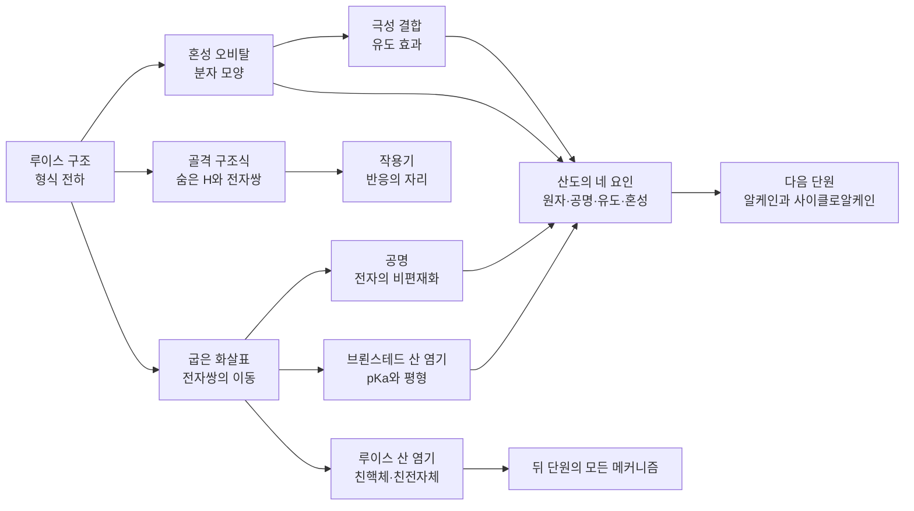

# 유기화학 1. 구조와 결합, 산과 염기 — 전자가 어디에 있는지가 모든 것을 정한다
<!-- prev: uchem-5, uchem-9, uchem-12 -->
<!-- next: ochem-2 -->

> [!NOTE]
> **이 단원의 범위**
> - 루이스 구조와 형식 전하, 탄소·질소·산소의 결합 무늬
> - 혼성 오비탈($sp^3$, $sp^2$, $sp$)과 분자 모양, s 성격과 결합각의 관계
> - 극성 공유 결합, 쌍극자 모멘트, 유도 효과
> - 골격 구조식 그리기와 읽기, 작용기 개관
> - 굽은 화살표 표기법(전자쌍 이동의 규칙과 기본 무늬)
> - 공명과 전자의 비편재화(공명 구조 그리기, 주된 기여 구조 고르기)
> - 브뢴스테드·루이스 산 염기, $\mathrm{p}K_\mathrm{a}$와 산–염기 평형의 방향, 산도를 정하는 요인(원자·공명·유도·혼성)

**학습 목표**

1. 유기 분자의 루이스 구조를 체계적으로 그리고 형식 전하를 계산하여, 탄소·질소·산소·할로젠의 중성·양이온·음이온 결합 무늬를 한눈에 알아볼 수 있다.
2. 혼성 오비탈로 단일·이중·삼중 결합의 σ·π 구성과 분자 모양을 설명하고, 혼성의 s 성격과 결합각·결합 길이·결합 세기의 관계를 정량적으로 다룰 수 있다.
3. 전기 음성도 차이로 결합의 극성과 분자의 쌍극자 모멘트를 예측하고, 유도 효과가 결합을 따라 전달되며 거리에 따라 약해지는 것을 자료로 설명할 수 있다.
4. 골격 구조식을 그리고 읽어 분자식·작용기·숨은 수소와 비공유 전자쌍을 정확히 복원할 수 있다.
5. 굽은 화살표의 규칙에 따라 전자쌍의 이동을 그리고, 이를 써서 공명 구조를 만들고 주된 기여 구조를 고를 수 있다.
6. $\mathrm{p}K_\mathrm{a}$ 표로 산–염기 반응의 평형 상수와 방향을 계산하고, 원자·공명·유도·혼성의 네 요인으로 처음 보는 산의 세기를 예측할 수 있다.
7. 브뢴스테드 산 염기와 루이스 산 염기를 굽은 화살표로 같은 언어로 나타내고, 친핵체·친전자체 개념으로 이어 갈 수 있다.

**이 단원의 학습 사다리**

| 단계 | 무엇을 하나? |
|---|---|
| STEP 1. 이전 학습 다시 보기 | 일반화학의 루이스 구조·VSEPR·혼성 오비탈, 산·염기와 $K_\mathrm{a}$, 유기화학 개관의 작용기 |
| STEP 2. 기초 다지기 | 쌍극자의 벡터 합, 로그와 $\Delta G^\circ = 2.303RT\,\Delta\mathrm{p}K_\mathrm{a}$, 오비탈의 선형 결합과 직교성, 헨더슨–하셀바흐 식 |
| STEP 3. 핵심 개념 | 루이스 구조 → 혼성 → 극성과 유도 효과 → 골격 구조식 → 작용기 → 굽은 화살표 → 공명 → $\mathrm{p}K_\mathrm{a}$와 평형 → 산도의 네 요인 → 루이스 산 염기 |
| STEP 4. 오개념 바로잡기 | "공명 구조는 빠르게 바뀌는 이성질체이다", "화살표는 양성자가 움직이는 방향으로 긋는다" 같은 착각 |
| STEP 5. 대학원·연구로 | 기체상 산도와 용매화, 비수용매의 $\mathrm{p}K_\mathrm{a}$ 척도, 자연 결합 오비탈 분석 |
| STEP 6. 생활·산업·진로 | 약물의 이온화와 흡수, 산–염기 추출 공정, 초강산과 촉매, 계산 화학으로 $\mathrm{p}K_\mathrm{a}$ 예측 |

---

## 🗺️ 단원 들어가기

식초의 아세트산($\mathrm{CH_3COOH}$)과 술의 에탄올($\mathrm{CH_3CH_2OH}$)은 둘 다 O–H 결합을 가진다. 그런데 아세트산은 물에 녹아 신맛을 낼 만큼 양성자를 잘 내놓고, 에탄올은 거의 내놓지 않는다. 두 산의 세기 차이는 무려 $10^{11}$배이다. O–H 결합 하나만 보면 차이가 없는데, 왜 이렇게 다를까? 답은 양성자가 떠난 뒤 남는 **전자쌍이 어디에, 얼마나 넓게 퍼져 있을 수 있는가**에 있다.

유기화학은 수천만 종의 화합물과 수만 가지 반응을 다룬다. 이것을 하나하나 외우는 것은 불가능하다. 다행히 거의 모든 유기 반응은 "전자가 풍부한 곳에서 전자가 부족한 곳으로 전자쌍이 움직인다"는 하나의 원리로 읽을 수 있다. 이 원리를 쓰려면 세 가지가 필요하다. 첫째, 분자 속 전자가 어디에 있는지 **그리는 법**(루이스 구조, 형식 전하, 골격 구조식). 둘째, 전자가 어디에 치우쳐 있고 얼마나 퍼져 있는지 **판단하는 법**(혼성, 극성, 유도 효과, 공명). 셋째, 전자가 움직이는 것을 **기록하는 법**(굽은 화살표). 그리고 이 셋을 처음으로 시험하는 무대가 가장 단순한 반응인 **산–염기 반응**이다.

이 단원에서 익히는 그림 그리는 법과 화살표 긋는 법은 유기화학의 나머지 모든 단원에서 매일 쓰인다. 「알케인과 사이클로알케인」의 형태 분석에서 「카보닐 α 자리의 반응과 축합 반응」의 엔올레이트까지, 모든 메커니즘이 여기서 정한 규칙으로 그려진다.

---

## STEP 1. 🔙 이전 학습 다시 보기

### 연계 개념표

| 이전 단원 | 그때 배운 것 | 이 단원에서 확장되는 것 |
|---|---|---|
| 일반화학 「화학 결합과 분자 구조」 '루이스 구조와 형식 전하' | 전자점식, 형식 전하 $= V - N - B/2$로 구조 고르기, 공명 혼성체 | 유기 원자의 **결합 무늬**(결합 수 + 비공유 전자쌍 수 ↔ 형식 전하)를 외워 계산 없이 전하를 읽기, 굽은 화살표로 공명 구조를 **만들고** 주된 기여 구조를 규칙으로 고르기 |
| 일반화학 「화학 결합과 분자 구조」 'VSEPR, 혼성 오비탈' | 전자 영역 수로 모양 예측, $sp$·$sp^2$·$sp^3$, σ·π 결합 | s 성격과 결합각의 정량 관계($\cos\theta = -\alpha/(1-\alpha)$), 혼성에 따른 결합 길이·세기·전기 음성도, 공명에 참여하는 비공유 전자쌍의 혼성 |
| 일반화학 「화학 결합과 분자 구조」 '전기 음성도와 쌍극자 모멘트' | 결합의 극성, $\mu = Qr$, 분자의 극성은 벡터 합 | 결합 극성이 이웃 결합으로 전달되는 **유도 효과**, 그 거리 의존을 $\mathrm{p}K_\mathrm{a}$ 자료로 확인 |
| 일반화학 「산·염기와 수용액 평형」 | 브뢴스테드–로리·루이스 정의, $K_\mathrm{a}$, $\mathrm{p}K_\mathrm{a}$, 짝산–짝염기, 헨더슨–하셀바흐 식, 수평화 효과 | $\mathrm{p}K_\mathrm{a}$가 $-10$에서 50까지 걸친 유기 산의 표, $\Delta\mathrm{p}K_\mathrm{a}$로 **평형 상수를 바로 계산**, 짝염기의 안정성으로 산도를 **예측** |
| 일반화학 「핵화학·배위 화학·유기화학 개관」 '탄화수소, 작용기, 기본 유기 반응' | 알케인·알켄·알카인·방향족, 작용기 표, 치환·첨가·제거, 마르코브니코프 규칙의 결과 | 작용기를 **골격 구조식**으로 그리고 읽기, 반응 결과를 외우는 대신 굽은 화살표로 **전자의 흐름**을 쓰기 시작 |

### 준비 운동 (사전 진단)

**Q1.** 하이드로늄 이온 $\mathrm{H_3O^+}$에서 산소의 형식 전하를 계산하시오.

**Q2.** 에텐($\mathrm{CH_2{=}CH_2}$)의 탄소 혼성과 H–C–H 결합각은 대략 얼마인가? 이중 결합은 어떤 결합 두 개로 이루어지는가?

**Q3.** 아세트산의 $K_\mathrm{a} = 1.8\times10^{-5}$이다. $\mathrm{p}K_\mathrm{a}$를 구하시오. $\mathrm{p}K_\mathrm{a}$가 더 작은 산은 더 강한가, 더 약한가?

**Q4.** 다음 중 루이스 산인 것을 모두 고르시오. $\mathrm{BF_3}$, $\mathrm{NH_3}$, $\mathrm{H^+}$, $\mathrm{AlCl_3}$, $\mathrm{OH^-}$

정답 및 해설

**Q1.** $+1$ — 원자가 전자 $V = 6$, 비공유 전자 $N = 2$(전자쌍 1개), 결합 전자 $B = 6$(결합 3개). $6 - 2 - 3 = +1$.

**Q2.** $sp^2$, 약 120°. 이중 결합은 σ 결합 1개와 π 결합 1개로 이루어진다.

**Q3.** $\mathrm{p}K_\mathrm{a} = -\log(1.8\times10^{-5}) = 4.74$. $\mathrm{p}K_\mathrm{a}$가 작을수록 $K_\mathrm{a}$가 크므로 더 강한 산이다. (아세트산의 $\mathrm{p}K_\mathrm{a}$는 자료에 따라 4.74~4.76으로 적는다. 이 단원에서는 4.76을 쓴다.)

**Q4.** $\mathrm{BF_3}$, $\mathrm{H^+}$, $\mathrm{AlCl_3}$ — 셋 모두 빈 오비탈로 전자쌍을 받을 수 있다. $\mathrm{NH_3}$와 $\mathrm{OH^-}$는 비공유 전자쌍을 주는 루이스 염기이다.

---

## STEP 2. 🧱 기초 다지기

### 디딤돌 1. 쌍극자 모멘트의 벡터 합

결합 하나의 극성은 **결합 쌍극자**라는 화살표(벡터)로 나타낸다. 크기는 $\mu = Qr$(단위 디바이, $1\ \mathrm{D} = 3.336\times10^{-30}\ \mathrm{C\cdot m}$), 방향은 이 책에서는 화학의 관례에 따라 **양전하 끝에서 음전하 끝으로**(전자가 쏠린 쪽으로) 그린다. 분자 전체의 쌍극자 모멘트는 결합 쌍극자의 **벡터 합**이다. 수학 도구 3 「벡터와 벡터 미적분」에서 익힌 성분별 덧셈을 그대로 쓴다.

같은 크기 $\mu_1$의 결합 쌍극자 두 개가 각 $\theta$를 이루면, 두 벡터를 이등분선 방향으로 분해했을 때 수직 성분은 서로 지워지고 이등분선 성분만 남는다.

$$
\mu_\text{분자} = 2\mu_1\cos\frac{\theta}{2}
$$

$\theta = 180°$(이산화 탄소)이면 $\cos 90° = 0$이므로 극성 결합을 가졌는데도 무극성 분자가 된다. 사면체의 사염화 탄소도 네 C–Cl 쌍극자의 합이 0이다.

#### 예제 1 — 물의 O–H 결합 쌍극자

물 분자의 쌍극자 모멘트는 1.85 D, H–O–H 결합각은 104.5°이다. O–H 결합 하나의 결합 쌍극자를 구하시오. (비공유 전자쌍의 기여는 결합 쌍극자에 포함된 것으로 본다.)

**풀이**
식 세우기: $\mu_\text{분자} = 2\mu_\mathrm{OH}\cos(\theta/2)$이므로 $\mu_\mathrm{OH} = \mu_\text{분자}/[2\cos(\theta/2)]$.
대입: $\mu_\mathrm{OH} = 1.85/(2\cos 52.25°) = 1.85/(2\times0.6122) = 1.51\ \mathrm{D}$.
**의미** 결합 하나의 쌍극자가 분자 전체보다 작은데도 두 결합이 굽어 있어 합이 커진다. 물이 직선형이었다면 쌍극자 모멘트는 0이었을 것이다. 결합각이 분자의 성질을 바꾸는 가장 직접적인 예이다.

### 디딤돌 2. 로그와 $\mathrm{p}K_\mathrm{a}$, 그리고 자유 에너지

산의 해리 상수는 $10^{-50}$에서 $10^{10}$까지 60자리에 걸치므로 로그로 다룬다.

$$
\mathrm{p}K_\mathrm{a} = -\log K_\mathrm{a}, \qquad K_\mathrm{a} = 10^{-\mathrm{p}K_\mathrm{a}}
$$

일반화학 「화학 열역학」의 $\Delta G^\circ = -RT\ln K$를 상용로그로 바꾸면 $\Delta G^\circ = 2.303RT\,\mathrm{p}K_\mathrm{a}$이다. 25 ℃에서 $2.303RT = 5.71\ \mathrm{kJ/mol}$이므로

$$
\Delta\mathrm{p}K_\mathrm{a} = 1 \;\Longleftrightarrow\; K_\mathrm{a}\text{가 10배} \;\Longleftrightarrow\; \Delta G^\circ\text{가 } 5.71\ \mathrm{kJ/mol}
$$

| $\Delta\mathrm{p}K_\mathrm{a}$ | $K_\mathrm{a}$의 비 | 해리 자유 에너지의 차 (25 ℃) |
|---|---|---|
| 1 | 10 | 5.7 kJ/mol |
| 3 | 1000 | 17.1 kJ/mol |
| 11 | $10^{11}$ | 63 kJ/mol |

$\mathrm{p}K_\mathrm{a}$ 표는 사실 **자유 에너지 표**이다. 두 산의 $\mathrm{p}K_\mathrm{a}$ 차이는 양성자를 떼어 내는 데 드는 자유 에너지의 차이이고, 그 차이는 대부분 **짝염기의 안정성** 차이에서 온다. 이것이 ⑨에서 산도를 짝염기로 설명하는 근거이다.

#### 예제 2 — $\mathrm{p}K_\mathrm{a}$와 자유 에너지

아세트산($\mathrm{p}K_\mathrm{a} = 4.76$)과 에탄올($\mathrm{p}K_\mathrm{a} \approx 16$)의 $K_\mathrm{a}$ 비와 해리 표준 자유 에너지의 차를 25 ℃에서 구하시오.

**풀이**
$K_\mathrm{a}$ 비 $= 10^{16 - 4.76} = 10^{11.24} \approx 1.7\times10^{11}$.
$\Delta(\Delta G^\circ) = 5.71\times(16 - 4.76) = 64\ \mathrm{kJ/mol}$.
**의미** 단원 들어가기에서 말한 "$10^{11}$배"는 자유 에너지로 약 64 kJ/mol이다. C–C 결합 에너지의 5분의 1쯤 되는 큰 에너지가 짝염기의 구조 차이(⑦·⑨의 공명) 하나에서 나온다.

### 디딤돌 3. 오비탈의 선형 결합과 직교성

수학 도구 5 「선형대수」 '벡터 공간과 기저'에서 익힌 것처럼, 서로 직교하는 기저 벡터를 섞어 새로운 직교 기저를 만들 수 있다. 원자 오비탈도 마찬가지이다. 한 원자의 $2s$, $2p_x$, $2p_y$, $2p_z$는 서로 직교하고 규격화된($\langle\phi_i\vert\phi_j\rangle = \delta_{ij}$) 기저이므로, 이들의 선형 결합으로 방향이 다른 새 오비탈(혼성 오비탈)을 만들 수 있다. 조건은 두 가지이다.

1. **규격화**: 계수의 제곱의 합이 1이다. $h = a\,\phi_{2s} + b\,\phi_{2p}$이면 $a^2 + b^2 = 1$. 이때 $a^2$을 그 혼성 오비탈의 **s 성격**(s character) $\alpha$라 한다.
2. **직교**: 같은 원자의 서로 다른 혼성 오비탈끼리는 내적이 0이다.

p 오비탈은 방향을 가진 벡터처럼 다룰 수 있다. 단위 벡터 $\hat{\mathbf{n}}$ 방향을 향한 p 오비탈은 $\phi_{2p}(\hat{\mathbf{n}}) = n_x\phi_{2p_x} + n_y\phi_{2p_y} + n_z\phi_{2p_z}$이고, 두 방향의 p 오비탈의 내적은 $\hat{\mathbf{n}}_1\cdot\hat{\mathbf{n}}_2 = \cos\theta$이다.

#### 예제 3 — $sp$ 혼성 오비탈의 직교성 확인

$h_1 = \tfrac{1}{\sqrt2}(\phi_{2s} + \phi_{2p_z})$, $h_2 = \tfrac{1}{\sqrt2}(\phi_{2s} - \phi_{2p_z})$가 규격화되어 있고 서로 직교함을 보이고, 두 오비탈이 향하는 방향 사이의 각을 구하시오.

**풀이**
규격화: $\langle h_1\vert h_1\rangle = \tfrac12(\langle s\vert s\rangle + 2\langle s\vert p_z\rangle + \langle p_z\vert p_z\rangle) = \tfrac12(1 + 0 + 1) = 1$. $h_2$도 같다.
직교: $\langle h_1\vert h_2\rangle = \tfrac12(\langle s\vert s\rangle - \langle p_z\vert p_z\rangle) = \tfrac12(1 - 1) = 0$.
방향: $h_1$은 p 성분이 $+z$, $h_2$는 $-z$ 방향이므로 180°이다. s 성격은 각각 $\alpha = (1/\sqrt2)^2 = 1/2$, 즉 50 %이다.
**의미** 아세틸렌의 선형 구조는 "s 성격 50 %인 두 오비탈이 직교하려면 정반대를 향해야 한다"는 수학적 사실의 결과이다. ②에서 이 논리를 일반화한다.

### 디딤돌 4. 헨더슨–하셀바흐 식 — pH가 정하는 화학종의 비율

일반화학 「산·염기와 수용액 평형」에서 배운 헨더슨–하셀바흐 식은 완충 용액뿐 아니라 **어떤 pH에서 산이 몇 %나 짝염기로 있는가**를 알려 주는 식이다.

$$
\mathrm{pH} = \mathrm{p}K_\mathrm{a} + \log\frac{[\mathrm{A^-}]}{[\mathrm{HA}]} \quad\Longrightarrow\quad f_\mathrm{HA} = \frac{[\mathrm{HA}]}{[\mathrm{HA}] + [\mathrm{A^-}]} = \frac{1}{1 + 10^{\,\mathrm{pH} - \mathrm{p}K_\mathrm{a}}}
$$

| $\mathrm{pH} - \mathrm{p}K_\mathrm{a}$ | $-2$ | $-1$ | 0 | $+1$ | $+2$ |
|---|---|---|---|---|---|
| 산 형태 HA의 분율 | 99 % | 91 % | 50 % | 9.1 % | 0.99 % |

**외울 것은 하나뿐이다**: pH가 $\mathrm{p}K_\mathrm{a}$보다 낮으면 양성자가 붙은 형태, 높으면 떨어진 형태가 우세하고, 차이가 2이면 99 : 1이다.

#### 예제 4 — 위와 혈액 속의 아스피린

아스피린(아세틸살리실산)의 카복실기 $\mathrm{p}K_\mathrm{a}$는 약 3.5이다. 위액(pH 1.5)과 혈장(pH 7.4)에서 중성 형태의 분율을 구하시오.

**풀이**
위액: $f_\mathrm{HA} = 1/(1 + 10^{1.5 - 3.5}) = 1/1.01 = 0.990$ → 99 %가 중성.
혈장: $f_\mathrm{HA} = 1/(1 + 10^{7.4 - 3.5}) = 1/(1 + 10^{3.9}) = 1.3\times10^{-4}$ → 0.013 %만 중성, 나머지는 카복실산 이온.
**의미** 전하가 없는 분자는 세포막(지질 이중층)을 쉽게 통과하고 이온은 잘 통과하지 못한다. 약물이 어디서 흡수되고 어디에 머무는지가 $\mathrm{p}K_\mathrm{a}$ 하나로 크게 갈린다(STEP 6).

<!-- 시뮬레이션 요청: pH–화학종 분율 탐색기. 가로축 pH 0~14, 세로축 산 형태(HA 또는 BH⁺)의 분율 0~1. 사용자가 고를 수 있는 화합물: 아세트산(pKa 4.76), 페놀(10.0), 메틸암모늄 이온(10.6), 아스피린(3.5), 피리디늄 이온(5.2), 에탄올(16). 슬라이더로 pH를 움직이면 곡선 위 점과 함께 "HA x % / A⁻ y %"를 표시하고, pKa 위치에 세로 점선과 "pH = pKa → 50 %" 이름표. 위액(1.5)·혈장(7.4)·소장(약 6.5) 위치를 가로축에 작은 눈금으로 표시. 화합물을 둘 고르면 곡선 두 개를 겹쳐 그려 어느 pH에서 둘을 분리(한쪽은 이온, 다른 쪽은 중성)할 수 있는지 그 구간을 옅게 칠한다. -->

---
