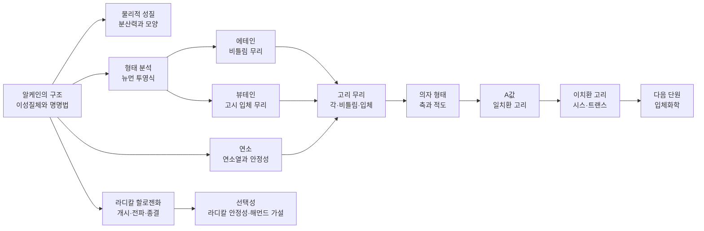

# 유기화학 2. 알케인과 사이클로알케인 — 단일 결합의 회전과 고리의 모양이 정하는 에너지
<!-- prev: ochem-1, uchem-12 -->
<!-- next: ochem-3 -->

> [!NOTE]
> **이 단원의 범위**
> - 알케인의 구조 이성질체와 IUPAC 명명법(알킬기, 복합 치환기, 사이클로알케인)
> - 물리적 성질과 분자 간 힘(끓는점·녹는점·밀도·용해도와 가지의 효과)
> - 형태 분석: 에테인·프로페인·뷰테인의 뉴먼 투영식, 이면각, 비틀림 무리와 입체 무리, 형태의 집단
> - 사이클로알케인의 고리 무리(연소열로 재는 무리 에너지, 3·4·5원 고리의 모양)
> - 사이클로헥세인의 의자 형태(축·적도 결합, 고리 뒤집힘, A값)
> - 이치환 사이클로헥세인의 시스·트랜스 이성질과 형태의 안정성
> - 알케인의 연소, 라디칼 할로젠화의 메커니즘(개시·전파·종결)과 선택성(라디칼의 안정성, 염소화와 브로민화)

**학습 목표**

1. 분자식이 주어진 알케인의 구조 이성질체를 빠짐없이 그리고, IUPAC 규칙(가장 긴 사슬, 가장 작은 위치 번호, 알파벳 순서, 복합 치환기)으로 알케인과 사이클로알케인의 이름을 짓고 거꾸로 이름에서 구조를 그릴 수 있다.
2. 분산력과 분자의 표면적·대칭성으로 알케인의 끓는점·녹는점 경향을 설명하고, 자료로 정량적으로 비교할 수 있다.
3. 뉴먼 투영식과 톱질대 그림으로 단일 결합 둘레의 형태를 그리고, 이면각에 따른 퍼텐셜 에너지를 비틀림 무리와 입체 무리의 합으로 계산하며, 볼츠만 분포로 형태의 집단을 구할 수 있다.
4. 연소열로부터 사이클로알케인의 고리 무리 에너지를 구하고, 각 무리·비틀림 무리·입체 무리로 3~8원 고리의 안정성과 모양을 설명할 수 있다.
5. 사이클로헥세인의 의자 형태를 바르게 그려 탄소마다 축·적도 결합의 방향(위/아래)을 정하고, A값으로 일치환·이치환 사이클로헥세인의 두 의자 형태의 에너지 차와 평형 조성을 계산할 수 있다.
6. 라디칼 할로젠화의 연쇄 메커니즘을 낚싯바늘 화살표로 쓰고, 결합 해리 에너지로 각 단계의 반응 엔탈피를 계산하여 할로젠마다 반응성이 다른 까닭을 설명할 수 있다.
7. 1°·2°·3° 수소의 상대 반응성으로 할로젠화 생성물의 비율을 예측하고, 해먼드 가설로 브로민화가 염소화보다 훨씬 선택적인 까닭을 설명할 수 있다.

**이 단원의 학습 사다리**

| 단계 | 무엇을 하나? |
|---|---|
| STEP 1. 이전 학습 다시 보기 | 일반화학의 탄화수소·명명 기초·분자 간 힘·결합 엔탈피, 유기화학 1의 $sp^3$ 혼성·쐐기와 점선·낚싯바늘 화살표 |
| STEP 2. 기초 다지기 | 볼츠만 분포와 형태의 집단, 이면각의 주기 함수(푸리에 급수), 결합 해리 에너지로 반응 엔탈피 계산, 장벽 높이와 회전 속도 |
| STEP 3. 핵심 개념 | 이성질체 → 명명법 → 물리적 성질 → 에테인 → 뷰테인 → 고리 무리 → 의자 형태 → A값 → 이치환 사이클로헥세인 → 연소 → 라디칼 할로젠화의 메커니즘 → 선택성 |
| STEP 4. 오개념 바로잡기 | "형태 이성질체는 분리할 수 있다", "시스는 언제나 축–축이다", "3차 라디칼이 안정하니 염소화도 3차에서만 일어난다" 같은 착각 |
| STEP 5. 대학원·연구로 | 입체 전자 효과와 아노머 효과, 형태 탐색 계산, 선택적 C–H 작용기화 |
| STEP 6. 생활·산업·진로 | 연료와 옥테인가, 의약품의 고리 형태, 클로로메테인 공업, 성층권 오존과 라디칼 연쇄 |

---

## 🗺️ 단원 들어가기

뷰테인 라이터의 연료, 가스레인지의 메테인, 자동차의 휘발유, 양초의 파라핀은 모두 **알케인**(alkane)이다. 탄소와 수소만으로, 단일 결합만으로 이루어진 이 분자들은 작용기가 없어 '반응성이 없는 화합물'로 불리기도 한다. 실제로 알케인은 산·염기·산화제·환원제의 대부분과 실온에서 반응하지 않는다. 그런데 이 '심심한' 분자에서 유기화학의 가장 중요한 생각 두 가지가 나온다.

첫째는 **모양이 에너지를 정한다**는 생각이다. C–C 단일 결합은 축 둘레로 돌 수 있어서, 같은 분자도 순간마다 다른 3차원 모양(형태)을 가진다. 그 모양들의 에너지 차이는 수 kJ/mol에 불과하지만, 25 ℃에서 $RT$가 2.5 kJ/mol이므로 이 정도의 차이로 분자의 집단이 크게 달라진다. 사이클로헥세인 고리의 치환기가 '위로 서 있는가(축)' '옆으로 누웠는가(적도)'는 포도당이 왜 가장 흔한 당인지, 스테로이드 호르몬이 왜 그런 모양인지, 약물 분자가 어떻게 수용체에 맞는지를 정한다.

둘째는 **반응성은 상대적이고, 선택성은 전이 상태가 정한다**는 생각이다. 알케인은 빛을 받은 염소·브로민과는 격렬하게 반응한다. 이때 생기는 **라디칼**은 홀전자를 가진 화학종으로, 연쇄 반응을 일으킨다. 같은 분자 안에서도 어떤 수소가 먼저 떨어져 나가는지는 라디칼의 안정성과 반응의 에너지 도표로 예측할 수 있다. 염소는 거의 가리지 않고 아무 수소나 떼어 내지만, 브로민은 3차 수소를 1차 수소보다 1000배 넘게 골라낸다.

이 단원에서는 유기화학 1에서 익힌 $sp^3$ 혼성, 쐐기와 점선, 굽은 화살표를 3차원의 형태와 라디칼의 반응으로 넓힌다. 이 단원에서 그리는 의자 형태와 뉴먼 투영식은 다음 단원 「입체화학」의 입체 중심과 「유기 반응의 개관과 알킬 할라이드의 치환·제거 반응」의 안티 준평면 제거에서 곧바로 다시 쓰인다.

---

## STEP 1. 🔙 이전 학습 다시 보기

### 연계 개념표

| 이전 단원 | 그때 배운 것 | 이 단원에서 확장되는 것 |
|---|---|---|
| 일반화학 「핵화학·배위 화학·유기화학 개관」 '탄화수소' | 알케인 $\mathrm{C_nH_{2n+2}}$, 사이클로알케인 $\mathrm{C_nH_{2n}}$, 어근(메트·에트·프로프…), 곁가지 이름 붙이기 기초, 사슬 이성질 | 알킬기·복합 치환기·알파벳 순서·고리 명명까지 IUPAC 규칙 전체, 이성질체를 **빠짐없이** 세는 체계 |
| 일반화학 「분자 간 힘과 액체·고체·용액」 | 분산력, 편극성, 끓는점과 분자 간 힘, 트루턴 규칙 | 사슬 길이·가지·대칭성이 끓는점·녹는점에 주는 효과를 자료로 정량 비교 |
| 일반화학 「열화학」 | 결합 엔탈피로 반응 엔탈피 어림, 연소열, 헤스 법칙 | **결합 해리 에너지**(균일 분해)로 라디칼 단계의 $\Delta H^\circ$ 계산, 연소열로 이성질체의 안정성과 **고리 무리** 측정 |
| 일반화학 「화학 반응 속도론」 | 활성화 에너지, 아레니우스 식, 반응 메커니즘과 속도 결정 단계, 연쇄 반응의 예 | 회전 장벽으로 형태가 바뀌는 속도 어림, 전파 단계의 활성화 에너지로 **선택성** 설명 |
| 유기화학 1 「구조와 결합, 산과 염기」 | $sp^3$ 혼성과 109.5°, 쐐기와 점선, 골격 구조식, 1°·2°·3° 탄소, 낚싯바늘 화살표 | 사면체 탄소의 **회전**으로 생기는 형태, 뉴먼 투영식과 의자 형태, 낚싯바늘 화살표로 쓰는 라디칼 메커니즘 |

### 준비 운동 (사전 진단)

**Q1.** 2-메틸프로페인 $\mathrm{(CH_3)_3CH}$의 탄소를 1°·2°·3°·4°로 분류하고, 각 종류의 수소가 몇 개씩인지 쓰시오.

**Q2.** 펜테인(36 ℃)과 2,2-다이메틸프로페인(10 ℃)은 분자식이 같은데 끓는점이 다르다. 그 까닭을 분자 간 힘으로 한 문장으로 설명하시오.

**Q3.** 결합 엔탈피(C–H 413, Cl–Cl 242, C–Cl 339, H–Cl 431 kJ/mol, 일반화학의 평균값)로 $\mathrm{CH_4 + Cl_2 \rightarrow CH_3Cl + HCl}$의 $\Delta H^\circ$를 어림하시오.

**Q4.** 낚싯바늘 화살표와 굽은 화살표(온화살표)는 각각 전자 몇 개의 이동을 뜻하는가? $\mathrm{Cl_2}$가 빛을 받아 두 Cl 원자로 갈라지는 과정을 그리려면 어느 화살표를 몇 개 써야 하는가?

정답 및 해설

**Q1.** 메틸 탄소 3개는 1°(수소 3개씩, 모두 9개), 가운데 탄소는 3°(수소 1개). 2°·4° 탄소는 없다. 이 9 : 1이라는 수가 ⑫에서 생성물 비율을 계산하는 출발점이다.

**Q2.** 곧은 사슬인 펜테인은 이웃 분자와 닿는 표면적이 넓어 분산력이 크고, 공 모양인 2,2-다이메틸프로페인은 표면적이 작아 분산력이 작기 때문이다.

**Q3.** 약 $-115\ \mathrm{kJ/mol}$ — 끊는 결합 $413 + 242 = 655$, 생기는 결합 $339 + 431 = 770$, $\Delta H^\circ \approx 655 - 770 = -115\ \mathrm{kJ/mol}$. 평균 결합 엔탈피 대신 그 분자의 **결합 해리 에너지**를 쓰면 약 $-101\ \mathrm{kJ/mol}$이 된다(디딤돌 3, ⑪).

**Q4.** 낚싯바늘 화살표는 전자 1개, 온화살표는 전자 2개(전자쌍). Cl–Cl 결합의 전자쌍이 두 원자에 하나씩 나뉘므로 결합에서 각 Cl로 향하는 낚싯바늘 화살표 **2개**가 필요하다.

---

## STEP 2. 🧱 기초 다지기

### 디딤돌 1. 볼츠만 분포 — 에너지 차이가 형태의 집단을 정한다

에너지가 다른 여러 상태를 오가는 분자들이 평형에 있으면, 상태 $i$에 있는 분자의 비율은 그 상태의 자유 에너지 $G_i$와 같은 에너지를 가진 상태의 수(축퇴도) $g_i$로 정해진다. 수학 도구 7 「확률과 통계」 '가장 그럴듯한 분포와 볼츠만 분포'에서 라그랑주 승수로 유도한 결과를 몰 단위로 쓰면 다음과 같다.

$$
\frac{N_2}{N_1} = \frac{g_2}{g_1}\,e^{-(G_2 - G_1)/RT}, \qquad x_i = \frac{g_i\,e^{-G_i/RT}}{\sum_j g_j\,e^{-G_j/RT}}
$$

두 형태 A ⇌ B의 평형 상수 $K = [\mathrm{B}]/[\mathrm{A}]$로 쓰면 이것은 일반화학 「화학 열역학」의 $\Delta G^\circ = -RT\ln K$와 같은 식이다. 형태의 평형은 화학 반응의 평형과 똑같이 다룬다.

| $\Delta G^\circ$ (25 ℃, kJ/mol) | 0 | 2.5 | 5.7 | 7.3 | 11.4 | 17.1 |
|---|---|---|---|---|---|---|
| 안정한 쪽 : 불안정한 쪽 | 50 : 50 | 73 : 27 | 91 : 9 | 95 : 5 | 99 : 1 | 99.9 : 0.1 |

> [!TIP]
> 💡 **요령** — 25 ℃에서 $RT \approx 2.48\ \mathrm{kJ/mol}$, $2.303RT \approx 5.71\ \mathrm{kJ/mol}$이다. 에너지 차가 5.7 kJ/mol 늘 때마다 비가 10배씩 벌어진다. 형태 분석에 나오는 에너지(3.8, 7.3, 11.4 kJ/mol)는 대부분 이 '눈금' 몇 칸 안에 있으므로, 두 형태가 모두 상당히 존재하는지 한쪽이 압도하는지를 암산으로 판단할 수 있다.

#### 예제 1 — 95 : 5가 되려면

25.0 ℃에서 두 형태 A, B(축퇴도 같음)가 95 : 5로 존재한다. (1) 두 형태의 자유 에너지 차를 구하시오. (2) 에너지 차가 같을 때 −80 ℃에서의 비율을 구하시오. (엔트로피 차는 0으로 본다.)

**풀이**
(1) 식 세우기: $\Delta G^\circ = RT\ln(N_\mathrm{A}/N_\mathrm{B})$. 대입: $8.314\times298.15\times\ln(95/5) = 2479\times2.944 = 7.30\times10^3\ \mathrm{J/mol}$, 즉 $7.3\ \mathrm{kJ/mol}$.
(2) $T = 193.15\ \mathrm{K}$: $N_\mathrm{A}/N_\mathrm{B} = \exp\!\left(\dfrac{7300}{8.314\times193.15}\right) = e^{4.546} = 94$ → 약 99 : 1.
**의미** 7.3 kJ/mol은 ⑧에서 볼 메틸사이클로헥세인의 두 의자 형태의 에너지 차(메틸기의 A값)이다. 온도를 낮추면 불안정한 형태가 더 줄어든다. 저온 NMR로 두 형태를 따로 관찰하고 그 비로 에너지 차를 재는 실험이 이 식에 기대고 있다.

### 디딤돌 2. 이면각의 주기 함수 — 푸리에 급수로 쓰는 회전 퍼텐셜

C–C 결합 둘레의 회전은 각 $\phi$(이면각, ④에서 정의)의 함수이고, $360°$ 돌면 같은 모양으로 돌아오므로 퍼텐셜 에너지 $V(\phi)$는 **주기 함수**이다. 수학 도구 6 「복소수와 푸리에 해석」 '푸리에 급수'에서 익혔듯이 주기 함수는 코사인 항의 합으로 쓸 수 있다($V(\phi) = V(-\phi)$인 짝함수라 사인 항이 없다).

$$
V(\phi) = a_0 + a_1\cos\phi + a_2\cos 2\phi + a_3\cos 3\phi + \cdots
$$

각 항에는 화학적 뜻이 있다. 탄소 하나에 같은 치환기 세 개가 120° 간격으로 붙어 있으면 회전을 120°씩 할 때마다 같은 모양이 되므로 $\cos 3\phi$ 항만 남는다. 에테인이 그렇다.

$$
V_\text{에테인}(\phi) = \frac{V_0}{2}\left(1 + \cos 3\phi\right)
$$

$\phi = 0°, 120°, 240°$에서 최댓값 $V_0$(가린 형태), $60°, 180°, 300°$에서 최솟값 0(엇갈린 형태)이다. 뷰테인처럼 앞뒤 탄소에 큰 치환기가 하나씩 있으면 $360°$에 한 번만 나타나는 효과(두 메틸기가 겹치는 $\phi = 0°$의 큰 반발)를 나타내는 $\cos\phi$ 항이 더해진다.

<!-- 그림 요청: 이면각 퍼텐셜의 푸리에 성분 그래프. 가로축 이면각 φ 0°~360°(60° 간격 눈금), 세로축 에너지(kJ/mol). (가) 에테인: V(φ) = 6(1 + cos 3φ) 실선, 0°·120°·240°·360°에서 최대 12, 60°·180°·300°에서 최소 0. (나) 뷰테인: V(φ) = 9.77 + 2.27 cos φ − 0.27 cos 2φ + 7.23 cos 3φ 굵은 실선과 그 성분 2.27 cos φ(점선), 7.23 cos 3φ(파선)을 옅게 겹쳐 그린다. 뷰테인 곡선의 주요 점에 이름표: φ = 0° '19 (완전 가림)', 약 61° '3.8 (고시)', 약 118° '16 (가림)', 180° '0 (안티)'. -->

#### 예제 2 — 에테인의 회전 퍼텐셜 읽기

에테인의 회전 장벽을 $V_0 = 12\ \mathrm{kJ/mol}$로 놓을 때 (1) 엇갈린 형태에서 $30°$, $20°$ 돌린 지점의 에너지를 구하시오. (2) 25 ℃에서 $V(\phi)$가 $RT$보다 작은 영역은 엇갈린 형태 둘레 몇 도 안쪽인가?

**풀이**
(1) 엇갈린 형태는 $\phi = 60°$이다. $30°$ 돌리면 $\phi = 30°$: $V = 6(1 + \cos 90°) = 6.0\ \mathrm{kJ/mol}$. $20°$ 돌리면 $\phi = 40°$: $V = 6(1 + \cos 120°) = 3.0\ \mathrm{kJ/mol}$.
(2) $6(1 + \cos 3\phi) = 2.48$에서 $\cos 3\phi = -0.587$, $3\phi = 126.0°$이므로 $\phi = 42.0°$. 엇갈린 형태($60°$)에서 $\pm18°$ 안쪽이다.
**의미** 장벽 꼭대기(가린 형태)는 '한 형태'가 아니라 지나가는 고개이다. 에테인 분자는 대부분의 시간을 엇갈린 형태 둘레 ±20° 안에서 떨며 보내고, 가끔 열에너지를 모아 고개를 넘는다(디딤돌 4). 뷰테인의 네 항짜리 식은 도전 문제 17과 탐구 활동 B에서 직접 맞춘다.

### 디딤돌 3. 결합 해리 에너지 — 라디칼 반응의 장부

일반화학 「열화학」에서는 여러 분자에서 평균한 **결합 엔탈피**로 반응 엔탈피를 어림했다. 라디칼 반응을 다룰 때는 특정 결합 하나를 **균일 분해**(homolysis)하여 두 라디칼로 나누는 데 드는 엔탈피, 즉 **결합 해리 에너지**(bond dissociation energy, BDE) $D$를 쓴다.

$$
\mathrm{A{-}B \rightarrow A\cdot + \cdot B}, \qquad \Delta H^\circ = D(\mathrm{A{-}B})
$$

$$
\Delta H^\circ_\text{반응} = \sum D(\text{끊어지는 결합}) - \sum D(\text{생기는 결합})
$$

| 결합 | $D$ (kJ/mol, 약) | 결합 | $D$ (kJ/mol, 약) | 결합 | $D$ (kJ/mol, 약) |
|---|---|---|---|---|---|
| $\mathrm{CH_3{-}H}$ | 439 | $\mathrm{F{-}F}$ | 159 | $\mathrm{H{-}F}$ | 570 |
| $\mathrm{CH_3CH_2{-}H}$ (1°) | 421 | $\mathrm{Cl{-}Cl}$ | 242 | $\mathrm{H{-}Cl}$ | 432 |
| $\mathrm{(CH_3)_2CH{-}H}$ (2°) | 413 | $\mathrm{Br{-}Br}$ | 193 | $\mathrm{H{-}Br}$ | 366 |
| $\mathrm{(CH_3)_3C{-}H}$ (3°) | 400 | $\mathrm{I{-}I}$ | 151 | $\mathrm{H{-}I}$ | 298 |
| $\mathrm{CH_3{-}F}$ | 460 | $\mathrm{CH_3{-}Cl}$ | 350 | $\mathrm{CH_3{-}Br}$ | 294 |
| $\mathrm{CH_3{-}I}$ | 239 | $\mathrm{CH_3{-}CH_3}$ | 377 | $\mathrm{CH_3CH_2{-}CH_3}$ | 371 |

(25 ℃ 기체상 값. 자료에 따라 몇 kJ/mol씩 다르다. 이 단원에서는 이 표의 값을 쓴다.)

> [!WARNING]
> 결합 해리 에너지와 산도는 다른 이야기이다. $\mathrm{p}K_\mathrm{a}$는 결합을 **불균일 분해**($\mathrm{H^+}$와 음이온)할 때의 자유 에너지이고, BDE는 **균일 분해**(두 라디칼)의 엔탈피이다. 유기화학 1 「구조와 결합, 산과 염기」 STEP 4에서 본 것처럼 에타인의 C–H는 가장 강하지만 가장 산성이다.

#### 예제 3 — 수소 떼어 내기의 엔탈피

염소 원자 $\mathrm{Cl\cdot}$와 브로민 원자 $\mathrm{Br\cdot}$가 알케인의 1°·2°·3° C–H에서 수소를 떼어 내는 단계 $\mathrm{R{-}H + X\cdot \rightarrow R\cdot + H{-}X}$의 $\Delta H^\circ$를 각각 구하시오.

**풀이**
식 세우기: $\Delta H^\circ = D(\mathrm{R{-}H}) - D(\mathrm{H{-}X})$.

| C–H | Cl·로 떼어 낼 때 | Br·로 떼어 낼 때 |
|---|---|---|
| 1° (421) | $421 - 432 = -11$ | $421 - 366 = +55$ |
| 2° (413) | $413 - 432 = -19$ | $413 - 366 = +47$ |
| 3° (400) | $400 - 432 = -32$ | $400 - 366 = +34$ |

**의미** 염소 원자의 수소 떼어 내기는 모두 발열이고, 브로민 원자의 것은 모두 크게 흡열이다. 1°와 3°의 차이(21 kJ/mol)는 두 경우에 똑같지만, 이 차이가 **반응 속도**에 얼마나 반영되는지는 전혀 다르다. 이것이 ⑫의 선택성 이야기의 핵심이다.

### 디딤돌 4. 장벽 높이와 속도 — 형태는 얼마나 빨리 바뀌나

일반화학 「화학 반응 속도론」의 아레니우스 식 $k = Ae^{-E_\mathrm{a}/RT}$에서, 분자 하나가 장벽을 넘는 단분자 과정의 앞지수 인자는 대략 $k_\mathrm{B}T/h$(25 ℃에서 약 $6.2\times10^{12}\ \mathrm{s^{-1}}$, 분자 진동 한 번에 해당)이다. 물리화학 「반응 속도론과 반응 동역학」에서 유도하는 **아이링 식**이 이것을 정확히 표현한다. 여기서는 결과만 도구로 쓴다.

$$
k \approx \frac{k_\mathrm{B}T}{h}\,e^{-\Delta G^\ddagger/RT}, \qquad \tau = \frac{1}{k}\ (\text{한 형태가 머무는 평균 시간})
$$

#### 예제 4 — 에테인의 회전과 사이클로헥세인의 뒤집힘

(1) 에테인의 회전 장벽(약 12 kJ/mol)과 (2) 사이클로헥세인 고리 뒤집힘의 장벽(약 45 kJ/mol, ⑦)에 대해 25 ℃에서 1초당 장벽을 넘는 횟수를 어림하시오. (3) 사이클로헥세인을 −100 ℃로 식히면 어떻게 되는가?

**풀이**
(1) $k = 6.2\times10^{12}\times e^{-12\,000/2479} = 6.2\times10^{12}\times7.9\times10^{-3} \approx 5\times10^{10}\ \mathrm{s^{-1}}$. 한 엇갈린 형태에 머무는 시간은 약 20 ps이다.
(2) $k = 6.2\times10^{12}\times e^{-45\,000/2479} = 6.2\times10^{12}\times1.3\times10^{-8} \approx 8\times10^{4}\ \mathrm{s^{-1}}$. 약 $10^5$번.
(3) $T = 173\ \mathrm{K}$에서 $k_\mathrm{B}T/h = 3.6\times10^{12}\ \mathrm{s^{-1}}$, $k = 3.6\times10^{12}\times e^{-45\,000/(8.314\times173)} \approx 0.1\ \mathrm{s^{-1}}$. 고리 뒤집힘이 10초에 한 번꼴로 느려진다.
**의미** 장벽이 약 70 kJ/mol보다 낮으면 실온에서 형태가 1초에 한 번 이상 바뀌므로 형태 이성질체를 **분리할 수 없다**(실온에서 따로 분리해 몇 시간 이상 보관하려면 장벽이 대략 90~100 kJ/mol 이상이어야 한다). 실온의 NMR에서 사이클로헥세인의 축 수소와 적도 수소는 평균되어 신호 하나로 보이지만, −100 ℃ 근처에서는 두 신호로 갈라진다. 장벽 높이가 '같은 분자의 다른 모양'과 '다른 분자'를 가르는 기준이 된다.

---

## STEP 3. 📘 핵심 개념

### ① 알케인의 구조와 구조 이성질체

알케인은 모든 탄소가 $sp^3$ 혼성이고 C–C·C–H 단일 결합만 가진 탄화수소이다. 고리가 없는 알케인의 분자식은 $\mathrm{C_nH_{2n+2}}$, 고리가 하나인 **사이클로알케인**(cycloalkane)은 고리를 닫느라 수소 두 개를 잃어 $\mathrm{C_nH_{2n}}$이다. 각 탄소 둘레의 결합각은 109.5°에 가깝고, C–C 결합 길이는 약 154 pm, C–H는 약 109 pm이다.

분자식은 같지만 원자의 연결 순서가 다른 화합물을 **구조 이성질체**(constitutional isomer)라 한다. 탄소 4개부터 가지를 친 사슬이 가능해지고, 이성질체의 수는 탄소 수에 따라 폭발적으로 늘어난다.

| 분자식 | $\mathrm{C_4H_{10}}$ | $\mathrm{C_5H_{12}}$ | $\mathrm{C_6H_{14}}$ | $\mathrm{C_7H_{16}}$ | $\mathrm{C_8H_{18}}$ | $\mathrm{C_{10}H_{22}}$ | $\mathrm{C_{20}H_{42}}$ |
|---|---|---|---|---|---|---|---|
| 구조 이성질체 수 | 2 | 3 | 5 | 9 | 18 | 75 | 366 319 |

#### 이성질체를 빠짐없이 세는 법

손으로 세다 보면 같은 것을 두 번 세거나(사슬을 다르게 그렸을 뿐인 같은 분자) 빠뜨리기 쉽다. 다음 순서를 지키면 체계적으로 셀 수 있다.

1. **가장 긴 사슬**이 $n$개인 것(곧은 사슬)부터 그린다.
2. 가장 긴 사슬을 하나씩 줄여 가며, 남은 탄소를 가지로 붙인다. 가지는 사슬의 끝 탄소에 붙이지 않는다(붙이면 사슬이 길어질 뿐이다).
3. 가지의 위치를 사슬 한쪽 절반까지만 옮겨 본다(대칭이므로 나머지 절반은 같은 분자이다).
4. 그린 것마다 IUPAC 이름(②)을 붙여, **이름이 같으면 같은 분자**로 지운다.

<!-- 그림 요청: C6H14 다섯 구조 이성질체의 골격 구조식을 가장 긴 사슬 길이 순서로 한 줄에. ① 헥세인(SMILES CCCCCC, 사슬 6) ② 2-메틸펜테인(CC(C)CCC) ③ 3-메틸펜테인(CCC(C)CC) (②·③은 사슬 5) ④ 2,2-다이메틸뷰테인(CC(C)(C)CC) ⑤ 2,3-다이메틸뷰테인(CC(C)C(C)C) (④·⑤는 사슬 4). 각 구조에서 가장 긴 사슬을 굵은 선으로, 가지는 보통 선으로 그리고 사슬에 번호. 아래 줄에 '같은 분자를 다르게 그린 예': 2-메틸펜테인을 ㄱ자로 꺾어 그린 그림과 '1-메틸펜테인처럼 보이지만 실제로는 헥세인'인 그림(끝 탄소에 메틸을 붙인 것)을 회색으로 두고 '= 헥세인' 이름표. -->

#### 탄소와 수소의 차수

유기화학 1 「구조와 결합, 산과 염기」에서처럼 탄소는 직접 결합한 **다른 탄소의 수**로 1°(1차), 2°, 3°, 4°로 나눈다. 수소는 그것이 붙은 탄소의 차수를 따른다(1° 수소는 1° 탄소에 붙은 수소). 4° 탄소에는 수소가 없다. 이 구별은 ⑪·⑫의 라디칼 할로젠화에서 "어느 수소가 먼저 떨어지는가"를 정하는 언어이다.

| 탄소 | 붙은 탄소 수 | 수소 수 | 예 |
|---|---|---|---|
| 1° | 1 | 3 ($\mathrm{CH_3}$) | 뷰테인의 C1, C4 |
| 2° | 2 | 2 ($\mathrm{CH_2}$) | 뷰테인의 C2, C3, 사이클로헥세인의 모든 탄소 |
| 3° | 3 | 1 (CH) | 2-메틸프로페인의 C2 |
| 4° | 4 | 0 (C) | 2,2-다이메틸프로페인의 C2 |

#### 예제 5 — 아이소옥테인의 탄소와 수소 분류

휘발유의 옥테인가 기준 물질인 2,2,4-트라이메틸펜테인(아이소옥테인, $\mathrm{(CH_3)_3CCH_2CH(CH_3)_2}$)의 탄소를 1°·2°·3°·4°로 분류하고, 각 종류의 수소 수를 쓰시오. 이 분자를 염소화하면 일염화물 구조 이성질체는 몇 가지가 생길 수 있는가?

**풀이**
사슬 C1~C5에 C2의 메틸 두 개, C4의 메틸 하나가 붙어 있다.
- 1° 탄소: C1, C5, C2의 메틸 2개, C4의 메틸 1개 → 5개, 수소 15개
- 2° 탄소: C3 → 1개, 수소 2개
- 3° 탄소: C4 → 1개, 수소 1개
- 4° 탄소: C2 → 1개, 수소 0개
확인: 탄소 $5 + 1 + 1 + 1 = 8$, 수소 $15 + 2 + 1 = 18$로 $\mathrm{C_8H_{18}}$과 맞는다.
일염화물: 서로 구별되는 수소의 무리를 센다. C1과 C2의 두 메틸은 모두 C2(4°)에 붙은 같은 환경(tert-뷰틸 부분의 9개)이다. C5와 C4의 메틸은 C4에 붙은 같은 환경(6개)이다. 여기에 C3(2개)와 C4(1개)를 더하면 **4가지**이다.
**의미** 수소 18개가 '화학적으로 구별되는' 무리 네 개(9 : 6 : 2 : 1)로 나뉜다. ⑫에서는 이 무리마다 수소 수와 상대 반응성을 곱해 생성물 비율을 예측한다.

#### ✔ 바로 확인

1. $\mathrm{C_5H_{12}}$의 구조 이성질체 세 가지의 이름을 쓰시오.
2. (O/X) 사이클로헥세인과 헥스-1-엔은 분자식이 같다.
3. 2-메틸뷰테인에는 1°·2°·3° 수소가 각각 몇 개 있는가?

정답

1. 펜테인, 2-메틸뷰테인, 2,2-다이메틸프로페인
2. O — 둘 다 $\mathrm{C_6H_{12}}$. 고리 하나와 이중 결합 하나는 수소를 똑같이 두 개 줄인다(둘은 구조 이성질체이다).
3. 1° 9개(C1·C4·C2의 메틸), 2° 2개(C3), 3° 1개(C2)

### ② IUPAC 명명법 — 알케인과 사이클로알케인

일반화학에서 곁가지가 하나인 알케인의 이름을 지어 보았다. 실제 분자는 가지가 여러 개이고, 가지 자체가 가지를 치기도 한다. IUPAC 체계 명명법은 어떤 구조에도 **하나의 이름**을, 어떤 이름에서도 **하나의 구조**를 주도록 규칙을 정해 두었다.

#### 알킬기

알케인에서 수소 하나를 뗀 원자단을 **알킬기**(alkyl group)라 하고, 어미 '-에인'을 '-일'로 바꾸어 부른다. 탄소 3·4개짜리는 어느 탄소에서 수소를 떼느냐에 따라 여러 가지가 있으며, 관용명이 널리 쓰인다.

| 구조 | 체계명 | 관용명 | 붙는 탄소 |
|---|---|---|---|
| $\mathrm{CH_3CH_2CH_2{-}}$ | 프로필 | 프로필 | 1° |
| $\mathrm{(CH_3)_2CH{-}}$ | 1-메틸에틸(프로판-2-일) | 아이소프로필 | 2° |
| $\mathrm{CH_3CH_2CH_2CH_2{-}}$ | 뷰틸 | 뷰틸 | 1° |
| $\mathrm{CH_3CH_2CH(CH_3){-}}$ | 1-메틸프로필(뷰탄-2-일) | sec-뷰틸 | 2° |
| $\mathrm{(CH_3)_2CHCH_2{-}}$ | 2-메틸프로필 | 아이소뷰틸 | 1° |
| $\mathrm{(CH_3)_3C{-}}$ | 1,1-다이메틸에틸 | tert-뷰틸 | 3° |

<!-- 그림 요청: 알킬기 여섯 가지의 골격 구조식 카드. 프로필, 아이소프로필, 뷰틸, sec-뷰틸, 아이소뷰틸, tert-뷰틸. 각 카드에서 분자에 붙는 결합(자유 원자가)은 끝에 물결선(~~)을 그어 표시하고, 붙는 탄소에 작은 글씨로 1°·2°·3°. 아래에 체계명과 관용명. 예: tert-뷰틸은 가운데 탄소에서 세 메틸이 뻗고 네 번째 결합에 물결선. -->

#### 사슬 알케인의 이름 짓기

1. **모체 사슬**: 가장 긴 연속 탄소 사슬을 찾는다. 길이가 같은 사슬이 둘 이상이면 **치환기가 더 많은** 사슬을 고른다.
2. **번호 매기기**: 첫 치환기에 가까운 끝에서 번호를 매긴다. 양쪽이 같으면 **처음으로 달라지는 자리**에서 더 작은 번호를 주는 쪽을 고른다(위치 번호 묶음을 앞에서부터 하나씩 비교한다).
3. **치환기 이름**: 각 치환기에 위치 번호를 붙이고, 같은 치환기가 여럿이면 다이-·트라이-·테트라-를 붙인다(2,2-다이메틸).
4. **순서**: 치환기는 **영어 이름의 알파벳 순서**로 쓴다(우리말 이름도 이 순서를 따른다). 이때 다이-·트라이-와 sec-·tert-는 무시하고, 아이소(iso)는 포함한다. 그래서 에틸(ethyl)이 메틸(methyl)보다, tert-뷰틸(butyl)이 에틸보다 앞선다.
5. 양쪽 끝에서 번호 묶음이 완전히 같으면, 알파벳 순서로 **먼저 쓰는 치환기**에 작은 번호를 준다.
6. **복합 치환기**(가지가 있는 치환기)는 붙은 탄소를 1번으로 해서 그 안에서 다시 이름을 짓고 괄호에 넣는다: 5-(1,2-다이메틸프로필)노네인. 복합 치환기 이름은 첫 글자로 알파벳 순서를 정한다(다이메틸프로필은 d).

할로젠은 알케인 명명법에서 알킬기와 똑같은 치환기로 다룬다: 플루오로(F), 클로로(Cl), 브로모(Br), 아이오도(I). 예: $\mathrm{CH_3CHBrCH_3}$는 2-브로모프로페인, $\mathrm{(CH_3)_3CCl}$은 2-클로로-2-메틸프로페인이다.

#### 예제 6 — 이름 짓기 세 가지

다음 알케인의 IUPAC 이름을 쓰시오.
(1) $\mathrm{(CH_3)_2CHCH_2C(CH_3)_2CH_2CH_3}$
(2) $\mathrm{CH_3CH(CH_3)CH(CH_2CH_3)CH_2CH_2CH_3}$
(3) $\mathrm{CH_3CH_2CH(CH_3)CH[C(CH_3)_3]CH_2CH_2CH_3}$

**풀이**
(1) 가장 긴 사슬은 아이소프로필 쪽 메틸에서 에틸 쪽 끝까지 탄소 6개이다. 왼쪽에서 매기면 메틸이 2, 4, 4번, 오른쪽에서 매기면 3, 3, 5번이다. 첫 숫자에서 $2 < 3$이므로 **2,4,4-트라이메틸헥세인**.
(2) 탄소 6개짜리 사슬이 두 개 있다. 에틸을 사슬에 넣으면 치환기가 아이소프로필 하나뿐이고, 에틸을 가지로 두면 메틸과 에틸 두 개이다. 치환기가 많은 쪽을 골라 왼쪽에서 매기면 메틸 2, 에틸 3(반대쪽은 4, 5). 알파벳 순서(ethyl < methyl)로 **3-에틸-2-메틸헥세인**.
(3) 가장 긴 사슬은 탄소 7개(tert-뷰틸 쪽으로 사슬을 늘려도 6개뿐이다). 왼쪽에서 매기면 메틸 3, tert-뷰틸 4(오른쪽에서는 4, 5). tert-는 무시하고 butyl의 b로 정렬하므로 **4-tert-뷰틸-3-메틸헵테인**[체계명으로는 4-(1,1-다이메틸에틸)-3-메틸헵테인].

풀이 그림

<!-- 그림 요청: 예제 6의 세 구조를 골격 구조식으로 그리고 모체 사슬을 굵은 선, 번호를 사슬 탄소 옆에 작은 숫자로. (1) 2,4,4-트라이메틸헥세인(SMILES CC(C)CC(C)(C)CC), 6탄소 사슬과 2번·4번(메틸 2개) 가지. (2) 3-에틸-2-메틸헥세인(SMILES CC(C)C(CC)CCC), 탄소 6개 사슬 두 후보를 나란히 그려 '치환기 1개(×)'와 '치환기 2개(○)'로 비교. (3) 4-tert-뷰틸-3-메틸헵테인(SMILES CCC(C)C(CCC)C(C)(C)C), 7탄소 사슬과 3번 메틸, 4번 tert-뷰틸. -->

#### 사이클로알케인의 이름 짓기

1. 고리 탄소 수로 '사이클로-'를 붙인 모체 이름을 정한다(사이클로프로페인, 사이클로뷰테인 …). 고리에 붙은 사슬이 고리보다 탄소가 많으면 사슬을 모체로 하고 고리를 '사이클로알킬' 치환기로 다룬다(1-사이클로프로필펜테인). 최근 IUPAC 권고는 고리를 우선 모체로 삼지만, 이 책에서는 탄소 수가 많은 쪽을 모체로 하는 널리 쓰이는 방식을 쓴다.
2. 치환기가 하나면 번호를 쓰지 않는다(메틸사이클로헥세인).
3. 치환기가 둘 이상이면 치환기 하나를 1번으로 놓고, 고리를 돌아가며 **위치 번호 묶음이 가장 작아지는** 방향을 고른다. 묶음이 같으면 알파벳 순서로 먼저인 치환기를 1번으로 한다.
4. 두 치환기가 고리 평면의 같은 쪽이면 **cis-**(시스), 반대쪽이면 **trans-**(트랜스)를 이름 앞에 붙인다(⑨).

| 구조 | 이름 | 근거 |
|---|---|---|
| 고리 6원에 C1 메틸 2개, C3 메틸 1개 | 1,1,3-트라이메틸사이클로헥세인 | {1,1,3} < {1,3,3} |
| 고리 5원에 이웃한 에틸과 메틸 | 1-에틸-2-메틸사이클로펜테인 | 번호 묶음 {1,2}가 같으므로 알파벳 순서(에틸)로 1번 |
| 고리 4원의 두 탄소에 Br, 같은 쪽 | cis-1,3-다이브로모사이클로뷰테인 | 같은 쪽 → cis |
| 고리 3원의 한 탄소에 곧은 사슬 펜틸기 | 1-사이클로프로필펜테인 | 사슬(탄소 5) > 고리(탄소 3)이므로 사슬이 모체 |

#### ✔ 바로 확인

1. $\mathrm{(CH_3)_3CCH_2CH_3}$의 이름은?
2. (O/X) 3-메틸-2-에틸펜테인은 바른 IUPAC 이름이다.
3. 빈칸: 알파벳 순서를 정할 때 다이-·트라이-와 (    )-·(    )-는 무시하지만 아이소는 포함한다.
4. 사이클로헥세인의 C1과 C4에 메틸기가 고리의 같은 쪽으로 붙어 있다. 이름은?

정답

1. 2,2-다이메틸뷰테인
2. X — 2번 탄소의 에틸을 사슬에 넣으면 사슬이 6개가 된다. 바른 이름은 3,4-다이메틸헥세인이다.
3. sec, tert
4. cis-1,4-다이메틸사이클로헥세인

### ③ 물리적 성질과 분자 간 힘

알케인 분자 사이에는 수소 결합도 쌍극자–쌍극자 힘도 거의 없고 **분산력**(런던 힘)만 작용한다. 분산력은 순간적으로 생긴 쌍극자가 이웃 분자에 쌍극자를 유도하여 생기는 인력이며, 분자가 **편극되기 쉬울수록**(전자 수가 많을수록) 그리고 이웃 분자와 **닿는 면적이 넓을수록** 크다(일반화학 「분자 간 힘과 액체·고체·용액」).

| 알케인 | 분자식 | 끓는점 (℃) | 녹는점 (℃) | 밀도 (g/mL, 20 ℃) | 25 ℃ 상태 |
|---|---|---|---|---|---|
| 메테인 | $\mathrm{CH_4}$ | −162 | −182 | — | 기체 |
| 에테인 | $\mathrm{C_2H_6}$ | −89 | −183 | — | 기체 |
| 프로페인 | $\mathrm{C_3H_8}$ | −42 | −188 | — | 기체 |
| 뷰테인 | $\mathrm{C_4H_{10}}$ | −0.5 | −138 | — | 기체 |
| 펜테인 | $\mathrm{C_5H_{12}}$ | 36 | −130 | 0.626 | 액체 |
| 헥세인 | $\mathrm{C_6H_{14}}$ | 69 | −95 | 0.659 | 액체 |
| 헵테인 | $\mathrm{C_7H_{16}}$ | 98 | −91 | 0.684 | 액체 |
| 옥테인 | $\mathrm{C_8H_{18}}$ | 126 | −57 | 0.703 | 액체 |
| 데케인 | $\mathrm{C_{10}H_{22}}$ | 174 | −30 | 0.730 | 액체 |
| 헥사데케인 | $\mathrm{C_{16}H_{34}}$ | 287 | 18 | 0.773 | 액체 |
| 아이코세인 | $\mathrm{C_{20}H_{42}}$ | 343 | 37 | 약 0.79 | 고체 |

(값은 약. 자료에 따라 1~2 ℃ 다르다.)

<!-- 그림 요청: 알케인의 끓는점과 녹는점 그래프. 가로축 탄소 수 1~20, 세로축 온도(℃, −200~350). 곧은 사슬 알케인의 끓는점(채운 원, 실선으로 연결: −162, −89, −42, −0.5, 36, 69, 98, 126, 151, 174, …, 287(16), 343(20))과 녹는점(빈 원, 점선: −182, −183, −188, −138, −130, −95, −91, −57, −51, −30, …, 18(16), 37(20)). 녹는점이 짝수 탄소에서 위로 튀는 지그재그(4→5, 6→7, 8→9에서 조금만 오르고 5→6, 7→8에서 크게 오름)가 보이게. 25 ℃에 가로 점선과 '실온' 이름표. C5·C6에서 가지 친 이성질체의 끓는점(2-메틸뷰테인 28, 2,2-다이메틸프로페인 10, 2,2-다이메틸뷰테인 50)을 세모로 표시. -->

#### 표에서 읽어 내는 네 가지 경향

1. **사슬이 길수록 끓는점이 높다.** 탄소가 하나 늘 때마다 끓는점이 대략 20~30 ℃씩 오른다(사슬이 길어질수록 그 증가 폭이 줄어든다). 탄소 1~4는 기체(천연가스·LPG), 5~16 정도는 액체(휘발유·등유·경유), 그 이상은 고체(파라핀)이다.
2. **가지가 많을수록 끓는점이 낮다.** 같은 탄소 수에서 가지가 많으면 분자가 공 모양에 가까워져 닿는 면적이 줄어든다.

| $\mathrm{C_6H_{14}}$ 이성질체 | 헥세인 | 3-메틸펜테인 | 2-메틸펜테인 | 2,3-다이메틸뷰테인 | 2,2-다이메틸뷰테인 |
|---|---|---|---|---|---|
| 끓는점 (℃, 약) | 69 | 63 | 60 | 58 | 50 |

3. **녹는점은 모양의 대칭성과 쌓임에 민감하다.** 녹는점은 결정 속에 분자가 얼마나 잘 쌓이는지에 달려 있다. 짝수 탄소 사슬은 결정에서 양 끝 메틸이 반대쪽을 향해 더 촘촘히 쌓이므로, 홀수 탄소 사슬보다 녹는점이 상대적으로 높다(녹는점 그래프의 지그재그). 공 모양으로 대칭적인 2,2-다이메틸프로페인은 끓는점은 펜테인보다 낮지만 녹는점(약 −17 ℃)은 펜테인(−130 ℃)보다 100 ℃ 넘게 높다.
4. **밀도는 1보다 작고 물에 녹지 않는다.** 알케인은 무극성이어서 물 분자 사이의 수소 결합망을 깨고 들어갈 만한 인력을 주지 못한다(소수성). 그래서 기름은 물 위에 뜨고, 알케인은 헥세인·사이클로헥세인·석유 에터처럼 무극성 유기물을 녹이는 용매로 쓰인다.

#### 예제 7 — 트루턴 규칙으로 증발 엔탈피 어림하기

(1) 헥세인(끓는점 69 ℃)과 2,2-다이메틸뷰테인(끓는점 50 ℃)의 몰 증발 엔탈피를 트루턴 규칙($\Delta S_\text{증발} \approx 87\ \mathrm{J/(mol\cdot K)}$)으로 어림하시오. (2) 두 값의 차이는 분자 간 힘에 대해 무엇을 말해 주는가?

**풀이**
(1) 끓는점에서 $\Delta G = 0$이므로 $\Delta H_\text{증발} = T_\mathrm{b}\,\Delta S_\text{증발}$.
헥세인: $342\ \mathrm{K}\times87 = 2.98\times10^4\ \mathrm{J/mol} \approx 29.8\ \mathrm{kJ/mol}$ (측정값 약 28.9 kJ/mol).
2,2-다이메틸뷰테인: $323\ \mathrm{K}\times87 = 2.81\times10^4\ \mathrm{J/mol} \approx 28.1\ \mathrm{kJ/mol}$.
(2) 분자식이 같아 전자 수(편극성)는 같은데도 가지 친 이성질체의 증발 엔탈피가 약 1.7 kJ/mol(약 6 %) 작다. 액체 속에서 분자 하나가 이웃과 맺는 분산력의 합이 그만큼 작다는 뜻이며, 이는 닿는 면적의 차이에서 온다.
**의미** 트루턴 규칙은 무극성 액체에서 잘 맞는다(일반화학 「화학 열역학」). 알케인은 이 규칙을 시험하기에 가장 좋은 물질이다.

#### ✔ 바로 확인

1. 끓는점이 높은 것부터 쓰시오: 헵테인, 2-메틸헥세인, 2,2,3-트라이메틸뷰테인
2. (O/X) 2,2-다이메틸프로페인은 펜테인보다 끓는점도 녹는점도 낮다.
3. 빈칸: 알케인 분자 사이에 작용하는 주된 힘은 (    )이고, 그 세기는 분자의 편극성과 (    )에 따라 커진다.

정답

1. 헵테인(98 ℃) > 2-메틸헥세인(약 90 ℃) > 2,2,3-트라이메틸뷰테인(약 81 ℃) — 가지가 많을수록 낮다.
2. X — 끓는점은 낮지만(10 ℃ < 36 ℃), 대칭적인 공 모양이라 결정에서 잘 쌓여 녹는점은 훨씬 높다(약 −17 ℃ > −130 ℃).
3. 분산력(런던 힘), 닿는 면적(표면적)

### ④ 에테인의 형태 — 뉴먼 투영식과 비틀림 무리

C–C 단일 결합은 σ 결합이므로 결합 축 둘레로 돌려도 오비탈의 겹침이 거의 변하지 않는다(π 결합과 다른 점, 유기화학 1 「구조와 결합, 산과 염기」 ②). 그래서 단일 결합은 쉽게 회전하고, 같은 분자가 회전에 따라 서로 다른 3차원 배열을 가진다. 이 배열을 **형태**(conformation)라 하고, 에너지 극소에 해당하는 각 형태를 **형태 이성질체**(conformer)라 한다. 디딤돌 4에서 보았듯 형태 이성질체는 장벽이 낮아 실온에서 끊임없이 서로 바뀌므로 분리할 수 없다. 이 단원과 다음 단원에서는 이것을 결합을 끊어야만 바뀌는 **배치**(configuration)와 구별한다.

#### 세 가지 그리는 법

| 표기 | 그리는 법 | 장점 |
|---|---|---|
| 쐐기–점선 그림 | 두 탄소를 종이 평면에 놓고 결합을 쐐기·점선으로 | 분자 전체의 3차원 배치 |
| 톱질대 그림(sawhorse) | C–C 결합을 비스듬히 위에서 내려다본 원근 그림 | 앞뒤 치환기의 관계를 입체적으로 |
| **뉴먼 투영식**(Newman projection) | C–C 결합 축 방향으로 똑바로 바라본 그림. **앞 탄소는 점**(세 결합이 한가운데에서 만난다), **뒤 탄소는 원**(세 결합이 원의 둘레에서 나온다) | 앞뒤 결합 사이의 각을 바로 읽는다 |

앞 탄소의 결합 하나와 뒤 탄소의 결합 하나가 뉴먼 투영식에서 이루는 각을 **이면각**(dihedral angle, 비틀림각) $\phi$라 한다. 수학적으로는 H–C–C 평면과 C–C–H 평면이 이루는 각이다. 에테인에서는 두 극단적 형태가 있다.

- **엇갈린 형태**(staggered): 앞 탄소의 C–H 결합이 뒤 탄소의 두 C–H 결합 사이를 정확히 나눈다. 가장 가까운 앞뒤 H끼리 $\phi = 60°$.
- **가린 형태**(eclipsed): 앞뒤 C–H가 겹친다. $\phi = 0°$. (그림에서는 뒤 결합을 조금 비켜 그려 보이게 한다.)

<!-- 그림 요청: 에테인(SMILES CC)의 엇갈린 형태와 가린 형태를 세 가지 표기로 나란히(2행 × 3열). 1열 쐐기–점선 그림, 2열 톱질대 그림(앞 탄소가 왼쪽 아래, 뒤 탄소가 오른쪽 위), 3열 뉴먼 투영식(앞 탄소 = 가운데 점에서 뻗는 세 결합, 12시·4시·8시 방향; 뒤 탄소 = 원 둘레에서 뻗는 세 결합). 엇갈린 형태 행: 뒤 결합을 2시·6시·10시 방향으로, 앞 H 하나와 이웃 뒤 H 사이에 'φ = 60°' 호. 가린 형태 행: 뒤 결합을 12시·4시·8시에서 약 10° 비켜 그리고 'φ = 0°' 이름표. 3열 아래에 '앞 탄소 = 점, 뒤 탄소 = 원' 작은 설명. -->

#### 에테인의 퍼텐셜 에너지 도표

에테인의 가린 형태는 엇갈린 형태보다 약 12 kJ/mol 높다. 이 에너지를 **비틀림 무리**(torsional strain)라 한다. 가린 형태에는 겹친 H/H 쌍이 3개이므로 **H/H 가림 하나당 약 4.0 kJ/mol**로 나누어 생각한다.

<!-- 그림 요청: 에테인의 회전에 따른 퍼텐셜 에너지 도표. 가로축 이면각 0°~360°(60° 간격), 세로축 에너지 0~14 kJ/mol. 곡선 V = 6(1 + cos 3φ). 극댓값(0°, 120°, 240°, 360°)마다 가린 형태의 작은 뉴먼 투영식, 극솟값(60°, 180°, 300°)마다 엇갈린 형태의 뉴먼 투영식. 극대와 극소 사이에 양쪽 화살표와 '약 12 kJ/mol (H/H 가림 3 × 4.0)' 이름표. 앞 탄소의 H 하나를 빨간 점으로 칠해 회전을 따라가게 한다. -->

#### 비틀림 무리는 어디에서 오나

H 원자들은 작아서 가린 형태에서도 서로 약 230 pm 떨어져 있다. 이것은 두 H의 판데르발스 반지름 합(약 240 pm)과 비슷하므로, 원자끼리 부딪히는 효과만으로는 12 kJ/mol을 설명하기 어렵다. 지금은 두 가지 효과가 함께 작용한다고 본다.

1. **결합 전자쌍 사이의 반발**: 가린 형태에서는 앞뒤 C–H 결합의 전자쌍이 가까워져 파울리 반발이 커진다.
2. **초공액**(hyperconjugation)에 의한 엇갈린 형태의 안정화: 한 탄소의 채워진 $\sigma_\mathrm{C{-}H}$ 오비탈이 이웃 탄소의 빈 $\sigma^*_\mathrm{C{-}H}$ 오비탈과 겹쳐 전자가 조금 퍼지면 에너지가 낮아진다. 이 겹침은 두 결합이 정반대쪽($\phi = 180°$)을 향할 때 가장 크다. 엇갈린 형태에는 이런 '정반대' 쌍이 3개 있고, 가린 형태에는 없다.

두 효과 중 어느 것이 더 큰지는 계산 방법에 따라 결론이 달라 지금도 논의가 이어진다. 학부 수준에서는 "**가린 결합끼리는 불리하다**"는 결과를 경험 규칙으로 쓰면 된다. 결합이 정반대를 향하는 배치($\phi = 180°$)를 **안티 준평면**(antiperiplanar)이라 하며, 「유기 반응의 개관과 알킬 할라이드의 치환·제거 반응」의 E2 제거가 이 배치를 요구한다.

#### 실험적 근거 — 열용량이 알려 준 장벽

1930년대에 에테인의 열용량과 엔트로피를 열량계로 잰 값이, '자유 회전'을 가정하고 분광학 자료로 계산한 값과 맞지 않았다. 회전에 약 12 kJ/mol의 장벽이 있다고 가정하자 두 값이 일치했다. 회전 장벽은 이렇게 통계 열역학으로 처음 '발견'되었고, 지금은 적외선·마이크로파 분광법으로 비틀림 진동(약 290 $\mathrm{cm^{-1}}$)을 직접 관찰해 확인한다(도전 문제 17에서 장벽 높이로 이 진동수를 어림한다).

#### 예제 8 — 프로페인의 회전 장벽 나누기

프로페인의 C1–C2 결합 둘레의 회전 장벽은 약 14 kJ/mol이다. 가린 형태의 뉴먼 투영식(앞: C1, 뒤: C2)을 그리고, H/CH₃ 가림 하나의 에너지를 구하시오.

**풀이**
앞 탄소 C1에는 H 3개, 뒤 탄소 C2에는 $\mathrm{CH_3}$ 1개와 H 2개가 있다. 가린 형태에서 겹치는 쌍은 H/H 2쌍과 H/CH₃ 1쌍이다.
$14 = 2\times4.0 + E(\mathrm{H/CH_3})$ → $E(\mathrm{H/CH_3}) = 6.0\ \mathrm{kJ/mol}$.
**의미** 메틸기는 H보다 커서 가림의 부담이 1.5배 크다. 이 '증분'(H/H 4.0, H/CH₃ 6.0)을 표로 두면 더 복잡한 분자의 형태 에너지를 더하기로 어림할 수 있다(⑤).

<!-- 그림 요청: 프로페인(SMILES CCC)의 C1–C2 결합을 따라 본 뉴먼 투영식 두 개. 앞 탄소 C1(점)에 H 3개, 뒤 탄소 C2(원)에 CH3 1개와 H 2개. (가) 엇갈린 형태(에너지 0), (나) 가린 형태: 뒤 CH3가 앞 H와 겹침. (나)의 겹친 쌍 옆에 '4.0', '4.0', '6.0' 숫자와 합 '약 14 kJ/mol'. -->

#### ✔ 바로 확인

1. 빈칸: 뉴먼 투영식에서 앞 탄소는 (    ), 뒤 탄소는 (    )으로 나타낸다.
2. (O/X) 에테인의 엇갈린 형태와 가린 형태는 서로 다른 화합물이므로 분리할 수 있다.
3. 에테인의 가린 형태에서 H/H 가림 하나의 에너지는 약 몇 kJ/mol인가?
4. 이면각이 180°인 두 결합의 배치를 무엇이라 하는가?

정답

1. 점(세 결합이 만나는 가운데), 원
2. X — 장벽이 약 12 kJ/mol로 낮아 실온에서 1초에 약 $10^{10}$번 서로 바뀐다(디딤돌 4). 형태 이성질체는 분리할 수 없다.
3. 약 4.0 kJ/mol — 12 kJ/mol을 겹친 쌍 3개로 나눈다.
4. 안티 준평면(antiperiplanar)

### ⑤ 프로페인·뷰테인의 형태 분석 — 비틀림 무리와 입체 무리

뷰테인 $\mathrm{CH_3CH_2CH_2CH_3}$의 C2–C3 결합을 따라 보면, 앞 탄소 C2와 뒤 탄소 C3에 각각 $\mathrm{CH_3}$ 1개와 H 2개가 있다. 두 메틸기의 이면각 $\phi$를 기준으로 회전시키면 여섯 가지 특징적 형태를 지난다.

| 이름 | 두 메틸의 이면각 $\phi$ | 형태의 종류 | 상대 에너지 (kJ/mol, 약) | 원인 |
|---|---|---|---|---|
| **안티**(anti) | 180° | 엇갈림 | 0 | 기준 |
| 가림 | 120°, 240° | 가림 | 16 | H/CH₃ 가림 2(6.0×2) + H/H 가림 1(4.0) |
| **고시**(gauche) | 60°, 300° | 엇갈림 | 3.8 | 메틸끼리 가까워 생기는 입체 무리 |
| 완전 가림(syn) | 0° | 가림 | 19 | CH₃/CH₃ 가림 1(약 11) + H/H 가림 2(4.0×2) |

고시 형태는 엇갈린 형태인데도 안티보다 3.8 kJ/mol 높다. 두 메틸기의 수소들이 서로의 판데르발스 반지름 안으로 들어와 반발하기 때문이다. 이렇게 원자들이 반지름의 합보다 가까이 밀려 생기는 에너지를 **입체 무리**(steric strain)라 한다. 비틀림 무리가 '결합끼리 가리는 것'의 대가라면, 입체 무리는 '원자단끼리 부딪히는 것'의 대가이다. 완전 가림 형태에는 두 가지가 모두 있다.

<!-- 그림 요청: 뷰테인(SMILES CCCC) C2–C3 결합의 형태 에너지 도표. 가로축 두 메틸의 이면각 φ 0°~360°(60° 간격), 세로축 0~20 kJ/mol. 곡선의 주요 점: 0° 19, 60° 3.8, 120° 16, 180° 0, 240° 16, 300° 3.8, 360° 19. 각 점 위에 뉴먼 투영식(앞 C2 = 점: CH3를 12시 방향으로 고정, H 2개; 뒤 C3 = 원: CH3 1개와 H 2개를 φ에 맞게 회전)과 이름표(완전 가림, 고시, 가림, 안티, 가림, 고시, 완전 가림). 고시 형태의 두 메틸 사이에 붉은 반원으로 '입체 무리', 가림 형태의 겹친 쌍에 '비틀림 무리' 표시. 오른쪽에 증분표: H/H 가림 4.0, H/CH3 가림 6.0, CH3/CH3 가림 11, CH3/CH3 고시 3.8. -->

<!-- 시뮬레이션 요청: 뷰테인 회전 탐색기. 왼쪽 창에 C2–C3 결합을 따라 본 뉴먼 투영식(앞 탄소 고정, 뒤 탄소를 슬라이더 또는 마우스 끌기로 0°~360° 회전), 가운데 창에 같은 분자의 공-막대 3D 모형(같은 각으로 함께 회전), 오른쪽 창에 퍼텐셜 에너지 곡선 V(φ) = 9.77 + 2.27 cos φ − 0.27 cos 2φ + 7.23 cos 3φ(kJ/mol)와 현재 각의 점. 온도 슬라이더(100~600 K)를 움직이면 아래 막대그래프에 볼츠만 분포로 계산한 안티·고시(두 개 합) 비율이 갱신된다(축퇴도: 고시 2). '에테인으로 바꾸기' 단추를 누르면 V = 6(1 + cos 3φ)로 바뀌고 모든 형태의 비율이 같아짐을 보인다. -->

#### 예제 9 — 뷰테인 형태의 집단

25 ℃에서 뷰테인 분자 가운데 안티 형태와 고시 형태(두 개를 합해)는 각각 몇 %인가? 가림 형태의 비율은 무시하고, 엔트로피 차는 축퇴도만 고려한다.

**풀이**
식 세우기: 고시 형태는 $\phi = 60°$와 $300°$ 두 가지이므로 축퇴도 $g = 2$이다(디딤돌 1).
$$
\frac{N_\text{고시}}{N_\text{안티}} = 2\,e^{-3800/(8.314\times298.15)} = 2\times0.216 = 0.432
$$
안티 $= 1/1.432 = 0.698$, 고시 $= 0.432/1.432 = 0.302$ → 안티 약 70 %, 고시 약 30 %.
**확인** 가장 많은 가림 형태도 $e^{-16\,000/2479} \approx 1.6\times10^{-3}$배 정도라 무시해도 된다.
**의미** 안티가 '더 안정'하다고 해서 뷰테인이 모두 안티인 것은 아니다. 액체 뷰테인의 약 3분의 1은 고시이다. 두 고시 형태는 서로 거울상이다(카이랄). 거울상끼리의 관계는 다음 단원 「입체화학」에서 다룬다.

#### 긴 사슬의 형태

긴 알케인 사슬에서는 C–C 결합마다 안티와 고시 둘 중 하나를 고른다. 모든 결합이 안티인 **지그재그 사슬**이 가장 안정하며, 결정 속의 고체 알케인과 고밀도 폴리에틸렌의 사슬은 거의 모두 이 형태로 촘촘히 쌓인다. 액체 속에서는 결합마다 일정한 비율로 고시가 섞여 사슬이 구불구불해진다. 골격 구조식을 지그재그로 그리는 것은 바로 이 모든 안티 형태를 그린 것이다.

#### ✔ 바로 확인

1. 뷰테인의 형태를 에너지가 낮은 것부터 쓰시오: 고시, 완전 가림, 안티, 가림
2. 빈칸: 고시 형태가 안티보다 불안정한 주된 원인은 (    ) 무리이다.
3. (O/X) 뷰테인의 고시 형태는 엇갈린 형태가 아니다.
4. 증분표로 2-메틸프로페인 C1–C2 결합의 회전 장벽을 어림하시오(앞: C1의 H 3개, 뒤: C2의 CH₃ 2개와 H 1개).

정답

1. 안티(0) < 고시(3.8) < 가림(16) < 완전 가림(19)
2. 입체
3. X — 고시는 엇갈린 형태이다. 비틀림 무리는 없고 두 메틸 사이의 입체 무리만 있다.
4. 약 16 kJ/mol — 가린 형태에서 H/CH₃ 가림 2쌍(6.0 × 2) + H/H 가림 1쌍(4.0). (측정값은 약 16 kJ/mol이다.)

### ⑥ 사이클로알케인의 고리 무리

사슬 알케인은 결합마다 원하는 형태를 고를 수 있지만, 고리는 닫혀 있어서 결합각과 이면각이 서로 묶인다. 그 결과 고리 화합물은 같은 수의 $\mathrm{CH_2}$를 가진 '무리 없는' 사슬보다 에너지가 높을 수 있다. 이 초과 에너지를 **고리 무리**(ring strain) 에너지라 한다.

#### 바이어의 각 무리 가설과 그 한계

1885년 바이어는 고리가 **평면**이라고 가정하고, 정다각형의 내각이 사면체각 109.5°에서 벗어난 만큼 결합이 휘어 불안정해진다고 생각했다. 이 각의 어긋남으로 생기는 에너지를 **각 무리**(angle strain)라 한다. 평면 오각형의 내각(108°)이 109.5°에 가장 가까우므로 사이클로펜테인이 가장 안정하고, 육각형(120°)부터는 고리가 클수록 무리가 커질 것이라고 예측했다. 실험은 사이클로헥세인이 사이클로펜테인보다 안정하고 큰 고리도 그다지 불안정하지 않음을 보였다. 가정이 틀렸기 때문이다. **4원 이상의 고리는 평면이 아니다.**

#### 연소열로 고리 무리 재기

고리 무리는 직접 잴 수 없지만 연소열로 잴 수 있다. 모든 사이클로알케인 $(\mathrm{CH_2})_n$은 연소하면 같은 생성물($n\,\mathrm{CO_2} + n\,\mathrm{H_2O}$)을 내므로, $\mathrm{CH_2}$ 하나당 연소열을 비교하면 **처음 에너지의 차이**가 그대로 드러난다(헤스 법칙). 무리가 없는 기준으로는 긴 곧은 사슬 알케인에서 $\mathrm{CH_2}$가 하나 늘 때 늘어나는 연소열, 약 658.6 kJ/mol을 쓴다.

$$
E_\text{무리} = \lvert\Delta H_\mathrm{c}\rvert - n\times658.6\ \mathrm{kJ/mol}
$$

| 고리 | $n$ | $\lvert\Delta H_\mathrm{c}\rvert$ (kJ/mol, 기체, 약) | $\mathrm{CH_2}$당 (kJ/mol) | 고리 무리 (kJ/mol, 약) | 평면이라면 내각 |
|---|---|---|---|---|---|
| 사이클로프로페인 | 3 | 2091 | 697.0 | 115 | 60° |
| 사이클로뷰테인 | 4 | 2744 | 686.0 | 110 | 90° |
| 사이클로펜테인 | 5 | 3320 | 664.0 | 27 | 108° |
| 사이클로헥세인 | 6 | 3952 | 658.7 | 0 | 120° |
| 사이클로헵테인 | 7 | 4637 | 662.4 | 27 | 128.6° |
| 사이클로옥테인 | 8 | 5310 | 663.8 | 41 | 135° |

<!-- 그림 요청: 고리 크기에 따른 고리 무리 막대그래프. 가로축 고리 크기 3~14, 세로축 고리 무리 에너지(kJ/mol, 0~120). 막대 값(약): 3원 115, 4원 110, 5원 27, 6원 0, 7원 27, 8원 41, 9원 52, 10원 50, 11원 47, 12원 17, 13원 22, 14원 8. 6원 막대 위에 '무리 없음(의자 형태)', 8~11원 구간을 옅게 칠하고 '고리 건너 입체 무리(중간 고리)' 이름표. 오른쪽 위에 작은 꺾은선으로 '평면 고리를 가정한 각 어긋남 |109.5° − 내각|'을 겹쳐 실제 값과 다름을 비교. -->

고리 무리에는 세 가지가 섞여 있다.

| 무리의 종류 | 원인 | 주로 문제가 되는 고리 |
|---|---|---|
| 각 무리 | 결합각이 109.5°에서 벗어남 | 3원, 4원 |
| 비틀림 무리 | 이웃 탄소의 C–H 결합이 가림 | 3원(모두 가림), 4원, 5원 |
| 입체 무리 | 고리 건너편 수소끼리 밀집(고리 건너 무리) | 8~11원(중간 고리) |

#### 작은 고리의 모양

- **사이클로프로페인**: 세 탄소는 한 평면에 있을 수밖에 없다. 핵 사이의 각은 60°인데 $sp^3$ 오비탈은 그만큼 좁힐 수 없으므로, 오비탈은 결합 축 바깥쪽으로 비켜서 겹친다(**굽은 결합**, 바나나 결합). 겹침이 나빠 C–C 결합이 약하다(고리를 여는 데 약 255 kJ/mol로, 프로페인의 C–C 약 371 kJ/mol보다 훨씬 작다). 게다가 이웃 C–H가 모두 가려 있다(H/H 가림 6쌍). 그래서 사이클로프로페인은 알케인인데도 $\mathrm{H_2}$나 $\mathrm{Br_2}$와 반응해 고리가 열린다. 유기화학 1 「구조와 결합, 산과 염기」 ②의 '적용 한계'에서 말한 굽은 결합이 이것이다.
- **사이클로뷰테인**: 평면이면 각은 90°이지만 C–H가 모두 가린다. 실제로는 고리가 약 25° 접혀(**주름진** 형태) 결합각이 약 88°로 조금 더 줄어드는 대신 가림을 덜어 낸다. 각 무리를 조금 더 받고 비틀림 무리를 줄이는 타협이다.
- **사이클로펜테인**: 평면이면 각 무리는 거의 없지만 C–H 10쌍이 모두 가린다. 실제로는 탄소 하나가 나머지 넷의 평면 밖으로 들린 **봉투 형태**(envelope)를 취해 가림을 상당히 줄인다. 들린 탄소의 자리가 고리를 따라 빠르게 옮겨 다닌다(유사 회전).

<!-- 그림 요청: 작은 고리 세 개의 3차원 모양. (가) 사이클로프로페인(SMILES C1CC1): 평면 삼각형 공-막대 모형과, 오른쪽에 C–C 결합 하나를 따라 본 뉴먼 투영식(모든 C–H가 가림). 탄소 사이에 결합 축 바깥으로 휜 '굽은 결합' 오비탈 겹침 그림(핵 사이 각 60°, 오비탈 사이 각 약 104°). (나) 사이클로뷰테인(SMILES C1CCC1): 약 25° 접힌 주름진 고리, 결합각 약 88° 표시. (다) 사이클로펜테인(SMILES C1CCCC1): 봉투 형태, 네 탄소가 한 평면(옅은 사각형)에 있고 C1이 위로 들림. -->

#### 예제 10 — 연소열로 무리를 나누어 보기

(1) 표의 연소열로 사이클로프로페인과 사이클로뷰테인의 고리 무리를 구하고, 탄소–탄소 결합 하나당 무리를 비교하시오. (2) 사이클로프로페인의 고리 무리 가운데 비틀림 무리를 H/H 가림 증분(4.0 kJ/mol)으로 어림하고, 나머지를 각 무리로 보면 얼마인가?

**풀이**
(1) 사이클로프로페인: $2091 - 3\times658.6 = 2091 - 1975.8 = 115\ \mathrm{kJ/mol}$, C–C 결합 3개이므로 결합당 약 38 kJ/mol.
사이클로뷰테인: $2744 - 4\times658.6 = 2744 - 2634.4 = 110\ \mathrm{kJ/mol}$, 결합당 약 27 kJ/mol.
(2) 사이클로프로페인의 이웃 탄소쌍은 3개이고 쌍마다 H/H 가림이 2개씩이므로 가림은 모두 6쌍, $6\times4.0 = 24\ \mathrm{kJ/mol}$. 나머지 약 91 kJ/mol이 각 무리(그리고 굽은 결합의 나쁜 겹침)에서 온다.
**의미** 전체 무리는 3원과 4원이 비슷하지만 결합 하나에 걸린 무리는 3원이 훨씬 크다. 사이클로프로페인의 고리 열림 반응이 사이클로뷰테인보다 훨씬 쉬운 것과 맞는다. 이 단순한 나누기는 어림일 뿐이다. 실제로는 각 무리와 비틀림 무리가 서로 얽혀 있다.

#### ✔ 바로 확인

1. (O/X) 사이클로펜테인은 평면 고리이다.
2. 빈칸: 사이클로프로페인의 C–C 결합은 오비탈이 결합 축 바깥쪽에서 겹치는 (    ) 결합이다.
3. 사이클로헥세인의 $\mathrm{CH_2}$당 연소열이 사슬 알케인의 기준값과 거의 같다는 것은 무엇을 뜻하는가?

정답

1. X — 봉투 형태로 접혀 C–H 가림을 줄인다.
2. 굽은(바나나)
3. 사이클로헥세인에는 고리 무리가 거의 없다는 뜻이다(⑦의 의자 형태).

### ⑦ 사이클로헥세인의 의자 형태

사이클로헥세인이 평면 육각형이라면 결합각은 120°이고 C–H 12쌍이 모두 가려 무리가 상당할 것이다. 실제 사이클로헥세인은 탄소들이 번갈아 위아래로 접힌 **의자 형태**(chair conformation)를 취한다. 의자 형태에서는

- 모든 C–C–C 결합각이 약 111°로 사면체각에 가깝고(각 무리 거의 없음),
- 고리의 모든 C–C 결합을 따라 보면 앞뒤 결합이 **엇갈려** 있으며(비틀림 무리 없음),
- 고리 탄소끼리는 각 결합에서 서로 고시 관계이지만 이것은 고리를 닫는 데 꼭 필요한 배치이다.

그래서 사이클로헥세인은 고리 무리가 거의 0이다. 자연의 수많은 분자(당, 스테로이드, 터펜)에 6원 고리가 흔한 까닭 가운데 하나이다.

<!-- 그림 요청: 사이클로헥세인 의자 형태를 뉴먼 투영식으로 확인하는 그림. 왼쪽: 의자 형태의 원근 그림에 C1~C6 번호. 오른쪽: C1–C2 결합과 C5–C4 결합을 동시에 따라 본 '이중 뉴먼 투영식'(앞 탄소 C2·C4, 뒤 탄소 C1·C5가 겹쳐 보이는 표준 그림). 두 결합 모두 엇갈린 형태이고, 고리 탄소(C3, C6)가 서로 고시(이면각 약 55°) 관계임을 φ 호로 표시. -->

#### 의자 형태를 그리는 법

의자 형태는 규칙대로 그리지 않으면 축·적도 방향이 틀어져 이후의 모든 판단이 틀린다. 다음 순서로 연습해 두자.

1. 기울기가 같은 평행선 두 개를 조금 엇갈리게 긋는다(의자의 앉는 판, C2–C3과 C5–C6).
2. 위쪽 끝에 위로 솟은 꼭짓점 하나(C1, 등받이), 아래쪽 끝에 아래로 처진 꼭짓점 하나(C4, 발판)를 이어 육각형을 닫는다. 맞은편 변끼리(C1–C2와 C4–C5, C2–C3과 C5–C6, C3–C4와 C6–C1)는 **서로 평행**해야 한다.
3. **축 결합**(axial): 각 탄소에서 **수직선**을 긋는다. 고리의 탄소는 평균 평면의 위아래로 번갈아 놓이는데, 위쪽에 놓인 탄소(C1, C3, C5)의 축 결합은 위로, 아래쪽에 놓인 탄소(C2, C4, C6)의 축 결합은 아래로 긋는다. 축 결합은 위·아래가 번갈아 나온다.
4. **적도 결합**(equatorial): 각 탄소에서 **그 탄소에 이웃하지 않은 고리 결합(한 칸 건너 결합)과 평행**하게, 고리 바깥쪽으로 조금 비스듬히 긋는다. 축 결합이 위인 탄소의 적도 결합은 약간 아래로, 축 결합이 아래인 탄소의 적도 결합은 약간 위로 향한다.

<!-- 그림 요청: 의자 형태 그리기 4단계와 완성도. 1단계 평행선 두 개, 2단계 육각형 닫기(맞은편 변이 평행함을 같은 색으로 표시), 3단계 축 결합 6개(수직선, 위·아래 번갈아; 위로 향한 것은 파랑, 아래로 향한 것은 빨강), 4단계 적도 결합 6개(각각 한 칸 건너 고리 결합과 평행하도록 같은 색의 평행 표시). 완성도에서 탄소 번호 C1~C6와 각 탄소의 '축 위/적도 아래' 또는 '축 아래/적도 위' 이름표. 아래 칸에 흔한 실수 두 가지(적도 결합을 수평으로 그림, 축 결합을 비스듬히 그림)에 빨간 ×. -->

> [!IMPORTANT]
> **모든 고리 탄소에는 '위' 자리 하나와 '아래' 자리 하나가 있다.** 한 탄소의 두 결합 가운데 하나는 축, 하나는 적도이며, 축이 위면 적도는 (약간) 아래이고 축이 아래면 적도는 (약간) 위이다. 이웃한 탄소로 가면 축의 위·아래가 뒤집힌다. 시스·트랜스(⑨)를 판단할 때는 축·적도가 아니라 **위·아래**로 판단한다.

#### 보트 형태와 그 밖의 형태

의자의 발판 탄소(C4)를 위로 들어 올리면 **보트 형태**(boat)가 된다. 보트 형태는 결합각은 괜찮지만 두 가지 무리가 있다. C2–C3과 C5–C6 결합을 따라 보면 C–H가 **가려** 있고(비틀림 무리), 뱃머리와 고물(C1, C4)의 안쪽 수소 두 개(**깃대 수소**, flagpole)가 약 183 pm까지 가까워져 입체 무리가 생긴다. 보트를 조금 비틀면 이 무리가 일부 풀린 **뒤틀린 보트**(twist-boat)가 되는데, 이것은 에너지 극소(형태 이성질체)이고 보트는 두 뒤틀린 보트 사이의 고개(전이 상태)이다.

| 형태 | 의자 대비 에너지 (kJ/mol, 약) | 에너지 도표에서 |
|---|---|---|
| 의자 | 0 | 가장 깊은 극소 |
| 뒤틀린 보트 | 23 | 얕은 극소 |
| 보트 | 29 | 뒤틀린 보트 사이의 극대 |
| 반의자 | 45 | 의자 ⇄ 뒤틀린 보트 사이의 가장 높은 극대(고리 뒤집힘의 전이 상태) |

25 ℃에서 뒤틀린 보트의 비율은 $e^{-23\,000/2479}$에 축퇴도를 고려해도 약 $10^{-4}$ 수준이다. 사이클로헥세인은 사실상 모두 의자 형태로 있다.

<!-- 그림 요청: 사이클로헥세인 고리 뒤집힘의 퍼텐셜 에너지 도표. 가로축 '반응 좌표(고리 뒤집힘)', 세로축 에너지(kJ/mol). 왼쪽부터: 의자(0) → 반의자(45, 극대) → 뒤틀린 보트(23, 극소) → 보트(29, 작은 극대) → 뒤틀린 보트(23) → 반의자(45) → 뒤집힌 의자(0). 각 점에 해당 형태의 작은 원근 그림. 보트 그림에서 두 깃대 수소를 붉게 칠하고 '깃대 H 약 183 pm', C2–C3을 따라 본 작은 뉴먼(가림) 삽화. -->

#### 고리 뒤집힘 — 축과 적도가 자리를 바꾼다

의자 형태는 반의자·뒤틀린 보트를 거쳐 다른 의자 형태로 바뀐다. 이것을 **고리 뒤집힘**(ring flip)이라 한다. 등받이(위로 솟은 탄소)가 아래로, 발판(아래로 처진 탄소)이 위로 가면서 **모든 축 결합은 적도 결합이 되고, 모든 적도 결합은 축 결합이 된다.** 그러나 결합이 끊어지지 않으므로 **위를 향하던 결합은 계속 위를 향한다.** 장벽은 약 45 kJ/mol이고, 25 ℃에서 1초에 약 $10^5$번 뒤집힌다(디딤돌 4).

<!-- 그림 요청: 고리 뒤집힘에서 축↔적도 교환. 왼쪽 의자 형태: C1에 축 결합(위, 파란 H_a)과 적도 결합(약간 아래, 빨간 H_e). 가운데 ⇄ (위에 '약 45 kJ/mol, 25 ℃에서 약 10⁵ s⁻¹'). 오른쪽 뒤집힌 의자 형태: 같은 C1에서 파란 H_a가 이제 적도(약간 위)에, 빨간 H_e가 축(아래)에 있다. 두 그림 모두 C1을 같은 위치에 두고 C1의 '위' 결합(파랑)이 뒤집힌 뒤에도 위쪽임을 '위는 위로 남는다' 이름표로 강조. -->

#### 예제 11 — 위·아래와 축·적도 읽기

의자 형태에서 C1의 축 결합이 위를 향한다. (1) C2, C3, C4의 축 결합은 각각 위인가 아래인가? (2) C1의 적도 결합과 C3의 적도 결합은 고리의 같은 쪽(위·아래)인가? (3) 고리 뒤집힘 뒤 C1의 '위' 자리는 축인가 적도인가?

**풀이**
(1) 축 결합은 이웃 탄소마다 위·아래가 번갈아 나오므로 C2 아래, C3 위, C4 아래.
(2) C1은 축이 위이므로 적도는 약간 아래. C3도 축이 위이므로 적도는 약간 아래. 따라서 **같은 쪽(아래)**이다.
(3) 뒤집기 전 C1의 위 자리는 축이었다. 뒤집으면 축과 적도가 바뀌지만 위는 위로 남으므로, C1의 위 자리는 **적도**가 된다.
**의미** 1,3 관계(한 칸 건너)의 탄소는 축이 같은 방향이고, 1,2 관계(이웃)와 1,4 관계(맞은편)는 반대 방향이다. 이 규칙 하나로 ⑨의 시스·트랜스 배치를 모두 판단할 수 있다.

#### ✔ 바로 확인

1. 의자 형태의 사이클로헥세인에는 축 수소와 적도 수소가 각각 몇 개인가?
2. (O/X) 고리 뒤집힘이 일어나면 위를 향하던 축 결합은 아래를 향하는 적도 결합이 된다.
3. 빈칸: 보트 형태가 불안정한 까닭은 비틀림 무리와 (    ) 수소 사이의 입체 무리 때문이다.
4. 사이클로헥세인의 여러 형태 가운데 에너지 극소인 것 두 가지는?

정답

1. 6개씩 — 탄소마다 축 1개, 적도 1개.
2. X — 축은 적도가 되지만 위는 위로 남는다. 위 축 결합은 '위' 적도 결합이 된다.
3. 깃대
4. 의자, 뒤틀린 보트 — 보트와 반의자는 극대(전이 상태)이다.

