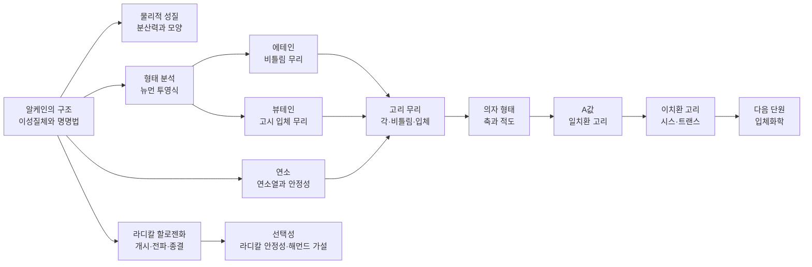

# 유기화학 2. 알케인과 사이클로알케인 — 단일 결합의 회전과 고리의 모양이 정하는 에너지
<!-- prev: ochem-1, uchem-12 -->
<!-- next: ochem-3 -->

> [!NOTE]
> **이 단원의 범위**
> - 알케인의 구조 이성질체와 IUPAC 명명법(알킬기, 복합 치환기, 사이클로알케인)
> - 물리적 성질과 분자 간 힘(끓는점·녹는점·밀도·용해도와 가지의 효과)
> - 형태 분석: 에테인·프로페인·뷰테인의 뉴먼 투영식, 이면각, 비틀림 무리와 입체 무리, 형태의 집단
> - 사이클로알케인의 고리 무리(연소열로 재는 무리 에너지, 3·4·5원 고리의 모양)
> - 사이클로헥세인의 의자 형태(축·적도 결합, 고리 뒤집힘, A값)
> - 이치환 사이클로헥세인의 시스·트랜스 이성질과 형태의 안정성
> - 알케인의 연소, 라디칼 할로젠화의 메커니즘(개시·전파·종결)과 선택성(라디칼의 안정성, 염소화와 브로민화)

**학습 목표**

1. 분자식이 주어진 알케인의 구조 이성질체를 빠짐없이 그리고, IUPAC 규칙(가장 긴 사슬, 가장 작은 위치 번호, 알파벳 순서, 복합 치환기)으로 알케인과 사이클로알케인의 이름을 짓고 거꾸로 이름에서 구조를 그릴 수 있다.
2. 분산력과 분자의 표면적·대칭성으로 알케인의 끓는점·녹는점 경향을 설명하고, 자료로 정량적으로 비교할 수 있다.
3. 뉴먼 투영식과 톱질대 그림으로 단일 결합 둘레의 형태를 그리고, 이면각에 따른 퍼텐셜 에너지를 비틀림 무리와 입체 무리의 합으로 계산하며, 볼츠만 분포로 형태의 집단을 구할 수 있다.
4. 연소열로부터 사이클로알케인의 고리 무리 에너지를 구하고, 각 무리·비틀림 무리·입체 무리로 3~8원 고리의 안정성과 모양을 설명할 수 있다.
5. 사이클로헥세인의 의자 형태를 바르게 그려 탄소마다 축·적도 결합의 방향(위/아래)을 정하고, A값으로 일치환·이치환 사이클로헥세인의 두 의자 형태의 에너지 차와 평형 조성을 계산할 수 있다.
6. 라디칼 할로젠화의 연쇄 메커니즘을 낚싯바늘 화살표로 쓰고, 결합 해리 에너지로 각 단계의 반응 엔탈피를 계산하여 할로젠마다 반응성이 다른 까닭을 설명할 수 있다.
7. 1°·2°·3° 수소의 상대 반응성으로 할로젠화 생성물의 비율을 예측하고, 해먼드 가설로 브로민화가 염소화보다 훨씬 선택적인 까닭을 설명할 수 있다.

**이 단원의 학습 사다리**

| 단계 | 무엇을 하나? |
|---|---|
| STEP 1. 이전 학습 다시 보기 | 일반화학의 탄화수소·명명 기초·분자 간 힘·결합 엔탈피, 유기화학 1의 $sp^3$ 혼성·쐐기와 점선·낚싯바늘 화살표 |
| STEP 2. 기초 다지기 | 볼츠만 분포와 형태의 집단, 이면각의 주기 함수(푸리에 급수), 결합 해리 에너지로 반응 엔탈피 계산, 장벽 높이와 회전 속도 |
| STEP 3. 핵심 개념 | 이성질체 → 명명법 → 물리적 성질 → 에테인 → 뷰테인 → 고리 무리 → 의자 형태 → A값 → 이치환 사이클로헥세인 → 연소 → 라디칼 할로젠화의 메커니즘 → 선택성 |
| STEP 4. 오개념 바로잡기 | "형태 이성질체는 분리할 수 있다", "시스는 언제나 축–축이다", "3차 라디칼이 안정하니 염소화도 3차에서만 일어난다" 같은 착각 |
| STEP 5. 대학원·연구로 | 입체 전자 효과와 아노머 효과, 형태 탐색 계산, 선택적 C–H 작용기화 |
| STEP 6. 생활·산업·진로 | 연료와 옥테인가, 의약품의 고리 형태, 클로로메테인 공업, 성층권 오존과 라디칼 연쇄 |

---

## 🗺️ 단원 들어가기

뷰테인 라이터의 연료, 가스레인지의 메테인, 자동차의 휘발유, 양초의 파라핀은 모두 **알케인**(alkane)이다. 탄소와 수소만으로, 단일 결합만으로 이루어진 이 분자들은 작용기가 없어 '반응성이 없는 화합물'로 불리기도 한다. 실제로 알케인은 산·염기·산화제·환원제의 대부분과 실온에서 반응하지 않는다. 그런데 이 '심심한' 분자에서 유기화학의 가장 중요한 생각 두 가지가 나온다.

첫째는 **모양이 에너지를 정한다**는 생각이다. C–C 단일 결합은 축 둘레로 돌 수 있어서, 같은 분자도 순간마다 다른 3차원 모양(형태)을 가진다. 그 모양들의 에너지 차이는 수 kJ/mol에 불과하지만, 25 ℃에서 $RT$가 2.5 kJ/mol이므로 이 정도의 차이로 분자의 집단이 크게 달라진다. 사이클로헥세인 고리의 치환기가 '위로 서 있는가(축)' '옆으로 누웠는가(적도)'는 포도당이 왜 가장 흔한 당인지, 스테로이드 호르몬이 왜 그런 모양인지, 약물 분자가 어떻게 수용체에 맞는지를 정한다.

둘째는 **반응성은 상대적이고, 선택성은 전이 상태가 정한다**는 생각이다. 알케인은 빛을 받은 염소·브로민과는 격렬하게 반응한다. 이때 생기는 **라디칼**은 홀전자를 가진 화학종으로, 연쇄 반응을 일으킨다. 같은 분자 안에서도 어떤 수소가 먼저 떨어져 나가는지는 라디칼의 안정성과 반응의 에너지 도표로 예측할 수 있다. 염소는 거의 가리지 않고 아무 수소나 떼어 내지만, 브로민은 3차 수소를 1차 수소보다 1000배 넘게 골라낸다.

이 단원에서는 유기화학 1에서 익힌 $sp^3$ 혼성, 쐐기와 점선, 굽은 화살표를 3차원의 형태와 라디칼의 반응으로 넓힌다. 이 단원에서 그리는 의자 형태와 뉴먼 투영식은 다음 단원 「입체화학」의 입체 중심과 「유기 반응의 개관과 알킬 할라이드의 치환·제거 반응」의 안티 준평면 제거에서 곧바로 다시 쓰인다.

---

## STEP 1. 🔙 이전 학습 다시 보기

### 연계 개념표

| 이전 단원 | 그때 배운 것 | 이 단원에서 확장되는 것 |
|---|---|---|
| 일반화학 「핵화학·배위 화학·유기화학 개관」 '탄화수소' | 알케인 $\mathrm{C_nH_{2n+2}}$, 사이클로알케인 $\mathrm{C_nH_{2n}}$, 어근(메트·에트·프로프…), 곁가지 이름 붙이기 기초, 사슬 이성질 | 알킬기·복합 치환기·알파벳 순서·고리 명명까지 IUPAC 규칙 전체, 이성질체를 **빠짐없이** 세는 체계 |
| 일반화학 「분자 간 힘과 액체·고체·용액」 | 분산력, 편극성, 끓는점과 분자 간 힘, 트루턴 규칙 | 사슬 길이·가지·대칭성이 끓는점·녹는점에 주는 효과를 자료로 정량 비교 |
| 일반화학 「열화학」 | 결합 엔탈피로 반응 엔탈피 어림, 연소열, 헤스 법칙 | **결합 해리 에너지**(균일 분해)로 라디칼 단계의 $\Delta H^\circ$ 계산, 연소열로 이성질체의 안정성과 **고리 무리** 측정 |
| 일반화학 「화학 반응 속도론」 | 활성화 에너지, 아레니우스 식, 반응 메커니즘과 속도 결정 단계, 연쇄 반응의 예 | 회전 장벽으로 형태가 바뀌는 속도 어림, 전파 단계의 활성화 에너지로 **선택성** 설명 |
| 유기화학 1 「구조와 결합, 산과 염기」 | $sp^3$ 혼성과 109.5°, 쐐기와 점선, 골격 구조식, 1°·2°·3° 탄소, 낚싯바늘 화살표 | 사면체 탄소의 **회전**으로 생기는 형태, 뉴먼 투영식과 의자 형태, 낚싯바늘 화살표로 쓰는 라디칼 메커니즘 |

### 준비 운동 (사전 진단)

**Q1.** 2-메틸프로페인 $\mathrm{(CH_3)_3CH}$의 탄소를 1°·2°·3°·4°로 분류하고, 각 종류의 수소가 몇 개씩인지 쓰시오.

**Q2.** 펜테인(36 ℃)과 2,2-다이메틸프로페인(10 ℃)은 분자식이 같은데 끓는점이 다르다. 그 까닭을 분자 간 힘으로 한 문장으로 설명하시오.

**Q3.** 결합 엔탈피(C–H 413, Cl–Cl 242, C–Cl 339, H–Cl 431 kJ/mol, 일반화학의 평균값)로 $\mathrm{CH_4 + Cl_2 \rightarrow CH_3Cl + HCl}$의 $\Delta H^\circ$를 어림하시오.

**Q4.** 낚싯바늘 화살표와 굽은 화살표(온화살표)는 각각 전자 몇 개의 이동을 뜻하는가? $\mathrm{Cl_2}$가 빛을 받아 두 Cl 원자로 갈라지는 과정을 그리려면 어느 화살표를 몇 개 써야 하는가?

정답 및 해설

**Q1.** 메틸 탄소 3개는 1°(수소 3개씩, 모두 9개), 가운데 탄소는 3°(수소 1개). 2°·4° 탄소는 없다. 이 9 : 1이라는 수가 ⑫에서 생성물 비율을 계산하는 출발점이다.

**Q2.** 곧은 사슬인 펜테인은 이웃 분자와 닿는 표면적이 넓어 분산력이 크고, 공 모양인 2,2-다이메틸프로페인은 표면적이 작아 분산력이 작기 때문이다.

**Q3.** 약 $-115\ \mathrm{kJ/mol}$ — 끊는 결합 $413 + 242 = 655$, 생기는 결합 $339 + 431 = 770$, $\Delta H^\circ \approx 655 - 770 = -115\ \mathrm{kJ/mol}$. 평균 결합 엔탈피 대신 그 분자의 **결합 해리 에너지**를 쓰면 약 $-101\ \mathrm{kJ/mol}$이 된다(디딤돌 3, ⑪).

**Q4.** 낚싯바늘 화살표는 전자 1개, 온화살표는 전자 2개(전자쌍). Cl–Cl 결합의 전자쌍이 두 원자에 하나씩 나뉘므로 결합에서 각 Cl로 향하는 낚싯바늘 화살표 **2개**가 필요하다.

---

## STEP 2. 🧱 기초 다지기

### 디딤돌 1. 볼츠만 분포 — 에너지 차이가 형태의 집단을 정한다

에너지가 다른 여러 상태를 오가는 분자들이 평형에 있으면, 상태 $i$에 있는 분자의 비율은 그 상태의 자유 에너지 $G_i$와 같은 에너지를 가진 상태의 수(축퇴도) $g_i$로 정해진다. 수학 도구 7 「확률과 통계」 '가장 그럴듯한 분포와 볼츠만 분포'에서 라그랑주 승수로 유도한 결과를 몰 단위로 쓰면 다음과 같다.

$$
\frac{N_2}{N_1} = \frac{g_2}{g_1}\,e^{-(G_2 - G_1)/RT}, \qquad x_i = \frac{g_i\,e^{-G_i/RT}}{\sum_j g_j\,e^{-G_j/RT}}
$$

두 형태 A ⇌ B의 평형 상수 $K = [\mathrm{B}]/[\mathrm{A}]$로 쓰면 이것은 일반화학 「화학 열역학」의 $\Delta G^\circ = -RT\ln K$와 같은 식이다. 형태의 평형은 화학 반응의 평형과 똑같이 다룬다.

| $\Delta G^\circ$ (25 ℃, kJ/mol) | 0 | 2.5 | 5.7 | 7.3 | 11.4 | 17.1 |
|---|---|---|---|---|---|---|
| 안정한 쪽 : 불안정한 쪽 | 50 : 50 | 73 : 27 | 91 : 9 | 95 : 5 | 99 : 1 | 99.9 : 0.1 |

> [!TIP]
> 💡 **요령** — 25 ℃에서 $RT \approx 2.48\ \mathrm{kJ/mol}$, $2.303RT \approx 5.71\ \mathrm{kJ/mol}$이다. 에너지 차가 5.7 kJ/mol 늘 때마다 비가 10배씩 벌어진다. 형태 분석에 나오는 에너지(3.8, 7.3, 11.4 kJ/mol)는 대부분 이 '눈금' 몇 칸 안에 있으므로, 두 형태가 모두 상당히 존재하는지 한쪽이 압도하는지를 암산으로 판단할 수 있다.

#### 예제 1 — 95 : 5가 되려면

25.0 ℃에서 두 형태 A, B(축퇴도 같음)가 95 : 5로 존재한다. (1) 두 형태의 자유 에너지 차를 구하시오. (2) 에너지 차가 같을 때 −80 ℃에서의 비율을 구하시오. (엔트로피 차는 0으로 본다.)

**풀이**
(1) 식 세우기: $\Delta G^\circ = RT\ln(N_\mathrm{A}/N_\mathrm{B})$. 대입: $8.314\times298.15\times\ln(95/5) = 2479\times2.944 = 7.30\times10^3\ \mathrm{J/mol}$, 즉 $7.3\ \mathrm{kJ/mol}$.
(2) $T = 193.15\ \mathrm{K}$: $N_\mathrm{A}/N_\mathrm{B} = \exp\!\left(\dfrac{7300}{8.314\times193.15}\right) = e^{4.546} = 94$ → 약 99 : 1.
**의미** 7.3 kJ/mol은 ⑧에서 볼 메틸사이클로헥세인의 두 의자 형태의 에너지 차(메틸기의 A값)이다. 온도를 낮추면 불안정한 형태가 더 줄어든다. 저온 NMR로 두 형태를 따로 관찰하고 그 비로 에너지 차를 재는 실험이 이 식에 기대고 있다.

### 디딤돌 2. 이면각의 주기 함수 — 푸리에 급수로 쓰는 회전 퍼텐셜

C–C 결합 둘레의 회전은 각 $\phi$(이면각, ④에서 정의)의 함수이고, $360°$ 돌면 같은 모양으로 돌아오므로 퍼텐셜 에너지 $V(\phi)$는 **주기 함수**이다. 수학 도구 6 「복소수와 푸리에 해석」 '푸리에 급수'에서 익혔듯이 주기 함수는 코사인 항의 합으로 쓸 수 있다($V(\phi) = V(-\phi)$인 짝함수라 사인 항이 없다).

$$
V(\phi) = a_0 + a_1\cos\phi + a_2\cos 2\phi + a_3\cos 3\phi + \cdots
$$

각 항에는 화학적 뜻이 있다. 탄소 하나에 같은 치환기 세 개가 120° 간격으로 붙어 있으면 회전을 120°씩 할 때마다 같은 모양이 되므로 $\cos 3\phi$ 항만 남는다. 에테인이 그렇다.

$$
V_\text{에테인}(\phi) = \frac{V_0}{2}\left(1 + \cos 3\phi\right)
$$

$\phi = 0°, 120°, 240°$에서 최댓값 $V_0$(가린 형태), $60°, 180°, 300°$에서 최솟값 0(엇갈린 형태)이다. 뷰테인처럼 앞뒤 탄소에 큰 치환기가 하나씩 있으면 $360°$에 한 번만 나타나는 효과(두 메틸기가 겹치는 $\phi = 0°$의 큰 반발)를 나타내는 $\cos\phi$ 항이 더해진다.

<!-- 그림 요청: 이면각 퍼텐셜의 푸리에 성분 그래프. 가로축 이면각 φ 0°~360°(60° 간격 눈금), 세로축 에너지(kJ/mol). (가) 에테인: V(φ) = 6(1 + cos 3φ) 실선, 0°·120°·240°·360°에서 최대 12, 60°·180°·300°에서 최소 0. (나) 뷰테인: V(φ) = 9.77 + 2.27 cos φ − 0.27 cos 2φ + 7.23 cos 3φ 굵은 실선과 그 성분 2.27 cos φ(점선), 7.23 cos 3φ(파선)을 옅게 겹쳐 그린다. 뷰테인 곡선의 주요 점에 이름표: φ = 0° '19 (완전 가림)', 약 61° '3.8 (고시)', 약 118° '16 (가림)', 180° '0 (안티)'. -->

#### 예제 2 — 에테인의 회전 퍼텐셜 읽기

에테인의 회전 장벽을 $V_0 = 12\ \mathrm{kJ/mol}$로 놓을 때 (1) 엇갈린 형태에서 $30°$, $20°$ 돌린 지점의 에너지를 구하시오. (2) 25 ℃에서 $V(\phi)$가 $RT$보다 작은 영역은 엇갈린 형태 둘레 몇 도 안쪽인가?

**풀이**
(1) 엇갈린 형태는 $\phi = 60°$이다. $30°$ 돌리면 $\phi = 30°$: $V = 6(1 + \cos 90°) = 6.0\ \mathrm{kJ/mol}$. $20°$ 돌리면 $\phi = 40°$: $V = 6(1 + \cos 120°) = 3.0\ \mathrm{kJ/mol}$.
(2) $6(1 + \cos 3\phi) = 2.48$에서 $\cos 3\phi = -0.587$, $3\phi = 126.0°$이므로 $\phi = 42.0°$. 엇갈린 형태($60°$)에서 $\pm18°$ 안쪽이다.
**의미** 장벽 꼭대기(가린 형태)는 '한 형태'가 아니라 지나가는 고개이다. 에테인 분자는 대부분의 시간을 엇갈린 형태 둘레 ±20° 안에서 떨며 보내고, 가끔 열에너지를 모아 고개를 넘는다(디딤돌 4). 뷰테인의 네 항짜리 식은 도전 문제 17과 탐구 활동 B에서 직접 맞춘다.

### 디딤돌 3. 결합 해리 에너지 — 라디칼 반응의 장부

일반화학 「열화학」에서는 여러 분자에서 평균한 **결합 엔탈피**로 반응 엔탈피를 어림했다. 라디칼 반응을 다룰 때는 특정 결합 하나를 **균일 분해**(homolysis)하여 두 라디칼로 나누는 데 드는 엔탈피, 즉 **결합 해리 에너지**(bond dissociation energy, BDE) $D$를 쓴다.

$$
\mathrm{A{-}B \rightarrow A\cdot + \cdot B}, \qquad \Delta H^\circ = D(\mathrm{A{-}B})
$$

$$
\Delta H^\circ_\text{반응} = \sum D(\text{끊어지는 결합}) - \sum D(\text{생기는 결합})
$$

| 결합 | $D$ (kJ/mol, 약) | 결합 | $D$ (kJ/mol, 약) | 결합 | $D$ (kJ/mol, 약) |
|---|---|---|---|---|---|
| $\mathrm{CH_3{-}H}$ | 439 | $\mathrm{F{-}F}$ | 159 | $\mathrm{H{-}F}$ | 570 |
| $\mathrm{CH_3CH_2{-}H}$ (1°) | 421 | $\mathrm{Cl{-}Cl}$ | 242 | $\mathrm{H{-}Cl}$ | 432 |
| $\mathrm{(CH_3)_2CH{-}H}$ (2°) | 413 | $\mathrm{Br{-}Br}$ | 193 | $\mathrm{H{-}Br}$ | 366 |
| $\mathrm{(CH_3)_3C{-}H}$ (3°) | 400 | $\mathrm{I{-}I}$ | 151 | $\mathrm{H{-}I}$ | 298 |
| $\mathrm{CH_3{-}F}$ | 460 | $\mathrm{CH_3{-}Cl}$ | 350 | $\mathrm{CH_3{-}Br}$ | 294 |
| $\mathrm{CH_3{-}I}$ | 239 | $\mathrm{CH_3{-}CH_3}$ | 377 | $\mathrm{CH_3CH_2{-}CH_3}$ | 371 |

(25 ℃ 기체상 값. 자료에 따라 몇 kJ/mol씩 다르다. 이 단원에서는 이 표의 값을 쓴다.)

> [!WARNING]
> 결합 해리 에너지와 산도는 다른 이야기이다. $\mathrm{p}K_\mathrm{a}$는 결합을 **불균일 분해**($\mathrm{H^+}$와 음이온)할 때의 자유 에너지이고, BDE는 **균일 분해**(두 라디칼)의 엔탈피이다. 유기화학 1 「구조와 결합, 산과 염기」 STEP 4에서 본 것처럼 에타인의 C–H는 가장 강하지만 가장 산성이다.

#### 예제 3 — 수소 떼어 내기의 엔탈피

염소 원자 $\mathrm{Cl\cdot}$와 브로민 원자 $\mathrm{Br\cdot}$가 알케인의 1°·2°·3° C–H에서 수소를 떼어 내는 단계 $\mathrm{R{-}H + X\cdot \rightarrow R\cdot + H{-}X}$의 $\Delta H^\circ$를 각각 구하시오.

**풀이**
식 세우기: $\Delta H^\circ = D(\mathrm{R{-}H}) - D(\mathrm{H{-}X})$.

| C–H | Cl·로 떼어 낼 때 | Br·로 떼어 낼 때 |
|---|---|---|
| 1° (421) | $421 - 432 = -11$ | $421 - 366 = +55$ |
| 2° (413) | $413 - 432 = -19$ | $413 - 366 = +47$ |
| 3° (400) | $400 - 432 = -32$ | $400 - 366 = +34$ |

**의미** 염소 원자의 수소 떼어 내기는 모두 발열이고, 브로민 원자의 것은 모두 크게 흡열이다. 1°와 3°의 차이(21 kJ/mol)는 두 경우에 똑같지만, 이 차이가 **반응 속도**에 얼마나 반영되는지는 전혀 다르다. 이것이 ⑫의 선택성 이야기의 핵심이다.

### 디딤돌 4. 장벽 높이와 속도 — 형태는 얼마나 빨리 바뀌나

일반화학 「화학 반응 속도론」의 아레니우스 식 $k = Ae^{-E_\mathrm{a}/RT}$에서, 분자 하나가 장벽을 넘는 단분자 과정의 앞지수 인자는 대략 $k_\mathrm{B}T/h$(25 ℃에서 약 $6.2\times10^{12}\ \mathrm{s^{-1}}$, 분자 진동 한 번에 해당)이다. 물리화학 「반응 속도론과 반응 동역학」에서 유도하는 **아이링 식**이 이것을 정확히 표현한다. 여기서는 결과만 도구로 쓴다.

$$
k \approx \frac{k_\mathrm{B}T}{h}\,e^{-\Delta G^\ddagger/RT}, \qquad \tau = \frac{1}{k}\ (\text{한 형태가 머무는 평균 시간})
$$

#### 예제 4 — 에테인의 회전과 사이클로헥세인의 뒤집힘

(1) 에테인의 회전 장벽(약 12 kJ/mol)과 (2) 사이클로헥세인 고리 뒤집힘의 장벽(약 45 kJ/mol, ⑦)에 대해 25 ℃에서 1초당 장벽을 넘는 횟수를 어림하시오. (3) 사이클로헥세인을 −100 ℃로 식히면 어떻게 되는가?

**풀이**
(1) $k = 6.2\times10^{12}\times e^{-12\,000/2479} = 6.2\times10^{12}\times7.9\times10^{-3} \approx 5\times10^{10}\ \mathrm{s^{-1}}$. 한 엇갈린 형태에 머무는 시간은 약 20 ps이다.
(2) $k = 6.2\times10^{12}\times e^{-45\,000/2479} = 6.2\times10^{12}\times1.3\times10^{-8} \approx 8\times10^{4}\ \mathrm{s^{-1}}$. 약 $10^5$번.
(3) $T = 173\ \mathrm{K}$에서 $k_\mathrm{B}T/h = 3.6\times10^{12}\ \mathrm{s^{-1}}$, $k = 3.6\times10^{12}\times e^{-45\,000/(8.314\times173)} \approx 0.1\ \mathrm{s^{-1}}$. 고리 뒤집힘이 10초에 한 번꼴로 느려진다.
**의미** 장벽이 약 70 kJ/mol보다 낮으면 실온에서 형태가 1초에 한 번 이상 바뀌므로 형태 이성질체를 **분리할 수 없다**(실온에서 따로 분리해 몇 시간 이상 보관하려면 장벽이 대략 90~100 kJ/mol 이상이어야 한다). 실온의 NMR에서 사이클로헥세인의 축 수소와 적도 수소는 평균되어 신호 하나로 보이지만, −100 ℃ 근처에서는 두 신호로 갈라진다. 장벽 높이가 '같은 분자의 다른 모양'과 '다른 분자'를 가르는 기준이 된다.

---

## STEP 3. 📘 핵심 개념

### ① 알케인의 구조와 구조 이성질체

알케인은 모든 탄소가 $sp^3$ 혼성이고 C–C·C–H 단일 결합만 가진 탄화수소이다. 고리가 없는 알케인의 분자식은 $\mathrm{C_nH_{2n+2}}$, 고리가 하나인 **사이클로알케인**(cycloalkane)은 고리를 닫느라 수소 두 개를 잃어 $\mathrm{C_nH_{2n}}$이다. 각 탄소 둘레의 결합각은 109.5°에 가깝고, C–C 결합 길이는 약 154 pm, C–H는 약 109 pm이다.

분자식은 같지만 원자의 연결 순서가 다른 화합물을 **구조 이성질체**(constitutional isomer)라 한다. 탄소 4개부터 가지를 친 사슬이 가능해지고, 이성질체의 수는 탄소 수에 따라 폭발적으로 늘어난다.

| 분자식 | $\mathrm{C_4H_{10}}$ | $\mathrm{C_5H_{12}}$ | $\mathrm{C_6H_{14}}$ | $\mathrm{C_7H_{16}}$ | $\mathrm{C_8H_{18}}$ | $\mathrm{C_{10}H_{22}}$ | $\mathrm{C_{20}H_{42}}$ |
|---|---|---|---|---|---|---|---|
| 구조 이성질체 수 | 2 | 3 | 5 | 9 | 18 | 75 | 366 319 |

#### 이성질체를 빠짐없이 세는 법

손으로 세다 보면 같은 것을 두 번 세거나(사슬을 다르게 그렸을 뿐인 같은 분자) 빠뜨리기 쉽다. 다음 순서를 지키면 체계적으로 셀 수 있다.

1. **가장 긴 사슬**이 $n$개인 것(곧은 사슬)부터 그린다.
2. 가장 긴 사슬을 하나씩 줄여 가며, 남은 탄소를 가지로 붙인다. 가지는 사슬의 끝 탄소에 붙이지 않는다(붙이면 사슬이 길어질 뿐이다).
3. 가지의 위치를 사슬 한쪽 절반까지만 옮겨 본다(대칭이므로 나머지 절반은 같은 분자이다).
4. 그린 것마다 IUPAC 이름(②)을 붙여, **이름이 같으면 같은 분자**로 지운다.

<!-- 그림 요청: C6H14 다섯 구조 이성질체의 골격 구조식을 가장 긴 사슬 길이 순서로 한 줄에. ① 헥세인(SMILES CCCCCC, 사슬 6) ② 2-메틸펜테인(CC(C)CCC) ③ 3-메틸펜테인(CCC(C)CC) (②·③은 사슬 5) ④ 2,2-다이메틸뷰테인(CC(C)(C)CC) ⑤ 2,3-다이메틸뷰테인(CC(C)C(C)C) (④·⑤는 사슬 4). 각 구조에서 가장 긴 사슬을 굵은 선으로, 가지는 보통 선으로 그리고 사슬에 번호. 아래 줄에 '같은 분자를 다르게 그린 예': 2-메틸펜테인을 ㄱ자로 꺾어 그린 그림과 '1-메틸펜테인처럼 보이지만 실제로는 헥세인'인 그림(끝 탄소에 메틸을 붙인 것)을 회색으로 두고 '= 헥세인' 이름표. -->

#### 탄소와 수소의 차수

유기화학 1 「구조와 결합, 산과 염기」에서처럼 탄소는 직접 결합한 **다른 탄소의 수**로 1°(1차), 2°, 3°, 4°로 나눈다. 수소는 그것이 붙은 탄소의 차수를 따른다(1° 수소는 1° 탄소에 붙은 수소). 4° 탄소에는 수소가 없다. 이 구별은 ⑪·⑫의 라디칼 할로젠화에서 "어느 수소가 먼저 떨어지는가"를 정하는 언어이다.

| 탄소 | 붙은 탄소 수 | 수소 수 | 예 |
|---|---|---|---|
| 1° | 1 | 3 ($\mathrm{CH_3}$) | 뷰테인의 C1, C4 |
| 2° | 2 | 2 ($\mathrm{CH_2}$) | 뷰테인의 C2, C3, 사이클로헥세인의 모든 탄소 |
| 3° | 3 | 1 (CH) | 2-메틸프로페인의 C2 |
| 4° | 4 | 0 (C) | 2,2-다이메틸프로페인의 C2 |

#### 예제 5 — 아이소옥테인의 탄소와 수소 분류

휘발유의 옥테인가 기준 물질인 2,2,4-트라이메틸펜테인(아이소옥테인, $\mathrm{(CH_3)_3CCH_2CH(CH_3)_2}$)의 탄소를 1°·2°·3°·4°로 분류하고, 각 종류의 수소 수를 쓰시오. 이 분자를 염소화하면 일염화물 구조 이성질체는 몇 가지가 생길 수 있는가?

**풀이**
사슬 C1~C5에 C2의 메틸 두 개, C4의 메틸 하나가 붙어 있다.
- 1° 탄소: C1, C5, C2의 메틸 2개, C4의 메틸 1개 → 5개, 수소 15개
- 2° 탄소: C3 → 1개, 수소 2개
- 3° 탄소: C4 → 1개, 수소 1개
- 4° 탄소: C2 → 1개, 수소 0개
확인: 탄소 $5 + 1 + 1 + 1 = 8$, 수소 $15 + 2 + 1 = 18$로 $\mathrm{C_8H_{18}}$과 맞는다.
일염화물: 서로 구별되는 수소의 무리를 센다. C1과 C2의 두 메틸은 모두 C2(4°)에 붙은 같은 환경(tert-뷰틸 부분의 9개)이다. C5와 C4의 메틸은 C4에 붙은 같은 환경(6개)이다. 여기에 C3(2개)와 C4(1개)를 더하면 **4가지**이다.
**의미** 수소 18개가 '화학적으로 구별되는' 무리 네 개(9 : 6 : 2 : 1)로 나뉜다. ⑫에서는 이 무리마다 수소 수와 상대 반응성을 곱해 생성물 비율을 예측한다.

#### ✔ 바로 확인

1. $\mathrm{C_5H_{12}}$의 구조 이성질체 세 가지의 이름을 쓰시오.
2. (O/X) 사이클로헥세인과 헥스-1-엔은 분자식이 같다.
3. 2-메틸뷰테인에는 1°·2°·3° 수소가 각각 몇 개 있는가?

정답

1. 펜테인, 2-메틸뷰테인, 2,2-다이메틸프로페인
2. O — 둘 다 $\mathrm{C_6H_{12}}$. 고리 하나와 이중 결합 하나는 수소를 똑같이 두 개 줄인다(둘은 구조 이성질체이다).
3. 1° 9개(C1·C4·C2의 메틸), 2° 2개(C3), 3° 1개(C2)

### ② IUPAC 명명법 — 알케인과 사이클로알케인

일반화학에서 곁가지가 하나인 알케인의 이름을 지어 보았다. 실제 분자는 가지가 여러 개이고, 가지 자체가 가지를 치기도 한다. IUPAC 체계 명명법은 어떤 구조에도 **하나의 이름**을, 어떤 이름에서도 **하나의 구조**를 주도록 규칙을 정해 두었다.

#### 알킬기

알케인에서 수소 하나를 뗀 원자단을 **알킬기**(alkyl group)라 하고, 어미 '-에인'을 '-일'로 바꾸어 부른다. 탄소 3·4개짜리는 어느 탄소에서 수소를 떼느냐에 따라 여러 가지가 있으며, 관용명이 널리 쓰인다.

| 구조 | 체계명 | 관용명 | 붙는 탄소 |
|---|---|---|---|
| $\mathrm{CH_3CH_2CH_2{-}}$ | 프로필 | 프로필 | 1° |
| $\mathrm{(CH_3)_2CH{-}}$ | 1-메틸에틸(프로판-2-일) | 아이소프로필 | 2° |
| $\mathrm{CH_3CH_2CH_2CH_2{-}}$ | 뷰틸 | 뷰틸 | 1° |
| $\mathrm{CH_3CH_2CH(CH_3){-}}$ | 1-메틸프로필(뷰탄-2-일) | sec-뷰틸 | 2° |
| $\mathrm{(CH_3)_2CHCH_2{-}}$ | 2-메틸프로필 | 아이소뷰틸 | 1° |
| $\mathrm{(CH_3)_3C{-}}$ | 1,1-다이메틸에틸 | tert-뷰틸 | 3° |

<!-- 그림 요청: 알킬기 여섯 가지의 골격 구조식 카드. 프로필, 아이소프로필, 뷰틸, sec-뷰틸, 아이소뷰틸, tert-뷰틸. 각 카드에서 분자에 붙는 결합(자유 원자가)은 끝에 물결선(~~)을 그어 표시하고, 붙는 탄소에 작은 글씨로 1°·2°·3°. 아래에 체계명과 관용명. 예: tert-뷰틸은 가운데 탄소에서 세 메틸이 뻗고 네 번째 결합에 물결선. -->

#### 사슬 알케인의 이름 짓기

1. **모체 사슬**: 가장 긴 연속 탄소 사슬을 찾는다. 길이가 같은 사슬이 둘 이상이면 **치환기가 더 많은** 사슬을 고른다.
2. **번호 매기기**: 첫 치환기에 가까운 끝에서 번호를 매긴다. 양쪽이 같으면 **처음으로 달라지는 자리**에서 더 작은 번호를 주는 쪽을 고른다(위치 번호 묶음을 앞에서부터 하나씩 비교한다).
3. **치환기 이름**: 각 치환기에 위치 번호를 붙이고, 같은 치환기가 여럿이면 다이-·트라이-·테트라-를 붙인다(2,2-다이메틸).
4. **순서**: 치환기는 **영어 이름의 알파벳 순서**로 쓴다(우리말 이름도 이 순서를 따른다). 이때 다이-·트라이-와 sec-·tert-는 무시하고, 아이소(iso)는 포함한다. 그래서 에틸(ethyl)이 메틸(methyl)보다, tert-뷰틸(butyl)이 에틸보다 앞선다.
5. 양쪽 끝에서 번호 묶음이 완전히 같으면, 알파벳 순서로 **먼저 쓰는 치환기**에 작은 번호를 준다.
6. **복합 치환기**(가지가 있는 치환기)는 붙은 탄소를 1번으로 해서 그 안에서 다시 이름을 짓고 괄호에 넣는다: 5-(1,2-다이메틸프로필)노네인. 복합 치환기 이름은 첫 글자로 알파벳 순서를 정한다(다이메틸프로필은 d).

할로젠은 알케인 명명법에서 알킬기와 똑같은 치환기로 다룬다: 플루오로(F), 클로로(Cl), 브로모(Br), 아이오도(I). 예: $\mathrm{CH_3CHBrCH_3}$는 2-브로모프로페인, $\mathrm{(CH_3)_3CCl}$은 2-클로로-2-메틸프로페인이다.

#### 예제 6 — 이름 짓기 세 가지

다음 알케인의 IUPAC 이름을 쓰시오.
(1) $\mathrm{(CH_3)_2CHCH_2C(CH_3)_2CH_2CH_3}$
(2) $\mathrm{CH_3CH(CH_3)CH(CH_2CH_3)CH_2CH_2CH_3}$
(3) $\mathrm{CH_3CH_2CH(CH_3)CH[C(CH_3)_3]CH_2CH_2CH_3}$

**풀이**
(1) 가장 긴 사슬은 아이소프로필 쪽 메틸에서 에틸 쪽 끝까지 탄소 6개이다. 왼쪽에서 매기면 메틸이 2, 4, 4번, 오른쪽에서 매기면 3, 3, 5번이다. 첫 숫자에서 $2 < 3$이므로 **2,4,4-트라이메틸헥세인**.
(2) 탄소 6개짜리 사슬이 두 개 있다. 에틸을 사슬에 넣으면 치환기가 아이소프로필 하나뿐이고, 에틸을 가지로 두면 메틸과 에틸 두 개이다. 치환기가 많은 쪽을 골라 왼쪽에서 매기면 메틸 2, 에틸 3(반대쪽은 4, 5). 알파벳 순서(ethyl < methyl)로 **3-에틸-2-메틸헥세인**.
(3) 가장 긴 사슬은 탄소 7개(tert-뷰틸 쪽으로 사슬을 늘려도 6개뿐이다). 왼쪽에서 매기면 메틸 3, tert-뷰틸 4(오른쪽에서는 4, 5). tert-는 무시하고 butyl의 b로 정렬하므로 **4-tert-뷰틸-3-메틸헵테인**[체계명으로는 4-(1,1-다이메틸에틸)-3-메틸헵테인].

풀이 그림

<!-- 그림 요청: 예제 6의 세 구조를 골격 구조식으로 그리고 모체 사슬을 굵은 선, 번호를 사슬 탄소 옆에 작은 숫자로. (1) 2,4,4-트라이메틸헥세인(SMILES CC(C)CC(C)(C)CC), 6탄소 사슬과 2번·4번(메틸 2개) 가지. (2) 3-에틸-2-메틸헥세인(SMILES CC(C)C(CC)CCC), 탄소 6개 사슬 두 후보를 나란히 그려 '치환기 1개(×)'와 '치환기 2개(○)'로 비교. (3) 4-tert-뷰틸-3-메틸헵테인(SMILES CCC(C)C(CCC)C(C)(C)C), 7탄소 사슬과 3번 메틸, 4번 tert-뷰틸. -->

#### 사이클로알케인의 이름 짓기

1. 고리 탄소 수로 '사이클로-'를 붙인 모체 이름을 정한다(사이클로프로페인, 사이클로뷰테인 …). 고리에 붙은 사슬이 고리보다 탄소가 많으면 사슬을 모체로 하고 고리를 '사이클로알킬' 치환기로 다룬다(1-사이클로프로필펜테인). 최근 IUPAC 권고는 고리를 우선 모체로 삼지만, 이 책에서는 탄소 수가 많은 쪽을 모체로 하는 널리 쓰이는 방식을 쓴다.
2. 치환기가 하나면 번호를 쓰지 않는다(메틸사이클로헥세인).
3. 치환기가 둘 이상이면 치환기 하나를 1번으로 놓고, 고리를 돌아가며 **위치 번호 묶음이 가장 작아지는** 방향을 고른다. 묶음이 같으면 알파벳 순서로 먼저인 치환기를 1번으로 한다.
4. 두 치환기가 고리 평면의 같은 쪽이면 **cis-**(시스), 반대쪽이면 **trans-**(트랜스)를 이름 앞에 붙인다(⑨).

| 구조 | 이름 | 근거 |
|---|---|---|
| 고리 6원에 C1 메틸 2개, C3 메틸 1개 | 1,1,3-트라이메틸사이클로헥세인 | {1,1,3} < {1,3,3} |
| 고리 5원에 이웃한 에틸과 메틸 | 1-에틸-2-메틸사이클로펜테인 | 번호 묶음 {1,2}가 같으므로 알파벳 순서(에틸)로 1번 |
| 고리 4원의 두 탄소에 Br, 같은 쪽 | cis-1,3-다이브로모사이클로뷰테인 | 같은 쪽 → cis |
| 고리 3원의 한 탄소에 곧은 사슬 펜틸기 | 1-사이클로프로필펜테인 | 사슬(탄소 5) > 고리(탄소 3)이므로 사슬이 모체 |

#### ✔ 바로 확인

1. $\mathrm{(CH_3)_3CCH_2CH_3}$의 이름은?
2. (O/X) 3-메틸-2-에틸펜테인은 바른 IUPAC 이름이다.
3. 빈칸: 알파벳 순서를 정할 때 다이-·트라이-와 (    )-·(    )-는 무시하지만 아이소는 포함한다.
4. 사이클로헥세인의 C1과 C4에 메틸기가 고리의 같은 쪽으로 붙어 있다. 이름은?

정답

1. 2,2-다이메틸뷰테인
2. X — 2번 탄소의 에틸을 사슬에 넣으면 사슬이 6개가 된다. 바른 이름은 3,4-다이메틸헥세인이다.
3. sec, tert
4. cis-1,4-다이메틸사이클로헥세인

### ③ 물리적 성질과 분자 간 힘

알케인 분자 사이에는 수소 결합도 쌍극자–쌍극자 힘도 거의 없고 **분산력**(런던 힘)만 작용한다. 분산력은 순간적으로 생긴 쌍극자가 이웃 분자에 쌍극자를 유도하여 생기는 인력이며, 분자가 **편극되기 쉬울수록**(전자 수가 많을수록) 그리고 이웃 분자와 **닿는 면적이 넓을수록** 크다(일반화학 「분자 간 힘과 액체·고체·용액」).

| 알케인 | 분자식 | 끓는점 (℃) | 녹는점 (℃) | 밀도 (g/mL, 20 ℃) | 25 ℃ 상태 |
|---|---|---|---|---|---|
| 메테인 | $\mathrm{CH_4}$ | −162 | −182 | — | 기체 |
| 에테인 | $\mathrm{C_2H_6}$ | −89 | −183 | — | 기체 |
| 프로페인 | $\mathrm{C_3H_8}$ | −42 | −188 | — | 기체 |
| 뷰테인 | $\mathrm{C_4H_{10}}$ | −0.5 | −138 | — | 기체 |
| 펜테인 | $\mathrm{C_5H_{12}}$ | 36 | −130 | 0.626 | 액체 |
| 헥세인 | $\mathrm{C_6H_{14}}$ | 69 | −95 | 0.659 | 액체 |
| 헵테인 | $\mathrm{C_7H_{16}}$ | 98 | −91 | 0.684 | 액체 |
| 옥테인 | $\mathrm{C_8H_{18}}$ | 126 | −57 | 0.703 | 액체 |
| 데케인 | $\mathrm{C_{10}H_{22}}$ | 174 | −30 | 0.730 | 액체 |
| 헥사데케인 | $\mathrm{C_{16}H_{34}}$ | 287 | 18 | 0.773 | 액체 |
| 아이코세인 | $\mathrm{C_{20}H_{42}}$ | 343 | 37 | 약 0.79 | 고체 |

(값은 약. 자료에 따라 1~2 ℃ 다르다.)

<!-- 그림 요청: 알케인의 끓는점과 녹는점 그래프. 가로축 탄소 수 1~20, 세로축 온도(℃, −200~350). 곧은 사슬 알케인의 끓는점(채운 원, 실선으로 연결: −162, −89, −42, −0.5, 36, 69, 98, 126, 151, 174, …, 287(16), 343(20))과 녹는점(빈 원, 점선: −182, −183, −188, −138, −130, −95, −91, −57, −51, −30, …, 18(16), 37(20)). 녹는점이 짝수 탄소에서 위로 튀는 지그재그(4→5, 6→7, 8→9에서 조금만 오르고 5→6, 7→8에서 크게 오름)가 보이게. 25 ℃에 가로 점선과 '실온' 이름표. C5·C6에서 가지 친 이성질체의 끓는점(2-메틸뷰테인 28, 2,2-다이메틸프로페인 10, 2,2-다이메틸뷰테인 50)을 세모로 표시. -->

#### 표에서 읽어 내는 네 가지 경향

1. **사슬이 길수록 끓는점이 높다.** 탄소가 하나 늘 때마다 끓는점이 대략 20~30 ℃씩 오른다(사슬이 길어질수록 그 증가 폭이 줄어든다). 탄소 1~4는 기체(천연가스·LPG), 5~16 정도는 액체(휘발유·등유·경유), 그 이상은 고체(파라핀)이다.
2. **가지가 많을수록 끓는점이 낮다.** 같은 탄소 수에서 가지가 많으면 분자가 공 모양에 가까워져 닿는 면적이 줄어든다.

| $\mathrm{C_6H_{14}}$ 이성질체 | 헥세인 | 3-메틸펜테인 | 2-메틸펜테인 | 2,3-다이메틸뷰테인 | 2,2-다이메틸뷰테인 |
|---|---|---|---|---|---|
| 끓는점 (℃, 약) | 69 | 63 | 60 | 58 | 50 |

3. **녹는점은 모양의 대칭성과 쌓임에 민감하다.** 녹는점은 결정 속에 분자가 얼마나 잘 쌓이는지에 달려 있다. 짝수 탄소 사슬은 결정에서 양 끝 메틸이 반대쪽을 향해 더 촘촘히 쌓이므로, 홀수 탄소 사슬보다 녹는점이 상대적으로 높다(녹는점 그래프의 지그재그). 공 모양으로 대칭적인 2,2-다이메틸프로페인은 끓는점은 펜테인보다 낮지만 녹는점(약 −17 ℃)은 펜테인(−130 ℃)보다 100 ℃ 넘게 높다.
4. **밀도는 1보다 작고 물에 녹지 않는다.** 알케인은 무극성이어서 물 분자 사이의 수소 결합망을 깨고 들어갈 만한 인력을 주지 못한다(소수성). 그래서 기름은 물 위에 뜨고, 알케인은 헥세인·사이클로헥세인·석유 에터처럼 무극성 유기물을 녹이는 용매로 쓰인다.

#### 예제 7 — 트루턴 규칙으로 증발 엔탈피 어림하기

(1) 헥세인(끓는점 69 ℃)과 2,2-다이메틸뷰테인(끓는점 50 ℃)의 몰 증발 엔탈피를 트루턴 규칙($\Delta S_\text{증발} \approx 87\ \mathrm{J/(mol\cdot K)}$)으로 어림하시오. (2) 두 값의 차이는 분자 간 힘에 대해 무엇을 말해 주는가?

**풀이**
(1) 끓는점에서 $\Delta G = 0$이므로 $\Delta H_\text{증발} = T_\mathrm{b}\,\Delta S_\text{증발}$.
헥세인: $342\ \mathrm{K}\times87 = 2.98\times10^4\ \mathrm{J/mol} \approx 29.8\ \mathrm{kJ/mol}$ (측정값 약 28.9 kJ/mol).
2,2-다이메틸뷰테인: $323\ \mathrm{K}\times87 = 2.81\times10^4\ \mathrm{J/mol} \approx 28.1\ \mathrm{kJ/mol}$.
(2) 분자식이 같아 전자 수(편극성)는 같은데도 가지 친 이성질체의 증발 엔탈피가 약 1.7 kJ/mol(약 6 %) 작다. 액체 속에서 분자 하나가 이웃과 맺는 분산력의 합이 그만큼 작다는 뜻이며, 이는 닿는 면적의 차이에서 온다.
**의미** 트루턴 규칙은 무극성 액체에서 잘 맞는다(일반화학 「화학 열역학」). 알케인은 이 규칙을 시험하기에 가장 좋은 물질이다.

#### ✔ 바로 확인

1. 끓는점이 높은 것부터 쓰시오: 헵테인, 2-메틸헥세인, 2,2,3-트라이메틸뷰테인
2. (O/X) 2,2-다이메틸프로페인은 펜테인보다 끓는점도 녹는점도 낮다.
3. 빈칸: 알케인 분자 사이에 작용하는 주된 힘은 (    )이고, 그 세기는 분자의 편극성과 (    )에 따라 커진다.

정답

1. 헵테인(98 ℃) > 2-메틸헥세인(약 90 ℃) > 2,2,3-트라이메틸뷰테인(약 81 ℃) — 가지가 많을수록 낮다.
2. X — 끓는점은 낮지만(10 ℃ < 36 ℃), 대칭적인 공 모양이라 결정에서 잘 쌓여 녹는점은 훨씬 높다(약 −17 ℃ > −130 ℃).
3. 분산력(런던 힘), 닿는 면적(표면적)

### ④ 에테인의 형태 — 뉴먼 투영식과 비틀림 무리

C–C 단일 결합은 σ 결합이므로 결합 축 둘레로 돌려도 오비탈의 겹침이 거의 변하지 않는다(π 결합과 다른 점, 유기화학 1 「구조와 결합, 산과 염기」 ②). 그래서 단일 결합은 쉽게 회전하고, 같은 분자가 회전에 따라 서로 다른 3차원 배열을 가진다. 이 배열을 **형태**(conformation)라 하고, 에너지 극소에 해당하는 각 형태를 **형태 이성질체**(conformer)라 한다. 디딤돌 4에서 보았듯 형태 이성질체는 장벽이 낮아 실온에서 끊임없이 서로 바뀌므로 분리할 수 없다. 이 단원과 다음 단원에서는 이것을 결합을 끊어야만 바뀌는 **배치**(configuration)와 구별한다.

#### 세 가지 그리는 법

| 표기 | 그리는 법 | 장점 |
|---|---|---|
| 쐐기–점선 그림 | 두 탄소를 종이 평면에 놓고 결합을 쐐기·점선으로 | 분자 전체의 3차원 배치 |
| 톱질대 그림(sawhorse) | C–C 결합을 비스듬히 위에서 내려다본 원근 그림 | 앞뒤 치환기의 관계를 입체적으로 |
| **뉴먼 투영식**(Newman projection) | C–C 결합 축 방향으로 똑바로 바라본 그림. **앞 탄소는 점**(세 결합이 한가운데에서 만난다), **뒤 탄소는 원**(세 결합이 원의 둘레에서 나온다) | 앞뒤 결합 사이의 각을 바로 읽는다 |

앞 탄소의 결합 하나와 뒤 탄소의 결합 하나가 뉴먼 투영식에서 이루는 각을 **이면각**(dihedral angle, 비틀림각) $\phi$라 한다. 수학적으로는 H–C–C 평면과 C–C–H 평면이 이루는 각이다. 에테인에서는 두 극단적 형태가 있다.

- **엇갈린 형태**(staggered): 앞 탄소의 C–H 결합이 뒤 탄소의 두 C–H 결합 사이를 정확히 나눈다. 가장 가까운 앞뒤 H끼리 $\phi = 60°$.
- **가린 형태**(eclipsed): 앞뒤 C–H가 겹친다. $\phi = 0°$. (그림에서는 뒤 결합을 조금 비켜 그려 보이게 한다.)

<!-- 그림 요청: 에테인(SMILES CC)의 엇갈린 형태와 가린 형태를 세 가지 표기로 나란히(2행 × 3열). 1열 쐐기–점선 그림, 2열 톱질대 그림(앞 탄소가 왼쪽 아래, 뒤 탄소가 오른쪽 위), 3열 뉴먼 투영식(앞 탄소 = 가운데 점에서 뻗는 세 결합, 12시·4시·8시 방향; 뒤 탄소 = 원 둘레에서 뻗는 세 결합). 엇갈린 형태 행: 뒤 결합을 2시·6시·10시 방향으로, 앞 H 하나와 이웃 뒤 H 사이에 'φ = 60°' 호. 가린 형태 행: 뒤 결합을 12시·4시·8시에서 약 10° 비켜 그리고 'φ = 0°' 이름표. 3열 아래에 '앞 탄소 = 점, 뒤 탄소 = 원' 작은 설명. -->

#### 에테인의 퍼텐셜 에너지 도표

에테인의 가린 형태는 엇갈린 형태보다 약 12 kJ/mol 높다. 이 에너지를 **비틀림 무리**(torsional strain)라 한다. 가린 형태에는 겹친 H/H 쌍이 3개이므로 **H/H 가림 하나당 약 4.0 kJ/mol**로 나누어 생각한다.

<!-- 그림 요청: 에테인의 회전에 따른 퍼텐셜 에너지 도표. 가로축 이면각 0°~360°(60° 간격), 세로축 에너지 0~14 kJ/mol. 곡선 V = 6(1 + cos 3φ). 극댓값(0°, 120°, 240°, 360°)마다 가린 형태의 작은 뉴먼 투영식, 극솟값(60°, 180°, 300°)마다 엇갈린 형태의 뉴먼 투영식. 극대와 극소 사이에 양쪽 화살표와 '약 12 kJ/mol (H/H 가림 3 × 4.0)' 이름표. 앞 탄소의 H 하나를 빨간 점으로 칠해 회전을 따라가게 한다. -->

#### 비틀림 무리는 어디에서 오나

H 원자들은 작아서 가린 형태에서도 서로 약 230 pm 떨어져 있다. 이것은 두 H의 판데르발스 반지름 합(약 240 pm)과 비슷하므로, 원자끼리 부딪히는 효과만으로는 12 kJ/mol을 설명하기 어렵다. 지금은 두 가지 효과가 함께 작용한다고 본다.

1. **결합 전자쌍 사이의 반발**: 가린 형태에서는 앞뒤 C–H 결합의 전자쌍이 가까워져 파울리 반발이 커진다.
2. **초공액**(hyperconjugation)에 의한 엇갈린 형태의 안정화: 한 탄소의 채워진 $\sigma_\mathrm{C{-}H}$ 오비탈이 이웃 탄소의 빈 $\sigma^*_\mathrm{C{-}H}$ 오비탈과 겹쳐 전자가 조금 퍼지면 에너지가 낮아진다. 이 겹침은 두 결합이 정반대쪽($\phi = 180°$)을 향할 때 가장 크다. 엇갈린 형태에는 이런 '정반대' 쌍이 3개 있고, 가린 형태에는 없다.

두 효과 중 어느 것이 더 큰지는 계산 방법에 따라 결론이 달라 지금도 논의가 이어진다. 학부 수준에서는 "**가린 결합끼리는 불리하다**"는 결과를 경험 규칙으로 쓰면 된다. 결합이 정반대를 향하는 배치($\phi = 180°$)를 **안티 준평면**(antiperiplanar)이라 하며, 「유기 반응의 개관과 알킬 할라이드의 치환·제거 반응」의 E2 제거가 이 배치를 요구한다.

#### 실험적 근거 — 열용량이 알려 준 장벽

1930년대에 에테인의 열용량과 엔트로피를 열량계로 잰 값이, '자유 회전'을 가정하고 분광학 자료로 계산한 값과 맞지 않았다. 회전에 약 12 kJ/mol의 장벽이 있다고 가정하자 두 값이 일치했다. 회전 장벽은 이렇게 통계 열역학으로 처음 '발견'되었고, 지금은 적외선·마이크로파 분광법으로 비틀림 진동(약 290 $\mathrm{cm^{-1}}$)을 직접 관찰해 확인한다(도전 문제 17에서 장벽 높이로 이 진동수를 어림한다).

#### 예제 8 — 프로페인의 회전 장벽 나누기

프로페인의 C1–C2 결합 둘레의 회전 장벽은 약 14 kJ/mol이다. 가린 형태의 뉴먼 투영식(앞: C1, 뒤: C2)을 그리고, H/CH₃ 가림 하나의 에너지를 구하시오.

**풀이**
앞 탄소 C1에는 H 3개, 뒤 탄소 C2에는 $\mathrm{CH_3}$ 1개와 H 2개가 있다. 가린 형태에서 겹치는 쌍은 H/H 2쌍과 H/CH₃ 1쌍이다.
$14 = 2\times4.0 + E(\mathrm{H/CH_3})$ → $E(\mathrm{H/CH_3}) = 6.0\ \mathrm{kJ/mol}$.
**의미** 메틸기는 H보다 커서 가림의 부담이 1.5배 크다. 이 '증분'(H/H 4.0, H/CH₃ 6.0)을 표로 두면 더 복잡한 분자의 형태 에너지를 더하기로 어림할 수 있다(⑤).

<!-- 그림 요청: 프로페인(SMILES CCC)의 C1–C2 결합을 따라 본 뉴먼 투영식 두 개. 앞 탄소 C1(점)에 H 3개, 뒤 탄소 C2(원)에 CH3 1개와 H 2개. (가) 엇갈린 형태(에너지 0), (나) 가린 형태: 뒤 CH3가 앞 H와 겹침. (나)의 겹친 쌍 옆에 '4.0', '4.0', '6.0' 숫자와 합 '약 14 kJ/mol'. -->

#### ✔ 바로 확인

1. 빈칸: 뉴먼 투영식에서 앞 탄소는 (    ), 뒤 탄소는 (    )으로 나타낸다.
2. (O/X) 에테인의 엇갈린 형태와 가린 형태는 서로 다른 화합물이므로 분리할 수 있다.
3. 에테인의 가린 형태에서 H/H 가림 하나의 에너지는 약 몇 kJ/mol인가?
4. 이면각이 180°인 두 결합의 배치를 무엇이라 하는가?

정답

1. 점(세 결합이 만나는 가운데), 원
2. X — 장벽이 약 12 kJ/mol로 낮아 실온에서 1초에 약 $10^{10}$번 서로 바뀐다(디딤돌 4). 형태 이성질체는 분리할 수 없다.
3. 약 4.0 kJ/mol — 12 kJ/mol을 겹친 쌍 3개로 나눈다.
4. 안티 준평면(antiperiplanar)

### ⑤ 프로페인·뷰테인의 형태 분석 — 비틀림 무리와 입체 무리

뷰테인 $\mathrm{CH_3CH_2CH_2CH_3}$의 C2–C3 결합을 따라 보면, 앞 탄소 C2와 뒤 탄소 C3에 각각 $\mathrm{CH_3}$ 1개와 H 2개가 있다. 두 메틸기의 이면각 $\phi$를 기준으로 회전시키면 여섯 가지 특징적 형태를 지난다.

| 이름 | 두 메틸의 이면각 $\phi$ | 형태의 종류 | 상대 에너지 (kJ/mol, 약) | 원인 |
|---|---|---|---|---|
| **안티**(anti) | 180° | 엇갈림 | 0 | 기준 |
| 가림 | 120°, 240° | 가림 | 16 | H/CH₃ 가림 2(6.0×2) + H/H 가림 1(4.0) |
| **고시**(gauche) | 60°, 300° | 엇갈림 | 3.8 | 메틸끼리 가까워 생기는 입체 무리 |
| 완전 가림(syn) | 0° | 가림 | 19 | CH₃/CH₃ 가림 1(약 11) + H/H 가림 2(4.0×2) |

고시 형태는 엇갈린 형태인데도 안티보다 3.8 kJ/mol 높다. 두 메틸기의 수소들이 서로의 판데르발스 반지름 안으로 들어와 반발하기 때문이다. 이렇게 원자들이 반지름의 합보다 가까이 밀려 생기는 에너지를 **입체 무리**(steric strain)라 한다. 비틀림 무리가 '결합끼리 가리는 것'의 대가라면, 입체 무리는 '원자단끼리 부딪히는 것'의 대가이다. 완전 가림 형태에는 두 가지가 모두 있다.

<!-- 그림 요청: 뷰테인(SMILES CCCC) C2–C3 결합의 형태 에너지 도표. 가로축 두 메틸의 이면각 φ 0°~360°(60° 간격), 세로축 0~20 kJ/mol. 곡선의 주요 점: 0° 19, 60° 3.8, 120° 16, 180° 0, 240° 16, 300° 3.8, 360° 19. 각 점 위에 뉴먼 투영식(앞 C2 = 점: CH3를 12시 방향으로 고정, H 2개; 뒤 C3 = 원: CH3 1개와 H 2개를 φ에 맞게 회전)과 이름표(완전 가림, 고시, 가림, 안티, 가림, 고시, 완전 가림). 고시 형태의 두 메틸 사이에 붉은 반원으로 '입체 무리', 가림 형태의 겹친 쌍에 '비틀림 무리' 표시. 오른쪽에 증분표: H/H 가림 4.0, H/CH3 가림 6.0, CH3/CH3 가림 11, CH3/CH3 고시 3.8. -->

<!-- 시뮬레이션 요청: 뷰테인 회전 탐색기. 왼쪽 창에 C2–C3 결합을 따라 본 뉴먼 투영식(앞 탄소 고정, 뒤 탄소를 슬라이더 또는 마우스 끌기로 0°~360° 회전), 가운데 창에 같은 분자의 공-막대 3D 모형(같은 각으로 함께 회전), 오른쪽 창에 퍼텐셜 에너지 곡선 V(φ) = 9.77 + 2.27 cos φ − 0.27 cos 2φ + 7.23 cos 3φ(kJ/mol)와 현재 각의 점. 온도 슬라이더(100~600 K)를 움직이면 아래 막대그래프에 볼츠만 분포로 계산한 안티·고시(두 개 합) 비율이 갱신된다(축퇴도: 고시 2). '에테인으로 바꾸기' 단추를 누르면 V = 6(1 + cos 3φ)로 바뀌고 모든 형태의 비율이 같아짐을 보인다. -->

#### 예제 9 — 뷰테인 형태의 집단

25 ℃에서 뷰테인 분자 가운데 안티 형태와 고시 형태(두 개를 합해)는 각각 몇 %인가? 가림 형태의 비율은 무시하고, 엔트로피 차는 축퇴도만 고려한다.

**풀이**
식 세우기: 고시 형태는 $\phi = 60°$와 $300°$ 두 가지이므로 축퇴도 $g = 2$이다(디딤돌 1).
$$
\frac{N_\text{고시}}{N_\text{안티}} = 2\,e^{-3800/(8.314\times298.15)} = 2\times0.216 = 0.432
$$
안티 $= 1/1.432 = 0.698$, 고시 $= 0.432/1.432 = 0.302$ → 안티 약 70 %, 고시 약 30 %.
**확인** 가장 많은 가림 형태도 $e^{-16\,000/2479} \approx 1.6\times10^{-3}$배 정도라 무시해도 된다.
**의미** 안티가 '더 안정'하다고 해서 뷰테인이 모두 안티인 것은 아니다. 액체 뷰테인의 약 3분의 1은 고시이다. 두 고시 형태는 서로 거울상이다(카이랄). 거울상끼리의 관계는 다음 단원 「입체화학」에서 다룬다.

#### 긴 사슬의 형태

긴 알케인 사슬에서는 C–C 결합마다 안티와 고시 둘 중 하나를 고른다. 모든 결합이 안티인 **지그재그 사슬**이 가장 안정하며, 결정 속의 고체 알케인과 고밀도 폴리에틸렌의 사슬은 거의 모두 이 형태로 촘촘히 쌓인다. 액체 속에서는 결합마다 일정한 비율로 고시가 섞여 사슬이 구불구불해진다. 골격 구조식을 지그재그로 그리는 것은 바로 이 모든 안티 형태를 그린 것이다.

#### ✔ 바로 확인

1. 뷰테인의 형태를 에너지가 낮은 것부터 쓰시오: 고시, 완전 가림, 안티, 가림
2. 빈칸: 고시 형태가 안티보다 불안정한 주된 원인은 (    ) 무리이다.
3. (O/X) 뷰테인의 고시 형태는 엇갈린 형태가 아니다.
4. 증분표로 2-메틸프로페인 C1–C2 결합의 회전 장벽을 어림하시오(앞: C1의 H 3개, 뒤: C2의 CH₃ 2개와 H 1개).

정답

1. 안티(0) < 고시(3.8) < 가림(16) < 완전 가림(19)
2. 입체
3. X — 고시는 엇갈린 형태이다. 비틀림 무리는 없고 두 메틸 사이의 입체 무리만 있다.
4. 약 16 kJ/mol — 가린 형태에서 H/CH₃ 가림 2쌍(6.0 × 2) + H/H 가림 1쌍(4.0). (측정값은 약 16 kJ/mol이다.)

### ⑥ 사이클로알케인의 고리 무리

사슬 알케인은 결합마다 원하는 형태를 고를 수 있지만, 고리는 닫혀 있어서 결합각과 이면각이 서로 묶인다. 그 결과 고리 화합물은 같은 수의 $\mathrm{CH_2}$를 가진 '무리 없는' 사슬보다 에너지가 높을 수 있다. 이 초과 에너지를 **고리 무리**(ring strain) 에너지라 한다.

#### 바이어의 각 무리 가설과 그 한계

1885년 바이어는 고리가 **평면**이라고 가정하고, 정다각형의 내각이 사면체각 109.5°에서 벗어난 만큼 결합이 휘어 불안정해진다고 생각했다. 이 각의 어긋남으로 생기는 에너지를 **각 무리**(angle strain)라 한다. 평면 오각형의 내각(108°)이 109.5°에 가장 가까우므로 사이클로펜테인이 가장 안정하고, 육각형(120°)부터는 고리가 클수록 무리가 커질 것이라고 예측했다. 실험은 사이클로헥세인이 사이클로펜테인보다 안정하고 큰 고리도 그다지 불안정하지 않음을 보였다. 가정이 틀렸기 때문이다. **4원 이상의 고리는 평면이 아니다.**

#### 연소열로 고리 무리 재기

고리 무리는 직접 잴 수 없지만 연소열로 잴 수 있다. 모든 사이클로알케인 $(\mathrm{CH_2})_n$은 연소하면 같은 생성물($n\,\mathrm{CO_2} + n\,\mathrm{H_2O}$)을 내므로, $\mathrm{CH_2}$ 하나당 연소열을 비교하면 **처음 에너지의 차이**가 그대로 드러난다(헤스 법칙). 무리가 없는 기준으로는 긴 곧은 사슬 알케인에서 $\mathrm{CH_2}$가 하나 늘 때 늘어나는 연소열, 약 658.6 kJ/mol을 쓴다.

$$
E_\text{무리} = \lvert\Delta H_\mathrm{c}\rvert - n\times658.6\ \mathrm{kJ/mol}
$$

| 고리 | $n$ | $\lvert\Delta H_\mathrm{c}\rvert$ (kJ/mol, 기체, 약) | $\mathrm{CH_2}$당 (kJ/mol) | 고리 무리 (kJ/mol, 약) | 평면이라면 내각 |
|---|---|---|---|---|---|
| 사이클로프로페인 | 3 | 2091 | 697.0 | 115 | 60° |
| 사이클로뷰테인 | 4 | 2744 | 686.0 | 110 | 90° |
| 사이클로펜테인 | 5 | 3320 | 664.0 | 27 | 108° |
| 사이클로헥세인 | 6 | 3952 | 658.7 | 0 | 120° |
| 사이클로헵테인 | 7 | 4637 | 662.4 | 27 | 128.6° |
| 사이클로옥테인 | 8 | 5310 | 663.8 | 41 | 135° |

<!-- 그림 요청: 고리 크기에 따른 고리 무리 막대그래프. 가로축 고리 크기 3~14, 세로축 고리 무리 에너지(kJ/mol, 0~120). 막대 값(약): 3원 115, 4원 110, 5원 27, 6원 0, 7원 27, 8원 41, 9원 52, 10원 50, 11원 47, 12원 17, 13원 22, 14원 8. 6원 막대 위에 '무리 없음(의자 형태)', 8~11원 구간을 옅게 칠하고 '고리 건너 입체 무리(중간 고리)' 이름표. 오른쪽 위에 작은 꺾은선으로 '평면 고리를 가정한 각 어긋남 |109.5° − 내각|'을 겹쳐 실제 값과 다름을 비교. -->

고리 무리에는 세 가지가 섞여 있다.

| 무리의 종류 | 원인 | 주로 문제가 되는 고리 |
|---|---|---|
| 각 무리 | 결합각이 109.5°에서 벗어남 | 3원, 4원 |
| 비틀림 무리 | 이웃 탄소의 C–H 결합이 가림 | 3원(모두 가림), 4원, 5원 |
| 입체 무리 | 고리 건너편 수소끼리 밀집(고리 건너 무리) | 8~11원(중간 고리) |

#### 작은 고리의 모양

- **사이클로프로페인**: 세 탄소는 한 평면에 있을 수밖에 없다. 핵 사이의 각은 60°인데 $sp^3$ 오비탈은 그만큼 좁힐 수 없으므로, 오비탈은 결합 축 바깥쪽으로 비켜서 겹친다(**굽은 결합**, 바나나 결합). 겹침이 나빠 C–C 결합이 약하다(고리를 여는 데 약 255 kJ/mol로, 프로페인의 C–C 약 371 kJ/mol보다 훨씬 작다). 게다가 이웃 C–H가 모두 가려 있다(H/H 가림 6쌍). 그래서 사이클로프로페인은 알케인인데도 $\mathrm{H_2}$나 $\mathrm{Br_2}$와 반응해 고리가 열린다. 유기화학 1 「구조와 결합, 산과 염기」 ②의 '적용 한계'에서 말한 굽은 결합이 이것이다.
- **사이클로뷰테인**: 평면이면 각은 90°이지만 C–H가 모두 가린다. 실제로는 고리가 약 25° 접혀(**주름진** 형태) 결합각이 약 88°로 조금 더 줄어드는 대신 가림을 덜어 낸다. 각 무리를 조금 더 받고 비틀림 무리를 줄이는 타협이다.
- **사이클로펜테인**: 평면이면 각 무리는 거의 없지만 C–H 10쌍이 모두 가린다. 실제로는 탄소 하나가 나머지 넷의 평면 밖으로 들린 **봉투 형태**(envelope)를 취해 가림을 상당히 줄인다. 들린 탄소의 자리가 고리를 따라 빠르게 옮겨 다닌다(유사 회전).

<!-- 그림 요청: 작은 고리 세 개의 3차원 모양. (가) 사이클로프로페인(SMILES C1CC1): 평면 삼각형 공-막대 모형과, 오른쪽에 C–C 결합 하나를 따라 본 뉴먼 투영식(모든 C–H가 가림). 탄소 사이에 결합 축 바깥으로 휜 '굽은 결합' 오비탈 겹침 그림(핵 사이 각 60°, 오비탈 사이 각 약 104°). (나) 사이클로뷰테인(SMILES C1CCC1): 약 25° 접힌 주름진 고리, 결합각 약 88° 표시. (다) 사이클로펜테인(SMILES C1CCCC1): 봉투 형태, 네 탄소가 한 평면(옅은 사각형)에 있고 C1이 위로 들림. -->

#### 예제 10 — 연소열로 무리를 나누어 보기

(1) 표의 연소열로 사이클로프로페인과 사이클로뷰테인의 고리 무리를 구하고, 탄소–탄소 결합 하나당 무리를 비교하시오. (2) 사이클로프로페인의 고리 무리 가운데 비틀림 무리를 H/H 가림 증분(4.0 kJ/mol)으로 어림하고, 나머지를 각 무리로 보면 얼마인가?

**풀이**
(1) 사이클로프로페인: $2091 - 3\times658.6 = 2091 - 1975.8 = 115\ \mathrm{kJ/mol}$, C–C 결합 3개이므로 결합당 약 38 kJ/mol.
사이클로뷰테인: $2744 - 4\times658.6 = 2744 - 2634.4 = 110\ \mathrm{kJ/mol}$, 결합당 약 27 kJ/mol.
(2) 사이클로프로페인의 이웃 탄소쌍은 3개이고 쌍마다 H/H 가림이 2개씩이므로 가림은 모두 6쌍, $6\times4.0 = 24\ \mathrm{kJ/mol}$. 나머지 약 91 kJ/mol이 각 무리(그리고 굽은 결합의 나쁜 겹침)에서 온다.
**의미** 전체 무리는 3원과 4원이 비슷하지만 결합 하나에 걸린 무리는 3원이 훨씬 크다. 사이클로프로페인의 고리 열림 반응이 사이클로뷰테인보다 훨씬 쉬운 것과 맞는다. 이 단순한 나누기는 어림일 뿐이다. 실제로는 각 무리와 비틀림 무리가 서로 얽혀 있다.

#### ✔ 바로 확인

1. (O/X) 사이클로펜테인은 평면 고리이다.
2. 빈칸: 사이클로프로페인의 C–C 결합은 오비탈이 결합 축 바깥쪽에서 겹치는 (    ) 결합이다.
3. 사이클로헥세인의 $\mathrm{CH_2}$당 연소열이 사슬 알케인의 기준값과 거의 같다는 것은 무엇을 뜻하는가?

정답

1. X — 봉투 형태로 접혀 C–H 가림을 줄인다.
2. 굽은(바나나)
3. 사이클로헥세인에는 고리 무리가 거의 없다는 뜻이다(⑦의 의자 형태).

### ⑦ 사이클로헥세인의 의자 형태

사이클로헥세인이 평면 육각형이라면 결합각은 120°이고 C–H 12쌍이 모두 가려 무리가 상당할 것이다. 실제 사이클로헥세인은 탄소들이 번갈아 위아래로 접힌 **의자 형태**(chair conformation)를 취한다. 의자 형태에서는

- 모든 C–C–C 결합각이 약 111°로 사면체각에 가깝고(각 무리 거의 없음),
- 고리의 모든 C–C 결합을 따라 보면 앞뒤 결합이 **엇갈려** 있으며(비틀림 무리 없음),
- 고리 탄소끼리는 각 결합에서 서로 고시 관계이지만 이것은 고리를 닫는 데 꼭 필요한 배치이다.

그래서 사이클로헥세인은 고리 무리가 거의 0이다. 자연의 수많은 분자(당, 스테로이드, 터펜)에 6원 고리가 흔한 까닭 가운데 하나이다.

<!-- 그림 요청: 사이클로헥세인 의자 형태를 뉴먼 투영식으로 확인하는 그림. 왼쪽: 의자 형태의 원근 그림에 C1~C6 번호. 오른쪽: C1–C2 결합과 C5–C4 결합을 동시에 따라 본 '이중 뉴먼 투영식'(앞 탄소 C2·C4, 뒤 탄소 C1·C5가 겹쳐 보이는 표준 그림). 두 결합 모두 엇갈린 형태이고, 고리 탄소(C3, C6)가 서로 고시(이면각 약 55°) 관계임을 φ 호로 표시. -->

#### 의자 형태를 그리는 법

의자 형태는 규칙대로 그리지 않으면 축·적도 방향이 틀어져 이후의 모든 판단이 틀린다. 다음 순서로 연습해 두자.

1. 기울기가 같은 평행선 두 개를 조금 엇갈리게 긋는다(의자의 앉는 판, C2–C3과 C5–C6).
2. 위쪽 끝에 위로 솟은 꼭짓점 하나(C1, 등받이), 아래쪽 끝에 아래로 처진 꼭짓점 하나(C4, 발판)를 이어 육각형을 닫는다. 맞은편 변끼리(C1–C2와 C4–C5, C2–C3과 C5–C6, C3–C4와 C6–C1)는 **서로 평행**해야 한다.
3. **축 결합**(axial): 각 탄소에서 **수직선**을 긋는다. 고리의 탄소는 평균 평면의 위아래로 번갈아 놓이는데, 위쪽에 놓인 탄소(C1, C3, C5)의 축 결합은 위로, 아래쪽에 놓인 탄소(C2, C4, C6)의 축 결합은 아래로 긋는다. 축 결합은 위·아래가 번갈아 나온다.
4. **적도 결합**(equatorial): 각 탄소에서 **그 탄소에 이웃하지 않은 고리 결합(한 칸 건너 결합)과 평행**하게, 고리 바깥쪽으로 조금 비스듬히 긋는다. 축 결합이 위인 탄소의 적도 결합은 약간 아래로, 축 결합이 아래인 탄소의 적도 결합은 약간 위로 향한다.

<!-- 그림 요청: 의자 형태 그리기 4단계와 완성도. 1단계 평행선 두 개, 2단계 육각형 닫기(맞은편 변이 평행함을 같은 색으로 표시), 3단계 축 결합 6개(수직선, 위·아래 번갈아; 위로 향한 것은 파랑, 아래로 향한 것은 빨강), 4단계 적도 결합 6개(각각 한 칸 건너 고리 결합과 평행하도록 같은 색의 평행 표시). 완성도에서 탄소 번호 C1~C6와 각 탄소의 '축 위/적도 아래' 또는 '축 아래/적도 위' 이름표. 아래 칸에 흔한 실수 두 가지(적도 결합을 수평으로 그림, 축 결합을 비스듬히 그림)에 빨간 ×. -->

> [!IMPORTANT]
> **모든 고리 탄소에는 '위' 자리 하나와 '아래' 자리 하나가 있다.** 한 탄소의 두 결합 가운데 하나는 축, 하나는 적도이며, 축이 위면 적도는 (약간) 아래이고 축이 아래면 적도는 (약간) 위이다. 이웃한 탄소로 가면 축의 위·아래가 뒤집힌다. 시스·트랜스(⑨)를 판단할 때는 축·적도가 아니라 **위·아래**로 판단한다.

#### 보트 형태와 그 밖의 형태

의자의 발판 탄소(C4)를 위로 들어 올리면 **보트 형태**(boat)가 된다. 보트 형태는 결합각은 괜찮지만 두 가지 무리가 있다. C2–C3과 C5–C6 결합을 따라 보면 C–H가 **가려** 있고(비틀림 무리), 뱃머리와 고물(C1, C4)의 안쪽 수소 두 개(**깃대 수소**, flagpole)가 약 183 pm까지 가까워져 입체 무리가 생긴다. 보트를 조금 비틀면 이 무리가 일부 풀린 **뒤틀린 보트**(twist-boat)가 되는데, 이것은 에너지 극소(형태 이성질체)이고 보트는 두 뒤틀린 보트 사이의 고개(전이 상태)이다.

| 형태 | 의자 대비 에너지 (kJ/mol, 약) | 에너지 도표에서 |
|---|---|---|
| 의자 | 0 | 가장 깊은 극소 |
| 뒤틀린 보트 | 23 | 얕은 극소 |
| 보트 | 29 | 뒤틀린 보트 사이의 극대 |
| 반의자 | 45 | 의자 ⇄ 뒤틀린 보트 사이의 가장 높은 극대(고리 뒤집힘의 전이 상태) |

25 ℃에서 뒤틀린 보트의 비율은 $e^{-23\,000/2479}$에 축퇴도를 고려해도 약 $10^{-4}$ 수준이다. 사이클로헥세인은 사실상 모두 의자 형태로 있다.

<!-- 그림 요청: 사이클로헥세인 고리 뒤집힘의 퍼텐셜 에너지 도표. 가로축 '반응 좌표(고리 뒤집힘)', 세로축 에너지(kJ/mol). 왼쪽부터: 의자(0) → 반의자(45, 극대) → 뒤틀린 보트(23, 극소) → 보트(29, 작은 극대) → 뒤틀린 보트(23) → 반의자(45) → 뒤집힌 의자(0). 각 점에 해당 형태의 작은 원근 그림. 보트 그림에서 두 깃대 수소를 붉게 칠하고 '깃대 H 약 183 pm', C2–C3을 따라 본 작은 뉴먼(가림) 삽화. -->

#### 고리 뒤집힘 — 축과 적도가 자리를 바꾼다

의자 형태는 반의자·뒤틀린 보트를 거쳐 다른 의자 형태로 바뀐다. 이것을 **고리 뒤집힘**(ring flip)이라 한다. 등받이(위로 솟은 탄소)가 아래로, 발판(아래로 처진 탄소)이 위로 가면서 **모든 축 결합은 적도 결합이 되고, 모든 적도 결합은 축 결합이 된다.** 그러나 결합이 끊어지지 않으므로 **위를 향하던 결합은 계속 위를 향한다.** 장벽은 약 45 kJ/mol이고, 25 ℃에서 1초에 약 $10^5$번 뒤집힌다(디딤돌 4).

<!-- 그림 요청: 고리 뒤집힘에서 축↔적도 교환. 왼쪽 의자 형태: C1에 축 결합(위, 파란 H_a)과 적도 결합(약간 아래, 빨간 H_e). 가운데 ⇄ (위에 '약 45 kJ/mol, 25 ℃에서 약 10⁵ s⁻¹'). 오른쪽 뒤집힌 의자 형태: 같은 C1에서 파란 H_a가 이제 적도(약간 위)에, 빨간 H_e가 축(아래)에 있다. 두 그림 모두 C1을 같은 위치에 두고 C1의 '위' 결합(파랑)이 뒤집힌 뒤에도 위쪽임을 '위는 위로 남는다' 이름표로 강조. -->

#### 예제 11 — 위·아래와 축·적도 읽기

의자 형태에서 C1의 축 결합이 위를 향한다. (1) C2, C3, C4의 축 결합은 각각 위인가 아래인가? (2) C1의 적도 결합과 C3의 적도 결합은 고리의 같은 쪽(위·아래)인가? (3) 고리 뒤집힘 뒤 C1의 '위' 자리는 축인가 적도인가?

**풀이**
(1) 축 결합은 이웃 탄소마다 위·아래가 번갈아 나오므로 C2 아래, C3 위, C4 아래.
(2) C1은 축이 위이므로 적도는 약간 아래. C3도 축이 위이므로 적도는 약간 아래. 따라서 **같은 쪽(아래)**이다.
(3) 뒤집기 전 C1의 위 자리는 축이었다. 뒤집으면 축과 적도가 바뀌지만 위는 위로 남으므로, C1의 위 자리는 **적도**가 된다.
**의미** 1,3 관계(한 칸 건너)의 탄소는 축이 같은 방향이고, 1,2 관계(이웃)와 1,4 관계(맞은편)는 반대 방향이다. 이 규칙 하나로 ⑨의 시스·트랜스 배치를 모두 판단할 수 있다.

#### ✔ 바로 확인

1. 의자 형태의 사이클로헥세인에는 축 수소와 적도 수소가 각각 몇 개인가?
2. (O/X) 고리 뒤집힘이 일어나면 위를 향하던 축 결합은 아래를 향하는 적도 결합이 된다.
3. 빈칸: 보트 형태가 불안정한 까닭은 비틀림 무리와 (    ) 수소 사이의 입체 무리 때문이다.
4. 사이클로헥세인의 여러 형태 가운데 에너지 극소인 것 두 가지는?

정답

1. 6개씩 — 탄소마다 축 1개, 적도 1개.
2. X — 축은 적도가 되지만 위는 위로 남는다. 위 축 결합은 '위' 적도 결합이 된다.
3. 깃대
4. 의자, 뒤틀린 보트 — 보트와 반의자는 극대(전이 상태)이다.

### ⑧ 일치환 사이클로헥세인과 A값

사이클로헥세인 자체는 두 의자 형태가 똑같다. 그러나 수소 하나를 메틸기로 바꾸면 두 의자 형태가 달라진다. 하나는 메틸이 **적도**에, 다른 하나는 **축**에 있다. 고리 뒤집힘으로 둘은 빠르게 오가며 평형을 이룬다.

$$
\text{축 메틸사이클로헥세인} \;\rightleftharpoons\; \text{적도 메틸사이클로헥세인}, \qquad K = \frac{[\text{적도}]}{[\text{축}]}
$$

#### 1,3-이축 상호작용 — 축 치환기는 왜 불리한가

축에 있는 메틸기의 수소는 같은 쪽을 향하는 C3과 C5의 **축 수소**와 판데르발스 반지름의 합보다 가까워진다. 이 반발을 **1,3-이축 상호작용**(1,3-diaxial interaction)이라 한다. 적도 메틸기는 고리 바깥으로 뻗어 이런 반발이 없다.

이 반발은 사실 뷰테인의 고시 상호작용과 같은 것이다. C1–C2 결합을 따라 뉴먼 투영식을 그리면, 축 메틸은 고리 탄소 C3과 **고시** 관계(이면각 약 60°)이고, 적도 메틸은 C3과 **안티** 관계이다. C1–C6 결합에서도 마찬가지로 축 메틸은 C5와 고시이다. 따라서

$$
\Delta G^\circ(\text{축} - \text{적도}) \approx 2\times(\text{고시 CH}_3/\text{CH}_2\ 3.8) = 7.6\ \mathrm{kJ/mol}
$$

으로 어림되며, 측정값 7.3 kJ/mol과 잘 맞는다. 뷰테인에서 배운 증분이 고리의 형태 분석에 그대로 쓰인다.

<!-- 그림 요청: 메틸사이클로헥세인(SMILES CC1CCCCC1)의 두 의자 형태와 그 근거. 위 줄: 왼쪽 '축 메틸'(C1의 축 결합이 위, 메틸이 위로 섬; C3·C5의 위쪽 축 H 두 개와 메틸의 H 사이에 붉은 점선 두 개와 '1,3-이축 상호작용' 이름표), ⇄(고리 뒤집힘), 오른쪽 '적도 메틸'(같은 C1의 메틸이 이제 적도, 약간 위로 바깥을 향함). 화살표 아래 'K ≈ 19 (95 : 5), ΔG° = −7.3 kJ/mol'. 아래 줄: 각 형태의 C1–C2 결합을 따라 본 뉴먼 투영식(앞 C1: CH3, H, C6 / 뒤 C2: H, H, C3). 축 형태에서는 CH3와 C3가 이면각 60°(고시), 적도 형태에서는 180°(안티)로 그린다. -->

#### A값

치환기가 축에 있는 형태와 적도에 있는 형태의 표준 자유 에너지 차를 그 치환기의 **A값**(A value)이라 한다.

$$
A = G^\circ_\text{축} - G^\circ_\text{적도} = RT\ln K, \qquad K = \frac{[\text{적도}]}{[\text{축}]}
$$

| 치환기 | A값 (kJ/mol, 약) | 25 ℃ 적도 비율 | 치환기 | A값 (kJ/mol, 약) | 25 ℃ 적도 비율 |
|---|---|---|---|---|---|
| –F | 1.0 | 60 % | –CN | 0.8 | 58 % |
| –Cl | 2.2 | 71 % | –OCH₃ | 2.5 | 73 % |
| –Br | 2.1 | 70 % | –OH | 3.9 (용매에 따라 2.5~4.4) | 83 % |
| –I | 2.0 | 69 % | –COOH | 5.9 | 92 % |
| –CH₃ | 7.3 | 95 % | –C₆H₅ (페닐) | 11.7 | 99.1 % |
| –CH₂CH₃ | 7.5 | 95 % | –CH(CH₃)₂ | 9.2 | 98 % |
| –C(CH₃)₃ | 약 20 (18 이상) | 99.97 % | | | |

(A값은 측정 방법·용매·온도에 따라 수십 % 다를 수 있다. 이 단원에서는 이 표의 값을 쓴다.)

표에는 직관과 다른 점이 몇 가지 있다.

- **할로젠의 A값이 작다.** 브로민과 아이오딘은 메틸보다 훨씬 큰 원자인데도 A값이 메틸의 3분의 1도 안 된다. C–Br(약 194 pm), C–I(약 214 pm) 결합이 C–C(154 pm)보다 길어 치환기가 축 수소에서 멀리 떨어지고, 원자 하나라서 '수소 세 개로 둘러싸인 메틸'처럼 사방으로 부딪히지 않기 때문이다.
- **에틸·아이소프로필은 메틸보다 조금만 크다.** 축에 있을 때 이 기들은 C–C 결합을 돌려 자기 **수소**를 고리 안쪽(축 수소 쪽)으로 향하게 할 수 있다. 메틸, 에틸, 아이소프로필은 모두 안쪽을 향하는 원자가 H이므로 비슷하다.
- **tert-뷰틸은 압도적이다.** 어느 방향으로 돌려도 메틸 하나가 고리 안쪽을 향해야 하므로 반발이 매우 크다. tert-뷰틸은 사실상 항상 적도에 있어 고리의 형태를 '잠근다'. 이 성질 때문에 연구에서는 tert-뷰틸기를 붙여 고리의 형태를 고정한 뒤 축·적도 치환기의 반응성을 따로 비교한다.

<!-- 시뮬레이션 요청: 일치환 사이클로헥세인 고리 뒤집힘 탐색기. 3D 공-막대 모형의 사이클로헥세인 의자 형태에서 C1에 치환기를 고르는 메뉴(H, F, Cl, Br, OH, CH3, CH(CH3)2, C6H5, C(CH3)3). '뒤집기' 단추를 누르면 반의자·뒤틀린 보트를 거쳐 다른 의자로 바뀌는 애니메이션(축 결합은 파랑, 적도 결합은 빨강으로 칠하고, 뒤집힌 뒤 색이 바뀌는 것을 보여 줌). 축 형태에서는 C3·C5 축 H와의 거리를 점선과 숫자(pm)로 표시. 옆 막대그래프에 온도 슬라이더(150~400 K)에 따른 적도:축 비율(A값 표의 값으로 볼츠만 계산)을 표시하고, 곁에 '고리 뒤집힘 속도 k ≈ (kBT/h)·exp(−45 kJ/mol ÷ RT)'를 함께 갱신해 저온에서 뒤집힘이 느려짐을 보인다. -->

#### 예제 12 — A값으로 조성 계산하기

25 ℃에서 (1) 메틸사이클로헥세인, (2) tert-뷰틸사이클로헥세인, (3) 사이클로헥산올(A = 3.9 kJ/mol)의 적도 형태 비율을 구하시오. (4) 메틸사이클로헥세인을 −100 ℃로 식히면 적도 : 축 비는 얼마가 되는가?

**풀이**
(1) $K = e^{7300/2479} = e^{2.945} = 19.0$ → 적도 $19.0/20.0 = 95.0\ \%$.
(2) $K = e^{20\,000/2479} = e^{8.07} \approx 3.2\times10^3$ → 적도 99.97 %. 축 형태는 3000개 중 1개꼴이다.
(3) $K = e^{3900/2479} = e^{1.573} = 4.82$ → 적도 82.8 %.
(4) $T = 173.15\ \mathrm{K}$: $K = e^{7300/(8.314\times173.15)} = e^{5.07} \approx 1.6\times10^2$ → 약 160 : 1.
**의미** A값이 2배 커지면 비율은 제곱으로 벌어진다($K = e^{A/RT}$). 또 −100 ℃에서는 고리 뒤집힘이 느려지므로(디딤돌 4) NMR로 두 형태를 따로 관찰하고 신호의 넓이 비로 $K$, 곧 A값을 잰다. A값 표의 많은 값이 이렇게 얻어졌다(실력 다지기 14).

#### ✔ 바로 확인

1. (O/X) 메틸사이클로헥세인은 상온에서 모두 적도 형태로만 존재한다.
2. 빈칸: 축 치환기와 C3·C5의 축 수소 사이의 반발을 (    ) 상호작용이라 한다.
3. 페닐(A = 11.7)과 브로모(A = 2.1) 가운데 적도 선호가 더 강한 것은? 원자(단)가 더 큰 브로민이 아닌 까닭은?
4. 어떤 치환기 X를 가진 사이클로헥세인이 25 ℃에서 적도 75 %, 축 25 %이다. X의 A값은?

정답

1. X — 약 5 %는 축 형태이고, 두 형태가 1초에 약 $10^5$번 오간다.
2. 1,3-이축
3. 페닐 — C–Br 결합이 길어 축 수소에서 멀고, 단원자라 부딪히는 원자가 적다. 페닐은 평면 고리가 축 수소와 크게 부딪힌다.
4. $RT\ln 3 = 2479\times1.099 = 2.7\ \mathrm{kJ/mol}$

### ⑨ 이치환 사이클로헥세인 — 시스·트랜스와 형태의 안정성

치환기가 두 개인 사이클로헥세인에는 두 종류의 이성질 현상이 겹친다.

1. **시스·트랜스 이성질**(cis–trans isomerism): 두 치환기가 고리의 같은 쪽이면 시스, 반대쪽이면 트랜스이다. 바꾸려면 결합을 끊어야 하므로 서로 **다른 화합물**(입체 이성질체)이며, 분리할 수 있다. 고리를 평면 육각형으로 그리고 쐐기·점선으로 나타내면 쉽게 판단할 수 있다.
2. **형태 이성질**: 시스든 트랜스든 각각 고리 뒤집힘으로 두 의자 형태를 오간다. 같은 화합물의 두 형태이며 분리할 수 없다.

⑦의 규칙(한 탄소의 축이 위면 적도는 아래, 이웃 탄소마다 축의 위·아래가 바뀜)을 적용하면 다음 표를 얻는다. 외우지 말고 매번 의자 형태로 확인할 수 있어야 한다.

| 치환 위치 | 시스(같은 쪽) | 트랜스(반대쪽) |
|---|---|---|
| 1,2 | 축–적도 ⇄ 적도–축 (두 형태 에너지 같음) | **적도–적도** ⇄ 축–축 |
| 1,3 | **적도–적도** ⇄ 축–축 | 축–적도 ⇄ 적도–축 |
| 1,4 | 축–적도 ⇄ 적도–축 | **적도–적도** ⇄ 축–축 |

(굵은 글씨가 두 치환기가 모두 적도에 놓일 수 있는 배치이다.)

<!-- 그림 요청: 다이메틸사이클로헥세인 이성질체 6종의 의자 형태 표(3행 × 2열). 행: 1,2 / 1,3 / 1,4, 열: cis / trans. 각 칸에 두 의자 형태를 ⇄ 로 잇고 메틸기마다 '축(a)·적도(e)'와 '위·아래'를 이름표로 단다. 왼쪽 의자는 모두 C1의 축 결합이 위를 향하는 번호 매김(C1 축 위, C2 축 아래, C3 축 위, C4 축 아래)으로 그린다. (1) cis-1,2(SMILES C[C@H]1CCCC[C@H]1C, 두 메틸 모두 위): C1 축 위·C2 적도 위 ⇄ C1 적도 위·C2 축 위, '두 형태 에너지 같음(11.4)'. (2) trans-1,2(SMILES C[C@@H]1CCCC[C@H]1C, C1 위·C2 아래): C1 축 위·C2 축 아래(a,a, 15.2) ⇄ C1 적도 위·C2 적도 아래(e,e, 3.8). (3) cis-1,3(두 메틸 위): C1 축 위·C3 축 위(a,a, 두 축 메틸이 마주 보는 곳을 붉은 점선, 약 23) ⇄ C1 적도 위·C3 적도 위(e,e, 0). (4) trans-1,3(C1 위·C3 아래): C1 축 위·C3 적도 아래 ⇄ C1 적도 위·C3 축 아래(둘 다 7.6). (5) cis-1,4(두 메틸 위): C1 축 위·C4 적도 위 ⇄ C1 적도 위·C4 축 위(둘 다 7.6). (6) trans-1,4(C1 위·C4 아래): C1 축 위·C4 축 아래(a,a, 15.2) ⇄ C1 적도 위·C4 적도 아래(e,e, 0). 더 안정한 형태에 ○. '위' 메틸은 파랑, '아래' 메틸은 빨강으로 칠해 뒤집힌 뒤에도 색(위·아래)이 그대로임을 보인다. 에너지(kJ/mol)는 예제 13의 증분으로 계산한 값. -->

#### 예제 13 — 다이메틸사이클로헥세인의 에너지 장부

증분(메틸의 1,3-이축 CH₃/H 하나 3.8, 이웃한 두 메틸의 고시 3.8, 두 축 메틸이 1,3으로 마주 보는 CH₃/CH₃ 이축 약 15.4 kJ/mol)으로 다음을 구하시오.
(1) trans-1,2-다이메틸사이클로헥세인의 두 의자 형태의 에너지와 그 차. (2) cis-1,2와 trans-1,2 중 어느 것이 얼마나 더 안정한가? (3) cis-1,3의 두 형태의 에너지 차.

**풀이**
(1) 적도–적도: 두 메틸은 이웃이라 서로 고시(C1–C2 결합에서 이면각 60°) → 3.8. 축–축: 축 메틸 하나당 CH₃/H 이축 2개 → $2\times2\times3.8 = 15.2$이고, 두 축 메틸은 서로 안티(위·아래)라 고시가 없다. 차이 $15.2 - 3.8 = 11.4\ \mathrm{kJ/mol}$ → 적도–적도가 약 99 %.
(2) cis-1,2는 축–적도이므로 축 메틸 하나(7.6) + 두 메틸의 고시(3.8) = 11.4. 트랜스의 안정한 형태(3.8)와 비교하면 **트랜스가 약 7.6 kJ/mol 더 안정**하다(측정값 약 7.5~7.8 kJ/mol).
(3) 적도–적도: 0. 축–축: 두 메틸이 각각 C5의 축 H와 CH₃/H 이축 하나씩(3.8 × 2)에 서로 CH₃/CH₃ 이축 하나(15.4) → 약 23 kJ/mol. 차이 약 23 kJ/mol로 사실상 적도–적도만 존재한다.
**의미** "트랜스가 언제나 더 안정하다"는 틀린 일반화이다. 1,2와 1,4는 트랜스가, 1,3은 시스가 두 치환기를 모두 적도에 놓을 수 있어 더 안정하다.

#### 두 치환기가 다를 때 — A값의 덧셈

두 치환기가 1,3 또는 1,4 관계이고 서로 직접 부딪히지 않으면, 각 의자 형태의 에너지는 **축에 놓인 치환기들의 A값의 합**으로 어림할 수 있다. 1,2 관계라면 두 치환기 사이의 고시 상호작용을 더한다.

> [!TIP]
> 💡 **요령** — 이치환 사이클로헥세인의 더 안정한 의자 형태를 고르는 순서. ① 평면 그림(쐐기·점선)에서 두 치환기의 위·아래를 읽는다. ② 의자 형태에 위·아래를 지켜 넣는다. ③ 뒤집은 형태도 그린다. ④ 축에 놓인 치환기의 A값을 더해 작은 쪽을 고른다. 한쪽이 축이어야만 한다면 **A값이 큰 치환기를 적도에** 둔다.

#### 예제 14 — 형태를 잠그는 tert-뷰틸

cis-1-tert-뷰틸-4-메틸사이클로헥세인의 두 의자 형태를 비교하여, 25 ℃에서 메틸기가 축에 있는 분자의 비율을 구하시오.

**풀이**
1,4-시스이므로 두 형태는 축–적도와 적도–축이다.
- 형태 A: tert-뷰틸 적도, 메틸 축 → 에너지 $A(\mathrm{CH_3}) = 7.3$
- 형태 B: tert-뷰틸 축, 메틸 적도 → 에너지 $A(t\text{-Bu}) \approx 20$
$\Delta G^\circ = 20 - 7.3 = 12.7\ \mathrm{kJ/mol}$, $K = e^{12\,700/2479} = e^{5.12} \approx 1.7\times10^2$ → 형태 A가 약 99.4 %.
**의미** 메틸기는 혼자 있을 때 95 %가 적도를 고르지만, 이 분자에서는 99 % 넘게 **축**에 머문다. tert-뷰틸기가 고리를 잠가 버렸기 때문이다. 이렇게 형태가 고정된 분자에서 축 치환기와 적도 치환기는 반응 속도가 크게 다를 수 있다(E2 제거의 안티 준평면 조건, 「유기 반응의 개관과 알킬 할라이드의 치환·제거 반응」).

풀이 그림

<!-- 그림 요청: cis-1-tert-뷰틸-4-메틸사이클로헥세인(SMILES C[C@H]1CC[C@H](CC1)C(C)(C)C, 두 치환기 모두 고리의 위쪽)의 두 의자 형태. 형태 A: C1의 축 결합이 아래를 향하는 의자에서 tert-뷰틸은 C1의 적도(위쪽으로 비스듬히), 메틸은 C4의 축(위). 형태 B(고리 뒤집힘): tert-뷰틸은 C1의 축(위), 메틸은 C4의 적도(위쪽으로 비스듬히). 형태 B에서 tert-뷰틸의 메틸 하나와 C3·C5의 위쪽 축 H 사이에 굵은 붉은 점선. ⇄ 위에 'K ≈ 170', 형태 A 아래에 '약 99.4 %'. -->

#### ✔ 바로 확인

1. trans-1,4-다이메틸사이클로헥세인의 더 안정한 의자 형태에서 두 메틸은 각각 축인가 적도인가?
2. (O/X) cis-1,2-다이메틸사이클로헥세인의 두 의자 형태는 에너지가 같다.
3. cis-1,3-다이메틸사이클로헥세인과 trans-1,3-다이메틸사이클로헥세인 중 더 안정한 것은?
4. trans-1-클로로-3-메틸사이클로헥세인의 두 의자 형태 중 어느 쪽이 얼마나 더 안정한가? (A값: Cl 2.2, CH₃ 7.3 kJ/mol)

정답

1. 둘 다 적도(적도–적도)
2. O — 둘 다 축–적도이고 두 메틸이 같은 종류이므로 에너지가 같다.
3. cis-1,3 — 두 메틸을 모두 적도에 둘 수 있다.
4. 메틸이 적도, Cl이 축인 형태가 약 $7.3 - 2.2 = 5.1\ \mathrm{kJ/mol}$ 더 안정하다(약 89 %).

### ⑩ 알케인의 연소 — 연소열과 이성질체의 안정성

알케인의 가장 중요한 반응은 연소이다. 충분한 산소에서 완전히 연소하면 이산화 탄소와 물이 생긴다.

$$
\mathrm{C_nH_{2n+2} + \frac{3n+1}{2}\,O_2 \longrightarrow n\,CO_2 + (n+1)\,H_2O}
$$

산소가 부족하면 일산화 탄소와 그을음(탄소)이 생기는 **불완전 연소**가 일어난다. 연소는 매우 발열적이지만 실온에서 저절로 시작되지 않는다. 불꽃이나 전기 불꽃이 라디칼을 만들어 주어야 연쇄 반응이 시작된다. 열역학적으로는 크게 자발적이지만 속도론적으로는 막혀 있는 전형적인 예이다(일반화학 「화학 열역학」).

| 알케인 | 상태 | $-\Delta H_\mathrm{c}^\circ$ (kJ/mol, 약) | 1 g당 (kJ/g) |
|---|---|---|---|
| 메테인 | 기체 | 890 | 55.5 |
| 에테인 | 기체 | 1560 | 51.9 |
| 프로페인 | 기체 | 2220 | 50.3 |
| 뷰테인 | 기체 | 2877 | 49.5 |
| 2-메틸프로페인 | 기체 | 2869 | 49.4 |
| 옥테인 | 액체 | 5471 | 47.9 |
| 2,2,4-트라이메틸펜테인 | 액체 | 5461 | 47.8 |

(생성물의 물은 액체 기준이다.)

#### 연소열로 이성질체의 안정성 비교하기

구조 이성질체는 같은 양의 $\mathrm{CO_2}$와 $\mathrm{H_2O}$로 연소하므로, 연소열이 **작은** 이성질체가 **처음부터 에너지가 낮은**(더 안정한) 것이다. 뷰테인과 2-메틸프로페인을 비교하면 가지 친 쪽이 약 8 kJ/mol 더 안정하고, 옥테인과 아이소옥테인도 마찬가지이다. **가지 친 알케인이 곧은 사슬 이성질체보다 조금 더 안정하다**는 것은 일반적인 경향이다. 그 원인으로는 가지 둘레에 가까이 모인 원자들 사이의 분자 내 분산력(전자 상관)과 초공액 등이 거론되며, 지금도 연구가 이어지는 주제이다.

#### 예제 15 — 연료로서의 메테인과 옥테인

(1) 메테인과 옥테인을 1.00 g씩 태울 때 나오는 열을 비교하시오. (2) 같은 열 1.00 MJ을 얻을 때 내놓는 $\mathrm{CO_2}$의 질량을 각각 구하시오. (몰질량: $\mathrm{CH_4}$ 16.04, $\mathrm{C_8H_{18}}$ 114.23, $\mathrm{CO_2}$ 44.01 g/mol)

**풀이**
(1) 메테인 $890/16.04 = 55.5\ \mathrm{kJ/g}$, 옥테인 $5471/114.23 = 47.9\ \mathrm{kJ/g}$.
(2) 메테인: 1.00 MJ에 필요한 양 $1000/890 = 1.124\ \mathrm{mol}$ → $\mathrm{CO_2}$ 1.124 mol $= 49.5\ \mathrm{g}$.
옥테인: $1000/5471 = 0.1828\ \mathrm{mol}$ → $\mathrm{CO_2}$ $8\times0.1828 = 1.462\ \mathrm{mol} = 64.4\ \mathrm{g}$.
**의미** 탄소 하나당 수소가 많은 연료일수록(메테인 H/C = 4, 옥테인 2.25) 같은 에너지에 내놓는 $\mathrm{CO_2}$가 적다. C–H 결합이 C–C 결합보다 '연소로 꺼낼 에너지'를 더 많이 품기 때문이다. 천연가스가 석유·석탄보다 '깨끗한' 화석 연료로 불리는 까닭이며, 수소 연료(H/C = ∞)가 그 극한이다.

#### ✔ 바로 확인

1. 프로페인의 완전 연소 반응식을 계수까지 쓰시오.
2. (O/X) 옥테인의 연소열이 아이소옥테인보다 크므로 옥테인이 더 안정하다.
3. 빈칸: 연소는 열역학적으로 자발적이지만 실온에서 저절로 일어나지 않는 까닭은 (    ) 에너지가 크기 때문이다.

정답

1. $\mathrm{C_3H_8 + 5O_2 \rightarrow 3CO_2 + 4H_2O}$
2. X — 연소열이 크다는 것은 처음 에너지가 높다는 뜻이므로 옥테인이 **덜** 안정하다.
3. 활성화 — 라디칼을 만드는 개시 단계가 필요하다.

### ⑪ 라디칼 할로젠화 — 연쇄 메커니즘

메테인과 염소의 혼합 기체는 어두운 곳에서는 반응하지 않지만, 빛(자외선)을 비추거나 300 ℃ 이상으로 가열하면 빠르게 반응해 클로로메테인과 염화 수소가 생긴다.

$$
\mathrm{CH_4 + Cl_2 \xrightarrow{h\nu\ \text{또는}\ \Delta} CH_3Cl + HCl}
$$

이 반응은 유기화학 1에서 다룬 극성 반응(전자쌍의 이동)과 달리 **라디칼**(radical, 홀전자를 가진 화학종)이 전자를 **하나씩** 주고받는 반응이다. 메커니즘은 낚싯바늘 화살표로 쓴다.

#### 세 단계 — 개시, 전파, 종결

| 단계 | 반응 | $\Delta H^\circ$ (kJ/mol) | 하는 일 |
|---|---|---|---|
| **개시**(initiation) | $\mathrm{Cl{-}Cl \xrightarrow{h\nu} 2\,Cl\cdot}$ | $+242$ | 라디칼을 처음 만든다 |
| **전파** ①(propagation) | $\mathrm{Cl\cdot + H{-}CH_3 \rightarrow H{-}Cl + \cdot CH_3}$ | $439 - 432 = +7$ | 수소 원자를 떼어 메틸 라디칼을 만든다 |
| **전파** ② | $\mathrm{\cdot CH_3 + Cl{-}Cl \rightarrow CH_3{-}Cl + Cl\cdot}$ | $242 - 350 = -108$ | 생성물을 만들고 Cl·를 되살린다 |
| **종결**(termination) | $\mathrm{Cl\cdot + Cl\cdot \rightarrow Cl_2}$, $\mathrm{\cdot CH_3 + Cl\cdot \rightarrow CH_3Cl}$, $\mathrm{\cdot CH_3 + \cdot CH_3 \rightarrow CH_3CH_3}$ | 모두 크게 발열 | 라디칼 두 개가 만나 사라진다 |

전파 ②에서 되살아난 $\mathrm{Cl\cdot}$가 다시 전파 ①을 시작하므로, 두 전파 단계는 **고리처럼 맞물려 되풀이된다.** 이것이 **연쇄 반응**(chain reaction)이다. 광자 하나로 생긴 염소 원자 두 개가 종결되기 전까지 전파 고리를 수천 번 돌 수 있다. 두 전파 단계를 더하면 전체 반응식이 되고, 전체 반응 엔탈피도 두 전파 단계의 합이다.

$$
\Delta H^\circ_\text{전체} = (+7) + (-108) = -101\ \mathrm{kJ/mol}
$$

개시와 종결은 연쇄의 시작과 끝일 뿐 전체 반응식에 들어가지 않는다.

<!-- 그림 요청: 메테인 염소화의 라디칼 연쇄 메커니즘, 낚싯바늘 화살표로. 개시: Cl–Cl 결합 가운데에서 두 Cl로 각각 낚싯바늘 화살표 1개씩(모두 2개), 위에 hν → Cl· 2개(홀전자 점 하나). 전파 ①: Cl·의 홀전자에서 H와 Cl 사이로 1개, CH3–H 결합에서 H 쪽(H–Cl 결합 자리)으로 1개, CH3–H 결합에서 C 쪽으로 1개(모두 3개) → H–Cl + ·CH3(평면, 홀전자가 든 p 오비탈을 아령으로). 전파 ②: ·CH3의 홀전자에서 C와 Cl 사이로 1개, Cl–Cl 결합에서 C 쪽 Cl로 1개, Cl–Cl 결합에서 바깥 Cl로 1개(모두 3개) → CH3–Cl + Cl·. 전파 ②의 Cl·에서 전파 ①로 되돌아가는 둥근 화살표로 '연쇄 고리'. 아래 상자에 종결 단계 3개(Cl· + Cl·, ·CH3 + Cl·, ·CH3 + ·CH3)를 화살표 없이 반응식으로. -->

#### 연쇄 메커니즘의 실험적 근거

1. **빛이 있어야 시작되고, 흡수한 광자 하나당 매우 많은 분자가 반응한다**(양자 수율이 1보다 훨씬 크다). 광자 하나가 결합 하나만 끊는데도 생성물이 많이 생기는 것은 연쇄가 되풀이되기 때문이다.
2. **생성물에 에테인이 조금 섞인다.** 메틸 라디칼 두 개가 만나는 종결 단계 말고는 C–C 결합이 생길 길이 없다.
3. **산소가 있으면 반응이 늦게 시작된다**(유도기). $\mathrm{O_2}$는 홀전자 두 개를 가진 이중 라디칼이어서 메틸 라디칼을 붙잡아 반응성이 낮은 퍼옥시 라디칼로 바꾸고 연쇄를 끊는다. 이렇게 연쇄를 끊는 물질을 **라디칼 저해제**라 한다.
4. **어두운 곳에서도 라디칼 개시제를 넣고 가열하면 반응한다.** 약한 O–O 결합을 가진 과산화물을 조금 넣으면 그것이 균일 분해되어 연쇄를 시작한다.

#### 할로젠마다 다른 반응성

같은 메커니즘으로 네 할로젠의 전파 단계 엔탈피를 계산하면(디딤돌 3의 표) 반응성 차이가 드러난다.

| 할로젠 X | 전파 ① $\mathrm{X\cdot + CH_4}$ | 전파 ② $\mathrm{\cdot CH_3 + X_2}$ | 전체 $\Delta H^\circ$ (kJ/mol) | 실제 반응 |
|---|---|---|---|---|
| F | $439 - 570 = -131$ | $159 - 460 = -301$ | $-432$ | 폭발적, 조절 불가 |
| Cl | $439 - 432 = +7$ | $242 - 350 = -108$ | $-101$ | 빛·열로 빠르게 |
| Br | $439 - 366 = +73$ | $193 - 294 = -101$ | $-28$ | 빛·열로 느리게 |
| I | $439 - 298 = +141$ | $151 - 239 = -88$ | $+53$ | 일어나지 않음 |

전파 ①이 반응성을 정한다. 플루오린은 이 단계도 크게 발열이라 반응이 걷잡을 수 없고, 아이오딘은 이 단계가 너무 흡열이라 연쇄가 이어지지 않는다. 실험실에서 쓸 만한 것은 **염소화와 브로민화**이다. 전파 ①의 활성화 에너지는 염소 원자가 약 16 kJ/mol, 브로민 원자가 약 78 kJ/mol로, 브로민화가 훨씬 느리다.

<!-- 그림 요청: 메테인 염소화의 두 전파 단계 에너지 도표. 가로축 반응 좌표, 세로축 엔탈피(kJ/mol). 시작 'CH4 + Cl·'(0) → 첫 번째 전이 상태(약 +16, [Cl···H···CH3]‡, 부분 결합은 점선) → 'HCl + ·CH3'(+7) → 두 번째 전이 상태(약 +7보다 조금 높은, 장벽 몇 kJ/mol) → 'CH3Cl + Cl·'(−101). 첫 장벽에 'Ea ≈ 16', 첫 단계 ΔH '+7', 전체 '−101' 이름표. 오른쪽에 같은 축척으로 브로민화의 첫 단계만(0 → 약 +78 → +73) 점선 곡선으로 겹쳐 '훨씬 높은 장벽' 비교. -->

#### 여러 번 할로젠화되는 문제

생성물 $\mathrm{CH_3Cl}$도 C–H를 가지므로 다시 염소 원자의 공격을 받아 $\mathrm{CH_2Cl_2}$, $\mathrm{CHCl_3}$, $\mathrm{CCl_4}$로 계속 염소화된다. 한 가지 생성물을 원하면 **알케인을 크게 과량**으로 써서 염소 원자가 생성물보다 원래 알케인을 만날 확률을 높인다. 반대로 공업적으로 $\mathrm{CCl_4}$를 만들 때는 염소를 과량으로 쓴다.

#### 예제 16 — 결합을 끊는 빛의 파장

(1) Cl–Cl 결합(242 kJ/mol)과 Br–Br 결합(193 kJ/mol)을 광자 하나로 끊으려면 빛의 파장이 얼마보다 짧아야 하는가? (2) 염소의 흡수가 가장 센 파장은 약 330 nm이다. 이 빛의 광자 1 mol의 에너지는 Cl–Cl 결합 에너지의 몇 배인가?

**풀이**
(1) 광자 1 mol의 에너지 $E = N_\mathrm{A}hc/\lambda$이므로 $\lambda_\text{최대} = N_\mathrm{A}hc/D$. $N_\mathrm{A}hc = 6.022\times10^{23}\times6.626\times10^{-34}\times2.998\times10^8 = 0.1196\ \mathrm{J\cdot m/mol}$.
Cl–Cl: $0.1196/242\,000 = 4.94\times10^{-7}\ \mathrm{m} = 494\ \mathrm{nm}$. Br–Br: $0.1196/193\,000 = 620\ \mathrm{nm}$.
(2) $E = 0.1196/330\times10^{-9} = 3.62\times10^5\ \mathrm{J/mol} = 362\ \mathrm{kJ/mol}$, Cl–Cl의 약 1.5배.
**의미** 가시광선(약 400~700 nm)으로도 에너지만 보면 Cl–Cl과 Br–Br을 끊을 수 있다. 실제로는 분자가 그 빛을 **흡수**해야 하므로 흡수대(염소 약 330 nm, 브로민은 가시광선 영역에 걸쳐 적갈색)가 중요하다. 브로민의 붉은 색 자체가 가시광선을 흡수한다는 증거이고, 그래서 브로민화는 보통 백열등 빛으로도 시작된다. 남는 에너지(362 − 242)는 생긴 원자의 운동 에너지와 열이 된다.

#### ✔ 바로 확인

1. 라디칼 연쇄 반응의 세 단계를 순서대로 쓰시오.
2. (O/X) 메테인 염소화의 전체 반응 엔탈피는 개시·전파·종결 단계의 엔탈피를 모두 더한 것이다.
3. 메테인 브로민화의 전파 단계 두 개를 쓰고, 각각의 $\Delta H^\circ$를 계산하시오.
4. 빈칸: 메테인 염소화 생성물에 에테인이 조금 섞이는 것은 (    ) 단계의 증거이다.

정답

1. 개시 → 전파 → 종결
2. X — 전체 반응식은 두 전파 단계의 합이므로 전체 $\Delta H^\circ$도 두 전파 단계의 합이다.
3. $\mathrm{Br\cdot + CH_4 \rightarrow HBr + \cdot CH_3}$ ($+73$), $\mathrm{\cdot CH_3 + Br_2 \rightarrow CH_3Br + Br\cdot}$ ($-101$), 합 $-28\ \mathrm{kJ/mol}$
4. 종결 — 메틸 라디칼 두 개의 결합($\mathrm{2\,\cdot CH_3 \rightarrow C_2H_6}$).

### ⑫ 라디칼 할로젠화의 선택성 — 라디칼의 안정성과 해먼드 가설

프로페인을 염소화하면 1-클로로프로페인과 2-클로로프로페인이 함께 생긴다. 프로페인에는 1° 수소가 6개, 2° 수소가 2개 있으므로 수소가 무작위로 떨어진다면 75 : 25가 되어야 한다. 실제로는 25 ℃에서 약 45 : 55로 2-클로로프로페인이 더 많다. 2° 수소가 1° 수소보다 **하나하나가 더 잘** 떨어진다는 뜻이다.

#### 알킬 라디칼의 구조와 안정성

알킬 라디칼의 탄소는 거의 평면($sp^2$에 가까움)이고 홀전자 하나가 p 오비탈에 들어 있다. 라디칼의 안정성은 그 라디칼을 만드는 C–H 결합의 BDE로 비교할 수 있다. BDE가 작을수록 라디칼이 더 안정하다(엄밀히 말하면 BDE에는 출발 알케인끼리의 에너지 차도 섞여 있지만, 경향은 같다).

| 라디칼 | 메틸 $\mathrm{\cdot CH_3}$ | 1° $\mathrm{CH_3CH_2\cdot}$ | 2° $\mathrm{(CH_3)_2CH\cdot}$ | 3° $\mathrm{(CH_3)_3C\cdot}$ |
|---|---|---|---|---|
| 만드는 C–H의 BDE (kJ/mol, 약) | 439 | 421 | 413 | 400 |
| 안정성 | 가장 불안정 | | | 가장 안정 |

**라디칼의 안정성: 3° > 2° > 1° > 메틸.** 홀전자가 든 p 오비탈이 이웃 탄소의 C–H σ 결합과 겹쳐 전자가 조금 퍼지는 **초공액** 때문이다. 이웃에 C–H(또는 C–C) 결합이 많을수록, 즉 홀전자 탄소에 알킬기가 많이 붙을수록 안정화가 커진다. 이 순서는 「유기 반응의 개관과 알킬 할라이드의 치환·제거 반응」의 탄소 양이온 안정성 순서와 같다(탄소 양이온에서는 그 효과가 훨씬 크다).

<!-- 그림 요청: 알킬 라디칼의 구조와 초공액. (가) 메틸·에틸·아이소프로필·tert-뷰틸 라디칼을 나란히 공-막대 모형으로, 홀전자 탄소는 평면 삼각형이고 그 탄소의 p 오비탈(아령, 한쪽에 홀전자 점 하나)을 그린다. (나) 에틸 라디칼에서 이웃 CH3의 C–H σ 결합 오비탈이 p 오비탈과 나란히 놓여 옆으로 겹치는 그림(겹침 부분을 옅게 칠함, '초공액' 이름표). (다) 아래에 세로 에너지 사다리: R–H BDE 439(메틸), 421(1°), 413(2°), 400(3°)을 막대 높이로. -->

#### 상대 반응성으로 생성물 비율 예측하기

수소 하나당 떨어져 나가는 빠르기를 1° 수소를 1로 하여 나타낸 것을 **상대 반응성**이라 한다. 생성물의 비율은 **(그 종류의 수소 수) × (수소 하나당 상대 반응성)**에 비례한다.

| 수소 하나당 상대 반응성 | 1° | 2° | 3° |
|---|---|---|---|
| 염소화 (25 ℃) | 1 | 약 3.8 | 약 5 |
| 브로민화 (125 ℃) | 1 | 약 82 | 약 1600 |

#### 예제 17 — 프로페인과 2-메틸프로페인의 할로젠화

다음 반응에서 일할로젠화물의 비율을 예측하시오. (1) 프로페인의 염소화(25 ℃)와 브로민화(125 ℃) (2) 2-메틸프로페인의 염소화와 브로민화

**풀이**
(1) 프로페인: 1° H 6개, 2° H 2개.
염소화: $6\times1 : 2\times3.8 = 6 : 7.6$ → 1-클로로프로페인 44 %, 2-클로로프로페인 56 %.
브로민화: $6\times1 : 2\times82 = 6 : 164$ → 1-브로모프로페인 3.5 %, 2-브로모프로페인 96.5 %.
(2) 2-메틸프로페인: 1° H 9개, 3° H 1개.
염소화: $9 : 1\times5 = 9 : 5$ → 1-클로로-2-메틸프로페인 64 %, 2-클로로-2-메틸프로페인 36 %.
브로민화: $9 : 1600$ → 1-브로모-2-메틸프로페인 0.6 %, 2-브로모-2-메틸프로페인 99.4 %.
**의미** 염소는 수소의 수에 끌려가 1° 생성물이 오히려 많을 수도 있지만, 브로민은 수가 9배 적은 3° 수소를 거의 전부 골라낸다. 브로민화는 합성에 쓸 수 있는 **선택적** 반응이고, 염소화는 모든 수소가 같은 분자(메테인, 에테인, 사이클로헥세인, 2,2-다이메틸프로페인)가 아니면 혼합물을 준다.

<!-- 그림 요청: 2-메틸프로페인(SMILES CC(C)C)의 할로젠화 생성물 비교. 가운데에 2-메틸프로페인 골격 구조식(1° H 9개를 파랑, 3° H 1개를 빨강 점으로). 왼쪽 갈래 'Cl2, hν, 25 ℃' → 1-클로로-2-메틸프로페인(SMILES ClCC(C)C) 64 % : 2-클로로-2-메틸프로페인(SMILES CC(C)(C)Cl) 36 % 막대. 오른쪽 갈래 'Br2, hν, 125 ℃' → 1-브로모-2-메틸프로페인(SMILES BrCC(C)C) 0.6 % : 2-브로모-2-메틸프로페인(SMILES CC(C)(C)Br) 99.4 % 막대. -->

#### 해먼드 가설 — 왜 브로민은 고르고 염소는 고르지 않나

두 할로젠 모두 3° 라디칼이 1° 라디칼보다 21 kJ/mol 안정하다는 사실은 같다(예제 3). 그런데 그 차이가 반응 속도에 반영되는 정도가 다르다. 이것을 설명하는 것이 **해먼드 가설**(Hammond postulate)이다.

> [!IMPORTANT]
> **해먼드 가설** — 전이 상태는 에너지가 더 가까운 쪽의 화학종(반응물 또는 생성물)을 구조적으로 닮는다. 발열 단계의 전이 상태는 반응물을 닮고(**이른 전이 상태**), 흡열 단계의 전이 상태는 생성물을 닮는다(**늦은 전이 상태**).

- **염소화**의 수소 떼어 내기는 발열($-11$~$-32\ \mathrm{kJ/mol}$)이다. 전이 상태는 반응물(알케인 + Cl·)을 닮아, C–H 결합이 조금만 늘어나 있고 라디칼의 성격이 거의 없다. 그래서 생기게 될 라디칼이 1°인지 3°인지가 전이 상태의 에너지에 조금밖에 반영되지 않는다.
- **브로민화**의 수소 떼어 내기는 크게 흡열($+34$~$+55\ \mathrm{kJ/mol}$)이다. 전이 상태는 생성물(알킬 라디칼 + HBr)을 닮아, C–H 결합이 거의 끊어지고 탄소가 라디칼의 성격을 많이 띤다. 그래서 라디칼의 안정성 차이가 전이 상태에 거의 고스란히 반영된다.

상대 반응성을 활성화 자유 에너지의 차로 바꾸면 이 차이가 숫자로 보인다. $k_{2°}/k_{1°} = e^{-\Delta\Delta G^\ddagger/RT}$에서

$$
\text{염소화 (298 K)}: \Delta\Delta G^\ddagger = RT\ln 3.8 \approx 3.3\ \mathrm{kJ/mol}, \qquad \text{브로민화 (398 K)}: \Delta\Delta G^\ddagger = RT\ln 82 \approx 14.6\ \mathrm{kJ/mol}
$$

1°와 2° C–H의 BDE 차는 약 8 kJ/mol이다(자료에 따라 8~11). 염소화의 전이 상태는 이 차이의 절반도 느끼지 못하지만, 브로민화의 전이 상태는 그 차이를 모두(측정한 선택성으로는 오히려 조금 더 크게) 느낀다. 반응성이 큰 시약일수록 덜 고른다는 이 경향을 **반응성–선택성 원리**라 부르기도 한다.

<!-- 그림 요청: 해먼드 가설로 본 염소화와 브로민화의 선택성 에너지 도표(좌우 두 칸, 같은 세로 축척). 왼쪽 '염소화': 출발점 'R–H + Cl·'(0)에서 두 곡선이 갈라져 1° 경로(전이 상태 조금 높음 → 1° R· + HCl, −11)와 3° 경로(전이 상태 아주 조금 낮음 → 3° R· + HCl, −32). 전이 상태가 반응 좌표의 앞쪽(왼쪽)에 있고 두 전이 상태의 높이 차가 작음을 'ΔΔG‡ 작음'으로. 오른쪽 '브로민화': 같은 출발점에서 1° 경로(→ 1° R· + HBr, +55)와 3° 경로(→ 3° R· + HBr, +34), 전이 상태가 반응 좌표의 뒤쪽(오른쪽)에 있어 생성물 준위 바로 위에 있고 두 전이 상태의 높이 차가 생성물의 차(21 kJ/mol)와 비슷함을 'ΔΔG‡ 큼'으로. 각 전이 상태 옆에 [R···H···X]‡ 그림: 염소화는 C–H가 조금 늘어난 모양, 브로민화는 H가 Br 쪽으로 거의 넘어간 모양. -->

#### 할로젠화의 입체화학 맛보기

라디칼 탄소는 평면이므로, 할로젠 분자는 그 p 오비탈의 위와 아래 어느 쪽에서든 같은 확률로 다가온다. 그래서 뷰테인을 브로민화해 2-브로모뷰테인이 생기면 새로 생긴 입체 중심의 두 배치가 같은 양 생긴다(라세미 혼합물). 이 내용은 다음 단원 「입체화학」에서 R/S 표기와 함께 다시 다룬다.

#### ✔ 바로 확인

1. 라디칼의 안정성 순서를 쓰시오: 1°, 2°, 3°, 메틸
2. (O/X) 염소화는 발열 단계이므로 전이 상태가 생성물 라디칼을 닮는다.
3. 뷰테인을 25 ℃에서 염소화할 때 1-클로로뷰테인과 2-클로로뷰테인의 비율을 예측하시오.
4. 다음 중 염소화로 일염화물 한 가지만 얻을 수 있는 것을 모두 고르시오: 사이클로헥세인, 프로페인, 2,2-다이메틸프로페인, 메틸사이클로헥세인

정답

1. 3° > 2° > 1° > 메틸
2. X — 발열 단계의 전이 상태는 반응물을 닮는다(이른 전이 상태). 그래서 선택성이 작다.
3. 약 28 : 72 — 1° H 6개 × 1 : 2° H 4개 × 3.8 = 6 : 15.2.
4. 사이클로헥세인, 2,2-다이메틸프로페인 — 모든 수소가 같은 환경이다.

---

## STEP 4. ⚠️ 오개념 바로잡기

| 오개념 | 왜 틀렸나 | 바른 이해 |
|---|---|---|
| 뷰테인의 안티 형태와 고시 형태는 서로 다른 화합물이므로 분리할 수 있다 | 둘 사이의 장벽은 약 16 kJ/mol로, 실온에서 1초에 $10^{9}$번 넘게 바뀐다 | 형태 이성질체는 같은 화합물의 다른 모양이다. 결합을 끊어야 바뀌는 시스·트랜스 이성질체와 구별한다 |
| 의자 형태에서 축 결합은 '위', 적도 결합은 '아래'이다 | 축 결합의 위·아래는 탄소마다 번갈아 바뀐다. 적도 결합도 탄소마다 '약간 위', '약간 아래'가 번갈아 나온다 | 탄소마다 위 자리 하나, 아래 자리 하나가 있고, 그 가운데 하나가 축이다 |
| 시스-이치환 사이클로헥세인은 축–축, 트랜스는 적도–적도이다 | 1,2·1,4는 시스가 축–적도, 1,3은 시스가 적도–적도이다 | 위치에 따라 다르므로 언제나 위·아래를 지켜 의자 형태에 넣어 확인한다 |
| 고리 뒤집힘이 일어나면 시스가 트랜스로 바뀐다 | 고리 뒤집힘은 결합을 끊지 않는 회전이므로 위는 위로 남는다 | 고리 뒤집힘은 축↔적도만 바꾼다. 시스·트랜스는 그대로이다 |
| 원자가 클수록 A값이 크다 | Br·I는 메틸보다 크지만 C–X 결합이 길고 단원자라 A값이 메틸의 3분의 1 이하이다 | A값은 '크기'보다 축 수소와 얼마나 가까이 부딪히는가로 정해진다. tert-뷰틸처럼 안쪽으로 메틸을 향할 수밖에 없는 기가 가장 크다 |
| 3° 라디칼이 가장 안정하므로 염소화 생성물도 대부분 3° 할로젠화물이다 | 생성물 비율은 **수소 수 × 상대 반응성**이다. 염소화의 상대 반응성 차이(1 : 3.8 : 5)는 작다 | 2-메틸프로페인 염소화는 1° 생성물이 64 %이다. 3°만 골라내는 것은 브로민화이다(해먼드 가설) |
| 연소열이 큰 이성질체가 더 안정하다 | 같은 생성물로 가는 연소에서 열을 많이 낸다는 것은 처음 에너지가 높다는 뜻이다 | 연소열이 작은 이성질체가 더 안정하다. 고리 무리도 이 방법으로 잰다 |
| 사이클로헥세인은 평면 육각형이다 | 평면이면 결합각 120°에 C–H 12쌍이 모두 가려 무리가 크다 | 의자 형태로 접혀 각 무리와 비틀림 무리가 거의 0이다. 평면 육각형 그림은 시스·트랜스를 나타내는 약속일 뿐이다 |

---

## STEP 5. 🎓 다음 단계로 한 걸음 더

> [!CAUTION]
> 여기부터는 학부 과정의 범위를 넘는 대학원·연구 수준 맛보기이다. 평가 대상이 아니며, 이 단원의 개념이 어디로 이어지는지 보여 주기 위한 것이다.

### 대학원 과목·연구 분야와의 연결

| 대학원 과목·연구 분야 | 이어지는 내용 |
|---|---|
| 물리 유기화학 | 입체 전자 효과(아노머 효과, 고시 효과), 형태와 반응성의 정량 관계, 동위 원소 효과로 보는 수소 떼어 내기의 전이 상태 |
| 이론·계산 화학 | 퍼텐셜 에너지 표면의 형태 탐색, 분자 역학 힘장(비틀림 항 $\sum V_n(1 + \cos n\phi)/2$), 분산 보정 DFT |
| 고급 유기 합성 | 형태가 고정된 고리에서의 입체 선택적 반응, 선택적 C–H 작용기화 |
| 의약 화학·구조 생물학 | 형태 제한(고리화)으로 약물의 결합 세기 높이기, 단백질–리간드 결합의 형태 엔트로피 |
| 대기 화학 | 라디칼 연쇄의 속도론, 성층권·대류권의 할로젠 라디칼 순환 |

### 맛보기 ① 크기만으로는 설명되지 않는 형태 — 아노머 효과

사이클로헥세인 고리의 탄소 하나를 산소로 바꾼 테트라하이드로피란에서, 산소 바로 옆 탄소(C2)에 메톡시기나 할로젠 같은 전기 음성 치환기가 붙으면 놀랍게도 **축** 형태가 더 안정해진다. A값으로는 설명할 수 없는 이 현상을 **아노머 효과**라 한다. 지금 널리 받아들여지는 설명은 고리 산소의 비공유 전자쌍 오비탈 $n_\mathrm{O}$가 축 방향 C–X 결합의 빈 반결합 오비탈 $\sigma^*_\mathrm{C{-}X}$와 **안티 준평면**으로 나란해져 전자가 퍼지는 초공액이다. ④에서 에테인의 엇갈린 형태를 안정화한다고 한 바로 그 $\sigma \rightarrow \sigma^*$ 겹침의 더 센 판이다. 포도당 같은 피라노스 당에서 아노머 탄소의 OH 방향, 글리코사이드 결합의 모양, 효소가 당을 자르는 방식이 모두 이 효과의 영향을 받는다. 결합의 **방향**이 에너지를 정한다는 생각(입체 전자 효과)은 대학원 물리 유기화학의 중심 주제이다.

### 맛보기 ② 브로민보다 더 잘 고르기 — 선택적 C–H 작용기화

⑫에서 브로민화가 3° C–H를 골라낸다는 것을 보았다. 그러나 2° C–H가 여러 개 있는 복잡한 분자에서 **특정한** C–H 하나만 바꾸는 일은 오랫동안 불가능하다고 여겨졌다. 생명체의 사이토크롬 P450 효소는 철–산소 활성종이 수소 원자를 떼어 내는 라디칼 메커니즘으로, 단백질 주머니가 분자를 붙잡는 방향에 따라 정해진 탄소 하나를 하이드록시화한다. 최근 연구는 이 원리를 흉내 내어, 수소 원자를 떼어 내는 촉매의 크기·전자적 성질을 설계하거나(입체·전자 조절), 분자 안의 작용기가 촉매를 원하는 C–H 옆으로 끌어오게 하여(유도기) 선택성을 조절한다. 약물 후보 분자의 마지막 단계에서 C–H 하나를 C–F, C–OH, C–N으로 바꾸는 '후기 단계 작용기화'가 신약 개발의 강력한 도구가 되고 있다. 그 출발점은 이 단원의 BDE 표와 해먼드 가설이다.

### 학부 vs 대학원·연구

| 주제 | 학부(이 단원) | 대학원·연구 |
|---|---|---|
| 형태 에너지 | 증분 더하기(H/H 4.0, 고시 3.8), A값 표 | 힘장과 양자 화학 계산으로 전체 퍼텐셜 에너지 표면 탐색, 용매·온도 효과 |
| 형태의 원인 | 비틀림 무리, 입체 무리, 각 무리 | 입체 전자 효과(초공액, 아노머 효과)와 분산력의 분리·정량화 |
| 고리 | 3~8원 고리 무리, 의자 형태, 이치환 고리 | 접합 고리(데칼린, 스테로이드), 다리 걸친 고리, 거대 고리의 형태 |
| 라디칼 반응 | 개시·전파·종결, 1°·2°·3° 선택성 | 속도 상수와 연쇄 길이의 정량, 촉매적 수소 원자 이동, 효소의 C–H 활성화 |

---

## STEP 6. 🏭 생활·산업·진로 연결

### 사례 1. 휘발유와 옥테인가

**원리** 가지 친 알케인은 곧은 사슬보다 조금 더 안정하고(⑩), 실린더 안에서 압축될 때 저절로 불붙기(노킹) 어렵다. 압축되어 뜨거워진 연료–공기 혼합물에서 불꽃보다 먼저 일어나는 저온 산화의 라디칼 연쇄가, 3°·4° 탄소가 많은 분자에서는 느리게 진행되기 때문이다(자세한 메커니즘은 연소 화학의 주제이다).
**어디에 쓰이나** 휘발유의 노킹 저항성을 나타내는 옥테인가는 2,2,4-트라이메틸펜테인(아이소옥테인)을 100, 헵테인을 0으로 정한 척도이다. 정유 공장은 원유를 증류한 뒤 곧은 사슬 알케인을 촉매로 **이성질화**하거나, 작은 분자를 이어 붙여(알킬화) 가지 많은 알케인을 만들어 옥테인가를 높인다. 끓는점에 따라 나뉘는 원유의 분획(LPG, 휘발유, 등유, 경유, 윤활유, 파라핀)은 ③의 끓는점 표를 산업 규모로 옮긴 것이다.

### 사례 2. 의약품과 천연물의 고리 형태

**원리** 6원 고리는 의자 형태로 단단하고, 큰 치환기는 적도를 고른다(⑧·⑨).
**어디에 쓰이나** 포도당의 피라노스 고리(β 형태)는 OH와 $\mathrm{CH_2OH}$가 모두 적도에 놓일 수 있는 의자 형태를 가지며, 이것이 셀룰로스의 곧고 단단한 사슬과도 연결된다. 콜레스테롤·테스토스테론 같은 스테로이드는 의자 형태 고리 네 개가 트랜스로 맞붙어 거의 평평하고 단단한 판을 이룬다. 의약 화학자는 유연한 사슬을 고리로 묶어 약물이 수용체에 맞는 형태를 미리 갖추게 하고(형태 제한), 이렇게 결합할 때 잃는 형태 엔트로피를 줄여 결합 세기를 높인다.

### 사례 3. 클로로메테인 공업

**원리** 메테인의 라디칼 염소화는 여러 번 염소화된 생성물을 준다(⑪). 원료 비율과 조건으로 생성물 분포를 조절한다.
**어디에 쓰이나** 클로로메테인 $\mathrm{CH_3Cl}$은 실리콘 고분자의 원료로, 다이클로로메테인 $\mathrm{CH_2Cl_2}$는 실험실·공업의 용매로, 트라이클로로메테인 $\mathrm{CHCl_3}$은 플루오린 화합물(냉매, 테플론 원료)의 중간체로 쓰인다. 다만 염소화 용매의 상당수는 독성과 환경 문제로 사용이 엄격히 관리되고 있어, 덜 해로운 용매로 바꾸는 '녹색 화학' 연구가 활발하다.

### 사례 4. 성층권 오존과 라디칼 연쇄

**원리** 라디칼 연쇄에서 라디칼 하나가 전파 고리를 수천 번 돌 수 있다(⑪).
**어디에 쓰이나** 냉매로 쓰이던 염화 플루오린화 탄소(CFC)는 대류권에서 매우 안정해 성층권까지 올라간다. 거기서 강한 자외선에 C–Cl 결합이 끊어져 Cl·가 생기고, $\mathrm{Cl\cdot + O_3 \rightarrow ClO\cdot + O_2}$, $\mathrm{ClO\cdot + O \rightarrow Cl\cdot + O_2}$의 전파 고리가 Cl· 하나로 오존 분자 수많은 개를 분해한다. 이 메커니즘을 밝힌 연구는 1995년 노벨 화학상으로 이어졌고, CFC 생산을 단계적으로 없앤 몬트리올 의정서(1987)의 과학적 근거가 되었다. 전파 단계의 엔탈피와 활성화 에너지를 따지는 이 단원의 방법이 대기 화학의 언어이다.

### 관련 진로

| 분야 | 하는 일 | 이 단원과의 연결 |
|---|---|---|
| 정유·석유 화학 엔지니어 | 원유 분리, 이성질화·크래킹·알킬화 공정 운영 | 끓는점과 분자 간 힘, 연소열, 가지 친 알케인의 안정성 |
| 의약 화학자 | 형태 제한 설계, 약물의 3차원 구조 최적화 | 의자 형태, A값, 시스·트랜스 |
| 계산 화학자 | 형태 탐색, 힘장 개발, 반응 경로 계산 | 회전 퍼텐셜의 푸리에 급수, 볼츠만 분포 |
| 대기·환경 화학자 | 대기 중 라디칼 반응 측정과 모형화 | 라디칼 연쇄, BDE, 광분해 |
| 공정 안전 엔지니어 | 연소·폭발 위험 평가, 라디칼 저해제 설계 | 연소 반응, 연쇄 반응의 개시와 종결 |

---

## 🔬 탐구 활동

### 활동 A. (실험) 1-클로로뷰테인의 라디칼 염소화와 기체 크로마토그래피 분석

**목표** 1-클로로뷰테인을 라디칼 염소화하여 생긴 다이클로로뷰테인 네 가지의 비율을 기체 크로마토그래피(GC)로 재고, 탄소 자리마다 수소 하나당 상대 반응성을 계산하여 라디칼 안정성과 염소의 유도 효과를 함께 해석한다.

**준비물** 1-클로로뷰테인 2.0 mL, 설퍼릴 클로라이드($\mathrm{SO_2Cl_2}$, 염소 라디칼의 공급원) 0.80 mL, 라디칼 개시제 2,2′-아조비스(2-메틸프로페인나이트릴)(AIBN) 약 0.02 g, 25 mL 둥근 바닥 플라스크, 환류 냉각기, 기체 흡수 장치(묽은 NaOH 수용액을 담은 비커로 이어진 관), 가열 맨틀 또는 물중탕, 분별 깔때기, 포화 탄산수소 나트륨 수용액, 무수 황산 나트륨, 기체 크로마토그래프(무극성 칼럼, FID 검출기)

**과정**
1. 후드 안에서 플라스크에 1-클로로뷰테인, AIBN, 끓임쪽을 넣고, 설퍼릴 클로라이드를 천천히 넣는다. 냉각기 위쪽을 기체 흡수 장치에 잇는다($\mathrm{SO_2}$와 HCl이 나온다).
2. 약 80 ℃에서 20분 동안 부드럽게 환류한다. 기체 발생이 멈추면 식힌다.
3. 반응 혼합물을 분별 깔때기에 옮겨 포화 $\mathrm{NaHCO_3}$로 기체 발생이 없어질 때까지 씻고(압력을 자주 뺀다), 물로 한 번 씻은 뒤 무수 황산 나트륨으로 말린다.
4. 생성물 용액을 GC에 주입하여 크로마토그램을 얻는다. 끓는점이 낮은 것부터 나오는 순서(반응하지 않은 1-클로로뷰테인 → 1,1- → 1,2- → 1,3- → 1,4-다이클로로뷰테인)를 표준 물질과 비교해 확인한다.
5. 네 다이클로로뷰테인 봉우리의 넓이 비를 구한다(같은 계열 이성질체이므로 FID 감응 계수가 같다고 본다).

<!-- 그림 요청: 1-클로로뷰테인(SMILES CCCCCl)의 라디칼 염소화 생성물 네 가지와 GC 크로마토그램 모식도. 위: 1-클로로뷰테인의 탄소를 C1(CH2Cl)~C4(CH3)로 번호 매기고 각 탄소의 수소 수(2, 2, 2, 3)를 표시, 아래로 네 화살표가 1,1-다이클로로뷰테인(SMILES ClC(Cl)CCC), 1,2-다이클로로뷰테인(SMILES ClCC(Cl)CC), 1,3-다이클로로뷰테인(SMILES ClCCC(Cl)C), 1,4-다이클로로뷰테인(SMILES ClCCCCCl)으로. 아래: 가로축 머무름 시간, 세로축 검출기 신호. 출발 물질 큰 봉우리 하나, 그 뒤 네 봉우리를 1,1 → 1,2 → 1,3 → 1,4 순으로(높이는 예시 자료 6 : 23 : 46 : 25에 비례). -->

**결과 기록**

| 생성물 | 머무름 시간 (분) | 봉우리 넓이 | 넓이 비율 (%) | 해당 탄소의 H 수 | H 하나당 상대 반응성 (C4 = 1) |
|---|---|---|---|---|---|
| 1,1-다이클로로뷰테인 | | | | 2 | |
| 1,2-다이클로로뷰테인 | | | | 2 | |
| 1,3-다이클로로뷰테인 | | | | 2 | |
| 1,4-다이클로로뷰테인 | | | | 3 | |

**생각해 보기**
1. 한 조가 얻은 예시 자료는 1,1- 6 %, 1,2- 23 %, 1,3- 46 %, 1,4- 25 %였다. C4(1° H)의 수소 하나당 반응성을 1로 놓고 C1·C2·C3의 상대 반응성을 계산해 보자. C3(2°)의 값을 ⑫의 표(2°는 약 3.8)와 비교하고, 염소가 가까운 C1·C2의 값이 작은 까닭을 염소의 **유도 효과**로 설명해 보자(전자가 부족한 탄소에서 생기는 라디칼, 그리고 전자가 풍부한 C–H를 좋아하는 Cl·).
2. 설퍼릴 클로라이드를 1-클로로뷰테인보다 훨씬 많이 쓰면 어떤 생성물이 늘어나겠는가?
3. 1,2-다이클로로뷰테인과 1,3-다이클로로뷰테인은 입체 중심을 가진다. 이 생성물은 광학 활성을 띠겠는가? ⑫의 '입체화학 맛보기'로 예측해 보자.

> [!WARNING]
> **안전 수칙** — 모든 조작은 후드 안에서 보안경·장갑·실험복을 착용하고 한다. 설퍼릴 클로라이드는 부식성이 강하고 물과 격렬히 반응해 HCl과 $\mathrm{SO_2}$를 내므로 마른 기구를 쓰고 피부·눈에 닿지 않게 한다. 반응 중 나오는 기체는 반드시 염기 흡수 장치로 처리한다. AIBN은 가열하면 질소를 내며 분해하는 개시제이므로 소량만 쓰고 열원 가까이 보관하지 않는다. 할로젠화 알킬 폐액은 할로젠 유기 폐액 용기에 따로 모은다. $\mathrm{NaHCO_3}$ 세척 때 생기는 $\mathrm{CO_2}$로 분별 깔때기의 압력이 높아지므로 자주 압력을 뺀다.

### 활동 B. (계산 실습) 스프레드시트로 뷰테인의 회전 퍼텐셜과 형태 집단 구하기

**목표** 이면각 퍼텐셜을 푸리에 급수로 맞추고, 볼츠만 분포로 온도에 따른 안티·고시의 비율과 메틸사이클로헥세인의 축·적도 비율을 계산한다.

**준비물** 스프레드시트 프로그램, ⑤의 뷰테인 에너지(0°: 19, 60°: 3.8, 120°: 16, 180°: 0 kJ/mol), ⑧의 A값 표

**과정**
1. 네 조건 $V(0°) = 19$, $V(60°) = 3.8$, $V(120°) = 16$, $V(180°) = 0$을 $V(\phi) = a_0 + a_1\cos\phi + a_2\cos 2\phi + a_3\cos 3\phi$에 넣어 연립 일차 방정식을 세우고, 스프레드시트의 행렬 함수(역행렬과 행렬 곱)로 $a_0 \sim a_3$를 구한다(수학 도구 5 「선형대수」 '연립 일차 방정식').
2. A열에 $\phi$를 0°부터 359°까지 1° 간격으로 넣고, B열에 $V(\phi)$를 계산해 그래프를 그린다. 극소·극대의 위치를 읽는다.
3. C열에 볼츠만 인자 $e^{-V(\phi)/RT}$(300 K)를 계산하고, 전체 합으로 나누어 각 각도의 확률을 구한다. $120° < \phi < 240°$ 구간의 확률을 더하면 '안티 영역', 나머지가 '고시 영역(가림 포함)'이다.
4. 온도를 200 K, 300 K, 500 K, 1000 K로 바꾸어 안티 영역의 확률을 기록한다.
5. 메틸, 아이소프로필, 페닐, tert-뷰틸의 A값으로 같은 온도들에서 일치환 사이클로헥세인의 적도 비율을 계산한다.

**결과 기록**

| 온도 (K) | 뷰테인 안티 영역 확률 | 두 상태 모형(예제 9)으로 구한 안티 비율 | 메틸사이클로헥세인 적도 비율 | tert-뷰틸사이클로헥세인 적도 비율 |
|---|---|---|---|---|
| 200 | | | | |
| 300 | | | | |
| 500 | | | | |
| 1000 | | | | |

**생각해 보기**
1. 구한 계수는 $a_0 \approx 9.77$, $a_1 \approx 2.27$, $a_2 \approx -0.27$, $a_3 \approx 7.23$ kJ/mol과 같은가? 극소가 정확히 60°가 아니라 약 61°에 나오는 까닭은?
2. 온도가 무한히 높아지면 안티 영역의 확률은 어떤 값에 가까워지는가? 두 상태 모형(안티 1 : 고시 2)의 극한값과 같은가?
3. 연속 각도로 적분한 확률과 '안티 하나·고시 둘'의 두 상태 모형이 300 K에서 얼마나 다른가? 차이는 무엇을 무시했기 때문인가?

---

## ✅ 개념 확인 문제

### 기본

**1.** (1)·(2)의 IUPAC 이름을 쓰고, (3)의 구조를 축약 구조식으로 그리시오.
(1) $\mathrm{(CH_3)_2CHCH_2CH(CH_3)CH_2CH_3}$ (2) 사이클로헥세인의 C1에 에틸기, C3에 메틸기가 붙은 화합물(입체는 생각하지 않음) (3) 3-에틸-2,2-다이메틸펜테인

정답 및 해설

**정답** (1) 2,4-다이메틸헥세인 (2) 1-에틸-3-메틸사이클로헥세인 (3) $\mathrm{(CH_3)_3C{-}CH(CH_2CH_3){-}CH_2CH_3}$

(1) 가장 긴 사슬은 탄소 6개. 아이소프로필 쪽에서 매기면 메틸이 2, 4번(반대쪽은 3, 5번)이다.
(2) 번호 묶음은 어느 쪽으로 매겨도 {1,3}이므로 알파벳 순서로 먼저인 에틸(ethyl)에 1번을 준다.
(3) 펜테인 사슬의 C2에 메틸 2개, C3에 에틸 1개. 에틸을 사슬에 넣어도 탄소 5개를 넘지 않으므로 모체는 펜테인이 맞다. 분자식 $\mathrm{C_9H_{20}}$.

**2.** 어떤 알케인의 한 C–C 결합을 따라 본 뉴먼 투영식에서 앞 탄소에는 $\mathrm{CH_3}$ 1개와 H 2개, 뒤 탄소에는 $\mathrm{CH_2CH_3}$ 1개와 H 2개가 엇갈린 형태로 붙어 있고, 두 알킬기의 이면각은 60°이다. (1) 이 알케인의 이름과 어느 결합을 따라 본 것인지 쓰시오. (2) 이 형태의 이름은? (3) 같은 결합 둘레에서 가장 안정한 형태보다 대략 몇 kJ/mol 높은가?

정답 및 해설

**정답** (1) 펜테인, C2–C3 결합 (2) 고시 형태 (3) 약 3.8 kJ/mol

(1) $\mathrm{CH_3{-}CH_2}$(앞)와 $\mathrm{CH_2{-}CH_2CH_3}$(뒤)를 이으면 $\mathrm{CH_3CH_2CH_2CH_2CH_3}$이다. (2) 엇갈린 형태에서 두 큰 기가 60°이므로 고시. (3) 가장 안정한 것은 두 알킬기가 180°인 안티 형태이고, 메틸–에틸 고시 상호작용은 메틸–메틸 고시와 거의 같은 약 3.8 kJ/mol로 어림한다.

**3.** $\mathrm{C_8H_{18}}$ 이성질체 세 가지의 끓는점과 녹는점은 다음과 같다. 25 ℃에서 고체인 것을 고르고, 끓는점과 녹는점의 순서가 서로 다른 까닭을 설명하시오.

| 이성질체 | 옥테인 | 2-메틸헵테인 | 2,2,3,3-테트라메틸뷰테인 |
|---|---|---|---|
| 끓는점 (℃, 약) | 126 | 117 | 106 |
| 녹는점 (℃, 약) | −57 | −109 | 101 |

정답 및 해설

**정답** 2,2,3,3-테트라메틸뷰테인

끓는점은 액체 속 분자 간 분산력의 세기로 정해진다. 가지가 많아 공 모양에 가까울수록 닿는 면적이 작아 끓는점이 낮다(옥테인 > 2-메틸헵테인 > 테트라메틸뷰테인). 녹는점은 결정 속에 분자가 얼마나 잘 쌓이는가에 크게 좌우된다. 2,2,3,3-테트라메틸뷰테인은 매우 대칭적이고 단단한 공 모양이라 결정에 촘촘하고 규칙적으로 쌓여 녹는점이 끓는점 바로 아래(101 ℃)까지 올라간다. 그래서 실온에서 고체이고, 액체로 있는 온도 범위가 5 ℃ 정도에 불과하다.

**4.** 아이소프로필사이클로헥세인(아이소프로필기의 A값 9.2 kJ/mol)에 대하여 (1) 25 ℃에서 적도 형태의 비율을 구하시오. (2) 의자 형태에서 C1의 아이소프로필기가 축 결합으로 위를 향한다면, 고리 뒤집힘 뒤 그 기는 축인가 적도인가? 위인가 아래인가?

정답 및 해설

**정답** (1) 약 97.6 % (2) 적도, 위

(1) $K = e^{9200/2479} = e^{3.711} = 40.9$, 적도 비율 $40.9/41.9 = 0.976$.
(2) 고리 뒤집힘은 축과 적도를 맞바꾸지만 결합이 끊어지지 않으므로 위는 위로 남는다. 위를 향한(약간 비스듬한) 적도 결합이 된다.

**5.** 사이클로헥세인을 빛 아래에서 염소와 반응시켜 클로로사이클로헥세인을 만든다. (1) 개시, 전파(2개), 종결(가능한 것 3개) 단계를 반응식으로 쓰시오. (2) 이 반응이 프로페인의 염소화와 달리 일염화물 **한 가지**만 주는 까닭은? (3) 다이클로로사이클로헥세인의 생성을 줄이려면 원료 비율을 어떻게 하는가?

정답 및 해설

**정답** (1) 아래 (2) 12개의 수소가 모두 같은 환경이다 (3) 사이클로헥세인을 과량으로

(1) 개시: $\mathrm{Cl_2 \xrightarrow{h\nu} 2\,Cl\cdot}$. 전파: $\mathrm{C_6H_{12} + Cl\cdot \rightarrow C_6H_{11}\cdot + HCl}$, $\mathrm{C_6H_{11}\cdot + Cl_2 \rightarrow C_6H_{11}Cl + Cl\cdot}$. 종결: $\mathrm{2\,Cl\cdot \rightarrow Cl_2}$, $\mathrm{C_6H_{11}\cdot + Cl\cdot \rightarrow C_6H_{11}Cl}$, $\mathrm{2\,C_6H_{11}\cdot \rightarrow C_6H_{11}{-}C_6H_{11}}$(바이사이클로헥실).
(2) 사이클로헥세인의 탄소는 모두 2°이고 고리 뒤집힘으로 축·적도 수소도 빠르게 섞이므로, 어느 수소가 떨어져도 같은 라디칼(사이클로헥실 라디칼)이 된다.
(3) 염소 원자가 생성물 $\mathrm{C_6H_{11}Cl}$보다 원료를 만날 확률을 높이도록 사이클로헥세인을 크게 과량으로 쓴다.

### 응용

**6.** 2,3-다이메틸뷰테인의 C2–C3 결합 둘레의 형태를 분석하시오(앞·뒤 탄소 모두 H 1개와 $\mathrm{CH_3}$ 2개). (1) 엇갈린 형태 세 가지를 뉴먼 투영식으로 그리고, 각각의 CH₃/CH₃ 고시 상호작용 수와 에너지를 쓰시오. (2) 25 ℃에서 가장 안정한 형태의 비율을 구하시오. (3) 가장 에너지가 높은 가린 형태의 에너지를 증분표로 어림하시오.

<!-- 그림 요청: 문제 6의 출발 그림. 2,3-다이메틸뷰테인(SMILES CC(C)C(C)C)의 C2–C3 결합을 따라 본 뉴먼 투영식 틀. 앞 탄소(점)에 H(12시), CH3(4시), CH3(8시)를 그리고, 뒤 탄소(원)는 치환기를 비워 둔 원만 그린다(학생이 세 가지 엇갈린 형태를 채워 넣도록). -->

정답 및 해설

**정답** (1) 두 H가 안티인 형태: 고시 2개, 7.6 kJ/mol / 나머지 두 형태: 고시 3개, 11.4 kJ/mol (2) 약 70 % (3) 약 26 kJ/mol

(1) 앞 탄소의 H를 0°에, 두 메틸을 120°·240°에 두자. 뒤 탄소의 H가 180°(앞 H와 안티)이면 뒤 메틸은 60°·300°에 놓여, 앞 메틸 하나마다 뒤 메틸 하나와 고시(60°), 다른 하나와 안티가 된다 → 고시 2개(7.6). 뒤 H가 60°이면 뒤 메틸은 180°·300°에 놓여 앞 120° 메틸이 뒤 180° 메틸과, 앞 240° 메틸이 뒤 180°·300° 메틸과 고시 → 고시 3개(11.4). 뒤 H가 300°인 경우도 거울상으로 같다.
(2) 고시 3개인 형태가 2개이므로 $N_{11.4}/N_{7.6} = 2e^{-3800/2479} = 0.432$, 가장 안정한 형태 $1/1.432 = 70\ \%$.
(3) 뒤 H가 앞 H를 가리면 메틸끼리 두 쌍이 가린다: $2\times11 + 4.0 = 26$. (뒤 H가 앞 메틸을 가리는 형태는 $11 + 2\times6.0 = 23$.)

<!-- 그림 요청: 문제 6 풀이 그림. 2,3-다이메틸뷰테인 C2–C3의 엇갈린 형태 세 가지 뉴먼 투영식(가: 앞·뒤 H가 안티, 고시 2개, 7.6 / 나·다: 거울상 관계, 고시 3개, 11.4)과 가장 높은 가린 형태(앞·뒤 H가 겹치고 CH3/CH3 가림 두 쌍, 약 26). 고시 상호작용마다 메틸 사이에 작은 붉은 호. -->

**7.** trans-1-tert-뷰틸-3-메틸사이클로헥세인과 cis-1-tert-뷰틸-3-메틸사이클로헥세인에 대하여 (1) 각 이성질체의 두 의자 형태에서 두 치환기가 축인지 적도인지 쓰고 에너지를 A값으로 어림하시오(tert-뷰틸 20, 메틸 7.3 kJ/mol). (2) 두 이성질체 가운데 더 안정한 것과 그 차이를 구하시오.

정답 및 해설

**정답** (1) 시스: 적도–적도(0) ⇄ 축–축(27 이상) / 트랜스: tert-뷰틸 적도·메틸 축(7.3) ⇄ tert-뷰틸 축·메틸 적도(20) (2) 시스가 약 7.3 kJ/mol 더 안정

(1) 1,3-시스는 적도–적도 또는 축–축이다. 축–축은 두 A값의 합 27에 두 기가 1,3으로 마주 보는 반발까지 더해져 훨씬 높다. 1,3-트랜스는 축–적도이므로 큰 tert-뷰틸을 적도에 두는 형태(메틸 축, 7.3)가 훨씬 유리하다(차이 약 12.7 kJ/mol, 99 % 이상).
(2) 각 이성질체의 가장 안정한 형태끼리 비교하면 시스(0)와 트랜스(7.3)이므로 시스가 약 7.3 kJ/mol 더 안정하다. 트랜스 이성질체에서는 tert-뷰틸이 고리를 잠가, 메틸이 언제나 축에 있게 된다.

**8.** 사이클로프로페인 기체의 연소열은 $-2091\ \mathrm{kJ/mol}$, 프로펜 기체의 연소열은 $-2058\ \mathrm{kJ/mol}$이다. (1) 사이클로프로페인의 고리 무리를 구하시오($\mathrm{CH_2}$ 기준값 658.6 kJ/mol). (2) 사이클로프로페인 → 프로펜 이성질화의 $\Delta H^\circ$를 구하시오. (3) C–C σ 결합 하나가 끊기고 (더 약한) π 결합이 생기는데도 이 반응이 발열인 까닭을 설명하시오.

정답 및 해설

**정답** (1) 약 115 kJ/mol (2) $-33\ \mathrm{kJ/mol}$ (3) 서술

(1) $2091 - 3\times658.6 = 115\ \mathrm{kJ/mol}$.
(2) 두 이성질체는 같은 생성물로 연소하므로 $\Delta H^\circ = \Delta H_\mathrm{c}(\text{사이클로프로페인}) - \Delta H_\mathrm{c}(\text{프로펜}) = -2091 - (-2058) = -33\ \mathrm{kJ/mol}$.
(3) 보통은 σ 결합을 π 결합으로 바꾸는 반응이 흡열이지만, 사이클로프로페인은 고리를 여는 순간 약 115 kJ/mol의 고리 무리가 풀린다. 이 무리 해소가 결합 종류의 손해보다 커서 전체가 발열이 된다. (실제로 이 이성질화는 높은 온도에서 일어난다. 발열이라도 활성화 에너지가 크다.)

**9.** 프로페인을 25 ℃에서 빛 아래 염소화하였더니 1-클로로프로페인과 2-클로로프로페인이 45 : 55로 생겼다. (1) 2° 수소 하나의 반응성은 1° 수소 하나의 몇 배인가? (2) 이 값을 활성화 자유 에너지의 차로 바꾸시오.

정답 및 해설

**정답** (1) 약 3.7배 (2) 약 3.2 kJ/mol

(1) 수소 하나당 생성 비율로 나눈다: $\dfrac{55/2}{45/6} = \dfrac{27.5}{7.5} = 3.67$.
(2) $\Delta\Delta G^\ddagger = RT\ln 3.67 = 2479\times1.30 = 3.2\times10^3\ \mathrm{J/mol}$. 2° 라디칼과 1° 라디칼의 안정성 차(BDE 차 약 8 kJ/mol)의 절반에 못 미친다. 염소화의 이른 전이 상태가 라디칼 성격을 적게 띤다는 해먼드 가설과 맞는다.

### 융합·서술형

**10. [생명과학·약학 연계]** 박하의 시원한 맛을 내는 (−)-멘톨은 (1R,2S,5R)-2-아이소프로필-5-메틸사이클로헥산-1-올(SMILES `CC(C)[C@@H]1CC[C@@H](C)C[C@H]1O`)이다. 이 분자에서 OH와 메틸은 고리의 같은 쪽(1,3-시스), OH와 아이소프로필은 반대쪽(1,2-트랜스)에 있다. (1) 멘톨의 더 안정한 의자 형태에서 세 치환기의 위치(축·적도)를 쓰시오. (2) C1의 배치만 다른 네오멘톨(OH와 아이소프로필이 1,2-시스)의 두 의자 형태를 A값(OH 3.9, CH(CH₃)₂ 9.2, CH₃ 7.3 kJ/mol)으로 비교하시오. (3) 멘톨과 네오멘톨이 서로 바뀔 수 있는 조건에서 평형을 이룬다면 어느 쪽이 얼마나 많겠는가? 근거와 함께 서술하시오.

<!-- 그림 요청: 문제 10의 (−)-멘톨(SMILES CC(C)[C@@H]1CC[C@@H](C)C[C@H]1O) 평면 육각형 구조식. C1에 OH(쐐기), C2에 아이소프로필(점선), C5에 메틸(쐐기)로 그려 OH–메틸 시스, OH–아이소프로필 트랜스가 보이게. 의자 형태는 그리지 않는다(문제용). -->

정답 및 해설

**정답** (1) 세 치환기 모두 적도 (2) OH 축·나머지 적도 형태(3.9)가 OH 적도·두 알킬 축 형태(16.5)보다 약 12.6 kJ/mol 안정 (3) 멘톨이 약 83 %

(1) 1,2-트랜스는 적도–적도가 가능하고, 1,3-시스도 적도–적도가 가능하다. 세 관계를 동시에 만족하는 의자 형태 하나에서 OH, 아이소프로필, 메틸이 모두 적도에 놓인다(⑨의 표).
(2) 네오멘톨은 OH만 반대쪽이 되므로, 아이소프로필·메틸이 적도인 의자에서 OH는 축(3.9)이다. 뒤집으면 OH 적도, 아이소프로필과 메틸 축($9.2 + 7.3 = 16.5$). 차이 $12.6\ \mathrm{kJ/mol}$, $K \approx 1.6\times10^2$로 OH 축 형태가 99 % 이상이다. (OH와 아이소프로필의 고시 상호작용은 두 형태 모두에 있어 상쇄된다.)
(3) **예시 답안** 각자의 가장 안정한 형태를 비교하면 멘톨(축 치환기 없음)이 네오멘톨(OH 축, 3.9)보다 약 3.9 kJ/mol 안정하다. 25 ℃에서 $K = e^{3900/2479} = 4.8$, 멘톨 약 83 % : 네오멘톨 약 17 %이다. 세 치환기가 모두 적도에 놓일 수 있는 이성질체가 열역학적으로 가장 유리하다. (실제 박하유에도 멘톨이 가장 많다. 생합성은 효소가 정하지만, 형태의 안정성과 같은 방향이다.)

**채점 포인트** ① 시스·트랜스 관계를 의자 형태의 축·적도로 옮김 ② 네오멘톨 두 형태의 A값 합 비교 ③ 두 이성질체의 최저 형태끼리 비교해 $\Delta G$와 평형 비율 계산 ④ 상쇄되는 상호작용을 언급

**11. [지구과학·환경 연계]** 냉매로 쓰이던 $\mathrm{CF_2Cl_2}$(CFC-12)의 C–Cl 결합 해리 에너지는 약 340 kJ/mol이다. (1) 이 결합을 광자 하나로 끊을 수 있는 가장 긴 파장을 구하시오. (2) 지표에 닿는 햇빛에는 300 nm보다 긴 파장의 자외선이 많은데도 CFC가 대류권에서 수십 년 이상 분해되지 않는 까닭을 ⑪ 예제 16의 의미와 연결하여 설명하시오. (3) 성층권에서 Cl· 하나가 수많은 오존 분자를 분해하는 과정을 전파 단계 두 개로 쓰고, 이것을 '연쇄 반응'이라 부르는 까닭을 쓰시오.

정답 및 해설

**정답** (1) 약 352 nm (2) 서술 (3) $\mathrm{Cl\cdot + O_3 \rightarrow ClO\cdot + O_2}$, $\mathrm{ClO\cdot + O \rightarrow Cl\cdot + O_2}$

(1) $\lambda = N_\mathrm{A}hc/D = 0.1196\ \mathrm{J\cdot m/mol}\,/\,340\,000\ \mathrm{J/mol} = 3.52\times10^{-7}\ \mathrm{m}$.
(2) **예시 답안** 에너지로만 보면 352 nm보다 짧은 빛이면 C–Cl을 끊을 수 있지만, 결합이 끊어지려면 분자가 그 빛을 **흡수**해야 한다. CFC는 약 230 nm보다 긴 빛을 거의 흡수하지 않으므로, 이런 짧은 자외선이 오존층에 걸러지는 대류권에서는 분해되지 않는다. 화학적으로도 C–F·C–Cl 결합이 강하고 반응할 C–H가 없어 대류권의 라디칼(OH·)과도 잘 반응하지 않는다. 성층권의 중·상층(고도 약 20~40 km)에 올라가서야 약 200 nm 근처의 자외선(광자 1 mol당 약 600 kJ)을 흡수해 Cl·를 내놓는다.
(3) 두 단계를 더하면 $\mathrm{O_3 + O \rightarrow 2O_2}$이고 Cl·는 소모되지 않고 되살아난다. 라디칼이 되살아나 같은 고리를 되풀이하므로 연쇄 반응이며, 종결(예: 다른 기체와 반응해 HCl 같은 저장 화합물이 되는 것)이 일어나기 전까지 Cl· 하나가 수많은 오존 분자를 분해한다.

**채점 포인트** ① 파장 계산 ② 에너지 조건과 흡수 조건의 구별 ③ 두 전파 단계와 라디칼의 재생 ④ 종결이 연쇄를 끊는다는 언급

### 실력 다지기

**12.** 2-메틸뷰테인을 (1) 25 ℃에서 염소화, (2) 125 ℃에서 브로민화할 때 생기는 일할로젠화물 네 가지의 이름과 비율을 예측하시오. (상대 반응성: 염소화 1 : 3.8 : 5, 브로민화 1 : 82 : 1600)

정답 및 해설

**정답** (1) 1-클로로-2-메틸뷰테인 27.8 %, 1-클로로-3-메틸뷰테인 13.9 %, 2-클로로-3-메틸뷰테인 35.2 %, 2-클로로-2-메틸뷰테인 23.1 % (2) 각각 약 0.3 %, 0.2 %, 9.2 %, 90.2 %

수소의 무리: C1과 C2의 메틸(1°, 6개) → 1-할로-2-메틸뷰테인 / C4(1°, 3개) → 1-할로-3-메틸뷰테인 / C3(2°, 2개) → 2-할로-3-메틸뷰테인 / C2(3°, 1개) → 2-할로-2-메틸뷰테인.
(1) $6 : 3 : 2\times3.8 : 5 = 6 : 3 : 7.6 : 5$(합 21.6) → 27.8 : 13.9 : 35.2 : 23.1 %.
(2) $6 : 3 : 164 : 1600$(합 1773) → 0.3 : 0.2 : 9.2 : 90.2 %.
C4에서 떨어지면 번호를 다시 매겨 1-할로-3-메틸뷰테인, C3에서 떨어지면 할로젠에 작은 번호가 오도록 매겨 2-할로-3-메틸뷰테인이 된다(번호 묶음 {2,3}이 같으므로 알파벳 순서로 먼저인 할로젠에 2번). 염소화는 네 생성물이 모두 상당량이고, 브로민화는 90 %가 3° 생성물이다.

**13.** 프로페인 염소화에서 2° : 1° 수소 하나당 상대 반응성은 25 ℃에서 3.8이다. 이 차이가 모두 활성화 엔탈피의 차에서 온다고 가정할 때 (1) $\Delta\Delta H^\ddagger$를 구하고, (2) 300 ℃에서의 상대 반응성과 2-클로로프로페인의 비율을 예측하시오. (3) 온도를 높이면 선택성이 어떻게 변하는지 일반화하시오.

정답 및 해설

**정답** (1) 약 3.3 kJ/mol (2) 약 2.0, 약 40 % (3) 온도가 높을수록 선택성이 줄어든다

(1) $\Delta\Delta H^\ddagger = RT\ln 3.8 = 8.314\times298.15\times1.335 = 3.31\ \mathrm{kJ/mol}$.
(2) $k_{2°}/k_{1°} = e^{3310/(8.314\times573.15)} = e^{0.695} = 2.00$. 생성물 비 $6\times1 : 2\times2.00 = 6 : 4$ → 2-클로로프로페인 40 %(25 ℃의 56 %보다 줄어든다).
(3) $RT$가 커질수록 같은 $\Delta\Delta H^\ddagger$가 만드는 속도 비 $e^{\Delta\Delta H^\ddagger/RT}$가 1에 가까워진다. 아주 높은 온도에서는 상대 반응성이 1로 다가가고 생성물 비는 수소 수의 비(75 : 25)에 가까워진다.

**14.** 클로로사이클로헥세인을 $\mathrm{CDCl_3}$·$\mathrm{CFCl_3}$ 혼합 용매에 녹여 −80 ℃에서 $^1\mathrm{H}$ NMR을 찍었더니, Cl이 붙은 탄소의 수소(C1–H) 신호가 두 개로 갈라져 넓이 비가 3.9 : 1이었다(큰 쪽이 Cl 적도 형태). 25 ℃에서는 신호가 하나로 합쳐졌다. (1) −80 ℃의 자료로 Cl의 A값을 구하시오. (2) 엔트로피 차가 없다고 보고 25 ℃에서 적도 형태의 비율을 예측하시오. (3) 신호가 25 ℃에서 하나로 합쳐지는 까닭을 고리 뒤집힘의 속도로 설명하시오. (고리 뒤집힘 장벽 약 45 kJ/mol)

정답 및 해설

**정답** (1) 약 2.2 kJ/mol (2) 약 71 % (3) 서술

(1) $A = RT\ln K = 8.314\times193.15\times\ln 3.9 = 1606\times1.361 = 2.19\times10^3\ \mathrm{J/mol}$.
(2) $K = e^{2190/2479} = e^{0.883} = 2.42$ → 적도 $2.42/3.42 = 71\ \%$.
(3) 디딤돌 4의 식으로 25 ℃의 뒤집힘 속도는 약 $8\times10^4\ \mathrm{s^{-1}}$로, 두 형태의 신호 진동수 차(수십~수백 Hz)보다 훨씬 빠르다. NMR은 그 시간 동안의 평균만 보므로 신호 하나가 두 형태의 가중 평균 위치에 나타난다. −80 ℃(193 K)에서는 $k \approx 3\ \mathrm{s^{-1}}$로 느려져 두 형태가 따로 보인다.

**15.** 메틸사이클로헥세인을 125 ℃에서 빛 아래 브로민화한다. (1) 서로 구별되는 수소의 무리(구조 이성질체 기준)와 그 수를 쓰시오. (2) 상대 반응성(1 : 82 : 1600)으로 일브로민화물 구조 이성질체의 비율을 예측하시오. (3) 같은 반응을 25 ℃ 염소화(1 : 3.8 : 5)로 하면 3° 생성물의 비율은 얼마인가? 두 결과를 비교하시오.

정답 및 해설

**정답** (1) $\mathrm{CH_3}$(1°) 3개, C1(3°) 1개, C2·C6(2°) 4개, C3·C5(2°) 4개, C4(2°) 2개 (2) 1-브로모-1-메틸사이클로헥세인 약 66 %, 1-브로모-2-메틸 약 13.5 %, 1-브로모-3-메틸 약 13.5 %, 1-브로모-4-메틸 약 6.8 %, (브로모메틸)사이클로헥세인 약 0.1 % (3) 약 11 %

(2) $3\times1 : 1\times1600 : 4\times82 : 4\times82 : 2\times82 = 3 : 1600 : 328 : 328 : 164$(합 2423).
(3) $3 : 5 : 15.2 : 15.2 : 7.6$(합 46) → 3° 생성물 $5/46 = 10.9\ \%$.
브로민화에서도 3° 생성물이 '압도적'이지는 않다(66 %). 3° 수소는 하나인데 2° 수소가 10개나 되어 수의 효과가 크기 때문이다. 그래도 염소화(11 %)에 비하면 선택성이 6배쯤 높다. 2°·3° 위치 생성물은 각각 시스·트랜스 이성질체를 포함한다.

### 도전

**16. [실험 설계·오류 찾기]** 한 학생이 2-메틸프로페인에서 2-클로로-2-메틸프로페인을 만들기 위해, 2-메틸프로페인과 염소를 1 : 1 몰비로 섞은 유리 반응기에 실온에서 햇빛을 비추었다. 생성물을 분석하니 원하는 화합물은 약 3분의 1에 불과했고, 다이클로로 화합물도 상당량 섞여 있었다. 또 다른 날에는 반응기를 공기로 채운 채 같은 실험을 했더니 반응이 한참 늦게 시작되었다. (1) 원하는 생성물이 적게 나온 까닭 두 가지를 정량적 근거와 함께 쓰시오. (2) 공기에서 반응이 늦게 시작된 까닭은? (3) 3차 할로젠화물을 높은 선택성으로 얻는 개선된 방법을 제안하고, 예상되는 생성물 비율을 쓰시오.

정답 및 해설

**정답** (1) 염소화의 낮은 선택성(36 %), 여러 번 염소화 (2) 산소가 라디칼 저해제로 작용 (3) 브로민화, 3° 생성물 약 99 %

(1) ① 2-메틸프로페인의 1° H는 9개, 3° H는 1개이고 염소화의 상대 반응성은 1 : 5이므로 3° 생성물은 $5/(9 + 5) = 36\ \%$가 한계이다. 염소의 수소 떼어 내기가 발열이어서 전이 상태가 반응물을 닮아(해먼드 가설) 라디칼 안정성 차를 잘 반영하지 못한다. ② 1 : 1 몰비에서는 반응이 진행될수록 생성물 농도가 커져 Cl·가 생성물의 C–H도 떼어 내므로 다이클로로·트라이클로로 화합물이 생긴다.
(2) $\mathrm{O_2}$는 이중 라디칼로서 알킬 라디칼과 빠르게 결합해 반응성 낮은 퍼옥시 라디칼을 만들어 연쇄를 끊는다. 산소가 다 소모될 때까지 생성물이 거의 생기지 않는 유도기가 나타난다.
(3) **예시 답안** 염소 대신 브로민을 쓰고(필요하면 가열), 질소 분위기에서 2-메틸프로페인을 과량으로 쓴다. 3° 생성물 비율은 $1600/(9 + 1600) = 99.4\ \%$로 예상된다. 브로민의 수소 떼어 내기는 흡열(+34 kJ/mol)이어서 전이 상태가 라디칼을 닮아 3° 라디칼의 안정성을 거의 그대로 반영한다. 원하는 것이 염화물이라면 3° 브로민화물을 먼저 얻은 뒤 다른 반응으로 바꾸거나, 3° 알코올에서 출발하는 극성 반응(「유기 반응의 개관과 알킬 할라이드의 치환·제거 반응」)을 쓰는 편이 낫다.

**채점 포인트** ① 수소 수 × 상대 반응성으로 36 % 계산 ② 다중 할로젠화와 원료 과량의 관계 ③ 산소의 저해 작용과 유도기 ④ 브로민화의 선택성을 해먼드 가설로 설명하고 비율 계산

**17. [유도]** 디딤돌 2의 회전 퍼텐셜에 대하여 답하시오.
(1) 뷰테인의 $V(\phi) = a_0 + a_1\cos\phi + a_2\cos 2\phi + a_3\cos 3\phi$가 $V(0°) = 19$, $V(60°) = 3.8$, $V(120°) = 16$, $V(180°) = 0$ kJ/mol을 만족하도록 네 계수를 구하시오. 어느 항이 가장 크며, 그 뜻은 무엇인가?
(2) 에테인의 $V(\phi) = \dfrac{V_0}{2}(1 + \cos 3\phi)$를 엇갈린 형태($\phi = 60°$) 둘레에서 $x = \phi - 60°$(라디안)로 2차까지 전개하여 비틀림의 힘 상수 $k$(분자 하나당, $\mathrm{J/rad^2}$)를 $V_0$로 나타내시오.
(3) 비틀림 진동의 각진동수는 $\omega = \sqrt{k/I_\text{환산}}$이다. 두 메틸기가 서로 반대로 도는 운동의 환산 관성 모멘트는 $I_\text{환산} = I_{\mathrm{CH_3}}/2$이고, $I_{\mathrm{CH_3}} = 3m_\mathrm{H}r^2$($r$은 H에서 C–C 축까지의 거리 $= 1.094\ \text{Å}\times\sin 111.2°$)이다. $V_0 = 12\ \mathrm{kJ/mol}$로 비틀림 진동의 파수($\mathrm{cm^{-1}}$)를 구하고, 측정값(약 290 $\mathrm{cm^{-1}}$)과 비교하시오. ($m_\mathrm{H} = 1.674\times10^{-27}\ \mathrm{kg}$)

정답 및 해설

**정답** (1) $a_0 \approx 9.77$, $a_1 \approx 2.27$, $a_2 \approx -0.27$, $a_3 \approx 7.23$ kJ/mol (2) $k = \dfrac{9V_0}{2N_\mathrm{A}}$ (3) 약 $3.1\times10^2\ \mathrm{cm^{-1}}$

(1) 네 각에서 $\cos\phi$, $\cos 2\phi$, $\cos 3\phi$ 값을 넣으면
$a_0 + a_1 + a_2 + a_3 = 19$, $a_0 + \tfrac12a_1 - \tfrac12a_2 - a_3 = 3.8$, $a_0 - \tfrac12a_1 - \tfrac12a_2 + a_3 = 16$, $a_0 - a_1 + a_2 - a_3 = 0$.
첫째와 넷째를 더하면 $2a_0 + 2a_2 = 19$, 둘째와 셋째를 더하면 $2a_0 - a_2 = 19.8$ → $a_2 = -0.267$, $a_0 = 9.767$. 첫째에서 넷째를 빼면 $2a_1 + 2a_3 = 19$, 셋째에서 둘째를 빼면 $-a_1 + 2a_3 = 12.2$ → $a_1 = 2.267$, $a_3 = 7.233$.
$\cos 3\phi$ 항이 가장 크다. 회전 장벽의 대부분이 세 겹 대칭의 **비틀림 무리**(결합끼리의 가림)에서 오고, $\cos\phi$ 항(2.27)이 두 메틸의 입체 무리처럼 360°에 한 번 나타나는 비대칭을 더한다는 뜻이다. 이 함수의 극소는 약 61°(고시), 극대는 약 118°에 있다.
(2) $\cos 3\phi = \cos(180° + 3x) = -\cos 3x \approx -1 + \tfrac{9}{2}x^2$이므로 $V \approx \dfrac{V_0}{2}\cdot\dfrac{9}{2}x^2 = \dfrac{1}{2}\left(\dfrac{9V_0}{2}\right)x^2$. 조화 진동자 $V = \tfrac12kx^2$과 비교하면 몰당 $9V_0/2$, 분자 하나당 $k = 9V_0/(2N_\mathrm{A})$.
(3) $k = 9\times12\,000/(2\times6.022\times10^{23}) = 8.97\times10^{-20}\ \mathrm{J/rad^2}$. $r = 1.094\times\sin 111.2° = 1.020\ \text{Å}$, $I_{\mathrm{CH_3}} = 3\times1.674\times10^{-27}\times(1.020\times10^{-10})^2 = 5.22\times10^{-47}\ \mathrm{kg\cdot m^2}$, $I_\text{환산} = 2.61\times10^{-47}$. $\omega = \sqrt{8.97\times10^{-20}/2.61\times10^{-47}} = 5.86\times10^{13}\ \mathrm{rad/s}$, $\tilde\nu = \omega/(2\pi c) = 5.86\times10^{13}/(2\pi\times2.998\times10^{10}\ \mathrm{cm/s}) = 311\ \mathrm{cm^{-1}}$.
측정값보다 약 7 % 크다. 실제 퍼텐셜은 꼭대기 쪽으로 갈수록 조화 근사보다 완만하고(비조화성), 장벽 값 자체에도 불확도가 있기 때문이다. 그래도 장벽 높이 하나에서 분광학적 진동수를 10 % 안쪽으로 맞춘다는 것은 ④의 회전 퍼텐셜 그림이 실제 분자를 잘 나타낸다는 증거이다.

**채점 포인트** ① 네 연립 방정식의 정확한 풀이 ② $\cos 3\phi$ 항의 화학적 의미 ③ 2차 전개와 힘 상수 ④ 환산 관성 모멘트와 단위 환산으로 파수 계산 ⑤ 측정값과의 차이를 비조화성으로 해석

---

## 📝 한눈에 정리

### 핵심 요약

- 알케인 $\mathrm{C_nH_{2n+2}}$와 사이클로알케인 $\mathrm{C_nH_{2n}}$은 $sp^3$ 탄소와 단일 결합만 가진다. 구조 이성질체는 탄소 수에 따라 폭발적으로 늘며($\mathrm{C_6}$ 5개, $\mathrm{C_{10}}$ 75개), 가장 긴 사슬부터 줄여 가며 체계적으로 센다.
- IUPAC 명명: 가장 긴 사슬(같으면 치환기가 많은 사슬) → 처음 달라지는 자리에서 작은 번호 → 치환기는 영어 알파벳 순서(다이·sec·tert는 무시, 아이소는 포함) → 복합 치환기는 괄호. 고리는 번호 묶음이 가장 작게, 같으면 알파벳 순서로.
- 알케인 사이에는 분산력만 작용한다. 사슬이 길수록 끓는점이 높고, 가지가 많을수록 낮다. 녹는점은 대칭성과 쌓임에 민감하다.
- 뉴먼 투영식(앞 탄소 점, 뒤 탄소 원)과 이면각으로 형태를 나타낸다. 에테인의 회전 장벽 약 12 kJ/mol(H/H 가림 4.0 × 3)은 **비틀림 무리**이고, 뷰테인의 고시(3.8)는 **입체 무리**이다. 뷰테인은 25 ℃에서 안티 약 70 %, 고시 약 30 %.
- 형태의 집단은 볼츠만 분포 $N_2/N_1 = (g_2/g_1)e^{-\Delta G^\circ/RT}$로, 형태가 바뀌는 속도는 장벽 높이로 정해진다. 실온에서 장벽이 약 70 kJ/mol보다 낮으면 형태 이성질체를 분리할 수 없다.
- 고리 무리 = (연소열) − $n\times658.6$ kJ/mol. 3원(약 115)·4원(약 110)은 각 무리와 비틀림 무리가 크고, 5원은 봉투 형태로 작으며(약 27), 6원은 의자 형태로 0이다.
- 의자 형태: 탄소마다 축 결합 하나(위·아래 번갈아)와 적도 결합 하나. 고리 뒤집힘(장벽 약 45 kJ/mol, 실온에서 약 $10^5\ \mathrm{s^{-1}}$)은 축↔적도를 바꾸지만 위·아래는 그대로이다. 보트(29)·뒤틀린 보트(23)는 의자보다 불안정하다.
- 축 치환기는 C3·C5 축 수소와 1,3-이축 상호작용(고시 두 개)을 한다. **A값** = $RT\ln([\text{적도}]/[\text{축}])$, 메틸 7.3(95 : 5), tert-뷰틸 약 20(형태 잠금), 할로젠은 2 kJ/mol 안팎으로 작다.
- 이치환 사이클로헥세인: 1,2와 1,4는 트랜스가, 1,3은 시스가 적도–적도를 취할 수 있어 더 안정하다. 한쪽이 축이어야 하면 A값이 큰 치환기를 적도에 둔다.
- 라디칼 할로젠화는 개시 → 전파(X· + R–H → HX + R·, R· + X₂ → RX + X·) → 종결의 연쇄 반응이다. 전파 ①의 $\Delta H^\circ$(BDE로 계산)가 반응성을 정한다(F 폭발, Cl 빠름, Br 느림, I 안 됨). 라디칼 안정성은 3° > 2° > 1° > 메틸(초공액).
- 생성물 비율 ∝ (수소 수) × (상대 반응성). 염소화(1 : 3.8 : 5)는 덜 고르고, 브로민화(1 : 82 : 1600)는 3°를 골라낸다. 흡열인 브로민화의 늦은 전이 상태가 라디칼을 닮기 때문이다(해먼드 가설).

| 주요 식·값 | 쓰임 |
|---|---|
| $N_2/N_1 = (g_2/g_1)\,e^{-\Delta G^\circ/RT}$ | 형태의 집단(고시의 $g = 2$) |
| $V(\phi) = \tfrac{V_0}{2}(1 + \cos 3\phi)$, 일반적으로 $\sum a_n\cos n\phi$ | 이면각에 따른 회전 퍼텐셜 |
| H/H 가림 4.0, H/CH₃ 가림 6.0, CH₃/CH₃ 가림 약 11, CH₃/CH₃ 고시 3.8 kJ/mol | 형태 에너지 증분 |
| $k \approx (k_\mathrm{B}T/h)\,e^{-\Delta G^\ddagger/RT}$ | 회전·고리 뒤집힘의 속도 |
| $E_\text{무리} = \lvert\Delta H_\mathrm{c}\rvert - n\times658.6\ \mathrm{kJ/mol}$ | 고리 무리 |
| $A = RT\ln K$, $K = [\text{적도}]/[\text{축}]$ | 일치환 사이클로헥세인의 조성 |
| $\Delta H^\circ = \sum D(\text{끊김}) - \sum D(\text{생김})$ | 라디칼 단계의 반응 엔탈피 |
| 생성물 % ∝ $n_\mathrm{H}\times$(상대 반응성), $\Delta\Delta G^\ddagger = RT\ln(k_2/k_1)$ | 할로젠화의 선택성 |

### 핵심 용어

| 용어 | 뜻 |
|---|---|
| 구조 이성질체 | 분자식은 같고 원자의 연결 순서가 다른 화합물 |
| 알킬기 | 알케인에서 수소 하나를 뗀 원자단(메틸, 아이소프로필, tert-뷰틸 …) |
| 형태 / 형태 이성질체 | 단일 결합의 회전으로 생기는 3차원 배열 / 그 가운데 에너지 극소인 것 |
| 뉴먼 투영식 | C–C 결합 축을 따라 바라보고 앞 탄소를 점, 뒤 탄소를 원으로 그린 그림 |
| 이면각 | 앞 탄소의 결합과 뒤 탄소의 결합이 뉴먼 투영식에서 이루는 각 |
| 엇갈린 형태 / 가린 형태 | 앞뒤 결합이 60° 어긋난 형태 / 겹친 형태 |
| 안티 / 고시 | 두 큰 치환기의 이면각이 180° / 60°인 엇갈린 형태 |
| 비틀림 무리 | 결합끼리 가려서 생기는 에너지 증가 |
| 입체 무리 | 원자(단)가 판데르발스 반지름보다 가까이 밀려 생기는 에너지 증가 |
| 각 무리 / 고리 무리 | 결합각이 이상값에서 벗어나 생기는 무리 / 고리 화합물이 갖는 무리 에너지의 합 |
| 의자 형태 | 각 무리와 비틀림 무리가 거의 없는 사이클로헥세인의 가장 안정한 형태 |
| 축 결합 / 적도 결합 | 고리의 대칭축에 나란한 결합 / 고리의 '적도' 둘레로 바깥을 향한 결합 |
| 고리 뒤집힘 | 한 의자 형태가 다른 의자 형태로 바뀌며 축·적도가 맞바뀌는 과정 |
| 1,3-이축 상호작용 / A값 | 축 치환기와 C3·C5 축 수소 사이의 반발 / 축과 적도 형태의 자유 에너지 차 |
| 라디칼 연쇄 반응 | 개시·전파·종결로 이루어지며 전파 단계가 라디칼을 되살려 되풀이되는 반응 |
| 결합 해리 에너지 | 결합을 균일 분해하여 두 라디칼로 나누는 데 드는 엔탈피 |
| 해먼드 가설 | 전이 상태는 에너지가 가까운 쪽(발열이면 반응물, 흡열이면 생성물)을 닮는다 |

### 다음 단원으로

이 단원에서 사면체 탄소가 단일 결합 둘레로 돌며 만드는 **형태**를 뉴먼 투영식과 의자 형태로 그리고, 시스·트랜스처럼 결합을 끊어야만 바뀌는 **배치**와 구별했다. 다음 단원 「입체화학」에서는 배치의 세계로 들어간다. 2-브로모뷰테인처럼 서로 다른 네 원자단이 붙은 탄소는 거울에 비친 모습과 포개지지 않는 두 배치를 가진다. 뷰테인의 두 고시 형태가 서로 거울상이었던 것, trans-1,2-다이메틸사이클로헥세인이 카이랄인 까닭, 라디칼 브로민화의 생성물이 라세미 혼합물이 되는 까닭을 R/S 표기와 거울상·부분 입체 이성질체의 언어로 다시 정리한다. 그리고 「유기 반응의 개관과 알킬 할라이드의 치환·제거 반응」에서는 이 단원의 의자 형태와 안티 준평면 배치가 E2 제거의 입체화학을, 라디칼 안정성의 순서가 탄소 양이온 안정성의 순서를 미리 알려 준다.
