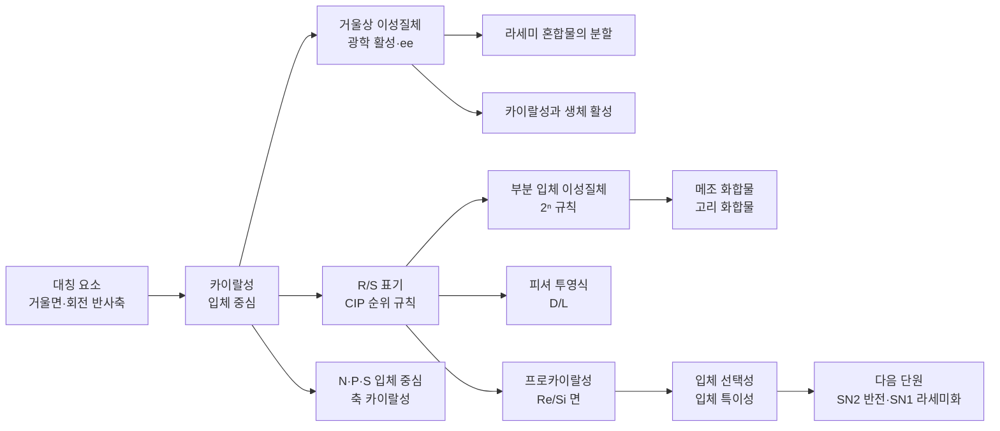
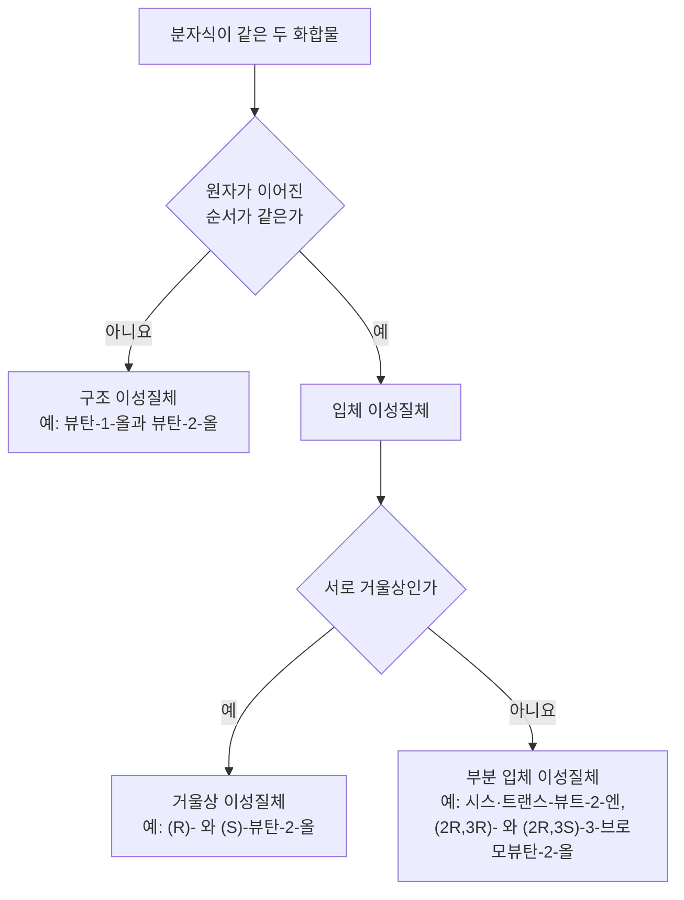

# 유기화학 3. 입체화학 — 원자의 배치가 같아도 공간의 손잡이가 다르다
<!-- prev: ochem-1, ochem-2, uchem-12 -->
<!-- next: ochem-4 -->

> [!NOTE]
> **이 단원의 범위**
> - 카이랄성과 입체 중심, 대칭 요소로 카이랄성 판정하기
> - 거울상 이성질체와 광학 활성(편광계, 비선광도, 거울상 초과량)
> - R/S 표기(칸–인골드–프렐로그 순위 규칙)
> - 부분 입체 이성질체, 입체 이성질체의 수($2^n$)와 메조 화합물, 고리 화합물의 입체 이성질
> - 피셔 투영식과 D/L 표기
> - 라세미 혼합물의 분할(부분 입체 이성질성 염, 속도론적 분할, 카이랄 크로마토그래피)
> - 탄소 아닌 입체 중심(N, P, S)과 축 카이랄성(알렌, 바이아릴) 개관
> - 반응의 입체화학: 프로카이랄성(프로-R/프로-S, Re/Si 면), 입체 선택성과 입체 특이성
> - 카이랄성과 생체 활성(수용체, 약물, 향)

**학습 목표**

1. 분자의 대칭 요소(거울면, 반전 중심, 회전 반사축)로 카이랄성을 판정하고, 사슬과 고리 화합물에서 입체 중심을 빠짐없이 찾을 수 있다.
2. 비선광도와 거울상 초과량을 정의하고, 편광계 측정값으로 시료의 조성과 광학 순도를 계산할 수 있다.
3. 칸–인골드–프렐로그 규칙(복제 원자 포함)으로 치환기의 순위를 정하고, 쐐기·점선 구조와 피셔 투영식에서 R/S를 정확히 판정할 수 있다.
4. 입체 중심이 여럿인 분자에서 거울상·부분 입체 관계를 가리고, 메조 화합물을 고려해 입체 이성질체의 수를 셀 수 있다.
5. 라세미 혼합물을 분할하는 세 가지 전략을 설명하고, 속도론적 분할의 선택성 인자를 전환율과 거울상 초과량으로부터 유도·계산할 수 있다.
6. 프로카이랄 중심과 프로카이랄 면을 표기하고, 위치가 다른 수소(동등·거울상·부분 입체 위치)를 구별하며, 입체 선택적 반응과 입체 특이적 반응의 결과를 예측할 수 있다.
7. 질소·인·황 입체 중심과 축 카이랄성의 안정성을 반전 장벽으로 비교하고, 카이랄성이 약효·독성·향을 바꾸는 까닭을 분자 인식으로 설명할 수 있다.

**이 단원의 학습 사다리**

| 단계 | 무엇을 하나? |
|---|---|
| STEP 1. 이전 학습 다시 보기 | 일반화학의 광학 이성질(카이랄 중심), 쐐기·점선 그리기, 뉴먼 투영식과 의자 형태, 시스·트랜스 |
| STEP 2. 기초 다지기 | 대칭 조작의 행렬과 행렬식(카이랄성의 수학적 기준), 빛의 편광과 원편광 분해, 경우의 수와 대칭으로 이성질체 세기 |
| STEP 3. 핵심 개념 | 카이랄성 → 광학 활성 → R/S → 부분 입체 이성질체 → 메조와 고리 → 피셔 투영식 → 분할 → N·P·S와 축 카이랄성 → 프로카이랄성 → 입체 선택성·특이성 → 생체 활성 |
| STEP 4. 오개념 바로잡기 | "(+)이면 R이다", "입체 중심이 있으면 카이랄하다", "반응에서 R이 S로 바뀌었으면 반전이 일어났다" 같은 착각 |
| STEP 5. 대학원·연구로 | 비대칭 촉매 반응, 동적 속도론적 분할, 원편광 이색성과 절대 배치의 계산 |
| STEP 6. 생활·산업·진로 | 단일 거울상 의약품, 비대칭 수소화 공정, 카이랄 분석, 향료 |

---

## 🗺️ 단원 들어가기

오른손 장갑은 왼손에 맞지 않는다. 재료도, 손가락 수도, 무게도 같은데 그렇다. 손과 장갑은 서로의 **거울상**이며, 아무리 돌려도 겹쳐지지 않는다. 분자도 그렇다. 스피어민트 껌의 시원한 향과 호밀빵에 들어가는 캐러웨이 씨앗의 향은 둘 다 카르본이라는 같은 분자에서 나온다. 원자의 종류, 개수, 결합 순서가 모두 같다. 다른 것은 오직 한 탄소 둘레에서 네 원자단이 놓인 **공간의 손잡이**뿐이다. 그런데도 코의 후각 수용체는 이 차이를 분명히 알아챈다. 수용체 자체가 한쪽 손잡이를 가진 단백질이기 때문이다.

일반화학 「핵화학·배위 화학·유기화학 개관」에서는 "서로 다른 네 원자단이 붙은 탄소가 거울상 이성질을 만든다"는 데까지 배웠다. 이 단원에서는 그 생각을 전공 수준으로 다듬는다. 카이랄성을 대칭으로 정확히 판정하고, 손잡이에 이름(R/S)을 붙이는 국제 규칙을 익히고, 입체 중심이 여럿일 때 이성질체가 몇 개인지 센다. 손잡이가 다른 두 분자를 실제로 떼어 놓는 방법(분할)과, 반응이 새 손잡이를 어떤 비율로 만드는지(입체 선택성)도 다룬다. 이 모든 것이 다음 단원 「유기 반응의 개관과 알킬 할라이드의 치환·제거 반응」에서 $\mathrm{S_N2}$ 반응의 입체 반전과 $\mathrm{S_N1}$ 반응의 라세미화를 읽는 언어가 된다.

---

## STEP 1. 🔙 이전 학습 다시 보기

### 연계 개념표

| 이전 단원 | 그때 배운 것 | 이 단원에서 확장되는 것 |
|---|---|---|
| 일반화학 「핵화학·배위 화학·유기화학 개관」 '이성질 현상' | 구조 이성질과 입체 이성질(기하·광학), 카이랄 중심 = 서로 다른 네 원자단이 붙은 탄소, 거울상은 편광면을 반대로 돌린다 | 카이랄성을 **대칭 요소**로 판정, 입체 중심이 있어도 아카이랄한 메조 화합물, 탄소 아닌 입체 중심과 축 카이랄성 |
| 일반화학 「핵화학·배위 화학·유기화학 개관」 '배위 화합물의 이성질' | $\mathrm{[Co(en)_3]^{3+}}$의 두 거울상, 시스·트랜스 | 같은 논리를 유기 분자에 적용하고, 손잡이에 **R/S 이름**을 붙인다 |
| 유기화학 「구조와 결합, 산과 염기」 '골격 구조식, 쐐기와 점선' | 사면체 탄소를 종이 위에 쐐기(앞)와 점선(뒤)으로 그리기 | 쐐기·점선 구조에서 R/S를 읽고, 피셔 투영식으로 옮기며, 두 표기 사이를 오가는 규칙 |
| 유기화학 「알케인과 사이클로알케인」 '형태 분석, 의자 형태, 이치환 사이클로헥세인' | 뉴먼 투영식, 겹친·엇갈린 형태, 축·적도 위치, 시스·트랜스-1,2-다이메틸사이클로헥세인 | 형태(회전으로 바뀜)와 배치(결합을 끊어야 바뀜)의 구별, 시스·트랜스 고리 화합물의 카이랄성과 메조 |
| 일반물리학 「파동과 소리」·「빛과 광학」 | 횡파와 편광, 굴절률 | 선편광을 두 원편광의 합으로 보고, 굴절률 차이로 **광회전**을 설명 |

### 준비 운동 (사전 진단)

**Q1.** 다음 중 거울상과 겹쳐지지 않는 물체를 모두 고르시오. 숟가락, 나사못, 가위, 정육면체 주사위(눈의 배치까지 생각), 커피잔

**Q2.** 뷰탄-2-올 $\mathrm{CH_3CH(OH)CH_2CH_3}$과 프로판-2-올 $\mathrm{CH_3CH(OH)CH_3}$ 가운데 카이랄 중심이 있는 것은? 그 탄소에 붙은 네 원자단을 쓰시오.

**Q3.** 뷰테인의 겹친 형태와 엇갈린 형태는 서로 다른 화합물인가? 시스-뷰트-2-엔과 트랜스-뷰트-2-엔은 어떤가? 둘의 차이를 '회전'이라는 말로 설명하시오.

**Q4.** 시스-1,2-다이메틸사이클로헥세인의 의자 형태에서 두 메틸기는 각각 축·적도 중 어디에 있는가? 고리 뒤집힘이 일어나면 어떻게 되는가?

정답 및 해설

**Q1.** 나사못, 가위, 정육면체 주사위 — 나사못은 오른나사와 왼나사가 있다. 가위는 날이 겹치는 방향 때문에 왼손잡이용이 따로 있다. 주사위는 1·2·3의 눈이 한 꼭짓점 둘레에 시계 방향으로 놓이는가, 반시계 방향으로 놓이는가에 따라 두 거울상이 있다. 숟가락과 커피잔은 거울면을 가져 거울상과 겹쳐진다.

**Q2.** 뷰탄-2-올 — C2에 $\mathrm{-H}$, $\mathrm{-OH}$, $\mathrm{-CH_3}$, $\mathrm{-CH_2CH_3}$이 붙어 넷이 모두 다르다. 프로판-2-올의 C2에는 $\mathrm{-CH_3}$가 두 개 붙어 있다.

**Q3.** 겹친·엇갈린 형태는 단일 결합 둘레의 회전으로 빠르게 서로 바뀌는 **형태**(conformation)이므로 같은 화합물이다. 시스·트랜스-뷰트-2-엔은 π 결합 때문에 회전이 막혀 있어 결합을 끊지 않고는 바뀌지 않는 **배치**(configuration)가 다른 서로 다른 화합물이다.

**Q4.** 하나는 축, 하나는 적도에 있다. 고리가 뒤집히면 축과 적도가 서로 바뀌어 여전히 '축 하나, 적도 하나'이다. 두 형태는 에너지가 같다. ⑤에서 이 두 형태가 서로 거울상이라는 것을 보게 된다.

---

## STEP 2. 🧱 기초 다지기

### 디딤돌 1. 대칭 조작의 행렬 — "카이랄하다"의 수학적 뜻

물체를 움직여 원래와 구별할 수 없는 모습으로 만드는 조작을 **대칭 조작**이라 한다. 수학 도구 5 「선형대수」 '대칭 조작의 행렬 표현'에서 익힌 것처럼, 원점을 지나는 대칭 조작은 3×3 직교 행렬로 쓸 수 있다. 직교 행렬의 행렬식은 $+1$ 또는 $-1$뿐이다.

| 조작 | 기호 | 행렬의 예 | 행렬식 | 종류 |
|---|---|---|---|---|
| $z$축 둘레 $360°/n$ 회전 | $C_n$ | $\begin{pmatrix}\cos\theta & -\sin\theta & 0\\ \sin\theta & \cos\theta & 0\\ 0 & 0 & 1\end{pmatrix}$ | $+1$ | 진회전(proper) |
| $xy$ 평면에 대한 반사 | $\sigma$ | $\mathrm{diag}(1, 1, -1)$ | $-1$ | 부적절 조작(improper) |
| 원점에 대한 반전 | $i$ | $\mathrm{diag}(-1, -1, -1)$ | $-1$ | 부적절 조작 |
| 회전 후 수직면 반사 | $S_n$ | $\sigma\,C_n$ | $-1$ | 부적절 조작 |

행렬식이 $+1$인 조작(회전)은 물체를 실제로 손으로 돌려서 만들 수 있다. 행렬식이 $-1$인 조작은 공간을 '뒤집어야' 하므로 손으로는 할 수 없고, 거울을 거쳐야 한다. 그래서 다음이 성립한다.

> [!IMPORTANT]
> **카이랄성의 정의** 분자가 행렬식 $-1$인 대칭 조작(거울면 $\sigma$, 반전 중심 $i$, 회전 반사축 $S_n$)을 **하나도** 갖지 않으면 그 분자는 **카이랄**(chiral)하다. 이때 분자와 그 거울상은 어떤 회전으로도 겹쳐지지 않는다. 부적절 조작을 하나라도 가지면 **아카이랄**(achiral)하다. ($\sigma = S_1$, $i = S_2$이므로 "회전 반사축이 없다"는 한 문장으로 줄여 말할 수도 있다.)

실제 판정에서는 거울면과 반전 중심만 찾아도 거의 모든 경우가 해결된다. $S_4$만 있고 $\sigma$, $i$가 없는 분자는 드물다(STEP 5).

#### 예제 1 — 두 번 바꾸면 제자리

사면체 탄소에 붙은 두 치환기의 자리를 맞바꾸는 일은 두 치환기 사이를 지나는 거울면에 대한 반사와 같은 결과를 준다. (1) 반사 두 번을 잇달아 한 조작의 행렬식을 구하고, (2) 치환기를 한 번 바꾸면 거울상이, 두 번 바꾸면 원래 분자가 되는 까닭을 설명하시오.

**풀이**
(1) 행렬식은 곱셈적이다: $\det(\sigma_2\sigma_1) = \det\sigma_2\det\sigma_1 = (-1)(-1) = +1$. 두 반사의 곱은 진회전이다(두 거울면의 교선을 축으로 하고 사잇각의 두 배만큼 도는 회전).
(2) 한 번 바꾼 분자는 원래 분자에 행렬식 $-1$인 조작을 한 것이므로 거울상이다. 두 번 바꾸면 행렬식 $+1$, 즉 회전과 같으므로 같은 분자를 돌려 놓은 것에 지나지 않는다.
**의미** ③과 ⑥에서 쓸 "두 치환기를 한 번 바꾸면 R과 S가 바뀌고, 두 번 바꾸면 그대로"라는 요령의 수학적 근거이다.

### 디딤돌 2. 빛의 편광 — 선편광은 두 원편광의 합이다

전기장이 한 평면 안에서만 진동하는 빛을 **평면 편광**(선편광)이라 한다. 전기장 벡터의 끝이 진행하며 나선을 그리는 빛은 **원편광**이며, 오른쪽으로 도는 것과 왼쪽으로 도는 것이 있다. 수학 도구 6 「복소수와 푸리에 해석」의 복소 표현을 쓰면, 진폭이 같은 오른·왼 원편광을 더한 것이 선편광이다.

$$
\frac{1}{2}\big[(\hat{x} + i\hat{y}) + (\hat{x} - i\hat{y})\big]e^{i(kz - \omega t)} = \hat{x}\,e^{i(kz - \omega t)}
$$

카이랄한 분자가 녹아 있는 용액에서는 오른 원편광과 왼 원편광이 느끼는 굴절률 $n_\mathrm{R}$, $n_\mathrm{L}$이 아주 조금 다르다. 카이랄한 매질과 '손잡이를 가진 빛'의 상호작용이 손잡이에 따라 다르기 때문이다. 길이 $l$을 지나는 동안 두 원편광의 위상이 $\Delta\phi = 2\pi l(n_\mathrm{L} - n_\mathrm{R})/\lambda$만큼 어긋나고, 다시 합친 선편광의 진동면은 그 절반만큼 돌아간다.

$$
\lvert\alpha\rvert = \frac{\lvert\Delta\phi\rvert}{2} = \frac{\pi l\,\lvert n_\mathrm{L} - n_\mathrm{R}\rvert}{\lambda}
$$

이것이 **광회전**(optical rotation)이다. 아카이랄한 분자는 거울상과 같으므로 $n_\mathrm{L} = n_\mathrm{R}$이고 회전이 없다. 거울상 이성질체는 $n_\mathrm{L} - n_\mathrm{R}$의 부호가 정반대이므로 같은 크기, 반대 방향으로 돌린다.

#### 예제 2 — 굴절률 차이는 얼마나 작은가, 그리고 180°의 모호함

(1) 길이 2.00 dm(0.200 m)인 관에서 나트륨 D선(589 nm)의 진동면이 $+10.64°$ 돌아갔다. $\lvert n_\mathrm{L} - n_\mathrm{R}\rvert$를 구하시오. (2) 편광계는 $-180°$에서 $+180°$ 사이의 값만 읽는다. 어떤 용액의 측정값이 $+30.0°$였는데, 이것이 실제로 $+30.0°$인지 $-330.0°$인지 가리려면 어떻게 하면 되는가?

**풀이**
(1) $\alpha = 10.64° = 0.1857\ \mathrm{rad}$. $\lvert n_\mathrm{L} - n_\mathrm{R}\rvert = \dfrac{\alpha\lambda}{\pi l} = \dfrac{0.1857\times589\times10^{-9}}{\pi\times0.200} = 1.74\times10^{-7}$
(2) 용액을 정확히 2배로 묽혀 다시 잰다. 회전각은 농도에 비례하므로 실제가 $+30.0°$이면 $+15.0°$가, 실제가 $-330.0°$이면 $-165.0°$가 읽힌다. 관 길이를 절반으로 해도 같다.
**의미** 굴절률이 천만분의 2쯤만 달라도 수 dm를 지나면 잴 수 있는 회전이 쌓인다. 광회전이 아주 예민한 측정인 동시에, 불순물이나 온도에 따라 쉽게 흔들리는 측정인 까닭이다.

### 디딤돌 3. 경우의 수와 대칭 — 입체 이성질체 세기

입체 중심 하나는 두 가지 배치(R 또는 S)를 가진다. 입체 중심 $n$개가 서로 독립이면 배치의 조합은 $2^n$가지이고, 이것이 입체 이성질체 수의 **상한**이다. 조합 가운데 두 개씩은 모든 입체 중심이 뒤집힌 거울상 쌍이므로, 메조 화합물이 없으면 $2^{n-1}$쌍의 거울상 이성질체가 된다.

분자가 **구조적으로 대칭**(사슬의 양 끝이 같아 앞뒤로 읽어도 같은 분자)이면 몇몇 조합이 겹친다. 예를 들어 $\mathrm{X{-}C^*HY{-}C^*HY{-}X}$에서 (R,S)와 (S,R)는 분자를 뒤집어 읽은 것이므로 같은 분자이다. 이런 분자에서 앞뒤로 읽어 같은 조합이 바로 메조 화합물 후보이다.

| 분자 꼴 | 입체 중심 수 $n$ | 입체 이성질체 수 | 내역 |
|---|---|---|---|
| 비대칭 사슬 | $n$ | $2^n$ | $2^{n-1}$쌍 |
| 대칭 사슬, $n$ 짝수 | $n$ | $2^{n-1} + 2^{n/2 - 1}$ | 메조 $2^{n/2-1}$개 + 나머지 쌍 |
| 대칭 사슬, $n$ 홀수(가운데 탄소 포함) | $n$ | $2^{n-1}$ | 메조 $2^{(n-1)/2}$개 + 나머지 쌍 |

#### 예제 3 — 대칭 사슬의 이성질체 세기

(1) 타타르산(2,3-다이하이드록시뷰테인다이오산, $n = 2$)과 (2) 글루코스를 산화해 얻는 같은 꼴의 육탄당 다이카복실산 2,3,4,5-테트라하이드록시헥세인다이오산($n = 4$)의 입체 이성질체 수를 표의 식으로 구하고, (1)을 직접 나열해 확인하시오.

**풀이**
(1) $2^{1} + 2^{0} = 3$. 나열: (R,R), (S,S), (R,S) = (S,R). 앞의 둘은 거울상 쌍이고, (R,S)는 자신의 거울상((S,R))과 같은 분자이므로 메조이다.
(2) $2^{3} + 2^{1} = 10$. 거울상 쌍 4개(8개)와 메조 2개이다.
**의미** 단순히 $2^n$으로 세면 (1)은 4개, (2)는 16개로 틀린다. 대칭이 경우의 수를 줄이는 것은 일반화학 「화학 열역학」에서 미시 상태를 셀 때 같은 입자를 구별하지 않았던 것과 같은 생각이다.

---

## STEP 3. 📘 핵심 개념

### ① 카이랄성과 입체 중심

**이성질체**(isomer)는 분자식이 같은 서로 다른 화합물이다. 원자가 이어진 순서부터 다르면 **구조 이성질체**(constitutional isomer), 이어진 순서는 같고 공간 배치만 다르면 **입체 이성질체**(stereoisomer)이다. 입체 이성질체는 다시 서로 거울상인 **거울상 이성질체**(enantiomer)와 거울상이 아닌 **부분 입체 이성질체**(diastereomer)로 나뉜다. 이 단원 전체가 이 분류표의 오른쪽 가지를 다룬다.

형태(conformation)는 이 분류에 넣지 않는다. 단일 결합 둘레의 회전으로 실온에서 1초에 수십억 번씩 바뀌는 형태는 서로 다른 화합물로 분리할 수 없기 때문이다. 입체 이성질체는 **배치**(configuration)가 다르며, 배치를 바꾸려면 결합을 끊어야 한다.

#### 입체 중심과 카이랄 중심

어떤 원자에 붙은 두 원자단을 맞바꾸었을 때 입체 이성질체가 생기면 그 원자를 **입체 중심**(stereocenter, stereogenic center)이라 한다. 유기 분자에서 가장 흔한 입체 중심은 서로 다른 네 원자단이 붙은 사면체 탄소이며, 이것을 특히 **카이랄 중심**(chirality center) 또는 비대칭 탄소라 한다. 시스·트랜스 알켄의 이중 결합 탄소도 입체 중심이지만(치환기를 바꾸면 부분 입체 이성질체가 생긴다) 카이랄 중심은 아니다.

뷰탄-2-올의 C2에는 $\mathrm{-H}$, $\mathrm{-OH}$, $\mathrm{-CH_3}$, $\mathrm{-CH_2CH_3}$이 붙어 있다. 아래 그림처럼 이 분자와 그 거울상은 어떻게 돌려도 겹쳐지지 않는다. 두 분자는 (R)-뷰탄-2-올과 (S)-뷰탄-2-올이라는 거울상 이성질체 쌍이다(이름 붙이는 법은 ③).

<!-- 그림 요청: 뷰탄-2-올의 두 거울상 이성질체. 가운데에 세로 거울(옅은 파란 평면)을 두고, 왼쪽에 (R)-뷰탄-2-올(SMILES C[C@@H](O)CC), 오른쪽에 (S)-뷰탄-2-올(SMILES C[C@H](O)CC)을 쐐기·점선 구조와 공-막대 모형으로 거울 대칭이 되게 그린다. 왼쪽 분자: C2에서 OH는 위(평면), CH3는 왼쪽 아래(평면), CH2CH3는 쐐기(앞), H는 점선(뒤). 오른쪽은 그 거울상. 아래 줄에 오른쪽 분자를 세로축 둘레로 180° 돌려 왼쪽 분자에 포개 보려는 모습을 그리고, OH와 CH3는 겹치지만 CH2CH3와 H가 앞뒤가 바뀌어 겹치지 않는 자리에 빨간 ×. 맨 왼쪽 위에 거울 앞의 오른손과 왼손 그림을 작게 곁들인다. -->

#### 입체 중심 찾는 요령

1. $\mathrm{CH_2}$, $\mathrm{CH_3}$ 탄소와 다중 결합 탄소($sp^2$, $sp$)는 카이랄 중심이 될 수 없으므로 먼저 지운다.
2. 남은 $sp^3$ 탄소마다 네 원자단을 **원자단 전체**로 비교한다. 첫 원자가 같아도 더 나아가면 다를 수 있다($\mathrm{-CH_2CH_3}$와 $\mathrm{-CH_2CH_2CH_3}$는 다르다).
3. 고리 탄소는 고리를 **양쪽 방향으로 따라가며** 두 경로가 같은지 본다. 메틸사이클로헥세인의 C1은 어느 쪽으로 돌아도 같은 경로이므로 카이랄 중심이 아니지만, 3-메틸사이클로헥산-1-온의 C3은 한쪽은 곧 카보닐을, 다른 쪽은 $\mathrm{CH_2}$ 세 개를 지나서야 카보닐을 만나므로 카이랄 중심이다.

#### 카이랄성 판정 — 입체 중심이 아니라 대칭으로

"카이랄 중심이 있으면 카이랄하다"는 대부분 맞지만 정의는 아니다. 디딤돌 1의 정의대로 판정은 **거울면이나 반전 중심이 있는가**로 한다.

| 분자 | 카이랄 중심 | 거울면·반전 중심 | 카이랄한가 |
|---|---|---|---|
| 프로판-2-올 | 없음 | C–O–H와 C2–H를 품은 거울면 | 아니요 |
| 뷰탄-2-올 | 1개(C2) | 없음 | 예 |
| (2R,3S)-타타르산(메조) | 2개 | 한 형태에서 분자 가운데 거울면 | 아니요 (⑤) |
| 펜타-2,3-다이엔 $\mathrm{CH_3CH{=}C{=}CHCH_3}$ | 없음 | 없음 | 예 (⑧, 축 카이랄성) |

카이랄 중심이 **하나뿐인** 분자는 반드시 카이랄하다(거울면이 그 탄소를 지나려면 두 원자단이 같아야 하기 때문이다). 둘 이상이면 메조일 수 있고, 하나도 없어도 축이나 면을 따라 카이랄할 수 있다.

#### 예제 4 — 카이랄 중심 찾기

다음 분자에서 카이랄 중심을 모두 찾고, 분자가 카이랄한지 판정하시오. (가) 3-메틸헥세인 (나) 3-메틸펜테인 (다) 3-메틸사이클로헥산-1-온 (라) 4-메틸사이클로헥산-1-올 (마) 카르본(2-메틸-5-(프로프-1-엔-2-일)사이클로헥스-2-엔-1-온) (바) 이부프로펜(2-[4-(2-메틸프로필)페닐]프로판산)

<!-- 그림 요청: 예제 4의 여섯 분자의 골격 구조식을 2행 3열로. (가) 3-메틸헥세인 SMILES CCC(C)CCC, (나) 3-메틸펜테인 SMILES CCC(C)CC, (다) 3-메틸사이클로헥산-1-온 SMILES CC1CCCC(=O)C1, (라) 4-메틸사이클로헥산-1-올 SMILES CC1CCC(O)CC1, (마) 카르본 SMILES CC1=CCC(CC1=O)C(=C)C, (바) 이부프로펜 SMILES CC(C)Cc1ccc(cc1)C(C)C(=O)O. 입체는 그리지 않고(보통 선), 각 분자 아래에 이름. 풀이용으로 카이랄 중심인 탄소에만 작은 빨간 별표(*): (가) C3, (다) C3, (마) C5(고리에서 프로펜-2-일기가 붙은 탄소), (바) 카복실기가 붙은 CH. (나)와 (라)에는 별표가 없다. -->

**풀이**
(가) C3에 H, $\mathrm{CH_3}$, $\mathrm{CH_2CH_3}$, $\mathrm{CH_2CH_2CH_3}$ → 카이랄 중심 1개, 카이랄하다.
(나) C3에 $\mathrm{CH_2CH_3}$가 두 개 → 카이랄 중심 없음, 아카이랄.
(다) C3이 카이랄 중심(고리의 두 경로가 다르다), 카이랄하다.
(라) C1에는 H, OH와 고리의 두 경로가 붙는데, 두 경로는 모두 $\mathrm{CH_2{-}CH_2}$를 지나 C4에서 만나므로 같다. C4도 마찬가지이다. 카이랄 중심이 없고 C1–C4를 지나는 거울면이 있어 아카이랄하다. (그래도 OH와 $\mathrm{CH_3}$가 고리의 같은 쪽인 시스형과 반대쪽인 트랜스형이 있다. ⑤에서 다룬다.)
(마) C5 하나. 카르본의 두 거울상 (R)-카르본(SMILES `CC1=CC[C@H](CC1=O)C(=C)C`)과 (S)-카르본(`CC1=CC[C@@H](CC1=O)C(=C)C`)이 스피어민트 향과 캐러웨이 향의 주성분이다.
(바) 카복실기가 붙은 탄소 하나. 약효를 내는 것은 (S)-이부프로펜(`CC(C)Cc1ccc(cc1)[C@H](C)C(=O)O`)이다(⑪).
**의미** 고리 탄소에서 "두 경로가 같은가"를 끝까지 따라가는 것이 실수를 줄이는 요령이다.

#### ✔ 바로 확인

1. (O/X) 단일 결합 둘레의 회전으로 바뀌는 두 형태는 서로 입체 이성질체이다.
2. 빈칸: 분자가 거울면, 반전 중심, 회전 반사축을 하나도 갖지 않으면 그 분자는 (    )하다.
3. 2-클로로뷰테인, 1-클로로뷰테인, 클로로사이클로헥세인 가운데 카이랄한 것은?
4. (O/X) 카이랄 중심이 하나뿐인 분자는 언제나 카이랄하다.

정답

1. X — 형태는 같은 화합물의 다른 모습이다. 입체 이성질체는 결합을 끊어야 바뀌는 배치가 다르다.
2. 카이랄
3. 2-클로로뷰테인 — C2에 H, Cl, $\mathrm{CH_3}$, $\mathrm{CH_2CH_3}$. 클로로사이클로헥세인의 C1은 고리 두 경로가 같다.
4. O — 거울면이 그 탄소를 지나려면 붙은 원자단 둘이 같아야 한다.

### ② 거울상 이성질체와 광학 활성

거울상 이성질체는 **아카이랄한 환경**에서는 모든 성질이 같다. 녹는점, 끓는점, 밀도, 보통 용매에 대한 용해도, IR·NMR 스펙트럼, 아카이랄한 시약과의 반응 속도가 모두 같다. 두 분자 사이의 모든 거리와 각이 같고, 에너지도 같기 때문이다. 다른 것은 **카이랄한 대상과의 상호작용**뿐이다. 원편광(디딤돌 2), 카이랄한 시약·촉매, 효소와 수용체가 여기에 속한다.

| 성질 | 거울상 이성질체끼리 | 부분 입체 이성질체끼리 |
|---|---|---|
| 녹는점·끓는점·용해도 | 같다 | 다르다 |
| 아카이랄 용매에서의 NMR | 같다 | 다르다 |
| 비선광도 | 크기 같고 부호 반대 | 서로 관계없다 |
| 아카이랄 시약과의 반응 속도 | 같다 | 다르다 |
| 카이랄 시약·효소와의 반응 속도 | 다르다 | 다르다 |

#### 편광계와 비선광도

평면 편광을 카이랄한 시료에 통과시키면 진동면이 돌아간다. 이 성질을 **광학 활성**(optical activity)이라 한다. 광원 쪽을 바라보는 관찰자에게 시계 방향으로 돌리는 화합물을 **우선성**(dextrorotatory, 기호 (+) 또는 *d*), 반시계 방향이면 **좌선성**(levorotatory, (−) 또는 *l*)이라 한다.

<!-- 그림 요청: 편광계의 구조 모식도. 왼쪽부터 나트륨 램프(589 nm, 모든 방향으로 진동하는 빛을 여러 방향의 짧은 양쪽 화살표로), 편광자(세로 슬릿 격자, 통과한 빛은 세로 진동만), 시료관(길이 l, '1 dm = 10 cm' 이름표, 카이랄 분자 용액), 검광자(돌릴 수 있는 원판에 각도 눈금, 회전각 α를 호 화살표로), 맨 오른쪽 관찰자의 눈. 시료관을 지난 뒤 진동면이 시계 방향으로 α만큼 기울어진 모습을 그리고 '관찰자가 보기에 시계 방향 = (+), 우선성'이라는 이름표. -->

관찰 회전각 $\alpha$는 빛이 만나는 카이랄 분자의 수, 곧 농도와 관 길이에 비례한다. 그래서 화합물 고유의 값으로 **비선광도**(specific rotation)를 정의한다.

$$
[\alpha]_\lambda^{T} = \frac{\alpha}{l\,c}
\qquad (l:\ \mathrm{dm},\ c:\ \mathrm{g/mL},\ \text{순수 액체는 } c \text{ 대신 밀도})
$$

관례상 단위($\mathrm{deg\cdot mL\cdot g^{-1}\cdot dm^{-1}}$)는 적지 않고 온도·파장·용매·농도를 함께 적는다(예: $[\alpha]_\mathrm{D}^{20} = +66.5$ (c 8.0, 물), 아래첨자 D는 나트륨 D선). 비선광도는 용매·온도·파장에 따라 달라지고 부호가 바뀌기도 한다.

| 화합물 | IUPAC 이름 | $[\alpha]_\mathrm{D}$ (약) |
|---|---|---|
| 수크로스 | (설탕) | +66.5 (물) |
| (S)-뷰탄-2-올 | (2S)-butan-2-ol | +13.5 (순수 액체) |
| (R)-카르본 | (5R)-2-메틸-5-(프로프-1-엔-2-일)사이클로헥스-2-엔-1-온 | −61 |
| (R)-리모넨 | (4R)-1-메틸-4-(프로프-1-엔-2-일)사이클로헥스-1-엔 | +123 |
| (2R,3R)-타타르산 | (2R,3R)-2,3-다이하이드록시뷰테인다이오산 | +12 (물) |

(R)-카르본은 (−)인데 골격이 거의 같은 (R)-리모넨은 (+)이다. **R/S는 공간 배치에 붙인 이름이고 (+)/(−)는 측정값**이며, 둘 사이에는 간단한 규칙이 없다. 실험 없이 부호를 정할 수 없다.

#### 라세미 혼합물과 거울상 초과량

두 거울상 이성질체가 1 : 1로 섞이면 회전이 정확히 상쇄되어 $\alpha = 0$이다. 이것을 **라세미 혼합물**(racemic mixture, 라세미체)이라 하고 (±) 또는 *rac*-를 붙인다. 한쪽이 더 많으면 그 초과분만 회전에 기여한다. 시료의 순도를 나타내는 양은 **거울상 초과량**(enantiomeric excess, ee)이다.

$$
\mathrm{ee} = \frac{\lvert n_\mathrm{R} - n_\mathrm{S}\rvert}{n_\mathrm{R} + n_\mathrm{S}}\times100\ \%, \qquad
\text{많은 쪽의 몰분율} = \frac{1 + \mathrm{ee}}{2}
$$

두 거울상의 비선광도는 크기가 같고 부호가 반대이므로, 회전이 조성에 선형이라면 혼합물의 비선광도는 $[\alpha]_\text{관찰} = (x_\mathrm{S} - x_\mathrm{R})[\alpha]_\text{순수 S}$이다. 따라서

$$
\text{광학 순도} = \frac{[\alpha]_\text{관찰}}{[\alpha]_\text{순수}}\times100\ \% = \mathrm{ee}
$$

이다. 오늘날에는 회전 측정보다 카이랄 크로마토그래피(⑦)로 두 거울상의 봉우리 넓이를 직접 재어 ee를 구하는 일이 많다. 광회전은 불순물 하나로도 크게 흔들리고, 드물게 농도에 따라 선형성이 깨지기 때문이다.

<!-- 시뮬레이션 요청: 편광계 가상 실험. 조작 변수: (1) 화합물 선택((S)-뷰탄-2-올 [α] +13.5, 수크로스 +66.5, (R)-카르본 −61), (2) 거울상 초과량 슬라이더(−100 %~+100 %, 많은 쪽 이성질체 표시), (3) 농도 0~0.20 g/mL, (4) 관 길이 0.5·1·2 dm. 보여 줄 것: 편광자–시료관–검광자를 지나는 빛의 진동면이 회전하는 3차원 애니메이션, 검광자 눈금에 관찰 회전각 α = [α]·l·c·(ee/100) 수치, 두 거울상 분자 수를 색이 다른 점(예: 파랑 S, 주황 R)으로 시료관 안에 비율대로 흩어 그린 그림. 측정값이 ±180°를 넘으면 '눈금이 한 바퀴 돌았다'는 경고를 띄우고 묽히기 버튼으로 모호함을 풀게 한다. -->

#### 예제 5 — 비선광도 구하기와 쓰기

(1) 수크로스 2.00 g을 물에 녹여 25.0 mL로 만들고 1.00 dm 관에서 재었더니 $\alpha = +5.32°$였다. 비선광도를 구하시오. (2) 농도를 모르는 수크로스 수용액을 2.00 dm 관에서 재었더니 $+13.3°$였다. 농도(g/100 mL)를 구하시오.

**풀이**
(1) $c = 2.00/25.0 = 0.0800\ \mathrm{g/mL}$. $[\alpha] = \dfrac{+5.32}{1.00\times0.0800} = +66.5$
(2) $c = \dfrac{\alpha}{[\alpha]\,l} = \dfrac{13.3}{66.5\times2.00} = 0.100\ \mathrm{g/mL}$ → 10.0 g/100 mL
**의미** 편광계는 설탕 산업에서 당도를 재는 표준 기기(당도계)였다. 비선광도를 알면 농도를 비파괴로 바로 잴 수 있다.

#### 예제 6 — 거울상 초과량과 조성

순수한 (S)-뷰탄-2-올의 비선광도는 $+13.5$이다. (1) 합성한 뷰탄-2-올 시료의 비선광도가 $+9.45$였다. ee와 두 거울상의 백분율을 구하시오. (2) 이 시료 4.00 g에 순수한 (R)-뷰탄-2-올 1.00 g을 섞으면 비선광도는 얼마가 되는가?

**풀이**
(1) $\mathrm{ee} = 9.45/13.5 = 0.700$ → 70.0 % ee (S 과량). S의 분율 $= (1 + 0.700)/2 = 0.850$ → S 85.0 %, R 15.0 %.
(2) 처음 시료: S 3.40 g, R 0.60 g. 섞은 뒤: S 3.40 g, R 1.60 g, 합 5.00 g. $\mathrm{ee} = (3.40 - 1.60)/5.00 = 0.360$ (S 과량). $[\alpha] = 0.360\times13.5 = +4.86$
**의미** 70 % ee는 "70 %가 S"가 아니라 "S가 R보다 70 %p 많다(85 : 15)"는 뜻이다. ee 90 %도 다섯 분자 가운데 하나는 아니지만 20분자 중 하나가 반대 거울상이다.

#### ✔ 바로 확인

1. (O/X) (S)-뷰탄-2-올과 (R)-뷰탄-2-올은 끓는점이 다르다.
2. 어떤 순수한 화합물의 $[\alpha]_\mathrm{D} = -40.0$이다. 같은 화합물의 시료가 $[\alpha]_\mathrm{D} = -30.0$이면 ee와 두 거울상의 비는?
3. 빈칸: 두 거울상 이성질체가 1 : 1로 섞여 광학 활성이 없는 시료를 (    )이라 한다.
4. (O/X) R 배치인 화합물은 편광면을 시계 방향으로 돌린다.

정답

1. X — 거울상 이성질체는 아카이랄한 환경에서의 물리적 성질이 모두 같다.
2. 75 % ee, (−) 이성질체 : (+) 이성질체 = 87.5 : 12.5
3. 라세미 혼합물(라세미체)
4. X — R/S와 회전 방향 사이에는 정해진 관계가 없다. (R)-카르본은 (−), (R)-리모넨은 (+)이다.

### ③ R/S 표기 — 칸–인골드–프렐로그 규칙

거울상 쌍의 두 분자에 이름을 붙이려면 공간 배치를 말로 옮기는 규칙이 필요하다. **칸–인골드–프렐로그 규칙**(Cahn–Ingold–Prelog rules, CIP 규칙)은 입체 중심에 붙은 네 원자단에 순위를 매기고, 그 순위가 공간에서 도는 방향으로 배치를 이름 짓는다.

#### 순위 규칙

**규칙 1. 첫 원자의 원자 번호.** 입체 중심에 직접 붙은 원자의 원자 번호가 클수록 순위가 높다. 동위 원소는 질량수가 큰 쪽이 높다($\mathrm{D} > \mathrm{H}$).
$$
\mathrm{I > Br > Cl > S > F > O > N > C > D > H}
$$

**규칙 2. 첫 원자가 같으면 바깥으로 탐색한다.** 각 원자단의 첫 원자에 붙은 세 원자(입체 중심 쪽은 빼고)를 원자 번호가 큰 순서로 적은 **집합**끼리 비교한다. 집합은 가장 큰 원자부터 하나씩 비교해 처음 차이가 나는 곳에서 결정한다(원자 번호를 더하지 않는다). 그래도 같으면 순위가 높은 가지를 따라 한 단계 더 나아간다.
- $\mathrm{-CH_2OH}$ {O, H, H} > $\mathrm{-CH(CH_3)_2}$ {C, C, H}: 첫 원소에서 O > C로 끝난다. 아이소프로필에 탄소가 둘 있어도 소용없다.
- $\mathrm{-CH(CH_3)_2}$ {C, C, H} > $\mathrm{-CH_2CH_3}$ {C, H, H}

**규칙 3. 다중 결합은 복제 원자로 펼친다.** 이중 결합의 양 끝 원자는 상대 원자를 하나씩 더 가진 것으로, 삼중 결합은 두 개씩 더 가진 것으로 센다. 복제된 원자는 더 이상 아무것도 달고 있지 않은 것으로(빈 자리, 원자 번호 0) 본다.
- $\mathrm{-CH{=}O}$ → C에 {O, O, H}, $\mathrm{-COOH}$ → {O, O, O}, $\mathrm{-C{\equiv}N}$ → {N, N, N}
- 그래서 $\mathrm{-COOH > -CHO > -CH_2OH}$이고, $\mathrm{-CH_2OH}$ {O, H, H} > $\mathrm{-C{\equiv}N}$ {N, N, N}이다(첫 원소 O > N).

<!-- 그림 요청: 복제 원자의 펼침 그림 세 개. (가) 알데하이드 –CH=O: 왼쪽에 실제 구조, 오른쪽에 탄소에 O, (O), H가 붙고 산소에는 실제 C 대신 복제 (C)가 붙은 나무 그림. 괄호 원자는 회색 원 안에 그리고 '복제 원자: 더 이상의 치환기 없음(원자 번호 0)' 이름표. (나) 바이닐 –CH=CH2: 첫 탄소 {C, (C), H}, 두 번째 탄소 {(C), H, H}. (다) 아이소프로필 –CH(CH3)2: 첫 탄소 {C, C, H}, 각 메틸 {H, H, H}. (나)와 (다)를 나란히 두고 첫 구에서는 {C, C, H}로 같지만, 둘째 구에서 바이닐의 높은 가지 {C, H, H}가 아이소프로필의 {H, H, H}보다 높아 '바이닐 > 아이소프로필'임을 화살표로 표시. -->

자주 만나는 원자단의 순위를 정리하면 다음과 같다(왼쪽이 높다).

$$
\mathrm{-Br > -Cl > -SH > -F > -OCH_3 > -OH > -NH_2 > -COOH > -CHO > -CH_2OH > -C{\equiv}N > -C_6H_5 > -C(CH_3)_3 > -CH{=}CH_2 > -CH(CH_3)_2 > -CH_2CH_3 > -CH_3 > -H}
$$

#### R/S 정하는 절차

1. 네 원자단에 순위 1~4를 매긴다.
2. 순위 4(보통 H)가 **관찰자에게서 먼 쪽**(점선)을 향하게 분자를 본다.
3. 1 → 2 → 3을 잇는 방향이 시계 방향이면 **R**(rectus, 오른쪽), 반시계 방향이면 **S**(sinister, 왼쪽)이다.

<!-- 그림 요청: R/S 판정 절차의 '자동차 운전대' 그림. (R)-뷰탄-2-올(SMILES C[C@@H](O)CC)을 쐐기·점선 구조로: C2 중심, OH 위(평면), CH2CH3 오른쪽 아래(평면), CH3 왼쪽 아래 쐐기(앞), H 점선(뒤, 위쪽 비스듬히). 각 원자단 옆에 원 안의 순위 숫자 ①OH ②CH2CH3 ③CH3 ④H. 오른쪽에 같은 분자를 H가 운전대의 축처럼 관찰자 반대쪽으로 가도록 돌려 놓은 그림과, ①→②→③을 잇는 시계 방향 굽은 화살표와 'R'. 맨 오른쪽 작은 상자: ④가 관찰자 쪽(쐐기)을 향할 때는 보이는 방향을 뒤집어 읽는다는 요령(시계 방향으로 보이면 S). -->

종이 위에서 분자를 머릿속으로 돌리기 어려울 때 쓰는 요령이 두 가지 있다.
- **순위 4가 앞쪽(쐐기)을 향할 때**: 보이는 그대로 읽은 뒤 R과 S를 **뒤집는다**. 운전대를 뒤에서 보면 도는 방향이 반대로 보이는 것과 같다.
- **치환기 맞바꾸기**: 순위 4와 뒤를 향한 원자단을 맞바꾸어 판정한 뒤, 한 번 바꾸었으므로 답을 뒤집는다(디딤돌 1).

#### 예제 7 — 순위 매기기

다음 각 묶음의 원자단을 CIP 순위가 높은 순서로 쓰시오.
(1) $\mathrm{-OH}$, $\mathrm{-CH_3}$, $\mathrm{-NH_2}$, $\mathrm{-H}$
(2) $\mathrm{-CH_2Cl}$, $\mathrm{-CH_2OH}$, $\mathrm{-CH(CH_3)_2}$, $\mathrm{-C(CH_3)_3}$
(3) $\mathrm{-CH{=}CH_2}$, $\mathrm{-CH(CH_3)_2}$, $\mathrm{-C_6H_5}$, $\mathrm{-C{\equiv}N}$

**풀이**
(1) $\mathrm{-OH > -NH_2 > -CH_3 > -H}$ (O 8 > N 7 > C 6 > H 1)
(2) 첫 원자는 모두 C. 집합: $\mathrm{-CH_2Cl}$ {Cl, H, H}, $\mathrm{-CH_2OH}$ {O, H, H}, $\mathrm{-C(CH_3)_3}$ {C, C, C}, $\mathrm{-CH(CH_3)_2}$ {C, C, H}. 가장 큰 원소부터 비교하면 Cl > O > C이고, C끼리는 둘째 원소 C > H로 갈린다. $\mathrm{-CH_2Cl > -CH_2OH > -C(CH_3)_3 > -CH(CH_3)_2}$
(3) $\mathrm{-C{\equiv}N}$ {N, N, N} > $\mathrm{-C_6H_5}$ {C, C, C} > $\mathrm{-CH{=}CH_2}$ {C, C, H}와 $\mathrm{-CH(CH_3)_2}$ {C, C, H}는 첫 구에서 같다. 다음 구에서 바이닐의 높은 가지($\mathrm{=CH_2}$, {C, H, H})가 아이소프로필의 가지($\mathrm{CH_3}$, {H, H, H})보다 높다. 순서는 $\mathrm{-C{\equiv}N > -C_6H_5 > -CH{=}CH_2 > -CH(CH_3)_2}$
**의미** 원자 수를 세거나 원자 번호를 더하지 않는다. 처음 차이 나는 곳에서 끝난다.

#### 예제 8 — 쐐기 구조에서 R/S 읽기

(1) 브로모클로로플루오로메테인에서 F는 왼쪽 위, Cl은 왼쪽 아래(둘 다 평면), Br은 오른쪽 쐐기(앞), H는 오른쪽 점선(뒤)이다. (2) 알라닌(2-아미노프로판산)에서 $\mathrm{COOH}$는 왼쪽 위, $\mathrm{CH_3}$는 오른쪽 위(둘 다 평면, V 자), $\mathrm{NH_2}$는 아래쪽 점선(뒤), H는 아래쪽 쐐기(앞)이다. 각각 R인가 S인가?

<!-- 그림 요청: 예제 8의 두 분자의 쐐기·점선 구조를 나란히. (1) 브로모클로로플루오로메테인 (R)-CHBrClF (SMILES F[C@H](Cl)Br): 중심 C에서 F 왼쪽 위·Cl 왼쪽 아래(보통 선, V 자), Br 오른쪽 쐐기, H 오른쪽 점선. (2) (S)-알라닌 (SMILES C[C@H](N)C(=O)O): COOH 왼쪽 위·CH3 오른쪽 위(보통 선, 위로 열린 V 자), 아래쪽에 NH2 점선 쐐기(약간 왼쪽)와 H 굵은 쐐기(약간 오른쪽). 순위 숫자는 적지 않는다. -->

**풀이**
(1) 순위: Br ① > Cl ② > F ③ > H ④. H가 이미 뒤에 있으므로 보이는 대로 읽는다. ①(오른쪽) → ②(왼쪽 아래) → ③(왼쪽 위)은 시계 방향이다. **R**. ((R)-브로모클로로플루오로메테인, SMILES `F[C@H](Cl)Br`)
(2) 순위: $\mathrm{NH_2}$ ① > $\mathrm{COOH}$ ② > $\mathrm{CH_3}$ ③ > H ④. ①(아래) → ②(왼쪽 위) → ③(오른쪽 위)은 6시 → 10시 → 2시 방향이므로 시계 방향으로 **보인다**. 그런데 H가 앞쪽(쐐기)이므로 뒤집는다. **S**. 이것이 단백질을 이루는 L-알라닌, (S)-2-아미노프로판산(SMILES `C[C@H](N)C(=O)O`)이다.
**의미** H가 앞을 향한 그림은 시험에서 가장 자주 틀리는 곳이다. 뒤집기 요령을 쓰면 분자를 돌릴 필요가 없다.

#### 예제 9 — 복제 원자로 동점 깨기

3,4-다이메틸펜트-1-엔 $\mathrm{CH_2{=}CH{-}CH(CH_3){-}CH(CH_3)_2}$의 C3에서 바이닐은 쐐기(앞, 오른쪽 위), 아이소프로필은 평면 왼쪽, $\mathrm{CH_3}$는 평면 오른쪽 아래, H는 점선(뒤)이다. 배치를 정하시오.

**풀이**
순위: 바이닐 {C, C, H} → 둘째 구 {C, H, H}, 아이소프로필 {C, C, H} → 둘째 구 {H, H, H}이므로 바이닐 ① > 아이소프로필 ② > $\mathrm{CH_3}$ ③ > H ④. H가 뒤이므로 보이는 대로: ①(오른쪽 위) → ②(왼쪽) → ③(오른쪽 아래)은 반시계 방향. **S**.
확인: 이 분자의 (R)-형 SMILES는 `C=C[C@H](C)C(C)C`이고, 문제의 분자는 그 거울상 (S)-3,4-다이메틸펜트-1-엔(`C=C[C@@H](C)C(C)C`)이다.
**의미** 첫 구에서 동점이면 **순위가 높은 가지끼리** 먼저 비교한다. 아이소프로필의 메틸이 둘이라는 '양'은 높은 가지가 이긴 뒤에는 영향을 주지 않는다.

#### ✔ 바로 확인

1. 순위가 높은 것은? (1) $\mathrm{-CH_2Br}$와 $\mathrm{-C(CH_3)_3}$ (2) $\mathrm{-CHO}$와 $\mathrm{-CH_2OH}$
2. (O/X) 순위 4인 원자단이 관찰자 쪽을 향하는 그림에서 1 → 2 → 3이 반시계 방향으로 보이면 R이다.
3. 입체 중심의 두 원자단을 맞바꾼 뒤 다시 한 번 다른 두 원자단을 맞바꾸면 배치는?
4. (R)-글리세르알데하이드(2,3-다이하이드록시프로판알)의 C2에 붙은 네 원자단의 순위를 쓰시오.

정답

1. (1) $\mathrm{-CH_2Br}$ — {Br, H, H}의 Br이 {C, C, C}의 C보다 먼저 이긴다. (2) $\mathrm{-CHO}$ — {O, O, H} > {O, H, H}
2. O — 보이는 방향(반시계 = S)을 뒤집어 R로 읽는다.
3. 처음과 같다 — 두 번 바꾸면 행렬식이 $(-1)^2 = +1$, 회전과 같다.
4. $\mathrm{-OH > -CHO > -CH_2OH > -H}$

