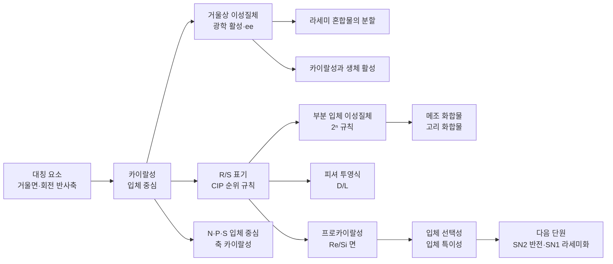
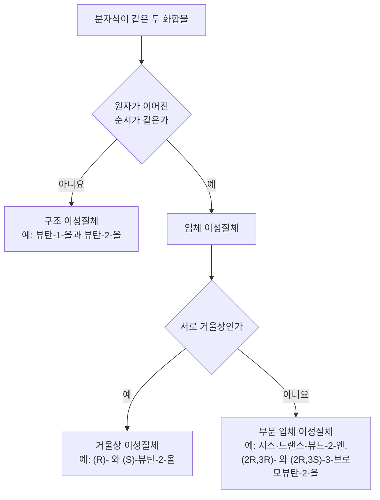

# 유기화학 3. 입체화학 — 원자의 배치가 같아도 공간의 손잡이가 다르다
<!-- prev: ochem-1, ochem-2, uchem-12 -->
<!-- next: ochem-4 -->

> [!NOTE]
> **이 단원의 범위**
> - 카이랄성과 입체 중심, 대칭 요소로 카이랄성 판정하기
> - 거울상 이성질체와 광학 활성(편광계, 비선광도, 거울상 초과량)
> - R/S 표기(칸–인골드–프렐로그 순위 규칙)
> - 부분 입체 이성질체, 입체 이성질체의 수($2^n$)와 메조 화합물, 고리 화합물의 입체 이성질
> - 피셔 투영식과 D/L 표기
> - 라세미 혼합물의 분할(부분 입체 이성질성 염, 속도론적 분할, 카이랄 크로마토그래피)
> - 탄소 아닌 입체 중심(N, P, S)과 축 카이랄성(알렌, 바이아릴) 개관
> - 반응의 입체화학: 프로카이랄성(프로-R/프로-S, Re/Si 면), 입체 선택성과 입체 특이성
> - 카이랄성과 생체 활성(수용체, 약물, 향)

**학습 목표**

1. 분자의 대칭 요소(거울면, 반전 중심, 회전 반사축)로 카이랄성을 판정하고, 사슬과 고리 화합물에서 입체 중심을 빠짐없이 찾을 수 있다.
2. 비선광도와 거울상 초과량을 정의하고, 편광계 측정값으로 시료의 조성과 광학 순도를 계산할 수 있다.
3. 칸–인골드–프렐로그 규칙(복제 원자 포함)으로 치환기의 순위를 정하고, 쐐기·점선 구조와 피셔 투영식에서 R/S를 정확히 판정할 수 있다.
4. 입체 중심이 여럿인 분자에서 거울상·부분 입체 관계를 가리고, 메조 화합물을 고려해 입체 이성질체의 수를 셀 수 있다.
5. 라세미 혼합물을 분할하는 세 가지 전략을 설명하고, 속도론적 분할의 선택성 인자를 전환율과 거울상 초과량으로부터 유도·계산할 수 있다.
6. 프로카이랄 중심과 프로카이랄 면을 표기하고, 위치가 다른 수소(동등·거울상·부분 입체 위치)를 구별하며, 입체 선택적 반응과 입체 특이적 반응의 결과를 예측할 수 있다.
7. 질소·인·황 입체 중심과 축 카이랄성의 안정성을 반전 장벽으로 비교하고, 카이랄성이 약효·독성·향을 바꾸는 까닭을 분자 인식으로 설명할 수 있다.

**이 단원의 학습 사다리**

| 단계 | 무엇을 하나? |
|---|---|
| STEP 1. 이전 학습 다시 보기 | 일반화학의 광학 이성질(카이랄 중심), 쐐기·점선 그리기, 뉴먼 투영식과 의자 형태, 시스·트랜스 |
| STEP 2. 기초 다지기 | 대칭 조작의 행렬과 행렬식(카이랄성의 수학적 기준), 빛의 편광과 원편광 분해, 경우의 수와 대칭으로 이성질체 세기 |
| STEP 3. 핵심 개념 | 카이랄성 → 광학 활성 → R/S → 부분 입체 이성질체 → 메조와 고리 → 피셔 투영식 → 분할 → N·P·S와 축 카이랄성 → 프로카이랄성 → 입체 선택성·특이성 → 생체 활성 |
| STEP 4. 오개념 바로잡기 | "(+)이면 R이다", "입체 중심이 있으면 카이랄하다", "반응에서 R이 S로 바뀌었으면 반전이 일어났다" 같은 착각 |
| STEP 5. 대학원·연구로 | 비대칭 촉매 반응, 동적 속도론적 분할, 원편광 이색성과 절대 배치의 계산 |
| STEP 6. 생활·산업·진로 | 단일 거울상 의약품, 비대칭 수소화 공정, 카이랄 분석, 향료 |

---

## 🗺️ 단원 들어가기

오른손 장갑은 왼손에 맞지 않는다. 재료도, 손가락 수도, 무게도 같은데 그렇다. 손과 장갑은 서로의 **거울상**이며, 아무리 돌려도 겹쳐지지 않는다. 분자도 그렇다. 스피어민트 껌의 시원한 향과 호밀빵에 들어가는 캐러웨이 씨앗의 향은 둘 다 카르본이라는 같은 분자에서 나온다. 원자의 종류, 개수, 결합 순서가 모두 같다. 다른 것은 오직 한 탄소 둘레에서 네 원자단이 놓인 **공간의 손잡이**뿐이다. 그런데도 코의 후각 수용체는 이 차이를 분명히 알아챈다. 수용체 자체가 한쪽 손잡이를 가진 단백질이기 때문이다.

일반화학 「핵화학·배위 화학·유기화학 개관」에서는 "서로 다른 네 원자단이 붙은 탄소가 거울상 이성질을 만든다"는 데까지 배웠다. 이 단원에서는 그 생각을 전공 수준으로 다듬는다. 카이랄성을 대칭으로 정확히 판정하고, 손잡이에 이름(R/S)을 붙이는 국제 규칙을 익히고, 입체 중심이 여럿일 때 이성질체가 몇 개인지 센다. 손잡이가 다른 두 분자를 실제로 떼어 놓는 방법(분할)과, 반응이 새 손잡이를 어떤 비율로 만드는지(입체 선택성)도 다룬다. 이 모든 것이 다음 단원 「유기 반응의 개관과 알킬 할라이드의 치환·제거 반응」에서 $\mathrm{S_N2}$ 반응의 입체 반전과 $\mathrm{S_N1}$ 반응의 라세미화를 읽는 언어가 된다.

---

## STEP 1. 🔙 이전 학습 다시 보기

### 연계 개념표

| 이전 단원 | 그때 배운 것 | 이 단원에서 확장되는 것 |
|---|---|---|
| 일반화학 「핵화학·배위 화학·유기화학 개관」 '이성질 현상' | 구조 이성질과 입체 이성질(기하·광학), 카이랄 중심 = 서로 다른 네 원자단이 붙은 탄소, 거울상은 편광면을 반대로 돌린다 | 카이랄성을 **대칭 요소**로 판정, 입체 중심이 있어도 아카이랄한 메조 화합물, 탄소 아닌 입체 중심과 축 카이랄성 |
| 일반화학 「핵화학·배위 화학·유기화학 개관」 '배위 화합물의 이성질' | $\mathrm{[Co(en)_3]^{3+}}$의 두 거울상, 시스·트랜스 | 같은 논리를 유기 분자에 적용하고, 손잡이에 **R/S 이름**을 붙인다 |
| 유기화학 「구조와 결합, 산과 염기」 '골격 구조식, 쐐기와 점선' | 사면체 탄소를 종이 위에 쐐기(앞)와 점선(뒤)으로 그리기 | 쐐기·점선 구조에서 R/S를 읽고, 피셔 투영식으로 옮기며, 두 표기 사이를 오가는 규칙 |
| 유기화학 「알케인과 사이클로알케인」 '형태 분석, 의자 형태, 이치환 사이클로헥세인' | 뉴먼 투영식, 겹친·엇갈린 형태, 축·적도 위치, 시스·트랜스-1,2-다이메틸사이클로헥세인 | 형태(회전으로 바뀜)와 배치(결합을 끊어야 바뀜)의 구별, 시스·트랜스 고리 화합물의 카이랄성과 메조 |
| 일반물리학 「파동과 소리」·「빛과 광학」 | 횡파와 편광, 굴절률 | 선편광을 두 원편광의 합으로 보고, 굴절률 차이로 **광회전**을 설명 |

### 준비 운동 (사전 진단)

**Q1.** 다음 중 거울상과 겹쳐지지 않는 물체를 모두 고르시오. 숟가락, 나사못, 가위, 정육면체 주사위(눈의 배치까지 생각), 커피잔

**Q2.** 뷰탄-2-올 $\mathrm{CH_3CH(OH)CH_2CH_3}$과 프로판-2-올 $\mathrm{CH_3CH(OH)CH_3}$ 가운데 카이랄 중심이 있는 것은? 그 탄소에 붙은 네 원자단을 쓰시오.

**Q3.** 뷰테인의 겹친 형태와 엇갈린 형태는 서로 다른 화합물인가? 시스-뷰트-2-엔과 트랜스-뷰트-2-엔은 어떤가? 둘의 차이를 '회전'이라는 말로 설명하시오.

**Q4.** 시스-1,2-다이메틸사이클로헥세인의 의자 형태에서 두 메틸기는 각각 축·적도 중 어디에 있는가? 고리 뒤집힘이 일어나면 어떻게 되는가?

정답 및 해설

**Q1.** 나사못, 가위, 정육면체 주사위 — 나사못은 오른나사와 왼나사가 있다. 가위는 날이 겹치는 방향 때문에 왼손잡이용이 따로 있다. 주사위는 1·2·3의 눈이 한 꼭짓점 둘레에 시계 방향으로 놓이는가, 반시계 방향으로 놓이는가에 따라 두 거울상이 있다. 숟가락과 커피잔은 거울면을 가져 거울상과 겹쳐진다.

**Q2.** 뷰탄-2-올 — C2에 $\mathrm{-H}$, $\mathrm{-OH}$, $\mathrm{-CH_3}$, $\mathrm{-CH_2CH_3}$이 붙어 넷이 모두 다르다. 프로판-2-올의 C2에는 $\mathrm{-CH_3}$가 두 개 붙어 있다.

**Q3.** 겹친·엇갈린 형태는 단일 결합 둘레의 회전으로 빠르게 서로 바뀌는 **형태**(conformation)이므로 같은 화합물이다. 시스·트랜스-뷰트-2-엔은 π 결합 때문에 회전이 막혀 있어 결합을 끊지 않고는 바뀌지 않는 **배치**(configuration)가 다른 서로 다른 화합물이다.

**Q4.** 하나는 축, 하나는 적도에 있다. 고리가 뒤집히면 축과 적도가 서로 바뀌어 여전히 '축 하나, 적도 하나'이다. 두 형태는 에너지가 같다. ⑤에서 이 두 형태가 서로 거울상이라는 것을 보게 된다.

---

## STEP 2. 🧱 기초 다지기

### 디딤돌 1. 대칭 조작의 행렬 — "카이랄하다"의 수학적 뜻

물체를 움직여 원래와 구별할 수 없는 모습으로 만드는 조작을 **대칭 조작**이라 한다. 수학 도구 5 「선형대수」 '대칭 조작의 행렬 표현'에서 익힌 것처럼, 원점을 지나는 대칭 조작은 3×3 직교 행렬로 쓸 수 있다. 직교 행렬의 행렬식은 $+1$ 또는 $-1$뿐이다.

| 조작 | 기호 | 행렬의 예 | 행렬식 | 종류 |
|---|---|---|---|---|
| $z$축 둘레 $360°/n$ 회전 | $C_n$ | $\begin{pmatrix}\cos\theta & -\sin\theta & 0\\ \sin\theta & \cos\theta & 0\\ 0 & 0 & 1\end{pmatrix}$ | $+1$ | 진회전(proper) |
| $xy$ 평면에 대한 반사 | $\sigma$ | $\mathrm{diag}(1, 1, -1)$ | $-1$ | 부적절 조작(improper) |
| 원점에 대한 반전 | $i$ | $\mathrm{diag}(-1, -1, -1)$ | $-1$ | 부적절 조작 |
| 회전 후 수직면 반사 | $S_n$ | $\sigma\,C_n$ | $-1$ | 부적절 조작 |

행렬식이 $+1$인 조작(회전)은 물체를 실제로 손으로 돌려서 만들 수 있다. 행렬식이 $-1$인 조작은 공간을 '뒤집어야' 하므로 손으로는 할 수 없고, 거울을 거쳐야 한다. 그래서 다음이 성립한다.

> [!IMPORTANT]
> **카이랄성의 정의** 분자가 행렬식 $-1$인 대칭 조작(거울면 $\sigma$, 반전 중심 $i$, 회전 반사축 $S_n$)을 **하나도** 갖지 않으면 그 분자는 **카이랄**(chiral)하다. 이때 분자와 그 거울상은 어떤 회전으로도 겹쳐지지 않는다. 부적절 조작을 하나라도 가지면 **아카이랄**(achiral)하다. ($\sigma = S_1$, $i = S_2$이므로 "회전 반사축이 없다"는 한 문장으로 줄여 말할 수도 있다.)

실제 판정에서는 거울면과 반전 중심만 찾아도 거의 모든 경우가 해결된다. $S_4$만 있고 $\sigma$, $i$가 없는 분자는 드물다.

#### 예제 1 — 두 번 바꾸면 제자리

사면체 탄소에 붙은 두 치환기의 자리를 맞바꾸는 일은 두 치환기 사이를 지나는 거울면에 대한 반사와 같은 결과를 준다. (1) 반사 두 번을 잇달아 한 조작의 행렬식을 구하고, (2) 치환기를 한 번 바꾸면 거울상이, 두 번 바꾸면 원래 분자가 되는 까닭을 설명하시오.

**풀이**
(1) 행렬식은 곱셈적이다: $\det(\sigma_2\sigma_1) = \det\sigma_2\det\sigma_1 = (-1)(-1) = +1$. 두 반사의 곱은 진회전이다(두 거울면의 교선을 축으로 하고 사잇각의 두 배만큼 도는 회전).
(2) 한 번 바꾼 분자는 원래 분자에 행렬식 $-1$인 조작을 한 것이므로 거울상이다. 두 번 바꾸면 행렬식 $+1$, 즉 회전과 같으므로 같은 분자를 돌려 놓은 것에 지나지 않는다.
**의미** ③과 ⑥에서 쓸 "두 치환기를 한 번 바꾸면 R과 S가 바뀌고, 두 번 바꾸면 그대로"라는 요령의 수학적 근거이다.

### 디딤돌 2. 빛의 편광 — 선편광은 두 원편광의 합이다

전기장이 한 평면 안에서만 진동하는 빛을 **평면 편광**(선편광)이라 한다. 전기장 벡터의 끝이 진행하며 나선을 그리는 빛은 **원편광**이며, 오른쪽으로 도는 것과 왼쪽으로 도는 것이 있다. 수학 도구 6 「복소수와 푸리에 해석」의 복소 표현을 쓰면, 진폭이 같은 오른·왼 원편광을 더한 것이 선편광이다.

$$
\frac{1}{2}\big[(\hat{x} + i\hat{y}) + (\hat{x} - i\hat{y})\big]e^{i(kz - \omega t)} = \hat{x}\,e^{i(kz - \omega t)}
$$

카이랄한 분자가 녹아 있는 용액에서는 오른 원편광과 왼 원편광이 느끼는 굴절률 $n_\mathrm{R}$, $n_\mathrm{L}$이 아주 조금 다르다. 카이랄한 매질과 '손잡이를 가진 빛'의 상호작용이 손잡이에 따라 다르기 때문이다. 길이 $l$을 지나는 동안 두 원편광의 위상이 $\Delta\phi = 2\pi l(n_\mathrm{L} - n_\mathrm{R})/\lambda$만큼 어긋나고, 다시 합친 선편광의 진동면은 그 절반만큼 돌아간다.

$$
\lvert\alpha\rvert = \frac{\lvert\Delta\phi\rvert}{2} = \frac{\pi l\,\lvert n_\mathrm{L} - n_\mathrm{R}\rvert}{\lambda}
$$

이것이 **광회전**(optical rotation)이다. 아카이랄한 분자는 거울상과 같으므로 $n_\mathrm{L} = n_\mathrm{R}$이고 회전이 없다. 거울상 이성질체는 $n_\mathrm{L} - n_\mathrm{R}$의 부호가 정반대이므로 같은 크기, 반대 방향으로 돌린다.

#### 예제 2 — 굴절률 차이는 얼마나 작은가, 그리고 180°의 모호함

(1) 길이 2.00 dm(0.200 m)인 관에서 나트륨 D선(589 nm)의 진동면이 $+10.64°$ 돌아갔다. $\lvert n_\mathrm{L} - n_\mathrm{R}\rvert$를 구하시오. (2) 편광계는 $-180°$에서 $+180°$ 사이의 값만 읽는다. 어떤 용액의 측정값이 $+30.0°$였는데, 이것이 실제로 $+30.0°$인지 $-330.0°$인지 가리려면 어떻게 하면 되는가?

**풀이**
(1) $\alpha = 10.64° = 0.1857\ \mathrm{rad}$. $\lvert n_\mathrm{L} - n_\mathrm{R}\rvert = \dfrac{\alpha\lambda}{\pi l} = \dfrac{0.1857\times589\times10^{-9}}{\pi\times0.200} = 1.74\times10^{-7}$
(2) 용액을 정확히 2배로 묽혀 다시 잰다. 회전각은 농도에 비례하므로 실제가 $+30.0°$이면 $+15.0°$가, 실제가 $-330.0°$이면 $-165.0°$가 읽힌다. 관 길이를 절반으로 해도 같다.
**의미** 굴절률이 천만분의 2쯤만 달라도 수 dm를 지나면 잴 수 있는 회전이 쌓인다. 광회전이 아주 예민한 측정인 동시에, 불순물이나 온도에 따라 쉽게 흔들리는 측정인 까닭이다.

### 디딤돌 3. 경우의 수와 대칭 — 입체 이성질체 세기

입체 중심 하나는 두 가지 배치(R 또는 S)를 가진다. 입체 중심 $n$개가 서로 독립이면 배치의 조합은 $2^n$가지이고, 이것이 입체 이성질체 수의 **상한**이다. 조합 가운데 두 개씩은 모든 입체 중심이 뒤집힌 거울상 쌍이므로, 메조 화합물이 없으면 $2^{n-1}$쌍의 거울상 이성질체가 된다.

분자가 **구조적으로 대칭**(사슬의 양 끝이 같아 앞뒤로 읽어도 같은 분자)이면 몇몇 조합이 겹친다. 예를 들어 $\mathrm{X{-}C^*HY{-}C^*HY{-}X}$에서 (R,S)와 (S,R)는 분자를 뒤집어 읽은 것이므로 같은 분자이다. 이런 분자에서 앞뒤로 읽어 같은 조합이 바로 메조 화합물 후보이다.

| 분자 꼴 | 입체 중심 수 $n$ | 입체 이성질체 수 | 내역 |
|---|---|---|---|
| 비대칭 사슬 | $n$ | $2^n$ | $2^{n-1}$쌍 |
| 대칭 사슬, $n$ 짝수 | $n$ | $2^{n-1} + 2^{n/2 - 1}$ | 메조 $2^{n/2-1}$개 + 나머지 쌍 |
| 대칭 사슬, $n$ 홀수(가운데 탄소 포함) | $n$ | $2^{n-1}$ | 메조 $2^{(n-1)/2}$개 + 나머지 쌍 |

#### 예제 3 — 대칭 사슬의 이성질체 세기

(1) 타타르산(2,3-다이하이드록시뷰테인다이오산, $n = 2$)과 (2) 글루코스를 산화해 얻는 같은 꼴의 육탄당 다이카복실산 2,3,4,5-테트라하이드록시헥세인다이오산($n = 4$)의 입체 이성질체 수를 표의 식으로 구하고, (1)을 직접 나열해 확인하시오.

**풀이**
(1) $2^{1} + 2^{0} = 3$. 나열: (R,R), (S,S), (R,S) = (S,R). 앞의 둘은 거울상 쌍이고, (R,S)는 자신의 거울상((S,R))과 같은 분자이므로 메조이다.
(2) $2^{3} + 2^{1} = 10$. 거울상 쌍 4개(8개)와 메조 2개이다.
**의미** 단순히 $2^n$으로 세면 (1)은 4개, (2)는 16개로 틀린다. 대칭이 경우의 수를 줄이는 것은 일반화학 「화학 열역학」에서 미시 상태를 셀 때 같은 입자를 구별하지 않았던 것과 같은 생각이다.

---

## STEP 3. 📘 핵심 개념

### ① 카이랄성과 입체 중심

**이성질체**(isomer)는 분자식이 같은 서로 다른 화합물이다. 원자가 이어진 순서부터 다르면 **구조 이성질체**(constitutional isomer), 이어진 순서는 같고 공간 배치만 다르면 **입체 이성질체**(stereoisomer)이다. 입체 이성질체는 다시 서로 거울상인 **거울상 이성질체**(enantiomer)와 거울상이 아닌 **부분 입체 이성질체**(diastereomer)로 나뉜다. 이 단원 전체가 이 분류표의 오른쪽 가지를 다룬다.

형태(conformation)는 이 분류에 넣지 않는다. 단일 결합 둘레의 회전으로 실온에서 1초에 수십억 번씩 바뀌는 형태는 서로 다른 화합물로 분리할 수 없기 때문이다. 입체 이성질체는 **배치**(configuration)가 다르며, 배치를 바꾸려면 결합을 끊어야 한다.

#### 입체 중심과 카이랄 중심

어떤 원자에 붙은 두 원자단을 맞바꾸었을 때 입체 이성질체가 생기면 그 원자를 **입체 중심**(stereocenter, stereogenic center)이라 한다. 유기 분자에서 가장 흔한 입체 중심은 서로 다른 네 원자단이 붙은 사면체 탄소이며, 이것을 특히 **카이랄 중심**(chirality center) 또는 비대칭 탄소라 한다. 시스·트랜스 알켄의 이중 결합 탄소도 입체 중심이지만(치환기를 바꾸면 부분 입체 이성질체가 생긴다) 카이랄 중심은 아니다.

뷰탄-2-올의 C2에는 $\mathrm{-H}$, $\mathrm{-OH}$, $\mathrm{-CH_3}$, $\mathrm{-CH_2CH_3}$이 붙어 있다. 아래 그림처럼 이 분자와 그 거울상은 어떻게 돌려도 겹쳐지지 않는다. 두 분자는 (R)-뷰탄-2-올과 (S)-뷰탄-2-올이라는 거울상 이성질체 쌍이다(이름 붙이는 법은 ③).

<!-- fig:ochem-3-butanol-enantiomers -->

#### 입체 중심 찾는 요령

1. $\mathrm{CH_2}$, $\mathrm{CH_3}$ 탄소와 다중 결합 탄소($sp^2$, $sp$)는 카이랄 중심이 될 수 없으므로 먼저 지운다.
2. 남은 $sp^3$ 탄소마다 네 원자단을 **원자단 전체**로 비교한다. 첫 원자가 같아도 더 나아가면 다를 수 있다($\mathrm{-CH_2CH_3}$와 $\mathrm{-CH_2CH_2CH_3}$는 다르다).
3. 고리 탄소는 고리를 **양쪽 방향으로 따라가며** 두 경로가 같은지 본다. 메틸사이클로헥세인의 C1은 어느 쪽으로 돌아도 같은 경로이므로 카이랄 중심이 아니지만, 3-메틸사이클로헥산-1-온의 C3은 한쪽은 곧 카보닐을, 다른 쪽은 $\mathrm{CH_2}$ 세 개를 지나서야 카보닐을 만나므로 카이랄 중심이다.

#### 카이랄성 판정 — 입체 중심이 아니라 대칭으로

"카이랄 중심이 있으면 카이랄하다"는 대부분 맞지만 정의는 아니다. 디딤돌 1의 정의대로 판정은 **거울면이나 반전 중심이 있는가**로 한다.

| 분자 | 카이랄 중심 | 거울면·반전 중심 | 카이랄한가 |
|---|---|---|---|
| 프로판-2-올 | 없음 | C–O–H와 C2–H를 품은 거울면 | 아니요 |
| 뷰탄-2-올 | 1개(C2) | 없음 | 예 |
| (2R,3S)-타타르산(메조) | 2개 | 한 형태에서 분자 가운데 거울면 | 아니요 (⑤) |
| 펜타-2,3-다이엔 $\mathrm{CH_3CH{=}C{=}CHCH_3}$ | 없음 | 없음 | 예 (⑧, 축 카이랄성) |

카이랄 중심이 **하나뿐인** 분자는 반드시 카이랄하다(거울면이 그 탄소를 지나려면 두 원자단이 같아야 하기 때문이다). 둘 이상이면 메조일 수 있고, 하나도 없어도 축이나 면을 따라 카이랄할 수 있다.

#### 예제 4 — 카이랄 중심 찾기

다음 분자에서 카이랄 중심을 모두 찾고, 분자가 카이랄한지 판정하시오. (가) 3-메틸헥세인 (나) 3-메틸펜테인 (다) 3-메틸사이클로헥산-1-온 (라) 4-메틸사이클로헥산-1-올 (마) 카르본(2-메틸-5-(프로프-1-엔-2-일)사이클로헥스-2-엔-1-온) (바) 이부프로펜(2-[4-(2-메틸프로필)페닐]프로판산)

**풀이**
(가) C3에 H, $\mathrm{CH_3}$, $\mathrm{CH_2CH_3}$, $\mathrm{CH_2CH_2CH_3}$ → 카이랄 중심 1개, 카이랄하다.
(나) C3에 $\mathrm{CH_2CH_3}$가 두 개 → 카이랄 중심 없음, 아카이랄.
(다) C3이 카이랄 중심(고리의 두 경로가 다르다), 카이랄하다.
(라) C1에는 H, OH와 고리의 두 경로가 붙는데, 두 경로는 모두 $\mathrm{CH_2{-}CH_2}$를 지나 C4에서 만나므로 같다. C4도 마찬가지이다. 카이랄 중심이 없고 C1–C4를 지나는 거울면이 있어 아카이랄하다. (그래도 OH와 $\mathrm{CH_3}$가 고리의 같은 쪽인 시스형과 반대쪽인 트랜스형이 있다. ⑤에서 다룬다.)
(마) C5 하나. 카르본의 두 거울상 (R)-카르본(SMILES `CC1=CC[C@H](CC1=O)C(=C)C`)과 (S)-카르본(`CC1=CC[C@@H](CC1=O)C(=C)C`)이 스피어민트 향과 캐러웨이 향의 주성분이다.
(바) 카복실기가 붙은 탄소 하나. 약효를 내는 것은 (S)-이부프로펜(`CC(C)Cc1ccc(cc1)[C@H](C)C(=O)O`)이다(⑪).

<!-- fig:ochem-3-q-ex4-chiral-centers -->

**의미** 고리 탄소에서 "두 경로가 같은가"를 끝까지 따라가는 것이 실수를 줄이는 요령이다.

#### ✔ 바로 확인

1. (O/X) 단일 결합 둘레의 회전으로 바뀌는 두 형태는 서로 입체 이성질체이다.
2. 빈칸: 분자가 거울면, 반전 중심, 회전 반사축을 하나도 갖지 않으면 그 분자는 (    )하다.
3. 2-클로로뷰테인, 1-클로로뷰테인, 클로로사이클로헥세인 가운데 카이랄한 것은?
4. (O/X) 카이랄 중심이 하나뿐인 분자는 언제나 카이랄하다.

정답

1. X — 형태는 같은 화합물의 다른 모습이다. 입체 이성질체는 결합을 끊어야 바뀌는 배치가 다르다.
2. 카이랄
3. 2-클로로뷰테인 — C2에 H, Cl, $\mathrm{CH_3}$, $\mathrm{CH_2CH_3}$. 클로로사이클로헥세인의 C1은 고리 두 경로가 같다.
4. O — 거울면이 그 탄소를 지나려면 붙은 원자단 둘이 같아야 한다.

### ② 거울상 이성질체와 광학 활성

거울상 이성질체는 **아카이랄한 환경**에서는 모든 성질이 같다. 녹는점, 끓는점, 밀도, 보통 용매에 대한 용해도, IR·NMR 스펙트럼, 아카이랄한 시약과의 반응 속도가 모두 같다. 두 분자 사이의 모든 거리와 각이 같고, 에너지도 같기 때문이다. 다른 것은 **카이랄한 대상과의 상호작용**뿐이다. 원편광(디딤돌 2), 카이랄한 시약·촉매, 효소와 수용체가 여기에 속한다.

| 성질 | 거울상 이성질체끼리 | 부분 입체 이성질체끼리 |
|---|---|---|
| 녹는점·끓는점·용해도 | 같다 | 다르다 |
| 아카이랄 용매에서의 NMR | 같다 | 다르다 |
| 비선광도 | 크기 같고 부호 반대 | 서로 관계없다 |
| 아카이랄 시약과의 반응 속도 | 같다 | 다르다 |
| 카이랄 시약·효소와의 반응 속도 | 다르다 | 다르다 |

#### 편광계와 비선광도

평면 편광을 카이랄한 시료에 통과시키면 진동면이 돌아간다. 이 성질을 **광학 활성**(optical activity)이라 한다. 광원 쪽을 바라보는 관찰자에게 시계 방향으로 돌리는 화합물을 **우선성**(dextrorotatory, 기호 (+) 또는 *d*), 반시계 방향이면 **좌선성**(levorotatory, (−) 또는 *l*)이라 한다.

<!-- fig:ochem-3-polarimeter -->

관찰 회전각 $\alpha$는 빛이 만나는 카이랄 분자의 수, 곧 농도와 관 길이에 비례한다. 그래서 화합물 고유의 값으로 **비선광도**(specific rotation)를 정의한다.

$$
[\alpha]_\lambda^{T} = \frac{\alpha}{l\,c}
\qquad (l:\ \mathrm{dm},\ c:\ \mathrm{g/mL},\ \text{순수 액체는 } c \text{ 대신 밀도})
$$

관례상 단위($\mathrm{deg\cdot mL\cdot g^{-1}\cdot dm^{-1}}$)는 적지 않고 온도·파장·용매·농도를 함께 적는다(예: $[\alpha]_\mathrm{D}^{20} = +66.5$ (c 8.0, 물), 아래첨자 D는 나트륨 D선). 비선광도는 용매·온도·파장에 따라 달라지고 부호가 바뀌기도 한다.

| 화합물 | IUPAC 이름 | $[\alpha]_\mathrm{D}$ (약) |
|---|---|---|
| 수크로스 | (설탕) | +66.5 (물) |
| (S)-뷰탄-2-올 | (2S)-butan-2-ol | +13.5 (순수 액체) |
| (R)-카르본 | (5R)-2-메틸-5-(프로프-1-엔-2-일)사이클로헥스-2-엔-1-온 | −61 |
| (R)-리모넨 | (4R)-1-메틸-4-(프로프-1-엔-2-일)사이클로헥스-1-엔 | +123 |
| (2R,3R)-타타르산 | (2R,3R)-2,3-다이하이드록시뷰테인다이오산 | +12 (물) |

(R)-카르본은 (−)인데 골격이 거의 같은 (R)-리모넨은 (+)이다. **R/S는 공간 배치에 붙인 이름이고 (+)/(−)는 측정값**이며, 둘 사이에는 간단한 규칙이 없다. 실험 없이 부호를 정할 수 없다.

#### 라세미 혼합물과 거울상 초과량

두 거울상 이성질체가 1 : 1로 섞이면 회전이 정확히 상쇄되어 $\alpha = 0$이다. 이것을 **라세미 혼합물**(racemic mixture, 라세미체)이라 하고 (±) 또는 *rac*-를 붙인다. 한쪽이 더 많으면 그 초과분만 회전에 기여한다. 시료의 순도를 나타내는 양은 **거울상 초과량**(enantiomeric excess, ee)이다.

$$
\mathrm{ee} = \frac{\lvert n_\mathrm{R} - n_\mathrm{S}\rvert}{n_\mathrm{R} + n_\mathrm{S}}\times100\ \%, \qquad
\text{많은 쪽의 몰분율} = \frac{1 + \mathrm{ee}}{2}
$$

두 거울상의 비선광도는 크기가 같고 부호가 반대이므로, 회전이 조성에 선형이라면 혼합물의 비선광도는 $[\alpha]_\text{관찰} = (x_\mathrm{S} - x_\mathrm{R})[\alpha]_\text{순수 S}$이다. 따라서

$$
\text{광학 순도} = \frac{[\alpha]_\text{관찰}}{[\alpha]_\text{순수}}\times100\ \% = \mathrm{ee}
$$

이다. 오늘날에는 회전 측정보다 카이랄 크로마토그래피(⑦)로 두 거울상의 봉우리 넓이를 직접 재어 ee를 구하는 일이 많다. 광회전은 불순물 하나로도 크게 흔들리고, 드물게 농도에 따라 선형성이 깨지기 때문이다.

<!-- 시뮬레이션 요청: 편광계 가상 실험. 조작 변수: (1) 화합물 선택((S)-뷰탄-2-올 [α] +13.5, 수크로스 +66.5, (R)-카르본 −61), (2) 거울상 초과량 슬라이더(−100 %~+100 %, 많은 쪽 이성질체 표시), (3) 농도 0~0.20 g/mL, (4) 관 길이 0.5·1·2 dm. 보여 줄 것: 편광자–시료관–검광자를 지나는 빛의 진동면이 회전하는 3차원 애니메이션, 검광자 눈금에 관찰 회전각 α = [α]·l·c·(ee/100) 수치, 두 거울상 분자 수를 색이 다른 점(예: 파랑 S, 주황 R)으로 시료관 안에 비율대로 흩어 그린 그림. 측정값이 ±180°를 넘으면 '눈금이 한 바퀴 돌았다'는 경고를 띄우고 묽히기 버튼으로 모호함을 풀게 한다. -->

#### 예제 5 — 비선광도 구하기와 쓰기

(1) 수크로스 2.00 g을 물에 녹여 25.0 mL로 만들고 1.00 dm 관에서 재었더니 $\alpha = +5.32°$였다. 비선광도를 구하시오. (2) 농도를 모르는 수크로스 수용액을 2.00 dm 관에서 재었더니 $+13.3°$였다. 농도(g/100 mL)를 구하시오.

**풀이**
(1) $c = 2.00/25.0 = 0.0800\ \mathrm{g/mL}$. $[\alpha] = \dfrac{+5.32}{1.00\times0.0800} = +66.5$
(2) $c = \dfrac{\alpha}{[\alpha]\,l} = \dfrac{13.3}{66.5\times2.00} = 0.100\ \mathrm{g/mL}$ → 10.0 g/100 mL
**의미** 편광계는 설탕 산업에서 당도를 재는 표준 기기(당도계)였다. 비선광도를 알면 농도를 비파괴로 바로 잴 수 있다.

#### 예제 6 — 거울상 초과량과 조성

순수한 (S)-뷰탄-2-올의 비선광도는 $+13.5$이다. (1) 합성한 뷰탄-2-올 시료의 비선광도가 $+9.45$였다. ee와 두 거울상의 백분율을 구하시오. (2) 이 시료 4.00 g에 순수한 (R)-뷰탄-2-올 1.00 g을 섞으면 비선광도는 얼마가 되는가?

**풀이**
(1) $\mathrm{ee} = 9.45/13.5 = 0.700$ → 70.0 % ee (S 과량). S의 분율 $= (1 + 0.700)/2 = 0.850$ → S 85.0 %, R 15.0 %.
(2) 처음 시료: S 3.40 g, R 0.60 g. 섞은 뒤: S 3.40 g, R 1.60 g, 합 5.00 g. $\mathrm{ee} = (3.40 - 1.60)/5.00 = 0.360$ (S 과량). $[\alpha] = 0.360\times13.5 = +4.86$
**의미** 70 % ee는 "70 %가 S"가 아니라 "S가 R보다 70 %p 많다(85 : 15)"는 뜻이다. ee 90 %도 다섯 분자 가운데 하나는 아니지만 20분자 중 하나가 반대 거울상이다.

#### ✔ 바로 확인

1. (O/X) (S)-뷰탄-2-올과 (R)-뷰탄-2-올은 끓는점이 다르다.
2. 어떤 순수한 화합물의 $[\alpha]_\mathrm{D} = -40.0$이다. 같은 화합물의 시료가 $[\alpha]_\mathrm{D} = -30.0$이면 ee와 두 거울상의 비는?
3. 빈칸: 두 거울상 이성질체가 1 : 1로 섞여 광학 활성이 없는 시료를 (    )이라 한다.
4. (O/X) R 배치인 화합물은 편광면을 시계 방향으로 돌린다.

정답

1. X — 거울상 이성질체는 아카이랄한 환경에서의 물리적 성질이 모두 같다.
2. 75 % ee, (−) 이성질체 : (+) 이성질체 = 87.5 : 12.5
3. 라세미 혼합물(라세미체)
4. X — R/S와 회전 방향 사이에는 정해진 관계가 없다. (R)-카르본은 (−), (R)-리모넨은 (+)이다.

### ③ R/S 표기 — 칸–인골드–프렐로그 규칙

거울상 쌍의 두 분자에 이름을 붙이려면 공간 배치를 말로 옮기는 규칙이 필요하다. **칸–인골드–프렐로그 규칙**(Cahn–Ingold–Prelog rules, CIP 규칙)은 입체 중심에 붙은 네 원자단에 순위를 매기고, 그 순위가 공간에서 도는 방향으로 배치를 이름 짓는다.

#### 순위 규칙

**규칙 1. 첫 원자의 원자 번호.** 입체 중심에 직접 붙은 원자의 원자 번호가 클수록 순위가 높다. 동위 원소는 질량수가 큰 쪽이 높다($\mathrm{D} > \mathrm{H}$).
$$
\mathrm{I > Br > Cl > S > F > O > N > C > D > H}
$$

**규칙 2. 첫 원자가 같으면 바깥으로 탐색한다.** 각 원자단의 첫 원자에 붙은 세 원자(입체 중심 쪽은 빼고)를 원자 번호가 큰 순서로 적은 **집합**끼리 비교한다. 집합은 가장 큰 원자부터 하나씩 비교해 처음 차이가 나는 곳에서 결정한다(원자 번호를 더하지 않는다). 그래도 같으면 순위가 높은 가지를 따라 한 단계 더 나아간다.
- $\mathrm{-CH_2OH}$ {O, H, H} > $\mathrm{-CH(CH_3)_2}$ {C, C, H}: 첫 원소에서 O > C로 끝난다. 아이소프로필에 탄소가 둘 있어도 소용없다.
- $\mathrm{-CH(CH_3)_2}$ {C, C, H} > $\mathrm{-CH_2CH_3}$ {C, H, H}

**규칙 3. 다중 결합은 복제 원자로 펼친다.** 이중 결합의 양 끝 원자는 상대 원자를 하나씩 더 가진 것으로, 삼중 결합은 두 개씩 더 가진 것으로 센다. 복제된 원자는 더 이상 아무것도 달고 있지 않은 것으로(빈 자리, 원자 번호 0) 본다.
- $\mathrm{-CH{=}O}$ → C에 {O, O, H}, $\mathrm{-COOH}$ → {O, O, O}, $\mathrm{-C{\equiv}N}$ → {N, N, N}
- 그래서 $\mathrm{-COOH > -CHO > -CH_2OH}$이고, $\mathrm{-CH_2OH}$ {O, H, H} > $\mathrm{-C{\equiv}N}$ {N, N, N}이다(첫 원소 O > N).

<!-- fig:ochem-3-duplicate-atoms -->

자주 만나는 원자단의 순위를 정리하면 다음과 같다(왼쪽이 높다).

$$
\mathrm{-Br > -Cl > -SH > -F > -OCH_3 > -OH > -NH_2 > -COOH > -CHO > -CH_2OH > -C{\equiv}N > -C_6H_5 > -C(CH_3)_3 > -CH{=}CH_2 > -CH(CH_3)_2 > -CH_2CH_3 > -CH_3 > -H}
$$

#### R/S 정하는 절차

1. 네 원자단에 순위 1~4를 매긴다.
2. 순위 4(보통 H)가 **관찰자에게서 먼 쪽**(점선)을 향하게 분자를 본다.
3. 1 → 2 → 3을 잇는 방향이 시계 방향이면 **R**(rectus, 오른쪽), 반시계 방향이면 **S**(sinister, 왼쪽)이다.

<!-- fig:ochem-3-steering-wheel -->

종이 위에서 분자를 머릿속으로 돌리기 어려울 때 쓰는 요령이 두 가지 있다.
- **순위 4가 앞쪽(쐐기)을 향할 때**: 보이는 그대로 읽은 뒤 R과 S를 **뒤집는다**. 운전대를 뒤에서 보면 도는 방향이 반대로 보이는 것과 같다.
- **치환기 맞바꾸기**: 순위 4와 뒤를 향한 원자단을 맞바꾸어 판정한 뒤, 한 번 바꾸었으므로 답을 뒤집는다(디딤돌 1).

#### 예제 7 — 순위 매기기

다음 각 묶음의 원자단을 CIP 순위가 높은 순서로 쓰시오.
(1) $\mathrm{-OH}$, $\mathrm{-CH_3}$, $\mathrm{-NH_2}$, $\mathrm{-H}$
(2) $\mathrm{-CH_2Cl}$, $\mathrm{-CH_2OH}$, $\mathrm{-CH(CH_3)_2}$, $\mathrm{-C(CH_3)_3}$
(3) $\mathrm{-CH{=}CH_2}$, $\mathrm{-CH(CH_3)_2}$, $\mathrm{-C_6H_5}$, $\mathrm{-C{\equiv}N}$

**풀이**
(1) $\mathrm{-OH > -NH_2 > -CH_3 > -H}$ (O 8 > N 7 > C 6 > H 1)
(2) 첫 원자는 모두 C. 집합: $\mathrm{-CH_2Cl}$ {Cl, H, H}, $\mathrm{-CH_2OH}$ {O, H, H}, $\mathrm{-C(CH_3)_3}$ {C, C, C}, $\mathrm{-CH(CH_3)_2}$ {C, C, H}. 가장 큰 원소부터 비교하면 Cl > O > C이고, C끼리는 둘째 원소 C > H로 갈린다. $\mathrm{-CH_2Cl > -CH_2OH > -C(CH_3)_3 > -CH(CH_3)_2}$
(3) $\mathrm{-C{\equiv}N}$ {N, N, N} > $\mathrm{-C_6H_5}$ {C, C, C} > $\mathrm{-CH{=}CH_2}$ {C, C, H}와 $\mathrm{-CH(CH_3)_2}$ {C, C, H}는 첫 구에서 같다. 다음 구에서 바이닐의 높은 가지($\mathrm{=CH_2}$, {C, H, H})가 아이소프로필의 가지($\mathrm{CH_3}$, {H, H, H})보다 높다. 순서는 $\mathrm{-C{\equiv}N > -C_6H_5 > -CH{=}CH_2 > -CH(CH_3)_2}$
**의미** 원자 수를 세거나 원자 번호를 더하지 않는다. 처음 차이 나는 곳에서 끝난다.

#### 예제 8 — 쐐기 구조에서 R/S 읽기

(1) 브로모클로로플루오로메테인에서 F는 왼쪽 위, Cl은 왼쪽 아래(둘 다 평면), Br은 오른쪽 쐐기(앞), H는 오른쪽 점선(뒤)이다. (2) 알라닌(2-아미노프로판산)에서 $\mathrm{COOH}$는 왼쪽 위, $\mathrm{CH_3}$는 오른쪽 위(둘 다 평면, V 자), $\mathrm{NH_2}$는 아래쪽 점선(뒤), H는 아래쪽 쐐기(앞)이다. 각각 R인가 S인가?

<!-- fig:ochem-3-q-ex8-wedges -->

**풀이**
(1) 순위: Br ① > Cl ② > F ③ > H ④. H가 이미 뒤에 있으므로 보이는 대로 읽는다. ①(오른쪽) → ②(왼쪽 아래) → ③(왼쪽 위)은 시계 방향이다. **R**. ((R)-브로모클로로플루오로메테인, SMILES `F[C@H](Cl)Br`)
(2) 순위: $\mathrm{NH_2}$ ① > $\mathrm{COOH}$ ② > $\mathrm{CH_3}$ ③ > H ④. ①(아래) → ②(왼쪽 위) → ③(오른쪽 위)은 6시 → 10시 → 2시 방향이므로 시계 방향으로 **보인다**. 그런데 H가 앞쪽(쐐기)이므로 뒤집는다. **S**. 이것이 단백질을 이루는 L-알라닌, (S)-2-아미노프로판산(SMILES `C[C@H](N)C(=O)O`)이다.
**의미** H가 앞을 향한 그림은 시험에서 가장 자주 틀리는 곳이다. 뒤집기 요령을 쓰면 분자를 돌릴 필요가 없다.

#### 예제 9 — 복제 원자로 동점 깨기

3,4-다이메틸펜트-1-엔 $\mathrm{CH_2{=}CH{-}CH(CH_3){-}CH(CH_3)_2}$의 C3에서 바이닐은 쐐기(앞, 오른쪽 위), 아이소프로필은 평면 왼쪽, $\mathrm{CH_3}$는 평면 오른쪽 아래, H는 점선(뒤)이다. 배치를 정하시오.

**풀이**
순위: 바이닐 {C, C, H} → 둘째 구 {C, H, H}, 아이소프로필 {C, C, H} → 둘째 구 {H, H, H}이므로 바이닐 ① > 아이소프로필 ② > $\mathrm{CH_3}$ ③ > H ④. H가 뒤이므로 보이는 대로: ①(오른쪽 위) → ②(왼쪽) → ③(오른쪽 아래)은 반시계 방향. **S**.
확인: 이 분자의 (R)-형 SMILES는 `C=C[C@H](C)C(C)C`이고, 문제의 분자는 그 거울상 (S)-3,4-다이메틸펜트-1-엔(`C=C[C@@H](C)C(C)C`)이다.
**의미** 첫 구에서 동점이면 **순위가 높은 가지끼리** 먼저 비교한다. 아이소프로필의 메틸이 둘이라는 '양'은 높은 가지가 이긴 뒤에는 영향을 주지 않는다.

#### ✔ 바로 확인

1. 순위가 높은 것은? (1) $\mathrm{-CH_2Br}$와 $\mathrm{-C(CH_3)_3}$ (2) $\mathrm{-CHO}$와 $\mathrm{-CH_2OH}$
2. (O/X) 순위 4인 원자단이 관찰자 쪽을 향하는 그림에서 1 → 2 → 3이 반시계 방향으로 보이면 R이다.
3. 입체 중심의 두 원자단을 맞바꾼 뒤 다시 한 번 다른 두 원자단을 맞바꾸면 배치는?
4. (R)-글리세르알데하이드(2,3-다이하이드록시프로판알)의 C2에 붙은 네 원자단의 순위를 쓰시오.

정답

1. (1) $\mathrm{-CH_2Br}$ — {Br, H, H}의 Br이 {C, C, C}의 C보다 먼저 이긴다. (2) $\mathrm{-CHO}$ — {O, O, H} > {O, H, H}
2. O — 보이는 방향(반시계 = S)을 뒤집어 R로 읽는다.
3. 처음과 같다 — 두 번 바꾸면 행렬식이 $(-1)^2 = +1$, 회전과 같다.
4. $\mathrm{-OH > -CHO > -CH_2OH > -H}$

### ④ 부분 입체 이성질체 — 입체 중심이 둘 이상일 때

3-브로모뷰탄-2-올 $\mathrm{CH_3{-}CH(OH){-}CHBr{-}CH_3}$에는 입체 중심이 C2와 C3 두 개 있다. 각각 R 또는 S이므로 $2^2 = 4$개의 입체 이성질체가 있다. 이 넷 사이의 관계는 **배치 기호를 몇 개 뒤집었는가**로 바로 정해진다.

| | (2R,3R) | (2S,3S) | (2R,3S) | (2S,3R) |
|---|---|---|---|---|
| (2R,3R) | 같음 | 거울상 | 부분 입체 | 부분 입체 |
| (2S,3S) | 거울상 | 같음 | 부분 입체 | 부분 입체 |
| (2R,3S) | 부분 입체 | 부분 입체 | 같음 | 거울상 |
| (2S,3R) | 부분 입체 | 부분 입체 | 거울상 | 같음 |

- **모든** 입체 중심이 뒤집혔으면 거울상 이성질체이다.
- **일부만** 뒤집혔으면 부분 입체 이성질체이다. 입체 중심이 여럿인 분자에서 **하나만** 다른 부분 입체 이성질체를 특히 **에피머**(epimer)라 한다. D-글루코스와 D-만노스는 C2 에피머, D-글루코스와 D-갈락토스는 C4 에피머이다.
- 아무것도 뒤집히지 않았으면 같은 화합물이다(그림의 방향만 다를 수 있다).

<!-- fig:ochem-3-bromobutanol-stereoisomers -->

#### 부분 입체 이성질체는 '다른 물질'이다

거울상 이성질체와 달리 부분 입체 이성질체는 원자 사이의 거리(예: OH와 Br 사이)가 서로 다르다. 그래서 에너지, 녹는점, 끓는점, 용해도, NMR 스펙트럼이 모두 다르고, 보통의 증류·결정화·크로마토그래피로 분리할 수 있다. 감기약 성분인 에페드린과 슈도에페드린이 좋은 예이다.

| 화합물 | IUPAC 이름 (SMILES) | 관계 | 녹는점 (약) |
|---|---|---|---|
| (−)-에페드린 | (1R,2S)-2-(메틸아미노)-1-페닐프로판-1-올 (`CN[C@@H](C)[C@H](O)c1ccccc1`) | C1만 다르다 | 40 ℃ 안팎 |
| (+)-슈도에페드린 | (1S,2S)-2-(메틸아미노)-1-페닐프로판-1-올 (`CN[C@@H](C)[C@@H](O)c1ccccc1`) | (에피머) | 119 ℃ |

시스·트랜스 알켄도 부분 입체 이성질체이다. 시스-뷰트-2-엔(끓는점 약 4 ℃)과 트랜스-뷰트-2-엔(약 1 ℃)은 끓는점과 연소열이 다르다. 이중 결합의 배치를 순위 규칙으로 이름 짓는 E/Z 표기는 「알켄과 알카인」에서 다룬다(같은 CIP 순위를 쓴다).

#### 입체 이성질체의 최대 수: $2^n$

입체 중심이 $n$개이면 입체 이성질체는 **많아야** $2^n$개이다. 콜레스테롤(SMILES는 길어 생략)에는 고리 접합부를 포함해 카이랄 중심이 8개 있어 $2^8 = 256$개의 입체 이성질체가 가능하지만, 생물이 만드는 것은 그 가운데 단 하나이다. 생합성 효소가 각 단계에서 한 가지 배치만 만들기 때문이다(⑩, ⑪). 실제 수가 $2^n$보다 적어지는 경우는 ⑤의 메조 화합물과, 다리 걸친 고리처럼 기하학적으로 불가능한 배치가 있을 때이다. 장뇌(캠퍼, 1,7,7-트라이메틸바이사이클로[2.2.1]헵탄-2-온)에는 두 머리 탄소 C1과 C4가 입체 중심이지만, 한 탄소의 다리 방향이 정해지면 다른 쪽도 정해지므로 (1R,4R)-장뇌(SMILES `CC1(C)[C@@H]2CC[C@@]1(C)C(=O)C2`)와 그 거울상 (1S,4S) 두 개뿐이다. (1R,4S)형은 다리가 고리의 반대쪽으로 걸쳐야 하므로 존재할 수 없다.

#### 예제 10 — 관계 판정과 이성질체 수

(1) (2R,3S)-3-브로모뷰탄-2-올과 다음 각 화합물의 관계를 쓰시오. (가) (2S,3R)-3-브로모뷰탄-2-올 (나) (2R,3R)-3-브로모뷰탄-2-올 (다) (2S,3S)-2-브로모뷰탄-3-올이라고 잘못 이름 붙인 화합물 (2) 2,3,4-트라이하이드록시뷰탄알 $\mathrm{HOCH_2{-}CH(OH){-}CH(OH){-}CHO}$의 입체 이성질체는 몇 개이고 그중 거울상 쌍은 몇 쌍인가?

**풀이**
(1) (가) 두 중심이 모두 뒤집혔다 → 거울상 이성질체. (나) C3만 뒤집혔다 → 부분 입체 이성질체. (다) 바른 이름으로 고치면 OH가 C2, Br이 C3이 되도록 번호를 다시 매겨야 한다. 사슬을 반대로 번호 매기면 '2번 탄소(Br)'가 새 C3, '3번 탄소(OH)'가 새 C2가 되고, 배치 기호는 원자에 붙은 것이므로 그대로 따라간다. 그러므로 (2S,3S)-3-브로모뷰탄-2-올이며, (2R,3S)와는 C2만 다른 부분 입체 이성질체이다.
(2) 이 분자(알도테트로스)는 양 끝이 다르므로 대칭이 없다. 입체 중심 2개 → $2^2 = 4$개, 거울상 2쌍이다. 이 네 개가 D-·L-에리트로스와 D-·L-트레오스이다(⑥).
**의미** 배치 기호는 **원자에 붙은 이름**이다. 번호를 다시 매기면 위치 번호는 바뀌어도 그 원자의 R/S는 바뀌지 않는다.

#### ✔ 바로 확인

1. (2R,3S)-2,3-다이클로로펜테인의 거울상 이성질체의 배치를 쓰시오.
2. (O/X) 부분 입체 이성질체는 끓는점이 같아 증류로 분리할 수 없다.
3. 입체 중심이 3개이고 대칭이 없는 분자의 입체 이성질체 수와 거울상 쌍의 수는?
4. 빈칸: 여러 입체 중심 가운데 단 하나의 배치만 다른 두 부분 입체 이성질체를 (    )라 한다.

정답

1. (2S,3R)-2,3-다이클로로펜테인 — 모든 중심을 뒤집는다.
2. X — 부분 입체 이성질체는 물리적 성질이 달라 보통의 방법으로 분리할 수 있다.
3. 8개, 4쌍
4. 에피머

### ⑤ 메조 화합물과 고리 화합물의 입체 이성질

#### 타타르산 — 입체 중심 둘, 이성질체 셋

포도주를 담근 통에 생기는 결정(주석)에서 얻는 타타르산 $\mathrm{HOOC{-}CH(OH){-}CH(OH){-}COOH}$는 두 입체 중심에 **똑같은** 원자단 묶음(H, OH, COOH, 나머지 절반)이 붙어 있다. 네 조합 가운데 (2R,3S)와 (2S,3R)는 분자를 거꾸로 놓으면 서로 같아진다. 이 분자는 겹친 형태로 돌리면 C2–C3 결합의 가운데를 수직으로 자르는 **분자 내부의 거울면**을 가진다. 입체 중심이 있는데도 자기 거울상과 겹쳐지는 이런 화합물을 **메조 화합물**(meso compound)이라 한다. 메조 화합물은 아카이랄하고 광학 활성이 없다.

| 타타르산 | SMILES | 카이랄한가 | $[\alpha]_\mathrm{D}$ | 녹는점 (약) |
|---|---|---|---|---|
| (2R,3R)-(+) | `OC(=O)[C@H](O)[C@@H](O)C(=O)O` | 예 | +12 | 170 ℃ |
| (2S,3S)-(−) | `OC(=O)[C@@H](O)[C@H](O)C(=O)O` | 예 | −12 | 170 ℃ |
| (2R,3S)-메조 | `OC(=O)[C@@H](O)[C@@H](O)C(=O)O` | 아니요 | 0 | (R,R)형과 다르다 |
| 라세미 (±) | (R,R)과 (S,S)의 1 : 1 | — | 0 | 206 ℃ |

메조 화합물과 라세미 혼합물은 둘 다 회전이 0이지만 전혀 다르다. 메조는 **한 가지 아카이랄 분자**로 이루어진 순물질이고, 라세미는 **두 가지 카이랄 분자**의 혼합물이어서 분할(⑦)하면 광학 활성인 두 성분으로 나뉜다. 라세미 타타르산의 녹는점이 순수한 거울상과 다른 것은, 이 경우 (R,R)과 (S,S) 분자가 한 결정 안에 번갈아 들어간 **라세미 화합물** 결정을 만들기 때문이다.

<!-- fig:ochem-3-tartaric-acid -->

#### 메조 화합물을 알아보는 법

1. 구조적으로 대칭인가(입체 중심들이 똑같은 원자단 묶음을 가지는가)?
2. 배치 기호가 대칭적으로 반대인가($n = 2$이면 (R,S))? 그렇다면 메조이다.
3. 확인은 거울면 찾기: 단일 결합을 돌려 겹친 형태로 놓거나, 피셔 투영식(⑥)에서 가로로 그은 거울선을 찾는다.

형태 하나만 보면 메조 화합물도 카이랄해 보일 수 있다(타타르산 메조형의 엇갈린 형태 가운데 반전 중심이 없는 것). 그러나 그런 형태들은 빠르게 서로 바뀌고 그 거울상 형태와 같은 비율로 존재하므로, **어느 한 형태라도 거울면이나 반전 중심을 가지면** 화합물은 아카이랄하다.

#### 고리 화합물의 입체 이성질

고리 화합물은 고리가 평면이라고 보고 입체 관계를 판정해도 결론이 같다. 의자 형태들은 고리 뒤집힘으로 빠르게 바뀌기 때문이다(「알케인과 사이클로알케인」).

| 화합물 | 시스형 | 트랜스형 | 입체 이성질체 수 |
|---|---|---|---|
| 1,2-다이메틸사이클로헥세인 | (1R,2S) 메조 `C[C@@H]1CCCC[C@@H]1C` | (1R,2R)·(1S,2S) 거울상 쌍 `C[C@@H]1CCCC[C@H]1C` | 3 |
| 1,3-다이메틸사이클로헥세인 | (1R,3S) 메조 `C[C@@H]1CCC[C@H](C)C1` | (1R,3R)·(1S,3S) 거울상 쌍 `C[C@@H]1CCC[C@@H](C)C1` | 3 |
| 1,4-다이메틸사이클로헥세인 | 아카이랄 `C[C@H]1CC[C@@H](C)CC1` | 아카이랄 `C[C@H]1CC[C@H](C)CC1` | 2 |
| 사이클로펜테인-1,2-다이올 | (1R,2S) 메조 `O[C@@H]1CCC[C@@H]1O` | (1R,2R)·(1S,2S) 거울상 쌍 `O[C@@H]1CCC[C@H]1O` | 3 |

시스-1,2-다이메틸사이클로헥세인은 재미있는 경우이다. 의자 형태 하나(메틸 하나는 축, 하나는 적도)만 보면 거울면이 없어 카이랄하다. 그러나 고리가 뒤집힌 다른 의자 형태가 정확히 그 거울상이고, 실온에서 1초에 수만 번 이상 서로 바뀐다. 그래서 두 거울상 형태를 떼어 낼 수 없고, 평면으로 그린 고리에는 거울면이 있으므로 메조로 다룬다. 1,4-이치환 사이클로헥세인의 C1과 C4는 입체 중심(바꾸면 시스·트랜스가 바뀐다)이지만 카이랄 중심은 아니어서(고리의 두 경로가 같다), 시스형과 트랜스형이 모두 아카이랄한 부분 입체 이성질체이다.

<!-- fig:ochem-3-cyclohexane-isomers -->

#### 예제 11 — 고리 화합물의 입체 이성질체 세기

다음 화합물의 입체 이성질체를 모두 쓰고(배치 기호 또는 시스·트랜스), 카이랄한 것을 고르시오. (1) 2-메틸사이클로헥산-1-올 (2) 사이클로헥세인-1,3-다이올 (3) 4-tert-뷰틸사이클로헥산-1-올

**풀이**
(1) 두 입체 중심(C1, C2)의 원자단 묶음이 다르다(OH와 $\mathrm{CH_3}$). 대칭이 없으므로 $2^2 = 4$: 시스형 거울상 쌍과 트랜스형 거울상 쌍. 넷 다 카이랄하다.
(2) 구조적으로 대칭이다. 시스형 (1R,3S)는 C2와 C5를 지나는 거울면이 있어 메조, 트랜스형은 (1R,3R)·(1S,3S) 거울상 쌍. 모두 3개, 카이랄한 것은 트랜스형 두 개.
(3) C1과 C4는 카이랄 중심이 아니다. 시스형과 트랜스형 2개, 둘 다 아카이랄하다. 트랜스형(SMILES `O[C@H]1CC[C@@H](CC1)C(C)(C)C`)은 ⑩에서 다시 나온다.
**의미** 고리 화합물에서는 먼저 "두 치환기가 같은가, 고리의 어느 자리인가"를 보면 메조 여부와 이성질체 수가 바로 나온다.

#### ✔ 바로 확인

1. (O/X) 메조 화합물은 두 거울상 이성질체의 1 : 1 혼합물이다.
2. 2,3-다이브로모뷰테인의 입체 이성질체는 몇 개인가? 그중 메조는 어느 배치인가?
3. 트랜스-1,2-다이클로로사이클로헥세인은 광학 활성을 보일 수 있는가?
4. 시스-1,4-다이클로로사이클로헥세인과 트랜스-1,4-다이클로로사이클로헥세인의 관계는?

정답

1. X — 메조 화합물은 한 가지 아카이랄 분자로 된 순물질이다. 1 : 1 혼합물은 라세미 혼합물이다.
2. 3개 — (2R,3R), (2S,3S), 메조 (2R,3S).
3. 있다 — (1R,2R)과 (1S,2S)는 카이랄한 거울상 쌍이므로, 한쪽만 모으면 광학 활성이다.
4. 부분 입체 이성질체(둘 다 아카이랄)

### ⑥ 피셔 투영식

입체 중심이 여럿 이어진 사슬(당, 아미노산)을 빠르게 그리고 비교하려고 고안된 것이 **피셔 투영식**(Fischer projection)이다. 각 입체 중심을 십자의 교점으로 그리고, 약속은 단 하나이다.

> [!IMPORTANT]
> **피셔 투영식의 약속** 가로선은 관찰자 쪽(쐐기)으로, 세로선은 관찰자 반대쪽(점선)으로 향한다. 탄소 사슬은 세로로 두고, 보통 가장 산화된 탄소(CHO, COOH)를 맨 위에 둔다.

입체 중심 여러 개가 세로로 이어지면, 각 교점에서 위아래 결합이 모두 뒤로 굽으므로 실제 분자는 관찰자 쪽으로 볼록한 **겹친 형태의 반원**을 이룬다. 피셔 투영식은 그 모습을 납작하게 누른 것이다.

<!-- fig:ochem-3-fischer-rules -->

#### 피셔 투영식에서 허용되는 조작

| 조작 | 결과 | 까닭 |
|---|---|---|
| 종이 면에서 180° 회전 | 같은 분자 | 가로는 여전히 앞, 세로는 여전히 뒤 |
| 종이 면에서 90° 회전 | 거울상 | 가로·세로가 바뀌어 앞·뒤가 모두 뒤집힌다 |
| 두 원자단 맞바꿈 | 거울상 | 반사 한 번(디딤돌 1) |
| 두 쌍 맞바꿈(맞바꿈 두 번) | 같은 분자 | 반사 두 번 = 회전 |
| 하나를 고정하고 나머지 셋을 돌림 | 같은 분자 | 맞바꿈 두 번과 같다 |
| 종이를 뒤집음(뒷면에서 봄) | 거울상 | 앞뒤가 바뀐다 |

#### 피셔 투영식에서 R/S 읽기

1. 순위를 매긴다.
2. 순위 4가 **세로**(뒤쪽)에 있으면 1 → 2 → 3 방향을 그대로 읽는다.
3. 순위 4가 **가로**(앞쪽)에 있으면 보이는 방향을 **뒤집어** 읽는다. 당과 아미노산에서는 H가 대개 가로에 있으므로 거의 늘 이 경우이다.

#### 예제 12 — 글리세르알데하이드와 알라닌

(1) 피셔 투영식에서 위 CHO, 아래 $\mathrm{CH_2OH}$, 왼쪽 H, 오른쪽 OH인 글리세르알데하이드의 배치를 정하시오. (2) 위 COOH, 아래 $\mathrm{CH_3}$, 왼쪽 $\mathrm{NH_2}$, 오른쪽 H인 알라닌의 배치를 정하시오.

**풀이**
(1) 순위: OH ① > CHO ② > $\mathrm{CH_2OH}$ ③ > H ④. ①(오른쪽, 3시) → ②(위, 12시) → ③(아래, 6시)은 반시계 방향으로 보인다. H가 가로(앞쪽)이므로 뒤집어 **R**. (R)-2,3-다이하이드록시프로판알, SMILES `O=C[C@H](O)CO`.
(2) 순위: $\mathrm{NH_2}$ ① > COOH ② > $\mathrm{CH_3}$ ③ > H ④. ①(왼쪽, 9시) → ②(12시) → ③(6시)은 시계 방향으로 보인다. H가 가로이므로 뒤집어 **S**. 예제 8과 같은 L-알라닌이다.
**의미** 피셔 투영식에서 H가 가로에 있으면 "보이는 대로 읽고 뒤집기" 한 번이면 된다. 분자를 머릿속에서 돌릴 필요가 없다.

#### D/L 표기 — 오래된, 그러나 지금도 쓰는 이름

R/S가 생기기 전인 20세기 초, 화학자들은 (+)-글리세르알데하이드를 기준 화합물로 삼아 피셔 투영식에서 OH가 오른쪽인 것을 **D**, 왼쪽인 것을 **L**이라 했다. 이 배치는 처음에는 임의로 고른 것이었으나, 1951년 (+)-타타르산염 결정의 X선 회절로 절대 배치가 정해지면서, 화학 반응으로 타타르산과 배치가 이어져 있던 (+)-글리세르알데하이드도 실제로 이 배치, 곧 (R)임이 확인되었다(STEP 5). 당에서는 **카보닐에서 가장 먼 입체 중심**의 OH가 오른쪽이면 D-당, 아미노산에서는 COOH를 위에 두었을 때 $\mathrm{NH_2}$가 왼쪽이면 L-아미노산이다.

| 이름 | 피셔 투영식 (위→아래, 각 입체 중심의 OH 위치) | CIP 배치 | SMILES |
|---|---|---|---|
| D-글리세르알데하이드 | CHO / OH 오른쪽 / $\mathrm{CH_2OH}$ | (R) | `O=C[C@H](O)CO` |
| D-에리트로스 | CHO / 오른쪽 / 오른쪽 / $\mathrm{CH_2OH}$ | (2R,3R) | `O=C[C@H](O)[C@H](O)CO` |
| D-트레오스 | CHO / 왼쪽 / 오른쪽 / $\mathrm{CH_2OH}$ | (2S,3R) | `O=C[C@@H](O)[C@H](O)CO` |
| D-글루코스(사슬형) | CHO / 오른쪽 / 왼쪽 / 오른쪽 / 오른쪽 / $\mathrm{CH_2OH}$ | (2R,3S,4R,5R) | `O=C[C@H](O)[C@@H](O)[C@H](O)[C@H](O)CO` |
| L-알라닌 | COOH / $\mathrm{NH_2}$ 왼쪽 / $\mathrm{CH_3}$ | (S) | `C[C@H](N)C(=O)O` |
| L-시스테인 | COOH / $\mathrm{NH_2}$ 왼쪽 / $\mathrm{CH_2SH}$ | (R) | `N[C@@H](CS)C(=O)O` |

D/L은 한 기준 화합물과의 **배치의 닮음**을 말할 뿐, (+)/(−)와도 R/S와도 일대일로 대응하지 않는다. 단백질의 L-아미노산은 대부분 (S)이지만 L-시스테인은 $\mathrm{CH_2SH}$의 S(원자 번호 16)가 COOH의 O보다 높아 (R)이 된다. 배치가 같아도 순위가 바뀌면 이름이 바뀌는 것이다.

<!-- fig:ochem-3-d-sugars -->

#### 예제 13 — 피셔 투영식에서 메조 찾기와 여러 중심 읽기

(1) 위 COOH, C2(왼쪽 H, 오른쪽 OH), C3(왼쪽 H, 오른쪽 OH), 아래 COOH인 타타르산의 배치를 정하고, 메조인지 판정하시오. (2) D-글루코스의 C3이 S인 까닭을 순위 규칙으로 설명하시오.

**풀이**
(1) C2: OH ① > COOH(위) ② > C3 ③ > H ④. C3 쪽 원자단은 {O, C, H}, COOH는 {O, O, O}이므로 COOH가 높다. ①(3시) → ②(12시) → ③(6시)은 반시계, H가 가로이므로 뒤집어 R. C3: OH ① > COOH(아래) ② > C2(위) ③. ①(3시) → ②(6시) → ③(12시)은 시계 방향, 뒤집어 S. (2R,3S)이고, C2–C3 결합의 가운데에 **가로 거울선**을 그으면 위아래가 정확히 대칭이므로 메조이다.
(2) C3의 원자단은 OH(왼쪽), H(오른쪽), C2(위), C4(아래)이다. C2와 C4는 둘 다 {O, C, H}로 첫 구에서 같다. 다음 구에서 O 가지는 둘 다 OH {H}로 같고, C 가지는 C2 쪽이 C1(CHO, {O, O, H}), C4 쪽이 C5({O, C, H})이므로 C2가 높다. 순위 OH ① > C2 ② > C4 ③ > H ④. ①(9시) → ②(12시) → ③(6시)은 시계 방향으로 보이고, H가 가로이므로 뒤집어 **S**.
**의미** 피셔 투영식에서는 메조의 거울면이 가로선으로 바로 보인다. 같은 이유로 D-에리트로스(두 OH가 같은 쪽)의 다이카복실산은 메조이고, D-트레오스의 것은 카이랄하다.

#### ✔ 바로 확인

1. (O/X) 피셔 투영식을 종이 면에서 90° 돌리면 같은 분자가 된다.
2. 위 $\mathrm{CH_3}$, 아래 $\mathrm{CH_2CH_3}$, 왼쪽 H, 오른쪽 Br인 2-브로모뷰테인은 R인가 S인가?
3. 피셔 투영식에서 두 원자단을 맞바꾼 뒤 다른 두 원자단을 또 맞바꾸면?
4. (O/X) D-당은 모두 우선성(+)이다.

정답

1. X — 거울상이 된다. 180° 회전만 허용된다.
2. S — Br ① > $\mathrm{CH_2CH_3}$ ② > $\mathrm{CH_3}$ ③. 3시 → 6시 → 12시는 시계 방향으로 보이고, H가 가로이므로 뒤집어 S. ((S)-2-브로모뷰테인, SMILES `C[C@H](Br)CC`)
3. 처음과 같은 분자 — 맞바꿈 두 번은 회전과 같다.
4. X — D/L은 배치의 이름이고 회전 방향과는 무관하다. 예를 들어 D-프럭토스는 좌선성이다.

### ⑦ 라세미 혼합물의 분할

아카이랄한 출발 물질과 아카이랄한 시약에서 카이랄한 생성물이 생기면 언제나 라세미 혼합물이 나온다(⑩). 두 거울상 이성질체는 아카이랄한 환경에서 모든 성질이 같으므로 증류나 보통의 결정화로는 나뉘지 않는다. 라세미 혼합물을 두 거울상으로 나누는 일을 **분할**(resolution)이라 하며, 전략은 모두 같은 원리에 기댄다. **카이랄한 것을 하나 끌어들여 두 거울상을 일시적으로 부분 입체 관계로 만든다.** 부분 입체 이성질체는 성질이 다르기 때문이다.

> [!NOTE]
> **역사 — 파스퇴르의 핀셋** 1848년 파스퇴르는 라세미 타타르산의 나트륨 암모늄염을 낮은 온도에서 결정화했을 때 서로 거울상인 두 모양의 결정이 생기는 것을 보고, 핀셋으로 결정을 하나하나 골라 나누었다. 두 무리의 수용액은 편광면을 같은 크기, 반대 방향으로 돌렸다. 이처럼 두 거울상이 각각 따로 결정을 만드는 경우(집괴체, conglomerate)는 드물어, 대부분의 라세미체는 이 방법으로 나눌 수 없다.

#### 방법 1. 부분 입체 이성질성 염의 분별 결정

라세미 카복실산에 순수한 카이랄 아민 한 가지를 넣으면 두 가지 염이 생긴다. 두 염은 거울상이 아니라 **부분 입체 이성질체**이므로 용해도가 다르다.

$$
\mathrm{(R)\text{-}acid + (S)\text{-}acid} \xrightarrow{\ 2\ (R)\text{-}amine\ } \mathrm{[(R)\text{-}acid^-][(R)\text{-}amineH^+] + [(S)\text{-}acid^-][(R)\text{-}amineH^+]}
$$

덜 녹는 염을 결정으로 걸러 내고 강산(HCl)으로 처리하면 카복실산이 하나의 거울상으로 돌아오고, 분할제 아민은 염산염으로 수용액층에 남아 회수된다(「구조와 결합, 산과 염기」의 산–염기 추출). 카이랄 아민으로는 (R)- 또는 (S)-1-페닐에테인-1-아민, 천연물인 브루신·퀴닌을, 라세미 아민을 나눌 때의 카이랄 산으로는 (R,R)-타타르산, 캠퍼설폰산을 흔히 쓴다.

<!-- fig:ochem-3-resolution-flow -->

#### 예제 14 — 분할의 수율과 순도

(±)-만델산(2-하이드록시-2-페닐아세트산, $M = 152.15\ \mathrm{g/mol}$) 15.2 g(0.100 mol)에 (R)-1-페닐에테인-1-아민($M = 121.18\ \mathrm{g/mol}$) 0.100 mol을 넣어 염을 만들고 재결정하였더니 덜 녹는 염 11.0 g을 얻었다. 이 염에서 돌려받은 만델산의 비선광도는 $-146$이었다. 순수한 (R)-만델산의 비선광도는 약 $-154$이다. (1) 염의 수율을 이론적 최대량에 대한 백분율로 구하시오. (2) 얻은 만델산의 ee와 두 거울상의 비를 구하시오.

**풀이**
(1) 염의 몰 질량 $= 152.15 + 121.18 = 273.33\ \mathrm{g/mol}$. 얻은 염 $= 11.0/273.33 = 0.0402\ \mathrm{mol}$. 한 거울상은 처음 산의 절반(0.0500 mol)뿐이므로 이론적 최대량은 0.0500 mol이고, 수율은 $0.0402/0.0500 = 80.5\ \%$이다.
(2) $\mathrm{ee} = 146/154 = 0.948$ → 약 95 % ee, (R) : (S) $= (1 + 0.948)/2 : (1 - 0.948)/2 \approx 97.4 : 2.6$
**의미** 분할은 원리상 원하는 거울상을 **많아야 50 %** 밖에 주지 못한다. 나머지 절반을 버리지 않으려면 원하지 않는 거울상을 라세미화해 되돌리거나(STEP 5의 동적 속도론적 분할), 처음부터 한쪽만 만드는 비대칭 합성(STEP 6)을 써야 한다.

#### 방법 2. 속도론적 분할 — 반응 속도의 차이로 나누기

두 거울상이 카이랄한 시약이나 촉매(효소)와 반응할 때는 전이 상태가 부분 입체 관계이므로 속도 상수가 다르다. 반응을 도중에 멈추면 빠른 거울상은 생성물로, 느린 거울상은 반응물로 많이 남는다. 이것이 **속도론적 분할**(kinetic resolution)이다. 예를 들어 리페이스(지방 분해 효소)는 많은 2차 알코올의 한 거울상만 빠르게 아세틸화한다.

**유도 — 선택성 인자** 두 거울상이 같은 촉매 농도에서 각각 유사 1차 반응을 한다고 가정한다(빠른 쪽 $k_\mathrm{f}$, 느린 쪽 $k_\mathrm{s}$, 처음 양은 같다). 시간 $t$에 남은 분율은 일반화학 「화학 반응 속도론」의 1차 적분 속도식으로

$$
f_\mathrm{f} = e^{-k_\mathrm{f}t}, \qquad f_\mathrm{s} = e^{-k_\mathrm{s}t}
\quad\Longrightarrow\quad
s \equiv \frac{k_\mathrm{f}}{k_\mathrm{s}} = \frac{\ln f_\mathrm{f}}{\ln f_\mathrm{s}}
$$

이다. 시간 $t$가 지워진 이 식이 핵심이다. 측정할 수 있는 양으로 바꾸자. 전환율 $c$(반응한 반응물의 분율)와 남은 반응물의 거울상 초과량 $\mathrm{ee_s}$는

$$
1 - c = \frac{f_\mathrm{f} + f_\mathrm{s}}{2}, \qquad \mathrm{ee_s} = \frac{f_\mathrm{s} - f_\mathrm{f}}{f_\mathrm{s} + f_\mathrm{f}}
$$

이므로 두 식을 풀면 $f_\mathrm{s} = (1 - c)(1 + \mathrm{ee_s})$, $f_\mathrm{f} = (1 - c)(1 - \mathrm{ee_s})$이다. 대입하면

$$
s = \frac{\ln[(1 - c)(1 - \mathrm{ee_s})]}{\ln[(1 - c)(1 + \mathrm{ee_s})]}
$$

을 얻는다. **적용 한계**: 두 거울상의 반응이 서로 독립인 1차(또는 유사 1차) 반응이고, 반응 도중 라세미화나 역반응이 없다고 가정했다. 촉매가 포화되는 효소 반응에서도 두 기질이 같은 효소를 두고 경쟁하면 같은 식이 성립한다($k$ 대신 $k_\mathrm{cat}/K_\mathrm{M}$의 비).

| 선택성 인자 $s$ | 전환율 50 %에서 남은 반응물의 ee | 남은 반응물을 99 % ee로 만드는 전환율 |
|---|---|---|
| 5 | 약 51 % | 약 87 % |
| 20 | 약 79 % | 약 62 % |
| 100 | 약 93 % | 약 52 % |

$s$가 작아도 반응을 충분히 진행시키면 남은 반응물은 결국 순수해진다. 대가는 수율이다. $s = 5$이면 99 % ee를 얻을 때 반응물이 13 %밖에 남지 않는다.

<!-- fig:ochem-3-kinetic-resolution -->

#### 예제 15 — 리페이스 분할의 선택성

라세미 1-페닐에탄-1-올을 리페이스와 아세트산 바이닐로 아세틸화했다. 전환율 55 %에서 멈추었을 때 남은 알코올의 ee가 90 %였다. (1) 선택성 인자 $s$를 구하시오. (2) 같은 효소로 남은 알코올을 99 % ee로 얻으려면 전환율을 얼마까지 올려야 하는가?

**풀이**
(1) $s = \dfrac{\ln[(0.45)(0.10)]}{\ln[(0.45)(1.90)]} = \dfrac{\ln 0.0450}{\ln 0.855} = \dfrac{-3.101}{-0.1567} = 19.8 \approx 20$
(2) $s = 20$인 곡선(위 표)에서 약 62 %. 이때 남은 알코올은 처음의 38 %이다. 처음 양의 절반이 원하는 거울상이었으므로, 그 가운데 약 76 %를 순도 99 % ee로 회수하는 셈이다.
**의미** $s = 20$은 25 ℃에서 두 전이 상태의 자유 에너지 차이 $\Delta\Delta G^\ddagger = RT\ln s = 7.4\ \mathrm{kJ/mol}$에 해당한다. 수소 결합 하나보다도 작은 에너지 차이가 쓸모 있는 분리를 만든다.

#### 방법 3. 카이랄 크로마토그래피

정지상에 카이랄한 분자(셀룰로스·아밀로스 유도체, 사이클로덱스트린, 단백질 등)를 고정한 칼럼에 라세미체를 흘리면, 두 거울상이 정지상과 만드는 일시적인 복합체가 부분 입체 관계이므로 결합 자유 에너지가 다르다. 머무름 인자의 비(선택 인자) $\alpha_\text{선택} = k_2/k_1$과 결합 자유 에너지의 차이는 $\Delta\Delta G = RT\ln\alpha_\text{선택}$으로 이어진다. $\alpha_\text{선택} = 1.20$이면 $\Delta\Delta G$는 겨우 $0.45\ \mathrm{kJ/mol}$인데도 칼럼의 단 수가 충분하면 두 봉우리가 완전히 갈라진다(「분리의 원리와 기체 크로마토그래피」). 오늘날 의약품의 ee는 거의 모두 이 방법으로 재며, 분취용 칼럼이나 연속식 모의 이동층 공정으로 톤 단위 분할도 한다.

#### ✔ 바로 확인

1. (O/X) 라세미 카복실산을 라세미 아민과 반응시켜도 분할할 수 있다.
2. 분할로 원하는 거울상을 얻을 때 이론적 최대 수율은?
3. 속도론적 분할에서 전환율 $c = 0.50$, 남은 반응물의 ee가 0.80일 때 $s$는? (자연로그 계산)
4. 빈칸: 카이랄 크로마토그래피에서 두 거울상이 분리되는 까닭은 정지상과 만드는 복합체가 서로 (    ) 관계이기 때문이다.

정답

1. X — 네 가지 염((R,R), (S,S), (R,S), (S,R))이 생기고, (R,R)과 (S,S)처럼 거울상 쌍인 염끼리는 용해도가 같아 결국 라세미 산을 돌려받는다. 분할제는 반드시 한 거울상이어야 한다.
2. 50 %
3. 약 22 — $\ln(0.50\times0.20)/\ln(0.50\times1.80) = \ln 0.10/\ln 0.90 = (-2.303)/(-0.1054) = 21.9$
4. 부분 입체

### ⑧ 탄소 아닌 입체 중심과 축 카이랄성

#### 질소 — 뒤집히는 우산

세 원자단이 서로 다른 아민 $\mathrm{R^1R^2R^3N{:}}$은 비공유 전자쌍을 넷째 '원자단'으로 보면(CIP 순위 최하위, 원자 번호 0) 사면체 입체 중심이다. 그러나 이런 아민은 분할할 수 없다. 질소가 평면 $sp^2$ 전이 상태를 지나 우산이 바람에 뒤집히듯 **피라미드 반전**(pyramidal inversion)을 하기 때문이다. 반전 장벽은 단순한 아민에서 약 25 kJ/mol로, 전이 상태 이론의 아이링 식(물리화학 「반응 속도론과 반응 동역학」)

$$
k = \frac{k_\mathrm{B}T}{h}\,e^{-\Delta G^\ddagger/RT}, \qquad \frac{k_\mathrm{B}T}{h} = 6.21\times10^{12}\ \mathrm{s^{-1}}\ (25\,^\circ\mathrm{C})
$$

으로 어림하면 $k \approx 6.21\times10^{12}\times e^{-25\,000/(8.314\times298.15)} \approx 3\times10^{8}\ \mathrm{s^{-1}}$이다. 거울상이 1초에 수억 번 서로 바뀌니 라세미체로만 존재한다.

반전을 막으면 질소도 안정한 입체 중심이 된다.
- **4차 암모늄 이온**: 전자쌍 대신 넷째 원자단이 붙으면 반전할 수 없다. (S)-N-벤질-N-에틸-N-메틸프로판-1-아미늄(SMILES `C[N@+](CC)(CCC)Cc1ccccc1`)처럼 네 원자단이 다른 암모늄 이온은 분할된다.
- **고리에 묶인 질소**: 다리 걸친 고리의 머리 질소(예: 트뢰거 염기)는 기하학적으로 뒤집힐 수 없어 거울상이 분리된다.

#### 인과 황 — 뒤집히기 어려운 무거운 원자

3주기 원자는 평면 전이 상태에 필요한 혼성 변화가 불리해 반전 장벽이 훨씬 높다.

| 입체 중심 | 예 (SMILES) | 반전 장벽 (약) | 25 ℃ 반감기 (아이링 식) |
|---|---|---|---|
| 아민 N | $\mathrm{R^1R^2R^3N}$ | 25 kJ/mol | 약 $10^{-9}$ s |
| 포스핀 P | (R)-메틸(페닐)(프로필)포스페인 `C[P@](CCC)c1ccccc1` | 120~150 kJ/mol | 130 kJ/mol이면 약 200년 |
| 설폭사이드 S | 에소메프라졸 `CC1=CN=C(C(=C1OC)C)C[S@](=O)C2=NC3=C(N2)C=C(C=C3)OC` | 150 kJ/mol 이상 | 수십만 년 이상 |

인 입체 중심을 가진 카이랄 포스핀은 비대칭 수소화 촉매의 리간드로 쓰였다(STEP 6). 위산 분비 억제제 오메프라졸의 카이랄 중심은 황(설폭사이드)이며, 그 (S)-거울상만 모은 것이 에소메프라졸, IUPAC 이름 (S)-5-메톡시-2-[(4-메톡시-3,5-다이메틸피리딘-2-일)메테인설핀일]-1H-벤즈이미다졸이다. 설폭사이드의 순위는 O ① > 벤즈이미다졸-2-일 탄소 {N, N, N} ② > $\mathrm{CH_2}$ ③ > 비공유 전자쌍 ④이다.

#### 축 카이랄성 — 입체 중심 없이 카이랄한 분자

**알렌** $\mathrm{R^1R^2C{=}C{=}CR^3R^4}$에서 가운데 탄소는 $sp$이고, 두 π 결합이 서로 수직이다. 그 결과 양 끝 탄소의 치환기가 놓인 평면도 서로 수직이 된다. 양 끝에서 각각 두 치환기가 다르면($\mathrm{R^1 \ne R^2}$, $\mathrm{R^3 \ne R^4}$) 분자에 거울면이 없어 카이랄하다. 펜타-2,3-다이엔 $\mathrm{CH_3CH{=}C{=}CHCH_3}$(SMILES `CC=C=CC`, 이 표기는 축 카이랄성을 나타내지 못한다)이 가장 단순한 예이고, 뷰타-1,2-다이엔 $\mathrm{CH_2{=}C{=}CHCH_3}$은 한쪽 끝이 $\mathrm{CH_2}$여서 아카이랄하다. 카이랄성은 한 점이 아니라 C=C=C **축**을 따라 생기므로 **축 카이랄성**(axial chirality)이라 한다.

**바이아릴**: 바이페닐의 두 고리를 잇는 단일 결합은 보통 자유롭게 돈다. 그런데 오쏘 자리에 큰 치환기가 있으면 두 고리가 같은 평면을 지나며 도는 것이 막혀, 서로 비틀린 두 형태가 거울상으로 고정된다. 결합 회전이 막혀 분리할 수 있게 된 입체 이성질체를 **회전 장애 이성질체**(atropisomer)라 한다. 1,1′-바이(2-나프톨)(BINOL, SMILES `Oc1ccc2ccccc2c1-c1c(O)ccc2ccccc12`)은 실온에서 라세미화하지 않는 대표적인 축 카이랄 분자로, 비대칭 촉매의 리간드 뼈대로 널리 쓰인다. 회전 장애 이성질체로 '분리할 수 있다'고 보는 관례적 기준은 그 온도에서 반감기 1000 s 이상이며, 300 K에서 $\Delta G^\ddagger \approx 92\ \mathrm{kJ/mol}$에 해당한다.

축 카이랄 분자의 배치도 CIP 순위로 이름 짓는다(축을 따라 보며 가까운 쪽 두 치환기를 먼저 세는 $R_\mathrm{a}$/$S_\mathrm{a}$ 표기). 이 단원에서는 두 거울상이 있다는 것을 알아보는 데까지 다룬다.

<!-- fig:ochem-3-amine-inversion -->

<!-- fig:ochem-3-axial-chirality -->

#### 예제 16 — 실온에서 분할할 수 있는가

다음 가운데 25 ℃에서 두 거울상으로 분리해 보관할 수 있는 것을 고르고 까닭을 쓰시오. (가) N-에틸-N-메틸프로판-1-아민 (나) (S)-N-벤질-N-에틸-N-메틸프로판-1-아미늄 아이오다이드 (다) 메틸(페닐)(프로필)포스페인 (라) 펜타-2,3-다이엔 (마) 뷰타-1,2-다이엔 (바) 회전 장벽이 약 60 kJ/mol인 오쏘 치환 바이페닐

**풀이**
(가) 아니요 — 피라미드 반전(약 25 kJ/mol, $k \sim 10^8\ \mathrm{s^{-1}}$)으로 곧바로 라세미화한다. (나) 예 — 4차 암모늄은 반전할 수 없다. (다) 예 — 반전 장벽이 높아 반감기가 수백 년이다. (라) 예 — 축 카이랄하며, 알렌의 두 끝을 바꾸려면 π 결합을 끊어야 한다. (마) 아니요 — 한쪽 끝이 $\mathrm{CH_2}$여서 거울면이 있다(아카이랄). (바) 아니요 — $k = 6.21\times10^{12}\times e^{-60\,000/(8.314\times298.15)} \approx 2\times10^{2}\ \mathrm{s^{-1}}$, 반감기 약 4 ms로 1000 s 기준에 크게 못 미친다.
**의미** "입체 중심이 있는가"만이 아니라 "그 배치가 실험 시간 동안 유지되는가"가 분할 가능성을 정한다. 장벽과 반감기를 잇는 아이링 식이 그 판단 도구이다.

#### ✔ 바로 확인

1. (O/X) 서로 다른 세 원자단이 붙은 아민은 실온에서 광학 활성을 보인다.
2. CIP 규칙에서 비공유 전자쌍의 순위는?
3. 2,3-다이엔 꼴의 알렌이 카이랄하려면 어떤 조건이 필요한가?
4. 빈칸: 단일 결합의 회전이 막혀 분리할 수 있게 된 입체 이성질체를 (    )라 한다.

정답

1. X — 피라미드 반전이 빨라 라세미화한다.
2. 가장 낮다(원자 번호 0으로 본다).
3. 양 끝 탄소에서 각각 두 치환기가 서로 달라야 한다.
4. 회전 장애 이성질체(atropisomer)

### ⑨ 프로카이랄성 — 아직 카이랄하지 않은 곳의 손잡이

#### 프로카이랄 중심과 프로-R·프로-S

에탄올 $\mathrm{CH_3CH_2OH}$의 C1에는 H 두 개, $\mathrm{CH_3}$, OH가 붙어 있어 카이랄 중심이 아니다. 그러나 두 H 가운데 하나를 D로 바꾸면 C1은 카이랄 중심이 된다. 이처럼 **한 단계의 변화로 카이랄 중심이 될 수 있는 원자**를 **프로카이랄 중심**(prochiral center)이라 한다.

두 H에는 이름을 붙일 수 있다. 한 H를 가상으로 순위를 조금 올려(D로 바꾸었다고 생각해) CIP 배치를 정했을 때 R이 되면 그 H는 **프로-R**(pro-R), S가 되면 **프로-S**(pro-S)이다. 에탄올에서 OH를 위, $\mathrm{CH_3}$를 왼쪽 아래(평면)에 두고 $\mathrm{H_a}$를 오른쪽 아래 쐐기, $\mathrm{H_b}$를 점선으로 그리면, $\mathrm{H_a}$를 D로 바꾼 분자는 OH ① → $\mathrm{CH_3}$ ② → D ③이 반시계 방향(H 뒤)이므로 (S)-에탄-1-올-1-d(SMILES `[2H][C@@H](C)O`)이다. 따라서 $\mathrm{H_a}$는 프로-S, $\mathrm{H_b}$는 프로-R이다.

효모의 알코올 탈수소 효소는 에탄올을 아세트알데하이드로 산화할 때 두 H 가운데 **프로-R 수소만** 골라 $\mathrm{NAD^+}$에 옮긴다. 아카이랄한 분자의 두 '똑같아 보이는' 원자를 카이랄한 효소는 구별한다.

#### 동등·거울상·부분 입체 위치 — 치환 시험

분자 안의 두 원자(또는 원자단)가 화학적으로 같은지를 판정하는 방법은 **치환 시험**이다. 하나씩 차례로 다른 원자(예: D)로 바꾼 두 분자를 비교한다.

| 두 분자의 관계 | 두 원자의 관계 | 예 | 아카이랄 환경(보통 NMR)에서 |
|---|---|---|---|
| 같은 분자 | **동등 위치**(homotopic) | $\mathrm{CH_2Cl_2}$의 두 H(회전축으로 겹친다) | 같다 |
| 거울상 이성질체 | **거울상 위치**(enantiotopic) | 에탄올 C1의 두 H(거울면으로 겹친다) | 같다 |
| 부분 입체 이성질체 | **부분 입체 위치**(diastereotopic) | (S)-2-클로로뷰테인 C3의 두 H | 다르다 |

(S)-2-클로로뷰테인(SMILES `C[C@H](Cl)CC`)의 C3에 있는 두 H는 하나를 D로 바꾸면 (2S,3S)와 (2S,3R)의 3-중수소 화합물이 되어 부분 입체 관계이다. 이미 있는 입체 중심 C2 때문에 두 H는 어떤 대칭 조작으로도 겹치지 않으며, 원리상 화학적 이동이 다르다. 카이랄 중심 옆의 $\mathrm{CH_2}$ 수소가 $^1\mathrm{H}$ NMR에서 서로 짝지은 두 신호로 갈라지는 것은 이 때문이다(「구조 결정: 질량 분석법과 분광법」).

<!-- 그림 요청: 치환 시험의 세 경우를 세 행으로. 각 행에 원래 분자(대상 H 두 개를 Ha 빨강, Hb 파랑으로), 화살표 'Ha → D', 'Hb → D'로 만든 두 분자, 그리고 두 분자의 관계 이름표. (1) 다이클로로메테인 CH2Cl2: Ha·Hb를 D로 바꾼 두 분자가 C2 회전으로 겹침 → '같은 분자: 동등 위치'. (2) 에탄올: C1에서 OH 위·CH3 왼쪽 아래(평면), Ha 오른쪽 아래 쐐기, Hb 점선. Ha를 D로 바꾼 것 (S)-에탄-1-올-1-d SMILES [2H][C@@H](C)O, Hb를 D로 바꾼 것 (R)-에탄-1-올-1-d SMILES [2H][C@H](C)O, 그 사이에 거울 → '거울상: 거울상 위치(Ha = 프로-S, Hb = 프로-R)'. (3) (S)-2-클로로뷰테인 SMILES C[C@H](Cl)CC 의 C3 두 H: 바꾼 두 분자 (2S,3S)-3-중수소 SMILES C[C@H](Cl)[C@@H]([2H])C 와 (2S,3R)-3-중수소 SMILES C[C@H](Cl)[C@H]([2H])C → '부분 입체: 부분 입체 위치, NMR에서 다른 신호'. -->

#### 프로카이랄 면 — Re 면과 Si 면

평면 삼각형인 $sp^2$ 탄소에 서로 다른 세 원자단이 붙으면(뷰탄-2-온의 카보닐 탄소: O, $\mathrm{CH_2CH_3}$, $\mathrm{CH_3}$), 시약이 평면의 어느 쪽에서 붙느냐에 따라 새 카이랄 중심의 배치가 갈린다. 이런 평면을 **프로카이랄 면**이라 한다. 한쪽 면에서 보아 세 원자단의 CIP 순위 ① → ② → ③이 시계 방향이면 그 면을 **Re 면**, 반시계 방향이면 **Si 면**이라 한다.

뷰탄-2-온에 수소화물 이온 $\mathrm{H^-}$($\mathrm{NaBH_4}$에서)이 Re 면 쪽에서 붙으면, 새 H는 관찰자 쪽을 향하고 나머지 O(→OH) ①, $\mathrm{CH_2CH_3}$ ②, $\mathrm{CH_3}$ ③은 시계 방향으로 보이므로, 뒤집어 **(S)-뷰탄-2-올**이 된다. Si 면 쪽 공격은 (R)-뷰탄-2-올을 준다. $\mathrm{NaBH_4}$는 아카이랄하고 두 면은 거울상 관계이므로 두 면을 같은 확률로 공격해 라세미체를 준다. 효소나 카이랄 촉매는 한쪽 면만 골라 공격할 수 있다.

<!-- 그림 요청: 뷰탄-2-온(SMILES CCC(C)=O)의 Re 면과 Si 면. 가운데에 카보닐 탄소를 중심으로 한 평면 삼각형(O 위, CH2CH3 오른쪽 아래, CH3 왼쪽 아래)을 원근법으로 비스듬히 그린 회색 평면. 평면 앞쪽(관찰자 쪽)에서 보면 ①O → ②CH2CH3 → ③CH3 가 시계 방향이므로 앞면에 'Re', 뒷면에 'Si'. 앞쪽에서 H⁻(NaBH4)가 다가오는 화살표 → 오른쪽에 생성물 (S)-뷰탄-2-올 SMILES C[C@H](O)CC (H 쐐기, OH 위, CH2CH3 오른쪽 아래, CH3 왼쪽 아래). 뒤쪽에서 다가오는 H⁻ 화살표 → 왼쪽에 (R)-뷰탄-2-올 SMILES C[C@@H](O)CC. 아래에 'NaBH4: 두 면을 같은 비율로 → 라세미', '효소·카이랄 촉매: 한 면을 골라 → 한 거울상'. -->

#### 예제 17 — 위치 관계와 면 판정

(1) 다음 표시한 두 수소의 관계(동등·거울상·부분 입체 위치)를 쓰시오. (가) 프로페인 C2의 두 H (나) 2-메틸프로판-1-올 $\mathrm{(CH_3)_2CHCH_2OH}$의 C1 두 H (다) (R)-뷰탄-2-올 C3의 두 H (라) 3-메틸펜테인 C2의 두 H (2) 프로판알 $\mathrm{CH_3CH_2CHO}$의 Re 면에 메틸 음이온(그리냐르 시약 $\mathrm{CH_3MgBr}$)이 붙으면 어떤 배치의 뷰탄-2-올이 생기는가?

**풀이**
(1) (가) 동등 위치 — 어느 H를 D로 바꾸어도 C2에 H, D, $\mathrm{CH_3}$, $\mathrm{CH_3}$가 붙은 같은 아카이랄 분자 $\mathrm{CH_3CHDCH_3}$가 된다. 분자의 $C_2$ 회전축이 두 H를 서로 바꾼다.
(나) 거울상 위치 — C1에 H, H, OH, $\mathrm{CH(CH_3)_2}$. D로 바꾸면 C1이 카이랄 중심이 되고 두 결과는 거울상이다.
(다) 부분 입체 위치 — 이미 C2가 R로 정해져 있어 D 치환 결과는 (2R,3R)와 (2R,3S)이다.
(라) 부분 입체 위치 — C3에는 H, $\mathrm{CH_3}$와 똑같은 에틸 두 개가 붙어 C3은 카이랄 중심이 아니다. 그러나 C2의 H 하나를 D로 바꾸면 C2가 카이랄 중심이 되고, 동시에 C3의 두 에틸이 달라져 C3도 카이랄 중심이 된다. 두 결과는 C2만 반대인 부분 입체 이성질체이다. 분자의 거울면(C3, 그 H와 $\mathrm{CH_3}$를 품은 면)은 C2와 C4를 서로 바꿀 뿐 C2의 두 H를 서로 바꾸지 않는다.
(2) Re 면은 O ① → $\mathrm{CH_2CH_3}$ ② → H ③이 시계 방향으로 보이는 면이다. 이 면을 바라보며 O를 위, $\mathrm{CH_2CH_3}$를 오른쪽 아래, H를 왼쪽 아래에 두면, 새 $\mathrm{CH_3}$는 관찰자 쪽에 붙고 나머지 셋은 조금 뒤로 밀린다. 생성물의 순위는 OH ① > $\mathrm{CH_2CH_3}$ ② > $\mathrm{CH_3}$ ③ > H ④이다. 맞바꾸기 요령을 쓰자. 앞쪽의 $\mathrm{CH_3}$와 왼쪽 아래의 H를 맞바꾸면 H가 앞, $\mathrm{CH_3}$가 왼쪽 아래가 되고, ①(위) → ②(오른쪽 아래) → ③(왼쪽 아래)은 시계 방향, H가 앞이므로 뒤집어 S이다. 한 번 맞바꾸었으므로 원래 분자는 **(R)-뷰탄-2-올**이다. 뷰탄-2-온의 Re 면 수소화물 공격이 (S)를 준 것과 반대이다. 같은 Re 면이라도 **어떤 원자단이 새로 붙느냐**에 따라 순위가 달라져 결과의 이름이 달라진다.
**의미** 치환 시험은 대칭 판정을 직접 하기 어려운 분자에서도 기계적으로 쓸 수 있다. 면의 이름(Re/Si)은 반응 전 분자에, 생성물의 R/S는 반응 후 분자에 붙는 별개의 이름이다.

#### ✔ 바로 확인

1. (O/X) 거울상 위치인 두 수소는 보통의 $^1\mathrm{H}$ NMR에서 같은 화학적 이동을 보인다.
2. 아세트알데하이드의 카보닐 탄소에서 한쪽 면을 볼 때 O → $\mathrm{CH_3}$ → H가 반시계 방향이면 그 면은?
3. (S)-2-클로로뷰테인 C3의 두 H는 어떤 관계인가?
4. 빈칸: 에탄올 C1의 한 H를 D로 바꾸어 R 배치가 되면 그 H를 (    ) 수소라 한다.

정답

1. O — 아카이랄 환경에서는 구별되지 않는다. 카이랄 용매나 카이랄 이동 시약을 쓰면 갈라질 수 있다.
2. Si 면
3. 부분 입체 위치 — NMR에서 원리상 다른 신호를 준다.
4. 프로-R

### ⑩ 반응의 입체화학 — 입체 선택성과 입체 특이성

반응이 입체 중심을 만들거나 건드릴 때 무엇이 생기는지는 세 가지 원리로 대부분 예측할 수 있다.

#### 원리 1. 아카이랄한 것만으로는 한 거울상을 만들 수 없다

뷰테인을 라디칼 염소화하여 C2에 Cl을 넣으면 카이랄한 2-클로로뷰테인이 생긴다. 중간체인 뷰탄-2-일 라디칼은 평면($sp^2$에 가까움)이고 두 면은 거울상 관계이므로, $\mathrm{Cl_2}$는 두 면에 똑같은 속도로 접근한다. 두 전이 상태가 거울상이어서 에너지가 정확히 같기 때문이다. 결과는 언제나 **라세미체**이다. 뷰탄-2-온의 $\mathrm{NaBH_4}$ 환원(⑨), 뷰트-1-엔에 HBr이 첨가해 생기는 2-브로모뷰테인도 마찬가지이다. 반응물, 시약, 용매, 촉매가 **모두** 아카이랄하면 생성물은 광학 활성을 가질 수 없다.

#### 원리 2. 입체 중심의 결합을 끊지 않으면 배치는 유지된다 — 이름은 바뀔 수 있다

입체 중심에 붙은 결합이 하나도 끊어지지 않는 반응에서는 공간 배치가 그대로 남는다(**입체 보존**, retention). 그러나 R/S는 순위로 붙인 이름이므로, 다른 곳의 변화로 순위가 바뀌면 기호가 바뀔 수 있다. (R)-3-메틸헥스-1-엔(SMILES `C=C[C@H](C)CCC`)을 수소화하면 C3의 결합은 그대로인데 생성물은 (S)-3-메틸헥세인(`CC[C@H](C)CCC`)이다. 반응 전에는 바이닐 ① > 프로필 ②였지만, 바이닐이 에틸이 되면서 프로필 ① > 에틸 ②로 순위가 뒤바뀌었기 때문이다. **R → S가 반전을 뜻하지 않으며, R → R이 보존을 뜻하지도 않는다.** 반전·보존은 공간의 말이고, R/S는 이름의 말이다.

#### 원리 3. 이미 카이랄한 분자에서 새 입체 중심이 생기면 부분 입체 이성질체가 같지 않은 비율로 생긴다

(S)-2-클로로뷰테인의 C3을 염소화하면 2,3-다이클로로뷰테인이 생긴다. C2는 건드리지 않았으므로 S로 남고(순위도 그대로), C3에서는 R과 S가 모두 생긴다. 생성물은 카이랄한 (2S,3S)-2,3-다이클로로뷰테인(`C[C@H](Cl)[C@H](C)Cl`)과 메조인 (2S,3R)형(`C[C@H](Cl)[C@@H](C)Cl`)이다. 이번에는 C3 라디칼의 두 면이 **부분 입체 위치**이다(이웃한 C2가 카이랄하다). 두 면으로의 공격은 부분 입체 관계인 전이 상태를 거치고 에너지가 서로 다르므로, 두 생성물은 **1 : 1이 아닌** 비율로 생긴다. 두 생성물은 부분 입체 이성질체이므로 증류로 나눌 수 있고, 메조형은 광학 활성이 없으며 (2S,3S)형은 광학 활성이다.

<!-- 그림 요청: 라디칼 염소화에서 입체 결과를 비교하는 두 패널. (가) 뷰테인 → 뷰탄-2-일 라디칼(평면 C2, 위아래로 p 오비탈 엽 하나에 홀전자 점). Cl2가 위와 아래에서 같은 굵기의 화살표로 접근 → (R)-2-클로로뷰테인 SMILES C[C@@H](Cl)CC 과 (S)-2-클로로뷰테인 SMILES C[C@H](Cl)CC, '거울상 전이 상태 → 50 : 50, 라세미'. (나) (S)-2-클로로뷰테인 SMILES C[C@H](Cl)CC 에서 C3의 H를 뗀 라디칼(C2는 쐐기·점선으로 S 배치 유지, C3 평면). Cl2가 두 면에서 서로 다른 굵기의 화살표로 접근 → (2S,3S)-2,3-다이클로로뷰테인 SMILES C[C@H](Cl)[C@H](C)Cl '카이랄, 광학 활성' 과 메조 (2S,3R) SMILES C[C@H](Cl)[C@@H](C)Cl '아카이랄', '부분 입체 전이 상태 → 같지 않은 비율'. 비율 숫자는 적지 않는다. -->

#### 입체 선택성과 입체 특이성

| 용어 | 뜻 | 예 |
|---|---|---|
| **입체 선택적**(stereoselective) 반응 | 가능한 여러 입체 이성질체 가운데 하나가 **더 많이** 생기는 반응 | 4-tert-뷰틸사이클로헥산-1-온의 $\mathrm{NaBH_4}$ 환원 → 주로 트랜스-알코올(약 9 : 1) |
| 부분 입체 선택적 / 거울상 선택적 | 우세한 쪽이 부분 입체 이성질체인가, 거울상 이성질체인가 | 위의 예는 부분 입체 선택적, 카이랄 촉매의 수소화는 거울상 선택적(STEP 6) |
| **입체 특이적**(stereospecific) 반응 | 반응물의 입체 이성질체가 다르면 **메커니즘 때문에** 생성물의 입체 이성질체가 정해져 달라지는 반응 | 뷰트-2-엔의 $\mathrm{Br_2}$ 안티 첨가, $\mathrm{S_N2}$ 반응의 입체 반전 |

선택성의 크기는 두 경로의 전이 상태 자유 에너지 차이로 정해진다. 두 생성물이 서로 바뀌지 않고 속도로만 비율이 정해지면(속도론적 지배)

$$
\frac{[\text{주생성물}]}{[\text{부생성물}]} = \frac{k_1}{k_2} = e^{\Delta\Delta G^\ddagger/RT}
$$

이다. 25 ℃에서 9 : 1은 $\Delta\Delta G^\ddagger = RT\ln 9 = 5.4\ \mathrm{kJ/mol}$, 99 : 1은 $11.4\ \mathrm{kJ/mol}$이다. 4-tert-뷰틸사이클로헥산-1-온에서는 작은 수소화물이 축 방향에서 접근하는 쪽이 유리해 OH가 적도에 놓인 트랜스형(`O[C@H]1CC[C@@H](CC1)C(C)(C)C`)이 주로 생긴다. 큰 tert-뷰틸기가 고리 뒤집힘을 막아 두 면이 뚜렷이 구별되기 때문이다(「알케인과 사이클로알케인」의 A값).

#### 입체 특이적 반응의 예 — 뷰트-2-엔의 브로민화

$\mathrm{Br_2}$는 알켄에 고리형 브로모늄 이온을 거쳐 두 Br이 이중 결합의 **반대쪽 면**에 붙는 **안티 첨가**를 한다(메커니즘은 「알켄과 알카인」).

$$
\mathrm{(E)\text{-}CH_3CH{=}CHCH_3 \xrightarrow{Br_2,\ CH_2Cl_2} meso\text{-}2,3\text{-dibromobutane}\ (2R,3S)}
$$
$$
\mathrm{(Z)\text{-}CH_3CH{=}CHCH_3 \xrightarrow{Br_2,\ CH_2Cl_2} (\pm)\text{-}2,3\text{-dibromobutane}\ [(2R,3R) + (2S,3S)]}
$$

두 알켄은 부분 입체 이성질체이고, 생성물도 서로 다른 부분 입체 이성질체이다. 입체 특이적 반응에서는 반응물의 기하가 생성물의 입체를 **지정**한다. (Z)형에서 라세미체가 나오는 것은 원리 1 그대로이다(반응물과 $\mathrm{Br_2}$가 모두 아카이랄하다). 다음 단원의 $\mathrm{S_N2}$ 반응은 또 하나의 대표적인 입체 특이적 반응이다. (R)-2-브로모뷰테인(`C[C@@H](Br)CC`)은 수산화 이온의 뒤쪽 공격으로 배치가 반전된 (S)-뷰탄-2-올(`C[C@H](O)CC`)을 준다.

<!-- 그림 요청: 뷰트-2-엔 두 이성질체의 Br2 안티 첨가. 윗줄: (E)-뷰트-2-엔(SMILES C/C=C/C) → Br2가 위에서 접근해 고리형 브로모늄 이온(Br⁺이 위쪽에서 두 탄소를 잇는 삼원자 고리) → Br⁻가 아래쪽에서 C2를 공격(굽은 화살표: Br⁻ 전자쌍 → C2, C2–Br⁺ 결합 → Br) → 생성물을 톱질대 그림으로 그리고 회전시켜 겹친 형태로 놓아 내부 거울면을 보여 주며 'meso-(2R,3S)-2,3-다이브로모뷰테인 SMILES C[C@@H](Br)[C@H](C)Br'. 아랫줄: (Z)-뷰트-2-엔(SMILES C/C=C\C) → 같은 과정에서 Br⁻가 C2를 공격하는 경로와 C3을 공격하는 경로 두 갈래(같은 굵기) → (2R,3R) SMILES C[C@@H](Br)[C@@H](C)Br 과 (2S,3S) SMILES C[C@H](Br)[C@H](C)Br, '1 : 1, 라세미'. -->

#### 예제 18 — 입체 결과 예측하기

다음 반응의 생성물을 배치까지 쓰고, 생성물이 광학 활성인지 판정하시오.
(1) (Z)-뷰트-2-엔 + $\mathrm{Br_2}$ (2) (E)-뷰트-2-엔 + $\mathrm{Br_2}$ (3) (R)-2-브로모뷰테인 + $\mathrm{NaOH}$ ($\mathrm{S_N2}$) (4) (S)-3-클로로뷰트-1-엔(`C=C[C@H](C)Cl`) + $\mathrm{H_2}$, Pd

**풀이**
(1) (2R,3R)-과 (2S,3S)-2,3-다이브로모뷰테인 1 : 1 → 라세미, 광학 비활성.
(2) meso-(2R,3S)-2,3-다이브로모뷰테인 → 광학 비활성(아카이랄).
(3) 반전: (S)-뷰탄-2-올 → 광학 활성.
(4) 입체 중심의 결합을 끊지 않는다. 순위는 반응 전 Cl ① > 바이닐 ② > $\mathrm{CH_3}$ ③, 반응 후 Cl ① > 에틸 ② > $\mathrm{CH_3}$ ③으로 순서가 같으므로 기호도 같다. (S)-2-클로로뷰테인(`C[C@H](Cl)CC`), 광학 활성.
**의미** (1)과 (2)는 둘 다 '광학 비활성'이지만 (1)은 분할할 수 있는 혼합물, (2)는 분할할 것이 없는 순물질이다.

#### 예제 19 — 선택성과 에너지

어떤 케톤의 환원에서 두 부분 입체 이성질체 알코올이 −78 ℃(195 K)에서 97 : 3으로 생겼다. (1) $\Delta\Delta G^\ddagger$를 구하시오. (2) $\Delta\Delta G^\ddagger$가 같다고 보고 25 ℃에서 반응하면 비율은 얼마가 되겠는가?

**풀이**
(1) $\Delta\Delta G^\ddagger = RT\ln(97/3) = 8.314\times195\times\ln 32.3 = 8.314\times195\times3.476 = 5.64\ \mathrm{kJ/mol}$
(2) $e^{5640/(8.314\times298.15)} = e^{2.275} = 9.7$ → 약 91 : 9
**의미** 같은 에너지 차이라도 낮은 온도에서 선택성이 커진다. 입체 선택적 합성을 −78 ℃(드라이아이스–아세톤 중탕)에서 자주 하는 까닭이다.

#### ✔ 바로 확인

1. (O/X) 아카이랄한 알켄에 아카이랄한 시약이 첨가해 새 카이랄 중심이 하나 생기면 생성물은 라세미체이다.
2. (O/X) 반응 후 입체 중심의 기호가 R에서 S로 바뀌었다면 그 탄소에서 반전이 일어난 것이다.
3. 빈칸: 반응물의 입체 이성질체에 따라 메커니즘상 정해진 서로 다른 입체 이성질체가 생기는 반응을 입체 (    ) 반응이라 한다.
4. 25 ℃에서 $\Delta\Delta G^\ddagger = 5.7\ \mathrm{kJ/mol}$이면 두 생성물의 비는 대략?

정답

1. O — 두 면이 거울상이어서 같은 속도로 공격받는다.
2. X — 순위가 바뀌어 이름만 바뀌었을 수 있다(원리 2).
3. 특이적
4. 약 10 : 1 — $e^{5700/2479} = e^{2.30} \approx 10$. ($2.303RT = 5.71\ \mathrm{kJ/mol}$가 10배에 해당한다.)

### ⑪ 카이랄성과 생체 활성

생명체는 카이랄한 분자로 지어져 있다. 단백질은 L-아미노산으로, 핵산과 다당류는 D-당으로 이루어진다. 그래서 효소의 활성 자리, 수용체의 결합 주머니, 후각·미각 수용체가 모두 카이랄한 **분자 손잡이**를 가진다. 카이랄한 약물의 두 거울상은 이 환경에서 서로 다른 화합물처럼 행동한다. 약효를 내는 거울상을 **유토머**(eutomer), 그렇지 않은 쪽을 **디스토머**(distomer)라 한다.

#### 세 점 결합 모형

카이랄한 결합 자리가 두 거울상을 구별하려면 적어도 **세 군데**에서 기질과 상호작용해야 한다(세 점 결합 모형, Easson–Stedman 모형). 결합 자리의 세 지점 A, B, C가 기질의 세 원자단 a, b, c와 맞물린다고 하자. 한 거울상은 a–A, b–B, c–C가 모두 맞지만, 그 거울상은 분자를 어떻게 돌려도 두 쌍까지만 맞출 수 있다. 두 점 결합만으로는 거울상을 구별할 수 없다(두 점을 잇는 축을 거울면에 두면 거울상도 맞는다). 아카이랄한 시트르산의 두 $\mathrm{CH_2COOH}$ 팔이 효소(아코니테이스)에서 서로 다르게 반응하는 것도 같은 원리이다. 두 팔은 거울상 위치이고(⑨), 세 점에서 붙잡는 효소는 둘을 구별한다.

<!-- 그림 요청: 세 점 결합 모형. 아래에 단백질 결합 자리 표면을 회색 판으로 그리고 세 홈 A(+ 전하, 파랑), B(수소 결합 주개, 초록), C(소수성 주머니, 노랑)를 삼각형으로 배치. 왼쪽: (R)-형 기질 — 사면체 탄소에서 a(−COO⁻, 빨강)가 A에, b(−OH)가 B에, c(−C6H5)가 C에 각각 꽂히고 H는 위로 → '세 점 모두 맞음'. 오른쪽: 같은 기질의 (S)-형 — 거울상으로 a는 A, b는 B에 맞추면 c가 위로 향하고 H가 C 쪽에 와서 맞지 않음(빨간 ×) → '두 점까지만'. 가운데에 거울. 기질은 만델산 이온(왼쪽 (R)-형 SMILES [O-]C(=O)[C@H](O)c1ccccc1, 오른쪽 (S)-형 SMILES [O-]C(=O)[C@@H](O)c1ccccc1)으로 두되, 실제 효소가 아닌 모식도임을 '모형'이라 적는다. -->

#### 두 거울상이 다르게 작용하는 예

| 화합물 (IUPAC 이름, SMILES) | 한 거울상 | 다른 거울상 |
|---|---|---|
| 카르본: (R)-2-메틸-5-(프로프-1-엔-2-일)사이클로헥스-2-엔-1-온 `CC1=CC[C@H](CC1=O)C(=C)C` / (S)형 `CC1=CC[C@@H](CC1=O)C(=C)C` | (R): 스피어민트 향 | (S): 캐러웨이 향 |
| 이부프로펜: (S)-2-[4-(2-메틸프로필)페닐]프로판산 `CC(C)Cc1ccc(cc1)[C@H](C)C(=O)O` | (S): 소염·진통 효과의 대부분 | (R): 거의 효과가 없으나 몸 안에서 일부가 (S)로 바뀐다 |
| 나프록센: (S)-2-(6-메톡시나프탈렌-2-일)프로판산 `COc1ccc2cc(ccc2c1)[C@H](C)C(=O)O` | (S): 소염제로 단일 거울상 판매 | (R): 약효가 약하다 |
| 탈리도마이드: (S)-3-(1,3-다이옥소아이소인돌린-2-일)피페리딘-2,6-다이온 `O=C1CC[C@H](N2C(=O)c3ccccc3C2=O)C(=O)N1` / (R) `O=C1CC[C@@H](N2C(=O)c3ccccc3C2=O)C(=O)N1` | (R): 진정 작용 | (S): 기형 유발과 관련. 두 거울상이 몸 안에서 서로 바뀐다 |
| 도파: (S)-2-아미노-3-(3,4-다이하이드록시페닐)프로판산 `N[C@@H](Cc1ccc(O)c(O)c1)C(=O)O` | L-(S): 파킨슨병 치료(뇌에서 도파민으로 바뀐다) | D-(R): 그 효소의 기질이 되지 못한다 |
| 오메프라졸 → 에소메프라졸(황 입체 중심, ⑧) | (S): 단일 거울상 의약품 | (R): 간에서 더 빨리 대사된다 |

탈리도마이드의 비극(1950~60년대)은 카이랄 약물 연구의 전환점이 되었다. 다만 탈리도마이드는 카보닐 옆의 산성 C–H(입체 중심) 때문에 체내에서 라세미화하므로, 한쪽 거울상만 투여해도 문제를 막을 수 없다. 이후 의약품 허가 기관들은 카이랄 약물의 두 거울상을 각각 평가하도록 요구하게 되었고, 라세미 약물을 단일 거울상으로 다시 개발하는 '카이랄 전환'이 흔해졌다.

맛과 향도 그렇다. 아미노산 아스파라진은 D형이 단맛을, L형이 거의 맛이 없는 것으로 오래전부터 알려져 있다. 카르본의 두 거울상은 사람 대부분이 뚜렷이 다른 냄새로 구별한다.

#### 예제 20 — 단일 거울상 의약품의 순도 기준

(1) 어떤 단일 거울상 의약품의 규격에서 디스토머가 전체의 0.15 % 이하여야 한다. 최소 ee는? (2) 라세미 약물 400 mg 정제와 같은 양의 유토머를 주려면 단일 거울상 정제에는 유토머 몇 mg이 필요한가? 디스토머가 약효도 독성도 없고 몸 안에서 유토머로 바뀌지 않는다고 가정한다. (3) 이부프로펜에서 이 가정이 맞지 않는 점은 무엇인가?

**풀이**
(1) 유토머 99.85 %, 디스토머 0.15 % → $\mathrm{ee} = 99.85 - 0.15 = 99.70\ \%$
(2) 라세미 400 mg에 유토머는 200 mg이므로 200 mg.
(3) (R)-이부프로펜의 일부가 몸 안에서 효소에 의해 (S)로 바뀌므로, 라세미 정제의 실제 유효량은 200 mg보다 많다. 단일 거울상의 용량을 정하려면 이 전환율을 임상 자료로 따로 구해야 한다.
**의미** ee 99 %와 99.7 %는 숫자로는 비슷하지만, 디스토머의 양으로는 0.5 %와 0.15 %로 3배 이상 차이 난다. 규격은 ee보다 디스토머 함량으로 생각하는 것이 직관적이다.

#### ✔ 바로 확인

1. (O/X) 단백질을 이루는 아미노산은 모두 (S) 배치이다.
2. 빈칸: 효소가 거울상을 구별하려면 기질과 적어도 (    )군데에서 상호작용해야 한다.
3. 탈리도마이드를 한 거울상만 투여해도 안전 문제를 막을 수 없는 까닭은?
4. 디스토머 함량이 0.50 %인 시료의 ee는?

정답

1. X — 대부분 L이고 대부분 (S)이지만, L-시스테인은 (R)이고 글리신은 아카이랄하다.
2. 세
3. 입체 중심의 C–H가 산성이어서 체내에서 라세미화하기 때문이다.
4. 99.0 % ee

---

## STEP 4. ⚠️ 오개념 바로잡기

| 오개념 | 왜 틀렸나 | 바른 이해 |
|---|---|---|
| R 배치는 우선성(+), S 배치는 좌선성(−)이다 | R/S는 순위 규칙으로 붙인 이름이고 (+)/(−)는 측정값이다. (R)-카르본은 (−), (R)-리모넨은 (+)이다 | 회전 방향은 측정해야 안다. 같은 화합물도 용매·pH·파장에 따라 부호가 바뀔 수 있다 |
| 입체 중심이 있으면 분자는 카이랄하다 | 메조 화합물((2R,3S)-타타르산, 시스-1,2-다이메틸사이클로헥세인)은 입체 중심이 있어도 거울면이 있다 | 카이랄성은 부적절 대칭 조작($\sigma$, $i$, $S_n$)이 없는가로 판정한다 |
| 카이랄 중심이 없으면 아카이랄하다 | 펜타-2,3-다이엔, BINOL은 카이랄 중심 없이 축 카이랄하다 | 카이랄 중심은 카이랄성의 흔한 원인일 뿐 정의가 아니다 |
| 반응에서 기호가 R에서 S로 바뀌었으면 반전이 일어났다 | (R)-3-메틸헥스-1-엔의 수소화는 입체 중심을 건드리지 않았는데 (S)-3-메틸헥세인을 준다 | 반전·보존은 공간 배치의 변화이고, R/S는 순위가 바뀌면 배치가 그대로여도 바뀐다 |
| 메조 화합물과 라세미 혼합물은 둘 다 회전이 0이므로 같은 것이다 | 메조는 한 가지 아카이랄 분자의 순물질, 라세미는 두 카이랄 분자의 1 : 1 혼합물이다 | 라세미는 분할하면 광학 활성인 두 성분이 되고, 메조는 분할할 것이 없다 |
| 70 % ee 시료는 70 %가 한 거울상이다 | ee는 두 거울상의 **차이**이다 | 70 % ee = 85 : 15. 많은 쪽 분율 $= (1 + \mathrm{ee})/2$ |
| 거울상 이성질체는 성질이 같으므로 몸 안에서도 같게 작용한다 | 같은 것은 아카이랄 환경에서의 성질뿐이다. 효소·수용체는 카이랄하다 | 두 거울상은 약효·독성·대사·향이 다를 수 있어 따로 평가한다 |
| 피셔 투영식은 종이 위에서 마음대로 돌려도 된다 | 90° 돌리면 가로(앞)와 세로(뒤)가 바뀌어 거울상이 된다 | 180° 회전과, 한 원자단을 고정한 채 나머지 셋을 돌리는 것만 같은 분자를 준다 |

---

## STEP 5. 🎓 다음 단계로 한 걸음 더

> [!CAUTION]
> 여기부터는 학부 과정의 범위를 넘는 대학원·연구 수준 맛보기이다. 평가 대상이 아니며, 이 단원의 개념이 어디로 이어지는지 보여 주기 위한 것이다.

### 대학원 과목·연구 분야와의 연결

| 대학원 과목·연구 분야 | 이어지는 내용 |
|---|---|
| 비대칭 합성·촉매 | 카이랄 리간드–금속 촉매, 유기 촉매, 효소 촉매로 한 거울상만 만들기, 동적 속도론적 분할 |
| 물리 유기화학 | 입체 선택성의 전이 상태 모형, 선택성과 $\Delta\Delta G^\ddagger$의 정량 관계, 형태 분석과 입체 전자 효과 |
| 키롭티컬 분광학 | 원편광 이색성(CD)·진동 원편광 이색성(VCD)과 계산 스펙트럼의 비교로 절대 배치 결정 |
| 구조 화학·결정학 | X선 이상 분산으로 절대 배치 결정, 카이랄 결정과 집괴체·라세미 화합물의 상평형 |
| 의약 화학·약리학 | 거울상별 약동학·약력학, 체내 카이랄 반전, 카이랄 전환 전략 |
| 생명의 기원·초분자 화학 | 동일 카이랄성(homochirality)의 기원, 자기 증폭 반응, 카이랄 초분자 조립 |

### 맛보기 ① 동적 속도론적 분할 — 50 %의 벽 넘기

⑦의 분할은 원하는 거울상을 많아야 50 %만 준다. 그런데 반응물의 두 거울상이 반응 조건에서 **빠르게 서로 바뀐다면**(라세미화 속도 $k_\text{rac} \gg k_\mathrm{f}$), 빠르게 반응하는 거울상이 소모되는 만큼 느린 쪽이 계속 빠른 쪽으로 바뀌어 보충된다. 결국 반응물 전체가 한 거울상의 생성물로 바뀐다. 이것을 **동적 속도론적 분할**(dynamic kinetic resolution)이라 한다. 예를 들어 금속 촉매로 2차 알코올을 계속 라세미화하면서 리페이스로 한 거울상만 아세틸화하면, 이론 수율 100 %로 한 거울상의 에스터를 얻는다. 이때 생성물의 ee는 남은 반응물이 아니라 $k_\mathrm{f}/k_\mathrm{s}$ 자체로 정해지며, 근사적으로 $\mathrm{ee_p} \approx (s - 1)/(s + 1)$이다($s = 20$이면 약 90 %). 순도와 수율을 맞바꾸던 ⑦의 타협에서 벗어나는 것이다.

### 맛보기 ② 절대 배치는 어떻게 아는가

R/S 이름을 붙이려면 실제 분자가 어느 손잡이인지 알아야 한다. 편광계는 (+)/(−)만 알려 줄 뿐이다. 1951년 X선 결정학자들은 무거운 원자에서 X선이 산란될 때 위상이 조금 어긋나는 **이상 분산**을 이용해, 타타르산염 결정에서 처음으로 절대 배치를 정했다. 19세기 말 피셔가 당의 배치를 정하면서 임의로 고른 손잡이, 그리고 그것을 이어받은 (+)-글리세르알데하이드의 배치가 다행히 실제와 맞았다. 오늘날에는 결정이 없는 시료도 용액의 **진동 원편광 이색성**(VCD, 오른·왼 원편광 적외선 흡수의 차이) 스펙트럼을 재고, 한 거울상에 대해 밀도 범함수 이론(DFT)으로 계산한 스펙트럼과 비교해 배치를 정한다. 측정한 스펙트럼이 계산과 같으면 그 배치, 부호가 모두 반대이면 거울상이다. 디딤돌 2의 $n_\mathrm{L} \ne n_\mathrm{R}$가 굴절(광회전)에서 흡수(원편광 이색성)로 옮겨 간 것이다.

### 학부 vs 대학원·연구

| 주제 | 학부(이 단원) | 대학원·연구 |
|---|---|---|
| 카이랄성 판정 | 거울면·반전 중심, 카이랄 중심 찾기 | 점군과 지표표, 형태 평균과 동적 입체화학 |
| 배치 이름 | CIP 규칙 1~3, R/S, D/L, Re/Si | 축·면·나선 카이랄성의 완전한 CIP 규칙, 가짜 비대칭(r/s) |
| 분할 | 부분 입체 이성질성 염, 속도론적 분할의 $s$, 카이랄 크로마토그래피 | 동적 속도론적 분할, 결정화 유도 비대칭 변환, 연속식 분리 공정 |
| 선택성 | $\Delta\Delta G^\ddagger = RT\ln(\text{비})$, 안티 첨가 | 전이 상태 모형과 계산, 촉매 설계, 비선형 효과 |
| 배치 결정 | 편광계, 관련 화합물로부터 유추 | X선 이상 분산, VCD·ECD와 양자 화학 계산 |

---

## STEP 6. 🏭 생활·산업·진로 연결

### 사례 1. 단일 거울상 의약품과 카이랄 전환

**원리** 두 거울상은 카이랄한 수용체·효소와 다르게 상호작용한다(⑪, 세 점 결합).
**어디에 쓰이나** 새로 허가되는 저분자 의약품의 대부분은 단일 거울상으로 개발된다. 이미 라세미체로 쓰이던 약을 단일 거울상으로 다시 개발한 예로 에소메프라졸(오메프라졸의 (S)-형)과 에스시탈로프람(시탈로프람의 (S)-형)이 있다. 이 경우 같은 효과를 더 적은 용량으로 얻거나, 대사의 개인차를 줄이는 것이 목적이다. 제약 회사는 공정의 각 단계에서 ee를 관리하고, 원료 의약품 규격에 디스토머의 상한을 둔다(예제 20).

### 사례 2. 비대칭 수소화 — 촉매 한 분자가 손잡이를 복제한다

**원리** 카이랄 리간드를 단 금속 촉매가 알켄이나 케톤의 두 프로카이랄 면(⑨) 가운데 한쪽에만 수소를 전달한다. 선택성은 두 면 경로의 $\Delta\Delta G^\ddagger$로 정해진다(⑩).
**어디에 쓰이나** 1970년대에 인 입체 중심을 가진 포스핀 리간드(⑧)와 로듐 촉매로 파킨슨병 치료제 L-도파를 공업적으로 생산한 것이 최초의 공업적 비대칭 촉매 공정이다. 이 분야를 연 연구자들은 2001년 노벨 화학상을 받았다. 지금은 루테늄·이리듐 촉매의 비대칭 수소화로 의약품 중간체, 향료, 제초제((S)-메톨라클로르, 이리듐 촉매)를 공업적 규모로 만들며, (S)-메톨라클로르 공정은 가장 큰 규모의 비대칭 촉매 공정 가운데 하나로 꼽힌다. 촉매 한 분자가 수만 번 이상 반응을 반복하며 같은 손잡이를 '복제'하므로, 비싼 분할제를 화학량만큼 쓰는 분할보다 경제적이다.

### 사례 3. 카이랄 분석 — 진짜 천연 향인가

**원리** 생물은 한 거울상을 만들고, 아카이랄한 원료에서 출발한 화학 합성은 라세미체를 만든다(⑩ 원리 1).
**어디에 쓰이나** 천연 과일 향의 성분은 특정 거울상이 크게 우세한 경우가 많다. 카이랄 정지상 기체 크로마토그래피로 두 거울상의 비를 재면 '천연' 표시 향료에 값싼 합성 라세미체가 섞였는지 가려낼 수 있다. 같은 방법이 도핑 검사, 환경 중 카이랄 농약의 분해 추적(미생물은 한 거울상을 더 빨리 분해한다), 의약품의 품질 관리에 쓰인다.

### 사례 4. 향료와 액정 — 손잡이가 만드는 기능

**원리** 후각 수용체는 카이랄하다(카르본). 카이랄 분자를 섞은 액정은 분자 배향이 나선을 이루며 그 나선 방향이 분자의 손잡이로 정해진다.
**어디에 쓰이나** 향료 회사는 원하는 향을 내는 거울상만 골라 만든다. 디스플레이 산업에서는 소량의 카이랄 도펀트를 액정에 넣어 나선 구조를 만들고, 온도에 따라 색이 바뀌는 감온 필름이나 반사형 표시 소자에도 이 원리를 쓴다.

### 관련 진로

| 분야 | 하는 일 | 이 단원과의 연결 |
|---|---|---|
| 공정 화학자 | 원료 의약품의 대량 합성, 분할·비대칭 합성 공정 개발 | 분할의 수율과 ee, 선택성과 $\Delta\Delta G^\ddagger$ |
| 촉매 화학자 | 카이랄 리간드와 금속·유기·효소 촉매 설계 | 프로카이랄 면, 축 카이랄 리간드(BINOL) |
| 분석 화학자 | 카이랄 HPLC·GC 분석법 개발과 검증 | 거울상 초과량, 부분 입체 상호작용 |
| 의약 화학자·약리학자 | 거울상별 약효·독성·대사 평가 | 유토머·디스토머, 세 점 결합 |
| 효소 공학자 | 속도론적 분할용 효소의 선택성 개량 | 선택성 인자 $s$, 동적 속도론적 분할 |
| 향료·식품 연구원 | 향 성분의 거울상 분석, 천연물 진위 판정 | 카르본, 카이랄 GC |

---

## 🔬 탐구 활동

### 활동 A. (실험) 편광계로 수크로스의 산 가수 분해 따라가기

**목표** 수크로스의 비선광도를 측정하고, 산 촉매 가수 분해(수크로스 → 글루코스 + 프럭토스)에서 회전각이 양수에서 음수로 바뀌는 것(전화)을 관찰하여 1차 속도 상수를 구한다.

**준비물** 수크로스 20.0 g, 증류수, 4 M 염산, 100 mL 부피 플라스크, 피펫(25 mL), 편광계(나트륨 램프 또는 589 nm LED)와 2.00 dm 시료관, 항온 물중탕(약 35~40 ℃), 초시계, 보안경, 장갑

**과정**
1. 수크로스 20.0 g을 물에 녹여 100 mL로 만든다($c = 0.200\ \mathrm{g/mL}$). 증류수를 채운 시료관으로 편광계의 영점을 맞춘다.
2. 수크로스 용액 25.0 mL와 물 25.0 mL를 섞어($c = 0.100\ \mathrm{g/mL}$) 회전각 $\alpha_0$를 재고, 비선광도 $[\alpha] = \alpha_0/(l c)$를 구한다(기대값 +66.5, $\alpha_0 \approx +13.3°$).
3. 새 수크로스 용액 25.0 mL와 4 M HCl 25.0 mL를 같은 온도로 맞춘 뒤 섞으며 초시계를 누른다. 곧바로 시료관에 채워 항온 상태에서 일정 간격(5~10분)으로 $\alpha_t$를 기록한다.
4. 남은 혼합물을 물중탕에서 충분히 오래(반응이 끝날 때까지) 두었다가 같은 온도로 되돌려 $\alpha_\infty$를 잰다(기대값: 글루코스 +52.7, 프럭토스 약 −92의 평균에 물이 더해진 질량비 360.3/342.3을 곱하면 $[\alpha] \approx -20.7$, $\alpha_\infty \approx -4.1°$).
5. $\ln(\alpha_t - \alpha_\infty)$를 $t$에 대해 그려 기울기에서 $k$를 구한다.

**결과 기록**

| 시간 $t$ (min) | $\alpha_t$ (°) | $\alpha_t - \alpha_\infty$ (°) | $\ln(\alpha_t - \alpha_\infty)$ |
|---|---|---|---|
| 0 | | | |
| 10 | | | |
| 20 | | | |
| 30 | | | |
| 45 | | | |
| 60 | | | |
| ∞ | | — | — |

**생각해 보기**
1. 회전각이 남은 수크로스의 양에 선형으로 비례한다는 가정에서 $\alpha_t - \alpha_\infty \propto [\text{수크로스}]$임을 보여 보자. 그래서 $\ln(\alpha_t - \alpha_\infty)$가 직선이 되는 까닭은?
2. 반응이 끝난 '전화당'의 회전 부호가 음수인 까닭을 글루코스와 프럭토스의 비선광도로 설명해 보자.
3. 산의 농도를 반으로 줄이면 $k$는 어떻게 바뀔 것이라 예상하는가? 산은 반응식에 나타나지 않는데 왜 속도에 영향을 주는가?

> [!WARNING]
> **안전 수칙** 보안경·장갑·실험복을 착용한다. 4 M 염산은 피부와 눈을 상하게 하므로 흘리면 즉시 많은 물로 씻고, 산을 묽힐 때는 물에 산을 넣는다. 나트륨 램프는 뜨거워지므로 켜진 채로 만지지 않는다. 시료관을 채울 때 기포가 남지 않게 하고, 유리 시료관은 떨어뜨리지 않도록 받침에 놓는다. 폐액은 중화한 뒤 지정된 용기에 버린다.

### 활동 B. (계산 실습) 스프레드시트로 속도론적 분할 설계하기

**목표** 선택성 인자 $s$와 전환율 $c$에 따라 남은 반응물과 생성물의 ee가 어떻게 변하는지 계산하고, 목표 순도에 맞는 반응 정지 시점을 정한다.

**준비물** 스프레드시트 프로그램(⑦의 유도식)

**과정**
1. A열에 느린 거울상의 남은 분율 $f_\mathrm{s}$를 1.000부터 0.001까지 작게 줄여 가며 입력한다(예: 0.99, 0.98, …).
2. B열에 빠른 거울상의 남은 분율 $f_\mathrm{f} = f_\mathrm{s}^{\,s}$를 계산한다($s$는 고정 셀).
3. C열에 전환율 $c = 1 - (f_\mathrm{f} + f_\mathrm{s})/2$, D열에 남은 반응물의 $\mathrm{ee_s} = (f_\mathrm{s} - f_\mathrm{f})/(f_\mathrm{s} + f_\mathrm{f})$, E열에 생성물의 $\mathrm{ee_p} = (f_\mathrm{s} - f_\mathrm{f})/(2 - f_\mathrm{f} - f_\mathrm{s})$를 계산한다.
4. $s = 5, 20, 100$에 대해 $\mathrm{ee_s}$와 $\mathrm{ee_p}$를 $c$에 대해 한 그래프에 그린다.

**결과 기록**

| $s$ | $c = 0.50$에서 $\mathrm{ee_s}$ | $c = 0.50$에서 $\mathrm{ee_p}$ | $\mathrm{ee_s} = 99\ \%$가 되는 $c$ | 그때 남은 반응물의 수율 |
|---|---|---|---|---|
| 5 | | | | |
| 20 | | | | |
| 100 | | | | |

**생각해 보기**
1. 생성물의 ee는 전환율이 커질수록 왜 줄어드는가? 생성물을 원하는 경우와 남은 반응물을 원하는 경우에 반응을 멈추는 시점은 어떻게 다른가?
2. $c \to 0$일 때 $\mathrm{ee_p}$가 $(s - 1)/(s + 1)$에 가까워짐을 그래프에서 확인하고, 식으로도 보여 보자(작은 $x$에서 $1 - e^{-x} \approx x$).
3. 효소의 $s$를 5에서 20으로 높이는 개량은 99 % ee 반응물의 수율을 몇 배로 늘리는가?

---

## ✅ 개념 확인 문제

### 기본

**1.** 다음 분자의 카이랄 중심의 수와 가능한 입체 이성질체의 수를 쓰시오. (1) 2-메틸뷰탄-1-올 (2) 3-메틸펜탄-3-올 (3) 박하의 시원한 맛을 내는 멘톨(5-메틸-2-(프로판-2-일)사이클로헥산-1-올)

<!-- fig:ochem-3-q-problem1-structures -->

정답 및 해설

**정답** (1) 1개, 2개 (2) 0개, 1개(입체 이성질체 없음) (3) 3개, 8개

(1) C2에 H, $\mathrm{CH_3}$, $\mathrm{CH_2CH_3}$, $\mathrm{CH_2OH}$. (2) C3에 에틸 두 개가 붙어 카이랄 중심이 아니다. (3) C1(OH), C2(아이소프로필), C5(메틸)가 모두 카이랄 중심이고 분자에 대칭이 없으므로 $2^3 = 8$개(거울상 4쌍)이다. 천연 (−)-멘톨은 그 가운데 (1R,2S,5R)-형(SMILES `CC(C)[C@@H]1CC[C@@H](C)C[C@H]1O`) 하나이다.

**2.** 아래 그림의 세 분자에서 표시한 입체 중심의 배치(R/S)를 정하시오. (가) 2-브로모뷰테인: Br 위(평면), $\mathrm{CH_3}$ 왼쪽 아래(평면), $\mathrm{CH_2CH_3}$ 오른쪽 아래 쐐기, H 점선 (나) 글리세르알데하이드: CHO 왼쪽 위, $\mathrm{CH_2OH}$ 오른쪽 위(둘 다 평면), OH 아래 점선, H 아래 쐐기 (다) 1-페닐에테인-1-아민: $\mathrm{CH_3}$ 왼쪽 위, $\mathrm{C_6H_5}$ 오른쪽 위(둘 다 평면), $\mathrm{NH_2}$ 아래 쐐기, H 아래 점선

<!-- 그림 요청: 문제 2의 세 쐐기·점선 구조를 나란히(배치 기호는 적지 않는다). (가) 2-브로모뷰테인 SMILES CCC(C)Br: 중심 C에서 Br 위(보통 선), CH3 왼쪽 아래(보통 선), CH2CH3 오른쪽 아래 굵은 쐐기, H 오른쪽 뒤 점선. (나) 글리세르알데하이드 SMILES OCC(O)C=O: CHO 왼쪽 위·CH2OH 오른쪽 위(보통 선, 위로 열린 V 자), 아래쪽에 OH 점선(약간 왼쪽), H 굵은 쐐기(약간 오른쪽). (다) 1-페닐에테인-1-아민 SMILES CC(N)c1ccccc1: CH3 왼쪽 위·페닐 오른쪽 위(보통 선), 아래쪽에 NH2 굵은 쐐기(약간 왼쪽), H 점선(약간 오른쪽). -->

정답 및 해설

**정답** (가) R (나) S (다) S

(가) Br ① > $\mathrm{CH_2CH_3}$ ② > $\mathrm{CH_3}$ ③, H 뒤. 12시 → 4시 → 8시는 시계 방향 → R. ((R)-2-브로모뷰테인, `C[C@@H](Br)CC`)
(나) OH ① > CHO ② > $\mathrm{CH_2OH}$ ③. 6시 → 10시 → 2시는 시계 방향으로 보이지만 H가 앞이므로 뒤집어 S. ((S)-글리세르알데하이드 = L-글리세르알데하이드, `O=C[C@@H](O)CO`)
(다) $\mathrm{NH_2}$ ① > $\mathrm{C_6H_5}$ ② > $\mathrm{CH_3}$ ③, H 뒤. 6시 → 2시 → 10시는 반시계 → S. ((S)-1-페닐에테인-1-아민, `C[C@H](N)c1ccccc1`)

**3.** (R)-카르본의 비선광도는 약 −61이다. 카르본 시료 0.800 g을 에탄올에 녹여 10.0 mL로 만들고 1.00 dm 관에서 재었더니 $\alpha = -4.27°$였다. 시료의 비선광도, ee, 두 거울상의 백분율을 구하시오.

정답 및 해설

**정답** $[\alpha] = -53.4$, 약 87.5 % ee, (R) 약 93.8 %, (S) 약 6.2 %

$c = 0.800/10.0 = 0.0800\ \mathrm{g/mL}$, $[\alpha] = -4.27/(1.00\times0.0800) = -53.4$. $\mathrm{ee} = 53.4/61 = 0.875$(부호가 음수이므로 (R) 과량). (R) $= (1 + 0.875)/2 = 0.938$.

**4.** 트레오닌의 피셔 투영식은 위에서부터 COOH, C2(왼쪽 $\mathrm{NH_2}$, 오른쪽 H), C3(왼쪽 H, 오른쪽 OH), $\mathrm{CH_3}$이다. (1) C2와 C3의 배치를 정하시오. (2) C3의 OH와 H만 맞바꾼 화합물(알로트레오닌)과의 관계는?

정답 및 해설

**정답** (1) (2S,3R) (2) 부분 입체 이성질체(C3 에피머)

(1) C2: $\mathrm{NH_2}$ ① > COOH ② > C3({O, C, H}) ③. 9시 → 12시 → 6시는 시계 방향, H가 가로이므로 뒤집어 S. C3: OH ① > C2({N, C, H}) ② > $\mathrm{CH_3}$ ③. 3시 → 12시 → 6시는 반시계, 뒤집어 R. L-트레오닌, (2S,3R)-2-아미노-3-하이드록시뷰탄산(SMILES `C[C@@H](O)[C@H](N)C(=O)O`).
(2) C3만 바뀐 (2S,3S)-형(`C[C@H](O)[C@H](N)C(=O)O`)이므로 에피머이다. 두 입체 중심의 원자단이 달라 메조형은 없다.

**5.** 다음 가운데 메조 화합물이 존재하는 것을 모두 고르시오. 2,3-다이클로로뷰테인, 2,3-다이클로로펜테인, 2,4-다이브로모펜테인, 1,2-다이클로로사이클로프로페인, 사이클로헥세인-1,4-다이올

정답 및 해설

**정답** 2,3-다이클로로뷰테인, 2,4-다이브로모펜테인, 1,2-다이클로로사이클로프로페인

2,3-다이클로로뷰테인의 (2R,3S), 2,4-다이브로모펜테인의 (2R,4S)(C3을 지나는 거울면), 시스-1,2-다이클로로사이클로프로페인(1R,2S)은 메조이다. 2,3-다이클로로펜테인은 두 입체 중심의 원자단 묶음이 달라(메틸 쪽과 에틸 쪽) 대칭이 없다. 사이클로헥세인-1,4-다이올은 시스·트랜스형이 모두 아카이랄하지만 카이랄 중심이 없고 카이랄한 짝 이성질체도 없으므로 메조라 부르지 않는다(메조는 카이랄한 이성질체들과 한 무리를 이루는 아카이랄 부분 입체 이성질체를 말한다).

### 응용

**6.** 라세미 에스터를 효소로 가수 분해하였다. 전환율 30 %에서 생성물(산)의 ee는 95 %였다. (1) 남은 에스터의 ee를 구하시오. (2) 생성물 쪽 식 $s = \dfrac{\ln[1 - c(1 + \mathrm{ee_p})]}{\ln[1 - c(1 - \mathrm{ee_p})]}$을 써서 선택성 인자를 구하시오.

정답 및 해설

**정답** (1) 약 41 % (2) 약 58

(1) 처음 혼합물은 라세미이므로 생성물에 넘친 거울상만큼 반대 거울상이 반응물에 남는다: $c\,\mathrm{ee_p} = (1 - c)\,\mathrm{ee_s}$. $\mathrm{ee_s} = 0.30\times0.95/0.70 = 0.407$.
(2) $s = \ln(1 - 0.585)/\ln(1 - 0.015) = \ln 0.415/\ln 0.985 = (-0.8795)/(-0.01511) = 58$.

**7.** (E)-펜트-2-엔과 (Z)-펜트-2-엔에 각각 $\mathrm{Br_2}$를 안티 첨가하였다. 각 생성물의 입체 이성질체를 배치로 쓰고, 두 반응의 생성물이 서로 어떤 관계인지, 광학 활성이 있는지 쓰시오.

정답 및 해설

**정답** (E) → (2R,3S)·(2S,3R)-2,3-다이브로모펜테인 라세미, (Z) → (2R,3R)·(2S,3S) 라세미. 두 생성물은 부분 입체 이성질체이고 둘 다 광학 비활성이다.

뷰트-2-엔의 경우와 순위 무늬가 같다(C2: Br > C3 > $\mathrm{CH_3}$ > H, C3: Br > C2 > $\mathrm{CH_2CH_3}$ > H). 그러나 양 끝이 다르므로 (E)에서 생기는 (2R,3S)형은 메조가 아니라 (2S,3R)형과 거울상 쌍이다. 반응물이 모두 아카이랄하므로 두 반응 모두 라세미체를 준다(⑩ 원리 1). 입체 특이적이어서 두 알켄은 서로 다른 부분 입체 이성질체 쌍을 준다.

**8.** 글리세롤 $\mathrm{HOCH_2{-}CH(OH){-}CH_2OH}$에 대하여 (1) 두 $\mathrm{CH_2OH}$기의 관계, (2) 한 $\mathrm{CH_2OH}$기 안의 두 H의 관계를 치환 시험으로 판정하시오. (3) 글리세롤 인산화 효소가 한쪽 $\mathrm{CH_2OH}$만 인산화해 한 거울상의 글리세롤 3-인산을 만들 수 있는 까닭을 쓰시오.

정답 및 해설

**정답** (1) 거울상 위치 (2) 부분 입체 위치 (3) 서술

(1) 한쪽 $\mathrm{CH_2OH}$를 다른 원자단(예: $\mathrm{CH_2OPO_3^{2-}}$)으로 바꾸면 C2가 카이랄 중심이 되고, 어느 쪽을 바꾸었는가에 따라 두 결과는 거울상이다. C2를 지나는 거울면이 두 팔을 서로 바꾼다.
(2) 한 $\mathrm{CH_2}$의 H 하나를 D로 바꾸면 C1과 C2 두 곳이 입체 중심이 되며, 같은 $\mathrm{CH_2}$의 다른 H를 바꾼 결과와는 C1만 다른 부분 입체 이성질체이다. 그래서 글리세롤의 NMR에서 $\mathrm{CH_2}$ 수소는 원리상 두 무리로 갈린다.
(3) 효소의 활성 자리는 카이랄하고 기질을 세 점 이상에서 붙잡으므로(⑪), 거울상 관계인 두 팔 가운데 한쪽만 촉매 자리에 놓인다. 거울상 위치의 원자단은 카이랄 환경에서 구별된다.

**9.** 어떤 오쏘 치환 바이아릴의 회전(라세미화) 장벽이 $\Delta G^\ddagger = 100\ \mathrm{kJ/mol}$이다(온도에 무관하다고 본다). 아이링 식으로 (1) 25 ℃와 (2) 80 ℃에서의 라세미화 반감기를 구하고, 이 화합물을 한 거울상으로 다룰 때 주의할 점을 쓰시오. (한 거울상이 다른 거울상으로 바뀌는 속도 상수를 $k$로 보고 반감기를 $\ln 2/k$로 계산한다. ee가 반으로 줄어드는 시간은 문제 10처럼 그 절반이다.)

정답 및 해설

**정답** (1) 약 10 h (2) 약 1 min

(1) $k = 6.21\times10^{12}\times e^{-100\,000/(8.314\times298.15)} = 1.9\times10^{-5}\ \mathrm{s^{-1}}$, $t_{1/2} = 3.7\times10^4\ \mathrm{s} \approx 10\ \mathrm{h}$.
(2) $k_\mathrm{B}T/h = 7.36\times10^{12}\ \mathrm{s^{-1}}$, $k = 7.36\times10^{12}\times e^{-100\,000/(8.314\times353.15)} = 1.2\times10^{-2}\ \mathrm{s^{-1}}$, $t_{1/2} \approx 58\ \mathrm{s}$.
회전 장애 이성질체로 분리할 수는 있지만(1000 s 기준을 넘는다) 실온에서도 하루 안에 상당히 라세미화하므로, 낮은 온도에서 보관·분석하고 가열 공정(재결정, 증류)을 피해야 한다.

### 융합·서술형

**10. [약학·속도론 연계]** 두 거울상이 같은 속도 상수 $k$로 서로 바뀌는 라세미화 $\mathrm{R \rightleftharpoons S}$에서 (1) $\mathrm{ee}(t) = \mathrm{ee}_0\,e^{-2kt}$임을 보이시오. (2) 어떤 약물이 혈액 속에서 ee가 반으로 줄어드는 데 5.0시간 걸린다(가상의 값). 순수한 한 거울상을 투여하면 24시간 뒤 ee는 얼마인가? (3) 탈리도마이드의 경우를 들어, 체내에서 라세미화하는 약물을 단일 거울상으로 만드는 것의 한계를 서술하시오.

정답 및 해설

**정답** (1) 유도 (2) 약 3.6 % (3) 서술

(1) $d[\mathrm{R}]/dt = -k[\mathrm{R}] + k[\mathrm{S}]$, $d[\mathrm{S}]/dt = -k[\mathrm{S}] + k[\mathrm{R}]$. 빼면 $d([\mathrm{R}] - [\mathrm{S}])/dt = -2k([\mathrm{R}] - [\mathrm{S}])$이고 합은 일정하므로 $\mathrm{ee} = \mathrm{ee}_0e^{-2kt}$이다. (수학 도구 4 「상미분방정식」의 연립 1차 방정식.)
(2) ee의 반감기가 5.0 h이므로 $\mathrm{ee} = 100\ \%\times2^{-24/5.0} = 3.6\ \%$로 거의 라세미가 된다.
(3) **예시 답안** 탈리도마이드는 입체 중심의 C–H가 이웃 카보닐 때문에 산성이어서 체내에서 엔올화를 거쳐 라세미화한다. 그래서 진정 효과를 내는 (R)-형만 투여해도 몇 시간 안에 (S)-형이 생긴다. 단일 거울상 개발이 의미가 있으려면 그 거울상이 투여 후 작용하는 시간 동안 배치를 유지해야 하므로, 라세미화 속도를 먼저 측정해야 한다.

**채점 포인트** ① 두 속도식의 차로 ee의 미분 방정식 세우기 ② 반감기로 24 h 뒤 ee 계산 ③ 산성 C–H와 라세미화 메커니즘 언급 ④ 단일 거울상 전략의 전제(배치 유지)를 지적

**11. [물리학 연계]** 순수한 (S)-뷰탄-2-올(밀도 $0.806\ \mathrm{g/mL}$, $[\alpha]_\mathrm{D} = +13.5$)을 1.00 dm 관에 채웠다. (1) 관찰 회전각을 구하시오. (2) 디딤돌 2의 식으로 589 nm에서 $\lvert n_\mathrm{L} - n_\mathrm{R}\rvert$를 구하시오. (3) 라세미 뷰탄-2-올에서 회전이 0인 까닭을 두 원편광의 굴절률로 설명하고, 파장을 바꾸면 비선광도가 달라지는 까닭을 짐작해 서술하시오.

정답 및 해설

**정답** (1) $+10.9°$ (2) $3.6\times10^{-7}$ (3) 서술

(1) $\alpha = [\alpha]\,l\,c = 13.5\times1.00\times0.806 = +10.9°$
(2) $\alpha = 0.1899\ \mathrm{rad}$, $\lvert\Delta n\rvert = \alpha\lambda/(\pi l) = 0.1899\times589\times10^{-9}/(\pi\times0.100) = 3.56\times10^{-7}$
(3) **예시 답안** (R)-형은 (S)-형과 크기가 같고 부호가 반대인 $n_\mathrm{L} - n_\mathrm{R}$를 준다. 1 : 1 혼합물에서는 두 기여가 상쇄되어 $n_\mathrm{L} = n_\mathrm{R}$가 되므로 두 원편광이 같은 위상으로 나와 진동면이 돌지 않는다. 굴절률은 분자의 흡수대에 가까운 파장일수록 크게 변하고(분산), 두 원편광의 굴절률 차이도 파장에 따라 달라지므로 비선광도는 파장의 함수이다(광회전 분산). 그래서 비선광도에는 반드시 파장을 적는다.

**채점 포인트** ① 밀도를 농도로 쓴 계산 ② 라디안 변환과 $\Delta n$ 계산 ③ 거울상의 기여 상쇄 ④ 파장 의존의 근거(분산)

**12. [식품·분석 연계]** 어떤 과일 향 성분의 천연 추출물은 카이랄 GC에서 두 거울상의 비가 98 : 2이다. '천연' 표시 제품을 분석하였더니 같은 성분이 80 : 20이었다. (1) 이 제품의 성분 가운데 합성 라세미체에서 온 것의 비율을 구하시오(천연 원료와 라세미체만 섞였다고 가정). (2) 이 분석법이 편광계보다 이런 판정에 알맞은 까닭을 두 가지 쓰시오.

정답 및 해설

**정답** (1) 37.5 % (2) 서술

(1) 천연의 ee 96 %, 제품의 ee 60 %. 라세미체(ee 0)의 비율을 $x$라 하면 $(1 - x)\times96 = 60$, $x = 0.375$.
(2) **예시 답안** ① 카이랄 GC는 다른 성분과 분리한 뒤 그 성분의 두 거울상 봉우리를 직접 재므로, 수십 가지 성분이 섞인 향료에서도 특정 성분의 거울상 비를 얻는다. 편광계는 시료 전체의 회전을 합쳐서 잰다. ② 아주 적은 양(ng 수준)으로도 측정되고, 비선광도 기준값이나 정확한 농도를 몰라도 봉우리 넓이의 비로 ee가 나온다.

**채점 포인트** ① ee의 가중 평균 식 세우기 ② 37.5 % 계산 ③ 성분별 분리와 직접 측정이라는 장점 ④ 농도·기준값 불필요 또는 감도

### 실력 다지기

**13.** 타타르산 시료를 NMR로 분석하였더니 메조형이 전체의 25 %(질량)였고, 나머지는 (2R,3R)과 (2S,3S)형이었다. 같은 시료(전체 질량 기준)의 비선광도는 $+6.0$이었다. 순수한 (2R,3R)형의 비선광도를 $+12$로 할 때 (1) 세 성분의 백분율, (2) 카이랄 성분만의 ee를 구하시오. (3) NMR만으로는 왜 (2R,3R)과 (2S,3S)의 비를 알 수 없는가?

정답 및 해설

**정답** (1) (2R,3R) 62.5 %, (2S,3S) 12.5 %, 메조 25 % (2) 66.7 % (3) 서술

(1) 메조는 회전에 기여하지 않는다. $x_\mathrm{RR} - x_\mathrm{SS} = 6.0/12 = 0.50$, $x_\mathrm{RR} + x_\mathrm{SS} = 0.75$ → $x_\mathrm{RR} = 0.625$, $x_\mathrm{SS} = 0.125$.
(2) $0.50/0.75 = 0.667$
(3) 메조형과 (R,R)형은 부분 입체 이성질체라 NMR 신호가 다르지만, (R,R)과 (S,S)는 거울상이어서 아카이랄 용매의 NMR에서 똑같다. 두 자료를 합쳐야 세 성분이 모두 정해진다.

**14.** 피셔 투영식이 위에서부터 $\mathrm{CH_3}$, C2(왼쪽 H, 오른쪽 Br), C3(왼쪽 Cl, 오른쪽 H), $\mathrm{CH_3}$인 2-브로모-3-클로로뷰테인이 있다. (1) 두 입체 중심의 배치를 정하시오. (2) 이 화합물의 거울상 이성질체를 피셔 투영식으로 쓰시오. (3) 이 분자에는 메조형이 있는가?

<!-- 그림 요청: 문제 14의 피셔 투영식. 세로 사슬 위에서부터 CH3, C2 교점(왼쪽 H, 오른쪽 Br), C3 교점(왼쪽 Cl, 오른쪽 H), CH3. 교점에 C를 쓰지 않는 보통의 십자 표기로, 배치 기호는 적지 않는다. -->

정답 및 해설

**정답** (1) (2S,3S) (2) 위에서부터 $\mathrm{CH_3}$, C2(왼쪽 Br, 오른쪽 H), C3(왼쪽 H, 오른쪽 Cl), $\mathrm{CH_3}$ — (2R,3R) (3) 없다

(1) C2: Br ① > C3({Cl, C, H}) ② > $\mathrm{CH_3}$ ③. 3시 → 6시 → 12시는 시계 방향, H가 가로이므로 뒤집어 S. C3: Cl ① > C2({Br, C, H}) ② > $\mathrm{CH_3}$ ③. 9시 → 12시 → 6시는 시계 방향, 뒤집어 S. ((2S,3S)-2-브로모-3-클로로뷰테인, SMILES `C[C@H](Cl)[C@H](C)Br`)
(2) 모든 가로 원자단을 좌우로 바꾸면 거울상이다.
(3) 두 입체 중심에 붙은 원자단이 다르므로(Br과 Cl) 어떤 배치에서도 내부 거울면이 생기지 않는다. 입체 이성질체는 $2^2 = 4$개(거울상 2쌍)이다.

**15.** 4-tert-뷰틸사이클로헥산-1-온을 25 ℃에서 환원할 때 $\mathrm{NaBH_4}$로는 트랜스 : 시스-알코올이 약 90 : 10, 부피가 큰 수소화물 시약(L-셀렉트라이드)으로는 약 7 : 93이었다. (1) 각 반응의 $\Delta\Delta G^\ddagger$를 구하시오. (2) 두 시약에서 선택성이 뒤집히는 까닭을 수소화물이 접근하는 방향(축·적도)으로 설명하시오. (3) 두 생성물은 카이랄한가?

정답 및 해설

**정답** (1) 약 5.4 kJ/mol(트랜스 쪽 유리), 약 6.4 kJ/mol(시스 쪽 유리) (2) 서술 (3) 둘 다 아카이랄

(1) $RT\ln 9 = 2.479\times2.197 = 5.4\ \mathrm{kJ/mol}$, $RT\ln(93/7) = 2.479\times2.587 = 6.4\ \mathrm{kJ/mol}$
(2) 작은 수소화물은 고리의 축 방향에서 접근해 OH가 적도에 놓인 트랜스형을 주로 만든다(적도 방향 접근은 이웃 결합과의 비틀림 무리가 크다). 부피가 큰 수소화물은 C3·C5의 축 방향 수소와 부딪히는 축 방향 접근이 막혀 적도 방향에서 접근하고, OH가 축에 놓인 시스형을 준다. tert-뷰틸기가 고리를 한 의자 형태로 묶어 두 면을 고정한다.
(3) 1,4-이치환 사이클로헥세인이므로 C1–C4를 지나는 거울면이 있어 둘 다 아카이랄하다. 선택성은 부분 입체 선택성이다.

**16.** (S)-젖산 에틸((S)-2-하이드록시프로판산 에틸, `C[C@H](O)C(=O)OCC`)을 다음 순서로 바꾸었다. ① $\mathrm{LiAlH_4}$로 에스터를 환원해 프로페인-1,2-다이올 ② 1차 OH만 토실화 ③ NaI로 1차 탄소에서 $\mathrm{S_N2}$ 치환해 1-아이오도프로판-2-올 ④ 탄소–아이오딘 결합을 C–H로 환원. 각 단계 생성물의 C2 배치(R/S 또는 '입체 중심 아님')를 쓰고, C2의 결합이 끊어진 단계가 있는지 답하시오.

정답 및 해설

**정답** ① (S) ② (S) ③ (S) ④ 입체 중심 아님(프로판-2-올). C2의 결합은 어느 단계에서도 끊어지지 않는다.

C2의 원자단은 줄곧 OH, H, $\mathrm{CH_3}$와 C1 쪽 원자단이다. ① C1이 COOEt {O, O, O}에서 $\mathrm{CH_2OH}$ {O, H, H}가 되어도 OH(O 직결) ① > C1 쪽 ② > $\mathrm{CH_3}$ ③의 순서가 그대로이므로 (S)-프로페인-1,2-다이올(`C[C@H](O)CO`). ② $\mathrm{CH_2OTs}$, ③ $\mathrm{CH_2I}$ {I, H, H}도 C1의 첫 원자는 C이므로 C2에 직접 붙은 O보다 낮다. 순서 불변, (S). ($\mathrm{S_N2}$의 반전은 C1에서 일어나며 C1은 입체 중심이 아니다.) ④ C1이 $\mathrm{CH_3}$가 되면 C2에 메틸이 둘이 되어 카이랄성이 사라진다. 배치를 '보존'한 반응들이 마지막에 아카이랄 분자를 주는 것은 R/S가 순위에 기댄 이름이라는 것을 다시 보여 준다.

### 도전

**17. [처음 보는 상황]** 네 가지 D-알도펜토스의 피셔 투영식(위 CHO, 아래 $\mathrm{CH_2OH}$, C2·C3·C4의 OH 위치)은 리보스(오른쪽·오른쪽·오른쪽), 아라비노스(왼쪽·오른쪽·오른쪽), 자일로스(오른쪽·왼쪽·오른쪽), 릭소스(왼쪽·왼쪽·오른쪽)이다. 묽은 질산은 양 끝(CHO와 $\mathrm{CH_2OH}$)을 모두 COOH로 산화해 2,3,4-트라이하이드록시펜테인다이오산을 만든다. (1) 알도펜토스의 입체 이성질체는 모두 몇 개인가? (2) 네 D-알도펜토스에서 서로 다른 다이카복실산은 몇 가지 생기며, 어느 것이 광학 활성인가? (3) 이 다이카복실산의 입체 이성질체가 모두 몇 개인지 디딤돌 3의 식으로 확인하고, 메조형에서 가운데 탄소 C3의 성격을 설명하시오.

<!-- 그림 요청: 네 D-알도펜토스의 피셔 투영식을 나란히. 모두 위 CHO, 아래 CH2OH, 교점 세 개(C2, C3, C4). D-리보스: OH 오른쪽·오른쪽·오른쪽. D-아라비노스: 왼쪽·오른쪽·오른쪽. D-자일로스: 오른쪽·왼쪽·오른쪽. D-릭소스: 왼쪽·왼쪽·오른쪽. 각 교점의 반대쪽은 H. 그 아래에 'HNO3' 화살표와 빈 피셔 투영식 틀(위아래 COOH)만 네 개 그려 학생이 채우게 한다. -->

정답 및 해설

**정답** (1) 8개 (2) 3가지 — 리보스·자일로스에서 온 두 메조형(광학 비활성)과 아라비노스·릭소스에서 함께 온 한 가지 카이랄 산(광학 활성) (3) 4개, C3은 가짜 비대칭 중심

(1) 입체 중심 3개, 양 끝이 달라 $2^3 = 8$(D 4개, L 4개).
(2) 양 끝이 모두 COOH가 되면 사슬이 대칭이 되어 위아래를 뒤집어 볼 수 있다. 리보스(OH 오른·오른·오른)의 산은 C3을 지나는 가로 거울선이 있어 메조, 자일로스(오른·왼·오른)도 메조이다. 아라비노스(왼·오른·오른)의 산을 180° 돌리면 순서가 뒤집히고 좌우가 바뀌어(왼·왼·오른) 릭소스의 산과 같아진다. 이 산에는 거울면이 없으므로 카이랄하며 광학 활성이다. RDKit 표기로 리보스형 `OC(=O)[C@H](O)[C@H](O)[C@H](O)C(=O)O`(2R,3r,4S), 자일로스형 (2R,3s,4S), 아라비노스·릭소스형은 (2S,4S)-산이다.
(3) 대칭 사슬, $n = 3$(홀수): $2^{n-1} = 4$ = 메조 2개 + 거울상 1쌍(D-아라비나르산과 L-아라비나르산). 메조형의 C3에는 H, OH와 배치만 거울상인 두 원자단((R)-CH(OH)COOH와 (S)-CH(OH)COOH)이 붙는다. C3의 두 원자단을 맞바꾸면 다른 메조 화합물(부분 입체 이성질체)이 되므로 입체 중심이지만, 그 자체로 분자를 카이랄하게 하지는 않는다. 이런 중심을 **가짜 비대칭 중심**이라 하고 소문자 r/s로 나타낸다(CIP 규칙에서 같은 구조의 R 원자단이 S 원자단보다 높다). 카이랄형에서는 두 끝 원자단이 같은 배치((S),(S))여서 C3이 입체 중심이 아니다.

**채점 포인트** ① $2^3$ 계산 ② 양 끝이 같아지면 대칭이 생긴다는 지적 ③ 아라비노스·릭소스의 산이 같음을 180° 회전으로 보임 ④ 메조 2개 판별과 광학 활성 판정 ⑤ 가짜 비대칭 중심의 설명

**18. [유도]** ⑦의 속도론적 분할에서 (1) 생성물의 거울상 초과량 $\mathrm{ee_p}$와 전환율 $c$로 $s = \dfrac{\ln[1 - c(1 + \mathrm{ee_p})]}{\ln[1 - c(1 - \mathrm{ee_p})]}$을 유도하시오. (2) $c \to 0$에서 $\mathrm{ee_p} \to (s - 1)/(s + 1)$임을 보이시오. (3) $s = 20$인 효소로 생성물을 90 % ee 이상으로 얻으려면 전환율을 대략 어디까지로 제한해야 하는지 (2)의 결과를 근거로 판단하시오.

정답 및 해설

**정답** (1) 유도 (2) 증명 (3) 전환율을 매우 낮게(수 % 이하) 해야 하며, 사실상 $s = 20$으로는 90 %를 넘기 어렵다

(1) 생성물의 양은 빠른 쪽 $(1 - f_\mathrm{f})/2$, 느린 쪽 $(1 - f_\mathrm{s})/2$(처음 전체를 1로). $c = 1 - (f_\mathrm{f} + f_\mathrm{s})/2$, $\mathrm{ee_p} = \dfrac{f_\mathrm{s} - f_\mathrm{f}}{2 - f_\mathrm{f} - f_\mathrm{s}} = \dfrac{f_\mathrm{s} - f_\mathrm{f}}{2c}$. 두 식에서 $f_\mathrm{f} + f_\mathrm{s} = 2 - 2c$, $f_\mathrm{s} - f_\mathrm{f} = 2c\,\mathrm{ee_p}$이므로 $f_\mathrm{f} = 1 - c(1 + \mathrm{ee_p})$, $f_\mathrm{s} = 1 - c(1 - \mathrm{ee_p})$. $s = \ln f_\mathrm{f}/\ln f_\mathrm{s}$에 넣는다.
(2) 짧은 시간에 $f_\mathrm{f} = e^{-k_\mathrm{f}t} \approx 1 - k_\mathrm{f}t$, $f_\mathrm{s} \approx 1 - k_\mathrm{s}t$이므로 $\mathrm{ee_p} \approx \dfrac{(k_\mathrm{f} - k_\mathrm{s})t}{(k_\mathrm{f} + k_\mathrm{s})t} = \dfrac{s - 1}{s + 1}$.
(3) $\mathrm{ee_p}$는 $c = 0$에서 최대 $(20 - 1)/(20 + 1) = 0.905$이고 $c$가 커질수록 줄어든다. 따라서 90 %를 지키려면 전환율을 거의 0(실제로는 수 % 이하)에 머물러야 해 수율이 형편없다. 생성물을 원하면 $s$를 더 높이거나 동적 속도론적 분할(STEP 5)을 써야 한다.

**채점 포인트** ① 생성물의 두 거울상 양을 $f$로 표현 ② $f_\mathrm{f}$, $f_\mathrm{s}$를 $c$, $\mathrm{ee_p}$로 풀기 ③ 작은 $t$ 근사로 극한 유도 ④ $\mathrm{ee_p}$가 $c$에 대해 감소함을 근거로 한 판단

**19. [실험 설계·오류 찾기]** 한 학생이 카이랄 촉매로 뷰탄-2-온을 환원해 (S)-뷰탄-2-올을 얻었다. 증류한 액체를 그대로 1.00 dm 관에 채워 $\alpha = +9.80°$를 얻고, "$[\alpha] = \alpha/(l c) = 9.80/(1.00\times1) = +9.80$이므로 ee는 $9.80/13.5 = 72.6\ \%$"라고 보고하였다. 기체 크로마토그래피로는 시료에 뷰탄-2-온이 3.0 %(질량) 남아 있었다. 순수한 (S)-뷰탄-2-올의 $[\alpha] = +13.5$, 밀도는 $0.806\ \mathrm{g/mL}$이고, 뷰탄-2-온의 밀도도 거의 같다고 본다. (1) 학생의 계산에서 잘못된 점을 찾아 ee를 바르게 다시 구하시오. (2) 남은 케톤을 고려하면 ee는 얼마인가? (3) 이 측정의 ee를 더 믿을 수 있게 하려면 어떤 실험을 추가해야 하는지, 편광계 측정이 가진 다른 위험(촉매 잔여물 등)과 함께 제안하시오.

정답 및 해설

**정답** (1) 농도에 밀도를 넣지 않았다. 약 90 % ee (2) 약 93 % ee (3) 서술

(1) 순수 액체의 $c$는 밀도이다. $[\alpha] = 9.80/(1.00\times0.806) = +12.16$, $\mathrm{ee} = 12.16/13.5 = 0.901$.
(2) 회전에 기여하는 알코올의 농도는 $0.970\times0.806 = 0.782\ \mathrm{g/mL}$. $[\alpha]_\text{알코올} = 9.80/0.782 = +12.53$, $\mathrm{ee} = 0.928$ → 약 93 %.
(3) **예시 답안** ① 카이랄 정지상 GC나 HPLC로 두 거울상의 봉우리 넓이 비를 직접 재어 ee를 구하고, 라세미 표준 시료로 두 봉우리의 위치를 먼저 확인한다. ② 편광계 측정에는 큰 비선광도를 가진 카이랄 촉매·리간드 잔여물이 섞이면 회전이 크게 틀어질 위험, 기준값($+13.5$)이 측정한 온도·파장과 다를 위험, 회전과 조성 사이의 비선형성 위험이 있다. 그래서 시료를 정제(증류·크로마토그래피)한 뒤 같은 조건에서 재고, 농도를 바꾸어 두 번 재어 선형성을 확인한다.

**채점 포인트** ① 밀도를 농도로 써야 함을 지적 ② 아카이랄 불순물에 의한 희석 보정 ③ 카이랄 크로마토그래피로 직접 측정 제안 ④ 카이랄 불순물·조건 차이의 위험과 대책

---

## 📝 한눈에 정리

### 핵심 요약

- 입체 이성질체는 원자의 연결은 같고 공간 배치가 다르며, 거울상 이성질체와 부분 입체 이성질체로 나뉜다. 형태(회전으로 바뀜)와 배치(결합을 끊어야 바뀜)를 구별한다.
- 분자가 부적절 대칭 조작(거울면 $\sigma$, 반전 중심 $i$, 회전 반사축 $S_n$, 행렬식 $-1$)을 갖지 않으면 카이랄하다. 카이랄 중심이 하나뿐이면 반드시 카이랄하지만, 둘 이상이면 메조일 수 있고, 없어도 축 카이랄할 수 있다.
- 거울상 이성질체는 아카이랄 환경에서 모든 성질이 같고, 편광면을 같은 크기·반대 방향으로 돌린다. 비선광도 $[\alpha] = \alpha/(lc)$, 거울상 초과량 = 광학 순도, 많은 쪽 분율 $= (1 + \mathrm{ee})/2$.
- CIP 규칙: 원자 번호 → 바깥으로 집합 비교(처음 차이에서 결정) → 다중 결합은 복제 원자. 순위 4를 뒤로 두고 1→2→3이 시계 방향이면 R. 순위 4가 앞이면 뒤집고, 맞바꿈 한 번은 배치를 뒤집는다. R/S와 (+)/(−)는 무관하다.
- 입체 중심 $n$개면 입체 이성질체는 많아야 $2^n$개. 모두 뒤집히면 거울상, 일부만 뒤집히면 부분 입체(하나만이면 에피머). 대칭 분자에서는 메조 화합물 때문에 수가 줄어든다(타타르산 3개).
- 피셔 투영식: 가로는 앞, 세로는 뒤. 180° 회전만 허용, 맞바꿈 한 번은 거울상. H가 가로면 보이는 방향을 뒤집어 읽는다. D/L은 기준 화합물과의 배치 닮음이다.
- 분할은 카이랄한 것을 끌어들여 두 거울상을 일시적으로 부분 입체 관계로 만드는 일이다(부분 입체 이성질성 염, 속도론적 분할 $s = \ln[(1-c)(1-\mathrm{ee_s})]/\ln[(1-c)(1+\mathrm{ee_s})]$, 카이랄 크로마토그래피). 보통의 분할은 많아야 50 %를 준다.
- 질소 입체 중심은 피라미드 반전(약 25 kJ/mol)으로 빠르게 라세미화하지만, 암모늄·포스핀·설폭사이드는 안정하다. 알렌과 회전 장애 바이아릴은 축 카이랄하다. 장벽과 반감기는 아이링 식으로 잇는다.
- 프로카이랄 중심의 두 원자단은 프로-R/프로-S, 평면의 두 면은 Re/Si로 부른다. 치환 시험으로 동등·거울상·부분 입체 위치를 가린다. 부분 입체 위치의 원자는 NMR에서도 다르다.
- 아카이랄한 것만으로는 라세미체밖에 못 만든다. 입체 중심의 결합을 끊지 않으면 배치는 보존되지만 이름은 바뀔 수 있다. 선택성은 $\Delta\Delta G^\ddagger = RT\ln(\text{비})$로 정해지며, 입체 특이적 반응(안티 첨가, $\mathrm{S_N2}$)은 반응물의 입체가 생성물의 입체를 지정한다. 카이랄한 생체 분자는 세 점 결합으로 거울상을 구별한다.

| 주요 식·관계 | 쓰임 |
|---|---|
| $[\alpha]_\lambda^T = \alpha/(lc)$ ($l$: dm, $c$: g/mL) | 비선광도 |
| $\mathrm{ee} = \lvert n_\mathrm{R} - n_\mathrm{S}\rvert/(n_\mathrm{R} + n_\mathrm{S}) = [\alpha]_\text{관찰}/[\alpha]_\text{순수}$ | 거울상 초과량, 광학 순도 |
| $\lvert\alpha\rvert = \pi l\lvert n_\mathrm{L} - n_\mathrm{R}\rvert/\lambda$ | 원편광 굴절률 차이와 광회전 |
| 최대 $2^n$, 대칭 사슬 $2^{n-1} + 2^{n/2-1}$($n$ 짝수), $2^{n-1}$($n$ 홀수) | 입체 이성질체 수 |
| $s = k_\mathrm{f}/k_\mathrm{s} = \ln[(1-c)(1-\mathrm{ee_s})]/\ln[(1-c)(1+\mathrm{ee_s})]$ | 속도론적 분할의 선택성 |
| $k = (k_\mathrm{B}T/h)\,e^{-\Delta G^\ddagger/RT}$ | 반전·라세미화 속도 |
| $[\text{주}]/[\text{부}] = e^{\Delta\Delta G^\ddagger/RT}$ | 입체 선택성과 에너지 |

### 핵심 용어

| 용어 | 뜻 |
|---|---|
| 카이랄(chiral) | 거울상과 겹쳐지지 않는 성질. 부적절 대칭 조작이 없다 |
| 입체 중심 / 카이랄 중심 | 두 원자단을 맞바꾸면 입체 이성질체가 생기는 원자 / 서로 다른 네 원자단이 붙은 사면체 원자 |
| 거울상 이성질체(enantiomer) | 서로 겹쳐지지 않는 거울상 관계의 입체 이성질체 |
| 부분 입체 이성질체(diastereomer) | 거울상이 아닌 입체 이성질체. 물리적 성질이 다르다 |
| 에피머(epimer) | 여러 입체 중심 가운데 하나만 배치가 다른 부분 입체 이성질체 |
| 메조 화합물(meso compound) | 입체 중심이 있으나 내부 대칭으로 아카이랄한 화합물 |
| 비선광도(specific rotation) | 단위 관 길이·단위 농도당 회전각 |
| 거울상 초과량(ee) | 두 거울상의 몰분율 차이 |
| 라세미 혼합물 | 두 거울상의 1 : 1 혼합물. 광학 비활성 |
| CIP 규칙 | 원자 번호로 원자단의 순위를 매겨 R/S, E/Z를 정하는 규칙 |
| 피셔 투영식 | 가로는 앞, 세로는 뒤를 향하게 입체 중심을 십자로 그린 표기 |
| 분할(resolution) | 라세미 혼합물을 두 거울상으로 나누는 일 |
| 속도론적 분할 | 두 거울상의 반응 속도 차이를 이용한 분할 |
| 축 카이랄성 | 한 점이 아니라 축을 따라 생기는 카이랄성(알렌, 바이아릴) |
| 프로카이랄 | 한 단계 변화로 카이랄 중심이 되는 원자, 또는 Re/Si 면을 가진 평면 |
| 입체 선택성 / 입체 특이성 | 한 입체 이성질체가 더 많이 생김 / 반응물의 입체가 메커니즘상 생성물의 입체를 지정함 |

### 다음 단원으로

이 단원에서 분자의 손잡이를 판정하고(대칭), 이름 짓고(R/S, 피셔 투영식), 세고($2^n$과 메조), 나누고(분할), 반응에서 무엇이 생기는지(입체 선택성·특이성) 예측하는 법을 익혔다. 다음 단원 「유기 반응의 개관과 알킬 할라이드의 치환·제거 반응」에서는 이 언어가 메커니즘을 판별하는 증거가 된다. (R)-2-브로모뷰테인이 $\mathrm{S_N2}$로 (S)-뷰탄-2-올을 주는 입체 반전, 평면 탄소 양이온을 거치는 $\mathrm{S_N1}$의 라세미화, 그리고 안티 준평면 배치를 요구하는 E2 반응이 부분 입체 이성질체마다 서로 다른 (E)/(Z)-알켄을 주는 입체 특이성을, 이 단원의 그림과 기호로 읽게 된다.
