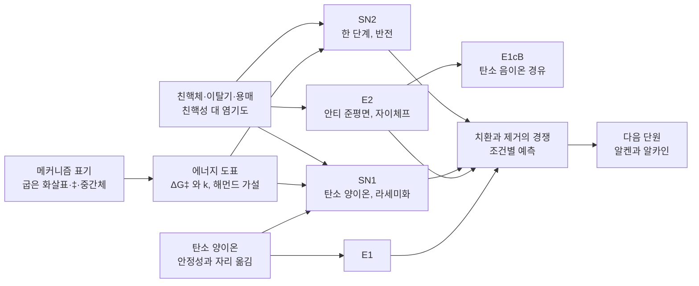
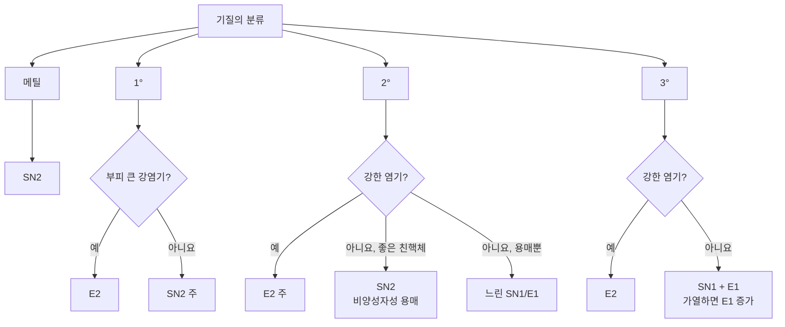

# 유기화학 4. 유기 반응의 개관과 알킬 할라이드의 치환·제거 반응 — 누가 공격하고 누가 떠나며, 언제 어느 길로 가는가
<!-- prev: ochem-3, ochem-1, uchem-7, pchem-12 -->
<!-- next: ochem-5 -->

> [!NOTE]
> **이 단원의 범위**
> - 유기 반응의 종류(치환·첨가·제거·자리 옮김), 극성·라디칼·협동 반응, 메커니즘의 표기법
> - 반응 에너지 도표, 전이 상태와 중간체, 속도 결정 단계, 해먼드 가설
> - 알킬 할라이드의 구조와 C–X 결합, 친핵체·친전자체·이탈기, 친핵성과 염기도, 용매의 종류
> - $\mathrm{S_N2}$ 반응: 2차 속도론, 뒤쪽 공격과 입체 반전, 기질·친핵체·이탈기·용매 효과
> - 탄소 양이온의 구조와 안정성(초공액·공명), 1,2-수소화 이온·메틸 이동에 의한 자리 옮김
> - $\mathrm{S_N1}$ 반응: 1차 속도론, 라세미화와 이온쌍, 가용매 분해, 공통 이온 효과
> - E2 반응(안티 준평면 배치, 자이체프·호프만 생성물, 입체 특이성, 사이클로헥세인의 축 방향 조건)과 E1, E1cB
> - 치환과 제거의 경쟁: 기질(1°·2°·3°) × 친핵체·염기의 세기와 크기 × 용매 × 온도에 따른 예측

**학습 목표**

1. 유기 반응을 치환·첨가·제거·자리 옮김으로 분류하고, 굽은 화살표·전이 상태 기호(‡)·중간체 표기로 메커니즘을 단계별로 쓸 수 있다.
2. 반응 에너지 도표에서 전이 상태와 중간체를 구별하고, 아이링 식으로 $\Delta G^\ddagger$와 속도 상수를 오가며, 해먼드 가설로 전이 상태의 구조를 추론할 수 있다.
3. 친핵성·염기도·이탈기 능력을 짝산의 $\mathrm{p}K_\mathrm{a}$, 원자의 크기와 분극성, 용매화로 설명하고, 양성자성·비양성자성 용매의 효과를 예측할 수 있다.
4. $\mathrm{S_N2}$와 $\mathrm{S_N1}$의 속도 법칙을 메커니즘에서 유도하고(정류 상태 근사 포함), 입체 결과(반전, 라세미화)와 탄소 양이온의 자리 옮김을 굽은 화살표로 설명할 수 있다.
5. E2의 안티 준평면 조건을 뉴먼 투영식과 의자 형태로 적용해 위치 선택성(자이체프·호프만)과 입체 특이성(E/Z)을 예측하고, E1·E1cB와 속도 법칙·동위 원소 효과로 구별할 수 있다.
6. 기질·시약·용매·온도의 조합에서 $\mathrm{S_N2}$, $\mathrm{S_N1}$, E2, E1 가운데 주된 경로와 주생성물을 근거와 함께 예측하고, 원하는 생성물을 얻는 조건을 설계할 수 있다.

**이 단원의 학습 사다리**

| 단계 | 무엇을 하나? |
|---|---|
| STEP 1. 이전 학습 다시 보기 | 굽은 화살표와 친핵체·친전자체, 입체 중심과 R/S, 형태 분석, 속도 법칙과 아이링 식 |
| STEP 2. 기초 다지기 | 아이링 식과 '5.7 kJ 규칙', 정류 상태 근사로 다단계 속도 법칙 쓰기, 경쟁 반응의 생성물 비, 뉴먼 투영식과 R/S 다시 읽기 |
| STEP 3. 핵심 개념 | 반응의 종류 → 에너지 도표·해먼드 가설 → 친핵체·이탈기·용매 → $\mathrm{S_N2}$ → 탄소 양이온 → $\mathrm{S_N1}$ → E2 → E1·E1cB → 치환과 제거의 경쟁 |
| STEP 4. 오개념 바로잡기 | "SN1은 언제나 완전한 라세미 혼합물", "R에서 출발하면 SN2 생성물은 언제나 S" 같은 착각 |
| STEP 5. 대학원·연구로 | 그룬발트–와인스타인 식과 용매 이온화 능력, 모어 오페럴–젠크스 도표로 본 E1–E2–E1cB의 연속성 |
| STEP 6. 생활·산업·진로 | 생체 메틸화(SAM), 알킬화 항암제와 유전 독성 불순물, 방사성 추적자 합성, 공정의 용매 선택 |

---

## 🗺️ 단원 들어가기

브로모에테인에 나트륨 에톡사이드(소듐 에톡사이드)를 넣으면 대부분 에톡시에테인(다이에틸 에터)이 생긴다. 같은 시약을 2-브로모-2-메틸프로페인에 넣으면 에터는 거의 생기지 않고 2-메틸프로펜 기체가 나온다. 시약을 바꾸지 않고 기질의 탄소 골격만 바꾸었는데 생성물의 **종류**가 바뀐다. 다시 2-브로모-2-메틸프로페인을 염기 없이 에탄올에 녹여 두기만 하면 이번에는 에터가 주로 생긴다. 이 세 실험의 결과는 외울 필요가 없다. 반응이 **어떤 경로(메커니즘)** 로 일어나는지, 각 경로의 **전이 상태가 얼마나 높은지**를 알면 예측할 수 있다.

「구조와 결합, 산과 염기」에서 우리는 전자쌍이 전자가 풍부한 곳에서 부족한 곳으로 움직이며, 그 이동을 굽은 화살표로 쓴다는 것을 배웠다. 「입체화학」에서는 분자의 3차원 배치를 R/S로 이름 붙였다. 이 단원은 그 두 도구를 처음으로 '반응'에 본격적으로 쓰는 곳이다. 알킬 할라이드(할로젠화 알킬)는 C–X 결합 하나만 가진 단순한 분자이지만, 그 위에서 일어나는 네 가지 반응 $\mathrm{S_N2}$, $\mathrm{S_N1}$, E2, E1은 유기 반응 메커니즘의 거의 모든 원리를 담고 있다. 속도 법칙이 메커니즘의 증거가 되고, 입체화학이 전이 상태의 모양을 알려 주며, 에너지 도표가 경쟁의 승자를 정한다.

이 단원을 마치면 "이 기질에 이 시약을 이 용매에서 이 온도로 넣으면 무엇이 주로 생기는가?"에 근거를 들어 답할 수 있다. 다음 단원 「알켄과 알카인」의 첨가 반응은 이 단원의 탄소 양이온과 제거 반응을 거꾸로 돌린 것이며, 뒤의 모든 단원의 메커니즘이 여기서 정한 문법으로 쓰인다.

---

## STEP 1. 🔙 이전 학습 다시 보기

### 연계 개념표

| 이전 단원 | 그때 배운 것 | 이 단원에서 확장되는 것 |
|---|---|---|
| 유기화학 「구조와 결합, 산과 염기」 '굽은 화살표 표기법', '루이스 산 염기' | 화살표의 다섯 규칙, 극성 반응의 네 기본 무늬, 친핵체·친전자체, 염기도는 평형·친핵성은 속도, $\mathrm{p}K_\mathrm{a}$ 표 | 네 무늬를 이어 붙여 $\mathrm{S_N2}$·$\mathrm{S_N1}$·E2·E1의 **완전한 메커니즘**을 쓰기, 짝산의 $\mathrm{p}K_\mathrm{a}$로 **이탈기 능력**과 염기 세기를 판단 |
| 유기화학 「입체화학」 'R/S 표기', '반응의 입체화학' | 칸–인골드–프렐로그 규칙, 거울상·부분 입체 이성질체, 라세미 혼합물, 입체 특이성·입체 선택성 | $\mathrm{S_N2}$의 입체 반전, $\mathrm{S_N1}$의 라세미화, E2의 입체 특이성을 실제 반응에서 판정. R/S 기호와 실제 공간 배치를 구별 |
| 유기화학 「알케인과 사이클로알케인」 '뉴먼 투영식', '의자 형태' | 엇갈린·가려진 형태, 축·적도 방향, 고리 뒤집힘과 A값 | E2의 **안티 준평면** 조건을 뉴먼 투영식으로, 사이클로헥세인에서는 **이축 방향(트랜스 이축)** 조건으로 |
| 일반화학 「화학 반응 속도론」 | 속도 법칙과 차수, 속도 결정 단계, 아레니우스 식, 반응 좌표 그림 | 차수가 **분자도와 메커니즘**의 증거가 되는 까닭, 다단계 반응의 에너지 도표 |
| 물리화학 「반응 속도론과 반응 동역학」 '정류 상태 근사', '전이 상태 이론', '동위 원소 효과' | $d[\mathrm{I}]/dt \approx 0$, 아이링 식 $k = (k_\mathrm{B}T/h)e^{-\Delta^\ddagger G/RT}$, 활성화 엔트로피, $k_\mathrm{H}/k_\mathrm{D}$ | 그 도구를 되짚기만 하고 바로 적용: $\mathrm{S_N1}$의 공통 이온 효과, E1cB의 속도 법칙, E2의 큰 동위 원소 효과, 온도에 따른 치환/제거 비 |

### 준비 운동 (사전 진단)

**Q1.** 메톡사이드 이온과 브로모메테인의 반응 $\mathrm{CH_3O^- + CH_3Br \rightarrow CH_3OCH_3 + Br^-}$에 필요한 굽은 화살표 두 개의 시작과 끝을 말로 쓰시오.

**Q2.** $\mathrm{CH_3CH_2CHBrCH_3}$(2-브로모뷰테인)의 입체 중심에 붙은 네 원자단의 CIP 우선순위를 높은 것부터 쓰시오.

**Q3.** 어떤 반응의 속도 법칙이 $v = k[\mathrm{A}][\mathrm{B}]$이다. A의 농도만 두 배로 하면 속도는 몇 배가 되는가? 이 반응이 단일 단계라면 분자도는 얼마인가?

**Q4.** 에테인을 C–C 결합 축으로 내려다본 뉴먼 투영식에서, 앞 탄소의 H와 뒤 탄소의 H가 이루는 이면각이 180°인 형태를 무엇이라 부르는가? 이 형태는 엇갈린 형태인가, 가려진 형태인가?

정답 및 해설

**Q1.** ① 메톡사이드 O의 비공유 전자쌍 → $\mathrm{CH_3Br}$의 탄소(O와 C 사이에 새 결합). ② C–Br 결합의 전자쌍 → Br(브로민화 이온이 됨). 탄소는 이미 옥텟이므로 새 결합이 생기려면 결합 하나가 동시에 끊어져야 한다(「구조와 결합, 산과 염기」 예제 13).

**Q2.** $\mathrm{-Br} > \mathrm{-CH_2CH_3} > \mathrm{-CH_3} > \mathrm{-H}$. Br의 원자 번호(35)가 가장 크고, 두 탄소 원자단은 첫 원자가 같으므로 다음 원자 집합 (C,H,H) > (H,H,H)로 가른다.

**Q3.** 2배. 단일 단계라면 A 하나와 B 하나가 만나는 **2분자 반응**이다. (차수가 분자도와 같은 것은 단일 단계일 때뿐이다.)

**Q4.** 안티(anti) 형태이며 엇갈린 형태이다. 이면각 0°이면 신(syn) 형태로 가려진 형태이다. 이 단원 ⑦에서 E2 반응이 바로 이 '안티' 배치를 요구한다.

---

## STEP 2. 🧱 기초 다지기

### 디딤돌 1. 아이링 식과 '5.7 kJ 규칙' — 장벽의 높이를 속도로 읽기

물리화학 「반응 속도론과 반응 동역학」 '전이 상태 이론'에서 유도한 아이링 식을 되짚는다. 투과 계수를 1로 두면, 단분자(1차) 단계의 속도 상수는

$$
k = \frac{k_\mathrm{B}T}{h}\,e^{-\Delta G^\ddagger/RT}, \qquad \frac{k_\mathrm{B}T}{h} = 6.21\times10^{12}\ \mathrm{s^{-1}}\ (25\ ^\circ\mathrm{C})
$$

이다($\Delta G^\ddagger$는 물리화학 단원의 $\Delta^\ddagger G^\circ$와 같은 양이며, 이 단원에서는 유기화학에서 흔히 쓰는 $\Delta G^\ddagger$로 적는다. 2분자 단계에서는 표준 농도 $c^\circ = 1\ \mathrm{M}$이 곱해져 $k$의 단위가 $\mathrm{M^{-1}s^{-1}}$이 된다). 유기화학에서는 이 식을 '장벽 높이와 속도의 환산표'로 쓴다.

두 반응의 장벽 차이를 $\Delta\Delta G^\ddagger$라 하면 앞의 인자가 지워져

$$
\frac{k_1}{k_2} = e^{\Delta\Delta G^\ddagger/RT} \quad\Longrightarrow\quad \Delta\Delta G^\ddagger = 2.303RT\log\frac{k_1}{k_2}
$$

이다. 25 ℃에서 $2.303RT = 5.71\ \mathrm{kJ/mol}$이므로 **장벽이 5.7 kJ/mol 낮아질 때마다 속도는 10배** 빨라진다. 「구조와 결합, 산과 염기」에서 $\mathrm{p}K_\mathrm{a}$ 1단위가 5.71 kJ/mol이었던 것과 같은 수이다. 그때는 평형($\Delta G^\circ$)이었고 지금은 속도($\Delta G^\ddagger$)이다.

| $\Delta G^\ddagger$ (kJ/mol, 25 ℃) | $k$ (1차, $\mathrm{s^{-1}}$) | 반감기 | 실험실에서의 느낌 |
|---|---|---|---|
| 60 | 약 $2\times10^{2}$ | 약 4 ms | 섞자마자 끝난다 |
| 80 | 약 $6\times10^{-2}$ | 약 12 s | 수십 초 |
| 90 | 약 $1.1\times10^{-3}$ | 약 11 min | 한 시간 안에 끝난다 |
| 100 | 약 $1.9\times10^{-5}$ | 약 10 h | 하룻밤 |
| 110 | 약 $3\times10^{-7}$ | 약 25 일 | 실온에서는 사실상 안 된다(가열 필요) |

> [!TIP]
> 💡 **요령** — 실온에서 '하룻밤 안에 끝나는' 반응의 장벽은 대략 **85~100 kJ/mol**이다. 표를 외우지 말고 "100 kJ/mol이면 약 10시간, 6 kJ/mol마다 10배"만 기억해 두면 에너지 도표의 숫자를 바로 시간으로 바꿀 수 있다.

#### 예제 1 — 장벽에서 반감기로, 속도 비에서 장벽 차이로

(1) 25 ℃에서 $\Delta G^\ddagger = 90.0\ \mathrm{kJ/mol}$인 1차 반응의 속도 상수와 반감기를 구하시오. (2) 같은 친핵체가 브로모메테인과는 2-브로모프로페인보다 약 1000배 빨리 반응한다. 두 반응의 $\Delta G^\ddagger$ 차이는 얼마인가?

**풀이**
(1) 식 세우기: $k = (k_\mathrm{B}T/h)e^{-\Delta G^\ddagger/RT}$. 대입: $RT = 8.314\times298.15 = 2479\ \mathrm{J/mol}$, $\Delta G^\ddagger/RT = 90\,000/2479 = 36.31$, $k = 6.21\times10^{12}\times e^{-36.31} = 1.06\times10^{-3}\ \mathrm{s^{-1}}$. 반감기 $t_{1/2} = \ln 2/k = 654\ \mathrm{s} \approx 11\ \mathrm{min}$.
(2) $\Delta\Delta G^\ddagger = 5.71\times\log 1000 = 5.71\times3 = 17.1\ \mathrm{kJ/mol}$.
**의미** C–Br 결합에 메틸기 두 개를 더 붙인 것만으로 장벽이 17 kJ/mol 높아진다. 이 차이가 어디서 오는지(뒤쪽 공격의 입체 장애)는 STEP 3 ④에서 본다. 속도 비 '1000배'는 크게 들리지만 에너지로는 C–C 결합 에너지의 20분의 1 정도이다. 유기 반응의 선택성은 이런 **작은 에너지 차이**가 지수 함수로 증폭된 결과이다.

### 디딤돌 2. 정류 상태 근사 — 중간체가 있는 메커니즘의 속도 법칙

물리화학 「반응 속도론과 반응 동역학」 '정류 상태 근사와 사전 평형'에서 익힌 방법을 그대로 쓴다. 반응성이 큰 중간체 I의 농도는 작고 거의 변하지 않으므로 $d[\mathrm{I}]/dt \approx 0$으로 둔다. 이 단원에서 가장 중요한 적용은 $\mathrm{S_N1}$이다.

$$
\mathrm{RX} \;\underset{k_{-1}}{\overset{k_1}{\rightleftharpoons}}\; \mathrm{R^+ + X^-}, \qquad \mathrm{R^+ + Nu} \xrightarrow{\;k_2\;} \mathrm{RNu}
$$

**가정**: 탄소 양이온 $\mathrm{R^+}$는 생기자마자 소모되는 중간체이다. **유도**:

$$
\frac{d[\mathrm{R^+}]}{dt} = k_1[\mathrm{RX}] - k_{-1}[\mathrm{R^+}][\mathrm{X^-}] - k_2[\mathrm{R^+}][\mathrm{Nu}] \approx 0
\quad\Longrightarrow\quad
[\mathrm{R^+}] = \frac{k_1[\mathrm{RX}]}{k_{-1}[\mathrm{X^-}] + k_2[\mathrm{Nu}]}
$$

$$
v = k_2[\mathrm{R^+}][\mathrm{Nu}] = \frac{k_1k_2[\mathrm{RX}][\mathrm{Nu}]}{k_{-1}[\mathrm{X^-}] + k_2[\mathrm{Nu}]}
$$

**결과와 적용 한계**: 탄소 양이온이 친핵체에 잡히는 속도가 이탈기와 다시 결합하는 속도보다 훨씬 크면($k_2[\mathrm{Nu}] \gg k_{-1}[\mathrm{X^-}]$) 분모의 첫 항을 버릴 수 있고

$$
v \approx k_1[\mathrm{RX}]
$$

가 된다. 친핵체의 농도가 속도 법칙에서 **사라진다**. 이것이 $\mathrm{S_N1}$의 1차 속도 법칙이다. 반대로 탄소 양이온이 비교적 안정해 $\mathrm{X^-}$와 다시 결합할 기회가 있으면, 같은 $\mathrm{X^-}$를 더 넣을 때 속도가 느려진다(**공통 이온 효과**, ⑥).

#### 예제 2 — 공통 이온 효과의 크기

가용매 분해에서는 친핵체가 용매(SOH) 자체이므로 $k_2[\mathrm{SOH}]$를 하나의 1차 상수 $k_2'$로 묶는다. 어떤 다이페닐메틸 염화물의 가용매 분해에서 $\alpha = k_{-1}/k_2' = 30\ \mathrm{M^{-1}}$이라 하자(가상의 값). 염화 이온을 처음부터 0.050 M 넣으면 초기 속도는 염화 이온이 없을 때의 몇 배가 되는가?

**풀이**
식 세우기: 위 식의 분모·분자를 $k_2'$로 나누면 $v = \dfrac{k_1[\mathrm{RX}]}{1 + \alpha[\mathrm{X^-}]}$.
대입: $\dfrac{v}{v_0} = \dfrac{1}{1 + 30\times0.050} = \dfrac{1}{2.5} = 0.40$.
**의미** 속도가 40 %로 떨어진다. 탄소 양이온의 절반 이상이 용매 대신 염화 이온에 다시 붙잡혀 출발 물질로 돌아가기 때문이다. 염화 이온은 반응이 진행될수록 저절로 쌓이므로, 이런 기질에서는 겉보기 1차 속도 상수가 시간에 따라 점점 작아진다. 반면 tert-뷰틸 양이온처럼 반응성이 아주 큰 양이온은 용매에 즉시 잡혀 $\alpha$가 매우 작고, 공통 이온 효과가 거의 보이지 않는다.

### 디딤돌 3. 경쟁 반응의 생성물 비 — 속도 상수의 비가 곧 생성물의 비

한 출발 물질이 두 경로(예: 치환과 제거)로 동시에 반응하고 두 생성물이 서로 바뀌지 않으면, 이것은 물리화학의 **병행 반응**이다. 두 경로가 같은 반응물에 대해 같은 차수이면 생성물의 비는 시간과 관계없이 속도 상수의 비로 정해진다.

$$
\frac{[\mathrm{P_E}]}{[\mathrm{P_S}]} = \frac{k_\mathrm{E}}{k_\mathrm{S}} = \exp\!\left(-\frac{\Delta\Delta H^\ddagger}{RT} + \frac{\Delta\Delta S^\ddagger}{R}\right), \qquad \Delta\Delta X^\ddagger = \Delta X^\ddagger_\mathrm{E} - \Delta X^\ddagger_\mathrm{S}
$$

이렇게 **속도 상수의 비로 생성물 비가 정해지는 것**을 **속도론적 지배**(kinetic control)라 한다. 이 단원의 치환·제거 생성물은 거의 모두 속도론적 지배를 받는다. 생성물끼리 평형이 이루어질 때의 비는 $\Delta G^\circ$가 정하며 이를 **열역학적 지배**라 한다(「콘주게이션계와 방향족성」에서 본격적으로 비교한다).

#### 예제 3 — 온도를 올리면 왜 제거가 늘어나는가

2차 알킬 할라이드와 에톡사이드의 반응에서 제거(E2)와 치환($\mathrm{S_N2}$)의 활성화 매개변수 차이가 $\Delta\Delta H^\ddagger = +6.0\ \mathrm{kJ/mol}$, $\Delta\Delta S^\ddagger = +25\ \mathrm{J/(mol\cdot K)}$라 하자(가상의 값). 25 ℃와 80 ℃에서 제거 생성물의 비율을 구하시오.

**풀이**
25 ℃: $\dfrac{k_\mathrm{E}}{k_\mathrm{S}} = \exp\!\left(-\dfrac{6000}{8.314\times298.15} + \dfrac{25}{8.314}\right) = \exp(-2.421 + 3.007) = e^{0.586} = 1.80$ → 제거 비율 $1.80/2.80 = 64\ \%$.
80 ℃: $\exp\!\left(-\dfrac{6000}{8.314\times353.15} + 3.007\right) = \exp(-2.044 + 3.007) = e^{0.963} = 2.62$ → $2.62/3.62 = 72\ \%$.
**의미** 제거는 분자 두 개(기질 + 염기)에서 세 개(알켄 + 이탈기 + 짝산)가 생기고, 전이 상태에서 여러 결합이 함께 느슨해져 활성화 엔트로피가 치환보다 큰 경우가 많다. $-T\Delta S^\ddagger$ 항은 온도에 비례해 커지므로 **온도를 올리면 제거가 유리해진다**. ⑨의 "가열하면 제거"라는 경험 규칙을 활성화 매개변수로 설명한 근거이다.

### 디딤돌 4. 뉴먼 투영식과 R/S를 다시 읽기

이 단원의 입체화학 문제는 두 가지 작업으로 정리된다.

| 작업 | 방법 | 쓰는 곳 |
|---|---|---|
| 입체 중심의 R/S 매기기 | 우선순위 1~4를 정하고, 4순위를 뒤로 보낸 채 1→2→3 방향(시계 R, 반시계 S) | $\mathrm{S_N2}$ 반전, $\mathrm{S_N1}$ 라세미화, E2 기질의 부분 입체 이성질체 |
| 결합 축으로 내려다보기 | C–C 축을 따라 앞 탄소(점), 뒤 탄소(원)로 그리고, 앞·뒤 치환기의 이면각을 읽는다 | E2의 H–C–C–X 이면각(안티 180°, 신 0°) |

뉴먼 투영식에서 단일 결합을 회전시켜도 입체 중심의 배치(R/S)는 바뀌지 않는다. 회전은 **형태**를 바꿀 뿐 **배치**를 바꾸지 않는다. 그래서 E2를 분석할 때는 먼저 H와 X가 안티가 되도록 회전한 형태를 그리고, 그 형태에서 남은 치환기들이 어디에 놓이는지를 읽는다(⑦).

<!-- 그림 요청: 뉴먼 투영식 읽는 법 도해. (R)-2-브로모뷰테인(SMILES C[C@@H](Br)CC)을 C2–C3 축으로 내려다본 엇갈린 형태 세 개를 나란히 그린다(앞 탄소 C2: Br, CH3, H / 뒤 탄소 C3: CH3, H, H). (가) Br이 뒤 탄소의 CH3와 이면각 180°(안티), (나)·(다) Br이 뒤 탄소의 서로 다른 H 하나와 이면각 180°. (나)·(다)의 그 H와 Br을 색으로 강조하고 'H–C–C–Br 안티 준평면' 이름표. 맨 오른쪽: 같은 분자의 쐐기·점선 그림(C2를 가운데에 두고 CH3는 왼쪽 아래, CH2CH3는 오른쪽 아래로 종이 면에, Br은 위쪽 쐐기, H는 위쪽 점선 — 이 배치가 R이다)과 'C2–C3 결합을 회전해도 C2의 배치는 R 그대로' 메모. -->

#### 예제 4 — R/S 기호와 실제 배치

(R)-2-브로모뷰테인(SMILES `C[C@@H](Br)CC`)의 Br 자리에 사이안화 이온이 **같은 쪽**에서 들어간다고 가정한 생성물(배치 유지)과 **반대쪽**에서 들어간 생성물(배치 반전)의 R/S를 각각 매기시오. 생성물은 2-메틸뷰테인나이트릴 $\mathrm{CH_3CH_2CH(CH_3)CN}$이다.

**풀이**
생성물의 입체 중심 우선순위: $\mathrm{-C{\equiv}N}$ (C에 붙은 원자 (N,N,N)) > $\mathrm{-CH_2CH_3}$ (C,H,H) > $\mathrm{-CH_3}$ > $\mathrm{-H}$.
반응물에서는 Br이 1순위였고 생성물에서는 CN이 1순위이다. 1순위 원자단이 **같은 자리**에 들어가고 나머지(에틸 2순위, 메틸 3순위, H 4순위)의 순서가 그대로이므로, 배치가 유지되면 기호도 R, 반전되면 S이다(RDKit으로 확인: 배치 유지 `C[C@@H](C#N)CC`는 R, 반전 `C[C@H](C#N)CC`는 S).
**의미** 이 경우에는 기호 R/S가 공간 배치의 반전과 함께 바뀐다. 그러나 우선순위 순서가 바뀌는 기질에서는 배치가 반전되어도 기호가 그대로일 수 있다(④의 예제 9). R/S는 **이름표**이고 반전은 **기하학**이다.

---

## STEP 3. 📘 핵심 개념

### ① 유기 반응의 종류와 메커니즘 표기

#### 무엇이 무엇으로 바뀌는가 — 네 가지 반응

출발 물질과 생성물만 비교하면 대부분의 유기 반응은 네 가지 가운데 하나이다.

| 종류 | 무엇이 일어나나 | 예 |
|---|---|---|
| **치환**(substitution) | 한 원자(원자단)가 떨어지고 다른 원자단이 그 자리에 들어간다 | $\mathrm{CH_3CH_2Br + OH^- \rightarrow CH_3CH_2OH + Br^-}$ |
| **첨가**(addition) | 다중 결합에 두 조각이 붙어 하나의 생성물이 된다 | $\mathrm{CH_2{=}CH_2 + HBr \rightarrow CH_3CH_2Br}$ |
| **제거**(elimination) | 이웃한 두 탄소에서 두 조각이 떨어지며 다중 결합이 생긴다(첨가의 역) | $\mathrm{(CH_3)_3CBr + CH_3CH_2O^- \rightarrow (CH_3)_2C{=}CH_2 + CH_3CH_2OH + Br^-}$ |
| **자리 옮김**(rearrangement) | 분자 안에서 결합이 재배열되어 골격이 바뀐 이성질체가 된다 | 탄소 양이온의 1,2-메틸 이동(⑤) |

제거 반응에서 이탈기 X가 붙은 탄소를 **α 탄소**, 그 이웃 탄소를 **β 탄소**라 하고, β 탄소의 H(β 수소)가 X와 함께 떨어진다. 그래서 이런 제거를 **β-제거** 또는 할로젠화 수소를 잃는다는 뜻에서 **탈할로젠화 수소**(dehydrohalogenation)라 부른다.

<!-- 그림 요청: 네 반응 종류를 한 행씩 골격 구조식으로. ① 치환: 브로모에테인(SMILES CCBr) + 수산화 이온 → 에탄올(SMILES CCO) + Br⁻, 바뀐 자리(Br → OH)를 색으로. ② 첨가: 에텐 + HBr → 브로모에테인, 새로 붙은 H와 Br을 색으로. ③ 제거: 2-브로모-2-메틸프로페인(SMILES CC(C)(C)Br) + 에톡사이드 → 2-메틸프로펜(SMILES C=C(C)C) + 에탄올 + Br⁻, α 탄소(Br이 붙은 C)와 β 탄소(CH3 중 하나)에 'α', 'β' 이름표, 떨어지는 β-H와 Br을 색으로. ④ 자리 옮김: 3,3-다이메틸뷰탄-2-일 양이온(SMILES C[CH+]C(C)(C)C) → 2,3-다이메틸뷰탄-2-일 양이온(SMILES CC(C)[C+](C)C), 옮겨 가는 메틸기를 색으로(화살표는 ⑤에서 그리므로 여기서는 생략). -->

#### 결합이 어떻게 끊기고 생기는가 — 세 가지 메커니즘 무리

| 무리 | 결합이 끊기는 방식 | 화살표 | 대표 예 |
|---|---|---|---|
| **극성 반응**(polar reaction) | **불균일 분해**: 결합 전자쌍이 한 원자에 모두 간다 | 온화살표(전자 2개) | 이 단원의 치환·제거, 첨가, 카보닐 반응 |
| **라디칼 반응**(radical reaction) | **균일 분해**: 결합 전자가 하나씩 나뉜다 | 낚싯바늘 화살표(전자 1개) | 알케인의 할로젠화(「알케인과 사이클로알케인」), 라디칼 중합 |
| **고리형 협동 반응**(pericyclic reaction) | 고리 모양 전이 상태에서 여러 결합이 한꺼번에 재배열된다 | 고리를 도는 온화살표 | 딜스–알더 반응(「콘주게이션계와 방향족성」) |

극성 반응은 언제나 **친핵체**(전자쌍 주개)와 **친전자체**(전자쌍 받개)의 만남이다. 알킬 할라이드에서는 C–X의 $\delta+$ 탄소가 친전자체, 그 탄소를 공격하는 음이온이나 비공유 전자쌍을 가진 분자가 친핵체이다. 같은 음이온이 탄소 대신 β 수소를 공격하면 염기로 작용해 제거가 일어난다.

#### 메커니즘의 표기법

**메커니즘**(mechanism)은 반응을 **단일 단계**(elementary step)의 연속으로 쓴 것이다. 각 단일 단계는 전이 상태 하나를 지나며, 단계와 단계 사이에는 **중간체**가 있다.

| 표기 | 뜻 |
|---|---|
| $\mathrm{A \xrightarrow{\;NaCN,\ DMSO\;} B}$ | 화살표 위에 시약, 아래나 쉼표 뒤에 용매·온도(Δ는 가열, $h\nu$는 빛) |
| $\mathrm{\xrightarrow{1.\ \cdots\quad 2.\ \cdots}}$ | 번호가 붙은 시약은 **차례로** 넣는다(동시에 넣지 않는다) |
| $[\ \cdots\ ]^\ddagger$ | 전이 상태. 꺾쇠 괄호로 묶고 ‡를 붙이며, 생기거나 끊어지는 중인 **부분 결합**은 점선, 부분 전하는 $\delta+$, $\delta-$로 쓴다 |
| 중간체 | 꺾쇠 없이 온전한 구조와 형식 전하로 쓴다(예: $\mathrm{(CH_3)_3C^+}$) |
| $\mathrm{S_N2}$, $\mathrm{S_N1}$, E2, E1, E1cB | 잉골드(Ingold)의 이름: S 치환, N 친핵성(nucleophilic), E 제거, 숫자는 **속도 결정 단계의 분자도**, cB는 짝염기(conjugate base) |

> [!IMPORTANT]
> **전이 상태와 중간체는 다르다.** 전이 상태는 에너지의 **꼭대기**로, 수명이 분자 진동 한 번(약 $10^{-13}$ s) 정도여서 분리하거나 병에 담을 수 없다. 중간체는 에너지의 **골짜기**(극소점)에 있어 수명이 유한하고, 조건에 따라 분광법으로 관찰하거나 다른 시약으로 붙잡을 수 있다.

#### 메커니즘은 어떻게 '증명'하는가

메커니즘은 직접 볼 수 없으므로 여러 실험 증거와 **모순되지 않는** 가장 단순한 경로를 채택한다. 이 단원에서 쓰는 증거는 다음과 같다.

| 증거 | 무엇을 알려 주나 | 이 단원의 예 |
|---|---|---|
| 속도 법칙(차수) | 속도 결정 단계와 그 앞에 참여하는 분자들 | $\mathrm{S_N2}$ 2차, $\mathrm{S_N1}$ 1차 |
| 입체화학 | 전이 상태의 기하 | $\mathrm{S_N2}$ 반전, E2 안티 준평면 |
| 생성물의 골격 | 중간체의 존재 | 자리 옮김은 탄소 양이온의 증거 |
| 동위 원소 효과·표지 | 속도 결정 단계에서 끊기는 결합 | E2의 $k_\mathrm{H}/k_\mathrm{D} \approx 7$, E1cB의 H/D 교환 |
| 치환기·용매 효과 | 전이 상태의 전하 분포 | $\mathrm{S_N1}$은 극성 양성자성 용매에서 빠르다 |

#### 예제 5 — 반응 분류하기

다음 반응을 네 종류로 분류하고, 극성 반응이면 친핵체(또는 염기)와 친전자체를 쓰시오.
(1) $\mathrm{CH_3I + NaN_3 \rightarrow CH_3N_3 + NaI}$
(2) $\mathrm{CH_3CH_2CH_2Br + (CH_3)_3CO^-K^+ \rightarrow CH_3CH{=}CH_2 + (CH_3)_3COH + KBr}$
(3) $\mathrm{CH_3CH{=}CH_2 + HBr \rightarrow CH_3CHBrCH_3}$
(4) $\mathrm{CH_4 + Cl_2 \xrightarrow{\;h\nu\;} CH_3Cl + HCl}$

**풀이**
(1) 치환. 친핵체는 아자이드 이온 $\mathrm{N_3^-}$, 친전자체는 아이오도메테인의 탄소. 이탈기는 $\mathrm{I^-}$.
(2) 제거. tert-뷰톡사이드가 **염기**로서 β 탄소(C2)의 H를 떼고, α 탄소(C1)에서 $\mathrm{Br^-}$가 떨어진다. 생성물은 프로펜.
(3) 첨가. 1단계에서 프로펜의 π 전자쌍이 친핵체, HBr의 H가 친전자체이다(「구조와 결합, 산과 염기」 예제 12).
(4) 치환이지만 극성 반응이 아니라 **라디칼 반응**이다. 빛이 Cl–Cl을 균일 분해한다(「알케인과 사이클로알케인」).
**의미** (1)과 (2)는 같은 '알킬 할라이드 + 음이온'인데 한쪽은 치환, 한쪽은 제거이다. 어느 쪽이 될지는 시약이 **탄소를 공격하기 쉬운지(친핵성)** 아니면 **양성자를 떼기 쉬운지(염기도)** 와 기질의 구조가 정한다. 이 단원 전체가 이 질문에 대한 답이다.

#### ✔ 바로 확인

1. (O/X) 전이 상태는 수명이 매우 짧은 중간체이다.
2. 빈칸: $\mathrm{S_N1}$의 '1'은 (    ) 단계의 분자도를 뜻한다.
3. 고르기: 다음 중 β-제거 반응은? (가) $\mathrm{CH_3CH_2Cl \rightarrow CH_2{=}CH_2 + HCl}$ (나) $\mathrm{CH_3CH_2Cl + I^- \rightarrow CH_3CH_2I + Cl^-}$
4. 낚싯바늘 화살표로 쓰는 메커니즘 무리는?

정답

1. X — 전이 상태는 에너지의 꼭대기로 분리할 수 없고, 중간체는 골짜기에 있어 수명이 유한하다.
2. 속도 결정 — 이온화 단계에 기질 한 분자만 참여한다.
3. (가) — α 탄소의 Cl과 β 탄소의 H가 떨어져 C=C가 생긴다. (나)는 치환이다.
4. 라디칼 반응 — 균일 분해에서 전자가 하나씩 움직인다.

### ② 반응 에너지 도표, 전이 상태와 중간체, 해먼드 가설

#### 에너지 도표 읽기

가로축에 **반응 좌표**(반응물에서 생성물로 가는 원자 배치의 변화), 세로축에 깁스 에너지를 그린 그림이 **반응 에너지 도표**이다. 물리화학 「반응 속도론과 반응 동역학」 '퍼텐셜 에너지 표면'에서 본 다차원 표면을 가장 낮은 길(최소 에너지 경로)을 따라 잘라 펼친 것이다.

| 도표의 특징 | 뜻 | 정량 관계 |
|---|---|---|
| 출발점과 끝점의 높이 차 | 반응 깁스 에너지 $\Delta G^\circ$ | $K = e^{-\Delta G^\circ/RT}$ |
| 출발점에서 꼭대기까지 | 활성화 깁스 에너지 $\Delta G^\ddagger$ | $k = (k_\mathrm{B}T/h)e^{-\Delta G^\ddagger/RT}$ |
| 꼭대기(극대점) | 전이 상태 | 수명 약 $10^{-13}$ s |
| 중간의 골짜기(극소점) | 중간체 | 골짜기가 깊을수록 오래 산다 |
| 가장 높은 꼭대기 | 그 전이 상태를 지나는 단계가 **속도 결정 단계** | 전체 속도 ≈ 그 단계의 속도 |

<!-- 그림 요청: 반응 에너지 도표 두 개를 위아래로. 세로축 'G', 가로축 '반응 좌표'. (위) 한 단계 반응: 반응물 R(높이 0) → 전이 상태 TS(꼭대기, '‡') → 생성물 P(−30, 발열). ΔG‡(R에서 TS까지)와 ΔG°(R에서 P까지)를 양방향 화살표로 표시. (아래) 두 단계 반응: R(0) → TS1(+100) → 중간체 I(+85, 골짜기) → TS2(+90) → P(−20). TS1에 '속도 결정 단계의 전이 상태', I에 '중간체(극소점)' 이름표. ΔG‡1, ΔG‡2(I에서 TS2까지), 전체 ΔG°를 화살표로 표시. 두 그림 모두 가로축 아래에 대표 구조를 작게: 위는 SN2의 R, TS, P, 아래는 SN1의 RX, 이온화 TS, 탄소 양이온, 친핵체 결합 TS, 생성물. -->

#### 해먼드 가설

전이 상태는 분리할 수 없으므로 그 구조를 직접 잴 수 없다. 「알케인과 사이클로알케인」 ⑫에서 라디칼 할로젠화의 선택성을 설명할 때 쓴 해먼드(Hammond)의 제안을 다시 적는다.

> [!IMPORTANT]
> **해먼드 가설**(Hammond postulate) — 한 단일 단계에서 전이 상태의 구조는 에너지가 더 **가까운** 쪽의 화학종(반응물 또는 생성물)을 닮는다.
> - 발열(발에르곤) 단계: 전이 상태가 반응 좌표의 **앞쪽**에 있고 **반응물을 닮는다**(이른 전이 상태).
> - 흡열(흡에르곤) 단계: 전이 상태가 **뒤쪽**에 있고 **생성물을 닮는다**(늦은 전이 상태).

근거는 간단하다. 퍼텐셜 에너지 곡선 위에서 에너지가 거의 같은 두 점은 구조도 거의 같다(곡선이 연속이므로). 흡열이 큰 단계에서는 꼭대기의 높이가 생성물의 높이와 비슷하므로 꼭대기의 구조도 생성물과 비슷하다. 물리화학 「반응 속도론과 반응 동역학」에서 퍼텐셜 에너지 표면의 **이른 장벽·늦은 장벽**(폴라니 규칙에서 쓰는 장벽의 위치)으로 본 것과 같은 그림을 유기 반응에 정성적으로 적용한 것이다.

이 가설이 유기화학에서 강력한 까닭은 **전이 상태 대신 중간체의 안정성으로 속도를 판단하게** 해 주기 때문이다. $\mathrm{S_N1}$의 이온화 단계는 중성 분자가 이온 두 개로 갈라지는 강한 흡열 단계이다. 그러므로 그 전이 상태는 탄소 양이온을 닮았고, 탄소 양이온을 안정하게 하는 요인(⑤의 초공액·공명)은 전이 상태도 거의 같은 만큼 안정하게 한다. "더 안정한 탄소 양이온을 거치는 반응이 더 빠르다"는 판단이 이렇게 정당화된다.

<!-- 그림 요청: 해먼드 가설 비교 도표 두 개를 나란히. 세로축 G, 가로축 반응 좌표. (왼쪽) 크게 발열인 단계: 반응물 높이 0, 생성물 −80, 꼭대기 +20이 가로축의 30 % 지점(반응물 가까이). 꼭대기 아래에 '이른 전이 상태 · 반응물을 닮음'. (오른쪽) 크게 흡열인 단계: 반응물 0, 생성물 +80, 꼭대기 +95가 가로축의 75 % 지점(생성물 가까이). '늦은 전이 상태 · 생성물을 닮음'. 오른쪽 그림에 점선으로 두 번째 곡선(생성물이 +65로 더 안정한 경우, 꼭대기도 약 +82로 함께 내려감)을 겹쳐 '생성물을 안정하게 하면 전이 상태도 거의 그만큼 내려간다' 메모. -->

<!-- 시뮬레이션 요청: 반응 에너지 도표 탐색기. 2단계 반응 R → I → P의 깁스 에너지 곡선을 매끄러운 곡선으로 그린다. 슬라이더: 중간체 I의 높이(−20~+90 kJ/mol), TS1·TS2의 높이, 생성물 높이, 온도(250~400 K). 표시: 각 단계의 k(아이링 식, κ = 1)와 반감기, 속도 결정 단계 자동 강조(가장 높은 꼭대기 색칠), 전체 K. 해먼드 모드를 켜면 I의 높이를 바꿀 때 TS1의 높이가 '폴라니 계수 α(0~1 슬라이더) × ΔG°' 만큼 함께 움직이고, TS1의 가로 위치가 R과 I 가운데 에너지가 가까운 쪽으로 옮겨 가는 것을 보여 준다. 'SN2(한 단계)', 'SN1(두 단계)' 미리 설정 단추. -->

#### 예제 6 — 에너지 도표에서 속도와 해석 끌어내기

2-클로로-2-메틸프로페인($\mathrm{(CH_3)_3CCl}$)의 80 % 에탄올 수용액 가용매 분해는 25 ℃에서 1차 속도 상수가 약 $9\times10^{-6}\ \mathrm{s^{-1}}$이다. (1) 속도 결정 단계의 $\Delta G^\ddagger$와 반감기를 구하시오. (2) 이 단계 뒤 탄소 양이온이 용매에 붙잡히는 단계의 장벽이 약 5 kJ/mol이라면(어림값), 탄소 양이온의 수명은 대략 얼마인가? (3) 이 결과와 해먼드 가설로, 이온화 전이 상태가 무엇을 닮았는지 설명하시오.

**풀이**
(1) $\Delta G^\ddagger = RT\ln\dfrac{k_\mathrm{B}T/h}{k} = 2479\times\ln\dfrac{6.21\times10^{12}}{9\times10^{-6}} = 2479\times41.08 = 1.02\times10^5\ \mathrm{J/mol}$, 즉 약 102 kJ/mol. $t_{1/2} = 0.693/(9\times10^{-6}) = 7.7\times10^4\ \mathrm{s} \approx 21\ \mathrm{h}$.
(2) $k_2 \approx 6.21\times10^{12}\times e^{-5000/2479} = 8\times10^{11}\ \mathrm{s^{-1}}$(용매가 늘 곁에 있으므로 1차로 본다). 수명 $\approx 1/k_2 \approx 10^{-12}\ \mathrm{s}$.
(3) 이온화 단계는 장벽(약 102 kJ/mol)의 대부분을 오르는 강한 흡열 단계이고, 그 끝의 탄소 양이온은 두 번째 꼭대기보다 겨우 몇 kJ/mol 낮다. 이온화 전이 상태와 탄소 양이온은 에너지가 가까우므로, 전이 상태는 C–Cl 결합이 많이 늘어나 탄소에 상당한 양전하가 쌓인 **탄소 양이온 같은 구조**이다.
**의미** 탄소 양이온의 수명이 피코초 수준이라는 것은, 이 양이온이 용매 분자 몇 개가 자리를 바꾸는 시간 동안만 존재한다는 뜻이다. 그래서 떨어져 나간 $\mathrm{Cl^-}$이 아직 곁에 있는 동안 용매가 공격하는 일이 생기며, 이것이 ⑥의 '이온쌍'과 불완전한 라세미화로 이어진다. (속도 상수는 같은 용매 안에서도 조성·온도에 따라 달라지므로 '약'으로 쓴다.)

#### ✔ 바로 확인

1. (O/X) 다단계 반응에서는 활성화 에너지가 가장 큰 단계가 아니라 에너지 도표에서 가장 높은 꼭대기를 지나는 단계가 속도 결정 단계이다.
2. 빈칸: 강한 흡열 단계의 전이 상태는 (반응물 / 생성물)을 닮는다.
3. 25 ℃에서 두 경로의 $\Delta G^\ddagger$ 차이가 11.4 kJ/mol이면 속도 비는 약 몇 배인가?
4. 에너지 도표의 극소점에 있는 화학종을 무엇이라 하는가?

정답

1. O — 출발 물질에서 본 가장 높은 전이 상태가 전체 속도를 정한다. 중간체가 깊은 골짜기에 있으면 그 골짜기에서부터 잰 장벽을 본다.
2. 생성물 — 에너지가 가까운 쪽을 닮는다(해먼드 가설).
3. 약 100배 — $11.4/5.71 \approx 2$, $10^2$.
4. 중간체

### ③ 알킬 할라이드와 친핵체·친전자체·이탈기

#### 알킬 할라이드의 분류와 C–X 결합

할로젠이 $sp^3$ 탄소에 붙은 화합물이 **알킬 할라이드**(alkyl halide, 할로젠화 알킬)이다. IUPAC 이름은 할로젠을 접두사(플루오로-, 클로로-, 브로모-, 아이오도-)로 쓴다(예: 2-브로모뷰테인). '아이소프로필 브로마이드'처럼 알킬기 이름 + 할라이드로 부르는 관용명도 흔히 쓴다. 할로젠이 붙은 탄소에 붙은 다른 탄소의 수로 분류한다.

| 분류 | 할로젠이 붙은 탄소 | 예 |
|---|---|---|
| 메틸 | 다른 탄소 0개 | $\mathrm{CH_3Br}$ 브로모메테인 |
| 1차(1°) | 1개 | $\mathrm{CH_3CH_2CH_2CH_2Br}$ 1-브로모뷰테인 |
| 2차(2°) | 2개 | $\mathrm{CH_3CHBrCH_2CH_3}$ 2-브로모뷰테인 |
| 3차(3°) | 3개 | $\mathrm{(CH_3)_3CBr}$ 2-브로모-2-메틸프로페인(tert-뷰틸 브로마이드) |
| 알릴·벤질 자리 | C=C 또는 벤젠 고리 옆의 $sp^3$ 탄소 | $\mathrm{CH_2{=}CHCH_2Br}$, $\mathrm{C_6H_5CH_2Br}$ |
| 바이닐·아릴 | X가 $sp^2$ 탄소에 직접 | $\mathrm{CH_2{=}CHBr}$, $\mathrm{C_6H_5Br}$ — 이 단원의 $\mathrm{S_N1}$·$\mathrm{S_N2}$를 하지 않는다 |

| C–X (메틸 할라이드) | 결합 길이 (pm, 약) | 결합 해리 에너지 (kJ/mol, 약) | 쌍극자 모멘트 (D, 약) |
|---|---|---|---|
| C–F | 139 | 460 | 1.85 |
| C–Cl | 178 | 350 | 1.87 |
| C–Br | 193 | 294 | 1.81 |
| C–I | 214 | 239 | 1.62 |

아래로 갈수록 결합이 길고 약해진다. 이것이 이탈기 능력(I > Br > Cl ≫ F)의 한 원인이다. 오비탈로 보면 C–X 결합의 **반결합 오비탈 $\sigma^*_\mathrm{C-X}$** 가 알킬 할라이드의 LUMO이며, 이 오비탈의 큰 엽은 탄소 쪽, 그것도 **X의 반대편**을 향한다. 친핵체의 HOMO(비공유 전자쌍)가 이 엽과 겹치려면 X의 정반대 방향에서 다가와야 한다. 이것이 ④의 '뒤쪽 공격'의 오비탈적 이유이다.

<!-- 그림 요청: 브로모메테인(SMILES CBr)의 σ*(C–Br) 오비탈 그림. 사면체 CH3Br를 C–Br 축이 가로가 되게 놓고, σ* 오비탈을 두 색(위상 +, −)의 엽으로: 탄소 뒤쪽(Br 반대편)으로 크게 나온 엽, C와 Br 사이의 마디면(점선), Br 쪽의 작은 엽. 왼쪽에서 친핵체 Nu⁻의 채워진 오비탈(비공유 전자쌍 엽)이 탄소 뒤쪽 큰 엽과 같은 위상으로 겹치는 모습과 'HOMO(Nu) → LUMO σ*(C–Br)' 이름표. 아래에 정전기 퍼텐셜 지도 작은 그림(탄소 쪽 파랑 δ+, Br 쪽 빨강 δ−). -->

#### 친핵성 — 탄소를 공격하는 속도

**친핵성**(nucleophilicity)은 같은 기질(보통 아이오도메테인)과 반응하는 **속도 상수**로 잰다. 메탄올 속에서 아이오도메테인과의 속도 상수를 메탄올 자체와 비교한 값의 상용로그를 친핵성 지수 $n$이라 하면(스웨인–스콧 형태의 척도), 다음과 같다.

| 친핵체 | $n_{\mathrm{CH_3I}}$ (메탄올, 약) | 짝산의 $\mathrm{p}K_\mathrm{a}$ (물, 약) |
|---|---|---|
| $\mathrm{CH_3OH}$ (기준) | 0 | −2 |
| $\mathrm{F^-}$ | 2.7 | 3.2 |
| $\mathrm{CH_3COO^-}$ | 4.3 | 4.76 |
| $\mathrm{Cl^-}$ | 4.4 | −7 |
| $\mathrm{NH_3}$ | 5.5 | 9.25 |
| $\mathrm{N_3^-}$ | 5.8 | 4.7 |
| $\mathrm{Br^-}$ | 5.8 | −9 |
| $\mathrm{CH_3O^-}$ | 6.3 | 15.5 |
| $\mathrm{CN^-}$ | 6.7 | 9.2 |
| $\mathrm{I^-}$ | 7.4 | −10 |
| $\mathrm{C_6H_5S^-}$ | 9.9 | 6.6 |

이 표에서 읽어 낼 경향은 네 가지이다.

1. **전하**: 음이온은 짝산(중성)보다 좋은 친핵체이다. $\mathrm{CH_3O^-} \gg \mathrm{CH_3OH}$, $\mathrm{HO^-} \gg \mathrm{H_2O}$.
2. **같은 주기**: 염기도를 따른다. 같은 주기에서는 전기 음성도가 작을수록 전자쌍을 잘 내준다. $\mathrm{NH_2^- > HO^- > F^-}$.
3. **같은 족(양성자성 용매)**: 염기도와 **반대**로, 아래로 갈수록 좋은 친핵체이다. $\mathrm{I^- > Br^- > Cl^- > F^-}$, $\mathrm{RS^- > RO^-}$. 큰 원자의 전자 구름은 **분극되기 쉬워**(polarizable) 멀리서부터 σ* 오비탈과 겹치기 시작하고, 양성자성 용매가 만드는 수소 결합 껍질도 약하다. 작은 $\mathrm{F^-}$는 메탄올의 O–H에 단단히 둘러싸여 그 껍질을 벗기는 데 에너지가 든다.
4. **입체 장애**: 부피가 큰 염기는 탄소에 다가가기 어려워 친핵성이 작다. tert-뷰톡사이드 $\mathrm{(CH_3)_3CO^-}$는 메톡사이드보다 강한 염기이지만 훨씬 나쁜 친핵체이다.

> [!WARNING]
> **친핵성 ≠ 염기도.** 염기도는 양성자와의 **평형**(열역학), 친핵성은 탄소와의 **속도**(속도론)이다. 같은 주기 안에서는 두 순서가 대체로 같지만, 족을 내려가거나(크기·분극성), 부피가 커지거나, 용매를 바꾸면 순서가 어긋난다. 염화 이온은 짝산 HCl의 $\mathrm{p}K_\mathrm{a}$가 −7인 아주 약한 염기인데도 $n$은 아세트산 이온과 비슷하다.

#### 용매의 세 무리

| 무리 | 예(유전 상수, 약) | 특징 | 반응에 주는 효과 |
|---|---|---|---|
| **극성 양성자성**(polar protic) | 물(78), 메탄올(33), 에탄올(25), 아세트산(6) | O–H·N–H가 있어 음이온을 수소 결합으로 강하게 용매화, 양이온도 용매화 | 음이온 친핵체를 붙들어 $\mathrm{S_N2}$를 **느리게**, 이온화 전이 상태와 이온을 안정화해 $\mathrm{S_N1}$을 **빠르게** |
| **극성 비양성자성**(polar aprotic) | 다이메틸 설폭사이드(DMSO, 47), N,N-다이메틸폼아마이드(DMF, 37), 아세토나이트릴(36), 아세톤(21) | 쌍극자가 크지만 O–H가 없다. 양이온($\mathrm{Na^+}$, $\mathrm{K^+}$)은 음전하 끝으로 잘 용매화하지만 음이온은 거의 용매화하지 못한다 | '벌거벗은' 음이온이 남아 $\mathrm{S_N2}$를 크게 **빠르게**(수백~수만 배, 경우에 따라 그 이상) |
| **무극성** | 헥세인(1.9), 벤젠(2.3) | 이온성 시약을 거의 녹이지 못한다 | 이온성 친핵체 반응에는 부적합 |

극성 비양성자성 용매에서는 할로젠화 이온의 친핵성 순서가 **뒤집혀** 대체로 $\mathrm{F^- > Cl^- > Br^- > I^-}$(염기도 순서)가 된다. 용매화가 사라지면 남는 것은 전자쌍을 내주려는 본래의 경향, 즉 염기도이기 때문이다. 양성자성 용매의 $\mathrm{I^- > F^-}$는 이온 자체의 성질이라기보다 **용매화의 차이**가 만든 순서이다.

<!-- 그림 요청: 같은 F⁻ 이온의 용매화 비교 두 칸. (왼쪽) 메탄올 속: F⁻를 메탄올 분자 4~5개가 O–H의 H를 F⁻ 쪽으로 향해 둘러싼 모습, 수소 결합은 점선, '단단한 수소 결합 껍질 → 친핵성 작음' 이름표. (오른쪽) DMSO 속: Na⁺를 DMSO 분자 여러 개가 S=O의 O 쪽으로 둘러싸고(점선 이온–쌍극자), F⁻ 주위에는 DMSO의 메틸기만 느슨하게 있어 '벌거벗은 음이온 → 친핵성 큼' 이름표. DMSO는 (CH3)2S=O 구조로 그린다. -->

#### 이탈기 — 전자쌍을 가지고 떠나는 능력

**이탈기**(leaving group)는 결합 전자쌍을 가지고 떨어지는 원자단이다. 떨어진 뒤 그 전자쌍을 안정하게 지닐수록, 즉 **약한 염기일수록** 좋은 이탈기이다. 짝산의 $\mathrm{p}K_\mathrm{a}$가 좋은 척도가 된다.

| 이탈기 | 짝산의 $\mathrm{p}K_\mathrm{a}$ (약) | 이탈기 능력 |
|---|---|---|
| $\mathrm{CF_3SO_3^-}$ (트라이플레이트) | −14 | 매우 좋다 |
| $\mathrm{I^-}$ | −10 | 매우 좋다 |
| $\mathrm{Br^-}$ | −9 | 좋다 |
| $\mathrm{Cl^-}$ | −7 | 좋다 |
| $p\text{-}\mathrm{CH_3C_6H_4SO_3^-}$ (토실레이트) | 약 −3 | 좋다 |
| $\mathrm{H_2O}$ (양성자화된 알코올 $\mathrm{ROH_2^+}$에서) | −1.7 | 좋다 |
| $\mathrm{F^-}$ | 3.2 | 나쁘다 |
| $\mathrm{HO^-}$, $\mathrm{CH_3O^-}$ | 15.7, 15.5 | 매우 나쁘다(보통 치환되지 않는다) |
| $\mathrm{NH_2^-}$, $\mathrm{H^-}$, $\mathrm{CH_3^-}$ | 36, 35, 50 | 떠나지 않는다 |

**경험 규칙**: 짝산의 $\mathrm{p}K_\mathrm{a}$가 대략 0보다 작은 원자단은 좋은 이탈기이다. 알코올의 $\mathrm{-OH}$는 그대로는 떠나지 않지만, 산으로 양성자화해 $\mathrm{-OH_2^+}$로 만들거나 토실레이트로 바꾸면 좋은 이탈기가 된다(「알코올·에터·에폭사이드와 황 화합물」). 이탈기의 능력은 $\mathrm{S_N1}$·$\mathrm{S_N2}$·E1·E2 모두에서 같은 방향으로 작용한다. 네 반응 모두 속도 결정 단계에서 C–X 결합이 끊어지기 때문이다(E1cB는 예외, ⑧).

#### 예제 7 — 친핵성 지수와 이탈기의 판단

(1) 메탄올에서 아이오도메테인과 반응할 때 $\mathrm{I^-}$는 $\mathrm{Cl^-}$보다, $\mathrm{C_6H_5S^-}$는 $\mathrm{CH_3O^-}$보다 각각 몇 배 빠른가? (2) $\mathrm{C_6H_5S^-}$는 $\mathrm{CH_3O^-}$보다 약 $10^9$배 약한 염기인데 훨씬 좋은 친핵체이다. 그 까닭을 쓰시오. (3) 다음 반응 가운데 실제로 일어나는 것을 고르시오. (가) $\mathrm{CH_3CH_2OH + Br^- \rightarrow CH_3CH_2Br + HO^-}$ (나) $\mathrm{CH_3CH_2Br + HO^- \rightarrow CH_3CH_2OH + Br^-}$

**풀이**
(1) $\log(k_\mathrm{I}/k_\mathrm{Cl}) = 7.4 - 4.4 = 3.0$ → 약 $1\times10^3$배. $\log(k_{\mathrm{PhS}}/k_{\mathrm{MeO}}) = 9.9 - 6.3 = 3.6$ → 약 $4\times10^3$배.
(2) 짝산의 $\mathrm{p}K_\mathrm{a}$ 차 $15.5 - 6.6 \approx 9$. 황은 산소보다 크고 분극되기 쉬워 σ* 오비탈과 잘 겹치며, 메탄올 속에서 수소 결합으로 덜 붙들린다. 친핵성은 크기·분극성·용매화가 정하는 속도의 성질이고, 염기도는 양성자와의 평형이다.
(3) (나). 강한 염기 $\mathrm{HO^-}$(짝산 15.7)는 나쁜 이탈기이고 약한 염기 $\mathrm{Br^-}$(짝산 −9)는 좋은 이탈기이다. 치환은 **더 약한 염기가 떠나는 쪽**으로 진행한다. 「구조와 결합, 산과 염기」에서 산–염기 평형이 더 약한 산·염기 쪽으로 기울었던 것과 같은 논리이다.
**의미** 친핵체는 '세게 공격하는 것', 이탈기는 '편하게 떠나는 것'이다. 좋은 친핵체가 반드시 나쁜 이탈기인 것은 아니다. $\mathrm{I^-}$는 둘 다 잘한다. 그래서 $\mathrm{I^-}$를 촉매로 조금 넣으면 염화물·브로민화물의 느린 치환이 빨라지기도 한다($\mathrm{I^-}$가 먼저 치환해 아이오딘화물을 만들고, 그 아이오딘화물이 원하는 친핵체와 빠르게 반응한다).

#### ✔ 바로 확인

1. (O/X) 메탄올에서 $\mathrm{F^-}$는 $\mathrm{I^-}$보다 강한 염기이므로 더 좋은 친핵체이다.
2. 고르기: 극성 비양성자성 용매를 모두 고르시오. 물, DMSO, 에탄올, 아세톤, DMF, 아세트산
3. 빈칸: 짝산의 $\mathrm{p}K_\mathrm{a}$가 (클수록 / 작을수록) 좋은 이탈기이다.
4. 메톡사이드와 tert-뷰톡사이드 가운데 더 좋은 친핵체와 더 강한 염기를 각각 쓰시오.

정답

1. X — 메탄올(양성자성 용매)에서는 $\mathrm{F^-}$가 수소 결합으로 강하게 용매화되어 $\mathrm{I^-}$가 훨씬 좋은 친핵체이다($n$ 2.7 대 7.4). DMSO에서는 순서가 뒤집힌다.
2. DMSO, 아세톤, DMF — O–H가 없고 극성이 크다.
3. 작을수록 — 약한 염기가 좋은 이탈기이다.
4. 더 좋은 친핵체는 메톡사이드(입체 장애가 작다), 더 강한 염기는 tert-뷰톡사이드(물 기준 짝산 $\mathrm{p}K_\mathrm{a}$ 약 18 대 15.5).

### ④ $\mathrm{S_N2}$ 반응 — 한 단계, 뒤쪽 공격, 입체 반전

#### 속도 법칙: 2차

브로모메테인과 수산화 이온의 반응에서 두 반응물의 농도를 각각 바꾸어 초기 속도를 재면, 어느 쪽을 두 배로 해도 속도가 두 배가 된다.

$$
\mathrm{CH_3Br + HO^- \rightarrow CH_3OH + Br^-}, \qquad v = k[\mathrm{CH_3Br}][\mathrm{HO^-}]
$$

전체 2차 속도 법칙은 속도 결정 단계에 기질과 친핵체가 **함께** 들어 있다는 뜻이다. 가장 단순한 설명은 결합이 생기는 일과 끊어지는 일이 **한 단계에서 동시에** 일어나는 것이다. 이것이 **$\mathrm{S_N2}$ 반응**(이분자 친핵성 치환, bimolecular nucleophilic substitution)이다.

#### 메커니즘과 전이 상태

화살표는 두 개이다. ① 친핵체의 비공유 전자쌍 → α 탄소(이탈기의 **정반대쪽**), ② C–X 결합의 전자쌍 → X. 두 화살표가 한 단계 안에서 함께 움직인다.

$$
\mathrm{Nu^- + R_3C{-}X \;\longrightarrow\; \left[\,\overset{\delta-}{\mathrm{Nu}}\cdots\mathrm{CR_3}\cdots\overset{\delta-}{\mathrm{X}}\,\right]^\ddagger \;\longrightarrow\; Nu{-}CR_3 + X^-}
$$

전이 상태에서 탄소는 다섯 원자와 연결된 **삼각쌍뿔** 모양이다. 탄소의 나머지 세 원자단은 한 평면(적도면)에 펼쳐지고, 친핵체와 이탈기는 그 평면에 수직인 축 위 양 끝에서 각각 반쯤 결합해 있다. 음전하는 Nu와 X에 나뉘어 있다. 탄소는 이 순간 $sp^2$에 가까우며, 남은 p 오비탈의 두 엽이 각각 Nu와 X에 걸쳐 있다.

반응이 끝나면 세 원자단은 바람에 뒤집히는 우산처럼 반대쪽으로 넘어간다. 입체 중심에서 반응하면 생성물의 **배치가 반전**된다. 이것을 **발덴 반전**(Walden inversion)이라 한다.

<!-- 그림 요청: (R)-2-브로모뷰테인(SMILES C[C@@H](Br)CC)과 사이안화 이온의 SN2 메커니즘. 왼쪽: 반응물을 쐐기·점선으로(Br은 오른쪽 보통 선, 탄소 왼쪽에 CH3·CH2CH3·H가 우산처럼 펼쳐짐). N≡C⁻의 탄소 위 전자쌍에서 C2의 뒤쪽(Br 반대편)으로 굽은 화살표 1개, C–Br 결합 가운데에서 Br로 굽은 화살표 1개. 가운데: 꺾쇠 괄호와 ‡로 묶은 삼각쌍뿔 전이 상태 — NC···C···Br이 일직선(부분 결합은 점선), CH3·C2H5·H는 그 축에 수직인 평면에 놓이고, NC와 Br에 각각 δ−. 오른쪽: 반전된 생성물 (S)-2-메틸뷰테인나이트릴(SMILES C[C@H](C#N)CC)과 Br⁻(전자쌍 4개). 세 원자단이 반대쪽으로 넘어간 '우산 뒤집힘'을 옅은 곡선 화살표로 표시하고, 반응물 아래 '(R)', 생성물 아래 '(S)' 이름표. -->

#### 입체 반전의 증거 — 방사성 아이오딘 교환 실험

광학 활성인 2-아이오도옥테인을 방사성 아이오딘화 이온($\mathrm{^{*}I^-}$)이 녹은 아세톤에 넣으면 두 가지를 따로 잴 수 있다. 방사성 아이오딘이 분자에 들어가는 속도(교환 속도)와 광학 회전이 사라지는 속도(라세미화 속도)이다. 각 치환이 배치를 반전시킨다면 두 속도는 어떤 관계일까?

**가정**: 한 번의 치환은 R를 S로(또는 S를 R로) 바꾼다. 속도 상수를 $k$, 아이오딘화 이온 농도를 일정하게 $[\mathrm{I^-}]$라 하자. **유도**: R와 S의 농도를 $[R]$, $[S]$라 하면

$$
\frac{d[R]}{dt} = -k[\mathrm{I^-}][R] + k[\mathrm{I^-}][S], \qquad \frac{d[S]}{dt} = +k[\mathrm{I^-}][R] - k[\mathrm{I^-}][S]
$$

$$
\frac{d([R] - [S])}{dt} = -2k[\mathrm{I^-}]\,([R] - [S])
$$

광학 회전은 $[R] - [S]$에 비례하므로 라세미화의 1차 상수는 $k_\text{라세미} = 2k[\mathrm{I^-}]$이다. 한편 처음에 방사성 아이오딘이 들어가는 속도의 상수는 치환 한 번에 하나씩이므로 $k_\text{교환} = k[\mathrm{I^-}]$이다. **결과**: 반전 메커니즘이면 $k_\text{라세미}/k_\text{교환} = 2$이다. 배치가 유지된다면 0, 매번 무작위(50 : 50)라면 1이 되어야 한다. 1930년대에 잉골드 등이 잰 값은 실험 오차 안에서 2였다. **치환 한 번 = 반전 한 번**이라는 직접 증거이다.

#### 기질 효과 — 입체 장애가 지배한다

| 기질 (브로민화물) | 분류 | $\mathrm{S_N2}$ 상대 속도 (약, 자릿수만 의미) |
|---|---|---|
| $\mathrm{CH_3Br}$ | 메틸 | 30 |
| $\mathrm{CH_3CH_2Br}$ | 1° | 1 |
| $\mathrm{CH_3CH_2CH_2Br}$ | 1° | 0.4 |
| $\mathrm{(CH_3)_2CHCH_2Br}$ | 1°, β 가지 | 0.03 |
| $\mathrm{(CH_3)_2CHBr}$ | 2° | 0.02 |
| $\mathrm{(CH_3)_3CCH_2Br}$ (네오펜틸) | 1°, β 탄소가 4차 | $10^{-5}$ |
| $\mathrm{(CH_3)_3CBr}$ | 3° | 측정할 수 없을 만큼 작다 |

삼각쌍뿔 전이 상태에서는 탄소 주위에 다섯 원자단이 모인다. α 탄소에 메틸기가 늘어날수록 친핵체가 뒤쪽으로 다가갈 길이 막히고 전이 상태가 붐벼 장벽이 높아진다. **메틸 > 1° > 2° ≫ 3°(일어나지 않음)**. 네오펜틸 브로마이드는 1차인데도 거의 반응하지 않는다. β 탄소의 tert-뷰틸기가 뒤쪽 공격 경로를 우산처럼 덮기 때문이다. 입체 장애는 α 탄소뿐 아니라 **β 가지**에서도 온다.

<!-- 그림 요청: 다섯 브로민화물의 공간 채움 모형을 같은 크기로 한 줄에: 브로모메테인, 브로모에테인, 2-브로모프로페인, 2-브로모-2-메틸프로페인, 1-브로모-2,2-다이메틸프로페인(네오펜틸 브로마이드, SMILES CC(C)(C)CBr). 모두 C–Br 축을 가로로 놓고 Br을 오른쪽에 두며, 왼쪽(뒤쪽 공격 방향)에서 친핵체가 다가오는 화살표를 그린다. 화살표가 탄소에 닿는 정도를 초록(열림) → 노랑 → 빨강(막힘)으로 색칠하고, 네오펜틸에서는 β 탄소의 메틸기들이 화살표 길을 가리는 것을 보이게 한다. 각 모형 아래에 '30, 1, 0.02, ≈0, 10⁻⁵'(상대 속도, 약). -->

반면 C–X 옆에 π 결합이 있으면 $\mathrm{S_N2}$가 빨라진다. 알릴·벤질 할라이드, α-할로 카보닐 화합물($\mathrm{ClCH_2COCH_3}$ 등)이 그렇다. 전이 상태에서 탄소의 p 오비탈이 이웃 π계와 겹쳐 안정화되기 때문이다. 바이닐·아릴 할라이드는 $sp^2$ 탄소의 뒤쪽이 분자 자신(이중 결합이나 고리)으로 막혀 있고 C–X도 강해 $\mathrm{S_N2}$를 하지 않는다.

#### 친핵체·이탈기·용매 효과의 정리

| 요인 | $\mathrm{S_N2}$를 빠르게 하는 것 | 까닭 |
|---|---|---|
| 친핵체 | 강한 친핵체(음이온, 분극되기 쉬움, 입체 장애 작음), 높은 농도 | 속도 법칙에 $[\mathrm{Nu}]$가 들어 있다 |
| 이탈기 | 약한 염기(I > Br > Cl, 토실레이트) | 전이 상태에서 C–X가 반쯤 끊겨 음전하를 받는다 |
| 용매 | 극성 비양성자성(DMSO, DMF, 아세톤, 아세토나이트릴) | 음이온 친핵체가 용매화로 묶이지 않는다 |
| 기질 | 메틸, 1°, 알릴·벤질 | 뒤쪽 공격이 열려 있다 |

활성화 엔트로피는 대개 음수이다. 두 분자가 하나의 정렬된 전이 상태로 묶이기 때문이다(물리화학 「반응 속도론과 반응 동역학」의 $\Delta^\ddagger S$ 해석). 같은 친핵체라도 극성 양성자성 용매에서 비양성자성 용매로 바꾸면 반응물(용매화된 음이온)의 에너지가 올라가 장벽이 낮아진다. 전이 상태의 음전하는 Nu와 X에 퍼져 있어 용매화의 손실이 반응물만큼 크지 않다.

#### 예제 8 — $\mathrm{S_N2}$의 유사 1차 반응

1-브로모뷰테인 0.010 M을 아자이드화 나트륨 0.40 M이 녹은 DMF에 넣었다. 25 ℃의 2차 속도 상수가 $k = 1.5\times10^{-3}\ \mathrm{M^{-1}s^{-1}}$이라 하자(가상의 값). (1) 1-브로모뷰테인의 반감기와 99 % 반응에 걸리는 시간을 구하시오. (2) 아자이드화 나트륨의 농도를 0.80 M으로 올리면, 1-브로모뷰테인의 농도를 0.020 M으로 올리면 각각 반감기는 어떻게 되는가? (3) 같은 반응이 메탄올에서는 약 3000배 느리다면 반감기는 대략 얼마이며, 두 용매의 장벽 차이는 얼마인가?

**풀이**
(1) 아자이드 이온이 40배 과량이므로 반응 내내 농도가 거의 일정하다. 유사 1차 상수 $k' = k[\mathrm{N_3^-}] = 1.5\times10^{-3}\times0.40 = 6.0\times10^{-4}\ \mathrm{s^{-1}}$. $t_{1/2} = 0.693/k' = 1.16\times10^3\ \mathrm{s} \approx 19\ \mathrm{min}$, $t_{99\%} = \ln 100/k' = 7.7\times10^3\ \mathrm{s} \approx 2.1\ \mathrm{h}$.
(2) $[\mathrm{N_3^-}]$를 두 배로 하면 $k'$가 두 배가 되어 반감기가 절반(약 9.6 min)이 된다. 기질 농도를 두 배로 하면 처음 속도는 두 배이지만 $k'$는 변하지 않으므로 반감기는 그대로 19 min이다.
(3) 반감기 약 $1.16\times10^3\times3000\ \mathrm{s} = 3.5\times10^6\ \mathrm{s} \approx 40$ 일. 장벽 차이 $\Delta\Delta G^\ddagger = 5.71\times\log 3000 = 19.8\ \mathrm{kJ/mol}$.
**의미** 생성물 1-아자이도뷰테인($\mathrm{CH_3CH_2CH_2CH_2N_3}$)을 한나절에 얻느냐 한 달이 넘게 기다리느냐가 용매 하나로 갈린다. 유사 1차 조건은 차수를 하나씩 확인하는 실험 기법이기도 하다(일반화학 「화학 반응 속도론」).

#### 예제 9 — 입체 반전과 R/S 기호

다음 $\mathrm{S_N2}$ 반응의 생성물을 입체를 포함해 쓰고 R/S를 매기시오. (1) (R)-2-브로모뷰테인 + $\mathrm{NaSCH_3}$ (DMF) (2) (R)-2-브로모-1-메톡시프로페인 $\mathrm{CH_3CH(Br)CH_2OCH_3}$ + NaCN (DMSO)

**풀이**
(1) 메테인싸이올레이트는 강한 친핵체이자 약한 염기(짝산 $\mathrm{p}K_\mathrm{a}$ 약 10)이므로 2차 기질에서도 $\mathrm{S_N2}$가 주반응이다. 생성물은 배치가 반전된 2-(메틸설판일)뷰테인 $\mathrm{CH_3CH_2CH(SCH_3)CH_3}$. 우선순위 $\mathrm{-SCH_3}$ > 에틸 > 메틸 > H로 Br의 자리를 S가 그대로 이어받으므로 기호도 바뀌어 **(S)** 이다(SMILES `C[C@H](SC)CC`).
(2) 생성물은 3-메톡시-2-메틸프로페인나이트릴 $\mathrm{NCCH(CH_3)CH_2OCH_3}$, 배치는 반전된다. 그런데 우선순위를 다시 매기면 $\mathrm{-CH_2OCH_3}$ (C에 붙은 원자 O,H,H) > $\mathrm{-C{\equiv}N}$ (N,N,N)이다. 첫 원자가 C로 같고 다음 원자 집합의 가장 높은 원자가 O > N이기 때문이다. 반응물에서 1순위였던 Br의 자리에 들어온 CN이 생성물에서는 2순위가 되고, 2순위였던 $\mathrm{CH_2OCH_3}$가 1순위가 된다. 공간 배치의 반전과 우선순위의 맞바꿈이 겹쳐 기호는 **(R) 그대로**이다(RDKit 확인: 반응물 `C[C@@H](Br)COC` R, 생성물 `C[C@H](C#N)COC` R).
**의미** "R이 S가 된다"는 $\mathrm{S_N2}$의 규칙이 아니다. 규칙은 "**공간 배치가 반전된다**"이며, 기호는 그 결과에 우선순위를 다시 적용해 매번 새로 매긴다.

#### ✔ 바로 확인

1. (O/X) $\mathrm{S_N2}$ 반응의 속도는 친핵체의 농도와 무관하다.
2. 고르기: $\mathrm{NaI}$/아세톤과 가장 빨리 반응하는 것은? 1-브로모-2,2-다이메틸프로페인, 2-브로모프로페인, 1-브로모프로페인, 2-브로모-2-메틸프로페인
3. 빈칸: $\mathrm{S_N2}$ 전이 상태에서 탄소는 (    ) 모양이며, 친핵체와 이탈기는 이루는 각이 약 (    )°인 축 위에 있다.
4. 방사성 아이오딘 교환 실험에서 $k_\text{라세미}/k_\text{교환} = 2$가 뜻하는 것은?

정답

1. X — $v = k[\mathrm{RX}][\mathrm{Nu}]$, 친핵체 농도에 비례한다.
2. 1-브로모프로페인 — 1차이고 β 가지가 없다. 네오펜틸형은 β 탄소의 입체 장애로, 3차는 α 탄소의 입체 장애로 거의 반응하지 않는다.
3. 삼각쌍뿔, 180 — 뒤쪽 공격이므로 Nu···C···X가 일직선이다.
4. 치환이 한 번 일어날 때마다 배치가 한 번 반전된다(한 번의 치환이 $[R] - [S]$를 2만큼 바꾼다).

### ⑤ 탄소 양이온 — 구조, 안정성, 자리 옮김

#### 구조

탄소 양이온(carbocation)의 양전하 탄소는 결합 세 개와 전자 6개만 가진다. 세 결합은 $sp^2$ 혼성 오비탈로 평면 삼각형(약 120°)을 이루고, 비어 있는 $2p$ 오비탈이 그 평면에 수직으로 선다. 이 빈 p 오비탈이 친핵체의 전자쌍을 받는 자리이며, 평면의 **양쪽 어느 면에서나** 접근할 수 있다. 이것이 ⑥의 라세미화의 근원이다.

#### 안정성의 순서와 그 까닭

| 탄소 양이온 | 분류 | 수소화 이온 친화도 (기체상, kJ/mol, 약) |
|---|---|---|
| $\mathrm{CH_3^+}$ | 메틸 | 1310 |
| $\mathrm{CH_3CH_2^+}$ | 1° | 1130 |
| $\mathrm{(CH_3)_2CH^+}$ | 2° | 1040 |
| $\mathrm{CH_2{=}CHCH_2^+}$ | 1° 알릴 | 1070 |
| $\mathrm{C_6H_5CH_2^+}$ | 1° 벤질 | 980~1000 |
| $\mathrm{(CH_3)_3C^+}$ | 3° | 970 |

수소화 이온 친화도($\mathrm{R^+ + H^- \rightarrow RH}$의 $-\Delta H$)가 작을수록 양이온이 안정하다. 순서는 **3° > 2° > 1° > 메틸**이며, 메틸에서 3차로 가며 약 340 kJ/mol이나 안정해진다. (기체상 값은 용액에서 훨씬 줄어들지만 순서는 같다.)

1. **초공액**(hyperconjugation): 양전하 탄소에 이웃한 C–H(또는 C–C) σ 결합이 빈 p 오비탈과 같은 방향으로 정렬하면, σ 결합 전자가 빈 오비탈로 조금 흘러 들어가 양전하를 나눈다. 이웃 알킬기가 많을수록 기여할 σ 결합이 많다(tert-뷰틸 양이온에는 9개의 C–H가 이웃한다).
2. **유도 효과**: 알킬기는 수소보다 분극되기 쉬워 σ 결합을 통해 전자를 약하게 밀어 준다.
3. **공명**: 알릴·벤질 양이온은 양전하가 π계로 비편재화되어(「구조와 결합, 산과 염기」 ⑦), 1차인데도 알릴은 2차에 가깝게, 벤질은 3차에 가깝게 안정하다. 산소의 비공유 전자쌍이 이웃하면($\mathrm{CH_3O{-}CH_2^+ \leftrightarrow CH_3O^+{=}CH_2}$) 모든 원자가 옥텟을 이루어 더욱 안정하다.

반대로 전자 끌기 원자단($\mathrm{-CF_3}$, $\mathrm{-C{=}O}$)이 이웃하면 불안정해진다. 바이닐 양이온은 양전하 탄소가 s 성격이 큰 $sp$ 혼성이고(전기 음성도가 커진다), 아릴 양이온은 빈 오비탈이 고리 평면의 $sp^2$ 혼성 오비탈이라 π계의 도움을 받지 못해 매우 불안정하다. 바이닐·아릴 할라이드가 $\mathrm{S_N1}$도 하지 않는 까닭이다.

<!-- 그림 요청: tert-뷰틸 양이온(SMILES C[C+](C)C)의 구조와 초공액. (왼쪽) 평면 삼각형 C⁺(세 C–C 결합, 120°)와 그 평면에 수직인 빈 2p 오비탈(속이 빈 아령), 'sp², 전자 6개' 이름표. (오른쪽) 한 메틸기를 확대해, 빈 p 오비탈과 나란히 정렬한 C–H σ 결합 오비탈이 옆으로 겹치는 모습(전자 밀도가 σ → p로 흐르는 작은 곡선 화살표, 반화살표 아님). 아래에 메틸 < 1° < 2° < 3° 순서로 CH3⁺, CH3CH2⁺, (CH3)2CH⁺, (CH3)3C⁺를 그리고 각 양이온에서 빈 p와 겹칠 수 있는 이웃 C–H 수(0, 3, 6, 9)를 적는다. -->

#### 자리 옮김 — 더 안정한 탄소 양이온으로

탄소 양이온은 이웃 탄소의 수소나 알킬기가 **결합 전자쌍째로** 옮겨 오면 더 안정한 양이온이 될 수 있다. 이때 화살표는 하나이다. 이웃 C–H(또는 C–C) σ 결합의 전자쌍 → 양전하 탄소. 옮겨 간 원자단은 전자쌍을 데리고 가므로 **수소화 이온**($\mathrm{H^-}$) 또는 **알킬 음이온**이 옮겨 간 것처럼 보이며, 양전하는 원자단이 떠난 탄소로 넘어간다.

| 자리 옮김 | 무엇이 옮겨 가나 | 예 |
|---|---|---|
| 1,2-수소화 이온 이동 | 이웃 탄소의 H가 전자쌍과 함께 | $\mathrm{(CH_3)_2CH{-}CH^+{-}CH_3 \rightarrow (CH_3)_2C^+{-}CH_2CH_3}$ (2° → 3°) |
| 1,2-메틸(알킬) 이동 | 이웃 탄소의 $\mathrm{CH_3}$가 전자쌍과 함께 | $\mathrm{(CH_3)_3C{-}CH^+{-}CH_3 \rightarrow (CH_3)_2C^+{-}CH(CH_3)_2}$ (2° → 3°) |
| 고리 확장 | 고리의 C–C가 이동해 고리가 커진다 | 사이클로뷰틸메틸 양이온 → 사이클로펜틸 양이온(고리 무리 해소, 「알케인과 사이클로알케인」) |

자리 옮김의 전이 상태에서는 옮겨 가는 원자단이 두 탄소에 다리처럼 걸쳐 있다(전자 2개가 세 원자에 걸친 3중심 결합). 장벽은 대개 매우 낮아서, 더 안정한 양이온이 될 수 있으면 친핵체에 잡히기 전에 자리 옮김이 먼저 일어나는 경우가 많다. 그래서 **생성물의 골격이 출발 물질과 다르면 탄소 양이온을 거쳤다는 강한 증거**가 된다. 반대로 $\mathrm{S_N2}$와 E2는 탄소 양이온을 거치지 않으므로 자리 옮김이 없다.

<!-- 그림 요청: 탄소 양이온의 자리 옮김 두 가지를 위아래로. (위) 1,2-수소화 이온 이동: 3-메틸뷰탄-2-일 양이온(SMILES C[CH+]C(C)C, C2에 ⊕)에서 C3–H 결합의 전자쌍이 C2⁺로 가는 굽은 화살표 1개 → 다리 걸친 전이 상태(H가 C2와 C3 사이에 점선으로 걸침, 꺾쇠와 ‡) → 2-메틸뷰탄-2-일 양이온(SMILES CC[C+](C)C, 3차, C2에 ⊕). (아래) 1,2-메틸 이동: 3,3-다이메틸뷰탄-2-일 양이온(SMILES C[CH+]C(C)(C)C)에서 C3–CH3 결합의 전자쌍이 C2⁺로 가는 화살표 → 2,3-다이메틸뷰탄-2-일 양이온(SMILES CC(C)[C+](C)C). 각 양이온 아래에 '2°', '3°' 이름표와 오른쪽 끝에 '더 안정' 화살표. -->

#### 예제 10 — 자리 옮김을 거친 생성물 예측

다음 조건에서 생기는 주된 치환 생성물을 굽은 화살표로 설명하시오. (1) 3-브로모-2,2-다이메틸뷰테인 $\mathrm{CH_3CHBrC(CH_3)_3}$을 에탄올에서 가열한다. (2) 2-브로모-3-메틸뷰테인 $\mathrm{CH_3CHBrCH(CH_3)_2}$을 질산 은($\mathrm{AgNO_3}$)이 녹은 에탄올에 넣는다.

**풀이**
(1) 이 2차 기질은 β 탄소가 4차라 뒤쪽 공격이 막혀 $\mathrm{S_N2}$가 일어나지 않고, 약한 친핵체(에탄올) 속에서 천천히 이온화한다. ① C–Br 전자쌍 → Br: 3,3-다이메틸뷰탄-2-일 양이온(2°). ② 이웃 C3–$\mathrm{CH_3}$ 결합의 전자쌍 → C2⁺: 1,2-메틸 이동으로 2,3-다이메틸뷰탄-2-일 양이온(3°). ③ 에탄올 O의 전자쌍 → C⁺, ④ 양성자 전달(에탄올이 O–H의 H를 떼어 감). 생성물: **2-에톡시-2,3-다이메틸뷰테인** $\mathrm{(CH_3)_2CH{-}C(CH_3)_2{-}OCH_2CH_3}$. 이 3차 양이온에서 양성자가 떨어진 알켄(주로 2,3-다이메틸뷰트-2-엔, E1, ⑧)도 함께 생긴다.
(2) $\mathrm{Ag^+}$는 브로민화 이온과 강하게 결합해 AgBr 침전을 만들며 C–Br의 이온화를 돕는다. 3-메틸뷰탄-2-일 양이온(2°)이 생기면 C3–H 전자쌍이 C2⁺로 옮겨 가는 1,2-수소화 이온 이동으로 2-메틸뷰탄-2-일 양이온(3°)이 된다. 에탄올이 잡으면 **2-에톡시-2-메틸뷰테인** $\mathrm{CH_3CH_2C(CH_3)_2OCH_2CH_3}$.
**의미** 두 경우 모두 "Br이 있던 자리에 OEt가 들어간 생성물"이 아니다. 탄소 양이온을 거치는 반응을 설계할 때는 **이웃에 더 안정한 양이온을 만들 수 있는 H나 알킬기가 있는지** 반드시 먼저 확인해야 한다.

#### ✔ 바로 확인

1. 안정한 순서로 쓰시오: $\mathrm{(CH_3)_2CH^+}$, $\mathrm{CH_3^+}$, $\mathrm{(CH_3)_3C^+}$, $\mathrm{CH_3CH_2^+}$
2. (O/X) 탄소 양이온의 양전하 탄소는 $sp^3$ 혼성이고 사면체 모양이다.
3. 빈칸: 이웃한 C–H σ 결합이 빈 p 오비탈로 전자를 나누어 주는 안정화를 (    )이라 한다.
4. 2-메틸프로필 양이온 $\mathrm{(CH_3)_2CHCH_2^+}$가 생겼다면 어떤 자리 옮김으로 어떤 양이온이 되겠는가?

정답

1. $\mathrm{(CH_3)_3C^+ > (CH_3)_2CH^+ > CH_3CH_2^+ > CH_3^+}$
2. X — $sp^2$, 평면 삼각형이며 빈 p 오비탈이 평면에 수직이다.
3. 초공액
4. 1,2-수소화 이온 이동 → tert-뷰틸 양이온(1° → 3°). (실제로 1차 양이온은 너무 불안정해 따로 생기기보다 이탈과 이동이 함께 일어나는 경우가 많다.)

### ⑥ $\mathrm{S_N1}$ 반응 — 이온화, 탄소 양이온, 라세미화

#### 속도 법칙: 1차

2-브로모-2-메틸프로페인은 물이 섞인 용매에서 2-메틸프로판-2-올로 가수 분해된다. 수산화 이온을 조금 넣거나 농도를 바꾸어도 속도가 거의 변하지 않는다(수산화 이온이 진해지면 E2가 끼어든다, ⑨). 속도는 기질 농도에만 비례한다.

$$
\mathrm{(CH_3)_3CBr + H_2O \rightarrow (CH_3)_3COH + HBr}, \qquad v = k[\mathrm{(CH_3)_3CBr}]
$$

친핵체가 속도 결정 단계에 없다는 뜻이다. 디딤돌 2에서 유도한 대로, 기질이 먼저 **혼자 이온화**해 탄소 양이온을 만들고(느림), 그 양이온이 친핵체와 빠르게 결합한다. 이것이 **$\mathrm{S_N1}$ 반응**(단분자 친핵성 치환)이다. 용매 자체가 친핵체인 $\mathrm{S_N1}$을 특히 **가용매 분해**(solvolysis)라 하며, 물이면 가수 분해, 알코올이면 가알코올 분해이다.

#### 메커니즘 — 중성 친핵체이면 세 단계

1. **이온화(속도 결정)**: C–Br 결합의 전자쌍 → Br. 탄소 양이온 + $\mathrm{Br^-}$.
2. **친핵체의 결합**: 물 O의 비공유 전자쌍 → C⁺. 양성자화된 알코올(옥소늄 이온, O에 ⊕).
3. **양성자 전달**: 다른 물 분자의 O 전자쌍 → O–H의 H, O–H 결합 전자쌍 → O. 중성 알코올 + $\mathrm{H_3O^+}$.

친핵체가 음이온(예: $\mathrm{N_3^-}$)이면 3단계가 없다. ②의 아래쪽 에너지 도표가 이 경로이며, 첫 꼭대기가 가장 높다.

#### 입체화학 — 라세미화, 그러나 완전하지는 않다

탄소 양이온은 평면이고 빈 p 오비탈의 양쪽 엽이 똑같이 열려 있다. 입체 중심에서 이온화가 일어나면 친핵체는 두 면에서 같은 확률로 공격해 **거울상 이성질체 두 가지를 같은 양**으로 만든다. 광학 활성인 출발 물질에서 광학 불활성인 생성물이 나오는 **라세미화**(racemization)이다.

$$
\text{(S)-3-브로모-3-메틸헥세인} \xrightarrow{\;\mathrm{H_2O},\ \text{아세톤}\;} \text{(R)-3-메틸헥산-3-올} + \text{(S)-3-메틸헥산-3-올}\ (\text{거의 } 1 : 1)
$$

<!-- 그림 요청: (S)-3-브로모-3-메틸헥세인(SMILES CCC[C@@](C)(Br)CC)의 가수 분해 SN1 메커니즘. 1단계: 쐐기·점선 그림의 반응물에서 C–Br 결합 가운데 → Br로 굽은 화살표 1개 → 평면 3차 탄소 양이온(C⁺, 메틸·에틸·프로필이 평면에, 빈 p 오비탈을 위아래 아령으로) + Br⁻. 2단계: 물 분자 두 개가 각각 위쪽 엽과 아래쪽 엽으로 O 전자쌍 → C⁺ 화살표(두 갈래, '50 : 50'), 두 옥소늄 이온(O에 ⊕). 3단계: 각 옥소늄 이온의 O–H에서 물이 양성자를 떼는 화살표 2개씩 → (R)-3-메틸헥산-3-올(SMILES CCC[C@](C)(O)CC)과 (S)-3-메틸헥산-3-올(SMILES CCC[C@@](C)(O)CC), 각각 '(R)', '(S)' 이름표 + H3O⁺. 두 생성물은 거울상 관계로 좌우 대칭이 되게 배치한다. -->

실제로는 생성물이 완전한 50 : 50이 아니라 **반전된 쪽이 조금 더 많은** 경우가 흔하다. 예제 6에서 본 것처럼 탄소 양이온의 수명이 매우 짧아서, 떨어져 나간 이탈기가 아직 양이온 바로 옆(원래 결합이 있던 쪽)에 붙어 있는 동안 친핵체가 공격하는 일이 생기기 때문이다. 이 상태를 **이온쌍**(ion pair)이라 한다. 이온쌍 단계에서는 이탈기가 한쪽 면을 가리므로 친핵체는 주로 반대쪽에서 들어오고, 그만큼 반전 생성물이 남는다. 양이온이 안정해 오래 살수록 이탈기가 멀리 떠나 라세미화가 완전해진다.

<!-- 그림 요청: 이온쌍 단계 도식. 왼쪽부터 R–X(공유 결합) ⇌ [R⁺ X⁻](접촉 이온쌍: X⁻가 탄소 양이온의 한쪽 면에 맞닿음) ⇌ [R⁺ ‖ 용매 ‖ X⁻](용매 분리 이온쌍: 사이에 용매 분자 하나) ⇌ R⁺ + X⁻(자유 이온, 용매에 고르게 둘러싸임). 각 단계 아래로 친핵체(물)가 공격하는 화살표: 접촉 이온쌍에서는 X⁻ 반대쪽 면에서만(→ '주로 반전'), 자유 이온에서는 양쪽 면에서(→ '라세미'). 탄소 양이온은 평면 삼각형, 빈 p 오비탈 아령으로 그리고 X⁻는 전자쌍 점 4쌍. -->

#### 예제 11 — 라세미화의 정도를 정량화하기

광학적으로 순수한 (R)-1-클로로-1-페닐에테인(SMILES `C[C@@H](Cl)c1ccccc1`)을 아세톤–물 혼합 용매에서 가수 분해하였더니, 1-페닐에탄-1-올이 (S) : (R) = 60 : 40으로 얻어졌다고 하자. (1) 생성물의 거울상 초과량을 구하고, 어느 쪽이 반전 생성물인지 R/S로 확인하시오. (2) 생성물이 '모든 공격이 반전되는 경로'와 '완전히 라세미화되는 경로' 두 가지로만 생긴다고 가정할 때 각 경로의 몫을 구하시오.

**풀이**
(1) $ee = (60 - 40)/(60 + 40) = 20\ \%$ (S 초과). 반응물의 Cl 자리에 OH가 들어가고 우선순위 순서(OH > 페닐 > 메틸 > H)는 Cl > 페닐 > 메틸 > H와 같은 자리 순서이므로, 배치가 반전되면 기호도 R → S로 바뀐다(RDKit: 반전 생성물 `C[C@H](O)c1ccccc1`은 S). 따라서 (S)가 반전 생성물이다.
(2) 반전 경로의 몫을 $f$라 하면 (S)의 몫 $= f + (1-f)/2$, (R)의 몫 $= (1-f)/2$. 둘의 차가 $f = 0.20$. 즉 20 %가 이온쌍을 통한 반전, 80 %가 자유 양이온을 통한 라세미화이다.
**의미** 벤질 양이온은 공명으로 안정해 비교적 오래 살지만, 그래도 일부는 이온쌍 단계에서 붙잡힌다. 같은 계산을 3차 알킬 할라이드에 적용하면 이온쌍의 몫이 용매·이탈기에 따라 달라지는 것을 볼 수 있다. '$\mathrm{S_N1}$ = 완전한 라세미화'는 이상화된 극한이다.

#### $\mathrm{S_N1}$을 빠르게 하는 것

| 요인 | 효과 | 까닭(해먼드 가설) |
|---|---|---|
| 기질 | 3° ≫ 2°, 알릴·벤질, α-알콕시. 메틸·1°는 일어나지 않는다 | 전이 상태가 탄소 양이온을 닮았으므로 양이온의 안정성이 곧 장벽을 정한다 |
| 이탈기 | I > Br > Cl, 토실레이트, $\mathrm{-OH_2^+}$ | 속도 결정 단계에서 C–X가 끊어진다 |
| 용매 | 극성 양성자성(물 > 폼산 > 메탄올 > 에탄올). 2-클로로-2-메틸프로페인은 물에서 에탄올보다 약 $3\times10^5$배 빠르다 | 생기는 두 이온, 특히 음이온 $\mathrm{X^-}$를 수소 결합으로 안정화한다 |
| 친핵체 | 속도에는 영향이 없다. 약한 친핵체(물, 알코올)로도 충분하다 | 속도 결정 단계 뒤에 들어온다 |
| 공통 이온 | 같은 $\mathrm{X^-}$를 넣으면 느려질 수 있다(안정한 양이온일 때) | 디딤돌 2의 $v = k_1[\mathrm{RX}]/(1 + \alpha[\mathrm{X^-}])$ |

알릴 할라이드의 $\mathrm{S_N1}$에서는 공명으로 양전하가 양 끝 탄소에 나뉘어 있으므로 친핵체가 **두 끝 어느 쪽에나** 붙는다. 1-클로로뷰트-2-엔 $\mathrm{CH_3CH{=}CHCH_2Cl}$을 물에서 가수 분해하면 뷰트-2-엔-1-올과 뷰트-3-엔-2-올이 섞여 나온다. 이중 결합의 자리가 옮겨 간 생성물(**알릴 자리 옮김**)도 탄소 양이온의 증거이다.

#### $\mathrm{S_N2}$와 $\mathrm{S_N1}$의 비교

| | $\mathrm{S_N2}$ | $\mathrm{S_N1}$ |
|---|---|---|
| 속도 법칙 | $v = k[\mathrm{RX}][\mathrm{Nu}]$ | $v = k[\mathrm{RX}]$ |
| 단계 | 한 단계(협동) | 두 단계 이상, 탄소 양이온 중간체 |
| 입체화학 | 완전한 반전 | 라세미화(반전이 약간 많음) |
| 자리 옮김 | 없다 | 있을 수 있다 |
| 기질 | 메틸 > 1° > 2° (3° 불가) | 3° > 2° (메틸·1° 불가), 알릴·벤질은 둘 다 가능 |
| 친핵체 | 강한 친핵체, 높은 농도 | 약한 친핵체(용매)로 충분 |
| 용매 | 극성 비양성자성 | 극성 양성자성 |
| 활성화 엔트로피 | 대개 음수(두 분자 → 하나) | 0 근처이거나 작다(한 분자의 해리. 다만 이온이 생기며 용매가 정렬해 음수가 되기도 한다) |

#### ✔ 바로 확인

1. (O/X) $\mathrm{S_N1}$ 반응에서 친핵체의 농도를 두 배로 하면 속도가 두 배가 된다.
2. 고르기: 에탄올에서 가용매 분해가 가장 빠른 것은? 1-브로모뷰테인, 2-브로모뷰테인, 2-브로모-2-메틸뷰테인
3. 빈칸: $\mathrm{S_N1}$에서 생성물에 반전된 거울상 이성질체가 조금 더 많은 까닭은 친핵체가 (    ) 단계에서 공격하기 때문이다.
4. $\mathrm{S_N1}$에 유리한 용매를 고르시오: DMSO, 물, 헥세인

정답

1. X — 친핵체는 속도 결정 단계 뒤에 들어오므로 $v = k[\mathrm{RX}]$이다.
2. 2-브로모-2-메틸뷰테인 — 3차 탄소 양이온을 만든다.
3. 이온쌍 — 이탈기가 한쪽 면을 가리고 있다.
4. 물 — 극성 양성자성 용매가 이온화 전이 상태와 이온을 안정화한다.

### ⑦ E2 반응 — 안티 준평면, 자이체프와 호프만

#### 속도 법칙과 동위 원소 효과

2-브로모프로페인을 진한 나트륨 에톡사이드 에탄올 용액과 데우면 프로펜이 주로 생긴다. 속도는 기질과 염기 모두에 1차이다.

$$
\mathrm{(CH_3)_2CHBr + CH_3CH_2O^- \rightarrow CH_3CH{=}CH_2 + CH_3CH_2OH + Br^-}, \qquad v = k[\mathrm{RBr}][\mathrm{CH_3CH_2O^-}]
$$

β 수소를 모두 중수소로 바꾼 $\mathrm{(CD_3)_2CHBr}$은 약 7배 느리다($k_\mathrm{H}/k_\mathrm{D} \approx 7$). 물리화학 「반응 속도론과 반응 동역학」에서 본 것처럼, 이렇게 큰 1차 동위 원소 효과는 C–H(C–D) 결합이 **속도 결정 단계에서 끊어진다**는 뜻이다. 또 반응을 중수소화 용매에서 도중에 멈추어도 남은 기질에 중수소가 들어가 있지 않다(탄소 음이온 중간체가 없다). 이 증거들은 염기가 β-H를 떼는 일, C=C가 생기는 일, C–X가 끊어지는 일이 **한 단계에서 협동적으로** 일어나는 **E2 반응**(이분자 제거)을 가리킨다.

#### 메커니즘 — 화살표 세 개

① 염기의 비공유 전자쌍 → β-H, ② $\mathrm{C_\beta{-}H}$ 결합의 전자쌍 → $\mathrm{C_\alpha{-}C_\beta}$ 결합 자리(새 π 결합), ③ $\mathrm{C_\alpha{-}X}$ 결합의 전자쌍 → X. 전이 상태에는 네 개의 부분 결합(B···H, H···$\mathrm{C_\beta}$, $\mathrm{C_\alpha}$···X, 그리고 생겨나는 $\mathrm{C_\alpha}$=$\mathrm{C_\beta}$의 부분 π 결합)이 있고, 음전하는 염기와 이탈기에 나뉜다.

#### 기하 조건 — 안티 준평면

새 π 결합은 $\mathrm{C_\beta{-}H}$ 결합 오비탈과 $\mathrm{C_\alpha{-}X}$의 $\sigma^*$ 오비탈이 **나란할 때** 가장 잘 생긴다. 두 결합이 한 평면에 놓여야 한다(**준평면**, periplanar). 그런 배치는 두 가지이다.

| 배치 | H–C–C–X 이면각 | 형태 | E2의 빈도 |
|---|---|---|---|
| **안티 준평면**(anti-periplanar) | 180° | 엇갈린 형태 — 에너지가 낮다 | 거의 모든 E2 |
| **신 준평면**(syn-periplanar) | 0° | 가려진 형태 — 비틀림 무리가 크다 | 고리에 묶여 안티가 불가능할 때 드물게 |

안티 배치에서는 염기가 다가오는 쪽과 이탈기가 떠나는 쪽이 분자의 반대편이라 서로 방해하지 않는다. 그리고 $\mathrm{C_\beta{-}H}$ 결합의 전자가 $\sigma^*_\mathrm{C-X}$의 큰 엽(X 반대편, ③)으로 밀고 들어가는 방향이 $\mathrm{S_N2}$에서 친핵체가 들어오는 방향과 같다. E2는 '분자 안의 β-H 결합 전자쌍이 뒤쪽 공격을 하는' 반응으로 볼 수 있다.

<!-- 그림 요청: E2 메커니즘을 뉴먼 투영식과 쐐기 그림으로. 기질은 2-브로모프로페인(SMILES CC(C)Br). (위) C1(앞, β 탄소)–C2(뒤, α 탄소) 축으로 내려다본 엇갈린 형태: 앞 탄소의 H 하나가 위쪽, 뒤 탄소의 Br이 아래쪽으로 이면각 180°('안티 준평면'). 에톡사이드 O의 전자쌍 → 위쪽 H 화살표, C–H 결합 → C–C 결합 자리 화살표, C–Br 결합 → Br 화살표(3개). (가운데) 같은 배치를 옆에서 본 쐐기 그림과 꺾쇠·‡ 전이 상태: EtO···H···C, C···Br 점선, C–C 사이 부분 π(점선 하나 더), EtO와 Br에 δ−. 두 p 오비탈 성분(C–H 결합 쪽과 C–Br σ* 쪽)이 같은 평면에 나란한 모습을 옅게. (아래) 생성물 프로펜 + 에탄올 + Br⁻. 옆에 작게 비교용 '신 준평면(이면각 0°, 가려진 형태)' 뉴먼 투영식을 그리고 '에너지 높음, 드묾' 이름표. -->

<!-- 시뮬레이션 요청: E2 뉴먼 투영식 회전기. (2S,3S)-2-브로모-3-메틸펜테인 또는 (1R,2R)-1-브로모-1,2-다이페닐프로페인을 고를 수 있게 하고, C–C 결합 회전각을 슬라이더(0~360°)로 돌리면 뉴먼 투영식과 3차원 공-막대 모형이 함께 돈다. H–C–C–Br 이면각을 실시간으로 표시하고 175~185°일 때 '안티 준평면 — E2 가능' 신호가 켜지며, 그 순간 남은 치환기들이 이루는 이면각으로부터 생길 알켄(E 또는 Z)의 구조를 옆 창에 보여 준다. 형태 에너지(비틀림·입체 무리의 어림 곡선)도 함께 그린다. -->

#### 위치 선택성 — 자이체프 생성물과 호프만 생성물

β 탄소가 둘 이상이면 서로 다른 알켄이 생길 수 있다. 작고 강한 염기(에톡사이드, 메톡사이드, 수산화 이온)를 쓰면 **더 많이 치환된(더 안정한) 알켄**이 주생성물이다. 이것을 **자이체프 규칙**(Zaitsev rule)이라 한다. E2 전이 상태에는 C=C가 이미 부분적으로 생겨 있어, 알켄을 안정하게 하는 요인(이중 결합 탄소의 알킬기에 의한 초공액, 「알켄과 알카인」)이 전이 상태도 낮추기 때문이다. 같은 치환도이면 입체 무리가 작은 (E)-알켄이 (Z)-알켄보다 많이 생긴다.

반면 **부피가 큰 염기**(칼륨 tert-뷰톡사이드, 포타슘 tert-뷰톡사이드)를 쓰면 덜 치환된 알켄이 주생성물이 된다. 이것을 **호프만 생성물**(Hofmann product)이라 한다. 큰 염기는 안쪽 탄소(가지가 많은 β 탄소)의 H에 다가가기 어렵고, 바깥쪽 메틸기의 H는 노출되어 있으며 수도 많다. 이탈기가 F이거나 $\mathrm{-NR_3^+}$(「아민과 헤테로고리 화합물」의 호프만 제거)일 때도 덜 치환된 알켄이 많다.

#### 예제 12 — 염기의 크기가 바꾸는 주생성물

2-브로모-2-메틸뷰테인 $\mathrm{CH_3CH_2C(CH_3)_2Br}$을 (1) 에탄올 속 나트륨 에톡사이드, (2) tert-뷰탄올 속 칼륨 tert-뷰톡사이드와 각각 가열하였다. 가능한 알켄을 모두 쓰고 각 조건의 주생성물을 고르시오.

**풀이**
α 탄소(C2)에 붙은 β 탄소는 세 개이다. C1과 C2에 붙은 다른 메틸기는 같은 $\mathrm{CH_3}$이며, C3는 $\mathrm{CH_2}$이다.
- C3의 H를 떼면 **2-메틸뷰트-2-엔** $\mathrm{(CH_3)_2C{=}CHCH_3}$ (삼치환, 자이체프 생성물)
- $\mathrm{CH_3}$의 H를 떼면 **2-메틸뷰트-1-엔** $\mathrm{CH_2{=}C(CH_3)CH_2CH_3}$ (이치환, 호프만 생성물)
(1) 에톡사이드: 2-메틸뷰트-2-엔이 주생성물(대략 7 : 3). (2) tert-뷰톡사이드: 2-메틸뷰트-1-엔이 주생성물(대략 3 : 7). 3차 기질이므로 $\mathrm{S_N2}$는 일어나지 않고, 강한 염기 속에서 E2가 지배한다.
**의미** 같은 기질에서 시약만 바꿔 원하는 위치 이성질체를 고를 수 있다. 위치 선택성은 '알켄의 안정성(열역학)'이 아니라 '두 전이 상태의 높이(속도론)'가 정한다. 큰 염기는 덜 안정한 알켄으로 가는 전이 상태를 상대적으로 낮게 만든다.

<!-- 그림 요청: 예제 12의 두 경로 비교. 가운데에 2-브로모-2-메틸뷰테인(SMILES CCC(C)(C)Br)의 골격 구조식, C3의 H(안쪽, CH2)와 C1의 H(바깥쪽, CH3)를 서로 다른 색으로 표시. 왼쪽 위: 작은 에톡사이드가 C3–H에 다가가는 화살표 → 2-메틸뷰트-2-엔(SMILES CC=C(C)C), '자이체프, 약 70 %'. 오른쪽 위: 부피 큰 tert-뷰톡사이드(공간 채움 모형으로 크게)가 안쪽 C3–H로 가는 길이 에틸·메틸기에 막히고(빨간 ×), 바깥쪽 CH3의 H로 가는 화살표 → 2-메틸뷰트-1-엔(SMILES C=C(C)CC), '호프만, 약 70 %'. -->

#### 사이클로헥세인에서의 E2 — 두 원자단이 모두 축 방향이어야 한다

의자 형태에서 이웃한 두 탄소의 치환기가 안티 준평면(180°)이 되는 것은 **둘 다 축 방향이고 서로 반대쪽(트랜스 이축)** 일 때뿐이다. 적도 방향 X는 이웃 탄소의 어떤 H와도 180°를 이루지 않고 고리의 C–C 결합과 안티이다. 그러므로 사이클로헥세인의 E2는 **이탈기가 축 방향인 의자 형태**에서, 그 이웃 탄소의 **축 방향 H**와 함께 일어난다.

#### 예제 13 — 시스·트랜스 이성질체의 서로 다른 결말

cis-1-브로모-2-메틸사이클로헥세인과 trans-1-브로모-2-메틸사이클로헥세인(라세미체, trans는 (1R,2R)/(1S,2S), SMILES 예 `Br[C@@H]1CCCC[C@H]1C`)을 각각 나트륨 에톡사이드와 반응시켰다. 각각의 제거 생성물과 상대 속도를 예측하시오. (A값: $\mathrm{CH_3}$ 약 7.3 kJ/mol, Br 약 2 kJ/mol)

**풀이**
**cis**: 한 원자단은 축, 하나는 적도이다. 메틸이 적도·Br이 축인 형태가 약 5 kJ/mol 더 안정하므로 대부분(약 90 %)의 분자가 이미 **Br 축 방향**이다. 이 형태에서 C2의 H는 (메틸이 적도이므로) 축 방향이고, C6에도 축 방향 H가 있다. 둘 다 Br과 트랜스 이축이므로 두 알켄이 모두 가능하며, 자이체프 규칙에 따라 **1-메틸사이클로헥센**(삼치환)이 주생성물, 3-메틸사이클로헥센이 부생성물이다. 반응이 빠르다.
**trans**: 두 원자단이 모두 적도인 형태가 안정하다. Br이 축이 되려면 고리를 뒤집어야 하고 그러면 메틸도 축 방향이 된다. A값만으로 어림하면 약 9 kJ/mol 불리하고(그 형태의 몫 $e^{-9300/2479} \approx 2\ \%$), 이적도 형태에 있는 두 치환기 사이의 고시 상호작용을 빼 주면 차이가 조금 줄어 몫은 몇 % 정도이다. 게다가 그 형태에서 C2의 H는 적도 방향이어서 Br과 안티가 아니다. 안티 H는 C6에만 있다. 따라서 **3-메틸사이클로헥센만** 생기고(자이체프 생성물이 생기지 않는다), 반응은 cis보다 훨씬 느리다. (1R,2R) 기질에서 생기는 것은 (R)-3-메틸사이클로헥센이다(메틸이 붙은 탄소의 배치는 반응에 참여하지 않으므로 유지된다. RDKit: `C1=CCCC[C@H]1C` R).
**의미** 분자식도 작용기도 같은 두 부분 입체 이성질체가 서로 다른 위치 이성질체를 준다. 자이체프 규칙은 안티 준평면 조건을 만족하는 H가 여럿일 때만 적용되는 '두 번째 규칙'이다. 첫 번째 규칙은 기하 조건이다.

<!-- 그림 요청: 예제 13의 의자 형태 비교 두 행. (위) cis-1-브로모-2-메틸사이클로헥세인(SMILES Br[C@@H]1CCCC[C@@H]1C): 메틸 적도·Br 축 방향(아래로) 의자 형태 하나. C2와 C6의 축 방향 H(위로)를 색으로 강조하고 Br과의 트랜스 이축 관계를 점선으로. 두 갈래 화살표 → 1-메틸사이클로헥센(SMILES CC1=CCCCC1, '주') + 3-메틸사이클로헥센(SMILES CC1CCCC=C1, '부'). (아래) trans-1-브로모-2-메틸사이클로헥세인(SMILES Br[C@@H]1CCCC[C@H]1C): 왼쪽에 이적도 형태(안정, 'E2 불가'), 고리 뒤집힘 ⇌, 오른쪽에 이축 형태(Br 축·CH3 축). 이축 형태에서 C2의 H는 적도 방향(회색, '안티 아님'), C6의 축 방향 H만 강조 → (R)-3-메틸사이클로헥센(SMILES C1=CCCC[C@H]1C)만. -->

#### 입체 특이성 — 부분 입체 이성질체가 서로 다른 알켄을 준다

β 탄소에 H가 하나뿐이면, 안티 준평면 형태가 단 하나로 정해지고 그 형태에서 남은 치환기들의 관계가 알켄의 E/Z를 결정한다. 그래서 E2는 **입체 특이적**(stereospecific)이다(「입체화학」 '반응의 입체화학').

#### 예제 14 — 1-브로모-1,2-다이페닐프로페인의 E2

(1R,2R)-1-브로모-1,2-다이페닐프로페인 $\mathrm{C_6H_5CHBr{-}CH(CH_3)C_6H_5}$(SMILES `Br[C@@H](c1ccccc1)[C@H](C)c1ccccc1`)과 그 부분 입체 이성질체 (1R,2S)체를 각각 나트륨 에톡사이드와 반응시킬 때 생기는 1,2-다이페닐프로프-1-엔의 E/Z를 구하시오.

**풀이**
β 탄소(C2)에 H가 하나뿐이다. C1–C2 축으로 내려다보며 C2의 H와 C1의 Br이 180°가 되도록 회전한다.
(1R,2R): 그 형태에서 두 페닐기는 이면각 약 60°로 **같은 쪽**(고시)에 놓이고, C1의 H와 C2의 메틸이 같은 쪽에 놓인다. 제거 후 두 페닐은 이중 결합의 같은 쪽에 남는다. 이중 결합 탄소의 우선순위는 C1에서 페닐 > H, C2에서 페닐 > 메틸이므로 **(Z)-1,2-다이페닐프로프-1-엔**.
(1R,2S): 안티 형태에서 두 페닐이 이면각 180°로 반대쪽이 되어 **(E)-1,2-다이페닐프로프-1-엔**.
(RDKit으로 3차원 구조를 만들어 H–C2–C1–Br을 180°로 고정한 뒤 페닐–C1–C2–페닐 이면각을 재면 (1R,2R)은 약 60°, (1R,2S)는 약 180°이다.)
**의미** E2는 두 부분 입체 이성질체를 서로 다른 기하 이성질체로 '번역'한다. 만약 반응이 탄소 양이온(E1)을 거친다면 회전이 자유로운 중간체가 생겨 두 기질 모두 더 안정한 (E)-알켄을 주로 줄 것이다. 생성물의 입체화학이 메커니즘을 가려내는 증거가 된다.

풀이 그림

<!-- 그림 요청: 예제 14의 풀이 그림. (1R,2R)-1-브로모-1,2-다이페닐프로페인(SMILES Br[C@@H](c1ccccc1)[C@H](C)c1ccccc1)을 C1(앞)–C2(뒤) 뉴먼 투영식으로: 앞 탄소 C1에 Br(아래, 6시), 페닐, H / 뒤 탄소 C2에 H(위, 12시 — Br과 안티), 페닐, CH3. 두 페닐이 이면각 약 60°로 같은 쪽(예: 앞 페닐 2시, 뒤 페닐 4시 방향)에 놓이게 그린다. 굽은 화살표 3개(EtO⁻ 전자쌍 → H, C2–H → C1–C2 결합 자리, C1–Br → Br). 오른쪽에 생성물 (Z)-1,2-다이페닐프로프-1-엔(SMILES C/C(c1ccccc1)=C/c1ccccc1, 두 페닐이 같은 쪽). 아래 행에 (1R,2S)체(SMILES Br[C@@H](c1ccccc1)[C@@H](C)c1ccccc1)의 같은 그림: 두 페닐이 이면각 180° → (E)-1,2-다이페닐프로프-1-엔(SMILES C/C(c1ccccc1)=C\c1ccccc1). -->

#### ✔ 바로 확인

1. (O/X) E2 반응은 β-H와 이탈기가 이면각 0°인 신 준평면 배치에서 주로 일어난다.
2. 빈칸: 사이클로헥세인의 E2에서 이탈기와 β-H는 둘 다 (    ) 방향이고 서로 (    ) 관계여야 한다.
3. 고르기: 2-브로모-2-메틸프로페인과 칼륨 tert-뷰톡사이드의 E2 생성물은? (가) 2-메틸프로펜 하나 (나) 두 가지 알켄의 혼합물
4. E2에서 $k_\mathrm{H}/k_\mathrm{D} \approx 7$이 뜻하는 것은?

정답

1. X — 엇갈린 형태의 안티 준평면(180°)이 압도적이다.
2. 축, 트랜스(트랜스 이축)
3. (가) — 세 β 탄소가 모두 같은 메틸기이므로 알켄은 2-메틸프로펜 하나뿐이다.
4. C–H 결합이 속도 결정 단계에서 끊어진다(1차 동위 원소 효과).

### ⑧ E1과 E1cB — 이온을 거치는 두 가지 제거

#### E1 — 탄소 양이온에서 양성자가 떨어진다

$\mathrm{S_N1}$의 첫 단계에서 생긴 탄소 양이온은 친핵체와 결합하는 대신, 이웃 β 탄소의 H를 염기(대개 용매)에 넘겨주고 알켄이 될 수도 있다. 이것이 **E1 반응**(단분자 제거)이다.

1. **이온화(속도 결정)**: C–X 결합 전자쌍 → X. 탄소 양이온.
2. **양성자 제거**: 용매(염기) O의 전자쌍 → β-H, $\mathrm{C_\beta{-}H}$ 결합 전자쌍 → $\mathrm{C_\beta{-}C^+}$ 결합 자리(새 π 결합).

속도 법칙은 $v = k[\mathrm{RX}]$로 $\mathrm{S_N1}$과 같고, 두 반응은 **같은 중간체를 나누어 갖는 경쟁자**이다. 그래서 $\mathrm{S_N1}$이 일어나는 조건에서는 E1 생성물이 늘 섞여 나온다. 2-브로모-2-메틸프로페인을 25 ℃ 에탄올에 녹여 두면 치환($\mathrm{S_N1}$, 2-에톡시-2-메틸프로페인)과 제거(E1, 2-메틸프로펜)가 대략 8 : 2로 생기며, 온도를 올리면 제거의 몫이 커진다(디딤돌 3).

| E1의 특징 | 내용 | 까닭 |
|---|---|---|
| 위치 선택성 | 자이체프 생성물(더 치환된 알켄)이 주 | 양성자가 떨어지는 전이 상태가 알켄을 닮는다 |
| 입체화학 | 입체 특이성이 없고 대개 (E)-알켄이 우세 | 평면 탄소 양이온에서는 C–C 회전이 자유롭다. 안티 조건이 없다 |
| 자리 옮김 | 일어날 수 있다 | 탄소 양이온 중간체(예제 10의 알켄 생성물) |
| 동위 원소 효과 | 작다($k_\mathrm{H}/k_\mathrm{D} \approx 1$~1.4) | C–H는 속도 결정 단계 뒤에 끊어진다 |
| 쓰임 | 3차 할라이드의 가용매 분해, 알코올의 산 촉매 탈수(「알코올·에터·에폭사이드와 황 화합물」) | — |

<!-- 그림 요청: 2-브로모-2-메틸뷰테인(SMILES CCC(C)(C)Br)의 에탄올 속 E1 메커니즘. 1단계: C–Br → Br 화살표 → 2-메틸뷰탄-2-일 양이온(평면, 빈 p 오비탈) + Br⁻. 2단계: 두 갈래. (가) 에탄올 O 전자쌍 → C3–H의 H, C3–H 결합 → C3–C2⁺ 결합 자리 화살표 2개 → 2-메틸뷰트-2-엔(SMILES CC=C(C)C, '주') + CH3CH2OH2⁺. (나) 에탄올이 CH3(C1)의 H를 떼는 같은 꼴의 화살표 → 2-메틸뷰트-1-엔(SMILES C=C(C)CC, '부'). 옆에 작게 같은 양이온에 에탄올이 C⁺를 공격하는 SN1 경로(옅은 색, '경쟁: SN1')를 그린다. -->

#### E1cB — 탄소 음이온이 먼저 생긴다

β 탄소의 H가 유난히 산성이고(카보닐·나이트로·사이아노기가 이웃) 이탈기가 나쁠 때(HO⁻, RO⁻)에는 순서가 E1과 반대가 된다. 먼저 염기가 β-H를 떼어 **탄소 음이온**(짝염기, conjugate base)을 만들고, 그 음이온이 이웃 탄소의 이탈기를 밀어낸다. 이것이 **E1cB 반응**이다. 대표적인 예는 β-하이드록시 카보닐 화합물의 염기 촉매 탈수이다.

$$
\mathrm{C_6H_5CO{-}CH_2{-}CH(OH){-}C_6H_5 \xrightarrow{\;NaOH,\ H_2O/EtOH\;} C_6H_5CO{-}CH{=}CH{-}C_6H_5 + H_2O}
$$

3-하이드록시-1,3-다이페닐프로판-1-온에서 (E)-1,3-다이페닐프로프-2-엔-1-온(칼콘)이 생긴다. 1단계에서 수산화 이온이 카보닐 옆 $\mathrm{CH_2}$(이탈기 OH 기준으로는 β 탄소)의 H를 떼어 공명 안정화된 엔올레이트를 만들고, 2단계에서 엔올레이트의 전자쌍이 C=C를 만들며 $\mathrm{HO^-}$를 밀어낸다. 나쁜 이탈기인 $\mathrm{HO^-}$가 떠날 수 있는 것은, 음이온의 큰 에너지가 그것을 밀어내고 생성물이 카보닐·벤젠 고리와 콘주게이션된 안정한 알켄이기 때문이다(「카보닐 α 자리의 반응과 축합 반응」의 알돌 축합).

#### 유도 — E1cB의 속도 법칙(정류 상태 근사)

기질 SH, 염기 B, 탄소 음이온 $\mathrm{S^-}$, 이탈기 $\mathrm{X^-}$로 쓰면

$$
\mathrm{SH + B^-} \;\underset{k_{-1}}{\overset{k_1}{\rightleftharpoons}}\; \mathrm{S^- + BH}, \qquad \mathrm{S^-} \xrightarrow{\;k_2\;} \text{알켄} + \mathrm{X^-}
$$

**가정**: $\mathrm{S^-}$의 농도는 작고 일정하다. **유도**:

$$
\frac{d[\mathrm{S^-}]}{dt} = k_1[\mathrm{SH}][\mathrm{B^-}] - k_{-1}[\mathrm{S^-}][\mathrm{BH}] - k_2[\mathrm{S^-}] \approx 0
\;\Longrightarrow\;
v = k_2[\mathrm{S^-}] = \frac{k_1k_2[\mathrm{SH}][\mathrm{B^-}]}{k_{-1}[\mathrm{BH}] + k_2}
$$

**결과와 두 극한**:
- $k_2 \gg k_{-1}[\mathrm{BH}]$ (음이온이 되돌아가기 전에 이탈기를 밀어냄, **E1cB(비가역)**): $v = k_1[\mathrm{SH}][\mathrm{B^-}]$. 속도 결정 단계가 탈양성자화이므로 동위 원소 효과가 크고, 속도 법칙만으로는 E2와 구별되지 않는다.
- $k_{-1}[\mathrm{BH}] \gg k_2$ (빠른 사전 평형, **E1cB(가역)**): $v = \dfrac{k_1k_2}{k_{-1}}\dfrac{[\mathrm{SH}][\mathrm{B^-}]}{[\mathrm{BH}]}$. BH가 용매(물)이면 $[\mathrm{BH}]$가 일정해 역시 2차로 보인다. 그러나 탈양성자화가 되풀이되므로 **중수소화 용매에서 β-H가 D로 바뀌는 속도가 제거보다 빠르다**. 이 H/D 교환이 E1cB(가역)의 지문이다.

#### 예제 15 — 실험 자료로 제거 메커니즘 가려내기

세 기질 A, B, C의 제거 반응에 대해 다음 자료를 얻었다. 각각 E1, E2, E1cB(가역) 가운데 어느 것인지 판단하시오.

| 기질 | 속도 법칙 | β-H를 D로 바꾼 기질의 $k_\mathrm{H}/k_\mathrm{D}$ | 중수소화 용매에서 반응을 멈추고 회수한 기질 | 생성물 |
|---|---|---|---|---|
| A | $v = k[\mathrm{RX}][\mathrm{B}]$ | 약 6 | D가 들어가지 않음 | 안티 제거에 맞는 단일 기하 이성질체 |
| B | $v = k[\mathrm{RX}]$ | 약 1.2 | D가 들어가지 않음 | (E)·(Z) 혼합, 자리 옮김 생성물 일부 |
| C | $v = k[\mathrm{SH}][\mathrm{HO^-}]$ | 약 1 | β 자리에 D가 빠르게 들어감 | 콘주게이션된 알켄 |

**풀이**
A: 2차, 큰 1차 동위 원소 효과, 교환 없음, 입체 특이성 → **E2**.
B: 1차, 동위 원소 효과 작음, 입체 특이성 없음과 자리 옮김(탄소 양이온) → **E1**.
C: 2차이지만 동위 원소 효과가 거의 없고 β-H가 빠르게 교환된다. 탈양성자화는 빠르고 가역적이며 속도 결정 단계는 이탈기가 떠나는 단계이다 → **E1cB(가역)**.
**의미** 하나의 증거로는 메커니즘을 정할 수 없다. 속도 법칙(A와 C는 같다), 동위 원소 효과(B와 C는 비슷하다), 교환 실험, 입체화학을 **함께** 놓아야 하나로 좁혀진다.

| | E1 | E2 | E1cB |
|---|---|---|---|
| 순서 | C–X 먼저 끊김 → 양이온 | C–H와 C–X가 함께 | C–H 먼저 끊김 → 음이온 |
| 속도 법칙 | $k[\mathrm{RX}]$ | $k[\mathrm{RX}][\mathrm{B}]$ | $k[\mathrm{SH}][\mathrm{B}]$ (가역이면 $/[\mathrm{BH}]$) |
| 유리한 기질 | 3°, 안정한 양이온 | 1°·2°·3° 모두 | 산성 β-H(카보닐 등 이웃), 나쁜 이탈기 |
| 염기 | 약한 염기(용매) | 강한 염기 | 강한 염기 |
| 입체 | 비특이적 | 안티 준평면, 입체 특이적 | 비특이적인 경우가 많다 |

#### ✔ 바로 확인

1. (O/X) E1과 $\mathrm{S_N1}$은 같은 탄소 양이온 중간체를 거치므로 함께 일어나는 경우가 많다.
2. 빈칸: E1cB에서 먼저 생기는 중간체는 (    )이다.
3. 고르기: E1cB가 일어나기 쉬운 기질은? (가) 2-브로모-2-메틸프로페인 (나) 4-하이드록시-4-페닐뷰탄-2-온 $\mathrm{CH_3COCH_2CH(OH)C_6H_5}$
4. E1에서 1차 동위 원소 효과가 작은 까닭은?

정답

1. O — 2-브로모-2-메틸프로페인의 에탄올 가용매 분해에서 약 8 : 2로 함께 생긴다.
2. 탄소 음이온(이 예에서는 엔올레이트)
3. (나) — 카보닐 옆 $\mathrm{CH_2}$의 H가 산성이고 이탈기가 OH이다. 염기로 4-페닐뷰트-3-엔-2-온이 생긴다.
4. C–H 결합이 속도 결정 단계(이온화) 뒤의 빠른 단계에서 끊어지기 때문이다.

### ⑨ 치환과 제거의 경쟁 — 조건별 예측

#### 1단계: 시약을 네 무리로 나눈다

| 무리 | 예 | 주로 하는 일 |
|---|---|---|
| 강한 염기, 나쁜 친핵체(부피 큼) | 칼륨 tert-뷰톡사이드, 리튬 다이아이소프로필아마이드(LDA), DBU | 제거(E2) |
| 강한 염기, 좋은 친핵체 | $\mathrm{HO^-}$, $\mathrm{CH_3O^-}$, $\mathrm{CH_3CH_2O^-}$ | 기질에 따라 $\mathrm{S_N2}$ 또는 E2 |
| 약한 염기, 좋은 친핵체 | $\mathrm{I^-}$, $\mathrm{Br^-}$, $\mathrm{N_3^-}$, $\mathrm{RS^-}$, $\mathrm{RCOO^-}$, $\mathrm{CN^-}$ | 치환($\mathrm{S_N2}$) |
| 약한 염기, 약한 친핵체 | $\mathrm{H_2O}$, $\mathrm{ROH}$, $\mathrm{RCOOH}$ | 3°에서 $\mathrm{S_N1}$/E1, 1°·메틸에서는 거의 반응하지 않음 |

($\mathrm{CN^-}$는 짝산 $\mathrm{p}K_\mathrm{a}$ 9.2로 중간 세기의 염기이지만, 1°·2° 기질과는 대개 치환을 한다.)

#### 2단계: 기질 × 시약 표

| 기질 | 강한 염기·부피 큼 | 강한 염기·좋은 친핵체 | 약한 염기·좋은 친핵체 | 약한 염기·약한 친핵체(용매) |
|---|---|---|---|---|
| 메틸 | $\mathrm{S_N2}$ (β-H가 없다) | $\mathrm{S_N2}$ | $\mathrm{S_N2}$ | 거의 반응 없음 |
| 1° (가지 없음) | **E2** | **$\mathrm{S_N2}$** 주, E2 부 | $\mathrm{S_N2}$ | 거의 반응 없음 |
| 2° | E2 | **E2** 주, $\mathrm{S_N2}$ 부 | $\mathrm{S_N2}$ (극성 비양성자성 용매) | 느린 $\mathrm{S_N1}$/E1 혼합(합성에 부적합) |
| 3° | E2 | E2 | $\mathrm{S_N1}$/E1 (양성자성 용매), $\mathrm{S_N2}$ 불가 | $\mathrm{S_N1}$ 주, E1 부 (가열하면 E1 증가) |

몇 가지 어림 값(약): 브로모에테인 + 에톡사이드는 대부분(약 90 %) 치환, 2-브로모프로페인 + 에톡사이드(에탄올, 가열)는 약 80 % 제거, 2-브로모-2-메틸프로페인은 25 ℃ 에탄올만으로는 약 80 % 치환($\mathrm{S_N1}$)이지만 진한 에톡사이드를 넣으면 90 % 이상 제거(E2)이다.

#### 3단계: 조건의 미세 조정

- **온도**: 높이면 제거가 늘어난다(디딤돌 3, 활성화 엔트로피).
- **용매**: 극성 비양성자성 용매는 $\mathrm{S_N2}$를, 극성 양성자성 용매는 $\mathrm{S_N1}$/E1을 돕는다.
- **염기 농도**: 3° 기질에서 강한 염기가 진하면 E2가 $\mathrm{S_N1}$/E1을 앞지른다(E2는 $[\mathrm{B}]$에 비례, $\mathrm{S_N1}$은 무관).
- **β 가지**: 1°라도 β 탄소에 가지가 있으면(예: 1-브로모-2-메틸프로페인) $\mathrm{S_N2}$가 느려져 에톡사이드와도 E2가 많아진다.

> [!TIP]
> 💡 **요령** — 판단 순서를 늘 같게 한다. ① 기질은 메틸·1°·2°·3° 가운데 무엇인가? β-H가 있는가? β 가지가 있는가? ② 시약은 네 무리 가운데 어디인가? ③ 용매·온도는? ④ 탄소 양이온을 거친다면 자리 옮김이 가능한가? 제거라면 안티 H가 어디에 있는가(자이체프·호프만, 고리의 축 방향)? 이 네 질문이면 대부분의 문제가 풀린다.

#### 예제 16 — 주생성물 예측

다음 조건의 주된 경로와 주생성물을 쓰시오.
(1) 1-브로모뷰테인 + NaCN, DMSO
(2) 1-브로모뷰테인 + 칼륨 tert-뷰톡사이드, tert-뷰탄올, 가열
(3) 2-브로모프로페인 + $\mathrm{NaN_3}$, DMF
(4) 2-브로모프로페인 + 나트륨 에톡사이드, 에탄올, 가열
(5) 2-브로모-2-메틸프로페인 + 에탄올, 25 ℃
(6) (R)-2-브로모뷰테인 + $\mathrm{CH_3COO^-Na^+}$, DMF

**풀이**
(1) 1° + 약한 염기·좋은 친핵체, 비양성자성 → $\mathrm{S_N2}$: 펜테인나이트릴 $\mathrm{CH_3CH_2CH_2CH_2CN}$.
(2) 1° + 부피 큰 강염기 → E2: 뷰트-1-엔 $\mathrm{CH_2{=}CHCH_2CH_3}$.
(3) 2° + 약한 염기·좋은 친핵체, 비양성자성 → $\mathrm{S_N2}$: 2-아자이도프로페인 $\mathrm{(CH_3)_2CHN_3}$.
(4) 2° + 강한 염기, 가열 → E2 주: 프로펜(부생성물로 2-에톡시프로페인).
(5) 3° + 용매뿐 → $\mathrm{S_N1}$ 주: 2-에톡시-2-메틸프로페인 $\mathrm{(CH_3)_3COCH_2CH_3}$, E1 부: 2-메틸프로펜.
(6) 2° + 약한 염기(짝산 4.76)·좋은 친핵체, 비양성자성 → $\mathrm{S_N2}$, 반전: (S)-뷰탄-2-일 아세테이트 $\mathrm{CH_3COOCH(CH_3)CH_2CH_3}$ (OAc가 Br의 1순위 자리를 이어받으므로 기호도 바뀐다).
**의미** (3)과 (4)는 같은 2° 기질에서 시약의 염기도만으로 치환과 제거가 갈린 예이다. (5)에 강한 염기를 진하게 넣으면 경로가 E2로 바뀐다. 시약을 '친핵체' 또는 '염기' 하나로만 보지 말고 두 성질을 함께 본다.

#### ✔ 바로 확인

1. 고르기: 아이오도메테인과 칼륨 tert-뷰톡사이드의 주반응은? (가) E2 (나) $\mathrm{S_N2}$
2. (O/X) 2차 알킬 할라이드와 나트륨 에톡사이드의 반응에서는 치환이 주반응이다.
3. 빈칸: 같은 기질·시약에서 온도를 올리면 (치환 / 제거)의 몫이 커진다.
4. 2-브로모-2-메틸프로페인에서 2-에톡시-2-메틸프로페인을 가장 많이 얻으려면 나트륨 에톡사이드를 넣는 것이 좋은가, 에탄올만 쓰는 것이 좋은가?

정답

1. (나) — 메틸 기질에는 β-H가 없어 제거가 불가능하다. 생성물은 2-메톡시-2-메틸프로페인(메틸 tert-뷰틸 에터).
2. X — 강한 염기와 2° 기질은 E2가 주반응이다.
3. 제거
4. 에탄올만 — 에톡사이드는 E2를 일으킨다. 3° 기질의 에터는 $\mathrm{S_N1}$로만 얻을 수 있고, 그래도 E1이 섞인다(더 좋은 방법은 개념 확인 문제 19).

---

## STEP 4. ⚠️ 오개념 바로잡기

| 오개념 | 왜 틀렸나 | 바른 이해 |
|---|---|---|
| $\mathrm{S_N2}$에서는 (R) 기질이 언제나 (S) 생성물이 된다 | R/S는 우선순위로 매기는 이름표이다. 들어온 친핵체가 떠난 이탈기와 다른 순위를 가지면 반전되어도 기호가 그대로일 수 있다(예제 9 (2)) | 규칙은 "공간 배치가 반전된다"이다. 기호는 생성물에서 다시 매긴다 |
| $\mathrm{S_N1}$은 언제나 완전한 50 : 50 라세미 혼합물을 준다 | 탄소 양이온의 수명이 짧아 이탈기가 곁에 있는 이온쌍 단계에서 공격이 일어난다 | 반전된 쪽이 조금 더 많은 부분 라세미화가 흔하다(예제 11). 완전한 라세미화는 이상화된 극한이다 |
| 강한 염기는 언제나 좋은 친핵체이다 | 염기도는 평형, 친핵성은 속도이다. 크기·분극성·용매화·입체 장애가 순서를 바꾼다 | tert-뷰톡사이드는 강한 염기이지만 나쁜 친핵체, $\mathrm{I^-}$·$\mathrm{RS^-}$는 약한 염기이지만 좋은 친핵체 |
| 3차 알킬 할라이드는 반응성이 낮다 | 3차는 $\mathrm{S_N2}$만 못할 뿐 $\mathrm{S_N1}$·E1·E2는 가장 빠르다 | 3차의 반응성은 "어느 경로인가"의 문제이다. 강한 염기 → E2, 용매만 → $\mathrm{S_N1}$/E1 |
| 자이체프 규칙은 E2에서 늘 성립한다 | 안티 준평면 H가 있어야 제거가 일어나고, 염기가 크면 덜 치환된 쪽이 빠르다 | 첫째 기하 조건(안티, 고리에서는 트랜스 이축), 둘째 염기의 크기, 그다음에 알켄의 안정성 |
| 해먼드 가설은 전이 상태가 곧 중간체라는 뜻이다 | 전이 상태는 극대점, 중간체는 극소점이다. 가설은 둘의 **구조가 닮았다**는 것이다 | 흡열 단계의 전이 상태는 생성물(예: 탄소 양이온)을 닮아, 그 안정성이 장벽을 좌우한다 |
| 속도 법칙이 같으면 메커니즘도 같다 | E2와 E1cB는 모두 2차일 수 있고, $\mathrm{S_N1}$과 E1은 모두 1차이다 | 입체화학, 동위 원소 효과, H/D 교환, 자리 옮김을 함께 보아야 메커니즘이 좁혀진다 |
| 극성 비양성자성 용매는 극성이 작은 용매이다 | DMSO(유전 상수 약 47)·DMF는 극성이 크다. '비양성자성'은 O–H·N–H가 없다는 뜻이다 | 양이온은 잘 용매화하고 음이온은 거의 용매화하지 못해 음이온 친핵체를 '벌거벗긴다' |

---

## STEP 5. 🎓 다음 단계로 한 걸음 더

> [!CAUTION]
> 여기부터는 학부 과정의 범위를 넘는 대학원·연구 수준 맛보기이다. 평가 대상이 아니며, 이 단원의 개념이 어디로 이어지는지 보여 주기 위한 것이다.

### 대학원 과목·연구 분야와의 연결

| 대학원 과목·연구 분야 | 이어지는 내용 |
|---|---|
| 물리 유기화학 | 선형 자유 에너지 관계(그룬발트–와인스타인, 해멧, 마이어 친핵성 척도), 동위 원소 효과의 정밀 해석, 비고전적 탄소 양이온 논쟁 |
| 반응 동역학·계산 화학 | 퍼텐셜 에너지 표면 계산, 용매화 모형과 $\mathrm{S_N2}$ 기체상·용액 반응의 비교, 전이 상태 구조의 최적화 |
| 고급 유기 합성 | 이탈기 설계(트라이플레이트, 노나플레이트), 상 전이 촉매, 입체 특이적 치환으로 입체 중심 만들기 |
| 효소학·화학 생물학 | 메틸 전이 효소의 $\mathrm{S_N2}$ 전이 상태, 전이 상태 유사체 저해제 설계 |
| 유기 금속 화학 | 금속 촉매 교차 짝지음 — $\mathrm{S_N2}$가 안 되는 $sp^2$ 할라이드의 치환(「유기 금속 화학·촉매·생무기화학」) |

### 맛보기 ① 그룬발트–와인스타인 식 — 용매의 '이온화 힘'을 숫자로

$\mathrm{S_N1}$의 속도가 용매에 따라 얼마나 변하는지 정량화하려고, 2-클로로-2-메틸프로페인의 가용매 분해를 기준 반응으로 정한 척도가 있다. 80 % 에탄올 수용액에서의 속도 상수 $k_0$에 대한 그 용매에서의 속도 상수의 비를 **용매 이온화 힘** $Y$로 정의한다($Y = \log(k/k_0)$, 25 ℃). 다른 기질은

$$
\log\frac{k}{k_0} = mY
$$

를 따르며, 기울기 $m$은 그 기질의 전이 상태가 얼마나 이온성인지(기준 기질 $m = 1$)를 알려 준다. $Y$ 값은 물 약 3.5, 메탄올 약 −1.1, 에탄올 약 −2.0이므로 기준 기질은 물에서 에탄올보다 $10^{3.5 + 2.0} \approx 3\times10^5$배 빠르다(⑥의 값). $\mathrm{S_N2}$ 성격이 섞인 1차·2차 기질의 가용매 분해는 $m$이 0.3~0.5 정도로 작고, 용매의 친핵성을 나타내는 두 번째 항을 더한 확장식이 필요하다. 기질의 $m$을 재는 것은 "이 반응은 $\mathrm{S_N1}$에 얼마나 가까운가"를 연속적인 숫자로 답하는 방법이다.

### 맛보기 ② 모어 오페럴–젠크스 도표 — E1, E2, E1cB는 하나의 지도 위에 있다

E2 전이 상태에서 C–H가 끊어지는 정도와 C–X가 끊어지는 정도가 늘 똑같을 필요는 없다. 가로축을 'C–X 결합이 끊어진 정도', 세로축을 'C–H 결합이 끊어진 정도'(둘 다 0~1)로 잡은 정사각형 지도를 그리면, 네 꼭짓점은 반응물(0, 0), 탄소 양이온(1, 0), 탄소 음이온(0, 1), 생성물(1, 1)이다. E1은 아래 변을 따라 탄소 양이온 꼭짓점을 거치고, E1cB는 왼쪽 변을 따라 탄소 음이온 꼭짓점을 거치며, E2는 그 사이의 대각선 근처를 지난다.

이 지도 위에 에너지를 등고선으로 그리면 해먼드 가설을 2차원으로 확장할 수 있다. 예를 들어 이탈기를 나쁘게 하거나 β-H를 더 산성으로 만들어 탄소 음이온 꼭짓점의 에너지를 낮추면, 전이 상태는 그 꼭짓점 쪽으로 미끄러진다(C–H는 더 많이, C–X는 덜 끊어진 'E1cB 같은 E2'). 이렇게 보면 세 메커니즘은 서로 다른 반응이 아니라 **하나의 연속체의 서로 다른 지점**이다. 플루오린화물이나 암모늄 이탈기의 E2가 호프만 생성물을 주는 까닭도, 그 전이 상태가 탄소 음이온 쪽으로 치우쳐 알켄 안정성보다 β-H의 산성도(덜 치환된 탄소의 H가 더 산성)가 중요해지기 때문으로 해석된다.

### 학부 vs 대학원·연구

| 주제 | 학부(이 단원) | 대학원·연구 |
|---|---|---|
| 메커니즘 분류 | $\mathrm{S_N1}$/$\mathrm{S_N2}$, E1/E2/E1cB의 이분법·삼분법 | 연속체(그룬발트–와인스타인 $m$, 모어 오페럴–젠크스 도표), 경계 메커니즘 |
| 친핵성 | 경향(전하·크기·용매·입체)과 스웨인–스콧형 척도 | 마이어 척도 $\log k = s_\mathrm{N}(N + E)$, 기체상과 용액의 비교 |
| 탄소 양이온 | 1°~3°의 안정성, 1,2-이동 | 비고전적 양이온(노보닐 양이온), 초강산 속 NMR, 계산된 퍼텐셜 표면 |
| 입체화학 | 반전·라세미화·안티 제거 | 이온쌍의 동역학, 이웃 원자단 참여에 의한 배치 유지 |
| 전이 상태 | 해먼드 가설, 에너지 도표 | 동위 원소 효과로 전이 상태 구조 측정, 전이 상태 유사체 |

---

## STEP 6. 🏭 생활·산업·진로 연결

### 사례 1. 생체 메틸화 — 세포 속의 $\mathrm{S_N2}$

**원리** 세포는 DNA, 단백질, 신경 전달 물질(예: 노르에피네프린 → 에피네프린)에 메틸기를 붙일 때 S-아데노실메싸이오닌(SAM)을 쓴다. SAM의 메틸기는 양전하를 띤 황(설포늄 이온)에 붙어 있어, 떨어지면 중성 설파이드가 된다. 약한 염기이므로 좋은 이탈기이다(③). 메틸 탄소는 β-H가 없고 탄소 양이온도 될 수 없어 제거나 $\mathrm{S_N1}$ 없이 깨끗한 $\mathrm{S_N2}$만 일어난다.
**어디에 쓰이나** 수소 동위 원소 세 가지(H, D, T)를 붙여 메틸기 자체를 카이랄하게 만든 기질로 메틸 전이 효소의 반응을 조사하면, 메틸기의 배치가 **반전**된다. 효소 속에서도 $\mathrm{S_N2}$의 뒤쪽 공격 규칙이 그대로 지켜진다는 증거이다. 메틸 전이 효소의 전이 상태를 흉내 낸 분자는 항암제·항생제 후보로 연구된다(생화학 「효소: 촉매 작용·반응 속도론·조절」).

### 사례 2. 알킬화 항암제와 유전 독성 불순물

**원리** 질소 머스터드 계열 항암제는 분자 안의 아민 N이 이웃 탄소의 Cl을 분자 내 $\mathrm{S_N2}$로 밀어내 고리 모양의 아지리디늄 이온을 만들고, DNA 구아닌의 질소가 이 고리를 열며 알킬화된다. 두 팔을 가진 분자는 DNA 두 가닥을 잇는 교차 결합을 만들어 빠르게 분열하는 암세포를 죽인다.
**어디에 쓰이나** 같은 반응성 때문에 의약품 제조에서 쓰이는 작은 알킬 할라이드·알킬 설폰산 에스터(예: 메테인설폰산 메틸)는 **유전 독성 불순물**로 분류되어 원료 의약품에서 매우 낮은 농도(대개 ppm 수준) 이하로 관리해야 한다. 공정 화학자는 이 단원의 반응성 순서(메틸 > 1° ≫ 3°, 좋은 이탈기)를 근거로 위험한 불순물이 생길 수 있는 단계를 찾아 조건을 바꾼다.

### 사례 3. 방사성 추적자 [¹⁸F]FDG의 합성 — 시간과 싸우는 $\mathrm{S_N2}$

**원리** 양전자 방출 단층 촬영(PET)에 쓰는 플루오린-18의 반감기는 약 110분이다. 사이클로트론에서 만든 $\mathrm{^{18}F^-}$는 물에 강하게 용매화되어 친핵성이 거의 없으므로, 물을 날려 보내고 칼륨 이온을 크립탠드로 감싼 뒤 아세토나이트릴(극성 비양성자성)에서 '벌거벗은' 플루오린화 이온으로 만든다(③). 기질은 만노스의 2번 탄소에 트라이플레이트(매우 좋은 이탈기)를 단 보호된 당이다.
**어디에 쓰이나** 뒤쪽 공격으로 2번 탄소의 배치가 반전되어 **만노스 배치가 포도당 배치로** 바뀐다. 치환 뒤 보호기(아세틸기)를 가수 분해로 떼어 내면 생성물이 2-데옥시-2-플루오로-D-글루코스(FDG)이며, 세포는 이것을 포도당처럼 받아들여 암 조직처럼 당 소비가 많은 곳이 영상으로 드러난다. 용매·이탈기·입체 반전의 원리가 모두 한 공정에 들어 있고, 반응이 수십 분 안에 끝나야 하는 이유가 방사성 붕괴이다(개념 확인 문제 12).

### 사례 4. 공정의 용매 선택과 상 전이 촉매

**원리** DMF, N-메틸피롤리돈 같은 극성 비양성자성 용매는 $\mathrm{S_N2}$를 크게 빠르게 하지만 독성 때문에 사용이 점점 제한되고 있다. 대안으로 물과 유기 용매 두 층을 쓰고, 테트라뷰틸암모늄 같은 지용성 양이온을 소량 넣어 $\mathrm{CN^-}$나 $\mathrm{HO^-}$를 유기층으로 '끌고 들어가는' **상 전이 촉매**를 쓴다. 유기층에 들어간 음이온은 수소 결합 껍질이 없어 반응성이 크다.
**어디에 쓰이나** 나이트릴·에터·에스터의 대량 합성, 농약·의약 중간체 제조에서 널리 쓰인다. 용매 선택 지침서는 반응 속도(이 단원의 용매 효과)와 안전·환경·재활용성을 함께 점수로 매겨 공정을 설계한다.

### 관련 진로

| 분야 | 하는 일 | 이 단원과의 연결 |
|---|---|---|
| 공정 화학자 | 원료 의약품·정밀 화학 제품의 합성 경로와 조건 최적화 | 치환/제거 선택, 용매·온도 설계, 유전 독성 불순물 관리 |
| 의약 화학자 | 공유 결합형 약물·항암제 설계 | 친전자체의 반응성 조절, $\mathrm{S_N2}$ 표적 |
| 방사화학자 | PET 추적자의 빠른 합성과 자동화 | 벌거벗은 플루오린화 이온, 트라이플레이트, 반전 |
| 물리 유기·계산 화학자 | 메커니즘 규명, 전이 상태 계산, 반응성 예측 모형 | 에너지 도표, 동위 원소 효과, 용매 척도 |
| 화학 생물학자·효소학자 | 메틸 전이 효소와 생체 알킬화 연구 | 생체 내 $\mathrm{S_N2}$, 전이 상태 유사체 |

---

## 🔬 탐구 활동

### 활동 A. (실험) 두 시약으로 알킬 할라이드의 반응 경로 가려내기

**목표** 아이오딘화 나트륨/아세톤 시험($\mathrm{S_N2}$)과 질산 은/에탄올 시험($\mathrm{S_N1}$)으로 여러 알킬 브로민화물의 반응성 순서를 관찰하고, 기질 구조와 메커니즘을 연결한다.

**준비물** 1-브로모뷰테인, 2-브로모뷰테인, 2-브로모-2-메틸프로페인, 브로모벤젠(대조), 15 % 아이오딘화 나트륨 아세톤 용액, 1 % 질산 은 에탄올 용액, 작은 시험관 8개, 시험관대, 50 ℃ 물중탕, 스포이트, 초시계, 보안경, 니트릴 장갑

**과정**
1. 시험관 4개에 NaI/아세톤 용액을 2 mL씩 넣고 각각 기질을 2방울씩 넣은 뒤 흔든다. 흰 침전(NaBr, 아세톤에 녹지 않는다)이 처음 보일 때까지의 시간을 잰다.
2. 5분 안에 변화가 없는 시험관은 50 ℃ 물중탕에 6분간 담가 관찰한다.
3. 다른 시험관 4개에 $\mathrm{AgNO_3}$/에탄올 용액을 2 mL씩 넣고 같은 방법으로 기질을 넣는다. 연노랑 침전(AgBr)이 생기는 시간을 잰다.
4. 5분 안에 변화가 없으면 50 ℃ 물중탕에서 관찰한다.

**결과 기록**

| 기질 | 분류 | NaI/아세톤 침전 시간 | 가열 후 | $\mathrm{AgNO_3}$/에탄올 침전 시간 | 가열 후 |
|---|---|---|---|---|---|
| 1-브로모뷰테인 | | | | | |
| 2-브로모뷰테인 | | | | | |
| 2-브로모-2-메틸프로페인 | | | | | |
| 브로모벤젠 | | | | | |

**생각해 보기**
1. 두 시험에서 반응성 순서가 거의 반대로 나오는 까닭을 ④·⑥의 기질 효과로 설명해 보자.
2. NaI/아세톤 시험에서 아세톤을 메탄올로 바꾸면 결과가 어떻게 달라질지 예측해 보자(NaBr의 용해도와 $\mathrm{I^-}$의 용매화 두 측면에서).
3. $\mathrm{Ag^+}$가 이온화를 돕는 방식을 루이스 산–염기 반응으로 써 보자. 브로모벤젠이 두 시험 모두에서 반응하지 않는 까닭은?

> [!WARNING]
> **안전 수칙** — 모든 조작은 후드 안에서 보안경과 장갑을 끼고 한다. 알킬 할라이드는 휘발성이 있고 흡입·피부 흡수 시 해로우며, 일부는 알킬화제로서 유전 독성이 의심되므로 피부에 닿지 않게 한다. 질산 은은 피부에 검은 얼룩을 남기고 산화제이다. 아세톤과 에탄올은 인화성이므로 물중탕은 전기 가열판으로 데우고 불꽃을 쓰지 않는다. 할로젠 유기 폐액과 은을 포함한 폐액은 따로 지정된 용기에 모은다.

### 활동 B. (계산 실습) 스프레드시트로 가용매 분해 속도론 분석하기

**목표** 속도 상수의 온도 의존으로 활성화 매개변수를 구하고, 공통 이온 효과와 치환/제거 비의 온도 의존을 수치로 확인한다.

**준비물** 스프레드시트 프로그램

**과정**
1. 어떤 3차 알킬 염화물의 가용매 분해에서 얻은 1차 속도 상수(가상의 자료)를 입력한다: 15 ℃ $5.9\times10^{-6}$, 25 ℃ $2.3\times10^{-5}$, 35 ℃ $8.3\times10^{-5}$, 45 ℃ $2.75\times10^{-4}\ \mathrm{s^{-1}}$.
2. $1/T$와 $\ln(k/T)$를 계산해 아이링 도시를 그리고, 추세선의 기울기에서 $\Delta H^\ddagger = -R\times$(기울기), 절편에서 $\Delta S^\ddagger = R[\text{절편} - \ln(k_\mathrm{B}/h)]$를 구한다($\ln(k_\mathrm{B}/h) = 23.76$).
3. 공통 이온 효과: 디딤돌 2의 식에서 $[\mathrm{Cl^-}] = [\mathrm{RX}]_0 - [\mathrm{RX}]$(반응이 진행되며 쌓인다)로 두고, $[\mathrm{RX}]_0 = 0.10\ \mathrm{M}$, $k_1 = 2.3\times10^{-5}\ \mathrm{s^{-1}}$에서 $\alpha = 0, 10, 50\ \mathrm{M^{-1}}$ 세 경우를 오일러법(시간 간격 600 s)으로 계산해 $\ln[\mathrm{RX}]$–$t$ 그래프를 겹쳐 그린다.
4. 디딤돌 3의 식으로 $\Delta\Delta H^\ddagger = +6.0\ \mathrm{kJ/mol}$, $\Delta\Delta S^\ddagger = +25\ \mathrm{J/(mol\cdot K)}$일 때 0 ℃에서 100 ℃까지 제거 생성물의 비율을 그린다.

**결과 기록**

| 항목 | 값 |
|---|---|
| 아이링 도시의 기울기·절편 | |
| $\Delta H^\ddagger$ (kJ/mol) | |
| $\Delta S^\ddagger$ (J/(mol·K)) | |
| $\alpha = 50$일 때 처음 반감기와 두 번째 반감기 | |
| 제거 비율이 70 %가 되는 온도 | |

**생각해 보기**
1. 구한 $\Delta S^\ddagger$가 음수로 나왔다면, 한 분자가 이온화하는 반응인데도 음수인 까닭을 용매의 정렬로 설명해 보자.
2. $\alpha$가 클 때 $\ln[\mathrm{RX}]$–$t$ 그래프가 직선에서 어느 쪽으로 휘는가? 실험 자료에서 이 휨을 보면 탄소 양이온에 대해 무엇을 알 수 있는가?
3. 제거 비율 곡선이 온도에 따라 완만하게만 변하는 까닭을 $\Delta\Delta H^\ddagger$의 크기로 설명해 보자.

---

## ✅ 개념 확인 문제

### 기본

**1.** 다음 관찰에 가장 잘 맞는 메커니즘($\mathrm{S_N1}$, $\mathrm{S_N2}$, E1, E2)을 쓰시오.
(1) 속도가 기질과 친핵체의 농도에 모두 비례하고, 광학 활성 기질에서 배치가 반전된 치환 생성물만 생긴다.
(2) 속도가 기질 농도에만 비례하고, 치환 생성물이 거의 라세미이며 탄소 골격이 바뀐 생성물도 일부 생긴다.
(3) 속도가 기질과 염기에 모두 비례하고, β-H를 D로 바꾸면 약 6배 느려지며 알켄이 생긴다.
(4) 속도가 기질 농도에만 비례하고, 알켄 생성물의 E/Z가 기질의 부분 입체 이성질체와 관계없이 같다.

정답 및 해설

**정답** (1) $\mathrm{S_N2}$ (2) $\mathrm{S_N1}$ (3) E2 (4) E1

(1) 2차 속도 법칙 + 완전한 반전은 한 단계 뒤쪽 공격의 증거이다. (2) 1차 + 라세미화 + 자리 옮김은 탄소 양이온 중간체의 증거이다. (3) 큰 1차 동위 원소 효과는 C–H가 속도 결정 단계에서 끊긴다는 뜻이고, 2차이므로 E2이다. (4) 1차이고 입체 특이성이 없으므로 탄소 양이온을 거치는 E1이다.

**2.** 아이오딘화 나트륨/아세톤과의 $\mathrm{S_N2}$ 반응이 빠른 것부터 순서대로 쓰시오. 1-브로모뷰테인, 브로모메테인, 2-브로모-2-메틸프로페인, 2-브로모뷰테인, 1-브로모-2,2-다이메틸프로페인

정답 및 해설

**정답** 브로모메테인 > 1-브로모뷰테인 > 2-브로모뷰테인 ≫ 1-브로모-2,2-다이메틸프로페인, 2-브로모-2-메틸프로페인 (마지막 둘은 사실상 반응하지 않는다)

$\mathrm{S_N2}$의 삼각쌍뿔 전이 상태는 α 탄소 주위가 붐빌수록 불안정하다. 메틸 > 1° > 2°이고, 3차는 α 탄소가 완전히 가려져 뒤쪽 공격이 불가능하다. 네오펜틸형은 1차이지만 β 탄소의 tert-뷰틸기가 공격 경로를 막아 약 $10^{-5}$ 수준으로 느리다.

**3.** (1) 다음 탄소 양이온을 안정한 것부터 쓰시오. $\mathrm{CH_3CH_2^+}$, $\mathrm{(CH_3)_3C^+}$, $\mathrm{CH_3^+}$, $\mathrm{(CH_3)_2CH^+}$ (2) 브로모에테인, 2-브로모프로페인, 2-브로모-2-메틸프로페인 가운데 에탄올 속 가용매 분해가 가장 빠른 것과 그 치환 생성물을 쓰시오.

정답 및 해설

**정답** (1) $\mathrm{(CH_3)_3C^+ > (CH_3)_2CH^+ > CH_3CH_2^+ > CH_3^+}$ (2) 2-브로모-2-메틸프로페인, 2-에톡시-2-메틸프로페인

(1) 이웃 C–H 결합의 초공액(9개, 6개, 3개, 0개)과 알킬기의 유도 효과. (2) 해먼드 가설에 따라 이온화 전이 상태가 탄소 양이온을 닮으므로 가장 안정한 3차 양이온을 만드는 기질이 가장 빠르다. 에탄올이 양이온을 잡고 양성자를 잃어 에터가 된다(E1 생성물 2-메틸프로펜도 일부).

**4.** (S)-2-아이오도펜테인(SMILES `CCC[C@H](C)I`)을 DMF 속에서 아자이드화 나트륨과 반응시켰다. (1) 굽은 화살표 두 개를 말로 쓰고, (2) 생성물의 이름과 R/S를 쓰시오. (3) 아자이드화 나트륨의 농도를 두 배로 하면 처음 속도는 어떻게 되는가?

정답 및 해설

**정답** (1) 서술 (2) (R)-2-아자이도펜테인 (3) 2배

(1) ① 아자이드 이온 말단 N의 비공유 전자쌍 → C2의 뒤쪽(I 반대편), ② C–I 결합의 전자쌍 → I. (2) 2차 기질 + 약한 염기·좋은 친핵체 + 비양성자성 용매이므로 $\mathrm{S_N2}$, 배치 반전. 우선순위 $\mathrm{-N_3}$ > 프로필 > 메틸 > H로 I의 자리를 N이 이어받으므로 기호도 S → R(SMILES `CCC[C@@H](C)N=[N+]=[N-]`). (3) $v = k[\mathrm{RI}][\mathrm{N_3^-}]$이므로 2배.

**5.** 2-브로모-3-메틸뷰테인 $\mathrm{CH_3CHBrCH(CH_3)_2}$을 에탄올 속 나트륨 에톡사이드와 가열하였다. 가능한 알켄 두 가지를 쓰고 주생성물을 고르시오.

정답 및 해설

**정답** 2-메틸뷰트-2-엔 $\mathrm{(CH_3)_2C{=}CHCH_3}$ (주), 3-메틸뷰트-1-엔 $\mathrm{CH_2{=}CHCH(CH_3)_2}$ (부)

2차 기질 + 작고 강한 염기 → E2. β 탄소는 C1($\mathrm{CH_3}$)과 C3(CH)이다. C3의 H를 떼면 삼치환 알켄, C1의 H를 떼면 일치환 알켄이 된다. 사슬 화합물이라 C3–H가 Br과 안티 준평면이 되는 형태를 취할 수 있으므로 자이체프 규칙에 따라 더 치환된 2-메틸뷰트-2-엔이 주생성물이다. 치환 생성물(에터)은 적다.

### 응용

**6.** (1-브로모에틸)사이클로헥세인 $\mathrm{CH_3CHBr{-}C_6H_{11}}$을 질산 은이 녹은 메탄올에 넣었다. 주된 치환 생성물을 굽은 화살표로 설명하여 쓰시오.

정답 및 해설

**정답** 1-에틸-1-메톡시사이클로헥세인

① $\mathrm{Ag^+}$의 도움으로 C–Br 전자쌍 → Br(AgBr 침전): 1-사이클로헥실에틸 양이온(2°). ② 이웃한 고리 탄소의 C–H 결합 전자쌍 → C⁺(1,2-수소화 이온 이동): 1-에틸사이클로헥실 양이온(3°, 양전하가 고리 탄소에). ③ 메탄올 O의 전자쌍 → C⁺, ④ 양성자 전달. 같은 3차 양이온에서 양성자가 떨어진 알켄(1-에틸사이클로헥센 등)도 함께 생긴다. 자리 옮김이 없다면 예상했을 (1-메톡시에틸)사이클로헥세인은 주생성물이 아니다.

<!-- 그림 요청: 문제 6의 풀이 메커니즘. (1-브로모에틸)사이클로헥세인(SMILES CC(Br)C1CCCCC1)에서 C–Br → Br 화살표(Ag⁺가 Br에 배위하는 점선 포함) → 1-사이클로헥실에틸 양이온(SMILES C[CH+]C1CCCCC1, 2°). 고리 C1–H 결합의 전자쌍 → 이웃 C⁺로 굽은 화살표(1,2-수소화 이온 이동) → 1-에틸사이클로헥실 양이온(SMILES CC[C+]1CCCCC1, 3°). 메탄올 O 전자쌍 → C⁺ 화살표 → 옥소늄 이온 → 메탄올이 O–H의 H를 떼는 화살표 2개 → 1-에틸-1-메톡시사이클로헥세인(SMILES CCC1(OC)CCCCC1). 각 양이온 아래 '2°', '3°'. -->

**7.** 어떤 2차 알킬 브로민화물과 사이안화 나트륨의 DMSO 속 반응에서 다음 초기 속도를 얻었다.

| 실험 | [RBr] (M) | [NaCN] (M) | 초기 속도 (M/s) |
|---|---|---|---|
| 1 | 0.10 | 0.10 | $3.0\times10^{-6}$ |
| 2 | 0.20 | 0.10 | $6.0\times10^{-6}$ |
| 3 | 0.10 | 0.30 | $9.0\times10^{-6}$ |

(1) 속도 법칙과 속도 상수를 구하시오. (2) 기질이 (S)-2-브로모옥테인이라면 생성물의 이름과 R/S는? (3) NaCN 1.0 M(과량)에서 기질의 반감기를 구하시오.

정답 및 해설

**정답** (1) $v = k[\mathrm{RBr}][\mathrm{CN^-}]$, $k = 3.0\times10^{-4}\ \mathrm{M^{-1}s^{-1}}$ (2) (R)-2-메틸옥테인나이트릴 (3) 약 39 min

(1) 실험 1 → 2: [RBr] 2배에 속도 2배(1차). 실험 1 → 3: [NaCN] 3배에 속도 3배(1차). $k = 3.0\times10^{-6}/(0.10\times0.10) = 3.0\times10^{-4}\ \mathrm{M^{-1}s^{-1}}$.
(2) 2차 + 비양성자성 용매 + 좋은 친핵체 → $\mathrm{S_N2}$, 반전. 생성물 $\mathrm{CH_3(CH_2)_5CH(CH_3)CN}$은 2-메틸옥테인나이트릴이며, CN이 Br의 1순위 자리를 이어받으므로 (S) → **(R)**(SMILES `CCCCCC[C@@H](C)C#N`).
(3) $k' = k[\mathrm{CN^-}] = 3.0\times10^{-4}\ \mathrm{s^{-1}}$, $t_{1/2} = 0.693/k' = 2.3\times10^3\ \mathrm{s} \approx 38.5\ \mathrm{min}$.

**8.** cis-1-브로모-4-tert-뷰틸사이클로헥세인과 trans-1-브로모-4-tert-뷰틸사이클로헥세인을 각각 나트륨 에톡사이드와 반응시키면 어느 쪽의 E2가 훨씬 빠른가? 까닭과 생성물을 쓰시오. (tert-뷰틸기는 사실상 늘 적도 방향에 놓인다.)

정답 및 해설

**정답** cis가 훨씬 빠르다. 생성물은 4-tert-뷰틸사이클로헥센(라세미)

tert-뷰틸기가 적도에 고정되므로 고리가 뒤집히지 않는다. cis에서는 C1의 Br이 **축 방향**이고 C2·C6에 Br과 트랜스 이축인 축 방향 H가 있어 E2가 바로 일어난다. trans에서는 Br이 **적도 방향**에 고정되어 안티 준평면 H가 없다. 축 방향이 되려면 tert-뷰틸기를 축으로 보내야 하는데 이는 매우 불리하므로 E2가 극히 느리다(대신 다른 경로가 경쟁한다). 생성물 4-tert-뷰틸사이클로헥센은 C4가 입체 중심이지만, C2와 C6에서의 제거가 같은 확률로 일어나 두 거울상 이성질체가 같은 양 생긴다.

**9.** 1-브로모뷰테인에서 다음 화합물을 각각 한 단계로 얻는 시약과 용매를 쓰고, 경로를 밝히시오. (1) 펜테인나이트릴 (2) 뷰트-1-엔 (3) 1-메톡시뷰테인 (4) 같은 방법으로 2-브로모-2-메틸프로페인에서 2-메틸프로판-2-올을 얻으려고 NaOH 수용액을 진하게 넣으면 무엇이 문제인가?

정답 및 해설

**정답** (1) NaCN, DMSO — $\mathrm{S_N2}$ (2) 칼륨 tert-뷰톡사이드, tert-뷰탄올, 가열 — E2 (3) 나트륨 메톡사이드, 메탄올(또는 DMSO) — $\mathrm{S_N2}$ (4) E2로 2-메틸프로펜이 주로 생긴다

(1)·(3) 가지 없는 1차 기질은 뒤쪽 공격이 쉬워 좋은 친핵체(메톡사이드처럼 강한 염기이더라도)와 치환을 한다. (2) 부피 큰 강염기는 탄소에 다가가지 못하고 β-H를 떼어 E2를 한다. (4) 3차 기질은 $\mathrm{S_N2}$가 불가능하고, 진한 강염기는 E2를 일으킨다. 3차 알코올은 염기 없이 물이 섞인 용매에서 $\mathrm{S_N1}$ 가수 분해로 얻는다(E1 알켄이 일부 섞인다).

### 융합·서술형

**10. [물리화학 연계]** 1-브로모뷰테인과 아자이드화 나트륨의 반응은 메탄올에서 DMSO로 용매를 바꾸면 수천 배 빨라진다. 반면 2-클로로-2-메틸프로페인의 가용매 분해는 물이 많은 용매일수록 빠르다. 두 사실을 반응물과 전이 상태의 **용매화 에너지**로 설명하고, 에너지 도표의 변화로 나타내어 서술하시오.

정답 및 해설

**예시 답안** $\mathrm{S_N2}$에서 반응물의 음전하는 작은 아자이드 이온 하나에 모여 있고, 전이 상태의 음전하는 친핵체와 이탈기 두 곳에 퍼져 있다. 메탄올은 수소 결합으로 집중된 음전하(반응물)를 특히 강하게 안정화하므로 반응물의 에너지가 전이 상태보다 더 많이 내려가 장벽이 높다. DMSO는 음이온을 거의 용매화하지 못하므로 반응물의 에너지가 높아지고, 퍼진 전하를 가진 전이 상태는 상대적으로 덜 영향을 받아 장벽이 낮아진다($\Delta\Delta G^\ddagger$ 약 20 kJ/mol이면 약 3000배). $\mathrm{S_N1}$에서는 중성 기질이 이온 두 개로 갈라지며 전이 상태에 이미 큰 전하 분리가 생긴다(해먼드 가설). 물처럼 극성이 크고 양성자성인 용매는 그 전하 분리, 특히 떠나는 $\mathrm{Cl^-}$를 수소 결합으로 안정화해 전이 상태를 크게 낮추고 중성 반응물은 거의 바꾸지 않으므로 장벽이 낮아진다. 에너지 도표로는 $\mathrm{S_N2}$에서는 용매 변화가 주로 **출발점**을 올리고, $\mathrm{S_N1}$에서는 주로 **꼭대기**를 내린다.

**채점 포인트** ① 두 반응에서 반응물과 전이 상태의 전하 분포 비교 ② 양성자성 용매의 음이온 수소 결합 용매화 ③ $\mathrm{S_N1}$ 전이 상태의 전하 분리와 해먼드 가설 ④ 에너지 도표에서 어느 상태가 움직이는지 구별

**11. [생명과학 연계]** 세포 속 메틸 전이 효소는 S-아데노실메싸이오닌(SAM)의 설포늄 이온($\mathrm{R_2S^+{-}CH_3}$)에서 친핵체(예: DNA 염기의 N, 카테콜의 O⁻)로 메틸기를 옮긴다. (1) 설포늄 이온이 좋은 메틸화제인 까닭을 이탈기로 설명하시오. (2) 이 반응이 $\mathrm{S_N1}$이나 E2가 아니라 $\mathrm{S_N2}$로만 일어나는 까닭을 기질 구조로 설명하시오. (3) 메틸기의 수소를 H, D, T로 하나씩 바꿔 카이랄하게 만든 SAM을 쓰면 생성물의 메틸기가 반전된 배치를 가진다. 이 결과가 메커니즘에 대해 무엇을 증명하는지 서술하시오.

정답 및 해설

**예시 답안** (1) 메틸기가 떨어지면 양전하를 띤 황이 중성 설파이드($\mathrm{R_2S}$)가 된다. 중성 설파이드는 매우 약한 염기이므로 좋은 이탈기이고, 양전하가 메틸 탄소를 강하게 $\delta+$로 만들어 친전자성도 크다. (2) 메틸 탄소는 β 탄소가 없어 제거가 불가능하고, 메틸 양이온은 너무 불안정해 $\mathrm{S_N1}$도 일어나지 않는다. 반대로 입체 장애가 가장 작아 뒤쪽 공격에 가장 유리하다. (3) 반전은 친핵체가 이탈기(황)의 정반대쪽에서 들어오는 한 단계 뒤쪽 공격을 뜻한다. 메틸 양이온 같은 평면 중간체를 거쳤다면 라세미화가, 앞쪽 공격이나 두 번의 치환을 거쳤다면 배치 유지가 관찰되었을 것이다. 효소의 활성 자리에서도 $\mathrm{S_N2}$의 기하 규칙이 그대로 지켜짐을 보여 준다.

**채점 포인트** ① 중성 설파이드 = 약한 염기 = 좋은 이탈기 ② β 탄소 없음·메틸 양이온 불안정 ③ 반전 → 뒤쪽 공격 한 단계 ④ 다른 메커니즘이었다면 나올 결과와 대비

**12. [의학·물리학 연계]** PET용 [¹⁸F]FDG는 만노스 2번 탄소에 트라이플레이트를 단 보호된 당과 '벌거벗은' $\mathrm{^{18}F^-}$의 $\mathrm{S_N2}$로 만든다(STEP 6 사례 3). $\mathrm{^{18}F}$의 반감기는 약 110분이다. (1) 플루오린화 이온을 받은 뒤 합성·정제까지 60분이 걸린다면 방사능의 몇 %가 남는가? 30분으로 줄이면? (2) 물을 완전히 날려 보내고 아세토나이트릴에서 칼륨 이온을 크립탠드로 감싸는 까닭을 친핵성으로 설명하시오. (3) 출발 물질이 만노스 배치인데 생성물이 포도당 배치인 까닭을 쓰시오.

정답 및 해설

**정답** (1) 60분: 약 68 %, 30분: 약 83 % (2)·(3) 서술

(1) 남은 비율 $= e^{-\ln 2\cdot t/t_{1/2}}$. 60분: $e^{-0.693\times60/110} = 0.685$, 30분: $e^{-0.693\times30/110} = 0.827$. 합성 시간을 절반으로 줄이면 환자에게 쓸 수 있는 방사능이 약 20 % 늘어난다.
(2) **예시 답안** 물속의 $\mathrm{F^-}$는 작고 전하 밀도가 커서 수소 결합 껍질에 단단히 싸여 친핵성이 매우 작다. 물을 없애고 극성 비양성자성 용매를 쓰면 음이온이 용매화되지 않는다. 크립탠드는 $\mathrm{K^+}$를 감싸 $\mathrm{K^+}$와 $\mathrm{F^-}$의 이온쌍을 떼어 놓는다. 그 결과 $\mathrm{F^-}$가 '벌거벗은' 강한 친핵체가 되어 수 분 안에 치환이 끝난다.
(3) **예시 답안** $\mathrm{S_N2}$의 뒤쪽 공격으로 2번 탄소의 배치가 반전된다. 만노스와 포도당은 2번 탄소의 배치만 다른 부분 입체 이성질체(에피머)이므로, 반전된 생성물은 포도당 배치에 F가 OH 대신 들어간 구조가 된다. 트라이플레이트는 매우 좋은 이탈기여서 2차 탄소에서도 빠른 $\mathrm{S_N2}$를 가능하게 한다.

**채점 포인트** ① 지수 붕괴 계산 ② 용매화 제거와 이온쌍 분리 → 친핵성 증가 ③ 뒤쪽 공격에 의한 C2 반전과 에피머 관계 ④ 트라이플레이트의 이탈기 능력

### 실력 다지기

**13.** 멘톨에서 얻는 두 염화물, 멘틸 염화물(SMILES `CC(C)[C@@H]1CC[C@@H](C)C[C@H]1Cl`)과 네오멘틸 염화물(SMILES `CC(C)[C@@H]1CC[C@@H](C)C[C@@H]1Cl`)은 Cl이 붙은 탄소의 배치만 다르다. 가장 안정한 의자 형태에서 멘틸 염화물은 세 치환기가 모두 적도 방향이고, 네오멘틸 염화물은 아이소프로필·메틸이 적도, Cl이 축 방향이다. 두 화합물을 나트륨 에톡사이드와 반응시킬 때 (1) 어느 쪽이 훨씬 빠른가? (2) 각각의 알켄 생성물을 쓰고(이중 결합이 아이소프로필기 쪽에 생기는 삼치환 알켄을 '3-멘텐', 반대쪽 $\mathrm{CH_2}$ 쪽에 생기는 이치환 알켄을 '2-멘텐'이라 하자), 자이체프 규칙이 어느 경우에 지켜지지 않는지 설명하시오.

<!-- 그림 요청: 문제 13의 문제 그림(정답을 드러내지 않게). 멘틸 염화물(SMILES CC(C)[C@@H]1CC[C@@H](C)C[C@H]1Cl)과 네오멘틸 염화물(SMILES CC(C)[C@@H]1CC[C@@H](C)C[C@@H]1Cl)을 각각 가장 안정한 의자 형태로 나란히 그린다. 멘틸: Cl·아이소프로필·메틸 모두 적도. 네오멘틸: 아이소프로필·메틸 적도, Cl 축 방향. Cl이 붙은 탄소와 그 두 이웃 탄소(아이소프로필이 붙은 탄소, CH2 탄소)에 a, b, c 이름표만 붙이고 H는 그 세 탄소의 것만 축·적도 방향으로 모두 그린다. 화살표나 생성물은 그리지 않는다. -->

정답 및 해설

**정답** (1) 네오멘틸 염화물 (2) 멘틸 염화물 → 2-멘텐만, 네오멘틸 염화물 → 3-멘텐(주) + 2-멘텐(부). 멘틸 염화물에서 자이체프 규칙이 지켜지지 않는다.

(1) 네오멘틸 염화물은 가장 안정한 형태에서 이미 Cl이 축 방향이라 E2가 바로 일어난다. 멘틸 염화물은 Cl이 축이 되려면 고리를 뒤집어 아이소프로필과 메틸까지 축으로 보내야 하므로 그 형태의 몫이 아주 작고 반응이 훨씬 느리다.
(2) 네오멘틸: 축 방향 Cl의 양쪽 이웃 탄소에 모두 축 방향 H가 있다(아이소프로필 탄소의 H는 아이소프로필이 적도이므로 축). 두 경로가 모두 가능하므로 더 치환된 3-멘텐(SMILES `CC(C)C1=CC[C@H](C)CC1`, 메틸이 붙은 탄소의 배치는 유지되며 기호는 (R))이 주생성물이다. 멘틸: 뒤집힌 형태에서 아이소프로필이 축이므로 그 탄소의 H는 적도 방향이 되어 Cl과 안티가 아니다. 안티 H는 $\mathrm{CH_2}$ 쪽에만 있어 2-멘텐(SMILES `CC(C)[C@@H]1CC[C@@H](C)C=C1`)만 생긴다. 안티 준평면 조건이 알켄의 안정성보다 우선한다.

<!-- 그림 요청: 문제 13의 풀이 그림. (위) 네오멘틸 염화물의 안정한 의자 형태(Cl 축 방향, 아래쪽): Cl과 트랜스 이축인 두 H(아이소프로필 탄소의 축 H, CH2 탄소의 축 H)를 색으로 강조, 두 갈래 화살표 → 3-멘텐(SMILES CC(C)C1=CC[C@H](C)CC1, '주') + 2-멘텐(SMILES CC(C)[C@@H]1CC[C@@H](C)C=C1, '부'). (아래) 멘틸 염화물: 왼쪽 삼적도 형태('E2 불가') ⇌ 고리 뒤집힘 ⇌ 오른쪽 삼축 형태(Cl·아이소프로필·메틸 모두 축). 삼축 형태에서 아이소프로필 탄소의 H가 적도(회색, '안티 아님'), CH2 탄소의 축 H만 강조 → 2-멘텐만. -->

**14.** (2S,3S)-2-브로모-3-메틸펜테인(SMILES `Br[C@@H](C)[C@@H](C)CC`)과 (2S,3R)-2-브로모-3-메틸펜테인을 각각 나트륨 에톡사이드와 반응시켰다. 주생성물인 3-메틸펜트-2-엔 $\mathrm{CH_3CH{=}C(CH_3)CH_2CH_3}$의 E/Z를 각각 정하시오. (부생성물로 3-메틸펜트-1-엔도 조금 생긴다.)

정답 및 해설

**정답** (2S,3S) → (E)-3-메틸펜트-2-엔, (2S,3R) → (Z)-3-메틸펜트-2-엔

C3에는 H가 하나뿐이므로 C3–H와 C2–Br이 안티인 형태가 하나로 정해진다. 그 형태에서 C2의 $\mathrm{CH_3}$와 C3의 에틸기의 이면각을 보면 (2S,3S)는 약 180°(반대쪽), (2S,3R)은 약 60°(같은 쪽)이다. 이중 결합 탄소의 우선순위는 C2에서 $\mathrm{CH_3}$ > H, C3에서 에틸 > 메틸이므로, 높은 순위끼리 반대쪽이면 E, 같은 쪽이면 Z이다. (RDKit으로 H–C3–C2–Br을 180°로 고정한 3차원 구조에서 잰 $\mathrm{CH_3}$–C2–C3–$\mathrm{CH_2}$ 이면각: (2S,3S) 약 −174°, (2S,3R) 약 61°.) E2가 입체 특이적이라는 것을 보여 주며, E1이었다면 두 기질 모두 E/Z 혼합물을 주었을 것이다.

**15.** 2-브로모옥테인을 아자이드화 나트륨이 녹은 에탄올–물 혼합 용매에서 반응시키며 기질이 사라지는 겉보기 1차 속도 상수 $k_\text{obs}$를 쟀다.

| $[\mathrm{N_3^-}]$ (M) | 0 | 0.050 | 0.10 | 0.20 |
|---|---|---|---|---|
| $k_\text{obs}$ ($\mathrm{s^{-1}}$) | $2.0\times10^{-6}$ | $4.0\times10^{-6}$ | $6.0\times10^{-6}$ | $1.0\times10^{-5}$ |

(1) $k_\text{obs} = k_\text{s} + k_\text{N}[\mathrm{N_3^-}]$로 놓고 $k_\text{s}$와 $k_\text{N}$을 구하시오. 두 항은 각각 어떤 반응에 해당하는가? (2) $[\mathrm{N_3^-}] = 0.10\ \mathrm{M}$에서 기질의 몇 %가 아자이드로 바뀌는가? (3) 광학 활성 (R)-2-브로모옥테인을 쓰면 아자이드 생성물의 배치는 어떠할 것으로 예상되는가?

정답 및 해설

**정답** (1) $k_\text{s} = 2.0\times10^{-6}\ \mathrm{s^{-1}}$(가용매 분해), $k_\text{N} = 4.0\times10^{-5}\ \mathrm{M^{-1}s^{-1}}$(아자이드의 $\mathrm{S_N2}$) (2) 약 67 % (3) 반전된 (S)-2-아자이도옥테인

(1) 네 점이 한 직선 위에 있다. 기울기 $(1.0\times10^{-5} - 2.0\times10^{-6})/0.20 = 4.0\times10^{-5}\ \mathrm{M^{-1}s^{-1}}$, 절편 $2.0\times10^{-6}\ \mathrm{s^{-1}}$. 절편은 아자이드가 없어도 일어나는 용매와의 반응(가용매 분해), 기울기는 아자이드 농도에 비례하는 2분자 반응이다.
(2) 두 경로는 병행 반응이므로 생성물 비는 속도의 비이다. $\dfrac{k_\text{N}[\mathrm{N_3^-}]}{k_\text{obs}} = \dfrac{4.0\times10^{-6}}{6.0\times10^{-6}} = 0.67$.
(3) 속도가 $[\mathrm{N_3^-}]$에 비례해 늘어나므로 아자이드는 탄소 양이온을 잡는 것이 아니라 기질을 직접 공격한다($\mathrm{S_N2}$). 따라서 아자이드 생성물은 완전히 반전된 (S)체로 예상된다(우선순위 $\mathrm{N_3}$ > 헥실 > 메틸 > H로 Br의 자리를 이어받음). 2차 기질은 이처럼 용매와의 반응과 강한 친핵체의 $\mathrm{S_N2}$가 겹쳐 나타나는 경계 영역에 있다.

**16.** 어떤 2차 알킬 할라이드와 에톡사이드의 반응에서 제거 : 치환 생성물 비가 25 ℃에서 1.5, 75 ℃에서 2.4였다. (1) 두 경로의 $\Delta\Delta H^\ddagger$와 $\Delta\Delta S^\ddagger$(제거 − 치환)를 구하시오. (2) 100 ℃에서 제거 생성물의 비율을 예측하시오.

정답 및 해설

**정답** (1) $\Delta\Delta H^\ddagger \approx +8.1\ \mathrm{kJ/mol}$, $\Delta\Delta S^\ddagger \approx +31\ \mathrm{J/(mol\cdot K)}$ (2) 약 74 %

(1) $\ln(k_\mathrm{E}/k_\mathrm{S}) = -\Delta\Delta H^\ddagger/RT + \Delta\Delta S^\ddagger/R$를 두 온도에 쓰고 빼면
$\Delta\Delta H^\ddagger = \dfrac{R\ln(2.4/1.5)}{1/298.15 - 1/348.15} = \dfrac{8.314\times0.470}{4.817\times10^{-4}} = 8.11\times10^3\ \mathrm{J/mol}$.
$\Delta\Delta S^\ddagger = R\ln 1.5 + \Delta\Delta H^\ddagger/T_1 = 3.37 + 27.2 = 30.6\ \mathrm{J/(mol\cdot K)}$.
(2) $\ln r = -8112/(8.314\times373.15) + 30.6/8.314 = -2.615 + 3.678 = 1.063$, $r = 2.90$, 제거 비율 $2.90/3.90 = 74\ \%$.
제거는 엔탈피로는 불리하지만 엔트로피로 유리하다. 그래서 온도가 오를수록 제거의 몫이 커진다(25 ℃ 60 % → 75 ℃ 71 % → 100 ℃ 74 %).

### 도전

**17. [유도·실험 설계]** 탄소 양이온 $\mathrm{R^+}$가 두 친핵체, 용매(물, 1차 상수 $k_\mathrm{w}$)와 아자이드 이온(2차 상수 $k_\mathrm{az}$)에 경쟁적으로 잡히는 $\mathrm{S_N1}$을 생각하자($\mathrm{RX \xrightarrow{k_1} R^+ + X^-}$, 역반응은 무시). (1) 정류 상태 근사로 기질이 사라지는 속도와 두 생성물의 비 $[\mathrm{RN_3}]/[\mathrm{ROH}]$를 유도하시오. (2) 문제 15와 비교해, 아자이드를 넣었을 때 "생성물에 아자이드가 들어간다"는 사실만으로는 $\mathrm{S_N1}$과 $\mathrm{S_N2}$를 구별할 수 없는 까닭과, 둘을 가려내는 실험 두 가지를 제안하시오. (3) 어떤 3차 기질에서 $[\mathrm{N_3^-}] = 0.10\ \mathrm{M}$일 때 $[\mathrm{RN_3}]/[\mathrm{ROH}] = 2.0$이었다. 선택성 $k_\mathrm{az}/k_\mathrm{w}$를 구하고, 이 값이 탄소 양이온의 안정성에 대해 무엇을 말해 주는지 쓰시오.

정답 및 해설

**정답** (1) $v = k_1[\mathrm{RX}]$, $[\mathrm{RN_3}]/[\mathrm{ROH}] = (k_\mathrm{az}/k_\mathrm{w})[\mathrm{N_3^-}]$ (2) 서술 (3) $20\ \mathrm{M^{-1}}$, 서술

(1) $d[\mathrm{R^+}]/dt = k_1[\mathrm{RX}] - (k_\mathrm{w} + k_\mathrm{az}[\mathrm{N_3^-}])[\mathrm{R^+}] \approx 0$이므로 $[\mathrm{R^+}] = k_1[\mathrm{RX}]/(k_\mathrm{w} + k_\mathrm{az}[\mathrm{N_3^-}])$. 기질이 사라지는 속도는 이온화 속도 $k_1[\mathrm{RX}]$로 $[\mathrm{N_3^-}]$와 무관하다. 두 생성물의 생성 속도의 비는 $k_\mathrm{az}[\mathrm{R^+}][\mathrm{N_3^-}] : k_\mathrm{w}[\mathrm{R^+}]$이므로 $[\mathrm{RN_3}]/[\mathrm{ROH}] = (k_\mathrm{az}/k_\mathrm{w})[\mathrm{N_3^-}]$.
(2) **예시 답안** 두 메커니즘 모두 아자이드 생성물을 주고, 그 비율도 아자이드 농도에 따라 늘어나므로 생성물의 존재만으로는 구별되지 않는다. 가려내는 실험: ① **속도의 농도 의존** — $\mathrm{S_N1}$이면 $k_\text{obs}$가 $[\mathrm{N_3^-}]$와 무관(생성물 비만 바뀜), $\mathrm{S_N2}$ 성분이 있으면 문제 15처럼 $k_\text{obs}$가 직선으로 커진다. ② **입체화학** — 광학 활성 기질을 쓰면 $\mathrm{S_N2}$ 아자이드는 완전 반전, $\mathrm{S_N1}$ 아자이드는 (거의) 라세미이다. ③(추가) 자리 옮김이 가능한 기질에서 아자이드 생성물의 골격을 확인한다.
(3) $k_\mathrm{az}/k_\mathrm{w} = 2.0/0.10 = 20\ \mathrm{M^{-1}}$. 물은 약 55 M이므로 분자 하나하나로 비교하면 아자이드가 물보다 약 $20\times55 \approx 10^3$배 잘 잡는다. 탄소 양이온이 아주 불안정하면 처음 만나는 분자(대부분 물)와 곧바로 반응해 선택성이 1에 가까워지고, 안정할수록 오래 살아 더 좋은 친핵체를 '골라' 선택성이 커진다. 이 값은 양이온이 친핵체를 고를 만큼은 오래 사는 중간 정도의 안정성을 가졌음을 뜻한다(반응성–선택성 관계).

**채점 포인트** ① 정류 상태식과 $[\mathrm{N_3^-}]$와 무관한 속도 ② 생성물 비의 유도 ③ 속도 의존성과 입체화학으로 구별하는 실험 설계 ④ 선택성을 분자당 비로 환산하고 양이온 안정성과 연결

**18. [처음 보는 상황]** 분자식 $\mathrm{C_5H_{11}Br}$인 광학 활성 화합물 A에 대해 다음을 관찰하였다. ㉠ NaCN/DMSO와 비교적 잘 반응해 광학 활성인 나이트릴 B($\mathrm{C_6H_{11}N}$)가 생기는데, B의 입체 중심의 R/S 기호는 A와 같다. ㉡ 칼륨 tert-뷰톡사이드와는 알켄 C 한 가지만 생기며, C는 광학 불활성이다. ㉢ 질산 은/에탄올에서는 매우 느리게 반응한다. A, B, C의 구조와 이름을 쓰고, 각 관찰을 근거로 설명하시오. (A는 (S)체라 하자.)

정답 및 해설

**정답** A: (S)-1-브로모-2-메틸뷰테인 $\mathrm{BrCH_2CH(CH_3)CH_2CH_3}$ (SMILES `CC[C@H](C)CBr`), B: (S)-3-메틸펜테인나이트릴 (SMILES `CC[C@H](C)CC#N`), C: 2-메틸뷰트-1-엔 $\mathrm{CH_2{=}C(CH_3)CH_2CH_3}$

광학 활성인 $\mathrm{C_5H_{11}Br}$ 후보는 2-브로모펜테인, 1-브로모-2-메틸뷰테인, 2-브로모-3-메틸뷰테인이다. ㉢ 탄소 양이온을 잘 만들지 못하므로 3차가 아니다. ㉡ 2-브로모펜테인은 펜트-1-엔과 펜트-2-엔(E/Z) 여러 알켄을, 2-브로모-3-메틸뷰테인은 두 알켄을 준다. β 탄소가 하나뿐이고 거기에 H가 하나뿐인 1-브로모-2-메틸뷰테인만 알켄 한 가지(2-메틸뷰트-1-엔)를 주며, 입체 중심이던 C2가 $sp^2$가 되어 광학 불활성이다. ㉠ 1차 탄소에서 $\mathrm{S_N2}$가 일어나므로 입체 중심(C2)은 반응에 참여하지 않아 배치가 유지되고, 우선순위 순서($\mathrm{-CH_2X}$ > 에틸 > 메틸 > H에서 $\mathrm{-CH_2CN}$ > 에틸 > 메틸 > H)도 같아 기호가 S 그대로이다. β 가지가 있는 1차여서 1-브로모뷰테인보다는 느리지만 반응은 잘 된다. 2-브로모펜테인이었다면 $\mathrm{S_N2}$가 입체 중심에서 일어나 기호가 R로 바뀌었을 것이다.

**채점 포인트** ① 광학 활성 후보 세 가지 열거 ② 알켄 한 가지 + 광학 불활성으로 구조 확정 ③ 반응 자리가 입체 중심이 아니므로 배치·기호 유지 ④ 다른 후보가 각 관찰과 모순되는 까닭

**19. [실험 설계·오류 찾기]** 한 학생이 메틸 tert-뷰틸 에터(2-메톡시-2-메틸프로페인)를 만들려고 2-브로모-2-메틸프로페인을 진한 나트륨 메톡사이드의 메탄올 용액과 가열했다. 기체가 많이 나오고 에터는 거의 얻지 못했다. (1) 무엇이 생겼고 왜 그런지 설명하시오. (2) 같은 에터를 높은 수율로 얻는 올바른 조합(친핵체와 기질)을 제안하고, 그 반응에서 제거가 일어날 수 없는 까닭을 쓰시오. (3) 학생이 대안으로 2-브로모-2-메틸프로페인을 메탄올에만 녹여 데웠다면 무엇이 생기며, 왜 (2)보다 나쁜 방법인가?

정답 및 해설

**정답** (1) 2-메틸프로펜(E2) (2) 칼륨 tert-뷰톡사이드 + 아이오도메테인($\mathrm{S_N2}$) (3) 에터와 2-메틸프로펜의 혼합물($\mathrm{S_N1}$ + E1)

(1) 3차 기질은 $\mathrm{S_N2}$가 불가능하다. 메톡사이드는 강한 염기이므로 9개의 β-H 가운데 하나를 떼는 E2가 빠르게 일어나 2-메틸프로펜 기체가 생겼다. 가열은 제거를 더 유리하게 했다.
(2) **예시 답안** 에터의 두 C–O 결합 중 **메틸 쪽을 친전자체로** 고른다. tert-뷰톡사이드(친핵체) + $\mathrm{CH_3I}$(기질)이면 메틸 탄소에서 $\mathrm{S_N2}$가 일어난다. 메틸 기질에는 β 탄소가 없어 tert-뷰톡사이드가 강한 염기여도 제거가 불가능하고, 메틸은 입체 장애가 가장 작아 부피 큰 친핵체도 공격할 수 있다(⑨ 바로 확인 1).
(3) 메탄올만으로는 $\mathrm{S_N1}$로 에터가 생기지만 같은 탄소 양이온에서 E1 알켄도 함께 생기고(가열하면 더 많이), 반응이 느리다. 경로가 한 가지인 (2)가 수율·순도 모두 낫다.

**채점 포인트** ① 3차 + 강염기 → E2 판단 ② 역합성으로 메틸 쪽을 친전자체로 고르는 발상 ③ 메틸 기질에서 제거 불가의 근거 ④ $\mathrm{S_N1}$/E1 경쟁으로 대안의 한계 설명

---

## 📝 한눈에 정리

### 핵심 요약

- 유기 반응은 치환·첨가·제거·자리 옮김으로 나뉘고, 극성 반응은 친핵체(전자쌍 주개)와 친전자체(전자쌍 받개)의 만남이다. 메커니즘은 단일 단계의 연속이며 전이 상태(‡, 극대점)와 중간체(극소점)를 구별한다.
- 아이링 식 $k = (k_\mathrm{B}T/h)e^{-\Delta G^\ddagger/RT}$: 25 ℃에서 장벽 5.71 kJ/mol마다 속도 10배. 경쟁 반응의 생성물 비는 속도 상수의 비(속도론적 지배)이다.
- **해먼드 가설**: 전이 상태는 에너지가 가까운 쪽을 닮는다. 흡열인 이온화의 전이 상태는 탄소 양이온을 닮아, 양이온의 안정성이 곧 속도를 정한다.
- 친핵성은 속도, 염기도는 평형이다. 양성자성 용매에서는 $\mathrm{I^- > Br^- > Cl^- > F^-}$, 극성 비양성자성 용매에서는 음이온이 '벌거벗어' $\mathrm{S_N2}$가 크게 빨라진다. 좋은 이탈기는 약한 염기(짝산 $\mathrm{p}K_\mathrm{a}$ < 약 0)이다.
- **$\mathrm{S_N2}$**: $v = k[\mathrm{RX}][\mathrm{Nu}]$, 한 단계 뒤쪽 공격, 삼각쌍뿔 전이 상태, 완전한 배치 반전(기호 R/S는 다시 매긴다). 메틸 > 1° > 2° ≫ 3°, β 가지도 느리게 한다.
- **탄소 양이온**: $sp^2$ 평면, 빈 p 오비탈. 3° > 2° > 1° > 메틸(초공액·유도), 알릴·벤질은 공명으로 안정. 더 안정한 양이온이 될 수 있으면 1,2-수소화 이온·메틸 이동이 일어난다.
- **$\mathrm{S_N1}$**: $v = k[\mathrm{RX}]$(정류 상태 근사), 라세미화(이온쌍 때문에 반전이 약간 많음), 자리 옮김, 극성 양성자성 용매·3° 기질에서 빠르다. 안정한 양이온이면 공통 이온 효과가 보인다.
- **E2**: $v = k[\mathrm{RX}][\mathrm{B}]$, $k_\mathrm{H}/k_\mathrm{D} \approx 7$, H와 X의 **안티 준평면**(고리에서는 트랜스 이축)이 먼저, 그다음 작은 염기 → 자이체프, 큰 염기 → 호프만. β-H가 하나이면 입체 특이적(E/Z가 정해진다).
- **E1**은 $\mathrm{S_N1}$과 같은 양이온에서 양성자가 떨어지며(자이체프, 입체 비특이적, 가열하면 증가), **E1cB**는 산성 β-H와 나쁜 이탈기에서 탄소 음이온을 먼저 거친다(가역이면 H/D 교환).
- **경쟁 예측**: 메틸 → $\mathrm{S_N2}$, 1° → $\mathrm{S_N2}$(큰 염기면 E2), 2° → 강염기 E2·약염기 좋은 친핵체 $\mathrm{S_N2}$, 3° → 강염기 E2·용매뿐이면 $\mathrm{S_N1}$/E1. 온도를 올리면 제거가 늘어난다.

| 주요 식·반응 | 쓰임 |
|---|---|
| $k = (k_\mathrm{B}T/h)e^{-\Delta G^\ddagger/RT}$, $\Delta\Delta G^\ddagger = 2.303RT\log(k_1/k_2)$ | 장벽과 속도, 속도 비 |
| $[\mathrm{P_E}]/[\mathrm{P_S}] = \exp(-\Delta\Delta H^\ddagger/RT + \Delta\Delta S^\ddagger/R)$ | 치환/제거 비의 온도 의존 |
| $\mathrm{Nu^- + R{-}X \rightarrow [Nu\cdots R\cdots X]^{\ddagger} \rightarrow Nu{-}R + X^-}$, $v = k[\mathrm{RX}][\mathrm{Nu}]$ | $\mathrm{S_N2}$ (반전) |
| $v = \dfrac{k_1k_2[\mathrm{RX}][\mathrm{Nu}]}{k_{-1}[\mathrm{X^-}] + k_2[\mathrm{Nu}]} \approx k_1[\mathrm{RX}]$ | $\mathrm{S_N1}$, 공통 이온 효과 |
| $k_\text{라세미}/k_\text{교환} = 2$ | $\mathrm{S_N2}$ 반전의 증거 |
| $v = k[\mathrm{RX}][\mathrm{B}]$, 안티 준평면 | E2 |
| $v = \dfrac{k_1k_2[\mathrm{SH}][\mathrm{B^-}]}{k_{-1}[\mathrm{BH}] + k_2}$ | E1cB |
| $[\mathrm{RN_3}]/[\mathrm{ROH}] = (k_\mathrm{az}/k_\mathrm{w})[\mathrm{N_3^-}]$ | 탄소 양이온의 선택성 |

### 핵심 용어

| 용어 | 뜻 |
|---|---|
| 메커니즘 | 반응을 단일 단계와 중간체의 연속으로 쓴 것 |
| 전이 상태 | 반응 좌표 위 에너지의 극대점. 분리할 수 없다 |
| 중간체 | 에너지의 극소점에 있는 수명이 유한한 화학종 |
| 속도 결정 단계 | 에너지 도표에서 가장 높은 전이 상태를 지나는 단계 |
| 해먼드 가설 | 전이 상태는 에너지가 가까운 화학종의 구조를 닮는다 |
| 친핵성 | 친핵체가 탄소를 공격하는 속도로 잰 능력 |
| 이탈기 | 결합 전자쌍을 가지고 떨어지는 원자단. 약한 염기일수록 좋다 |
| 극성 비양성자성 용매 | O–H·N–H가 없는 극성 용매(DMSO, DMF 등). 음이온을 거의 용매화하지 않는다 |
| $\mathrm{S_N2}$ / 발덴 반전 | 한 단계 이분자 치환 / 그때 일어나는 배치 반전 |
| 탄소 양이온 | 결합 3개·전자 6개의 평면 $sp^2$ 양이온 |
| 초공액 | 이웃 σ 결합 전자가 빈 p 오비탈로 비편재화되는 안정화 |
| 자리 옮김(1,2-이동) | 탄소 양이온에서 이웃 H나 알킬기가 전자쌍째 옮겨 가는 것 |
| $\mathrm{S_N1}$ / 가용매 분해 | 이온화가 속도 결정인 치환 / 용매가 친핵체인 $\mathrm{S_N1}$ |
| 이온쌍 | 이탈기가 탄소 양이온 곁에 남아 있는 상태 |
| 안티 준평면 | H–C–C–X 이면각 180°의 배치. E2의 기하 조건 |
| 자이체프 규칙 / 호프만 생성물 | 더 치환된 알켄이 주생성물 / 큰 염기 등에서 생기는 덜 치환된 알켄 |
| E1 / E1cB | 탄소 양이온을 거치는 제거 / 탄소 음이온을 거치는 제거 |

### 다음 단원으로

이 단원에서 탄소 양이온은 알킬 할라이드가 이온화할 때 생겼고, 그 양이온이 양성자를 잃으면 알켄이 되었다(E1). 다음 단원 「알켄과 알카인」은 이 길을 거꾸로 간다. 알켄의 π 전자가 $\mathrm{H^+}$를 공격해 탄소 양이온을 만들고(마르코브니코프 규칙은 더 안정한 양이온을 거친다는 해먼드 가설의 결과이다), 그 양이온이 친핵체에 잡히거나 자리 옮김을 한다. 또 아세틸라이드 음이온이 1차 알킬 할라이드와 $\mathrm{S_N2}$로 결합을 만드는 반응, 이중 제거로 알카인을 만드는 반응에서 이 단원의 치환·제거가 합성 도구로 다시 쓰인다.
