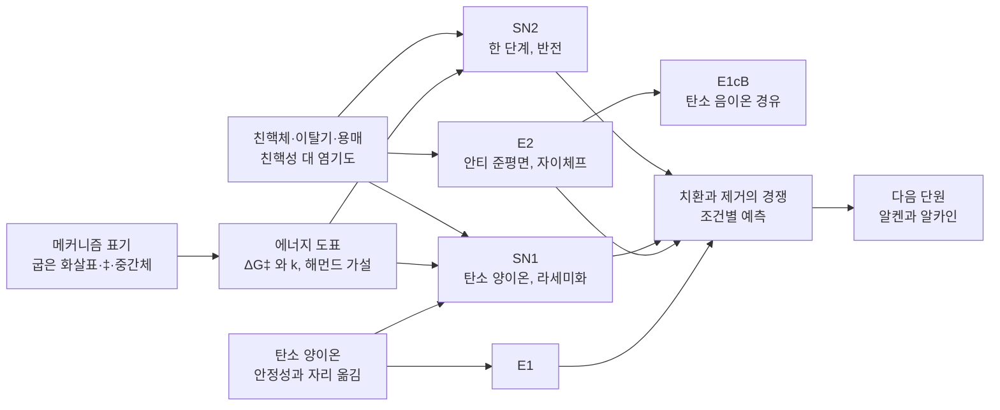

# 유기화학 4. 유기 반응의 개관과 알킬 할라이드의 치환·제거 반응 — 누가 공격하고 누가 떠나며, 언제 어느 길로 가는가
<!-- prev: ochem-3, ochem-1, uchem-7, pchem-12 -->
<!-- next: ochem-5 -->

> [!NOTE]
> **이 단원의 범위**
> - 유기 반응의 종류(치환·첨가·제거·자리 옮김), 극성·라디칼·협동 반응, 메커니즘의 표기법
> - 반응 에너지 도표, 전이 상태와 중간체, 속도 결정 단계, 해먼드 가설
> - 알킬 할라이드의 구조와 C–X 결합, 친핵체·친전자체·이탈기, 친핵성과 염기도, 용매의 종류
> - $\mathrm{S_N2}$ 반응: 2차 속도론, 뒤쪽 공격과 입체 반전, 기질·친핵체·이탈기·용매 효과
> - 탄소 양이온의 구조와 안정성(초공액·공명), 1,2-수소화 이온·메틸 이동에 의한 자리 옮김
> - $\mathrm{S_N1}$ 반응: 1차 속도론, 라세미화와 이온쌍, 가용매 분해, 공통 이온 효과
> - E2 반응(안티 준평면 배치, 자이체프·호프만 생성물, 입체 특이성, 사이클로헥세인의 축 방향 조건)과 E1, E1cB
> - 치환과 제거의 경쟁: 기질(1°·2°·3°) × 친핵체·염기의 세기와 크기 × 용매 × 온도에 따른 예측

**학습 목표**

1. 유기 반응을 치환·첨가·제거·자리 옮김으로 분류하고, 굽은 화살표·전이 상태 기호(‡)·중간체 표기로 메커니즘을 단계별로 쓸 수 있다.
2. 반응 에너지 도표에서 전이 상태와 중간체를 구별하고, 아이링 식으로 $\Delta G^\ddagger$와 속도 상수를 오가며, 해먼드 가설로 전이 상태의 구조를 추론할 수 있다.
3. 친핵성·염기도·이탈기 능력을 짝산의 $\mathrm{p}K_\mathrm{a}$, 원자의 크기와 분극성, 용매화로 설명하고, 양성자성·비양성자성 용매의 효과를 예측할 수 있다.
4. $\mathrm{S_N2}$와 $\mathrm{S_N1}$의 속도 법칙을 메커니즘에서 유도하고(정류 상태 근사 포함), 입체 결과(반전, 라세미화)와 탄소 양이온의 자리 옮김을 굽은 화살표로 설명할 수 있다.
5. E2의 안티 준평면 조건을 뉴먼 투영식과 의자 형태로 적용해 위치 선택성(자이체프·호프만)과 입체 특이성(E/Z)을 예측하고, E1·E1cB와 속도 법칙·동위 원소 효과로 구별할 수 있다.
6. 기질·시약·용매·온도의 조합에서 $\mathrm{S_N2}$, $\mathrm{S_N1}$, E2, E1 가운데 주된 경로와 주생성물을 근거와 함께 예측하고, 원하는 생성물을 얻는 조건을 설계할 수 있다.

**이 단원의 학습 사다리**

| 단계 | 무엇을 하나? |
|---|---|
| STEP 1. 이전 학습 다시 보기 | 굽은 화살표와 친핵체·친전자체, 입체 중심과 R/S, 형태 분석, 속도 법칙과 아이링 식 |
| STEP 2. 기초 다지기 | 아이링 식과 '5.7 kJ 규칙', 정류 상태 근사로 다단계 속도 법칙 쓰기, 경쟁 반응의 생성물 비, 뉴먼 투영식과 R/S 다시 읽기 |
| STEP 3. 핵심 개념 | 반응의 종류 → 에너지 도표·해먼드 가설 → 친핵체·이탈기·용매 → $\mathrm{S_N2}$ → 탄소 양이온 → $\mathrm{S_N1}$ → E2 → E1·E1cB → 치환과 제거의 경쟁 |
| STEP 4. 오개념 바로잡기 | "SN1은 언제나 완전한 라세미 혼합물", "R에서 출발하면 SN2 생성물은 언제나 S" 같은 착각 |
| STEP 5. 대학원·연구로 | 그룬발트–와인스타인 식과 용매 이온화 능력, 모어 오페럴–젠크스 도표로 본 E1–E2–E1cB의 연속성 |
| STEP 6. 생활·산업·진로 | 생체 메틸화(SAM), 알킬화 항암제와 유전 독성 불순물, 방사성 추적자 합성, 공정의 용매 선택 |

---

## 🗺️ 단원 들어가기

브로모에테인에 나트륨 에톡사이드를 넣으면 대부분 에톡시에테인(다이에틸 에터)이 생긴다. 같은 시약을 2-브로모-2-메틸프로페인에 넣으면 에터는 거의 생기지 않고 2-메틸프로펜 기체가 나온다. 시약을 바꾸지 않고 기질의 탄소 골격만 바꾸었는데 생성물의 **종류**가 바뀐다. 다시 2-브로모-2-메틸프로페인을 염기 없이 에탄올에 녹여 두기만 하면 이번에는 에터가 주로 생긴다. 이 세 실험의 결과는 외울 필요가 없다. 반응이 **어떤 경로(메커니즘)** 로 일어나는지, 각 경로의 **전이 상태가 얼마나 높은지**를 알면 예측할 수 있다.

「구조와 결합, 산과 염기」에서 우리는 전자쌍이 전자가 풍부한 곳에서 부족한 곳으로 움직이며, 그 이동을 굽은 화살표로 쓴다는 것을 배웠다. 「입체화학」에서는 분자의 3차원 배치를 R/S로 이름 붙였다. 이 단원은 그 두 도구를 처음으로 '반응'에 본격적으로 쓰는 곳이다. 알킬 할라이드(할로젠화 알킬)는 C–X 결합 하나만 가진 단순한 분자이지만, 그 위에서 일어나는 네 가지 반응 $\mathrm{S_N2}$, $\mathrm{S_N1}$, E2, E1은 유기 반응 메커니즘의 거의 모든 원리를 담고 있다. 속도 법칙이 메커니즘의 증거가 되고, 입체화학이 전이 상태의 모양을 알려 주며, 에너지 도표가 경쟁의 승자를 정한다.

이 단원을 마치면 "이 기질에 이 시약을 이 용매에서 이 온도로 넣으면 무엇이 주로 생기는가?"에 근거를 들어 답할 수 있다. 다음 단원 「알켄과 알카인」의 첨가 반응은 이 단원의 탄소 양이온과 제거 반응을 거꾸로 돌린 것이며, 뒤의 모든 단원의 메커니즘이 여기서 정한 문법으로 쓰인다.

---

## STEP 1. 🔙 이전 학습 다시 보기

### 연계 개념표

| 이전 단원 | 그때 배운 것 | 이 단원에서 확장되는 것 |
|---|---|---|
| 유기화학 「구조와 결합, 산과 염기」 '굽은 화살표 표기법', '루이스 산 염기' | 화살표의 다섯 규칙, 극성 반응의 네 기본 무늬, 친핵체·친전자체, 염기도는 평형·친핵성은 속도, $\mathrm{p}K_\mathrm{a}$ 표 | 네 무늬를 이어 붙여 $\mathrm{S_N2}$·$\mathrm{S_N1}$·E2·E1의 **완전한 메커니즘**을 쓰기, 짝산의 $\mathrm{p}K_\mathrm{a}$로 **이탈기 능력**과 염기 세기를 판단 |
| 유기화학 「입체화학」 'R/S 표기', '반응의 입체화학' | 칸–인골드–프렐로그 규칙, 거울상·부분 입체 이성질체, 라세미 혼합물, 입체 특이성·입체 선택성 | $\mathrm{S_N2}$의 입체 반전, $\mathrm{S_N1}$의 라세미화, E2의 입체 특이성을 실제 반응에서 판정. R/S 기호와 실제 공간 배치를 구별 |
| 유기화학 「알케인과 사이클로알케인」 '뉴먼 투영식', '의자 형태' | 엇갈린·가려진 형태, 축·적도 방향, 고리 뒤집힘과 A값 | E2의 **안티 준평면** 조건을 뉴먼 투영식으로, 사이클로헥세인에서는 **이축 방향(트랜스 이축)** 조건으로 |
| 일반화학 「화학 반응 속도론」 | 속도 법칙과 차수, 속도 결정 단계, 아레니우스 식, 반응 좌표 그림 | 차수가 **분자도와 메커니즘**의 증거가 되는 까닭, 다단계 반응의 에너지 도표 |
| 물리화학 「반응 속도론과 반응 동역학」 '정류 상태 근사', '전이 상태 이론', '동위 원소 효과' | $d[\mathrm{I}]/dt \approx 0$, 아이링 식 $k = (k_\mathrm{B}T/h)e^{-\Delta^\ddagger G/RT}$, 활성화 엔트로피, $k_\mathrm{H}/k_\mathrm{D}$ | 그 도구를 되짚기만 하고 바로 적용: $\mathrm{S_N1}$의 공통 이온 효과, E1cB의 속도 법칙, E2의 큰 동위 원소 효과, 온도에 따른 치환/제거 비 |

### 준비 운동 (사전 진단)

**Q1.** 메톡사이드 이온과 브로모메테인의 반응 $\mathrm{CH_3O^- + CH_3Br \rightarrow CH_3OCH_3 + Br^-}$에 필요한 굽은 화살표 두 개의 시작과 끝을 말로 쓰시오.

**Q2.** $\mathrm{CH_3CH_2CHBrCH_3}$(2-브로모뷰테인)의 입체 중심에 붙은 네 원자단의 CIP 우선순위를 높은 것부터 쓰시오.

**Q3.** 어떤 반응의 속도 법칙이 $v = k[\mathrm{A}][\mathrm{B}]$이다. A의 농도만 두 배로 하면 속도는 몇 배가 되는가? 이 반응이 단일 단계라면 분자도는 얼마인가?

**Q4.** 에테인을 C–C 결합 축으로 내려다본 뉴먼 투영식에서, 앞 탄소의 H와 뒤 탄소의 H가 이루는 이면각이 180°인 형태를 무엇이라 부르는가? 이 형태는 엇갈린 형태인가, 가려진 형태인가?

정답 및 해설

**Q1.** ① 메톡사이드 O의 비공유 전자쌍 → $\mathrm{CH_3Br}$의 탄소(O와 C 사이에 새 결합). ② C–Br 결합의 전자쌍 → Br(브로민화 이온이 됨). 탄소는 이미 옥텟이므로 새 결합이 생기려면 결합 하나가 동시에 끊어져야 한다(「구조와 결합, 산과 염기」 예제 13).

**Q2.** $\mathrm{-Br} > \mathrm{-CH_2CH_3} > \mathrm{-CH_3} > \mathrm{-H}$. Br의 원자 번호(35)가 가장 크고, 두 탄소 원자단은 첫 원자가 같으므로 다음 원자 집합 (C,H,H) > (H,H,H)로 가른다.

**Q3.** 2배. 단일 단계라면 A 하나와 B 하나가 만나는 **2분자 반응**이다. (차수가 분자도와 같은 것은 단일 단계일 때뿐이다.)

**Q4.** 안티(anti) 형태이며 엇갈린 형태이다. 이면각 0°이면 신(syn) 형태로 가려진 형태이다. 이 단원 ⑦에서 E2 반응이 바로 이 '안티' 배치를 요구한다.

---

## STEP 2. 🧱 기초 다지기

### 디딤돌 1. 아이링 식과 '5.7 kJ 규칙' — 장벽의 높이를 속도로 읽기

물리화학 「반응 속도론과 반응 동역학」 '전이 상태 이론'에서 유도한 아이링 식을 되짚는다. 투과 계수를 1로 두면, 단분자(1차) 단계의 속도 상수는

$$
k = \frac{k_\mathrm{B}T}{h}\,e^{-\Delta G^\ddagger/RT}, \qquad \frac{k_\mathrm{B}T}{h} = 6.21\times10^{12}\ \mathrm{s^{-1}}\ (25\ ^\circ\mathrm{C})
$$

이다($\Delta G^\ddagger$는 물리화학 단원의 $\Delta^\ddagger G^\circ$와 같은 양이며, 이 단원에서는 유기화학에서 흔히 쓰는 $\Delta G^\ddagger$로 적는다. 2분자 단계에서는 표준 농도 $c^\circ = 1\ \mathrm{M}$이 곱해져 $k$의 단위가 $\mathrm{M^{-1}s^{-1}}$이 된다). 유기화학에서는 이 식을 '장벽 높이와 속도의 환산표'로 쓴다.

두 반응의 장벽 차이를 $\Delta\Delta G^\ddagger$라 하면 앞의 인자가 지워져

$$
\frac{k_1}{k_2} = e^{\Delta\Delta G^\ddagger/RT} \quad\Longrightarrow\quad \Delta\Delta G^\ddagger = 2.303RT\log\frac{k_1}{k_2}
$$

이다. 25 ℃에서 $2.303RT = 5.71\ \mathrm{kJ/mol}$이므로 **장벽이 5.7 kJ/mol 낮아질 때마다 속도는 10배** 빨라진다. 「구조와 결합, 산과 염기」에서 $\mathrm{p}K_\mathrm{a}$ 1단위가 5.71 kJ/mol이었던 것과 같은 수이다. 그때는 평형($\Delta G^\circ$)이었고 지금은 속도($\Delta G^\ddagger$)이다.

| $\Delta G^\ddagger$ (kJ/mol, 25 ℃) | $k$ (1차, $\mathrm{s^{-1}}$) | 반감기 | 실험실에서의 느낌 |
|---|---|---|---|
| 60 | 약 $2\times10^{2}$ | 약 3 ms | 섞자마자 끝난다 |
| 80 | 약 $6\times10^{-2}$ | 약 12 s | 수십 초 |
| 90 | 약 $1.1\times10^{-3}$ | 약 11 min | 한 시간 안에 끝난다 |
| 100 | 약 $1.9\times10^{-5}$ | 약 10 h | 하룻밤 |
| 110 | 약 $3\times10^{-7}$ | 약 25 일 | 실온에서는 사실상 안 된다(가열 필요) |

> [!TIP]
> 💡 **요령** — 실온에서 '하룻밤 안에 끝나는' 반응의 장벽은 대략 **85~100 kJ/mol**이다. 표를 외우지 말고 "100 kJ/mol이면 약 10시간, 6 kJ/mol마다 10배"만 기억해 두면 에너지 도표의 숫자를 바로 시간으로 바꿀 수 있다.

#### 예제 1 — 장벽에서 반감기로, 속도 비에서 장벽 차이로

(1) 25 ℃에서 $\Delta G^\ddagger = 90.0\ \mathrm{kJ/mol}$인 1차 반응의 속도 상수와 반감기를 구하시오. (2) 같은 친핵체가 브로모메테인과는 2-브로모프로페인보다 약 1000배 빨리 반응한다. 두 반응의 $\Delta G^\ddagger$ 차이는 얼마인가?

**풀이**
(1) 식 세우기: $k = (k_\mathrm{B}T/h)e^{-\Delta G^\ddagger/RT}$. 대입: $RT = 8.314\times298.15 = 2479\ \mathrm{J/mol}$, $\Delta G^\ddagger/RT = 90\,000/2479 = 36.31$, $k = 6.21\times10^{12}\times e^{-36.31} = 1.06\times10^{-3}\ \mathrm{s^{-1}}$. 반감기 $t_{1/2} = \ln 2/k = 654\ \mathrm{s} \approx 11\ \mathrm{min}$.
(2) $\Delta\Delta G^\ddagger = 5.71\times\log 1000 = 5.71\times3 = 17.1\ \mathrm{kJ/mol}$.
**의미** C–Br 결합에 메틸기 두 개를 더 붙인 것만으로 장벽이 17 kJ/mol 높아진다. 이 차이가 어디서 오는지(뒤쪽 공격의 입체 장애)는 STEP 3 ④에서 본다. 속도 비 '1000배'는 크게 들리지만 에너지로는 C–C 결합 에너지의 20분의 1 정도이다. 유기 반응의 선택성은 이런 **작은 에너지 차이**가 지수 함수로 증폭된 결과이다.

### 디딤돌 2. 정류 상태 근사 — 중간체가 있는 메커니즘의 속도 법칙

물리화학 「반응 속도론과 반응 동역학」 '정류 상태 근사와 사전 평형'에서 익힌 방법을 그대로 쓴다. 반응성이 큰 중간체 I의 농도는 작고 거의 변하지 않으므로 $d[\mathrm{I}]/dt \approx 0$으로 둔다. 이 단원에서 가장 중요한 적용은 $\mathrm{S_N1}$이다.

$$
\mathrm{RX} \;\underset{k_{-1}}{\overset{k_1}{\rightleftharpoons}}\; \mathrm{R^+ + X^-}, \qquad \mathrm{R^+ + Nu} \xrightarrow{\;k_2\;} \mathrm{RNu}
$$

**가정**: 탄소 양이온 $\mathrm{R^+}$는 생기자마자 소모되는 중간체이다. **유도**:

$$
\frac{d[\mathrm{R^+}]}{dt} = k_1[\mathrm{RX}] - k_{-1}[\mathrm{R^+}][\mathrm{X^-}] - k_2[\mathrm{R^+}][\mathrm{Nu}] \approx 0
\quad\Longrightarrow\quad
[\mathrm{R^+}] = \frac{k_1[\mathrm{RX}]}{k_{-1}[\mathrm{X^-}] + k_2[\mathrm{Nu}]}
$$

$$
v = k_2[\mathrm{R^+}][\mathrm{Nu}] = \frac{k_1k_2[\mathrm{RX}][\mathrm{Nu}]}{k_{-1}[\mathrm{X^-}] + k_2[\mathrm{Nu}]}
$$

**결과와 적용 한계**: 탄소 양이온이 친핵체에 잡히는 속도가 이탈기와 다시 결합하는 속도보다 훨씬 크면($k_2[\mathrm{Nu}] \gg k_{-1}[\mathrm{X^-}]$) 분모의 첫 항을 버릴 수 있고

$$
v \approx k_1[\mathrm{RX}]
$$

가 된다. 친핵체의 농도가 속도 법칙에서 **사라진다**. 이것이 $\mathrm{S_N1}$의 1차 속도 법칙이다. 반대로 탄소 양이온이 비교적 안정해 $\mathrm{X^-}$와 다시 결합할 기회가 있으면, 같은 $\mathrm{X^-}$를 더 넣을 때 속도가 느려진다(**공통 이온 효과**, ⑥).

#### 예제 2 — 공통 이온 효과의 크기

가용매 분해에서는 친핵체가 용매(SOH) 자체이므로 $k_2[\mathrm{SOH}]$를 하나의 1차 상수 $k_2'$로 묶는다. 어떤 다이페닐메틸 염화물의 가용매 분해에서 $\alpha = k_{-1}/k_2' = 30\ \mathrm{M^{-1}}$이라 하자(가상의 값). 염화 이온을 처음부터 0.050 M 넣으면 초기 속도는 염화 이온이 없을 때의 몇 배가 되는가?

**풀이**
식 세우기: 위 식의 분모·분자를 $k_2'$로 나누면 $v = \dfrac{k_1[\mathrm{RX}]}{1 + \alpha[\mathrm{X^-}]}$.
대입: $\dfrac{v}{v_0} = \dfrac{1}{1 + 30\times0.050} = \dfrac{1}{2.5} = 0.40$.
**의미** 속도가 40 %로 떨어진다. 탄소 양이온의 절반 이상이 용매 대신 염화 이온에 다시 붙잡혀 출발 물질로 돌아가기 때문이다. 염화 이온은 반응이 진행될수록 저절로 쌓이므로, 이런 기질에서는 겉보기 1차 속도 상수가 시간에 따라 점점 작아진다. 반면 tert-뷰틸 양이온처럼 반응성이 아주 큰 양이온은 용매에 즉시 잡혀 $\alpha$가 매우 작고, 공통 이온 효과가 거의 보이지 않는다.

### 디딤돌 3. 경쟁 반응의 생성물 비 — 속도 상수의 비가 곧 생성물의 비

한 출발 물질이 두 경로(예: 치환과 제거)로 동시에 반응하고 두 생성물이 서로 바뀌지 않으면, 이것은 물리화학의 **병행 반응**이다. 두 경로가 같은 반응물에 대해 같은 차수이면 생성물의 비는 시간과 관계없이 속도 상수의 비로 정해진다.

$$
\frac{[\mathrm{P_E}]}{[\mathrm{P_S}]} = \frac{k_\mathrm{E}}{k_\mathrm{S}} = \exp\!\left(-\frac{\Delta\Delta H^\ddagger}{RT} + \frac{\Delta\Delta S^\ddagger}{R}\right), \qquad \Delta\Delta X^\ddagger = \Delta X^\ddagger_\mathrm{E} - \Delta X^\ddagger_\mathrm{S}
$$

이렇게 **속도 상수의 비로 생성물 비가 정해지는 것**을 **속도론적 지배**(kinetic control)라 한다. 이 단원의 치환·제거 생성물은 거의 모두 속도론적 지배를 받는다. 생성물끼리 평형이 이루어질 때의 비는 $\Delta G^\circ$가 정하며 이를 **열역학적 지배**라 한다(「콘주게이션계와 방향족성」에서 본격적으로 비교한다).

#### 예제 3 — 온도를 올리면 왜 제거가 늘어나는가

2차 알킬 할라이드와 에톡사이드의 반응에서 제거(E2)와 치환($\mathrm{S_N2}$)의 활성화 매개변수 차이가 $\Delta\Delta H^\ddagger = +6.0\ \mathrm{kJ/mol}$, $\Delta\Delta S^\ddagger = +25\ \mathrm{J/(mol\cdot K)}$라 하자(가상의 값). 25 ℃와 80 ℃에서 제거 생성물의 비율을 구하시오.

**풀이**
25 ℃: $\dfrac{k_\mathrm{E}}{k_\mathrm{S}} = \exp\!\left(-\dfrac{6000}{8.314\times298.15} + \dfrac{25}{8.314}\right) = \exp(-2.421 + 3.007) = e^{0.586} = 1.80$ → 제거 비율 $1.80/2.80 = 64\ \%$.
80 ℃: $\exp\!\left(-\dfrac{6000}{8.314\times353.15} + 3.007\right) = \exp(-2.044 + 3.007) = e^{0.963} = 2.62$ → $2.62/3.62 = 72\ \%$.
**의미** 제거는 분자 두 개(기질 + 염기)에서 세 개(알켄 + 이탈기 + 짝산)가 생기고, 전이 상태에서 여러 결합이 함께 느슨해져 활성화 엔트로피가 치환보다 큰 경우가 많다. $-T\Delta S^\ddagger$ 항은 온도에 비례해 커지므로 **온도를 올리면 제거가 유리해진다**. ⑨의 "가열하면 제거"라는 경험 규칙의 열역학적 근거이다.

### 디딤돌 4. 뉴먼 투영식과 R/S를 다시 읽기

이 단원의 입체화학 문제는 두 가지 작업으로 정리된다.

| 작업 | 방법 | 쓰는 곳 |
|---|---|---|
| 입체 중심의 R/S 매기기 | 우선순위 1~4를 정하고, 4순위를 뒤로 보낸 채 1→2→3 방향(시계 R, 반시계 S) | $\mathrm{S_N2}$ 반전, $\mathrm{S_N1}$ 라세미화, E2 기질의 부분 입체 이성질체 |
| 결합 축으로 내려다보기 | C–C 축을 따라 앞 탄소(점), 뒤 탄소(원)로 그리고, 앞·뒤 치환기의 이면각을 읽는다 | E2의 H–C–C–X 이면각(안티 180°, 신 0°) |

뉴먼 투영식에서 단일 결합을 회전시켜도 입체 중심의 배치(R/S)는 바뀌지 않는다. 회전은 **형태**를 바꿀 뿐 **배치**를 바꾸지 않는다. 그래서 E2를 분석할 때는 먼저 H와 X가 안티가 되도록 회전한 형태를 그리고, 그 형태에서 남은 치환기들이 어디에 놓이는지를 읽는다(⑦).

<!-- 그림 요청: 뉴먼 투영식 읽는 법 도해. (R)-2-브로모뷰테인(SMILES C[C@@H](Br)CC)을 C2–C3 축으로 내려다본 엇갈린 형태 세 개를 나란히 그린다(앞 탄소 C2: Br, CH3, H / 뒤 탄소 C3: CH3, H, H). (가) Br이 뒤 탄소의 CH3와 이면각 180°(안티), (나)·(다) Br이 뒤 탄소의 서로 다른 H 하나와 이면각 180°. (나)·(다)의 그 H와 Br을 색으로 강조하고 'H–C–C–Br 안티 준평면' 이름표. 맨 오른쪽: 같은 분자의 쐐기·점선 그림(C2에서 Br 쐐기, H 점선)과 'C2–C3 결합을 회전해도 C2의 배치는 R 그대로' 메모. -->

#### 예제 4 — R/S 기호와 실제 배치

(R)-2-브로모뷰테인(SMILES `C[C@@H](Br)CC`)의 Br 자리에 사이안화 이온이 **같은 쪽**에서 들어간다고 가정한 생성물(배치 유지)과 **반대쪽**에서 들어간 생성물(배치 반전)의 R/S를 각각 매기시오. 생성물은 2-메틸뷰테인나이트릴 $\mathrm{CH_3CH_2CH(CH_3)CN}$이다.

**풀이**
생성물의 입체 중심 우선순위: $\mathrm{-C{\equiv}N}$ (C에 붙은 원자 (N,N,N)) > $\mathrm{-CH_2CH_3}$ (C,H,H) > $\mathrm{-CH_3}$ > $\mathrm{-H}$.
반응물에서는 Br이 1순위였고 생성물에서는 CN이 1순위이다. 1순위 원자단이 **같은 자리**에 들어가고 나머지(에틸 2순위, 메틸 3순위, H 4순위)의 순서가 그대로이므로, 배치가 유지되면 기호도 R, 반전되면 S이다(RDKit으로 확인: 배치 유지 `C[C@@H](C#N)CC`는 R, 반전 `C[C@H](C#N)CC`는 S).
**의미** 이 경우에는 기호 R/S가 공간 배치의 반전과 함께 바뀐다. 그러나 우선순위 순서가 바뀌는 기질에서는 배치가 반전되어도 기호가 그대로일 수 있다(④의 예제 9). R/S는 **이름표**이고 반전은 **기하학**이다.

---

## STEP 3. 📘 핵심 개념

### ① 유기 반응의 종류와 메커니즘 표기

#### 무엇이 무엇으로 바뀌는가 — 네 가지 반응

출발 물질과 생성물만 비교하면 대부분의 유기 반응은 네 가지 가운데 하나이다.

| 종류 | 무엇이 일어나나 | 예 |
|---|---|---|
| **치환**(substitution) | 한 원자(원자단)가 떨어지고 다른 원자단이 그 자리에 들어간다 | $\mathrm{CH_3CH_2Br + OH^- \rightarrow CH_3CH_2OH + Br^-}$ |
| **첨가**(addition) | 다중 결합에 두 조각이 붙어 하나의 생성물이 된다 | $\mathrm{CH_2{=}CH_2 + HBr \rightarrow CH_3CH_2Br}$ |
| **제거**(elimination) | 이웃한 두 탄소에서 두 조각이 떨어지며 다중 결합이 생긴다(첨가의 역) | $\mathrm{(CH_3)_3CBr + CH_3CH_2O^- \rightarrow (CH_3)_2C{=}CH_2 + CH_3CH_2OH + Br^-}$ |
| **자리 옮김**(rearrangement) | 분자 안에서 결합이 재배열되어 골격이 바뀐 이성질체가 된다 | 탄소 양이온의 1,2-메틸 이동(⑤) |

제거 반응에서 이탈기 X가 붙은 탄소를 **α 탄소**, 그 이웃 탄소를 **β 탄소**라 하고, β 탄소의 H(β 수소)가 X와 함께 떨어진다. 그래서 이런 제거를 **β-제거** 또는 할로젠화 수소를 잃는다는 뜻에서 **탈할로젠화 수소**(dehydrohalogenation)라 부른다.

<!-- 그림 요청: 네 반응 종류를 한 행씩 골격 구조식으로. ① 치환: 브로모에테인(SMILES CCBr) + 수산화 이온 → 에탄올(SMILES CCO) + Br⁻, 바뀐 자리(Br → OH)를 색으로. ② 첨가: 에텐 + HBr → 브로모에테인, 새로 붙은 H와 Br을 색으로. ③ 제거: 2-브로모-2-메틸프로페인(SMILES CC(C)(C)Br) + 에톡사이드 → 2-메틸프로펜(SMILES C=C(C)C) + 에탄올 + Br⁻, α 탄소(Br이 붙은 C)와 β 탄소(CH3 중 하나)에 'α', 'β' 이름표, 떨어지는 β-H와 Br을 색으로. ④ 자리 옮김: 3,3-다이메틸뷰탄-2-일 양이온(SMILES C[CH+]C(C)(C)C) → 2,3-다이메틸뷰탄-2-일 양이온(SMILES CC(C)[C+](C)C), 옮겨 가는 메틸기를 색으로(화살표는 ⑤에서 그리므로 여기서는 생략). -->

#### 결합이 어떻게 끊기고 생기는가 — 세 가지 메커니즘 무리

| 무리 | 결합이 끊기는 방식 | 화살표 | 대표 예 |
|---|---|---|---|
| **극성 반응**(polar reaction) | **불균일 분해**: 결합 전자쌍이 한 원자에 모두 간다 | 온화살표(전자 2개) | 이 단원의 치환·제거, 첨가, 카보닐 반응 |
| **라디칼 반응**(radical reaction) | **균일 분해**: 결합 전자가 하나씩 나뉜다 | 낚싯바늘 화살표(전자 1개) | 알케인의 할로젠화(「알케인과 사이클로알케인」), 라디칼 중합 |
| **고리형 협동 반응**(pericyclic reaction) | 고리 모양 전이 상태에서 여러 결합이 한꺼번에 재배열된다 | 고리를 도는 온화살표 | 딜스–알더 반응(「콘주게이션계와 방향족성」) |

극성 반응은 언제나 **친핵체**(전자쌍 주개)와 **친전자체**(전자쌍 받개)의 만남이다. 알킬 할라이드에서는 C–X의 $\delta+$ 탄소가 친전자체, 그 탄소를 공격하는 음이온이나 비공유 전자쌍을 가진 분자가 친핵체이다. 같은 음이온이 탄소 대신 β 수소를 공격하면 염기로 작용해 제거가 일어난다.

#### 메커니즘의 표기법

**메커니즘**(mechanism)은 반응을 **단일 단계**(elementary step)의 연속으로 쓴 것이다. 각 단일 단계는 전이 상태 하나를 지나며, 단계와 단계 사이에는 **중간체**가 있다.

| 표기 | 뜻 |
|---|---|
| $\mathrm{A \xrightarrow{\;NaCN,\ DMSO\;} B}$ | 화살표 위에 시약, 아래나 쉼표 뒤에 용매·온도(Δ는 가열, $h\nu$는 빛) |
| $\mathrm{\xrightarrow{1.\ \cdots\quad 2.\ \cdots}}$ | 번호가 붙은 시약은 **차례로** 넣는다(동시에 넣지 않는다) |
| $[\ \cdots\ ]^\ddagger$ | 전이 상태. 꺾쇠 괄호로 묶고 ‡를 붙이며, 생기거나 끊어지는 중인 **부분 결합**은 점선, 부분 전하는 $\delta+$, $\delta-$로 쓴다 |
| 중간체 | 꺾쇠 없이 온전한 구조와 형식 전하로 쓴다(예: $\mathrm{(CH_3)_3C^+}$) |
| $\mathrm{S_N2}$, $\mathrm{S_N1}$, E2, E1, E1cB | 잉골드(Ingold)의 이름: S 치환, N 친핵성(nucleophilic), E 제거, 숫자는 **속도 결정 단계의 분자도**, cB는 짝염기(conjugate base) |

> [!IMPORTANT]
> **전이 상태와 중간체는 다르다.** 전이 상태는 에너지의 **꼭대기**로, 수명이 분자 진동 한 번(약 $10^{-13}$ s) 정도여서 분리하거나 병에 담을 수 없다. 중간체는 에너지의 **골짜기**(극소점)에 있어 수명이 유한하고, 조건에 따라 분광법으로 관찰하거나 다른 시약으로 붙잡을 수 있다.

#### 메커니즘은 어떻게 '증명'하는가

메커니즘은 직접 볼 수 없으므로 여러 실험 증거와 **모순되지 않는** 가장 단순한 경로를 채택한다. 이 단원에서 쓰는 증거는 다음과 같다.

| 증거 | 무엇을 알려 주나 | 이 단원의 예 |
|---|---|---|
| 속도 법칙(차수) | 속도 결정 단계와 그 앞에 참여하는 분자들 | $\mathrm{S_N2}$ 2차, $\mathrm{S_N1}$ 1차 |
| 입체화학 | 전이 상태의 기하 | $\mathrm{S_N2}$ 반전, E2 안티 준평면 |
| 생성물의 골격 | 중간체의 존재 | 자리 옮김은 탄소 양이온의 증거 |
| 동위 원소 효과·표지 | 속도 결정 단계에서 끊기는 결합 | E2의 $k_\mathrm{H}/k_\mathrm{D} \approx 7$, E1cB의 H/D 교환 |
| 치환기·용매 효과 | 전이 상태의 전하 분포 | $\mathrm{S_N1}$은 극성 양성자성 용매에서 빠르다 |

#### 예제 5 — 반응 분류하기

다음 반응을 네 종류로 분류하고, 극성 반응이면 친핵체(또는 염기)와 친전자체를 쓰시오.
(1) $\mathrm{CH_3I + NaN_3 \rightarrow CH_3N_3 + NaI}$
(2) $\mathrm{CH_3CH_2CH_2Br + (CH_3)_3CO^-K^+ \rightarrow CH_3CH{=}CH_2 + (CH_3)_3COH + KBr}$
(3) $\mathrm{CH_3CH{=}CH_2 + HBr \rightarrow CH_3CHBrCH_3}$
(4) $\mathrm{CH_4 + Cl_2 \xrightarrow{\;h\nu\;} CH_3Cl + HCl}$

**풀이**
(1) 치환. 친핵체는 아자이드 이온 $\mathrm{N_3^-}$, 친전자체는 아이오도메테인의 탄소. 이탈기는 $\mathrm{I^-}$.
(2) 제거. tert-뷰톡사이드가 **염기**로서 β 탄소(C2)의 H를 떼고, α 탄소(C1)에서 $\mathrm{Br^-}$가 떨어진다. 생성물은 프로펜.
(3) 첨가. 1단계에서 프로펜의 π 전자쌍이 친핵체, HBr의 H가 친전자체이다(「구조와 결합, 산과 염기」 예제 12).
(4) 치환이지만 극성 반응이 아니라 **라디칼 반응**이다. 빛이 Cl–Cl을 균일 분해한다(「알케인과 사이클로알케인」).
**의미** (1)과 (2)는 같은 '알킬 할라이드 + 음이온'인데 한쪽은 치환, 한쪽은 제거이다. 어느 쪽이 될지는 시약이 **탄소를 공격하기 쉬운지(친핵성)** 아니면 **양성자를 떼기 쉬운지(염기도)** 와 기질의 구조가 정한다. 이 단원 전체가 이 질문에 대한 답이다.

#### ✔ 바로 확인

1. (O/X) 전이 상태는 수명이 매우 짧은 중간체이다.
2. 빈칸: $\mathrm{S_N1}$의 '1'은 (    ) 단계의 분자도를 뜻한다.
3. 고르기: 다음 중 β-제거 반응은? (가) $\mathrm{CH_3CH_2Cl \rightarrow CH_2{=}CH_2 + HCl}$ (나) $\mathrm{CH_3CH_2Cl + I^- \rightarrow CH_3CH_2I + Cl^-}$
4. 낚싯바늘 화살표로 쓰는 메커니즘 무리는?

정답

1. X — 전이 상태는 에너지의 꼭대기로 분리할 수 없고, 중간체는 골짜기에 있어 수명이 유한하다.
2. 속도 결정 — 이온화 단계에 기질 한 분자만 참여한다.
3. (가) — α 탄소의 Cl과 β 탄소의 H가 떨어져 C=C가 생긴다. (나)는 치환이다.
4. 라디칼 반응 — 균일 분해에서 전자가 하나씩 움직인다.

### ② 반응 에너지 도표, 전이 상태와 중간체, 해먼드 가설

#### 에너지 도표 읽기

가로축에 **반응 좌표**(반응물에서 생성물로 가는 원자 배치의 변화), 세로축에 깁스 에너지를 그린 그림이 **반응 에너지 도표**이다. 물리화학 「반응 속도론과 반응 동역학」 '퍼텐셜 에너지 표면'에서 본 다차원 표면을 가장 낮은 길(최소 에너지 경로)을 따라 잘라 펼친 것이다.

| 도표의 특징 | 뜻 | 정량 관계 |
|---|---|---|
| 출발점과 끝점의 높이 차 | 반응 깁스 에너지 $\Delta G^\circ$ | $K = e^{-\Delta G^\circ/RT}$ |
| 출발점에서 꼭대기까지 | 활성화 깁스 에너지 $\Delta G^\ddagger$ | $k = (k_\mathrm{B}T/h)e^{-\Delta G^\ddagger/RT}$ |
| 꼭대기(극대점) | 전이 상태 | 수명 약 $10^{-13}$ s |
| 중간의 골짜기(극소점) | 중간체 | 골짜기가 깊을수록 오래 산다 |
| 가장 높은 꼭대기 | 그 전이 상태를 지나는 단계가 **속도 결정 단계** | 전체 속도 ≈ 그 단계의 속도 |

<!-- 그림 요청: 반응 에너지 도표 두 개를 위아래로. 세로축 'G', 가로축 '반응 좌표'. (위) 한 단계 반응: 반응물 R(높이 0) → 전이 상태 TS(꼭대기, '‡') → 생성물 P(−30, 발열). ΔG‡(R에서 TS까지)와 ΔG°(R에서 P까지)를 양방향 화살표로 표시. (아래) 두 단계 반응: R(0) → TS1(+100) → 중간체 I(+85, 골짜기) → TS2(+90) → P(−20). TS1에 '속도 결정 단계의 전이 상태', I에 '중간체(극소점)' 이름표. ΔG‡1, ΔG‡2(I에서 TS2까지), 전체 ΔG°를 화살표로 표시. 두 그림 모두 가로축 아래에 대표 구조를 작게: 위는 SN2의 R, TS, P, 아래는 SN1의 RX, 이온화 TS, 탄소 양이온, 친핵체 결합 TS, 생성물. -->

#### 해먼드 가설

전이 상태는 분리할 수 없으므로 그 구조를 직접 잴 수 없다. 해먼드(Hammond)는 다음과 같이 제안하였다.

> [!IMPORTANT]
> **해먼드 가설**(Hammond postulate) — 한 단일 단계에서 전이 상태의 구조는 에너지가 더 **가까운** 쪽의 화학종(반응물 또는 생성물)을 닮는다.
> - 발열(발에르곤) 단계: 전이 상태가 반응 좌표의 **앞쪽**에 있고 **반응물을 닮는다**(이른 전이 상태).
> - 흡열(흡에르곤) 단계: 전이 상태가 **뒤쪽**에 있고 **생성물을 닮는다**(늦은 전이 상태).

근거는 간단하다. 퍼텐셜 에너지 곡선 위에서 에너지가 거의 같은 두 점은 구조도 거의 같다(곡선이 연속이므로). 흡열이 큰 단계에서는 꼭대기의 높이가 생성물의 높이와 비슷하므로 꼭대기의 구조도 생성물과 비슷하다. 물리화학 단원의 **폴라니 규칙**(장벽 위치와 반응열의 관계)을 정성적으로 말한 것이다.

이 가설이 유기화학에서 강력한 까닭은 **전이 상태 대신 중간체의 안정성으로 속도를 판단하게** 해 주기 때문이다. $\mathrm{S_N1}$의 이온화 단계는 중성 분자가 이온 두 개로 갈라지는 강한 흡열 단계이다. 그러므로 그 전이 상태는 탄소 양이온을 닮았고, 탄소 양이온을 안정하게 하는 요인(⑤의 초공액·공명)은 전이 상태도 거의 같은 만큼 안정하게 한다. "더 안정한 탄소 양이온을 거치는 반응이 더 빠르다"는 판단이 이렇게 정당화된다.

<!-- 그림 요청: 해먼드 가설 비교 도표 두 개를 나란히. 세로축 G, 가로축 반응 좌표. (왼쪽) 크게 발열인 단계: 반응물 높이 0, 생성물 −80, 꼭대기 +20이 가로축의 30 % 지점(반응물 가까이). 꼭대기 아래에 '이른 전이 상태 · 반응물을 닮음'. (오른쪽) 크게 흡열인 단계: 반응물 0, 생성물 +80, 꼭대기 +95가 가로축의 75 % 지점(생성물 가까이). '늦은 전이 상태 · 생성물을 닮음'. 오른쪽 그림에 점선으로 두 번째 곡선(생성물이 +65로 더 안정한 경우, 꼭대기도 약 +82로 함께 내려감)을 겹쳐 '생성물을 안정하게 하면 전이 상태도 거의 그만큼 내려간다' 메모. -->

<!-- 시뮬레이션 요청: 반응 에너지 도표 탐색기. 2단계 반응 R → I → P의 깁스 에너지 곡선을 매끄러운 곡선으로 그린다. 슬라이더: 중간체 I의 높이(−20~+90 kJ/mol), TS1·TS2의 높이, 생성물 높이, 온도(250~400 K). 표시: 각 단계의 k(아이링 식, κ = 1)와 반감기, 속도 결정 단계 자동 강조(가장 높은 꼭대기 색칠), 전체 K. 해먼드 모드를 켜면 I의 높이를 바꿀 때 TS1의 높이가 '폴라니 계수 α(0~1 슬라이더) × ΔG°' 만큼 함께 움직이고, TS1의 가로 위치가 R과 I 가운데 에너지가 가까운 쪽으로 옮겨 가는 것을 보여 준다. 'SN2(한 단계)', 'SN1(두 단계)' 미리 설정 단추. -->

#### 예제 6 — 에너지 도표에서 속도와 해석 끌어내기

2-클로로-2-메틸프로페인($\mathrm{(CH_3)_3CCl}$)의 80 % 에탄올 수용액 가용매 분해는 25 ℃에서 1차 속도 상수가 약 $9\times10^{-6}\ \mathrm{s^{-1}}$이다. (1) 속도 결정 단계의 $\Delta G^\ddagger$와 반감기를 구하시오. (2) 이 단계 뒤 탄소 양이온이 용매에 붙잡히는 단계의 장벽이 약 5 kJ/mol이라면(어림값), 탄소 양이온의 수명은 대략 얼마인가? (3) 이 결과와 해먼드 가설로, 이온화 전이 상태가 무엇을 닮았는지 설명하시오.

**풀이**
(1) $\Delta G^\ddagger = RT\ln\dfrac{k_\mathrm{B}T/h}{k} = 2479\times\ln\dfrac{6.21\times10^{12}}{9\times10^{-6}} = 2479\times41.08 = 1.02\times10^5\ \mathrm{J/mol}$, 즉 약 102 kJ/mol. $t_{1/2} = 0.693/(9\times10^{-6}) = 7.7\times10^4\ \mathrm{s} \approx 21\ \mathrm{h}$.
(2) $k_2 \approx 6.21\times10^{12}\times e^{-5000/2479} = 8\times10^{11}\ \mathrm{s^{-1}}$(용매가 늘 곁에 있으므로 1차로 본다). 수명 $\approx 1/k_2 \approx 10^{-12}\ \mathrm{s}$.
(3) 이온화 단계는 장벽(약 102 kJ/mol)의 대부분을 오르는 강한 흡열 단계이고, 그 끝의 탄소 양이온은 두 번째 꼭대기보다 겨우 몇 kJ/mol 낮다. 이온화 전이 상태와 탄소 양이온은 에너지가 가까우므로, 전이 상태는 C–Cl 결합이 많이 늘어나 탄소에 상당한 양전하가 쌓인 **탄소 양이온 같은 구조**이다.
**의미** 탄소 양이온의 수명이 피코초 수준이라는 것은, 이 양이온이 용매 분자 몇 개가 자리를 바꾸는 시간 동안만 존재한다는 뜻이다. 그래서 떨어져 나간 $\mathrm{Cl^-}$이 아직 곁에 있는 동안 용매가 공격하는 일이 생기며, 이것이 ⑥의 '이온쌍'과 불완전한 라세미화로 이어진다. (속도 상수는 같은 용매 안에서도 조성·온도에 따라 달라지므로 '약'으로 쓴다.)

#### ✔ 바로 확인

1. (O/X) 다단계 반응에서는 활성화 에너지가 가장 큰 단계가 아니라 에너지 도표에서 가장 높은 꼭대기를 지나는 단계가 속도 결정 단계이다.
2. 빈칸: 강한 흡열 단계의 전이 상태는 (반응물 / 생성물)을 닮는다.
3. 25 ℃에서 두 경로의 $\Delta G^\ddagger$ 차이가 11.4 kJ/mol이면 속도 비는 약 몇 배인가?
4. 에너지 도표의 극소점에 있는 화학종을 무엇이라 하는가?

정답

1. O — 출발 물질에서 본 가장 높은 전이 상태가 전체 속도를 정한다. 중간체가 깊은 골짜기에 있으면 그 골짜기에서부터 잰 장벽을 본다.
2. 생성물 — 에너지가 가까운 쪽을 닮는다(해먼드 가설).
3. 약 100배 — $11.4/5.71 \approx 2$, $10^2$.
4. 중간체

### ③ 알킬 할라이드와 친핵체·친전자체·이탈기

#### 알킬 할라이드의 분류와 C–X 결합

할로젠이 $sp^3$ 탄소에 붙은 화합물이 **알킬 할라이드**(alkyl halide, 할로젠화 알킬)이다. IUPAC 이름은 할로젠을 접두사(플루오로-, 클로로-, 브로모-, 아이오도-)로 쓴다(예: 2-브로모뷰테인). '아이소프로필 브로마이드'처럼 알킬기 이름 + 할라이드로 부르는 관용명도 흔히 쓴다. 할로젠이 붙은 탄소에 붙은 다른 탄소의 수로 분류한다.

| 분류 | 할로젠이 붙은 탄소 | 예 |
|---|---|---|
| 메틸 | 다른 탄소 0개 | $\mathrm{CH_3Br}$ 브로모메테인 |
| 1차(1°) | 1개 | $\mathrm{CH_3CH_2CH_2CH_2Br}$ 1-브로모뷰테인 |
| 2차(2°) | 2개 | $\mathrm{CH_3CHBrCH_2CH_3}$ 2-브로모뷰테인 |
| 3차(3°) | 3개 | $\mathrm{(CH_3)_3CBr}$ 2-브로모-2-메틸프로페인(tert-뷰틸 브로마이드) |
| 알릴·벤질 자리 | C=C 또는 벤젠 고리 옆의 $sp^3$ 탄소 | $\mathrm{CH_2{=}CHCH_2Br}$, $\mathrm{C_6H_5CH_2Br}$ |
| 바이닐·아릴 | X가 $sp^2$ 탄소에 직접 | $\mathrm{CH_2{=}CHBr}$, $\mathrm{C_6H_5Br}$ — 이 단원의 $\mathrm{S_N1}$·$\mathrm{S_N2}$를 하지 않는다 |

| C–X (메틸 할라이드) | 결합 길이 (pm, 약) | 결합 해리 에너지 (kJ/mol, 약) | 쌍극자 모멘트 (D, 약) |
|---|---|---|---|
| C–F | 139 | 460 | 1.85 |
| C–Cl | 178 | 350 | 1.87 |
| C–Br | 193 | 294 | 1.81 |
| C–I | 214 | 239 | 1.62 |

아래로 갈수록 결합이 길고 약해진다. 이것이 이탈기 능력(I > Br > Cl ≫ F)의 한 원인이다. 오비탈로 보면 C–X 결합의 **반결합 오비탈 $\sigma^*_\mathrm{C-X}$** 가 알킬 할라이드의 LUMO이며, 이 오비탈의 큰 엽은 탄소 쪽, 그것도 **X의 반대편**을 향한다. 친핵체의 HOMO(비공유 전자쌍)가 이 엽과 겹치려면 X의 정반대 방향에서 다가와야 한다. 이것이 ④의 '뒤쪽 공격'의 오비탈적 이유이다.

<!-- 그림 요청: 브로모메테인(SMILES CBr)의 σ*(C–Br) 오비탈 그림. 사면체 CH3Br를 C–Br 축이 가로가 되게 놓고, σ* 오비탈을 두 색(위상 +, −)의 엽으로: 탄소 뒤쪽(Br 반대편)으로 크게 나온 엽, C와 Br 사이의 마디면(점선), Br 쪽의 작은 엽. 왼쪽에서 친핵체 Nu⁻의 채워진 오비탈(비공유 전자쌍 엽)이 탄소 뒤쪽 큰 엽과 같은 위상으로 겹치는 모습과 'HOMO(Nu) → LUMO σ*(C–Br)' 이름표. 아래에 정전기 퍼텐셜 지도 작은 그림(탄소 쪽 파랑 δ+, Br 쪽 빨강 δ−). -->

#### 친핵성 — 탄소를 공격하는 속도

**친핵성**(nucleophilicity)은 같은 기질(보통 아이오도메테인)과 반응하는 **속도 상수**로 잰다. 메탄올 속에서 아이오도메테인과의 속도 상수를 메탄올 자체와 비교한 값의 상용로그를 친핵성 지수 $n$이라 하면(스웨인–스콧 형태의 척도), 다음과 같다.

| 친핵체 | $n_{\mathrm{CH_3I}}$ (메탄올, 약) | 짝산의 $\mathrm{p}K_\mathrm{a}$ (물, 약) |
|---|---|---|
| $\mathrm{CH_3OH}$ (기준) | 0 | −2 |
| $\mathrm{F^-}$ | 2.7 | 3.2 |
| $\mathrm{CH_3COO^-}$ | 4.3 | 4.76 |
| $\mathrm{Cl^-}$ | 4.4 | −7 |
| $\mathrm{NH_3}$ | 5.5 | 9.25 |
| $\mathrm{N_3^-}$ | 5.8 | 4.7 |
| $\mathrm{Br^-}$ | 5.8 | −9 |
| $\mathrm{CH_3O^-}$ | 6.3 | 15.5 |
| $\mathrm{CN^-}$ | 6.7 | 9.2 |
| $\mathrm{I^-}$ | 7.4 | −10 |
| $\mathrm{C_6H_5S^-}$ | 9.9 | 6.6 |

이 표에서 읽어 낼 경향은 네 가지이다.

1. **전하**: 음이온은 짝산(중성)보다 좋은 친핵체이다. $\mathrm{CH_3O^-} \gg \mathrm{CH_3OH}$, $\mathrm{HO^-} \gg \mathrm{H_2O}$.
2. **같은 주기**: 염기도를 따른다. 같은 주기에서는 전기 음성도가 작을수록 전자쌍을 잘 내준다. $\mathrm{NH_2^- > HO^- > F^-}$.
3. **같은 족(양성자성 용매)**: 염기도와 **반대**로, 아래로 갈수록 좋은 친핵체이다. $\mathrm{I^- > Br^- > Cl^- > F^-}$, $\mathrm{RS^- > RO^-}$. 큰 원자의 전자 구름은 **분극되기 쉬워**(polarizable) 멀리서부터 σ* 오비탈과 겹치기 시작하고, 양성자성 용매가 만드는 수소 결합 껍질도 약하다. 작은 $\mathrm{F^-}$는 메탄올의 O–H에 단단히 둘러싸여 그 껍질을 벗기는 데 에너지가 든다.
4. **입체 장애**: 부피가 큰 염기는 탄소에 다가가기 어려워 친핵성이 작다. tert-뷰톡사이드 $\mathrm{(CH_3)_3CO^-}$는 메톡사이드보다 강한 염기이지만 훨씬 나쁜 친핵체이다.

> [!WARNING]
> **친핵성 ≠ 염기도.** 염기도는 양성자와의 **평형**(열역학), 친핵성은 탄소와의 **속도**(속도론)이다. 같은 주기 안에서는 두 순서가 대체로 같지만, 족을 내려가거나(크기·분극성), 부피가 커지거나, 용매를 바꾸면 순서가 어긋난다. 염화 이온의 짝산 HCl은 $\mathrm{p}K_\mathrm{a}$ −7(아주 약한 염기)인데도 $n$은 아세트산 이온과 비슷하다.

#### 용매의 세 무리

| 무리 | 예(유전 상수, 약) | 특징 | 반응에 주는 효과 |
|---|---|---|---|
| **극성 양성자성**(polar protic) | 물(78), 메탄올(33), 에탄올(25), 아세트산(6) | O–H·N–H가 있어 음이온을 수소 결합으로 강하게 용매화, 양이온도 용매화 | 음이온 친핵체를 붙들어 $\mathrm{S_N2}$를 **느리게**, 이온화 전이 상태와 이온을 안정화해 $\mathrm{S_N1}$을 **빠르게** |
| **극성 비양성자성**(polar aprotic) | 다이메틸 설폭사이드(DMSO, 47), N,N-다이메틸폼아마이드(DMF, 37), 아세토나이트릴(36), 아세톤(21) | 쌍극자가 크지만 O–H가 없다. 양이온($\mathrm{Na^+}$, $\mathrm{K^+}$)은 음전하 끝으로 잘 용매화하지만 음이온은 거의 용매화하지 못한다 | '벌거벗은' 음이온이 남아 $\mathrm{S_N2}$를 크게 **빠르게**(수백~수만 배, 경우에 따라 그 이상) |
| **무극성** | 헥세인(1.9), 벤젠(2.3) | 이온성 시약을 거의 녹이지 못한다 | 이온성 친핵체 반응에는 부적합 |

극성 비양성자성 용매에서는 할로젠화 이온의 친핵성 순서가 **뒤집혀** 대체로 $\mathrm{F^- > Cl^- > Br^- > I^-}$(염기도 순서)가 된다. 용매화가 사라지면 남는 것은 전자쌍을 내주려는 본래의 경향, 즉 염기도이기 때문이다. 양성자성 용매의 $\mathrm{I^- > F^-}$는 이온 자체의 성질이라기보다 **용매화의 차이**가 만든 순서이다.

<!-- 그림 요청: 같은 F⁻ 이온의 용매화 비교 두 칸. (왼쪽) 메탄올 속: F⁻를 메탄올 분자 4~5개가 O–H의 H를 F⁻ 쪽으로 향해 둘러싼 모습, 수소 결합은 점선, '단단한 수소 결합 껍질 → 친핵성 작음' 이름표. (오른쪽) DMSO 속: Na⁺를 DMSO 분자 여러 개가 S=O의 O 쪽으로 둘러싸고(점선 이온–쌍극자), F⁻ 주위에는 DMSO의 메틸기만 느슨하게 있어 '벌거벗은 음이온 → 친핵성 큼' 이름표. DMSO는 (CH3)2S=O 구조로 그린다. -->

#### 이탈기 — 전자쌍을 가지고 떠나는 능력

**이탈기**(leaving group)는 결합 전자쌍을 가지고 떨어지는 원자단이다. 떨어진 뒤 그 전자쌍을 안정하게 지닐수록, 즉 **약한 염기일수록** 좋은 이탈기이다. 짝산의 $\mathrm{p}K_\mathrm{a}$가 좋은 척도가 된다.

| 이탈기 | 짝산의 $\mathrm{p}K_\mathrm{a}$ (약) | 이탈기 능력 |
|---|---|---|
| $\mathrm{CF_3SO_3^-}$ (트라이플레이트) | −14 | 매우 좋다 |
| $\mathrm{I^-}$ | −10 | 매우 좋다 |
| $\mathrm{Br^-}$ | −9 | 좋다 |
| $\mathrm{Cl^-}$ | −7 | 좋다 |
| $p\text{-}\mathrm{CH_3C_6H_4SO_3^-}$ (토실레이트) | 약 −3 | 좋다 |
| $\mathrm{H_2O}$ (양성자화된 알코올 $\mathrm{ROH_2^+}$에서) | −1.7 | 좋다 |
| $\mathrm{F^-}$ | 3.2 | 나쁘다 |
| $\mathrm{HO^-}$, $\mathrm{CH_3O^-}$ | 15.7, 15.5 | 매우 나쁘다(보통 치환되지 않는다) |
| $\mathrm{NH_2^-}$, $\mathrm{H^-}$, $\mathrm{CH_3^-}$ | 36, 35, 50 | 떠나지 않는다 |

**경험 규칙**: 짝산의 $\mathrm{p}K_\mathrm{a}$가 대략 0보다 작은 원자단은 좋은 이탈기이다. 알코올의 $\mathrm{-OH}$는 그대로는 떠나지 않지만, 산으로 양성자화해 $\mathrm{-OH_2^+}$로 만들거나 토실레이트로 바꾸면 좋은 이탈기가 된다(「알코올·에터·에폭사이드와 황 화합물」). 이탈기의 능력은 $\mathrm{S_N1}$·$\mathrm{S_N2}$·E1·E2 모두에서 같은 방향으로 작용한다. 네 반응 모두 속도 결정 단계에서 C–X 결합이 끊어지기 때문이다(E1cB는 예외, ⑧).

#### 예제 7 — 친핵성 지수와 이탈기의 판단

(1) 메탄올에서 아이오도메테인과 반응할 때 $\mathrm{I^-}$는 $\mathrm{Cl^-}$보다, $\mathrm{C_6H_5S^-}$는 $\mathrm{CH_3O^-}$보다 각각 몇 배 빠른가? (2) $\mathrm{C_6H_5S^-}$는 $\mathrm{CH_3O^-}$보다 약 $10^9$배 약한 염기인데 훨씬 좋은 친핵체이다. 그 까닭을 쓰시오. (3) 다음 반응 가운데 실제로 일어나는 것을 고르시오. (가) $\mathrm{CH_3CH_2OH + Br^- \rightarrow CH_3CH_2Br + HO^-}$ (나) $\mathrm{CH_3CH_2Br + HO^- \rightarrow CH_3CH_2OH + Br^-}$

**풀이**
(1) $\log(k_\mathrm{I}/k_\mathrm{Cl}) = 7.4 - 4.4 = 3.0$ → 약 $1\times10^3$배. $\log(k_{\mathrm{PhS}}/k_{\mathrm{MeO}}) = 9.9 - 6.3 = 3.6$ → 약 $4\times10^3$배.
(2) 짝산의 $\mathrm{p}K_\mathrm{a}$ 차 $15.5 - 6.6 \approx 9$. 황은 산소보다 크고 분극되기 쉬워 σ* 오비탈과 잘 겹치며, 메탄올 속에서 수소 결합으로 덜 붙들린다. 친핵성은 크기·분극성·용매화가 정하는 속도의 성질이고, 염기도는 양성자와의 평형이다.
(3) (나). 강한 염기 $\mathrm{HO^-}$(짝산 15.7)는 나쁜 이탈기이고 약한 염기 $\mathrm{Br^-}$(짝산 −9)는 좋은 이탈기이다. 치환은 **더 약한 염기가 떠나는 쪽**으로 진행한다. 「구조와 결합, 산과 염기」에서 산–염기 평형이 더 약한 산·염기 쪽으로 기울었던 것과 같은 논리이다.
**의미** 친핵체는 '세게 공격하는 것', 이탈기는 '편하게 떠나는 것'이다. 좋은 친핵체가 반드시 나쁜 이탈기인 것은 아니다. $\mathrm{I^-}$는 둘 다 잘한다. 그래서 $\mathrm{I^-}$를 촉매로 조금 넣으면 염화물·브로민화물의 느린 치환이 빨라지기도 한다($\mathrm{I^-}$가 먼저 치환해 아이오딘화물을 만들고, 그 아이오딘화물이 원하는 친핵체와 빠르게 반응한다).

#### ✔ 바로 확인

1. (O/X) 메탄올에서 $\mathrm{F^-}$는 $\mathrm{I^-}$보다 강한 염기이므로 더 좋은 친핵체이다.
2. 고르기: 극성 비양성자성 용매를 모두 고르시오. 물, DMSO, 에탄올, 아세톤, DMF, 아세트산
3. 빈칸: 짝산의 $\mathrm{p}K_\mathrm{a}$가 (클수록 / 작을수록) 좋은 이탈기이다.
4. 메톡사이드와 tert-뷰톡사이드 가운데 더 좋은 친핵체와 더 강한 염기를 각각 쓰시오.

정답

1. X — 메탄올(양성자성 용매)에서는 $\mathrm{F^-}$가 수소 결합으로 강하게 용매화되어 $\mathrm{I^-}$가 훨씬 좋은 친핵체이다($n$ 2.7 대 7.4). DMSO에서는 순서가 뒤집힌다.
2. DMSO, 아세톤, DMF — O–H가 없고 극성이 크다.
3. 작을수록 — 약한 염기가 좋은 이탈기이다.
4. 더 좋은 친핵체는 메톡사이드(입체 장애가 작다), 더 강한 염기는 tert-뷰톡사이드(물 기준 짝산 $\mathrm{p}K_\mathrm{a}$ 약 18 대 15.5).

