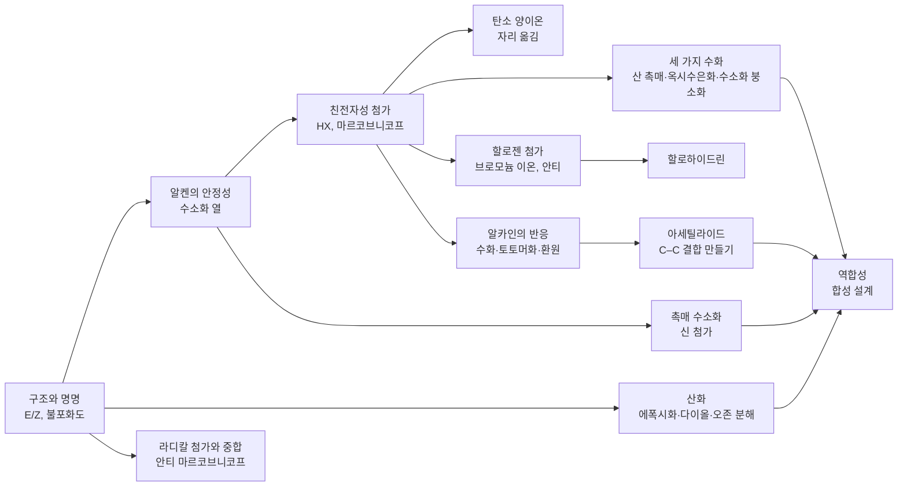

# 유기화학 5. 알켄과 알카인 — π 전자가 무엇을 붙잡고, 어느 탄소에, 어느 면으로 붙는가
<!-- prev: ochem-4, ochem-3, ochem-2, ochem-1, uchem-12 -->
<!-- next: ochem-6 -->

> [!NOTE]
> **이 단원의 범위**
> - 알켄·알카인의 구조와 IUPAC 명명법, E/Z 표기, 불포화도
> - 알켄의 안정성(수소화 열, 치환도와 초공액, 시스·트랜스)
> - 친전자성 첨가: HX 첨가와 마르코브니코프 규칙, 탄소 양이온의 자리 옮김
> - 수화(산 촉매, 옥시수은화–탈수은화, 수소화 붕소화–산화), 할로젠 첨가와 할로하이드린, 촉매 수소화
> - 산화: 에폭시화, 다이하이드록시화(신·안티), 오존 분해와 산화적 절단
> - HBr의 라디칼 첨가(안티 마르코브니코프)와 라디칼 사슬 중합
> - 알카인의 반응(첨가, 수화와 케토–엔올 토토머화, 린들라·용해 금속 환원), 아세틸라이드 음이온의 알킬화
> - 합성 설계의 기초: 역합성 분석과 위치·입체 선택성의 통제

**학습 목표**

1. 알켄·알카인을 IUPAC 규칙으로 명명하고, 칸–인골드–프렐로그 순위로 이중 결합의 E/Z를 정하며, 분자식에서 불포화도를 구해 고리와 π 결합의 수를 추론할 수 있다.
2. 수소화 열 자료로 알켄의 상대 안정성을 정량적으로 비교하고, 치환도·초공액·입체 무리로 그 경향을 설명할 수 있다.
3. HX 첨가, 산 촉매 수화, 할로젠 첨가의 메커니즘을 굽은 화살표로 쓰고, 탄소 양이온·브로모늄 이온·수은니움 이온 중간체로 위치 선택성(마르코브니코프)과 자리 옮김 여부를 예측할 수 있다.
4. 수소화 붕소화–산화, 촉매 수소화, 에폭시화, 다이하이드록시화의 고리형 전이 상태로 신 첨가를, 브로모늄 이온의 뒤쪽 공격으로 안티 첨가를 설명하고, 생성물의 입체 배치(R/S, 메조·라세미)를 판정할 수 있다.
5. 오존 분해 생성물로부터 출발 알켄의 구조를 거꾸로 추론하고, HBr의 라디칼 첨가와 라디칼 중합의 연쇄 메커니즘을 결합 해리 에너지와 열역학(천장 온도)으로 분석할 수 있다.
6. 알카인의 첨가·수화·환원을 알켄과 비교하여 생성물(케톤과 알데하이드, Z와 E 알켄)을 고르고, 아세틸라이드 음이온의 생성($\mathrm{p}K_\mathrm{a}$)과 알킬화의 한계($\mathrm{S_N2}$ 대 E2)를 판단할 수 있다.
7. 역합성 분석으로 표적 분자를 단순한 출발 물질까지 거꾸로 잘라, 위치·입체 선택성을 갖춘 다단계 합성 경로를 설계할 수 있다.

**이 단원의 학습 사다리**

| 단계 | 무엇을 하나? |
|---|---|
| STEP 1. 이전 학습 다시 보기 | 굽은 화살표, 탄소 양이온과 해먼드 가설, R/S와 메조 화합물, 라디칼 연쇄, E1·E2로 알켄 만들기 |
| STEP 2. 기초 다지기 | 장벽 차이와 생성물 비, CIP 순위 다시 매기기, 첨가와 제거의 열역학($\Delta G = \Delta H - T\Delta S$) |
| STEP 3. 핵심 개념 | 명명법·E/Z → 불포화도 → 안정성 → HX 첨가 → 세 가지 수화 → 할로젠·할로하이드린 → 수소화 → 산화 → 라디칼 첨가·중합 → 알카인 → 아세틸라이드 → 역합성 |
| STEP 4. 오개념 바로잡기 | "마르코브니코프 규칙은 H가 H 많은 쪽에 붙는다는 외울 규칙", "시스는 언제나 Z" 같은 착각 |
| STEP 5. 대학원·연구로 | 비대칭 다이하이드록시화·에폭시화, 올레핀 복분해, 비고전적 양이온 |
| STEP 6. 생활·산업·진로 | 석유화학의 에텐과 공업용 에탄올, 트랜스 지방, 폴리올레핀과 화학적 재활용, 페로몬 합성 |

---

## 🗺️ 단원 들어가기

에텐($\mathrm{CH_2{=}CH_2}$)은 세계에서 가장 많이 만들어지는 유기 화합물이다. 해마다 수억 톤의 에텐이 폴리에틸렌, 에탄올, 에틸렌 글리콜(부동액), 염화 바이닐(PVC의 단위체)로 바뀐다. 이 많은 쓰임은 모두 **하나의 결합**에서 나온다. 탄소–탄소 이중 결합 가운데 π 결합은 σ 결합보다 훨씬 약하고(약 270 kJ/mol 대 약 370 kJ/mol), 전자가 결합 축 위아래로 드러나 있다. 그래서 알켄은 전자쌍을 원하는 시약(친전자체)을 만나면 π 결합을 내주고, 그 대신 두 개의 σ 결합을 얻는다. 이것이 **첨가 반응**이다.

같은 프로펜에 물을 붙여도 조건에 따라 프로판-2-올이 되기도 하고 프로판-1-올이 되기도 한다. 같은 (Z)-뷰트-2-엔에서 다이올을 만들어도 시약에 따라 메조 화합물이 되기도 하고 라세미 혼합물이 되기도 한다. 유기화학자는 이 차이를 "어느 탄소에 무엇이 붙는가(**위치 선택성**)"와 "두 조각이 π 결합의 같은 면에서 붙는가, 반대 면에서 붙는가(**신·안티 첨가**)"라는 두 질문으로 정리한다. 두 질문의 답은 외우는 목록이 아니라 **중간체의 모양**이 정한다. 평면 탄소 양이온, 다리 걸친 브로모늄 이온, 네 원자가 한꺼번에 움직이는 고리형 전이 상태가 그것이다.

「유기 반응의 개관과 알킬 할라이드의 치환·제거 반응」에서는 알킬 할라이드에서 탄소 양이온을 만들고 양성자를 떼어 알켄을 얻었다. 이 단원은 그 길을 거꾸로 간다. 알켄과 알카인에 여러 시약을 첨가하는 반응을 익히고 나면, 처음으로 "이 분자를 만들려면 무엇에서 출발해 어떤 순서로 반응시켜야 하는가?"라는 **합성 설계**의 질문에 답할 수 있게 된다.

---

## STEP 1. 🔙 이전 학습 다시 보기

### 연계 개념표

| 이전 단원 | 그때 배운 것 | 이 단원에서 확장되는 것 |
|---|---|---|
| 일반화학 「핵화학·배위 화학·유기화학 개관」 '탄화수소', '기본 유기 반응' | 알켄·알카인의 일반식, 첨가 반응(브로민수 탈색, 수소화, 수화), 마르코브니코프 규칙을 결과로, 첨가 중합 | 규칙의 **까닭**(더 안정한 탄소 양이온, 해먼드 가설), 안티 마르코브니코프 첨가 세 가지, 입체 결과, 메커니즘으로 생성물 예측 |
| 유기화학 「구조와 결합, 산과 염기」 '혼성 오비탈', '굽은 화살표', '$\mathrm{p}K_\mathrm{a}$' | $sp^2$·$sp$ 혼성과 π 결합, 화살표 규칙과 네 기본 무늬, 말단 알카인 $\mathrm{p}K_\mathrm{a}$ 25 | π 전자가 친핵체로 작용하는 첨가 메커니즘, 아세틸라이드 음이온의 생성과 알킬화 |
| 유기화학 「알케인과 사이클로알케인」 '라디칼 할로젠화', '결합 해리 에너지' | 라디칼 연쇄(개시·전파·종결), BDE로 단계별 $\Delta H^\circ$, 라디칼 안정성 3° > 2° > 1° | HBr의 라디칼 첨가가 왜 HBr에서만 되는지 BDE로 판단, 라디칼 사슬 중합 |
| 유기화학 「입체화학」 'R/S', '메조 화합물', '반응의 입체화학' | CIP 순위, 메조·라세미, 입체 특이성, 뷰트-2-엔의 $\mathrm{Br_2}$ 안티 첨가 결과 | 같은 순위 규칙으로 **E/Z**, 신·안티 첨가의 메커니즘적 근거, 고리 화합물의 시스·트랜스 생성물 판정 |
| 유기화학 「유기 반응의 개관과 알킬 할라이드의 치환·제거 반응」 '탄소 양이온', 'E1·E2', '해먼드 가설' | 탄소 양이온의 안정성과 1,2-이동, 자이체프 규칙, $\mathrm{S_N2}$ 대 E2 경쟁 | 탄소 양이온을 **알켄 쪽에서** 만들기(되짚기만 한다), 아세틸라이드의 $\mathrm{S_N2}$와 그 한계, 이중 제거로 알카인 만들기 |

### 준비 운동 (사전 진단)

**Q1.** 프로펜에 $\mathrm{H^+}$가 붙을 때 생길 수 있는 두 탄소 양이온의 구조를 쓰고, 어느 쪽이 더 안정한지 까닭과 함께 쓰시오.

**Q2.** (E)-뷰트-2-엔에 $\mathrm{Br_2}$가 안티 첨가하면 메조-2,3-다이브로모뷰테인이 생긴다(「입체화학」). (Z)-뷰트-2-엔에서는 무엇이 생기는가?

**Q3.** 2-브로모-2-메틸뷰테인을 에탄올 속에서 나트륨 에톡사이드와 가열할 때 주로 생기는 알켄은? 이 알켄에 다시 HBr을 넣으면 무엇이 생기겠는가?

**Q4.** 결합 해리 에너지 $D(\mathrm{H{-}Br}) = 366$, $D(\mathrm{(CH_3)_2CH{-}H}) = 413\ \mathrm{kJ/mol}$일 때, $\mathrm{(CH_3)_2CH\cdot + HBr \rightarrow (CH_3)_2CH_2 + Br\cdot}$의 $\Delta H^\circ$는?

정답 및 해설

**Q1.** $\mathrm{CH_3CH^+CH_3}$(프로판-2-일 양이온, 2°)와 $\mathrm{CH_3CH_2CH_2^+}$(프로필 양이온, 1°). 2차 양이온이 더 안정하다. 양전하 탄소에 이웃한 C–H 결합이 6개로 초공액이 더 크고, 알킬기 두 개가 유도 효과로 전자를 밀어 준다(「유기 반응의 개관과 알킬 할라이드의 치환·제거 반응」 ⑤).

**Q2.** (2R,3R)-과 (2S,3S)-2,3-다이브로모뷰테인의 1 : 1 라세미 혼합물. 반응물의 기하가 생성물의 입체를 지정하는 입체 특이적 반응이다. 이 단원 ⑥에서 그 메커니즘을 본다.

**Q3.** 2-메틸뷰트-2-엔(자이체프 생성물). HBr을 넣으면 H가 C3에 붙어 3차 양이온을 거치므로 다시 2-브로모-2-메틸뷰테인이 생긴다. 제거와 첨가는 서로의 역반응이다.

**Q4.** $\Delta H^\circ = D(\mathrm{H{-}Br}) - D(\mathrm{C{-}H}) = 366 - 413 = -47\ \mathrm{kJ/mol}$(발열). 이 단계가 ⑨에서 HBr의 라디칼 첨가를 가능하게 하는 두 번째 전파 단계이다.

---

## STEP 2. 🧱 기초 다지기

### 디딤돌 1. 탄소 양이온과 해먼드 가설 되짚기 — 장벽의 차이가 생성물의 비를 정한다

「유기 반응의 개관과 알킬 할라이드의 치환·제거 반응」에서 정리한 두 가지만 되짚는다.

1. 탄소 양이온의 안정성은 3° > 2° > 1° > 메틸이며, 알릴·벤질 양이온은 공명으로 더 안정하다. 더 안정한 양이온이 될 수 있으면 1,2-수소화 이온 이동이나 1,2-알킬 이동이 빠르게 일어난다.
2. **해먼드 가설**: 흡열 단계의 전이 상태는 생성물을 닮는다. 알켄에 $\mathrm{H^+}$가 붙어 탄소 양이온이 생기는 단계는 크게 흡열이므로, 그 전이 상태는 탄소 양이온을 닮고 양이온의 안정성 차이가 전이 상태의 에너지 차이로 거의 그대로 옮겨진다.

두 경로가 서로 바뀌지 않는 생성물을 주면(속도론적 지배) 생성물의 비는 속도 상수의 비이고, 아이링 식에서 앞의 인자가 지워진다.

$$
\frac{[\mathrm{P_1}]}{[\mathrm{P_2}]} = \frac{k_1}{k_2} = e^{\Delta\Delta G^\ddagger/RT}, \qquad 25\ ^\circ\mathrm{C}\text{에서 } \Delta\Delta G^\ddagger = 5.71\ \mathrm{kJ/mol}\text{마다 10배}
$$

#### 예제 1 — 두 양성자화 경로의 경쟁

프로펜의 양성자화에서 2차 양이온으로 가는 전이 상태가 1차 양이온으로 가는 전이 상태보다 $25\ \mathrm{kJ/mol}$ 낮다고 하자(가상의 어림값). 25 ℃에서 두 경로의 속도 비를 구하고, HBr 첨가의 생성물 조성을 예측하시오.

**풀이**
식 세우기: $k_{2^\circ}/k_{1^\circ} = e^{\Delta\Delta G^\ddagger/RT}$. 대입: $RT = 8.314\times298.15 = 2479\ \mathrm{J/mol}$, $25\,000/2479 = 10.09$, $e^{10.09} = 2.4\times10^4$.
2차 양이온 경로가 약 24 000배 빠르므로 생성물은 사실상 모두 2-브로모프로페인(99.99 % 이상)이다.
**의미** 기체상에서 2차와 1차 양이온의 안정성 차이는 약 90 kJ/mol에 이르고, 용액에서는 용매화로 줄어들지만 여전히 수십 kJ/mol이다. 장벽 차이가 그 일부만 반영해도 선택성은 압도적이다. 마르코브니코프 규칙이 '경향'이 아니라 거의 '법칙'처럼 보이는 까닭이다.

### 디딤돌 2. CIP 순위 다시 매기기 — 다중 결합은 원자를 겹쳐 센다

「입체화학」의 칸–인골드–프렐로그(CIP) 규칙을 그대로 쓴다. ⑴ 붙은 원자의 원자 번호가 큰 쪽이 높다. ⑵ 같으면 바깥쪽으로 한 껍질씩 나아가며 원자 집합을 큰 것부터 비교해 처음 차이 나는 곳에서 정한다. ⑶ 이중·삼중 결합은 상대 원자를 그 수만큼 **겹쳐 센다**(복제 원자). 이 단원에서는 이 순위를 입체 중심이 아니라 **이중 결합의 양쪽 탄소**에 적용해 E/Z를 정한다(STEP 3 ①).

| 원자단 | 첫 원자에 붙은 원자 집합 | 다음 껍질에서 가장 높은 가지 |
|---|---|---|
| $\mathrm{-CH(CH_3)_2}$ (프로판-2-일) | (C, C, H) | $\mathrm{CH_3}$: (H, H, H) |
| $\mathrm{-CH{=}CH_2}$ (바이닐) | (C, C, H) — =C를 한 번 더 셈 | $\mathrm{=CH_2}$: (C, H, H) — 복제 C 포함 |
| $\mathrm{-C(CH_3)_3}$ (tert-뷰틸) | (C, C, C) | $\mathrm{CH_3}$: (H, H, H) |
| $\mathrm{-C{\equiv}CH}$ (에타인일) | (C, C, C) — ≡C를 세 번 셈 | $\mathrm{{\equiv}CH}$: (C, C, H) |

#### 예제 2 — 네 탄화수소 원자단의 순위

$\mathrm{-C{\equiv}CH}$, $\mathrm{-C(CH_3)_3}$, $\mathrm{-CH{=}CH_2}$, $\mathrm{-CH(CH_3)_2}$를 CIP 순위가 높은 것부터 쓰시오.

**풀이**
첫 껍질: 에타인일과 tert-뷰틸은 (C, C, C), 바이닐과 프로판-2-일은 (C, C, H)이므로 앞의 둘이 높다.
에타인일 대 tert-뷰틸: 다음 껍질에서 에타인일의 끝 탄소는 (C, C, H)(복제 C 둘), tert-뷰틸의 메틸은 (H, H, H)이므로 에타인일이 높다.
바이닐 대 프로판-2-일: 바이닐의 $\mathrm{=CH_2}$는 (C, H, H), 프로판-2-일의 메틸은 (H, H, H)이므로 바이닐이 높다.
순위: $\mathrm{-C{\equiv}CH} > \mathrm{-C(CH_3)_3} > \mathrm{-CH{=}CH_2} > \mathrm{-CH(CH_3)_2}$ (네 원자단을 한 탄소에 붙인 분자를 RDKit의 CIP 판정으로 확인했다).
**의미** 수소가 적게 붙은 원자단이 늘 높은 것은 아니다. 겹쳐 센 원자 때문에 바이닐이 가지가 더 많은 프로판-2-일보다 높다. 이 감각이 E/Z를 정할 때 그대로 쓰인다.

### 디딤돌 3. 첨가와 제거의 열역학 — $\Delta G = \Delta H - T\Delta S$

첨가 반응은 π 결합 하나와 시약의 σ 결합 하나를 끊고 σ 결합 두 개를 만든다. π 결합은 약하므로 첨가는 대개 **발열**이다. 그러나 두 분자가 하나가 되므로 **엔트로피는 줄어든다**. 따라서 낮은 온도에서는 첨가가, 높은 온도에서는 그 역반응인 제거가 유리하다. 일반화학 「화학 열역학」의 전환 온도 $T^* = \Delta H^\circ/\Delta S^\circ$가 이 경쟁의 경계선이다.

| 끊는 결합 | $D$ (kJ/mol, 약) | 만드는 결합 | $D$ (kJ/mol, 약) |
|---|---|---|---|
| C=C의 π 결합 | 270 | C–H (에틸기의 1°) | 421 |
| H–Br | 366 | C–Br ($\mathrm{CH_3CH_2{-}Br}$) | 293 |

(π 결합 세기는 알켄의 시스–트랜스 회전 장벽에서 얻은 어림값이다. 나머지는 「알케인과 사이클로알케인」 디딤돌 3의 표와 같은 계열의 값이다.)

#### 예제 3 — 에텐과 HBr: 어느 온도까지 첨가가 유리한가

(1) 위 표로 $\mathrm{CH_2{=}CH_2(g) + HBr(g) \rightarrow CH_3CH_2Br(g)}$의 $\Delta H^\circ$를 어림하시오. (2) 표준 몰 엔트로피 $S^\circ$(J/(mol·K), 약)가 에텐 219.3, HBr 198.7, 브로모에테인(기체) 286.7일 때 25 ℃의 $\Delta G^\circ$와, 첨가와 제거가 맞먹는 온도를 구하시오. (실측 $\Delta H^\circ \approx -78\ \mathrm{kJ/mol}$)

**풀이**
(1) $\Delta H^\circ \approx (270 + 366) - (421 + 293) = 636 - 714 = -78\ \mathrm{kJ/mol}$. 생성 엔탈피로 구한 실측값과 거의 같다.
(2) $\Delta S^\circ = 286.7 - (219.3 + 198.7) = -131.3\ \mathrm{J/K}$. $\Delta G^\circ = -78.0 - 298.15\times(-0.1313) = -38.9\ \mathrm{kJ/mol}$, $K \approx 6\times10^6$으로 첨가 쪽에 크게 치우친다.
$T^* = \dfrac{\Delta H^\circ}{\Delta S^\circ} = \dfrac{-78\,000}{-131.3} = 594\ \mathrm{K} \approx 320\ ^\circ\mathrm{C}$.
**의미** 실온에서 첨가가 열역학적으로 유리하고, 약 320 ℃보다 높은 온도에서는 브로모에테인이 HBr을 잃고 에텐으로 돌아가는 제거가 유리해진다. 「유기 반응의 개관과 알킬 할라이드의 치환·제거 반응」에서 "가열하면 제거"라 한 경험 규칙의 열역학적 뿌리이며, ⑨에서 중합체가 높은 온도에서 단위체로 되돌아가는 **천장 온도**로 다시 나온다.

---

## STEP 3. 📘 핵심 개념

### ① 알켄·알카인의 구조와 명명법, E/Z 표기

#### 구조 — 왜 이중 결합은 돌지 않는가

알켄의 이중 결합 탄소는 $sp^2$ 혼성으로 평면 삼각형(약 120°)이고, 두 탄소의 남은 p 오비탈이 나란히 겹쳐 π 결합을 만든다. C=C 축을 돌리려면 p 오비탈의 겹침을 끊어야 하므로 회전 장벽이 약 270 kJ/mol에 이른다(실온의 열에너지 $RT \approx 2.5\ \mathrm{kJ/mol}$와 비교하라). 그래서 이중 결합의 양쪽 치환기 배치는 고정되고 **시스·트랜스 이성질 현상**이 생긴다. 알카인의 삼중 결합 탄소는 $sp$ 혼성으로 직선형(180°)이며, 서로 수직인 π 결합 두 개가 C≡C 축을 원통형으로 둘러싼다(「구조와 결합, 산과 염기」 ②).

| 성질 | 에테인 | 에텐 | 에타인 |
|---|---|---|---|
| 탄소의 혼성 | $sp^3$ | $sp^2$ | $sp$ |
| C–C 결합 길이 (pm, 약) | 154 | 134 | 120 |
| C–C 결합 해리 에너지 (kJ/mol, 약) | 377 | 728 | 965 |
| π 결합 수 | 0 | 1 | 2 |
| C–H의 $\mathrm{p}K_\mathrm{a}$ (약) | 50 | 44 | 25 |

#### IUPAC 명명법

1. **어미**: 알켄은 '-엔'(-ene), 알카인은 '-아인'(-yne). 이중·삼중 결합을 **포함하는** 가장 긴 사슬을 주사슬로 고르고, 다중 결합의 첫 탄소 번호를 어미 앞에 쓴다: 뷰트-1-엔, 헥스-3-아인. (2013년 IUPAC 권고는 다중 결합과 관계없이 가장 긴 사슬을 먼저 고르지만, 이 단원의 예에서는 두 방식이 같은 이름을 준다.)
2. **번호 매기기**: 다중 결합에 가장 작은 번호를 준다. 이중·삼중 결합이 함께 있으면 둘을 합한 번호 집합이 작게 되도록 매기고, 같으면 **이중 결합**에 작은 번호를 준다. 이름은 '-엔'을 먼저, '-아인'을 뒤에 쓴다(펜트-1-엔-4-아인).
3. **하이드록시기 같은 주 작용기**가 있으면 그것에 가장 작은 번호를 주고 어미를 바꾼다: $\mathrm{CH_2{=}CHCH(OH)CH_3}$는 뷰트-3-엔-2-올.
4. **고리 알켄**은 이중 결합 탄소를 C1·C2로 두고, 치환기 번호가 작아지는 방향으로 돈다: 1-메틸사이클로헥센, 3-메틸사이클로헥센.
5. **관용명과 치환기 이름**: 에틸렌(에텐), 프로필렌(프로펜), 아세틸렌(에타인), 바이닐기 $\mathrm{CH_2{=}CH{-}}$(에텐일), 알릴기 $\mathrm{CH_2{=}CHCH_2{-}}$(프로프-2-엔-1-일), 메틸리덴기 $\mathrm{CH_2{=}}$.

#### E/Z 표기

시스·트랜스는 이중 결합 양쪽에 같은 원자단이 하나씩 있을 때만 쓸 수 있다. 일반적인 경우에는 이중 결합의 **각 탄소마다** 두 치환기의 CIP 순위를 매기고, 높은 순위의 두 원자단이

- 같은 쪽에 있으면 **Z**(독일어 zusammen, 함께),
- 반대쪽에 있으면 **E**(entgegen, 반대)

라 한다. 이름 맨 앞에 괄호로 쓴다: (E)-뷰트-2-엔. 고리 안의 이중 결합은 고리가 8원자 이상일 때에야 트랜스가 가능하므로, 사이클로헥센처럼 작은 고리에서는 E/Z를 쓰지 않는다.

> [!WARNING]
> **시스가 언제나 Z인 것은 아니다.** 시스·트랜스는 '같은 원자단'의 상대 위치이고, E/Z는 '순위가 높은 원자단'의 상대 위치이다. $\mathrm{CH_3C(Cl){=}CHCH_3}$에서 두 메틸기가 같은 쪽에 있으면 탄화수소 사슬로 보아 '시스'처럼 보이지만, C2에서는 Cl이 $\mathrm{CH_3}$보다 높으므로 높은 순위 원자단(Cl과 C4의 $\mathrm{CH_3}$)은 반대쪽이다. 이 분자는 (E)-2-클로로뷰트-2-엔이다.

<!-- fig:ochem-5-ez-assignment -->

#### 예제 4 — 이름과 E/Z 매기기

다음을 IUPAC 이름(E/Z 포함)으로 쓰시오.
(1) $\mathrm{CH_3CH{=}C(CH_3)CH_2CH_3}$ — C1의 $\mathrm{CH_3}$와 에틸기가 이중 결합의 반대쪽
(2) $\mathrm{ClCH_2C(CH_3){=}C(CH_3)CH_2CH_3}$ — $\mathrm{ClCH_2}$와 에틸기가 같은 쪽
(3) $\mathrm{CH_3CH{=}CH{-}C{\equiv}CH}$ — 두 H가 이중 결합의 반대쪽
(4) $\mathrm{CH_2{=}CH{-}CH_2{-}C{\equiv}CH}$

**풀이**
(1) 이중 결합을 포함하는 가장 긴 사슬은 5개 탄소(C1 메틸부터 에틸의 끝까지)이며 C2에서 시작하는 이중 결합, C3에 메틸. C2: $\mathrm{CH_3}$ > H, C3: 에틸 > 메틸. 높은 두 원자단이 반대쪽이므로 **(E)-3-메틸펜트-2-엔**(SMILES `C/C=C(\C)CC`).
(2) 주사슬은 Cl이 붙은 탄소부터 에틸 끝까지 5개 탄소, 이중 결합 C2=C3, 메틸 두 개. C2: $\mathrm{CH_2Cl}$ (Cl, H, H) > $\mathrm{CH_3}$, C3: 에틸 > 메틸. 같은 쪽이므로 **(Z)-1-클로로-2,3-다이메틸펜트-2-엔**(SMILES `ClC/C(C)=C(\CC)C`).
(3) 번호 집합: 삼중 결합 쪽에서 매기면 {1, 3}, 반대쪽에서 매기면 {2, 4}이므로 삼중 결합 쪽부터. 이중 결합은 C3=C4이고 각 탄소의 높은 원자단(C5의 메틸, C2의 에타인일)이 반대쪽이다. **(E)-펜트-3-엔-1-아인**(SMILES `C/C=C/C#C`).
(4) 어느 쪽에서 매겨도 번호 집합이 {1, 4}로 같으므로 이중 결합에 작은 번호를 준다. **펜트-1-엔-4-아인**. 말단 이중 결합은 한 탄소에 H가 둘이라 E/Z가 없다.
**확인** 모든 E/Z는 RDKit의 이중 결합 입체 판정으로 확인했다.

#### ✔ 바로 확인

1. (O/X) 사이클로헥센의 이중 결합은 (Z)로 표기해야 한다.
2. 빈칸: 이중 결합의 각 탄소에서 순위가 높은 두 원자단이 같은 쪽에 있으면 (    ), 반대쪽이면 (    )이다.
3. $\mathrm{CH_2{=}CHCH(OH)CH_3}$의 IUPAC 이름은?
4. 고르기: E/Z 이성질체가 **없는** 것은? (가) 뷰트-2-엔 (나) 2-메틸뷰트-2-엔 (다) 펜트-2-엔

정답

1. X — 6원자 고리에서는 트랜스 이중 결합이 불가능하므로 이성질체가 하나뿐이고 E/Z를 쓰지 않는다.
2. Z, E
3. 뷰트-3-엔-2-올 — 하이드록시기에 작은 번호를 준다.
4. (나) — C2에 메틸이 두 개 붙어 있어 C2의 두 치환기가 같다.

### ② 불포화도 — 분자식이 말해 주는 고리와 π 결합의 수

탄소 $n$개의 사슬 모양 알케인은 $\mathrm{C}_n\mathrm{H}_{2n+2}$이다. 고리를 하나 만들거나 π 결합을 하나 만들 때마다 수소 2개가 줄어든다. 그래서 '포화된 사슬 모양 화합물보다 모자란 수소 쌍의 수'를 **불포화도**(degree of unsaturation, 수소 결핍 지수)라 하며, 이것은 **고리 수 + π 결합 수**이다.

**유도** 탄소 $C$개, 수소 $H$개, 질소 $N$개, 할로젠 $X$개인 분자를 생각한다.
- 할로젠은 H처럼 결합을 하나만 하므로 H 하나로 센다.
- 산소(2가)는 C–C 사이나 C–H 사이에 끼워 넣어도 수소 수를 바꾸지 않으므로 무시한다($\mathrm{C_2H_6}$ → $\mathrm{C_2H_6O}$).
- 질소(3가)는 끼워 넣을 때마다 결합 자리가 하나 늘어 수소를 하나 더 가질 수 있다($\mathrm{CH_4}$ → $\mathrm{CH_5N}$, 메틸아민).

따라서 포화된 사슬 모양 기준 화합물의 수소 수는 $2C + 2 + N$이고

$$
\text{불포화도} = \frac{(2C + 2 + N) - (H + X)}{2}
$$

이다. 고리와 π 결합을 가르려면 촉매 수소화로 흡수되는 $\mathrm{H_2}$의 몰수(π 결합 수, 방향족 고리는 보통 조건에서 수소화되지 않는다)를 따로 잰다(⑦).

| 분자식 | 불포화도 | 가능한 구조 예 |
|---|---|---|
| $\mathrm{C_6H_{12}}$ | 1 | 헥스-1-엔(π 1) 또는 사이클로헥세인(고리 1) |
| $\mathrm{C_6H_{10}}$ | 2 | 사이클로헥센(고리 1 + π 1), 헥스-1-아인(π 2), 헥사-1,5-다이엔(π 2) |
| $\mathrm{C_6H_6}$ | 4 | 벤젠(고리 1 + π 3) |
| $\mathrm{C_2H_3Cl}$ | 1 | 클로로에텐(염화 바이닐) |
| $\mathrm{C_5H_5N}$ | 4 | 피리딘(고리 1 + π 3) |

#### 예제 5 — 불포화도와 수소 흡수량

(1) 감귤 껍질의 향 성분 리모넨은 $\mathrm{C_{10}H_{16}}$이고, Pd 촉매에서 $\mathrm{H_2}$ 2몰을 흡수해 $\mathrm{C_{10}H_{20}}$이 된다. 고리는 몇 개인가? (2) 클로로프렌(합성 고무 단위체) $\mathrm{C_4H_5Cl}$과 아미노산 페닐알라닌 $\mathrm{C_9H_{11}NO_2}$의 불포화도를 구하시오.

**풀이**
(1) 불포화도 $= (2\times10 + 2 - 16)/2 = 3$. 흡수한 $\mathrm{H_2}$가 2몰이므로 π 결합 2개, 남은 1이 고리이다. 리모넨은 고리 하나에 이중 결합 두 개(하나는 고리 안, 하나는 곁가지)를 가진다.
(2) 클로로프렌: $(8 + 2 - 5 - 1)/2 = 2$ — 실제 구조 $\mathrm{CH_2{=}CCl{-}CH{=}CH_2}$의 이중 결합 2개. 페닐알라닌: $(18 + 2 + 1 - 11)/2 = 5$ — 벤젠 고리(고리 1 + π 3)와 카복실기의 C=O(π 1). 산소는 셈에 들어가지 않는다.
**의미** 분자식만으로 구조 후보를 크게 좁힐 수 있다. 「구조 결정: 질량 분석법과 분광법」에서 질량 분석으로 분자식을 얻은 뒤 가장 먼저 하는 일이 불포화도 계산이다.

#### ✔ 바로 확인

1. $\mathrm{C_5H_8}$의 불포화도는?
2. (O/X) 분자식에 산소가 들어 있으면 산소 원자 수만큼 불포화도를 빼야 한다.
3. 불포화도 2인 $\mathrm{C_6H_{10}}$이 $\mathrm{H_2}$를 1몰만 흡수했다. 고리는 몇 개인가?

정답

1. 2 — $(10 + 2 - 8)/2$.
2. X — 2가 원자인 산소는 수소 수를 바꾸지 않으므로 무시한다.
3. 1개 — π 결합 1 + 고리 1(예: 사이클로헥센).

### ③ 알켄의 안정성 — 수소화 열로 재는 이중 결합의 에너지

#### 수소화 열

이성질체 알켄의 안정성을 비교하는 가장 깔끔한 방법은 같은 알케인으로 수소화할 때 나오는 열을 재는 것이다. 뷰트-1-엔, (Z)-뷰트-2-엔, (E)-뷰트-2-엔은 모두 뷰테인이 되므로, 나중 상태가 같고 처음 상태의 에너지만 다르다. **수소화 열이 작을수록 알켄이 더 안정하다**(헤스 법칙, 일반화학 「열화학」).

$$
\mathrm{R_2C{=}CR_2 + H_2 \xrightarrow{\;Pt\ 또는\ Pd\;} R_2CH{-}CHR_2}, \qquad \Delta H^\circ_\text{수소화} < 0
$$

| 알켄 | 이중 결합 탄소의 치환도 | $-\Delta H^\circ_\text{수소화}$ (kJ/mol, 약) |
|---|---|---|
| 에텐 $\mathrm{CH_2{=}CH_2}$ | 치환 없음 | 137 |
| 프로펜 $\mathrm{CH_3CH{=}CH_2}$ | 일치환 | 126 |
| 뷰트-1-엔 $\mathrm{CH_3CH_2CH{=}CH_2}$ | 일치환 | 127 |
| (Z)-뷰트-2-엔 | 이치환(시스) | 120 |
| 2-메틸프로펜 $\mathrm{(CH_3)_2C{=}CH_2}$ | 이치환(한 탄소에 둘) | 119 |
| (E)-뷰트-2-엔 | 이치환(트랜스) | 116 |
| 2-메틸뷰트-2-엔 $\mathrm{(CH_3)_2C{=}CHCH_3}$ | 삼치환 | 113 |
| 2,3-다이메틸뷰트-2-엔 $\mathrm{(CH_3)_2C{=}C(CH_3)_2}$ | 사치환 | 111 |

(기체상 또는 용액의 값으로, 자료에 따라 2~3 kJ/mol씩 다르다.)

<!-- fig:ochem-5-butene-hydrogenation -->

#### 경향과 그 까닭

1. **치환도**: 이중 결합 탄소에 알킬기가 많이 붙을수록 안정하다(사치환 > 삼치환 > 이치환 > 일치환 > 치환 없음). 알킬기 하나가 늘 때마다 약 5~10 kJ/mol씩 안정해진다.
   - **초공액**: 이웃한 C–H σ 결합이 π 계(특히 비어 있는 π* 오비탈)와 겹쳐 전자를 조금 나눈다. 탄소 양이온의 초공액(「유기 반응의 개관과 알킬 할라이드의 치환·제거 반응」)과 같은 효과가 더 약하게 나타난 것이다.
   - **결합 세기**: 알킬기가 $sp^2$ 탄소에 붙으면 $sp^2$–$sp^3$ C–C 결합이 생긴다. s 성격이 큰 $sp^2$ 오비탈이 만드는 결합은 $sp^3$–$sp^3$ 결합보다 짧고 강하다(「구조와 결합, 산과 염기」 ②). 치환된 알켄일수록 이런 강한 결합을 많이 가진다.
2. **시스·트랜스**: 같은 치환도에서는 트랜스(E)가 시스(Z)보다 안정하다. 시스에서는 두 알킬기가 같은 쪽에 놓여 판데르발스 반발(입체 무리)을 일으킨다. 뷰트-2-엔에서 그 차이는 약 4 kJ/mol이고, 치환기가 클수록 커진다. (Z)-2,2,5,5-테트라메틸헥스-3-엔처럼 두 tert-뷰틸기가 시스이면 차이가 약 40 kJ/mol을 넘는다.

이 경향은 이미 「유기 반응의 개관과 알킬 할라이드의 치환·제거 반응」의 **자이체프 규칙**에서 보았다. E1·E2의 전이 상태에는 C=C가 부분적으로 생겨 있어, 더 치환된 알켄을 만드는 경로가 더 낮은 장벽을 가진다.

#### 예제 6 — 수소화 열에서 이성질화의 열역학으로

(1) 위 표로 뷰트-1-엔 → (E)-뷰트-2-엔 이성질화의 $\Delta H^\circ$와 (Z) → (E) 이성질화의 $\Delta H^\circ$를 구하시오. (2) 산 촉매로 (Z)-뷰트-2-엔과 (E)-뷰트-2-엔을 25 ℃에서 평형에 이르게 했다. (Z) → (E)의 $\Delta G^\circ \approx -2.9\ \mathrm{kJ/mol}$일 때 평형 혼합물의 조성을 구하시오.

**풀이**
(1) 두 반응을 헤스 법칙으로 엮는다. 뷰트-1-엔 + $\mathrm{H_2}$ → 뷰테인($-127$)에서 (E)-뷰트-2-엔 + $\mathrm{H_2}$ → 뷰테인($-116$)을 빼면 뷰트-1-엔 → (E)-뷰트-2-엔: $\Delta H^\circ = -127 - (-116) = -11\ \mathrm{kJ/mol}$. 같은 방법으로 (Z) → (E): $-120 - (-116) = -4\ \mathrm{kJ/mol}$.
(2) $K = e^{-\Delta G^\circ/RT} = e^{2900/2479} = e^{1.170} = 3.2$. (E)의 몰분율 $= K/(1 + K) = 0.76$ → (E) : (Z) ≈ 76 : 24.
**의미** 4 kJ/mol의 엔탈피 차이도 평형에서는 3배의 차이를 만든다. $\Delta G^\circ$가 $\Delta H^\circ$보다 조금 작은 것은 엔트로피 차이가 작게나마 (Z) 쪽을 돕기 때문이다. 산 촉매 이성질화는 ④의 양성자화 → 탄소 양이온 → 탈양성자화가 앞뒤로 오가며 일어난다.

#### ✔ 바로 확인

1. 안정한 순서로 쓰시오: 2-메틸뷰트-2-엔, 펜트-1-엔, (E)-펜트-2-엔
2. (O/X) 수소화 열이 큰 알켄일수록 더 안정하다.
3. 빈칸: 같은 치환도의 알켄에서 시스형이 트랜스형보다 불안정한 주된 까닭은 (    )이다.

정답

1. 2-메틸뷰트-2-엔(삼치환) > (E)-펜트-2-엔(이치환 트랜스) > 펜트-1-엔(일치환)
2. X — 같은 알케인이 될 때 내놓는 열이 클수록 처음 에너지가 높은, 덜 안정한 알켄이다.
3. 두 알킬기 사이의 입체 무리(판데르발스 반발)

### ④ 친전자성 첨가 — HX 첨가와 마르코브니코프 규칙

#### 메커니즘: 두 단계

알켄의 π 전자는 결합 축 위아래로 드러나 있고 원자핵에 약하게 붙들려 있어, 알켄은 **친핵체**로 작용한다. 강산 HX(HCl, HBr, HI)의 $\mathrm{H}$가 친전자체이다.

1. **양성자화(속도 결정 단계)**: π 결합의 전자쌍 → HX의 H, H–X 결합의 전자쌍 → X (화살표 2개). 탄소 양이온과 $\mathrm{X^-}$가 생긴다. π 결합(약 270 kJ/mol)이 끊기고 C–H 결합이 생기지만 양전하가 생기므로 크게 흡열이다.
2. **친핵체의 결합**: $\mathrm{X^-}$의 비공유 전자쌍 → 탄소 양이온의 C⁺ (화살표 1개). 빠르고 크게 발열이다.

$$
\mathrm{CH_3CH{=}CH_2 + HBr \longrightarrow \big[\,CH_3\overset{+}{C}HCH_3\ \ Br^-\,\big] \longrightarrow CH_3CHBrCH_3}
$$

산이 셀수록 빠르다: HI > HBr > HCl ≫ HF. (속도 법칙의 HX 차수는 용매에 따라 1차보다 높게 나오기도 하는데, HX 분자가 두 개 이상 함께 양성자를 넘겨주기 때문이다.) 탄소 양이온이 중간체라는 증거는 ⑴ 더 안정한 양이온을 만드는 알켄일수록 빠르고(2-메틸프로펜 ≫ 프로펜 > 에텐), ⑵ 탄소 골격이 바뀐 생성물(자리 옮김)이 나오며, ⑶ 새 입체 중심이 생기면 라세미 혼합물이 생긴다는 것이다.

#### 마르코브니코프 규칙 — 외울 규칙에서 예측할 원리로

1869년 마르코브니코프(Markovnikov)는 비대칭 알켄에 HX가 첨가될 때 **H는 이미 H가 더 많이 붙은 탄소에, X는 알킬기가 더 많이 붙은 탄소에** 붙는다는 경험 규칙을 내놓았다. 메커니즘으로 보면 이 규칙은 다음과 같이 다시 쓸 수 있다.

> [!IMPORTANT]
> **마르코브니코프 규칙(메커니즘적 표현)** — 친전자성 첨가에서 친전자체($\mathrm{H^+}$)는 **더 안정한 탄소 양이온이 생기는 쪽 탄소**에 붙는다. 해먼드 가설에 따라 흡열인 양성자화 단계의 전이 상태는 탄소 양이온을 닮으므로, 더 안정한 양이온으로 가는 전이 상태가 더 낮다.

이 표현은 원래 규칙보다 넓게 쓰인다. 스타이렌($\mathrm{C_6H_5CH{=}CH_2}$)에서는 H가 말단 $\mathrm{CH_2}$에 붙어 공명으로 안정한 벤질 양이온이 생기고, 생성물은 (1-브로모에틸)벤젠이다. 원래 규칙(두 탄소 모두 H 수가 다르다)으로도 맞지만, 메커니즘적 표현은 왜 그런지까지 알려 준다. 반대로 $\mathrm{CF_3CH{=}CH_2}$에서는 전자 끌기 $\mathrm{CF_3}$ 옆에 양전하가 생기는 것이 매우 불리하므로 H가 가운데 탄소에 붙어 원래 규칙과 '반대' 생성물($\mathrm{CF_3CH_2CH_2X}$)이 생긴다. 규칙의 진짜 내용은 '수소의 수'가 아니라 '양이온의 안정성'이다.

<!-- 그림 요청: 프로펜(SMILES CC=C)과 HBr의 친전자성 첨가 메커니즘과 두 경로의 에너지 도표를 위아래로. (위) 메커니즘: 1단계에서 C=C π 결합 가운데 → HBr의 H로 굽은 화살표, H–Br 결합 → Br로 굽은 화살표(2개). 주 경로: H가 C1(CH2)에 붙어 프로판-2-일 양이온(SMILES C[CH+]C, 가운데 C에 ⊕, 평면·빈 p 오비탈) + Br⁻(전자쌍 4개). 2단계: Br⁻ 전자쌍 → C⁺ 화살표 1개 → 2-브로모프로페인(SMILES CC(C)Br, '주생성물'). 옅은 색 부 경로: H가 C2에 붙어 프로필 양이온(SMILES CC[CH2+], 1°) → 1-브로모프로페인(SMILES CCCBr, '거의 생기지 않음'). (아래) 에너지 도표: 세로축 G, 가로축 반응 좌표. 공통 출발점 '프로펜 + HBr'(0)에서 두 곡선이 갈라짐. 2° 경로: TS1 약 +80, 중간체 2° 양이온 약 +60, TS2 약 +65, 생성물 −40 정도. 1° 경로(점선): TS1 약 +105, 1° 양이온 약 +95. 두 TS1의 높이 차를 'ΔΔG‡'로 표시하고, TS1이 양이온 쪽(반응 좌표 오른쪽)에 치우친 모양에 '해먼드: 흡열 단계의 TS는 양이온을 닮는다' 메모. 수치는 정성적 배치이며 축에 눈금 숫자를 쓰지 않는다. -->

#### 입체화학 — 평면 양이온은 두 면에서 공격받는다

탄소 양이온은 평면이므로 $\mathrm{X^-}$는 양쪽 면에서 같은 확률로 접근한다. 뷰트-1-엔에 HBr이 첨가되면 C2가 새 입체 중심이 되어 (R)-과 (S)-2-브로모뷰테인(SMILES `C[C@@H](Br)CC`, `C[C@H](Br)CC`)이 1 : 1로 생긴다. 아카이랄한 반응물과 시약에서는 광학 활성 생성물이 생기지 않는다(「입체화학」 '반응의 입체화학' 원리 1). 고리 알켄에서는 H와 X가 같은 면(신)과 반대 면(안티)에 붙은 생성물이 섞여 생기므로, HX 첨가는 **입체 선택성이 없는** 첨가로 본다.

#### 예제 7 — 주생성물 예측

다음 반응의 주생성물을 쓰시오. 새 입체 중심이 생기면 입체 결과도 쓰시오.
(1) 2-메틸프로펜 + HBr (2) 1-메틸사이클로헥센 + HCl (3) (E)-펜트-2-엔 + HBr (4) 스타이렌 + HBr

**풀이**
(1) H는 $\mathrm{CH_2}$에 붙어 tert-뷰틸 양이온(3°)을 거친다 → **2-브로모-2-메틸프로페인**. 입체 중심 없음.
(2) H는 고리의 C2(H가 붙은 이중 결합 탄소)에 붙고 3차 양이온이 C1에 생긴다 → **1-클로로-1-메틸사이클로헥세인**. C1에 메틸과 Cl이 함께 붙어 입체 중심이 아니다.
(3) C2·C3 어느 쪽에 H가 붙어도 2차 양이온이 생기고 안정성이 비슷하다 → **2-브로모펜테인과 3-브로모펜테인의 혼합물**(2-브로모펜테인은 라세미). 위치 선택성을 기대할 수 없는 기질이므로 합성에는 쓰지 않는다.
(4) H는 말단 $\mathrm{CH_2}$에, Br은 벤젠 고리가 붙은 탄소에 → **(1-브로모에틸)벤젠** $\mathrm{C_6H_5CHBrCH_3}$, 라세미. 벤질 양이온의 공명 안정화 덕분에 매우 빠르다.
**의미** 생성물을 정하는 질문은 늘 "어느 쪽에 양성자가 붙어야 더 안정한 양이온이 생기는가"이다. 두 양이온의 안정성이 비슷하면 선택성도 없다.

#### 탄소 양이온의 자리 옮김

첨가에서도 탄소 양이온은 「유기 반응의 개관과 알킬 할라이드의 치환·제거 반응」 ⑤에서 본 1,2-수소화 이온 이동·1,2-메틸 이동으로 더 안정한 양이온이 될 수 있다. 이웃 탄소에 옮겨 올 H나 알킬기가 있고 옮긴 뒤 더 안정해지면, 친핵체에 잡히기 전에 자리 옮김이 끼어든다. 두 과정(포획과 이동)이 경쟁하므로 생성물은 섞여 나온다. 3-메틸뷰트-1-엔에 HCl을 첨가하면 자리 옮기지 않은 2-클로로-3-메틸뷰테인과 자리 옮긴 2-클로로-2-메틸뷰테인이 비슷한 양으로 생긴다.

<!-- 그림 요청: 3-메틸뷰트-1-엔(SMILES C=CC(C)C)과 HCl의 첨가에서 자리 옮김. 1단계: C=C π → HCl의 H, H–Cl → Cl 화살표 2개 → 3-메틸뷰탄-2-일 양이온(SMILES C[CH+]C(C)C, C2에 ⊕, '2°'). 여기서 두 갈래. (가) 왼쪽 아래: Cl⁻ 전자쌍 → C2⁺ 화살표 → 2-클로로-3-메틸뷰테인(SMILES CC(Cl)C(C)C, '자리 옮기지 않음, 라세미'). (나) 오른쪽: C3–H 결합의 전자쌍 → C2⁺로 굽은 화살표 1개(1,2-수소화 이온 이동) → 2-메틸뷰탄-2-일 양이온(SMILES CC[C+](C)C, C2에 ⊕, '3°') → Cl⁻ 전자쌍 → C⁺ 화살표 → 2-클로로-2-메틸뷰테인(SMILES CCC(C)(C)Cl, '자리 옮김'). 두 생성물 아래에 '비슷한 양'. 옮겨 가는 H를 색으로 강조한다. -->

#### 예제 8 — 자리 옮김을 예상하기

다음 알켄에 HBr을 첨가할 때 자리 옮김이 일어날 수 있는지 판단하고, 일어난다면 자리 옮긴 생성물을 쓰시오. (1) 3,3-다이메틸뷰트-1-엔 (2) 바이닐사이클로헥세인(사이클로헥실에텐) (3) 2-메틸뷰트-2-엔

**풀이**
(1) H가 C1에 붙어 3,3-다이메틸뷰탄-2-일 양이온(2°)이 생긴다. 이웃 C3의 메틸이 전자쌍째 옮겨 오면(1,2-메틸 이동) 2,3-다이메틸뷰탄-2-일 양이온(3°)이 된다 → 자리 옮긴 생성물 **2-브로모-2,3-다이메틸뷰테인**(자리 옮기지 않은 3-브로모-2,2-다이메틸뷰테인과 함께 생긴다).
(2) H가 말단에 붙어 1-사이클로헥실에틸 양이온(2°)이 생긴다. 고리 C1의 H가 옮겨 오면 1-에틸사이클로헥실 양이온(3°) → **1-브로모-1-에틸사이클로헥세인**(자리 옮기지 않은 (1-브로모에틸)사이클로헥세인과 함께).
(3) H가 C3에 붙어 곧바로 3차 양이온(2-메틸뷰탄-2-일)이 생긴다. 이웃에서 무엇이 옮겨 와도 더 안정해지지 않으므로 자리 옮김이 없다 → **2-브로모-2-메틸뷰테인**만.
**의미** 자리 옮김은 "처음 생긴 양이온보다 더 안정한 양이온이 이웃 한 칸 이동으로 만들어질 수 있을 때"만 고려한다. 자리 옮김을 피하고 싶으면 탄소 양이온을 거치지 않는 반응(⑤의 옥시수은화)을 쓴다.

#### ✔ 바로 확인

1. (O/X) HBr 첨가의 속도 결정 단계는 $\mathrm{Br^-}$가 탄소 양이온에 결합하는 단계이다.
2. 1-메틸사이클로펜텐 + HI의 주생성물은?
3. 빈칸: 마르코브니코프 규칙의 메커니즘적 표현은 "친전자체는 더 (    )한 탄소 양이온이 생기는 쪽 탄소에 붙는다"이다.
4. 뷰트-1-엔 + HCl의 생성물은 광학 활성인가?

정답

1. X — 흡열인 양성자화(탄소 양이온 생성) 단계가 느리다.
2. 1-아이오도-1-메틸사이클로펜테인 — 3차 양이온을 거친다.
3. 안정
4. 아니다 — 평면 양이온이 두 면에서 공격받아 (R)·(S)-2-클로로뷰테인의 라세미 혼합물이 생긴다.

### ⑤ 알켄의 수화 — 세 가지 방법, 세 가지 결과

알켄에 물(H와 OH)을 첨가해 알코올을 만드는 방법은 세 가지이다. 같은 알켄에서 출발해도 OH가 붙는 탄소와 자리 옮김 여부, 입체 결과가 다르므로, 원하는 알코올에 맞추어 방법을 고른다.

#### 방법 1. 산 촉매 수화

묽은 황산이나 인산 속에서 물이 첨가된다. 세 단계이며 각 단계는 「유기 반응의 개관과 알킬 할라이드의 치환·제거 반응」의 E1 메커니즘을 정확히 거꾸로 돌린 것이다.

1. 양성자화: π 결합 → $\mathrm{H_3O^+}$의 H, O–H 결합 → O (화살표 2개) → 탄소 양이온 + $\mathrm{H_2O}$
2. 물의 결합: $\mathrm{H_2O}$의 O 전자쌍 → C⁺ (화살표 1개) → 옥소늄 이온 $\mathrm{R{-}OH_2^+}$
3. 탈양성자화: 다른 물 분자의 O 전자쌍 → $\mathrm{R{-}OH_2^+}$의 H, O–H 결합 → O (화살표 2개) → 알코올 + $\mathrm{H_3O^+}$(촉매 재생)

$$
\mathrm{(CH_3)_2C{=}CH_2 + H_2O \;\underset{}{\overset{H_3O^+}{\rightleftharpoons}}\; (CH_3)_3COH}
$$

이 반응은 **평형**이다. 물이 많고 온도가 낮으면(묽은 산, 실온 근처) 알코올 쪽으로, 진한 산에서 가열하며 생기는 알켄이나 물을 빼내면 알켄 쪽(탈수)으로 간다. 르샤틀리에 원리와 디딤돌 3의 $\Delta G = \Delta H - T\Delta S$ 그대로이다. 탄소 양이온을 거치므로 위치 선택성은 마르코브니코프형이고, 자리 옮김이 일어날 수 있으며, 입체 선택성은 없다.

<!-- 그림 요청: 2-메틸프로펜(SMILES C=C(C)C)의 산 촉매 수화 메커니즘 세 단계를 한 줄로. 1단계: C=C π 결합 → H3O⁺의 H 화살표, 그 O–H 결합 → O⁺ 화살표(2개) → tert-뷰틸 양이온(SMILES C[C+](C)C, 평면, 빈 p 오비탈) + H2O. 2단계: H2O의 O 전자쌍 → C⁺ 화살표 1개 → (CH3)3C–OH2⁺(O에 ⊕). 3단계: 두 번째 H2O의 O 전자쌍 → OH2⁺의 H 화살표, O–H 결합 → O 화살표(2개) → 2-메틸프로판-2-올(SMILES CC(C)(C)O) + H3O⁺. 반응식 전체에 평형 화살표(⇌)를 쓰고 그 아래에 '묽은 산·물 많음 → 수화', '진한 산·가열 → 탈수(E1)'를 양쪽 화살촉에 적는다. -->

#### 방법 2. 옥시수은화–탈수은화

아세트산 수은(Ⅱ) $\mathrm{Hg(OAc)_2}$을 물–THF(테트라하이드로퓨란) 혼합 용매에서 알켄과 반응시킨 뒤(옥시수은화), 수소화 붕소 나트륨 $\mathrm{NaBH_4}$로 C–Hg 결합을 C–H로 바꾼다(탈수은화).

$$
\mathrm{RCH{=}CH_2 \xrightarrow{\;1.\ Hg(OAc)_2,\ H_2O/THF\quad 2.\ NaBH_4\;} RCH(OH)CH_3}
$$

1. 친전자체 $\mathrm{{}^+HgOAc}$에 알켄의 π 전자가 결합하면서, 수은의 전자가 다른 탄소 쪽으로 되돌아 겹쳐 **다리 걸친 수은니움 이온**(mercurinium ion, 수은과 두 탄소가 이룬 3원자 고리 양이온)이 생긴다. 열린 탄소 양이온이 생기지 않으므로 **자리 옮김이 없다**.
2. 수은니움 이온에서 양전하는 더 치환된 탄소에 더 많이 나뉘어 있고, 그 C–Hg 결합이 더 길고 약하다. 물은 그 탄소를 **수은의 반대쪽**에서 공격한다(안티, $\mathrm{S_N2}$와 비슷한 뒤쪽 공격) → 마르코브니코프 위치.
3. 탈양성자화로 유기 수은 알코올이 되고, 2단계의 $\mathrm{NaBH_4}$가 C–HgOAc를 C–H로 바꾼다. 이 환원은 라디칼을 거치므로 1단계의 안티 배치가 보존되지 않는다. 결과적으로 **마르코브니코프 알코올, 자리 옮김 없음, 입체 통제 없음**이다.

<!-- 그림 요청: 프로펜(SMILES CC=C)의 옥시수은화–탈수은화 메커니즘. 1단계: C=C π 결합 → ⁺HgOAc의 Hg로 화살표, 동시에 Hg에서 다른 이중 결합 탄소 쪽으로 되돌아가는 굽은 화살표(채워진 d 오비탈의 역주개) → 수은니움 이온: Hg가 C1과 C2를 잇는 3원자 고리(꺾쇠 없이 온전한 중간체, 전체 ⊕). C2–Hg 결합을 C1–Hg보다 길게 그리고 C2에 δ+. 2단계: H2O의 O 전자쌍 → C2(수은 반대쪽, 아래에서) 화살표, C2–Hg 결합 → Hg 화살표 → 안티 배치의 CH3–CH(OH2⁺)–CH2–HgOAc. 3단계: H2O가 OH2⁺의 H를 떼는 화살표 2개 → CH3CH(OH)CH2HgOAc. 4단계(별도 칸, '2. NaBH4'): C–HgOAc가 C–H로 바뀌어 프로판-2-올(SMILES CC(C)O) + Hg(0). 3원자 고리에 '열린 탄소 양이온 없음 → 자리 옮김 없음' 메모. -->

> [!WARNING]
> 수은 화합물은 독성이 매우 크고 환경에 축적된다. 옥시수은화는 메커니즘과 선택성을 이해하는 데 중요한 반응이지만, 실제 실험실과 공정에서는 사용이 크게 줄었다. 학부 실험에서는 대개 다루지 않는다.

#### 방법 3. 수소화 붕소화–산화

보레인 $\mathrm{BH_3}$(실제로는 THF와 착물을 이룬 $\mathrm{BH_3{\cdot}THF}$)을 알켄에 첨가한 뒤, 염기성 과산화 수소($\mathrm{H_2O_2}$, NaOH)로 산화한다.

$$
\mathrm{RCH{=}CH_2 \xrightarrow{\;1.\ BH_3{\cdot}THF\quad 2.\ H_2O_2,\ NaOH,\ H_2O\;} RCH_2CH_2OH}
$$

**첨가 단계** 붕소는 빈 p 오비탈을 가진 루이스 산(친전자체)이다. 알켄의 π 전자가 붕소의 빈 오비탈로 가는 동시에 B–H의 H가 수소화 이온처럼 다른 탄소로 옮겨 가며, **네 원자(C, C, B, H)가 이룬 고리형 전이 상태**를 한 단계로 지난다. 두 가지가 결과를 정한다.

1. **위치 선택성(안티 마르코브니코프)**: 붕소는 **덜 치환된 탄소**에, H는 더 치환된 탄소에 붙는다. ⑴ 부피 큰 $\mathrm{BH_2}$가 덜 붐비는 탄소에 붙는 입체 효과, ⑵ 전이 상태에서 π 전자가 붕소 쪽으로 쏠려 더 치환된 탄소가 부분 양전하($\delta+$)를 띠는 것이 유리하다는 전자 효과가 같은 방향을 가리킨다. 뷰트-1-엔·헥스-1-엔 같은 일치환 알켄에서 붕소가 말단에 붙는 비율은 약 94 : 6이고, 더 부피 큰 보레인(9-BBN 등)을 쓰면 99 : 1 이상이 된다.
2. **입체 선택성(신 첨가)**: B와 H가 한 전이 상태에서 함께 붙으므로 π 결합의 **같은 면**에 붙는다. 탄소 양이온이 없으므로 자리 옮김도 없다.

$\mathrm{BH_3}$의 B–H 세 개가 차례로 알켄 세 분자에 첨가해 트라이알킬보레인 $\mathrm{R_3B}$가 된다.

**산화 단계** 하이드로퍼옥사이드 이온 $\mathrm{HOO^-}$가 붕소의 빈 오비탈을 공격해 붕산염 착물을 만든 뒤, 붕소에 붙은 알킬기가 **전자쌍째 붕소에서 이웃한 산소로** 옮겨 가며 $\mathrm{OH^-}$가 떨어진다(1,2-이동). 옮겨 가는 탄소는 결합을 끊지 않고 미끄러지듯 옮겨 가므로 **배치가 그대로 유지**된다. 이 과정이 세 번 되풀이되어 붕산 에스터 $\mathrm{B(OR)_3}$가 되고, 가수 분해로 알코올 3분자가 생긴다. 그래서 첨가 단계의 신 배치가 최종 알코올에 그대로 남는다: **H와 OH가 신 첨가된 안티 마르코브니코프 알코올**.

<!-- 그림 요청: 1-메틸사이클로펜텐(SMILES CC1=CCCC1)의 수소화 붕소화–산화. (위) 첨가 단계: 고리를 비스듬히 위에서 본 그림으로, BH3가 고리 위쪽 면에서 접근. 꺾쇠와 ‡로 묶은 4중심 전이 상태 — C2···B 점선(덜 치환된 C2), C1···H 점선(메틸이 붙은 C1), B···H 점선이 정사각형 모양, C1에 δ+, B에 δ−. 화살표: C=C π → B, B–H → C1(2개). 생성물: B와 새 H가 모두 고리 위쪽(쐐기)에 놓인 트랜스-(2-메틸사이클로펜틸)보레인(메틸은 아래쪽 점선). 옆에 '같은 면 = 신 첨가', '붕소는 덜 치환된 탄소로'. (아래) 산화 단계: R3B에 HOO⁻ 전자쌍 → B 화살표 → 붕산염 착물(B에 ⊖) → B–C 결합 전자쌍 → O(알킬 이동)과 O–O 결합 → OH⁻(떨어짐) 화살표 2개 → R2B–OR. '탄소 배치 유지' 메모. 최종 생성물: (1R,2R)-2-메틸사이클로펜탄-1-올(SMILES C[C@@H]1CCC[C@H]1O)과 (1S,2S)체(SMILES C[C@H]1CCC[C@@H]1O)를 나란히 놓고 '라세미, OH와 CH3는 트랜스'. -->

#### 세 방법의 비교

| 방법 | 시약 | 중간체 또는 전이 상태 | OH가 붙는 탄소 | 자리 옮김 | 입체 결과 |
|---|---|---|---|---|---|
| 산 촉매 수화 | $\mathrm{H_2O}$, $\mathrm{H_2SO_4}$(묽은) | 탄소 양이온 | 더 치환된 쪽(마르코브니코프) | 있을 수 있음 | 통제 없음 |
| 옥시수은화–탈수은화 | ① $\mathrm{Hg(OAc)_2}$, $\mathrm{H_2O}$/THF ② $\mathrm{NaBH_4}$ | 수은니움 이온 | 더 치환된 쪽(마르코브니코프) | 없음 | 통제 없음(①은 안티지만 ②에서 잃는다) |
| 수소화 붕소화–산화 | ① $\mathrm{BH_3{\cdot}THF}$ ② $\mathrm{H_2O_2}$, NaOH | 4중심 고리형 전이 상태 | 덜 치환된 쪽(안티 마르코브니코프) | 없음 | H와 OH의 **신** 첨가 |

#### 예제 9 — 같은 알켄, 세 가지 알코올

3,3-다이메틸뷰트-1-엔 $\mathrm{(CH_3)_3CCH{=}CH_2}$을 (1) 묽은 황산 수용액, (2) ① $\mathrm{Hg(OAc)_2}$, $\mathrm{H_2O}$/THF ② $\mathrm{NaBH_4}$, (3) ① $\mathrm{BH_3{\cdot}THF}$ ② $\mathrm{H_2O_2}$, NaOH로 처리했을 때의 주생성물을 쓰시오.

**풀이**
(1) H가 C1에 붙어 2차 양이온이 생기고, 이웃 4차 탄소의 메틸이 1,2-이동해 3차 양이온이 된다. 물이 이 양이온을 잡아 **2,3-다이메틸뷰탄-2-올** $\mathrm{(CH_3)_2CH{-}C(CH_3)_2OH}$가 주로 생긴다(자리 옮김).
(2) 수은니움 이온을 거쳐 열린 양이온이 없으므로 골격이 그대로이고 OH는 C2에 → **3,3-다이메틸뷰탄-2-올** $\mathrm{(CH_3)_3CCH(OH)CH_3}$ (라세미).
(3) 붕소가 덜 치환된 C1에 → **3,3-다이메틸뷰탄-1-올** $\mathrm{(CH_3)_3CCH_2CH_2OH}$.
**의미** 같은 알켄과 같은 '물의 첨가'에서 서로 다른 세 알코올이 나온다. 합성 설계에서는 표적 알코올의 OH 위치와 골격을 보고 세 방법 가운데 하나를 고른다.

#### 예제 10 — 수소화 붕소화의 입체화학

1-메틸사이클로펜텐을 수소화 붕소화–산화하면 생기는 알코올의 이름과 입체 배치(R/S)를 쓰고, 생성물이 광학 활성인지 판단하시오.

**풀이**
붕소는 덜 치환된 C2에, H는 메틸이 붙은 C1에 붙는다. B와 H는 고리의 같은 면에 들어오므로, 새 H가 위쪽이면 B(나중의 OH)도 위쪽이고 원래의 메틸은 아래쪽으로 밀린다. 결국 OH와 $\mathrm{CH_3}$는 고리의 **반대쪽**, 즉 **트랜스-2-메틸사이클로펜탄-1-올**이다. 산화 단계에서 C–B가 C–O로 바뀔 때 배치는 유지된다.
보레인은 고리의 위쪽과 아래쪽 면에 같은 확률로 접근하므로(두 면은 거울상 관계) (1R,2R)체(SMILES `C[C@@H]1CCC[C@H]1O`)와 (1S,2S)체가 1 : 1로 생긴다. 생성물은 **라세미이고 광학 비활성**이다(RDKit으로 두 SMILES의 R/S와 3차원 구조의 트랜스 배치를 확인했다).
**의미** "신 첨가"는 새로 붙는 두 원자(H와 OH)의 관계이다. 원래 고리에 있던 메틸기에서 보면 OH는 트랜스가 된다. 어느 원자끼리의 관계를 묻는지 늘 확인해야 한다.

#### ✔ 바로 확인

1. 빈칸: 수소화 붕소화–산화에서 OH는 (더 / 덜) 치환된 탄소에 붙고, H와 OH는 (신 / 안티) 첨가된다.
2. (O/X) 옥시수은화–탈수은화에서도 탄소 양이온의 자리 옮김이 흔히 일어난다.
3. 2-메틸프로펜에서 2-메틸프로판-1-올을 만들려면 어떤 방법을 쓰는가?
4. 산 촉매 수화의 평형을 알코올 쪽으로 밀려면 산의 농도와 온도를 어떻게 하는가?

정답

1. 덜, 신
2. X — 다리 걸친 수은니움 이온을 거치므로 열린 양이온이 생기지 않는다.
3. 수소화 붕소화–산화 — OH가 덜 치환된 $\mathrm{CH_2}$에 붙는 안티 마르코브니코프 수화.
4. 묽은 산(물을 많이), 낮은 온도 — 첨가는 엔트로피가 줄어드는 반응이므로 온도가 낮을수록 유리하다.

### ⑥ 할로젠 첨가와 할로하이드린 — 브로모늄 이온과 안티 첨가

#### 할로젠 첨가

브로민($\mathrm{Br_2}$)이나 염소($\mathrm{Cl_2}$)는 다이클로로메테인 같은 반응성 없는 용매에서 알켄에 빠르게 첨가해 **이웃 다이할라이드**(vicinal dihalide, 1,2-다이할로젠화물)를 만든다. 적갈색 브로민 용액이 탈색되는 것은 일반화학에서 본 불포화 확인 시험이다. 플루오린은 너무 격렬하게(폭발적으로) 반응하고, 아이오딘의 첨가는 평형이 반응물 쪽에 치우쳐 쓸모가 적다.

$\mathrm{Br_2}$ 자체는 극성이 없지만, π 전자 구름에 다가가면 가까운 Br이 $\delta+$, 먼 Br이 $\delta-$로 분극된다.

1. **브로모늄 이온의 생성**: 화살표 3개 — ① π 결합의 전자쌍 → 가까운 Br, ② 그 Br의 비공유 전자쌍 → 다른 이중 결합 탄소, ③ Br–Br 결합의 전자쌍 → 먼 Br. 탄소 두 개와 Br이 이룬 3원자 고리 양이온인 **브로모늄 이온**(bromonium ion)과 $\mathrm{Br^-}$가 생긴다. 모든 원자가 옥텟을 이루므로 열린 탄소 양이온보다 안정하고, 자리 옮김이 일어나지 않는다.
2. **뒤쪽 공격**: $\mathrm{Br^-}$의 전자쌍 → 고리 탄소 하나, 그 C–Br⁺ 결합 → Br⁺ (화살표 2개). 고리의 Br이 한쪽 면을 막고 있으므로 $\mathrm{Br^-}$는 **반대쪽 면**에서 $\mathrm{S_N2}$처럼 공격한다. 두 Br은 π 결합의 반대쪽 면에 붙는다: **안티 첨가**.

<!-- 그림 요청: 사이클로헥센(SMILES C1=CCCCC1)의 Br2 첨가 메커니즘. 1단계: 고리를 비스듬히 위에서 본 반의자형 그림, 위쪽에서 Br–Br가 C=C에 수직으로 접근(가까운 Br δ+, 먼 Br δ−). 화살표 3개: C=C π → 가까운 Br, 그 Br의 비공유 전자쌍 → 다른 이중 결합 탄소, Br–Br σ → 먼 Br. 중간체: Br⁺가 고리 위쪽에서 C1과 C2를 잇는 3원자 고리(브로모늄 이온, Br에 ⊕) + Br⁻(전자쌍 4개). 2단계: Br⁻가 고리 아래쪽에서 C1을 공격하는 화살표(전자쌍 → C1), C1–Br⁺ 결합 → Br⁺ 화살표. 생성물: 처음에는 두 Br이 모두 축 방향(하나 위, 하나 아래)인 트랜스-이축 의자 형태 → 고리 뒤집힘 ⇌ 트랜스-이적도 형태. 옆에 C2를 공격하는 같은 경로(같은 굵기의 화살표)와 그 생성물을 그려 (1R,2R)-1,2-다이브로모사이클로헥세인(SMILES Br[C@@H]1CCCC[C@H]1Br)과 (1S,2S)체(SMILES Br[C@H]1CCCC[C@@H]1Br)를 '1 : 1, 라세미'로 표시. 'cis-다이브로마이드(메조)는 생기지 않음' 메모. -->

안티 첨가는 입체 특이적이다. 「입체화학」에서 본 대로 (E)-뷰트-2-엔은 메조-2,3-다이브로모뷰테인을, (Z)-뷰트-2-엔은 라세미 (2R,3R)/(2S,3S)체를 준다. 이 단원의 언어로 정리하면 다음과 같다.

| 알켄의 기하 | 신 첨가(같은 두 원자) | 안티 첨가(같은 두 원자) |
|---|---|---|
| 대칭 시스(Z) 알켄 | 메조 | 라세미 |
| 대칭 트랜스(E) 알켄 | 라세미 | 메조 |

('대칭'은 이중 결합 양쪽 탄소가 같은 치환기를 가진 $\mathrm{RCH{=}CHR}$ 꼴을 뜻한다. 표는 ⑦·⑧의 신 첨가에도 그대로 쓰인다.)

#### 예제 11 — 할로젠 첨가의 입체 결과

다음 반응의 생성물을 입체 배치까지 쓰고, 광학 활성인지 판정하시오. (1) 사이클로헥센 + $\mathrm{Br_2}$ (2) (Z)-헥스-3-엔 + $\mathrm{Br_2}$ (3) (E)-헥스-3-엔 + $\mathrm{Br_2}$

**풀이**
(1) 두 Br은 고리의 반대쪽 면에 붙어 **트랜스-1,2-다이브로모사이클로헥세인**이 된다. $\mathrm{Br^-}$가 브로모늄 이온의 두 탄소를 같은 확률로 공격하므로 (1R,2R)체와 (1S,2S)체가 1 : 1 → 라세미, 광학 비활성. 메조인 시스형(1R,2S)은 생기지 않는다.
(2) 시스 알켄 + 안티 첨가 → **라세미** (3R,4R)-·(3S,4S)-3,4-다이브로모헥세인(SMILES `CC[C@@H](Br)[C@H](Br)CC`과 그 거울상). 광학 비활성(라세미).
(3) 트랜스 알켄 + 안티 첨가 → **메조**-(3R,4S)-3,4-다이브로모헥세인(SMILES `CC[C@@H](Br)[C@@H](Br)CC`). 아카이랄.
**확인** 세 결과 모두 알켄의 3차원 구조에 두 Br을 반대 면에 붙인 모형을 RDKit으로 만들어 R/S를 확인했다.
**의미** (2)와 (3)은 둘 다 광학 비활성이지만 (2)는 분할할 수 있는 혼합물, (3)은 순물질이다. 녹는점·NMR 스펙트럼이 서로 다른 부분 입체 이성질체이므로, 생성물을 분석하면 첨가가 신인지 안티인지 판정할 수 있다.

#### 할로하이드린 — 물이 끼어들 때

$\mathrm{Br_2}$를 **물 속에서** 첨가하면 브로모늄 이온을 $\mathrm{Br^-}$ 대신 물이 열어 **브로모하이드린**(할로하이드린, halohydrin: 이웃한 탄소에 할로젠과 OH가 붙은 화합물)이 생긴다. 물의 농도(약 55 M)가 $\mathrm{Br^-}$보다 훨씬 크기 때문이다. 실험실에서는 다루기 쉬운 N-브로모석신이미드(NBS)를 물이 섞인 DMSO에서 브로민 공급원으로 쓰기도 한다.

$$
\mathrm{CH_3CH{=}CH_2 \xrightarrow{\;Br_2,\ H_2O\;} CH_3CH(OH)CH_2Br + HBr}
$$

**위치 선택성**: 비대칭 알켄의 브로모늄 이온은 대칭이 아니다. 더 치환된 탄소 쪽 C–Br⁺ 결합이 더 길고 약하며, 그 탄소가 양전하를 더 많이 떠안는다(탄소 양이온 성격). 그래서 물은 **더 치환된 탄소**를 공격하고, OH는 더 치환된 탄소에, Br은 덜 치환된 탄소에 붙는다. 형식은 마르코브니코프형(친전자체 Br이 덜 치환된 탄소로)이다. **입체 선택성**: 뒤쪽 공격이므로 Br과 OH는 안티이다.

<!-- 그림 요청: 1-메틸사이클로헥센(SMILES CC1=CCCCC1)의 브로모하이드린 생성. 1단계: Br2가 고리 위쪽에서 접근해 브로모늄 이온(Br⁺ 위쪽에서 C1·C2 연결). C1–Br⁺ 결합을 C2–Br⁺보다 길게 그리고 C1에 큰 δ+, C2에 작은 δ+를 적는다(C1은 메틸이 붙은 3차 탄소). 공명처럼 옆에 '양전하가 C1에 치우친 열린 양이온 성격'을 옅게 그린다. 2단계: H2O의 O 전자쌍 → C1(아래쪽 면) 화살표, C1–Br⁺ 결합 → Br⁺ 화살표 → 옥소늄 이온 → 물이 양성자를 떼는 화살표 2개. 생성물: (1R,2R)-2-브로모-1-메틸사이클로헥산-1-올(SMILES C[C@@]1(O)CCCC[C@H]1Br)과 (1S,2S)체(SMILES C[C@]1(O)CCCC[C@@H]1Br), 'OH와 Br은 트랜스, 라세미'. 아래에 비교용으로 Br⁻가 공격했다면 생겼을 다이브로마이드를 옅게 그리고 '물이 55 M로 압도적으로 많다' 메모. -->

#### 예제 12 — 할로하이드린의 위치와 입체

(1) 1-메틸사이클로헥센을 $\mathrm{Br_2}$와 물로 처리할 때의 주생성물을 입체 배치까지 쓰시오. (2) 같은 알켄을 메탄올 속에서 $\mathrm{Br_2}$로 처리하면 무엇이 생기는가?

**풀이**
(1) 물은 양전하를 더 떠안는 3차 탄소 C1을 공격하고, Br은 C2에 남는다. 공격은 브로모늄의 반대 면에서 일어나므로 OH와 Br은 트랜스. 생성물은 **트랜스-2-브로모-1-메틸사이클로헥산-1-올**, (1R,2R)체(SMILES `C[C@@]1(O)CCCC[C@H]1Br`)와 (1S,2S)체의 라세미 혼합물이다(RDKit으로 확인).
(2) 용매 메탄올이 물 대신 친핵체가 된다 → Br과 $\mathrm{OCH_3}$가 트랜스인 2-브로모-1-메톡시-1-메틸사이클로헥세인(라세미, 번호 집합 {1, 1, 2}가 {1, 2, 2}보다 작다). 브로모늄 이온을 여는 친핵체가 무엇이든 '더 치환된 탄소, 반대 면'의 규칙은 같다.
**의미** 할로하이드린은 염기로 처리하면 분자 안에서 $\mathrm{O^-}$가 이웃 C–Br을 뒤쪽에서 밀어내 **에폭사이드**가 된다(분자 내 윌리엄슨 반응, 「알코올·에터·에폭사이드와 황 화합물」). ⑧의 과산 에폭시화와 다른 또 하나의 에폭사이드 합성 경로이다.

#### ✔ 바로 확인

1. (O/X) $\mathrm{Br_2}$ 첨가는 탄소 양이온을 거치므로 자리 옮김이 자주 일어난다.
2. 프로펜 + $\mathrm{Br_2}$/$\mathrm{H_2O}$의 주생성물 이름은?
3. 빈칸: 대칭 트랜스 알켄에 같은 두 원자가 안티 첨가하면 (    ) 화합물이 생긴다.
4. 할로하이드린 생성에서 $\mathrm{Br^-}$보다 물이 브로모늄 이온을 주로 여는 까닭은?

정답

1. X — 다리 걸친 브로모늄 이온을 거치므로 자리 옮김이 없다.
2. 1-브로모프로판-2-올 — OH는 더 치환된 C2에, Br은 C1에(라세미).
3. 메조
4. 물의 농도(약 55 M)가 $\mathrm{Br^-}$보다 압도적으로 크기 때문이다.

### ⑦ 촉매 수소화 — 금속 표면 위의 신 첨가

$\mathrm{H_2}$와 알켄의 반응은 크게 발열(③의 표)이지만, 촉매 없이는 장벽이 너무 높아 일어나지 않는다. 잘게 나눈 금속 — 탄소에 입힌 팔라듐(Pd/C), 이산화 백금($\mathrm{PtO_2}$, 애덤스 촉매, 반응 중에 Pt로 환원된다), 레이니 니켈 — 이 촉매가 된다. 고체 촉매가 액체 반응물과 따로 있는 **불균일 촉매**이다.

$$
\mathrm{R_2C{=}CR_2 + H_2 \xrightarrow{\;Pd/C,\ 에탄올,\ 1\ atm\;} R_2CH{-}CHR_2}
$$

**메커니즘(표면 모형)**
1. $\mathrm{H_2}$가 금속 표면에 흡착하면서 H–H 결합이 끊겨 금속–H 결합 두 개가 된다.
2. 알켄이 π 전자로 표면에 흡착한다. 분자는 한쪽 면을 표면에 대고 눕는다.
3. 표면의 H 원자 하나가 이중 결합 탄소 하나로 옮겨 가 '반쯤 수소화된' 알킬–금속 중간체가 된다.
4. 두 번째 H가 다른 탄소로 옮겨 가고, 알케인이 표면에서 떨어진다.

두 H가 모두 **표면 쪽 같은 면**에서 들어오므로 **신 첨가**이다. 알켄은 덜 붐비는 면을 표면에 대므로, 고리에 큰 치환기가 있으면 H는 그 반대쪽 면으로 들어온다. 또 덜 치환된(덜 붐비는) 이중 결합일수록 흡착이 쉬워 빨리 수소화된다.

<!-- 그림 요청: 금속 표면에서 일어나는 촉매 수소화. 아래쪽에 회색 원자 격자(Pd 표면)를 비스듬한 원근으로 그리고 네 칸을 왼쪽에서 오른쪽으로. ① H2가 표면에 닿아 두 H 원자로 갈라져 Pd–H로 흡착. ② 1,2-다이메틸사이클로헥센(SMILES CC1=C(C)CCCC1)이 이중 결합 면을 표면에 대고 눕는다(두 메틸은 위쪽 면에서 비스듬히 위로). ③ 표면의 H 하나가 C1로 옮겨 감(반쯤 수소화된 중간체, C2는 표면 Pd와 σ 결합). ④ 두 번째 H가 C2로 → 두 H가 모두 아래쪽(표면 쪽)에서 들어간 cis-1,2-다이메틸사이클로헥세인(SMILES C[C@@H]1CCCC[C@@H]1C, 메조)이 표면에서 떨어져 나감. 두 새 H를 같은 색으로 강조하고 '같은 면 = 신 첨가'. ③ 아래에 작은 메모 '이 단계가 거꾸로 돌면 이중 결합이 옮겨 가거나 시스·트랜스가 바뀔 수 있다(이성질화)'. -->

> [!NOTE]
> 3단계는 되돌아갈 수 있다. 반쯤 수소화된 중간체가 처음과 다른 H를 표면에 돌려주면 이중 결합이 옮겨 가거나 시스 알켄이 트랜스 알켄으로 바뀐다. 식물성 기름을 부분 수소화할 때 원래 없던 **트랜스 지방산**이 생기는 까닭이 이것이다(STEP 6). 같은 까닭으로 사치환 알켄의 수소화에서도 신 첨가 생성물이 '주로' 생기지만 100 %는 아닌 경우가 많다.

**균일 촉매**: 용액에 녹는 금속 착물(예: 윌킨슨 촉매 $\mathrm{RhCl(PPh_3)_3}$)도 알켄을 신 첨가로 수소화한다. 카이랄 리간드를 붙인 균일 촉매는 한쪽 거울상 이성질체를 골라 만드는 **비대칭 수소화**를 가능하게 한다(「입체화학」, 「유기 금속 화학·촉매·생무기화학」).

#### 예제 13 — 수소화의 입체화학과 수소 흡수량

(1) 1,2-다이메틸사이클로헥센을 $\mathrm{H_2}$, $\mathrm{PtO_2}$로 수소화할 때 주생성물의 이름과 입체 배치를 쓰시오. (2) 분자식 $\mathrm{C_6H_{10}}$인 탄화수소 0.820 g을 Pd/C로 완전히 수소화했더니 25 ℃, 1.00 bar에서 $\mathrm{H_2}$ 495 mL를 흡수했다. 이 화합물에 π 결합은 몇 개인가? 사이클로헥센일 수 있는가?

**풀이**
(1) 두 H가 같은 면에서 들어가 두 메틸기는 그 반대쪽 면에 함께 남는다 → **cis-1,2-다이메틸사이클로헥세인**. (1R,2S)형 메조 화합물(SMILES `C[C@@H]1CCCC[C@@H]1C`)로 아카이랄하다. 트랜스형이 조금 섞일 수 있지만(위 NOTE) 주생성물은 시스형이다.
(2) $n(\mathrm{C_6H_{10}}) = 0.820/82.14 = 9.98\times10^{-3}\ \mathrm{mol}$. $n(\mathrm{H_2}) = PV/RT = \dfrac{1.00\times0.495}{0.08314\times298.15} = 2.00\times10^{-2}\ \mathrm{mol}$. 몰비 $\mathrm{H_2}$ : 화합물 = 2.00 : 1이므로 π 결합 2개, 불포화도(2)를 모두 π 결합이 차지해 **고리가 없다**. 사이클로헥센(π 1, 고리 1)이라면 247 mL만 흡수했어야 하므로 아니다. 헥스-1-아인이나 헥사다이엔 같은 사슬 모양 화합물이다.
**의미** 불포화도(②)와 수소 흡수량을 함께 쓰면 고리와 π 결합을 가를 수 있다. 수소 흡수량 측정은 분광법이 널리 쓰이기 전 구조 결정의 중요한 도구였다.

#### ✔ 바로 확인

1. 빈칸: 불균일 촉매 수소화에서 두 H는 알켄의 (    ) 면에 첨가된다.
2. (O/X) 촉매는 수소화의 $\Delta H^\circ$를 더 크게(더 발열로) 만든다.
3. 1-메틸사이클로헥센과 2,3-다이메틸뷰트-2-엔 가운데 Pd/C 수소화가 더 빠른 것은?

정답

1. 같은(신)
2. X — 촉매는 장벽(경로)을 바꿀 뿐 상태 함수인 $\Delta H^\circ$는 바꾸지 않는다.
3. 1-메틸사이클로헥센 — 삼치환으로, 사치환인 2,3-다이메틸뷰트-2-엔보다 덜 붐벼 표면에 잘 흡착한다.

### ⑧ 알켄의 산화 — 에폭시화, 다이하이드록시화, 오존 분해

유기화학에서 **산화**는 탄소가 산소(또는 전기 음성 원자)와의 결합을 얻거나 수소와의 결합을 잃는 것이다. 알켄의 이중 결합 탄소에 C–O 결합을 하나씩 만들면 에폭사이드나 다이올이 되고(같은 산화 단계), C=C를 아예 끊어 C=O 두 개로 만들면 더 높은 산화 단계가 된다.

| 반응 | 시약 | 생성물 | 무엇이 붙나 | 입체 |
|---|---|---|---|---|
| 에폭시화 | 과산, 예: mCPBA(메타-클로로퍼옥시벤조산) | 에폭사이드(옥시레인) | O 하나가 두 탄소에 | 신, 입체 특이적 |
| 신 다이하이드록시화 | ① $\mathrm{OsO_4}$(촉매량), NMO ② $\mathrm{NaHSO_3}$ 수용액 / 또는 차갑고 묽은 염기성 $\mathrm{KMnO_4}$ | 1,2-다이올(글라이콜) | OH 두 개 | 신 |
| 안티 다이하이드록시화 | ① mCPBA ② $\mathrm{H_3O^+}$ | 1,2-다이올 | OH 두 개 | 안티 |
| 오존 분해 | ① $\mathrm{O_3}$, $\mathrm{CH_2Cl_2}$, −78 ℃ ② $\mathrm{(CH_3)_2S}$ 또는 Zn/AcOH | 알데하이드·케톤 | C=C가 끊겨 C=O 두 개 | 해당 없음 |
| 산화적 절단 | 뜨겁고 진한 $\mathrm{KMnO_4}$ | 케톤·카복실산($\mathrm{=CH_2}$는 $\mathrm{CO_2}$) | C=C가 끊김 | 해당 없음 |

#### 에폭시화

과산(peroxy acid, $\mathrm{RCO_3H}$)의 O–O 결합은 약하고, 바깥쪽 O가 친전자적이다. 알켄과 과산은 **한 단계**에서 반응한다. 과산은 알켄의 한 면에 비스듬히 서고, 고리 모양으로 이어진 굽은 화살표 4개가 동시에 움직인다(이른바 '나비' 전이 상태).

① C=C의 π 전자쌍 → 과산의 바깥쪽 O(첫 C–O 결합), ② 바깥쪽 O–H 결합의 전자쌍 → 그 O와 다른 이중 결합 탄소 사이(두 번째 C–O 결합), ③ 약한 O–O 결합의 전자쌍 → 안쪽 O와 카보닐 탄소 사이(새 C=O), ④ 원래 C=O의 π 전자쌍 → 카보닐 O를 지나 바깥쪽에서 넘어오는 H(새 O–H). 생성물은 에폭사이드와 카복실산이다.

두 C–O 결합이 같은 O에서 같은 면으로 생기므로 신 첨가이고, 중간체가 없어 C–C가 회전할 틈이 없으므로 알켄의 기하가 그대로 에폭사이드에 옮겨진다(**입체 특이적**). 전자가 풍부한(더 치환된) 알켄일수록 빠르다.

<!-- 그림 요청: (Z)-뷰트-2-엔(SMILES C/C=C\C)과 mCPBA(SMILES OOC(=O)c1cccc(Cl)c1)의 에폭시화. 왼쪽: 알켄을 옆에서 본 평면 그림, 그 위쪽에 과산이 비스듬히 선 모습(바깥쪽 O_a–H, 안쪽 O_b, 카보닐 C=O_c, 고리는 m-클로로페닐로 간략히). 가운데: 꺾쇠와 ‡로 묶은 '나비' 전이 상태 — O_a가 두 알켄 탄소 위에 다리처럼 점선 2개, O_a···O_b 점선, O_a의 H가 O_c 쪽으로 점선. 굽은 화살표 4개: ① C=C π → O_a, ② O_a–H 결합 → O_a와 C3 사이, ③ O_a–O_b 결합 → O_b와 카보닐 C 사이, ④ C=O_c π → O_c를 지나 H. 오른쪽: 생성물 cis-2,3-다이메틸옥시레인(메조, (2R,3S), SMILES C[C@@H]1O[C@@H]1C)과 m-클로로벤조산. 아래 행에 비교: (E)-뷰트-2-엔(SMILES C/C=C/C) → trans-2,3-다이메틸옥시레인 (2R,3R)(SMILES C[C@H]1O[C@@H]1C)과 (2S,3S)(SMILES C[C@@H]1O[C@H]1C) 1 : 1, '알켄의 기하가 그대로'. -->

#### 다이하이드록시화

사산화 오스뮴 $\mathrm{OsO_4}$는 알켄과 고리형 협동 반응을 하여 5원자 고리의 **오스뮴산 에스터**를 만든다. 화살표 3개 — ① C=C π → 산소 하나(O_a)와 C1 사이, ② $\mathrm{Os{=}O_a}$의 π 전자쌍 → Os, ③ 다른 $\mathrm{Os{=}O_b}$의 π 전자쌍 → O_b와 C2 사이 — 가 한꺼번에 움직여, 두 O가 **같은 면**에 붙는다. Os는 +8에서 +6으로 환원된다. 고리 에스터를 아황산수소 나트륨 수용액 등으로 가수 분해하면 두 OH가 신으로 붙은 1,2-다이올이 남는다. $\mathrm{OsO_4}$는 비싸고 독성이 매우 크므로, 실제로는 소량만 쓰고 N-메틸모폴린 N-옥사이드(NMO) 같은 공동 산화제로 Os(Ⅵ)를 Os(Ⅷ)로 되돌리며 촉매로 돌린다. 차갑고 묽은 염기성 $\mathrm{KMnO_4}$도 같은 꼴의 고리형 망가니즈산 에스터를 거쳐 신 다이올을 주지만, 과산화가 일어나 수율이 낮다.

<!-- 그림 요청: 사이클로헥센(SMILES C1=CCCCC1)의 OsO4 신 다이하이드록시화. 1단계: OsO4(사면체 Os, Os=O 네 개)가 고리 위쪽에서 접근, 화살표 3개 — C=C π → O_a와 C1 사이, Os=O_a π → Os, Os=O_b π → O_b와 C2 사이. 중간체: 고리 위쪽 면에 붙은 5원자 고리 오스뮴산 에스터(C1–O_a–Os–O_b–C2, Os에 남은 =O 두 개, 'Os(VIII) → Os(VI)'). 2단계: 'NaHSO3, H2O' 화살표 → cis-사이클로헥세인-1,2-다이올(메조 (1R,2S), SMILES O[C@@H]1CCCC[C@@H]1O), 두 OH가 모두 위쪽 쐐기. 오른쪽에 작은 순환 그림: Os(VI) + NMO → Os(VIII) + N-메틸모폴린, '촉매 순환'. -->

**안티 다이올**은 에폭사이드를 거쳐 얻는다. 과산으로 에폭사이드를 만든 뒤 산성 물로 고리를 열면, 물이 에폭사이드 O의 반대쪽에서 탄소를 공격해(뒤쪽 공격) 두 OH가 트랜스가 된다. 사이클로헥센에서 $\mathrm{OsO_4}$는 시스-다이올(메조)을, 에폭시화–가수 분해는 트랜스-다이올(라세미)을 준다. 고리 열림의 위치 선택성은 「알코올·에터·에폭사이드와 황 화합물」에서 다룬다.

#### 오존 분해

오존($\mathrm{O_3}$)은 −78 ℃에서도 알켄과 빠르게 반응해 C=C를 완전히 끊는다.

1. **1,3-쌍극자 고리 첨가**: 오존의 양 끝 O가 이중 결합의 두 탄소에 동시에 붙어 불안정한 **몰오조나이드**(1,2,3-트라이옥솔레인)가 된다.
2. **고리 열림**: 몰오조나이드의 약한 O–O 결합과 C–C 결합이 끊어지며 카보닐 화합물 하나와 **카보닐 옥사이드**($\mathrm{R_2C{=}O^+{-}O^-}$) 하나로 갈라진다.
3. **재결합**: 두 조각이 방향을 바꾸어 다시 고리 첨가해 더 안정한 **오조나이드**(1,2,4-트라이옥솔레인)가 된다.
4. **환원성 처리**: 다이메틸 설파이드(또는 Zn/아세트산)가 O–O 결합을 환원해 두 카보닐 화합물을 내놓는다(다이메틸 설폭사이드가 부산물). 과산화 수소로 처리하면(산화성 처리) 알데하이드가 카복실산까지 산화된다.

결과만 보면 **C=C를 가위로 잘라 양쪽 탄소에 =O를 붙인 것**이다. 이중 결합 탄소에 H가 하나 있으면 알데하이드, 알킬기만 둘이면 케톤, $\mathrm{=CH_2}$이면 메탄알이 된다.

<!-- 그림 요청: 2-메틸뷰트-2-엔(SMILES CC=C(C)C)의 오존 분해 메커니즘 네 단계를 한 줄로. ① 오존을 공명 구조 O=O⁺–O⁻로 그리고, O⁻ 전자쌍 → C3(메틸 두 개가 붙은 C), C=C π → C2와 다른 끝 O 사이, O=O⁺ π → 가운데 O⁺로 화살표 3개 → 몰오조나이드(1,2,3-트라이옥솔레인, C2–C3 단일 결합 유지, O 세 개가 이어진 5원자 고리). ② 몰오조나이드(C2–O1–O2–O3–C3 고리)에서 화살표 3개: O3(C3에 붙은 O)의 비공유 전자쌍 → C3=O3 π, C2–C3 σ 결합 → C2=O1 π, O1–O2 σ 결합 → O2(O⁻가 됨) → 아세트알데하이드(에탄알, SMILES CC=O) + 아세톤 카보닐 옥사이드((CH3)2C=O⁺–O⁻). ③ 두 조각이 뒤집혀 다시 결합 → 오조나이드(1,2,4-트라이옥솔레인: C–O–O–C–O 고리, 두 탄소 사이에 O 하나와 O–O 다리). ④ '(CH3)2S' 화살표 → 프로판온(SMILES CC(C)=O) + 에탄알 + DMSO. 맨 아래에 결과 요약 도식: 알켄의 C=C 위에 가위 표시, 양쪽 탄소에 =O. -->

#### 예제 14 — 에폭시화와 다이하이드록시화의 입체

(1) (Z)-뷰트-2-엔과 (E)-뷰트-2-엔을 각각 mCPBA로 처리한 생성물의 입체 배치를 쓰시오. (2) 사이클로헥센을 (가) $\mathrm{OsO_4}$(촉매), NMO로, (나) mCPBA 뒤 $\mathrm{H_3O^+}$로 처리한 생성물을 비교하시오.

**풀이**
(1) 신·입체 특이적: (Z) → **cis-2,3-다이메틸옥시레인**, (2R,3S) 메조(SMILES `C[C@@H]1O[C@@H]1C`). (E) → **trans-2,3-다이메틸옥시레인**, (2R,3R)체와 (2S,3S)체의 라세미.
(2) (가) 신 첨가 → **cis-사이클로헥세인-1,2-다이올**, (1R,2S) 메조(SMILES `O[C@@H]1CCCC[C@@H]1O`). (나) 에폭사이드를 물이 뒤쪽에서 열어 안티 → **trans-사이클로헥세인-1,2-다이올**, (1R,2R)·(1S,2S) 라세미(SMILES `O[C@@H]1CCCC[C@H]1O`와 그 거울상).
**확인** ⑥의 '신·안티 × 시스·트랜스' 표와 맞고, 모든 SMILES의 R/S와 고리 위 시스·트랜스를 RDKit으로 확인했다.
**의미** 같은 알켄에서 시약의 순서만 바꾸어 두 부분 입체 이성질체 다이올을 골라 만들 수 있다. 입체 특이적 반응은 입체화학을 '설계'하는 도구이다.

#### 예제 15 — 오존 분해 생성물로 알켄 구조 거꾸로 찾기

(1) 2-메틸펜트-2-엔을 오존 분해(① $\mathrm{O_3}$ ② $\mathrm{(CH_3)_2S}$)한 생성물을 쓰시오. (2) 분자식 $\mathrm{C_8H_{14}}$인 알켄 A는 $\mathrm{H_2}$를 1몰 흡수하고, 오존 분해하면 옥테인-2,7-다이온 $\mathrm{CH_3CO(CH_2)_4COCH_3}$ 한 가지만 생긴다. A의 구조는?

**풀이**
(1) $\mathrm{(CH_3)_2C{=}CHCH_2CH_3}$의 C=C를 자르면 $\mathrm{(CH_3)_2C{=}O}$(프로판온)와 $\mathrm{O{=}CHCH_2CH_3}$(프로판알).
(2) 불포화도 $(18 - 14)/2 = 2$, π 결합 1개이므로 고리가 1개이다. 생성물이 **한 분자**이고 탄소 8개를 모두 가지므로 C=C가 고리 안에 있었고, 오존 분해가 고리를 열어 사슬의 양 끝에 C=O를 만들었다. 두 C=O 탄소(C2와 C7)를 다시 이중 결합으로 이으면 6원자 고리가 되고, 두 메틸은 이중 결합 탄소에 하나씩 붙는다. A는 **1,2-다이메틸사이클로헥센**(SMILES `CC1=C(C)CCCC1`)이다.
**의미** 오존 분해 생성물의 C=O 탄소들을 짝지어 다시 이으면 원래 알켄이 된다. 생성물이 하나의 다이카보닐 화합물이면 고리 알켄을 의심한다.

#### 알켄 반응의 위치·입체 선택성 정리

| 반응 | 시약 | 중간체·전이 상태 | 위치 선택성 | 입체 선택성 | 자리 옮김 |
|---|---|---|---|---|---|
| HX 첨가 | HCl, HBr, HI | 탄소 양이온 | 마르코브니코프 | 없음(신·안티 섞임) | 있음 |
| 산 촉매 수화 | $\mathrm{H_2O}$, $\mathrm{H_3O^+}$ | 탄소 양이온 | 마르코브니코프 | 없음 | 있음 |
| 옥시수은화–탈수은화 | $\mathrm{Hg(OAc)_2}$, $\mathrm{H_2O}$; $\mathrm{NaBH_4}$ | 수은니움 이온 | 마르코브니코프 | 없음(최종) | 없음 |
| 수소화 붕소화–산화 | $\mathrm{BH_3}$; $\mathrm{H_2O_2}$, NaOH | 4중심 고리 전이 상태 | 안티 마르코브니코프 | 신 | 없음 |
| 할로젠 첨가 | $\mathrm{Br_2}$, $\mathrm{Cl_2}$ | 할로늄 이온 | 해당 없음 | 안티 | 없음 |
| 할로하이드린 | $\mathrm{Br_2}$, $\mathrm{H_2O}$ | 브로모늄 이온 | OH가 더 치환된 탄소로 | 안티 | 없음 |
| 촉매 수소화 | $\mathrm{H_2}$, Pd/C·Pt·Ni | 금속 표면 | 해당 없음 | 신(덜 붐비는 면) | 없음 |
| 에폭시화 | mCPBA | 협동 '나비' 전이 상태 | 해당 없음 | 신, 입체 특이적 | 없음 |
| 신 다이하이드록시화 | $\mathrm{OsO_4}$, NMO | 오스뮴산 에스터 | 해당 없음 | 신 | 없음 |
| 안티 다이하이드록시화 | mCPBA; $\mathrm{H_3O^+}$ | 에폭사이드 | (고리 열림에 따라) | 안티 | 없음 |
| 오존 분해 | $\mathrm{O_3}$; $\mathrm{(CH_3)_2S}$ | 몰오조나이드·오조나이드 | C=C 절단 | 해당 없음 | 없음 |
| HBr 라디칼 첨가(⑨) | HBr, ROOR, 빛·열 | 탄소 라디칼 | 안티 마르코브니코프 | 없음 | 없음 |

<!-- 시뮬레이션 요청: 알켄 첨가 반응 탐색기. 알켄을 고르는 메뉴(프로펜, 2-메틸프로펜, 3,3-다이메틸뷰트-1-엔, 1-메틸사이클로헥센, (Z)-뷰트-2-엔, (E)-뷰트-2-엔)와 시약 단추(HBr, HBr/ROOR, H3O⁺, Hg(OAc)2/H2O 후 NaBH4, BH3 후 H2O2/NaOH, Br2, Br2/H2O, H2/Pd, mCPBA, OsO4/NMO, O3 후 (CH3)2S). 선택하면 ① 중간체(탄소 양이온·자리 옮긴 양이온·브로모늄·수은니움·4중심 전이 상태)를 3차원 공-막대 모형으로 보여 주고, 시약이 들어오는 면(위·아래)을 반투명 화살표로 표시, ② 생성물의 3차원 구조와 이름, 새 입체 중심의 R/S, '메조/라세미/아카이랄' 판정을 표시한다. '같은 면/반대 면' 토글로 신·안티 첨가를 직접 바꾸어 생성물이 어떻게 달라지는지 비교할 수 있게 한다. -->

#### ✔ 바로 확인

1. 빈칸: 과산에 의한 에폭시화는 알켄의 기하가 생성물에 그대로 옮겨지는 (    ) 반응이다.
2. 3-메틸뷰트-1-엔을 오존 분해(환원성 처리)한 생성물 두 가지는?
3. (O/X) $\mathrm{OsO_4}$ 다이하이드록시화와 에폭시화 뒤 산 가수 분해는 같은 다이올을 준다.
4. 사이클로헥센의 오존 분해(환원성 처리) 생성물 이름은?

정답

1. 입체 특이적
2. 2-메틸프로판알 $\mathrm{(CH_3)_2CHCHO}$와 메탄알 $\mathrm{HCHO}$
3. X — 앞의 것은 신, 뒤의 것은 안티 다이올이다(부분 입체 이성질체).
4. 헥세인다이알 $\mathrm{OHC(CH_2)_4CHO}$ — 고리가 열려 양 끝이 알데하이드가 된다.

### ⑨ 라디칼 첨가와 라디칼 중합

#### 과산화물 효과 — HBr의 안티 마르코브니코프 첨가

1930년대에 카라시(Kharasch)는 오래 묵어 과산화물이 생긴 알켄 시료에 HBr을 넣으면 마르코브니코프 규칙과 **반대** 생성물이 생긴다는 것을 밝혔다. 과산화물(ROOR)이나 빛이 있으면 HBr은 이온 메커니즘이 아니라 **라디칼 연쇄 메커니즘**으로 첨가한다(「알케인과 사이클로알케인」의 라디칼 할로젠화와 같은 무리).

$$
\mathrm{CH_3CH_2CH{=}CH_2 + HBr \xrightarrow{\;ROOR,\ 열\ 또는\ h\nu\;} CH_3CH_2CH_2CH_2Br}
$$

| 단계 | 반응 | 화살표(낚싯바늘) |
|---|---|---|
| 개시 ① | $\mathrm{RO{-}OR \rightarrow 2\,RO\cdot}$ | 약한 O–O 결합(약 150 kJ/mol)이 균일 분해 |
| 개시 ② | $\mathrm{RO\cdot + H{-}Br \rightarrow RO{-}H + Br\cdot}$ | RO·의 홀전자와 H–Br 결합 전자 하나가 O–H를 만들고, 남은 전자 하나는 Br로 |
| 전파 ① | $\mathrm{Br\cdot + CH_2{=}CHR \rightarrow BrCH_2{-}\dot{C}HR}$ | Br·의 홀전자와 π 전자 하나가 C–Br을 만들고, π의 다른 전자 하나는 이웃 탄소에 남는다 |
| 전파 ② | $\mathrm{BrCH_2\dot{C}HR + H{-}Br \rightarrow BrCH_2CH_2R + Br\cdot}$ | 탄소 라디칼이 H–Br의 H를 떼어 오고 Br·가 다시 생긴다 |
| 종결 | 라디칼 두 개의 결합($\mathrm{Br\cdot + Br\cdot \rightarrow Br_2}$ 등) | 홀전자 두 개가 결합 |

**위치 선택성의 까닭**: 이번에는 H가 아니라 **Br·가 먼저** 알켄에 붙는다. Br·는 말단 $\mathrm{CH_2}$에 붙어 더 안정한 **2차 라디칼**을 만든다(라디칼 안정성 3° > 2° > 1°, 「알케인과 사이클로알케인」). 그 다음 단계에서 H가 라디칼 탄소에 붙으므로 Br은 말단, H는 안쪽 탄소에 남는다. 결과는 반대처럼 보이지만 원리는 이온 첨가와 같다. **첫 단계에서 더 안정한 중간체가 생기는 쪽**으로 간다.

**왜 HBr뿐인가**: 두 전파 단계가 모두 발열이어야 연쇄가 빠르게 돈다. 결합 해리 에너지로 어림하면(π 결합 약 270, $\mathrm{CH_3CH_2{-}X}$: Cl 352, Br 293, I 233, 2° C–H 413, H–X: Cl 432, Br 366, I 298 kJ/mol, 약)

| HX | 전파 ① $\Delta H^\circ \approx 270 - D(\mathrm{C{-}X})$ | 전파 ② $\Delta H^\circ \approx D(\mathrm{H{-}X}) - 413$ | 연쇄가 도는가 |
|---|---|---|---|
| HCl | $-82$ | $+19$ (흡열) | 느리다 — 둘째 단계가 흡열 |
| HBr | $-23$ | $-47$ | **두 단계 모두 발열** |
| HI | $+37$ (흡열) | $-115$ | 느리다 — 첫째 단계가 흡열(I·가 다시 떨어진다) |

이 계산 때문에 과산화물 효과는 사실상 HBr에서만 쓰인다. HCl과 HI는 과산화물이 있어도 이온 메커니즘(마르코브니코프)으로 첨가한다.

<!-- 그림 요청: 뷰트-1-엔(SMILES C=CCC)과 HBr의 라디칼 연쇄 첨가 메커니즘. 모든 화살표는 낚싯바늘(한쪽 갈퀴) 화살표. 위 칸 '개시': RO–OR의 O–O 결합에서 양쪽 O로 낚싯바늘 2개 → 2 RO·. RO·의 홀전자 → O와 H 사이, H–Br 결합에서 하나는 O–H 쪽, 하나는 Br로(낚싯바늘 3개) → ROH + Br·. 가운데 칸 '전파(순환 고리)': Br· + 뷰트-1-엔 → Br·의 홀전자와 π 전자 하나가 C1–Br을 만들고 π의 다른 전자가 C2에 남는 화살표 3개 → 1-브로모뷰탄-2-일 라디칼(BrCH2–ĊH–CH2CH3, '2° 라디칼', C2에 점 하나). 옆에 옅게 Br·가 C2에 붙었을 때의 1° 라디칼(·CH2–CHBr–CH2CH3)에 '덜 안정, 거의 안 생김'. 이어서 2° 라디칼 + H–Br → 1-브로모뷰테인(SMILES BrCCCC) + Br·, 생긴 Br·가 처음으로 되돌아가는 원형 화살표로 '연쇄'를 표시. 아래 칸 '종결': Br· + Br· → Br2, 라디칼 두 개의 결합 예 하나. -->

#### 예제 16 — 라디칼 첨가와 이온 첨가의 비교

다음 반응의 주생성물을 쓰시오. (1) 2-메틸프로펜 + HBr (2) 2-메틸프로펜 + HBr, 과산화물 (3) 2-메틸프로펜 + HCl, 과산화물 (4) 1-메틸사이클로헥센 + HBr, 과산화물

**풀이**
(1) 이온 메커니즘, 3차 양이온 → **2-브로모-2-메틸프로페인**.
(2) Br·가 $\mathrm{CH_2}$에 붙어 3차 라디칼 → H가 3차 탄소에 → **1-브로모-2-메틸프로페인**.
(3) HCl은 라디칼 연쇄가 돌지 않으므로 이온 메커니즘 → **2-클로로-2-메틸프로페인**(마르코브니코프).
(4) Br·가 C2(H가 붙은 탄소)에 붙어 C1에 3차 라디칼이 생기고, 그 라디칼이 HBr의 H를 어느 면에서든 받는다 → **1-브로모-2-메틸사이클로헥세인**(시스·트랜스 혼합물, 각각 라세미).
**의미** 같은 HBr이라도 과산화물이 있느냐에 따라 Br이 붙는 탄소가 바뀐다. 실험실의 HBr 첨가에서는 알켄 시료의 과산화물을 제거하거나(이온 첨가를 원할 때), 일부러 넣는다(라디칼 첨가를 원할 때).

#### 라디칼 사슬 중합

라디칼이 HBr 대신 **다른 알켄 분자**에 계속 첨가하면 사슬이 끝없이 자란다. 이것이 **라디칼 사슬 중합**(chain-growth polymerization)이다.

1. **개시**: 과산화 벤조일이나 AIBN(아조비스아이소뷰티로나이트릴) 같은 개시제가 열로 균일 분해해 라디칼 $\mathrm{In\cdot}$을 만들고, 이것이 단위체에 첨가한다.
2. **전파**: 성장 사슬 끝의 라디칼이 단위체의 덜 치환된 $\mathrm{CH_2}$ 끝에 첨가해 더 안정한 라디칼을 새 사슬 끝에 만든다. 이 선택 때문에 단위체가 늘 같은 방향(**머리–꼬리 연결**, $\mathrm{-CH_2{-}CHX{-}CH_2{-}CHX{-}}$)으로 이어진다. 한 사슬에 단위체가 수천~수만 개 붙는다.
3. **종결**: 두 성장 사슬의 라디칼이 만나 결합하거나(결합 종결), 한쪽이 다른 쪽의 β-H를 떼어 알케인 끝과 알켄 끝이 생긴다(불균등화 종결).

<!-- 그림 요청: 스타이렌(SMILES C=Cc1ccccc1)의 라디칼 사슬 중합. ① 개시: 과산화 벤조일의 O–O 균일 분해(낚싯바늘 2개) → 벤조일옥시 라디칼 PhCO2· → CO2를 잃고 페닐 라디칼 Ph·(간략히 In·로 표시). In· + 스타이렌: In·의 홀전자와 π 전자 하나가 In–CH2 결합을 만들고 남은 전자가 벤젠 고리가 붙은 탄소에 → 벤질 라디칼(홀전자가 고리와 공명함을 작은 공명 구조 하나로 표시). ② 전파: 벤질 라디칼 사슬 끝 + 새 스타이렌의 CH2 끝 → 사슬이 한 단위 자람, '머리–꼬리' 이름표와 반복 단위 –[CH2–CH(Ph)]n– 괄호. ③ 종결 두 가지: (가) 두 사슬 끝 라디칼의 결합, (나) 한 사슬 끝이 다른 사슬의 β-H를 떼는 불균등화(포화된 끝 + C=C 끝). -->

| 단위체 | 구조 | 중합체 | 쓰임 |
|---|---|---|---|
| 에텐 | $\mathrm{CH_2{=}CH_2}$ | 폴리에틸렌 | 포장 필름(라디칼 고압법은 가지 많은 저밀도형), 용기 |
| 클로로에텐(염화 바이닐) | $\mathrm{CH_2{=}CHCl}$ | 폴리염화 바이닐(PVC) | 배관, 전선 피복 |
| 스타이렌 | $\mathrm{CH_2{=}CHC_6H_5}$ | 폴리스타이렌 | 단열재, 일회용 용기 |
| 메타크릴산 메틸 | $\mathrm{CH_2{=}C(CH_3)CO_2CH_3}$ | 폴리메타크릴산 메틸(PMMA, 아크릴 유리) | 투명 판, 렌즈 |
| 테트라플루오로에텐 | $\mathrm{CF_2{=}CF_2}$ | 폴리테트라플루오로에틸렌(PTFE) | 눌어붙지 않는 코팅 |
| 아크릴로나이트릴 | $\mathrm{CH_2{=}CHCN}$ | 폴리아크릴로나이트릴 | 아크릴 섬유, 탄소 섬유의 원료 |

프로펜은 라디칼 중합이 잘 되지 않는다. 성장 라디칼이 단위체에 첨가하는 대신 메틸기의 C–H(알릴 자리, 공명으로 안정한 라디칼이 생긴다)에서 수소를 떼어 사슬이 끊기기 때문이다. 폴리프로필렌은 지글러–나타 촉매 같은 금속 촉매로 만들며, 이 촉매는 곁가지의 입체 배치까지 고르게 맞춘다(「생체 분자와 합성 고분자」).

#### 중합의 열역학 — 천장 온도

중합에서 단위체 한 개가 사슬에 붙을 때마다 π 결합 하나가 σ 결합 하나로 바뀌므로 $\Delta H_\mathrm{p} < 0$(대개 −50 ~ −100 kJ/mol)이고, 자유롭던 단위체가 사슬에 묶이므로 $\Delta S_\mathrm{p} < 0$(대개 약 −100 ~ −120 J/(mol·K))이다. 디딤돌 3과 똑같이 $\Delta G_\mathrm{p} = \Delta H_\mathrm{p} - T\Delta S_\mathrm{p}$가 0이 되는 온도 위에서는 사슬이 자라기보다 끝에서부터 단위체로 풀려 나간다(**해중합**). 이 온도를 **천장 온도**(ceiling temperature)라 한다.

$$
T_\mathrm{c} = \frac{\Delta H_\mathrm{p}}{\Delta S_\mathrm{p}} \qquad (\text{단위체가 표준 농도일 때})
$$

#### 예제 17 — 천장 온도와 중합도

(1) α-메틸스타이렌의 중합에서 $\Delta H_\mathrm{p} \approx -35\ \mathrm{kJ/mol}$, $\Delta S_\mathrm{p} \approx -104\ \mathrm{J/(mol\cdot K)}$이다. 천장 온도를 구하고, 같은 엔트로피에 $\Delta H_\mathrm{p} \approx -70\ \mathrm{kJ/mol}$인 스타이렌과 비교하시오. (2) 수 평균 몰질량이 $1.04\times10^5\ \mathrm{g/mol}$인 폴리스타이렌 사슬 하나에는 단위체가 평균 몇 개 들어 있는가? (스타이렌 $\mathrm{C_8H_8}$ = 104.15 g/mol, 끝 원자단은 무시)

**풀이**
(1) $T_\mathrm{c} = \dfrac{-35\,000}{-104} \approx 337\ \mathrm{K} \approx 63\ ^\circ\mathrm{C}$. α-메틸스타이렌은 실온 근처에서 겨우 중합하고, 조금만 데워도 단위체로 돌아간다. 같은 $\Delta S_\mathrm{p}$로 스타이렌을 어림하면 $T_\mathrm{c} \approx 70\,000/104 \approx 670\ \mathrm{K}$로 훨씬 높다. 순수 스타이렌에 대해 보고된 천장 온도(약 310 ℃, 약 583 K)는 이 어림보다 낮은데, $\Delta H_\mathrm{p}$·$\Delta S_\mathrm{p}$가 온도에 따라 변하고 자료마다 단위체의 기준 상태(1 M 용액, 순수 액체)가 달라 $\Delta S_\mathrm{p}$ 값이 수 J/(mol·K)~십수 J/(mol·K)씩 다르기 때문이다($\Delta S_\mathrm{p} \approx -120$이면 $70\,000/120 \approx 583\ \mathrm{K}$). 이 식은 어림이며, 'α-메틸스타이렌보다 수백 K 높다'는 비교의 결론은 어느 값을 써도 같다. α-메틸스타이렌의 중합체에서는 한 탄소에 메틸과 페닐이 함께 붙어 이웃 단위끼리 심하게 부딪히므로(입체 무리) 중합열이 작다.
(2) $n = 1.04\times10^5/104.15 \approx 1.0\times10^3$개.
**의미** 중합도 첨가 반응의 하나이므로 디딤돌 3의 열역학을 그대로 따른다. 천장 온도가 낮은 중합체(PMMA, α-메틸스타이렌 중합체 등)는 가열하면 단위체로 되돌릴 수 있어 **화학적 재활용**의 후보가 된다(개념 확인 문제 10).

<!-- 시뮬레이션 요청: 중합의 천장 온도 탐색기. 슬라이더: ΔHp(−20 ~ −110 kJ/mol), ΔSp(−80 ~ −130 J/(mol·K)), 단위체 농도 [M](0.01 ~ 10 M). 그래프 ①: 가로축 온도 250 ~ 750 K, 세로축 ΔGp = ΔHp − T(ΔSp° + R ln[M]) 직선, ΔGp = 0이 되는 Tc에 세로선과 숫자 표시, 그 아래 '중합 우세' / 위 '해중합 우세' 색 띠. 그래프 ②: 같은 온도축에서 평형 단위체 농도 [M]eq = exp(ΔHp/RT − ΔSp°/R)을 로그 눈금으로. 미리 설정 단추: 에텐, 스타이렌, 메타크릴산 메틸, α-메틸스타이렌(각각 ΔHp, ΔSp의 약값). -->

#### ✔ 바로 확인

1. (O/X) 과산화물이 있으면 HCl도 안티 마르코브니코프로 첨가한다.
2. 빈칸: HBr의 라디칼 첨가에서 알켄에 먼저 붙는 화학종은 (    )이다.
3. 라디칼 중합에서 단위체가 머리–꼬리로 이어지는 까닭은?
4. 중합의 $\Delta S_\mathrm{p}$의 부호와 그 까닭은?

정답

1. X — HCl은 둘째 전파 단계(C· + H–Cl)가 흡열이라 연쇄가 돌지 않고 이온 첨가를 한다.
2. 브로민 원자 $\mathrm{Br\cdot}$
3. 성장 라디칼이 단위체의 덜 치환된 $\mathrm{CH_2}$ 끝에 붙어 더 안정한(더 치환된·공명 안정화된) 라디칼을 사슬 끝에 만들기 때문이다.
4. 음수 — 자유롭게 움직이던 단위체 분자들이 하나의 사슬에 묶여 병진 자유도를 잃는다.

### ⑩ 알카인의 반응 — 첨가, 수화와 토토머화, 환원

알카인에는 π 결합이 두 개 있으므로 첨가를 두 번 할 수 있다. 시약을 1당량 쓰면 알켄 단계에서 멈출 수 있고, 2당량이면 포화 생성물까지 간다. 친전자성 첨가는 대개 알켄보다 **느리다**. H가 붙어 생기는 바이닐 양이온은 양전하가 $sp$ 혼성 탄소에 놓여 같은 치환도의 알킬 양이온보다 불안정하기 때문이다(「유기 반응의 개관과 알킬 할라이드의 치환·제거 반응」 ⑤).

#### HX와 할로젠의 첨가

$$
\mathrm{CH_3C{\equiv}CH \xrightarrow{\;HBr\ (1\ 당량)\;} CH_3CBr{=}CH_2 \xrightarrow{\;HBr\;} CH_3CBr_2CH_3}
$$

- HX는 마르코브니코프형으로 첨가한다. 두 번째 HX도 Br이 이미 붙은 탄소에 붙는다. 할로젠의 비공유 전자쌍이 이웃 양전하를 공명으로 안정화하기 때문이다($\mathrm{C^+{-}\ddot{B}r \leftrightarrow C{=}Br^+}$). 그래서 한 탄소에 할로젠 두 개가 붙은 **쌍둥이 다이할라이드**(geminal dihalide)가 생긴다.
- $\mathrm{Br_2}$ 1당량은 주로 안티로 첨가해 (E)-다이브로모알켄을 준다. 뷰트-2-아인 → (E)-2,3-다이브로모뷰트-2-엔(SMILES `C/C(Br)=C(Br)/C`). 2당량이면 2,2,3,3-테트라브로모뷰테인.

#### 수화와 케토–엔올 토토머화

알카인에 물이 첨가되면 OH가 이중 결합 탄소에 붙은 **엔올**(enol: ene + ol)이 먼저 생긴다. 엔올은 곧바로 C=O를 가진 **케톤**(또는 알데하이드)으로 바뀐다. 이처럼 수소 하나와 이중 결합의 자리가 함께 옮겨 가 빠르게 평형을 이루는 구조 이성질체 관계를 **토토머**(tautomer)라 하고, 그 변환을 **토토머화**라 한다.

$$
\underset{\text{엔올}}{\mathrm{R{-}C(OH){=}CH_2}} \;\rightleftharpoons\; \underset{\text{케토형}}{\mathrm{R{-}CO{-}CH_3}}, \qquad K = \frac{[\text{엔올}]}{[\text{케토형}]} \approx 10^{-8}\ (\text{프로판온, 약})
$$

케토형이 압도적으로 안정한 것은 결합의 세기 때문이다. 평균 결합 엔탈피(kJ/mol, 약)로 어림하면 엔올이 가진 C=C(614) + C–O(358) + O–H(463) = 1435보다 케토형이 가진 C=O(745) + C–C(348) + C–H(413) = 1506이 약 70 kJ/mol 크다. 실제 자유 에너지 차이는 이보다 작다. $K \approx 10^{-8}$은 25 ℃에서 $\Delta G^\circ \approx +46\ \mathrm{kJ/mol}$(5.71 kJ/mol × 8)에 해당한다. 토토머화는 공명이 아니다. 원자(H)가 실제로 옮겨 가는 서로 다른 두 화합물 사이의 **평형**이다.

**산 촉매 토토머화(두 단계)**: ① 엔올의 C=C π 전자쌍 → $\mathrm{H_3O^+}$의 H(말단 탄소에 H가 붙음), O의 비공유 전자쌍 → C–O 사이(C=O⁺ 생성), $\mathrm{H_3O^+}$의 O–H 결합 → O (화살표 3개) → 양성자화된 카보닐(옥소카베늄 이온) ② 물이 O–H의 H를 떼어 감(화살표 2개) → 케톤 + $\mathrm{H_3O^+}$. 염기 촉매 토토머화(엔올레이트를 거친다)는 「카보닐 α 자리의 반응과 축합 반응」에서 다룬다.

**두 가지 수화**

| 방법 | 시약 | 엔올의 OH 위치 | 말단 알카인 $\mathrm{RC{\equiv}CH}$의 생성물 |
|---|---|---|---|
| 수은(Ⅱ) 촉매 수화 | $\mathrm{H_2O}$, $\mathrm{H_2SO_4}$, $\mathrm{HgSO_4}$ | 더 치환된 탄소(마르코브니코프) | 메틸 케톤 $\mathrm{RCOCH_3}$ |
| 수소화 붕소화–산화 | ① 부피 큰 다이알킬보레인(다이사이아밀보레인 $\mathrm{(Sia)_2BH}$, 9-BBN) ② $\mathrm{H_2O_2}$, NaOH | 말단 탄소(안티 마르코브니코프) | 알데하이드 $\mathrm{RCH_2CHO}$ |

수은(Ⅱ) 이온은 알카인 π 결합에 친전자체로 붙고, 물이 더 치환된 탄소를 공격한 뒤 양성자를 잃어 수은이 붙은 엔올이 된다. 이것이 토토머화와 산에 의한 탈수은화를 거쳐 케톤이 된다. 수소화 붕소화에서는 $\mathrm{BH_3}$를 그대로 쓰면 두 π 결합에 모두 첨가해 버리므로, 붕소에 부피 큰 알킬기 두 개를 붙여 **한 번만** 첨가하게 한다. 대칭 내부 알카인(헥스-3-아인)은 어느 방법으로도 한 가지 케톤(헥산-3-온)을 주지만, 비대칭 내부 알카인(헥스-2-아인)은 두 케톤의 혼합물을 주므로 합성에 알맞지 않다.

<!-- 그림 요청: 헥스-1-아인(SMILES C#CCCCC)의 두 가지 수화를 위아래로 비교. (위) HgSO4/H2SO4/H2O: Hg²⁺가 C≡C에 붙은 다리 걸친 중간체 → H2O의 O 전자쌍 → C2(더 치환된 쪽) 화살표 → 탈양성자화 → 수은이 C1에 붙은 엔올 → (토토머화·탈수은화 화살표로 간략히) → 엔올 CH2=C(OH)C4H9 → 산 촉매 토토머화 두 단계: ① C=C π → H3O⁺의 H(C1에 H), O 전자쌍 → C–O 사이, O–H(H3O⁺) → O 화살표 3개 → 양성자화된 카보닐(C=O⁺H) ② H2O가 O–H의 H를 떼는 화살표 2개 → 헥산-2-온(SMILES CC(=O)CCCC). (아래) ① (Sia)2BH(부피 큰 보레인, 붕소에 큰 원자단 두 개를 덩어리로 표시)가 말단 C1에 붙는 신 첨가 → 바이닐보레인 ② H2O2, NaOH → 엔올 HO–CH=CH–C4H9(OH가 C1) → 토토머화 → 헥산알(SMILES O=CCCCCC). 두 엔올 아래에 '엔올 ⇌ 케토형, K ≈ 10⁻⁸(케토형 압도적)' 메모. -->

#### 예제 18 — 알카인 수화 생성물

다음 반응의 주생성물을 쓰시오. (1) 헥스-1-아인 + $\mathrm{H_2O}$, $\mathrm{H_2SO_4}$, $\mathrm{HgSO_4}$ (2) 헥스-1-아인 + ① 9-BBN ② $\mathrm{H_2O_2}$, NaOH (3) 헥스-3-아인 + $\mathrm{H_2O}$, $\mathrm{H_2SO_4}$, $\mathrm{HgSO_4}$ (4) 사이클로헥실에타인 + $\mathrm{H_2O}$, $\mathrm{H_2SO_4}$, $\mathrm{HgSO_4}$

**풀이**
(1) 마르코브니코프 엔올 $\mathrm{CH_2{=}C(OH)C_4H_9}$ → **헥산-2-온** $\mathrm{CH_3COCH_2CH_2CH_2CH_3}$.
(2) OH가 말단에 붙은 엔올 $\mathrm{HOCH{=}CHC_4H_9}$ → **헥산알** $\mathrm{OHCCH_2CH_2CH_2CH_2CH_3}$.
(3) 대칭이므로 어느 쪽에 OH가 붙어도 같다 → **헥산-3-온** $\mathrm{CH_3CH_2COCH_2CH_2CH_3}$.
(4) → **1-사이클로헥실에탄-1-온** $\mathrm{C_6H_{11}COCH_3}$(메틸 케톤).
**의미** 말단 알카인 하나에서 시약만 바꾸어 탄소 수가 같은 케톤과 알데하이드를 골라 만들 수 있다. 엔올은 중간 단계일 뿐 분리되지 않는다.

#### 환원 — 알케인, (Z)-알켄, (E)-알켄

| 시약 | 생성물 | 입체 | 까닭 |
|---|---|---|---|
| $\mathrm{H_2}$(2당량), Pd/C 또는 Pt | 알케인 | — | 생긴 알켄도 곧바로 수소화된다 |
| $\mathrm{H_2}$, **린들라 촉매**(탄산 칼슘에 입힌 Pd를 아세트산 납과 퀴놀린으로 '피독') | **(Z)-알켄** | 신 첨가 | 독을 입혀 활성을 낮춘 표면이 알카인(더 강하게 흡착)만 수소화하고 생긴 알켄은 내놓는다 |
| Na 또는 Li, 액체 $\mathrm{NH_3}$(−33 ℃) | **(E)-알켄** | 안티 첨가 | 라디칼 음이온 → 바이닐 라디칼 → 바이닐 음이온을 거치며, 두 치환기가 멀리 떨어진 트랜스형 중간체가 더 안정하다 |

**용해 금속 환원의 메커니즘**: ① Na 원자가 전자 하나를 알카인의 π* 오비탈에 준다 → **라디칼 음이온**. ② 음전하를 띤 탄소가 $\mathrm{NH_3}$에서 양성자를 받는다 → **바이닐 라디칼**. 이 라디칼은 빠르게 뒤집히며, 두 알킬기가 반대쪽에 놓인 트랜스형이 우세하다. ③ 두 번째 Na에서 전자를 받아 **바이닐 음이온**(트랜스형)이 된다. ④ 다시 $\mathrm{NH_3}$에서 양성자를 받아 (E)-알켄이 된다. 알켄은 π*가 더 높아 전자를 받기 어려우므로 반응이 알켄 단계에서 멈춘다.

<!-- 그림 요청: 펜트-2-아인(SMILES CC#CCC)의 Na/NH3(l) 환원 메커니즘 네 단계를 한 줄로. ① Na·에서 C≡C로 낚싯바늘 화살표(전자 1개) → 라디칼 음이온(한 탄소에 홀전자 점, 다른 탄소에 전자쌍과 ⊖, 두 알킬기가 트랜스로 굽은 모양) + Na⁺. ② 탄소 음이온 전자쌍 → NH3의 H, N–H 결합 → N 화살표(온화살표 2개) → 트랜스 바이닐 라디칼(홀전자가 sp² 오비탈에) + NH2⁻. ③ 두 번째 Na·에서 전자 1개 → 트랜스 바이닐 음이온(전자쌍이 sp² 오비탈에, '트랜스: 두 알킬기가 멀리'). ④ 음이온 전자쌍 → NH3의 H 화살표 → (E)-펜트-2-엔(SMILES CC/C=C/C) + NH2⁻. 오른쪽 아래에 비교로 H2/린들라 촉매 표면에서 두 H가 같은 면으로 들어가 (Z)-펜트-2-엔(SMILES CC/C=C\C)이 되는 작은 그림. -->

#### 예제 19 — 알카인 환원으로 알켄의 기하 고르기

옥트-4-아인을 (1) $\mathrm{H_2}$(과량), Pd/C, (2) $\mathrm{H_2}$, 린들라 촉매, (3) Na, $\mathrm{NH_3}$(l)으로 환원한 생성물을 쓰고, (2)와 (3)의 생성물을 각각 $\mathrm{Br_2}$로 처리했을 때의 입체 결과를 쓰시오.

**풀이**
(1) **옥테인**.
(2) **(Z)-옥트-4-엔**(SMILES `CCC/C=C\CCC`). $\mathrm{Br_2}$ 안티 첨가 → 시스 + 안티 → (4R,5R)/(4S,5S)-4,5-다이브로모옥테인의 **라세미** 혼합물.
(3) **(E)-옥트-4-엔**. $\mathrm{Br_2}$ 안티 첨가 → 트랜스 + 안티 → **메조**-(4R,5S)-4,5-다이브로모옥테인.
**의미** 알카인은 '기하를 고를 수 있는 알켄의 전구체'이다. 환원 방법으로 E/Z를 정하고, 이어지는 입체 특이적 첨가로 입체 중심 두 개의 상대 배치까지 정할 수 있다. ⑫의 합성 설계에서 이 조합을 쓴다.

#### ✔ 바로 확인

1. 프로파인 + $\mathrm{H_2O}$, $\mathrm{H_2SO_4}$, $\mathrm{HgSO_4}$의 생성물은?
2. (O/X) 엔올과 케톤은 같은 분자의 공명 구조이다.
3. 빈칸: 알카인을 (Z)-알켄으로 환원하려면 (    ) 촉매를, (E)-알켄으로 환원하려면 (    )를 쓴다.
4. 프로파인 + HBr 2당량의 생성물은?

정답

1. 프로판온(아세톤) — 마르코브니코프 엔올이 토토머화한다.
2. X — 수소 원자가 실제로 옮겨 가는 서로 다른 화합물(토토머) 사이의 평형이다.
3. 린들라, 액체 암모니아 속 Na(또는 Li)
4. 2,2-다이브로모프로페인 — 쌍둥이 다이할라이드.

### ⑪ 아세틸라이드 음이온 — 탄소–탄소 결합을 만드는 도구

#### 아세틸라이드의 생성

말단 알카인의 C–H는 $\mathrm{p}K_\mathrm{a}$ 약 25로, 알켄(약 44)이나 알케인(약 50)보다 $10^{19}$배 이상 강한 산이다. 짝염기의 전자쌍이 s 성격 50 %인 $sp$ 오비탈에 놓여 핵 가까이 붙들리기 때문이다(「구조와 결합, 산과 염기」 ⑨ 혼성 요인). 따라서 짝산의 $\mathrm{p}K_\mathrm{a}$가 25보다 큰 염기면 말단 알카인을 거의 완전히 탈양성자화한다.

$$
\mathrm{RC{\equiv}CH + NaNH_2 \xrightarrow{\;NH_3(l)\ 또는\ THF\;} RC{\equiv}C^-Na^+ + NH_3}, \qquad K = 10^{36 - 25} = 10^{11}
$$

수산화 이온(물의 $\mathrm{p}K_\mathrm{a}$ 15.7)으로는 $K = 10^{15.7 - 25} \approx 5\times10^{-10}$에 불과하다. 실험실에서는 나트륨 아마이드($\mathrm{NaNH_2}$), 수소화 나트륨(NaH), n-뷰틸리튬을 쓴다.

#### 알킬화 — $\mathrm{S_N2}$가 되는 기질과 안 되는 기질

아세틸라이드 음이온은 좋은 친핵체이면서 **강한 염기**이다. 메틸·1차 알킬 할라이드(β 탄소가 가지지 않은 것)와는 $\mathrm{S_N2}$로 새 C–C 결합을 만든다. 2차·3차 할라이드에서는 「유기 반응의 개관과 알킬 할라이드의 치환·제거 반응」 ⑨의 예측대로 E2가 이긴다.

$$
\mathrm{HC{\equiv}C^-Na^+ + CH_3CH_2CH_2Br \xrightarrow{\;S_N2\;} HC{\equiv}CCH_2CH_2CH_3 + NaBr}
$$

| 할로젠화 알킬 | 주된 경로 | 결과 |
|---|---|---|
| $\mathrm{CH_3I}$, $\mathrm{CH_3CH_2Br}$, $\mathrm{CH_3CH_2CH_2CH_2Br}$ | $\mathrm{S_N2}$ | 사슬이 늘어난 알카인 |
| $\mathrm{(CH_3)_2CHCH_2Br}$ (β 가지) | $\mathrm{S_N2}$가 느려지고 E2가 섞인다 | 수율 감소 |
| $\mathrm{(CH_3)_2CHBr}$ (2°) | 주로 E2 | 프로펜 + 원래 알카인 |
| $\mathrm{(CH_3)_3CBr}$ (3°) | E2 | 2-메틸프로펜 + 원래 알카인 |

에타인에서 출발하면 탈양성자화–알킬화를 두 번 되풀이해 양 끝에 서로 다른 알킬기를 붙일 수 있다. 아세틸라이드는 카보닐 화합물(「알데하이드와 케톤」)과 에폭사이드(「알코올·에터·에폭사이드와 황 화합물」)에도 첨가해 탄소 사슬을 늘린다.

#### 알카인 만들기 — 이중 제거

이웃 다이할라이드나 쌍둥이 다이할라이드를 강한 염기($\mathrm{NaNH_2}$)로 처리하면 E2가 두 번 일어나 알카인이 된다. 말단 알카인을 만들 때는 생긴 알카인이 곧바로 아세틸라이드로 탈양성자화되므로 염기를 **3당량** 쓰고, 마지막에 물을 넣어 양성자를 되돌린다. 알켄에 $\mathrm{Br_2}$를 첨가(⑥)한 뒤 이중 제거하면 알켄을 같은 탄소 골격의 알카인으로 바꿀 수 있다.

$$
\mathrm{CH_3CH_2CH_2CH{=}CH_2 \xrightarrow{\;Br_2\;} CH_3CH_2CH_2CHBrCH_2Br \xrightarrow{\;1.\ NaNH_2\ (3\ 당량),\ NH_3\quad 2.\ H_2O\;} CH_3CH_2CH_2C{\equiv}CH}
$$

#### 예제 20 — 아세틸라이드 합성의 설계와 한계

(1) 에타인과 필요한 알킬 할라이드로 헥스-3-아인을 만드는 경로를 쓰시오. (2) 한 학생이 프로파인과 2-브로모프로페인으로 4-메틸펜트-2-아인을 만들려고 했다. 주생성물은 무엇이 되겠으며, 어떻게 고치면 되는가?

**풀이**
(1) $\mathrm{HC{\equiv}CH}$ → ① $\mathrm{NaNH_2}$ ② $\mathrm{CH_3CH_2Br}$ → 뷰트-1-아인 → ① $\mathrm{NaNH_2}$ ② $\mathrm{CH_3CH_2Br}$ → **헥스-3-아인** $\mathrm{CH_3CH_2C{\equiv}CCH_2CH_3}$. 두 번 모두 1차 할라이드의 $\mathrm{S_N2}$이다.
(2) 프로파인 아세틸라이드는 2차 할라이드에서 β-H를 떼어 E2를 일으키므로 **프로펜**(과 되돌아온 프로파인)이 주로 생긴다. 표적 $\mathrm{CH_3C{\equiv}C{-}CH(CH_3)_2}$를 삼중 결합 반대쪽에서 끊으면 '$\mathrm{(CH_3)_2CHC{\equiv}C^-}$ + $\mathrm{CH_3I}$'가 된다. 3-메틸뷰트-1-아인을 탈양성자화해 아이오도메테인과 반응시키면 메틸 할라이드의 깨끗한 $\mathrm{S_N2}$로 표적이 생긴다.
**의미** 같은 결합이라도 어느 쪽 조각을 친핵체로, 어느 쪽을 친전자체로 삼느냐에 따라 성패가 갈린다. 가지 많은 쪽을 아세틸라이드에, 작은 1차·메틸 쪽을 할라이드에 둔다. 이것이 ⑫ 역합성의 '끊는 자리 고르기'이다.

#### ✔ 바로 확인

1. (O/X) 말단 알카인은 수산화 나트륨 수용액으로 거의 완전히 아세틸라이드가 된다.
2. 에타인 → 펜트-1-아인에 필요한 두 시약은?
3. 빈칸: 1,2-다이브로모펜테인에서 펜트-1-아인을 얻으려면 $\mathrm{NaNH_2}$를 (    )당량 쓰고 마지막에 물을 넣는다.

정답

1. X — $K \approx 5\times10^{-10}$. 짝산의 $\mathrm{p}K_\mathrm{a}$가 25보다 큰 염기($\mathrm{NaNH_2}$ 등)가 필요하다.
2. ① $\mathrm{NaNH_2}$ ② 1-브로모프로페인(또는 1-아이오도프로페인)
3. 3 — 두 당량은 두 번의 E2에, 한 당량은 생긴 말단 알카인의 탈양성자화에 쓰인다.

### ⑫ 합성 설계의 기초 — 역합성 분석

#### 거꾸로 생각하기

지금까지는 "이 출발 물질에 이 시약을 넣으면 무엇이 생기는가?"를 물었다. 합성 설계는 질문을 뒤집는다. "**이 표적 분자를 만들려면 바로 앞 단계에 무엇이 있어야 하는가?**" 이 질문을 표적에서 출발해 값싸고 구하기 쉬운 출발 물질에 이를 때까지 되풀이하는 것을 **역합성 분석**(retrosynthetic analysis)이라 한다. 코리(Corey)가 체계화한 방법으로, 역합성 화살표 $\Rightarrow$는 "…에서 만들 수 있다"로 읽는다.

$$
\text{표적} \;\Rightarrow\; \text{앞 단계 화합물} \;\Rightarrow\; \cdots \;\Rightarrow\; \text{출발 물질}
$$

역합성의 각 단계에서 다음을 차례로 묻는다.

1. **작용기 바꾸기**(functional group interconversion): 표적의 작용기는 어떤 작용기에서, 어떤 반응으로 만드는가? 그 반응이 원하는 **위치**(마르코브니코프인가 아닌가)와 **입체**(신인가 안티인가, Z인가 E인가)를 주는가?
2. **끊기**(disconnection): 탄소 골격의 어느 C–C 결합을 끊으면 구하기 쉬운 두 조각이 되는가? 이 단원에서 C–C 결합을 만드는 도구는 **아세틸라이드의 알킬화**(⑪)이다. 끊는 자리는 삼중 결합 바로 옆이며, 할라이드 쪽은 메틸·1차여야 한다.
3. **앞으로 확인하기**: 거꾸로 짠 경로를 앞 방향으로 다시 읽으며, 각 단계에 경쟁 반응(E2, 자리 옮김, 과잉 첨가)이 없는지, 시약의 순서가 맞는지 확인한다.

#### 이 단원의 변환 도구 상자

| 만들고 싶은 것 | 이 단원에서 쓰는 반응 |
|---|---|
| 마르코브니코프 알코올 | 산 촉매 수화(자리 옮김 주의), 옥시수은화–탈수은화 |
| 안티 마르코브니코프 알코올 | 수소화 붕소화–산화(신) |
| 알킬 할라이드 | HX(마르코브니코프), HBr/ROOR(안티 마르코브니코프) |
| 이웃 다이할라이드, 할로하이드린 | $\mathrm{X_2}$, $\mathrm{X_2}$/$\mathrm{H_2O}$(안티) |
| 1,2-다이올 | $\mathrm{OsO_4}$(신), 에폭시화 → $\mathrm{H_3O^+}$(안티) |
| 에폭사이드 | 과산(신, 입체 특이적) |
| 알데하이드·케톤 | 오존 분해(알켄 절단), 알카인 수화(메틸 케톤), 알카인 수소화 붕소화(알데하이드) |
| (Z)-알켄 / (E)-알켄 | 알카인 + $\mathrm{H_2}$/린들라 / Na, $\mathrm{NH_3}$ |
| 알케인 | $\mathrm{H_2}$, Pd/C |
| 더 긴 탄소 사슬 | 아세틸라이드 + 메틸·1차 할라이드 |
| 알카인 | 다이할라이드의 이중 제거, 아세틸라이드 알킬화 |

#### 예제 21 — 입체까지 맞추는 역합성

(1) 프로파인과 탄소 수 1 이하의 시약만으로 cis-2,3-다이메틸옥시레인(메조)을 만드는 경로를 역합성으로 설계하시오. trans형(라세미)이 필요하면 어디를 바꾸는가? (2) 에타인에서 펜탄알을 만드는 경로를 쓰시오.

**풀이**
(1) 역합성: 에폭사이드는 과산의 신·입체 특이적 첨가로 만든다. cis-에폭사이드 $\Rightarrow$ (Z)-뷰트-2-엔. (Z)-알켄은 알카인의 린들라 환원으로 만든다 $\Rightarrow$ 뷰트-2-아인. 뷰트-2-아인의 C≡C 옆 C–C를 끊으면 프로파인 아세틸라이드 + 아이오도메테인 $\Rightarrow$ 프로파인.
앞으로 읽기: 프로파인 → ① $\mathrm{NaNH_2}$ ② $\mathrm{CH_3I}$ → 뷰트-2-아인 → $\mathrm{H_2}$, 린들라 촉매 → (Z)-뷰트-2-엔 → mCPBA → **cis-2,3-다이메틸옥시레인**((2R,3S), SMILES `C[C@@H]1O[C@@H]1C`). 메틸 할라이드는 E2를 할 수 없으므로 알킬화가 깨끗하다.
trans형이 필요하면 환원 단계만 Na, $\mathrm{NH_3}$(l)로 바꾸어 (E)-뷰트-2-엔을 거친다 → trans-2,3-다이메틸옥시레인(라세미).
(2) 펜탄알 $\mathrm{CH_3CH_2CH_2CH_2CHO}$ $\Rightarrow$ 펜트-1-아인의 안티 마르코브니코프 수화(말단에 OH가 붙은 엔올) $\Rightarrow$ 펜트-1-아인 $\Rightarrow$ 에타인 아세틸라이드 + 1-브로모프로페인. 앞으로: 에타인 → ① $\mathrm{NaNH_2}$ ② $\mathrm{CH_3CH_2CH_2Br}$ → 펜트-1-아인 → ① 9-BBN(또는 $\mathrm{(Sia)_2BH}$) ② $\mathrm{H_2O_2}$, NaOH → **펜탄알**. 수은 촉매 수화를 쓰면 펜탄-2-온이 되어 버린다.
**의미** 입체 특이적 반응을 이어 붙이면 출발 물질의 '기하'가 단계마다 정확히 전달된다. 합성 설계에서는 입체를 정하는 단계(여기서는 환원)를 어디에 둘지가 핵심 결정이다.

<!-- 그림 요청: 예제 21 (1)의 역합성 나무. 왼쪽 끝에 표적 cis-2,3-다이메틸옥시레인(SMILES C[C@@H]1O[C@@H]1C, 메조)을 쐐기로 그리고, 오른쪽으로 굵은 역합성 화살표(⇒, 속이 빈 두 줄 화살표) 세 개로 (Z)-뷰트-2-엔(SMILES C/C=C\C) ⇒ 뷰트-2-아인(SMILES CC#CC) ⇒ [프로파인 아세틸라이드 CH3C≡C⁻ + CH3I] ⇒ 프로파인(SMILES CC#C). 각 ⇒ 아래에 '과산 에폭시화(신·입체 특이적)', '린들라 환원(Z)', 'C–C 끊기: 아세틸라이드 + 메틸 할라이드'라는 이름표. 마지막 끊기에서 끊는 결합에 물결선. 아래쪽에 앞 방향 경로를 보통 화살표로 한 줄: 프로파인 → (1. NaNH2 2. CH3I) → 뷰트-2-아인 → (H2, 린들라) → (Z)-뷰트-2-엔 → (mCPBA) → 표적. 오른쪽 위에 가지 하나: 뷰트-2-아인 → (Na, NH3) → (E)-뷰트-2-엔 → (mCPBA) → trans-에폭사이드 (2R,3R)(SMILES C[C@H]1O[C@@H]1C) + (2S,3S), '환원만 바꾸면 부분 입체 이성질체'. -->

#### ✔ 바로 확인

1. 빈칸: 역합성 화살표 $\Rightarrow$는 "왼쪽 화합물을 오른쪽 화합물(들)에서 (    )"로 읽는다.
2. 1-브로모뷰테인을 뷰트-1-엔에서 한 단계로 만드는 시약은?
3. (O/X) 헥스-3-아인을 만들 때 아세틸라이드 + 3-브로모헥세인보다 에타인 + 브로모에테인 두 번이 낫다.

정답

1. 만들 수 있다
2. HBr, 과산화물(ROOR) — 라디칼 첨가로 Br이 말단에 붙는다.
3. O — 2차 할라이드는 아세틸라이드와 E2를 일으킨다. 메틸·1차 할라이드만 쓰도록 끊는 자리를 고른다. (3-브로모헥세인으로는 애초에 탄소 수도 맞지 않는다.)

---

## STEP 4. ⚠️ 오개념 바로잡기

| 오개념 | 왜 틀렸나 | 바른 이해 |
|---|---|---|
| 마르코브니코프 규칙은 "H는 H가 많은 탄소에"라는 외울 규칙이다 | $\mathrm{CF_3CH{=}CH_2}$는 원래 규칙과 반대로 첨가하고, 스타이렌·고리 알켄에는 'H 수'가 답을 주지 못하는 경우가 있다 | 친전자체는 **더 안정한 중간체**(양이온)가 생기는 쪽 탄소에 붙는다. 라디칼 첨가도 같은 원리(더 안정한 라디칼)이다 |
| 시스 알켄은 언제나 Z이다 | 시스·트랜스는 같은 원자단, E/Z는 순위 높은 원자단의 관계이다 | (E)-2-클로로뷰트-2-엔은 두 메틸이 같은 쪽이다. E/Z는 이중 결합의 각 탄소마다 CIP 순위로 정한다 |
| 과산화물이 있으면 어떤 HX든 안티 마르코브니코프로 첨가한다 | HCl은 둘째 전파 단계가, HI는 첫째 전파 단계가 흡열이다 | 과산화물 효과는 사실상 **HBr에서만** 나타난다 |
| $\mathrm{Br_2}$ 첨가는 탄소 양이온을 거치므로 자리 옮김이 일어나고 입체 선택성이 없다 | 다리 걸친 브로모늄 이온이 한 면을 막는다 | 자리 옮김 없이 **안티** 첨가한다. 시스/트랜스 알켄이 서로 다른 부분 입체 이성질체를 준다 |
| 신 첨가이면 생성물의 치환기들도 시스이다 | '신'은 새로 붙는 두 원자(예: H와 OH)의 관계이다 | 1-메틸사이클로펜텐의 수소화 붕소화–산화는 H·OH 신 첨가이지만 OH와 원래의 $\mathrm{CH_3}$는 **트랜스**이다 |
| 옥시수은화–탈수은화는 안티 첨가 생성물을 준다 | 1단계는 안티이지만 $\mathrm{NaBH_4}$ 탈수은화가 라디칼을 거쳐 배치를 잃는다 | 결과는 마르코브니코프·자리 옮김 없음이며 **입체 통제는 없다** |
| 엔올과 케톤은 공명 구조이다 | 공명 구조는 전자 배치만 다른 같은 분자의 표기이다. 엔올 → 케톤에서는 H 원자가 실제로 옮겨 간다 | 둘은 서로 다른 화합물(**토토머**)이며 평형($K \approx 10^{-8}$, 프로판온)을 이룬다 |
| 아세틸라이드는 어떤 알킬 할라이드와도 C–C 결합을 만든다 | 아세틸라이드는 강한 염기이다 | 메틸·1차 할라이드만 $\mathrm{S_N2}$. 2차·3차에서는 **E2**로 알켄이 생긴다 |

---

## STEP 5. 🎓 다음 단계로 한 걸음 더

> [!CAUTION]
> 여기부터는 학부 과정의 범위를 넘는 대학원·연구 수준 맛보기이다. 평가 대상이 아니며, 이 단원의 개념이 어디로 이어지는지 보여 주기 위한 것이다.

### 대학원 과목·연구 분야와의 연결

| 대학원 과목·연구 분야 | 이어지는 내용 |
|---|---|
| 고급 유기 합성 | 비대칭 다이하이드록시화·에폭시화, 수소화 붕소화의 거울상 선택적 변형, 전합성(total synthesis)의 전략 |
| 유기 금속 화학·촉매 | 올레핀 복분해, 하이드로폼일화, 바커 산화, 지글러–나타·메탈로센 중합(「유기 금속 화학·촉매·생무기화학」) |
| 물리 유기화학 | 비고전적 탄소 양이온(노보닐 양이온), 브로모늄 이온의 직접 관찰, 첨가 반응의 속도론적 동위 원소 효과 |
| 고분자 화학 | 제어 라디칼 중합(원자 이동 라디칼 중합 등)으로 사슬 길이와 구조 조절, 입체 규칙성 |
| 계산 화학 | 4중심 전이 상태와 '나비' 전이 상태의 구조 계산, 위치·입체 선택성의 정량 예측 |

### 맛보기 ① 거울상 선택적 산화 — 한쪽 면만 골라 공격하기

이 단원의 에폭시화와 다이하이드록시화는 알켄의 **두 면**을 같은 확률로 공격해, 카이랄 생성물이면 라세미 혼합물을 주었다(예제 14). 그런데 오스뮴이나 타이타늄에 **카이랄 리간드**를 붙이면 촉매 자체가 '왼손'이나 '오른손'이 되어, 두 면으로 가는 전이 상태가 부분 입체 관계가 된다. 그 에너지 차이 $\Delta\Delta G^\ddagger$가 10 kJ/mol을 넘으면 25 ℃에서 한쪽 거울상 이성질체가 98 % 이상 생긴다(「입체화학」의 $e^{\Delta\Delta G^\ddagger/RT}$). 알릴 알코올의 비대칭 에폭시화와 알켄의 비대칭 다이하이드록시화는 이렇게 촉매량의 카이랄 분자로 수많은 카이랄 생성물을 만드는 대표적인 방법이며, 2001년 노벨 화학상(비대칭 촉매 반응)의 주제가 되었다. 오늘날 의약품의 입체 중심 상당수가 이런 반응으로 만들어진다.

### 맛보기 ② 올레핀 복분해 — C=C를 잘라 바꾸어 붙이기

오존 분해는 C=C를 잘라 C=O 두 개를 만들고 끝난다. 루테늄이나 몰리브데넘의 금속–카벤 착물($\mathrm{M{=}CHR}$)을 촉매로 쓰면, 두 알켄의 C=C를 자른 '반쪽'들을 서로 바꾸어 다시 붙일 수 있다($\mathrm{RCH{=}CHR + R'CH{=}CHR' \rightleftharpoons 2\,RCH{=}CHR'}$). 금속–카벤과 알켄이 [2+2] 고리 첨가로 4원자 고리(메탈라사이클로뷰테인)를 만들고, 이것이 반대 방향으로 갈라지는 과정이 되풀이된다. 말단 알켄 두 개를 가진 사슬은 에텐 기체를 내보내며 고리를 닫는다(고리 닫음 복분해). 에텐이 빠져나가므로 엔트로피가 늘어 평형이 고리 쪽으로 간다. 이 반응은 거대 고리 의약품과 특수 고분자 합성에 널리 쓰이며 2005년 노벨 화학상의 주제가 되었다.

### 학부 vs 대학원·연구

| 주제 | 학부(이 단원) | 대학원·연구 |
|---|---|---|
| 위치 선택성 | 양이온·라디칼의 안정성, 입체 장애 | 촉매가 정하는 위치 선택성, 전이 상태 계산 |
| 입체 선택성 | 신·안티 첨가, 메조·라세미 판정 | 거울상 선택적 촉매, 기질 조절 대 촉매 조절 |
| 산화 | mCPBA, $\mathrm{OsO_4}$, 오존 분해 | 비대칭 에폭시화·다이하이드록시화, 금속 촉매 산화(바커 산화) |
| C–C 결합 형성 | 아세틸라이드 알킬화 | 교차 짝지음, 올레핀 복분해, 유기 촉매 반응 |
| 중합 | 라디칼 사슬 중합, 천장 온도 | 제어 라디칼 중합, 메탈로센 중합과 입체 규칙성 |

---

## STEP 6. 🏭 생활·산업·진로 연결

### 사례 1. 에텐 — 석유화학의 출발점과 공업용 에탄올

**원리** 나프타나 에테인을 수증기와 함께 800 ℃ 넘게 가열하면(열분해) C–C와 C–H가 끊어지고 수소가 빠져 에텐·프로펜이 생긴다. 높은 온도에서 제거(탈수소)가 유리한 것은 디딤돌 3의 $-T\Delta S$ 항 그대로이다. 반대로 에텐에 물을 붙이는 수화는 발열·엔트로피 감소 반응이므로, 낮은 온도일수록 평형이 유리하지만 속도가 느리다.
**어디에 쓰이나** 공업용 에탄올은 인산 촉매에서 약 300 ℃, 수십 기압으로 에텐을 수화해 만든다. 한 번 지나갈 때의 전환율은 몇 % 수준이지만 남은 에텐을 되돌려 보내 전체 수율을 높인다(개념 확인 문제 12). 에텐을 은 촉매로 산화한 에틸렌 옥사이드(옥시레인)는 부동액·폴리에스터 원료인 에틸렌 글리콜이 된다.

### 사례 2. 부분 수소화와 트랜스 지방

**원리** 식물성 기름의 불포화 지방산에는 (Z) 이중 결합이 있어 사슬이 굽고 상온에서 액체이다. 니켈 촉매로 일부만 수소화하면 녹는점이 올라 고체(마가린, 쇼트닝)가 된다. 이때 ⑦의 '반쯤 수소화된 중간체'가 H를 되돌려 주며 남은 이중 결합이 (E)로 바뀌어 **트랜스 지방산**이 생긴다.
**어디에 쓰이나** 트랜스 지방은 심혈관 질환 위험을 높이는 것으로 알려져 많은 나라에서 함량 표시와 사용 제한이 이루어졌다. 식품 산업은 완전 수소화한 지방과 액체 기름을 섞거나 에스터 교환을 써서 트랜스 지방 없이 물성을 맞춘다. 불포화도는 지방 100 g이 첨가하는 $\mathrm{I_2}$의 g 수인 **아이오딘가**로 관리한다(개념 확인 문제 11).

### 사례 3. 폴리올레핀과 화학적 재활용

**원리** 폴리에틸렌·폴리프로필렌·PVC·폴리스타이렌·PMMA는 모두 알켄의 사슬 중합으로 만든다(⑨). 천장 온도가 비교적 낮은 PMMA나 폴리스타이렌은 가열하면 사슬 끝에서부터 단위체가 풀려 나오는 해중합이 일어난다.
**어디에 쓰이나** PMMA 폐기물을 가열해 메타크릴산 메틸 단위체를 높은 수율로 되찾아 다시 중합하는 **화학적 재활용**이 실용화되어 있다. 폴리에틸렌은 해중합보다 사슬이 아무 데서나 끊기는 분해가 우세해 단위체 대신 왁스·기름 혼합물이 생기므로, 이를 다시 열분해 원료로 쓰는 공정이 연구되고 있다.

### 사례 4. 곤충 페로몬 — 이중 결합 하나의 기하가 신호를 정한다

**원리** 많은 곤충의 성 페로몬은 특정 위치에 (Z) 또는 (E) 이중 결합을 가진 긴 사슬 알켄·알코올·아세트산 에스터이다. 기하가 틀린 이성질체는 효과가 없거나 오히려 신호를 방해한다. 예를 들어 집파리의 성 페로몬 성분은 (Z)-트라이코스-9-엔이다.
**어디에 쓰이나** 페로몬은 해충을 모으는 덫이나 교미를 방해하는 친환경 방제에 쓰인다. 공업적으로는 아세틸라이드 알킬화(⑪)로 사슬을 이은 뒤 린들라 환원(⑩)으로 (Z) 이중 결합을 만드는 경로가 대표적이다. 이 단원의 반응 두 가지로 생리 활성 분자를 입체까지 맞추어 만드는 셈이다.

### 관련 진로

| 분야 | 하는 일 | 이 단원과의 연결 |
|---|---|---|
| 석유화학 공정 엔지니어 | 열분해로·수화·산화 공정의 설계와 최적화 | 첨가·제거의 열역학, 촉매 선택 |
| 고분자 화학자 | 새 단위체·중합 공정 개발, 재활용 기술 | 라디칼 중합, 천장 온도, 해중합 |
| 의약 공정 화학자 | 입체 중심을 가진 원료 의약품의 합성 경로 설계 | 신·안티 첨가, 비대칭 산화·수소화, 역합성 |
| 식품 화학자 | 유지의 경화·산패 관리, 영양 성분 분석 | 부분 수소화와 트랜스 지방, 아이오딘가 |
| 농화학·생태 화학자 | 페로몬·천연물 합성과 친환경 방제 | E/Z 선택적 알켄 합성 |

---

## 🔬 탐구 활동

### 활동 A. (실험) trans-스틸벤의 브로민화로 안티 첨가 확인하기

**목표** (E)-1,2-다이페닐에텐(trans-스틸벤)에 브로민을 첨가하고, 생성물의 녹는점으로 메조형인지 라세미형인지 판정하여 첨가의 입체화학(신·안티)을 실험으로 결정한다.

**준비물** trans-스틸벤 0.50 g, 피리디늄 트라이브로마이드(브로민 대신 쓰는 고체 시약, 피리디늄 이온이 $\mathrm{Br_3^-}$을 짝이온으로 가진 염) 약 1.0 g, 빙초산 10 mL, 50 mL 삼각 플라스크, 자석 젓개와 가열판, 물중탕, 뷰흐너 깔때기와 감압 여과 장치, 메탄올(씻기용, 차갑게), 녹는점 측정기, 보안경, 니트릴 장갑, 후드

**과정**
1. 후드 안에서 trans-스틸벤을 빙초산 10 mL에 넣고 물중탕에서 저으며 녹인다.
2. 피리디늄 트라이브로마이드를 조금씩 넣고 10분 동안 데우며 젓는다. 주황색이 남아 있으면 브로민이 남은 것이다.
3. 실온으로 식힌 뒤 얼음물에 담가 고체를 석출시키고, 감압 여과한 뒤 차가운 메탄올로 씻어 말린다.
4. 수득량과 수득률을 계산하고 녹는점을 잰다.

**결과 기록**

| 항목 | 값 |
|---|---|
| trans-스틸벤의 양 (g, mol) | |
| 생성물의 질량 (g)과 수득률 (%) | |
| 측정한 녹는점 (℃) | |
| 판정 (메조 / 라세미) | |

**생각해 보기**
1. 1,2-다이브로모-1,2-다이페닐에테인의 메조형은 녹는점이 약 240 ℃ 근처, 라세미형은 약 114 ℃ 근처로 알려져 있다. 측정값으로 어느 쪽이 생겼는지 판정하고, 이것이 신 첨가인지 안티 첨가인지 ⑥의 표로 설명해 보자.
2. 같은 실험을 cis-스틸벤으로 하면 원리적으로 무엇이 생겨야 하는가? 스틸벤의 브로모늄 이온은 벤질 자리에 양전하가 실려 열린 양이온 성격이 클 수 있다. 그렇다면 입체 특이성이 어떻게 달라질지 예측하고, 그것을 확인하는 실험을 설계해 보자.
3. 브로민 액체 대신 피리디늄 트라이브로마이드를 쓰는 까닭을 안전과 정량성 두 측면에서 써 보자.

> [!WARNING]
> **안전 수칙** — 모든 조작은 후드 안에서 보안경·장갑·실험복을 착용하고 한다. 피리디늄 트라이브로마이드는 부식성이며 브로민을 내놓으므로 피부·눈·호흡기에 닿지 않게 한다. 빙초산은 부식성이고 증기가 자극적이며 인화성이다. 가열은 전기 가열판과 물중탕으로만 하고 불꽃을 쓰지 않는다. 브로민을 포함한 폐액은 할로젠 유기 폐액 용기에, 남은 브로민은 티오황산 나트륨 수용액으로 환원해 처리한다.

### 활동 B. (계산 실습) 스프레드시트로 알켄 이성질체의 평형과 선택성 계산하기

**목표** 열역학 자료로 뷰텐 이성질체의 평형 조성을 온도에 따라 계산하고, 생성물 비에서 장벽 차이를 구하는 연습을 한다.

**준비물** 스프레드시트 프로그램

**과정**
1. 25 ℃ 기체상 표준 생성 깁스 에너지(kJ/mol, 약)를 입력한다: 뷰트-1-엔 71.3, (Z)-뷰트-2-엔 65.9, (E)-뷰트-2-엔 63.0.
2. (E)-뷰트-2-엔을 기준으로 상대 깁스 에너지 $\Delta G_i$를 구하고, 각 이성질체의 가중치 $w_i = e^{-\Delta G_i/RT}$와 몰분율 $x_i = w_i/\sum w_i$를 계산한다.
3. 같은 $\Delta G_i$가 온도에 무관하다고 가정하고 300 K부터 800 K까지 100 K 간격으로 몰분율을 계산해 그래프로 그린다.
4. 수소화 열 표(③)의 값과 $\Delta G_i$를 비교해, 엔탈피 차이와 깁스 에너지 차이가 어떻게 다른지 적는다.
5. 수소화 붕소화의 위치 선택성 자료(말단 : 안쪽 = 94 : 6, 25 ℃)에서 $\Delta\Delta G^\ddagger = RT\ln(94/6)$를 구하고, 같은 $\Delta\Delta G^\ddagger$로 0 ℃와 60 ℃의 비율을 예측한다.

**결과 기록**

| 온도 (K) | 뷰트-1-엔 (%) | (Z)-뷰트-2-엔 (%) | (E)-뷰트-2-엔 (%) |
|---|---|---|---|
| 300 | | | |
| 500 | | | |
| 800 | | | |

**생각해 보기**
1. 25 ℃에서 뷰트-1-엔이 평형에서 몇 %인지 확인하고, 산 촉매로 뷰트-1-엔을 오래 두면 무엇이 생길지 예측해 보자.
2. 온도가 오르면 덜 안정한 이성질체의 비율이 늘어나는 까닭을 볼츠만 가중치로 설명해 보자.
3. 이 계산의 가정(온도에 무관한 $\Delta G_i$)이 왜 근사인지, 정확히 하려면 어떤 자료가 더 필요한지 써 보자.

---

## ✅ 개념 확인 문제

### 기본

**1.** 다음 화합물의 IUPAC 이름을 E/Z까지 포함해 쓰시오.
(1) $\mathrm{CH_3CH_2C(CH_3){=}CHCH_3}$ — 에틸기와 $\mathrm{{=}CHCH_3}$의 $\mathrm{CH_3}$가 이중 결합의 같은 쪽
(2) $\mathrm{BrCH{=}C(Cl)CH_3}$ — Br과 Cl이 이중 결합의 반대쪽
(3) 사이클로헥센 고리의 이중 결합 바로 옆 탄소에 메틸기가 하나 붙은 화합물

정답 및 해설

**정답** (1) (Z)-3-메틸펜트-2-엔 (2) (E)-1-브로모-2-클로로프로프-1-엔 (3) 3-메틸사이클로헥센

(1) 주사슬은 5개 탄소이며 번호는 이중 결합에 작은 번호가 오도록 $\mathrm{CHCH_3}$ 쪽 끝을 C1로 한다(이중 결합 C2=C3, 메틸은 C3). C2: $\mathrm{CH_3}$(C1) > H, C3: 에틸 > 메틸. 높은 순위의 C1 메틸과 에틸이 같은 쪽이므로 Z(SMILES `CC/C(C)=C\C`).
(2) C1: Br > H, C2: Cl > $\mathrm{CH_3}$. Br과 Cl이 반대쪽이므로 E(SMILES `Br/C=C(/Cl)C`).
(3) 이중 결합 탄소를 C1·C2로 두고 메틸이 붙은 탄소가 C3이 되게 번호를 매긴다. C3은 입체 중심이다(이름에 배치는 주어지지 않았다).

**2.** 다음 분자식의 불포화도를 구하시오. (1) $\mathrm{C_8H_{12}}$ (2) $\mathrm{C_6H_8O}$ (3) $\mathrm{C_7H_{11}N}$ (4) (1)의 화합물이 Pd/C에서 $\mathrm{H_2}$ 2몰을 흡수했다면 고리는 몇 개인가?

정답 및 해설

**정답** (1) 3 (2) 3 (3) 3 (4) 1개

(1) $(18 - 12)/2 = 3$. (2) 산소는 무시: $(14 - 8)/2 = 3$. (3) 질소는 기준 수소에 1을 더한다: $(16 + 1 - 11)/2 = 3$. (4) π 결합 2개(흡수한 $\mathrm{H_2}$ 몰수)를 빼면 고리 1개.

**3.** 프로펜을 다음 시약으로 처리할 때의 주생성물을 쓰시오. (1) HBr (2) HBr, 과산화물 (3) $\mathrm{H_2O}$, $\mathrm{H_2SO_4}$(묽은) (4) ① $\mathrm{BH_3{\cdot}THF}$ ② $\mathrm{H_2O_2}$, NaOH (5) $\mathrm{Br_2}$, $\mathrm{H_2O}$

정답 및 해설

**정답** (1) 2-브로모프로페인 (2) 1-브로모프로페인 (3) 프로판-2-올 (4) 프로판-1-올 (5) 1-브로모프로판-2-올

(1)·(3)은 2차 탄소 양이온을 거치는 마르코브니코프 첨가. (2)는 Br·가 말단에 붙어 2차 라디칼을 만드는 라디칼 첨가. (4)는 붕소가 덜 치환된 탄소에 붙는 안티 마르코브니코프 수화. (5)는 브로모늄 이온의 더 치환된 탄소를 물이 공격한다. (5)의 생성물은 C2가 입체 중심이며 라세미이다.

**4.** 다음 세 알켄은 모두 수소화되어 2-메틸뷰테인이 된다. 수소화 열(kJ/mol, 약)은 3-메틸뷰트-1-엔 −127, 2-메틸뷰트-1-엔 −119, 2-메틸뷰트-2-엔 −113이다. (1) 안정한 순서를 쓰고 치환도로 설명하시오. (2) 3-메틸뷰트-1-엔 → 2-메틸뷰트-2-엔 이성질화의 $\Delta H^\circ$를 구하시오.

정답 및 해설

**정답** (1) 2-메틸뷰트-2-엔 > 2-메틸뷰트-1-엔 > 3-메틸뷰트-1-엔 (2) 약 $-14\ \mathrm{kJ/mol}$

(1) 나중 상태가 같으므로 수소화 열이 작을수록 안정하다. 삼치환 > 이치환 > 일치환 순서이며, 이중 결합 탄소의 알킬기가 많을수록 초공액과 강한 $sp^2$–$sp^3$ 결합으로 안정해진다.
(2) 헤스 법칙: $-127 - (-113) = -14\ \mathrm{kJ/mol}$. 이 값이 E1 반응에서 자이체프 생성물이 우세한 열역학적 배경이다.

**5.** 펜트-1-아인과 펜트-2-아인에 대해 답하시오. (1) 펜트-2-아인을 $\mathrm{H_2}$/린들라 촉매, Na/$\mathrm{NH_3}$(l)로 각각 환원한 생성물 (2) 펜트-1-아인을 $\mathrm{H_2O}$, $\mathrm{H_2SO_4}$, $\mathrm{HgSO_4}$로 처리한 생성물 (3) 펜트-1-아인을 ① $\mathrm{(Sia)_2BH}$ ② $\mathrm{H_2O_2}$, NaOH로 처리한 생성물

정답 및 해설

**정답** (1) (Z)-펜트-2-엔, (E)-펜트-2-엔 (2) 펜탄-2-온 (3) 펜탄알

(1) 린들라 촉매는 신 첨가로 (Z)(SMILES `CC/C=C\C`), 용해 금속 환원은 트랜스 바이닐 음이온을 거쳐 (E)(SMILES `CC/C=C/C`). (2) 마르코브니코프 엔올 → 토토머화 → 메틸 케톤. (3) 부피 큰 보레인이 말단에 붙어 안티 마르코브니코프 엔올 → 알데하이드.

### 응용

**6.** 1-메틸사이클로헥센을 다음 조건으로 처리할 때의 주생성물을 쓰고, 입체 중심이 생기면 상대 배치(시스·트랜스)와 광학 활성 여부를 쓰시오. (1) HBr (2) $\mathrm{Br_2}$, $\mathrm{CH_2Cl_2}$ (3) $\mathrm{Br_2}$, $\mathrm{H_2O}$ (4) $\mathrm{OsO_4}$(촉매), NMO (5) ① $\mathrm{BH_3{\cdot}THF}$ ② $\mathrm{H_2O_2}$, NaOH

정답 및 해설

**정답**
(1) 1-브로모-1-메틸사이클로헥세인(입체 중심 없음)
(2) trans-1,2-다이브로모-1-메틸사이클로헥세인, (1R,2R)·(1S,2S) 라세미, 광학 비활성
(3) trans-2-브로모-1-메틸사이클로헥산-1-올(OH가 C1, Br이 C2), 라세미
(4) cis-1-메틸사이클로헥세인-1,2-다이올, (1R,2S)·(1S,2R) 라세미
(5) trans-2-메틸사이클로헥산-1-올, (1R,2R)·(1S,2S) 라세미

(1) 3차 양이온을 거치는 마르코브니코프 첨가. (2) 브로모늄 이온의 안티 열림(SMILES (1S,2S)체 `C[C@]1(Br)CCCC[C@@H]1Br`). (3) 물이 양전하를 더 떠안는 3차 탄소 C1을 반대 면에서 공격(⑥ 예제 12). (4) 신 첨가로 두 OH가 같은 면. C1에 메틸이 있어 분자에 거울면이 없으므로 메조가 아니라 카이랄하며, 두 면 공격이 같은 확률이라 라세미(SMILES (1S,2R)체 `C[C@]1(O)CCCC[C@H]1O`). (5) H와 OH 신 첨가 → OH와 $\mathrm{CH_3}$는 트랜스(SMILES (1R,2R)체 `C[C@@H]1CCCC[C@H]1O`).
모든 생성물이 광학 비활성인 까닭은 출발 물질과 시약이 모두 아카이랄해 두 면이 같은 확률로 공격받기 때문이다.

<!-- 그림 요청: 문제 6의 풀이 그림. 가운데에 1-메틸사이클로헥센(SMILES CC1=CCCCC1)을 놓고 다섯 방향으로 시약 화살표: (1) HBr → 1-브로모-1-메틸사이클로헥세인(SMILES CC1(Br)CCCCC1). (2) Br2 → (1S,2S)-1,2-다이브로모-1-메틸사이클로헥세인(SMILES C[C@]1(Br)CCCC[C@@H]1Br), 두 Br을 쐐기·점선으로 반대쪽에. (3) Br2/H2O → (1S,2S)-2-브로모-1-메틸사이클로헥산-1-올(SMILES C[C@]1(O)CCCC[C@@H]1Br), OH 쐐기·Br 점선. (4) OsO4/NMO → (1S,2R)-1-메틸사이클로헥세인-1,2-다이올(SMILES C[C@]1(O)CCCC[C@H]1O), 두 OH 모두 쐐기. (5) BH3 후 H2O2/NaOH → (1R,2R)-2-메틸사이클로헥산-1-올(SMILES C[C@@H]1CCCC[C@H]1O), OH 쐐기·CH3 점선. (2)~(5)에는 '+ 거울상(라세미)'을 작게 붙이고, 각 화살표 옆에 '안티'·'신' 이름표. -->

**7.** 분자식이 모두 $\mathrm{C_7H_{12}}$이고 $\mathrm{H_2}$를 1몰씩 흡수하는 알켄 A, B, C를 오존 분해(① $\mathrm{O_3}$ ② $\mathrm{(CH_3)_2S}$)했다. A는 헵테인다이알 $\mathrm{OHC(CH_2)_5CHO}$ 한 가지, B는 사이클로헥산온과 메탄알, C는 6-옥소헵탄알 $\mathrm{CH_3CO(CH_2)_4CHO}$ 한 가지를 주었다. A, B, C의 구조를 쓰시오.

정답 및 해설

**정답** A: 사이클로헵텐, B: 메틸리덴사이클로헥세인, C: 1-메틸사이클로헥센

불포화도는 모두 $(16 - 12)/2 = 2$이고 π 결합이 1개이므로 고리가 1개씩 있다.
A: 생성물 하나에 탄소 7개가 모두 있으므로 고리 안의 C=C가 끊어졌다. 두 CHO 탄소를 다시 이으면 7원자 고리 → 사이클로헵텐.
B: 두 조각이 나왔으므로 C=C는 고리 밖에 있다. 사이클로헥산온의 C=O 탄소와 메탄알의 탄소를 이으면 고리 바깥의 $\mathrm{=CH_2}$ → 메틸리덴사이클로헥세인($\mathrm{C_6H_{10}{=}CH_2}$).
C: 한 분자에 케톤과 알데하이드가 하나씩 → 고리 안의 C=C의 한쪽 탄소에 메틸이, 다른 쪽에 H가 있었다. 두 C=O 탄소(케톤 C와 CHO 탄소)를 이으면 6원자 고리 → 1-메틸사이클로헥센.

**8.** 3-메틸뷰트-1-엔 $\mathrm{CH_2{=}CHCH(CH_3)_2}$에서 (1) 3-메틸뷰탄-2-올, (2) 3-메틸뷰탄-1-올을 각각 순수하게 얻으려 한다. 알맞은 방법을 고르고, 산 촉매 수화를 쓰면 안 되는 까닭을 메커니즘으로 설명하시오.

정답 및 해설

**정답** (1) ① $\mathrm{Hg(OAc)_2}$, $\mathrm{H_2O}$/THF ② $\mathrm{NaBH_4}$ (2) ① $\mathrm{BH_3{\cdot}THF}$ ② $\mathrm{H_2O_2}$, NaOH

산 촉매 수화에서는 H가 C1에 붙어 3-메틸뷰탄-2-일 양이온(2°)이 생긴다. 이웃 C3의 H가 1,2-수소화 이온 이동으로 옮겨 오면 2-메틸뷰탄-2-일 양이온(3°)이 되므로, 물이 이것을 잡은 2-메틸뷰탄-2-올이 섞여 원하는 3-메틸뷰탄-2-올을 순수하게 얻을 수 없다. 옥시수은화는 다리 걸친 수은니움 이온을 거쳐 열린 양이온이 없으므로 자리 옮김 없이 마르코브니코프 알코올을 준다. 수소화 붕소화–산화는 붕소가 말단에 붙는 안티 마르코브니코프 첨가로 1차 알코올을 준다.

**9.** 한 학생이 에타인에서 다음 세 화합물을 만드는 계획을 세웠다. 각 계획에서 잘못된 곳을 찾아 바로잡으시오.
(가) 헥스-1-아인: 에타인 + NaOH 수용액 → 1-브로모뷰테인
(나) 3-메틸펜트-1-아인: 에타인 → $\mathrm{NaNH_2}$ → 2-브로모뷰테인
(다) (E)-헥스-3-엔: 에타인 → ($\mathrm{NaNH_2}$, $\mathrm{CH_3CH_2Br}$)을 두 번 → $\mathrm{H_2}$, 린들라 촉매

정답 및 해설

**정답**
(가) NaOH로는 에타인($\mathrm{p}K_\mathrm{a}$ 25)을 탈양성자화할 수 없다($K \approx 5\times10^{-10}$). $\mathrm{NaNH_2}$(짝산 $\mathrm{p}K_\mathrm{a}$ 36)를 쓰고, 물이 없는 용매(액체 암모니아, THF)에서 반응시킨다.
(나) 2차 할라이드와 아세틸라이드는 주로 E2를 일으켜 뷰트-1-엔·뷰트-2-엔이 생긴다. 이 표적은 삼중 결합 옆 탄소가 가지를 가지므로(끊으면 할라이드 쪽이 반드시 2차가 된다) 에타인의 아세틸라이드 알킬화로는 만들 수 없고, 출발 물질부터 바꾸어야 한다. 예를 들어 같은 탄소 골격의 3-메틸펜트-1-엔에 $\mathrm{Br_2}$를 첨가해 1,2-다이브로모-3-메틸펜테인을 만든 뒤 $\mathrm{NaNH_2}$ 3당량으로 이중 제거하고 물로 마무리하는 길(⑪ '알카인 만들기')을 생각할 수 있다.
(다) 린들라 촉매는 (Z)-헥스-3-엔을 준다. (E)를 얻으려면 Na, $\mathrm{NH_3}$(l)로 환원한다.

### 융합·서술형

**10. [고분자·환경 연계]** 메타크릴산 메틸의 중합에서 $\Delta H_\mathrm{p} \approx -56\ \mathrm{kJ/mol}$, $\Delta S_\mathrm{p} \approx -117\ \mathrm{J/(mol\cdot K)}$이다. (1) 천장 온도를 구하시오. (2) 25 ℃와 400 ℃에서 $\Delta G_\mathrm{p}$를 구하고, PMMA 폐기물을 400 ℃ 근처로 가열하면 무슨 일이 일어날지 예측하시오. (3) 이 원리를 이용한 재활용이 폴리에틸렌보다 PMMA에서 잘 되는 까닭을 메커니즘과 열역학의 관점에서 서술하시오.

정답 및 해설

**정답** (1) 약 479 K(약 205 ℃) (2) 25 ℃: 약 −21 kJ/mol, 400 ℃: 약 +23 kJ/mol → 해중합 (3) 서술

(1) $T_\mathrm{c} = \Delta H_\mathrm{p}/\Delta S_\mathrm{p} = -56\,000/(-117) = 479\ \mathrm{K}$.
(2) 25 ℃: $\Delta G_\mathrm{p} = -56.0 - 298.15\times(-0.117) = -21.1\ \mathrm{kJ/mol}$(중합 유리). 400 ℃(673 K): $-56.0 + 673.15\times0.117 = +22.8\ \mathrm{kJ/mol}$(중합의 역반응, 즉 해중합 유리). 사슬 끝의 라디칼에서 단위체가 하나씩 떨어져 나가 메타크릴산 메틸 기체가 나온다.
(3) **예시 답안** PMMA는 한 탄소에 메틸과 에스터기가 함께 붙어 중합열이 작고 천장 온도가 낮다. 가열하면 사슬이 끊어져 생긴 라디칼이 3차이고 에스터와 공명해 비교적 안정하므로, 그 끝에서 단위체가 차례로 떨어져 나가는 '지퍼 풀림'이 우세하다. 폴리에틸렌은 중합열이 커 천장 온도가 훨씬 높고, 분해 온도에서는 사슬의 아무 C–C 결합이나 끊기고 수소 떼기가 섞여 단위체 대신 여러 길이의 탄화수소가 생긴다. 그래서 단위체를 되찾는 화학적 재활용은 PMMA에서 효율적이다.

**채점 포인트** ① $T_\mathrm{c}$와 두 온도의 $\Delta G_\mathrm{p}$ 계산 ② 천장 온도 위에서 해중합이 유리함 ③ 사슬 끝에서 단위체가 풀리는 메커니즘(라디칼 안정성) ④ 폴리에틸렌은 무작위 절단이 우세함

**11. [생명과학·식품 연계]** 트라이올레인은 글리세롤에 올레산($\mathrm{(Z)}$-옥타데크-9-엔산) 세 분자가 에스터로 붙은 지방으로, 분자식은 $\mathrm{C_{57}H_{104}O_6}$(885.4 g/mol)이다. (1) 아이오딘가(지방 100 g이 첨가하는 $\mathrm{I_2}$의 g 수, $\mathrm{I_2}$ = 253.8 g/mol)를 구하시오. (2) 부분 수소화로 아이오딘가가 43.0이 되었다. 지방 1.00 kg이 흡수한 $\mathrm{H_2}$는 25 ℃, 1.00 bar에서 몇 L인가? (3) 이 과정에서 트랜스 지방산이 생기는 까닭을 촉매 표면의 메커니즘으로 서술하시오.

정답 및 해설

**정답** (1) 약 86.0 (2) 약 42 L (3) 서술

(1) 한 분자에 C=C가 3개이므로 $\mathrm{I_2}$ 3몰이 첨가한다. $\dfrac{3\times253.8}{885.4}\times100 = 86.0$.
(2) 아이오딘가가 절반이 되었으므로 분자당 C=C 1.5개가 수소화되었다. $n(\mathrm{H_2}) = \dfrac{1000}{885.4}\times1.5 = 1.69\ \mathrm{mol}$, $V = nRT/P = 1.69\times0.08314\times298.15/1.00 = 42.0\ \mathrm{L}$. (수소화 뒤 몰질량 변화는 1 % 미만이므로 무시했다.)
(3) **예시 답안** 금속 표면에서 H 하나가 이중 결합 탄소에 붙은 '반쯤 수소화된' 알킬–금속 중간체는 두 번째 H를 받기 전에 C–C 단일 결합 둘레로 회전할 수 있고, 처음 받은 H나 이웃 H를 표면에 돌려주며 다시 알켄이 될 수 있다. 이때 더 안정한 (E) 배치로 이중 결합이 다시 생기면 원래 (Z)였던 지방산이 트랜스 지방산으로 바뀐다. 완전 수소화하면 이중 결합이 모두 없어지므로 트랜스 지방이 남지 않는다.

**채점 포인트** ① C=C 3개 → $\mathrm{I_2}$ 3몰 ② 1.5 mol C=C/분자로 $\mathrm{H_2}$ 부피 계산 ③ 반쯤 수소화된 중간체의 가역성과 회전 ④ (E)가 더 안정해 재생된 이중 결합이 트랜스가 됨

**12. [산업·열역학 연계]** 에텐의 기체상 수화 $\mathrm{C_2H_4(g) + H_2O(g) \rightleftharpoons C_2H_5OH(g)}$에 대해 $\Delta H^\circ = -45.4\ \mathrm{kJ/mol}$, $\Delta S^\circ = -126.5\ \mathrm{J/(mol\cdot K)}$이다(약). (1) 25 ℃와 300 ℃에서 $\Delta G^\circ$와 $K$를 구하시오. (2) 열역학적으로 불리한 300 ℃에서 공업 공정을 운전하는 까닭과, 높은 압력을 쓰는 까닭을 쓰시오.

정답 및 해설

**정답** (1) 25 ℃: $\Delta G^\circ \approx -7.7\ \mathrm{kJ/mol}$, $K \approx 22$ / 300 ℃: $\Delta G^\circ \approx +27.1\ \mathrm{kJ/mol}$, $K \approx 3.4\times10^{-3}$ (2) 서술

(1) $\Delta G^\circ = \Delta H^\circ - T\Delta S^\circ$. 25 ℃: $-45.4 + 298.15\times0.1265 = -7.7\ \mathrm{kJ/mol}$, $K = e^{7684/2479} = 22$. 300 ℃(573.15 K): $-45.4 + 573.15\times0.1265 = +27.1\ \mathrm{kJ/mol}$, $K = e^{-27\,100/(8.314\times573.15)} = 3.4\times10^{-3}$ (표준 압력 1 bar 기준).
(2) **예시 답안** 낮은 온도에서는 평형이 유리하지만 산 촉매 위에서의 양성자화(탄소 양이온 생성) 단계가 너무 느리다. 공정은 속도를 얻기 위해 온도를 올리고, 그 대가로 작아진 $K$를 압력으로 보완한다. 반응은 기체 2몰이 1몰이 되므로 압력을 높이면 르샤틀리에 원리에 따라 에탄올 쪽으로 평형이 옮겨 간다($K_p = P_\text{에탄올}/(P_\text{에텐}P_\text{물})$에서 분압이 모두 커지면 같은 $K$에서 에탄올 비율이 커진다). 그래도 한 번 통과할 때의 전환율은 낮으므로 반응하지 않은 에텐을 분리해 되돌려 보낸다.

**채점 포인트** ① 두 온도의 $\Delta G^\circ$·$K$ 계산 ② 속도와 평형의 타협 ③ 기체 몰수 감소 → 고압이 유리 ④ 재순환으로 전체 수율 확보

### 실력 다지기

**13.** 미지 화합물 X($\mathrm{C_6H_{12}}$)에 대해 다음 자료를 얻었다. ⑴ 브로민 용액을 탈색한다. ⑵ Pd/C에서 $\mathrm{H_2}$ 1몰을 흡수하며, 수소화 열은 약 −111 kJ/mol이다. ⑶ 오존 분해(환원성 처리)하면 프로판온 한 가지만 생긴다. (1) X의 구조와 이름을 쓰시오. (2) 자료 ⑵의 수소화 열이 ⑶의 결론과 맞는지 설명하시오. (3) X를 수소화 붕소화–산화하면 무엇이 생기며, 그 생성물은 카이랄한가?

정답 및 해설

**정답** (1) 2,3-다이메틸뷰트-2-엔 $\mathrm{(CH_3)_2C{=}C(CH_3)_2}$ (2) 맞는다 — 사치환 알켄의 값 (3) 2,3-다이메틸뷰탄-2-올, 아카이랄

(1) 불포화도 1, π 결합 1개, 고리 없음. 오존 분해 생성물이 탄소 3개짜리 프로판온 **한 가지**이므로 C=C 양쪽이 모두 $\mathrm{(CH_3)_2C}$이다. 프로판온 두 분자의 C=O 탄소를 이으면 탄소 6개가 맞는다.
(2) 수소화 열 약 −111 kJ/mol은 ③의 표에서 가장 작은 값으로, 사치환 알켄(가장 안정)에 해당한다.
(3) 두 이중 결합 탄소가 같으므로 어느 쪽에 붕소가 붙어도 같은 생성물 $\mathrm{(CH_3)_2CH{-}C(OH)(CH_3)_2}$, 2,3-다이메틸뷰탄-2-올이다. OH가 붙은 C2에는 메틸이 두 개 붙어 있어 입체 중심이 아니다(아카이랄).

**14.** (Z)-뷰트-2-엔에서 뷰테인-2,3-다이올을 두 경로로 만들었다. 경로 Ⅰ: $\mathrm{OsO_4}$(촉매), NMO. 경로 Ⅱ: ① mCPBA ② $\mathrm{H_3O^+}$. (1) 각 경로의 생성물을 입체 배치까지 쓰시오. (2) 두 생성물은 모두 편광면을 회전시키지 않는다. 그런데도 두 생성물을 구별할 수 있는 실험 방법 두 가지를 제안하시오. (3) (E)-뷰트-2-엔으로 같은 두 경로를 밟으면 각각 무엇이 생기는가?

정답 및 해설

**정답** (1) Ⅰ: 메조-(2R,3S)-뷰테인-2,3-다이올, Ⅱ: (2R,3R)·(2S,3S) 라세미 (2) 서술 (3) Ⅰ: 라세미, Ⅱ: 메조

(1) Ⅰ은 신 다이하이드록시화: 시스 + 신 → 메조(SMILES `C[C@@H](O)[C@H](C)O`). Ⅱ는 신 에폭시화로 cis-에폭사이드(메조)가 된 뒤 물이 한 탄소를 뒤쪽에서 공격해 그 탄소의 배치만 반전된다: 시스 + 안티 → 라세미(SMILES (2R,3R)체 `C[C@@H](O)[C@@H](C)O`).
(2) 두 생성물은 부분 입체 이성질체이므로 물리적 성질이 다르다. ① 녹는점·끓는점·NMR 스펙트럼 비교. ② 카이랄 칼럼 크로마토그래피나 카이랄 분할제로 처리하면 라세미체(Ⅱ)만 두 성분으로 갈라지고 메조체(Ⅰ)는 한 성분이다.
(3) 트랜스 + 신(Ⅰ) → 라세미, 트랜스 + 안티(Ⅱ) → 메조. (Z)의 결과와 정확히 바뀐다.

<!-- 그림 요청: 문제 14의 풀이 그림. 두 행. 윗행 경로 Ⅰ: (Z)-뷰트-2-엔(SMILES C/C=C\C)의 위쪽 면에 OsO4가 붙은 오스뮴산 에스터 → 두 OH가 같은 면(톱질대 투영에서 겹친 형태로 그렸을 때 거울면이 보이게) → 메조-(2R,3S)-뷰테인-2,3-다이올(SMILES C[C@@H](O)[C@H](C)O), '거울면' 점선. 아랫행 경로 Ⅱ: (Z)-뷰트-2-엔 → cis-2,3-다이메틸옥시레인(SMILES C[C@@H]1O[C@@H]1C) → 양성자화된 에폭사이드에 물이 C2를 아래쪽(O 반대편)에서 공격하는 굽은 화살표(H2O 전자쌍 → C2, C2–O⁺ 결합 → O⁺)와 C3을 공격하는 같은 굵기의 두 번째 경로 → (2R,3R)-뷰테인-2,3-다이올(SMILES C[C@@H](O)[C@@H](C)O)과 (2S,3S)체(SMILES C[C@H](O)[C@H](C)O), '1 : 1, 라세미'. 공격받은 탄소에 '반전' 표시. -->

**15.** 헥스-1-엔의 수소화 붕소화–산화에서 1차 알코올과 2차 알코올이 $\mathrm{BH_3}$로는 94 : 6, 9-BBN으로는 99.5 : 0.5로 생겼다고 하자(25 ℃). (1) 각 시약에서 두 경로의 $\Delta\Delta G^\ddagger$를 구하시오. (2) $\mathrm{BH_3}$의 $\Delta\Delta G^\ddagger$가 온도에 무관하다고 보고 0 ℃와 60 ℃의 1차 알코올 비율을 예측하시오. (3) 9-BBN의 선택성이 더 큰 까닭을 전이 상태로 설명하시오.

정답 및 해설

**정답** (1) $\mathrm{BH_3}$: 약 6.8 kJ/mol, 9-BBN: 약 13.1 kJ/mol (2) 0 ℃: 약 95.3 %, 60 ℃: 약 92.1 % (3) 서술

(1) $\Delta\Delta G^\ddagger = RT\ln(\text{비})$. $\mathrm{BH_3}$: $2479\times\ln(94/6) = 2479\times2.752 = 6.82\ \mathrm{kJ/mol}$. 9-BBN: $2479\times\ln 199 = 2479\times5.293 = 13.1\ \mathrm{kJ/mol}$.
(2) 0 ℃: $e^{6820/(8.314\times273.15)} = e^{3.003} = 20.2$ → $20.2/21.2 = 95.3\ \%$. 60 ℃: $e^{6820/(8.314\times333.15)} = e^{2.462} = 11.7$ → $11.7/12.7 = 92.1\ \%$. 온도를 낮추면 선택성이 조금 커진다.
(3) 4중심 전이 상태에서 붕소와 그 곁가지는 알켄 탄소 바로 위에 놓인다. 9-BBN은 붕소에 큰 두 고리 골격이 붙어 있어, 붕소가 알킬기가 붙은 안쪽 탄소(C2)로 가는 전이 상태에서 입체 반발이 훨씬 커진다. 말단 경로와의 에너지 차이가 두 배 가까이 커져 선택성이 크게 높아진다.

### 도전

**16. [합성 설계]** 에타인과 탄소 수 2 이하의 유기 시약, 필요한 무기 시약만 써서 (1) 메조-헥세인-3,4-다이올과 (2) 라세미 (3R,4R)/(3S,4S)-헥세인-3,4-다이올을 각각 만드는 경로를 역합성으로 설계하시오. (2)는 서로 다른 두 가지 경로를 쓰시오. 각 단계에서 입체를 정하는 근거를 밝히시오.

정답 및 해설

**정답**
공통 단계: 에타인 → ① $\mathrm{NaNH_2}$ ② $\mathrm{CH_3CH_2Br}$ → 뷰트-1-아인 → ① $\mathrm{NaNH_2}$ ② $\mathrm{CH_3CH_2Br}$ → 헥스-3-아인
(1) 헥스-3-아인 → $\mathrm{H_2}$, 린들라 → (Z)-헥스-3-엔 → $\mathrm{OsO_4}$(촉매), NMO → 메조-(3R,4S)-헥세인-3,4-다이올
(2) 경로 가: 헥스-3-아인 → Na, $\mathrm{NH_3}$(l) → (E)-헥스-3-엔 → $\mathrm{OsO_4}$, NMO → (3R,4R)/(3S,4S)
　　경로 나: (Z)-헥스-3-엔 → ① mCPBA ② $\mathrm{H_3O^+}$ → (3R,4R)/(3S,4S)

역합성: 다이올의 두 OH 탄소는 C=C에서 왔다 $\Rightarrow$ 헥스-3-엔(기하가 입체를 정한다) $\Rightarrow$ 헥스-3-아인(환원 방법이 기하를 정한다) $\Rightarrow$ 삼중 결합 양옆을 끊어 아세틸라이드 + 브로모에테인 두 번 $\Rightarrow$ 에타인.
입체의 근거: 시스 + 신 → 메조(SMILES `CC[C@@H](O)[C@@H](O)CC`), 트랜스 + 신 → 라세미(SMILES (3R,4R)체 `CC[C@@H](O)[C@H](O)CC`), 시스 + 안티 → 라세미(⑥의 표, RDKit으로 확인). 알킬화에는 1차 할라이드만 쓰므로 E2 경쟁이 작다.

<!-- 그림 요청: 문제 16의 풀이 역합성 나무. 맨 위에 두 표적: 왼쪽 메조-(3R,4S)-헥세인-3,4-다이올(SMILES CC[C@@H](O)[C@@H](O)CC, 톱질대 투영에서 거울면 점선), 오른쪽 (3R,4R)-헥세인-3,4-다이올(SMILES CC[C@@H](O)[C@H](O)CC) '+ 거울상'. 아래로 역합성 화살표(⇒): 메조 ⇒ (Z)-헥스-3-엔(SMILES CC/C=C\CC) '신 다이하이드록시화'. 라세미 ⇒ 두 갈래: (E)-헥스-3-엔(SMILES CC/C=C/CC) '신 다이하이드록시화' 와 (Z)-헥스-3-엔 '에폭시화 → 안티 열림'. 두 알켄 ⇒ 헥스-3-아인(SMILES CCC#CCC), 각각 '린들라(Z)', 'Na/NH3(E)'. 헥스-3-아인 ⇒ 물결선으로 끊은 두 C–C 결합, [HC≡CH + 2 CH3CH2Br]. 맨 아래에 앞 방향 시약 순서 요약 한 줄. -->

**채점 포인트** ① 아세틸라이드 알킬화를 두 번(1차 할라이드) ② 린들라 → Z, Na/NH₃ → E의 선택 ③ 신·안티 × 시스·트랜스로 메조·라세미를 바르게 대응 ④ (2)에 서로 다른 두 경로 ⑤ 역합성 화살표와 앞 방향 확인

**17. [메커니즘 증거·실험 설계]** 사이클로헥센을 염화 나트륨이 녹아 있는 극성 용매에서 $\mathrm{Br_2}$와 반응시켰더니 trans-1,2-다이브로모사이클로헥세인과 함께 trans-1-브로모-2-클로로사이클로헥세인이 생겼고, 1,2-다이클로로사이클로헥세인은 생기지 않았다. 염화 나트륨이 없으면 브로모클로로 화합물도 생기지 않는다. (1) 이 결과가 "$\mathrm{Br_2}$ 분자 하나가 한 단계에서 두 Br을 동시에 붙인다"는 가설을 부정하는 까닭을 쓰시오. (2) 다이클로로 화합물이 생기지 않는 까닭을 쓰시오. (3) 브로모클로로 화합물이 트랜스인 까닭과, 그것이 광학 활성인지 쓰시오. (4) 첨가가 '열린 탄소 양이온'을 거치는지 '브로모늄 이온'을 거치는지 가르기 위해, 헥스-3-엔의 두 기하 이성질체를 써서 실험을 설계하고 각 가설에서 예상되는 결과를 쓰시오.

정답 및 해설

**정답** (1)~(4) 서술

(1) 한 단계에서 $\mathrm{Br_2}$의 두 Br이 함께 붙는다면 생성물에는 Br만 들어가야 하고, 용액의 $\mathrm{Cl^-}$가 끼어들 틈이 없다. Cl이 들어간 생성물이 생긴다는 것은 반응이 **두 단계**이며, 첫 단계 뒤에 바깥의 친핵체($\mathrm{Br^-}$ 또는 $\mathrm{Cl^-}$)가 경쟁적으로 공격하는 **양전하 중간체**가 있다는 증거이다.
(2) 친전자체(첫 단계에서 붙는 원자)는 $\mathrm{Br_2}$에서 온 Br뿐이다. $\mathrm{Cl^-}$는 친핵체로만 작용하므로 생성물에는 언제나 Br이 적어도 하나 있다.
(3) $\mathrm{Cl^-}$도 $\mathrm{Br^-}$처럼 브로모늄 이온을 Br⁺의 반대 면에서 공격하므로 Br과 Cl은 트랜스이다. 두 탄소를 같은 확률로 공격하고 출발 물질이 아카이랄하므로 (1R,2R)체(SMILES `Cl[C@@H]1CCCC[C@H]1Br`, C1이 Br 탄소)와 (1S,2S)체의 **라세미**이며 광학 비활성이다.
(4) **예시 설계** (Z)-헥스-3-엔과 (E)-헥스-3-엔을 같은 조건에서 각각 브로민화하고, 생성물 3,4-다이브로모헥세인의 부분 입체 이성질체 조성(메조 : 라세미)을 NMR이나 기체 크로마토그래피로 정량한다.
- 브로모늄 이온 가설: 안티 첨가가 입체 특이적으로 일어나 (Z) → 라세미만, (E) → 메조만 생긴다.
- 열린 탄소 양이온 가설: 양이온 중간체에서 C–C 결합이 회전할 수 있고 $\mathrm{Br^-}$가 양쪽 면에서 공격하므로 두 이성질체 모두에서 메조와 라세미가 섞이며, (Z)와 (E)의 결과가 같은 조성으로 수렴한다.
지방족 알켄에서는 앞의 결과가 관찰되어 브로모늄 이온이 지지된다.

**채점 포인트** ① 외부 친핵체의 끼어듦 → 2단계·양전하 중간체 ② 친전자체는 Br뿐 ③ 뒤쪽 공격 → 트랜스, 아카이랄 출발 물질 → 라세미 ④ 두 기하 이성질체의 입체 특이성을 비교하는 설계와 가설별 예측 ⑤ 정량 분석 방법 제시

<!-- 그림 요청: 문제 17의 풀이 그림. 사이클로헥센 + Br2 → 브로모늄 이온(Br⁺가 위쪽에서 두 탄소를 연결) 한 개를 가운데 두고, 아래쪽에서 두 친핵체가 경쟁하는 화살표 두 개: 왼쪽 Br⁻(전자쌍 → C1) → trans-1,2-다이브로모사이클로헥세인(SMILES Br[C@@H]1CCCC[C@H]1Br) + 거울상, 오른쪽 Cl⁻(전자쌍 → C1) → trans-1-브로모-2-클로로사이클로헥세인(SMILES Cl[C@@H]1CCCC[C@H]1Br) + 거울상. 맨 오른쪽에 회색 상자 '1,2-다이클로로사이클로헥세인 — 생기지 않음(Cl⁺ 친전자체가 없다)' 에 빨간 ×. 아래 띠에 비교 도식: (가) 브로모늄 경로 (Z)-헥스-3-엔 → 라세미만, (E)-헥스-3-엔 → 메조만, (나) 가상의 열린 양이온 경로 → C–C 회전 화살표와 함께 두 경우 모두 메조 + 라세미. -->

---

## 📝 한눈에 정리

### 핵심 요약

- 알켄의 C=C는 σ + π, 알카인의 C≡C는 σ + π 2개이다. π 결합(약 270 kJ/mol)은 약하고 드러나 있어 친전자체와 반응하며, 회전이 막혀 E/Z 이성질체가 생긴다. **E/Z**는 이중 결합의 각 탄소에서 CIP 순위가 높은 원자단의 위치로 정한다.
- **불포화도** $= (2C + 2 + N - H - X)/2$ = 고리 수 + π 결합 수. 수소 흡수량으로 둘을 가른다.
- 알켄의 안정성은 **수소화 열**로 잰다. 치환도가 클수록(초공액, $sp^2$–$sp^3$ 결합), 트랜스일수록 안정하다.
- HX·산 촉매 수화는 **탄소 양이온**을 거친다. 친전자체는 더 안정한 양이온이 생기는 쪽에 붙고(**마르코브니코프 규칙**, 해먼드 가설), 자리 옮김이 일어날 수 있으며 입체 통제가 없다.
- **옥시수은화–탈수은화**는 수은니움 이온을 거쳐 자리 옮김 없는 마르코브니코프 알코올을, **수소화 붕소화–산화**는 4중심 전이 상태로 **신·안티 마르코브니코프** 알코올을 준다.
- $\mathrm{Br_2}$는 **브로모늄 이온**의 뒤쪽 공격으로 **안티** 첨가하고, 물 속에서는 OH가 더 치환된 탄소에 붙은 **할로하이드린**이 된다.
- 촉매 수소화·과산 에폭시화·$\mathrm{OsO_4}$ 다이하이드록시화는 **신** 첨가이다. 대칭 알켄에서 시스 + 신 = 메조, 시스 + 안티 = 라세미(트랜스는 반대).
- **오존 분해**는 C=C를 잘라 양쪽에 C=O를 만든다. 생성물의 C=O 탄소를 다시 이으면 원래 알켄이 된다.
- 과산화물이 있으면 **HBr만** 라디칼 연쇄로 안티 마르코브니코프 첨가한다(두 전파 단계 모두 발열). 라디칼 사슬 중합은 머리–꼬리로 자라며, **천장 온도** $T_\mathrm{c} = \Delta H_\mathrm{p}/\Delta S_\mathrm{p}$ 위에서는 해중합이 유리하다.
- 알카인 수화는 엔올을 거쳐 **토토머화**로 케톤(수은 촉매, 마르코브니코프)이나 알데하이드(부피 큰 보레인)가 된다. 린들라 → (Z), Na/$\mathrm{NH_3}$ → (E). **아세틸라이드**($\mathrm{p}K_\mathrm{a}$ 25, $\mathrm{NaNH_2}$로 생성)는 메틸·1차 할라이드와 $\mathrm{S_N2}$로 C–C 결합을 만든다. **역합성**은 이 도구들을 표적에서 거꾸로 이어 붙이는 일이다.

| 반응 | 시약 | 위치 선택성 | 입체 선택성 | 핵심 중간체 |
|---|---|---|---|---|
| HX 첨가 | HBr 등 | 마르코브니코프 | 없음 | 탄소 양이온 |
| HBr 라디칼 첨가 | HBr, ROOR | 안티 마르코브니코프 | 없음 | 탄소 라디칼 |
| 산 촉매 수화 | $\mathrm{H_3O^+}$ | 마르코브니코프 | 없음 | 탄소 양이온 |
| 옥시수은화–탈수은화 | $\mathrm{Hg(OAc)_2}$; $\mathrm{NaBH_4}$ | 마르코브니코프 | 없음 | 수은니움 이온 |
| 수소화 붕소화–산화 | $\mathrm{BH_3}$; $\mathrm{H_2O_2}$, $\mathrm{OH^-}$ | 안티 마르코브니코프 | 신 | 4중심 전이 상태 |
| 할로젠 / 할로하이드린 | $\mathrm{Br_2}$ / $\mathrm{Br_2}$, $\mathrm{H_2O}$ | — / OH가 더 치환된 쪽 | 안티 | 브로모늄 이온 |
| 촉매 수소화 | $\mathrm{H_2}$, Pd | — | 신 | 금속 표면 |
| 에폭시화 / 신 다이올 / 안티 다이올 | mCPBA / $\mathrm{OsO_4}$ / mCPBA; $\mathrm{H_3O^+}$ | — | 신 / 신 / 안티 | 협동 전이 상태 / 오스뮴산 에스터 / 에폭사이드 |
| 오존 분해 | $\mathrm{O_3}$; $\mathrm{(CH_3)_2S}$ | C=C 절단 | — | 몰오조나이드·오조나이드 |
| 알카인 수화 | $\mathrm{HgSO_4}$ / $\mathrm{(Sia)_2BH}$; $\mathrm{H_2O_2}$ | 마르코브니코프 / 안티 | — | 엔올 → 토토머화 |
| 알카인 환원 | 린들라 / Na, $\mathrm{NH_3}$ | — | 신(Z) / 안티(E) | 표면 / 바이닐 음이온 |
| 아세틸라이드 알킬화 | $\mathrm{NaNH_2}$; $\mathrm{RCH_2X}$ | — | — | $\mathrm{S_N2}$ 전이 상태 |

### 핵심 용어

| 용어 | 뜻 |
|---|---|
| E/Z 표기 | 이중 결합의 각 탄소에서 CIP 순위가 높은 두 원자단이 같은 쪽(Z)인지 반대쪽(E)인지로 정하는 기하 이성질체 표기 |
| 불포화도 | 포화된 사슬 화합물보다 모자란 수소 쌍의 수, 고리 수 + π 결합 수 |
| 수소화 열 | 알켄 1 mol이 수소화될 때의 엔탈피 변화, 알켄 안정성의 척도 |
| 친전자성 첨가 | 친전자체가 π 결합에 먼저 붙고 이어서 친핵체가 붙는 첨가 반응 |
| 마르코브니코프 규칙 | 친전자체가 더 안정한 탄소 양이온이 생기는 쪽 탄소에 붙는다는 위치 선택성 규칙 |
| 안티 마르코브니코프 첨가 | 수소화 붕소화나 HBr 라디칼 첨가처럼 H가 더 치환된 탄소에 붙는 첨가 |
| 수은니움 이온 | 옥시수은화에서 수은과 두 탄소가 이룬 3원자 고리 양이온 중간체 |
| 브로모늄 이온 | 브로민과 두 탄소가 이룬 3원자 고리 양이온, 안티 첨가의 원인 |
| 할로하이드린 | 이웃한 두 탄소에 할로젠과 OH가 붙은 화합물 |
| 신 첨가 / 안티 첨가 | 새로 붙는 두 원자단이 π 결합의 같은 면 / 반대 면에 붙는 첨가 |
| 에폭사이드 | 산소 하나가 두 탄소를 잇는 3원자 고리 에터(옥시레인) |
| 오존 분해 | 오존으로 C=C를 잘라 두 카보닐 화합물을 만드는 반응 |
| 천장 온도 | 중합의 $\Delta G_\mathrm{p} = 0$이 되는 온도, 그 위에서는 해중합이 유리 |
| 토토머화 | 수소와 이중 결합이 함께 자리를 옮기는 구조 이성질체(예: 엔올 ⇌ 케톤) 사이의 빠른 평형 |
| 아세틸라이드 음이온 | 말단 알카인의 짝염기 $\mathrm{RC{\equiv}C^-}$, 친핵체·강한 염기 |
| 역합성 분석 | 표적 분자에서 출발해 앞 단계 화합물을 거꾸로 찾아 합성 경로를 설계하는 방법 |

### 다음 단원으로

이 단원에서 알켄은 물·할로젠·산소를 받아들여 알코올, 할로하이드린, 다이올, 에폭사이드로 바뀌었다. 다음 단원 「알코올·에터·에폭사이드와 황 화합물」은 이 생성물들이 주인공이다. 알코올의 산도와 산화, 알코올을 할로젠화 알킬과 토실레이트로 바꾸어 다시 치환·제거에 쓰는 법, 할로하이드린과 윌리엄슨 반응으로 에터와 에폭사이드를 만드는 법, 그리고 이 단원에서 미뤄 둔 **에폭사이드 고리 열림의 위치 선택성**(산성 조건에서는 더 치환된 탄소, 염기성 조건에서는 덜 붐비는 탄소)을 다룬다. 알켄에서 알코올로, 알코올에서 다시 알켄과 알킬 할라이드로 오가는 작용기 변환의 지도가 그곳에서 완성된다.
