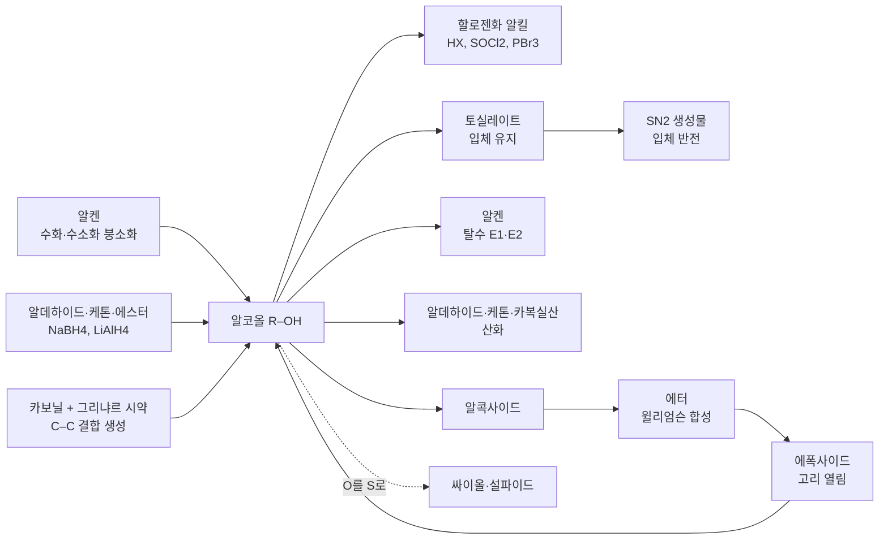

# 유기화학 6. 알코올·에터·에폭사이드와 황 화합물 — 하이드록시기를 붙이고, 바꾸고, 떼어 내는 법
<!-- prev: ochem-5, ochem-4, ochem-1, uchem-12 -->
<!-- next: ochem-7 -->

> [!NOTE]
> **이 단원의 범위**
> - 알코올의 분류·명명법, 수소 결합과 물리적 성질, 산도($\mathrm{p}K_\mathrm{a}$)와 염기도, 알콕사이드 만들기
> - 알코올의 합성: 알켄의 수화(되짚기), 카보닐 화합물의 수소화물 환원($\mathrm{NaBH_4}$, $\mathrm{LiAlH_4}$), 그리냐르·유기 리튬 시약의 첨가
> - 알코올의 반응: 할로젠화 알킬로의 변환($\mathrm{HX}$, $\mathrm{SOCl_2}$, $\mathrm{PBr_3}$), 토실레이트·메실레이트(입체 유지 → $\mathrm{S_N2}$ 반전), 산 촉매 탈수와 $\mathrm{POCl_3}$ 탈수
> - 알코올의 산화: 시약별 생성물(PCC·데스–마틴·스원 → 알데하이드, 크로뮴산 → 카복실산), 크로뮴산 에스터 메커니즘
> - 보호기(실릴 에터)와 그리냐르 시약이 있는 합성 설계
> - 에터: 성질, 윌리엄슨 합성, 산에 의한 분해, 크라운 에터
> - 에폭사이드: 합성과 고리 열림의 위치 선택성(염기성 → 덜 치환된 탄소, 산성 → 더 치환된 탄소)과 입체(뒤쪽 공격, 트랜스)
> - 페놀 개관(산도와 치환기 효과, 퀴논), 싸이올과 설파이드(산도·친핵성, 다이설파이드, 설폭사이드·설폰)

**학습 목표**

1. 알코올·에터·싸이올을 IUPAC 규칙으로 이름 짓고, 수소 결합으로 끓는점과 물에 대한 용해도의 차이를 정량적으로 설명할 수 있다.
2. $\mathrm{p}K_\mathrm{a}$로 알코올·페놀·싸이올의 탈양성자화 평형을 계산하고, 알콕사이드를 만드는 데 알맞은 염기를 고를 수 있다.
3. 카보닐 화합물의 환원과 그리냐르 시약의 첨가로 1°·2°·3° 알코올을 합성하는 길을 역합성으로 설계하고, 산성 수소가 있는 기질에서는 보호기를 써서 경로를 고칠 수 있다.
4. 알코올을 할로젠화 알킬·설포네이트·알켄·카보닐 화합물로 바꾸는 반응의 시약·메커니즘·입체 결과(유지 또는 반전)·자리 옮김 여부를 예측할 수 있다.
5. 윌리엄슨 에터 합성의 바른 단절을 고르고, 에터의 산 분해에서 어느 C–O 결합이 $\mathrm{S_N2}$ 또는 $\mathrm{S_N1}$로 끊기는지 판단할 수 있다.
6. 에폭사이드의 고리 열림에서 산·염기 조건에 따른 공격 위치와 입체 결과를 굽은 화살표로 설명하고, 생성물의 R/S를 매길 수 있다.
7. 페놀의 산도에 미치는 치환기 효과를 공명으로, 싸이올·설파이드의 성질과 산화 단계를 황 원자의 크기와 분극성으로 설명할 수 있다.

**이 단원의 학습 사다리**

| 단계 | 무엇을 하나? |
|---|---|
| STEP 1. 이전 학습 다시 보기 | 작용기와 $\mathrm{p}K_\mathrm{a}$, 이탈기와 $\mathrm{S_N1}$·$\mathrm{S_N2}$·E1·E2, 알켄의 수화와 에폭시화 |
| STEP 2. 기초 다지기 | $\mathrm{p}K_\mathrm{a}$ 차이로 평형 읽기, 탄소의 산화수로 산화 수준 세기, '끊기는 결합'으로 입체 결과 판단하기, 역합성 기호 |
| STEP 3. 핵심 개념 | 알코올의 이름·성질 → 산도 → 합성(환원·그리냐르) → 할로젠화 알킬 → 토실레이트 → 탈수 → 산화 → 보호기 → 에터 → 에폭사이드 → 페놀 → 황 화합물 |
| STEP 4. 오개념 바로잡기 | "토실화하면 배치가 반전된다", "산성 에폭사이드 열림도 덜 치환된 탄소를 공격한다" 같은 착각 |
| STEP 5. 대학원·연구로 | 비대칭 에폭시화와 속도론적 분할, 미쓰노부 반응, 촉매적 산화 |
| STEP 6. 생활·산업·진로 | 음주 측정기와 알코올 탈수소 효소, 산화 에틸렌과 에폭시 수지, β 차단제 합성, 부취제와 파마 |

---

## 🗺️ 단원 들어가기

포도당이 발효되어 생긴 에탄올은 사람의 간에서 아세트알데하이드를 거쳐 아세트산으로 산화된다. 실험실에서 같은 변환을 하려면 크로뮴(Ⅵ) 시약을 쓰고, 알데하이드에서 멈추고 싶으면 물이 없는 다른 시약을 쓴다. 왜 물이 있고 없음이 생성물을 바꾸는가? 또 (R)-뷰탄-2-올을 염화 p-톨루엔설포닐로 처리한 뒤 사이안화 이온과 반응시키면 (S) 생성물이 생기는데, 같은 알코올을 먼저 수소화 나트륨으로 처리한 뒤 아이오도메테인을 넣으면 배치가 그대로인 (R) 에터가 생긴다. 두 경로의 차이는 단 하나, **입체 중심의 C–O 결합이 끊기는가**이다.

「유기 반응의 개관과 알킬 할라이드의 치환·제거 반응」에서 우리는 $\mathrm{-OH}$가 나쁜 이탈기라 알코올은 그대로는 치환되지 않는다는 것을 보았다. 이 단원은 그 하이드록시기를 **좋은 이탈기로 바꾸는 여러 방법**, 카보닐 화합물에 수소화 이온이나 탄소 친핵체를 더해 **알코올을 만드는 방법**, 알코올을 **산화**해 카보닐 화합물로 되돌리는 방법을 하나의 지도로 엮는다. 알코올은 유기 합성의 교차로이다. 알켄·할로젠화 알킬·에터·알데하이드·케톤·카복실산이 모두 알코올을 거쳐 서로 오간다.

에터는 반응성이 낮아 좋은 용매가 되지만, 세 원자 고리인 에폭사이드는 고리 무리 때문에 친핵체에 쉽게 열린다. 같은 에폭사이드라도 **염기성 조건에서는 덜 치환된 탄소, 산성 조건에서는 더 치환된 탄소**가 공격받는다. 이 선택성을 메커니즘으로 이해하면 외울 것이 거의 남지 않는다. 마지막으로 산소 바로 아래의 황으로 내려가 싸이올과 설파이드가 알코올·에터와 무엇이 같고 무엇이 다른지 비교한다.

---

## STEP 1. 🔙 이전 학습 다시 보기

### 연계 개념표

| 이전 단원 | 그때 배운 것 | 이 단원에서 확장되는 것 |
|---|---|---|
| 일반화학 「핵화학·배위 화학·유기화학 개관」 '작용기' | 알코올·에터의 작용기와 이름, 에탄올의 산화, 축합으로 에터 만들기 | 1°·2°·3° 알코올마다 **다른 반응성**, 시약에 따라 산화가 멈추는 단계가 다른 까닭 |
| 유기화학 「구조와 결합, 산과 염기」 '$\mathrm{p}K_\mathrm{a}$와 평형의 방향', '산도를 정하는 요인' | 이정표 산(카복실산 5, 페놀 10, 알코올 16), 원자·공명·유도 효과, NaH가 알코올을 완전히 탈양성자화하는 까닭 | 알코올 산도의 **용매화 효과**(메탄올 > tert-뷰탄올), 페놀의 **치환기 효과**, 싸이올이 알코올보다 산성인 까닭 |
| 유기화학 「입체화학」 'R/S 표기', '반응의 입체화학' | CIP 우선순위, 입체 특이적 반응, 메조 화합물 | 입체 중심의 결합이 끊기지 않으면 **배치 유지**, 뒤쪽 공격이면 **반전**. 에폭사이드 열림이 만드는 트랜스·메조·라세미 생성물 |
| 유기화학 「유기 반응의 개관과 알킬 할라이드의 치환·제거 반응」 | $\mathrm{S_N2}$ 반전, $\mathrm{S_N1}$ 탄소 양이온과 자리 옮김, E1·E2, 이탈기의 짝산 $\mathrm{p}K_\mathrm{a}$, 토실레이트가 좋은 이탈기라는 것 | $\mathrm{-OH}$를 $\mathrm{-OH_2^+}$, $\mathrm{-OTs}$, $\mathrm{-OPBr_2}$로 바꾸어 **치환·제거를 일으키는 실제 방법**, 알코올 탈수(E1)의 자리 옮김 |
| 유기화학 「알켄과 알카인」 '수화', '에폭시화', '할로하이드린', '역합성' | 마르코브니코프·반마르코브니코프 수화, 과산으로 에폭사이드 만들기, 할로하이드린 | 알코올을 만드는 **다른 길**(환원·그리냐르)과 비교, 할로하이드린에서 에폭사이드로, 에폭사이드에서 1,2-다이올과 β-치환 알코올로 |

### 준비 운동 (사전 진단)

**Q1.** 에탄올($\mathrm{p}K_\mathrm{a}$ 16)과 다이메틸 에터는 분자식($\mathrm{C_2H_6O}$)이 같다. 끓는점이 더 높은 쪽과 그 까닭을 한 문장으로 쓰시오.

**Q2.** 다음 가운데 좋은 이탈기를 모두 고르시오. $\mathrm{HO^-}$, $\mathrm{H_2O}$, $\mathrm{Br^-}$, $\mathrm{CH_3O^-}$, $p\text{-}\mathrm{CH_3C_6H_4SO_3^-}$(토실레이트)

**Q3.** (R)-2-브로모뷰테인이 사이안화 나트륨과 DMSO에서 반응하면 생성물의 이름과 배치(R/S)는?

**Q4.** 1-메틸사이클로헥센을 (가) 묽은 황산 수용액으로, (나) $\mathrm{BH_3}$·THF로 처리한 뒤 $\mathrm{H_2O_2}$, NaOH로 처리할 때 생기는 알코올의 이름을 쓰시오.

정답 및 해설

**Q1.** 에탄올(78 ℃)이 다이메틸 에터(−24 ℃)보다 훨씬 높다. 에탄올은 O–H로 분자 사이 수소 결합을 하지만, 에터에는 O에 붙은 H가 없어 수소 결합 주개가 될 수 없다.

**Q2.** $\mathrm{H_2O}$, $\mathrm{Br^-}$, 토실레이트. 짝산의 $\mathrm{p}K_\mathrm{a}$가 각각 $-1.7$($\mathrm{H_3O^+}$), $-9$(HBr), 약 $-3$(TsOH)로 작아 약한 염기이다. $\mathrm{HO^-}$(짝산 15.7)와 $\mathrm{CH_3O^-}$(15.5)는 강한 염기라 떠나지 않는다(「유기 반응의 개관과 알킬 할라이드의 치환·제거 반응」 ③).

**Q3.** (S)-2-메틸뷰테인나이트릴. $\mathrm{S_N2}$로 배치가 반전되고, $\mathrm{-CN}$이 $\mathrm{-Br}$의 1순위 자리를 이어받으므로 기호도 R → S로 바뀐다.

**Q4.** (가) 1-메틸사이클로헥산-1-올(마르코브니코프, 3차 탄소 양이온 경유) (나) trans-2-메틸사이클로헥산-1-올(반마르코브니코프, H와 OH의 신 첨가, 라세미). 이 단원 ③에서 알코올을 만드는 여러 길을 한 표로 비교한다.

---

## STEP 2. 🧱 기초 다지기

### 디딤돌 1. $\mathrm{p}K_\mathrm{a}$ 차이로 평형 읽기 — 알콕사이드를 만드는 염기 고르기

「구조와 결합, 산과 염기」에서 산 HA와 염기 $\mathrm{B^-}$의 반응 $\mathrm{HA + B^- \rightleftharpoons A^- + HB}$의 평형 상수가 두 산의 $\mathrm{p}K_\mathrm{a}$ 차이로 정해진다는 것을 보였다.

$$
K_\text{eq} = \frac{K_\mathrm{a}(\mathrm{HA})}{K_\mathrm{a}(\mathrm{HB})} = 10^{\,\mathrm{p}K_\mathrm{a}(\mathrm{HB}) - \mathrm{p}K_\mathrm{a}(\mathrm{HA})}, \qquad \Delta G^\circ = -2.303RT\log K_\text{eq} = -5.71\,\Delta\mathrm{p}K_\mathrm{a}\ \mathrm{kJ/mol}\ (25\ ^\circ\mathrm{C})
$$

이 단원에서는 이 식을 "어떤 염기를 써야 알코올(또는 페놀, 싸이올)이 음이온으로 바뀌는가"를 판단하는 데 쓴다. **염기의 짝산이 대상 산보다 약할수록**(짝산 $\mathrm{p}K_\mathrm{a}$가 클수록) 평형은 오른쪽으로 간다.

| 산 (대상) | $\mathrm{p}K_\mathrm{a}$ (물 기준, 약) | NaOH (짝산 $\mathrm{H_2O}$ 15.7)와의 $K_\text{eq}$ | NaH (짝산 $\mathrm{H_2}$ 약 35)와의 $K_\text{eq}$ |
|---|---|---|---|
| 페놀 | 10.0 | $10^{5.7}$ (완전) | $10^{25}$ |
| 에테인싸이올 | 10.6 | $10^{5.1}$ (완전) | $10^{24}$ |
| 에탄올 | 16 | $10^{-0.3} \approx 0.5$ (일부) | $10^{19}$ (완전, $\mathrm{H_2}$가 빠져나감) |
| 2-메틸프로판-2-올 | 18 | $10^{-2.3} \approx 5\times10^{-3}$ (거의 안 됨) | $10^{17}$ |

#### 예제 1 — 염기 고르기

2-메틸프로판-2-올(tert-뷰탄올)을 칼륨 tert-뷰톡사이드로 바꾸려 한다. (1) KOH 수용액을 쓸 때와 (2) 칼륨 금속을 쓸 때를 비교하고, (1)의 25 ℃ $\Delta G^\circ$를 구하시오. (칼륨 금속과의 반응은 $\mathrm{2ROH + 2K \rightarrow 2RO^-K^+ + H_2}$로, 산화–환원이라 $\mathrm{p}K_\mathrm{a}$로 다루지 않는다.)

**풀이**
(1) $K_\text{eq} = 10^{15.7 - 18} = 10^{-2.3} = 5.0\times10^{-3}$, $\Delta G^\circ = -5.71\times(15.7 - 18) = +13.1\ \mathrm{kJ/mol}$. 평형이 왼쪽에 있어 알콕사이드는 조금밖에 생기지 않는다. 게다가 물이 많으면 생긴 알콕사이드도 곧 물에 양성자를 빼앗긴다.
(2) 칼륨 금속은 알코올의 O–H를 환원해 수소 기체를 내놓는다. 기체가 빠져나가므로 반응이 끝까지 간다. 실험실에서는 tert-뷰탄올에 칼륨을, 에탄올에 나트륨을 넣어 알콕사이드 용액을 만든다. 더 편한 방법은 NaH 또는 KH를 THF·DMF에서 쓰는 것이다($K_\text{eq} \approx 10^{17}$, 역시 $\mathrm{H_2}$가 빠져나감).
**의미** "강한 염기"인지가 아니라 **짝산과 비교해** 얼마나 강한지가 중요하다. 수산화 이온은 페놀과 싸이올은 완전히 탈양성자화하지만 알코올은 그렇지 못하다. 이 차이가 ⑫에서 페놀을 NaOH 수용액으로 추출해 알코올과 가르는 근거가 된다.

### 디딤돌 2. 탄소의 산화수 — 산화 수준 세기

유기화학에서 '산화'와 '환원'은 대개 산소·수소의 수로 판단한다. 정확히는 **반응하는 탄소의 산화수**를 센다. 결합 하나마다 더 전기 음성인 원자가 전자쌍을 모두 가져간다고 보고, C–H는 −1, C–O·C–N·C–X는 +1, C–C는 0으로 더한다.

| 화합물 | 반응 중심 탄소에 붙은 것 | 탄소의 산화수 | 산화 수준 |
|---|---|---|---|
| 메테인 $\mathrm{CH_4}$ | H 4개 | −4 | 알케인 |
| 메탄올 $\mathrm{CH_3OH}$ | H 3개, O 1개 | −2 | 알코올 |
| 폼알데하이드 $\mathrm{H_2C{=}O}$ | H 2개, O 2결합 | 0 | 알데하이드·케톤 |
| 폼산 $\mathrm{HCOOH}$ | H 1개, O 3결합 | +2 | 카복실산·에스터 |
| 이산화 탄소 | O 4결합 | +4 | — |

1차 알코올 → 알데하이드 → 카복실산은 탄소의 산화수가 2씩 올라가는 두 번의 2전자 산화이다. 2차 알코올은 케톤까지만 갈 수 있고(더 가려면 C–C 결합이 끊어져야 한다), 3차 알코올은 반응 탄소에 H가 없어 보통 조건에서 산화되지 않는다. 반대로 카보닐 화합물에 수소화 이온($\mathrm{H^-}$)을 더하는 것은 산화수를 2 낮추는 **환원**이고, 그리냐르 시약(탄소 친핵체)을 더하는 것은 C–C 결합이 생기므로 산화수가 1 낮아진다.

#### 예제 2 — 산화인가 환원인가

다음 변환에서 반응 탄소의 산화수 변화를 쓰고 산화·환원·둘 다 아님을 판단하시오. (1) 에탄올 → 아세트알데하이드 (2) 사이클로헥산온 → 사이클로헥산올 (3) 프로펜 → 프로판-2-올(산 촉매 수화) (4) 아세트알데하이드 + $\mathrm{CH_3MgBr}$ → (가공 뒤) 프로판-2-올

**풀이**
(1) C1: H 2개, O 1개, C 1개 → $-2+1 = -1$에서 H 1개, O 2결합 → $-1+2 = +1$. **+2, 산화**.
(2) 카보닐 탄소: C 2개, O 2결합 → +2에서 C 2개, O 1개, H 1개 → 0. **−2, 환원**.
(3) C2는 −1(H 1개, C 2개)에서 0(H 1개, O 1개, C 2개)으로 +1, C1은 −2에서 −3으로 −1. 분자 전체로는 변화가 없다. **둘 다 아님**(물의 첨가).
(4) 카보닐 탄소: +1(H 1, O 2결합, C 1)에서 0(H 1, O 1, C 2). 산화수는 1 낮아지지만 H나 전자를 받은 것이 아니라 **C–C 결합을 만든 것**이다. 탄소 친핵체의 탄소(−4 → −3)가 올라가 전체로는 균형이 맞는다.
**의미** 산화수 장부를 쓰면 "알코올을 산화하려면 산화제가 몇 당량 필요한가"(⑧ 예제)도 계산할 수 있다.

### 디딤돌 3. "입체 중심의 어느 결합이 끊기는가?" — 유지와 반전을 가르는 한 질문

이 단원의 입체화학은 다음 한 가지 질문으로 거의 모두 풀린다.

| 입체 중심(탄소)에서 일어나는 일 | 공간 배치 | 예 |
|---|---|---|
| 탄소에 붙은 결합이 하나도 끊기지 않는다 (O–H, O–S, O–Si처럼 **산소 쪽** 결합만 바뀐다) | **유지** | 토실화, 실릴 에터 만들기, 알콕사이드의 알킬화, 크로뮴산 에스터 만들기 |
| 친핵체가 이탈기 반대쪽에서 탄소를 공격한다($\mathrm{S_N2}$) | **반전** | 토실레이트의 치환, $\mathrm{PBr_3}$, 에폭사이드 고리 열림 |
| 평면 중간체(탄소 양이온, 카보닐)를 거친다 | 양쪽 면 공격 → **라세미**(또는 부분 입체 선택) | $\mathrm{S_N1}$, 케톤의 환원·그리냐르 첨가 |

여기서 '유지'와 '반전'은 **공간 배치**를 말한다. R/S 기호는 생성물에서 다시 매겨야 한다(「유기 반응의 개관과 알킬 할라이드의 치환·제거 반응」 STEP 4). 다행히 이 단원의 반응 대부분에서 들어오는 원자단(OTs, Br, CN, OR)이 떠나는 원자단의 1순위 자리를 그대로 이어받으므로, **유지이면 기호도 같고 반전이면 기호도 바뀌는** 경우가 많다. 그래도 매번 확인한다.

#### 예제 3 — 기호 다시 매기기

(R)-뷰탄-2-올(SMILES `C[C@@H](O)CC`)에서 다음을 얻었다. 각 생성물의 공간 배치(유지/반전)와 R/S를 쓰시오. (1) NaH 뒤 $\mathrm{CH_3I}$ → 2-메톡시뷰테인 (2) $\mathrm{PBr_3}$ → 2-브로모뷰테인

**풀이**
(1) 알콕사이드 O가 아이오도메테인의 탄소를 공격한다. 입체 중심 C2의 결합은 끊기지 않으므로 **유지**. C2의 우선순위 $\mathrm{-OCH_3 > -CH_2CH_3 > -CH_3 > -H}$는 알코올($\mathrm{-OH}$가 1순위)과 같은 순서이므로 (R)-2-메톡시뷰테인(`C[C@@H](OC)CC`).
(2) $\mathrm{PBr_3}$는 OH를 좋은 이탈기로 바꾼 뒤 $\mathrm{Br^-}$가 뒤쪽에서 공격한다(⑤). **반전**. Br이 1순위를 이어받으므로 (S)-2-브로모뷰테인(`C[C@H](Br)CC`).

### 디딤돌 4. 역합성의 기호와 '합성 등가물'

「알켄과 알카인」에서 목표 분자에서 거꾸로 생각하는 **역합성**(retrosynthesis)을 배웠다. 속이 빈 화살표 $\Rightarrow$는 "이것은 저것으로부터 만들 수 있다"는 뜻이고, 결합을 끊는 가상의 조작을 **단절**(disconnection)이라 한다. 알코올에서 가장 쓸모 있는 단절은 **OH가 붙은 탄소와 그 이웃 탄소 사이의 결합**이다.

$$
\mathrm{R{-}C(OH)R'R''} \;\Rightarrow\; \mathrm{R^{-}}\ (\text{합성 등가물: }\mathrm{RMgBr}) \;+\; \mathrm{R'R''C{=}O}
$$

음전하를 띤 탄소 조각 $\mathrm{R^-}$는 실제로 병에 담을 수 없는 가상의 조각(**신톤**, synthon)이다. 실제로 그 역할을 하는 시약 RMgBr을 **합성 등가물**(synthetic equivalent)이라 한다. OH가 붙은 탄소에 원자단이 셋이면(3° 알코올) 단절할 수 있는 결합이 셋이므로 출발 물질의 조합도 세 가지가 된다(④ 예제 8).

#### 예제 4 — 단절 두 가지

1-페닐에탄올($\mathrm{C_6H_5CH(OH)CH_3}$)을 그리냐르 시약으로 만드는 두 조합을 역합성으로 쓰시오.

**풀이**
① 페닐–C 결합 단절: $\Rightarrow \mathrm{C_6H_5MgBr + CH_3CHO}$(아세트알데하이드). ② 메틸–C 결합 단절: $\Rightarrow \mathrm{CH_3MgBr + C_6H_5CHO}$(벤즈알데하이드). 둘 다 2° 알코올을 준다. C–H 결합을 단절하면 세 번째 길, 아세토페논의 환원($\mathrm{NaBH_4}$)이 나온다.
**의미** 목표 분자 하나에 여러 길이 있다. 실제로는 시약의 값, 다른 작용기와의 양립성, 입체 선택성으로 고른다.

---

## STEP 3. 📘 핵심 개념

### ① 알코올의 구조·분류·명명법과 물리적 성질

**알코올**(alcohol)은 $sp^3$ 탄소에 하이드록시기($\mathrm{-OH}$)가 붙은 화합물이다. 산소는 $sp^3$ 혼성으로, 두 결합(C–O, O–H)과 비공유 전자쌍 두 개가 사면체 방향을 향하며 C–O–H 결합각은 약 108°이다. 벤젠 고리에 OH가 직접 붙은 것은 **페놀**(⑫), $sp^2$ 알켄 탄소에 붙은 것은 **엔올**로 따로 다룬다(엔올은 「카보닐 α 자리의 반응과 축합 반응」).

#### 1°·2°·3° 분류

OH가 붙은 탄소(**카비놀 탄소**)에 다른 탄소가 몇 개 붙었는지로 나눈다. 이 분류가 산화(⑧), $\mathrm{S_N1}$/$\mathrm{S_N2}$(⑤), 탈수(⑦)의 반응성을 정한다.

| 분류 | 카비놀 탄소에 붙은 탄소 수 | 예 (IUPAC 이름 / 관용명) | 축약 구조식 |
|---|---|---|---|
| 메탄올 | 0 | 메탄올 / 메틸 알코올 | $\mathrm{CH_3OH}$ |
| 1차(1°) | 1 | 에탄올 / 에틸 알코올, 페닐메탄올 / 벤질 알코올 | $\mathrm{CH_3CH_2OH}$, $\mathrm{C_6H_5CH_2OH}$ |
| 2차(2°) | 2 | 프로판-2-올 / 아이소프로필 알코올, 사이클로헥산올 | $\mathrm{(CH_3)_2CHOH}$ |
| 3차(3°) | 3 | 2-메틸프로판-2-올 / tert-뷰틸 알코올 | $\mathrm{(CH_3)_3COH}$ |

#### IUPAC 명명법

1. OH가 붙은 탄소를 **포함하는** 가장 긴 사슬을 주사슬로 고른다(이중 결합이 있으면 그것도 포함).
2. OH가 붙은 탄소에 **가장 작은 번호**를 준다(OH가 이중 결합·할로젠·알킬기보다 번호 우선).
3. 알케인 이름의 끝 '-에인(-ane)'을 '-올(-ol)'로 바꾸고 위치 번호를 '-올' 앞에 쓴다: 뷰탄-2-올. OH가 둘이면 '-다이올'로, 이때는 알케인 이름을 그대로 둔다: 에테인-1,2-다이올(에틸렌 글라이콜), 프로페인-1,2,3-트라이올(글리세롤).
4. 고리에서는 OH가 붙은 탄소가 C1이며, 번호 1은 보통 생략하지 않고 쓴다: 2-메틸사이클로헥산-1-올.
5. 카보닐기처럼 우선순위가 더 높은 작용기가 있으면 OH는 접두사 '하이드록시-'가 된다: 4-하이드록시뷰탄-2-온.

#### 예제 5 — 이름 짓기와 분류

다음 알코올의 IUPAC 이름과 1°·2°·3°를 쓰시오. (1) $\mathrm{CH_3CH(CH_3)CH_2CH(OH)CH_3}$ (2) $\mathrm{CH_2{=}CHCH_2CH(OH)CH_2CH_3}$ (3) $\mathrm{HOCH_2CH_2CH_2CH(CH_3)OH}$ (4) 사이클로헥세인 고리의 한 탄소에 OH와 메틸기가 함께 붙은 $\mathrm{C_6H_{10}(CH_3)OH}$

**풀이**
(1) 주사슬 5개, OH 쪽 끝에서 번호: 4-메틸펜탄-2-올, **2°**.
(2) OH와 이중 결합을 모두 포함하는 6탄소 사슬. OH에 작은 번호를 주면 C3(오른쪽 에틸 쪽 끝에서 세면 OH는 C3, 이중 결합은 C5), 반대쪽에서 세면 OH가 C4이므로 오른쪽에서 센다: 헥스-5-엔-3-올, **2°**.
(3) 5탄소 사슬, 두 OH를 1과 4로(반대쪽에서 세면 2와 5): 펜테인-1,4-다이올. C1의 OH는 **1°**, C4의 OH는 **2°**.
(4) 1-메틸사이클로헥산-1-올, **3°**. '1-메틸사이클로헥산올'도 널리 쓰이지만 위치 번호를 모두 쓰는 편이 정확하다.

#### 수소 결합과 끓는점

알코올의 O–H는 극성이 크고(전기 음성도 차 1.24), O의 비공유 전자쌍이 이웃 분자의 O–H를 받아 **수소 결합**(약 20 kJ/mol)을 이룬다. 그래서 분자량이 비슷한 탄화수소·에터·할로젠화 알킬보다 끓는점이 훨씬 높다.

| 화합물 | 몰질량 (g/mol) | 끓는점 (℃, 약) | 분자 사이의 주된 힘 |
|---|---|---|---|
| 프로페인 $\mathrm{CH_3CH_2CH_3}$ | 44 | −42 | 분산력 |
| 다이메틸 에터 $\mathrm{CH_3OCH_3}$ | 46 | −24 | 분산력 + 쌍극자 |
| 에탄올 $\mathrm{CH_3CH_2OH}$ | 46 | 78 | 수소 결합 |
| 클로로에테인 $\mathrm{CH_3CH_2Cl}$ | 64.5 | 12 | 분산력 + 쌍극자 |
| 에테인싸이올 $\mathrm{CH_3CH_2SH}$ | 62 | 35 | 분산력 + 약한 S–H···S |
| 에테인-1,2-다이올 | 62 | 197 | 분자당 수소 결합 두 배 |
| 펜테인 | 72 | 36 | 분산력 |
| 에톡시에테인(다이에틸 에터) | 74 | 35 | 분산력 + 쌍극자 |
| 뷰탄-1-올 | 74 | 118 | 수소 결합 |

#### 물에 대한 용해도 — 친수성 머리와 소수성 꼬리

알코올은 물과 수소 결합을 주고받으므로 작은 알코올(메탄올·에탄올·프로판올·tert-뷰탄올)은 물과 어떤 비율로도 섞인다. 탄화수소 부분이 커지면 그 부분 주위의 물 분자가 구조를 만들어야 하는(소수성 효과) 불리함이 커져 용해도가 급격히 줄어든다. 25 ℃ 물 100 g에 녹는 양은 대략 뷰탄-1-올 7 g, 펜탄-1-올 2 g, 헥산-1-올 0.6 g이다. 경험적으로 **OH 하나가 탄소 약 3~4개를 물에 끌고 들어간다.** 에터는 수소 결합 받개만 될 수 있어 같은 탄소 수의 알코올보다 덜 녹지만(다이에틸 에터 약 7 g), 비슷한 크기의 알케인(거의 0)보다는 훨씬 잘 녹는다.

<!-- 그림 요청: 수소 결합 비교 세 칸. (가) 액체 에탄올(SMILES CCO) 네 분자가 O–H···O 수소 결합(점선, 길이 이름표 '약 180 pm')으로 사슬처럼 이어진 모습. 각 O에 비공유 전자쌍 두 개, O–H의 H에 δ+, O에 δ−. (나) 다이메틸 에터(SMILES COC) 네 분자: O에 H가 없어 분자 사이 점선이 없고 쌍극자 화살표만. (다) 뷰탄-1-올(SMILES CCCCO)이 물 분자들 사이에 있는 모습: OH 머리 쪽은 물과 수소 결합(점선 2~3개), 뷰틸 꼬리 주위는 물 분자들이 수소 결합 그물로 둘러싼 '우리'를 옅은 색으로. 아래에 끓는점 막대: 다이메틸 에터 −24 ℃, 에탄올 78 ℃. -->

> [!TIP]
> 💡 **요령** — 끓는점 순서를 비교할 때는 ① 수소 결합 주개(O–H, N–H)가 있는가 → ② 그 수가 몇인가 → ③ 몰질량(분산력)과 가지(표면적) 순서로 따진다. 같은 $\mathrm{C_4H_{10}O}$라도 뷰탄-1-올(118 ℃) > 2-메틸프로판-2-올(82 ℃, 공 모양이라 분산력 작음) > 다이에틸 에터(35 ℃)이다.

#### ✔ 바로 확인

1. $\mathrm{(CH_3)_2C(OH)CH_2CH_3}$의 IUPAC 이름과 분류(1°·2°·3°)는?
2. (O/X) 다이에틸 에터는 물과 수소 결합을 전혀 하지 못한다.
3. 끓는점이 높은 것부터 쓰시오: 뷰탄-1-올, 펜테인, 에테인-1,2-다이올
4. 빈칸: 4-하이드록시뷰탄-2-온에서 OH가 접미사 '-올'이 아니라 접두사로 쓰인 까닭은 (    )기가 더 높은 우선순위를 갖기 때문이다.

정답

1. 2-메틸뷰탄-2-올, 3°
2. X — 에터 O의 비공유 전자쌍은 물의 O–H에서 수소 결합을 **받을** 수 있다. 주개가 될 수 없을 뿐이다.
3. 에테인-1,2-다이올(197 ℃) > 뷰탄-1-올(118 ℃) > 펜테인(36 ℃)
4. 카보닐(케톤)

### ② 알코올의 산도와 염기도 — 양쪽으로 쓰이는 O–H

알코올은 물과 비슷하게 **약한 산이자 약한 염기**이다. 강한 염기는 O–H의 양성자를 떼어 **알콕사이드 이온**($\mathrm{RO^-}$)을 만들고, 강한 산은 O의 비공유 전자쌍에 양성자를 붙여 **알킬옥소늄 이온**($\mathrm{ROH_2^+}$)을 만든다.

$$
\mathrm{ROH + B^- \rightleftharpoons RO^- + HB} \qquad\qquad \mathrm{ROH + H_2SO_4 \rightleftharpoons ROH_2^+ + HSO_4^-}
$$

#### 산도의 크기와 용매화 효과

| 산 | $\mathrm{p}K_\mathrm{a}$ (물, 약) | 짝염기를 안정하게 하는 요인 |
|---|---|---|
| $\mathrm{CH_3OH}$ | 15.5 | 작은 음이온, 물이 잘 용매화 |
| $\mathrm{H_2O}$ | 15.7 | (기준) |
| $\mathrm{CH_3CH_2OH}$ | 16 | — |
| $\mathrm{(CH_3)_2CHOH}$ | 17 | 알킬기가 용매 분자의 접근을 가림 |
| $\mathrm{(CH_3)_3COH}$ | 18 | 용매화가 가장 나쁨 |
| $\mathrm{CF_3CH_2OH}$ | 12.4 | 세 F의 유도 효과로 $\mathrm{O^-}$의 음전하가 분산 |
| $\mathrm{C_6H_5OH}$ (페놀) | 10.0 | 고리로의 공명 비편재화(⑫) |
| $\mathrm{ROH_2^+}$ (짝산) | 약 −2 | — |

메탄올에서 tert-뷰탄올로 갈수록 산성이 약해지는 까닭은 흔히 "알킬기가 전자를 밀어 주어서"라고 설명하지만, 이것은 반쪽짜리 설명이다. **기체상**에서는 순서가 거꾸로이다. 기체상에서는 tert-뷰톡사이드가 가장 안정한데, 큰 알킬기가 분극되어 음전하를 넓게 받쳐 주기 때문이다. 용액에서 순서가 뒤집히는 것은 **용매화** 때문이다. 작은 메톡사이드는 물 분자가 둘러싸 수소 결합으로 음전하를 안정하게 하지만, 부피 큰 tert-뷰톡사이드의 O⁻는 메틸기 세 개에 가려 물이 다가가기 어렵다. 산도가 '분자 자체의 성질'만이 아니라 '분자와 용매의 계'의 성질이라는 좋은 예이다.

#### 알콕사이드 — 염기이자 친핵체

알콕사이드는 NaH·KH(디딤돌 1), 알칼리 금속(Na, K)으로 만든다. 나트륨 메톡사이드·에톡사이드는 강한 염기이자 좋은 친핵체로 1° 할로젠화 알킬과는 $\mathrm{S_N2}$(⑩ 윌리엄슨 합성), 2°·3°와는 E2를 일으킨다. 칼륨 tert-뷰톡사이드는 부피가 커서 친핵성이 작고 강한 염기로만 쓰인다(호프만 제거, 「유기 반응의 개관과 알킬 할라이드의 치환·제거 반응」 ⑦).

#### 루이스 염기로서의 알코올

알코올의 O는 양성자뿐 아니라 $\mathrm{ZnCl_2}$, $\mathrm{BF_3}$, $\mathrm{Mg^{2+}}$ 같은 루이스 산에도 전자쌍을 준다. 양성자화되거나 루이스 산이 배위한 산소에서는 C–O 결합이 약해지고 $\mathrm{H_2O}$(또는 $\mathrm{HOZnCl_2^-}$)가 좋은 이탈기가 된다. ⑤의 HX 반응, ⑦의 탈수, ⑪의 산성 에폭사이드 열림이 모두 이 '양성자화로 이탈기 만들기'에서 시작한다.

#### 예제 6 — 유도 효과의 크기

(1) 2,2,2-트라이플루오로에탄올($\mathrm{p}K_\mathrm{a}$ 12.4)과 에탄올(16)의 $K_\mathrm{a}$ 비와 25 ℃ 해리 $\Delta G^\circ$의 차이를 구하시오. (2) 트라이플루오로에탄올에 나트륨 에톡사이드를 1 당량 넣으면 평형은 어느 쪽에 있는가?

**풀이**
(1) $K_\mathrm{a}$ 비 $= 10^{16 - 12.4} = 10^{3.6} = 4.0\times10^3$. $\Delta\Delta G^\circ = 5.71\times3.6 = 20.6\ \mathrm{kJ/mol}$. 탄소 하나를 건너 있는 F 세 개가 짝염기를 약 21 kJ/mol 안정하게 한다.
(2) $\mathrm{CF_3CH_2OH + CH_3CH_2O^- \rightleftharpoons CF_3CH_2O^- + CH_3CH_2OH}$, $K_\text{eq} = 10^{16 - 12.4} = 4.0\times10^3$. 오른쪽(트라이플루오로에톡사이드 쪽)으로 거의 완전히 간다.
**의미** 이 유도 효과는 거리에 따라 빨리 줄어든다. F가 하나 더 먼 3,3,3-트라이플루오로프로판-1-올은 $\mathrm{p}K_\mathrm{a}$가 약 14~15로, 에탄올과의 차이가 절반 이하로 줄어든다.

#### ✔ 바로 확인

1. 고르기: 물 속에서 산성이 가장 큰 것은? 에탄올, 2-메틸프로판-2-올, 2,2,2-트라이플루오로에탄올
2. (O/X) tert-뷰탄올이 메탄올보다 약한 산인 것은 기체상에서도 마찬가지이다.
3. 에탄올을 NaH로 처리할 때 평형 상수는 대략 10의 몇 제곱인가? ($\mathrm{p}K_\mathrm{a}$: 에탄올 16, $\mathrm{H_2}$ 35)
4. 빈칸: 알코올을 진한 황산으로 처리하면 생기는 $\mathrm{ROH_2^+}$를 (    ) 이온이라 하며, 이때 이탈기는 (    )이다.

정답

1. 2,2,2-트라이플루오로에탄올($\mathrm{p}K_\mathrm{a}$ 12.4)
2. X — 기체상에서는 거꾸로 tert-뷰탄올이 더 산성이다. 용액의 순서는 용매화가 정한다.
3. $10^{19}$ — 게다가 $\mathrm{H_2}$가 빠져나가 반응이 끝까지 간다.
4. 알킬옥소늄, 물($\mathrm{H_2O}$)

### ③ 알코올의 합성 Ⅰ — 알켄의 수화와 카보닐 화합물의 환원

#### 알켄에서(되짚기)

「알켄과 알카인」에서 배운 세 가지 수화를 알코올 합성의 관점에서 정리한다.

| 방법 | 시약 | 위치 선택성 | 입체 | 자리 옮김 |
|---|---|---|---|---|
| 산 촉매 수화 | $\mathrm{H_2O}$, $\mathrm{H_2SO_4}$(묽음) | 마르코브니코프(OH가 더 치환된 탄소로) | 선택성 없음 | 있음(탄소 양이온) |
| 옥시수은화–탈수은화 | ① $\mathrm{Hg(OAc)_2}$, $\mathrm{H_2O}$ ② $\mathrm{NaBH_4}$ | 마르코브니코프 | (탈수은화 단계에서 섞임) | 없음 |
| 수소화 붕소화–산화 | ① $\mathrm{BH_3\cdot THF}$ ② $\mathrm{H_2O_2}$, NaOH | 반마르코브니코프(OH가 덜 치환된 탄소로) | H와 OH의 **신 첨가** | 없음 |

1° 할로젠화 알킬을 $\mathrm{HO^-}$와 $\mathrm{S_N2}$로 반응시켜도 알코올이 되지만, 알코올이 할로젠화 알킬보다 흔하고 싼 경우가 대부분이어서 합성에서는 오히려 반대 방향(⑤)이 더 많이 쓰인다.

#### 수소화물 환원 — 카보닐 탄소에 $\mathrm{H^-}$를 더한다

알데하이드·케톤의 C=O에 수소화 이온($\mathrm{H^-}$)과 양성자를 차례로 더하면 알코올이 된다(디딤돌 2: 산화수 −2, 환원). 알데하이드는 1° 알코올, 케톤은 2° 알코올을 준다.

$$
\mathrm{R{-}CHO \xrightarrow{\ 1)\ NaBH_4,\ CH_3OH\ \ 2)\ H_2O\ } R{-}CH_2OH} \qquad\qquad \mathrm{R_2C{=}O \xrightarrow{\ NaBH_4,\ CH_3CH_2OH\ } R_2CHOH}
$$

메커니즘은 두 단계이다. ① $\mathrm{BH_4^-}$의 B–H 결합 전자쌍이 카보닐 탄소로 가고(새 C–H 결합), 동시에 C=O π 결합의 전자쌍이 산소로 간다(알콕사이드). ② 알콕사이드 O의 전자쌍이 용매(메탄올·물)의 H로 가고, O–H 결합 전자쌍이 용매의 O로 간다(양성자 전달). 카보닐 탄소가 친핵체에 공격받는 이 **친핵성 첨가**의 일반론(산·염기 촉매, 가역성)은 「알데하이드와 케톤」에서 자세히 다루고, 이 단원에서는 '알코올을 만드는 도구'로만 쓴다.

<!-- 그림 요청: 뷰탄-2-온(SMILES CCC(C)=O)의 NaBH4 환원 메커니즘. 1단계: 평면 카보닐(sp2, C=O 결합 위아래에 π 엽을 옅게)에 BH4⁻의 B–H 결합 가운데에서 카보닐 탄소로 굽은 화살표 1개, C=O π 결합 가운데에서 O로 굽은 화살표 1개 → 알콕사이드(O⁻, BH3는 옆으로 떨어져 나감). 위쪽 면 공격과 아래쪽 면 공격을 두 갈래로 나란히 그린다('위 면', '아래 면' 이름표, 50 : 50). 2단계: 각 알콕사이드 O⁻의 전자쌍 → CH3OH의 H, CH3O–H 결합 → O 화살표 2개 → (R)-뷰탄-2-올(SMILES C[C@@H](O)CC)과 (S)-뷰탄-2-올(SMILES C[C@H](O)CC), 각각 '(R)', '(S)'와 아래에 '라세미' 괄호. -->

#### $\mathrm{NaBH_4}$와 $\mathrm{LiAlH_4}$ — 세기와 선택성

| 시약 | 용매 | 환원하는 것 | 환원하지 않는 것 | 다루는 법 |
|---|---|---|---|---|
| 수소화 붕소 나트륨 $\mathrm{NaBH_4}$ | 메탄올·에탄올·물 | 알데하이드, 케톤 | 에스터, 카복실산, 아마이드, C=C(보통 조건) | 공기·물에서 비교적 안정 |
| 수소화 알루미늄 리튬 $\mathrm{LiAlH_4}$ | 마른 에터·THF, 뒤에 $\mathrm{H_3O^+}$ 가공 | 알데하이드, 케톤, **에스터·카복실산(→ 1° 알코올)**, 아마이드(→ 아민) | 고립된 C=C | 물·알코올과 격렬히 반응해 $\mathrm{H_2}$ 발생, 화재 위험 |

Al–H 결합은 B–H 결합보다 극성이 커서(Al의 전기 음성도 1.61, B 2.04) 수소화 이온을 훨씬 쉽게 내준다. 에스터는 카보닐 탄소가 알콕시 산소의 공명으로 전자를 받아 덜 친전자성이므로 $\mathrm{NaBH_4}$로는 거의 환원되지 않고 $\mathrm{LiAlH_4}$로 환원된다. 에스터 $\mathrm{RCOOR'}$은 두 번 수소화 이온을 받아 1° 알코올 $\mathrm{RCH_2OH}$와 $\mathrm{R'OH}$가 된다(중간에 알데하이드를 거치지만 알데하이드가 더 빨리 환원되어 잡히지 않는다. 메커니즘은 「카복실산과 그 유도체」).

#### 예제 7 — 화학 선택성

4-옥소사이클로헥세인카복실산 에틸(SMILES `CCOC(=O)C1CCC(=O)CC1`)을 (1) $\mathrm{NaBH_4}$, 에탄올로, (2) $\mathrm{LiAlH_4}$(과량), THF로 처리한 뒤 $\mathrm{H_3O^+}$로 가공했다. 각 주생성물을 쓰시오.

**풀이**
(1) 케톤만 환원된다: 4-하이드록시사이클로헥세인카복실산 에틸(SMILES `CCOC(=O)C1CCC(O)CC1`). 수소화 이온이 고리의 두 면에서 모두 다가갈 수 있으므로 시스·트랜스 혼합물이 생긴다(각각은 고리에 거울면이 있어 카이랄하지 않다).
(2) 케톤과 에스터가 모두 환원된다: 4-(하이드록시메틸)사이클로헥산-1-올(SMILES `OCC1CCC(O)CC1`, 시스·트랜스 혼합물)과 에탄올.
**의미** 한 분자에 작용기가 여럿일 때 하나만 골라 반응시키는 성질을 **화학 선택성**(chemoselectivity)이라 한다. 시약의 '세기'를 고르는 것이 가장 단순한 화학 선택성 조절이다.

> [!NOTE]
> **고리 케톤 환원의 입체 선택성** 4-tert-뷰틸사이클로헥산온을 $\mathrm{NaBH_4}$로 환원하면 trans-4-tert-뷰틸사이클로헥산-1-올(OH가 적도 방향, SMILES `CC(C)(C)[C@H]1CC[C@H](O)CC1`)이 약 9 : 1로 주생성물이다. 작은 수소화 이온은 축 방향에서 다가가는 편이 비틀림 무리가 적기 때문이다. 부피 큰 수소화물 시약을 쓰면 적도 방향 공격이 우세해져 시스 이성질체가 주로 생긴다. 생체에서는 효소가 NADH의 수소화 이온을 카보닐의 한쪽 면에만 전달해 한 가지 거울상 이성질체만 만든다.

#### ✔ 바로 확인

1. 펜탄알을 $\mathrm{NaBH_4}$로 환원한 생성물은?
2. (O/X) 아세트산 에틸은 $\mathrm{NaBH_4}$/에탄올로 쉽게 에탄올 2분자가 된다.
3. 3-메틸뷰트-1-엔에서 3-메틸뷰탄-1-올을 만들려면 세 가지 수화 가운데 무엇을 써야 하는가?
4. 뷰탄-2-온을 $\mathrm{NaBH_4}$로 환원한 생성물이 광학 활성을 띠지 않는 까닭은?

정답

1. 펜탄-1-올
2. X — 에스터는 $\mathrm{NaBH_4}$로 거의 환원되지 않는다. $\mathrm{LiAlH_4}$가 필요하다.
3. 수소화 붕소화–산화 — 반마르코브니코프로 OH가 말단 탄소에 붙는다. 산 촉매 수화는 자리 옮김(2° → 3° 양이온)까지 일으켜 2-메틸뷰탄-2-올을 준다.
4. 평면 카보닐의 두 면이 똑같이 공격받아 (R)·(S)가 같은 양 생기는 라세미 혼합물이기 때문이다.

### ④ 알코올의 합성 Ⅱ — 그리냐르 시약과 유기 리튬 시약

#### 탄소를 친핵체로 바꾸기

할로젠화 알킬의 탄소는 친전자체(δ+)이다. 이것을 마그네슘 금속과 마른 에터에서 반응시키면 탄소와 할로젠 사이에 Mg가 끼어든 **그리냐르 시약**(Grignard reagent, 유기 마그네슘 할라이드) RMgX가 생긴다.

$$
\mathrm{CH_3CH_2Br + Mg \xrightarrow{\ 마른\ (CH_3CH_2)_2O\ 또는\ THF\ } CH_3CH_2MgBr}
$$

C–Mg 결합에서는 탄소가 훨씬 전기 음성이어서(C 2.55, Mg 1.31) 탄소가 δ−를 띤다. 할로젠화 알킬에서 δ+였던 탄소의 **극성이 뒤집힌** 것이다(극성 역전). 에터 용매의 산소 두 개가 Mg에 배위해 시약을 안정하게 하므로 에터나 THF가 꼭 필요하다. 유기 리튬 시약 RLi(R–X + 2Li → RLi + LiX)도 같은 일을 하며 더 반응성이 크다.

#### 그리냐르 시약은 매우 강한 염기이다

RMgX의 탄소는 사실상 $\mathrm{p}K_\mathrm{a}$ 약 50인 알케인의 짝염기처럼 행동한다. 그래서 O–H, N–H, S–H, 말단 알카인의 C–H처럼 그보다 산성인 수소를 만나면 즉시 양성자를 빼앗고 알케인이 되어 버린다.

$$
\mathrm{CH_3CH_2MgBr + H_2O \rightarrow CH_3CH_3 + HOMgBr} \qquad (K_\text{eq} \approx 10^{50 - 15.7} = 10^{34})
$$

따라서 ① 용매와 기구는 철저히 말려야 하고, ② **같은 분자 안에** OH·NH·COOH·SH가 있는 할로젠화물로는 그리냐르 시약을 만들 수 없다(⑨ 보호기). 이 '산성 수소 금지' 조건이 그리냐르 합성 설계의 가장 흔한 함정이다.

#### 카보닐 화합물과의 반응

그리냐르 시약의 C–Mg 결합 전자쌍이 카보닐 탄소를 공격해 새 C–C 결합을 만들고, C=O π 전자쌍은 산소로 가서 마그네슘 알콕사이드가 된다. 반응이 끝난 뒤 묽은 산(또는 $\mathrm{NH_4Cl}$ 수용액)으로 **가공**하면 알코올이 된다.

<!-- 그림 요청: 그리냐르 시약의 생성과 첨가. (위) 브로모에테인(SMILES CCBr) + Mg → CH3CH2–MgBr, 탄소에 'δ+'(할로젠화물)와 'δ−'(그리냐르)를 대비해 '극성 역전' 이름표. Mg에 다이에틸 에터 두 분자의 O가 배위한 모습(점선). (아래) 메커니즘 2단계. 1단계: CH3CH2–MgBr의 C–Mg 결합 가운데에서 아세톤(SMILES CC(C)=O)의 카보닐 탄소로 굽은 화살표 1개, C=O π 결합 가운데에서 O로 굽은 화살표 1개(카보닐 O가 Mg에 배위한 4중심 배치를 옅게) → 마그네슘 알콕사이드 (CH3)2C(CH2CH3)–O⁻ ⁺MgBr. 2단계: O⁻의 전자쌍 → H3O⁺의 H, H–O 결합 → O 화살표 2개 → 2-메틸뷰탄-2-올(SMILES CCC(C)(C)O) + H2O + Mg²⁺·Br⁻. 새로 생긴 C–C 결합을 색으로 강조. -->

| 카보닐 기질 | 생성물 (가공 뒤) | 늘어나는 탄소 | 예 |
|---|---|---|---|
| 폼알데하이드 $\mathrm{H_2C{=}O}$ | 1° 알코올 $\mathrm{RCH_2OH}$ | 1 | $\mathrm{C_6H_5MgBr + HCHO \rightarrow C_6H_5CH_2OH}$ |
| 다른 알데하이드 $\mathrm{R'CHO}$ | 2° 알코올 $\mathrm{RR'CHOH}$ | — | $\mathrm{CH_3MgBr + C_6H_5CHO \rightarrow C_6H_5CH(OH)CH_3}$ |
| 케톤 $\mathrm{R'R''C{=}O}$ | 3° 알코올 $\mathrm{RR'R''COH}$ | — | 위 그림 |
| 에스터 $\mathrm{R'COOR''}$ (2 당량 이상) | 같은 R 두 개를 가진 3° 알코올 $\mathrm{R_2R'COH}$ | — | 예제 9 |
| 산화 에틸렌(옥시레인) | 1° 알코올 $\mathrm{RCH_2CH_2OH}$ | 2 | ⑪ |
| $\mathrm{CO_2}$ | 카복실산 $\mathrm{RCOOH}$ | 1 | 「카복실산과 그 유도체」 |

에스터에 그리냐르 시약이 한 번 첨가되면 사면체 중간체에서 알콕사이드($\mathrm{R''O^-}$)가 떨어져 **케톤**이 생긴다. 케톤은 에스터보다 친전자성이 크므로 남은 그리냐르 시약과 곧바로 다시 반응한다. 그래서 케톤에서 멈출 수 없고, 같은 알킬기 두 개가 붙은 3° 알코올이 생긴다.

#### 예제 8 — 3° 알코올의 세 가지 단절

2-페닐뷰탄-2-올($\mathrm{C_6H_5C(OH)(CH_3)CH_2CH_3}$)을 그리냐르 반응으로 만드는 세 가지 조합을 쓰고, 각 경로에서 반드시 피해야 할 조건 하나를 쓰시오.

**풀이**
카비놀 탄소에 붙은 세 원자단(페닐, 메틸, 에틸)을 하나씩 떼어 낸다(디딤돌 4).
① 페닐 단절: $\Rightarrow \mathrm{C_6H_5MgBr}$ + 뷰탄-2-온
② 메틸 단절: $\Rightarrow \mathrm{CH_3MgBr}$ + 1-페닐프로판-1-온($\mathrm{C_6H_5COCH_2CH_3}$)
③ 에틸 단절: $\Rightarrow \mathrm{CH_3CH_2MgBr}$ + 아세토페논($\mathrm{C_6H_5COCH_3}$)
세 경로 모두 물·알코올 용매를 쓰면 안 되고, 마른 에터·THF에서 그리냐르 시약을 만든 뒤 케톤을 넣고, 마지막에만 묽은 산으로 가공한다.
**의미** 생성물은 입체 중심이 하나인 라세미 혼합물이다(평면 카보닐의 두 면 공격). 세 경로 가운데 무엇을 고를지는 출발 물질의 값과 부반응(예: 부피 큰 케톤에서는 그리냐르 시약이 염기로 작용해 엔올레이트를 만든다)으로 정한다.

#### 예제 9 — 에스터와의 반응: 당량과 수득률

벤조산 메틸 13.6 g(몰질량 136.15 g/mol)을 THF에서 3.0 M $\mathrm{CH_3MgBr}$ 에터 용액과 반응시킨 뒤 $\mathrm{NH_4Cl}$ 수용액으로 가공해 2-페닐프로판-2-올(몰질량 136.19 g/mol) 10.9 g을 얻었다. (1) 이론상 필요한 그리냐르 시약의 최소 부피와, 10 % 과량(2.2 당량)을 쓸 때의 부피를 구하시오. (2) 수득률을 구하시오. (3) 그리냐르 시약을 1.0 당량만 넣으면 무엇이 주로 남고 생기는가?

**풀이**
(1) 벤조산 메틸 $13.6/136.15 = 0.0999\ \mathrm{mol}$. 에스터 1 mol에 그리냐르 시약 2 mol이 첨가되므로 최소 $0.1998\ \mathrm{mol}$, 즉 $0.1998/3.0 = 0.0666\ \mathrm{L} = 66.6\ \mathrm{mL}$. 2.2 당량이면 $0.0999\times2.2/3.0 = 0.0733\ \mathrm{L} = 73\ \mathrm{mL}$.
(2) 이론 수득량 $0.0999\times136.19 = 13.6\ \mathrm{g}$, 수득률 $= 10.9/13.6 = 80.1\ \% \approx 80\ \%$.
(3) 중간 케톤(아세토페논)이 남은 에스터보다 빨리 반응하므로, 1 당량에서는 에스터의 약 절반이 3° 알코올로 바뀌고 나머지 절반은 반응하지 않은 에스터로 남는다. 아세토페논은 거의 쌓이지 않는다.
**의미** 반응성이 큰 중간체가 생기는 반응에서는 "1 당량을 넣으면 한 단계에서 멈출 것"이라는 기대가 틀린다. 케톤에서 멈추려면 다른 방법(「카복실산과 그 유도체」의 바인렙 아마이드 등)이 필요하다.

<!-- 그림 요청: 예제 9의 메커니즘 흐름도. 벤조산 메틸(SMILES COC(=O)c1ccccc1) → ① CH3–MgBr의 C–Mg 결합 → 카보닐 C, C=O π → O 화살표 2개 → 사면체 중간체(C에 O⁻, OCH3, CH3, 페닐) → ② O⁻ 전자쌍 → C–O 자리(C=O 재생), C–OCH3 결합 → OCH3 화살표 2개 → 아세토페논(SMILES CC(=O)c1ccccc1) + CH3O⁻ → ③ 두 번째 CH3–MgBr 첨가(화살표 2개) → 마그네슘 알콕사이드 → ④ H3O⁺ 가공 → 2-페닐프로판-2-올(SMILES CC(C)(O)c1ccccc1). 아세토페논 옆에 '에스터보다 반응성 큼 → 쌓이지 않음' 메모, 두 메틸기를 같은 색으로. -->

#### ✔ 바로 확인

1. 사이클로헥실마그네슘 브로마이드와 폼알데하이드를 반응시킨 뒤 가공한 생성물은?
2. (O/X) 4-브로모뷰탄-1-올과 마그네슘으로 그리냐르 시약을 만들 수 있다.
3. 그리냐르 시약을 만들 때 에터나 THF를 쓰는 까닭 두 가지는?
4. 아세트산 에틸에 $\mathrm{C_6H_5MgBr}$를 과량 넣고 가공한 생성물의 이름은?

정답

1. 사이클로헥실메탄올($\mathrm{C_6H_{11}CH_2OH}$)
2. X — 같은 분자의 O–H가 생기는 그리냐르 시약을 곧바로 양성자화한다. OH를 먼저 보호해야 한다(⑨ 예제 16).
3. 산성 수소가 없어 시약을 파괴하지 않고, 산소의 비공유 전자쌍이 Mg에 배위해 시약을 안정하게 한다.
4. 1,1-다이페닐에탄올($\mathrm{(C_6H_5)_2C(OH)CH_3}$)

### ⑤ 알코올에서 할로젠화 알킬로 — 하이드록시기를 이탈기로 바꾸기

$\mathrm{HO^-}$는 짝산 $\mathrm{p}K_\mathrm{a}$가 15.7인 강한 염기라 이탈기가 되지 못한다. 알코올을 치환하려면 산소를 **양성자화**하거나(→ $\mathrm{H_2O}$가 이탈기), 산소에 **인·황 원자단을 붙여** 약한 염기로 떠나게 해야 한다. 어느 방법을 쓰느냐에 따라 메커니즘과 입체 결과가 갈린다.

#### HX와의 반응 — 기질에 따라 $\mathrm{S_N1}$ 또는 $\mathrm{S_N2}$

$$
\mathrm{(CH_3)_3COH + HCl\ (진함) \xrightarrow{\ 25\ ^\circ C,\ 몇\ 분\ } (CH_3)_3CCl + H_2O}
$$

- **3° 알코올**: ① O의 전자쌍 → HCl의 H(양성자화, 빠른 평형) ② C–O 결합 전자쌍 → O(물이 떨어지며 3° 탄소 양이온, 속도 결정) ③ $\mathrm{Cl^-}$의 전자쌍 → C⁺. $\mathrm{S_N1}$이므로 실온에서 빠르고, 입체 중심이면 라세미화된다.
- **1° 알코올**: 1° 탄소 양이온은 생기지 않는다. 양성자화된 알코올 $\mathrm{RCH_2OH_2^+}$를 $\mathrm{Br^-}$가 뒤쪽에서 공격하는 $\mathrm{S_N2}$이다. 친핵성이 큰 HBr·HI는 가열하면 반응하지만, HCl은 느려서 루이스 산 $\mathrm{ZnCl_2}$를 함께 쓴다(Zn이 O에 배위해 이탈기를 더 좋게 만든다).
- **2° 알코올**: 대개 $\mathrm{S_N1}$ 쪽이며, 더 안정한 양이온으로 **자리 옮김**이 흔하다.

반응성은 **3° > 2° > 1°**, **HI > HBr > HCl**이다. 진한 HCl과 $\mathrm{ZnCl_2}$의 혼합물(**루카스 시약**)에 녹는 작은 알코올이 염화 알킬이 되어 뿌옇게 층이 갈라지는 속도로 3°(즉시), 2°(수 분), 1°(실온에서 거의 반응 없음)를 구별한다(탐구 활동 참고).

#### 자리 옮김의 함정

탄소 양이온을 거치는 한 「유기 반응의 개관과 알킬 할라이드의 치환·제거 반응」 ⑤의 1,2-이동이 그대로 일어난다. 3-메틸뷰탄-2-올을 HBr로 처리하면 2° 양이온이 1,2-수소화 이온 이동으로 3° 양이온이 되어 주생성물이 2-브로모-2-메틸뷰테인이다. 1차인 2,2-다이메틸프로판-1-올(네오펜틸 알코올)조차 HBr과 가열하면 물이 떨어지는 것과 동시에 메틸기가 옮겨 가 2-브로모-2-메틸뷰테인을 준다. 1° 네오펜틸 양이온은 자유롭게 존재하지 않으므로, 이 경우 이탈과 이동이 한 단계에서 협동적으로 일어난다고 본다.

<!-- 그림 요청: 3-메틸뷰탄-2-올(SMILES CC(O)C(C)C)과 HBr의 반응 메커니즘 4단계. ① O의 비공유 전자쌍 → H–Br의 H, H–Br 결합 → Br 화살표 2개 → 알킬옥소늄 이온(O에 ⊕, H 2개). ② C2–O 결합 가운데 → O 화살표 1개 → 3-메틸뷰탄-2-일 양이온(SMILES C[CH+]C(C)C, C2에 ⊕, '2°') + H2O. ③ C3–H 결합 가운데 → C2⁺로 화살표 1개(1,2-수소화 이온 이동) → 2-메틸뷰탄-2-일 양이온(SMILES CC[C+](C)C, '3°'). ④ Br⁻의 전자쌍 → C⁺ 화살표 → 2-브로모-2-메틸뷰테인(SMILES CCC(C)(C)Br, '주생성물'). 옆에 옅은 색으로 ②의 2° 양이온에 Br⁻가 바로 붙은 2-브로모-3-메틸뷰테인(SMILES CC(Br)C(C)C, '부생성물'). -->

#### $\mathrm{SOCl_2}$와 $\mathrm{PBr_3}$ — 자리 옮김 없이, 반전으로

1°·2° 알코올을 자리 옮김 없이 할로젠화 알킬로 바꾸려면 산을 쓰지 않는 시약을 쓴다.

$$
\mathrm{3\,ROH + PBr_3 \rightarrow 3\,RBr + H_3PO_3} \qquad\qquad \mathrm{ROH + SOCl_2 \xrightarrow{\ 피리딘\ } RCl + SO_2 + HCl\ (피리딘염)}
$$

**삼브로민화 인** $\mathrm{PBr_3}$: ① 알코올 O의 전자쌍 → P, P–Br 결합 → Br(O–P 결합 생성, $\mathrm{ROPBr_2}$에 H가 붙은 양이온) ② $\mathrm{Br^-}$가 O–P가 붙은 탄소를 **뒤쪽에서** 공격하고, C–O 결합 전자쌍이 O로 간다($\mathrm{HOPBr_2}$가 이탈기, $\mathrm{S_N2}$). 탄소 양이온이 없으므로 자리 옮김이 없고, 입체 중심에서는 **반전**된다. $\mathrm{HOPBr_2}$는 남은 Br로 다시 반응하므로 $\mathrm{PBr_3}$ 1 mol이 알코올 3 mol까지 바꾼다.

**염화 싸이오닐** $\mathrm{SOCl_2}$: 알코올 O가 S를 공격하고 $\mathrm{Cl^-}$가 떨어져 **클로로설파이트 에스터** $\mathrm{ROS(O)Cl}$이 생긴다. 피리딘이 있으면 생긴 $\mathrm{Cl^-}$가 탄소를 뒤쪽에서 공격하고 이탈기 $\mathrm{^-OS(O)Cl}$은 $\mathrm{SO_2}$와 $\mathrm{Cl^-}$로 부서진다. 부산물이 기체($\mathrm{SO_2}$)이거나 피리딘염으로 걸러지므로 정제가 쉽다. 피리딘이 있을 때 입체 중심은 **반전**된다.

<!-- 그림 요청: (S)-뷰탄-2-올(SMILES C[C@H](O)CC)과 PBr3의 메커니즘. 1단계: 쐐기·점선 그림의 알코올 O 전자쌍 → P(PBr3, P에 비공유 전자쌍 1개), P–Br 결합 → Br 화살표 2개 → 양성자화된 다이브로모아인산 에스터(C2–O(H⁺)–PBr2) + Br⁻. (O–H 양성자는 Br⁻ 또는 다른 염기가 떼어 가는 화살표를 옅게.) 2단계: Br⁻의 전자쌍 → C2의 뒤쪽(O 반대편), C2–O 결합 → O 화살표 2개, 꺾쇠·‡ 삼각쌍뿔 전이 상태(Br···C···O 일직선) → (R)-2-브로모뷰테인(SMILES C[C@@H](Br)CC) + HOPBr2. 반응물 아래 '(S)', 생성물 아래 '(R)', 가운데 '반전 · 자리 옮김 없음'. -->

| 시약 | 적합한 기질 | 메커니즘 | 입체 중심 | 자리 옮김 |
|---|---|---|---|---|
| 진한 HCl, HBr (실온~가열) | 3°(2°) | $\mathrm{S_N1}$ | 라세미화 | 일어날 수 있음 |
| HBr·HI 가열, HCl/$\mathrm{ZnCl_2}$ | 1° | $\mathrm{S_N2}$(양성자화된 알코올) | 반전 | 보통 없음(네오펜틸형 예외) |
| $\mathrm{PBr_3}$ | 1°, 2° | $\mathrm{S_N2}$ | 반전 | 없음 |
| $\mathrm{SOCl_2}$, 피리딘 | 1°, 2° | $\mathrm{S_N2}$ | 반전 | 없음 |

#### 예제 10 — 시약에 따른 생성물

다음 반응의 주생성물을 쓰고, 입체 중심이 있으면 배치를 쓰시오. (1) 2-메틸뷰탄-2-올 + 진한 HCl, 25 ℃ (2) (S)-펜탄-2-올 + $\mathrm{PBr_3}$ (3) 3-메틸뷰탄-2-올 + $\mathrm{PBr_3}$ (4) 3-메틸뷰탄-2-올 + 진한 HBr, 가열

**풀이**
(1) 3° → $\mathrm{S_N1}$: 2-클로로-2-메틸뷰테인.
(2) $\mathrm{S_N2}$ 반전, Br이 1순위를 이어받음: (R)-2-브로모펜테인(SMILES `CCC[C@@H](C)Br`).
(3) $\mathrm{S_N2}$, 자리 옮김 없음: 2-브로모-3-메틸뷰테인. (출발 물질이 라세미이면 생성물도 라세미.)
(4) $\mathrm{S_N1}$ + 1,2-수소화 이온 이동: 2-브로모-2-메틸뷰테인이 주생성물.
**의미** (3)과 (4)는 같은 알코올에서 다른 골격의 생성물을 준다. 골격을 지키려면 탄소 양이온을 피하는 시약($\mathrm{PBr_3}$, $\mathrm{SOCl_2}$, ⑥의 토실레이트)을 쓴다.

#### ✔ 바로 확인

1. 루카스 시약에서 가장 빨리 뿌옇게 되는 것은? 뷰탄-1-올, 뷰탄-2-올, 2-메틸프로판-2-올
2. (O/X) $\mathrm{PBr_3}$로 2° 알코올을 브로민화물로 바꿀 때 탄소 양이온이 생긴다.
3. (R)-1-페닐에탄올을 $\mathrm{SOCl_2}$/피리딘으로 처리하면 생기는 (1-클로로에틸)벤젠의 배치는?
4. 빈칸: $\mathrm{PBr_3}$ 1 mol은 알코올 최대 (    ) mol을 브로민화 알킬로 바꾼다.

정답

1. 2-메틸프로판-2-올 — 3° 탄소 양이온이 가장 빨리 생긴다.
2. X — Br⁻가 O–P가 붙은 탄소를 뒤쪽에서 공격하는 $\mathrm{S_N2}$이다. 그래서 자리 옮김이 없고 반전된다.
3. (S) — 반전되고, Cl이 OH의 1순위 자리를 이어받는다. (벤질 자리는 $\mathrm{S_N1}$로 흐르기 쉬워 실제로는 라세미화가 일부 섞일 수 있다.)
4. 3

### ⑥ 설포네이트 에스터 — 토실레이트는 입체 유지, 그다음 $\mathrm{S_N2}$는 반전

#### 토실화: 탄소를 건드리지 않고 이탈기를 만든다

알코올을 피리딘 속에서 **염화 p-톨루엔설포닐**(TsCl)과 반응시키면 **토실레이트**(p-톨루엔설폰산 알킬, ROTs)가 생긴다.

$$
\mathrm{ROH + \mathit{p}\text{-}CH_3C_6H_4SO_2Cl \xrightarrow{\ 피리딘\ } ROSO_2C_6H_4CH_3\ (ROTs) + 피리디늄\ 염화물}
$$

메커니즘: ① 알코올 O의 전자쌍 → TsCl의 S, S–Cl 결합 → Cl(염화 이온이 떨어지며 O–S 결합 생성, O에 ⊕) ② 피리딘 N의 전자쌍 → O–H의 H, O–H 결합 → O(양성자 전달). 이 과정에서 끊기고 생기는 결합은 **O–H, O–S, S–Cl뿐**이다. 입체 중심 탄소의 C–O 결합은 그대로이므로 배치가 **유지**된다(디딤돌 3).

토실레이트 음이온은 음전하가 세 산소와 공명으로 나뉘는 매우 약한 염기(짝산 $\mathrm{p}K_\mathrm{a}$ 약 −3)이다. 그래서 $\mathrm{-OTs}$는 브로민화 이온과 비슷하거나 더 좋은 이탈기이다. 같은 방식으로 염화 메테인설포닐(MsCl, 트라이에틸아민)로 **메실레이트**(ROMs), 트라이플루오로메테인설폰산 무수물($\mathrm{Tf_2O}$)로 **트라이플레이트**(ROTf, 짝산 $\mathrm{p}K_\mathrm{a}$ 약 −14, 가장 좋은 이탈기 가운데 하나)를 만든다.

#### 두 단계의 입체 결과: 유지 + 반전 = 전체 반전

토실레이트는 할로젠화 알킬처럼 $\mathrm{S_N2}$·E2 기질로 쓰인다. 친핵체가 토실레이트가 붙은 탄소를 뒤쪽에서 공격하면 **이 단계에서** 반전이 일어난다. 결국 알코올 → 토실레이트(유지) → 치환 생성물(반전)이므로, 처음 알코올과 비교하면 **한 번 반전**된 생성물이 생긴다.

<!-- 그림 요청: 토실화와 SN2의 두 단계 입체 결과. 세 칸 가로 배치. (가) (R)-뷰탄-2-올(SMILES C[C@@H](O)CC), 쐐기·점선(OH 쐐기). 화살표 1: O 전자쌍 → TsCl의 S, S–Cl → Cl. 화살표 2: 피리딘 N 전자쌍 → O–H의 H, O–H → O. (나) (R)-뷰탄-2-일 토실레이트(SMILES C[C@@H](OS(=O)(=O)c1ccc(C)cc1)CC): 입체 중심의 세 원자단 위치가 (가)와 똑같고 C–O 결합을 초록색으로 칠해 '이 결합은 끊기지 않음 · 배치 유지'. (다) CN⁻(N≡C⁻의 C 전자쌍)이 C2 뒤쪽을 공격하는 화살표, C–OTs → O 화살표, 꺾쇠·‡ 삼각쌍뿔 전이 상태, (S)-2-메틸뷰테인나이트릴(SMILES C[C@H](C#N)CC) + TsO⁻(음전하가 세 O에 나뉜 공명을 작은 괄호로). 각 칸 아래 '(R)', '(R) 유지', '(S) 반전'. 맨 아래 띠에 대조용으로 (R)-뷰탄-2-올 → NaH, CH3I → (R)-2-메톡시뷰테인(SMILES C[C@@H](OC)CC) '유지'를 작게. -->

<!-- 시뮬레이션 요청: 입체 결과 추적기. 출발 물질로 (R)- 또는 (S)-뷰탄-2-올, (R)-1-페닐에탄올, (1R,2R)-2-메틸사이클로헥산-1-올을 고르고, 시약 카드(TsCl/피리딘, MsCl/Et3N, NaH 뒤 CH3I, PBr3, SOCl2/피리딘, 진한 HBr, NaCN/DMSO, NaN3/DMF, CH3COONa/DMF 뒤 NaOH/H2O, KOtBu)를 순서대로 끌어다 놓는다. 단계마다 3차원 공-막대 모형이 바뀌며 '끊기는 결합'을 빨간색, 유지되는 C–O 결합을 초록색으로 표시하고, 각 생성물의 IUPAC 이름·R/S·'유지/반전/라세미/제거' 표시를 띄운다. 잘못된 조합(예: 3차 토실레이트 + NaCN, 2° 토실레이트 + KOtBu)에서는 'E2 주' 경고와 알켄 생성물을 보여 준다. -->

#### 예제 11 — 알코올의 배치를 뒤집는 법

(R)-뷰탄-2-올에서 출발해 (1) (S)-2-메틸뷰테인나이트릴, (2) (S)-뷰탄-2-올, (3) (R)-2-메톡시뷰테인을 각각 만드는 시약을 쓰고, 각 단계의 입체 결과를 밝히시오.

**풀이**
(1) ① TsCl, 피리딘 → (R)-뷰탄-2-일 토실레이트(유지) ② NaCN, DMSO → (S)-2-메틸뷰테인나이트릴(반전). 2° 토실레이트이지만 $\mathrm{CN^-}$는 약한 염기·좋은 친핵체이고 DMSO가 $\mathrm{S_N2}$를 돕는다.
(2) ① TsCl, 피리딘(유지) ② $\mathrm{CH_3COONa}$, DMF → (S)-뷰탄-2-일 아세테이트(반전) ③ NaOH, $\mathrm{H_2O}$ → (S)-뷰탄-2-올. ③의 에스터 가수 분해는 아실 탄소–산소 결합이 끊기고 알킬 C–O는 그대로이므로 유지이다. 전체로 알코올의 배치가 **반전**되었다. 수산화 이온을 토실레이트에 직접 쓰면 2° 기질에서 E2(뷰트-2-엔)가 크게 경쟁하므로, 약한 염기인 아세트산 이온을 거쳐 돌아가는 것이다.
(3) ① NaH, THF → 알콕사이드 ② $\mathrm{CH_3I}$ → (R)-2-메톡시뷰테인. 입체 중심의 결합이 끊기지 않으므로 **유지**.
**의미** 같은 알코올에서 같은 원자단(OMe)을 달아도 "알코올 O를 친핵체로 쓰는가(유지)", "알코올 탄소를 친전자체로 쓰는가(반전)"에 따라 배치가 갈린다. (S)-2-메톡시뷰테인이 필요하면 (2)의 (S)-알코올을 만든 뒤 (3)을 하면 된다(도전 문제 18).

> [!WARNING]
> **토실화 단계에서 반전된다고 쓰는 실수**가 가장 흔하다. 피리딘 속 토실화는 O–H를 O–Ts로 바꿀 뿐이다. 반전은 그다음 친핵체가 탄소를 공격하는 단계에서 **한 번만** 일어난다.

#### ✔ 바로 확인

1. (S)-펜탄-2-올을 TsCl/피리딘으로 처리한 생성물의 배치는?
2. 1의 생성물을 NaI/아세톤과 반응시킨 생성물의 이름과 배치는?
3. (O/X) 메실레이트·토실레이트·트라이플레이트 가운데 트라이플레이트가 가장 좋은 이탈기이다.
4. 빈칸: 토실화에서 끊기는 결합은 O–(    ) 결합과 S–Cl 결합이며, 입체 중심의 C–O 결합은 끊기지 않는다.

정답

1. (S) — 유지(펜탄-2-일 토실레이트)
2. (R)-2-아이오도펜테인 — $\mathrm{S_N2}$ 반전, I가 1순위를 이어받는다.
3. O — 짝산 트라이플루오로메테인설폰산(약 −14)이 가장 강한 산이다.
4. H

### ⑦ 알코올의 탈수 — E1과 E2로 알켄 만들기

#### 산 촉매 탈수

알코올을 진한 황산이나 인산과 가열하면 물이 빠져 알켄이 생긴다. 산 촉매 수화(「알켄과 알카인」)의 역반응이다.

$$
\mathrm{(CH_3)_3COH \xrightarrow{\ 20\ \%\ H_2SO_4,\ 약\ 85\ ^\circ C\ } (CH_3)_2C{=}CH_2 + H_2O}
$$

| 알코올 | 대표 조건 (약) | 메커니즘 |
|---|---|---|
| 3° | 묽은 황산, 25~85 ℃ | E1 |
| 2° | 진한 황산 또는 85 % 인산, 100~140 ℃ | E1 |
| 1° | 진한 황산, 170~180 ℃ | 양성자화된 알코올의 E2형 (1° 양이온을 거치지 않음) |

2°·3° 알코올의 **E1 메커니즘**: ① O의 전자쌍 → 산의 H(빠른 양성자화) ② C–O 결합 전자쌍 → O(물이 떨어지며 탄소 양이온, 속도 결정) ③ 염기(물이나 $\mathrm{HSO_4^-}$)의 전자쌍 → β 탄소의 H, 그 C–H 결합 전자쌍 → C⁺ 쪽 C–C 결합 자리(π 결합 생성). 탄소 양이온을 거치므로 **자이체프 규칙**(더 치환된 알켄)을 따르고, **자리 옮김**이 일어날 수 있다. 반응성 순서는 양이온의 안정성 순서 3° > 2° > 1°이다.

탈수와 수화는 같은 평형의 두 방향이다. 탈수 쪽은 엔트로피가 커지는($\Delta S^\circ > 0$, 분자 수 증가) 흡열 반응이므로 **높은 온도**가 유리하고, 끓는점이 낮은 알켄을 증류해 빼내면 르샤틀리에 원리로 더 끌려간다. 반대로 묽은 산과 많은 물, 낮은 온도는 수화 쪽을 돕는다.

#### 예제 12 — 탈수와 수화의 열역학

기체상 반응 $\mathrm{CH_3CH_2OH(g) \rightleftharpoons CH_2{=}CH_2(g) + H_2O(g)}$의 표준 열역학 값은 약 $\Delta H^\circ = +45.4\ \mathrm{kJ}$, $\Delta G^\circ(298\ \mathrm{K}) = +7.7\ \mathrm{kJ}$이다. $\Delta H^\circ$와 $\Delta S^\circ$가 온도에 무관하다고 보고 (1) $\Delta S^\circ$, (2) 298 K와 443 K(170 ℃)의 평형 상수, (3) $K = 1$이 되는 온도를 구하시오.

**풀이**
(1) $\Delta S^\circ = (\Delta H^\circ - \Delta G^\circ)/T = (45\,400 - 7700)/298.15 = +126\ \mathrm{J/K}$. 분자 하나가 둘이 되므로 양수이다.
(2) 298 K: $K = e^{-7700/(8.314\times298.15)} = e^{-3.11} = 0.045$. 443 K: $\Delta G^\circ = 45.4 - 443.15\times0.1264 = -10.6\ \mathrm{kJ}$, $K = e^{10\,630/(8.314\times443.15)} = e^{2.89} = 18$.
(3) $T^* = \Delta H^\circ/\Delta S^\circ = 45\,400/126.4 = 359\ \mathrm{K}$ (약 86 ℃).
**의미** 실온에서는 수화(에탄올 쪽)가, 170 ℃에서는 탈수(에텐 쪽)가 유리하다. 1° 알코올 탈수에 높은 온도를 쓰는 것은 속도 때문만이 아니라 평형 때문이기도 하다. 에탄올을 진한 황산과 140 ℃ 정도로만 데우면 에텐 대신 에탄올 분자가 양성자화된 에탄올을 $\mathrm{S_N2}$로 공격해 **다이에틸 에터**가 주로 생긴다(⑩). 온도가 생성물을 바꾸는 예이다.

#### 자리 옮김이 있는 탈수

3,3-다이메틸뷰탄-2-올을 인산과 가열하면 2° 양이온이 1,2-메틸 이동으로 3° 양이온이 된 뒤 양성자를 잃어, 골격이 바뀐 2,3-다이메틸뷰트-2-엔(사치환 알켄)이 주생성물이 된다. 자리 옮김이 없는 3,3-다이메틸뷰트-1-엔은 적게 생긴다.

<!-- 그림 요청: 3,3-다이메틸뷰탄-2-올(SMILES CC(O)C(C)(C)C)의 산 촉매 탈수(E1) 메커니즘. ① O 전자쌍 → H3O⁺(또는 H3PO4)의 H 화살표 → 알킬옥소늄 이온. ② C2–O 결합 → O 화살표 → 3,3-다이메틸뷰탄-2-일 양이온(SMILES C[CH+]C(C)(C)C, '2°') + H2O. ③ C3–CH3 결합 → C2⁺ 화살표(1,2-메틸 이동, 옮겨 가는 메틸을 색으로) → 2,3-다이메틸뷰탄-2-일 양이온(SMILES CC(C)[C+](C)C, '3°'). ④ 두 갈래: (가) H2O 전자쌍 → C3–H(가운데 CH)의 H, C–H → C=C 자리 화살표 2개 → 2,3-다이메틸뷰트-2-엔(SMILES CC(C)=C(C)C, '주, 사치환') (나) 같은 꼴로 바깥 CH3의 H를 뗌 → 2,3-다이메틸뷰트-1-엔(SMILES C=C(C)C(C)C, '부'). ②의 2° 양이온에서 바로 C1의 H가 떨어지는 경로를 옅게 → 3,3-다이메틸뷰트-1-엔(SMILES C=CC(C)(C)C, '부, 자리 옮김 없음'). -->

#### $\mathrm{POCl_3}$/피리딘 — 자리 옮김 없는 E2 탈수

산에 약한 분자나 자리 옮김을 피하고 싶을 때는 옥시염화 인($\mathrm{POCl_3}$)과 피리딘을 0 ℃ 근처에서 쓴다. 알코올 O가 P를 공격해 $\mathrm{-OPOCl_2}$(좋은 이탈기)가 되고, 피리딘이 β-H를 떼어 내며 이탈기가 떨어지는 **E2**이다. 탄소 양이온이 없으므로 자리 옮김이 없고, E2의 **안티 준평면** 조건(고리에서는 트랜스 이축)이 그대로 적용된다. 주로 2°·3° 알코올에 쓴다.

#### 예제 13 — 탈수의 주생성물

(1) 2-메틸사이클로헥산-1-올 + 85 % $\mathrm{H_3PO_4}$, 가열(증류) (2) 3,3-다이메틸뷰탄-2-올 + $\mathrm{POCl_3}$, 피리딘, 0 ℃ (3) 2-메틸뷰탄-2-올 + 묽은 $\mathrm{H_2SO_4}$, 가열

**풀이**
(1) E1, 2° 양이온 → 이웃 3° 탄소의 H가 옮겨 3° 양이온이 될 수도 있지만 어느 경로든 가장 치환된 알켄으로 모인다: **1-메틸사이클로헥센**(삼치환, 주) + 3-메틸사이클로헥센(이치환, 부).
(2) E2, 자리 옮김 없음. β 탄소 중 C3은 H가 없는 4차 탄소이므로 C1의 H만 떨어진다: **3,3-다이메틸뷰트-1-엔**만. 같은 알코올의 산 촉매 탈수(위의 메틸 이동, 2,3-다이메틸뷰트-2-엔이 주)와 달리 골격이 보존된다.
(3) E1, 3° 양이온: **2-메틸뷰트-2-엔**(삼치환, 주) + 2-메틸뷰트-1-엔(이치환, 부).
**의미** 탈수 조건을 고를 때 묻는 것은 두 가지이다. 탄소 양이온을 거쳐도 되는가(자리 옮김·산 민감성), 그리고 어느 β-H가 떨어질 수 있는가(자이체프, 안티 준평면).

#### ✔ 바로 확인

1. 탈수가 가장 쉬운(낮은 온도에서 일어나는) 것은? 에탄올, 프로판-2-올, 2-메틸프로판-2-올
2. (O/X) 산 촉매 탈수에서 끓는점이 낮은 알켄을 증류해 빼내면 수득률이 높아진다.
3. 사이클로헥산올을 인산과 가열한 주생성물은?
4. 빈칸: $\mathrm{POCl_3}$/피리딘 탈수는 (E1 / E2) 메커니즘이므로 자리 옮김이 (일어난다 / 일어나지 않는다).

정답

1. 2-메틸프로판-2-올 — 3° 양이온이 가장 쉽게 생긴다.
2. O — 생성물을 계에서 빼내 평형을 오른쪽으로 끈다.
3. 사이클로헥센
4. E2, 일어나지 않는다

### ⑧ 알코올의 산화 — 시약이 정하는 멈춤 자리

디딤돌 2에서 본 것처럼 1° 알코올 → 알데하이드 → 카복실산, 2° 알코올 → 케톤은 카비놀 탄소의 산화수가 2씩 올라가는 산화이다. 산화가 일어나려면 **카비놀 탄소에 H가 있어야** 한다. 그래서 3° 알코올은 보통 조건에서 산화되지 않는다.

#### 시약별 생성물

| 시약 (조건) | 1° 알코올 | 2° 알코올 | 3° 알코올 | 특징 |
|---|---|---|---|---|
| 피리디늄 클로로크로메이트 PCC ($\mathrm{CH_2Cl_2}$, 무수) | **알데하이드** | 케톤 | 반응 없음 | Cr(Ⅵ), 물이 없어 알데하이드에서 멈춘다 |
| 데스–마틴 퍼아이오디네인 DMP ($\mathrm{CH_2Cl_2}$, 실온) | **알데하이드** | 케톤 | 반응 없음 | 아이오딘(Ⅴ) 시약, 중성·온화, 크로뮴 없음 |
| 스원 산화 (DMSO, $\mathrm{(COCl)_2}$, $\mathrm{Et_3N}$, −78 ℃) | **알데하이드** | 케톤 | 반응 없음 | 부산물 다이메틸 설파이드(⑬) |
| 존스 시약 ($\mathrm{CrO_3}$, $\mathrm{H_2SO_4}$, 아세톤·물) 또는 $\mathrm{Na_2Cr_2O_7}$, $\mathrm{H_2SO_4}$ | **카복실산** | 케톤 | 반응 없음 | 수용액·산성, 주황색 Cr(Ⅵ) → 초록색 Cr(Ⅲ) |
| $\mathrm{KMnO_4}$ (염기성, 가열 뒤 산 가공) | **카복실산** | 케톤 | 반응 없음 | 세고 덜 선택적(C=C도 공격) |
| NaOCl, 아세트산 | (느림) | 케톤 | 반응 없음 | 값싸고 친환경적(탐구 활동 A) |

#### 크로뮴산 산화의 메커니즘 — 크로뮴산 에스터와 E2형 제거

① 알코올 O의 전자쌍이 크로뮴산($\mathrm{H_2CrO_4}$)의 Cr을 공격하고 물이 떨어져 **크로뮴산 에스터** $\mathrm{R_2CH{-}O{-}CrO_3H}$가 생긴다(이 단계에서도 카비놀 탄소의 결합은 그대로이다). ② 염기(물)의 전자쌍 → 카비놀 탄소의 H, 그 C–H 결합 전자쌍 → C–O 사이(새 C=O π 결합), O–Cr 결합 전자쌍 → Cr. 마지막 화살표에서 Cr이 전자쌍을 받아 Cr(Ⅵ)이 Cr(Ⅳ)로 환원된다. C–H가 끊기며 이웃 결합의 이탈기가 떠나는 이 단계는 **E2 제거와 같은 꼴**이며, 카비놀 C–H를 C–D로 바꾸면 속도가 약 6배 느려진다(1차 동위 원소 효과)는 사실이 이 단계가 속도 결정 단계라는 증거이다.

**1° 알코올이 카복실산까지 가는 까닭**: 처음 생긴 알데하이드는 물이 있으면 물이 첨가된 **수화물**(gem-다이올) $\mathrm{RCH(OH)_2}$와 평형을 이룬다. 수화물은 OH가 붙은 탄소에 아직 H가 하나 있는 '알코올'이므로 같은 메커니즘으로 한 번 더 산화되어 카복실산이 된다. PCC·DMP·스원 산화는 물이 없는 용매에서 하므로 수화물이 생기지 않아 **알데하이드에서 멈춘다.** 시약 자체보다 **물이 있는가**가 멈춤 자리를 정하는 셈이다.

<!-- 그림 요청: 크로뮴산 산화 메커니즘 두 줄. (위) 프로판-2-올(SMILES CC(C)O) + H2CrO4 → 크로뮴산 에스터((CH3)2CH–O–CrO3H, C–O 결합을 초록색 '그대로'). 다음 단계: H2O의 O 전자쌍 → 카비놀 C–H의 H, C–H 결합 → C–O 사이, O–Cr 결합 → Cr 화살표 3개 → 아세톤(SMILES CC(C)=O) + H3O⁺ + HCrO3⁻('Cr(VI) → Cr(IV)'). (아래) 1° 알코올 경로: 에탄올(SMILES CCO) → (위와 같은 두 단계) → 아세트알데하이드(SMILES CC=O) ⇌(+H2O) 수화물 에테인-1,1-다이올(SMILES CC(O)O, 남은 C–H를 색으로) → 크로뮴산 에스터 → 아세트산(SMILES CC(=O)O). 수화물 단계 옆에 큰 갈림 표시: 'PCC·DMP, CH2Cl2(물 없음) → 여기서 멈춤 = 알데하이드', '존스 시약(물 있음) → 카복실산'. -->

#### 예제 14 — 산화제의 당량

사이클로헥산올 5.00 g(몰질량 100.16 g/mol)을 2.67 M 존스 시약($\mathrm{CrO_3}$ 기준)으로 사이클로헥산온으로 산화하려 한다. (1) 산화수로 균형 맞춘 반응식을 쓰고, (2) 필요한 존스 시약의 최소 부피를 구하시오. (3) 반응이 끝났는지 눈으로 어떻게 알 수 있는가?

**풀이**
(1) 알코올 1분자가 전자 2개를 잃고(카비놀 C: 0 → +2), Cr 1개가 전자 3개를 얻는다(+6 → +3). 전자 수를 맞추면 알코올 3 : Cr 2이다.

$$
\mathrm{3\,C_6H_{11}OH + 2\,CrO_3 + 3\,H_2SO_4 \rightarrow 3\,C_6H_{10}O + Cr_2(SO_4)_3 + 6\,H_2O}
$$

(원자 확인: H 왼쪽 $3\times12 + 6 = 42$, 오른쪽 $3\times10 + 12 = 42$. O 왼쪽 $3 + 6 + 12 = 21$, 오른쪽 $3 + 12 + 6 = 21$.)
(2) 사이클로헥산올 $5.00/100.16 = 0.0499\ \mathrm{mol}$, $\mathrm{CrO_3}$ $0.0499\times2/3 = 0.0333\ \mathrm{mol}$, 부피 $0.0333/2.67 = 0.0125\ \mathrm{L} = 12.5\ \mathrm{mL}$.
(3) 존스 시약을 한 방울씩 넣을 때 주황색이 곧바로 초록색(Cr(Ⅲ))으로 바뀌다가, 알코올이 다 소모되면 **주황색이 남는다.** 그 시점에서 멈추고 남은 산화제를 프로판-2-올 몇 방울로 없앤다.

#### 예제 15 — 같은 알코올, 다른 산화제

다음의 주생성물을 쓰시오. (1) 헥산-1-올 + PCC, $\mathrm{CH_2Cl_2}$ (2) 헥산-1-올 + 존스 시약 (3) (1R,2S,5R)-멘톨(SMILES `CC(C)[C@@H]1CC[C@@H](C)C[C@H]1O`) + PCC (4) 사이클로헥스-2-엔-1-올 + DMP (5) 1-메틸사이클로헥산-1-올 + 존스 시약

**풀이**
(1) 헥산알($\mathrm{CH_3(CH_2)_4CHO}$) (2) 헥산산($\mathrm{CH_3(CH_2)_4COOH}$)
(3) 카비놀 탄소(C1)의 입체 중심만 없어지고 C2·C5는 그대로: (2S,5R)-2-아이소프로필-5-메틸사이클로헥산-1-온, 즉 (−)-멘톤(SMILES `CC(C)[C@@H]1CC[C@@H](C)CC1=O`).
(4) C=C는 건드리지 않고 OH만 산화: 사이클로헥스-2-엔-1-온.
(5) 3° 알코올이므로 반응하지 않는다(주황색이 그대로 남는다).
**의미** 산화가 입체 중심을 없애는 것은 카비놀 탄소 한 곳뿐이다. 다만 생긴 케톤의 α 탄소가 입체 중심이면 산·염기 조건에서 엔올을 거쳐 뒤섞일 수 있으므로(「카보닐 α 자리의 반응과 축합 반응」), 그런 분자에는 온화한 DMP·스원 산화를 고른다.

> [!NOTE]
> **생체 안의 알코올 산화** 간의 알코올 탈수소 효소는 에탄올의 카비놀 C–H에서 **수소화 이온**을 조효소 $\mathrm{NAD^+}$로 옮겨 아세트알데하이드와 NADH를 만든다. 크로뮴산 산화와 화살표의 무늬는 다르지만 '카비놀 탄소의 H를 떼어 낸다'는 핵심은 같다. 아세트알데하이드는 다시 알데하이드 탈수소 효소에 의해(역시 수화물·효소 결합 중간체를 거쳐) 아세트산이 된다. ③의 $\mathrm{NaBH_4}$ 환원은 이 반응을 거꾸로 돌린 것이다.

#### ✔ 바로 확인

1. 3-메틸뷰탄-1-올을 PCC로 산화한 생성물은? 존스 시약으로는?
2. (O/X) 2-메틸프로판-2-올은 존스 시약의 주황색을 초록색으로 바꾼다.
3. 1° 알코올이 존스 시약으로는 카복실산까지 가지만 PCC로는 알데하이드에서 멈추는 까닭을 한 문장으로 쓰시오.
4. 크로뮴산 산화에서 Cr 원자 1개가 받는 전자는 모두 몇 개인가(Cr(Ⅲ)까지)?

정답

1. 3-메틸뷰탄알, 3-메틸뷰탄산
2. X — 3° 알코올은 카비놀 탄소에 H가 없어 산화되지 않는다(색이 그대로).
3. 물이 있으면 알데하이드가 수화물이 되어 한 번 더 산화되는데, PCC는 물이 없는 $\mathrm{CH_2Cl_2}$에서 쓰므로 수화물이 생기지 않는다.
4. 3개 (+6 → +3)

### ⑨ 보호기 — 반응하지 말아야 할 OH를 잠시 가리기

#### 왜 필요한가

④에서 본 것처럼 4-브로모뷰탄-1-올로는 그리냐르 시약을 만들 수 없다. 같은 분자의 O–H가 생기는 C–Mg를 곧바로 파괴하기 때문이다. 이럴 때 OH를 잠시 반응하지 않는 원자단으로 바꾸어 두었다가(**보호**, protection), 원하는 반응이 끝난 뒤 되돌린다(**탈보호**, deprotection). 좋은 **보호기**(protecting group)는 ① 쉽게, 높은 수득률로 붙고 ② 그사이의 반응 조건(강한 염기, 그리냐르 시약, 산화제 등)을 견디며 ③ 다른 작용기를 건드리지 않는 조건에서 쉽게 떨어져야 한다.

#### 실릴 에터

알코올의 가장 흔한 보호기는 **실릴 에터**이다. 알코올을 염기(이미다졸, 트라이에틸아민) 속에서 염화 실릴과 반응시키면 O–Si 결합이 생긴다.

$$
\mathrm{ROH + ClSi(CH_3)_2C(CH_3)_3 \xrightarrow{\ 이미다졸,\ DMF\ } RO{-}Si(CH_3)_2C(CH_3)_3\ (RO{-}TBS)}
$$

알코올 O의 전자쌍이 Si를 공격하고 Si–Cl 결합 전자쌍이 Cl로 간다(규소는 탄소보다 크고 결합이 길어서, 원자단이 셋 붙어 있어도 친핵체가 다가가 5배위 상태를 거치는 치환이 잘 일어난다. 같은 모양의 3차 탄소에서는 $\mathrm{S_N2}$가 불가능했던 것과 대조된다). 염기는 생긴 HCl을 받는다. 역시 카비놀 탄소의 결합은 끊기지 않으므로 배치는 **유지**된다.

**tert-뷰틸다이메틸실릴**(TBS 또는 TBDMS) 에터는 강한 염기, 그리냐르·유기 리튬 시약, 수소화물 환원제, 대부분의 산화제, 약한 산을 견딘다. 떼어 낼 때는 **플루오린화 이온**(테트라뷰틸암모늄 플루오라이드 TBAF, THF)을 쓴다. Si–F 결합(약 580 kJ/mol)이 Si–O 결합(약 450 kJ/mol)보다 훨씬 강해서 $\mathrm{F^-}$가 Si를 공격하면 알콕사이드가 떨어져 나간다. 더 작은 트라이메틸실릴(TMS) 에터는 물이나 약한 산에도 쉽게 떨어져 짧은 보호에만 쓴다.

| 보호기 | 붙이기 | 견디는 조건 | 떼어 내기 |
|---|---|---|---|
| TBS 에터 $\mathrm{RO{-}SiMe_2{}^tBu}$ | TBSCl, 이미다졸, DMF | 염기, RMgX, RLi, $\mathrm{LiAlH_4}$, PCC | TBAF(THF) 또는 묽은 산 |
| TMS 에터 $\mathrm{RO{-}SiMe_3}$ | TMSCl, $\mathrm{Et_3N}$ | 염기·RMgX (짧게) | 물, 묽은 산 |
| 벤질 에터 $\mathrm{RO{-}CH_2C_6H_5}$ | NaH 뒤 $\mathrm{C_6H_5CH_2Br}$ (⑩ 윌리엄슨) | 산·염기·산화제 대부분 | $\mathrm{H_2}$, Pd/C (가수소 분해) |
| 테트라하이드로피란일(THP) 아세탈 | 다이하이드로피란, 산 촉매 | 염기, RMgX | 묽은 산(「알데하이드와 케톤」의 아세탈) |

#### 예제 16 — 보호기가 있는 그리냐르 합성

4-브로모뷰탄-1-올과 아세트알데하이드로 헥세인-1,5-다이올을 합성하는 경로를 쓰시오.

**풀이**
역합성: 헥세인-1,5-다이올 $\mathrm{HOCH_2CH_2CH_2CH_2CH(OH)CH_3}$의 C4–C5 결합을 단절하면 $\Rightarrow$ $\mathrm{^-CH_2CH_2CH_2CH_2OH}$(신톤) + $\mathrm{CH_3CHO}$. 합성 등가물 $\mathrm{BrMgCH_2CH_2CH_2CH_2OH}$는 만들 수 없으므로 OH를 보호한다.
① TBSCl, 이미다졸, DMF → $\mathrm{BrCH_2CH_2CH_2CH_2OTBS}$
② Mg, 마른 THF → $\mathrm{BrMgCH_2CH_2CH_2CH_2OTBS}$
③ $\mathrm{CH_3CHO}$, 이어서 $\mathrm{NH_4Cl}$ 수용액 가공 → $\mathrm{CH_3CH(OH)CH_2CH_2CH_2CH_2OTBS}$
④ TBAF, THF → 헥세인-1,5-다이올(C5가 입체 중심, 라세미)
**의미** 보호와 탈보호에 두 단계가 더 들지만, 그 대신 불가능하던 단절이 가능해진다. ③의 가공을 진한 산으로 하면 TBS가 일찍 떨어질 수 있으므로 약산성인 $\mathrm{NH_4Cl}$을 쓴다.

<!-- 그림 요청: 예제 16의 합성 흐름도(골격 구조식). 4-브로모뷰탄-1-올(SMILES OCCCCBr) → [TBSCl, 이미다졸, DMF] → TBS 에터(SMILES CC(C)(C)[Si](C)(C)OCCCCBr, TBS 부분을 파란 상자로 '보호') → [Mg, THF] → 그리냐르 시약(Br 자리에 MgBr, C에 δ−) → [CH3CHO 뒤 NH4Cl(aq)] → 보호된 다이올(SMILES CC(O)CCCCO[Si](C)(C)C(C)(C)C, 새 C–C 결합을 색으로) → [TBAF, THF] → 헥세인-1,5-다이올(SMILES CC(O)CCCCO). 위쪽에 회색 점선 화살표로 '보호 없이 Mg를 넣으면: O–H가 C–Mg를 양성자화 → 뷰탄-1-올(SMILES CCCCO)' 실패 경로와 빨간 ×. -->

#### ✔ 바로 확인

1. TBS 보호기를 떼어 내는 대표 시약과 그것이 작동하는 까닭은?
2. (O/X) 알코올을 TBS 에터로 바꾸면 카비놀 탄소의 배치가 반전된다.
3. 4-브로모페놀로 그리냐르 시약을 만들려면 먼저 무엇을 해야 하는가?
4. 빈칸: 벤질 에터 보호기는 (    )와 Pd/C로 떼어 낸다.

정답

1. TBAF(플루오린화 이온) — Si–F 결합이 Si–O 결합보다 훨씬 강하다.
2. X — O–Si 결합만 생기고 C–O는 그대로이므로 유지된다.
3. 페놀 OH를 보호한다(예: TBS 에터나 메틸 에터). 페놀은 알코올보다 더 산성이라 그리냐르 시약을 더 빨리 파괴한다.
4. 수소($\mathrm{H_2}$)

### ⑩ 에터 — 성질, 윌리엄슨 합성, 산에 의한 분해, 크라운 에터

#### 구조·이름·성질

**에터**(ether) R–O–R'에서 산소는 $sp^3$이며 C–O–C 결합각은 약 112°이다(다이메틸 에터). 이름은 작은 쪽을 **알콕시**(alkoxy-) 치환기로 보고 큰 쪽 알케인에 붙인다: $\mathrm{CH_3OCH_2CH_3}$ 메톡시에테인, $\mathrm{(CH_3)_3COCH_3}$ 2-메톡시-2-메틸프로페인. 관용명으로 두 알킬기 이름 뒤에 '에터'를 붙이기도 한다(에틸 메틸 에터, 메틸 tert-뷰틸 에터 MTBE). 고리 에터는 따로 이름이 있다: 옥시레인(3원, 에폭사이드), 옥세테인(4원), 옥솔레인(5원, 테트라하이드로퓨란 THF), 옥세인(6원, 테트라하이드로피란), 1,4-다이옥세인.

에터는 O–H가 없어 수소 결합 주개가 되지 못하고(① 표), 산성 수소도 없으며 염기·친핵체·산화제·환원제에 대부분 반응하지 않는다. 그러면서도 산소의 비공유 전자쌍이 양이온과 루이스 산에 배위한다. 그래서 다이에틸 에터와 THF는 그리냐르 시약, $\mathrm{LiAlH_4}$, $\mathrm{BH_3}$ 반응의 표준 용매이다.

> [!WARNING]
> **과산화물 주의** 다이에틸 에터·THF·다이아이소프로필 에터는 공기와 빛 아래에서 O 옆 C–H가 라디칼 자동 산화되어 **유기 과산화물**을 만든다. 과산화물은 증류해 농축하면 폭발할 수 있다. 개봉한 에터는 날짜를 적고, 오래된 것은 과산화물 시험지로 확인하며, 절대 증발 건조하지 않는다. 다이에틸 에터는 인화점이 약 −45 ℃로 매우 낮아 불꽃·뜨거운 판 근처에서 쓰지 않는다.

#### 윌리엄슨 에터 합성 — 알콕사이드 + 1° 할로젠화 알킬

알콕사이드(또는 페녹사이드)가 할로젠화 알킬·토실레이트를 $\mathrm{S_N2}$로 치환하는 반응이 **윌리엄슨 에터 합성**(Williamson ether synthesis)이다.

$$
\mathrm{ROH \xrightarrow{\ NaH,\ THF\ } RO^-Na^+ \xrightarrow{\ R'CH_2X\ } ROCH_2R' + NaX}
$$

$\mathrm{S_N2}$이므로 「유기 반응의 개관과 알킬 할라이드의 치환·제거 반응」 ⑨의 경쟁 규칙이 그대로 적용된다. 알콕사이드는 강한 염기이므로 **할로젠화물 쪽은 메틸이나 1°**여야 한다. 2°에서는 E2가 크게 경쟁하고, 3°에서는 거의 알켄만 생긴다. 반대로 알콕사이드 쪽은 3°여도 괜찮다(산소가 친핵체일 뿐 그 탄소는 반응하지 않는다). 그래서 비대칭 에터를 만들 때는 **두 C–O 결합 가운데 어느 쪽을 단절할지**가 핵심이다.

<!-- 그림 요청: 윌리엄슨 합성의 두 단절 비교. 목표: 2-에톡시-2-메틸프로페인(tert-뷰틸 에틸 에터, SMILES CCOC(C)(C)C), 가운데 위에 골격 구조식과 두 C–O 결합에 'a', 'b' 표시. (왼쪽, 초록 테두리 '좋은 단절 a') 칼륨 tert-뷰톡사이드(SMILES CC(C)(C)[O-].[K+]) + 브로모에테인(SMILES CCBr): O⁻ 전자쌍 → CH2 탄소(Br 반대편), C–Br → Br 화살표 2개 → 목표 에터 + KBr, 'SN2, 1° 할로젠화물'. (오른쪽, 빨간 테두리 '나쁜 단절 b') 나트륨 에톡사이드(SMILES CC[O-].[Na+]) + 2-브로모-2-메틸프로페인(SMILES CC(C)(C)Br): EtO⁻ 전자쌍 → β-CH3의 H, C–H → C–C 자리, C–Br → Br 화살표 3개 → 2-메틸프로펜(SMILES C=C(C)C) + 에탄올 + NaBr, 'E2, 3° 할로젠화물 → 에터 거의 없음'. 3° 탄소 뒤쪽이 메틸기로 막힌 모습을 옅게. -->

**분자 안 윌리엄슨 반응**: 같은 분자에 OH와 이탈기가 있으면 고리 에터가 생긴다. 4-클로로뷰탄-1-올을 NaH로 처리하면 알콕사이드가 같은 분자의 C–Cl을 뒤쪽에서 공격해 THF가 생긴다. 5원·6원 고리와 3원 고리(에폭사이드, ⑪)는 분자 안에서 특히 빨리 닫힌다.

**그 밖의 에터 합성**: 대칭 1° 에터는 알코올의 산 촉매 축합(⑦, 140 ℃의 다이에틸 에터)으로, 3° 알킬 에터는 알켄이나 3° 알코올에서 생긴 탄소 양이온에 알코올을 더해(2-메틸프로펜 + 메탄올 → MTBE, 산 촉매) 만든다. 알켄에 $\mathrm{Hg(OAc)_2}$와 알코올을 쓰는 알콕시수은화–탈수은화도 마르코브니코프 에터를 준다.

#### 예제 17 — 윌리엄슨 합성 설계

다음 에터를 윌리엄슨 합성으로 만들 때 쓸 알콕사이드와 할로젠화물을 고르고 까닭을 쓰시오. (1) 메톡시벤젠(아니솔) (2) 2-메톡시-2-메틸프로페인(MTBE) (3) (R)-2-(벤질옥시)뷰테인 $\mathrm{CH_3CH(OCH_2C_6H_5)CH_2CH_3}$

**풀이**
(1) 페녹사이드($\mathrm{C_6H_5O^-}$, 페놀 + NaOH로 충분, ⑫) + $\mathrm{CH_3I}$. 반대 조합(메톡사이드 + 브로모벤젠)은 $sp^2$ 탄소라 $\mathrm{S_N2}$가 일어나지 않는다.
(2) 칼륨 tert-뷰톡사이드 + $\mathrm{CH_3I}$. 메톡사이드 + 2-브로모-2-메틸프로페인은 E2로 2-메틸프로펜만 준다.
(3) (R)-뷰탄-2-올 + NaH → 알콕사이드, 이어서 브로민화 벤질($\mathrm{C_6H_5CH_2Br}$, 1°이며 벤질 자리라 $\mathrm{S_N2}$가 빠르다). 입체 중심의 결합이 끊기지 않으므로 (R) 유지. 반대 조합(벤질 알콕사이드 + 2-브로모뷰테인)은 2° 할로젠화물이라 E2가 경쟁하고, 치환되더라도 그 탄소에서 반전이 일어나므로 (R) 에터를 얻으려면 광학적으로 순수한 (S)-2-브로모뷰테인이 필요하다.

#### 산에 의한 에터 분해

에터는 거의 모든 시약에 무디지만, 진한 HI나 HBr과 가열하면 C–O 결합이 끊어진다. 첫 단계는 산소의 양성자화로, 알코올이 좋은 이탈기가 된다(⑤의 HX 반응과 같은 생각). 그다음은 두 탄소의 종류에 따라 갈린다.

- **메틸·1°·2° 쪽**: $\mathrm{I^-}$나 $\mathrm{Br^-}$가 **덜 가려진 탄소**를 $\mathrm{S_N2}$로 공격한다. $\mathrm{CH_3OCH_2CH_2CH_3}$ + HI → $\mathrm{CH_3I}$ + 프로판-1-올.
- **3°·벤질·알릴 쪽**: 그쪽 C–O가 이온화되어 안정한 탄소 양이온이 생기는 $\mathrm{S_N1}$(또는 E1)이다. 이 경우 실온의 묽은 산에서도 쉽게 끊어진다. 그래서 tert-뷰틸 에터는 알코올의 '산으로 떼어 내는 보호기'로도 쓰인다.
- **아릴–O 결합은 끊어지지 않는다.** $sp^2$ 탄소에서는 $\mathrm{S_N2}$도 $\mathrm{S_N1}$도 불가능하므로 알킬 아릴 에터는 늘 **페놀**과 할로젠화 알킬을 준다.
- HX가 과량이고 가열하면 처음 생긴 알코올도 ⑤처럼 할로젠화 알킬로 바뀐다.

<!-- 그림 요청: 에터 산 분해의 두 메커니즘을 위아래로. (위) 메톡시사이클로헥세인(SMILES COC1CCCCC1) + HI: ① O 전자쌍 → H–I의 H, H–I → I 화살표 2개 → 옥소늄 이온(O에 ⊕, H). ② I⁻ 전자쌍 → CH3 탄소(뒤쪽), CH3–O 결합 → O 화살표 2개, '덜 가려진 메틸 쪽 SN2' → CH3I + 사이클로헥산올(SMILES OC1CCCCC1). 사이클로헥실 쪽에는 회색 '공격 안 함(2°, 붐빔)'. (아래) 2-메톡시-2-메틸프로페인(SMILES COC(C)(C)C) + HI: ① 양성자화 같은 꼴 ② (CH3)3C–O 결합 → O 화살표 1개 → tert-뷰틸 양이온(SMILES C[C+](C)C, 평면) + CH3OH ③ I⁻ → C⁺ 화살표 → 2-아이오도-2-메틸프로페인(SMILES CC(C)(C)I), 옆 갈래로 E1(H 떼어 2-메틸프로펜) 옅게. 오른쪽 작은 상자: 아니솔(SMILES COc1ccccc1) + HBr → 페놀 + CH3Br, 'Ar–O는 끊기지 않음'. -->

#### 예제 18 — 에터 분해 생성물

다음 반응의 생성물을 쓰시오. (1) 메톡시사이클로펜테인 + HI (1 당량, 가열) (2) 2-에톡시-2-메틸프로페인 + HI (1 당량) (3) 1-메톡시-4-메틸벤젠 + HBr(과량, 가열) (4) THF + HI(과량, 가열)

**풀이**
(1) 메틸 쪽과 2° 사이클로펜틸 쪽 가운데 덜 가려진 메틸 탄소가 $\mathrm{S_N2}$로 공격받는다: 아이오도메테인 + 사이클로펜탄올. (2° 양이온은 생기지 않을 만큼 불안정하므로 $\mathrm{S_N1}$ 경로도 끼어들지 않는다.)
(2) 3° 쪽이 $\mathrm{S_N1}$로 끊긴다: 2-아이오도-2-메틸프로페인 + 에탄올.
(3) 아릴–O는 그대로, 메틸 쪽이 $\mathrm{S_N2}$로: 4-메틸페놀(p-크레솔) + 브로모메테인. 페놀은 과량 HBr로도 브로모벤젠이 되지 않는다.
(4) 고리가 열려 4-아이오도뷰탄-1-올이 생기고, 과량 HI가 남은 OH도 치환해 1,4-다이아이오도뷰테인이 된다.

#### 크라운 에터 — 양이온을 가두는 고리

에틸렌옥시 단위($\mathrm{-CH_2CH_2O-}$)가 여러 개 이어진 큰 고리 에터를 **크라운 에터**(crown ether)라 하고 '고리 원자 수-크라운-산소 수'로 이름 짓는다. 18-크라운-6은 산소 6개가 고리 안쪽을 향해 지름 약 270~320 pm의 구멍을 만드는데, 이것이 $\mathrm{K^+}$(이온 반지름 약 138 pm)에 꼭 맞는다. 메탄올에서 18-크라운-6의 결합 상수는 $\mathrm{K^+}$가 약 $10^{6}$, $\mathrm{Na^+}$가 약 $10^{4.4}$로, 크기 맞춤이 약 50배의 선택성을 준다. (15-크라운-5는 $\mathrm{Na^+}$, 12-크라운-4는 $\mathrm{Li^+}$에 맞는다.)

크라운 에터는 바깥쪽이 탄화수소이므로 $\mathrm{K^+}$를 감싼 채 벤젠·아세토나이트릴 같은 유기 용매에 녹는다. 짝음이온도 함께 끌려 들어오는데, 이 음이온은 용매화되지 않은 '벌거벗은' 상태라 친핵성과 염기도가 크게 높아진다. KF는 아세토나이트릴에 거의 녹지 않지만 18-크라운-6을 넣으면 녹아서 $\mathrm{F^-}$가 할로젠화 알킬을 $\mathrm{S_N2}$로 치환한다. 이렇게 '손님'을 골라 붙잡는 분자 인식 연구는 1987년 노벨 화학상으로 이어졌다.

<!-- 그림 요청: 18-크라운-6(SMILES C1COCCOCCOCCOCCOCCO1)과 K⁺ 착물. (왼쪽) 위에서 본 고리: 산소 6개를 빨간 점으로 고리 안쪽을 향하게, 가운데 K⁺(보라색 구), 각 O에서 K⁺로 점선(이온–쌍극자 배위) 6개, 구멍 지름 '약 270~320 pm' 치수선. (오른쪽) 옆에서 본 공간 채움 모형: 바깥쪽 CH2 표면이 회색(소수성), 안쪽 O가 빨강(친수성), 위아래가 열려 있어 F⁻(초록 구)가 옆에 느슨하게 떨어져 있고 '벌거벗은 F⁻ → 친핵성 큼' 이름표. 아래에 작은 표: Li⁺ 76 pm·12-크라운-4, Na⁺ 102 pm·15-크라운-5, K⁺ 138 pm·18-크라운-6. -->

#### ✔ 바로 확인

1. 1-메톡시프로페인을 윌리엄슨 합성으로 만드는 두 조합 가운데 어느 것이든 괜찮은가? 2-메톡시프로페인은?
2. (O/X) 에톡시벤젠을 HBr과 가열하면 브로모벤젠과 에탄올이 생긴다.
3. 2-메톡시-2-메틸프로페인과 HI가 반응할 때 끊기는 C–O 결합은 어느 쪽이며, 메커니즘은?
4. 빈칸: 18-크라운-6은 (    ) 이온과 가장 강하게 결합한다.

정답

1. 1-메톡시프로페인: 메톡사이드 + 1-브로모프로페인, 프로폭사이드 + $\mathrm{CH_3I}$ 모두 1°·메틸이라 괜찮다(메틸 쪽이 조금 더 좋다). 2-메톡시프로페인: 프로판-2-올레이트(아이소프로폭사이드) + $\mathrm{CH_3I}$만 좋다. 메톡사이드 + 2-브로모프로페인은 E2가 많다.
2. X — 아릴–O는 끊기지 않는다. 페놀과 브로모에테인이 생긴다.
3. tert-뷰틸–O 결합, $\mathrm{S_N1}$
4. 칼륨($\mathrm{K^+}$)

### ⑪ 에폭사이드 — 무리 있는 고리의 열림

#### 구조와 만드는 법

**에폭사이드**(epoxide, 옥시레인)는 C–C–O 세 원자 고리이다. 고리 안 결합각이 약 60°로 정상 각도에서 크게 벗어나 고리 무리 에너지가 약 110 kJ/mol에 이른다(사이클로프로페인과 비슷하다, 「알케인과 사이클로알케인」). 그래서 보통의 에터와 달리 **이탈기가 알콕사이드인데도** 친핵체에 쉽게 열린다. 고리가 열리며 무리가 풀리는 것이 알콕사이드라는 나쁜 이탈기의 불리함을 메워 준다.

| 만드는 법 | 시약 | 입체 |
|---|---|---|
| 알켄의 에폭시화(되짚기) | 과산(mCPBA 등), $\mathrm{CH_2Cl_2}$ | 신 첨가, 입체 특이적(cis-알켄 → cis-에폭사이드) |
| 할로하이드린의 고리 닫기 | ① $\mathrm{Br_2}$, $\mathrm{H_2O}$ (할로하이드린) ② NaOH | 분자 안 $\mathrm{S_N2}$: $\mathrm{O^-}$와 Br이 **안티** 배치여야 한다 |
| 공업적 산화 에틸렌 | 에텐 + $\mathrm{O_2}$, 은 촉매, 약 250 ℃ | — |

할로하이드린 경로는 분자 안 윌리엄슨 합성이다. 염기가 OH를 알콕사이드로 바꾸고, $\mathrm{O^-}$가 이웃 탄소의 C–Br을 **뒤쪽에서** 공격한다. 사이클로헥세인 고리에서는 O⁻와 Br이 **트랜스 이축** 배치를 취할 수 있어야 하므로 trans-2-브로모사이클로헥산-1-올은 곧 사이클로헥센 옥사이드가 되지만, 시스 이성질체는 에폭사이드를 만들지 못한다.

<!-- 그림 요청: trans-2-브로모사이클로헥산-1-올((1R,2R), SMILES O[C@@H]1CCCC[C@H]1Br)의 고리 닫기. (왼쪽) 이적도 의자 형태(OH·Br 모두 적도, '고리 닫기 불가') ⇌ 고리 뒤집힘 ⇌ (가운데) 이축 의자 형태(OH 위로 축, Br 아래로 축, 둘이 안티 준평면임을 점선으로). NaOH가 O–H의 H를 떼는 화살표 → O⁻. O⁻ 전자쌍 → C2의 뒤쪽(Br 반대편), C2–Br → Br 화살표 2개. (오른쪽) 사이클로헥센 옥사이드(7-옥사바이사이클로[4.1.0]헵테인, SMILES C1CC[C@@H]2O[C@@H]2C1, 메조) + Br⁻. 아래 행에 작게 cis-2-브로모사이클로헥산-1-올(SMILES O[C@@H]1CCCC[C@@H]1Br): 어느 의자 형태에서도 O와 Br이 안티가 되지 않음을 보이고 '에폭사이드 안 됨' 빨간 ×. -->

#### 염기성(중성) 조건의 고리 열림 — 덜 치환된 탄소를 공격

$\mathrm{HO^-}$, $\mathrm{RO^-}$, $\mathrm{CN^-}$, $\mathrm{N_3^-}$, $\mathrm{RS^-}$, 아민, 그리냐르 시약, $\mathrm{LiAlH_4}$처럼 **강한 친핵체**는 에폭사이드의 탄소를 직접 공격한다. 메커니즘은 $\mathrm{S_N2}$이다.

① 친핵체의 전자쌍 → 에폭사이드의 **덜 치환된(덜 가려진) 탄소**의 뒤쪽, 그 C–O 결합 전자쌍 → O(고리가 열려 알콕사이드). ② 가공(물·산)에서 알콕사이드 O의 전자쌍 → H(알코올).

- **위치**: 입체 장애가 작은 쪽, 즉 덜 치환된 탄소.
- **입체**: 공격받은 탄소에서 **반전**, 친핵체와 OH는 서로 **안티(트랜스)**.

#### 산성 조건의 고리 열림 — 더 치환된 탄소를 공격

물·알코올·할로젠화 이온처럼 **약한 친핵체**는 산이 있어야 반응한다. 산이 먼저 에폭사이드 O를 양성자화하면 두 C–O 결합이 모두 약해진다. 이때 **더 치환된 탄소 쪽 C–O 결합이 더 길어지고 더 많이 끊어지며**, 그 탄소가 부분 양전하(δ+)를 더 많이 진다. 3° 탄소가 2°·1° 탄소보다 양전하를 잘 견디기 때문이다. 친핵체는 이 δ+가 큰 탄소를 공격한다.

① 에폭사이드 O의 전자쌍 → $\mathrm{H_3O^+}$의 H(양성자화된 에폭사이드). ② 친핵체($\mathrm{CH_3OH}$의 O 전자쌍) → **더 치환된 탄소**의 뒤쪽, 그 C–O 결합 전자쌍 → O. ③ 친핵체 쪽의 O–H 양성자를 용매가 뗀다.

- **위치**: 더 치환된 탄소(특히 한쪽이 3°일 때 뚜렷하다). 전이 상태가 $\mathrm{S_N1}$ 성격을 띤다.
- **입체**: 자유로운 탄소 양이온이 생기는 것이 아니라 이탈기(양성자화된 O)가 아직 붙어 있는 상태에서 뒤쪽 공격이 일어나므로, 공격받은 탄소에서 **여전히 반전**되고 생성물은 **트랜스**이다. 자리 옮김도 일어나지 않는다.
- 1° 대 2° 에폭사이드(예: 2-메틸옥시레인)처럼 두 탄소의 차이가 작으면, 입체 장애(덜 치환된 쪽)와 양전하 안정화(더 치환된 쪽)가 맞서 혼합물이 생기기 쉽다.

<!-- 그림 요청: 2,2-다이메틸옥시레인(SMILES CC1(C)CO1)의 고리 열림 두 조건 비교, 좌우 두 칸. (왼쪽, '염기성: CH3O⁻/CH3OH') CH3O⁻의 O 전자쌍 → CH2 탄소(뒤쪽) 화살표, CH2–O 결합 → O 화살표 → 알콕사이드 → CH3OH에서 H를 받는 화살표 → 1-메톡시-2-메틸프로판-2-올(SMILES COCC(C)(C)O). CH2 탄소에 '덜 치환 · 덜 가려짐', 3° 탄소 쪽 공격 경로를 메틸기가 막는 모습(회색 ×). (오른쪽, '산성: CH3OH/H2SO4') ① 에폭사이드 O 전자쌍 → H⁺ 화살표 → 양성자화된 에폭사이드. ② 꺾쇠·‡ 전이 상태: 3° C–O 결합이 길게 늘어난 점선, 3° 탄소에 큰 δ+, CH2 쪽 C–O는 거의 그대로, CH3OH의 O가 3° 탄소 뒤쪽에서 점선으로 다가옴. ③ → 양성자화된 에터 → H⁺를 잃고 2-메톡시-2-메틸프로판-1-올(SMILES COC(C)(C)CO). 3° 탄소에 '더 치환 · δ+ 큼'. 두 칸 아래에 공통 문구 '두 경우 모두 공격은 뒤쪽 → 반전'. -->

<!-- 시뮬레이션 요청: 에폭사이드 고리 열림 탐색기. 에폭사이드 고르기: 2-메틸옥시레인, 2,2-다이메틸옥시레인, 사이클로헥센 옥사이드, 1-메틸사이클로헥센 옥사이드, cis·trans-2,3-다이메틸옥시레인, (S)-2-에틸-2-메틸옥시레인. 조건 고르기: 염기성(CH3O⁻, CN⁻, N3⁻, PhMgBr, LiAlH4)·산성(H3O⁺, CH3OH/H⁺, HBr). 3차원 모형에서 친핵체가 다가가는 탄소와 방향(뒤쪽)을 화살표로 보여 주고, 산성일 때는 두 C–O 결합 길이와 각 탄소의 부분 전하를 막대로 표시. 결과 창: 주생성물의 골격 구조식·IUPAC 이름·R/S, '트랜스' 표시, 메조/라세미 판정. 슬라이더 '양전하 안정화 ↔ 입체 장애'로 1°/2° 에폭사이드의 산성 열림 위치 비율이 어떻게 섞이는지 정성적으로 보여 준다. -->

#### 예제 19 — 위치 선택성

다음 반응의 주생성물을 쓰시오. (1) 2,2-다이메틸옥시레인 + $\mathrm{CH_3ONa}$, $\mathrm{CH_3OH}$ (2) 2,2-다이메틸옥시레인 + $\mathrm{CH_3OH}$, $\mathrm{H_2SO_4}$(촉매) (3) 2-메틸옥시레인 + $\mathrm{C_6H_5MgBr}$, 이어서 $\mathrm{H_3O^+}$ (4) 2-메틸옥시레인 + $\mathrm{LiAlH_4}$, 이어서 $\mathrm{H_3O^+}$ (5) 옥시레인(산화 에틸렌) + $\mathrm{CH_3CH_2CH_2MgBr}$, 이어서 $\mathrm{H_3O^+}$

**풀이**
(1) 염기성 → 1° 탄소(CH₂) 공격: 1-메톡시-2-메틸프로판-2-올 $\mathrm{CH_3OCH_2C(CH_3)_2OH}$.
(2) 산성 → 3° 탄소 공격: 2-메톡시-2-메틸프로판-1-올 $\mathrm{HOCH_2C(CH_3)_2OCH_3}$.
(3) 그리냐르 시약은 강한 친핵체 → CH₂ 공격: 1-페닐프로판-2-올 $\mathrm{C_6H_5CH_2CH(OH)CH_3}$.
(4) 수소화 이온이 CH₂를 공격: 프로판-2-올.
(5) 탄소 2개가 늘어난 1° 알코올: 펜탄-1-올. 폼알데하이드(+1 C, ④)와 비교된다.
**의미** (1)과 (2)는 같은 에폭사이드·같은 친핵 원자(메탄올 O)에서 조건만 바꾸어 **구조 이성질체**를 골라 만든다.

#### 고리 열림의 입체화학 — 트랜스, 그리고 메조와 라세미

뒤쪽 공격이므로 친핵체와 OH는 언제나 서로 반대쪽에 놓인다. 사이클로헥센 옥사이드를 묽은 산 수용액으로 열면 **trans-사이클로헥세인-1,2-다이올**만 생긴다. 이 에폭사이드는 메조 화합물이어서 물이 두 탄소를 똑같은 확률로 공격하며, 두 경로의 생성물은 서로 거울상인 (1R,2R)과 (1S,2S)이다. 따라서 생성물은 **라세미** trans-다이올이다. 고리에서는 처음에 친핵체와 OH가 **이축 방향**으로 생긴 뒤(트랜스 이축 열림) 고리 뒤집힘으로 이적도 형태가 된다.

<!-- 그림 요청: 사이클로헥센 옥사이드(SMILES C1CC[C@@H]2O[C@@H]2C1)의 산 촉매 가수 분해 입체화학. 위 가운데에 양성자화된 에폭사이드(반의자 형태, O–H⁺가 위쪽 면). 두 갈래: (왼쪽 경로 a) H2O의 O 전자쌍 → C1의 아래쪽(뒤쪽), C1–O⁺ 결합 → O 화살표 → 트랜스 이축 생성물(새 OH 아래 축, 원래 O의 OH 위 축) → 고리 뒤집힘 → 이적도 trans-다이올 거울상 하나. (오른쪽 경로 b) 같은 꼴로 C2를 공격 → 다른 거울상. 두 생성물은 (1R,2R)-사이클로헥세인-1,2-다이올(SMILES O[C@@H]1CCCC[C@H]1O)과 (1S,2S)체(SMILES O[C@H]1CCCC[C@@H]1O)이며, 그린 3차원 배치에 맞게 이름표를 붙인다. 두 생성물 사이에 거울면 점선과 '거울상 → 라세미', 아래에 'cis-다이올은 생기지 않음'. 각 경로의 첫 생성물에서 H3O⁺ 재생(양성자 전달 화살표)을 작게. -->

#### 예제 20 — 메조인가 라세미인가

(1) cis-2,3-다이메틸옥시레인((2R,3S), 메조, SMILES `C[C@@H]1O[C@@H]1C`)과 (2) (2R,3R)-2,3-다이메틸옥시레인(trans, SMILES `C[C@H]1O[C@@H]1C`)을 각각 묽은 황산 수용액으로 가수 분해한 생성물(뷰테인-2,3-다이올)의 입체 이성질체를 쓰시오. (3) (S)-2-메틸옥시레인(SMILES `C[C@H]1CO1`)을 $\mathrm{NaN_3}$, 물·에탄올로 열면 생성물의 배치는?

**풀이**
(1) 물이 C2 또는 C3 가운데 한 곳을 뒤쪽에서 공격해 그 탄소만 반전된다. C2를 공격하면 C2가 R → S가 되어 (2S,3S), C3을 공격하면 (2R,3R)이 된다. 두 탄소가 거울상 관계로 같은 확률로 공격받으므로 **라세미** (2R,3R)/(2S,3S)-뷰테인-2,3-다이올(SMILES `C[C@@H](O)[C@H](O)C`과 그 거울상).
(2) C2를 공격하면 (2S,3R), C3을 공격하면 (2R,3S)인데, 이 둘은 같은 **메조** 화합물이다. 생성물은 메조-뷰테인-2,3-다이올(SMILES `C[C@@H](O)[C@@H](O)C`) 하나뿐이다.
(3) 아자이드 이온은 강한 친핵체 → 덜 치환된 CH₂를 공격한다. 입체 중심 C2의 결합은 끊기지 않으므로 배치 유지, 우선순위(O > CH₂X > CH₃ > H)도 같은 순서라 (S)-1-아자이도프로판-2-올(SMILES `C[C@H](O)CN=[N+]=[N-]`).
**의미** 「입체화학」에서 배운 '입체 특이성'의 전형이다. 알켄 → 에폭사이드(신) → 열림(안티)의 두 단계를 합치면 알켄에 두 OH를 **안티로 더한** 셈이 된다. trans-뷰트-2-엔에서 메조-다이올, cis-뷰트-2-엔에서 라세미 다이올이 생기며, $\mathrm{OsO_4}$의 신 다이하이드록시화(「알켄과 알카인」)와는 정확히 반대의 결과이다.

#### ✔ 바로 확인

1. 2-메틸옥시레인을 $\mathrm{CH_3SNa}$로 열면 황이 붙는 탄소는 C1(CH₂)과 C2(CH) 가운데 어느 것인가?
2. (O/X) 산 촉매 에폭사이드 열림은 자유로운 탄소 양이온을 거치므로 공격받은 탄소의 배치가 라세미화된다.
3. 사이클로헥센 옥사이드와 $\mathrm{CH_3ONa}$의 생성물은 시스인가, 트랜스인가?
4. 1-메틸사이클로헥센 옥사이드를 메탄올과 산 촉매로 열 때 메톡시기가 붙는 탄소는?

정답

1. C1(CH₂) — 강한 친핵체, 덜 치환된 탄소. 생성물은 1-(메틸싸이오)프로판-2-올.
2. X — 양성자화된 O가 아직 붙어 있을 때 뒤쪽에서 공격하므로 반전된다(트랜스 생성물).
3. 트랜스 — trans-2-메톡시사이클로헥산-1-올(라세미, (1R,2R)/(1S,2S)).
4. 메틸이 붙은 3° 탄소(C1) — 생성물은 trans-2-메톡시-2-메틸사이클로헥산-1-올(OMe와 OH가 트랜스, 라세미 (1R,2R)/(1S,2S)).

### ⑫ 페놀 개관 — 고리가 바꾸는 O–H

#### 구조와 이름

벤젠 고리에 OH가 직접 붙은 **페놀**(phenol)은 알코올과 같은 O–H를 가졌지만 성질이 크게 다르다. 치환 페놀은 페놀을 모체로 번호를 매긴다: 4-메틸페놀(p-크레솔), 4-나이트로페놀, 2,4,6-트라이나이트로페놀(피크르산). OH가 둘인 것은 관용명이 널리 쓰인다: 벤젠-1,2-다이올(카테콜), 벤젠-1,3-다이올(레조르시놀), 벤젠-1,4-다이올(하이드로퀴논).

#### 산도 — 공명이 만드는 여섯 자릿수

페놀($\mathrm{p}K_\mathrm{a}$ 10.0)은 사이클로헥산올(약 16)보다 약 $10^6$배 강한 산이다. 페녹사이드 이온의 음전하가 산소에만 있지 않고 고리의 **오쏘·파라 탄소**로 공명 비편재화되기 때문이다(「구조와 결합, 산과 염기」 ⑨의 공명 요인). 그래서 페놀은 NaOH 수용액에는 녹지만($K_\text{eq} = 10^{5.7}$, 디딤돌 1), 탄산수소 나트륨(짝산 $\mathrm{p}K_\mathrm{a}$ 6.4)으로는 거의 탈양성자화되지 않는다. 이 차이로 알코올·페놀·카복실산을 추출로 가른다.

| 페놀 | $\mathrm{p}K_\mathrm{a}$ (25 ℃, 약) | 치환기 효과 |
|---|---|---|
| 4-메톡시페놀 | 10.2 | 공명 전자 주개(파라)가 음전하를 불안정하게 |
| 4-메틸페놀 | 10.3 | 약한 전자 주개 |
| 페놀 | 10.0 | (기준) |
| 4-클로로페놀 | 9.4 | 유도 효과로 끄는 쪽 |
| 3-나이트로페놀 | 8.4 | 메타: 유도 효과만 |
| 2-나이트로페놀 | 7.2 | 오쏘: 공명 + 유도 (분자 안 수소 결합이 조금 상쇄) |
| 4-나이트로페놀 | 7.15 | 파라: 음전하가 나이트로기 산소까지 공명 |
| 2,4,6-트라이나이트로페놀 | 0.4 | 세 나이트로기가 모두 오쏘·파라 |

나이트로기가 **파라나 오쏘**에 있으면 페녹사이드의 음전하가 고리를 거쳐 나이트로기의 산소까지 갈 수 있다(공명 구조 하나가 더 생긴다). **메타**에서는 음전하가 놓이는 탄소(오쏘·파라)와 나이트로기가 붙은 탄소가 엇갈려 이 공명이 불가능하고, 유도 효과만 남는다. 그래서 4-나이트로페놀이 3-나이트로페놀보다 약 $10^{1.2}$배 더 산성이다.

<!-- 그림 요청: 공명 비교 두 행. (위) 페녹사이드 이온(SMILES [O-]c1ccccc1)의 공명 구조 4개를 ↔ 로 이어서: O에 음전하(전자쌍 3개), 그리고 O 전자쌍 → C–O 자리, 고리 π → 이웃 탄소로 화살표를 따라 음전하가 두 오쏘 탄소와 파라 탄소로 옮겨 간 구조 3개. 음전하가 놓인 탄소를 파란 점으로. (아래) 4-나이트로페녹사이드(SMILES [O-]c1ccc(cc1)[N+](=O)[O-])의 공명: 위와 같은 무늬 끝에 파라 탄소의 음전하가 C–N 자리로, N=O π가 O로 가는 화살표 → 음전하가 나이트로기 산소에 놓인 퀴노이드 구조(C=N 이중 결합). 오른쪽 작은 상자에 3-나이트로페녹사이드(SMILES [O-]c1cccc(c1)[N+](=O)[O-]): 음전하가 놓이는 탄소(오쏘·파라)와 NO2가 붙은 탄소가 다름을 색으로 보여 주고 '나이트로기까지 공명 불가 → pKa 8.4'. -->

#### 예제 21 — 생리적 pH에서의 이온화

pH 7.40의 완충 용액에서 (1) 페놀, (2) 4-나이트로페놀, (3) 3-나이트로페놀이 음이온으로 있는 분율을 구하시오. 4-나이트로페놀 수용액은 산성에서 무색, 염기성에서 노란색이다. (4) 이 색 변화를 이용해 효소 반응을 추적할 때 측정을 pH 7.4보다 pH 10 근처에서 하는 까닭은?

**풀이**
이온 분율 $= \dfrac{1}{1 + 10^{\,\mathrm{p}K_\mathrm{a} - \mathrm{pH}}}$.
(1) $1/(1 + 10^{2.6}) = 2.5\times10^{-3}$ (0.25 %)
(2) $1/(1 + 10^{-0.25}) = 0.64$ (64 %)
(3) $1/(1 + 10^{0.96}) = 0.099$ (약 10 %)
(4) pH 10에서는 4-나이트로페놀의 $1/(1 + 10^{-2.85}) = 99.9\ \%$가 노란 음이온이 되어, 생성된 4-나이트로페놀의 양이 곧바로 흡광도에 비례한다. pH 7.4에서는 64 %만 색을 내고, pH가 조금만 흔들려도 그 분율이 변해 오차가 커진다.
**의미** 4-나이트로페닐 에스터·인산 에스터는 가수 분해 효소의 표준 기질이다. 효소가 끊어 낸 4-나이트로페놀의 노란색(약 400 nm 흡수)으로 반응 속도를 잰다(「효소: 촉매 작용·반응 속도론·조절」).

#### 페놀의 반응 맛보기

- **에터·에스터 만들기**: 페녹사이드는 좋은 친핵체여서 윌리엄슨 합성(⑩)으로 아릴 알킬 에터가 된다.
- **산화와 퀴논**: 하이드로퀴논은 쉽게 산화되어 **p-벤조퀴논**이 되고, 이 반응은 가역적이다($\mathrm{C_6H_4(OH)_2 \rightleftharpoons C_6H_4O_2 + 2H^+ + 2e^-}$). 미토콘드리아 전자 전달 사슬의 유비퀴논, 광합성의 플라스토퀴논이 이 짝을 전자 운반에 쓴다.
- **항산화제**: 페놀의 O–H 결합은 알코올보다 약해(결합 해리 에너지 약 360 kJ/mol 대 약 435 kJ/mol) 라디칼에 수소 원자를 쉽게 내주고, 남은 페녹실 라디칼은 고리에 비편재화되어 안정하다. 비타민 E와 BHT(2,6-다이-tert-뷰틸-4-메틸페놀)는 이렇게 지질의 라디칼 연쇄 산화를 끊는다.
- **고리의 친전자성 치환**: OH는 고리를 강하게 활성화하는 오쏘·파라 지향기이다(브로민수와 반응해 곧바로 2,4,6-트라이브로모페놀). 자세한 것은 「방향족 화합물의 반응」에서 다룬다.
- **공업적 제법**: 벤젠과 프로펜으로 만든 큐멘(아이소프로필벤젠)을 공기로 산화해 큐멘 하이드로과산화물을 만든 뒤 산으로 분해하면 페놀과 아세톤이 함께 생긴다(큐멘 공정).

#### ✔ 바로 확인

1. 산성이 큰 것부터 쓰시오: 사이클로헥산올, 페놀, 4-나이트로페놀, 4-메틸페놀
2. (O/X) 페놀은 탄산수소 나트륨 수용액에 녹아 거품을 내며 페녹사이드가 된다.
3. 3-나이트로페놀이 4-나이트로페놀보다 약한 산인 까닭을 한 문장으로 쓰시오.
4. 빈칸: 하이드로퀴논을 산화하면 (    )이 생긴다.

정답

1. 4-나이트로페놀(7.15) > 페놀(10.0) > 4-메틸페놀(10.3) > 사이클로헥산올(약 16)
2. X — 탄산(짝산 6.4)이 페놀(10.0)보다 강한 산이어서 평형이 왼쪽에 있다. 거품을 내며 녹는 것은 카복실산이다.
3. 메타 자리의 나이트로기에는 페녹사이드의 음전하가 공명으로 닿지 못하고 유도 효과만 미친다.
4. p-벤조퀴논(사이클로헥사-2,5-다이엔-1,4-다이온)

### ⑬ 싸이올과 설파이드 — 산소 아래의 황

#### 이름과 물리적 성질

알코올·에터의 산소를 황으로 바꾼 것이 **싸이올**(thiol, R–SH)과 **설파이드**(sulfide, 싸이오에터, R–S–R')이다. 싸이올은 알케인 이름 뒤에 '-싸이올'을 붙인다: $\mathrm{CH_3CH_2SH}$ 에테인싸이올, $\mathrm{CH_3CH_2CH_2CH_2SH}$ 뷰테인-1-싸이올. 치환기로는 설판일(-SH, 옛 이름 머캅토)이다. 설파이드는 알킬싸이오(RS-) 치환기로 부르거나 두 알킬기 이름 뒤에 '설파이드'를 붙인다: $\mathrm{CH_3SCH_3}$ 다이메틸 설파이드.

황은 산소보다 크고(공유 반지름 약 105 pm 대 66 pm) 전기 음성도가 작아(2.58 대 3.44) S–H 결합의 극성이 작다. 그래서 싸이올은 수소 결합이 약하고 같은 크기의 알코올보다 끓는점이 훨씬 낮다(에테인싸이올 35 ℃, 에탄올 78 ℃, ① 표). 작은 싸이올은 지독한 냄새가 나며 사람의 코는 ppb 수준까지 느낀다. 냄새가 없는 도시가스·LPG에 소량의 싸이올과 설파이드를 섞어 새는 것을 알아차리게 한다(부취제).

#### 산도와 친핵성

| 성질 | 알코올·알콕사이드 | 싸이올·싸이올레이트 | 까닭 |
|---|---|---|---|
| $\mathrm{p}K_\mathrm{a}$ | 약 16 (에탄올) | 약 10.6 (에테인싸이올), 벤젠싸이올 약 6.6 | S–H가 약하고 큰 S가 음전하를 넓게 분산 |
| NaOH로 음이온 만들기 | 일부($K \approx 0.5$) | 완전($K \approx 10^5$) | 디딤돌 1 |
| 친핵성 (양성자성 용매) | 좋다 | **매우 좋다** | 크고 분극성이 커 용매화가 약하다 |
| 염기도 | 강하다 | 약하다 | 짝산이 더 강한 산 |
| 2° 할로젠화물과 | E2가 주 | $\mathrm{S_N2}$가 주 | 약한 염기·좋은 친핵체 |

싸이올레이트($\mathrm{RS^-}$)는 '약한 염기이면서 좋은 친핵체'의 대표이다(「유기 반응의 개관과 알킬 할라이드의 치환·제거 반응」 ⑨). 2° 할로젠화물·토실레이트와도 E2보다 $\mathrm{S_N2}$를 주로 하고, 에폭사이드를 덜 치환된 탄소에서 연다. 설파이드의 황도 비공유 전자쌍이 둘 있어 친핵성이 커서 할로젠화 알킬과 반응해 **설포늄 이온**($\mathrm{R_3S^+}$)이 된다. 생체 메틸 주개 S-아데노실메싸이오닌(SAM)이 바로 설포늄 이온이다(「유기 반응의 개관과 알킬 할라이드의 치환·제거 반응」 STEP 6).

#### 싸이올과 설파이드의 합성

- **싸이올**: 할로젠화 알킬 + NaSH($\mathrm{S_N2}$). 생긴 싸이올이 다시 탈양성자화되어 두 번째 할로젠화물과 반응하면 설파이드가 부생성물로 생기므로, 싸이오유레아 $\mathrm{(NH_2)_2C{=}S}$로 S-알킬 아이소싸이오유로늄 염을 만든 뒤 염기로 가수 분해하는 방법이 깨끗하다.
- **설파이드**: 싸이올레이트 + 할로젠화 알킬(황 버전 윌리엄슨 합성). 알콕사이드보다 E2 부반응이 훨씬 적다.

#### 황의 산화 단계 — 다이설파이드, 설폭사이드, 설폰

산소와 달리 황은 여러 산화 상태를 쉽게 오간다.

| 화합물 | 예 | 황의 산화수 | 만드는 법 |
|---|---|---|---|
| 싸이올 R–SH | 시스테인 | −2 | — |
| 다이설파이드 R–S–S–R | 시스틴 | −1 | 싸이올 + $\mathrm{I_2}$ 또는 공기 중 $\mathrm{O_2}$ (되돌리기: 환원제 또는 다른 싸이올) |
| 설파이드 R–S–R | 다이메틸 설파이드 | −2 | 싸이올레이트 + RX |
| 설폭사이드 $\mathrm{R_2S{=}O}$ | DMSO | 0 | 설파이드 + $\mathrm{H_2O_2}$ 또는 과산 1 당량 |
| 설폰 $\mathrm{R_2SO_2}$ | 다이메틸 설폰 | +2 | 설폭사이드 + 과산(과량) |
| 설폰산 $\mathrm{RSO_3H}$ | p-톨루엔설폰산 | +4 | 싸이올의 강한 산화 |

**싸이올–다이설파이드 교환**은 생화학에서 매우 중요하다. 단백질의 두 시스테인 곁사슬이 산화되어 다이설파이드 다리(시스틴)를 만들면 접힌 구조가 고정된다. 머리카락을 파마할 때는 환원제(싸이오글라이콜산 등)로 케라틴의 다이설파이드를 끊어 머리카락 모양을 바꾼 뒤, 과산화 수소로 새 자리에서 다이설파이드를 다시 이어 모양을 고정한다.

설폭사이드는 황에 원자단 셋(R, R', O)과 비공유 전자쌍 하나가 사면체로 놓이고, 이 배치가 실온에서 뒤집히지 않는다. 그래서 두 R이 다르면 **황이 입체 중심**이 된다(「입체화학」 '탄소 아닌 입체 중심'). 위산 분비 억제제 에소메프라졸은 이런 카이랄 설폭사이드의 한 거울상만 쓴 약이다.

<!-- 그림 요청: 황 화합물의 산화 사다리. 가로로 왼쪽부터 오른쪽으로 산화수 눈금(−2, −1, 0, +2, +4)을 그리고 각 칸에 대표 구조: 에테인싸이올(SMILES CCS) / 다이에틸 다이설파이드(SMILES CCSSCC) / 다이메틸 설파이드(SMILES CSC, −2 칸 아래쪽 줄) → 다이메틸 설폭사이드(SMILES CS(C)=O, S에 비공유 전자쌍 1개와 사면체 배치를 작은 3D 그림으로) → 다이메틸 설폰(SMILES CS(C)(=O)=O) / 메테인설폰산(SMILES CS(=O)(=O)O). 화살표 위에 시약: 2RSH → RSSR 'I2 또는 O2', 되돌림 '환원제(DTT 등)', R2S → R2SO 'H2O2 1 당량', R2SO → R2SO2 '과산'. 아래 상자: L-시스테인 두 분자(SMILES N[C@@H](CS)C(=O)O, '(R)') → L-시스틴(SMILES N[C@@H](CSSC[C@H](N)C(=O)O)C(=O)O)의 다이설파이드 다리를 단백질 사슬 두 가닥 사이 노란 다리로. -->

#### 예제 22 — 황 친핵체와 입체 결과

(1) (R)-2-브로모뷰테인을 NaSH, 에탄올로 처리한 생성물의 이름과 배치를 쓰시오. (2) (1)의 생성물을 NaOH 수용액에 녹이고 $\mathrm{CH_3I}$를 넣은 생성물은? (3) (2)의 생성물을 $\mathrm{H_2O_2}$ 1 당량으로 산화하면 생성물의 입체 이성질체는 몇 가지가 생길 수 있는가? (4) 시스테인 곁사슬 SH의 $\mathrm{p}K_\mathrm{a}$를 8.3이라 할 때 pH 7.4에서 싸이올레이트로 있는 분율은?

**풀이**
(1) $\mathrm{HS^-}$는 약한 염기·좋은 친핵체 → 2°에서도 $\mathrm{S_N2}$, 반전: (S)-뷰테인-2-싸이올(SMILES `C[C@H](S)CC`). SH가 Br의 1순위를 이어받는다.
(2) 싸이올($\mathrm{p}K_\mathrm{a}$ 약 10.6)은 NaOH로 완전히 싸이올레이트가 되고, S가 $\mathrm{CH_3I}$를 $\mathrm{S_N2}$로 공격한다. 입체 중심의 C–S 결합은 끊기지 않으므로 유지: (S)-2-(메틸싸이오)뷰테인(SMILES `C[C@H](SC)CC`).
(3) 황이 새 입체 중심(S에 $\mathrm{CH_3}$, 2-뷰틸, O, 비공유 전자쌍)이 되므로 탄소 (S)는 그대로이고 황이 R 또는 S인 **부분 입체 이성질체 2가지**가 생길 수 있다. 과산화 수소는 두 쪽 비공유 전자쌍을 거의 가리지 않고 산화하므로 대략 비슷한 양의 혼합물이 된다.
(4) $1/(1 + 10^{8.3 - 7.4}) = 0.11$, 약 11 %. 알코올 OH(세린, $\mathrm{p}K_\mathrm{a}$ 약 13 이상)는 사실상 0이다. 단백질 안에서는 이웃 원자단이 시스테인의 $\mathrm{p}K_\mathrm{a}$를 더 낮추어, 시스테인 단백질 가수 분해 효소의 활성 자리에서 싸이올레이트가 친핵체로 일한다.

#### ✔ 바로 확인

1. 끓는점이 높은 쪽은? 프로판-1-올과 프로페인-1-싸이올
2. (O/X) 싸이올레이트는 알콕사이드보다 강한 염기이므로 2° 할로젠화물과 E2를 주로 한다.
3. 다이메틸 설파이드를 과산 2 당량으로 산화한 생성물은? 그 황의 산화수는?
4. 빈칸: 단백질의 두 시스테인 SH가 산화되어 생긴 S–S 결합을 (    ) 결합이라 한다.

정답

1. 프로판-1-올(97 ℃) — 프로페인-1-싸이올(약 68 ℃)은 수소 결합이 약하다.
2. X — 싸이올레이트는 짝산이 더 강한 산이므로 더 **약한** 염기이고, 크고 분극성이 커 친핵성이 크다. $\mathrm{S_N2}$가 주이다.
3. 다이메틸 설폰($\mathrm{CH_3SO_2CH_3}$), +2
4. 다이설파이드

---

## STEP 4. ⚠️ 오개념 바로잡기

| 오개념 | 왜 틀렸나 | 바른 이해 |
|---|---|---|
| 알코올을 토실화하면 배치가 반전된다 | 토실화에서는 O–H와 S–Cl만 끊기고 입체 중심의 C–O 결합은 그대로이다 | 토실화는 **유지**, 그다음 친핵체의 $\mathrm{S_N2}$에서 **한 번** 반전된다(예제 11) |
| 산성 조건의 에폭사이드 열림도 덜 치환된 탄소에서 일어난다 | 양성자화된 에폭사이드에서는 더 치환된 탄소의 C–O가 더 끊어지고 δ+를 더 많이 진다 | 염기성(강한 친핵체) → 덜 치환된 탄소, 산성(약한 친핵체) → 더 치환된 탄소(한쪽이 3°일 때 뚜렷) |
| 산성 에폭사이드 열림은 $\mathrm{S_N1}$이므로 라세미화된다 | 자유로운 탄소 양이온이 생기기 전에, 이탈기가 붙어 있는 쪽의 반대편에서 공격한다 | 공격받은 탄소는 **반전**, 생성물은 **트랜스**, 자리 옮김도 없다 |
| 크로뮴(Ⅵ) 시약이면 1° 알코올은 언제나 카복실산이 된다 | 카복실산까지 가는 것은 물이 있어 알데하이드가 수화물이 되기 때문이다 | 물이 없는 PCC($\mathrm{CH_2Cl_2}$)는 알데하이드에서 멈추고, 존스 시약(물·산)은 카복실산까지 간다 |
| NaOH 수용액이면 알코올이 완전히 알콕사이드가 된다 | 에탄올 16과 물 15.7의 $\mathrm{p}K_\mathrm{a}$가 거의 같아 $K \approx 0.5$이다 | 알콕사이드는 NaH·Na·K로 만든다. NaOH는 페놀·싸이올(약 10)을 완전히 탈양성자화한다 |
| 윌리엄슨 합성에서는 어느 쪽을 할로젠화물로 써도 같다 | 알콕사이드는 강한 염기여서 2°·3° 할로젠화물과는 E2가 주반응이다 | 할로젠화물 쪽은 메틸·1°, 붐비는 쪽은 알콕사이드로. 아릴 쪽은 늘 페녹사이드로 |
| 아릴 알킬 에터를 HBr로 끊으면 브로모벤젠이 생긴다 | $sp^2$ 탄소에서는 $\mathrm{S_N2}$도 $\mathrm{S_N1}$도 일어나지 않는다 | 늘 **페놀** + 할로젠화 알킬이 생긴다 |
| 그리냐르 시약을 1 당량만 넣으면 에스터가 케톤에서 멈춘다 | 중간 케톤이 남은 에스터보다 더 빨리 그리냐르 시약과 반응한다 | 에스터 절반이 3° 알코올이 되고 절반이 남는다(예제 9). 그리냐르 + 에스터 = 3° 알코올 |

---

## STEP 5. 🎓 다음 단계로 한 걸음 더

> [!CAUTION]
> 여기부터는 학부 과정의 범위를 넘는 대학원·연구 수준 맛보기이다. 평가 대상이 아니며, 이 단원의 개념이 어디로 이어지는지 보여 주기 위한 것이다.

### 대학원 과목·연구 분야와의 연결

| 대학원 과목·연구 분야 | 이어지는 내용 |
|---|---|
| 비대칭 합성 | 카이랄 촉매로 에폭사이드·알코올의 한 거울상만 만들기, 속도론적 분할, 거울상 선택적 환원 |
| 고급 유기 합성 | 보호기 전략(직교 보호기), 미쓰노부 반응, 촉매적 산화(TEMPO, 루테늄), 전합성의 경로 설계 |
| 물리 유기화학 | 에폭사이드 열림 전이 상태의 '경계 $\mathrm{S_N2}$' 성격, 크로뮴산 산화의 동위 원소 효과, 용매화와 산도 |
| 초분자 화학 | 크라운 에터·크립탄드·칼릭스아렌의 분자 인식, 이온 운반체 |
| 화학 생물학·약학 | 시스테인을 표적으로 하는 공유 결합 약물, 다이설파이드 재배열, 알코올 탈수소 효소의 입체 특이성 |

### 맛보기 ① 비대칭 에폭시화와 속도론적 분할

알릴 알코올(C=C 옆에 OH가 있는 알코올)을 타이타늄(Ⅳ) 아이소프로폭사이드, 카이랄한 타타르산 다이에틸, tert-뷰틸 하이드로과산화물로 처리하면 에폭사이드 한 거울상이 90 % ee 이상으로 생긴다(샤플리스 비대칭 에폭시화, 2001년 노벨 화학상의 한 주제). 알코올의 O가 Ti에 배위해 산소 원자를 정해진 면으로 건네주기 때문이다. 말단 에폭사이드의 라세미 혼합물은 카이랄 코발트–살렌 촉매로 물을 더해 한 거울상만 다이올로 열 수 있다(가수 분해 속도론적 분할). 이 단원에서 배운 "에폭사이드를 덜 치환된 탄소에서 반전으로 연다"는 규칙이 그대로 쓰이면서, 촉매가 두 거울상 가운데 한쪽만 빠르게 반응하게 만든다. 두 반응은 β 차단제·항바이러스제 같은 카이랄 의약품의 출발 물질을 만드는 데 널리 쓰인다.

### 맛보기 ② 미쓰노부 반응 — 한 단계로 알코올을 반전시키기

예제 11에서 알코올의 배치를 뒤집는 데 세 단계(토실화 → 아세트산 이온 치환 → 가수 분해)가 들었다. 트라이페닐포스핀($\mathrm{PPh_3}$)과 아조다이카복실산 다이에틸(DEAD)을 쓰면 알코올 O를 산화 포스핀이라는 매우 좋은 이탈기($\mathrm{^+O{-}PPh_3}$)로 바꾸는 일과, 산성 친핵체(카복실산, 페놀, 프탈이미드)의 $\mathrm{S_N2}$ 공격이 한 플라스크에서 일어난다. 결과는 **한 단계 반전**이다. P=O 결합(약 540 kJ/mol 이상)이 생기는 것이 반응의 열역학적 추진력이다. 대신 부산물(산화 트라이페닐포스핀)이 많이 남아 공정에서는 원자 경제성이 낮다는 것이 숙제이다.

### 학부 vs 대학원·연구

| 주제 | 학부 (이 단원) | 대학원·연구 |
|---|---|---|
| 알코올 산화 | PCC, 존스, DMP, 스원 — 시약별 생성물 | TEMPO·산소를 쓰는 촉매 산화, 크로뮴 없는 공정, 선택적 1° OH 산화 |
| 입체 조절 | 유지/반전/라세미 판정 | 카이랄 촉매로 새 입체 중심 만들기, 속도론적 분할 |
| 이탈기 | OTs, OMs, OTf, $\mathrm{OH_2^+}$ | 미쓰노부, 아펠 반응, 탈산소화(바턴–맥콤비) |
| 보호기 | TBS, 벤질, THP | 직교 보호기 조합, 보호기 없는 합성 전략 |
| 에폭사이드 | 산·염기 조건의 위치·입체 선택성 | 루이스 산 촉매의 위치 반전, 생체 에폭사이드 가수 분해 효소 |

---

## STEP 6. 🏭 생활·산업·진로 연결

### 사례 1. 음주 측정과 알코올 탈수소 효소

- **원리** 에탄올의 산화(⑧): 다이크로뮴산 이온(주황) → $\mathrm{Cr^{3+}}$(초록), 또는 연료 전지 전극에서 에탄올을 아세트알데하이드·아세트산으로 산화할 때 흐르는 전류.
- **어디에 쓰이나** 초기의 음주 측정기는 $\mathrm{3CH_3CH_2OH + 2Cr_2O_7^{2-} + 16H^+ \rightarrow 3CH_3COOH + 4Cr^{3+} + 11H_2O}$의 색 변화를 썼다. 지금의 휴대용 측정기는 대부분 연료 전지 방식이다. 몸 안에서는 알코올 탈수소 효소가 같은 산화를 $\mathrm{NAD^+}$로 한다. 메탄올을 마시면 같은 효소가 이것을 폼알데하이드와 폼산으로 바꾸어 시신경을 손상시키는데, 치료에는 이 효소를 막는 약(포메피졸)이나 효소를 먼저 차지하는 에탄올을 쓴다.

### 사례 2. 산화 에틸렌과 에폭시 수지

- **원리** 에폭사이드의 고리 무리와 친핵성 고리 열림(⑪).
- **어디에 쓰이나** 은 촉매로 만든 산화 에틸렌을 물로 열면 에틸렌 글라이콜(부동액, PET의 원료)이 된다. 비스페놀 A와 에피클로로하이드린으로 만든 다이에폭사이드를 아민 경화제와 섞으면, 아민의 N이 에폭사이드를 덜 치환된 탄소에서 연속으로 열며 그물 구조의 고분자가 된다. 이것이 접착제·도료·탄소 섬유 복합재의 **에폭시 수지**이다. 산화 에틸렌 기체는 의료 기구의 저온 멸균에도 쓰이는데, 미생물의 핵산·단백질을 알킬화하는 바로 그 반응성 때문에 독성과 발암성이 있어 엄격히 관리한다.

### 사례 3. β 차단제의 합성

- **원리** 페녹사이드의 윌리엄슨 반응(⑩)과 아민에 의한 에폭사이드 열림(⑪).
- **어디에 쓰이나** 고혈압·부정맥 약인 프로프라놀롤은 1-나프톨의 페녹사이드가 에피클로로하이드린을 공격해 글리시딜 에터(에폭사이드)를 만들고, 아이소프로필아민이 그 에폭사이드를 덜 치환된 CH₂에서 열어 β-아미노 알코올을 만드는 두 단계로 합성된다. 약효는 주로 (S) 거울상에 있어, 맛보기 ①의 비대칭 방법으로 한 거울상만 만드는 연구가 이어졌다.

### 사례 4. 부취제, 파마, 그리고 DMSO

- **원리** 싸이올의 냄새·산화 환원과 설폭사이드의 성질(⑬).
- **어디에 쓰이나** 도시가스에 섞는 부취제는 싸이올·설파이드 혼합물이다. 파마는 다이설파이드의 환원 → 모양 고정 → 재산화이다. 다이메틸 설폭사이드(DMSO)는 극성 비양성자성 용매로 $\mathrm{S_N2}$를 빠르게 하고(「유기 반응의 개관과 알킬 할라이드의 치환·제거 반응」 ③), 스원 산화의 산화제로도 쓰이며, 세포를 얼려 보관할 때 얼음 결정을 막는 동결 보호제로도 쓰인다.

### 관련 진로

| 진로 | 하는 일 | 이 단원과의 연결 |
|---|---|---|
| 의약 합성 화학자 | 후보 물질의 다단계 합성, 공정 개발 | 그리냐르·환원·산화·보호기, 입체 결과 조절 |
| 공정 화학 엔지니어 | 산화 에틸렌·글라이콜·MTBE·페놀 공정 운전과 안전 | 에폭사이드 반응성, 큐멘 공정, 과산화물 관리 |
| 고분자·복합재 연구원 | 에폭시 수지·접착제·도료 설계 | 에폭사이드–아민 경화 화학 |
| 법과학·임상 분석가 | 혈중·호기 알코올 측정, 중독 분석 | 알코올 산화의 화학량론, 효소 반응 |
| 화장품·생활 화학 연구원 | 파마제, 항산화제, 향료 개발 | 다이설파이드 화학, 페놀 항산화제, 싸이올 냄새 |
| 단백질·화학 생물학 연구원 | 시스테인 표지, 다이설파이드 공학 | 싸이올의 $\mathrm{p}K_\mathrm{a}$와 친핵성 |

---

## 🔬 탐구 활동

### 활동 A. (실험) 차아염소산으로 사이클로헥산올을 사이클로헥산온으로 산화하기

**목표** 크로뮴을 쓰지 않는 산화제로 2° 알코올을 케톤으로 바꾸고, 산화제의 당량·반응 종말점·수득률을 직접 계산한다.

**준비물** 사이클로헥산올 2.00 g, 빙초산 5 mL, 6.0 %(w/v) 차아염소산 나트륨 수용액(가정용 표백제 수준) 30 mL, 녹말–아이오딘화 칼륨 시험지, 포화 아황산수소 나트륨 수용액, 탄산수소 나트륨, 염화 나트륨, 다이클로로메테인(또는 에틸 아세테이트), 무수 황산 마그네슘, 삼각 플라스크·분별 깔때기·얼음 중탕·온도계, (가능하면) 적외선 분광기

**과정**
1. 후드 안에서 삼각 플라스크에 사이클로헥산올과 빙초산을 넣고 얼음 중탕에서 저으며 차아염소산 나트륨 용액을 몇 mL씩 나누어 넣는다. 온도를 **40 ℃ 아래**로 유지한다(발열 반응).
2. 다 넣은 뒤 15분 저은 다음, 녹말–아이오딘화 칼륨 시험지에 한 방울 찍어 **푸른 검정색**이 나타나는지 본다(산화제가 남아 있다는 뜻). 색이 나타나지 않으면 차아염소산 용액을 2 mL씩 더 넣는다.
3. 남은 산화제를 아황산수소 나트륨 용액으로 없애(시험지가 더 이상 변하지 않을 때까지) 뒤, 탄산수소 나트륨을 조금씩 넣어 아세트산을 중화한다(거품 주의).
4. 염화 나트륨으로 수층을 포화시킨 뒤 유기 용매로 두 번 추출하고, 무수 황산 마그네슘으로 말려 용매를 날린다. 생성물의 질량을 잰다.
5. (가능하면) 출발 물질과 생성물의 적외선 스펙트럼에서 넓은 O–H 흡수(약 3200~3550 cm⁻¹)가 사라지고 강한 C=O 흡수(약 1715 cm⁻¹)가 나타나는지 확인한다.

**결과 기록**

| 항목 | 값 |
|---|---|
| 사이클로헥산올 질량 (g) / 물질량 (mol) | 2.00 / |
| 넣은 NaOCl 부피 (mL) / 물질량 (mol) / 당량 | / / |
| 녹말–아이오딘 시험이 처음 양성이 된 부피 (mL) | |
| 사이클로헥산온 이론 수득량 (g) | |
| 얻은 질량 (g) / 수득률 (%) | / |
| IR: O–H 흡수 유무, C=O 위치 (cm⁻¹) | |

**생각해 보기**
1. 사이클로헥산올 2.00 g(몰질량 100.16)과 6.0 % NaOCl(몰질량 74.44) 30 mL의 당량비를 계산하고, 왜 약간 과량을 쓰는지 설명해 보자. (계산하면 약 1.2 당량, 이론 수득량 약 1.96 g이다.)
2. 같은 조건에서 3° 알코올인 1-메틸사이클로헥산-1-올을 쓰면 시험지 결과가 어떻게 달라질지 예측해 보자.
3. 존스 시약으로 같은 반응을 할 때와 비교해, 이 방법의 장점(폐기물, 독성)과 단점(염소 기체가 생길 수 있음, 케톤의 α-염소화 같은 부반응)을 정리해 보자.

> [!WARNING]
> **안전 수칙** 차아염소산 나트륨은 산과 만나면 **염소 기체**를 낼 수 있으므로 반드시 후드에서 실험하고, 암모니아수·아민과 절대 섞지 않는다(유독한 클로라민). 빙초산은 피부를 상하게 하므로 장갑을 낀다. 사이클로헥산올·사이클로헥산온·유기 용매는 인화성이므로 불꽃을 멀리한다. 보안경·실험복을 착용하고, 할로젠 폐액과 수용액 폐액을 나누어 버린다.

### 활동 B. (자료 분석) 치환 페놀의 $\mathrm{p}K_\mathrm{a}$로 치환기 효과를 숫자로 만들기

**목표** 메타 치환 페놀의 $\mathrm{p}K_\mathrm{a}$와 치환기 상수 $\sigma$의 직선 관계를 스프레드시트로 맞추고, 파라 나이트로기처럼 공명이 더해지는 치환기가 그 직선에서 벗어나는 크기를 계산한다.

**자료** (25 ℃, 물, 약)

| 치환기 | $\sigma$ | $\mathrm{p}K_\mathrm{a}$ |
|---|---|---|
| H | 0.00 | 9.99 |
| 3-$\mathrm{CH_3}$ | −0.07 | 10.08 |
| 3-$\mathrm{OCH_3}$ | 0.12 | 9.65 |
| 3-Cl | 0.37 | 9.12 |
| 3-CN | 0.56 | 8.61 |
| 3-$\mathrm{NO_2}$ | 0.71 | 8.36 |
| 4-Cl | 0.23 | 9.38 |
| 4-$\mathrm{CH_3}$ | −0.17 | 10.26 |
| 4-CN | 0.66 | 7.95 |
| 4-$\mathrm{NO_2}$ | 0.78 | 7.15 |

($\sigma$는 벤조산의 해리로 정한 치환기 상수로, 양수이면 전자를 끄는 치환기이다.)

**과정**
1. 메타 치환체 6개(H 포함)만 골라 $\mathrm{p}K_\mathrm{a}$를 세로축, $\sigma$를 가로축으로 그리고 추세선(최소 제곱 직선)의 기울기·절편·$R^2$를 구한다. $\mathrm{p}K_\mathrm{a} = \mathrm{p}K_\mathrm{a}^\circ - \rho\sigma$로 놓을 때 $\rho$를 읽는다.
2. 이 직선으로 파라 치환체 4개의 $\mathrm{p}K_\mathrm{a}$를 예측하고, 실제 값과의 차이(관측 − 예측)를 계산한다.
3. 차이를 $\Delta G^\circ$(kJ/mol, $5.71\times$ 차이)로 바꾼다.

**결과 기록**

| 항목 | 값 |
|---|---|
| 기울기 / $\rho$ / 절편 / $R^2$ | / / / |
| 4-Cl: 예측 / 관측 / 차이 | / 9.38 / |
| 4-$\mathrm{CH_3}$: 예측 / 관측 / 차이 | / 10.26 / |
| 4-CN: 예측 / 관측 / 차이 | / 7.95 / |
| 4-$\mathrm{NO_2}$: 예측 / 관측 / 차이 / $\Delta G^\circ$ | / 7.15 / / |

**생각해 보기**
1. 계산하면 $\rho \approx 2.3$, $R^2 \approx 0.997$이다. $\rho$가 벤조산의 기준값(1)보다 큰 까닭을, 페녹사이드에서 음전하가 고리에 더 직접 닿는다는 점으로 설명해 보자.
2. 4-Cl과 4-$\mathrm{CH_3}$은 직선에 잘 맞지만(차이 0.1 미만) 4-$\mathrm{NO_2}$는 약 1.0, 4-CN은 약 0.5만큼 더 산성이다. ⑫의 공명 구조로 이 '여분의 안정화'(4-$\mathrm{NO_2}$에서 약 6 kJ/mol)를 설명해 보자.
3. 이런 자료에서 공명을 반영한 새 상수($\sigma^-$)를 만드는 생각을 물리 유기화학에서 어떻게 쓰는지 찾아보자.

---

## ✅ 개념 확인 문제

### 기본

**1.** 다음 화합물의 IUPAC 이름을 쓰고, 알코올이면 1°·2°·3°를 밝히시오. (1) $\mathrm{(CH_3)_2CHCH_2CH_2OH}$ (2) $\mathrm{CH_3CH_2C(CH_3)(OH)CH_2CH_3}$ (3) $\mathrm{CH_3CH_2OCH(CH_3)_2}$ (4) $\mathrm{HSCH_2CH_2OH}$

정답 및 해설

**정답** (1) 3-메틸뷰탄-1-올, 1° (2) 3-메틸펜탄-3-올, 3° (3) 2-에톡시프로페인 (4) 2-설판일에탄-1-올, 1°

(1) OH 쪽 끝에서 번호를 매긴다. (2) 5탄소 사슬의 가운데 탄소에 OH와 메틸. (3) 작은 쪽(에톡시)을 치환기로, 큰 쪽(프로페인)을 모체로 본다. 관용명은 에틸 아이소프로필 에터. (4) OH가 SH보다 우선순위가 높아 접미사가 되고, SH는 접두사 '설판일-'(머캅토)이 된다.

**2.** 다음 반응의 주생성물을 쓰시오. (1) 사이클로헥산온 + $\mathrm{NaBH_4}$, 메탄올 (2) 프로판산 메틸 + $\mathrm{LiAlH_4}$, 이어서 $\mathrm{H_3O^+}$ (3) 뷰탄-1-올 + PCC, $\mathrm{CH_2Cl_2}$ (4) 뷰탄-1-올 + $\mathrm{Na_2Cr_2O_7}$, $\mathrm{H_2SO_4}$, $\mathrm{H_2O}$ (5) 뷰탄-2-올 + 존스 시약

정답 및 해설

**정답** (1) 사이클로헥산올 (2) 프로판-1-올 + 메탄올 (3) 뷰탄알 (4) 뷰탄산 (5) 뷰탄-2-온

(2) $\mathrm{LiAlH_4}$는 에스터를 두 알코올로 환원한다(아실 쪽 → 1° 알코올, 알콕시 쪽 → 그 알코올). (3)과 (4)의 차이는 물의 유무이다. 물이 있으면 알데하이드가 수화물이 되어 카복실산까지 산화된다. (5) 2° 알코올은 케톤에서 멈춘다.

**3.** (1) 다음을 산성이 큰 것부터 쓰시오: 에탄올, 페놀, 에테인싸이올, 2-메틸프로판-2-올, 물. (2) 에테인싸이올($\mathrm{p}K_\mathrm{a}$ 10.6)과 NaOH의 반응 평형 상수를 구하고, 에탄올(16)과 비교하시오.

정답 및 해설

**정답** (1) 페놀(10.0) > 에테인싸이올(10.6) > 물(15.7) > 에탄올(16) > 2-메틸프로판-2-올(18) (2) $K = 10^{5.1} \approx 1.3\times10^5$, 에탄올은 $K \approx 0.5$

(2) $K = 10^{15.7 - 10.6} = 10^{5.1} = 1.3\times10^5$로 싸이올은 NaOH로 완전히 싸이올레이트가 된다. 에탄올은 $10^{15.7 - 16} = 0.50$으로 절반 정도만 바뀐다. 황이 크고 S–H 결합이 약해 짝염기의 음전하가 넓게 분산되기 때문이다.

**4.** 다음 에터를 윌리엄슨 합성으로 만들 때 쓸 알콕사이드(또는 페녹사이드)와 할로젠화물을 쓰시오. (1) 에톡시벤젠 (2) 2-메톡시-2-메틸뷰테인 (3) 1-에톡시뷰테인

정답 및 해설

**정답** (1) $\mathrm{C_6H_5O^-}$ + $\mathrm{CH_3CH_2Br}$ (2) 2-메틸뷰탄-2-올레이트 + $\mathrm{CH_3I}$ (3) $\mathrm{CH_3CH_2O^-}$ + 1-브로모뷰테인 (또는 뷰톡사이드 + 브로모에테인)

할로젠화물 쪽은 반드시 메틸이나 1°이어야 한다. (1) 브로모벤젠은 $\mathrm{S_N2}$를 하지 않는다. (2) 3° 쪽은 알콕사이드로 쓰고, 2-브로모-2-메틸뷰테인 + 메톡사이드는 E2로 알켄만 준다. (3) 두 쪽 모두 1°이므로 어느 조합이든 된다.

**5.** 2-메틸옥시레인(프로필렌 옥사이드)을 (1) $\mathrm{NaCN}$, 물·에탄올로, (2) 2,2-다이메틸옥시레인을 무수 HBr로 열 때 생기는 주생성물을 쓰고, 각각 공격받은 탄소를 밝히시오.

정답 및 해설

**정답** (1) 3-하이드록시뷰테인나이트릴 $\mathrm{CH_3CH(OH)CH_2CN}$ (2) 1-브로모-2-메틸프로판-2-올이 아니라 **2-브로모-2-메틸프로판-1-올** $\mathrm{HOCH_2C(CH_3)_2Br}$

(1) 사이안화 이온은 강한 친핵체 → 덜 치환된 $\mathrm{CH_2}$를 공격한다. (2) HBr은 산이므로 먼저 에폭사이드 O를 양성자화하고, $\mathrm{Br^-}$는 δ+가 큰 3° 탄소를 공격한다. 생성물에서 Br은 3° 탄소에, OH는 1° 탄소에 있다.

### 응용

**6.** 3-에틸펜탄-3-올 $\mathrm{(CH_3CH_2)_3COH}$을 (1) 케톤과 그리냐르 시약으로, (2) 에스터와 그리냐르 시약으로 합성하는 방법을 쓰시오. (2)에서 그리냐르 시약은 에스터 1 mol당 최소 몇 mol이 필요한가?

정답 및 해설

**정답** (1) 펜탄-3-온 + $\mathrm{CH_3CH_2MgBr}$, 이어서 $\mathrm{H_3O^+}$ (2) 프로판산 에틸(또는 메틸) + $\mathrm{CH_3CH_2MgBr}$ 2 mol 이상, 이어서 $\mathrm{H_3O^+}$

카비놀 탄소에 붙은 세 원자단이 모두 에틸이므로 어느 C–C를 단절해도 같다(디딤돌 4). 에스터 경로는 에스터의 아실기($\mathrm{CH_3CH_2CO-}$)가 에틸 하나를 대고 그리냐르 시약이 에틸 두 개를 대는 것이다. 첫 첨가로 펜탄-3-온이 생기고 곧 두 번째 첨가가 일어나므로 2 mol이 필요하다. (탄산 다이에틸에 3 mol을 더해도 같은 생성물이 생긴다.)

**7.** (R)-옥탄-2-올(SMILES `C[C@@H](O)CCCCCC`)에서 다음 순서로 반응시킨 생성물의 이름과 R/S를 쓰시오. (1) TsCl/피리딘 → $\mathrm{CH_3SNa}$, DMF (2) NaH → $\mathrm{CH_3CH_2Br}$ (3) $\mathrm{PBr_3}$ → NaCN, DMSO

정답 및 해설

**정답** (1) (S)-2-(메틸싸이오)옥테인 (2) (R)-2-에톡시옥테인 (3) (R)-2-메틸옥테인나이트릴

(1) 토실화 유지 → $\mathrm{CH_3S^-}$의 $\mathrm{S_N2}$ 반전: (S) (SMILES `C[C@H](SC)CCCCCC`). 싸이올레이트는 약한 염기라 2° 토실레이트에서도 치환이 주이다.
(2) 알콕사이드가 친핵체, 입체 중심의 C–O는 그대로: 유지, (R) (SMILES `C[C@@H](OCC)CCCCCC`).
(3) $\mathrm{PBr_3}$로 한 번 반전((S)-2-브로모옥테인), $\mathrm{CN^-}$의 $\mathrm{S_N2}$로 또 한 번 반전 → 처음과 같은 공간 배치. CN이 1순위를 이어받으므로 (R) (SMILES `C[C@@H](C#N)CCCCCC`). 나이트릴 탄소가 C1이 되므로 주사슬은 탄소 8개(옥테인나이트릴)이고 C2에 메틸이 붙는다.
두 번 반전하면 '유지'와 같다는 것, 그리고 기호는 매번 다시 매겨야 한다는 것을 확인한다.

**8.** cis-2-메틸사이클로헥산-1-올과 trans-2-메틸사이클로헥산-1-올(각각 라세미)을 (1) 85 % 인산과 가열하거나 (2) $\mathrm{POCl_3}$/피리딘으로 처리하였다. 각 경우의 주생성물을 예측하고 근거를 쓰시오.

<!-- 그림 요청: 문제 8의 문제 그림(정답을 드러내지 않게). cis-2-메틸사이클로헥산-1-올(한 거울상, SMILES C[C@H]1CCCC[C@H]1O)과 trans-2-메틸사이클로헥산-1-올(한 거울상, SMILES C[C@@H]1CCCC[C@H]1O)을 각각 두 의자 형태(고리 뒤집힘 ⇌)로 나란히. OH가 붙은 C1과 이웃 C2·C6에 1, 2, 6 번호만 붙이고, 이 세 탄소의 H를 축·적도 방향으로 모두 그린다. 화살표·생성물은 그리지 않는다. -->

정답 및 해설

**정답** (1) 두 이성질체 모두 1-메틸사이클로헥센(주) (2) cis → 1-메틸사이클로헥센(주) + 3-메틸사이클로헥센(부), trans → 3-메틸사이클로헥센(주)

(1) 산 촉매 탈수는 E1이다. 2° 양이온(또는 수소화 이온 이동으로 생긴 3° 양이온)을 거쳐 가장 치환된 1-메틸사이클로헥센으로 모인다. 출발 물질의 입체는 양이온에서 지워진다.
(2) $\mathrm{POCl_3}$/피리딘은 E2이므로 $\mathrm{-OPOCl_2}$가 **축 방향**에 있고 β-H가 그와 **트랜스 이축**이어야 한다. cis 이성질체는 메틸이 적도·OPOCl₂가 축인 형태가 안정하고, 이때 C2의 H(축)와 C6의 축 H가 모두 안티이므로 자이체프 생성물 1-메틸사이클로헥센이 주로 생긴다. trans 이성질체는 이적도 형태에서는 제거가 불가능하고, 고리를 뒤집은 이축 형태(메틸도 축)에서 C2의 H가 적도로 가 안티가 아니므로 C6의 H만 떨어져 3-메틸사이클로헥센이 생긴다(「유기 반응의 개관과 알킬 할라이드의 치환·제거 반응」 예제 13과 같은 논리).

<!-- 그림 요청: 문제 8 풀이 그림. (위) cis 이성질체의 안정한 의자 형태(CH3 적도, OPOCl2 아래로 축): C2의 축 H(위로)와 C6의 축 H(위로)를 색으로, 두 갈래 화살표 → 1-메틸사이클로헥센(SMILES CC1=CCCCC1, '주') + 3-메틸사이클로헥센(SMILES CC1CCCC=C1, '부'). (아래) trans 이성질체: 왼쪽 이적도 형태('E2 불가') ⇌ 오른쪽 이축 형태(OPOCl2 축, CH3 축). 이축 형태에서 C2의 H는 적도(회색, '안티 아님'), C6의 축 H만 강조 → 3-메틸사이클로헥센만. 각 반응에 피리딘이 H를 떼는 화살표, C–H → C=C 자리, C–O → O 화살표 3개를 그린다. -->

**9.** 4-메틸페놀, 사이클로헥산올, 벤조산($\mathrm{p}K_\mathrm{a}$ 4.2)이 함께 녹은 다이에틸 에터 용액에서 세 화합물을 추출로 분리하는 절차를 쓰시오. 각 단계에서 이온이 되는 화합물을 $\mathrm{p}K_\mathrm{a}$로 근거를 들어 밝히시오. ($\mathrm{H_2CO_3}$ 6.4, $\mathrm{H_2O}$ 15.7, 4-메틸페놀 10.3, 사이클로헥산올 약 16)

정답 및 해설

**정답** ① 포화 $\mathrm{NaHCO_3}$ 수용액으로 추출 → 벤조산만 수층으로 ② 남은 에터층을 NaOH 수용액으로 추출 → 4-메틸페놀이 수층으로 ③ 에터층에 사이클로헥산올이 남는다. ①·②의 수층을 각각 HCl로 산성화하면 벤조산과 4-메틸페놀이 돌아온다.

① $\mathrm{HCO_3^-}$와 벤조산: $K = 10^{6.4 - 4.2} = 10^{2.2}$로 벤조산 이온이 된다. 4-메틸페놀은 $10^{6.4 - 10.3} = 10^{-3.9}$로 거의 그대로이다. ② $\mathrm{HO^-}$와 4-메틸페놀: $K = 10^{15.7 - 10.3} = 10^{5.4}$로 완전히 페녹사이드가 된다. 사이클로헥산올은 $10^{15.7 - 16} \approx 0.5$이지만, 생긴 알콕사이드는 소수성이 커서 에터층과 분배하면 대부분 중성 알코올로 에터층에 남는다(실제로 묽은 NaOH로는 거의 추출되지 않는다). 순서를 바꾸어 처음부터 NaOH를 쓰면 벤조산과 페놀이 함께 수층으로 가 버린다.

### 융합·서술형

**10. [생명과학·법과학 연계]** 호흡 1.00 L에 에탄올 0.20 mg이 들어 있다. (1) 이 에탄올을 모두 아세트산으로 산화하는 데 필요한 다이크로뮴산 이온의 물질량을 구하시오(반응식은 STEP 6 사례 1). (2) 메탄올 중독에 에탄올이 해독제로 쓰이는 까닭을, 메탄올의 산화 생성물과 알코올 탈수소 효소를 들어 서술하시오.

정답 및 해설

**정답** (1) $2.9\times10^{-6}\ \mathrm{mol}$ (2) 서술

(1) 에탄올 $0.20\times10^{-3}/46.07 = 4.34\times10^{-6}\ \mathrm{mol}$. 반응식에서 에탄올 3 : 다이크로뮴산 2이므로 $4.34\times10^{-6}\times2/3 = 2.89\times10^{-6}\ \mathrm{mol}$. (산화수로 확인: 에탄올 C1이 −1 → +3으로 전자 4개, $\mathrm{Cr_2O_7^{2-}}$ 하나가 $2\times3 = 6$개를 받으므로 3 : 2.)
(2) **예시 답안** 메탄올 자체보다 그 산화 생성물이 독이다. 알코올 탈수소 효소가 메탄올을 폼알데하이드로, 이어 폼산으로 산화하며, 폼산이 쌓여 산증과 시신경 손상을 일으킨다. 에탄올은 같은 효소의 기질이고 효소에 대한 친화도가 메탄올보다 커서, 효소의 활성 자리를 먼저 차지해 메탄올의 산화를 늦춘다(경쟁). 그동안 메탄올은 산화되지 않은 채 숨과 소변으로 천천히 빠져나간다. 효소를 직접 저해하는 포메피졸도 같은 원리이다.

**채점 포인트** ① 3 : 2의 화학량론과 계산 ② 독성의 원인이 산화 생성물(폼알데하이드·폼산)임 ③ 같은 효소에 대한 기질 경쟁

**11. [재료·고분자 연계]** 에폭시 수지의 주제인 비스페놀 A 다이글리시딜 에터(몰질량 340.4 g/mol, 에폭사이드 2개)를 에틸렌다이아민 $\mathrm{H_2NCH_2CH_2NH_2}$(몰질량 60.10 g/mol)로 경화한다. (1) 아민의 N–H 하나가 에폭사이드 하나를 연다고 할 때 수지 100 g에 필요한 에틸렌다이아민의 질량을 구하시오. (2) 아민이 에폭사이드의 어느 탄소를 공격하며 생기는 결합이 무엇인지, 그리고 왜 액체가 단단한 고체가 되는지 서술하시오.

정답 및 해설

**정답** (1) 약 8.8 g (2) 서술

(1) 에폭사이드 당량 $= 340.4/2 = 170.2\ \mathrm{g/eq}$이므로 수지 100 g은 $100/170.2 = 0.588\ \mathrm{eq}$. 에틸렌다이아민은 N–H가 4개이므로 $60.10/4 = 15.03\ \mathrm{g/eq}$. 필요한 질량 $= 0.588\times15.03 = 8.83\ \mathrm{g}$.
(2) **예시 답안** 아민 N의 비공유 전자쌍이 에폭사이드의 덜 치환된 말단 $\mathrm{CH_2}$를 뒤쪽에서 공격해(중성 친핵체의 $\mathrm{S_N2}$ 열림) 새 C–N 결합과 2° 알코올(β-아미노 알코올)을 만든다. 1차 아민의 N–H는 두 번, 에틸렌다이아민 한 분자는 네 번 반응할 수 있고 수지 분자는 에폭사이드가 둘이므로, 반응이 진행될수록 분자들이 3차원으로 이어진 그물(가교) 구조가 된다. 분자가 서로 미끄러질 수 없게 되어 녹지도 흐르지도 않는 단단한 열경화성 고분자가 된다. 생긴 OH는 표면과 수소 결합해 접착력에도 기여한다.

**채점 포인트** ① 당량 계산(에폭사이드 2, N–H 4) ② 덜 치환된 탄소의 $\mathrm{S_N2}$ 열림 ③ 다작용성 → 가교 → 열경화

**12. [의약 연계]** 프로프라놀롤은 1-나프톨($\mathrm{p}K_\mathrm{a}$ 약 9.3)을 NaOH 수용액에서 에피클로로하이드린(2-(클로로메틸)옥시레인)과 반응시켜 글리시딜 에터를 얻은 뒤, 아이소프로필아민과 가열해 만든다. (1) 첫 단계에서 NaOH가 하는 일과, 나프톡사이드가 공격할 수 있는 자리 두 곳을 쓰시오. (2) 둘째 단계의 생성물 구조를 쓰고, 아민이 공격하는 탄소를 근거와 함께 밝히시오.

정답 및 해설

**정답** (1) 나프톨을 나프톡사이드로 바꾼다($K = 10^{15.7 - 9.3} = 10^{6.4}$). 공격 자리는 $\mathrm{CH_2Cl}$ 탄소($\mathrm{S_N2}$로 Cl 치환)와 에폭사이드의 말단 $\mathrm{CH_2}$(고리 열림 뒤 생긴 알콕사이드가 Cl을 밀어내며 새 에폭사이드를 닫음) (2) 1-(아이소프로필아미노)-3-(나프탈렌-1-일옥시)프로판-2-올, 아민은 에폭사이드의 말단 $\mathrm{CH_2}$를 공격

(1) 두 경로 모두 결국 같은 글리시딜 에터(나프틸–O–$\mathrm{CH_2}$–에폭사이드)를 준다. 고리를 연 뒤의 알콕사이드가 이웃 C–Cl을 뒤쪽에서 공격하는 분자 안 윌리엄슨 반응(⑪의 할로하이드린 고리 닫기)이 일어나기 때문이다.
(2) 아이소프로필아민은 중성이지만 좋은 친핵체이므로 염기성(중성) 조건의 규칙대로 **덜 치환된 말단 $\mathrm{CH_2}$**를 $\mathrm{S_N2}$로 공격한다. 생성물은 $\mathrm{ArOCH_2CH(OH)CH_2NHCH(CH_3)_2}$로, 가운데 탄소가 입체 중심이다(라세미 출발 물질에서는 라세미).

**채점 포인트** ① 페놀의 탈양성자화와 $\mathrm{p}K_\mathrm{a}$ 근거 ② 분자 안 고리 닫기로 에폭사이드 재생 ③ 아민이 덜 치환된 탄소를 공격

### 실력 다지기

**13. [스펙트럼 해석]** 헥산-1-올을 시약 X 또는 Y로 산화하고 생성물의 적외선 스펙트럼을 얻었다. X의 생성물: 약 3300~2500 cm⁻¹의 매우 넓은 흡수와 1710 cm⁻¹의 강한 흡수. Y의 생성물: 3200~3550 cm⁻¹ 흡수가 없고, 1730 cm⁻¹의 강한 흡수와 2720·2820 cm⁻¹의 약한 흡수 두 개. (1) 각 생성물을 쓰고 X·Y로 알맞은 시약을 하나씩 고르시오(PCC, 존스 시약). (2) Y의 생성물에 물을 넣고 존스 시약을 더하면 스펙트럼은 어떻게 바뀌는가?

정답 및 해설

**정답** (1) X: 헥산산, 존스 시약 / Y: 헥산알, PCC (2) X의 생성물과 같은 스펙트럼(헥산산)이 된다.

(1) 3300~2500 cm⁻¹의 아주 넓은 흡수는 수소 결합한 카복실산 O–H, 1710 cm⁻¹은 카복실산 C=O이다. Y의 2720·2820 cm⁻¹ 쌍은 알데하이드 C–H의 특징이고 1730 cm⁻¹은 알데하이드 C=O, 알코올 O–H가 사라졌다. 물이 있는 존스 시약은 카복실산까지, 무수 PCC는 알데하이드에서 멈춘다.
(2) 물과 함께라면 헥산알이 수화물을 거쳐 헥산산으로 산화된다. 2720·2820 cm⁻¹ 흡수가 사라지고 넓은 O–H 흡수가 나타난다. (적외선 분광법의 자세한 해석은 다음 단원에서 다룬다.)

**14. [두 단계 계산]** 브로모벤젠과 마그네슘으로 만든 $\mathrm{C_6H_5MgBr}$ 20.0 mmol의 THF 용액에, 실수로 물 0.050 g이 섞인 THF 10 mL가 더해졌다. 이어서 벤조페논 18.0 mmol을 넣고 가공했다. (1) 물이 파괴한 그리냐르 시약의 양과 그때 생기는 부생성물을 쓰시오. (2) 트라이페닐메탄올(몰질량 260.33 g/mol)의 이론 수득량을 구하시오.

정답 및 해설

**정답** (1) 2.78 mmol, 벤젠 (2) 약 4.48 g

(1) 물 $0.050/18.015 = 2.78\ \mathrm{mmol}$이 같은 양의 $\mathrm{C_6H_5MgBr}$을 양성자화한다: $\mathrm{C_6H_5MgBr + H_2O \rightarrow C_6H_6 + HOMgBr}$.
(2) 남은 그리냐르 시약 $20.0 - 2.78 = 17.2\ \mathrm{mmol}$이 벤조페논(18.0 mmol)보다 적어 **한계 반응물**이 바뀌었다. 이론 수득량 $= 17.2\times10^{-3}\times260.33 = 4.48\ \mathrm{g}$(물이 없었다면 벤조페논 기준 4.69 g). 생성물에 벤젠과 반응하지 않은 벤조페논(0.78 mmol)이 섞이므로 정제가 필요하다.

**15.** (R)-2-페닐옥시레인(SMILES `[C@@H]1(c2ccccc2)CO1`)을 (1) $\mathrm{CH_3ONa}$, $\mathrm{CH_3OH}$로, (2) $\mathrm{CH_3OH}$, $\mathrm{H_2SO_4}$(촉매)로 열었다. 각 생성물의 구조·이름·R/S를 쓰시오. 벤질 자리 탄소의 성질이 위치 선택성에 어떻게 작용하는가?

정답 및 해설

**정답** (1) (R)-2-메톡시-1-페닐에탄-1-올 (2) (S)-2-메톡시-2-페닐에탄-1-올

(1) 강한 친핵체 → 덜 가려진 $\mathrm{CH_2}$ 공격. 입체 중심(벤질 탄소)의 결합은 끊기지 않으므로 공간 배치 유지. 우선순위는 OH > $\mathrm{CH_2OCH_3}$ > 페닐 > H로 에폭사이드(O > $\mathrm{CH_2O}$ > 페닐 > H)와 같은 순서이므로 (R) (SMILES `COC[C@H](O)c1ccccc1`).
(2) 양성자화된 에폭사이드에서 벤질 탄소는 페닐 고리의 공명으로 δ+를 잘 견디므로(3° 탄소처럼) 메탄올이 이 탄소를 뒤쪽에서 공격한다. 이 탄소가 **반전**되고, OMe가 O의 1순위를 이어받아 (S) (SMILES `CO[C@H](CO)c1ccccc1`).
벤질 자리는 입체적으로는 2°이지만 전자적으로는 양전하를 크게 안정화한다. 그래서 산성 조건에서 '더 치환된 쪽' 규칙이 1° 대 2°인데도 뚜렷하게 나타난다.

<!-- 그림 요청: 문제 15 풀이 그림. 가운데 (R)-2-페닐옥시레인(SMILES [C@@H]1(c2ccccc2)CO1)을 쐐기·점선으로. (왼쪽 갈래, 'CH3O⁻') CH3O⁻ 전자쌍 → CH2 탄소 뒤쪽, CH2–O → O 화살표 2개 → 알콕사이드 → 양성자화 → (R)-2-메톡시-1-페닐에탄-1-올(SMILES COC[C@H](O)c1ccccc1), 벤질 탄소의 세 결합 위치가 출발 물질과 같음을 초록으로 '유지'. (오른쪽 갈래, 'CH3OH, H⁺') 양성자화 화살표 → 꺾쇠·‡ 전이 상태(벤질 C–O 길게 늘어난 점선, 벤질 탄소에 δ+와 페닐 고리로의 비편재화를 옅은 곡선으로) → CH3OH가 벤질 탄소 뒤쪽 공격 → (S)-2-메톡시-2-페닐에탄-1-올(SMILES CO[C@H](CO)c1ccccc1), '반전'. -->

**16. [자료 해석]** 2-메틸옥시레인을 산 촉매 메탄올로 열었더니(가상의 자료) 2-메톡시프로판-1-올과 1-메톡시프로판-2-올이 70 : 30으로 생겼다. 같은 에폭사이드를 나트륨 메톡사이드/메탄올로 열면 1-메톡시프로판-2-올이 95 % 이상이었다. (1) 산성 조건에서 두 경로의 활성화 깁스 에너지 차이(25 ℃)를 구하시오. (2) 두 조건의 선택성 차이를 전이 상태의 성격으로 설명하시오.

정답 및 해설

**정답** (1) 약 2.1 kJ/mol (2) 서술

(1) 속도론적 지배에서 생성물 비 = 속도 상수 비(「유기 반응의 개관과 알킬 할라이드의 치환·제거 반응」 디딤돌 3). $\Delta\Delta G^\ddagger = RT\ln(70/30) = 8.314\times298.15\times\ln 2.33 = 2.10\ \mathrm{kJ/mol}$. 2° 탄소 공격이 약간 유리하다.
(2) 염기성 조건의 전이 상태는 전형적인 $\mathrm{S_N2}$로, C–O가 거의 끊기지 않은 상태에서 친핵체가 다가가므로 **입체 장애**가 지배한다 → 1° 탄소. 산성 조건에서는 양성자화로 C–O 결합이 미리 많이 늘어나 전이 상태가 $\mathrm{S_N1}$ 쪽으로 기울고, 부분 양전하를 더 잘 견디는 2° 탄소의 경로가 낮아진다. 다만 2°와 1°의 양전하 안정화 차이가 3°만큼 크지 않아, 입체 장애와 맞서 70 : 30 정도의 혼합물이 된다(2,2-다이메틸옥시레인에서는 거의 한쪽만).

### 도전

**17. [동위 원소 표지·입체 추론]** (S)-2-에틸-2-메틸옥시레인(SMILES `CC[C@@]1(C)CO1`)을 (가) $\mathrm{H_2{}^{18}O}$와 묽은 황산으로, (나) $\mathrm{Na^{18}OH}$와 $\mathrm{H_2{}^{18}O}$로 각각 가수 분해했다. (1) 두 경우 모두 2-메틸뷰테인-1,2-다이올이 생긴다. 각 생성물에서 $^{18}\mathrm{O}$가 붙은 탄소를 쓰시오. (2) 각 생성물 C2의 배치(R/S)를 쓰시오(동위 원소는 우선순위에 영향을 주지 않는다고 본다). (3) 두 실험의 생성물을 섞은 뒤 동위 원소 표지를 무시하면 광학 회전은 어떻게 되는가? (4) 이 결과가 산성 열림이 자유로운 탄소 양이온을 거치지 않는다는 증거가 되는 까닭을 쓰시오.

정답 및 해설

**정답** (1) (가) C2(3° 탄소) (나) C1($\mathrm{CH_2}$) (2) (가) (R) (나) (S) (3) 같은 양이면 서로 상쇄되어 0 (4) 서술

(1) 산성: 양성자화된 에폭사이드에서 δ+가 큰 3° C2를 물이 공격한다 → $^{18}\mathrm{OH}$가 C2에, 원래 고리 O가 C1의 OH로 남는다. 염기성: $^{18}\mathrm{OH^-}$가 덜 치환된 C1을 공격한다 → $^{18}\mathrm{O}$가 C1, 고리 O가 C2의 OH.
(2) C2의 우선순위는 출발 물질(O > $\mathrm{CH_2O}$ > 에틸 > 메틸)과 생성물(OH > $\mathrm{CH_2OH}$ > 에틸 > 메틸)이 같은 순서이다. (나)에서는 C2의 결합이 하나도 끊기지 않으므로 유지 → (S)-2-메틸뷰테인-1,2-다이올(SMILES `CC[C@](C)(O)CO`). (가)에서는 C2가 뒤쪽 공격으로 반전되고 새 OH가 1순위 자리를 이어받으므로 (R)(SMILES `CC[C@@](C)(O)CO`).
(3) 표지를 무시하면 두 생성물은 서로 **거울상**이다. 같은 양을 섞으면 라세미 혼합물이 되어 광학 회전이 0이 된다.
(4) **예시 답안** 만약 산성 열림이 자유로운 3° 탄소 양이온을 거친다면 평면 양이온의 두 면이 모두 공격받아 (가)의 생성물이 라세미에 가까워야 한다. 실제로 (가)에서 거의 한 거울상((R))만 생긴다면, 물이 이탈하는 O의 반대쪽에서만 공격했다는 뜻이며 이것은 이탈기가 아직 붙어 있는 상태의 뒤쪽 공격($\mathrm{S_N2}$ 성격의 전이 상태)에서만 가능하다. $^{18}\mathrm{O}$의 위치는 위치 선택성을, 광학 순도는 입체 특이성을 따로 증명한다.

**채점 포인트** ① 산·염기 조건의 공격 탄소를 표지 위치로 연결 ② 유지/반전과 우선순위 비교로 R/S 결정 ③ 두 생성물이 거울상임을 인식 ④ 광학 순도로 자유 양이온 배제

**18. [합성 설계·오류 찾기]** 한 학생이 (R)-뷰탄-2-올에서 (S)-2-메톡시뷰테인을 만들려고 다음 두 방법을 시도했다.
방법 A: ① TsCl/피리딘 ② $\mathrm{CH_3ONa}$, 메탄올, 환류. → 기체가 많이 나오고, 얻은 에터는 적었다.
방법 B: ① NaH, THF ② $\mathrm{CH_3I}$. → 에터를 높은 수득률로 얻었지만 비선광도의 부호가 문헌의 (S)-2-메톡시뷰테인과 반대였다.
(1) 방법 A에서 나온 기체와 그 까닭을 쓰고, 얻은 소량의 에터의 배치를 쓰시오. (2) 방법 B의 생성물이 왜 (S)가 아닌지 설명하시오. (3) (S)-2-메톡시뷰테인을 좋은 수득률과 높은 광학 순도로 얻는 경로를 설계하시오.

정답 및 해설

**정답** (1) 뷰트-1-엔과 뷰트-2-엔(E2), 에터는 (S) (2) 입체 중심의 결합이 끊기지 않아 (R)이 유지되었다 (3) ① TsCl/피리딘 ② $\mathrm{CH_3COONa}$, DMF ③ NaOH, $\mathrm{H_2O}$ → (S)-뷰탄-2-올 ④ NaH, THF ⑤ $\mathrm{CH_3I}$

(1) 메톡사이드는 강한 염기이고 기질은 2° 토실레이트이므로 가열하면 E2가 주반응이다(「유기 반응의 개관과 알킬 할라이드의 치환·제거 반응」 ⑨). 기체는 뷰텐(끓는점 약 −6~4 ℃)이다. 소량 생긴 치환 생성물은 $\mathrm{S_N2}$ 반전이므로 (S)이다. 방향은 맞았지만 경쟁 반응 때문에 실패한 것이다.
(2) 방법 B에서 친핵체는 알코올의 O이고 친전자체는 $\mathrm{CH_3I}$의 탄소이다. 뷰탄-2-올의 C2–O 결합은 끊기지 않으므로 공간 배치가 유지되어 (R)-2-메톡시뷰테인이 생긴다(예제 11 (3)).
(3) 먼저 알코올의 배치를 반전시킨다. 토실화(유지) → 약한 염기인 아세트산 이온의 $\mathrm{S_N2}$(반전, E2가 적다) → 에스터 가수 분해(아실–O가 끊기므로 유지)로 (S)-뷰탄-2-올을 얻고, 이것을 방법 B대로 메틸화(유지)하면 (S)-2-메톡시뷰테인이 된다. 반전은 E2가 경쟁하지 않는 약염기 친핵체 단계에서 한 번만, 메톡시기는 알코올 O를 친핵체로 쓰는 단계에서 단다는 것이 설계의 핵심이다. (한 단계 반전인 미쓰노부 반응, STEP 5 맛보기 ②도 쓸 수 있다.)

**채점 포인트** ① A의 실패 원인을 2° 기질 + 강염기의 E2로 진단 ② B가 유지인 까닭을 '끊기는 결합'으로 설명 ③ 반전을 약염기 친핵체로, 메틸화를 알콕사이드로 하는 순서 ④ 각 단계의 유지/반전 표기

<!-- 그림 요청: 문제 18 풀이의 경로 비교도. 세 줄. (A, 빨간 테두리) (R)-뷰탄-2-올(SMILES C[C@@H](O)CC) → TsCl/py → (R)-토실레이트 → CH3O⁻(강염기) 두 갈래: 굵은 화살표 E2 → 뷰트-2-엔(SMILES C/C=C/C) + 뷰트-1-엔(SMILES C=CCC) '주', 가는 화살표 SN2 → (S)-2-메톡시뷰테인(SMILES C[C@H](OC)CC) '소량'. (B, 주황 테두리) (R)-뷰탄-2-올 → NaH → 알콕사이드 → CH3I → (R)-2-메톡시뷰테인(SMILES C[C@@H](OC)CC) '유지 · 원하는 것과 반대'. (C, 초록 테두리) (R)-뷰탄-2-올 → TsCl/py(유지) → CH3COO⁻, DMF(반전) → (S)-뷰탄-2-일 아세테이트(SMILES C[C@H](OC(C)=O)CC) → NaOH/H2O(유지) → (S)-뷰탄-2-올(SMILES C[C@H](O)CC) → NaH, CH3I(유지) → (S)-2-메톡시뷰테인. 각 화살표 아래 '유지' 또는 '반전' 꼬리표. -->

---

## 📝 한눈에 정리

### 핵심 요약

- **알코올**은 카비놀 탄소의 치환 정도로 1°·2°·3°로 나뉘고, O–H의 수소 결합 때문에 같은 크기의 에터·탄화수소보다 끓는점이 높고 물에 잘 녹는다. 이름은 OH 탄소를 포함한 가장 긴 사슬에 '-올'.
- **산도**: 알코올 약 16(메탄올 15.5 → tert-뷰탄올 18, 용매화 효과), 페놀 10(공명), 싸이올 약 10.6. 알콕사이드는 NaH·Na·K로, 페녹사이드·싸이올레이트는 NaOH로 만든다. 양성자화된 알코올($\mathrm{p}K_\mathrm{a}$ 약 −2)에서는 물이 이탈기이다.
- **알코올 합성**: 알켄 수화(마르코브니코프·반마르코브니코프), $\mathrm{NaBH_4}$(알데하이드·케톤), $\mathrm{LiAlH_4}$(에스터·카복실산까지 → 1°), **그리냐르 시약**(HCHO → 1°, RCHO → 2°, 케톤 → 3°, 에스터 + 2 RMgX → 3°, 산화 에틸렌 → +2C 1°). 그리냐르 시약은 강한 염기라 산성 수소와 함께 쓸 수 없다.
- **할로젠화 알킬로**: 3° + HX는 $\mathrm{S_N1}$(자리 옮김 가능), 1° + HX는 $\mathrm{S_N2}$, $\mathrm{PBr_3}$·$\mathrm{SOCl_2}$(피리딘)는 1°·2°에서 자리 옮김 없이 **반전**.
- **토실레이트**: TsCl/피리딘으로 만드는 단계는 C–O가 끊기지 않아 **유지**, 그다음 친핵체의 $\mathrm{S_N2}$에서 **반전**. 산소 쪽 결합만 바뀌는 반응(알킬화, 실릴화, 에스터화)은 모두 유지이다.
- **탈수**: 2°·3° 알코올 + 산은 E1(자이체프, 자리 옮김), 1°는 높은 온도가 필요하고 낮은 온도에서는 에터가 생긴다. $\mathrm{POCl_3}$/피리딘은 E2(자리 옮김 없음, 안티 준평면).
- **산화**: 1° → 알데하이드(PCC·DMP·스원, 물 없음) 또는 카복실산(존스·$\mathrm{KMnO_4}$, 물 있음 → 수화물 경유), 2° → 케톤, 3° → 반응 없음. 크로뮴산 에스터의 C–H 제거가 속도 결정 단계이다.
- **보호기**: TBS 에터(TBSCl/이미다졸로 붙이고 TBAF로 떼어 냄)로 OH를 가려 그리냐르·강염기 반응을 가능하게 한다.
- **에터**: 윌리엄슨 합성은 알콕사이드 + 메틸·1° 할로젠화물. HI·HBr 분해는 메틸·1° 쪽 $\mathrm{S_N2}$, 3° 쪽 $\mathrm{S_N1}$, 아릴–O는 끊기지 않아 페놀. 크라운 에터는 크기에 맞는 양이온을 붙잡아 음이온을 '벌거벗긴다'.
- **에폭사이드**: 고리 무리(약 110 kJ/mol)로 쉽게 열린다. **염기성(강한 친핵체) → 덜 치환된 탄소, 산성(약한 친핵체) → 더 치환된 탄소**, 두 경우 모두 뒤쪽 공격으로 반전·트랜스. 메조 에폭사이드는 라세미 생성물을, 카이랄 trans-에폭사이드는 메조 생성물을 줄 수 있다. **싸이올**은 알코올보다 산성이고 친핵성이 크며, 다이설파이드·설폭사이드·설폰으로 산화된다.

| 변환 | 시약 | 입체·위치 결과 |
|---|---|---|
| $\mathrm{R_2C{=}O \rightarrow R_2CHOH}$ | $\mathrm{NaBH_4}$ 또는 $\mathrm{LiAlH_4}$ | 평면 → 두 면 공격(라세미 또는 입체 선택) |
| $\mathrm{RCOOR' \rightarrow RCH_2OH}$ | $\mathrm{LiAlH_4}$, $\mathrm{H_3O^+}$ | — |
| $\mathrm{R'R''C{=}O + RMgX \rightarrow RR'R''COH}$ | 마른 에터, 뒤에 $\mathrm{H_3O^+}$ | 새 C–C 결합 |
| $\mathrm{RCOOR' + 2R''MgX \rightarrow RR''_2COH}$ | 마른 에터, 뒤에 $\mathrm{H_3O^+}$ | 케톤에서 멈추지 않음 |
| $\mathrm{ROH \rightarrow RBr}$ / $\mathrm{RCl}$ | $\mathrm{PBr_3}$ / $\mathrm{SOCl_2}$, 피리딘 | 반전, 자리 옮김 없음 |
| $\mathrm{ROH \rightarrow ROTs \rightarrow RNu}$ | TsCl, 피리딘 → $\mathrm{Nu^-}$ | 유지 → 반전 |
| $\mathrm{R_2CHCH(OH)R \rightarrow 알켄}$ | $\mathrm{H_2SO_4}$·$\mathrm{H_3PO_4}$, 가열 / $\mathrm{POCl_3}$, 피리딘 | E1 자이체프·자리 옮김 / E2 안티 |
| $\mathrm{RCH_2OH \rightarrow RCHO}$ / $\mathrm{RCOOH}$ | PCC·DMP·스원 / 존스 시약 | 물의 유무가 멈춤 자리를 정함 |
| $\mathrm{RO^- + R'CH_2X \rightarrow ROCH_2R'}$ | NaH 뒤 1° RX | 알코올 쪽 배치 유지 |
| $\mathrm{ROR' + HI \rightarrow RI + R'OH}$ | 진한 HI·HBr, 가열 | 메틸·1° 쪽 $\mathrm{S_N2}$, 3° 쪽 $\mathrm{S_N1}$ |
| 에폭사이드 + $\mathrm{Nu^-}$ | 염기성·중성 | 덜 치환된 탄소, 반전, 트랜스 |
| 에폭사이드 + $\mathrm{H^+}$/NuH | 산성 | 더 치환된 탄소, 반전, 트랜스 |
| $\mathrm{2RSH \rightleftharpoons RSSR}$, $\mathrm{R_2S \rightarrow R_2SO \rightarrow R_2SO_2}$ | $\mathrm{I_2}$·$\mathrm{O_2}$ / $\mathrm{H_2O_2}$, 과산 | 황의 산화수 −2 → −1, −2 → 0 → +2 |

### 핵심 용어

| 용어 | 뜻 |
|---|---|
| 카비놀 탄소 | 알코올에서 OH가 붙은 탄소. 그 치환 정도로 1°·2°·3°를 나눈다 |
| 알콕사이드 이온 | 알코올의 짝염기 $\mathrm{RO^-}$. 강한 염기이자 친핵체 |
| 알킬옥소늄 이온 | 양성자화된 알코올 $\mathrm{ROH_2^+}$. 물이 이탈기가 된다 |
| 그리냐르 시약 | RMgX. 탄소가 δ−인 유기 마그네슘 화합물로 탄소 친핵체이자 강한 염기 |
| 화학 선택성 | 여러 작용기 가운데 하나만 골라 반응하는 성질($\mathrm{NaBH_4}$는 케톤만, 에스터는 그대로) |
| 토실레이트 | p-톨루엔설폰산 에스터 ROTs. 알코올 배치를 유지한 채 만드는 좋은 이탈기 |
| 크로뮴산 에스터 | 크로뮴산 산화의 중간체 $\mathrm{R_2CH{-}O{-}CrO_3H}$ |
| 수화물(gem-다이올) | 알데하이드에 물이 첨가된 $\mathrm{RCH(OH)_2}$. 1° 알코올이 카복실산까지 산화되는 통로 |
| 보호기 | 반응 동안 작용기를 잠시 가렸다가 떼어 내는 원자단(TBS 에터 등) |
| 윌리엄슨 에터 합성 | 알콕사이드와 메틸·1° 할로젠화물의 $\mathrm{S_N2}$로 에터를 만드는 반응 |
| 크라운 에터 | 양이온을 고리 구멍에 붙잡는 큰 고리 폴리에터(18-크라운-6은 $\mathrm{K^+}$) |
| 에폭사이드(옥시레인) | 고리 무리가 큰 3원 고리 에터 |
| 위치 선택성 | 여러 자리 가운데 한 자리에서 주로 반응하는 성질(에폭사이드 열림의 공격 탄소) |
| 싸이올 / 싸이올레이트 | R–SH / $\mathrm{RS^-}$. 약한 염기이자 뛰어난 친핵체 |
| 다이설파이드 | 두 싸이올이 산화되어 생긴 R–S–S–R. 단백질의 시스틴 다리 |
| 설폭사이드 / 설폰 | 설파이드를 한 번 / 두 번 산화한 $\mathrm{R_2S{=}O}$ / $\mathrm{R_2SO_2}$ |

### 다음 단원으로

이 단원에서는 반응의 생성물을 반응식과 메커니즘으로 '예측'했다. 그런데 실험실에서 플라스크 속에 정말로 알데하이드가 생겼는지, 카복실산까지 가 버렸는지, 에폭사이드가 어느 탄소에서 열렸는지는 어떻게 **확인**할까? 문제 13에서 맛본 것처럼 알코올의 넓은 O–H 흡수(약 3200~3550 cm⁻¹)와 카보닐의 C=O 흡수(약 1700 cm⁻¹)는 적외선 스펙트럼에서 한눈에 보인다. 다음 단원 「구조 결정: 질량 분석법과 분광법」에서는 질량 분석(알코올의 물 손실 M−18, α 쪼개짐), 적외선, $^1\mathrm{H}$·$^{13}\mathrm{C}$ NMR(OH 양성자, O 옆 탄소의 화학적 이동)을 함께 써서, 이 단원의 반응이 만든 분자의 구조를 스펙트럼으로 결정하는 법을 배운다.
