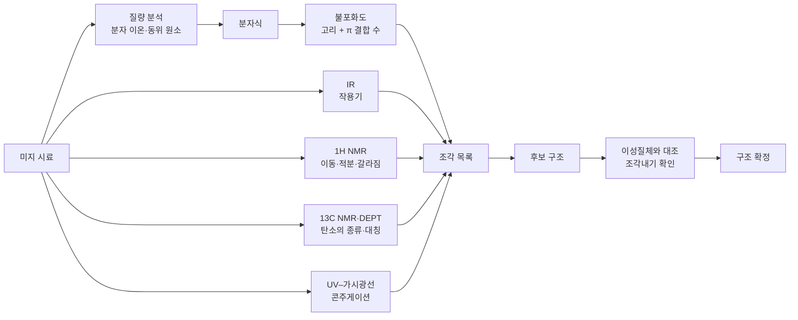

# 유기화학 7. 구조 결정: 질량 분석법과 분광법 — 스펙트럼 네 장으로 보이지 않는 분자를 그리다
<!-- prev: ochem-6, uchem-4, pchem-10 -->
<!-- next: ochem-8 -->

> [!NOTE]
> **이 단원의 범위**
> - 구조 결정의 전략: 분자식과 불포화도, 스펙트럼마다 얻는 정보의 종류
> - 질량 분석법: 전자 이온화와 분자 이온, 질소 규칙, 고분해능 질량으로 분자식 정하기, 동위 원소 무늬(C, Cl, Br, S), 조각내기(α 절단, 맥라퍼티 자리 옮김, 탈수, 트로필륨 이온)
> - 적외선 분광법: 스펙트럼 읽는 법(파수·세기·모양), 작용기 영역과 지문 영역, 작용기별 특성 흡수와 카보닐 흡수의 위치를 바꾸는 요인
> - $^1\mathrm{H}$ NMR: 화학적 동등성과 신호 수, 화학적 이동과 그 요인, 적분, 스핀–스핀 갈라짐($n+1$ 규칙, 갈라짐 나무)과 짝지음 상수, 교환하는 양성자
> - $^{13}\mathrm{C}$ NMR: 넓은 띠 짝풀림 스펙트럼, 화학적 이동과 대칭, DEPT로 C·CH·$\mathrm{CH_2}$·$\mathrm{CH_3}$ 가르기
> - 자외선–가시광선 분광법: π→π*·n→π* 전이, 콘주게이션과 흡수 파장, 우드워드–피저 규칙, 비어 법칙
> - 스펙트럼을 종합한 구조 결정: 분자식 → 불포화도 → IR → NMR → 조각 맞추기 → 이성질체와의 대조

**학습 목표**

1. 분자식에서 불포화도를 계산하고, 질량 분석·IR·NMR·UV가 각각 분자의 어떤 정보(질량과 원소, 작용기, 탄소–수소 골격과 이웃 관계, 콘주게이션)를 주는지 구별할 수 있다.
2. 질량 스펙트럼에서 분자 이온을 찾고, 질소 규칙·정확 질량·동위 원소 무늬로 분자식과 할로젠의 종류·개수를 정하며, α 절단과 맥라퍼티 자리 옮김 등 주요 조각내기를 메커니즘으로 설명할 수 있다.
3. 적외선 스펙트럼에서 흡수 띠의 파수·세기·모양을 읽어 작용기를 판정하고, 후크 법칙과 공명·고리 무리로 카보닐 흡수의 위치를 예측할 수 있다.
4. $^1\mathrm{H}$ NMR의 신호 수·화학적 이동·적분·갈라짐·짝지음 상수를 해석하여 분자 조각과 그 연결을 추론하고, 갈라짐 나무로 복잡한 다중선을 풀 수 있다.
5. $^{13}\mathrm{C}$ NMR과 DEPT로 탄소의 종류와 개수, 분자의 대칭을 판정할 수 있다.
6. 콘주게이션 길이와 흡수 파장의 관계를 분자 오비탈로 설명하고, 우드워드–피저 규칙과 비어 법칙으로 정량 계산을 할 수 있다.
7. 여러 스펙트럼을 종합해 미지 화합물의 구조를 정하고, 가능한 이성질체가 자료와 모순됨을 보여 답이 하나로 정해짐을 논증할 수 있다.

**이 단원의 학습 사다리**

| 단계 | 무엇을 하나? |
|---|---|
| STEP 1. 이전 학습 다시 보기 | 빛의 에너지와 파장, 분자 분광학의 선택 규칙·진동·NMR의 원리, 작용기와 대칭, 알코올·에터의 구조 |
| STEP 2. 기초 다지기 | 불포화도, 질량수와 정확 질량, 이항 분포(동위 원소 무늬와 갈라짐의 공통 수학), 후크 법칙과 파수 |
| STEP 3. 핵심 개념 | 질량 분석(분자 이온 → 동위 원소 → 조각내기) → IR(읽는 법 → 특성 흡수) → $^1\mathrm{H}$ NMR(신호 수·이동 → 적분 → 갈라짐) → $^{13}\mathrm{C}$·DEPT → UV–가시광선 → 종합 구조 결정 |
| STEP 4. 오개념 바로잡기 | "가장 큰 봉우리가 분자 이온", "적분은 신호 높이", "삼중선이면 $\mathrm{CH_2}$" 같은 착각 |
| STEP 5. 대학원·연구로 | 2차원 NMR(COSY·HSQC·HMBC), 탠덤 질량 분석, 계산으로 예측한 스펙트럼과의 대조 |
| STEP 6. 생활·산업·진로 | 도핑·법과학 분석, 의약품 품질 관리, 천연물 구조 결정, 대사체학 |

---

## 🗺️ 단원 들어가기

어느 연구실에서 식물 추출물로부터 무색의 액체 몇 밀리그램을 얻었다고 하자. 이 분자를 눈으로 볼 방법은 없다. 그러나 이 시료를 네 대의 기계에 넣으면 몇 시간 안에 구조식을 그릴 수 있다. **질량 분석기**는 분자 한 개의 질량과 그것이 깨지는 방식을 알려 주고, **적외선 분광기**는 분자 안에 어떤 작용기가 있는지 알려 준다. **핵자기 공명(NMR) 분광기**는 탄소와 수소가 어떤 환경에 몇 개씩 있고 누가 누구의 이웃인지 알려 주며, **자외선–가시광선 분광기**는 π 전자가 얼마나 길게 이어져 있는지 알려 준다. 각 기계는 퍼즐 조각 일부만 주지만, 조각을 모으면 답은 대개 하나로 정해진다.

20세기 중반까지 유기 화합물의 구조를 정하는 일은 화합물을 여러 반응으로 쪼개고 알려진 화합물로 바꾸어 비교하는, 몇 년씩 걸리는 작업이었다. 오늘날에는 스펙트럼이 그 일을 대신한다. 그래서 스펙트럼을 읽는 능력은 반응을 설계하는 능력만큼이나 유기화학자의 기본기이다. 이 책의 앞 단원 「분자 분광학」에서는 빛이 분자의 회전·진동·핵 스핀 준위를 어떻게 들뜨게 하는지 **원리**를 다루었다. 이 단원에서는 그 원리를 되짚기만 하고, **스펙트럼을 읽어 구조를 정하는 방법**에 집중한다. 단원의 마지막에서는 분자식 한 줄과 스펙트럼 네 장으로 구조를 정하고, "다른 이성질체는 왜 아닌가"까지 따져 본다.

---

## STEP 1. 🔙 이전 학습 다시 보기

### 연계 개념표

| 이전 단원 | 그때 배운 것 | 이 단원에서 확장되는 것 |
|---|---|---|
| 일반화학 「원자의 전자 구조와 주기성」 | 전자기 복사의 $c = \lambda\nu$, $E = h\nu$, 선 스펙트럼과 에너지 준위 | 파수 $\tilde{\nu} = 1/\lambda$로 IR 영역을 나타내고, 영역별 에너지(라디오파·적외선·자외선)가 어떤 분자 운동을 들뜨게 하는지 정리 |
| 물리화학 「분자 분광학」 '진동 분광학', '기준 진동 방식' | 조화 진동자 $\tilde{\nu} = (1/2\pi c)\sqrt{k/\mu}$, 적외선 활성(쌍극자 변화) | 결합의 힘 상수와 환산 질량으로 **작용기별 흡수 위치**를 어림하고, 쌍극자 변화의 크기로 **세기**를, 수소 결합으로 **모양**을 설명 |
| 물리화학 「분자 분광학」 '핵자기 공명의 원리', '화학적 이동', '스핀–스핀 짝지음' | 라모르 진동수, 가려막기 상수 $\sigma$와 $\delta$(ppm), $n+1$ 규칙과 파스칼 삼각형, 1차 스펙트럼의 조건 | 작용기별 $\delta$ 표를 쓰고, 신호 수·적분·갈라짐·$J$를 **모아서** 분자 조각을 짓고 잇는 법, 갈라짐 나무, $^{13}\mathrm{C}$·DEPT |
| 물리화학 「분자 분광학」 '전자 전이' | 전자 전이의 선택 규칙, 프랑크–콘돈 원리 | π→π*, n→π* 전이의 세기 차이와 콘주게이션에 따른 흡수 파장 변화, 우드워드–피저 규칙 |
| 유기화학 「구조와 결합, 산과 염기」 '작용기 개관', '공명' | 작용기 표, 골격 구조식, 공명과 전자의 비편재화 | 작용기를 스펙트럼으로 **찾고**, 공명이 C=O의 결합 차수와 IR 흡수, 고리 양성자의 이동을 바꾸는 것을 확인 |
| 유기화학 「입체화학」 '반응의 입체화학(프로카이랄성)' | 동등한 원자·거울상 위치·부분 입체 위치의 구별 | 화학적으로 동등한 양성자의 판정(치환 시험), 부분 입체 위치 양성자가 서로 다른 신호를 주는 까닭 |
| 유기화학 「알코올·에터·에폭사이드와 황 화합물」 | 알코올의 수소 결합과 산도, 알코올의 산화, 에터와 싸이올 | O–H 띠의 모양, 알코올·에터의 α 절단과 탈수 조각, $\mathrm{D_2O}$ 교환, 황의 M+2 봉우리 |

### 준비 운동 (사전 진단)

**Q1.** 파장 $\lambda = 5.85\ \mu\mathrm{m}$인 적외선의 파수($\mathrm{cm^{-1}}$)를 구하시오. 이 빛의 광자 에너지는 몇 kJ/mol인가? ($h = 6.626\times10^{-34}\ \mathrm{J\cdot s}$, $c = 2.998\times10^{8}\ \mathrm{m/s}$, $N_\mathrm{A} = 6.022\times10^{23}\ \mathrm{mol^{-1}}$)

**Q2.** 400 MHz NMR 장비에서 $\delta = 7.26$인 신호는 TMS 신호로부터 몇 Hz 떨어져 있는가?

**Q3.** 프로판-2-올 $\mathrm{(CH_3)_2CHOH}$의 CH 양성자 신호는 이웃한 메틸 양성자 때문에 몇 개의 선으로 갈라지는가? (O–H와의 짝지음은 무시한다.)

**Q4.** 다음 중 적외선을 흡수하지 **않는** 진동을 고르시오. (가) $\mathrm{N_2}$의 신축 (나) $\mathrm{CO_2}$의 대칭 신축 (다) $\mathrm{CO_2}$의 비대칭 신축 (라) $\mathrm{H_2O}$의 굽힘

정답 및 해설

**Q1.** $\tilde{\nu} = 1/\lambda = 1/(5.85\times10^{-4}\ \mathrm{cm}) = 1709\ \mathrm{cm^{-1}}$. $E = hc\tilde{\nu}N_\mathrm{A} = 6.626\times10^{-34}\times2.998\times10^{10}\ \mathrm{cm/s}\times1709\times6.022\times10^{23} = 2.04\times10^4\ \mathrm{J/mol} \approx 20.4\ \mathrm{kJ/mol}$. 케톤의 C=O 신축이 흡수하는 빛이며, 화학 결합 에너지(수백 kJ/mol)보다 훨씬 작아 결합을 끊지 못하고 진동만 들뜨게 한다.

**Q2.** $7.26\times10^{-6}\times4.00\times10^{8}\ \mathrm{Hz} = 2904\ \mathrm{Hz}$. (클로로폼 용매의 잔류 $\mathrm{CHCl_3}$ 신호 위치이다.)

**Q3.** 7개(칠중선) — 동등한 이웃 양성자 6개, $n+1 = 7$.

**Q4.** (가), (나) — 두 진동 모두 쌍극자 모멘트가 변하지 않는다. (다)와 (라)는 쌍극자가 변하므로 적외선 활성이다.

---

## STEP 2. 🧱 기초 다지기

### 디딤돌 1. 분자식과 불포화도 — 고리와 π 결합의 개수

구조 결정은 **분자식**에서 시작한다. 분자식이 정해지면 가장 먼저 **불포화도**(degree of unsaturation, 수소 결핍 지수라고도 한다)를 계산한다. 「알켄과 알카인」에서 정의했듯이, 불포화도는 같은 탄소 수의 포화 비고리 화합물($\mathrm{C}_n\mathrm{H}_{2n+2}$)에 비해 수소가 몇 쌍 부족한지를 센 값이고, 고리 하나 또는 π 결합 하나마다 1씩 늘어난다.

$$
\text{불포화도} = \frac{2C + 2 + N - H - X}{2}
$$

($C$, $H$, $N$, $X$는 탄소·수소·질소·할로젠 원자 수.) 이 식이 성립하는 까닭은 원자가로 따질 수 있다.

- **산소·황**(2가)은 사슬 중간에 끼어들어도 수소 수를 바꾸지 않으므로 식에서 빠진다($\mathrm{CH_3CH_3}$과 $\mathrm{CH_3OCH_3}$은 둘 다 H 6개).
- **할로젠**(1가)은 수소 하나를 대신하므로 수소처럼 센다.
- **질소**(3가)는 끼어들 때마다 결합 자리를 하나 더 만들어 수소 하나를 더 받을 수 있으므로($\mathrm{CH_3CH_3}$ → $\mathrm{CH_3NHCH_3}$, H 6 → 7) 최대 수소 수에 1을 더한다.

| 불포화도 | 가능한 구조의 예 |
|---|---|
| 0 | 포화 비고리(알케인, 알코올, 에터, 아민, 할로젠화 알킬) |
| 1 | C=C 1개, C=O 1개, 또는 고리 1개 |
| 2 | 삼중 결합 1개(C≡C, C≡N), 이중 결합 2개, 고리 + 이중 결합 |
| 4 이상 | 벤젠 고리(고리 1 + π 3 = 4)를 먼저 의심한다 |

#### 예제 1 — 불포화도에서 구조의 방향 잡기

다음 분자식의 불포화도를 구하고 가능한 구조의 종류를 말하시오. (1) $\mathrm{C_6H_{12}O}$ (2) $\mathrm{C_8H_9Br}$ (3) $\mathrm{C_5H_9N}$ (4) $\mathrm{C_9H_{10}O_2}$

**풀이**
(1) $(12 + 2 - 12)/2 = 1$ — C=O(알데하이드·케톤), C=C + 알코올·에터, 또는 고리 알코올·고리 에터.
(2) $(16 + 2 - 9 - 1)/2 = 4$ — 벤젠 고리 하나로 다 채워진다. 나머지 탄소 2개와 Br은 포화된 곁사슬이나 치환기이다(예: 브로모에틸벤젠, 브로모다이메틸벤젠).
(3) $(10 + 2 + 1 - 9)/2 = 2$ — C≡N이 있는 나이트릴(펜테인나이트릴 등), 또는 고리 + 이중 결합.
(4) $(18 + 2 - 10)/2 = 5$ — 벤젠 고리(4) + C=O(1)가 가장 흔하다. 방향족 에스터·케톤·카복실산을 먼저 생각한다.

**의미** 불포화도는 구조를 정해 주지 않지만, 찾아야 할 고리와 π 결합의 **개수**를 알려 주어 IR·NMR에서 무엇을 확인할지 정해 준다. 마지막에는 제안한 구조의 고리 수 + π 결합 수가 불포화도와 맞는지 꼭 검산한다.

### 디딤돌 2. 질량수, 평균 원자량, 정확 질량

질량 분석기는 이온 하나하나의 질량을 잰다. 그래서 주기율표의 **평균 원자량**(동위 원소의 존재비 가중 평균, Cl = 35.45)이 아니라 각 동위 원소의 질량을 써야 한다.

| 원소 | 동위 원소(정확 질량, u) | 자연 존재비 (%, 약) |
|---|---|---|
| H | $^1\mathrm{H}$ 1.00783, $^2\mathrm{H}$ 2.01410 | 99.99, 0.015 |
| C | $^{12}\mathrm{C}$ 12.00000(정의), $^{13}\mathrm{C}$ 13.00335 | 98.9, 1.1 |
| N | $^{14}\mathrm{N}$ 14.00307, $^{15}\mathrm{N}$ 15.00011 | 99.6, 0.37 |
| O | $^{16}\mathrm{O}$ 15.99491, $^{18}\mathrm{O}$ 17.99916 | 99.76, 0.20 |
| S | $^{32}\mathrm{S}$ 31.97207, $^{34}\mathrm{S}$ 33.96787 | 95.0, 4.2 |
| Cl | $^{35}\mathrm{Cl}$ 34.96885, $^{37}\mathrm{Cl}$ 36.96590 | 75.8, 24.2 |
| Br | $^{79}\mathrm{Br}$ 78.91834, $^{81}\mathrm{Br}$ 80.91629 | 50.7, 49.3 |

- **정수 질량**(nominal mass): 가장 흔한 동위 원소의 질량수를 더한 값. 저분해능 질량 분석기는 이것을 준다(예: $\mathrm{C_4H_8O}$ = 72).
- **정확 질량**(exact mass, 단일 동위 원소 질량): 가장 흔한 동위 원소의 정확 질량을 더한 값. 고분해능 질량 분석기(HRMS)는 이것을 소수 넷째 자리 안팎까지 잰다.

정확 질량이 분자식을 구별하는 까닭은 원자마다 정수에서 벗어나는 정도(**질량 결손**)가 다르기 때문이다. $^1\mathrm{H}$는 정수보다 0.0078 무겁고 $^{16}\mathrm{O}$는 0.0051 가벼우므로, 수소가 많을수록 질량이 정수보다 커지고 산소가 많을수록 작아진다.

#### 예제 2 — m/z 28은 무엇인가

정수 질량이 28인 $\mathrm{CO}$, $\mathrm{N_2}$, $\mathrm{C_2H_4}$의 정확 질량을 구하고, 측정값 28.0312를 주는 것이 무엇인지 정하시오.

**풀이**
$\mathrm{CO}$: $12.00000 + 15.99491 = 27.99491$
$\mathrm{N_2}$: $2\times14.00307 = 28.00614$
$\mathrm{C_2H_4}$: $2\times12.00000 + 4\times1.00783 = 28.03130$
측정값 28.0312는 $\mathrm{C_2H_4}$와 0.0001(약 4 ppm) 차이로 맞고, 다른 둘과는 0.025 이상 차이 난다.

**의미** 세 화학종의 질량 차이는 0.01~0.04 u에 불과하지만, 상대 정확도 수 ppm의 HRMS로는 쉽게 구별된다. 실제 분석에서는 측정값과 후보 분자식의 차이를 ppm으로 적어(보통 5 ppm 이내) 분자식을 보고한다.

### 디딤돌 3. 이항 분포 — 동위 원소 무늬와 $n+1$ 갈라짐의 공통 수학

서로 독립인 $n$개의 대상이 각각 확률 $p$와 $q = 1 - p$로 두 상태 중 하나를 고르면, $k$개가 두 번째 상태에 있을 확률은 이항 분포이다(수학 도구 7 「확률과 통계」 '세 가지 대표 분포 — 이항·푸아송·정규').

$$
P(k) = \binom{n}{k}p^{\,n-k}q^{\,k}
$$

이 하나의 식이 이 단원에서 두 번 쓰인다.

| 상황 | "대상" | 두 상태 | 결과 |
|---|---|---|---|
| 질량 스펙트럼의 동위 원소 무늬 | 분자 속 Cl(또는 Br) 원자 $n$개 | $^{35}\mathrm{Cl}$($p = 0.758$) / $^{37}\mathrm{Cl}$($q = 0.242$) | M, M+2, M+4, …의 세기 비 |
| NMR의 $n+1$ 갈라짐 | 이웃한 동등 양성자 $n$개 | 스핀 α / β (거의 $p = q = 1/2$) | $n+1$개의 선, 세기 비는 이항 계수(파스칼 삼각형) |

$^{13}\mathrm{C}$처럼 존재비가 작은 동위 원소는 $q$가 작아 $k = 1$까지만 보면 된다. 탄소 $n$개인 분자에서 $^{13}\mathrm{C}$가 하나 들어간 분자(M+1)의 상대 세기는

$$
\frac{P(1)}{P(0)} = \frac{n\,p^{n-1}q}{p^n} = n\frac{q}{p} \approx n\times\frac{1.1}{98.9} \approx 1.1\ \% \times n
$$

이다. 그래서 **M+1 봉우리의 세기(M = 100일 때)를 1.1로 나누면 탄소 수를 어림할 수 있다.**

#### 예제 3 — 염소 두 개의 무늬

$\mathrm{CH_2Cl_2}$의 분자 이온 영역에서 m/z 84, 86, 88 봉우리의 상대 세기를 구하시오. ($^{35}\mathrm{Cl}$ 75.8 %, $^{37}\mathrm{Cl}$ 24.2 %)

**풀이**
$n = 2$, $p = 0.758$, $q = 0.242$.
M(84, $^{35}\mathrm{Cl_2}$): $p^2 = 0.575$
M+2(86, $^{35}\mathrm{Cl}{}^{37}\mathrm{Cl}$): $2pq = 0.367$
M+4(88, $^{37}\mathrm{Cl_2}$): $q^2 = 0.0586$
가장 큰 것을 100으로 하면 $100 : 64 : 10$이다.

**의미** 염소 하나는 $100 : 32$(약 3 : 1), 둘은 $100 : 64 : 10$(약 9 : 6 : 1)이다. 봉우리 묶음의 모양만 보고도 할로젠의 종류와 개수를 알 수 있다. NMR에서 같은 계산을 $p = q = 1/2$로 하면 $1 : 2 : 1$의 삼중선이 된다.

### 디딤돌 4. 파수와 후크 법칙 — 결합의 용수철

IR 스펙트럼의 가로축은 **파수**(wavenumber) $\tilde{\nu} = 1/\lambda$(단위 $\mathrm{cm^{-1}}$)이다. 파수는 진동수·에너지에 비례하므로($E = hc\tilde{\nu}$), 왼쪽(큰 파수)일수록 에너지가 큰 진동이다. 「분자 분광학」에서 조화 진동자의 흡수 파수를

$$
\tilde{\nu} = \frac{1}{2\pi c}\sqrt{\frac{k}{\mu}}, \qquad \mu = \frac{m_1m_2}{m_1 + m_2}
$$

로 얻었다($k$는 결합의 힘 상수, $\mu$는 환산 질량). 이 식에서 두 가지 경향이 나온다.

- **결합이 셀수록(힘 상수가 클수록)** 파수가 크다: C≡C > C=C > C–C.
- **원자가 가벼울수록** 파수가 크다: 수소를 포함한 결합(C–H, O–H, N–H)은 모두 $2800\ \mathrm{cm^{-1}}$ 이상에 나타난다.

| 결합 | 힘 상수 $k$ (N/m, 약) | $\mu$ (u) | 계산한 $\tilde{\nu}$ ($\mathrm{cm^{-1}}$) | 실제 흡수 영역 ($\mathrm{cm^{-1}}$) |
|---|---|---|---|---|
| C–H | 500 | 0.930 | 약 3020 | 2850~3300 |
| C–C | 450 | 6.00 | 약 1130 | 800~1200(약하고 쓸모 적음) |
| C=C | 950 | 6.00 | 약 1640 | 1620~1680 |
| C≡C | 1550 | 6.00 | 약 2090 | 2100~2260 |
| C=O | 1200 | 6.86 | 약 1720 | 1650~1820 |

#### 예제 4 — 중수소로 바꾸면 흡수가 어디로 가나

C–H 결합의 힘 상수를 500 N/m라 할 때 (1) C–H와 (2) C–D 신축의 파수를 구하시오. 힘 상수는 동위 원소 치환으로 변하지 않는다. ($1\ \mathrm{u} = 1.6605\times10^{-27}\ \mathrm{kg}$, $c = 2.998\times10^{10}\ \mathrm{cm/s}$)

**풀이**
(1) $\mu = \dfrac{12.00\times1.008}{13.008} = 0.930\ \mathrm{u} = 1.544\times10^{-27}\ \mathrm{kg}$
$\tilde{\nu} = \dfrac{1}{2\pi(2.998\times10^{10})}\sqrt{\dfrac{500}{1.544\times10^{-27}}} = \dfrac{5.69\times10^{14}}{1.884\times10^{11}} = 3.02\times10^3\ \mathrm{cm^{-1}}$
(2) $\mu = \dfrac{12.00\times2.014}{14.014} = 1.725\ \mathrm{u}$이므로 $\tilde{\nu}$는 $\sqrt{0.930/1.725} = 0.734$배, 약 $2220\ \mathrm{cm^{-1}}$.

**의미** 중수소로 바꾸면 흡수가 약 $\sqrt{2}$분의 1 가까이 낮은 파수로 옮겨 간다. 그래서 흡수 띠가 어느 수소에서 오는지 확인할 때 중수소 치환 시료를 쓴다. NMR 용매로 $\mathrm{CDCl_3}$를 쓰는 것도 같은 생각이다 — 중수소는 양성자 NMR에 보이지 않는다.

---

## STEP 3. 📘 핵심 개념

> [!NOTE]
> **스펙트럼 자료의 약속** 이 단원의 질량 스펙트럼 봉우리 세기, IR 파수, NMR 화학적 이동과 짝지음 상수는 각 화합물에 대해 표준 범위 안의 **전형적인 값**이며, 측정 조건(용매, 농도, 장비)에 따라 조금씩 달라진다. 그래서 개별 값에는 '약'을 붙여 읽는다. $^1\mathrm{H}$·$^{13}\mathrm{C}$ NMR은 따로 밝히지 않으면 $\mathrm{CDCl_3}$ 용매, TMS 기준이다. 화합물은 IUPAC 이름과 SMILES를 함께 적는다.

### ① 질량 분석법의 원리와 분자 이온

**질량 분석법**(mass spectrometry, MS)은 분자를 이온으로 만들고, 이온을 **질량 대 전하 비**(m/z)에 따라 분리해 각 이온의 양을 세는 방법이다. 엄밀히는 빛을 흡수하는 '분광법'이 아니지만, 결과를 스펙트럼으로 그려 함께 다룬다. 유기 화합물의 구조 결정에서 가장 많이 쓰는 방식은 **전자 이온화**(electron ionization, EI)이다.

$$
\mathrm{M + e^-\ (70\ eV) \longrightarrow M^{\bullet +} + 2e^-}
$$

70 eV(약 6700 kJ/mol)의 전자가 기체 분자 곁을 지나며 전자 하나를 떼어 내면, 전자가 홀수 개인 양이온 라디칼 $\mathrm{M^{\bullet+}}$이 생긴다. 이것이 **분자 이온**(molecular ion)이며, 그 m/z가 곧 분자의 질량이다(유기 이온은 거의 다 $z = 1$). 분자의 이온화 에너지는 약 8~11 eV에 불과하므로, 남는 에너지가 분자 이온을 들뜨게 하여 일부가 더 작은 **조각 이온**(fragment ion)과 중성 조각으로 깨진다. 이온만 전기장·자기장에 이끌려 검출되고, 중성 라디칼과 분자는 보이지 않는다.

<!-- 그림 요청: 전자 이온화 질량 분석기의 개략도(왼쪽 → 오른쪽). ① 시료 주입구(기체 크로마토그래프 출구 또는 직접 주입, 진공 약 10⁻⁵ Pa 표시), ② 이온화실: 가열 필라멘트에서 나온 전자선(70 eV)이 시료 분자 흐름과 직각으로 교차, 'M + e⁻ → M•+ + 2e⁻' 이름표, ③ 가속·집속 전극(수 kV), ④ 질량 분석부(사중극자 막대 4개를 비스듬히 그리고 '질량 분석부: 사중극자 · TOF · 자기장 부채꼴 등'), ⑤ 검출기(전자 증배관), ⑥ 컴퓨터 화면에 막대 스펙트럼. 이온의 경로를 파란 선으로, 걸러져 버려지는 이온을 회색 점선으로. -->

#### 질량 스펙트럼 읽기

질량 스펙트럼은 가로축이 m/z, 세로축이 **상대 세기**(relative abundance)인 막대그래프이다. 가장 큰 봉우리를 **기준 봉우리**(base peak)라 하여 100으로 놓고 나머지를 그에 대한 백분율로 나타낸다. 기준 봉우리는 가장 안정한(또는 가장 쉽게 생기는) 이온이며, 분자 이온과 같을 수도 있고 다를 수도 있다.

<!-- 그림 요청: 뷰탄-2-온(SMILES CCC(C)=O)의 전자 이온화 질량 스펙트럼 막대그래프. 가로축 m/z 10~80(10 간격 눈금), 세로축 상대 세기 0~100. 막대(높이는 약값): m/z 27(10), 29(15), 42(5), 43(100, '기준 봉우리' 이름표), 57(7), 72(25, 'M•+ 분자 이온' 이름표), 73(1.1, 'M+1'). 43과 57 막대 위에 각각의 이온 구조 CH3–C≡O⁺, CH3CH2–C≡O⁺ 를 작게. 오른쪽 위에 분자 구조와 두 α 절단 위치(C2–C1, C2–C3)를 물결선으로. -->

#### 분자 이온을 찾는 기준

스펙트럼의 가장 오른쪽 봉우리 묶음이 분자 이온일 **가능성이 크지만**, 늘 그런 것은 아니다. 다음을 확인한다.

1. **동위 원소 봉우리를 빼고** 가장 큰 m/z여야 한다(M+1, M+2는 ②에서 다룬다).
2. 그보다 작은 봉우리들이 **말이 되는 중성 조각을 잃은 것**이어야 한다. M−15($\mathrm{CH_3}$), M−18($\mathrm{H_2O}$), M−29($\mathrm{C_2H_5}$ 또는 CHO)는 흔하지만, M−3~M−14나 M−21~M−25에 해당하는 중성 조각은 거의 없다. 어떤 후보 봉우리보다 4~14 작은 자리에 큰 봉우리가 있으면, 그 후보는 분자 이온이 아니다.
3. **질소 규칙**(nitrogen rule)을 만족해야 한다.

> [!IMPORTANT]
> **질소 규칙** C, H, O, S, 할로젠으로만 된 분자의 분자량은 짝수이다. 질소가 **홀수 개** 있으면 분자량이 홀수, 짝수 개(0 포함)이면 짝수이다.
> 까닭: 흔한 원소 가운데 질소만 '질량수는 짝수(14)인데 원자가는 홀수(3)'이다. 원자가가 홀수인 원자(H, 할로젠, N)는 결합 자리 수를 맞추기 위해 짝을 지어 들어가는데, 질소가 홀수 개이면 짝을 맞추는 수소 하나가 더 붙어 질량의 홀짝이 바뀐다.

#### 분자 이온이 약하거나 보이지 않을 때

3차 알코올, 많이 가지 친 알케인, 일부 에터와 아세탈은 분자 이온이 쉽게 깨져 EI 스펙트럼에서 거의 보이지 않는다. 이럴 때는 남는 에너지가 작은 **부드러운 이온화**를 쓴다.

| 이온화 | 생기는 이온 | 특징 | 주로 쓰는 시료 |
|---|---|---|---|
| 전자 이온화(EI) | $\mathrm{M^{\bullet+}}$ | 조각이 많아 '지문'이 풍부, 표준 라이브러리와 대조 가능 | 휘발성 작은 분자(GC–MS) |
| 화학 이온화(CI) | $[\mathrm{M+H}]^+$ | 반응 기체($\mathrm{CH_4}$ 등)의 양성자 전달, 조각이 적음 | EI에서 M이 안 보이는 분자 |
| 전기 분무 이온화(ESI) | $[\mathrm{M+H}]^+$, $[\mathrm{M+Na}]^+$, $[\mathrm{M-H}]^-$ | 용액에서 바로 이온화, 거의 깨지지 않음 | 극성·비휘발성 분자, 생체 고분자(LC–MS) |

CI와 ESI 스펙트럼의 가장 큰 m/z는 M이 아니라 M+1(양성자 첨가) 또는 M+23(나트륨 첨가)이라는 점에 주의한다. 이온화 장치와 질량 분석부의 원리는 「원자 분광법과 질량 분석법」에서 자세히 다룬다.

#### 예제 5 — 고분해능 질량으로 분자식 정하기

어떤 중성 화합물의 HRMS(EI)에서 분자 이온이 m/z 114.1046으로 측정되었다. 후보 분자식 $\mathrm{C_7H_{14}O}$, $\mathrm{C_6H_{14}N_2}$, $\mathrm{C_8H_{18}}$, $\mathrm{C_6H_{10}O_2}$ 가운데 맞는 것을 고르고 불포화도를 구하시오. 질소 규칙도 확인하시오.

**풀이**
정확 질량(디딤돌 2의 값):
$\mathrm{C_7H_{14}O}$: $84.0000 + 14.1096 + 15.9949 = 114.1045$
$\mathrm{C_6H_{14}N_2}$: $72.0000 + 14.1096 + 28.0061 = 114.1157$
$\mathrm{C_8H_{18}}$: $96.0000 + 18.1409 = 114.1409$
$\mathrm{C_6H_{10}O_2}$: $72.0000 + 10.0783 + 31.9898 = 114.0681$
측정값과의 차이는 각각 0.0001, 0.0111, 0.0363, 0.0365이므로 $\mathrm{C_7H_{14}O}$이다(차이 약 1 ppm). 질소 2개의 후보도 짝수 질량이어서 질소 규칙만으로는 배제되지 않지만, 정확 질량이 배제한다. 불포화도 $= (14 + 2 - 14)/2 = 1$.

**의미** 저분해능 스펙트럼의 '114'만으로는 네 분자식을 구별할 수 없다. 정확 질량 하나가 분자식을 정하고, 불포화도 1은 "C=O 하나 또는 C=C 하나 또는 고리 하나"로 다음 탐색의 범위를 좁힌다.

#### ✔ 바로 확인

1. (O/X) 질량 스펙트럼의 기준 봉우리는 언제나 분자 이온이다.
2. 분자 이온이 m/z 101인 화합물에는 질소가 (짝수 / 홀수) 개 있다.
3. 어떤 스펙트럼의 가장 큰 m/z가 124이고, 그 다음으로 m/z 120에 큰 봉우리가 있다. m/z 124를 분자 이온으로 볼 수 있는가?
4. 빈칸: ESI 양이온 스펙트럼에서 분자량 180인 중성 분자는 주로 m/z (    )와 (    )에 나타난다.

정답

1. X — 기준 봉우리는 가장 많이 생긴 이온이다. 뷰탄-2-온의 기준 봉우리는 m/z 43(아세틸륨 이온)이고 분자 이온은 72이다.
2. 홀수 — 질소 규칙. (예: 트라이에틸아민 $\mathrm{(CH_3CH_2)_3N}$, 101)
3. 볼 수 없다 — 분자 이온에서 4를 잃는 중성 조각은 없다. 124와 120은 둘 다 더 큰 분자 이온의 조각이거나, 124가 동위 원소 봉우리일 수 있다.
4. 181($[\mathrm{M+H}]^+$), 203($[\mathrm{M+Na}]^+$)

### ② 동위 원소 무늬 — 탄소 수와 할로젠을 세는 봉우리 묶음

분자 이온 봉우리 오른쪽에는 거의 언제나 작은 봉우리들이 붙어 있다. 무거운 동위 원소가 들어간 분자들이다. 디딤돌 3의 이항 분포로 그 세기를 계산할 수 있고, 거꾸로 세기에서 원소의 종류와 수를 읽을 수 있다.

| 원소 | 주로 기여하는 봉우리 | 원자 하나당 상대 세기(M = 100, 약) | 알아보는 법 |
|---|---|---|---|
| C | M+1 | 1.1 | M+1 ÷ 1.1 ≈ 탄소 수 |
| N | M+1 | 0.37 | (질소 규칙과 함께) |
| O | M+2 | 0.2 | 거의 보이지 않음 |
| S | M+2 | 4.4 | M+2가 4~5 %로 눈에 띔(M+1도 0.8 % 보탬) |
| Cl | M+2 | 32 | M : M+2 ≈ 3 : 1 |
| Br | M+2 | 97 | M : M+2 ≈ 1 : 1 |
| F, I, P | — | 0 | 동위 원소가 하나뿐(단일 동위 원소 원소). I는 127이라는 큰 질량과 m/z 127($\mathrm{I^+}$)로 알아본다 |

할로젠이 여러 개이면 무늬가 이항 계수를 따라 넓어진다.

| 할로젠 | M | M+2 | M+4 | M+6 |
|---|---|---|---|---|
| Cl | 100 | 32 | | |
| $\mathrm{Cl_2}$ | 100 | 64 | 10 | |
| $\mathrm{Cl_3}$ | 100 | 96 | 31 | 3 |
| Br | 100 | 97 | | |
| $\mathrm{Br_2}$ | 51 | 100 | 49 | |
| BrCl | 77 | 100 | 24 | |

<!-- 그림 요청: 할로젠 동위 원소 무늬 6종을 2행 × 3열의 작은 막대그래프로. 각 칸의 가로축은 M, M+2, M+4, M+6(간격 2), 세로축 상대 세기 0~100. 값: Cl (100, 32), Cl₂ (100, 64, 10), Cl₃ (100, 96, 31, 3), Br (100, 97), Br₂ (51, 100, 49), BrCl (77, 100, 24). 각 칸 위에 이름표, Cl 계열 막대는 초록, Br 계열은 적갈색, BrCl은 두 색을 반씩. M+1 봉우리는 그리지 않는다(할로젠 무늬만). 아래에 '염소 3 : 1, 브로민 1 : 1'이라는 큰 글씨 요약. -->

<!-- 시뮬레이션 요청: 동위 원소 무늬 계산기. 사용자가 분자식(C, H, N, O, S, Cl, Br의 원자 수 입력 칸 또는 슬라이더 C 1~60, Cl 0~6, Br 0~4, S 0~3)을 넣으면 M, M+1, M+2, …, M+12까지의 상대 세기를 이항(다항) 분포로 계산해 막대그래프로 그리고 표로 보여 준다. 존재비는 ¹³C 1.07 %, ²H 0.015 %, ¹⁵N 0.37 %, ¹⁸O 0.20 %, ³³S 0.75 %, ³⁴S 4.25 %, ³⁷Cl 24.2 %, ⁸¹Br 49.3 %. '단일 동위 원소 봉우리(M)가 가장 크지 않게 되는 탄소 수'(약 92개)를 C 슬라이더로 찾아보게 하는 안내 문구와, Cl·Br 개수를 바꿀 때 무늬가 바뀌는 모습을 강조. -->

> [!TIP]
> 💡 **요령** — 탄소 수 어림은 M+1이 충분히 크고 깨끗할 때만 믿을 수 있다. M 봉우리가 약하면 상대 세기의 오차가 커지고, 분자 이온이 수소 하나를 잃은 M−1 봉우리나 수소를 얻은 M+H 봉우리가 섞이면 계산이 틀어진다. M+1 어림은 "탄소 6~8개 정도" 같은 범위를 주는 도구로 쓰고, 분자식은 정확 질량으로 확정한다.

#### 예제 6 — 봉우리 묶음에서 분자식까지

어떤 방향족 화합물의 EI 질량 스펙트럼에서 다음 봉우리를 얻었다. m/z 156(약 97), 157(약 6.4), 158(약 95), 159(약 6.2), 77(100), 51(약 30). 이 화합물의 분자식과 구조를 추론하시오.

**풀이**
① 156과 158의 세기가 거의 같다(약 1 : 1) → 브로민 1개. 분자 이온은 $^{79}\mathrm{Br}$이 든 156이다.
② M+1(157)의 상대 세기 $= 6.4/97\times100 = 6.6$ → 탄소 수 $\approx 6.6/1.1 = 6$.
③ 남은 질량: $156 - 79 - 6\times12 = 5$ → 수소 5개. 분자식 $\mathrm{C_6H_5Br}$, 불포화도 $= (12 + 2 - 5 - 1)/2 = 4$ → 벤젠 고리.
④ 기준 봉우리 77은 $156 - 79$, 즉 Br 원자를 잃은 페닐 양이온 $\mathrm{C_6H_5^+}$이다. 51은 페닐 양이온이 에타인($\mathrm{C_2H_2}$, 26)을 잃은 $\mathrm{C_4H_3^+}$이다.
구조는 브로모벤젠(SMILES `Brc1ccccc1`)이다.

**의미** 한 쌍의 봉우리 높이만 보고도 할로젠을 확정할 수 있다. 77 → 51은 일치환 벤젠 유도체에서 자주 보이는 조각의 짝이다.

#### ✔ 바로 확인

1. M : M+2가 약 3 : 1인 화합물에 들어 있을 가능성이 큰 원소는?
2. M = 100으로 놓았을 때 M+1이 약 8.8인 화합물의 탄소 수는 대략 몇 개인가?
3. 분자 이온 영역이 M : M+2 : M+4 ≈ 1 : 2 : 1인 화합물에는 무엇이 들어 있는가?
4. (O/X) M+2가 약 4.5 %로 나타나는 것은 산소가 2개 있기 때문이다.

정답

1. 염소 1개
2. 약 8개 — $8.8/1.1$.
3. 브로민 2개 — $(1 + 1)^2$의 이항 계수.
4. X — 산소의 M+2 기여는 원자 하나당 0.2 %에 불과하다. M+2가 4~5 %이면 황 1개를 의심한다.

### ③ 조각내기 — 분자 이온은 약한 곳에서 깨지고 안정한 이온을 남긴다

분자 이온 $\mathrm{M^{\bullet+}}$은 홀전자 하나와 양전하 하나를 가진다. 깨질 때는 결합 하나가 끊어지며 한쪽은 **양이온**, 다른 쪽은 **중성 라디칼**이 된다(또는 자리 옮김으로 양이온 라디칼과 중성 분자가 된다). 어떤 조각이 생기는지는 두 원리로 예측한다.

- **양이온이 안정한 쪽으로 깨진다.** 3차 > 2차 > 1차 탄소 양이온, 그리고 공명으로 안정화된 알릴·벤질 양이온, 산소·질소의 비공유 전자쌍이 전하를 나누는 옥소늄·이미늄·아실륨 이온이 잘 생긴다(「유기 반응의 개관과 알킬 할라이드의 치환·제거 반응」의 탄소 양이온 안정성과 같은 순서이다).
- **안정한 중성 조각이 떨어져 나가는 쪽으로 깨진다.** 물, 일산화 탄소, 에텐, 알켄 같은 작은 안정 분자의 이탈은 유리하다.

전자 하나의 움직임은 「구조와 결합, 산과 염기」에서 소개한 **낚싯바늘 화살표**(한쪽 갈퀴)로 그린다.

| 흔한 중성 손실 | 질량 | | 흔한 조각 이온 | m/z |
|---|---|---|---|---|
| $\mathrm{CH_3^\bullet}$ | 15 | | $\mathrm{CH_2{=}\overset{+}{O}H}$ (1차 알코올·에터) | 31 |
| $\mathrm{H_2O}$ | 18 | | $\mathrm{CH_2{=}\overset{+}{N}H_2}$ (1차 아민) | 30 |
| CO 또는 $\mathrm{CH_2{=}CH_2}$ | 28 | | $\mathrm{CH_3C{\equiv}O^+}$ (메틸 케톤·아세테이트) | 43 |
| $\mathrm{C_2H_5^\bullet}$ 또는 $\mathrm{CHO^\bullet}$ | 29 | | $\mathrm{C_4H_9^+}$ | 57 |
| $\mathrm{CH_3O^\bullet}$ | 31 | | $\mathrm{C_6H_5^+}$ (페닐) | 77 |
| $\mathrm{C_3H_7^\bullet}$ 또는 $\mathrm{CH_3CO^\bullet}$ | 43 | | $\mathrm{C_7H_7^+}$ (트로필륨) | 91 |
| $\mathrm{C_2H_5O^\bullet}$ 또는 $\mathrm{COOH^\bullet}$ | 45 | | $\mathrm{C_6H_5C{\equiv}O^+}$ (벤조일) | 105 |

#### 알케인 — 가지가 있는 자리에서 깨진다

곧은 사슬 알케인은 C–C 결합 어디서나 깨져 14(즉 $\mathrm{CH_2}$)씩 차이 나는 봉우리 묶음(29, 43, 57, 71, …)을 만든다. 가지 친 알케인은 3차·2차 탄소 양이온이 생기는 가지 자리에서 우선 깨지고, 분자 이온이 매우 약해진다.

<!-- 그림 요청: 두 알케인의 EI 질량 스펙트럼을 위아래로 비교(가로축 m/z 10~100, 세로축 0~100). 위: 헥세인(SMILES CCCCCC) — 막대 29(약 40), 41(약 45), 43(약 75), 56(약 40), 57(100), 71(약 10), 86(약 15, 'M•+'). 아래: 2,2-다이메틸프로페인(SMILES CC(C)(C)C) — 막대 29(약 40), 41(약 40), 57(100, 'tert-뷰틸 양이온 (CH3)3C⁺'), 72 자리에 막대가 거의 없음(약 0.1, '분자 이온이 거의 보이지 않는다'라는 화살표 이름표). 오른쪽에 각 분자의 구조와 가장 쉽게 끊어지는 결합을 물결선으로. -->

#### 알코올·에터·아민 — α 절단과 탈수

헤테로 원자의 비공유 전자쌍에서 전자 하나가 떨어진 분자 이온은, 헤테로 원자에 붙은 탄소(α 탄소)와 그 이웃 탄소 사이의 결합이 끊어지는 **α 절단**(α-cleavage)을 잘 일으킨다. 홀전자와 끊어지는 결합의 전자 하나가 짝을 지어 C=O⁺(또는 C=N⁺) 이중 결합을 만들기 때문에, 생기는 옥소늄·이미늄 이온은 모든 원자가 옥텟을 가진 안정한 이온이다.

$$
\mathrm{R{-}CH_2{-}\overset{\bullet +}{O}H \longrightarrow R^\bullet + CH_2{=}\overset{+}{O}H}\quad(m/z\ 31)
$$

α 탄소에 붙은 무리 가운데 **가장 큰 무리가 라디칼로 떨어져 나가는** 경향이 있다. 알코올은 이 밖에도 물을 잃는 **탈수**(M−18) 봉우리를 자주 보인다. 아민은 질소가 전하를 더 잘 나누므로 α 절단이 더 강하게 일어나며, α 탄소에 가지가 없는 1차 아민은 m/z 30($\mathrm{CH_2{=}NH_2^+}$)이 기준 봉우리가 된다.

#### 예제 7 — α 절단으로 이성질체 알코올 구별하기

펜탄-2-올(SMILES `CCCC(C)O`)과 펜탄-3-올(SMILES `CCC(O)CC`)은 분자식 $\mathrm{C_5H_{12}O}$(M = 88)가 같다. 두 화합물의 스펙트럼 가운데 하나는 기준 봉우리가 m/z 45, 다른 하나는 m/z 59였다. 각각 어느 화합물인지 α 절단으로 설명하시오.

**풀이**
펜탄-2-올: α 탄소(C2)에는 $\mathrm{CH_3}$와 $\mathrm{CH_2CH_2CH_3}$가 붙어 있다. 큰 프로필 라디칼(43)이 떨어지면 $\mathrm{CH_3CH{=}\overset{+}{O}H}$, $88 - 43 = 45$. 메틸(15)이 떨어지면 73이 생기지만 약하다.
펜탄-3-올: α 탄소(C3)에는 에틸 두 개가 붙어 있다. 에틸 라디칼(29)이 떨어지면 $\mathrm{CH_3CH_2CH{=}\overset{+}{O}H}$, $88 - 29 = 59$.
따라서 m/z 45가 기준인 쪽이 펜탄-2-올, 59가 기준인 쪽이 펜탄-3-올이다. 두 스펙트럼 모두 분자 이온(88)은 매우 약하고, 탈수 봉우리(70)가 작게 보인다.

<!-- 그림 요청: 펜탄-3-올의 분자 이온에서 α 절단이 일어나는 메커니즘. 왼쪽: 산소에 홀전자(점 하나)와 ⊕가 있는 분자 이온 CH3CH2–CH(–O•+H)–CH2CH3. 낚싯바늘 화살표 3개: ① C3–C4 결합 전자 하나 → C3–O 사이(새 π 결합 자리), ② O의 홀전자 → C3–O 사이, ③ C3–C4 결합의 다른 전자 하나 → C4 쪽(에틸 라디칼로). 오른쪽: CH3CH2–CH=O⁺H (m/z 59, 옥소늄 이온, 모든 원자 옥텟) + •CH2CH3 (29, 중성 라디칼, '검출되지 않음' 회색 글씨). 아래에 비교용으로 펜탄-2-올에서 프로필 라디칼이 떨어져 CH3–CH=O⁺H (m/z 45)가 생기는 같은 형식의 작은 그림. -->

#### 카보닐 화합물 — 아실륨 이온과 맥라퍼티 자리 옮김

케톤과 알데하이드도 카보닐 탄소 옆에서 α 절단을 일으켜 **아실륨 이온**($\mathrm{R{-}C{\equiv}O^+}$)을 만든다. 메틸 케톤은 거의 언제나 m/z 43($\mathrm{CH_3CO^+}$)을 크게 보인다.

카보닐기에서 세 번째 탄소(γ 탄소)에 수소가 있으면 특별한 자리 옮김이 일어난다. 카보닐 산소의 홀전자가 **6원자 고리 전이 상태**를 거쳐 γ 수소를 끌어오고, 동시에 α–β 결합이 끊어져 중성 알켄이 떨어져 나간다. 이것이 **맥라퍼티 자리 옮김**(McLafferty rearrangement)이다. 남는 이온은 엔올의 양이온 라디칼이며, 중성 **분자**(라디칼이 아님)를 잃었으므로 분자 이온과 같이 질량이 **짝수**이다(질소가 없을 때).

$$
\mathrm{CH_3COCH_2CH_2CH_2CH_3^{\bullet+}}\ (100) \longrightarrow \mathrm{CH_2{=}C(OH)CH_3^{\bullet+}}\ (58) + \mathrm{CH_2{=}CHCH_3}\ (42)
$$

<!-- 그림 요청: 헥산-2-온(SMILES CCCCC(C)=O)의 맥라퍼티 자리 옮김 메커니즘. 왼쪽: 분자 이온을 6원자 고리처럼 휘어 그린 형태 — O(홀전자·⊕)=C2(–CH3)–C3H2(α)–C4H2(β)–C5H(γ, 수소 하나를 굵게)–C6H3. γ-H와 O 사이를 점선으로 이어 6원자 고리(O, C2, C3, C4, C5, H) 전이 상태를 강조. 낚싯바늘 화살표: γ C–H 결합의 전자 하나 → H–O 사이, O의 홀전자 → H–O 사이, C3–C4 결합의 전자 하나씩 → C2–C3 사이와 C4–C5 사이. 오른쪽: 엔올 양이온 라디칼 CH2=C(OH)CH3 •+ (m/z 58, 짝수 질량 이름표) + 프로펜 CH2=CH–CH3 (42, 중성). 아래 작은 막대 스펙트럼: 43(100), 58(약 60), 57(약 15), 71(약 5), 85(약 5), 100(약 10, M). -->

#### 예제 8 — 맥라퍼티 봉우리로 사슬의 위치 정하기

분자식 $\mathrm{C_6H_{12}O}$인 두 메틸 케톤 헥산-2-온과 3,3-다이메틸뷰탄-2-온(SMILES `CC(=O)C(C)(C)C`)의 EI 스펙트럼을 비교한다. 하나는 m/z 43(100)과 58(약 60)을, 다른 하나는 m/z 43과 57(크다), 85를 보이고 58은 거의 없다. 어느 쪽이 어느 화합물인가?

**풀이**
맥라퍼티 자리 옮김에는 γ 탄소의 수소가 필요하다. 헥산-2-온은 카보닐 오른쪽 사슬 $\mathrm{C3{-}C4{-}C5}$의 C5에 수소가 있으므로 m/z 58이 생긴다. 3,3-다이메틸뷰탄-2-온은 카보닐 옆 C3이 4차 탄소이고, 그 메틸 탄소들은 β 탄소이며 γ 탄소가 없다. 따라서 58이 생기지 않는다. 대신 α 절단으로 tert-뷰틸 양이온(57)과 아세틸륨(43)이 생기고, 메틸을 잃은 85($\mathrm{(CH_3)_3CCO^+}$)도 보인다.
→ 43·58: 헥산-2-온, 43·57·85: 3,3-다이메틸뷰탄-2-온.

**의미** 짝수 m/z의 조각 이온(질소가 없는 분자에서)은 자리 옮김의 신호이며, 맥라퍼티 봉우리의 질량은 카보닐기 쪽 조각이 얼마나 무거운지 알려 준다.

#### 방향족 화합물 — 트로필륨 이온

벤젠 고리에 알킬기가 붙은 화합물은 벤질 자리의 결합이 끊어져 $\mathrm{C_7H_7^+}$(m/z 91)을 기준 봉우리로 내놓는 일이 많다. 이 이온은 처음에는 벤질 양이온이지만, 고리가 넓어지는 자리 옮김을 거쳐 7원자 고리의 **트로필륨 이온**이 된다. 트로필륨 이온은 π 전자 6개가 고리 전체에 퍼진 방향족 양이온으로 매우 안정하다(방향족성은 다음 단원 「콘주게이션계와 방향족성」에서 다룬다). 페닐 케톤은 벤조일 양이온(105)과 페닐 양이온(77)을 낸다.

<!-- 그림 요청: 톨루엔(SMILES Cc1ccccc1)의 EI 질량 스펙트럼과 트로필륨 이온 생성. 왼쪽 막대그래프(가로축 m/z 30~100): 39(약 15), 51(약 8), 63(약 8), 65(약 12), 91(100, 기준), 92(약 75, M•+), 93(약 5, M+1). 오른쪽: 분자 이온에서 메틸 C–H가 끊어져 벤질 양이온 C6H5CH2⁺가 생기고(화살표 '−H•'), 이것이 자리 옮김(굽은 큰 화살표 '고리 확장')으로 정칠각형 고리 안에 원과 ⊕를 그린 트로필륨 이온 C7H7⁺(m/z 91)이 되는 두 단계. 트로필륨 아래에 '6 π 전자, 방향족'. 91 → 65 화살표에 '−C2H2 (26)'. -->

#### ✔ 바로 확인

1. 1차 아민 펜탄-1-아민(SMILES `CCCCCN`)의 기준 봉우리로 예상되는 m/z는?
2. 맥라퍼티 자리 옮김이 일어나려면 카보닐기에서 몇 번째 탄소에 수소가 있어야 하는가?
3. 에틸벤젠(SMILES `CCc1ccccc1`, M = 106)의 기준 봉우리로 예상되는 m/z와 이온의 이름은?
4. (O/X) 질소가 없는 화합물에서 짝수 m/z의 조각 이온은 단순한 결합 하나의 절단보다는 자리 옮김으로 생긴 경우가 많다.

정답

1. 30 — $\mathrm{CH_2{=}NH_2^+}$. α 절단으로 뷰틸 라디칼이 떨어진다.
2. γ(세 번째) 탄소 — 6원자 고리 전이 상태를 거친다.
3. 91, 트로필륨 이온 — 메틸 라디칼(15)을 잃는다($106 - 15 = 91$).
4. O — 결합 하나가 끊기면 라디칼을 잃어 홀수 질량 이온이 되지만, 중성 분자를 잃는 자리 옮김은 짝수 질량을 남긴다.

### ④ 적외선 분광법 — 스펙트럼을 읽는 법

「분자 분광학」에서 보았듯이 분자는 진동 진동수와 같은 진동수의 적외선을 흡수하며, 그 진동이 **쌍극자 모멘트를 바꿀 때만** 흡수한다(적외선 활성). 유기 분자는 원자 수가 많아 기준 진동이 수십 개이지만, 다행히 작용기의 신축 진동은 분자의 나머지 부분과 크게 섞이지 않아 **작용기마다 거의 일정한 파수**에 나타난다. 이것이 IR이 '작용기 탐지기'로 쓰이는 까닭이다.

#### 스펙트럼의 축과 네 영역

IR 스펙트럼은 가로축이 파수(왼쪽 $4000\ \mathrm{cm^{-1}}$에서 오른쪽 $400\ \mathrm{cm^{-1}}$로 **줄어든다**), 세로축이 **투과율**(% transmittance)이다. 흡수가 일어나면 투과율이 떨어지므로 흡수 띠는 위에서 아래로 늘어진 골짜기 모양이다. 디딤돌 4의 후크 법칙에 따라 스펙트럼은 네 영역으로 나뉜다.

| 영역 ($\mathrm{cm^{-1}}$) | 주로 나타나는 진동 | 까닭 |
|---|---|---|
| 4000~2500 | O–H, N–H, C–H 신축 | 가벼운 수소 → 환산 질량이 작다 |
| 2500~2000 | C≡N, C≡C 신축(그리고 $\mathrm{CO_2}$, C=C=O 같은 누적 이중 결합) | 삼중 결합 → 힘 상수가 크다 |
| 2000~1500 | C=O, C=C, C=N 신축, N–H 굽힘 | 이중 결합 |
| 1500~400 | C–O, C–C, C–N 신축, 여러 굽힘 진동 | **지문 영역**(fingerprint region): 분자 전체가 섞인 진동이라 화합물마다 고유하다 |

<!-- 그림 요청: IR 상관 도표. 가로축 파수 4000 → 500 cm⁻¹(왼쪽이 큰 값, 500 간격 눈금, 2000 아래부터는 눈금 간격을 두 배로 넓힌 일반적 스펙트럼 척도), 영역을 네 칸(4000~2500 'X–H 신축', 2500~2000 '삼중 결합', 2000~1500 '이중 결합', 1500~500 '지문 영역')으로 옅게 색칠. 그 위에 가로 막대로 흡수 범위: O–H 알코올 3200~3550(넓은 막대), O–H 카복실산 2500~3300(아주 넓음), N–H 3300~3500, ≡C–H 약 3300(좁음), =C–H와 Ar–H 3000~3100, C–H(sp³) 2850~2960, 알데하이드 C–H 약 2720·2820(두 개의 짧은 막대), C≡N 2210~2260, C≡C 2100~2260, C=O 1650~1820, C=C 1620~1680, 방향족 C=C 약 1600·1500, C–O 1000~1300. 각 막대 오른쪽에 강함(s)·중간(m)·약함(w) 표기. -->

#### 무엇을 읽는가 — 위치, 세기, 모양

흡수 띠 하나에서 세 가지를 읽는다.

1. **위치**(파수): 어떤 결합인가. 위의 영역 표와 ⑤의 표로 판정한다.
2. **세기**(강함 s, 중간 m, 약함 w): 진동할 때 쌍극자가 **얼마나 크게** 변하는가. 흡수 세기는 쌍극자 모멘트의 변화율($d\mu/dx$)의 제곱에 비례한다. 극성이 큰 C=O와 O–H는 강하고, 거의 무극성인 C=C는 약하며, 대칭으로 치환된 C≡C나 C=C(예: (E)-헥스-3-엔)는 쌍극자 변화가 0에 가까워 띠가 사라지기도 한다.
3. **모양**(넓다 / 날카롭다): **수소 결합**이 있으면 분자마다 O–H 결합의 세기가 조금씩 달라져 흡수 파수가 넓게 퍼진다. 그래서 순수한 알코올의 O–H 띠는 $3200\sim3550\ \mathrm{cm^{-1}}$에 걸친 넓은 띠이다. 아주 묽은 비극성 용액이나 기체에서 수소 결합이 끊어진 '자유' O–H는 $3600\sim3650\ \mathrm{cm^{-1}}$의 날카로운 띠로 나타난다.

<!-- 그림 요청: 뷰탄-2-온(SMILES CCC(C)=O)의 IR 스펙트럼 모식도(액체 막). 가로축 4000 → 500 cm⁻¹, 세로축 투과율 0~100 %. 띠(위치, 깊이, 모양): 2980·2940(중간, 날카로움, 'C–H sp³'), 약 3410(아주 약하고 넓음, 'C=O 배음' 회색 이름표), 1715(투과율 약 5 %까지 내려가는 매우 강하고 날카로운 띠, 'C=O 신축' 굵은 이름표), 1460·1365(중간, 'C–H 굽힘'), 1170(중간, 'C–C(=O)–C'), 지문 영역 1000~600에 작은 띠 여러 개. 3200~3600에 넓은 띠가 **없음**을 강조하는 빈 상자 '알코올 아님'. -->

#### 예제 9 — 세기와 모양의 까닭

다음 관찰을 설명하시오.
(1) 헥스-1-엔(SMILES `C=CCCCC`)은 $1640\ \mathrm{cm^{-1}}$에 중간 세기의 띠를 보이지만, (E)-헥스-3-엔(SMILES `CC/C=C/CC`)의 같은 영역 띠는 거의 보이지 않는다.
(2) 에탄올을 사염화 탄소에 아주 묽게 녹이면 약 $3630\ \mathrm{cm^{-1}}$에 날카로운 띠만 보이지만, 진하게 녹이면 약 $3350\ \mathrm{cm^{-1}}$에 넓고 강한 띠가 자란다.

**풀이**
(1) (E)-헥스-3-엔은 C=C 양쪽에 같은 에틸기가 대칭으로 붙어 있어(대칭 중심), C=C가 늘었다 줄었다 해도 분자의 쌍극자 모멘트가 변하지 않는다. 적외선 비활성에 가깝다. 헥스-1-엔은 한쪽이 $\mathrm{CH_2}$, 다른 쪽이 뷰틸기여서 진동할 때 작은 쌍극자 변화가 생긴다.
(2) 묽은 용액에서는 에탄올 분자가 서로 떨어져 있어 수소 결합하지 않은 O–H가 한 가지 세기로 진동한다(날카로운 띠). 진해지면 분자끼리 O–H⋯O 수소 결합을 이루며, 수소 결합은 O–H 결합을 약하게 하여(힘 상수 감소) 파수를 낮추고, 수소 결합의 길이·각도가 분자마다 달라 파수가 넓게 퍼진다.

**의미** IR 띠가 "없다"는 것이 작용기가 없다는 뜻은 아니다(대칭 C=C). 반대로 넓은 O–H 띠는 수소 결합의 지문이어서, 농도를 바꾸어 띠의 모양이 변하는지 보면 분자 간 수소 결합(농도 의존)과 분자 내 수소 결합(농도 무관)도 구별할 수 있다.

#### ✔ 바로 확인

1. (O/X) IR 스펙트럼의 가로축은 오른쪽으로 갈수록 에너지가 커진다.
2. 빈칸: $1500\ \mathrm{cm^{-1}}$ 아래의, 분자 전체가 섞인 진동이 나타나 화합물마다 고유한 영역을 (    ) 영역이라 한다.
3. C=O 신축이 C=C 신축보다 훨씬 강하게 흡수하는 까닭을 한 문장으로 쓰시오.
4. 알코올의 O–H 띠가 넓은 까닭은?

정답

1. X — 파수가 오른쪽으로 갈수록 작아지므로 에너지도 작아진다.
2. 지문
3. C=O는 극성이 커서 신축할 때 쌍극자 모멘트가 크게 변하기 때문이다(세기 ∝ 쌍극자 변화율의 제곱).
4. 분자 간 수소 결합의 세기가 분자마다 달라 O–H 신축 파수가 넓게 퍼지기 때문이다.

### ⑤ 작용기별 특성 흡수와 카보닐 흡수의 위치

구조 결정에 쓰는 특성 흡수는 많지 않다. 아래 표를 '먼저 볼 곳' 순서로 정리했다.

| 작용기·결합 | 파수 ($\mathrm{cm^{-1}}$, 약) | 세기·모양 | 판정 요령 |
|---|---|---|---|
| O–H (알코올·페놀) | 3200~3550 | 강함, 넓음 | 묽은 용액의 자유 O–H는 3600~3650, 날카로움 |
| O–H (카복실산) | 2500~3300 | 강함, 아주 넓음 | C–H 띠를 덮을 만큼 넓다(이량체의 강한 수소 결합) + C=O 약 1710 |
| N–H (아민·아마이드) | 3300~3500 | 중간, 알코올보다 덜 넓음 | 1차($\mathrm{NH_2}$)는 띠 2개, 2차(NH)는 1개, 3차는 없음 |
| ≡C–H | 약 3300 | 강함, **날카로움** | 말단 알카인. N–H와 혼동하지 않도록 C≡C(약 2120)를 함께 확인 |
| =C–H, Ar–H | 3000~3100 | 중간~약함 | **3000보다 큰 쪽**의 C–H는 $sp^2$ 탄소 |
| C–H ($sp^3$) | 2850~2960 | 강함 | **3000보다 작은 쪽** — 거의 모든 유기 분자 |
| C–H (알데하이드) | 약 2720, 2820 | 약함, 두 개 | C=O와 함께 보이면 알데하이드 |
| C≡N | 2210~2260 | 중간, 날카로움 | 나이트릴 |
| C≡C | 2100~2260 | 약함(대칭이면 없음) | 말단 알카인에서 뚜렷 |
| C=O | 1650~1820 | **매우 강함**, 날카로움 | 아래 표로 종류를 가른다 |
| C=C (알켄) | 1620~1680 | 약함~중간 | =C–H 굽힘(약 910·990: 일치환, 약 965: trans 이치환)과 함께 |
| C=C (방향족) | 약 1600, 1500 | 중간, 두 개 | Ar–H 굽힘 690~900(일치환 약 750·690, 파라 이치환 약 800~850) |
| $\mathrm{NO_2}$ | 약 1550, 1350 | 강함, 두 개 | 나이트로 화합물 |
| C–O | 1000~1300 | 강함 | 알코올·에터·에스터(에스터는 1150~1300에 강한 띠가 하나 더) |

<!-- 그림 요청: 수소 결합이 띠 모양을 바꾸는 세 스펙트럼을 위아래로(가로축 4000 → 2000 cm⁻¹만, 세로축 투과율). 위: 뷰탄-1-올(SMILES CCCCO) — 3330 중심의 넓고 강한 둥근 띠(3200~3550에 걸침), 2960·2930·2870의 날카로운 C–H 띠가 그 오른쪽 아래에 따로 보임. 가운데: 뷰탄산(SMILES CCCC(=O)O) — 2500~3300에 걸친 아주 넓은 띠가 C–H 띠를 덮어 그 위에 C–H 띠가 작은 톱니처럼 얹힘(오른쪽 끝 2000 근처에 이름표 없이 C=O 쪽으로 이어짐). 아래: 뷰탄-1-아민(SMILES CCCCN) — 3370·3290 두 개의 중간 세기 띠(알코올보다 좁음, 'N–H 비대칭·대칭 신축'), 그 아래 C–H 띠. 각 패널 왼쪽에 분자 이름. -->

#### 카보닐 흡수의 위치를 바꾸는 네 가지 요인

C=O 흡수는 거의 모든 카보닐 화합물에서 가장 강한 띠이고, 그 위치가 카보닐의 종류를 알려 준다. 위치는 C=O 결합이 얼마나 '이중 결합다운가'(힘 상수)로 정해지며, 「구조와 결합, 산과 염기」의 공명과 유도 효과로 설명할 수 있다.

| 화합물 | C=O 파수 ($\mathrm{cm^{-1}}$, 약) | 까닭 |
|---|---|---|
| 산 염화물 $\mathrm{RCOCl}$ | 1800 | Cl의 유도 효과(전자 끌기)가 $\mathrm{C^+{-}O^-}$ 공명 기여를 줄여 C=O가 짧고 강해진다 |
| 산 무수물 $\mathrm{(RCO)_2O}$ | 1820, 1760 | 두 C=O의 대칭·비대칭 짝지은 신축(띠 2개) |
| 에스터 $\mathrm{RCOOR'}$ | 1735~1750 | O의 유도 효과(끌기)가 공명 주개 효과보다 조금 우세 |
| 알데하이드 $\mathrm{RCHO}$ | 1725~1730 | 기준보다 약간 높음 |
| 케톤 $\mathrm{RCOR'}$ (사슬, 6원자 고리) | 1715 | **기준값** |
| 카복실산 $\mathrm{RCOOH}$ (이량체) | 1710 | 수소 결합으로 C=O가 약간 약해짐 |
| 아마이드 $\mathrm{RCONR'_2}$ | 1650~1690 | N의 비공유 전자쌍이 공명으로 강하게 주어 $\mathrm{C(O^-){=}N^+}$ 기여가 커짐 → C=O 결합 차수 감소 |
| 콘주게이션 케톤(α,β-불포화, 아릴) | 1675~1690 | C=C 또는 고리와의 콘주게이션으로 C=O의 π 전자가 비편재화 → 약 25~30 낮아짐 |
| 사이클로펜탄온 | 약 1750 | 고리 무리: 고리 안 C–C(=O)–C 각이 작아지면 C=O에 s 성격이 커져 강해진다 |
| 사이클로뷰탄온 | 약 1780 | 고리 무리가 더 크다 |

> [!TIP]
> 💡 **요령** — "C=O 1715가 기준"이라고 외우고, 주개(N의 공명, C=C 콘주게이션)는 **낮추고**, 끌개(Cl, O의 유도 효과)와 작은 고리는 **높인다**고 기억하면 표 대부분이 재구성된다. 에스터는 C=O만 보면 알데하이드와 헷갈리기 쉬우므로, 1150~1300의 강한 C–O 띠(에스터)와 2720·2820의 알데하이드 C–H로 가른다.

#### 예제 10 — 카보닐 띠 다섯 개 짝짓기

다섯 화합물 아세틸 클로라이드(SMILES `CC(Cl)=O`), 에탄산 에틸(SMILES `CCOC(C)=O`), 아세톤(SMILES `CC(C)=O`), 아세토페논(1-페닐에탄-1-온, SMILES `CC(=O)c1ccccc1`), N,N-다이메틸아세트아마이드(SMILES `CC(=O)N(C)C`)의 C=O 흡수는 1806, 1742, 1715, 1686, 1650 $\mathrm{cm^{-1}}$ 중 하나씩이다(약). 짝을 짓고 근거를 쓰시오.

**풀이**
- 1806: 아세틸 클로라이드 — Cl의 유도 효과로 가장 높다.
- 1742: 에탄산 에틸 — 에스터는 케톤보다 약 25 높다.
- 1715: 아세톤 — 기준값.
- 1686: 아세토페논 — 벤젠 고리와 콘주게이션되어 기준보다 약 30 낮다.
- 1650: N,N-다이메틸아세트아마이드 — 질소의 공명 주개 효과가 가장 커서 가장 낮다.

**의미** 다섯 값이 150 $\mathrm{cm^{-1}}$ 범위에 퍼져 있어, 분해능이 수 $\mathrm{cm^{-1}}$인 IR로 충분히 구별된다. 다만 값의 범위가 겹치는 경우(콘주게이션 에스터 약 1720 대 케톤 1715)가 있으므로 다른 띠와 NMR로 확인한다.

#### 예제 11 — 같은 분자식, 네 장의 IR

$\mathrm{C_4H_8O}$(불포화도 1)인 네 화합물 뷰탄알, 뷰탄-2-온, 뷰트-3-엔-1-올, 옥솔레인(테트라하이드로퓨란)의 IR에서 다음 특징을 얻었다. 각각을 짝지으시오.
(가) 3330(강함, 넓음), 3080(약함), 1642(약함), 995·915(중간)
(나) 2720·2820(약함), 1730(매우 강함)
(다) 1715(매우 강함), 2720 부근에 띠 없음, 3200~3600에 띠 없음
(라) 3000보다 큰 파수의 띠 없음, 1650~1800에 띠 없음, 1070(매우 강함)

**풀이**
- (가) 뷰트-3-엔-1-올(SMILES `C=CCCO`): 넓은 O–H, 3000보다 큰 =C–H, 약한 C=C, 일치환 알켄의 =C–H 굽힘(995·915). 불포화도 1을 C=C가 채운다.
- (나) 뷰탄알(SMILES `CCCC=O`): 알데하이드 C–H 두 개 + C=O 1730.
- (다) 뷰탄-2-온(SMILES `CCC(C)=O`): C=O 1715, 알데하이드 C–H 없음.
- (라) 옥솔레인(SMILES `C1CCOC1`): O–H·C=O·C=C가 모두 없으므로 불포화도 1은 **고리**이고, 강한 C–O 띠는 에터이다.

**의미** IR만으로 네 이성질체가 모두 갈렸다. 특히 (라)처럼 "어떤 띠가 **없다**"는 정보가 불포화도와 합쳐져 고리를 가리킨다는 점이 중요하다. 다만 같은 작용기를 가진 이성질체(뷰탄-2-온과 2-메틸프로판알 등)는 IR로 구별하기 어려워 NMR이 필요하다.

#### ✔ 바로 확인

1. 3300 $\mathrm{cm^{-1}}$의 날카롭고 강한 띠와 2120 $\mathrm{cm^{-1}}$의 약한 띠가 함께 보이면 무엇을 의심하는가?
2. 사이클로헥산온과 사이클로펜탄온 중 C=O 흡수 파수가 더 큰 것은?
3. 2500~3300 $\mathrm{cm^{-1}}$의 아주 넓은 띠와 1710 $\mathrm{cm^{-1}}$의 강한 띠가 함께 보이는 작용기는?
4. (O/X) 아마이드의 C=O 흡수가 케톤보다 낮은 것은 질소의 유도 효과 때문이다.

정답

1. 말단 알카인($\equiv$C–H 신축과 C≡C 신축)
2. 사이클로펜탄온(약 1750) — 고리 무리로 C=O가 강해진다.
3. 카복실산
4. X — 질소는 공명으로 전자쌍을 주어 C=O의 결합 차수를 낮춘다(공명 주개 효과가 유도 효과보다 우세).

### ⑥ $^1\mathrm{H}$ NMR Ⅰ — 신호 수와 화학적 이동

$^1\mathrm{H}$ NMR 스펙트럼 하나에는 네 가지 정보가 들어 있다. **신호의 수**(서로 다른 환경의 수소가 몇 종류인가), **화학적 이동**(각 수소가 어떤 환경에 있는가), **적분**(각 종류가 몇 개인가), **갈라짐**(이웃에 수소가 몇 개 있는가)이다. 이 소절에서는 앞의 둘을, ⑦과 ⑧에서 뒤의 둘을 다룬다.

「분자 분광학」에서 보았듯이 핵 둘레의 전자는 외부 자기장 $B_0$에 맞서는 작은 자기장을 만들어 핵을 **가려막는다**($B_\text{국소} = (1 - \sigma)B_0$). 가려막기가 클수록 공명 진동수가 낮고 $\delta$가 작다. 스펙트럼의 가로축은 $\delta$(ppm)이며 **오른쪽이 0**(TMS)이다. 오른쪽(작은 $\delta$)을 '가려진 쪽'(관습적으로 높은 자기장 쪽, upfield), 왼쪽(큰 $\delta$)을 '벗겨진 쪽'(낮은 자기장 쪽, downfield)이라 한다.

#### 화학적 동등성 — 신호는 몇 개인가

분자 속에서 **대칭 조작이나 빠른 결합 회전으로 서로 바뀌는** 수소들은 같은 환경에 있어 하나의 신호를 준다. 이들을 **화학적으로 동등**(chemically equivalent)하다고 한다. 판정에는 「입체화학」의 프로카이랄성에서 쓴 **치환 시험**이 가장 확실하다. 두 수소를 차례로 가상의 원자 Z로 바꾸어 생기는 두 분자를 비교한다.

| 두 분자의 관계 | 두 수소의 관계 | NMR에서 |
|---|---|---|
| 같은 분자 | 동위(homotopic) | 동등 — 한 신호 |
| 거울상 이성질체 | 거울상 위치(enantiotopic) | 보통의(카이랄이 아닌) 용매에서 동등 — 한 신호 |
| 부분 입체 이성질체 | 부분 입체 위치(diastereotopic) | 원리적으로 **다름** — 다른 $\delta$, 서로 짝지음 |

- 메틸기의 수소 3개는 C–C 결합의 빠른 회전으로 늘 동등하다.
- 에탄올의 $\mathrm{CH_2}$ 수소 2개는 거울상 위치이므로 동등하다.
- 뷰탄-2-올(SMILES `CCC(C)O`)의 C3 $\mathrm{CH_2}$ 수소 2개는 이웃 C2가 입체 중심이어서 부분 입체 위치이다. 차이가 작아 겹쳐 보이는 일도 많지만, 원리적으로는 서로 다른 신호이다.
- 프로펜(SMILES `C=CC`)의 말단 $\mathrm{=CH_2}$ 수소 2개도 하나는 메틸과 같은 쪽(cis), 하나는 반대쪽(trans)이어서 동등하지 않다(부분 입체 위치). 프로펜의 $^1\mathrm{H}$ 신호는 4개이다.

#### 화학적 이동의 지도

| 수소의 종류 | $\delta$ (ppm, 약) | 대표 예 (약) |
|---|---|---|
| 알케인 C–H ($\mathrm{CH_3}$ < $\mathrm{CH_2}$ < CH) | 0.9~1.7 | 헥세인 $\mathrm{CH_3}$ 0.89, $\mathrm{CH_2}$ 1.29 |
| 알릴 자리 C=C–C–**H** | 1.6~2.2 | |
| 카보닐 α 자리 O=C–C–**H** | 2.0~2.6 | 아세톤 2.17 |
| 벤질 자리 Ar–C–**H** | 2.2~2.9 | 톨루엔 2.35 |
| 알카인 ≡C–H | 1.7~3.1 | 에티닐벤젠 3.06 |
| 아민 α 자리 N–C–**H** | 2.2~2.9 | |
| 할로젠 α 자리 X–C–**H** | 2.5~4.3 | $\mathrm{CH_3Br}$ 2.68, $\mathrm{CH_3Cl}$ 3.05 |
| 산소 α 자리 O–C–**H** (알코올·에터) | 3.3~4.0 | 메탄올 3.43, 다이에틸 에터 $\mathrm{OCH_2}$ 3.48 |
| 에스터의 O–C–**H** | 3.6~4.3 | 에탄산 에틸 $\mathrm{OCH_2}$ 4.12 |
| 알켄 =C–H | 4.5~6.5 | |
| 방향족 Ar–H | 6.5~8.2 | 벤젠 7.34 |
| 알데하이드 O=C–H | 9.5~10.1 | |
| 카복실산 COOH | 10~13 (넓음) | |
| 알코올 O–H, 아민 N–H | 0.5~5 (넓음, 농도·용매에 따라 변함) | 페놀 O–H 4~7 |

<!-- 그림 요청: ¹H 화학적 이동 상관 도표. 가로축 δ 13 → 0 ppm(왼쪽이 큰 값, 1 ppm 간격 눈금, 오른쪽 끝 0에 'TMS'), 위쪽에 '← 벗겨짐(낮은 자기장 쪽)', '가려짐(높은 자기장 쪽) →' 화살표. 가로 막대로 범위: COOH 10~13(넓은 무늬), CHO 9.5~10.1, Ar–H 6.5~8.2, =C–H 4.5~6.5, 에스터 O–CH 3.6~4.3, 알코올·에터 O–CH 3.3~4.0, X–CH 2.5~4.3, N–CH 2.2~2.9, ≡C–H 1.7~3.1, 벤질 2.2~2.9, 카보닐 α 2.0~2.6, 알릴 1.6~2.2, 알케인 0.9~1.7, ROH·RNH 0.5~5(점선 막대, '농도·용매에 따라 변함'). 막대 색: 산소 관련 빨강, 질소 파랑, 할로젠 초록, 탄소 π계 보라, 알케인 회색. -->

#### 화학적 이동을 정하는 세 가지 요인

**① 전기 음성도(유도 효과).** 전기 음성도가 큰 원자가 결합 전자를 끌어가면 수소 둘레의 전자 밀도가 줄어 덜 가려진다. 효과는 대체로 더해지고, 결합 하나를 건널 때마다 크게 줄어든다.

| 화합물 | $\mathrm{CH_4}$ | $\mathrm{CH_3Cl}$ | $\mathrm{CH_2Cl_2}$ | $\mathrm{CHCl_3}$ |
|---|---|---|---|---|
| $\delta$ (ppm, 약) | 0.23 | 3.05 | 5.30 | 7.26 |

1-클로로프로페인에서는 $\mathrm{ClCH_2}$ 약 3.5, 가운데 $\mathrm{CH_2}$ 약 1.8, $\mathrm{CH_3}$ 약 1.0으로, 염소에서 멀어질수록 빠르게 알케인 값으로 돌아간다.

**② π 전자의 자기 비등방성.** π 전자는 외부 자기장 속에서 고리나 결합을 따라 흐르는 전류를 만들고, 그 유도 자기장은 **방향에 따라** 외부 자기장을 보태기도(벗김) 덜기도(가림) 한다. 벤젠 고리의 **고리 전류**는 고리 바깥 수소 자리에서 자기장을 보태어 방향족 수소를 7 ppm 부근으로 옮긴다. 알켄과 카보닐의 수소도 π 결합 평면 안쪽 자리에 있어 벗겨진다(알데하이드 수소가 9~10 ppm으로 유난히 큰 것은 비등방성과 산소의 유도 효과가 겹친 결과이다). 반면 알카인의 원통형 π 전자는 결합 축 방향에서 자기장을 덜어 ≡C–H를 2~3 ppm으로 가린다. $sp$ 탄소의 큰 전기 음성도만 생각하면 예상과 반대인 결과이다.

<!-- 그림 요청: π 전자의 자기 비등방성 세 가지를 나란히. (가) 벤젠: 고리 평면을 수평으로 놓고 위쪽에 외부 자기장 B₀ 화살표(↑), 고리를 따라 도는 고리 전류(타원 화살표), 유도 자기장의 자기력선이 고리 중심을 아래로 지나 바깥에서 위로 돌아오는 고리 모양. 고리 바깥 H 자리에 '+ (벗겨짐, δ 7.3)', 고리 위·중심에 '− (가려짐)'. (나) 알켄·카보닐: C=C 평면 위아래로 원뿔 모양의 가림 영역(−), 평면 옆 H가 있는 쪽은 벗겨짐 영역(+), 알데하이드 H에 'δ 9.5~10'. (다) 알카인: H–C≡C–R을 B₀와 나란히 세우고, 원통형 π 전자 둘레 전류, 결합 축을 따라 가림 영역(−)이 있어 ≡C–H에 'δ 약 2~3'. 각 그림에 + 영역은 옅은 빨강, − 영역은 옅은 파랑. -->

**③ 수소 결합과 교환.** O–H, N–H 양성자의 $\delta$는 수소 결합의 정도에 따라 크게 바뀐다. 수소 결합은 양성자 둘레의 전자 밀도를 줄여 벗기므로, 농도가 진할수록 알코올 O–H 신호가 왼쪽으로 움직인다. 카복실산은 강한 이량체 수소 결합 때문에 10~13 ppm에 나타난다.

#### 예제 12 — 신호 수 세기

다음 화합물의 $^1\mathrm{H}$ NMR 신호 수를 쓰시오. (1) 1,4-다이메틸벤젠(SMILES `Cc1ccc(C)cc1`) (2) 뷰탄-2-온 (3) 프로판산 메틸(SMILES `CCC(=O)OC`) (4) 2-메틸프로프-1-엔(SMILES `C=C(C)C`) (5) 클로로에텐(SMILES `C=CCl`)

**풀이**
(1) 2개 — 고리 수소 4개가 대칭으로 모두 동등, 메틸 6개 동등.
(2) 3개 — $\mathrm{CH_3CO}$, $\mathrm{COCH_2}$, $\mathrm{CH_2CH_3}$.
(3) 3개 — $\mathrm{OCH_3}$, $\mathrm{CH_2}$, $\mathrm{CH_3}$.
(4) 2개 — $\mathrm{=CH_2}$의 두 수소는 각각 한쪽 메틸과 cis이고 다른 메틸과 trans여서, 분자의 대칭면(C=C 축을 지나는 거울면이 두 메틸을 바꾼다)으로 서로 바뀐다. 메틸 6개도 동등.
(5) 3개 — 세 수소가 모두 다르다. Cl과 같은 탄소의 H, Cl과 cis인 H, Cl과 trans인 H.

**의미** (4)와 (5)의 대조처럼, 같은 탄소에 붙은 수소라도 대칭 조작으로 바뀌지 않으면 다른 신호를 준다. '같은 탄소 = 같은 신호'는 회전이 자유로운 $sp^3$ 탄소에서도 이웃에 입체 중심이 있으면 깨진다.

#### ✔ 바로 확인

1. (O/X) $\delta$가 클수록 핵이 더 가려진 것이다.
2. 다이클로로메테인($\mathrm{CH_2Cl_2}$)의 $\delta$가 클로로메테인보다 큰 까닭은?
3. 2-클로로프로페인(SMILES `CC(C)Cl`)과 1-클로로프로페인의 $^1\mathrm{H}$ 신호 수를 각각 쓰시오.
4. 알데하이드 수소와 알카인 수소 가운데 $\delta$가 큰 것은?

정답

1. X — $\delta$가 클수록 덜 가려진(벗겨진) 핵이다.
2. 전기 음성도가 큰 Cl이 둘이어서 유도 효과로 수소 둘레의 전자 밀도가 더 많이 줄기 때문이다(효과가 대체로 더해진다).
3. 2-클로로프로페인 2개, 1-클로로프로페인 3개
4. 알데하이드 수소(9.5~10) — 알카인 수소는 원통형 π 전자의 가림으로 2~3 ppm에 있다.

### ⑦ $^1\mathrm{H}$ NMR Ⅱ — 적분은 수소의 개수를 센다

NMR 신호의 **넓이**는 그 신호를 내는 수소의 수에 비례한다. 모든 양성자가 같은 자기 회전 비율을 가지고, 충분히 기다려 이완시킨 뒤 측정하면 양성자 하나가 주는 신호 넓이가 같기 때문이다. 스펙트럼에는 신호 넓이를 누적한 **적분 곡선**(계단 모양)이나 그 숫자가 함께 표시된다. 계단의 높이 비가 수소 수의 비이다.

주의할 점은 적분이 **상대값**이라는 것이다. 높이 비 2 : 3은 2H와 3H일 수도, 4H와 6H일 수도 있다. 분자식의 전체 수소 수로 비를 맞춘다. 또한 높이가 높은(뾰족한) 신호가 수소가 많은 것이 아니다. 단일선은 넓이가 한 줄에 모여 높고, 같은 수의 수소라도 칠중선은 넓이가 일곱 줄에 나뉘어 낮다.

<!-- 그림 요청: 에탄산 에틸(SMILES CCOC(C)=O)의 ¹H NMR 스펙트럼(400 MHz, CDCl₃) 모식도. 가로축 δ 5 → 0 ppm. 신호: 4.12(사중선, 1:3:3:1, J = 7.1 Hz, 2H, 'OCH2'), 2.05(단일선, 3H, 'CH3C=O'), 1.26(삼중선, 1:2:1, J = 7.1 Hz, 3H, 'CH2CH3'), 0.00(TMS 작은 단일선). 각 신호 위에 계단 모양 적분 곡선을 그리고 계단 높이를 2 : 3 : 3 비율로(눈금자 표시 '높이 비 2 : 3 : 3'). 사중선은 단일선보다 낮게 그려 '높이 ≠ 넓이'가 보이게. 오른쪽 위에 분자 구조와 각 수소 무리를 신호와 같은 색으로. -->

#### 예제 13 — 적분에서 수소 수 정하기

분자식 $\mathrm{C_9H_{12}}$인 화합물의 $^1\mathrm{H}$ NMR에서 세 신호의 적분 곡선 높이가 $\delta$ 7.2~7.3(다중선) 41.5 mm, $\delta$ 2.90(칠중선, $J = 6.9\ \mathrm{Hz}$) 8.3 mm, $\delta$ 1.25(이중선, $J = 6.9\ \mathrm{Hz}$) 49.8 mm였다. (1) 각 신호의 수소 수를 구하시오. (2) 구조를 정하시오.

**풀이**
(1) 전체 높이 $41.5 + 8.3 + 49.8 = 99.6\ \mathrm{mm}$가 수소 12개이므로 수소 하나는 $8.30\ \mathrm{mm}$이다. 각 신호: $41.5/8.30 = 5.0$, $8.3/8.30 = 1.0$, $49.8/8.30 = 6.0$ → 5H, 1H, 6H.
(2) 불포화도 $= (18 + 2 - 12)/2 = 4$ → 벤젠 고리. 방향족 5H는 일치환 벤젠. 1H 칠중선은 동등한 이웃 수소 6개를 가진 CH, 6H 이중선은 이웃 수소 1개를 가진 동등한 메틸 두 개이다. 두 신호의 $J$가 같으므로 서로 이웃이다. → $\mathrm{C_6H_5CH(CH_3)_2}$, (프로판-2-일)벤젠(관용명 큐멘, SMILES `CC(C)c1ccccc1`). CH가 2.90으로 벤질 자리 값이다.

**의미** 적분은 분자식과 짝을 지어야 '개수'가 된다. 이성질체 프로필벤젠($\mathrm{C_6H_5CH_2CH_2CH_3}$)이었다면 2H : 2H : 3H의 세 지방족 신호(삼중선·육중선·삼중선)가 보여야 하므로 자료와 맞지 않는다.

#### ✔ 바로 확인

1. (O/X) 스펙트럼에서 가장 높은 봉우리가 수소를 가장 많이 가진 신호이다.
2. 분자식 $\mathrm{C_4H_{10}O}$인 화합물의 두 신호 적분 비가 1 : 9이다. 각 신호는 몇 H인가?
3. 적분 곡선 높이가 18, 12, 18 mm이고 전체 수소가 8개이다. 각 신호의 수소 수는?

정답

1. X — 넓이가 수소 수에 비례한다. 다중선은 넓이가 여러 줄에 나뉘어 낮다.
2. 1H, 9H — 2-메틸프로판-2-올 $\mathrm{(CH_3)_3COH}$의 OH와 tert-뷰틸.
3. 3H, 2H, 3H — 전체 48 mm가 8H이므로 1H = 6 mm.

### ⑧ $^1\mathrm{H}$ NMR Ⅲ — 스핀–스핀 갈라짐과 짝지음 상수

이웃한 탄소의 수소는 결합 전자를 통해 서로의 스핀 상태를 느낀다. 「분자 분광학」에서 이 효과로 신호가 $n+1$개의 선으로 갈라지고 세기 비가 파스칼 삼각형을 따르는 것을 보았다(**$n+1$ 규칙**). 구조 결정에서 갈라짐은 "이 수소 무리의 **이웃에 수소가 몇 개 있는가**"를 알려 주는, 조각과 조각을 잇는 접착제이다.

| 이웃 수소 수 $n$ | 갈라짐(기호) | 세기 비 | 흔한 조각 |
|---|---|---|---|
| 0 | 단일선 (s) | 1 | $\mathrm{CH_3CO}$, $\mathrm{OCH_3}$, tert-뷰틸 |
| 1 | 이중선 (d) | 1 : 1 | $\mathrm{(CH_3)_2CH}$의 $\mathrm{CH_3}$ |
| 2 | 삼중선 (t) | 1 : 2 : 1 | $\mathrm{CH_3CH_2}$의 $\mathrm{CH_3}$ |
| 3 | 사중선 (q) | 1 : 3 : 3 : 1 | $\mathrm{CH_3CH_2}$의 $\mathrm{CH_2}$ |
| 4 | 오중선 (quint) | 1 : 4 : 6 : 4 : 1 | $\mathrm{CH_2CH_2CH_2}$의 가운데 |
| 5 | 육중선 (sext) | 1 : 5 : 10 : 10 : 5 : 1 | 프로필의 가운데 $\mathrm{CH_2}$ |
| 6 | 칠중선 (sept) | 1 : 6 : 15 : 20 : 15 : 6 : 1 | $\mathrm{(CH_3)_2CH}$의 CH |

> [!IMPORTANT]
> **갈라짐을 읽는 네 가지 약속**
> 1. 갈라짐은 **이웃** 탄소의 수소가 만든다(보통 H–C–C–H의 $^3J$). 자기 자신이 붙은 탄소의 동등한 수소끼리는 갈라짐을 보이지 않는다.
> 2. 짝지음은 **서로 주고받는다.** A가 X 때문에 $J_\mathrm{AX}$로 갈라지면 X도 A 때문에 같은 $J_\mathrm{AX}$로 갈라진다. 같은 $J$를 찾으면 이웃 관계를 알 수 있다.
> 3. 에틸기는 "2H 사중선 + 3H 삼중선", 아이소프로필기는 "1H 칠중선 + 6H 이중선"으로 짝지어 나타난다. 이 두 무늬는 보자마자 알아볼 수 있어야 한다.
> 4. $n+1$ 규칙은 신호 사이 간격 $\Delta\nu$가 $J$보다 충분히 클 때(1차 스펙트럼)만 정확하다. $\Delta\nu$가 $J$의 몇 배 이내로 가까우면 안쪽 선이 커지고 바깥 선이 작아지는 **지붕 효과**가 나타난다. 지붕은 짝지은 상대 신호 쪽으로 기운다.

#### 짝지음 상수 $J$ — 기하 구조의 정보

짝지음 상수는 Hz 단위이고 자석 세기와 무관하다. 그 크기는 두 수소 사이의 결합 수와 기하 구조에 따라 정해지므로, 특히 알켄의 cis/trans와 벤젠 고리의 치환 위치를 정하는 데 쓴다.

| 관계 | $J$ (Hz, 약) | 비고 |
|---|---|---|
| H–C–C–H (자유 회전하는 사슬) | 6~8 | 평균값 약 7 |
| 같은 $sp^3$ 탄소의 H–C–H (부분 입체 위치일 때) | 10~15 | |
| 알켄 trans H–C=C–H | 12~18 | 보통 약 16 |
| 알켄 cis H–C=C–H | 6~12 | 보통 약 10 |
| 알켄 같은 탄소의 =CH₂ | 0~3 | |
| 벤젠 오쏘 / 메타 / 파라 | 6~9 / 1~3 / 0~1 | |
| 알데하이드 H–C(=O)–C–H | 1~3 | 알데하이드 수소는 작은 삼중선·이중선 |
| 사이클로헥세인 축–축 / 축–적도 | 8~13 / 2~5 | 카플러스 관계: 이면각 180°에서 가장 크다 |

이웃 수소가 **서로 다른 $J$** 로 짝지으면 $n+1$ 규칙을 그대로 쓸 수 없다. 이때는 큰 $J$부터 차례로 선을 가르는 **갈라짐 나무**(splitting tree)를 그린다. 이웃 a에 의해 $J_a$로 두 줄, 그 각각이 이웃 b에 의해 $J_b$로 두 줄 — 결과는 같은 세기의 네 줄인 **이중선의 이중선**(dd)이다. 일반적으로 이웃 무리 $n$개($J_1$)와 $m$개($J_2$)가 있으면 $(n+1)(m+1)$개의 선이 생기고, $J_1 \approx J_2$이면 선이 겹쳐 $n + m + 1$개로 보인다.

#### 예제 14 — 1-브로모프로페인의 스펙트럼 예측

1-브로모프로페인 $\mathrm{BrCH_2CH_2CH_3}$(SMILES `BrCCC`)의 $^1\mathrm{H}$ NMR은 $\delta$ 3.39($\mathrm{BrCH_2}$, $J = 6.8\ \mathrm{Hz}$), 1.89(가운데 $\mathrm{CH_2}$), 1.03($\mathrm{CH_3}$, $J = 7.4\ \mathrm{Hz}$)이다(약). 400 MHz 장비에서 (1) 각 신호의 갈라짐과 적분을 쓰고, (2) $\mathrm{BrCH_2}$ 삼중선 각 선의 위치(Hz)를 구하시오. (3) 가운데 $\mathrm{CH_2}$ 신호가 원리적으로 몇 개의 선을 가질 수 있으며, 실제로는 왜 육중선처럼 보이는가?

**풀이**
(1) $\mathrm{BrCH_2}$: 이웃 2H → 삼중선, 2H. 가운데 $\mathrm{CH_2}$: 이웃 2H + 3H → 2H. $\mathrm{CH_3}$: 이웃 2H → 삼중선, 3H.
(2) 중심 $3.39\times400 = 1356\ \mathrm{Hz}$, 선 간격 6.8 Hz → 1349.2, 1356.0, 1362.8 Hz(세기 1 : 2 : 1).
(3) $\mathrm{BrCH_2}$ 쪽 2H($J = 6.8$)로 삼중선, $\mathrm{CH_3}$ 3H($J = 7.4$)로 사중선이 되므로 원리적으로 $3\times4 = 12$개 선(삼중선의 사중선)이다. 그러나 두 $J$의 차이(0.6 Hz)가 선 너비와 비슷해 선이 겹치므로, 이웃 5H에 의한 약 7 Hz 간격의 육중선($n + m + 1 = 6$)으로 보인다.

<!-- 그림 요청: 1-브로모프로페인(SMILES BrCCC)의 ¹H NMR 스펙트럼(400 MHz) 모식도. 가로축 δ 4 → 0.5 ppm. 신호: 3.39(삼중선, J = 6.8 Hz, 2H, 'BrCH2'), 1.89(육중선, 1:5:10:10:5:1, J ≈ 7 Hz, 2H, '가운데 CH2'), 1.03(삼중선, J = 7.4 Hz, 3H, 'CH3'). 각 다중선 위에 Hz 눈금을 넣은 확대 창(가로 폭 40 Hz). 1.89 확대 창 아래에, 원리적인 삼중선의 사중선(12줄, J 6.8과 7.4) 막대를 옅은 회색으로 겹쳐 그려 육중선처럼 보이는 까닭을 보여 준다. 적분 비 2 : 2 : 3 계단. -->

#### 예제 15 — 스타이렌의 비닐 수소와 갈라짐 나무

에텐일벤젠(관용명 스타이렌, SMILES `C=Cc1ccccc1`)의 비닐 수소 세 개는 $\mathrm{H_a}$(고리가 붙은 탄소의 H) $\delta$ 6.72, $\mathrm{H_b}$($\mathrm{H_a}$와 trans) $\delta$ 5.75, $\mathrm{H_c}$($\mathrm{H_a}$와 cis) $\delta$ 5.24에 나타나고, $J_{ab} = 17.6$, $J_{ac} = 10.9$, $J_{bc} = 0.9\ \mathrm{Hz}$이다(약). (1) $\mathrm{H_a}$ 신호의 갈라짐 나무를 그리고 각 선의 위치를 중심에서의 거리(Hz)로 구하시오. (2) 이 값으로 $\mathrm{H_b}$와 $\mathrm{H_c}$ 가운데 어느 것이 $\mathrm{H_a}$와 trans인지 판정하는 근거를 쓰시오.

**풀이**
(1) $\mathrm{H_a}$는 동등하지 않은 이웃 둘과 서로 다른 $J$로 짝지으므로 이중선의 이중선(dd)이다. 큰 $J_{ab}$로 먼저 $\pm8.8\ \mathrm{Hz}$의 두 줄, 각각을 $J_{ac}$로 $\pm5.45\ \mathrm{Hz}$씩 가르면 선의 위치는 중심에서 $\pm(8.8 + 5.45) = \pm14.25$, $\pm(8.8 - 5.45) = \pm3.35\ \mathrm{Hz}$이다. 네 줄의 세기는 같다. 가장 바깥 두 줄 사이는 $J_{ab} + J_{ac} = 28.5\ \mathrm{Hz}$이다.
(2) trans 짝지음(12~18 Hz)이 cis(6~12 Hz)보다 크다. $J_{ab} = 17.6\ \mathrm{Hz}$는 trans 범위, $J_{ac} = 10.9\ \mathrm{Hz}$는 cis 범위이므로 $\mathrm{H_b}$가 $\mathrm{H_a}$와 trans이다. $\mathrm{H_b}$와 $\mathrm{H_c}$는 같은 탄소의 수소여서 $J_{bc}$가 1 Hz 안팎으로 작다. 따라서 $\mathrm{H_b}$는 $J$ 17.6·0.9의 dd, $\mathrm{H_c}$는 $J$ 10.9·0.9의 dd로 나타난다.

<!-- 그림 요청: 스타이렌 Ha 신호(δ 6.72)의 갈라짐 나무. 맨 위에 갈라지지 않은 가상의 선 하나(중심 0 Hz). 둘째 단: J_ab = 17.6 Hz로 두 줄(−8.8, +8.8 Hz)로 갈라지는 가지(가지 옆에 'J_ab 17.6 Hz, trans'). 셋째 단: 각 줄이 J_ac = 10.9 Hz로 다시 두 줄 — 최종 네 줄 −14.25, −3.35, +3.35, +14.25 Hz(세기 같음, 가지 옆에 'J_ac 10.9 Hz, cis'). 아래에 Hz 눈금(−20~+20)과 실제 스펙트럼처럼 그린 dd 모양. 오른쪽에 스타이렌 구조에 Ha·Hb·Hc 이름표와 Ha–Hb(trans), Ha–Hc(cis) 관계를 색 화살표로. -->

#### 교환하는 양성자 — O–H와 N–H

알코올의 O–H 양성자는 미량의 산이나 물을 통해 분자 사이를 빠르게 옮겨 다닌다(화학 교환). 교환이 NMR의 시간 척도(대략 $1/J$, 0.1초 정도)보다 빠르면, 양성자는 이웃의 스핀 상태를 평균으로만 느껴 **갈라짐이 사라지고**, 이웃 $\mathrm{CH}$도 O–H에 의해 갈라지지 않는다. 그래서 에탄올의 O–H는 보통 넓은 단일선이고, $\mathrm{CH_2}$는 메틸에 의한 사중선일 뿐이다. 시료에 $\mathrm{D_2O}$를 한 방울 넣고 흔들면 O–H가 O–D로 바뀌어 신호가 **사라지므로**, 어느 신호가 O–H·N–H인지 확인할 수 있다($\mathrm{D_2O}$ 교환). 교환이 느린 다이메틸 설폭사이드($\mathrm{DMSO}$-$d_6$) 용매에서는 O–H의 갈라짐이 보이기도 한다(1차 알코올은 삼중선, 2차는 이중선).

<!-- 시뮬레이션 요청: 다중선 시뮬레이터. 사용자가 고르는 것: 관찰하는 수소의 δ, 이웃 무리 최대 3개(각 무리의 수소 수 n = 1~6과 J = 0~20 Hz 슬라이더), 장비 진동수(60·300·600 MHz), 선 너비(0.3~3 Hz). 화면: ① 갈라짐 나무를 단계별로 그리고(큰 J부터), ② 아래에 로렌츠 선 모양으로 합친 스펙트럼, ③ 선 위치(Hz)와 상대 세기 표. 두 J가 비슷해지면 선이 겹쳐 n + m + 1 무늬로 바뀌는 것을 보이도록. 추가 모드: AX 두 스핀계에서 Δν/J를 슬라이더로 1~50까지 바꾸어 지붕 효과(안쪽 선이 커지고 바깥 선이 작아짐)가 나타나는 2차 스펙트럼을 정확한 2스핀 해로 그린다. -->

#### ✔ 바로 확인

1. 3H 삼중선과 2H 사중선이 같은 $J$로 함께 보이면 어떤 조각인가?
2. 이웃 동등 수소가 4개인 $\mathrm{CH_2}$ 신호의 갈라짐 이름과 세기 비는?
3. 어떤 알켄의 두 비닐 수소 사이 $J = 15.8\ \mathrm{Hz}$이다. 이 알켄은 E인가 Z인가(두 수소가 각각 다른 탄소에 있다)?
4. (O/X) 시료에 $\mathrm{D_2O}$를 넣고 흔든 뒤 사라지는 신호는 C–H 양성자의 신호이다.

정답

1. 에틸기 $\mathrm{CH_3CH_2}$–(그 $\mathrm{CH_2}$에는 다른 이웃 수소가 없다)
2. 오중선, 1 : 4 : 6 : 4 : 1
3. 두 비닐 수소가 trans 관계이다(12~18 Hz). 치환기가 하나씩인 1,2-이치환 알켄이면 E이다.
4. X — O–H, N–H처럼 교환할 수 있는 양성자가 O–D, N–D로 바뀌어 사라진다.

### ⑨ $^{13}\mathrm{C}$ NMR과 DEPT — 탄소 골격을 직접 세다

$^1\mathrm{H}$ NMR이 수소를 본다면 $^{13}\mathrm{C}$ NMR은 탄소 골격을 직접 본다. $^{12}\mathrm{C}$는 핵 스핀이 0이어서 보이지 않고, 자연 존재비 약 1.1 %인 $^{13}\mathrm{C}$만 신호를 준다. 「분자 분광학」에서 계산했듯이 감도가 양성자의 수천 분의 1이어서 수백~수천 번 펄스를 쌓아 평균한다.

#### 넓은 띠 짝풀림 스펙트럼 — 탄소마다 한 줄

$^{13}\mathrm{C}$는 드물기 때문에 한 분자 안에서 두 $^{13}\mathrm{C}$가 이웃할 확률은 약 $0.011^2$로 무시할 수 있다. 그래서 $^{13}\mathrm{C}$–$^{13}\mathrm{C}$ 갈라짐은 보이지 않는다. 남는 것은 붙어 있는 수소와의 큰 짝지음($^1J_\mathrm{CH} \approx 125\sim250\ \mathrm{Hz}$)인데, 측정하는 동안 양성자 영역 전체에 라디오파를 계속 쪼여 양성자 스핀을 빠르게 뒤섞으면(**넓은 띠 양성자 짝풀림**, broadband decoupling) 이 짝지음도 사라진다. 결과적으로 보통의 $^{13}\mathrm{C}$ 스펙트럼에서는 **서로 다른 탄소마다 단일선 하나**가 나타난다. 신호 수를 세면 분자의 대칭을 알 수 있다.

| $^{13}\mathrm{C}$ 스펙트럼의 특징 | 까닭 | 해석할 때 |
|---|---|---|
| 모든 신호가 단일선 | $^{13}\mathrm{C}$–$^{13}\mathrm{C}$ 짝지음은 드물고, $^{13}\mathrm{C}$–$^1\mathrm{H}$ 짝지음은 짝풀림으로 지운다 | 갈라짐 정보 대신 DEPT로 붙은 수소 수를 안다 |
| 화학적 이동 범위가 약 0~220 ppm으로 넓다 | 탄소는 p 전자의 기여(상자기성 항)가 커서 환경에 민감 | 신호가 거의 겹치지 않아 탄소 수를 세기 쉽다 |
| 신호 넓이가 탄소 수에 비례하지 않는다 | 짝풀림 때의 핵 오버하우저 효과가 수소 붙은 탄소만 키우고, 4차 탄소는 이완이 느리다 | 적분하지 않는다. 수소 없는 탄소(C=O, 4차 C)는 대개 작다 |

| 탄소의 종류 | $\delta$ (ppm, 약) |
|---|---|
| 알케인 $\mathrm{CH_3}$ / $\mathrm{CH_2}$ / CH / C | 5~30 / 15~55 / 25~60 / 30~45 |
| C–X (Cl, Br) | 25~65 |
| C–N | 30~65 |
| C–O (알코올, 에터, 에스터의 O–C) | 50~90 |
| 알카인 C≡C | 65~90 |
| 알켄 C=C, 방향족 C | 100~160 |
| 나이트릴 C≡N | 115~125 |
| 카복실산·에스터·아마이드 C=O | 160~185 |
| 알데하이드 C=O | 190~205 |
| 케톤 C=O | 205~220 |

<!-- 그림 요청: ¹³C 화학적 이동 상관 도표. 가로축 δ 220 → 0 ppm(20 간격 눈금, 오른쪽 끝 'TMS'). 가로 막대: 케톤 C=O 205~220, 알데하이드 C=O 190~205, 산·에스터·아마이드 C=O 160~185, 방향족 C 110~160, 알켄 C 100~150, 나이트릴 115~125, 알카인 65~90, C–O 50~90, C–N 30~65, C–X 25~65, 알케인 C 5~60. 막대 아래에 대표 화합물 값 점: 아세톤 C=O 206.6, 에탄산 에틸 C=O 171.1, 벤젠 128.4, 에탄올 CH2 58.3, CDCl₃ 용매 77.2(삼중선 모양 아이콘, '용매 신호' 회색). 160 아래·이상을 '포화 + 헤테로 원자 영역'과 'sp² 영역'으로 옅게 나눔. -->

#### DEPT — 탄소에 수소가 몇 개 붙었나

**DEPT**(distortionless enhancement by polarization transfer)는 양성자의 큰 개체 수 차이를 붙어 있는 탄소로 옮겨 신호를 키우는 펄스 기법이다. 마지막 펄스의 각도에 따라 탄소의 종류별로 신호의 부호가 달라진다.

| 스펙트럼 | C (4차) | CH | $\mathrm{CH_2}$ | $\mathrm{CH_3}$ |
|---|---|---|---|---|
| 넓은 띠 짝풀림 $^{13}\mathrm{C}$ | 보임 | 보임 | 보임 | 보임 |
| DEPT-90 | 없음 | **양(위)** | 없음 | 없음 |
| DEPT-135 | 없음 | 양(위) | **음(아래)** | 양(위) |

세 장을 겹쳐 읽으면 모든 탄소를 분류할 수 있다. ① 보통 스펙트럼에만 있고 DEPT에 없으면 C, ② DEPT-90에 있으면 CH, ③ DEPT-135에서 아래로 향하면 $\mathrm{CH_2}$, ④ DEPT-135에서 위인데 DEPT-90에 없으면 $\mathrm{CH_3}$이다. 각 탄소의 수소 수를 더하면 분자식의 수소 수 가운데 탄소에 붙은 것의 합이 나오므로, 분자식과 비교하면 **O–H·N–H 수소의 수**도 알 수 있다.

<!-- 그림 요청: 뷰탄-2-올(SMILES CCC(C)O)의 ¹³C 스펙트럼 세 장을 위아래로 겹쳐 정렬(가로축 δ 80 → 0 ppm 공통). 맨 위: 넓은 띠 짝풀림 — 69.3, 32.1, 22.9, 10.0에 단일선 네 개(높이는 비슷하게). 가운데: DEPT-90 — 69.3만 위로. 맨 아래: DEPT-135 — 69.3·22.9·10.0은 위로, 32.1은 아래로. 각 봉우리에 C2(CH), C3(CH2), C1(CH3), C4(CH3) 이름표, 오른쪽에 분자 구조에 C1~C4 번호. 세 스펙트럼 사이 같은 δ를 세로 점선으로 이어 대조가 보이게. -->

#### 예제 16 — 신호 세 개와 DEPT로 이성질체 하나 고르기

분자식 $\mathrm{C_5H_{10}O}$인 화합물의 IR에 $1715\ \mathrm{cm^{-1}}$의 강한 띠가 있고 3200~3600에는 띠가 없다. 넓은 띠 짝풀림 $^{13}\mathrm{C}$ NMR에는 $\delta$ 211.9, 35.5, 7.9의 신호 세 개만 있다. DEPT-90에는 신호가 없고, DEPT-135에서는 35.5가 아래로, 7.9가 위로 나타났다. 구조를 정하고, 다른 카보닐 이성질체가 모두 자료와 맞지 않음을 보이시오.

**풀이**
① 불포화도 1, IR 1715와 211.9 ppm → 카보닐 하나(케톤 영역). 고리는 없다.
② 211.9는 DEPT 어디에도 없으므로 수소 없는 C=O → **케톤**(알데하이드 C=O는 CH여서 DEPT-90에 보여야 한다). 35.5는 $\mathrm{CH_2}$, 7.9는 $\mathrm{CH_3}$.
③ 탄소 5개인데 신호는 3개 → 대칭으로 두 쌍이 겹친다. $\mathrm{CH_3CH_2}$ 두 개가 C=O 양쪽에 대칭으로 붙은 펜탄-3-온 $\mathrm{CH_3CH_2COCH_2CH_3}$(SMILES `CCC(=O)CC`)이다. 수소 검산: $2\times(2 + 3) = 10$, 분자식과 맞다.
④ 다른 이성질체: $\mathrm{C_5H_{10}O}$의 카보닐 화합물은 케톤 3개(펜탄-2-온, 펜탄-3-온, 3-메틸뷰탄-2-온)와 알데하이드 4개(펜탄알, 2-메틸뷰탄알, 3-메틸뷰탄알, 2,2-다이메틸프로판알)뿐이다. 알데하이드 4개는 C=O가 CH여서 DEPT-90에 신호가 있어야 하므로 모두 배제된다(2,2-다이메틸프로판알은 신호가 3개이지만 205.8의 CHO가 DEPT-90에 나타나고, 42.6의 4차 C가 있다). 펜탄-2-온은 탄소 5개가 모두 달라 신호 5개, 3-메틸뷰탄-2-온은 두 메틸이 동등해 신호 4개이고 DEPT-90에 CH가 보여야 한다.

**의미** 신호 수(대칭), 화학적 이동(작용기), DEPT(붙은 수소 수)가 각각 다른 이성질체를 지워, 7개 후보 가운데 하나만 남았다. 고리 화합물(사이클로펜탄올, 옥세인 등)도 신호가 3개일 수 있지만, ①의 IR·211.9 ppm이 이들을 이미 배제했다.

#### ✔ 바로 확인

1. 1,4-다이메틸벤젠과 1,2-다이메틸벤젠의 $^{13}\mathrm{C}$ 신호 수를 각각 쓰시오.
2. (O/X) $^{13}\mathrm{C}$ 스펙트럼에서 넓이가 두 배인 신호는 같은 환경의 탄소가 두 개이다.
3. DEPT-135에서 아래로 향하는 신호는 어떤 탄소인가?
4. 넓은 띠 짝풀림 스펙트럼에는 있는데 DEPT-90과 DEPT-135 모두에 없는 신호는?

정답

1. 1,4-다이메틸벤젠 3개(메틸, 메틸이 붙은 고리 C, CH 고리 C), 1,2-다이메틸벤젠 4개(메틸, 메틸이 붙은 고리 C, 고리 CH 두 종류)
2. X — 핵 오버하우저 효과와 이완 속도 차이 때문에 넓이가 탄소 수에 비례하지 않는다.
3. $\mathrm{CH_2}$
4. 4차 탄소(수소가 붙지 않은 C, C=O 포함)

### ⑩ 자외선–가시광선 분광법과 콘주게이션

자외선–가시광선(UV–Vis) 영역(약 200~800 nm)의 빛은 분자의 **전자**를 채워진 오비탈에서 빈 오비탈로 들뜨게 한다. 유기 분자에서 구조 결정에 쓰이는 전이는 두 가지이다.

| 전이 | 오비탈 | 몰 흡광 계수 $\varepsilon$ ($\mathrm{L\,mol^{-1}\,cm^{-1}}$, 약) | 예 |
|---|---|---|---|
| π → π* | 결합성 π → 반결합성 π* | $10^3\sim10^5$ (강함) | 콘주게이션 다이엔·폴리엔·방향족 |
| n → π* | 산소·질소의 비공유 전자쌍 → π* | $10\sim100$ (약함) | 케톤·알데하이드의 약 270~300 nm |
| σ → σ* | 결합성 σ → σ* | — | 200 nm보다 짧아 보통 장비로 보이지 않음 |

n → π* 전이가 약한 까닭은 비공유 전자쌍 오비탈과 π* 오비탈이 공간적으로 거의 수직으로 놓여 겹침이 작아 전이 쌍극자 모멘트가 작기 때문이다(「분자 분광학」의 전이 쌍극자와 선택 규칙). 측정 결과는 흡수가 최대인 파장 $\lambda_\text{max}$와 그때의 $\varepsilon$으로 보고하며, 정량에는 **비어 법칙**을 쓴다.

$$
A = \log\frac{I_0}{I} = \varepsilon\,b\,c
$$

($A$는 흡광도, $b$는 셀 길이(cm), $c$는 몰 농도.)

#### 콘주게이션이 길수록 흡수 파장이 길다

이중 결합이 단일 결합 하나를 사이에 두고 이어진 **콘주게이션**계에서는 π 오비탈들이 섞여 분자 전체에 퍼진 분자 오비탈을 만든다. 콘주게이션이 길어질수록 HOMO는 올라가고 LUMO는 내려가 **HOMO–LUMO 간격이 줄어들고**, 흡수 파장이 길어진다(장파장 이동, 붉은 쪽 이동).

| 화합물 | 콘주게이션 C=C 수 | $\lambda_\text{max}$ (nm, 약) | $\varepsilon$ (약) |
|---|---|---|---|
| 에텐 | 1 | 171 | 15 000 |
| 뷰타-1,3-다이엔 | 2 | 217 | 21 000 |
| (E)-헥사-1,3,5-트라이엔 | 3 | 258 | 35 000 |
| β-카로텐 | 11 | 450 | 140 000 |

이 경향은 물리화학 「양자역학의 기초」의 **1차원 상자 속 입자**로 어림할 수 있다. π 전자 $N$개가 길이 $L$인 사슬에 퍼져 있다고 보면 HOMO는 $n = N/2$, LUMO는 $n = N/2 + 1$이고

$$
\Delta E = \frac{h^2}{8m_eL^2}\left[\left(\tfrac{N}{2}+1\right)^2 - \left(\tfrac{N}{2}\right)^2\right] = \frac{(N+1)h^2}{8m_eL^2}, \qquad \lambda = \frac{hc}{\Delta E} = \frac{8m_ecL^2}{(N+1)h}
$$

이다. 뷰타-1,3-다이엔($N = 4$)에서 사슬 양 끝에 결합 반 개씩을 더한 $L \approx 4\times0.14\ \mathrm{nm} = 0.56\ \mathrm{nm}$를 넣으면 $\lambda \approx 207\ \mathrm{nm}$로 실측 217 nm에 가깝다. $L$이 $N$에 비례해 늘므로 $\lambda$는 대략 $N$에 비례해 길어진다. (사슬이 길어지면 이 모형은 $\lambda$를 지나치게 크게 예측한다. 실제 폴리엔은 단일·이중 결합 길이의 번갈음이 남아 간격이 0으로 닫히지 않기 때문이다. 콘주게이션계의 분자 오비탈은 다음 단원 「콘주게이션계와 방향족성」에서 휘켈 방법으로 다룬다.)

<!-- 그림 요청: 콘주게이션 길이와 HOMO–LUMO 간격. 왼쪽부터 에텐, 뷰타-1,3-다이엔, 헥사-1,3,5-트라이엔의 π 분자 오비탈 에너지 사다리(세로축 에너지, 가운데 가로 점선 'α'). 에텐: π, π* 2준위. 뷰타다이엔: ψ1~ψ4, 헥사트라이엔: ψ1~ψ6. 채워진 준위에 위아래 화살표 전자쌍, HOMO와 LUMO에 이름표, HOMO → LUMO 세로 화살표 옆에 λmax 약 171, 217, 258 nm. 간격이 오른쪽으로 갈수록 줄어드는 것이 보이게 같은 척도로. 오른쪽 아래 작은 그래프: 가로축 콘주게이션 C=C 수(1~11), 세로축 λmax(nm), 점 (1, 171), (2, 217), (3, 258), (11, 450)과 '가시광선 영역 400~700 nm' 띠. -->

#### 우드워드–피저 규칙 — 콘주게이션계의 $\lambda_\text{max}$ 어림

치환기와 고리 구조가 $\lambda_\text{max}$를 일정한 몫만큼 늘린다는 경험 규칙이 **우드워드–피저 규칙**(Woodward–Fieser rules)이다. 아래는 가장 많이 쓰는 항목만 추린 것이다(값은 nm, 에탄올 용매 기준의 경험값).

| 다이엔 | 값 | α,β-불포화 케톤 | 값 |
|---|---|---|---|
| 기본값: 비고리 또는 두 고리에 걸친 다이엔 | 214 | 기본값: 비고리 또는 6원자 고리 엔온 | 215 |
| 기본값: 한 고리 안의 다이엔 | 253 | α 자리 알킬·고리 잔기 | +10 |
| 알킬기·고리 잔기 하나마다 | +5 | β 자리 알킬·고리 잔기 | +12 |
| 고리 밖 이중 결합(exocyclic) 하나마다 | +5 | 콘주게이션 이중 결합 하나 더 | +30 |
| 콘주게이션 이중 결합 하나 더 | +30 | | |

#### 예제 17 — $\lambda_\text{max}$ 어림과 비어 법칙

(1) 2,3-다이메틸뷰타-1,3-다이엔(SMILES `C=C(C)C(C)=C`)과 4-메틸펜트-3-엔-2-온(SMILES `CC(=O)C=C(C)C`)의 $\lambda_\text{max}$를 우드워드–피저 규칙으로 어림하시오.
(2) 당근 추출물을 헥세인에 녹여 1.00 cm 셀로 재었더니 450 nm에서 흡광도가 0.62였다. 흡수가 모두 β-카로텐($\varepsilon = 1.4\times10^5\ \mathrm{L\,mol^{-1}\,cm^{-1}}$)에서 온다고 보고 몰 농도를 구하시오.

**풀이**
(1) 2,3-다이메틸뷰타-1,3-다이엔: 비고리 다이엔 214 + 메틸 2개 $\times5$ = **224 nm**(실측 약 226 nm). 4-메틸펜트-3-엔-2-온: 비고리 엔온 215, α 탄소(C3)에는 치환기 없음, β 탄소(C4)에 메틸 2개 $\times12$ = **239 nm**(실측 약 237 nm).
(2) $c = \dfrac{A}{\varepsilon b} = \dfrac{0.62}{(1.4\times10^5)(1.00)} = 4.4\times10^{-6}\ \mathrm{mol/L}$.

**의미** UV 스펙트럼은 작용기의 세부 구조를 알려 주지는 못하지만, 콘주게이션이 있는지와 그 길이·치환 정도를 빠르게 알려 준다. 또 $\varepsilon$이 매우 큰 콘주게이션 화합물은 마이크로몰 수준의 농도도 정량할 수 있다. β-카로텐은 파란색(약 450 nm) 빛을 흡수하므로 보색인 주황색으로 보인다.

#### ✔ 바로 확인

1. (O/X) 뷰타-1,3-다이엔과 펜타-1,4-다이엔은 이중 결합 수가 같으므로 $\lambda_\text{max}$도 비슷하다.
2. 아세톤의 약 280 nm 흡수의 $\varepsilon$이 약 15에 불과한 까닭은 어떤 전이이기 때문인가?
3. 흡광도 0.50, 셀 1.00 cm, $\varepsilon = 2.0\times10^4$일 때 몰 농도는?
4. 빈칸: 콘주게이션이 길어지면 HOMO–LUMO 간격이 (    )지고 $\lambda_\text{max}$는 (    )진다.

정답

1. X — 펜타-1,4-다이엔은 두 이중 결합 사이에 $sp^3$ 탄소가 있어 콘주게이션되지 않는다. 고립된 C=C처럼 약 180 nm 근처에서 흡수한다.
2. n → π* 전이 — 비공유 전자쌍 오비탈과 π* 오비탈의 겹침이 작다.
3. $2.5\times10^{-5}\ \mathrm{mol/L}$
4. 좁아, 길어

### ⑪ 스펙트럼을 종합한 구조 결정

지금까지의 도구를 한 줄로 세우면 구조 결정의 절차가 된다. 순서가 절대적인 것은 아니지만, **정보가 큰 것부터 범위를 좁혀 가는** 흐름을 지키면 헤매지 않는다.

| 단계 | 하는 일 | 얻는 것 |
|---|---|---|
| 1. 분자식 | HRMS(정확 질량), 동위 원소 무늬, 질소 규칙. 또는 원소 분석 + 분자량 | 원소의 종류와 수 |
| 2. 불포화도 | $(2C + 2 + N - H - X)/2$ | 찾아야 할 고리 + π 결합의 수 |
| 3. IR | O–H, N–H, C=O, C≡N, C≡C의 유무를 먼저 본다. 3000 위아래의 C–H | 작용기 목록(있는 것과 **없는 것**) |
| 4. $^{13}\mathrm{C}$·DEPT | 신호 수(대칭), 영역(C=O·$sp^2$·C–O·알킬), C/CH/$\mathrm{CH_2}$/$\mathrm{CH_3}$ | 탄소 골격의 부품 목록 |
| 5. $^1\mathrm{H}$ NMR | 적분 → 수소 수, $\delta$ → 환경, 갈라짐·$J$ → 이웃 관계 | 조각(에틸, 아이소프로필, 일치환·파라 이치환 벤젠 …)과 그 연결 |
| 6. 조립 | 조각을 남은 원자가에 맞추어 잇는다 | 후보 구조(하나 이상) |
| 7. 검증 | 불포화도·원자 수 검산, 모든 신호의 귀속, MS 조각과의 일치, **이성질체가 자료와 모순되는지** 대조 | 답의 유일성 |

> [!TIP]
> 💡 **요령** — 조각을 지을 때는 "갈라짐이 없는 신호"(단일선)를 경계로 삼는다. 단일선 $\mathrm{CH_3}$ 2.1은 대개 $\mathrm{CH_3CO}$, 3.7~3.9는 $\mathrm{OCH_3}$이다. 그리고 각 조각의 $\delta$가 "무엇에 붙어 있는가"를 알려 준다. 같은 에틸기라도 $\mathrm{CH_2}$가 4.1이면 O에, 2.4이면 C=O에, 2.6이면 벤젠 고리에 붙어 있다.

#### 예제 18 — 분자식에서 구조까지: 네 장의 스펙트럼

어떤 무색 액체에 대해 다음 자료를 얻었다. 구조를 정하시오.
- **MS (EI)**: m/z 134(약 25), 135(약 2.5), 105(100), 77(약 45), 51(약 15). HRMS: M 134.0732.
- **IR** ($\mathrm{cm^{-1}}$): 3060(약함), 2980·2940(중간), 1686(매우 강함, 날카로움), 1597·1449(중간), 1220(강함), 746·690(강함). 3200~3600에 띠 없음, 2720 부근 띠 없음.
- **$^1\mathrm{H}$ NMR** (400 MHz): $\delta$ 7.97(2H, 다중선, 이중선에 가까움), 7.55(1H, 다중선, 삼중선에 가까움), 7.46(2H, 다중선, 삼중선에 가까움), 3.00(2H, 사중선, $J = 7.2\ \mathrm{Hz}$), 1.23(3H, 삼중선, $J = 7.2\ \mathrm{Hz}$).
- **$^{13}\mathrm{C}$ NMR**: $\delta$ 200.8(C), 136.9(C), 132.9(CH), 128.6(CH), 128.0(CH), 31.8($\mathrm{CH_2}$), 8.3($\mathrm{CH_3}$). (괄호는 DEPT 결과)

<!-- 그림 요청: 예제 18 미지 시료(1-페닐프로판-1-온)의 스펙트럼 네 장을 2 × 2 패널로. 정답 구조는 그리지 않는다. (가) EI 질량 스펙트럼 막대: 51(15), 77(45), 105(100), 134(25), 135(2.5), 가로축 m/z 40~140. (나) IR 모식도: 3060 약, 2980·2940 중간, 1686 매우 강·날카로움, 1597·1449 중간, 1220 강, 746·690 강, 가로축 4000 → 500. (다) ¹H NMR 400 MHz: 7.97(2H, 이중선 모양 다중선), 7.55(1H, 삼중선 모양), 7.46(2H, 삼중선 모양), 3.00(사중선 J 7.2, 2H), 1.23(삼중선 J 7.2, 3H), 적분 계단 2 : 1 : 2 : 2 : 3, 가로축 δ 8.5 → 0. (라) ¹³C 넓은 띠 짝풀림 단일선 200.8, 136.9, 132.9, 128.6, 128.0, 31.8, 8.3과 그 아래 DEPT-135(132.9·128.6·128.0·8.3 위, 31.8 아래), 가로축 δ 220 → 0, 77.2에 CDCl₃ 삼중선(회색). -->

**풀이**
**1. 분자식.** M = 134(짝수 → 질소 0 또는 2개). M+1이 $2.5/25\times100 = 10\ \%$ → 탄소 약 9개. M+2 할로젠 무늬 없음. $\mathrm{C_9H_{10}O}$의 정확 질량은 $108.0000 + 10.0783 + 15.9949 = 134.0732$로 측정값과 일치한다.
**2. 불포화도.** $(18 + 2 - 10)/2 = 5$ → 벤젠 고리(4) + π 결합 1개가 유력하다.
**3. IR.** 1686의 강한 띠는 C=O인데, 케톤 기준(1715)보다 약 30 낮다 → **콘주게이션된** 케톤(아릴 케톤). 2720이 없으므로 알데하이드가 아니고, O–H도 없다. 3060(Ar–H), 1597·1449(방향족 C=C), 746·690(일치환 벤젠의 C–H 굽힘).
**4. $^{13}\mathrm{C}$·DEPT.** 탄소 9개인데 신호 7개 → 대칭으로 두 쌍이 겹친다(일치환 벤젠의 오쏘 두 개, 메타 두 개). 200.8(C) = 케톤 C=O. 방향족 영역에 C 1개(136.9, 고리의 치환 자리) + CH 3종(132.9 파라, 128.6과 128.0이 각각 오쏘 2개·메타 2개). 31.8 $\mathrm{CH_2}$, 8.3 $\mathrm{CH_3}$.
**5. $^1\mathrm{H}$ NMR.** 방향족 2H : 1H : 2H = 5H → 일치환 벤젠. 7.97의 2H가 유난히 큰 것은 C=O에 가까운 오쏘 수소가 카보닐의 비등방성과 공명(끌개)으로 벗겨지기 때문이다. 3.00(2H, q)와 1.23(3H, t)가 같은 $J$ → 에틸기. $\mathrm{CH_2}$가 3.00이므로 C=O에 붙어 있다(카보닐 α 2.0~2.6보다 조금 큰 것은 아릴 케톤의 강한 끌개 효과).
**6. 조립.** 조각: $\mathrm{C_6H_5}$–, –C(=O)–, –$\mathrm{CH_2CH_3}$. 원자 수: $\mathrm{C_6H_5 + CO + C_2H_5 = C_9H_{10}O}$, 남는 원자가 없다. 잇는 방법은 하나뿐이다. → **1-페닐프로판-1-온**(관용명 프로피오페논, SMILES `CCC(=O)c1ccccc1`).
**7. 검증.**
- MS: α 절단으로 에틸 라디칼(29)을 잃으면 벤조일 양이온 $\mathrm{C_6H_5CO^+}$ = 105(기준 봉우리), 이것이 CO(28)를 잃으면 페닐 양이온 77, 다시 $\mathrm{C_2H_2}$를 잃으면 51. 모두 맞는다.
- 이성질체와의 대조:

| 이성질체 ($\mathrm{C_9H_{10}O}$) | 자료와의 모순 |
|---|---|
| 1-페닐프로판-2-온 $\mathrm{C_6H_5CH_2COCH_3}$ | C=O가 콘주게이션되지 않아 약 1715. $^1\mathrm{H}$에 단일선 두 개(약 3.7의 $\mathrm{CH_2}$, 약 2.1의 $\mathrm{CH_3}$), 에틸 무늬 없음. MS에 91(트로필륨)과 43이 크게 나타나고 105는 거의 없다 |
| 3-페닐프로판알 | 9.8 ppm의 CHO, IR 약 1725와 2720·2820. $^{13}\mathrm{C}$ C=O가 CH(약 201, DEPT-90에 보임) |
| 2-페닐프로판알 | CHO 이중선, CH 사중선(약 3.6)과 $\mathrm{CH_3}$ 이중선 |
| 1-(4-메틸페닐)에탄-1-온 | 방향족이 2H 이중선 두 개(파라 이치환), 지방족이 단일선 두 개($\mathrm{CH_3CO}$ 약 2.6, $\mathrm{ArCH_3}$ 약 2.4) |
| (E)-3-페닐프로프-2-엔-1-올 등 알코올·고리 에터 | IR에 O–H가 있거나 C=O가 없다 |

자료와 맞는 구조는 1-페닐프로판-1-온 하나이다.

#### 예제 19 — 파라 이치환 벤젠과 이성질체 지우기

분자식 $\mathrm{C_9H_{10}O_2}$(HRMS로 확정)인 고체의 자료이다. 구조를 정하고, 주어진 이성질체들이 왜 아닌지 설명하시오.
- **MS**: m/z 150(약 30), 135(100), 107(약 10), 77(약 15).
- **IR**: 1676(매우 강함), 1600·1510(강함), 1260(매우 강함), 1170, 1030, 835(강함). O–H 없음.
- **$^1\mathrm{H}$ NMR**: $\delta$ 7.93(2H, d, $J = 8.9\ \mathrm{Hz}$), 6.93(2H, d, $J = 8.9\ \mathrm{Hz}$), 3.87(3H, s), 2.55(3H, s).
- **$^{13}\mathrm{C}$ NMR**: $\delta$ 196.8(C), 163.5(C), 130.6(CH), 130.3(C), 113.7(CH), 55.5($\mathrm{CH_3}$), 26.3($\mathrm{CH_3}$).
- 비교할 이성질체: (가) 4-메틸벤조산 메틸 (나) 아세트산 4-메틸페닐 (다) 1-(3-메톡시페닐)에탄-1-온 (라) 4-에톡시벤즈알데하이드

**풀이**
① 불포화도 $= (18 + 2 - 10)/2 = 5$ → 벤젠 + C=O.
② 방향족 2H 이중선 두 개, $J = 8.9\ \mathrm{Hz}$(오쏘 짝지음) → **파라 이치환 벤젠**(AA′XX′ 무늬를 1차로 근사한 것). $^{13}\mathrm{C}$의 방향족 신호 4개(C 2개, CH 2개)도 파라 대칭과 맞는다.
③ 단일선 3H 두 개: 3.87은 O에 붙은 $\mathrm{CH_3}$(55.5 ppm, 메톡시), 2.55는 C=O에 붙은 $\mathrm{CH_3}$(26.3 ppm, 아세틸).
④ C=O: 196.8 ppm(케톤)과 IR 1676(콘주게이션 케톤, 게다가 파라 메톡시의 공명 주개 효과로 아세토페논의 1686보다 더 낮다). 1260은 아릴 에터의 C–O. 163.5 ppm은 산소가 붙은 고리 탄소.
⑤ 조립: $\mathrm{CH_3O}$–$\mathrm{C_6H_4}$–$\mathrm{COCH_3}$(파라) → **1-(4-메톡시페닐)에탄-1-온**(SMILES `COc1ccc(cc1)C(C)=O`). 6.93의 2H는 전자를 주는 $\mathrm{OCH_3}$의 오쏘(가려짐), 7.93의 2H는 C=O의 오쏘(벗겨짐)이다.
⑥ MS: 메틸 라디칼을 잃은 아실륨 이온 $\mathrm{CH_3OC_6H_4CO^+}$ = 135(기준), 다시 CO를 잃으면 107.
⑦ 이성질체:
- (가) 4-메틸벤조산 메틸(SMILES `COC(=O)c1ccc(C)cc1`): 에스터 C=O는 IR 약 1720, $^{13}\mathrm{C}$ 약 167, $\mathrm{OCH_3}$ 약 52 ppm, $\mathrm{ArCH_3}$ 약 21.6 ppm·2.4 ppm. 196.8과 26.3이 설명되지 않는다.
- (나) 아세트산 4-메틸페닐(SMILES `CC(=O)Oc1ccc(C)cc1`): 페닐 에스터 C=O는 약 1760, $^{13}\mathrm{C}$ 약 170. 55 ppm의 $\mathrm{OCH_3}$가 없고, 단일선이 약 2.3 부근에 두 개 몰린다.
- (다) 1-(3-메톡시페닐)에탄-1-온: 메타 이치환은 방향족 수소 4개가 모두 달라 신호 4개, $^{13}\mathrm{C}$ 방향족 신호 6개. 대칭적인 2H 이중선 두 개와 맞지 않는다.
- (라) 4-에톡시벤즈알데하이드: CHO 단일선 약 9.9 ppm, $\mathrm{OCH_2}$ 사중선 약 4.1과 $\mathrm{CH_3}$ 삼중선 약 1.4가 있어야 하고, 단일선 $\mathrm{CH_3}$ 두 개와 맞지 않는다.

**의미** 이 문제에서 결정적인 정보는 "단일선 두 개의 $\delta$"와 "C=O의 종류"였다. 에스터·케톤·알데하이드는 IR 파수와 $^{13}\mathrm{C}$ C=O 이동이 서로 다른 영역에 있어, 두 스펙트럼을 겹쳐 보면 혼동이 사라진다.

#### ✔ 바로 확인

1. 구조 결정에서 IR로 확인한 작용기가 불포화도를 다 쓰지 못할 때 남은 불포화도는 무엇을 뜻하는가?
2. 에틸기의 $\mathrm{CH_2}$ 사중선이 4.1 ppm에 있으면 그 $\mathrm{CH_2}$는 무엇에 붙어 있는가?
3. 방향족 영역에 $J \approx 8.5\ \mathrm{Hz}$의 2H 이중선 두 개가 보이면 어떤 치환 무늬인가?
4. (O/X) 제안한 구조가 모든 NMR 신호를 설명하면, 다른 이성질체를 따져 볼 필요는 없다.

정답

1. 아직 찾지 못한 고리 또는 IR에 약하게 나타나는 π 결합(대칭 C=C 등)이 있다는 뜻이다.
2. 산소(에스터의 O–$\mathrm{CH_2}$ 또는 에터)
3. 파라(1,4-) 이치환 벤젠(두 치환기가 다르다)
4. X — 여러 이성질체가 비슷한 신호를 줄 수 있으므로, 가까운 이성질체가 자료의 어느 부분과 모순되는지 보여야 답이 하나로 정해진다.

---

## STEP 4. ⚠️ 오개념 바로잡기

| 오개념 | 왜 틀렸나 | 바른 이해 |
|---|---|---|
| 질량 스펙트럼에서 가장 큰 봉우리가 분자 이온이다 | 가장 큰 봉우리는 가장 많이 생긴 이온(기준 봉우리)이다. 뷰탄-2-온은 43, 톨루엔은 91이 기준이다 | 분자 이온은 동위 원소 봉우리를 뺀 **가장 큰 m/z** 후보이며, 질소 규칙과 '말이 되는 중성 손실'로 확인한다. 3차 알코올처럼 거의 보이지 않을 수도 있다 |
| M+2 봉우리가 있으면 염소나 브로민이 있다 | 모든 분자에 작은 M+2가 있다(탄소 둘이 $^{13}\mathrm{C}$, $^{18}\mathrm{O}$ 등) | **세기**로 판단한다. Cl은 약 32 %, Br은 약 97 %, S는 약 4.4 %. 1 % 안팎의 M+2는 할로젠의 증거가 아니다 |
| IR에서 띠가 없으면 그 결합이 없다 | 쌍극자 변화가 없는 진동은 적외선 비활성이다 | 대칭 C=C, 대칭 C≡C는 띠가 사라질 수 있다. 불포화도와 NMR($^{13}\mathrm{C}$ 100~150, 65~90)로 확인한다 |
| $^1\mathrm{H}$ NMR의 적분은 봉우리의 높이이다 | 높이는 갈라짐에 따라 나뉜다. 칠중선은 같은 수소 수의 단일선보다 훨씬 낮다 | 적분은 신호의 **넓이**(적분 곡선의 계단 높이)이며, 분자식으로 상대값을 개수로 바꾼다 |
| 삼중선이면 그 신호는 $\mathrm{CH_2}$이다 | 갈라짐은 **이웃**의 수소 수를 알려 준다. 자기 자신의 수소 수는 적분이 알려 준다 | 3H 삼중선은 이웃에 $\mathrm{CH_2}$가 있는 $\mathrm{CH_3}$이다. $n+1$의 $n$은 이웃 수소 수 |
| 같은 탄소의 수소는 언제나 같은 신호를 준다 | 이웃에 입체 중심이 있거나 이중 결합의 양쪽 끝이면 부분 입체 위치가 된다 | 치환 시험으로 판정한다. 프로펜의 =$\mathrm{CH_2}$, 뷰탄-2-올의 $\mathrm{CH_2}$ 수소는 원리적으로 서로 다르다 |
| 짝지음 상수 $J$(Hz)는 장비가 클수록 커진다 | $J$는 결합 전자를 통한 핵 사이의 상호작용이어서 자기장에 무관하다 | 화학적 이동의 Hz 간격만 장비에 비례한다. 강한 자석에서는 $\Delta\nu/J$가 커져 1차 스펙트럼이 된다 |
| $^{13}\mathrm{C}$ 스펙트럼도 적분해 탄소 수를 센다 | 핵 오버하우저 효과와 이완 속도 차이로 넓이가 탄소 수에 비례하지 않는다 | 신호 **수**와 화학적 이동, DEPT를 쓴다. 4차 탄소와 C=O 신호는 대개 작다 |

---

## STEP 5. 🎓 다음 단계로 한 걸음 더

> [!CAUTION]
> 여기부터는 학부 과정의 범위를 넘는 대학원·연구 수준 맛보기이다. 평가 대상이 아니며, 이 단원의 개념이 어디로 이어지는지 보여 주기 위한 것이다.

### 대학원 과목·연구 분야와의 연결

| 대학원 과목·연구 분야 | 이어지는 내용 |
|---|---|
| 고급 유기 분광학 | 2차원 NMR(COSY, HSQC, HMBC, NOESY), 2차 스펙트럼의 해석, 동적 NMR(회전 장벽·교환 속도) |
| 질량 분석학 | 탠덤 질량 분석(MS/MS), 충돌 유도 해리, 오비트랩·FT-ICR의 초고분해능, 단백질체학 |
| 천연물 화학 | 수 mg 이하 시료의 구조 결정, 절대 배치 결정(전자 원편광 이색성, 모셔 에스터법) |
| 계산 화학 | 밀도 범함수 이론으로 NMR 화학적 이동·IR 스펙트럼을 계산해 후보 구조와 대조 |
| 화학 정보학 | 스펙트럼 데이터베이스 검색, 기계 학습으로 스펙트럼에서 구조 예측 |

### 맛보기 ① 2차원 NMR — 원자를 하나씩 잇는 지도

1차원 스펙트럼으로는 조각을 짓고 나서 "어느 조각이 어느 조각 옆에 있는가"를 추론으로 메워야 한다. 2차원 NMR은 그 연결을 직접 보여 준다. **COSY**는 서로 짝지은 양성자 쌍을 대각선 밖의 봉우리로 보여 주어 H–C–C–H 사슬을 따라가게 한다. **HSQC**는 각 양성자가 직접 붙어 있는 탄소를 짝지어 $^1\mathrm{H}$와 $^{13}\mathrm{C}$ 신호의 귀속을 확정한다. **HMBC**는 결합 2~3개 떨어진 탄소–수소 관계를 보여 주어, 수소가 없는 C=O나 4차 탄소 너머로 조각을 잇는다. 예제 18의 프로피오페논에서 HMBC는 3.00 ppm의 $\mathrm{CH_2}$ 수소와 200.8 ppm의 C=O 사이, 7.97 ppm의 오쏘 수소와 같은 C=O 사이에 봉우리를 보여, "에틸–C=O–페닐"의 연결을 추론이 아니라 측정으로 확정한다. 공간적으로 가까운 수소 사이의 NOE를 보는 **NOESY**는 입체 배치를 정한다.

### 맛보기 ② 계산 스펙트럼과 확률로 고르는 구조

천연물처럼 입체 중심이 많은 분자는 후보 구조가 수십 개가 될 수 있고, 손으로 "모순"을 찾기 어렵다. 연구에서는 각 후보 구조의 $^1\mathrm{H}$·$^{13}\mathrm{C}$ 화학적 이동을 밀도 범함수 이론으로 계산하고, 실측값과의 오차 분포를 통계적으로 비교해 각 후보가 정답일 확률을 매긴다. 이렇게 하면 한때 문헌에 잘못 보고된 천연물 구조가 다시 고쳐지기도 한다. 질량 분석 쪽에서는 탠덤 질량 분석으로 선택한 이온을 다시 깨뜨려 조각 계보를 만들고, 수십만 개 스펙트럼의 데이터베이스와 대조해 대사체를 동정한다.

### 학부 vs 대학원·연구

| 주제 | 학부(이 단원) | 대학원·연구 |
|---|---|---|
| NMR | 1차원 $^1\mathrm{H}$·$^{13}\mathrm{C}$, DEPT, 1차 스펙트럼의 $n+1$ 규칙 | 2차원 NMR, 2차 스펙트럼 분석, 이완·확산 측정, 고체 NMR |
| 질량 분석 | EI 조각내기 규칙, 동위 원소 무늬, HRMS로 분자식 | MS/MS 조각 계보, 이온 이동도, 정량 질량 분석 |
| IR·UV | 작용기 판정, 우드워드–피저 어림 | 진동 원편광 이색성으로 절대 배치, 시간 분해 분광 |
| 구조의 유일성 | 가까운 이성질체 몇 개와 대조 | 후보 전체를 계산 스펙트럼과 통계로 비교 |

---

## STEP 6. 🏭 생활·산업·진로 연결

### 사례 1. 도핑 검사와 법과학 — 질량 스펙트럼은 분자의 지문

- **원리** 기체 크로마토그래피로 성분을 분리한 뒤 EI 질량 스펙트럼을 얻으면(GC–MS), 조각내기 무늬가 화합물마다 고유하여 수십만 종의 표준 스펙트럼 라이브러리와 대조할 수 있다(③). 극성 대사체는 LC–MS/MS로 분석한다.
- **어디에 쓰이나** 운동선수의 소변에서 금지 약물과 그 대사체를 ng/mL 수준에서 검출하고, 화재 현장 잔해의 촉진제나 마약류를 동정한다. 체내에서 만들어진 스테로이드와 합성 스테로이드는 분자 구조가 같아도 탄소 동위 원소 비($^{13}\mathrm{C}/^{12}\mathrm{C}$)가 조금 달라, 동위 원소 비 질량 분석으로 구별하기도 한다.

### 사례 2. 의약품 품질 관리 — 확인 시험과 순도

- **원리** IR의 지문 영역은 화합물마다 고유하므로(④), 원료 의약품의 스펙트럼을 표준품과 겹쳐 '같은 물질인가'를 확인한다. $^1\mathrm{H}$ NMR의 적분이 수소 수에 정확히 비례하는 성질(⑦)은 순도를 재는 **정량 NMR**(qNMR)의 근거이다.
- **어디에 쓰이나** 제약 회사의 품질 관리 실험실은 입고되는 원료마다 IR 확인 시험을 하고, 불순물은 HRMS로 분자식을 정해 구조를 추적한다. 같은 분자의 다른 결정형(다형체)도 고체 IR·라만 스펙트럼으로 구별한다.

### 사례 3. 천연물과 신약 후보의 구조 결정

- **원리** 1차원·2차원 NMR과 HRMS를 종합해 처음 보는 분자의 구조를 정한다(⑪, STEP 5).
- **어디에 쓰이나** 해양 생물이나 미생물에서 얻은 수 mg의 항암·항생 후보 물질의 구조를 결정하고, 합성한 신약 후보가 설계한 구조와 같은지 확인한다. 모든 합성 논문은 새 화합물마다 $^1\mathrm{H}$·$^{13}\mathrm{C}$ NMR, HRMS, IR 자료를 보고해야 한다.

### 사례 4. 환경 분석과 대사체학

- **원리** 염소가 여러 개인 화합물은 독특한 동위 원소 무늬를 보인다(②). 콘주게이션 화합물은 UV 흡수가 강하다(⑩).
- **어디에 쓰이나** 다이옥신·폴리염화 바이페닐 같은 잔류성 오염 물질은 Cl 동위 원소 무늬와 HRMS로 다른 성분 속에서 골라낸다. 대사체학은 혈액·소변 속 수백 종의 작은 분자를 LC–MS와 NMR로 한꺼번에 측정해 질병의 표지자를 찾는다. 액체 크로마토그래피의 UV 검출기는 콘주게이션된 약물을 정량하는 가장 흔한 검출기이다.

### 관련 진로

| 진로 | 하는 일 | 관련 학과 |
|---|---|---|
| 분석 화학 연구원 | NMR·MS·IR 분석법 개발과 미지 시료의 구조 결정 | 화학과, 분석화학 전공 |
| 의약품 품질 관리·인허가 전문가 | 원료·완제 의약품의 확인 시험, 불순물 프로파일 | 약학과, 화학과, 제약공학과 |
| 법과학 감정인 | 약독물·마약류·화재 잔류물 감정 | 화학과, 법과학 전공 |
| 천연물·의약 화학자 | 생리 활성 물질의 분리·구조 결정·합성 | 화학과, 약학과, 생명과학과 |
| 환경 분석가 | 잔류성 오염 물질·미세 오염 물질 측정 | 환경공학과, 화학과 |
| 분광 장비 엔지니어 | 자석·검출기·소프트웨어 개발, 응용 지원 | 물리학과, 전자공학과, 화학과 |

---

## 🔬 탐구 활동

### 활동 A. (계산 실습) 스프레드시트로 동위 원소 무늬와 NMR 다중선 그리기

**목표** 이항 분포 하나로 질량 스펙트럼의 동위 원소 무늬와 NMR 다중선을 모두 계산하고, 갈라짐 나무와 선 겹침을 직접 확인한다.

**준비물** 스프레드시트 프로그램

**과정**
1. **동위 원소 무늬**: A열에 $k = 0, 1, 2, \ldots, n$을, B열에 $\binom{n}{k}p^{n-k}q^k$(`=COMBIN(n,k)*p^(n-k)*q^k`)를 계산한다. Cl($p = 0.758$, $q = 0.242$)과 Br($p = 0.507$, $q = 0.493$)에 대해 $n = 1\sim4$를 계산하고, 가장 큰 값을 100으로 맞춘 막대그래프를 그린다.
2. **M+1 어림의 한계**: $^{13}\mathrm{C}$($q = 0.0107$)에 대해 탄소 수 $n$을 10, 30, 60, 100으로 바꾸어 M+1/M을 계산하고 '1.1 % × n'과 비교한다. M+1이 M보다 커지는 $n$을 찾는다.
3. **NMR 다중선**: 중심 0 Hz에서 출발해, 이웃 무리 1($n_1$개, $J_1$)과 이웃 무리 2($n_2$개, $J_2$)에 의한 선 위치 $(k_1 - n_1/2)J_1 + (k_2 - n_2/2)J_2$와 세기 $\binom{n_1}{k_1}\binom{n_2}{k_2}$를 모든 $(k_1, k_2)$ 조합에 대해 계산한다.
4. 각 선을 폭 1 Hz의 로렌츠 함수 $I/(1 + 4(\nu - \nu_i)^2/w^2)$로 바꾸어 −30~+30 Hz에서 0.1 Hz 간격으로 더해 그래프를 그린다.
5. 1-브로모프로페인의 가운데 $\mathrm{CH_2}$($n_1 = 2$, $J_1 = 6.8$; $n_2 = 3$, $J_2 = 7.4$)와 스타이렌의 $\mathrm{H_a}$($n_1 = 1$, $J_1 = 17.6$; $n_2 = 1$, $J_2 = 10.9$)를 그려 본다.

**결과 기록**

| 계산 | 입력 | 결과(선 수, 세기 비 또는 M+1/M) | 관찰 |
|---|---|---|---|
| $\mathrm{Cl_2}$ 무늬 | $n = 2$ | | |
| $\mathrm{Br_2}$ 무늬 | $n = 2$ | | |
| M+1/M | $n = 60$ | | |
| 1-브로모프로페인 $\mathrm{CH_2}$ | $J$ 6.8, 7.4 | | |
| 스타이렌 $\mathrm{H_a}$ | $J$ 17.6, 10.9 | | |

**생각해 보기**
1. 1-브로모프로페인의 $\mathrm{CH_2}$에서 $J_2$를 3 Hz로 바꾸면 그래프가 어떻게 바뀌는가? '삼중선의 사중선'이 보이려면 선 너비가 얼마보다 작아야 하는가?
2. 탄소가 100개인 분자에서 '분자 이온'은 어느 봉우리라고 보고해야 하는가? 단일 동위 원소 질량과 가장 많은 동위 원소체의 질량을 구별해 보자.

### 활동 B. (실험) 스펙트럼으로 미지 액체 동정하기

**목표** 분자식이 같거나 비슷한 다섯 액체 가운데 하나인 미지 시료를 IR과 $^1\mathrm{H}$ NMR로 동정하고, 다른 후보가 왜 아닌지 근거를 쓴다.

**준비물** 후보 시료(뷰탄-2-온, 에탄산 에틸, 프로판산 메틸, 뷰탄-1-올, 2-메틸프로판-2-올) 가운데 조교가 고른 미지 시료 1개, ATR 부착 FT-IR 분광기, NMR 관과 $\mathrm{CDCl_3}$(TMS 포함), 일회용 피펫, 니트릴 장갑, 보안경

**과정**
1. ATR 결정 위를 아이소프로필 알코올로 닦고 바탕 스펙트럼을 잰 뒤, 미지 시료 한 방울을 올려 $4000\sim600\ \mathrm{cm^{-1}}$ 스펙트럼을 얻는다.
2. O–H(3200~3550), C=O(1700~1750), C–O(1000~1300) 띠의 유무와 위치를 기록한다.
3. 시료 약 10 mg(피펫 한두 방울)을 $\mathrm{CDCl_3}$ 0.6 mL에 녹여 NMR 관에 담고 $^1\mathrm{H}$ 스펙트럼을 얻는다(장비는 조교가 운용).
4. 각 신호의 $\delta$, 적분, 갈라짐, $J$를 표로 정리한다. O–H로 의심되는 신호가 있으면 $\mathrm{D_2O}$ 한 방울을 넣고 흔든 뒤 다시 잰다.
5. 다섯 후보 각각에 대해 예상되는 IR 띠와 $^1\mathrm{H}$ 신호를 미리 적은 표와 비교해 미지 시료를 정한다.

**결과 기록**

| 측정 | 관찰값 | 후보와의 대조(맞음 ○ / 모순 ×) |
|---|---|---|
| IR O–H 띠 | | |
| IR C=O 띠 위치 | | |
| $^1\mathrm{H}$ 신호 수와 적분 | | |
| 단일선의 $\delta$ | | |
| 에틸기 $\mathrm{CH_2}$의 $\delta$ | | |
| $\mathrm{D_2O}$ 교환 | | |

**생각해 보기**
1. 에탄산 에틸과 프로판산 메틸을 가르는 가장 결정적인 신호는 무엇인가?
2. 뷰탄-1-올과 2-메틸프로판-2-올은 IR만으로 구별할 수 있는가? $^1\mathrm{H}$ NMR로는 어떻게 다른가?
3. NMR 용매에 $\mathrm{CDCl_3}$를 쓰는 까닭과, 스펙트럼의 7.26 ppm에 작은 신호가 나타나는 까닭을 설명해 보자.

> [!WARNING]
> **안전 수칙** 보안경·실험복·니트릴 장갑을 착용한다. 후보 액체는 모두 인화성이므로 불꽃과 열원에서 멀리 두고, 시료 취급은 후드 안에서 한다. 중수소화 클로로폼은 독성이 있고 피부로 흡수되므로 후드에서 다루며, 폐액은 할로젠 유기 폐액 용기에 따로 모은다. NMR 자석 주변(경고선 안)에는 금속 공구·자기 카드·심장 박동기 착용자가 들어가지 않는다. 유리 NMR 관은 깨지기 쉬우므로 마개를 세게 누르지 않는다.

---

## ✅ 개념 확인 문제

### 기본

**1.** 다음 분자식의 불포화도를 구하고, 가능한 구조의 종류를 한 가지씩 쓰시오. (1) $\mathrm{C_5H_8}$ (2) $\mathrm{C_6H_5NO_2}$ (3) $\mathrm{C_4H_7Cl}$

정답 및 해설

**정답** (1) 2 (2) 5 (3) 1

(1) $(10 + 2 - 8)/2 = 2$ — 알카인(펜트-1-인), 다이엔(펜타-1,3-다이엔), 사이클로알켄(사이클로펜텐) 등.
(2) $(12 + 2 + 1 - 5)/2 = 5$ — 벤젠 고리(4) + N=O(1): 나이트로벤젠 $\mathrm{C_6H_5NO_2}$.
(3) $(8 + 2 - 7 - 1)/2 = 1$ — 염소가 붙은 알켄(4-클로로뷰트-1-엔, SMILES `C=CCCCl` 등) 또는 클로로사이클로뷰테인(SMILES `ClC1CCC1`).

**2.** 어떤 화합물의 질량 스펙트럼에서 m/z 78과 80의 봉우리가 약 3 : 1로 나타나고, 기준 봉우리는 m/z 43이다. (1) 들어 있는 할로젠과 분자식을 쓰시오. (2) 기준 봉우리 43은 어떤 이온인가?

정답 및 해설

**정답** (1) 염소 1개, $\mathrm{C_3H_7Cl}$ (2) $\mathrm{C_3H_7^+}$

(1) 3 : 1은 $^{35}\mathrm{Cl}$과 $^{37}\mathrm{Cl}$의 무늬이다. $78 - 35 = 43 = \mathrm{C_3H_7}$이므로 $\mathrm{C_3H_7Cl}$(클로로프로페인).
(2) C–Cl 결합이 끊어져 염소 원자(라디칼)를 잃은 프로필 또는 프로판-2-일 양이온 $\mathrm{C_3H_7^+}$이다. 2-클로로프로페인이면 안정한 2차 양이온이 생긴다. (두 이성질체의 구별은 NMR로 한다: 2-클로로프로페인은 칠중선 1H와 이중선 6H.)

**3.** 다음 네 화합물의 IR 특징을 짝지으시오. 화합물: 헥스-1-인(SMILES `C#CCCCC`), 헥세인나이트릴(SMILES `CCCCCC#N`), 헥산-1-아민(SMILES `CCCCCCN`), 헥산산(SMILES `CCCCCC(=O)O`)
(가) 3370·3290(중간, 두 개), 1600(중간), 2960~2850
(나) 2500~3300(아주 넓음), 1710(매우 강함)
(다) 3310(강함, 날카로움), 2120(약함)
(라) 2247(중간, 날카로움), 3000보다 큰 파수의 띠 없음

<!-- 그림 요청: 기본 문제 3의 IR 모식도 네 장(가)~(라)를 위아래로(가로축 4000 → 1500 cm⁻¹만, 세로축 투과율). 화합물 이름은 쓰지 않고 (가)~(라) 기호만. (가) 3370·3290 중간 세기 두 띠, 2960·2930·2860 강함, 1600 중간. (나) 2500~3300 아주 넓은 띠 위에 C–H 띠가 얹힘, 1710 매우 강함. (다) 3310 강하고 날카로운 띠, 2960~2860 강함, 2120 약함. (라) 2960~2860 강함, 2247 중간·날카로움. -->

정답 및 해설

**정답** (가) 헥산-1-아민 (나) 헥산산 (다) 헥스-1-인 (라) 헥세인나이트릴

(가) 1차 아민의 N–H 두 개(비대칭·대칭 신축)와 N–H 굽힘(약 1600). (나) 카복실산 이량체의 아주 넓은 O–H와 C=O. (다) 말단 알카인의 ≡C–H(날카롭다, N–H보다 좁고 강하다)와 약한 C≡C. (라) C≡N 신축. 3000보다 큰 띠가 없으므로 $sp$ 또는 $sp^2$ C–H가 없다.

**4.** 아세트산 프로판-2-일(관용명 아이소프로필 아세테이트, SMILES `CC(=O)OC(C)C`)의 $^1\mathrm{H}$ NMR을 예측하시오. 신호마다 대략의 $\delta$, 적분, 갈라짐을 쓰시오.

정답 및 해설

**정답** $\delta$ 약 5.0(1H, 칠중선), 약 2.0(3H, 단일선), 약 1.2(6H, 이중선)

O에 붙은 CH는 에스터의 O–C–H(3.6~4.3)보다도 큰 약 5.0이다(2차 탄소이고 아실옥시기가 강하게 끌어당긴다). 동등한 메틸 6H가 이웃이므로 칠중선. 아세틸 $\mathrm{CH_3}$는 이웃 수소가 없어 단일선(카보닐 α, 약 2.0). 두 메틸은 이웃 CH 1H 때문에 이중선(약 6 Hz)이다. 적분 1 : 3 : 6.

**5.** 다음 화합물의 $^{13}\mathrm{C}$ NMR 신호 수를 쓰고, 각 신호가 DEPT-90과 DEPT-135에서 어떻게 나타나는지 쓰시오. (1) 3-메틸뷰탄-2-온(SMILES `CC(=O)C(C)C`) (2) 1,4-다이메틸벤젠

정답 및 해설

**정답** (1) 4개 (2) 3개

(1) C=O(약 212, C: DEPT에 없음), CH(약 41, DEPT-90 위, DEPT-135 위), $\mathrm{COCH_3}$(약 27, DEPT-90 없음, DEPT-135 위), 두 동등한 $\mathrm{CH(CH_3)_2}$(약 18, DEPT-135 위).
(2) 메틸이 붙은 고리 C(약 135, C: DEPT 없음), 고리 CH(약 129, DEPT-90 위, DEPT-135 위), $\mathrm{CH_3}$(약 21, DEPT-135 위). $\mathrm{CH_2}$가 없으므로 DEPT-135에서 아래로 향하는 신호는 없다.

### 응용

**6.** 분자식 $\mathrm{C_4H_9Br}$인 화합물의 질량 스펙트럼은 m/z 136과 138에 같은 세기의 작은 봉우리를 보이고, $^1\mathrm{H}$ NMR은 $\delta$ 3.29(2H, d, $J = 6.5\ \mathrm{Hz}$), 1.98(1H, 다중선), 1.03(6H, d, $J = 6.6\ \mathrm{Hz}$)이다. (1) 구조를 정하시오. (2) 나머지 세 구조 이성질체가 각각 이 자료와 어떻게 모순되는지 쓰시오. (3) 1.98의 다중선은 원리적으로 몇 개의 선을 가지는가?

정답 및 해설

**정답** (1) 1-브로모-2-메틸프로페인(SMILES `CC(C)CBr`) (2) 해설 (3) 9개

(1) 6H 이중선 → 같은 CH에 붙은 메틸 두 개(아이소프로필형). 2H 이중선(3.29, Br α 자리)은 이웃 수소 1개 → $\mathrm{BrCH_2{-}CH}$. 따라서 $\mathrm{BrCH_2CH(CH_3)_2}$. 136/138의 1 : 1은 브로민 하나.
(2) 1-브로모뷰테인: $\mathrm{BrCH_2}$가 삼중선이고 3H 삼중선의 메틸이 있어야 한다. 2-브로모뷰테인: Br이 붙은 CH(1H)가 약 4.1에 있고 메틸이 3H 이중선과 3H 삼중선으로 나뉜다. 2-브로모-2-메틸프로페인: 9H 단일선 하나뿐이다.
(3) CH의 이웃 수소는 $\mathrm{CH_2}$ 2개 + $\mathrm{CH_3}$ 6개 = 8개, $J$가 비슷하므로 $8 + 1 = 9$개 선(구중선)이다.

**7.** 분자식 $\mathrm{C_4H_8O_2}$인 액체의 IR은 1740(매우 강함), 1200(강함)이고 3200~3600에 띠가 없다. $^1\mathrm{H}$ NMR은 $\delta$ 3.67(3H, s), 2.32(2H, q, $J = 7.6\ \mathrm{Hz}$), 1.14(3H, t, $J = 7.6\ \mathrm{Hz}$)이다. (1) 구조를 정하시오. (2) 에탄산 에틸이 아닌 근거를 두 가지 쓰시오.

정답 및 해설

**정답** (1) 프로판산 메틸(SMILES `CCC(=O)OC`) (2) 해설

(1) 불포화도 1, IR 1740·1200 → 에스터. 단일선 3H 3.67 → $\mathrm{OCH_3}$. 에틸기(q 2H + t 3H, 같은 $J$)의 $\mathrm{CH_2}$가 2.32 → C=O에 붙음. → $\mathrm{CH_3CH_2COOCH_3}$.
(2) ① 에탄산 에틸이라면 사중선 $\mathrm{CH_2}$가 O에 붙어 약 4.1에 있어야 하는데 2.32이다. ② 에탄산 에틸의 단일선 $\mathrm{CH_3}$는 C=O에 붙어 약 2.0에 있어야 하는데 3.67이다. (그 밖에 카복실산 이성질체는 O–H 띠가 없으므로, 1,4-다이옥세인은 C=O가 없고 8H 단일선 하나뿐이므로 배제된다.)

**8.** (1) 2-메틸뷰타-1,3-다이엔(아이소프렌, SMILES `C=CC(C)=C`)과 사이클로헥사-1,3-다이엔(SMILES `C1=CC=CCC1`)의 $\lambda_\text{max}$를 우드워드–피저 규칙으로 어림하시오. (2) $\varepsilon = 2.1\times10^4\ \mathrm{L\,mol^{-1}\,cm^{-1}}$인 다이엔의 $2.0\times10^{-5}\ \mathrm{mol/L}$ 용액을 1.00 cm 셀로 잴 때 흡광도와 투과율을 구하시오.

정답 및 해설

**정답** (1) 약 219 nm, 약 263 nm (2) $A = 0.42$, 투과율 약 38 %

(1) 아이소프렌: 비고리 다이엔 214 + 메틸 1개 5 = 219 nm. 사이클로헥사-1,3-다이엔: 한 고리 안의 다이엔 253 + 고리 잔기 2개(다이엔 양 끝 탄소에 붙은 고리 $\mathrm{CH_2}$) $\times5$ = 263 nm. (규칙은 어림이며 실측과 수 nm 차이 날 수 있다.)
(2) $A = \varepsilon bc = 2.1\times10^4\times1.00\times2.0\times10^{-5} = 0.42$. $T = 10^{-A} = 10^{-0.42} = 0.38$.

**9.** 다음 관찰을 질량 분석의 원리로 설명하시오. (1) N,N-다이에틸에탄아민(트라이에틸아민, SMILES `CCN(CC)CC`)의 분자 이온은 m/z 101이고 기준 봉우리는 86이다. (2) 2-메틸프로판-2-올(SMILES `CC(C)(C)O`)의 EI 스펙트럼에는 m/z 74가 거의 보이지 않고 59가 기준 봉우리이다.

정답 및 해설

**정답** 해설

(1) 질소 1개(홀수)이므로 분자량이 홀수(101)이다(질소 규칙). 질소의 α 탄소와 메틸 사이가 α 절단되어 메틸 라디칼(15)을 잃고 이미늄 이온 $\mathrm{(CH_3CH_2)_2N^+{=}CHCH_3}$(86)가 생긴다. 질소가 양전하를 나누어 모든 원자가 옥텟을 가지므로 매우 안정하다.
(2) 3차 알코올의 분자 이온은 α 절단이 매우 쉬워 거의 남지 않는다. 메틸 라디칼을 잃으면 $\mathrm{(CH_3)_2C{=}\overset{+}{O}H}$(59)가 생긴다. 분자량을 확인하려면 CI나 ESI 같은 부드러운 이온화로 $[\mathrm{M+H}]^+$(75)를 본다.

### 융합·서술형

**10. [환경·분석화학 연계]** 2,3,7,8-테트라클로로다이벤조-p-다이옥신($\mathrm{C_{12}H_4Cl_4O_2}$, 정수 질량 320)은 대표적인 잔류성 오염 물질이다. (1) 분자 이온 영역 m/z 320, 322, 324, 326, 328의 상대 세기를 이항 분포로 구하시오($^{35}\mathrm{Cl}$ 75.8 %, $^{37}\mathrm{Cl}$ 24.2 %, 탄소·산소 동위 원소는 무시). (2) 이 묶음에서 가장 큰 봉우리가 m/z 320이 아닌 까닭을 쓰시오. (3) 환경 시료 분석에서 m/z 320과 322 두 이온의 세기 비를 함께 확인하는 것이 왜 오검출을 줄이는지 서술하시오.

정답 및 해설

**정답** (1) 약 78 : 100 : 48 : 10 : 1 (2)·(3) 해설

(1) $n = 4$, $p = 0.758$, $q = 0.242$: $p^4 = 0.330$, $4p^3q = 0.422$, $6p^2q^2 = 0.202$, $4pq^3 = 0.0430$, $q^4 = 0.0034$. 가장 큰 값(322)을 100으로 하면 78 : 100 : 48 : 10 : 1.
(2) 염소 4개가 모두 $^{35}\mathrm{Cl}$일 확률($p^4$)보다 그중 하나가 $^{37}\mathrm{Cl}$일 확률($4p^3q$)이 크기 때문이다. 경우의 수 4가 $q/p \approx 0.32$를 이긴다.
(3) **예시 답안** 시료에는 질량이 320 근처인 다른 성분이 많을 수 있다. 그러나 염소 4개를 가진 분자만이 322/320 ≈ 1.28이라는 특정한 세기 비를 보인다. 고분해능으로 정확 질량을 확인하고 동시에 두 이온의 세기 비가 이론값의 정해진 허용 범위 안에 드는지 보면, 우연히 같은 정수 질량을 가진 방해 물질이 '다이옥신'으로 잘못 보고될 가능성이 크게 줄어든다.

**채점 포인트** ① 이항 계수와 확률로 다섯 봉우리 계산 ② 경우의 수로 M+2가 가장 큰 까닭 설명 ③ 세기 비가 원소 조성의 지문임을 근거로 오검출 감소를 설명

**11. [물리화학·공학 연계]** 두 양성자 A, B가 $\Delta\delta = 0.10\ \mathrm{ppm}$ 떨어져 있고 $J_\mathrm{AB} = 7.0\ \mathrm{Hz}$로 짝지어 있다. 두 스핀계의 정확한 해에 따르면 각 이중선의 안쪽 선과 바깥 선의 세기 비는 $\dfrac{1 + \sin2\theta}{1 - \sin2\theta}$이며 $\tan2\theta = J/\Delta\nu$이다. (1) 60 MHz와 600 MHz 장비에서 $\Delta\nu$(Hz), $\Delta\nu/J$, 안쪽/바깥 선의 세기 비를 구하시오. (2) 연구용 NMR이 점점 더 강한 자석을 쓰는 까닭을 감도와 스펙트럼 해석 두 측면에서 서술하시오.

정답 및 해설

**정답** (1) 60 MHz: 6.0 Hz, 0.86, 약 7.3 / 600 MHz: 60 Hz, 8.6, 약 1.26 (2) 해설

(1) $\Delta\nu = \Delta\delta\times\nu_\text{기기}$: $0.10\times10^{-6}\times60\times10^6 = 6.0\ \mathrm{Hz}$, 600 MHz에서 60 Hz. 60 MHz: $\tan2\theta = 7.0/6.0$, $2\theta = 49.4°$, $\sin2\theta = 0.759$, 비 $= 1.759/0.241 = 7.3$. 600 MHz: $\tan2\theta = 0.117$, $\sin2\theta = 0.116$, 비 $= 1.116/0.884 = 1.26$.
(2) **예시 답안** ① 감도: 두 스핀 준위의 개체 수 차이가 $B_0$에 비례하고(「분자 분광학」), 유도 신호의 진동수도 커지므로 신호 대 잡음비가 자석 세기보다 빠르게 커진다. 적은 시료로 짧은 시간에 측정할 수 있다. ② 해석: $J$는 자석에 무관하지만 화학적 이동의 Hz 간격은 비례해 커진다. 60 MHz에서는 $\Delta\nu/J < 1$이어서 안쪽 선이 바깥 선의 7배나 되는 심하게 일그러진 2차 스펙트럼이지만, 600 MHz에서는 세기 비가 1에 가까운 거의 1차 스펙트럼이 되어 $n+1$ 규칙으로 바로 읽을 수 있다. 신호끼리 겹치는 일도 줄어든다.

**채점 포인트** ① $\Delta\nu$가 장비에 비례하고 $J$는 일정함 ② 세기 비 계산 ③ 감도(개체 수 차이)와 해석(1차 스펙트럼) 두 측면 모두 서술

**12. [반응 추적 연계]** 사이클로헥산올(SMILES `OC1CCCCC1`)을 PCC로 산화해 사이클로헥산온(SMILES `O=C1CCCCC1`)을 만드는 반응(「알코올·에터·에폭사이드와 황 화합물」)을 도중에 멈추고 혼합물의 $^1\mathrm{H}$ NMR을 얻었다. 사이클로헥산올의 $\mathrm{CH{-}OH}$(1H, $\delta$ 약 3.6)의 적분이 0.30, 사이클로헥산온의 C=O 양옆 $\mathrm{CH_2}$(4H, $\delta$ 약 2.3)의 적분이 2.80이었다. (1) 전환율(%)을 구하시오. (2) 같은 반응을 IR과 $^{13}\mathrm{C}$ NMR로 추적할 때 각각 무엇이 어떻게 변하는지 쓰시오. (3) 다른 신호(1.0~2.0 ppm)를 쓰지 않은 까닭을 서술하시오.

정답 및 해설

**정답** (1) 70 % (2)·(3) 해설

(1) 양성자 하나당 넓이로 바꾸면 사이클로헥산올 $0.30/1 = 0.30$, 사이클로헥산온 $2.80/4 = 0.70$. 몰 비 0.30 : 0.70이므로 전환율 $= 0.70/(0.30 + 0.70) = 70\ \%$.
(2) IR: 3200~3550의 넓은 O–H 띠가 줄고 1715의 강한 C=O 띠가 자란다. $^{13}\mathrm{C}$: 약 70 ppm의 CH–O 신호가 줄고 약 212 ppm의 C=O(4차, DEPT에 없음) 신호가 나타난다.
(3) **예시 답안** 1.0~2.0 ppm에는 두 화합물의 고리 $\mathrm{CH_2}$ 신호가 겹쳐 있어, 어느 화합물의 몇 개 양성자에서 온 넓이인지 나눌 수 없다. 정량에는 각 화합물에만 있고 다른 신호와 겹치지 않는 신호를 골라, 그 신호의 양성자 수로 나누어 써야 한다. 또 정확한 정량을 위해서는 펄스 사이 간격을 이완 시간보다 충분히 길게 잡아야 한다.

**채점 포인트** ① 적분을 양성자 수로 나누어 몰 비로 바꿈 ② IR·$^{13}\mathrm{C}$의 변화 방향 ③ 겹치지 않는 고유 신호를 골라야 하는 까닭

### 실력 다지기

**13.** 분자식 $\mathrm{C_8H_{10}}$인 방향족 화합물의 자료이다. $^1\mathrm{H}$ NMR: $\delta$ 7.15~7.30(5H, 다중선), 2.65(2H, q, $J = 7.6\ \mathrm{Hz}$), 1.24(3H, t, $J = 7.6\ \mathrm{Hz}$). $^{13}\mathrm{C}$ NMR: $\delta$ 144.3, 128.4, 127.9, 125.7, 29.0, 15.6. (1) 구조를 정하고 $^{13}\mathrm{C}$ 신호 6개를 귀속하시오. (2) 세 다이메틸벤젠 이성질체(1,2-, 1,3-, 1,4-)의 $^{13}\mathrm{C}$ 신호 수를 쓰고, 이 자료가 그 어느 것과도 맞지 않음을 보이시오. (3) 이 화합물의 EI 기준 봉우리를 예측하시오.

정답 및 해설

**정답** (1) 에틸벤젠(SMILES `CCc1ccccc1`) (2) 4개, 5개, 3개 (3) m/z 91

(1) 불포화도 4 → 벤젠. 5H 다중선 → 일치환. 에틸기의 $\mathrm{CH_2}$가 2.65(벤질 자리). $^{13}\mathrm{C}$: 144.3 치환된 고리 C(입소), 128.4·127.9 오쏘 2C·메타 2C, 125.7 파라, 29.0 $\mathrm{CH_2}$, 15.6 $\mathrm{CH_3}$. 탄소 8개, 신호 6개.
(2) 1,2-: 메틸 1, 치환 C 1, CH 2 → 4개. 1,3-: 메틸 1, 치환 C 1, CH 3(C2, C4/C6, C5) → 5개. 1,4-: 메틸 1, 치환 C 1, CH 1 → 3개. 셋 다 6개가 아니고, $^1\mathrm{H}$에서도 메틸 6H 단일선(약 2.3)과 방향족 4H가 나와야 하므로 자료와 모순된다.
(3) 벤질 자리 α 절단으로 메틸 라디칼을 잃은 $\mathrm{C_7H_7^+}$(트로필륨), m/z 91. 분자 이온 106도 보인다.

**14.** 분자식 $\mathrm{C_3H_5Br}$인 액체의 자료이다. MS: m/z 120·122(1 : 1, 약 20), 41(100). IR: 3085(약함), 1640(중간), 990·925(강함). $^1\mathrm{H}$ NMR: $\delta$ 6.02(1H, 다중선), 5.30(1H, d, $J = 16.8\ \mathrm{Hz}$, 미세 갈라짐 있음), 5.14(1H, d, $J = 10.0\ \mathrm{Hz}$, 미세 갈라짐 있음), 3.94(2H, d, $J = 7.4\ \mathrm{Hz}$). $^{13}\mathrm{C}$ NMR: $\delta$ 134.3(CH), 118.8($\mathrm{CH_2}$), 32.8($\mathrm{CH_2}$). (1) 구조를 정하시오. (2) 기준 봉우리 41의 이온과 그 안정성의 근거를 쓰시오. (3) (E)-1-브로모프로프-1-엔, 2-브로모프로프-1-엔, 브로모사이클로프로페인이 아닌 근거를 각각 하나씩 쓰시오.

<!-- 그림 요청: 실력 다지기 14의 ¹H NMR 스펙트럼 모식도(400 MHz). 가로축 δ 7 → 3 ppm. 6.02(1H, ddt 모양 다중선: J 16.8, 10.0, 7.4), 5.30(1H, 큰 이중선 J 16.8, 각 선이 약 1.5 Hz로 미세 갈라짐), 5.14(1H, 큰 이중선 J 10.0, 미세 갈라짐), 3.94(2H, 이중선 J 7.4, 각 선이 약 1 Hz로 미세 갈라짐). 적분 계단 1 : 1 : 1 : 2. 구조 이름표는 넣지 않는다. -->

정답 및 해설

**정답** (1) 3-브로모프로프-1-엔(관용명 알릴 브로마이드, SMILES `C=CCBr`) (2) 알릴 양이온 $\mathrm{C_3H_5^+}$ (3) 해설

(1) 불포화도 1, 1 : 1의 120·122 → Br 1개. IR 1640(C=C), 3085(=C–H), 990·925(일치환 알켄 $\mathrm{CH{=}CH_2}$). $^1\mathrm{H}$: 말단 비닐 3H(5.30은 trans $J$ 16.8, 5.14는 cis $J$ 10.0), 2H 이중선 3.94는 Br에 붙은 $\mathrm{CH_2}$이고 이웃 =CH 1H와 짝짓는다. $^{13}\mathrm{C}$ DEPT: =CH, =$\mathrm{CH_2}$, $\mathrm{CH_2Br}$. → $\mathrm{CH_2{=}CHCH_2Br}$.
(2) C–Br 결합이 끊어져 브로민 원자를 잃은 $\mathrm{CH_2{=}CH{-}CH_2^+}$(41)이다. 양전하가 두 말단 탄소에 공명으로 퍼져 1차 양이온인데도 안정하다.
(3) (E)-1-브로모프로프-1-엔: $\mathrm{CH_3}$ 이중선(약 1.7, 3H)이 있어야 하고 $^{13}\mathrm{C}$에 $\mathrm{CH_2}$가 없다. 2-브로모프로프-1-엔: $\mathrm{CH_3}$ 단일선(약 2.3)과 =$\mathrm{CH_2}$ 두 신호만 있고, 큰 trans·cis $J$가 없다. 브로모사이클로프로페인: C=C가 없어 1640 띠와 100 ppm 이상의 $^{13}\mathrm{C}$ 신호가 없고, 고리 $\mathrm{CH_2}$ 신호가 약 1 ppm 부근에 있어야 한다.

**15.** 분자식 $\mathrm{C_5H_{10}O_2}$인 과일 향의 액체이다. IR: 1742(매우 강함), 1240(강함), O–H 없음. $^1\mathrm{H}$ NMR: $\delta$ 4.05(2H, t, $J = 6.7\ \mathrm{Hz}$), 2.05(3H, s), 1.65(2H, 육중선), 0.94(3H, t, $J = 7.4\ \mathrm{Hz}$). (1) 구조를 정하시오. (2) 뷰탄산 메틸, 프로판산 에틸, 아세트산 프로판-2-일이 각각 어떤 신호와 모순되는지 쓰시오.

정답 및 해설

**정답** (1) 아세트산 프로필(SMILES `CCCOC(C)=O`) (2) 해설

(1) 에스터(1742, 1240). 단일선 3H 2.05 → $\mathrm{CH_3CO}$. 4.05의 2H 삼중선 → O에 붙은 $\mathrm{CH_2}$이고 이웃 $\mathrm{CH_2}$가 있다. 1.65 육중선(이웃 5H) → 가운데 $\mathrm{CH_2}$. 0.94 삼중선 → 끝 메틸. $\mathrm{CH_3COOCH_2CH_2CH_3}$.
(2) 뷰탄산 메틸: 단일선이 $\mathrm{OCH_3}$로 약 3.67이어야 하고, 삼중선 $\mathrm{CH_2}$가 C=O 옆 약 2.3에 있어야 한다. 프로판산 에틸: 사중선이 두 개(약 4.1과 2.3), 단일선이 없다. 아세트산 프로판-2-일: O에 붙은 것이 1H 칠중선(약 5.0)이고 6H 이중선이 있다.

**16.** 분자식 $\mathrm{C_4H_{10}S}$인 악취 나는 액체의 질량 스펙트럼에서 m/z 90(100), 91(약 5.3), 92(약 4.5), 75(약 60), 61(약 60)을 얻었다. $^1\mathrm{H}$ NMR은 $\delta$ 2.55(4H, q, $J = 7.4\ \mathrm{Hz}$), 1.25(6H, t, $J = 7.4\ \mathrm{Hz}$)이다. (1) M+1과 M+2의 세기가 분자식과 맞는지 계산으로 확인하시오(탄소 1.1 %, $^{33}\mathrm{S}$ 0.8 %, $^{34}\mathrm{S}$ 4.4 %, 수소 기여는 무시). (2) 구조를 정하고, 뷰테인-1-싸이올과 2-메틸프로페인-2-싸이올이 아닌 근거를 쓰시오. (3) m/z 75와 61은 각각 무엇을 잃은 조각인가?

정답 및 해설

**정답** (1) M+1 ≈ 5.2, M+2 ≈ 4.4로 맞는다. (2) 다이에틸 설파이드(에틸설판일에테인, SMILES `CCSCC`) (3) 75: $\mathrm{CH_3}$ 손실, 61: $\mathrm{C_2H_5}$ 손실

(1) M+1: $4\times1.1 + 0.8 = 5.2\ \%$(관측 5.3). M+2: $^{34}\mathrm{S}$ 4.4 %(관측 4.5). 4~5 %의 M+2는 황 1개의 표지이다.
(2) 신호가 두 개(4H : 6H)뿐이므로 S 양쪽에 같은 에틸기가 대칭으로 붙어 있다. $\mathrm{CH_2}$가 2.55로 S의 α 자리. 뷰테인-1-싸이올은 신호가 5개(SH 약 1.3 삼중선 포함)이고, 2-메틸프로페인-2-싸이올은 9H 단일선과 1H SH 단일선이다.
(3) $90 - 75 = 15$: 메틸 라디칼(황의 α 절단으로 $\mathrm{CH_3CH_2S^+{=}CH_2}$). $90 - 61 = 29$: 에틸 라디칼($\mathrm{CH_3CH_2S^+}$ 또는 $\mathrm{CH_2{=}S^+CH_3}$형 이온, m/z 61). 황도 산소·질소처럼 α 절단을 일으킨다.

### 도전

**17.** 분자식 $\mathrm{C_4H_6O_2}$인 흰 고체의 자료이다.
- IR: 2500~3300(아주 넓음), 1697(매우 강함), 1655(중간), 970(강함)
- $^1\mathrm{H}$ NMR: $\delta$ 12.0(1H, 넓은 단일선, $\mathrm{D_2O}$를 넣으면 사라짐), 7.08(1H, dq, $J = 15.6$, $6.9\ \mathrm{Hz}$), 5.84(1H, dq, $J = 15.6$, $1.7\ \mathrm{Hz}$), 1.91(3H, dd, $J = 6.9$, $1.7\ \mathrm{Hz}$)
- $^{13}\mathrm{C}$ NMR: $\delta$ 172.4(C), 147.4(CH), 122.2(CH), 18.1($\mathrm{CH_3}$)

(1) 구조(입체 배치 포함)를 정하시오. (2) 7.08 ppm 신호의 갈라짐 나무를 그리고, 중심에서 각 선까지의 거리(Hz)와 상대 세기를 구하시오. (3) 다음 이성질체가 각각 어떤 자료와 모순되는지 쓰시오: (Z)-뷰트-2-엔산, 2-메틸프로프-2-엔산, 뷰트-3-엔산, 아세트산 에텐일(SMILES `C=COC(C)=O`), 옥솔란-2-온(SMILES `O=C1CCCO1`). (4) 1.91 ppm 메틸 신호가 두 번 갈라지는 까닭을 결합 수로 설명하시오.

정답 및 해설

**정답** (1) (E)-뷰트-2-엔산(관용명 크로톤산, SMILES `C/C=C/C(=O)O`) (2) 8개 선 (3)·(4) 해설

(1) 불포화도 2. 아주 넓은 O–H + 1697 → 카복실산(콘주게이션되어 1710보다 낮다). 1655 → C=C, 970 → trans 이치환 알켄의 =C–H 굽힘. 비닐 수소 2개가 $J = 15.6\ \mathrm{Hz}$ → trans. 7.08의 H는 메틸과 3결합 거리($J = 6.9$)로 사중선 성분을 가지므로 $\mathrm{CH_3}$ 쪽 탄소(C3)의 H이고, 카복실기의 β 자리라 공명(끌개)으로 크게 벗겨진다. → $\mathrm{CH_3{-}CH{=}CH{-}COOH}$, E.
(2) 먼저 $J = 15.6$으로 ±7.8 Hz의 두 줄, 각 줄을 메틸 3H($J = 6.9$)가 1 : 3 : 3 : 1의 사중선(±3.45, ±10.35 Hz)으로 가른다. 선의 위치(중심 기준): $-7.8 + (-10.35, -3.45, +3.45, +10.35)$ = −18.15, −11.25, −4.35, +2.55, 그리고 $+7.8 + (\cdots)$ = −2.55, +4.35, +11.25, +18.15 Hz. 세기는 각 사중선 안에서 1 : 3 : 3 : 1이므로, 왼쪽부터 −18.15(1), −11.25(3), −4.35(3), −2.55(1), +2.55(1), +4.35(3), +11.25(3), +18.15(1)이다.

<!-- 그림 요청: 도전 17의 풀이용 갈라짐 나무. (E)-뷰트-2-엔산 C3–H(δ 7.08)의 신호. 맨 위 한 줄(0 Hz) → 둘째 단 J = 15.6 Hz로 두 줄(−7.8, +7.8, 가지 옆 'J 15.6 Hz, trans H') → 셋째 단 각 줄이 J = 6.9 Hz의 1:3:3:1 사중선으로(가지 옆 'J 6.9 Hz, CH3 3H'). 최종 8줄의 위치 −18.15, −11.25, −4.35, −2.55, +2.55, +4.35, +11.25, +18.15 Hz와 높이 1, 3, 3, 1, 1, 3, 3, 1. 아래에 Hz 눈금(−20~+20)과 두 사중선을 서로 다른 색으로 겹쳐 그린 실제 dq 모양. -->

(3)
- (Z)-뷰트-2-엔산: 비닐 수소 사이 $J$가 cis 범위(약 11~12 Hz)여야 하고, 970의 trans 굽힘 띠가 없어야 한다.
- 2-메틸프로프-2-엔산(메타크릴산): =$\mathrm{CH_2}$ 두 수소가 거의 단일선(같은 탄소, $J$ 작음)이고 메틸도 단일선에 가깝다. $^{13}\mathrm{C}$ DEPT-135에서 =$\mathrm{CH_2}$가 아래로, 4차 =C가 나타나야 한다.
- 뷰트-3-엔산: 메틸이 없고 $\mathrm{CH_2}$ 이중선(약 3.1, 2H)과 말단 비닐 3H가 있어야 한다. C=C가 C=O와 콘주게이션되지 않아 C=O가 약 1710 이상이다.
- 아세트산 에텐일: O–H가 없고, 에스터 C=O가 약 1760, 아세틸 $\mathrm{CH_3}$ 단일선(약 2.1)이 있어야 한다.
- 옥솔란-2-온(γ-뷰티로락톤): O–H·C=C가 없고, 5원자 고리 락톤의 C=O가 약 1770이며, $\mathrm{CH_2}$ 세 개(DEPT-135 아래)여야 한다.
(4) 메틸 수소는 C3–H와 3결합(H–C–C–H, $^3J = 6.9$)으로, C2–H와 4결합(H–C–C=C–H, 알릴 짝지음 $^4J = 1.7$)으로 짝지어 이중선의 이중선이 된다. π 결합을 거치는 알릴 짝지음은 4결합인데도 1~2 Hz로 보이는 경우가 많다. 같은 1.7 Hz가 5.84 ppm 신호의 사중선 간격으로도 나타나므로(짝지음은 서로 주고받는다), 5.84의 H가 메틸과 먼 쪽(C2)의 수소임이 확인된다.

**채점 포인트** ① 카복실산·trans 알켄·콘주게이션을 각각 근거로 구조와 E 배치 결정 ② 갈라짐 나무의 8줄 위치·세기 ③ 다섯 이성질체마다 구체적 모순 ④ $^4J$ 알릴 짝지음과 상호성으로 귀속 확인

**18. [오류 찾기]** 분자식 $\mathrm{C_6H_{12}O_2}$인 에스터의 자료이다.
- IR: 1735(매우 강함), 1190(강함)
- MS: m/z 116(약 5), 71(약 60), 43(100)
- $^1\mathrm{H}$ NMR: $\delta$ 4.12(2H, q, $J = 7.1\ \mathrm{Hz}$), 2.53(1H, 칠중선, $J = 7.0\ \mathrm{Hz}$), 1.25(3H, t, $J = 7.1\ \mathrm{Hz}$), 1.16(6H, d, $J = 7.0\ \mathrm{Hz}$)
- $^{13}\mathrm{C}$ NMR: $\delta$ 177.2(C), 60.2($\mathrm{CH_2}$), 34.0(CH), 19.0($\mathrm{CH_3}$), 14.2($\mathrm{CH_3}$)

한 학생이 "에틸기와 아이소프로필기가 있는 에스터이므로 프로판산 프로판-2-일 $\mathrm{CH_3CH_2COOCH(CH_3)_2}$이다"라고 답했다. (1) 학생의 답이 틀렸음을 보이는 자료를 $^1\mathrm{H}$, $^{13}\mathrm{C}$, MS에서 하나씩 들고 바른 구조를 쓰시오. (2) 학생이 범한 추론의 오류를 한 문장으로 쓰시오. (3) 두 후보를 단 한 번의 2차원 NMR 실험으로 가른다면 어떤 실험에서 무엇을 보면 되는가?

정답 및 해설

**정답** (1) 2-메틸프로판산 에틸(SMILES `CCOC(=O)C(C)C`) (2)·(3) 해설

(1)
- $^1\mathrm{H}$: 사중선 $\mathrm{CH_2}$가 4.12이므로 **에틸**이 O에 붙어 있다. 칠중선 CH가 2.53이므로 **아이소프로필**은 C=O에 붙어 있다. 학생의 구조라면 O–CH 칠중선이 약 5.0, C=O 옆 $\mathrm{CH_2}$ 사중선이 약 2.3에 있어야 한다.
- $^{13}\mathrm{C}$: CH가 34.0(카보닐 α), $\mathrm{CH_2}$가 60.2(O–C)이다. 학생의 구조라면 O–CH가 약 67, $\mathrm{CH_2}$가 약 28이어야 한다.
- MS: m/z 71은 아실륨 이온 $\mathrm{(CH_3)_2CHC{\equiv}O^+}$(에톡시 라디칼 45를 잃음, $116 - 45 = 71$), 43은 $\mathrm{(CH_3)_2CH^+}$이다. 학생의 구조라면 아실륨 이온은 $\mathrm{CH_3CH_2CO^+}$ = 57이어야 한다.
바른 구조: $\mathrm{(CH_3)_2CHCOOCH_2CH_3}$, 2-메틸프로판산 에틸.
(2) **예시 답안** 조각(에틸, 아이소프로필)의 종류만 확인하고, 각 조각의 화학적 이동이 알려 주는 '어디에 붙어 있는가'(O 쪽인가 C=O 쪽인가)를 확인하지 않았다.
(3) **예시 답안** HMBC를 측정해 177.2 ppm의 C=O가 어느 **메틸** 양성자와 상관 봉우리를 보이는지 본다. HMBC는 보통 2~3결합 떨어진 C–H 관계만 보인다. 바른 구조 $\mathrm{(CH_3)_2CH{-}C(=O){-}O{-}CH_2CH_3}$에서 C=O는 6H 이중선(1.16, H–C–C–C=O, 3결합)과 상관하고 3H 삼중선(1.25, H–C–C–O–C=O, 4결합)과는 상관하지 않는다. 학생의 구조 $\mathrm{CH_3CH_2{-}C(=O){-}O{-}CH(CH_3)_2}$라면 반대로 3H 삼중선이 3결합, 6H 이중선이 4결합이다. CH와 $\mathrm{CH_2}$ 양성자는 두 구조 모두에서 C=O와 2결합 또는 3결합 거리에 있어 결정적이지 않으므로, 메틸 양성자의 상관이 가장 확실한 증거이다.

**채점 포인트** ① 세 스펙트럼에서 각각 구체적 모순(값 제시) ② 화학적 이동으로 연결 위치를 정해야 한다는 오류 지적 ③ HMBC와 결정적 상관 봉우리 제시

**19. [유도·정량]** 탄소 $n$개인 분자에서 동위 원소 무늬를 탄소만으로 생각한다($^{13}\mathrm{C}$ 존재비 $q = 0.0107$, $p = 1 - q$).
(1) M+1/M $= nq/p$, M+2/M $= \binom{n}{2}(q/p)^2$임을 이항 분포로 보이시오. (2) 풀러렌 $\mathrm{C_{60}}$의 M+1/M과 M+2/M을 백분율로 구하시오. (3) M+1이 M보다 커지는 최소 탄소 수를 구하고, 분자량이 큰 분자(예: 펩타이드)의 질량 스펙트럼에서 '분자 이온'을 보고할 때 주의할 점을 서술하시오. (4) 한 학생이 '1.1 % × n' 규칙으로 탄소 수를 어림하려 했는데, 측정한 M+1이 실제보다 늘 크게 나왔다. 가능한 원인 두 가지를 쓰시오.

정답 및 해설

**정답** (1) 해설 (2) 약 65 %, 약 21 % (3) 93개 (4) 해설

(1) $^{13}\mathrm{C}$가 $k$개인 분자의 확률 $P(k) = \binom{n}{k}p^{n-k}q^k$. $P(1)/P(0) = np^{n-1}q/p^n = nq/p$, $P(2)/P(0) = \binom{n}{2}p^{n-2}q^2/p^n = \binom{n}{2}(q/p)^2$.
(2) $q/p = 0.0107/0.9893 = 0.010816$. M+1/M $= 60\times0.010816 = 0.649$ → 약 65 %. M+2/M $= 1770\times(0.010816)^2 = 0.207$ → 약 21 %.
(3) $nq/p > 1$ → $n > p/q = 92.5$ → **93개**부터 M+1이 단일 동위 원소 봉우리 M보다 크다. **예시 답안** 큰 분자에서는 단일 동위 원소 봉우리가 묶음의 가장 큰 봉우리가 아니고, 분자가 아주 크면 거의 보이지 않는다. 그래서 '단일 동위 원소 질량'(가장 가벼운 봉우리)과 '평균 질량' 또는 '가장 많은 동위 원소체의 질량'을 구별해 어느 것을 보고했는지 밝혀야 하며, 고분해능에서는 봉우리 묶음 전체를 이론 무늬와 맞추어 단일 동위 원소 봉우리를 찾는다.
(4) **예시 답안** ① 질소(0.37 %/원자)나 황(0.8 %/원자) 같은 다른 원소의 M+1 기여를 빠뜨렸다. ② 분자 이온이 수소를 하나 얻은 $[\mathrm{M+H}]^+$ 이온(이온원 안의 분자–이온 반응)이 M+1 자리에 겹쳤다. (그 밖에 같은 정수 질량의 바탕 이온, M이 너무 약해 상대 세기의 오차가 큰 경우.)

**채점 포인트** ① 이항 분포의 비로 두 식 유도 ② $\mathrm{C_{60}}$ 수치 ③ $n > p/q$ 조건과 보고 시 주의점 ④ 원소 기여 누락과 $[\mathrm{M+H}]^+$ 겹침 등 타당한 원인 두 가지

---

## 📝 한눈에 정리

### 핵심 요약

- 구조 결정은 **분자식 → 불포화도 → IR → $^{13}\mathrm{C}$·DEPT → $^1\mathrm{H}$ NMR → 조립 → 이성질체와의 대조** 순서로 범위를 좁힌다. 불포화도 $= (2C + 2 + N - H - X)/2$.
- **질량 분석(EI)**은 분자 이온 $\mathrm{M^{\bullet+}}$의 m/z로 분자량을, HRMS의 정확 질량으로 분자식을 준다. 기준 봉우리는 분자 이온과 다를 수 있으며, **질소 규칙**(홀수 질량 ↔ 홀수 N)으로 확인한다.
- **동위 원소 무늬**는 이항 분포를 따른다: M+1 ≈ 1.1 % × 탄소 수, Cl은 M : M+2 ≈ 3 : 1, Br은 1 : 1, S는 M+2 약 4.4 %.
- **조각내기**는 안정한 양이온과 안정한 중성 조각 쪽으로 일어난다: 알코올·아민·에터의 **α 절단**, 카보닐의 아실륨 이온과 **맥라퍼티 자리 옮김**(γ-H, 짝수 질량), 알킬벤젠의 **트로필륨 이온**(91).
- **IR**은 위치(결합의 종류), 세기(쌍극자 변화), 모양(수소 결합)으로 작용기를 판정한다. C=O는 1715가 기준이고 콘주게이션·공명 주개는 낮추며, 유도 끌개·고리 무리는 높인다.
- **$^1\mathrm{H}$ NMR**의 신호 수는 화학적으로 동등한 수소의 종류(치환 시험), $\delta$는 전기 음성도·π 비등방성·수소 결합으로 정해지는 환경, **적분**은 상대 수소 수이다.
- **갈라짐**은 이웃 수소 수를 알려 준다($n+1$ 규칙, 서로 다른 $J$는 갈라짐 나무). $J$는 장비와 무관하며 trans(12~18) > cis(6~12) 알켄, 오쏘(6~9) > 메타(1~3)로 기하 구조를 알려 준다. O–H·N–H는 교환으로 갈라지지 않고 $\mathrm{D_2O}$로 사라진다.
- **$^{13}\mathrm{C}$ NMR**은 탄소마다 단일선을 주어 대칭과 탄소 종류를 알려 주며(적분은 쓰지 않는다), **DEPT**는 C(없음)·CH(DEPT-90)·$\mathrm{CH_2}$(DEPT-135 아래)·$\mathrm{CH_3}$를 가른다.
- **UV–Vis**의 π→π* 흡수는 콘주게이션이 길수록 장파장으로 옮겨 가며(HOMO–LUMO 간격 감소), 우드워드–피저 규칙으로 $\lambda_\text{max}$를, 비어 법칙 $A = \varepsilon bc$로 농도를 구한다.
- 답은 "모든 자료를 설명한다"로 끝나지 않는다. **가까운 이성질체가 자료의 어디와 모순되는지** 보여야 하나로 정해진다.

| 주요 식·규칙 | 쓰임 |
|---|---|
| 불포화도 $= (2C + 2 + N - H - X)/2$ | 고리 + π 결합의 수 |
| 질소 규칙 | 분자 이온의 홀짝과 질소 수 |
| $P(k) = \binom{n}{k}p^{n-k}q^k$, M+1/M $\approx nq/p$ | 동위 원소 무늬, 탄소 수 어림 |
| $\tilde{\nu} = \dfrac{1}{2\pi c}\sqrt{k/\mu}$ | IR 흡수 위치 어림 |
| $\Delta\nu\ (\mathrm{Hz}) = \Delta\delta\ (\mathrm{ppm})\times\nu_\text{기기}\ (\mathrm{MHz})$ | ppm과 Hz의 환산 |
| $n+1$ 규칙, $(n+1)(m+1)$ 선 | 다중선의 선 수 |
| 우드워드–피저: 다이엔 214/253 + 치환기, 엔온 215 + α 10·β 12 | $\lambda_\text{max}$ 어림 |
| $A = \varepsilon bc$ | UV 정량 |

### 핵심 용어

| 용어 | 뜻 |
|---|---|
| 불포화도 | 고리 수와 π 결합 수의 합. 분자식에서 $(2C + 2 + N - H - X)/2$로 계산 |
| 분자 이온 | 분자에서 전자 하나가 떨어진 양이온 라디칼 $\mathrm{M^{\bullet+}}$. m/z가 분자량 |
| 기준 봉우리(base peak) | 질량 스펙트럼에서 가장 큰 봉우리. 상대 세기 100의 기준 |
| 질소 규칙 | 질소가 홀수 개이면 분자량이 홀수라는 규칙 |
| 정확 질량 | 각 원소의 가장 흔한 동위 원소의 정확한 질량을 더한 값. HRMS로 분자식 결정 |
| 동위 원소 무늬 | 무거운 동위 원소 때문에 생기는 M+1, M+2 … 봉우리의 세기 무늬 |
| α 절단 | 헤테로 원자·카보닐에 붙은 탄소 옆 결합이 끊어지는 조각내기 |
| 맥라퍼티 자리 옮김 | γ 수소가 6원자 고리 전이 상태로 카보닐 산소에 옮겨 가며 알켄이 떨어지는 조각내기 |
| 지문 영역 | IR의 약 1500 $\mathrm{cm^{-1}}$ 아래, 화합물마다 고유한 흡수 영역 |
| 화학적 이동 | 기준 물질(TMS)에 대한 공명 진동수의 상대 차이(ppm). 핵의 전자적 환경을 반영 |
| 화학적 동등성 | 대칭 조작이나 빠른 회전으로 서로 바뀌어 같은 신호를 주는 성질 |
| 부분 입체 위치 수소 | 치환 시험에서 부분 입체 이성질체를 주는 수소 쌍. 원리적으로 다른 신호 |
| 적분 | NMR 신호의 넓이. 그 신호를 내는 수소 수에 비례 |
| 짝지음 상수 $J$ | 스핀–스핀 갈라짐의 선 간격(Hz). 결합 수와 기하 구조에 의존하고 자기장과 무관 |
| 갈라짐 나무 | 서로 다른 $J$에 의한 갈라짐을 큰 $J$부터 차례로 그려 다중선을 푸는 도표 |
| DEPT | C·CH·$\mathrm{CH_2}$·$\mathrm{CH_3}$를 신호의 유무와 부호로 가르는 $^{13}\mathrm{C}$ NMR 기법 |

### 다음 단원으로

이 단원에서 콘주게이션이 길어질수록 흡수 파장이 길어지고, 벤젠 고리의 수소가 고리 전류 때문에 7 ppm 부근으로 크게 벗겨지며, 알킬벤젠이 질량 분석기 속에서 유난히 안정한 7원자 고리 양이온(트로필륨)으로 바뀌는 것을 보았다. 이 세 관찰은 모두 π 전자가 여러 원자에 걸쳐 퍼질 때 생기는 특별한 안정성과 관련이 있다. 다음 단원 「콘주게이션계와 방향족성」에서는 콘주게이션 다이엔과 알릴계의 분자 오비탈, 딜스–알더 반응, 그리고 휘켈 규칙으로 방향족성을 다룬다. 앞으로의 모든 반응 단원에서 생성물을 확인하는 도구는 이 단원의 스펙트럼이다.
