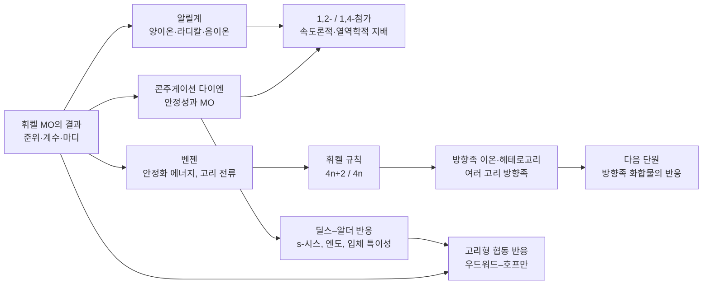

# 유기화학 8. 콘주게이션계와 방향족성 — 이어진 p 오비탈이 정하는 안정성과 반응의 길
<!-- prev: ochem-7, ochem-4, uchem-5, pchem-9, umath-5 -->
<!-- next: ochem-9 -->

> [!NOTE]
> **이 단원의 범위**
> - 다이엔의 분류(고립·콘주게이션·누적), 수소화 열로 본 콘주게이션 다이엔의 안정성, s-시스·s-트랜스 형태
> - 뷰타-1,3-다이엔의 π 분자 오비탈(위상·마디·HOMO·LUMO)과 결합 길이
> - 알릴계(양이온·라디칼·음이온)의 공명과 분자 오비탈, 알릴 자리 브로민화(NBS), 알릴 자리 옮김
> - 콘주게이션 다이엔의 친전자성 첨가: 1,2-첨가와 1,4-첨가, 속도론적 지배와 열역학적 지배
> - 딜스–알더 반응: 협동 메커니즘, s-시스 조건, 친다이엔체, 입체 특이성, 엔도 규칙, 위치 선택성, 역반응
> - 벤젠의 구조와 안정화 에너지, 벤젠의 분자 오비탈과 고리 전류
> - 휘켈 규칙과 방향족·반방향족·비방향족, 방향족 이온, 헤테로고리(피리딘·피롤·퓨란 등), 여러 고리 방향족과 아눌렌
> - 고리형 협동 반응 개관: 전자 고리화·고리 첨가·시그마 자리 옮김과 우드워드–호프만 규칙

**학습 목표**

1. 고립·콘주게이션·누적 다이엔을 구별하고, 수소화 열 자료로 콘주게이션(비편재화)에 의한 안정화 에너지를 올바른 기준을 세워 계산할 수 있다.
2. 휘켈 계산의 결과(뷰타다이엔·알릴·벤젠의 준위와 계수)를 p 오비탈의 위상과 마디로 읽고, 결합 길이·전하 분포·반응 자리를 예측할 수 있다.
3. 알릴 양이온·라디칼·음이온의 안정성과 반응(알릴 자리 브로민화, 알릴 자리 옮김)을 공명과 분자 오비탈 두 언어로 설명할 수 있다.
4. 콘주게이션 다이엔의 HX 첨가에서 1,2-·1,4-생성물을 메커니즘으로 유도하고, 온도에 따른 속도론적·열역학적 지배를 에너지 도표와 생성물 비로 정량적으로 설명할 수 있다.
5. 딜스–알더 반응의 생성물을 입체(시스·트랜스, 엔도·엑소)와 위치(오쏘·파라)까지 예측하고, 생성물에서 다이엔과 친다이엔체를 거꾸로 찾아낼 수 있다.
6. 휘켈 규칙의 네 조건을 적용해 고리 분자·이온·헤테로고리·여러 고리 화합물을 방향족·반방향족·비방향족으로 판정하고, 그 결과를 산도·염기도·NMR·반응성과 연결할 수 있다.
7. 전자 고리화·고리 첨가·시그마 자리 옮김을 구별하고, 프런티어 오비탈의 위상으로 열·빛 조건의 입체 결과(동방향·역방향 회전)를 예측할 수 있다.

**이 단원의 학습 사다리**

| 단계 | 무엇을 하나? |
|---|---|
| STEP 1. 이전 학습 다시 보기 | 공명과 굽은 화살표, 탄소 양이온의 안정성, 휘켈 근사의 결과, UV 흡수와 콘주게이션 |
| STEP 2. 기초 다지기 | 휘켈 결과 읽기(사슬·고리 공식과 프로스트 원), 공명 구조를 쓰는 규칙, 장벽 차·에너지 차와 생성물 비 |
| STEP 3. 핵심 개념 | 다이엔의 안정성 → 다이엔의 MO → 알릴계 → 1,2-/1,4-첨가 → 딜스–알더 → 벤젠 → 휘켈 규칙 → 방향족 이온·헤테로고리 → 여러 고리 방향족 → 고리형 협동 반응 |
| STEP 4. 오개념 바로잡기 | "1,4-첨가는 언제나 주생성물", "고리에 이중 결합이 번갈아 있으면 방향족" 같은 착각 |
| STEP 5. 대학원·연구로 | 프런티어 오비탈 계수로 본 위치 선택성, 뫼비우스 방향족성과 들뜬 상태의 방향족성 |
| STEP 6. 생활·산업·진로 | 합성 고무, 생체 직교 고리 첨가, 비타민 D의 광화학, 방향족 헤테로고리 의약품과 유기 전자 재료 |

---

## 🗺️ 단원 들어가기

당근의 주황색, 토마토의 빨간색, 고무줄의 탄성, 비타민 D가 피부에서 만들어지는 과정, 그리고 거의 모든 의약품 분자 속의 육각형 고리. 이 모두에 공통된 구조가 있다. **p 오비탈이 옆으로 끊김 없이 이어진 탄소 사슬이나 고리**, 곧 **콘주게이션계**(conjugated system)이다.

「알켄과 알카인」의 이중 결합은 π 결합 하나가 두 탄소 사이에 갇혀 있었다. 이중 결합 두 개가 단일 결합 하나를 사이에 두고 이어지면 사정이 달라진다. 네 개의 p 오비탈이 하나의 π계를 이루어 전자가 네 원자에 걸쳐 퍼지고, 분자는 예상보다 조금 더 안정해진다. 그리고 반응할 때는 사슬의 **양 끝**이 동시에 움직이는 새로운 반응이 나타난다. HBr이 '건너뛰어' 1번과 4번 탄소에 붙고(1,4-첨가), 다이엔이 알켄과 한 번에 고리를 만든다(딜스–알더 반응). 사슬을 고리로 닫으면 더 극적이다. 벤젠은 '이중 결합 세 개'로 그려지지만 알켄처럼 반응하지 않고, 약 150 kJ/mol이나 더 안정하다. 그런데 이중 결합 두 개짜리 고리인 사이클로뷰타다이엔은 거꾸로 너무 불안정해 실온에서는 존재조차 하지 못한다. 고리의 π 전자가 몇 개인가 하는 **숫자 하나**가 이 차이를 만든다.

이 단원에서는 수학 도구 「선형대수」와 물리화학 「다전자 원자와 화학 결합」에서 계산해 둔 휘켈 분자 오비탈을 가져와, 그 결과를 **유기 반응과 안정성의 언어**로 옮긴다. 계산을 다시 하지는 않는다. 대신 오비탈의 부호(위상)와 마디를 보고 "어느 탄소가 공격받는가, 왜 이 입체 이성질체가 생기는가, 이 고리는 방향족인가"에 답하는 법을 익힌다. 이 단원을 마치면 다음 단원 「방향족 화합물의 반응」에서 벤젠이 왜 첨가가 아니라 치환을 하는지 곧바로 이해할 수 있다.

---

## STEP 1. 🔙 이전 학습 다시 보기

### 연계 개념표

| 이전 단원 | 그때 배운 것 | 이 단원에서 확장되는 것 |
|---|---|---|
| 일반화학 「화학 결합과 분자 구조」 '혼성 오비탈', '분자 오비탈 이론' | $sp^2$ 혼성과 σ·π 결합, 결합성·반결합성 오비탈, 공명 혼성체(벤젠) | p 오비탈 **여러 개**가 만든 π 분자 오비탈, 벤젠의 공명을 수소화 열과 MO로 **정량화** |
| 유기화학 「구조와 결합, 산과 염기」 '공명과 전자의 비편재화', '굽은 화살표 표기법' | 공명의 다섯 무늬(알릴 양이온, 아세트산 이온 등), 공명이 짝염기를 안정화해 산도를 키움 | 알릴 양이온·라디칼·음이온의 공명을 반응(1,4-첨가, 알릴 자리 옮김)에 적용, 방향족성이 바꾸는 산도(사이클로펜타다이엔 pKa 약 16) |
| 유기화학 「유기 반응의 개관과 알킬 할라이드의 치환·제거 반응」 '탄소 양이온', '에너지 도표' | 탄소 양이온의 안정성(초공액·공명), 아이링 식과 '5.7 kJ 규칙', 해먼드 가설 | 알릴 양이온을 거치는 첨가에서 **두 생성물의 경쟁**, 속도론적·열역학적 지배를 에너지 도표로 |
| 수학 도구 「선형대수」 '응용: 휘켈 분자 오비탈' | 연결 행렬의 고유값 $E = \alpha + x\beta$, 뷰타다이엔의 네 준위와 계수, 고리 고유값 $x_k = 2\cos(2\pi k/N)$, 프로스트 원 | 계수의 **부호**를 p 오비탈의 위상으로 그려 반응의 입체 결과(딜스–알더, 전자 고리화)를 예측 |
| 물리화학 「다전자 원자와 화학 결합」 '휘켈 근사와 콘주게이션계' | π 전하 밀도 $q_r$, 결합 차수 $p_{rs}$, 알릴계의 전하, 폴리엔의 HOMO–LUMO 간격 | 전하 분포 → 친핵체·친전자체의 공격 자리, 결합 차수 → 결합 길이, 간격 → 색 |
| 유기화학 「구조 결정: 질량 분석법과 분광법」 '자외선–가시광선 분광법', '¹H NMR' | 콘주게이션이 길수록 흡수 파장이 길어짐, 화학적 이동과 가림·벗김 | 방향족 고리의 **고리 전류**가 만드는 화학적 이동(벤젠 약 7.3 ppm, [18]아눌렌 안쪽 H는 음수) |

### 준비 운동 (사전 진단)

**Q1.** 알릴 양이온($\mathrm{CH_2{=}CH{-}CH_2^+}$)의 공명 구조 두 개를 말로 설명하고, 양전하가 놓이는 탄소를 쓰시오.

**Q2.** 다음 탄소 양이온을 안정한 것부터 순서대로 쓰시오. (가) $\mathrm{CH_3CH_2^+}$ (나) $\mathrm{(CH_3)_3C^+}$ (다) $\mathrm{CH_2{=}CH{-}CH_2^+}$ (라) $\mathrm{CH_3^+}$

**Q3.** 휘켈 근사에서 에틸렌의 π 오비탈 에너지는 $\alpha \pm \beta$이다. $\beta < 0$일 때 결합성 오비탈은 어느 것이며, π 전자 2개의 에너지는 고립된 p 오비탈 두 개일 때보다 얼마나 낮은가?

**Q4.** 25 ℃에서 두 경쟁 경로의 활성화 깁스 에너지 차이가 5.7 kJ/mol이면 두 생성물의 비는 대략 얼마인가?

정답 및 해설

**Q1.** $\mathrm{CH_2{=}CH{-}CH_2^+ \leftrightarrow {}^+CH_2{-}CH{=}CH_2}$. C1=C2의 π 전자쌍이 C2–C3 사이로 옮겨 간 구조가 두 번째 구조이다. 양전하는 **양 끝 탄소(C1과 C3)** 에 반씩 놓이고 가운데 탄소에는 놓이지 않는다. 물리화학 「다전자 원자와 화학 결합」 예제 16의 휘켈 계산($q_1 = q_3 = 0.5$, $q_2 = 1$)과 같은 결론이다.

**Q2.** (나) ≈ (다) > (가) > (라). 3차 양이온과 1차 알릴 양이온은 비슷한 정도로 안정하다(초공액 셋 대 공명). 「유기 반응의 개관과 알킬 할라이드의 치환·제거 반응」 ⑤의 순서이다.

**Q3.** $\alpha + \beta$가 결합성이다($\beta < 0$이므로 $\alpha$보다 낮다). $2(\alpha + \beta) - 2\alpha = 2\beta$, 곧 $2\lvert\beta\rvert$만큼 낮다.

**Q4.** 약 10 : 1. 25 ℃에서 $2.303RT = 5.71\ \mathrm{kJ/mol}$이므로 장벽 차 5.7 kJ/mol은 속도 비 10배에 해당한다.

---

## STEP 2. 🧱 기초 다지기

### 디딤돌 1. 휘켈 결과 읽기 — 준위, 계수, 마디, 프로스트 원

수학 도구 「선형대수」 ⑩과 물리화학 「다전자 원자와 화학 결합」 ⑫에서 콘주게이션계의 π 분자 오비탈을 휘켈 근사로 계산했다. 이 단원에서 가져다 쓸 결과만 모아 둔다.

- 각 탄소의 $2p$ 오비탈 $\phi_r$를 섞어 $\psi = \sum_r c_r\phi_r$를 만든다. 오비탈 에너지는 $E = \alpha + x\beta$이며 $\alpha$(탄소 2p 전자의 에너지)와 $\beta$(이웃한 두 p 오비탈의 공명 적분)는 모두 음수이다. 그래서 **$x > 0$이면 결합성**(α보다 낮음), $x = 0$이면 비결합성, $x < 0$이면 반결합성이다.
- 탄소 $N$개의 **사슬**: $x_k = 2\cos\dfrac{k\pi}{N + 1}$, 계수 $c_{kr} \propto \sin\dfrac{rk\pi}{N + 1}$ ($k = 1, \dots, N$). $k$번째 오비탈에는 마디가 $k - 1$개 있다.
- 탄소 $N$개의 **고리**: $x_k = 2\cos\dfrac{2\pi k}{N}$ ($k = 0, 1, \dots, N - 1$). 가장 낮은 준위 하나를 빼면 준위가 **두 개씩 축퇴**한다.

계수의 **부호**가 이 단원의 주인공이다. p 오비탈은 분자 평면 위아래로 부호가 반대인 두 엽을 가진다. 계수가 양수인 탄소는 '위쪽 엽이 +(색칠)', 음수인 탄소는 '위쪽 엽이 −(흰색)'으로 그리기로 하자. 이웃한 두 탄소의 부호가 같으면 그 사이는 결합성(겹침이 보강), 다르면 그 사이에 **마디**(nodal plane)가 있고 반결합성이다.

| 계 | $x$ (큰 것부터) | 유기화학에서 쓰는 결론 |
|---|---|---|
| 에틸렌 (사슬 2) | $1, -1$ | π 결합 에너지 $2\beta$, π → π* 간격 $2\lvert\beta\rvert$ |
| 알릴 (사슬 3) | $1.414, 0, -1.414$ | 비결합 오비탈 $\psi_2 = (1, 0, -1)/\sqrt2$: 전하·홀전자가 **양 끝**에 |
| 뷰타다이엔 (사슬 4) | $1.618, 0.618, -0.618, -1.618$ | HOMO·LUMO의 계수가 **양 끝(C1, C4)** 에서 크다 |
| 헥사트라이엔 (사슬 6) | $1.802, 1.247, 0.445, \dots$ | HOMO($x = 0.445$)의 양 끝 계수가 **같은 부호** |
| 벤젠 (고리 6) | $2, 1, 1, -1, -1, -2$ | 결합성 오비탈 셋이 꽉 참, 비편재화 에너지 $2\beta$ |

**프로스트 원**(Frost circle)은 고리 고유값 공식을 그림으로 외우는 요령이다. 반지름 $2\lvert\beta\rvert$인 원을 그리고, 그 안에 정$N$각형을 **꼭짓점 하나가 맨 아래로 오게** 넣는다. 각 꼭짓점의 높이가 π 준위이고, 원의 중심 높이가 $\alpha$(비결합 준위)이다. 맨 아래 꼭짓점의 높이는 $\alpha + 2\beta$이고, 나머지 꼭짓점은 좌우로 짝을 지어 축퇴한다.

<!-- fig:ochem-8-frost-circles -->

#### 예제 1 — 프로스트 원으로 빠르게 준위 얻기

(1) 사이클로헵타트라이엔일계(탄소 7개 고리)의 결합성 오비탈의 $x$ 값을 프로스트 원으로 구하시오. (2) π 전자 6개(양이온)와 8개(음이온)를 채울 때 각각 마지막 전자가 들어가는 준위는 결합성·비결합성·반결합성 가운데 무엇인가?

**풀이**
(1) 정칠각형의 꼭짓점은 맨 아래에서부터 중심각 $2\pi/7$씩 돌아간다. 높이는 $x_k = 2\cos(2\pi k/7)$: $k = 0$이면 $2$, $k = 1, 6$이면 $2\cos 51.4° = 1.247$(2겹). $k = 2, 5$이면 $2\cos 102.9° = -0.445$로 이미 음수이다. 결합성은 $2$와 $1.247$(2겹), 모두 세 개이다.
(2) 전자 6개: 결합성 세 오비탈에 2개씩 꽉 찬다. 전자 8개: 남은 2개가 $x = -0.445$인 **반결합성** 축퇴 쌍에 하나씩(훈트 규칙) 들어간다.

**의미** 양이온은 결합성 껍질이 꽉 찬 닫힌 껍질이고 음이온은 반결합성 준위에 홀전자 둘이 있는 열린 껍질이다. ⑧에서 트로필륨 양이온이 소금처럼 안정한 까닭과 사이클로헵타트라이엔의 C–H가 잘 떨어지지 않는(pKa 약 36) 까닭이 이 그림에서 바로 나온다.

### 디딤돌 2. 공명 구조를 쓰는 규칙 — 콘주게이션계 버전

「구조와 결합, 산과 염기」 ④의 공명 규칙을 콘주게이션계에 맞게 다시 정리한다.

| 규칙 | 콘주게이션계에서의 뜻 |
|---|---|
| 원자는 움직이지 않고 π 전자와 비공유 전자쌍만 움직인다 | 알릴 양이온의 두 구조에서 H와 탄소 골격은 그대로이다 |
| 화살표는 p 오비탈이 이어진 범위 안에서만 | $sp^3$ 탄소를 하나라도 끼면 공명이 끊긴다(펜타-1,4-다이엔의 두 π 결합은 서로 공명하지 않는다) |
| 홀전자는 낚싯바늘 화살표(반쪽 화살표)로 하나씩 | 알릴 라디칼: C=C의 전자 하나와 홀전자 하나가 새 π 결합을 만들고, 남은 전자 하나가 반대쪽 끝으로 간다 |
| 기여가 큰 구조: 옥텟, 전하 분리가 적음, 음전하는 전기 음성 원자에 | 아크롤레인의 $\mathrm{^+CH_2{-}CH{=}CH{-}O^-}$ 구조는 기여가 작지만 β 탄소가 친전자성임을 알려 준다 |
| 공명 구조끼리는 ↔, 평형은 ⇌ | 공명 구조는 실재하는 화학종이 아니라 **하나의 실제 구조를 나타내는 여러 그림**이다 |

콘주게이션계에서 공명 구조는 휘켈 계수의 '말로 된 요약'이다. 전하나 홀전자가 공명 구조에서 놓이는 원자는 해당 분자 오비탈(대개 HOMO나 비결합 오비탈)의 계수가 큰 원자와 일치한다.

#### 예제 2 — 펜타다이엔일 양이온의 공명 구조

펜타-2,4-다이엔-1-일 양이온($\mathrm{CH_2{=}CH{-}CH{=}CH{-}CH_2^+}$, 탄소 1~5)의 공명 구조를 모두 쓰고, 양전하가 놓이는 탄소를 휘켈 결과와 비교하시오. (사슬 5의 비결합 오비탈은 $\psi_3 = (1, 0, -1, 0, 1)/\sqrt3$이다.)

**풀이**
C5의 양이온에서 출발하자. C3=C4의 π 전자쌍을 C4–C5 사이로 옮기면 C3에 양전하가 생긴다: $\mathrm{CH_2{=}CH{-}CH^+{-}CH{=}CH_2}$. 다시 C1=C2의 π 전자쌍을 C2–C3 사이로 옮기면 C1에 양전하: $\mathrm{^+CH_2{-}CH{=}CH{-}CH{=}CH_2}$. 공명 구조는 세 개이고 양전하는 **C1, C3, C5**에 놓인다.
4개의 π 전자는 $\psi_1$과 $\psi_2$를 채우고 비결합 오비탈 $\psi_3$는 비어 있다. 라디칼(π 전자 5개)이면 모든 탄소의 π 전자 밀도가 1이므로, 양이온의 양전하는 비어 있는 $\psi_3$의 계수 제곱 $c_r^2$에 비례해 C1, C3, C5에 각각 $1/3$씩 놓인다. 짝수 번 탄소(C2, C4)에는 0이다.

**의미** 공명 구조는 "어디에 전하가 있는가"를, 휘켈 계산은 "얼마나 있는가"를 알려 준다. 콘주게이션 사슬에서 전하는 **한 칸씩 건너뛰며** 놓인다. 이것이 ④의 1,4-첨가와 ⑩의 시그마 자리 옮김을 이해하는 열쇠이다.

### 디딤돌 3. 에너지 차와 생성물 비 — 속도로 정하는가, 평형으로 정하는가

「유기 반응의 개관과 알킬 할라이드의 치환·제거 반응」 디딤돌 1의 아이링 식에서, 같은 출발 물질에서 두 생성물 A, B가 경쟁적으로 생길 때 생성물 비는 두 가지 방식으로 정해진다.

$$
\text{속도론적 지배:}\ \frac{[\mathrm{A}]}{[\mathrm{B}]} = \frac{k_\mathrm{A}}{k_\mathrm{B}} = e^{(\Delta G^\ddagger_\mathrm{B} - \Delta G^\ddagger_\mathrm{A})/RT}, \qquad \text{열역학적 지배:}\ \frac{[\mathrm{A}]}{[\mathrm{B}]} = K = e^{(G_\mathrm{B} - G_\mathrm{A})/RT}
$$

- **속도론적 지배**(kinetic control): 생성물이 다시 출발 물질로 돌아가지 못할 때(역반응이 무시할 만큼 느릴 때). 비는 **전이 상태**의 높이 차가 정한다.
- **열역학적 지배**(thermodynamic control): 역반응이 충분히 빨라 두 생성물이 공통 중간체를 거쳐 서로 바뀌며 평형에 이를 때. 비는 **생성물 자신**의 깁스 에너지 차가 정한다.

어느 쪽이 되는지는 반응 시간 동안 역반응이 몇 번 일어날 수 있는가로 정해진다. 역반응의 장벽은 '생성물에서 꼭대기까지'이므로 정반응 장벽보다 늘 크며, 온도가 낮으면 이 장벽을 넘지 못한다. 그래서 대개 **낮은 온도·짧은 시간은 속도론적 지배, 높은 온도·긴 시간은 열역학적 지배**이다.

#### 예제 3 — 생성물 비에서 에너지 차로

(1) −80 ℃에서 두 생성물이 80 : 20으로 생기고 이 비가 시간이 지나도 변하지 않는다. 두 경로의 $\Delta G^\ddagger$ 차이는? (2) 40 ℃에서 같은 두 생성물이 20 : 80으로 섞여 있고, 어느 생성물에서 출발해도 이 비에 도달한다. 두 생성물의 깁스 에너지 차이는? ($R = 8.314\ \mathrm{J/(mol\cdot K)}$)

**풀이**
(1) 역반응이 없으므로 속도론적 지배: $\Delta\Delta G^\ddagger = RT\ln(80/20) = 8.314\times193.15\times\ln 4 = 2.23\times10^3\ \mathrm{J/mol} \approx 2.2\ \mathrm{kJ/mol}$. 첫째 생성물로 가는 장벽이 2.2 kJ/mol 낮다.
(2) 어느 쪽에서 출발해도 같은 비에 이르므로 평형: $\Delta G^\circ = -RT\ln K = -8.314\times313.15\times\ln(80/20) = -3.61\times10^3\ \mathrm{J/mol}$. 둘째 생성물이 약 3.6 kJ/mol 더 안정하다.

**의미** 빨리 생기는 생성물과 안정한 생성물이 **서로 다를 수 있다**. 몇 kJ/mol의 작은 차이로도 비가 크게 뒤집힌다. ④에서 뷰타다이엔의 HBr 첨가가 정확히 이 무늬를 보인다.

---

## STEP 3. 📘 핵심 개념

### ① 콘주게이션 다이엔의 종류와 안정성

이중 결합이 두 개인 탄화수소를 **다이엔**(diene)이라 한다. 두 이중 결합의 상대 위치에 따라 성질이 크게 다르다.

| 종류 | 구조의 특징 | 예 (IUPAC 이름, SMILES) | p 오비탈의 관계 |
|---|---|---|---|
| **고립 다이엔**(isolated) | 두 C=C 사이에 $sp^3$ 탄소가 하나 이상 | 펜타-1,4-다이엔 `C=CCC=C` | $sp^3$ 탄소에서 끊겨 서로 독립 |
| **콘주게이션 다이엔**(conjugated) | 두 C=C가 단일 결합 하나로 이어짐 | 뷰타-1,3-다이엔 `C=CC=C`, (3E)-펜타-1,3-다이엔 `C=C/C=C/C` | p 오비탈 네 개가 나란히 이어짐 |
| **누적 다이엔**(cumulated, 알렌) | 한 탄소가 두 C=C를 함께 가짐 | 프로파-1,2-다이엔(알렌) `C=C=C` | 가운데 $sp$ 탄소의 두 p 오비탈이 서로 수직 → 두 π 결합이 직교 |

#### 수소화 열로 잰 안정화

알켄에 수소를 첨가하는 반응은 늘 발열이며, 그 열(**수소화 열**)이 작을수록 알켄이 안정하다(「알켄과 알카인」 '알켄의 안정성'). 같은 알케인이 생기는 이성질체끼리 비교하면 출발 물질의 에너지 차를 바로 읽을 수 있다.

| 화합물 | 생성물 | 수소화 열 $\Delta H^\circ$ (kJ/mol, 약) |
|---|---|---|
| 뷰트-1-엔 | 뷰테인 | −127 |
| 뷰타-1,3-다이엔 | 뷰테인 | −239 |
| 펜트-1-엔 | 펜테인 | −126 |
| (E)-펜트-2-엔 | 펜테인 | −115 |
| 펜타-1,4-다이엔 | 펜테인 | −254 |
| (3E)-펜타-1,3-다이엔 | 펜테인 | −226 |
| 프로펜 | 프로페인 | −125 |
| 프로파-1,2-다이엔(알렌) | 프로페인 | −298 |

뷰타다이엔에 '고립된 말단 이중 결합 둘'의 값($2\times(-127) = -254$)을 기대하면, 실제는 그보다 약 15 kJ/mol 덜 방출한다. 이 차이가 **콘주게이션에 의한 안정화**이다. 고립 다이엔인 펜타-1,4-다이엔은 기대값(약 −252)과 거의 같다. 반면 알렌은 프로펜 두 배(−250)보다 약 50 kJ/mol 더 방출한다. 직교한 두 π 결합은 서로 돕지 못하고, 가운데 $sp$ 탄소에 무리가 있어 누적 다이엔은 오히려 **불안정**하다.

> [!WARNING]
> **기준을 바르게 세워야 한다.** 펜타-1,4-다이엔(−254)과 (3E)-펜타-1,3-다이엔(−226)의 차이 28 kJ/mol을 모두 콘주게이션 효과로 보면 과대평가이다. 펜타-1,3-다이엔의 이중 결합 하나는 **이치환**(C3=C4)이어서, 콘주게이션이 없어도 말단 이중 결합보다 안정하다. 올바른 기준은 '말단 하나(펜트-1-엔) + 이치환 하나((E)-펜트-2-엔)'이다. 예제 4에서 계산한다.

#### 왜 안정한가 — 두 가지 설명

1. **비편재화**: π 전자 네 개가 네 탄소에 퍼진 분자 오비탈에 들어가 에너지가 낮아진다. 휘켈 근사의 비편재화 에너지는 $0.472\beta$이다(②).
2. **혼성의 차이**: C2–C3 단일 결합은 $sp^2$–$sp^2$ σ 결합이다. s 성격이 큰 혼성 오비탈끼리의 결합이 $sp^3$–$sp^2$ 결합보다 짧고 강하다.

C2–C3 결합 길이는 약 147 pm로, 에테인의 C–C(약 154 pm)보다 짧고 에텐의 C=C(약 134 pm)보다 길다. 두 효과가 함께 작용하며, 실제 비율은 지금도 논의되는 주제이다. 어느 쪽이든 결론은 같다. **콘주게이션 다이엔은 같은 수의 고립된 이중 결합보다 십여 kJ/mol 안정하다.**

#### s-시스와 s-트랜스 — 단일 결합 둘레의 형태

C2–C3 단일 결합은 p 오비탈의 겹침 때문에 조금 강하게 붙잡혀 있다. 콘주게이션이 유지되는 평면(또는 평면에 가까운) 형태가 두 가지 있다. 두 이중 결합이 단일 결합의 같은 쪽에 놓인 **s-시스**(s-cis)와 반대쪽에 놓인 **s-트랜스**(s-trans) 형태이다. 's'는 단일 결합(single bond) 둘레의 시스·트랜스라는 뜻이며, E/Z 이성질체가 아니라 **형태**(conformation)이다.

| 형태 | 이면각 C1=C2–C3=C4 | 상대 에너지 (약) | 특징 |
|---|---|---|---|
| s-트랜스 | 180° | 0 | 가장 안정, 상온에서 대부분 |
| s-시스(실제로는 약간 비틀린 고슈형) | 약 30~40° | +12 kJ/mol | C1과 C4의 안쪽 H끼리 부딪힘 |
| 수직형 (회전의 꼭대기) | 약 90~100° | 약 +25 kJ/mol | p 오비탈 겹침이 끊어짐 |

25 ℃에서 12 kJ/mol 차이는 $e^{-12000/2479} \approx 0.008$이므로 s-시스는 1 % 미만이다. 그러나 회전 장벽이 낮아 두 형태는 1초에 수십억 번 바뀐다. 딜스–알더 반응(⑤)은 **s-시스 형태에서만** 일어나므로, 이 작은 비율의 형태가 반응의 관문이 된다.

<!-- fig:ochem-8-butadiene-conformers -->

#### 예제 4 — 펜타-1,3-다이엔의 콘주게이션 에너지

수소화 열 표의 값으로 (3E)-펜타-1,3-다이엔의 콘주게이션 안정화 에너지를 구하시오. 펜타-1,4-다이엔과의 차이(28 kJ/mol) 가운데 얼마가 치환 효과인가?

**풀이**
식 세우기: 콘주게이션이 없다면 (3E)-펜타-1,3-다이엔의 수소화 열은 말단 이중 결합(펜트-1-엔)과 이치환 트랜스 이중 결합((E)-펜트-2-엔)의 합이어야 한다.
기대값 $= (-126) + (-115) = -241\ \mathrm{kJ/mol}$. 실측 $-226\ \mathrm{kJ/mol}$.
콘주게이션 안정화 $= 241 - 226 = 15\ \mathrm{kJ/mol}$.
펜타-1,4-다이엔의 기대값은 말단 둘이므로 $2\times(-126) = -252$로 실측 −254와 같다. 두 다이엔의 차이 28 kJ/mol 가운데 약 $252 - 241 = 11\ \mathrm{kJ/mol}$이 이치환 이중 결합의 안정성(치환 효과)이고, 나머지 약 15 kJ/mol이 콘주게이션 효과이다.

**의미** 뷰타다이엔(15 kJ/mol)과 같은 크기가 나온다. 콘주게이션 한 번의 안정화는 대략 **15 kJ/mol**로, 벤젠의 약 150 kJ/mol(⑥)과는 자릿수가 다르다.

#### ✔ 바로 확인

1. (O/X) 헥사-1,5-다이엔은 콘주게이션 다이엔이다.
2. 빈칸: 단일 결합 둘레의 회전으로 바뀌는 뷰타다이엔의 두 평면 형태 가운데 더 안정한 것은 (    )이다.
3. 뷰트-1-엔의 수소화 열이 −127 kJ/mol, 뷰타-1,3-다이엔이 −239 kJ/mol일 때 콘주게이션 안정화 에너지는?
4. (O/X) 알렌의 두 π 결합은 서로 평행하여 콘주게이션된다.

정답

1. X — 두 이중 결합 사이에 $sp^3$ 탄소가 둘 있는 고립 다이엔이다.
2. s-트랜스 — s-시스는 안쪽 H끼리의 반발로 약 12 kJ/mol 높다.
3. 약 15 kJ/mol — $2\times127 - 239$.
4. X — 가운데 $sp$ 탄소의 두 p 오비탈은 서로 수직이므로 두 π 결합은 직교하고, 알렌은 오히려 불안정하다.

### ② 뷰타-1,3-다이엔의 분자 오비탈 — 위상과 마디로 읽기

수학 도구 「선형대수」 예제 14에서 구한 뷰타다이엔의 네 π 분자 오비탈을 다시 쓴다. 이번에는 계수를 숫자가 아니라 **그림**으로 읽는다.

| 오비탈 | $x$ | 에너지 | 계수 $(c_1, c_2, c_3, c_4)$ | 위쪽 엽의 부호 (C1 C2 C3 C4) | 마디 | 성격 |
|---|---|---|---|---|---|---|
| $\psi_1$ | $1.618$ | $\alpha + 1.618\beta$ | $(0.372, 0.602, 0.602, 0.372)$ | + + + + | 0 | 결합성 |
| $\psi_2$ (HOMO) | $0.618$ | $\alpha + 0.618\beta$ | $(0.602, 0.372, -0.372, -0.602)$ | + + − − | 1 (C2–C3 사이) | 결합성 |
| $\psi_3$ (LUMO) | $-0.618$ | $\alpha - 0.618\beta$ | $(0.602, -0.372, -0.372, 0.602)$ | + − − + | 2 (C1–C2, C3–C4 사이) | 반결합성 |
| $\psi_4$ | $-1.618$ | $\alpha - 1.618\beta$ | $(0.372, -0.602, 0.602, -0.372)$ | + − + − | 3 | 반결합성 |

바닥 상태에서 π 전자 네 개는 $\psi_1$과 $\psi_2$에 두 개씩 들어간다. 이 표에서 유기화학에 쓰이는 결론을 네 가지 읽어 낸다.

1. **마디가 하나씩 늘며 에너지가 올라간다.** 상자 속 입자의 파동 함수와 같은 무늬이다. 마디는 분자의 가운데를 기준으로 대칭적으로 놓인다.
2. **결합의 성격**: $\psi_1$은 세 결합 모두 결합성, $\psi_2$는 C1–C2와 C3–C4는 결합성이지만 C2–C3 사이에는 마디가 있다. 두 오비탈을 합치면 C1–C2·C3–C4는 강한 π 성격, C2–C3는 약한 π 성격을 갖는다. 정량적으로 π 결합 차수는 $p_{12} = 2(0.372\times0.602) + 2(0.602\times0.372) = 0.894$, $p_{23} = 2(0.602)^2 + 2(0.372)(-0.372) = 0.447$이다. 콘주게이션이 없다면 각각 1과 0이었을 것이다.
3. **프런티어 오비탈은 양 끝이 크다.** HOMO와 LUMO 모두 $\lvert c_1\rvert = \lvert c_4\rvert = 0.602$로 가운데(0.372)보다 크다. 친전자체·친다이엔체와의 겹침이 양 끝에서 가장 크므로, 다이엔은 **C1과 C4에서 반응**한다.
4. **양 끝의 상대 위상**: HOMO에서 C1과 C4의 위쪽 엽은 부호가 **반대**(+, −)이고, LUMO에서는 **같다**(+, +). 이 차이가 ⑤ 딜스–알더 반응과 ⑩ 전자 고리화의 입체 결과를 정한다.

> [!TIP]
> 💡 **요령** — 오비탈 그림을 빨리 그리는 법. 사슬 $N$개의 $k$번째 오비탈은 사인 곡선 $\sin(rk\pi/(N+1))$을 $r = 1, \dots, N$에서 찍은 것이다. 뷰타다이엔 HOMO($k = 2$)는 사인 곡선 한 주기를 다섯 칸으로 나눠 네 점을 찍은 모양이므로 '+ 큰, + 작은, − 작은, − 큰'이다. 위상과 크기를 외울 필요 없이 사인 곡선 하나로 다시 만들 수 있다.

<!-- fig:ochem-8-butadiene-mo -->

#### 예제 5 — 결합 차수와 들뜬 상태의 결합 길이

(1) 위의 계수로 뷰타다이엔의 전체 결합 차수(σ 1 + π)를 C1–C2와 C2–C3에 대해 구하고, 측정된 결합 길이(약 134 pm, 147 pm)와 비교하시오. (2) 자외선(약 217 nm)을 흡수해 전자 하나가 HOMO에서 LUMO로 옮겨 가면(π → π*) C2–C3의 π 결합 차수는 어떻게 되는가?

**풀이**
(1) 본문에서 $p_{12} = 0.894$, $p_{23} = 0.447$이므로 전체 결합 차수는 C1–C2 $1.894$, C2–C3 $1.447$. 결합 차수가 클수록 짧다는 경향(C1–C2 < C2–C3)과 맞는다. C2–C3는 단일 결합(1)과 이중 결합(2)의 중간보다는 단일 결합 쪽에 가깝다.
(2) 들뜬 상태의 점유는 $\psi_1^2\psi_2^1\psi_3^1$이다.
$p_{23} = 2(0.602)(0.602) + 1(0.372)(-0.372) + 1(-0.372)(-0.372) = 0.725 - 0.138 + 0.138 = 0.725$.
$\psi_2$의 C2–C3 반결합 기여가 절반으로 줄고, $\psi_3$는 C2–C3 사이가 결합성(− −)이기 때문에 C2–C3의 π 결합 차수가 0.447에서 0.725로 **커진다**. 같은 방식으로 $p_{12}$는 $0.894$에서 $2(0.224) + 0.224 - 0.224 = 0.447$로 줄어든다.

**의미** 들뜨면 "이중 결합 → 단일 결합, 단일 결합 → 이중 결합"에 가깝게 성격이 뒤바뀐다. 빛을 받은 다이엔이 C2–C3 둘레로 쉽게 회전하지 못하고 C1=C2 둘레로 비틀리는 것, ⑩에서 빛 조건의 전자 고리화가 열 조건과 반대 입체 결과를 주는 것이 모두 이 뒤바뀜에서 나온다. 흡수 파장과 콘주게이션 길이의 정량 관계(우드워드–피저 규칙)는 「구조 결정: 질량 분석법과 분광법」에서 다루었다.

#### ✔ 바로 확인

1. (O/X) 뷰타다이엔의 HOMO에는 마디가 없다.
2. 뷰타다이엔 LUMO의 위쪽 엽 부호를 C1부터 차례로 쓰시오.
3. 빈칸: 뷰타다이엔의 HOMO와 LUMO에서 계수가 가장 큰 탄소는 (    )이다.
4. 뷰타다이엔의 π 결합 차수 $p_{23}$은 얼마이며, 콘주게이션이 없다면 얼마였겠는가?

정답

1. X — HOMO($\psi_2$)는 C2–C3 사이에 마디가 하나 있다. 마디가 없는 것은 $\psi_1$이다.
2. + − − + — 마디 2개가 C1–C2와 C3–C4 사이에 있고, 양 끝의 부호가 같다.
3. C1과 C4(양 끝) — $\lvert c\rvert = 0.602$.
4. 0.447 — 고립된 두 이중 결합이면 C2–C3 사이에 π 결합이 없으므로 0이다.

### ③ 알릴계 — 양이온·라디칼·음이온

**알릴**(allyl)은 $\mathrm{CH_2{=}CH{-}CH_2{-}}$기, **알릴 자리**(allylic position)는 C=C에 이웃한 $sp^3$ 탄소이다. 알릴 자리에서 결합이 끊어져 양이온·라디칼·음이온이 생기면, 남은 p 오비탈이 C=C의 p 오비탈 두 개와 이어져 탄소 세 개짜리 콘주게이션계가 된다.

#### 세 화학종을 하나의 오비탈 도표로

물리화학 「다전자 원자와 화학 결합」 예제 16의 결과를 그대로 쓴다.

| 오비탈 | 에너지 | 계수 $(c_1, c_2, c_3)$ | 양이온 (2e) | 라디칼 (3e) | 음이온 (4e) |
|---|---|---|---|---|---|
| $\psi_3$ | $\alpha - 1.414\beta$ | $(\tfrac12, -\tfrac{1}{\sqrt2}, \tfrac12)$ | 빈 | 빈 | 빈 |
| $\psi_2$ (비결합) | $\alpha$ | $(\tfrac{1}{\sqrt2}, 0, -\tfrac{1}{\sqrt2})$ | 빈 (LUMO) | 1 (SOMO) | 2 (HOMO) |
| $\psi_1$ | $\alpha + 1.414\beta$ | $(\tfrac12, \tfrac{1}{\sqrt2}, \tfrac12)$ | 2 | 2 | 2 |

세 화학종의 차이는 **비결합 오비탈 $\psi_2$에 전자가 몇 개 있는가**뿐이다. $\psi_2$의 계수는 양 끝에만 있고 가운데 탄소는 마디 위에 있다. 따라서 양이온의 양전하($\psi_2$의 빈자리), 라디칼의 홀전자, 음이온의 음전하가 모두 **양 끝 탄소에 반씩** 놓인다. 공명 구조 $\mathrm{CH_2{=}CH{-}CH_2^{+,\,\bullet,\,-} \leftrightarrow {}^{+,\,\bullet,\,-}CH_2{-}CH{=}CH_2}$와 정확히 같은 결론이다. 비편재화 에너지는 세 경우 모두 $0.828\beta$이다.

<!-- fig:ochem-8-allyl-mo -->

#### 실험으로 보는 알릴계의 안정성

| 성질 | 알릴계 | 비교 대상 | 차이 |
|---|---|---|---|
| C–H 결합 해리 에너지 (kJ/mol, 약) | $\mathrm{CH_2{=}CHCH_2{-}H}$ 369 | $\mathrm{CH_3CH_2CH_2{-}H}$ 423 (1차) | 알릴 라디칼이 약 54 kJ/mol 안정 |
| C–H의 pKa (약) | 프로펜 43 | 프로페인 50 | 알릴 음이온이 생기기 약 $10^7$배 쉽다 |
| $\mathrm{S_N1}$ 가용매 분해 | 3-클로로프로펜은 1차인데도 이온화가 쉽다 | 1-클로로프로페인은 사실상 이온화하지 않는다 | 알릴 양이온은 2차 양이온 정도로 안정 |

휘켈의 비편재화 에너지 $0.828\beta$에 벤젠에서 맞춘 $\beta \approx -75\ \mathrm{kJ/mol}$(수학 도구 「선형대수」 ⑩)을 넣으면 약 62 kJ/mol이다. 결합 해리 에너지에서 얻은 약 54 kJ/mol과 같은 크기이다. 휘켈 이론은 정량적으로 정확하지는 않지만 크기의 감은 잘 준다.

#### 알릴 자리 브로민화 — NBS와 라디칼 연쇄

알켄에 $\mathrm{Br_2}$를 넣으면 C=C에 첨가가 일어난다(「알켄과 알카인」). 그러나 $\mathrm{Br_2}$의 농도를 아주 낮게 유지하면서 라디칼을 만들어 주면 첨가 대신 **알릴 자리의 H가 Br로 치환**된다. 이 조건을 만드는 시약이 **N-브로모석신이미드**(N-bromosuccinimide, NBS, 1-브로모피롤리딘-2,5-다이온, SMILES `O=C1CCC(=O)N1Br`)이다. 사염화 탄소 같은 용매에서 빛이나 과산화물로 개시한다.

$$
\mathrm{C_6H_{10}\ (사이클로헥센) + NBS \xrightarrow{h\nu\ \text{또는 과산화물},\ CCl_4} 3\text{-브로모사이클로헥스-1-엔} + 석신이미드}
$$

메커니즘은 「알케인과 사이클로알케인」의 라디칼 할로젠화와 같은 연쇄 반응이다.

1. **개시**: $\mathrm{Br_2 \xrightarrow{h\nu} 2Br\bullet}$ (처음의 미량 $\mathrm{Br_2}$는 NBS와 미량의 HBr에서 생긴다)
2. **전파 ①**: $\mathrm{Br\bullet}$이 알릴 자리 H를 뗀다 → 알릴 라디칼 + HBr. 알릴 C–H가 약하므로(약 369 kJ/mol) 이 단계가 선택적이다.
3. **NBS의 역할**: $\mathrm{NBS + HBr \rightarrow 석신이미드 + Br_2}$. 생긴 HBr을 즉시 $\mathrm{Br_2}$로 바꾸어, $\mathrm{Br_2}$를 늘 **낮고 일정한 농도**로 공급한다.
4. **전파 ②**: 알릴 라디칼이 $\mathrm{Br_2}$에서 Br을 떼어 생성물이 되고 $\mathrm{Br\bullet}$이 다시 생긴다.

$\mathrm{Br_2}$ 농도가 낮으면 왜 첨가가 억제될까? 첨가로 가는 길은 어느 것이나 $\mathrm{Br_2}$ 분자를 직접 필요로 한다. 이온성 첨가(브로모늄 이온 경유)는 $\mathrm{Br_2}$ 농도에 크게 의존하고, $\mathrm{Br\bullet}$이 C=C에 붙어 생긴 브로모알킬 라디칼은 쉽게 되돌아가므로 $\mathrm{Br_2}$를 만나지 못하면 첨가 생성물이 되지 못한다. 반면 알릴 자리 H 떼기는 $\mathrm{Br\bullet}$만 있으면 되고, 함께 생긴 HBr이 NBS에 곧바로 소비되므로 되돌아가지도 않는다. 그래서 $\mathrm{Br_2}$ 농도가 낮을수록 치환이 첨가를 이긴다.

<!-- fig:ochem-8-nbs-mechanism -->

#### 예제 6 — 비대칭 알릴 라디칼에서 생기는 생성물

메틸리덴사이클로헥세인(SMILES `C=C1CCCCC1`)을 NBS로 브로민화(빛, $\mathrm{CCl_4}$)할 때 생길 수 있는 모노브로모 생성물을 모두 쓰시오.

**풀이**
1. 알릴 자리 찾기: C=C는 고리 밖의 $\mathrm{CH_2}$와 고리 탄소 C1 사이에 있다. C1에 이웃한 고리 탄소 C2와 C6이 알릴 자리이다(두 자리는 대칭으로 같다).
2. 라디칼: C2에서 H를 떼면 라디칼은 C2 ↔ 고리 밖 $\mathrm{CH_2}$로 비편재화된다. 공명 구조 (가) C2에 홀전자, 고리 밖 C=C 유지 (나) C1=C2 이중 결합이 고리 안으로 옮겨 가고 고리 밖 $\mathrm{CH_2}$에 홀전자.
3. 생성물: (가)에서 Br이 C2에 붙으면 **1-브로모-2-메틸리덴사이클로헥세인**(SMILES `C=C1CCCCC1Br`, 라세미체), (나)에서 Br이 고리 밖 탄소에 붙으면 **1-(브로모메틸)사이클로헥스-1-엔**(SMILES `BrCC1=CCCCC1`).

**의미** 알릴 라디칼의 두 끝은 모두 Br을 받을 수 있으므로, 비대칭 알릴계에서는 **이중 결합이 자리를 옮긴 생성물**이 함께 생긴다(알릴 자리 옮김). 혼합물이 생기므로 합성에서는 사이클로헥센처럼 두 끝이 같은 알릴계에서 가장 깔끔하다. 두 생성물의 비는 조건에 따라 달라지며, 이 단원에서는 '둘 다 생긴다'까지를 예측의 목표로 한다.

#### 알릴 양이온과 $\mathrm{S_N1}$ — 알릴 자리 옮김

3-클로로뷰트-1-엔(SMILES `C=CC(C)Cl`)과 (2E)-1-클로로뷰트-2-엔(SMILES `C/C=C/CCl`)은 서로 다른 화합물이지만, 물이나 에탄올에서 $\mathrm{S_N1}$ 조건으로 가용매 분해하면 **거의 같은 생성물 혼합물**을 준다. 두 화합물 모두 이온화해 같은 알릴 양이온 $\mathrm{CH_3{-}CH^+{-}CH{=}CH_2 \leftrightarrow CH_3{-}CH{=}CH{-}CH_2^+}$을 만들고, 친핵체가 그 양 끝(C1 또는 C3)을 공격하기 때문이다. 이렇게 친핵체가 이탈기가 있던 자리가 아닌 알릴계의 다른 끝에 붙는 현상을 **알릴 자리 옮김**(allylic rearrangement)이라 한다. 다음 소절의 1,4-첨가가 바로 이 현상이다.

#### ✔ 바로 확인

1. (O/X) 알릴 양이온의 양전하는 가운데 탄소에 가장 많다.
2. 알릴 양이온·라디칼·음이온의 휘켈 비편재화 에너지는 각각 얼마인가?
3. 빈칸: NBS는 알릴 자리 브로민화에서 HBr을 (    )로 바꾸어 그 농도를 낮게 유지한다.
4. 사이클로펜텐을 NBS로 브로민화하면 생기는 주생성물의 이름은?

정답

1. X — 비결합 오비탈 $\psi_2$의 가운데 계수가 0이므로 양전하는 양 끝 탄소에 $+\tfrac12$씩 놓인다.
2. 세 경우 모두 $0.828\beta$ — 추가되는 전자가 에너지 $\alpha$인 비결합 오비탈에 들어가므로 달라지지 않는다.
3. $\mathrm{Br_2}$
4. 3-브로모사이클로펜트-1-엔 — 알릴 라디칼의 두 끝이 대칭으로 같아 한 가지 구조 이성질체만 생긴다(라세미체).

### ④ 콘주게이션 다이엔의 친전자성 첨가 — 1,2-첨가와 1,4-첨가

#### 메커니즘 — 알릴 양이온이 두 갈래 길을 연다

뷰타-1,3-다이엔에 HBr 1당량을 첨가하면 두 생성물이 생긴다.

$$
\mathrm{CH_2{=}CH{-}CH{=}CH_2 + HBr \longrightarrow \underbrace{CH_3{-}CHBr{-}CH{=}CH_2}_{\text{1,2-첨가: 3-브로모뷰트-1-엔}} + \underbrace{CH_3{-}CH{=}CH{-}CH_2Br}_{\text{1,4-첨가: 1-브로모뷰트-2-엔}}}
$$

'1,2'와 '1,4'는 다이엔의 탄소 번호로 H와 Br이 붙은 자리를 가리킨다(생성물의 IUPAC 번호와는 다르다). 1,4-생성물에서는 이중 결합이 C2=C3로 **옮겨** 있다.

1. **양성자 첨가**: H⁺는 말단 탄소 C1에 붙는다. 그러면 C2에 생긴 양전하가 C3=C4와 콘주게이션된 **2차 알릴 양이온**이 된다: $\mathrm{CH_3{-}CH^+{-}CH{=}CH_2 \leftrightarrow CH_3{-}CH{=}CH{-}CH_2^+}$. 가운데 탄소 C2에 H⁺가 붙으면 C1에 1차 양이온이 생기고, 그 빈 p 오비탈은 C3=C4와 이어지지 않아(C2가 $sp^3$이 됨) 공명 안정화가 없다. 그래서 이 길은 일어나지 않는다.
2. **브로민화 이온의 공격**: 알릴 양이온의 양전하는 C2와 C4에 나뉘어 있다(③). Br⁻이 C2를 공격하면 1,2-생성물, C4를 공격하면 1,4-생성물이다.

<!-- fig:ochem-8-hbr-addition -->

#### 온도가 바꾸는 주생성물

| 조건 | 1,2-생성물 : 1,4-생성물 (약) | 지배 |
|---|---|---|
| −80 ℃, 짧은 시간 | 80 : 20 | 속도론적 |
| 40 ℃ | 20 : 80 | 열역학적 |
| −80 ℃에서 얻은 혼합물을 40 ℃로 데움 | 20 : 80으로 바뀜 | 평형에 도달 |
| 순수한 1,2-생성물을 40 ℃에서 (미량의 HBr과) 둠 | 20 : 80으로 바뀜 | 평형에 도달 |

(비는 문헌에 따라 조금씩 다르며 40 ℃에서는 15 : 85 정도로 보고되기도 한다.) 두 가지가 서로 다른 질문에 답한다.

- **왜 1,2-생성물이 빨리 생기는가?** 알릴 양이온의 두 끝은 같지 않다. C2는 메틸기가 붙은 2차 탄소여서 양전하를 더 많이 감당하고(2차 양이온형 공명 구조의 기여가 크다), 막 떨어져 나온 Br⁻은 H⁺가 붙은 C1 바로 옆, 곧 C2 가까이에 이온쌍으로 있다. 그래서 C2를 공격하는 전이 상태가 조금 낮다.
- **왜 1,4-생성물이 안정한가?** 1,2-생성물의 이중 결합은 일치환 말단 이중 결합($\mathrm{CH{=}CH_2}$)이고, 1,4-생성물은 이치환 내부 이중 결합($\mathrm{CH{=}CH}$)이다. 「알켄과 알카인」에서 본 대로 치환기가 많은 알켄이 더 안정하다.

온도가 높으면 알릴 브로마이드가 다시 이온화해(C–Br이 약하고 알릴 양이온이 안정하므로 가능하다) 공통 중간체로 돌아갈 수 있다. 두 생성물이 이 중간체를 통해 서로 바뀌며 평형에 이르고, 더 안정한 1,4-생성물이 쌓인다.

<!-- fig:ochem-8-kinetic-thermo-diagram -->

<!-- sim:mj-kinetic-thermo-control -->

#### 예제 7 — 아이소프렌의 HBr 첨가

2-메틸뷰타-1,3-다이엔(아이소프렌, SMILES `C=CC(C)=C`)에 HBr 1당량을 첨가한다. (1) H⁺가 붙는 자리를 정하고 중간체를 쓰시오. (2) 1,2-생성물과 1,4-생성물의 이름과 구조를 쓰시오. (3) 낮은 온도와 높은 온도에서 각각 어느 것이 주생성물일지 예측하시오.

**풀이**
(1) 말단 탄소는 C1(메틸기가 붙은 C2 옆)과 C4 두 곳이다. C1에 H⁺가 붙으면 C2에 **3차** 알릴 양이온이 생긴다: $\mathrm{(CH_3)_2C^+{-}CH{=}CH_2 \leftrightarrow (CH_3)_2C{=}CH{-}CH_2^+}$. C4에 붙으면 C3에 2차 알릴 양이온($\mathrm{CH_2{=}C(CH_3){-}CH^+{-}CH_3}$ ↔ 1차형)이 생긴다. 더 안정한 3차 알릴 양이온을 거치는 C1 양성자 첨가가 우세하다.
(2) Br⁻이 C2를 공격: **3-브로모-3-메틸뷰트-1-엔**(SMILES `C=CC(C)(C)Br`, 1,2-생성물). C4를 공격: **1-브로모-3-메틸뷰트-2-엔**(프렌일 브로마이드, SMILES `CC(C)=CCBr`, 1,4-생성물).
(3) 낮은 온도: 양전하가 더 많이 놓이는 3차 탄소 C2를 공격하는 1,2-생성물이 빨리 생긴다(속도론적). 높은 온도: 삼치환 이중 결합을 가진 1,4-생성물이 일치환 말단 이중 결합의 1,2-생성물보다 안정하므로 1,4-생성물이 쌓인다(열역학적). 더구나 3차 알릴 브로마이드인 1,2-생성물은 이온화가 쉬워 평형에 빨리 이른다.

**의미** 공통 무늬는 "**양성자는 더 안정한 알릴 양이온을 만드는 말단에, 낮은 온도의 친핵체는 양전하가 더 큰 끝에, 높은 온도의 결과는 더 치환된 알켄 쪽으로**"이다. 생체에서 터펜을 만드는 프렌일기(3-메틸뷰트-2-엔일)가 바로 이 1,4-생성물의 골격이다.

> [!NOTE]
> $\mathrm{Br_2}$ 첨가도 같은 무늬를 따른다. 뷰타다이엔과 $\mathrm{Br_2}$에서는 1,2-생성물 3,4-다이브로모뷰트-1-엔과 1,4-생성물 (2E)-1,4-다이브로모뷰트-2-엔이 생긴다. 친핵체가 가까운 탄소가 아닌 콘주게이션계의 '먼 끝'에 붙는 1,4-첨가는 「알데하이드와 케톤」의 α,β-불포화 카보닐에 대한 **콘주게이션 첨가**로 다시 만난다.

#### ✔ 바로 확인

1. (O/X) 뷰타다이엔의 HBr 첨가에서 1,4-생성물은 C1과 C4 사이에 새 이중 결합이 생긴 것이다.
2. 빈칸: 생성물이 서로 바뀌지 못해 전이 상태의 높이 차가 생성물 비를 정하는 경우를 (    ) 지배라 한다.
3. 뷰타다이엔에 HBr을 −80 ℃에서 첨가할 때 주생성물의 IUPAC 이름은?
4. (O/X) 뷰타다이엔의 C2에 양성자가 붙으면 공명 안정화된 알릴 양이온이 생긴다.

정답

1. X — 새 이중 결합은 C2=C3에 생긴다. H는 C1에, Br은 C4에 붙는다.
2. 속도론적
3. 3-브로모뷰트-1-엔 — 1,2-생성물(약 80 %).
4. X — C2가 $sp^3$이 되어 C1의 빈 p 오비탈과 C3=C4가 끊긴다. 공명 없는 1차 양이온이므로 생기지 않는다.

### ⑤ 딜스–알더 반응 — 다이엔과 알켄이 한 번에 고리를 만든다

**딜스–알더 반응**(Diels–Alder reaction)은 콘주게이션 다이엔과 알켄(또는 알카인)이 한 단계로 결합해 사이클로헥센 고리를 만드는 반응이다. 다이엔의 반응 상대인 알켄을 **친다이엔체**(dienophile)라 한다. 고리 첨가에 참여하는 π 전자의 수를 따서 **[4+2] 고리 첨가**라고도 부른다.

$$
\mathrm{CH_2{=}CH{-}CH{=}CH_2 + CH_2{=}CH{-}CHO \xrightarrow{\Delta} 사이클로헥스\text{-}3\text{-}엔\text{-}1\text{-}카브알데하이드}
$$

결합 셈을 해 보자. π 결합 세 개가 끊어지고 σ 결합 두 개와 π 결합 하나(새 C2=C3)가 생긴다. π 결합을 σ 결합으로 바꾸므로 반응은 크게 발열이다(뷰타다이엔 + 에텐의 $\Delta H^\circ$는 약 −170 kJ/mol). 두 분자가 하나가 되므로 $\Delta S^\circ$는 크게 음수이고, 그래서 아주 높은 온도에서는 $\Delta G^\circ = \Delta H^\circ - T\Delta S^\circ$가 양수가 되어 **역반응(레트로 딜스–알더)** 이 일어날 수 있다.

#### 협동 메커니즘과 화살표 세 개

딜스–알더 반응은 중간체 없이 모든 결합이 하나의 고리형 전이 상태에서 동시에(시간 차는 있을 수 있지만 한 단계로) 바뀌는 **협동 반응**(concerted reaction)이다. 굽은 화살표 세 개가 고리를 이루며 돈다.

1. 다이엔의 C1=C2 π 전자쌍 → C1과 친다이엔체 Cα 사이(새 σ 결합)
2. 친다이엔체의 Cα=Cβ π 전자쌍 → Cβ와 다이엔 C4 사이(새 σ 결합)
3. 다이엔의 C3=C4 π 전자쌍 → C2–C3 사이(새 π 결합)

(화살표 방향을 반대로 돌려 그려도 같은 반응이다. 협동 반응에서 화살표는 전자의 '흐름'보다 결합의 재배치를 기록하는 장부이다.) 중간체가 없다는 증거는 ⑤의 뒤에 나오는 **입체 특이성**이다. 단계적으로 라디칼이나 이온을 거친다면 결합 둘레가 회전해 입체 정보가 섞였을 것이다.

<!-- fig:ochem-8-diels-alder-mechanism -->

#### 다이엔의 조건 — s-시스여야 한다

새 σ 결합 두 개는 다이엔의 C1과 C4에서 생긴다. 두 탄소가 친다이엔체의 두 탄소에 동시에 닿으려면 C1과 C4가 같은 쪽에 있는 **s-시스 형태**여야 한다. s-트랜스 형태에서는 C1과 C4 사이가 약 370 pm로 너무 멀다.

| 다이엔 | s-시스 형태 | 상대 반응성 |
|---|---|---|
| 사이클로펜타-1,3-다이엔 (SMILES `C1C=CC=C1`) | 고리에 묶여 늘 s-시스 | 매우 크다. 실온에서도 스스로 이량화한다 |
| 2,3-다이메틸뷰타-1,3-다이엔 (`C=C(C)C(C)=C`) | 메틸기가 전자를 주고 s-시스를 크게 방해하지 않음 | 뷰타다이엔보다 크다 |
| 뷰타-1,3-다이엔 | 1 % 미만이지만 빠르게 바뀜 | 기준 |
| (2Z,4Z)-헥사-2,4-다이엔 (`C/C=C\C=C/C`) | 안쪽 메틸기 두 개가 s-시스에서 부딪힘 | 매우 작다 |
| 고리에 묶인 s-트랜스 다이엔 | 불가능 | 반응하지 않는다 |

사이클로펜타다이엔은 실온에 두면 한 분자가 다이엔, 다른 분자가 친다이엔체가 되어 **다이사이클로펜타다이엔**(엔도 이량체)이 된다. 쓰기 직전에 이량체를 약 170 ℃로 가열해 레트로 딜스–알더로 쪼개고, 끓는점이 약 41 ℃인 단량체를 증류해 받는다(탐구 활동 A).

#### 친다이엔체와 프런티어 오비탈

뷰타다이엔과 에텐의 반응은 높은 온도와 압력에서도 느리다. 그러나 친다이엔체에 C=O, C≡N, $\mathrm{CO_2R}$ 같은 **전자 끄는 기**가 붙으면 반응이 크게 빨라진다. 대표적인 친다이엔체는 말레산 무수물, 아크롤레인(프로프-2-엔알, `C=CC=O`), 아크릴산 메틸(`C=CC(=O)OC`), 1,4-벤조퀴논, 테트라사이아노에틸렌, 그리고 알카인인 아세틸렌다이카복실산 다이메틸(`COC(=O)C#CC(=O)OC`, 생성물은 사이클로헥사-1,4-다이엔)이다.

이 경향은 **프런티어 분자 오비탈**(frontier molecular orbital, FMO)로 설명한다. 반응에서 가장 중요한 상호작용은 한 분자의 HOMO와 다른 분자의 LUMO 사이의 겹침이며, 두 오비탈의 에너지가 가까울수록 상호작용(안정화)이 크다. 보통의 딜스–알더 반응에서는 **다이엔의 HOMO와 친다이엔체의 LUMO**가 짝을 이룬다.

- 전자 끄는 기는 친다이엔체의 LUMO를 낮추고, 전자 주는 기(알킬, OR)는 다이엔의 HOMO를 올린다. 둘 다 간격을 줄여 반응을 빠르게 한다(정상 전자 요구).
- **위상이 맞는가**: 다이엔 HOMO($\psi_2$)의 양 끝 위쪽 엽은 (+, −), 에텐 LUMO(π*)의 두 탄소 위쪽 엽도 (+, −)로, 두 오비탈 모두 양 끝의 위상이 반대이다. 오비탈 전체의 부호는 마음대로 정할 수 있으므로, 친다이엔체가 다이엔의 아래에서 다가갈 때 π*의 부호를 (−, +)로 잡으면 다이엔 아래쪽 엽 (−, +)와 C1–Cα, C4–Cβ 두 곳 모두에서 **같은 부호끼리** 겹친다. 두 새 결합이 같은 면에서 동시에 생길 수 있다.
- 대조로 에텐 두 분자의 [2+2] 고리 첨가에서는 한 분자의 HOMO(+, +)와 다른 분자의 LUMO(+, −)가 한쪽 끝에서는 같은 부호, 다른 쪽 끝에서는 반대 부호로 만난다. 두 결합을 같은 면에서 동시에 만들 수 없으므로 **열 조건의 [2+2]는 일어나지 않는다**(빛 조건에서는 가능하다, ⑩).

<!-- fig:ochem-8-fmo-cycloaddition -->

#### 입체 특이성 — 시스는 시스로, 트랜스는 트랜스로

딜스–알더 반응은 **입체 특이적**(stereospecific)이다(「입체화학」 '반응의 입체화학'). 친다이엔체의 두 탄소는 **같은 면**으로 다이엔과 결합하므로(초면 첨가), 친다이엔체에서 시스였던 두 치환기는 생성물에서도 시스, 트랜스였던 것은 트랜스로 남는다.

$$
\mathrm{뷰타다이엔 + 말레산\ 다이메틸\ (Z) \longrightarrow cis\text{-}사이클로헥스\text{-}4\text{-}엔\text{-}1,2\text{-}다이카복실산\ 다이메틸\ (메조)}
$$

$$
\mathrm{뷰타다이엔 + 푸마르산\ 다이메틸\ (E) \longrightarrow trans\text{-}사이클로헥스\text{-}4\text{-}엔\text{-}1,2\text{-}다이카복실산\ 다이메틸\ (라세미체)}
$$

SMILES로는 말레산 다이메틸 `COC(=O)/C=C\C(=O)OC` → cis 생성물 `COC(=O)[C@H]1CC=CC[C@H]1C(=O)OC`((1R,2S), 메조), 푸마르산 다이메틸 `COC(=O)/C=C/C(=O)OC` → trans 생성물 `COC(=O)[C@@H]1CC=CC[C@H]1C(=O)OC`((1R,2R)와 그 거울상의 라세미체)이다.

다이엔 쪽도 마찬가지이다. s-시스 다이엔의 양 끝 탄소에는 각각 **바깥쪽**(outside) 치환기와 **안쪽**(inside) 치환기가 있다(① 그림). 다이엔도 한 면으로 결합하므로, 생성물에서 **바깥쪽 두 치환기는 서로 시스**, 안쪽 두 치환기도 서로 시스가 된다. (2E,4E)-헥사-2,4-다이엔(`C/C=C/C=C/C`)은 두 메틸기가 모두 바깥쪽이므로 두 메틸기가 시스인 3,6-다이메틸사이클로헥센 고리를 준다. (2E,4Z)-헥사-2,4-다이엔은 메틸기 하나가 바깥쪽, 하나가 안쪽이므로 트랜스를 준다.

#### 엔도 규칙 — 치환기는 다이엔의 밑으로 들어간다

고리 다이엔(사이클로펜타다이엔 등)과 치환된 친다이엔체가 반응하면 다리 걸친 두 고리 생성물이 생기고, 친다이엔체의 치환기가 놓이는 방향에 따라 두 부분 입체 이성질체가 가능하다.

- **엔도**(endo): 치환기가 새로 생긴 C=C 쪽(다리의 반대쪽, '안쪽')을 향한다. 전이 상태에서 치환기가 다이엔의 π계 **밑으로** 들어가 있었다.
- **엑소**(exo): 치환기가 짧은 다리($\mathrm{CH_2}$) 쪽, '바깥쪽'을 향한다.

사이클로펜타다이엔과 말레산 무수물은 실온에서 거의 엔도 생성물만 준다.

$$
\mathrm{사이클로펜타다이엔 + 말레산\ 무수물 \xrightarrow{실온} 엔도\text{-}3a,4,7,7a\text{-}테트라하이드로\text{-}4,7\text{-}메타노\text{-}2\text{-}벤조퓨란\text{-}1,3\text{-}다이온}
$$

(관용명: cis-노르보른-5-엔-엔도-2,3-다이카복실산 무수물, SMILES `O=C1OC(=O)[C@H]2[C@@H]1[C@H]1C=C[C@@H]2C1`. 엑소 이성질체는 `O=C1OC(=O)[C@H]2[C@@H]1[C@@H]1C=C[C@H]2C1`. 두 화합물 모두 메조이다.)

엔도 생성물은 입체적으로 더 붐벼 **엑소보다 덜 안정한데도** 빨리 생긴다. 즉 엔도 선택성은 **속도론적 지배**의 결과이다. 그 까닭으로 널리 받아들여지는 설명은 **2차 오비탈 상호작용**이다. 엔도 전이 상태에서는 친다이엔체 C=O의 p 오비탈이 다이엔의 C2·C3 p 오비탈 바로 밑에 놓여 같은 위상으로 겹친다. 이 겹침은 새 결합을 만들지는 않지만 전이 상태를 조금 안정화한다. (분산력·정전기 효과도 함께 기여한다고 본다.)

반응이 가역적인 조건에서는 결과가 바뀐다. 방향족성을 조금 가진 퓨란은 다이엔으로서 반응이 느리고 역반응이 쉽다. 퓨란과 말레산 무수물을 오래 두면 엔도 생성물이 먼저 생겼다가 역반응과 재반응을 거쳐 더 안정한 **엑소** 생성물(`O=C1OC(=O)[C@H]2[C@@H]1[C@@H]1C=C[C@H]2O1`)이 쌓인다(열역학적 지배). ④의 1,2-/1,4-첨가와 같은 원리이다.

> [!TIP]
> 💡 **요령** — 엔도 생성물을 그리는 법: 생성물을 '책을 반쯤 편 모양'(노르보넨)으로 그리고, $\mathrm{CH_2}$ 다리를 책등 위쪽에 둔다. 새 C=C가 있는 쪽 날개를 아래에 두면, 엔도 치환기는 그 C=C와 **같은 쪽(아래, 책 안쪽)** 을 향하고 엑소 치환기는 $\mathrm{CH_2}$ 다리 쪽(위)을 향한다. 또 하나의 규칙: 비고리 다이엔에서 **엔도 치환기는 다이엔의 바깥쪽 치환기와 시스**가 된다.

<!-- fig:ochem-8-endo-exo -->

#### 위치 선택성 — '오쏘·파라' 규칙

비대칭 다이엔과 비대칭 친다이엔체가 반응하면 두 가지 위치 이성질체가 가능하다. 경험적으로는 벤젠 치환 위치에 빗대어 다음 규칙이 성립한다.

| 다이엔의 치환기 위치 | 주생성물에서 두 치환기의 관계 | 예 |
|---|---|---|
| 1번(말단) 치환 | 1,2 관계('오쏘') | (E)-1-메톡시뷰타-1,3-다이엔 + 아크롤레인 → 2-메톡시사이클로헥스-3-엔-1-카브알데하이드 |
| 2번(안쪽) 치환 | 1,4 관계('파라') | 아이소프렌 + 아크릴산 메틸 → 4-메틸사이클로헥스-3-엔-1-카복실산 메틸 |

까닭은 전하로 이해할 수 있다. 공명 구조를 그리면 전자 주는 기가 있는 다이엔의 '음전하가 쌓이는 끝'과 친다이엔체의 '양전하가 쌓이는 끝'(전자 끄는 기에서 먼 β 탄소)이 결합한다. 아이소프렌에서는 메틸기가 붙은 C2 옆의 C1이 전자가 풍부한 끝이고(C1에 H⁺가 붙을 때 3차 양이온이 생기는 것과 같은 이유이다), 아크릴산 메틸에서는 $\mathrm{CH_2}$ 쪽 β 탄소가 전자가 부족한 끝이다. 이 둘이 결합하면 메틸기와 에스터기가 고리에서 1,4 관계가 된다. 프런티어 오비탈로는 '두 분자에서 계수가 가장 큰 끝끼리 결합한다'로 표현된다(STEP 5).

1-치환 다이엔의 '오쏘' 생성물에는 입체 중심이 둘 생긴다. 엔도 규칙에 따라 (E)-다이엔의 바깥쪽 OMe와 엔도 CHO가 시스로 놓여 **cis**-2-메톡시사이클로헥스-3-엔-1-카브알데하이드(SMILES `CO[C@H]1C=CCC[C@H]1C=O`, 라세미체)가 주생성물이다.

<!-- fig:ochem-8-da-selectivity -->

#### 예제 8 — 딜스–알더 생성물 예측

다음 반응의 주생성물을 입체까지 쓰시오. (1) 사이클로펜타다이엔 + 아크릴산 메틸 (2) 뷰타-1,3-다이엔 + 아세틸렌다이카복실산 다이메틸 (3) 2,3-다이메틸뷰타-1,3-다이엔 + 푸마르산 다이메틸

**풀이**
(1) 다리 걸친 두 고리 생성물 바이사이클로[2.2.1]헵트-5-엔-2-카복실산 메틸이 생긴다. 엔도 규칙에 따라 에스터기가 C5=C6 이중 결합 쪽을 향한 **엔도** 이성질체(SMILES `COC(=O)[C@H]1C[C@H]2C=C[C@@H]1C2`와 그 거울상, 라세미체)가 주생성물이다. 입체 중심은 C1, C2, C4 세 개이지만, 두 고리 골격에서는 다리목 C1과 C4의 배치가 서로 묶여 있으므로 실제로 고를 수 있는 것은 C2의 엔도·엑소뿐이다.
(2) 친다이엔체가 알카인이므로 생성물 고리에 이중 결합이 두 개 남는다: **사이클로헥사-1,4-다이엔-1,2-다이카복실산 다이메틸**(SMILES `COC(=O)C1=C(C(=O)OC)CC=CC1`). 에스터기가 $sp^2$ 탄소에 붙으므로 입체 중심이 없다.
(3) 트랜스 친다이엔체는 트랜스 생성물을 준다: **trans-4,5-다이메틸사이클로헥스-4-엔-1,2-다이카복실산 다이메틸**(SMILES `COC(=O)[C@@H]1CC(C)=C(C)C[C@H]1C(=O)OC`, 라세미체). 다이엔의 메틸기는 새 이중 결합의 탄소에 남는다.

**의미** 생성물을 예측할 때의 순서: ① 다이엔의 C1·C4와 친다이엔체의 두 탄소를 잇고 새 C=C를 C2=C3에 둔다 ② 친다이엔체의 시스·트랜스를 그대로 옮긴다 ③ 다이엔의 바깥쪽·안쪽 치환기 관계를 옮긴다 ④ 고리 다이엔이면 엔도를 고른다 ⑤ 비대칭이면 오쏘·파라를 고른다.

#### 예제 9 — 생성물에서 반응물 찾기(역합성)

다음 화합물을 딜스–알더 반응으로 만들려면 어떤 다이엔과 친다이엔체가 필요한가? (1) 4-메틸사이클로헥스-3-엔-1-카브알데하이드(SMILES `CC1=CCC(C=O)CC1`) (2) cis-3a,4,7,7a-테트라하이드로-2-벤조퓨란-1,3-다이온

**풀이**
요령: 생성물 고리의 **C=C를 찾는다.** 이중 결합의 두 탄소와 그 양옆 탄소 둘, 모두 네 탄소가 다이엔이었다. 양옆 탄소에서 고리의 나머지 두 탄소로 가는 σ 결합 두 개가 새로 생긴 결합이므로 이것을 끊는다. 남은 두 탄소가 친다이엔체였다.
(1) 고리는 C1(CHO)–C2–C3=C4(CH₃)–C5–C6이다. 이중 결합 C3=C4의 양옆 탄소는 C2와 C5이므로 새로 생긴 σ 결합은 C2–C1과 C5–C6이다. 이 둘을 끊으면 다이엔 C2=C3–C4=C5(메틸기가 C4에 → **아이소프렌**)와 친다이엔체 C1=C6(CHO가 C1에 → **아크롤레인**)이 남는다. 메틸과 CHO가 1,4 관계이므로 '파라' 규칙과도 맞는다.
(2) 고리의 C5=C6(무수물 고리 접합에서 떨어진 쪽)이 이중 결합이다. 같은 방식으로 끊으면 뷰타-1,3-다이엔과 말레산 무수물이 남는다. 생성물의 cis 고리 접합은 말레산 무수물의 시스 배치에서 왔다.

**의미** 사이클로헥센 고리, 특히 **이중 결합의 맞은편에 전자 끄는 기가 있는** 사이클로헥센을 보면 딜스–알더 반응을 떠올린다. 두 개의 C–C 결합과 최대 네 개의 입체 중심을 한 단계로 만드는 이 반응은 천연물 합성의 가장 강력한 도구 가운데 하나이다(STEP 6).

#### ✔ 바로 확인

1. (O/X) 딜스–알더 반응은 탄소 양이온 중간체를 거치는 두 단계 반응이다.
2. 빈칸: 딜스–알더 반응에서 다이엔은 C2–C3 단일 결합 둘레가 (    ) 형태여야 반응한다.
3. 뷰타다이엔과 말레산 다이메틸의 생성물은 시스인가, 트랜스인가?
4. (O/X) 사이클로펜타다이엔과 말레산 무수물의 엔도 생성물은 엑소 생성물보다 열역학적으로 더 안정하다.
5. 정상 전자 요구 딜스–알더 반응에서 짝을 이루는 프런티어 오비탈 두 개는?

정답

1. X — 중간체 없는 한 단계의 협동 반응이다. 입체 특이성이 그 증거이다.
2. s-시스
3. 시스(cis-사이클로헥스-4-엔-1,2-다이카복실산 다이메틸, 메조) — 친다이엔체의 배치가 그대로 유지된다.
4. X — 엔도는 2차 오비탈 상호작용으로 **빨리** 생기지만(속도론적), 더 붐벼서 엑소보다 덜 안정하다.
5. 다이엔의 HOMO와 친다이엔체의 LUMO

### ⑥ 벤젠의 구조와 안정화 에너지

#### 케쿨레 구조로는 설명되지 않는 사실

벤젠($\mathrm{C_6H_6}$, SMILES `c1ccccc1`)을 케쿨레 구조처럼 '사이클로헥사-1,3,5-트라이엔'으로 그리면 다음 사실을 설명할 수 없다.

| 관찰 | 케쿨레 구조로 기대한 것 | 실제 |
|---|---|---|
| 결합 길이 | 단일 결합(약 147~154 pm)과 이중 결합(약 134 pm)이 번갈아 | 여섯 결합이 모두 약 139 pm로 같다 |
| 이치환체의 수 | 1,2-다이브로모벤젠이 두 가지(Br 사이가 단일 결합인 것과 이중 결합인 것) | 한 가지뿐이다 |
| $\mathrm{Br_2}$와의 반응 | 알켄처럼 빠른 첨가 | 첨가하지 않는다. $\mathrm{FeBr_3}$ 촉매가 있어야 **치환**한다 |
| $\mathrm{KMnO_4}$, 오존 | 알켄처럼 산화·분해 | 실온에서 거의 반응하지 않는다 |
| 수소화 | 사이클로헥센과 비슷한 조건 | 높은 압력·온도와 활성 촉매가 필요하다 |

실제 벤젠은 두 케쿨레 구조의 **공명 혼성체**이며, 평면 정육각형(D₆h 대칭)이다. 여섯 탄소는 모두 $sp^2$이고, 고리 평면에 수직인 p 오비탈 여섯 개가 고리를 따라 끊김 없이 겹쳐 π 전자 6개가 고리 전체에 퍼져 있다. 두 케쿨레 구조 사이를 분자가 오가는 것이 아니다. 하나의 실제 구조를 두 그림으로 나타낸 것이며, 그래서 흔히 육각형 안에 원을 그려 표시한다.

#### 수소화 열로 잰 안정화 에너지

| 화합물 | 수소화 열 (kJ/mol, 약, 사이클로헥세인까지) | '이중 결합 수 × 120'으로 기대한 값 | 차이(안정화) |
|---|---|---|---|
| 사이클로헥센 | −120 | −120 | 0 |
| 사이클로헥사-1,3-다이엔 | −232 | −240 | 8 |
| 벤젠 | −208 | −360 | **152** |

벤젠은 '이중 결합 세 개'의 기대값보다 약 150 kJ/mol 적게 방출한다. 이 값을 벤젠의 **공명 에너지**(resonance energy), 또는 방향족 안정화 에너지라 한다. 사이클로헥사다이엔의 콘주게이션 효과(약 8 kJ/mol)와 비교하면 고리를 닫아 얻는 효과가 얼마나 큰지 알 수 있다. 한 가지 더 흥미로운 사실이 있다. 벤젠에 $\mathrm{H_2}$ 1 mol을 첨가해 사이클로헥사-1,3-다이엔을 만드는 첫 단계는 $\Delta H^\circ = -208 - (-232) = +24\ \mathrm{kJ/mol}$로 **흡열**이다. 벤젠이 알켄처럼 첨가 반응을 하지 않는 까닭이 여기 있다. 첨가는 방향족성을 잃는 오르막이고, 치환은 방향족성을 되찾는 길이다(다음 단원 「방향족 화합물의 반응」).

<!-- fig:ochem-8-benzene-enthalpy -->

#### 벤젠의 분자 오비탈

수학 도구 「선형대수」 ⑩의 고리 공식에서 $N = 6$이면 $x = 2, 1, 1, -1, -1, -2$이다(디딤돌 1의 프로스트 원). 오비탈의 모양을 위쪽 엽의 부호로 쓰면 다음과 같다(탄소 1~6을 고리 둘레 순서로).

| 오비탈 | 에너지 | 위쪽 엽의 부호 (C1~C6) | 마디면 수 | 점유 |
|---|---|---|---|---|
| $\psi_1$ | $\alpha + 2\beta$ | + + + + + + | 0 | 2 |
| $\psi_2$, $\psi_3$ (축퇴) | $\alpha + \beta$ | $\psi_2$: + + − − − + / $\psi_3$: 0 + + 0 − − (크기는 아래 계수) | 1 | 2 + 2 (HOMO) |
| $\psi_4$, $\psi_5$ (축퇴) | $\alpha - \beta$ | 마디면 2개 | 2 | 0 (LUMO) |
| $\psi_6$ | $\alpha - 2\beta$ | + − + − + − | 3 | 0 |

축퇴 쌍의 정확한 계수는 실수형으로 $\psi_2 = (2, 1, -1, -2, -1, 1)/\sqrt{12}$, $\psi_3 = (0, 1, 1, 0, -1, -1)/2$처럼 쓸 수 있다(축퇴 쌍은 서로 섞어도 같은 에너지이므로 표현 방식이 여러 가지이다). 결합성 오비탈 세 개가 6개의 π 전자로 **꽉 찬 닫힌 껍질**을 이룬다. $E_\pi = 2(\alpha + 2\beta) + 4(\alpha + \beta) = 6\alpha + 8\beta$, 국소화된 이중 결합 셋($6\alpha + 6\beta$)에 대한 비편재화 에너지는 $2\beta$이다. 같은 탄소 6개의 사슬인 헥사트라이엔의 비편재화 에너지가 $0.988\beta$(물리화학 「다전자 원자와 화학 결합」 예제 17)인 것과 비교하면, 사슬의 양 끝을 이어 고리를 닫는 것만으로 비편재화 에너지가 두 배가 된다.

#### 방향족성의 자기적 증거 — 고리 전류

벤젠을 자기장 $B_0$ 안에 두면 비편재화된 π 전자가 고리를 따라 도는 **고리 전류**(ring current)가 유도된다. 이 전류가 만드는 유도 자기장은 고리 **안쪽과 위아래**에서는 $B_0$와 반대(가림), 고리 **바깥쪽**에서는 $B_0$와 같은 방향(벗김)이다. 벤젠의 H는 고리 바깥 테두리에 있으므로 벗겨져 약 7.3 ppm에 나타난다. 같은 C=C–H이지만 고리 전류가 없는 알켄 H(약 5~6 ppm)보다 1~2 ppm 높다(「구조 결정: 질량 분석법과 분광법」 '¹H NMR').

| 화합물 | H의 위치 | ¹H 화학적 이동 (ppm, 약) | 해석 |
|---|---|---|---|
| 사이클로헥센 | 고리 밖 C=C–H | 5.7 | 고리 전류 없음 |
| 벤젠 | 고리 바깥 테두리 | 7.3 | 반자기성 고리 전류(벗김) |
| [18]아눌렌 | 바깥쪽 H 12개 / 안쪽 H 6개 | 약 9.3 / 약 −3 | 큰 고리 전류: 바깥 벗김, 안쪽 강한 가림 |
| 1,6-메타노[10]아눌렌 | 고리 위에 걸친 $\mathrm{CH_2}$ 다리 | 약 −0.5 | 고리 위쪽은 가림 영역 |
| 사이클로옥타테트라엔 | 고리 밖 C=C–H | 5.7 | 고리 전류 없음(비방향족, ⑦) |

π 전자 $4n + 2$개의 평면 고리에서 생기는 이런 고리 전류를 **반자기성**(diatropic) 고리 전류라 하며, 이것이 방향족성을 판정하는 가장 직접적인 실험 기준이다. 반대로 평면에 가까운 $4n$ 고리에서는 방향이 반대인 **상자기성**(paratropic) 고리 전류가 생겨 안쪽 H가 벗겨지고 바깥 H가 가려진다.

<!-- fig:ochem-8-benzene-mo -->

<!-- fig:ochem-8-ring-current -->

#### 예제 10 — 수소화 열로 β 맞추기와 그 한계

(1) 벤젠의 안정화 에너지 150 kJ/mol을 휘켈 비편재화 에너지 $2\beta$와 같다고 놓아 $\beta$를 구하시오. (2) 그 $\beta$로 뷰타다이엔의 비편재화 에너지($0.472\beta$)를 계산하고 수소화 열 자료(약 15 kJ/mol)와 비교하시오. (3) 벤젠의 '첫 수소 첨가'가 흡열인 까닭을 한 문장으로 설명하시오.

**풀이**
(1) $2\beta = -150\ \mathrm{kJ/mol}$ → $\beta \approx -75\ \mathrm{kJ/mol}$.
(2) $0.472\times(-75) = -35\ \mathrm{kJ/mol}$. 자료는 약 −15 kJ/mol이므로 휘켈 이론은 사슬 다이엔의 안정화를 두 배 이상 **과대평가**한다.
(3) 사이클로헥사-1,3-다이엔이 되면 약 150 kJ/mol의 방향족 안정화를 잃고 콘주게이션 안정화 약 8 kJ/mol만 남기 때문에, C=C 하나의 수소화로 얻는 약 120 kJ/mol로는 손실을 메우지 못한다.

**의미** 휘켈 근사는 모든 결합에 같은 $\beta$를 쓰고 σ 골격의 변화(혼성, 결합 길이)를 무시한다. 그래서 '고리가 사슬보다 훨씬 안정하다'는 정성적 결론은 옳지만, 서로 다른 분자의 에너지를 하나의 $\beta$로 정량적으로 맞추지는 못한다. 방향족성 판정에는 에너지보다 **전자의 수와 오비탈 껍질의 구조**(다음 소절)가 더 믿을 만한 기준이다.

#### ✔ 바로 확인

1. (O/X) 벤젠은 두 케쿨레 구조 사이를 매우 빠르게 오가는 분자이다.
2. 벤젠의 C–C 결합 길이는 약 몇 pm인가?
3. 빈칸: 벤젠의 공명 에너지는 수소화 열 자료로 약 (    ) kJ/mol이다.
4. 벤젠의 HOMO와 LUMO의 에너지를 $\alpha$, $\beta$로 쓰시오.

정답

1. X — 공명 구조는 실재하는 화학종이 아니다. 벤젠은 하나의 대칭 구조(정육각형)이며, 두 그림은 그것을 나타내는 방법일 뿐이다.
2. 약 139 pm — 단일 결합과 이중 결합의 중간이며 여섯 결합이 모두 같다.
3. 150 — $3\times(-120) - (-208) = -152$, 즉 약 150 kJ/mol 안정하다.
4. HOMO $\alpha + \beta$(2겹 축퇴), LUMO $\alpha - \beta$(2겹 축퇴). 간격은 $2\lvert\beta\rvert$이다.

### ⑦ 휘켈 규칙 — 방향족·반방향족·비방향족

#### 네 가지 조건

1931년 휘켈(Hückel)은 분자 오비탈 계산에서 다음 규칙을 이끌어 냈다. 고리 분자가 **방향족**(aromatic)이려면

1. **고리**이고
2. 고리의 모든 원자가 p 오비탈을 하나씩 가져 **완전히 콘주게이션**되어 있으며($sp^3$ 원자가 끼면 안 된다)
3. 그 p 오비탈들이 겹칠 수 있게 **평면**(또는 평면에 가깝게)이고
4. 고리의 π 전자 수가 **$4n + 2$** ($n = 0, 1, 2, \dots$: 2, 6, 10, 14, 18, …)이어야 한다.

앞의 세 조건을 만족하면서 π 전자가 **$4n$**개(4, 8, 12, …)이면 콘주게이션 때문에 오히려 불안정해진다. 이것이 **반방향족**(antiaromatic)이다. 앞의 세 조건 가운데 하나라도 만족하지 않으면 고리 전체의 비편재화가 없으므로 **비방향족**(nonaromatic)이다.

#### 왜 $4n + 2$인가 — 프로스트 원에 전자 채우기

프로스트 원에서 맨 아래 준위는 하나, 그 위로는 모두 두 개씩 축퇴한다. 맨 아래 준위에 2개, 축퇴 쌍마다 4개를 채워야 껍질이 꽉 차므로, 닫힌 껍질이 되는 π 전자 수는 $2 + 4n$이다. $4n$개이면 마지막 축퇴 쌍에 전자가 2개만 들어가 **반쯤 찬 껍질**이 되고, 훈트 규칙에 따라 두 전자가 각각 다른 오비탈에 홀로 들어간다(이중 라디칼). 이런 분자는 매우 반응성이 크고, 실제로는 변형을 일으켜 축퇴를 깨뜨린다.

| 고리 화학종 | π 전자 | 프로스트 원 채우기 | 판정 |
|---|---|---|---|
| 사이클로프로펜일 양이온 $\mathrm{C_3H_3^+}$ | 2 ($n = 0$) | $\alpha + 2\beta$에 2개, 닫힌 껍질 | 방향족 |
| 사이클로뷰타다이엔 $\mathrm{C_4H_4}$ | 4 | 비결합 축퇴 쌍($x = 0$)에 홀전자 2개 | 반방향족 |
| 벤젠 $\mathrm{C_6H_6}$ | 6 ($n = 1$) | 결합성 셋이 꽉 참 | 방향족 |
| 평면 사이클로옥타테트라엔(가정) | 8 | 비결합 축퇴 쌍에 홀전자 2개 | 반방향족이어야 함 → 실제로는 평면을 버림 |
| 사이클로옥타테트라엔 이가 음이온 $\mathrm{C_8H_8^{2-}}$ | 10 ($n = 2$) | 비결합 쌍까지 꽉 참 | 방향족 |

<!-- fig:ochem-8-huckel-frost-filled -->

#### 사이클로뷰타다이엔 — 반방향족의 대표

사이클로뷰타다이엔(SMILES `C1=CC=C1`)은 수십 년 동안 합성 시도가 실패했다. 지금은 아르곤 같은 비활성 기체를 아주 낮은 온도(수십 K 이하)에서 고체로 만든 **매트릭스** 속에 가두어야 관찰할 수 있으며, 그 밖에서는 곧바로 자기들끼리 딜스–알더 반응을 해 이량체가 된다. 구조는 정사각형이 아니라 **직사각형**이다. 정사각형이면 비결합 축퇴 쌍에 홀전자 둘이 남지만, 결합 길이를 짧은 것·긴 것으로 번갈아 바꾸면 축퇴가 깨져 두 전자가 낮아진 한 오비탈에 쌍을 이룰 수 있다(이중 결합 두 개가 국소화된 구조). 그래도 고립된 이중 결합 둘보다 불안정하다. 이렇게 콘주게이션이 오히려 해로운 것이 반방향족성이다.

#### 사이클로옥타테트라엔 — 평면을 버려 반방향족을 피한다

사이클로옥타테트라엔(COT, SMILES `C1=CC=CC=CC=C1`)은 π 전자 8개이지만 쉽게 합성되고 상온에서 안정한 노란 액체이다. 평면 팔각형이면 결합각이 135°가 되어 $sp^2$의 120°에서 크게 벗어나고, 반방향족 불안정화까지 생긴다. 그래서 COT는 **통 모양**(tub)으로 접혀 이웃한 이중 결합의 p 오비탈이 서로 거의 수직이 된다. 이중 결합(약 133 pm)과 단일 결합(약 146 pm)이 번갈아 있는 **비방향족** 폴리엔으로, $\mathrm{Br_2}$와 첨가 반응을 하고 ¹H NMR 신호도 보통 알켄 영역(약 5.7 ppm)에 있다. 수소화 열(약 −410 kJ/mol)도 사이클로옥텐 네 개의 값(약 $4\times(-96)$)보다 오히려 커서 아무 안정화가 없다.

COT를 칼륨 금속으로 환원하면 전자 2개를 받아 **평면** 정팔각형의 이가 음이온 $\mathrm{C_8H_8^{2-}}$(π 전자 10개)이 된다. 전자 수가 $4n + 2$가 되자 분자가 스스로 평면이 된다. 방향족성이 결합각 무리를 이길 만큼 크다는 증거이다.

<!-- fig:ochem-8-cbd-cot -->

#### 큰 고리 — 아눌렌

단일 결합과 이중 결합이 번갈아 있는 단일 고리 폴리엔을 **아눌렌**([n]annulene)이라 하고, 고리 탄소 수를 [ ] 안에 쓴다. 벤젠은 [6]아눌렌, COT는 [8]아눌렌이다.

| 아눌렌 | π 전자 | 평면이 될 수 있는가 | 판정 |
|---|---|---|---|
| [10]아눌렌 | 10 ($4n + 2$) | 모두 시스이면 결합각 144°로 무리, 트랜스 두 개를 넣으면 고리 안쪽 H 두 개가 부딪힘 → 평면 불가 | 비방향족 |
| 1,6-메타노[10]아눌렌 (SMILES `C1=CC=C2C=CC=CC(=C1)C2`) | 10 | 안쪽 H 대신 $\mathrm{CH_2}$ 다리 → 거의 평면 | 방향족(고리 전류, 다리 H 약 −0.5 ppm) |
| [14]아눌렌 | 14 | 안쪽 H 4개가 조금 붐비지만 평면에 가까움 | 방향족 |
| [16]아눌렌 | 16 ($4n$) | 평면에 가까움 | 반방향족 성격(상자기성 고리 전류: 안쪽 H가 바깥보다 높은 ppm) |
| [18]아눌렌 | 18 ($4n + 2$) | 안쪽 H 6개가 들어갈 만큼 커서 평면 | 방향족 |

**[10]아눌렌**이 휘켈 규칙의 전자 수를 만족하는데도 방향족이 아니라는 점이 중요하다. 전자 수는 필요조건일 뿐이며, **평면이 될 수 있는가**를 반드시 따로 따져야 한다.

#### 판정의 순서

1. 고리인가?
2. 고리의 **모든** 원자가 p 오비탈을 갖는가? ($sp^3$ 탄소가 있으면 비방향족. 단, 양전하 탄소는 빈 p, 음전하 탄소는 채워진 p를 가진다.)
3. 평면이 될 수 있는가? (결합각 무리, 안쪽 H의 충돌)
4. 고리의 π 전자를 센다: C=C 하나는 2개, 탄소 음이온의 비공유 전자쌍은 2개, 탄소 양이온은 0개, 헤테로 원자의 비공유 전자쌍은 **p 오비탈에 있을 때만** 2개(⑧).
5. $4n + 2$이면 방향족, $4n$이면 반방향족.

#### 예제 11 — 휘켈 규칙 판정

다음을 방향족·반방향족·비방향족으로 판정하시오. (1) 사이클로헵타-1,3,5-트라이엔 (2) 사이클로펜타다이엔일 양이온 (3) 사이클로프로펜일 음이온 (4) 사이클로헥사-1,3-다이엔 (5) [18]아눌렌

**풀이**
(1) 고리의 C7이 $\mathrm{CH_2}$($sp^3$)이므로 고리 콘주게이션이 끊긴다 → **비방향족**. (π 전자 6개라는 숫자만 보면 틀린다.)
(2) $\mathrm{C_5H_5^+}$: 다섯 탄소 모두 $sp^2$(양전하 탄소는 빈 p), 평면, π 전자 4개 → **반방향족**. 프로스트 원에서 $x = 0.618$ 축퇴 쌍에 홀전자 둘(열린 껍질)이다. 그래서 5-아이오도사이클로펜타-1,3-다이엔은 은 이온을 넣어도 이온화가 매우 느리다. 양쪽이 모두 알릴 자리인 2차 할로젠화물인데도 반방향족 양이온을 만들어야 하기 때문이다.
(3) $\mathrm{C_3H_3^-}$: 평면, 완전 콘주게이션, π 전자 4개 → **반방향족**. 사이클로프로펜의 $\mathrm{CH_2}$는 산성이 매우 약하다.
(4) $sp^3$ 탄소 두 개 → **비방향족**(콘주게이션 다이엔일 뿐이다).
(5) 평면, π 전자 18개($n = 4$) → **방향족**. 안쪽 H 약 −3 ppm이 고리 전류의 증거이다.

**의미** 판정의 실수는 대개 ② '모든 원자가 p 오비탈을 갖는가'와 ③ '평면인가'를 건너뛰고 ④ 전자 수만 세는 데서 생긴다.

#### ✔ 바로 확인

1. (O/X) π 전자가 6개인 고리는 모두 방향족이다.
2. 빈칸: 고리·평면·완전 콘주게이션이면서 π 전자가 $4n$개인 화학종을 (    )이라 한다.
3. 사이클로옥타테트라엔이 평면이 아닌 통 모양인 까닭 두 가지는?
4. [10]아눌렌이 $4n + 2$ 규칙을 만족하는데도 방향족이 아닌 까닭은?

정답

1. X — 사이클로헵타트라이엔처럼 $sp^3$ 탄소가 끼어 있거나 평면이 아니면 비방향족이다.
2. 반방향족
3. ① 평면 팔각형의 결합각 135°가 $sp^2$ 이상값 120°에서 멀어 무리가 크다. ② 평면이면 π 전자 8개($4n$)로 반방향족 불안정화가 생긴다. 접히면 둘 다 피한다.
4. 평면이 될 수 없기 때문이다(모두 시스이면 결합각 무리, 트랜스를 넣으면 안쪽 H의 충돌).

### ⑧ 방향족 이온과 헤테로고리

#### 방향족 이온 — 산도와 이온성으로 드러나는 방향족성

**사이클로펜타다이엔일 음이온**($\mathrm{C_5H_5^-}$, SMILES `[cH-]1cccc1`): 사이클로펜타-1,3-다이엔의 $\mathrm{CH_2}$에서 양성자를 떼면 그 탄소의 비공유 전자쌍이 p 오비탈에 들어가 고리 전체가 콘주게이션된다. π 전자 6개($n = 1$)의 방향족 음이온이며, 음전하가 다섯 탄소에 고르게 1/5씩 퍼진다(물리화학 「다전자 원자와 화학 결합」 ⑫: 모든 $q_r = 1.2$). 그래서 사이클로펜타다이엔의 pKa는 약 16으로 물이나 알코올과 비슷하다. 보통의 탄화수소 C–H(pKa 45~50)보다 30 자릿수 이상 강한 산이다. 이 음이온(Cp⁻)은 페로센 같은 유기 금속 화합물의 리간드로 널리 쓰인다(무기화학 「유기 금속 화학·촉매·생무기화학」).

**트로필륨 양이온**(사이클로헵타트라이엔일 양이온, $\mathrm{C_7H_7^+}$, SMILES `[cH+]1cccccc1`): 사이클로헵타트라이엔의 $\mathrm{CH_2}$에서 수소화 이온($\mathrm{H^-}$)을 떼면 빈 p 오비탈이 생겨 π 전자 6개의 방향족 양이온이 된다. 브로민화 트로필륨($\mathrm{C_7H_7^+Br^-}$)은 공유 결합 화합물인 브로모알케인과 달리 녹는점이 높고 물에 녹아 이온으로 해리하는 **염**이다. 반대로 사이클로헵타트라이엔의 $\mathrm{CH_2}$에서 양성자를 떼어 만든 음이온(π 전자 8개)은 불리하다(pKa 약 36). 예제 1의 프로스트 원 결과 그대로이다.

**사이클로프로펜일 양이온**($\mathrm{C_3H_3^+}$, SMILES `[cH+]1cc1`): π 전자 2개($n = 0$)의 가장 작은 방향족 화학종이다. 고리 무리가 큰 삼각형인데도 그 염을 분리할 수 있다.

#### 예제 12 — 방향족성이 바꾸는 산도

사이클로펜타다이엔(pKa 약 16)과 사이클로헵타트라이엔(pKa 약 36)의 산도 차이를 25 ℃의 깁스 에너지 차로 나타내고, 그 차이의 원인을 짝염기의 π 전자 수로 설명하시오. ($2.303RT = 5.71\ \mathrm{kJ/mol}$)

**풀이**
pKa 차이 20은 해리 평형 상수의 $10^{20}$배 차이이므로 $\Delta\Delta G^\circ = 5.71\times20 = 114\ \mathrm{kJ/mol}$.
사이클로펜타다이엔의 짝염기는 π 전자 6개의 평면 고리로 방향족이고, 사이클로헵타트라이엔의 짝염기는 π 전자 8개로 반방향족이 되어야 한다(실제로는 평면에서 조금 비틀려 불안정화를 줄인다). 짝염기가 안정할수록 산이 강하다(「구조와 결합, 산과 염기」 '산도를 정하는 요인').

**의미** 두 분자는 모두 '$\mathrm{CH_2}$ 하나와 콘주게이션된 이중 결합들'로 비슷해 보이지만, 탄소 수가 하나 다른 것만으로 산도가 20 자릿수 차이 난다. 방향족 안정화가 100 kJ/mol 규모라는 것을 산도로 다시 확인한 셈이다.

#### 헤테로고리 — 비공유 전자쌍은 어디에 있는가

고리에 탄소 아닌 원자(N, O, S)가 들어간 고리를 **헤테로고리**(heterocycle)라 한다. 헤테로 원자의 비공유 전자쌍이 π계에 들어가는지 아닌지가 방향족성과 염기도를 함께 정한다.

| 화합물 (SMILES) | 헤테로 원자의 혼성과 비공유 전자쌍 | π 전자 | 판정 | 짝산의 pKa (약) |
|---|---|---|---|---|
| 피리딘 `c1ccncc1` | $sp^2$ N, 전자쌍은 고리 평면의 $sp^2$ 오비탈(π계 밖) | 6 (C=C 2개 + C=N 1개) | 방향족 | 5.2 (염기) |
| 피롤 `c1cc[nH]c1` | $sp^2$ N–H, 전자쌍은 p 오비탈(π계 안) | 6 (C=C 2개 + N 전자쌍) | 방향족 | 약 −4 (C2에 양성자화) |
| 퓨란 `c1ccoc1` | $sp^2$ O, 전자쌍 하나는 p(π계 안), 하나는 평면 $sp^2$ | 6 | 방향족 | — |
| 싸이오펜 `c1ccsc1` | S의 전자쌍 하나가 π계 안 | 6 | 방향족 | — |
| 이미다졸 `c1c[nH]cn1` | N–H는 피롤형, 다른 N은 피리딘형 | 6 | 방향족 | 7.0 (피리딘형 N에 양성자화) |
| 피리미딘 `c1cncnc1` | 피리딘형 N 두 개 | 6 | 방향족 | 1.3 |

- **피리딘형 질소**: 이중 결합의 일부로 이미 p 오비탈 하나를 π계에 1개의 전자로 내놓고 있다. 비공유 전자쌍은 고리 평면 위의 $sp^2$ 오비탈에 있어 π계와 **직교**한다. 이 전자쌍에 양성자가 붙어도 방향족성이 깨지지 않으므로 피리딘은 염기(짝산 pKa 5.2)이다. 다만 $sp^2$ 오비탈의 s 성격이 커서 전자쌍이 핵에 가까이 붙들려 있어, 알킬아민(짝산 pKa 약 10~11)보다는 약한 염기이다.
- **피롤형 질소**: 세 σ 결합(C, C, H)을 $sp^2$로 만들고, 비공유 전자쌍을 p 오비탈에 넣어 π 전자 6개를 완성한다. 이 전자쌍에 양성자가 붙으면 N이 $sp^3$이 되어 방향족성을 잃으므로 피롤은 질소에서 거의 염기성이 없다. 강산에서는 오히려 **C2 탄소**에 양성자가 붙는다(짝산 pKa 약 −4). 피롤의 N–H는 약한 산(pKa 약 17)이다.
- **퓨란의 산소**: 두 전자쌍 가운데 하나만 π계에 들어간다. 산소가 전기 음성도가 커서 전자쌍을 덜 내놓으므로 방향족 안정화가 벤젠보다 작다. 공명 에너지의 순서는 대략 **벤젠 > 싸이오펜 > 피롤 > 퓨란**이다. 그래서 퓨란은 ⑤에서 본 대로 다이엔으로서 딜스–알더 반응을 할 수 있다.

<!-- fig:ochem-8-heterocycles -->

#### 예제 13 — 생리적 pH에서의 양성자화 정도

pH 7.4에서 (1) 피리딘, (2) 이미다졸, (3) 피롤 가운데 몇 %가 양성자화되어 있는가? (짝산의 pKa: 5.2, 7.0, 약 −4) 이 결과가 단백질 효소의 활성 자리에 히스티딘(이미다졸 곁사슬)이 자주 쓰이는 까닭과 어떻게 이어지는지 쓰시오.

**풀이**
양성자화된 분율 $f = \dfrac{1}{1 + 10^{\mathrm{pH} - \mathrm{p}K_\mathrm{a}}}$ (「구조와 결합, 산과 염기」의 헨더슨–하셀바흐 관계).
(1) 피리딘: $1/(1 + 10^{2.2}) = 1/(1 + 158) = 0.0063$ → 약 0.6 %.
(2) 이미다졸: $1/(1 + 10^{0.4}) = 1/(1 + 2.51) = 0.28$ → 약 28 %.
(3) 피롤: $1/(1 + 10^{11.4})$ → 사실상 0 %.

**의미** 이미다졸은 생리적 pH에서 양성자화된 형태와 중성 형태가 비슷한 양으로 있다. 그래서 같은 곁사슬이 양성자를 주기도(산 촉매) 받기도(염기 촉매) 할 수 있다(생화학 「효소: 촉매 작용·반응 속도론·조절」). 피리딘형 N이 염기이고 피롤형 N–H가 그 짝을 이루는 이미다졸 고리는, 양성자가 붙든 떨어지든 6 π 전자 방향족 고리를 유지한다.

#### ✔ 바로 확인

1. (O/X) 피롤의 질소 전자쌍은 고리 평면에 놓인 $sp^2$ 오비탈에 있다.
2. 빈칸: 사이클로펜타다이엔의 pKa가 약 16으로 매우 작은 까닭은 짝염기가 π 전자 (    )개의 방향족 음이온이기 때문이다.
3. 브로민화 트로필륨이 물에 잘 녹아 이온으로 해리하는 까닭은?
4. 피리딘과 피롤 가운데 더 강한 염기는? 그 까닭을 한 문장으로.

정답

1. X — 피롤의 N 전자쌍은 p 오비탈에 있어 방향족 6 π 전자의 일부이다. 평면의 $sp^2$ 오비탈에 전자쌍이 있는 것은 피리딘이다.
2. 6
3. 양이온 $\mathrm{C_7H_7^+}$이 π 전자 6개의 방향족 이온이어서 매우 안정하기 때문이다. C–Br 공유 결합보다 이온쌍이 유리하다.
4. 피리딘 — 피리딘의 전자쌍은 π계 밖에 있어 양성자화해도 방향족성이 유지되지만, 피롤은 N 전자쌍이 방향족 6 π 전자에 포함되어 있어 양성자화하면 방향족성을 잃는다.

### ⑨ 여러 고리 방향족 화합물

벤젠 고리 여러 개가 변을 공유하며 붙은 화합물을 **여러 고리 방향족 탄화수소**(polycyclic aromatic hydrocarbon, PAH)라 한다. 휘켈 규칙은 원래 **단일 고리**에 대한 규칙이므로, 여러 고리 화합물에는 '고리 바깥 둘레의 π 전자 수' 같은 어림이나 공명 구조·고리 전류로 판단한다.

| 화합물 (SMILES) | 분자식 | π 전자 | 케쿨레 구조 수 | 공명 에너지 (kJ/mol, 약) | 고리 하나당 (약) |
|---|---|---|---|---|---|
| 벤젠 `c1ccccc1` | $\mathrm{C_6H_6}$ | 6 | 2 | 150 | 150 |
| 나프탈렌 `c1ccc2ccccc2c1` | $\mathrm{C_{10}H_8}$ | 10 | 3 | 255 | 128 |
| 안트라센 `c1ccc2cc3ccccc3cc2c1` | $\mathrm{C_{14}H_{10}}$ | 14 | 4 | 350 | 117 |
| 페난트렌 `c1ccc2c(c1)ccc1ccccc12` | $\mathrm{C_{14}H_{10}}$ | 14 | 5 | 385 | 128 |

고리가 늘수록 전체 공명 에너지는 커지지만 **고리 하나당 안정화는 벤젠보다 작다**. 그래서 여러 고리 화합물은 벤젠보다 반응성이 크다. 나프탈렌의 결합 길이는 같지 않아서 C1–C2(약 137 pm)가 C2–C3(약 141 pm)보다 짧다. 세 케쿨레 구조 가운데 두 개에서 C1–C2가 이중 결합이기 때문이다. 같은 분자식의 안트라센과 페난트렌을 비교하면, 케쿨레 구조가 더 많은(고리 세 개 중 두 개에 완전한 벤젠 고리를 동시에 그릴 수 있는) 페난트렌이 더 안정하다.

#### 예제 14 — 안트라센은 왜 가운데 고리에서 반응하는가

안트라센은 말레산 무수물과 딜스–알더 반응을 할 때 다이엔으로서 가운데 고리의 C9와 C10을 쓴다. 공명 에너지 표의 값으로 (1) C9·C10에서 반응할 때와 (2) 바깥 고리의 C1·C4에서 반응할 때 잃는 공명 에너지를 비교하시오.

**풀이**
(1) C9, C10이 $sp^3$이 되면 남는 π계는 서로 떨어진 **벤젠 고리 두 개**이다. 남는 공명 에너지 $= 2\times150 = 300$, 잃는 양 $= 350 - 300 = 50\ \mathrm{kJ/mol}$.
(2) C1, C4가 $sp^3$이 되면 남는 π계는 **나프탈렌** 하나이다. 남는 공명 에너지 $= 255$, 잃는 양 $= 350 - 255 = 95\ \mathrm{kJ/mol}$.
차이는 약 45 kJ/mol로 가운데 고리에서 반응하는 쪽이 훨씬 유리하다. 실제 생성물은 9,10-다이하이드로-9,10-에타노안트라센-11,12-다이카복실산 무수물(SMILES `O=C1OC(=O)C2C1C1c3ccccc3C2c2ccccc21`)이다.

**의미** 여러 고리 방향족 화합물의 반응 자리는 "**반응 뒤에 남는 방향족 고리의 공명 에너지가 가장 큰 자리**"로 예측할 수 있다. 같은 생각이 다음 단원에서 나프탈렌의 친전자성 치환이 C1에서 일어나는 까닭을 설명한다.

#### 아줄렌 — 색과 쌍극자를 가진 방향족

아줄렌(SMILES `c1ccc2cccc2cc1`)은 나프탈렌의 구조 이성질체로, 오각형 고리와 칠각형 고리가 붙어 있다. 고리 둘레의 π 전자는 10개로 방향족이며, 나프탈렌이 무색인 것과 달리 **짙은 파란색**이고 약 1.0 D의 **쌍극자 모멘트**를 가진다. 탄화수소로서는 드문 큰 쌍극자이다. 공명 구조 가운데 칠각형 고리에서 오각형 고리로 전자가 옮겨 간 구조를 그리면, 칠각형 고리는 **트로필륨 양이온**(6 π 전자), 오각형 고리는 **사이클로펜타다이엔일 음이온**(6 π 전자)이 되어 두 고리가 **각각 방향족**이 된다. 이 구조의 기여 때문에 오각형 고리 쪽이 음, 칠각형 고리 쪽이 양으로 치우친다. 그래서 친전자체는 오각형 고리의 C1(C3)을 공격한다.

<!-- fig:ochem-8-polycyclic -->

#### ✔ 바로 확인

1. (O/X) 나프탈렌의 모든 C–C 결합은 길이가 같다.
2. 나프탈렌의 케쿨레 구조는 몇 개인가?
3. 빈칸: 안트라센의 딜스–알더 반응은 반응 뒤에 (    ) 고리 두 개가 남는 C9·C10에서 일어난다.
4. 아줄렌에서 음전하가 치우치는 고리는 오각형과 칠각형 가운데 어느 것인가?

정답

1. X — C1–C2(약 137 pm)가 C2–C3(약 141 pm)보다 짧다.
2. 3개
3. 벤젠 — 남는 공명 에너지가 $2\times150$으로 가장 크다.
4. 오각형 고리 — 전하 분리 구조에서 오각형은 사이클로펜타다이엔일 음이온형, 칠각형은 트로필륨형으로 둘 다 6 π 전자 방향족이 된다.

### ⑩ 고리형 협동 반응 개관

딜스–알더 반응처럼 **고리 모양의 전이 상태**를 거쳐 결합이 한 단계로 재배치되는 반응을 **고리형 협동 반응**(pericyclic reaction)이라 한다. 극성 반응(친핵체·친전자체)이나 라디칼 반응과 달리 용매·산·염기의 영향을 거의 받지 않고, **열**이나 **빛** 가운데 무엇으로 일으키느냐에 따라 입체 결과가 정확히 정해진다.

| 종류 | 무엇이 일어나는가 | 대표 예 |
|---|---|---|
| **전자 고리화 반응**(electrocyclic) | 콘주게이션 폴리엔의 양 끝이 σ 결합으로 이어져 고리가 닫힘(또는 그 역) | 헥사-1,3,5-트라이엔 ⇌ 사이클로헥사-1,3-다이엔, 사이클로뷰텐 ⇌ 뷰타-1,3-다이엔 |
| **고리 첨가 반응**(cycloaddition) | 두 π계가 양 끝끼리 σ 결합 두 개를 만들어 고리가 됨 | [4+2] 딜스–알더, 빛에 의한 [2+2] |
| **시그마 자리 옮김**(sigmatropic rearrangement) | σ 결합 하나가 π계를 따라 새 자리로 옮겨 감 | [3,3] 코프·클라이젠 자리 옮김, [1,5] 수소 이동 |

#### 전자 고리화 — 동방향 회전과 역방향 회전

폴리엔의 양 끝 탄소가 결합하려면 각 끝의 p 오비탈이 약 90° 돌아 서로를 향해야 한다. 두 끝이 **같은 방향**(둘 다 시계 방향)으로 도는 것을 **동방향 회전**(conrotatory), **반대 방향**으로 도는 것을 **역방향 회전**(disrotatory)이라 한다. 어느 쪽인지는 **HOMO 양 끝 엽의 위상**이 정한다. 새 σ 결합은 같은 부호의 엽끼리 겹쳐야 생기기 때문이다.

| 폴리엔 (π 전자) | 열 조건의 HOMO 양 끝 위쪽 엽 | 열 반응 | 빛 조건의 HOMO(들뜬 상태) 양 끝 | 빛 반응 |
|---|---|---|---|---|
| 뷰타다이엔 (4) | $\psi_2$: (+, −) 반대 | 동방향 | $\psi_3$: (+, +) 같음 | 역방향 |
| 헥사트라이엔 (6) | $\psi_3$: (+, +) 같음 | 역방향 | $\psi_4$: (+, −) 반대 | 동방향 |

②와 디딤돌 1의 위상표에서 그대로 읽은 결과이다. 양 끝 부호가 반대이면 한쪽을 시계 방향, 다른 쪽도 시계 방향으로 돌려야(동방향) 같은 부호의 엽이 만난다. 부호가 같으면 서로 반대로(역방향) 돌려야 한다. 이를 일반화하면 다음과 같다(**우드워드–호프만 규칙**, Woodward–Hoffmann rules).

| π 전자 수 | 열 | 빛 |
|---|---|---|
| $4n$ | 동방향 | 역방향 |
| $4n + 2$ | 역방향 | 동방향 |

회전 방향은 생성물의 입체를 정한다. (2E,4Z,6E)-옥타-2,4,6-트라이엔(SMILES `C/C=C/C=C\C=C\C`)은 양 끝 메틸기가 모두 바깥쪽에 있다. 열 조건에서 역방향 회전하면 두 메틸기가 고리의 같은 면으로 가서 **cis**-5,6-다이메틸사이클로헥사-1,3-다이엔(SMILES `C[C@@H]1C=CC=C[C@@H]1C`, 메조)이 되고, 빛 조건에서 동방향 회전하면 **trans**(SMILES `C[C@@H]1C=CC=C[C@H]1C`, 라세미체)가 된다.

<!-- fig:ochem-8-electrocyclic -->

<!-- sim:mj-electrocyclic-rotation -->

#### 고리 첨가 — 열은 [4+2], 빛은 [2+2]

⑤에서 본 대로 열 조건에서는 다이엔 HOMO와 친다이엔체 LUMO의 위상이 양 끝 모두 맞는 [4+2](π 전자 6개)가 일어나고, [2+2](π 전자 4개)는 일어나지 않는다. 빛을 쬐면 한 분자의 전자가 π*로 들떠 그 '새 HOMO'(π*, 양 끝 부호 반대)가 다른 분자의 LUMO(π*, 양 끝 부호 반대)와 양 끝 모두 같은 위상으로 만나므로 [2+2]가 허용된다. 자외선을 쬔 DNA에서 이웃한 두 타이민 염기의 C5=C6 이중 결합이 [2+2] 고리 첨가로 **사이클로뷰테인 타이민 이량체**를 만드는 것이 대표적인 예이며, 피부암의 주요 원인 가운데 하나이다.

#### 시그마 자리 옮김 — [3,3] 코프와 클라이젠

**[3,3] 시그마 자리 옮김**에서는 양쪽에 알릴기가 달린 σ 결합(원자 1–1′)이 끊어지고, 두 알릴기의 반대쪽 끝(3–3′) 사이에 새 σ 결합이 생기면서 π 결합 두 개가 자리를 옮긴다. 여섯 원자의 의자형 고리 전이 상태를 거친다.

- **코프 자리 옮김**(Cope rearrangement): 헥사-1,5-다이엔류. 3-메틸헥사-1,5-다이엔(SMILES `C=CC(C)CC=C`)을 가열하면 C3–C4가 끊어지고 C1–C6이 이어져 (5E)-헵타-1,5-다이엔(SMILES `C=CCC/C=C/C`)이 된다. 일치환 이중 결합이 이치환 이중 결합으로 바뀌므로 생성물 쪽이 유리하다.
- **클라이젠 자리 옮김**(Claisen rearrangement): 알릴 바이닐 에터나 알릴 아릴 에터. 알릴 페닐 에터(SMILES `C=CCOc1ccccc1`)를 약 200 ℃로 가열하면 O–C(알릴) 결합이 끊어지고 알릴기의 끝 탄소가 벤젠의 오쏘 탄소에 붙어 사이클로헥사다이엔온 중간체가 된다. 이것이 토토머화하며 **방향족성을 되찾아** 2-알릴페놀(SMILES `C=CCc1ccccc1O`)이 된다. 방향족성 회복이 마지막 단계의 원동력이다.

π 전자 4개와 σ 전자 2개, 모두 6개의 전자가 고리형 전이 상태를 돌므로 딜스–알더 반응처럼 열 조건에서 허용된다.

<!-- fig:ochem-8-pericyclic-types -->

#### 예제 15 — 회전 방향으로 입체 예측하기

(1) trans-3,4-다이메틸사이클로뷰트-1-엔을 가열하면 어떤 다이엔이 생기는가? (2) (2E,4E)-헥사-2,4-다이엔에 빛을 쬐어 고리를 닫으면 어떤 사이클로뷰텐이 생기는가? (3) (2E,4Z,6Z)-옥타-2,4,6-트라이엔을 가열해 고리를 닫으면 두 메틸기는 시스인가, 트랜스인가?

**풀이**
(1) 고리 열림도 고리 닫힘의 역과정이므로 같은 규칙을 따른다. π 전자 4개, 열 → **동방향**. trans 배치의 두 메틸기는 동방향 회전에서 둘 다 바깥쪽으로 돌 수 있다(둘 다 안쪽으로 도는 길은 입체적으로 매우 불리하다). 생성물은 **(2E,4E)-헥사-2,4-다이엔**이다.
(2) 4 π 전자, 빛 → **역방향**. (E,E) 다이엔의 두 메틸기는 모두 바깥쪽이므로 역방향 회전으로 같은 면에 놓인다 → **cis-3,4-다이메틸사이클로뷰트-1-엔**(SMILES `C[C@@H]1C=C[C@@H]1C`).
(3) 6 π 전자, 열 → **역방향**. (2E)쪽 끝 메틸기는 바깥쪽, (6Z)쪽 끝 메틸기는 안쪽에 있다. 역방향 회전에서 바깥쪽 하나·안쪽 하나는 고리의 **반대 면**에 놓이므로 **trans**-5,6-다이메틸사이클로헥사-1,3-다이엔이다.

**의미** 판단의 순서는 ① π 전자 수 세기 ② 열·빛 확인 ③ 표에서 회전 방향 ④ 바깥쪽·안쪽 치환기를 회전시켜 시스·트랜스 결정이다. 다이엔의 '바깥쪽·안쪽' 개념이 딜스–알더 반응과 전자 고리화에 똑같이 쓰인다.

#### ✔ 바로 확인

1. (O/X) 열 조건의 헥사트라이엔 고리 닫힘은 동방향 회전으로 일어난다.
2. 빈칸: 에텐 두 분자의 [2+2] 고리 첨가는 (    ) 조건에서 허용된다.
3. 알릴 페닐 에터의 클라이젠 자리 옮김에서 생기는 최종 생성물의 이름은?
4. 우드워드–호프만 규칙에서 π 전자 $4n$개 폴리엔의 열 전자 고리화는 어느 방향 회전인가?

정답

1. X — 6 π 전자($4n + 2$)의 열 반응은 HOMO $\psi_3$의 양 끝 위상이 같아 **역방향** 회전이다.
2. 빛 — 열 조건에서는 HOMO–LUMO의 위상이 한쪽 끝에서 맞지 않는다.
3. 2-알릴페놀(2-(프로프-2-엔-1-일)페놀) — 사이클로헥사다이엔온 중간체가 토토머화하며 방향족성을 되찾는다.
4. 동방향

---

## STEP 4. ⚠️ 오개념 바로잡기

| 흔한 오개념 | 왜 틀렸나 | 바른 이해 |
|---|---|---|
| 콘주게이션 다이엔의 HX 첨가에서는 늘 1,4-생성물이 주생성물이다 | 주생성물은 지배 방식에 따라 다르다 | 낮은 온도(속도론적)에서는 1,2-생성물, 높은 온도(열역학적)에서는 대개 더 치환된 알켄을 가진 1,4-생성물이 많다(뷰타다이엔 + HBr: −80 ℃ 약 80 : 20, 40 ℃ 약 20 : 80) |
| 엔도 생성물이 더 안정해서 많이 생긴다 | 엔도는 더 붐벼서 오히려 덜 안정하다 | 엔도 선택성은 2차 오비탈 상호작용 등으로 전이 상태가 낮아서 생기는 **속도론적** 결과이다. 가역 조건(퓨란 + 말레산 무수물)에서는 엑소가 쌓인다 |
| s-시스와 s-트랜스는 시스·트랜스(E/Z) 이성질체이다 | 단일 결합 둘레의 회전으로 1초에 수십억 번 바뀐다 | 둘은 **형태**이다. 딜스–알더 반응에는 s-시스 형태가 필요하다 |
| 고리에 단일·이중 결합이 번갈아 있고 π 전자가 6개이면 방향족이다 | 평면·완전 콘주게이션 조건을 빠뜨렸다 | 사이클로헵타트라이엔(π 전자 6, $sp^3$ $\mathrm{CH_2}$)은 비방향족, [10]아눌렌(10, 평면 불가)도 비방향족이다. 네 조건을 모두 따진다 |
| 피롤의 질소는 아민이므로 피리딘보다 강한 염기이다 | 피롤 N의 전자쌍은 방향족 6 π 전자의 일부이다 | 양성자화하면 방향족성을 잃으므로 피롤은 질소에서 거의 염기성이 없다(짝산 pKa 약 −4, C2에 양성자화). 피리딘은 전자쌍이 π계 밖에 있어 염기(5.2)이다 |
| 사이클로옥타테트라엔은 π 전자 8개이므로 반방향족이다 | 평면이 아니다 | 통 모양으로 접혀 고리 콘주게이션을 끊은 **비방향족** 폴리엔이다. 평면이었다면 반방향족이었을 것이다 |
| 벤젠은 두 케쿨레 구조 사이를 빠르게 오간다 | 공명 구조는 실재하는 화학종이 아니다 | 벤젠은 결합 길이가 모두 139 pm인 하나의 구조이다. 공명은 그 구조를 여러 그림의 중첩으로 나타낸 것이다 |
| 열 조건의 [2+2] 고리 첨가도 딜스–알더처럼 쉽게 일어난다 | 오비탈 위상이 한쪽 끝에서 맞지 않는다 | [2+2]는 열 금지·빛 허용이다. 케텐 같은 특수한 경우를 빼면 열로는 일어나지 않는다 |

---

## STEP 5. 🎓 다음 단계로 한 걸음 더

> [!CAUTION]
> 여기부터는 학부 과정의 범위를 넘는 대학원·연구 수준 맛보기이다. 프런티어 오비탈의 계수로 선택성을 정량화하는 방법과, 휘켈 규칙이 뒤집히는 특별한 경우를 소개한다. 평가 대상이 아니다.

### 대학원 과목·연구 분야와의 연결

| 대학원 과목·연구 분야 | 이어지는 내용 |
|---|---|
| 물리유기화학 | 프런티어 오비탈 계수와 섭동 이론으로 본 반응성, 방향족성의 정량 지표(NICS, HOMA), 동위 원소 효과로 본 협동성의 비동시성 |
| 고리형 협동 반응론 | 상관 도표, 초면·대면 성분을 쓴 일반화된 우드워드–호프만 규칙, 뫼비우스–휘켈 전이 상태 |
| 유기 합성·비대칭 촉매 | 루이스 산 촉매 딜스–알더(엔도 선택성 증가), 카이랄 촉매로 한쪽 거울상만 만드는 고리 첨가, 천연물의 분자 내 딜스–알더 |
| 계산 화학 | DFT로 전이 상태를 찾아 엔도/엑소 에너지 차를 계산, 뒤틀림–상호작용 모형 |
| 유기 전자 재료 | 아센·그래핀 나노리본의 HOMO–LUMO 간격, 들뜬 상태 방향족성을 이용한 광기능 분자 |

### 맛보기 ① 계수가 큰 끝끼리 결합한다 — 위치 선택성의 FMO 해석

⑤의 '오쏘·파라' 규칙은 프런티어 오비탈의 **계수 크기**로 설명된다. 섭동 이론으로 두 오비탈 사이의 안정화를 쓰면, 결합이 생기는 두 원자 쌍마다 $\dfrac{(c_ic_j\beta)^2}{E_\mathrm{LUMO} - E_\mathrm{HOMO}}$ 꼴의 항이 더해진다. 큰 계수끼리 짝을 지은 쪽($c_\text{큰}c_\text{큰} + c_\text{작은}c_\text{작은}$)이 섞어 짝지은 쪽($c_\text{큰}c_\text{작은} + c_\text{작은}c_\text{큰}$)보다 제곱합이 크다. 예를 들어 계수가 0.6과 0.4라면 $0.6^2\times0.6^2 + 0.4^2\times0.4^2 = 0.155$, 섞으면 $2\times0.6^2\times0.4^2 = 0.115$이다. 전자 주는 기가 C1에 있는 다이엔은 HOMO의 C4 계수가, 2번에 있는 다이엔은 C1 계수가 커지고, 아크릴산 메틸 같은 친다이엔체는 LUMO의 β 탄소 계수가 크다. 이 계수를 계산하는 것이 대학원 물리유기화학의 출발점이다.

### 맛보기 ② 규칙이 뒤집히는 두 경우 — 뫼비우스 고리와 들뜬 상태

- **뫼비우스 방향족성**: p 오비탈의 고리를 띠처럼 한 번 꼬아(뫼비우스 띠) 연결하면 고리 둘레에서 위상이 한 번 뒤집힌다. 이때 프로스트 원은 꼭짓점이 아니라 **변**이 맨 아래에 오고, (짝수 고리에서는) 모든 준위가 축퇴 쌍이 되어 $4n$ 전자가 닫힌 껍질이 된다. 휘켈 고리와 뫼비우스 고리에서 방향족 전자 수가 정반대이며, 우드워드–호프만 규칙의 '동방향 회전' 전이 상태가 바로 뫼비우스형 고리이다.
- **들뜬 상태의 방향족성(베어드 규칙)**: 가장 낮은 삼중항 들뜬 상태에서는 $4n$ 고리가 방향족, $4n + 2$ 고리가 반방향족이 된다. 바닥 상태에서 반방향족인 분자가 빛을 받으면 방향족성을 얻어 평면이 되는 현상이 광스위치·광촉매 설계에 쓰인다.

### 학부 vs 대학원·연구

| 주제 | 학부(이 단원) | 대학원·연구 |
|---|---|---|
| 콘주게이션의 안정화 | 수소화 열, 휘켈 비편재화 에너지 | 등엔탈피·동종 반응으로 정의한 공명 에너지, 계산으로 혼성 효과와 분리 |
| 1,2-/1,4-첨가 | 속도론적·열역학적 지배의 정성·정량 | 이온쌍의 구조, 용매에 따른 선택성, 탄소 양이온의 분광 관찰 |
| 딜스–알더 | 입체 특이성, 엔도 규칙, 오쏘·파라 | FMO 계수와 섭동 이론, 루이스 산·비대칭 촉매, 비동시 협동 전이 상태 |
| 방향족성 | 휘켈 규칙, 고리 전류, 공명 에너지 | NICS·HOMA 지표, 뫼비우스·베어드 방향족성, 3차원(구형) 방향족성 |
| 고리형 협동 반응 | 회전 방향 표, HOMO 위상 | 상관 도표, 일반화된 선택 규칙, 광화학 반응의 원뿔 교차 |

---

## STEP 6. 🏭 생활·산업·진로 연결

### 사례 1. 합성 고무 — 다이엔의 1,4-중합

- **원리** 콘주게이션 다이엔은 라디칼이나 금속 촉매로 중합할 때 1,4-첨가처럼 양 끝(C1, C4)으로 사슬을 이어 가며, 고분자 사슬마다 C2=C3 이중 결합이 하나씩 남는다(④의 1,4-첨가가 끝없이 반복된 것).
- **어디에 쓰이나** 천연 고무는 아이소프렌 단위가 시스로 1,4-결합한 폴리아이소프렌이다. 사슬 안의 시스 이중 결합이 사슬을 구부려 결정화를 막고 고무 탄성을 준다. 같은 구성의 트랜스 1,4-폴리아이소프렌(구타페르카)은 단단한 플라스틱이다. 뷰타다이엔·스타이렌 공중합 고무는 타이어의 주재료이며, 남은 이중 결합에 황을 걸어(가황) 사슬을 서로 묶는다. 「생체 분자와 합성 고분자」에서 입체 규칙성과 함께 다시 다룬다.

### 사례 2. 생체 직교 고리 첨가 — 몸속에서 일어나는 딜스–알더

- **원리** 전자가 부족한 다이엔(1,2,4,5-테트라진)과 고리 무리가 큰 친다이엔체(trans-사이클로옥텐)는 다이엔의 LUMO와 친다이엔체의 HOMO가 짝을 이루는 **역전자 요구** 딜스–알더 반응을 매우 빠르게 한다. 생성물은 질소 기체를 내놓는 레트로 딜스–알더 단계를 거쳐 되돌아가지 않는다.
- **어디에 쓰이나** 생체 분자와는 거의 반응하지 않으면서 둘끼리만 빠르게 반응하므로, 살아 있는 세포 안에서 단백질에 형광 표지를 붙이거나 종양에 미리 보내 둔 항체에 영상 진단용 분자를 결합시키는 데 쓰인다. 생체 직교 화학은 2022년 노벨 화학상의 주제였다.

### 사례 3. 비타민 D — 피부 속의 전자 고리화 반응

- **원리** 피부의 7-데하이드로콜레스테롤은 사이클로헥사-1,3-다이엔 부분을 가진다. 자외선(UVB)을 받으면 6 π 전자 고리 열림이 빛 조건의 **동방향 회전**으로 일어나 고리가 열린 트라이엔(프리비타민 D₃)이 된다. 이어 체온에서 열 조건의 [1,7] 수소 이동(시그마 자리 옮김)으로 비타민 D₃(콜레칼시페롤)가 된다.
- **어디에 쓰이나** 우드워드–호프만 규칙이 생체 안에서 그대로 작동하는 예이다. 햇빛 노출과 비타민 D 결핍의 관계, 비타민 D 강화 식품의 산업적 광화학 생산이 이 반응에 바탕을 둔다.

### 사례 4. 방향족 헤테로고리 의약품과 유기 전자 재료

- **원리** 방향족 고리는 평면이고 단단하며 대사에 안정하다. 피리딘·이미다졸 같은 헤테로고리는 피리딘형 N이 수소 결합 받개나 염기로, 피롤형 N–H가 수소 결합 주개로 작용한다. 콘주게이션이 길수록 HOMO–LUMO 간격이 줄어 빛을 흡수·방출한다.
- **어디에 쓰이나** 많이 처방되는 저분자 의약품 대부분이 방향족 헤테로고리를 하나 이상 가진다. DNA 염기(퓨린·피리미딘)와 보조 인자 $\mathrm{NAD^+}$(피리디늄 고리)도 방향족 헤테로고리이다. 유기 발광 다이오드(OLED)와 유기 태양 전지는 콘주게이션 고분자와 여러 고리 방향족 분자의 HOMO·LUMO 준위를 설계해 색과 효율을 조절한다.

### 관련 진로

| 진로 | 하는 일 | 관련 학과 |
|---|---|---|
| 의약 화학자 | 헤테로고리 골격 설계, 딜스–알더·고리 첨가로 후보 물질 합성 | 화학과, 약학과 |
| 고분자·고무 소재 연구원 | 다이엔 중합 촉매와 입체 규칙성, 타이어 고무 배합 | 고분자공학과, 화학공학과 |
| 화학 생물학자 | 생체 직교 반응으로 세포 속 분자 추적·표지 | 화학과, 생명과학과 |
| 유기 전자 재료 연구원 | OLED 발광체, 유기 반도체의 HOMO–LUMO 설계 | 화학과, 신소재공학과 |
| 계산 화학자 | 전이 상태 계산으로 선택성 예측, 방향족성 지표 계산 | 화학과, 물리학과 |
| 정밀 화학 공정 엔지니어 | 레트로 딜스–알더(사이클로펜타다이엔 재생), 노르보넨 단량체 생산 | 화학공학과 |

---

## 🔬 탐구 활동

### 활동 A. (실험) 사이클로펜타다이엔과 말레산 무수물의 딜스–알더 반응 — 엔도 생성물 확인

**목표** 다이사이클로펜타다이엔을 레트로 딜스–알더 반응으로 쪼개 사이클로펜타다이엔을 얻고, 말레산 무수물과 반응시켜 생성물의 녹는점과 ¹H NMR로 엔도 생성물임을 확인한다.

**준비물** 다이사이클로펜타다이엔, 말레산 무수물, 에틸 아세테이트, 헥세인(또는 석유 에터), 분별 증류 장치(가열 맨틀, 짧은 분별관, 얼음으로 식힌 받개), 삼각 플라스크, 얼음 중탕, 감압 여과 장치, 녹는점 측정기, 보안경, 니트릴 장갑, 실험복

**과정**
1. (시범 또는 조교 준비) 다이사이클로펜타다이엔을 분별 증류 장치에서 약 170 ℃ 이상으로 가열하여 쪼개고, 분별관 위의 온도가 약 40~42 ℃일 때 나오는 사이클로펜타다이엔 단량체를 얼음으로 식힌 받개에 모은다. 단량체는 실온에서 다시 이량화하므로 얼음에 두고 곧바로 쓴다.
2. 말레산 무수물 2.00 g을 에틸 아세테이트 약 8 mL에 데워 녹인 뒤 헥세인 약 8 mL를 넣고 얼음 중탕에서 식힌다.
3. 식힌 용액에 사이클로펜타다이엔 2.0 mL(밀도 약 0.80 g/mL)를 저으며 천천히 넣는다. 발열하며 흰 결정이 생긴다.
4. 결정이 충분히 생기면 감압 여과하고 찬 헥세인으로 씻은 뒤 말려 질량을 잰다.
5. 녹는점을 재고(엔도 생성물의 문헌값 약 164~165 ℃), 가능하면 ¹H NMR(CDCl₃)을 측정한다.

**결과 기록**

| 항목 | 값 |
|---|---|
| 말레산 무수물 (g, mmol) | |
| 사이클로펜타다이엔 (mL, mmol) | |
| 한계 반응물 | |
| 이론 수득량 (g) | |
| 실제 수득량 (g), 수득률 (%) | |
| 녹는점 (℃) | |
| ¹H NMR: 고리 접합 H(H2·H3)와 다리목 H(H1·H4)의 짝지음 상수 (Hz) | |

**생각해 보기**
1. 말레산 무수물(98.06 g/mol) 2.00 g과 사이클로펜타다이엔(66.10 g/mol) 2.0 mL에서 한계 반응물과 이론 수득량(생성물 164.16 g/mol)을 구해 보자. (말레산 무수물 20.4 mmol, 사이클로펜타다이엔 약 24 mmol이므로 말레산 무수물이 한계 반응물, 이론 수득량 약 3.35 g)
2. 노르보넨 골격에서 다리목 H1과 엑소 방향 H2 사이의 짝지음 상수는 약 3~4 Hz, 엔도 방향 H2 사이는 이면각이 약 80°로 90°에 가까워 약 0 Hz이다(엑소 H2와의 이면각은 약 45°). 엔도 생성물에서는 무수물 고리가 엔도 쪽에 있으므로 H2·H3는 어느 방향인가? 측정한 스펙트럼에서 H2·H3 신호가 다리목 H와 어떻게 갈라질지 예측해 보자.
3. 사이클로펜타다이엔을 하루 전에 증류해 실온에 두었다가 쓰면 수득률이 어떻게 될지, 그 까닭을 반응식으로 설명해 보자.

> [!WARNING]
> **안전 수칙** 모든 조작은 후드 안에서 한다. 사이클로펜타다이엔과 다이사이클로펜타다이엔은 인화성이 크고 냄새가 강하며, 증류 장치는 밀폐하지 않는다(가열 중 압력이 오르지 않게 끝을 열어 둔다). 말레산 무수물은 피부·눈·호흡기를 자극하고 알레르기를 일으킬 수 있으므로 장갑을 끼고 가루를 흩뜨리지 않는다. 헥세인·에틸 아세테이트는 불꽃에서 멀리 두고 가열은 가열 맨틀로만 한다. 남은 단량체와 거른 액은 지정된 유기 폐액 용기에 모은다.

### 활동 B. (계산 실습) 스프레드시트로 속도론적 지배와 열역학적 지배 따라가기

**목표** 아이링 식으로 두 생성물의 상호 전환 속도를 계산하여, 같은 반응이 온도에 따라 속도론적 비에서 평형 비로 넘어가는 과정을 그래프로 확인한다.

**모형** 뷰타다이엔 + HBr에서 처음에는 속도론적 비(1,2 : 1,4 = 80 : 20)로 생성물이 생긴다고 놓는다. 이후 두 생성물은 알릴 양이온을 거쳐 1차 반응처럼 서로 바뀐다고 단순화한다: P(1,2) ⇌ P(1,4), 정반응 장벽 $\Delta G^\ddagger_a = 90.0\ \mathrm{kJ/mol}$, 역반응 장벽 $\Delta G^\ddagger_b = 93.6\ \mathrm{kJ/mol}$(두 생성물의 깁스 에너지 차 3.6 kJ/mol, 예제 3). (가상의 모형 값이다.)

**과정**
1. 셀에 $T$(K), $k_a = (k_\mathrm{B}T/h)e^{-\Delta G^\ddagger_a/RT}$, $k_b = (k_\mathrm{B}T/h)e^{-\Delta G^\ddagger_b/RT}$를 계산한다($k_\mathrm{B}/h = 2.084\times10^{10}\ \mathrm{K^{-1}s^{-1}}$).
2. A열에 시간 $t$(로그 간격: 1 s, 10 s, … $10^7$ s), B열에 1,2-생성물의 분율 $x(t) = x_\text{eq} + (x_0 - x_\text{eq})e^{-(k_a + k_b)t}$를 계산한다. $x_0 = 0.80$, $x_\text{eq} = k_b/(k_a + k_b)$이다.
3. 온도를 −80 ℃, −40 ℃, 0 ℃, 40 ℃로 바꾸어 네 곡선을 한 그래프(가로축 로그 시간)에 그린다.

**결과 기록**

| 온도 (℃) | $k_a$ ($\mathrm{s^{-1}}$) | $x_\text{eq}$ (1,2-생성물 평형 분율) | 평형까지의 반감기 | 1시간 뒤 $x$ |
|---|---|---|---|---|
| −80 | | | | |
| −40 | | | | |
| 0 | | | | |
| 40 | | | | |

(확인용: 40 ℃에서 $k_a \approx 6\times10^{-3}\ \mathrm{s^{-1}}$, 반감기 약 90 s, 1시간 뒤 $x \approx 0.20$. 0 ℃에서는 1시간 뒤 약 0.71로 아직 중간이다.)

**생각해 보기**
1. −80 ℃에서 평형 분율은 1,2-생성물이 약 10 %인데, 실제로 얻는 것은 80 %이다. 표의 반감기로 그 까닭을 설명해 보자.
2. 0 ℃에서 반응 시간을 10분과 10시간으로 하면 생성물 비가 어떻게 다를지 그래프에서 읽어 보자. '지배'는 온도만이 아니라 시간에도 달려 있다는 것을 확인하자.
3. 이 모형은 $x_0$를 온도와 관계없이 0.80으로 두었다. 실제로는 $x_0$도 온도에 따라 조금 변한다. 그 변화가 결론을 바꿀 만큼 클지 디딤돌 3의 식으로 어림해 보자.

---

## ✅ 개념 확인 문제

### 기본

**1.** 다음 다이엔을 고립·콘주게이션·누적 다이엔으로 분류하시오. (가) 펜타-1,4-다이엔 (나) (2E,4E)-헥사-2,4-다이엔 (다) 뷰타-1,2-다이엔 (라) 사이클로헥사-1,4-다이엔 (마) 사이클로헥사-1,3-다이엔

정답 및 해설

**정답** (가) 고립 (나) 콘주게이션 (다) 누적 (라) 고립 (마) 콘주게이션

(가)·(라)는 두 C=C 사이에 $sp^3$ 탄소가 있다(사이클로헥사-1,4-다이엔은 C3와 C6가 $\mathrm{CH_2}$). (다)는 C2가 두 이중 결합을 함께 가진 알렌이다. (나)·(마)는 두 C=C가 단일 결합 하나로 이어져 있다.

**2.** 아래 그림의 여섯 화학종을 방향족·반방향족·비방향족으로 판정하시오. (1) 피리딘 (2) 사이클로펜타다이엔일 양이온 (3) 사이클로옥타테트라엔 (4) 트로필륨 양이온 (5) 사이클로프로펜일 양이온 (6) 사이클로헵타-1,3,5-트라이엔

<!-- fig:ochem-8-q-aromaticity-set -->

정답 및 해설

**정답** (1) 방향족 (2) 반방향족 (3) 비방향족 (4) 방향족 (5) 방향족 (6) 비방향족

(1) π 전자 6개, N의 전자쌍은 π계 밖. (2) 평면·완전 콘주게이션, π 전자 4개. (3) π 전자 8개이지만 통 모양으로 접혀 평면이 아니다(그림은 평면으로 그렸지만 실제 모양을 따져야 한다). (4) π 전자 6개. (5) π 전자 2개($n = 0$). (6) $sp^3$ $\mathrm{CH_2}$가 고리 콘주게이션을 끊는다.

**3.** 사이클로헥사-1,3-다이엔에 HBr 1당량을 첨가할 때 생기는 1,2-생성물과 1,4-생성물의 이름을 쓰고, 이 반응에서 온도를 바꾸어도 생성물이 달라지지 않는 까닭을 설명하시오.

정답 및 해설

**정답** 1,2-생성물과 1,4-생성물이 모두 3-브로모사이클로헥스-1-엔(SMILES `BrC1CCCC=C1`, 라세미체)이다.

H⁺가 C1에 붙으면 C2–C3–C4에 걸친 알릴 양이온이 생긴다. Br⁻이 C2를 공격하면(1,2) 이중 결합은 C3=C4에 남고, C4를 공격하면(1,4) 이중 결합은 C2=C3로 옮긴다. 두 경우 모두 'Br이 붙은 탄소 바로 옆에 이중 결합이 있는 사이클로헥센'이므로 번호를 다시 매기면 같은 화합물이다. 알릴 양이온이 대칭(두 끝이 모두 2차 고리 탄소)이기 때문이며, 경쟁할 서로 다른 생성물이 없으니 지배 방식이 결과를 바꾸지 않는다.

**4.** 2,3-다이메틸뷰타-1,3-다이엔과 말레산 무수물의 딜스–알더 생성물을 이름과 입체까지 쓰시오.

정답 및 해설

**정답** cis-5,6-다이메틸-3a,4,7,7a-테트라하이드로-2-벤조퓨란-1,3-다이온(SMILES `O=C1OC(=O)[C@H]2CC(C)=C(C)C[C@@H]12`, 메조)

다이엔의 C1과 C4가 말레산 무수물의 두 탄소와 결합하고 새 이중 결합은 C2=C3(메틸기 두 개가 붙은 탄소)에 생긴다. 말레산 무수물의 시스 배치가 유지되어 고리 접합 H 두 개가 시스이다. 다이엔이 비고리이고 C1·C4에 치환기가 없으므로 엔도·엑소는 따로 구별되는 생성물을 주지 않는다.

**5.** 2-메틸프로펜을 NBS로 브로민화(빛, $\mathrm{CCl_4}$)할 때의 주생성물을 쓰고, 생성물이 한 가지뿐인 까닭을 알릴 라디칼의 공명으로 설명하시오.

정답 및 해설

**정답** 3-브로모-2-메틸프로프-1-엔(SMILES `C=C(C)CBr`)

알릴 자리는 두 메틸기이다(서로 같다). 한 메틸기에서 H를 떼면 라디칼 $\mathrm{CH_2{=}C(CH_3){-}CH_2\bullet \leftrightarrow \bullet CH_2{-}C(CH_3){=}CH_2}$가 생긴다. 두 공명 구조가 같은 모양이어서 어느 끝에 Br이 붙어도 같은 화합물이 된다.

### 응용

**6.** (3E)-펜타-1,3-다이엔(SMILES `C=C/C=C/C`)에 HBr 1당량을 첨가한다. (1) H⁺가 C1에 붙을 때와 C4에 붙을 때 생기는 양이온을 비교하여 어느 쪽이 우세한지 쓰시오. (2) 우세한 경로의 1,2-생성물과 1,4-생성물을 쓰시오.

정답 및 해설

**정답** (1) C1 양성자화(2차–2차 알릴 양이온)가 우세 (2) 둘 다 4-브로모펜트-2-엔(SMILES `CC=CC(C)Br`, 주로 E)

(1) C1에 H⁺: $\mathrm{CH_3{-}CH^+{-}CH{=}CH{-}CH_3 \leftrightarrow CH_3{-}CH{=}CH{-}CH^+{-}CH_3}$ — 양전하가 두 2차 탄소에 놓이는 대칭 알릴 양이온. C4에 H⁺: $\mathrm{CH_2{=}CH{-}CH^+{-}CH_2CH_3 \leftrightarrow {}^+CH_2{-}CH{=}CH{-}CH_2CH_3}$ — 2차와 1차 탄소에 나뉜다. 앞의 것이 더 안정하다. (C2나 C3에 H⁺가 붙으면 공명 없는 양이온이 된다.)
(2) Br⁻이 C2를 공격(1,2)하면 $\mathrm{CH_3CHBr{-}CH{=}CH{-}CH_3}$, C4를 공격(1,4)하면 $\mathrm{CH_3{-}CH{=}CH{-}CHBr{-}CH_3}$로 같은 구조, 4-브로모펜트-2-엔이다. 생성물에 입체 중심(C4)이 하나 있으므로 라세미체이다.

**7.** 아래 화합물을 딜스–알더 반응으로 만들 때 필요한 다이엔과 친다이엔체를 쓰고, 엔도·엑소 가운데 어느 이성질체가 주생성물일지 쓰시오. 화합물: 바이사이클로[2.2.2]옥트-5-엔-2,3-다이카복실산 무수물(cis 고리 접합)

<!-- 그림 요청: 문제용 생성물 구조 한 개. 바이사이클로[2.2.2]옥트-5-엔-2,3-다이카복실산 무수물: 바이사이클로[2.2.2]옥텐 골격(다리목 C1·C4, 다리 세 개: C2–C3, C5=C6, C7–C8)을 비스듬한 3차원 투시로 그리고, C2·C3에 무수물 고리(C(=O)–O–C(=O))를 cis로 붙인다. 무수물 고리의 방향(C5=C6 쪽인지 C7–C8 쪽인지)은 그리지 않고 C2·C3에서 물결선으로 붙여 정답을 드러내지 않는다. 원자 번호 1~8을 작게 표시. -->

정답 및 해설

**정답** 다이엔: 사이클로헥사-1,3-다이엔, 친다이엔체: 말레산 무수물, 주생성물: 엔도(무수물 고리가 C5=C6 쪽을 향한 것)

C5=C6 이중 결합의 양옆 다리목 C1·C4가 다이엔의 양 끝이었고, C1–C2와 C4–C3이 새 σ 결합이다. 끊으면 C1·C4·C5·C6과 $\mathrm{CH_2CH_2}$ 다리(C7–C8)로 된 사이클로헥사-1,3-다이엔과, C2=C3의 말레산 무수물이 남는다. 고리 다이엔이므로 2차 오비탈 상호작용에 의한 엔도 규칙이 적용된다. cis 고리 접합은 말레산 무수물의 시스 배치에서 온다.

**8.** cis-5,6-다이메틸사이클로헥사-1,3-다이엔(SMILES `C[C@@H]1C=CC=C[C@@H]1C`)의 고리 열림을 (1) 가열로 (2) 빛으로 일으킬 때 생기는 옥타-2,4,6-트라이엔의 입체(E/Z)를 각각 쓰시오.

정답 및 해설

**정답** (1) (2E,4Z,6E)-옥타-2,4,6-트라이엔 (2) (2E,4Z,6Z)-옥타-2,4,6-트라이엔

π 전자 6개(생성되는 트라이엔 기준)이므로 열은 역방향, 빛은 동방향이다. 고리 열림에서도 가운데 이중 결합(C4=C5)은 고리 안에 있던 것이어서 Z이다.
(1) 역방향 회전: 고리의 같은 면에 있던 두 메틸기는 '둘 다 바깥쪽' 또는 '둘 다 안쪽'으로 간다. 둘 다 안쪽은 메틸기끼리 부딪혀 불가능하므로 둘 다 바깥쪽 → 양 끝이 E.
(2) 동방향 회전: 하나는 바깥쪽, 하나는 안쪽 → 한쪽 끝 E, 다른 쪽 끝 Z.

**9.** 다음 각 쌍에서 더 강한 산을 고르고 까닭을 쓰시오. (1) 사이클로펜타-1,3-다이엔과 사이클로펜텐 (2) 사이클로펜타-1,3-다이엔과 사이클로헵타-1,3,5-트라이엔 (3) 피롤의 N–H와 피롤리딘(포화 고리 아민)의 N–H

정답 및 해설

**정답** (1) 사이클로펜타-1,3-다이엔 (2) 사이클로펜타-1,3-다이엔 (3) 피롤

(1) 사이클로펜타다이엔의 짝염기는 6 π 전자 방향족 음이온이다(pKa 약 16). 사이클로펜텐의 알릴 자리 C–H는 짝염기가 단순한 알릴 음이온일 뿐이다(pKa 약 43, 프로펜과 비슷).
(2) 사이클로헵타트라이엔의 짝염기는 π 전자 8개로 방향족이 되지 못한다(pKa 약 36). 예제 12.
(3) 피롤의 N은 $sp^2$이고, N의 전자쌍이 고리로 비편재화되어 N이 전자를 이미 내놓은 상태(δ+)이다. 짝염기(피롤라이드)에서 새 음전하는 고리 평면의 $sp^2$ 오비탈에 놓이고 방향족 6 π 전자는 그대로 유지된다. 그래서 피롤 N–H(pKa 약 17)는 포화 아민의 N–H(pKa 약 35 이상)보다 훨씬 강한 산이다.

### 융합·서술형

**10. [생명과학 연계]** 세포의 산화·환원 보조 인자 NADH는 1,4-다이하이드로피리딘 고리를, $\mathrm{NAD^+}$는 피리디늄 고리를 가진다. NADH는 고리의 C4에서 수소화 이온($\mathrm{H^-}$)을 기질에 주고 $\mathrm{NAD^+}$가 된다. (1) 두 고리의 방향족성을 판정하시오. (2) NADH가 좋은 수소화 이온 주개인 까닭을 방향족성으로 서술하시오.

정답 및 해설

**정답** (1) NADH 고리: 비방향족, $\mathrm{NAD^+}$ 고리: 방향족 (2) 서술

(1) NADH의 1,4-다이하이드로피리딘 고리에서 C4는 $\mathrm{CH_2}$($sp^3$)이므로 고리 콘주게이션이 끊긴다 → 비방향족. $\mathrm{NAD^+}$의 피리디늄 고리는 고리 원자 여섯 개가 모두 $sp^2$이고 π 전자 6개(N⁺는 C=N⁺ 이중 결합으로 1개 기여) → 방향족. 피리딘에 양성자 대신 탄소 치환기가 붙은 꼴이다.
(2) **예시 답안** NADH가 C4의 H를 전자쌍째($\mathrm{H^-}$) 내놓으면 남은 고리는 방향족 피리디늄 이온이 된다. 수소화 이온 전달로 약 100 kJ/mol 규모의 방향족 안정화를 새로 얻으므로 반응의 열역학적 원동력이 크다. 트로필륨 양이온이 사이클로헵타트라이엔에서 $\mathrm{H^-}$를 떼어 만들어지는 것과 같은 원리이다. 역으로 $\mathrm{NAD^+}$가 $\mathrm{H^-}$를 받는 반응은 방향족성을 잃는 오르막이어서, 세포는 연료 분자의 산화(크게 내리막)와 짝지어 이 반응을 진행시킨다.

**채점 포인트** ① C4의 $sp^3$ 때문에 NADH는 비방향족임을 지적 ② $\mathrm{NAD^+}$의 6 π 전자 계산 ③ $\mathrm{H^-}$ 전달로 방향족성을 얻는다는 원동력 설명

**11. [물리·분광 연계]** β-카로텐은 이중 결합 11개가 콘주게이션된 폴리엔(탄소 22개 사슬로 근사)이다. 휘켈 이론에서 선형 폴리엔의 HOMO–LUMO 간격은 $\Delta E = 4\lvert\beta\rvert\sin\dfrac{\pi}{2(N + 1)}$이다. (1) 뷰타다이엔($N = 4$, 흡수 극대 217 nm)에 대한 β-카로텐($N = 22$)의 간격의 비를 구하고, 이 비로 β-카로텐의 흡수 파장을 예측하시오. (2) 실제 흡수 극대는 약 450 nm 부근이다. 예측이 어느 쪽으로 틀리는지와 그 까닭을 서술하고, 당근이 주황색으로 보이는 까닭을 쓰시오.

정답 및 해설

**정답** (1) 비 약 0.221, 예측 파장 약 980 nm (2) 서술

(1) $N = 4$: $4\sin(\pi/10) = 1.236$, $N = 22$: $4\sin(\pi/46) = 0.273$. 비 $= 0.273/1.236 = 0.221$. 파장은 간격에 반비례하므로 $217/0.221 \approx 983\ \mathrm{nm}$, 곧 약 980 nm(근적외선).
(2) **예시 답안** 휘켈 모형은 흡수 파장을 두 배 이상 길게(간격을 작게) 예측한다. 휘켈 근사는 모든 C–C 결합에 같은 $\beta$를 쓰지만 실제 폴리엔은 단일·이중 결합의 길이가 번갈아 달라(결합 교대) 간격이 0으로 줄어들지 못하고 일정한 값에 머문다. 전자 사이의 반발을 무시한 것도 원인이다. 그래도 '콘주게이션이 길수록 긴 파장을 흡수한다'는 경향은 맞다. β-카로텐은 약 450 nm 부근의 파란빛~청록빛을 흡수하므로 남은 빛(보색)인 주황색으로 보인다.

**채점 포인트** ① 간격의 비와 파장 계산 ② 과대 예측의 방향 ③ 결합 교대(같은 β 가정의 한계) 지적 ④ 흡수색과 보색의 관계

**12. [의학·환경 연계]** 자외선을 쬔 DNA에서는 같은 가닥에 이웃한 두 타이민 염기가 결합해 사이클로뷰테인 고리를 가진 타이민 이량체가 생긴다. (1) 이 반응을 고리형 협동 반응의 종류와 [m+n] 표기로 쓰시오. (2) 체온의 열로는 이 반응이 일어나지 않고 자외선에서만 일어나는 까닭을 프런티어 오비탈로 서술하시오. (3) 이량체가 DNA 복제에 문제를 일으키는 까닭을 구조로 추론하시오.

정답 및 해설

**정답** (1) 고리 첨가, [2+2] (2)·(3) 서술

(1) 두 타이민의 C5=C6 π 결합 두 개(π 전자 4개)가 사이클로뷰테인 고리를 만드는 [2+2] 고리 첨가이다.
(2) **예시 답안** 열 조건에서는 한 C=C의 HOMO(π, 양 끝 위상 같음)와 다른 C=C의 LUMO(π*, 양 끝 위상 반대)가 한쪽 끝에서만 같은 위상으로 겹쳐, 두 σ 결합을 같은 면에서 동시에 만들 수 없다(열 금지). 자외선을 흡수하면 한 염기의 전자가 π*로 들떠 그 π*가 새 HOMO가 되고, 이웃 염기의 LUMO(π*)와 양 끝 모두 같은 위상으로 겹친다(빛 허용).
(3) **예시 답안** 두 염기가 공유 결합으로 묶이면 평면 염기들이 나란히 쌓인 이중 나선 구조가 뒤틀리고, 두 타이민이 각각 아데닌과 수소 결합으로 짝을 이루기 어렵다. 그래서 복제 효소가 이 자리를 정확히 읽지 못해 복제가 멈추거나 돌연변이가 생긴다.

**채점 포인트** ① [2+2] 고리 첨가로 분류 ② 열·빛 조건의 위상 차이를 HOMO·LUMO로 설명 ③ 구조 변형과 염기쌍 형성 방해 연결

### 실력 다지기

**13.** 어떤 콘주게이션 다이엔에 HCl을 첨가했더니 −78 ℃에서는 1,2-생성물 : 1,4-생성물 = 75 : 25였고 이 비는 시간이 지나도 변하지 않았다. 45 ℃에서는 어느 생성물에서 출발해도 15 : 85에 도달했다. (1) 두 경로의 $\Delta\Delta G^\ddagger$와 두 생성물의 $\Delta G^\circ$를 구하시오. (2) 두 값을 써서 반응 에너지 도표를 정성적으로 설명하시오. (3) 45 ℃에서 반응을 5초 만에 멈춘다면 비는 어떻게 될 수 있는가?

정답 및 해설

**정답** (1) $\Delta\Delta G^\ddagger \approx 1.8\ \mathrm{kJ/mol}$(1,2 경로가 낮음), $\Delta G^\circ \approx -4.6\ \mathrm{kJ/mol}$(1,4-생성물이 안정) (2)·(3) 서술

(1) $\Delta\Delta G^\ddagger = RT\ln(75/25) = 8.314\times195.15\times\ln 3 = 1.78\times10^3\ \mathrm{J/mol}$.
$\Delta G^\circ(1,2 \rightarrow 1,4) = -RT\ln(85/15) = -8.314\times318.15\times1.735 = -4.59\times10^3\ \mathrm{J/mol}$.
(2) 공통 중간체(알릴 양이온)에서 1,2-생성물로 가는 꼭대기가 1,4-생성물로 가는 꼭대기보다 약 1.8 kJ/mol 낮고, 골짜기는 1,4-생성물이 약 4.6 kJ/mol 더 깊다. 두 곡선이 '꼭대기는 1,2가 낮고 골짜기는 1,4가 깊게' 엇갈린다.
(3) 상호 전환이 끝나기 전에 멈추면 속도론적 비(75 : 25에 가까운 값)와 평형 비 사이의 중간값이 된다. 지배 방식은 온도뿐 아니라 반응 시간(역반응이 몇 번 일어날 수 있는가)에도 달려 있다(활동 B).

**14.** 세 화합물의 ¹H NMR 자료이다. (가) [18]아눌렌: δ 약 9.3(12H), 약 −3.0(6H) (나) 사이클로옥타테트라엔: δ 5.7(8H) (다) 1,6-메타노[10]아눌렌: δ 약 7.0~7.3(8H), 약 −0.5(2H). (1) 각 화합물의 방향족성을 판정하고 근거를 쓰시오. (2) (가)의 −3.0 ppm 신호와 (다)의 −0.5 ppm 신호가 어떤 H인지 쓰고, 음의 화학적 이동이 나타나는 까닭을 고리 전류로 설명하시오.

정답 및 해설

**정답** (가) 방향족 (나) 비방향족 (다) 방향족 (2) 서술

(1) (가) 바깥 H가 벤젠(7.3)보다도 낮은 자기장(9.3), 안쪽 H가 TMS보다 높은 자기장(−3.0)으로 강한 반자기성 고리 전류의 증거이며, π 전자 18개 평면 고리이다. (나) 알켄 영역(5.7)에 있어 고리 전류가 없다. 통 모양이어서 고리 콘주게이션이 없다. (다) 고리 H가 방향족 영역(약 7)에 있고, π 전자 10개가 거의 평면으로 고리 전류를 만든다.
(2) (가)의 −3.0 ppm은 고리 **안쪽**을 향한 H 6개, (다)의 −0.5 ppm은 고리 **위에 걸친** $\mathrm{CH_2}$ 다리의 H 2개이다. 반자기성 고리 전류가 만드는 유도 자기장은 고리 안쪽과 고리 면의 위아래에서 외부 자기장과 반대 방향이어서 그 자리의 H를 강하게 가린다. 그래서 공명 진동수가 TMS보다 낮아져 음의 δ가 된다.

**15.** 사이클로펜타다이엔일계(탄소 5개 고리)의 휘켈 준위는 $x = 2, 0.618, 0.618, -1.618, -1.618$이다. (1) 양이온(π 전자 4), 라디칼(5), 음이온(6)의 $E_\pi$를 구하시오. (2) 비교 기준을 '에틸렌형 이중 결합 두 개 + 나머지 전자는 에너지 $\alpha$'로 할 때 각각의 비편재화 에너지를 구하시오. (3) (2)의 값만 보면 양이온도 안정화되는 것처럼 보인다. 그런데도 양이온을 반방향족이라 하는 까닭을 껍질 구조로 설명하시오.

정답 및 해설

**정답** (1) 양이온 $4\alpha + 5.236\beta$, 라디칼 $5\alpha + 5.854\beta$, 음이온 $6\alpha + 6.472\beta$ (2) $1.236\beta$, $1.854\beta$, $2.472\beta$ (3) 서술

(1) 양이온: $2(\alpha + 2\beta) + 2(\alpha + 0.618\beta) = 4\alpha + 5.236\beta$ (축퇴 쌍에 전자 1개씩). 라디칼: 여기에 $\alpha + 0.618\beta$ 하나 더 → $5\alpha + 5.854\beta$. 음이온: 축퇴 쌍이 꽉 차 $6\alpha + 6.472\beta$.
(2) 기준: 이중 결합 둘 $4\alpha + 4\beta$에 나머지 전자 0, 1, 2개 × $\alpha$. 비편재화 에너지는 $\beta$ 계수의 차이로 1.236, 1.854, 2.472($\times\beta$).
(3) 단순 휘켈 비편재화 에너지는 기준을 사슬형 이중 결합으로 잡기 때문에 반방향족 불안정화를 잘 드러내지 못한다(사이클로뷰타다이엔도 0으로 나온다). 판정의 핵심은 껍질 구조이다. 양이온은 $x = 0.618$인 축퇴 쌍에 전자가 2개만 들어가 반쯤 찬 열린 껍질(이중 라디칼, 삼중항 바닥 상태)이 되어 반응성이 매우 크다. 음이온은 같은 축퇴 쌍이 꽉 찬 닫힌 껍질이다. 더 엄밀하게 같은 탄소 수의 사슬과 비교해 보자. 펜타다이엔일계($x = 1.732, 1, 0, -1, -1.732$)의 양이온은 $4\alpha + 5.464\beta$, 음이온은 $6\alpha + 5.464\beta$이다. 고리를 닫으면 음이온은 에너지가 $1.008\beta$만큼 변해, 곧 $1.008\lvert\beta\rvert$만큼 **안정해지지만**, 양이온은 $5.236 - 5.464 = -0.228$, 곧 $0.228\lvert\beta\rvert$만큼 오히려 **불안정해진다**. 이것이 반방향족성의 정량적 모습이다.

**16.** 페난트렌은 9,10 자리의 C=C가 알켄처럼 $\mathrm{Br_2}$와 첨가 반응을 한다. 공명 에너지 값(벤젠 150, 나프탈렌 255, 안트라센 350, 페난트렌 385 kJ/mol, 약)을 쓰라. (1) 페난트렌이 9,10 자리에서 첨가 반응을 할 때 잃는 공명 에너지를 어림하시오(생성물의 남은 π계는 서로 이어진 벤젠 고리 두 개인데, 두 고리 사이 콘주게이션의 기여는 무시한다). (2) 같은 방식으로 안트라센이 9,10 자리에서 첨가할 때 잃는 공명 에너지와 비교하여, 첨가 반응에 대한 두 화합물의 반응성을 비교하시오.

정답 및 해설

**정답** (1) 약 85 kJ/mol (2) 안트라센은 약 50 kJ/mol을 잃으므로 안트라센이 더 첨가하기 쉽다.

(1) 생성물(9,10-다이브로모-9,10-다이하이드로페난트렌)의 남은 π계는 바이페닐형 벤젠 고리 두 개 → $2\times150 = 300$. 잃는 양 $= 385 - 300 = 85\ \mathrm{kJ/mol}$.
(2) 안트라센: $350 - 300 = 50\ \mathrm{kJ/mol}$(예제 14). 첨가로 잃는 방향족 안정화가 작은 안트라센이 첨가 반응(딜스–알더, $\mathrm{Br_2}$ 첨가)에 더 반응성이 크다. 그런데도 페난트렌이 첨가를 하는 까닭은 85 kJ/mol이 벤젠의 150 kJ/mol보다 훨씬 작아 C9=C10이 '방향족 고리 두 개 사이에 끼인 알켄'에 가깝기 때문이다.

### 도전

**17. [입체화학 추론]** (2E,4E)-헥사-2,4-다이엔과 (2E,4Z)-헥사-2,4-다이엔을 각각 말레산 무수물과 반응시켰다. (1) 각 반응의 엔도 생성물에서 네 치환기(메틸 두 개, 무수물 고리의 두 탄소)의 상대 입체를 쓰시오. (2) 두 생성물 가운데 하나는 메조 화합물이다. 어느 것이며, ¹³C NMR 신호(서로 다른 탄소 환경)는 각각 몇 개로 예상되는가? (3) 두 다이엔 가운데 반응이 훨씬 느린 것은 무엇이며 그 까닭은?

정답 및 해설

**정답** (1) (E,E): 네 치환기 모두 시스. (E,Z): 무수물과 한 메틸은 시스, 다른 메틸은 트랜스. (2) (E,E)의 생성물이 메조, ¹³C 신호 5개 / (E,Z)의 생성물은 10개 (3) (2E,4Z)-헥사-2,4-다이엔

<!-- 그림 요청: 17번 풀이용. 두 엔도 생성물을 사이클로헥센 고리(평면 육각형 투시)로 나란히. (왼쪽) (E,E) 다이엔에서 온 생성물(SMILES C[C@@H]1C=C[C@H](C)[C@@H]2C(=O)OC(=O)[C@@H]21): C4·C7의 메틸 두 개와 C3a·C7a의 무수물 고리가 모두 쐐기(같은 면), 고리 접합 H와 C4·C7의 H는 모두 점선. 고리 중앙을 지나는 세로 점선에 '거울면'. (오른쪽) (E,Z) 다이엔에서 온 생성물(SMILES C[C@@H]1C=C[C@@H](C)[C@H]2C(=O)OC(=O)[C@H]21): 무수물 고리와 한 메틸은 쐐기, 다른 메틸은 점선. 각 생성물 아래에 반응 전 다이엔의 s-시스 그림과 '바깥쪽'·'안쪽' 이름표를 작게 넣어 어느 메틸이 어디로 갔는지 화살표로 잇는다. -->

(1) 다이엔의 바깥쪽 치환기끼리는 시스이고, 엔도 규칙에서 엔도 치환기(무수물)는 바깥쪽 치환기와 시스이다(⑤의 요령). (E,E) 다이엔은 두 메틸이 모두 바깥쪽 → 메틸 둘과 무수물이 모두 시스. 생성물은 4,7-다이메틸-3a,4,7,7a-테트라하이드로-2-벤조퓨란-1,3-다이온(SMILES `C[C@@H]1C=C[C@H](C)[C@@H]2C(=O)OC(=O)[C@@H]21`). (E,Z) 다이엔은 메틸 하나가 바깥쪽, 하나가 안쪽 → 바깥쪽 메틸은 무수물과 시스, 안쪽 메틸은 트랜스(SMILES `C[C@@H]1C=C[C@@H](C)[C@H]2C(=O)OC(=O)[C@H]21`, 라세미체).
(2) (E,E)의 생성물은 C5=C6의 가운데와 무수물 고리의 O를 지나는 거울면이 있어 메조이다. 서로 다른 탄소 환경: $\mathrm{CH_3}$, C4/C7, C5/C6, C3a/C7a, C=O의 5개. (E,Z)의 생성물은 대칭 요소가 없어 탄소 10개가 모두 다르다 → 10개.
(3) (2E,4Z)-다이엔은 s-시스 형태에서 안쪽 메틸기가 C2의 안쪽 H와 부딪혀 s-시스 형태의 비율이 매우 작다. 딜스–알더 반응은 s-시스에서만 일어나므로 훨씬 느리다.

**채점 포인트** ① 바깥쪽–바깥쪽 시스, 바깥쪽–엔도 시스 규칙의 적용 ② 메조 판정과 거울면 위치 ③ ¹³C 신호 수를 대칭으로 셈 ④ s-시스 형태의 입체 장애로 반응 속도 설명

**18. [실험 설계·오류 찾기]** 한 학생이 사이클로펜타다이엔과 말레산 무수물을 실온에서 반응시켜 녹는점 약 164 ℃의 생성물을 얻고 "엑소 생성물이 더 안정하므로 이것은 엑소 생성물이다"라고 보고서에 썼다. (1) 학생의 추론에서 잘못된 점을 쓰시오. (2) ¹H NMR로 엔도와 엑소를 구별하는 방법을 제안하시오(노르보넨에서 다리목 H와 엑소 방향 H의 짝지음 상수는 약 3~4 Hz, 다리목 H와 엔도 방향 H는 약 0 Hz). (3) 이 반응이 실온에서 속도론적 지배인지 확인하는 실험을 하나 설계하시오.

정답 및 해설

**정답** (1)~(3) 서술

(1) **예시 답안** 생성물이 무엇인지는 그 생성물이 '얼마나 안정한가'가 아니라 반응이 어떤 조건(지배 방식)에서 일어났는가로 정해진다. 실온의 사이클로펜타다이엔 + 말레산 무수물은 빠르고 사실상 비가역적이므로 속도론적 지배이며, 2차 오비탈 상호작용으로 전이 상태가 낮은 **엔도** 생성물이 주로 생긴다. 녹는점 약 164 ℃도 엔도 생성물의 문헌값과 맞는다.
(2) **예시 답안** 고리 접합 H(H2·H3)와 다리목 H(H1·H4)의 짝지음을 본다. 엔도 생성물에서는 무수물 고리가 엔도 쪽이므로 H2·H3는 엑소 방향이고 다리목 H와 약 3~4 Hz로 갈라진다. 엑소 생성물에서는 H2·H3가 엔도 방향이라 다리목 H와 거의 짝짓지 않아(약 0 Hz) H2·H3 신호가 좁게 나타난다.
(3) **예시 답안** 순수한 엔도 생성물을 같은 용매·온도(실온)에서 같은 시간(또는 그보다 오래) 두었다가 다시 분석한다. 엑소로 바뀌지 않으면 실온에서 역반응·상호 전환이 없다는 뜻이므로 생성물 비는 속도론적 지배로 정해진 것이다. 비교를 위해 높은 온도(예: 레트로 딜스–알더가 일어나는 온도 근처)에서 오래 가열하면 엑소의 비율이 늘어나는지 확인한다.

**채점 포인트** ① '안정 = 주생성물'은 열역학적 지배에서만 성립함을 지적 ② 짝지음 상수의 차이를 엔도/엑소 H의 방향과 바르게 연결 ③ 생성물을 반응 조건에 다시 두는 대조 실험 설계 ④ 고온 대조 실험

**19. [처음 보는 분자에 적용]** 펜탈렌($\mathrm{C_8H_6}$)은 오각형 고리 두 개가 변을 공유한 평면 탄화수소로, 고리 둘레에 이중 결합 네 개가 번갈아 있다. 펜탈렌은 매우 낮은 온도에서만 관찰되고 곧바로 이량화하지만, 두 전자를 받은 이가 음이온 $\mathrm{C_8H_6^{2-}}$은 리튬염으로 안정하게 분리된다. (1) 둘레의 π 전자 수로 펜탈렌과 그 이가 음이온을 판정하시오. (2) 이가 음이온이 안정한 까닭을 각 오각형 고리의 관점에서도 설명하시오. (3) 같은 방식으로 아줄렌($\mathrm{C_{10}H_8}$)과 그 전하 분리 공명 구조를 판정하고, 펜탈렌과 아줄렌의 안정성 차이를 비교하시오.

정답 및 해설

**정답** (1) 펜탈렌: π 전자 8개 → 반방향족, 이가 음이온: 10개 → 방향족 (2)·(3) 서술

(1) 펜탈렌은 여덟 탄소 모두 $sp^2$이고 평면, 둘레 π 전자 8개($4n$)이므로 반방향족 성격을 띤다(이량화가 빠른 까닭). 전자 두 개를 받으면 10개($4n + 2$, $n = 2$)로 방향족이 된다. COT와 그 이가 음이온의 관계와 같다.
(2) **예시 답안** 이가 음이온에서는 음전하 두 개가 두 오각형 고리에 하나씩 나뉜다고 볼 수 있다. 그러면 각 오각형 고리가 사이클로펜타다이엔일 음이온처럼 6 π 전자(공유한 이중 결합을 양쪽에서 함께 센다)를 가진 방향족 고리가 되어 안정하다.
(3) **예시 답안** 아줄렌은 둘레 π 전자 10개로 방향족이며, 전하 분리 구조에서는 칠각형이 트로필륨형(6 π), 오각형이 사이클로펜타다이엔일 음이온형(6 π)으로 두 고리가 각각 방향족이 된다. 중성 펜탈렌은 이런 방향족 구조를 그릴 수 없다(전하를 분리해도 한 고리는 4 π가 된다). 그래서 아줄렌은 상온에서 안정한 화합물이고 펜탈렌은 매우 불안정하다.

**채점 포인트** ① 둘레 π 전자 8과 10의 계산과 $4n$/$4n + 2$ 적용 ② 각 고리의 6 π 전자 해석 ③ 아줄렌의 전하 분리 구조가 두 방향족 고리를 만든다는 비교 ④ 휘켈 규칙이 단일 고리 규칙이어서 여러 고리에는 어림으로 쓴다는 한계를 언급하면 가산

---

## 📝 한눈에 정리

### 핵심 요약

- **콘주게이션 다이엔**은 같은 수의 고립된 이중 결합보다 약 15 kJ/mol 안정하다(수소화 열, 치환 효과를 뺀 올바른 기준으로 비교). 누적 다이엔(알렌)은 두 π 결합이 직교해 오히려 불안정하다. C2–C3 둘레에는 s-트랜스(안정)와 s-시스(약 12 kJ/mol 높음) 형태가 있다.
- 뷰타다이엔의 π MO는 마디가 0~3개로 늘며, HOMO($\psi_2$, + + − −)와 LUMO($\psi_3$, + − − +)의 계수는 **양 끝**에서 크다. π 결합 차수 $p_{12} = 0.894$, $p_{23} = 0.447$이 결합 길이의 차이를 설명한다.
- **알릴 양이온·라디칼·음이온**은 비결합 오비탈 $\psi_2 = (1, 0, -1)/\sqrt2$의 점유만 다르며, 전하·홀전자가 양 끝 탄소에 놓인다. 알릴 C–H는 약하고(약 369 kJ/mol), NBS는 낮은 $\mathrm{Br_2}$ 농도로 알릴 자리 브로민화를 일으킨다. 비대칭 알릴계는 알릴 자리 옮김 생성물을 함께 준다.
- 다이엔의 HX 첨가는 말단 양성자 첨가로 생긴 알릴 양이온을 거쳐 **1,2-생성물**(낮은 온도, 속도론적 지배)과 **1,4-생성물**(높은 온도, 더 치환된 알켄, 열역학적 지배)을 준다. 생성물 비는 속도론적이면 $\Delta\Delta G^\ddagger$, 열역학적이면 $\Delta G^\circ$가 정한다.
- **딜스–알더 반응**은 s-시스 다이엔과 친다이엔체의 협동 [4+2] 고리 첨가이다. 다이엔 HOMO–친다이엔체 LUMO의 위상이 양 끝에서 맞아 열로 허용된다. 전자 끄는 기의 친다이엔체가 빠르다.
- 딜스–알더는 **입체 특이적**이다(친다이엔체의 시스는 시스로, 다이엔의 바깥쪽 두 치환기는 서로 시스). 고리 다이엔에서는 **엔도** 생성물이 속도론적으로 우세하고, 1-치환 다이엔은 '오쏘', 2-치환 다이엔은 '파라' 생성물을 준다.
- **벤젠**은 모든 C–C가 약 139 pm인 평면 정육각형으로, 공명 에너지 약 150 kJ/mol을 가진다. 결합성 MO 셋($\alpha + 2\beta$, $\alpha + \beta$ 2겹)이 꽉 찬 닫힌 껍질이며, 반자기성 고리 전류로 H가 약 7.3 ppm에 나타난다.
- **휘켈 규칙**: 고리·완전 콘주게이션·평면이면서 π 전자 $4n + 2$개이면 방향족, $4n$개이면 반방향족(사이클로뷰타다이엔), 조건 하나라도 빠지면 비방향족(사이클로옥타테트라엔, 사이클로헵타트라이엔, [10]아눌렌).
- **방향족 이온**(사이클로펜타다이엔일 음이온, 트로필륨 양이온, 사이클로프로펜일 양이온, $\mathrm{C_8H_8^{2-}}$)과 **헤테로고리**(피리딘형 N은 전자쌍이 π계 밖 → 염기, 피롤형 N·퓨란 O는 전자쌍이 π계 안)는 산도·염기도·이온성으로 방향족성을 드러낸다. 여러 고리 방향족은 고리당 안정화가 작아 반응 뒤 남는 방향족 고리가 가장 큰 자리에서 반응한다.
- **고리형 협동 반응**(전자 고리화, 고리 첨가, 시그마 자리 옮김)의 입체 결과는 HOMO 양 끝의 위상이 정한다. 전자 고리화는 $4n$ 전자가 열 동방향·빛 역방향, $4n + 2$ 전자가 열 역방향·빛 동방향이다.

| 주요 식·규칙 | 쓰임 |
|---|---|
| $E = \alpha + x\beta$, 사슬 $x_k = 2\cos\dfrac{k\pi}{N+1}$, 고리 $x_k = 2\cos\dfrac{2\pi k}{N}$ | 휘켈 준위, 프로스트 원 |
| $q_r = \sum_k n_kc_{kr}^2$, $p_{rs} = \sum_k n_kc_{kr}c_{ks}$ | 전하 분포, 결합 차수 |
| 안정화 $=$ (기대 수소화 열) $-$ (실측 수소화 열) | 콘주게이션·방향족 안정화 에너지 |
| $[\mathrm{A}]/[\mathrm{B}] = e^{\Delta\Delta G^\ddagger/RT}$ (속도론적), $= e^{-\Delta G^\circ/RT}$ (열역학적) | 1,2-/1,4-첨가, 엔도/엑소의 생성물 비 |
| 다이엔 + 친다이엔체 → 사이클로헥센 (s-시스, 입체 특이, 엔도, 오쏘·파라) | 딜스–알더 생성물 예측 |
| 고리·평면·완전 콘주게이션 + $4n + 2$ / $4n$ | 방향족 / 반방향족 판정 |
| $4n$: 열 동방향·빛 역방향, $4n + 2$: 열 역방향·빛 동방향 | 우드워드–호프만 규칙(전자 고리화) |

### 핵심 용어

| 용어 | 뜻 |
|---|---|
| 콘주게이션 다이엔(conjugated diene) | 두 C=C가 단일 결합 하나로 이어져 p 오비탈 네 개가 하나의 π계를 이룬 다이엔 |
| s-시스·s-트랜스 형태 | 다이엔 C2–C3 단일 결합 둘레의 두 평면 형태. 딜스–알더 반응에는 s-시스가 필요하다 |
| 알릴 자리(allylic position) | C=C에 이웃한 $sp^3$ 탄소. 그 C–H는 약하고 생긴 양이온·라디칼·음이온은 공명 안정화된다 |
| 알릴 자리 옮김 | 친핵체나 라디칼 포획제가 알릴계의 다른 끝에 붙어 이중 결합 자리가 바뀌는 현상 |
| 1,2-첨가·1,4-첨가 | 콘주게이션 다이엔의 C1과 C2, 또는 C1과 C4에 시약이 붙는 첨가 |
| 속도론적 지배(kinetic control) | 생성물이 서로 바뀌지 못해, 더 빨리 생기는 생성물이 주생성물이 되는 경우 |
| 열역학적 지배(thermodynamic control) | 생성물이 평형에 이르러 더 안정한 생성물이 주생성물이 되는 경우 |
| 딜스–알더 반응(Diels–Alder reaction) | 콘주게이션 다이엔과 친다이엔체의 협동 [4+2] 고리 첨가로 사이클로헥센을 만드는 반응 |
| 친다이엔체(dienophile) | 딜스–알더 반응에서 다이엔과 반응하는 알켄·알카인. 전자 끄는 기가 붙으면 반응이 빠르다 |
| 엔도 규칙(endo rule) | 고리 다이엔의 딜스–알더에서 친다이엔체의 치환기가 다이엔 π계 밑으로 들어간 엔도 생성물이 속도론적으로 우세하다는 규칙 |
| 프런티어 분자 오비탈(FMO) | 반응을 주로 정하는 HOMO와 LUMO. 위상과 계수로 반응 가능성·입체·위치 선택성을 판단한다 |
| 공명 에너지(방향족 안정화 에너지) | 국소화된 구조로 기대한 에너지보다 실제 분자가 더 안정한 정도(벤젠 약 150 kJ/mol) |
| 휘켈 규칙(Hückel's rule) | 고리·평면·완전 콘주게이션 고리가 π 전자 $4n + 2$개이면 방향족이라는 규칙 |
| 반방향족(antiaromatic) | 고리·평면·완전 콘주게이션이면서 π 전자가 $4n$개여서 콘주게이션으로 오히려 불안정해진 화학종 |
| 고리 전류(ring current) | 자기장 속 방향족 고리의 π 전자가 고리를 따라 돌며 만드는 전류. 고리 밖 H는 벗기고 안쪽 H는 가린다 |
| 고리형 협동 반응(pericyclic reaction) | 고리형 전이 상태를 거쳐 한 단계로 결합이 재배치되는 반응(전자 고리화, 고리 첨가, 시그마 자리 옮김) |

### 다음 단원으로

벤젠은 첨가 반응을 하면 약 150 kJ/mol의 방향족 안정화를 잃는다(⑥에서 첫 수소 첨가가 +24 kJ/mol 오르막이었다). 그래서 벤젠은 강한 친전자체와 만나도 첨가 대신 **치환**을 한다. 친전자체가 π 전자를 공격해 방향족성이 잠시 깨진 양이온 중간체(이 단원의 펜타다이엔일 양이온과 같은 무늬로 양전하가 오쏘·파라 자리에 놓인다)가 생기고, 양성자를 내놓아 방향족성을 되찾는다. 다음 단원 「방향족 화합물의 반응」에서는 이 친전자성 방향족 치환의 메커니즘과, 고리에 이미 붙은 치환기가 공명·유도 효과로 다음 치환의 속도와 위치(오쏘·파라와 메타)를 정하는 규칙을 다룬다. 이 단원의 공명 구조 쓰기와 방향족성 판단이 그 모든 설명의 바탕이 된다.
