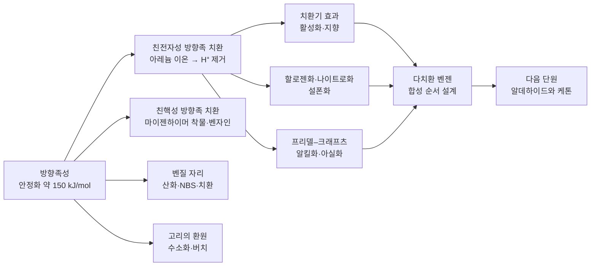

# 유기화학 9. 방향족 화합물의 반응 — 방향족성을 지키며 바꾸는 치환, 고리 밖에서 일어나는 변화
<!-- prev: ochem-8, ochem-4, ochem-6, ochem-1 -->
<!-- next: ochem-10 -->

> [!NOTE]
> **이 단원의 범위**
> - 벤젠 유도체의 명명법(관용명, 오쏘·메타·파라, 페닐·벤질·아릴)
> - 친전자성 방향족 치환의 일반 메커니즘: 아레늄 이온(σ 착물), 에너지 도표, 동위 원소 효과
> - 할로젠화·나이트로화·설폰화(가역성과 막음기), 프리델–크래프츠 알킬화와 아실화, 그 한계(자리 옮김, 다중 알킬화, 반응하지 않는 고리)
> - 치환기 효과: 유도·공명 효과로 본 활성화·비활성화, 오쏘·파라 지향과 메타 지향, 부분 속도 인자
> - 다치환 벤젠: 지향 효과가 겹칠 때의 예측과 합성 순서 설계(작용기 변환: 나이트로 → 아민, 아실 → 알킬, 알킬 → 카복실산)
> - 친핵성 방향족 치환: 첨가–제거(마이젠하이머 착물)와 제거–첨가(벤자인)
> - 벤질 자리의 반응(곁사슬 산화, NBS 브로민화, 벤질 자리 치환)과 방향족 고리의 환원(촉매 수소화, 버치 환원)

**학습 목표**

1. 벤젠 유도체를 IUPAC 이름과 널리 쓰는 관용명으로 부르고, 오쏘·메타·파라와 페닐·벤질·아릴을 구별해 쓸 수 있다.
2. 친전자성 방향족 치환을 친전자체 생성 → π 전자의 공격(아레늄 이온) → 양성자 제거의 세 단계로 굽은 화살표와 공명 구조를 써서 설명하고, 첨가가 아니라 치환이 일어나는 까닭을 에너지 도표로 말할 수 있다.
3. 할로젠화·나이트로화·설폰화·프리델–크래프츠 반응의 시약, 친전자체, 조건과 한계를 정리하고, 원하는 생성물을 얻는 반응을 고를 수 있다.
4. 아레늄 이온의 공명 구조를 오쏘·메타·파라 공격마다 그려 치환기의 활성화·비활성화와 지향 효과를 유도·공명 효과로 설명하고, 부분 속도 인자를 계산·해석할 수 있다.
5. 지향 효과가 겹치는 다치환 벤젠의 주생성물을 예측하고, 치환기를 넣는 순서와 작용기 변환을 조합해 목표 화합물의 합성 경로를 설계할 수 있다.
6. 첨가–제거(마이젠하이머 착물)와 벤자인 경로를 구별하여 친핵성 방향족 치환의 조건·속도·위치 결과를 예측할 수 있다.
7. 벤질 자리의 산화·라디칼 할로젠화·치환과 방향족 고리의 환원(촉매 수소화, 버치 환원)의 생성물을 예측할 수 있다.

**이 단원의 학습 사다리**

| 단계 | 무엇을 하나? |
|---|---|
| STEP 1. 이전 학습 다시 보기 | 방향족성과 공명 에너지, 탄소 양이온의 안정성, 굽은 화살표, 루이스 산, 라디칼 할로젠화 |
| STEP 2. 기초 다지기 | 콘주게이션 양이온에서 양전하 자리 찾기, 상대 속도 ↔ $\Delta\Delta G^\ddagger$와 부분 속도 인자, 역합성과 작용기 변환 표 |
| STEP 3. 핵심 개념 | 명명법 → EAS 메커니즘 → 할로젠화·나이트로화·설폰화 → 프리델–크래프츠 알킬화 → 아실화 → 활성화·비활성화 → 지향 효과 → 다치환 → 합성 설계 → 첨가–제거 → 벤자인 → 벤질 자리 → 고리의 환원 |
| STEP 4. 오개념 바로잡기 | "할로젠은 오쏘·파라 지향이니 활성화기", "프리델–크래프츠로 프로필벤젠을 바로 만든다" 같은 착각 |
| STEP 5. 대학원·연구로 | 해밋 식과 $\sigma^+$, 전이 금속 촉매로 바꾼 방향족 치환, C–H 활성화 |
| STEP 6. 생활·산업·진로 | 큐멘 공정과 페놀, 세제(선형 알킬벤젠설폰산염), 이부프로펜·아세트아미노펜 합성, 생어 시약 |

---

## 🗺️ 단원 들어가기

해열진통제 아세트아미노펜, 소염진통제 이부프로펜, 세탁 세제의 계면 활성제, 페트병의 원료 테레프탈산, 폭약 TNT, 그리고 수많은 염료. 이 분자들은 모두 **벤젠 고리에 무엇인가가 정해진 자리에 붙어 있다**는 공통점이 있다. 그런데 앞 단원 「콘주게이션계와 방향족성」에서 보았듯이 벤젠은 약 150 kJ/mol의 방향족 안정화를 가진 '게으른' 분자이다. 알켄이라면 브로민 물을 금세 탈색시키겠지만 벤젠은 브로민과 그냥 섞어 두면 아무 일도 일어나지 않는다. 이렇게 안정한 고리에 원하는 원자단을, 원하는 자리에 어떻게 붙일까?

답은 두 가지 발상에 있다. 첫째, 반응성이 매우 큰 **친전자체**(브로민 양이온에 가까운 것, 나이트로늄 이온, 탄소 양이온, 아실륨 이온)를 만들어 고리의 π 전자를 억지로 끌어낸다. 그러면 방향족성이 잠깐 깨진 양이온 중간체가 생기고, 이 중간체는 첨가물을 붙잡는 대신 **양성자 하나를 버려 방향족성을 되찾는다.** 결과는 H 하나가 다른 원자단으로 바뀐 **치환**이다. 둘째, 고리에 이미 붙은 치환기가 다음 반응의 **속도와 자리**를 정한다. 메틸기가 붙은 톨루엔은 벤젠보다 약 25배 빨리 나이트로화되고 주로 오쏘·파라 자리에 나이트로기가 들어가지만, 나이트로벤젠은 수천만 배 느리게, 거의 메타 자리에만 반응한다. 이 규칙을 알면 "어떤 순서로 무엇을 붙이면 목표 분자가 나오는가"라는 합성 설계가 가능해진다.

이 단원에서는 그 밖에도 고리가 전자를 **받는** 반응(친핵성 방향족 치환, 기묘한 중간체 벤자인), 고리 바로 옆 탄소(벤질 자리)가 유난히 잘 반응하는 까닭, 그리고 방향족 고리를 깨뜨려 환원하는 방법까지 다룬다. 모든 설명의 바탕은 앞 단원의 공명 구조 쓰기와 방향족성, 「유기 반응의 개관과 알킬 할라이드의 치환·제거 반응」의 탄소 양이온과 에너지 도표이다.

---

## STEP 1. 🔙 이전 학습 다시 보기

### 연계 개념표

| 이전 단원 | 그때 배운 것 | 이 단원에서 확장되는 것 |
|---|---|---|
| 유기화학 「콘주게이션계와 방향족성」 '벤젠의 구조와 안정화 에너지', '휘켈 규칙' | 벤젠의 공명 에너지 약 150 kJ/mol, 첫 수소 첨가가 +24 kJ/mol 오르막, 휘켈 규칙, 펜타다이엔일 양이온의 양전하가 한 칸씩 건너뛰어(C1·C3·C5) 놓임 | 벤젠이 첨가 대신 **치환**을 하는 까닭, 아레늄 이온 = 고리에 갇힌 펜타다이엔일 양이온(양전하가 공격 자리의 오쏘·파라에) |
| 유기화학 「유기 반응의 개관과 알킬 할라이드의 치환·제거 반응」 '탄소 양이온', '에너지 도표', '해먼드 가설' | 탄소 양이온의 안정성(3° > 2° > 1°, 초공액·공명), 1,2-수소화 이온·메틸 이동, 속도 결정 단계, 아이링 식과 '5.7 kJ 규칙' | 프리델–크래프츠 알킬화의 **자리 옮김**, 아레늄 이온의 안정성으로 속도·지향을 판단(해먼드 가설), 부분 속도 인자 ↔ $\Delta\Delta G^\ddagger$ |
| 유기화학 「구조와 결합, 산과 염기」 '공명', '유도 효과', '루이스 산 염기' | 공명 구조의 규칙, 유도 효과, $\mathrm{BF_3}$·$\mathrm{AlCl_3}$ 같은 루이스 산 | 치환기의 **공명 주개·받개**와 유도 효과의 경쟁, 루이스 산 촉매($\mathrm{FeBr_3}$, $\mathrm{AlCl_3}$)가 친전자체를 만드는 방법 |
| 유기화학 「알케인과 사이클로알케인」 '라디칼 할로젠화', 「콘주게이션계와 방향족성」 '알릴계' | 라디칼 연쇄(개시·전파·종결), 결합 해리 에너지와 선택성, NBS 알릴 자리 브로민화 | 벤질 라디칼의 공명 안정화와 **NBS 벤질 자리 브로민화** |
| 유기화학 「알코올·에터·에폭사이드와 황 화합물」 '페놀 개관', '산화' | 페놀의 산도와 나이트로기의 오쏘·파라 공명, 크로뮴산 산화 | 같은 공명 논리가 **친전자체의 공격 자리**를 정함, 곁사슬의 과망가니즈산 산화 |
| 유기화학 「알켄과 알카인」 '친전자성 첨가', '합성 설계의 기초(역합성)' | 알켄 π 전자의 친전자체 공격, 마르코브니코프 규칙, 역합성 화살표 | 방향족 π 전자의 공격(훨씬 느림), 다치환 벤젠의 **역합성**: 치환기의 순서가 생성물을 정함 |

### 준비 운동 (사전 진단)

**Q1.** 벤젠과 사이클로헥센에 각각 $\mathrm{Br_2}$를 $\mathrm{CCl_4}$ 용액으로 넣고 어두운 곳에 둔다. 어느 쪽에서 브로민의 적갈색이 곧 사라지는가? 그 까닭을 방향족성으로 한 문장으로 설명하시오.

**Q2.** 다음 탄소 양이온을 안정한 것부터 순서대로 쓰시오. (가) $\mathrm{CH_3CH_2CH_2^+}$ (나) $\mathrm{(CH_3)_2CH^+}$ (다) $\mathrm{C_6H_5CH_2^+}$ (벤질 양이온)

**Q3.** 다음 중 루이스 산을 모두 고르시오. $\mathrm{AlCl_3}$, $\mathrm{NH_3}$, $\mathrm{FeBr_3}$, $\mathrm{CH_3OCH_3}$, $\mathrm{BF_3}$

**Q4.** 25 ℃에서 경쟁하는 두 경로의 속도 비가 100 : 1이면 두 활성화 깁스 에너지의 차이는 대략 몇 kJ/mol인가?

정답 및 해설

**Q1.** 사이클로헥센. 알켄은 첨가로 π 결합 하나를 잃어도 잃는 것이 크지 않지만, 벤젠은 첨가하면 약 150 kJ/mol의 방향족 안정화를 잃으므로 촉매 없이는 반응하지 않는다.

**Q2.** (다) > (나) > (가). 벤질 양이온은 양전하가 고리의 오쏘·파라 탄소로 공명 비편재화되어 2차 양이온보다 안정하다(⑫에서 다시 쓴다). 2차가 1차보다 안정한 것은 초공액 때문이다.

**Q3.** $\mathrm{AlCl_3}$, $\mathrm{FeBr_3}$, $\mathrm{BF_3}$ — 모두 중심 원자에 빈 오비탈이 있어 전자쌍을 받는다. $\mathrm{NH_3}$와 다이메틸 에터는 전자쌍을 주는 루이스 염기이다.

**Q4.** 약 11.4 kJ/mol. 25 ℃에서 $2.303RT = 5.71\ \mathrm{kJ/mol}$마다 10배이므로 100배는 $2\times5.71$.

---

## STEP 2. 🧱 기초 다지기

### 디딤돌 1. 고리에 갇힌 펜타다이엔일 양이온 — 양전하가 놓이는 자리 찾기

「콘주게이션계와 방향족성」 예제 2에서 펜타-2,4-다이엔-1-일 양이온의 양전하가 C1, C3, C5에 놓이는 것을 보았다. 콘주게이션 사슬에서 전하는 **한 칸씩 건너뛰며** 놓인다. 이 단원의 주인공인 **아레늄 이온**(arenium ion)은 바로 이 펜타다이엔일 양이온이 육각형 고리 안에 갇힌 것이다. 친전자체 E가 벤젠의 한 탄소(이 탄소를 C1이라 하자)에 결합하면 그 탄소는 $sp^3$이 되어 콘주게이션에서 빠지고, 남은 다섯 탄소(C2~C6)가 π 전자 4개를 나누어 가진 펜타다이엔일 양이온을 이룬다.

| 펜타다이엔일 사슬의 번호 | 1 | 2 | 3 | 4 | 5 |
|---|---|---|---|---|---|
| 아레늄 이온의 고리 번호(공격 자리 = C1) | C2 | C3 | C4 | C5 | C6 |
| 공격 자리에서 본 위치 | 오쏘 | 메타 | 파라 | 메타 | 오쏘 |
| 양전하 | + (1/3) | 0 | + (1/3) | 0 | + (1/3) |

그래서 아레늄 이온의 양전하는 언제나 **공격받은 탄소의 오쏘 두 곳과 파라 한 곳**에 놓인다. 휘켈 계산(사슬 5의 비결합 오비탈 $\psi_3 = (1, 0, -1, 0, 1)/\sqrt3$)으로는 세 자리에 각각 1/3씩이다. 이 한 가지 사실에서 이 단원의 지향 규칙이 모두 나온다. 이미 붙어 있는 치환기가 이 세 '양전하 자리' 가운데 하나에 앉게 되면 그 치환기는 양전하와 직접 맞닿는다. 전자를 주는 기라면 양전하를 달래 주고(안정화), 전자를 끄는 기라면 양전하를 더 키운다(불안정화).

#### 예제 1 — 공격 자리에 따라 양전하 자리가 어디로 가나

톨루엔($\mathrm{C_6H_5CH_3}$, 메틸기가 붙은 탄소를 C1)의 C2(오쏘), C3(메타), C4(파라)에 친전자체가 결합했을 때, 각 아레늄 이온에서 양전하가 놓이는 탄소를 쓰고, 메틸기가 붙은 C1에 양전하가 놓이는 경우를 모두 고르시오.

**풀이**
양전하는 공격받은 탄소의 오쏘·파라 자리에 놓인다.
- C2 공격: C2의 오쏘는 C1과 C3, 파라는 C5 → 양전하 자리 **C1**, C3, C5
- C3 공격: 오쏘 C2·C4, 파라 C6 → C2, C4, C6 (C1 없음)
- C4 공격: 오쏘 C3·C5, 파라 C1 → C3, C5, **C1**

**의미** 오쏘·파라 공격에서만 양전하가 메틸기가 붙은 탄소(C1)에 놓이는 공명 구조가 생긴다. 그 구조는 3차 탄소 양이온이라 특히 안정하다. 메타 공격의 아레늄 이온은 2차 양이온 구조만 가진다. ⑦에서 이 차이가 '오쏘·파라 지향'의 근거가 된다.

### 디딤돌 2. 상대 속도와 $\Delta\Delta G^\ddagger$, 그리고 부분 속도 인자

「유기 반응의 개관과 알킬 할라이드의 치환·제거 반응」 디딤돌 1의 아이링 식에서 두 반응의 속도 상수 비는 활성화 깁스 에너지의 차로 정해진다.

$$
\frac{k_\mathrm{A}}{k_\mathrm{B}} = \exp\!\left(\frac{\Delta G^\ddagger_\mathrm{B} - \Delta G^\ddagger_\mathrm{A}}{RT}\right), \qquad \Delta\Delta G^\ddagger = RT\ln\frac{k_\mathrm{A}}{k_\mathrm{B}}
$$

방향족 치환의 상대 속도는 흔히 **경쟁 실험**으로 잰다. 벤젠과 톨루엔을 같은 몰수로 섞고 친전자체를 모자라게(예: 0.1당량) 넣으면, 두 기질이 같은 친전자체를 놓고 다툰다. 기질 농도가 거의 변하지 않는 동안 두 생성물의 양의 비가 곧 속도 상수의 비이다.

한 분자 안의 **자리별** 반응성을 비교하려면 **부분 속도 인자**(partial rate factor) $f$를 쓴다. 벤젠의 한 자리(벤젠에는 같은 자리가 6개)와 비교한 치환 벤젠의 한 자리의 반응성이다.

**유도** 치환 벤젠의 전체 상대 속도를 $k_\text{rel} = k_\text{ArX}/k_\text{벤젠}$, 생성물 가운데 오쏘 이성질체의 분율을 $x_o$라 하자. 벤젠의 자리 하나당 속도 상수는 $k_\text{벤젠}/6$이다. 치환 벤젠의 오쏘 자리는 2개이므로 오쏘 자리 하나당 속도 상수는 $x_o k_\text{ArX}/2$이다. 이 둘의 비가 오쏘의 부분 속도 인자이다.

$$
f_o = \frac{x_o k_\text{ArX}/2}{k_\text{벤젠}/6} = \frac{6\,k_\text{rel}\,x_o}{2}, \qquad f_m = \frac{6\,k_\text{rel}\,x_m}{2}, \qquad f_p = 6\,k_\text{rel}\,x_p
$$

$f > 1$이면 그 자리가 벤젠의 한 자리보다 반응성이 크고(활성화), $f < 1$이면 작다(비활성화). **적용 한계**: 반응이 비가역(속도론적 지배)이어야 생성물 비가 속도 비를 나타낸다. 가역적인 설폰화나 이성질화가 일어나는 조건에서는 쓸 수 없다.

#### 예제 2 — 상대 속도를 에너지로 옮기기

25 ℃의 나이트로화에서 톨루엔은 벤젠보다 약 25배 빠르고, 나이트로벤젠은 약 $6\times10^{-8}$배이다. 각각 벤젠과의 $\Delta G^\ddagger$ 차이를 구하시오. ($R = 8.314\ \mathrm{J/(mol\cdot K)}$, $T = 298.15\ \mathrm{K}$)

**풀이**
톨루엔: $\Delta\Delta G^\ddagger = RT\ln 25 = 8.314\times298.15\times3.219 = 7.98\times10^3\ \mathrm{J/mol} \approx 8.0\ \mathrm{kJ/mol}$ (톨루엔의 장벽이 8.0 kJ/mol 낮다)
나이트로벤젠: $RT\ln(6\times10^{-8}) = 2479\times(-16.63) = -4.12\times10^4\ \mathrm{J/mol}$ (장벽이 약 41 kJ/mol 높다)

**의미** 메틸기 하나는 장벽을 겨우 8 kJ/mol 낮추지만, 나이트로기는 약 41 kJ/mol이나 높인다. 반응 속도가 일곱 자릿수 넘게 느려지는 까닭이다. 어림셈으로도 25배는 '10배(5.7 kJ)보다 조금 더 큰 2.5배', $6\times10^{-8}$은 약 7.2자릿수이므로 $7.2\times5.71 \approx 41\ \mathrm{kJ/mol}$이다.

### 디딤돌 3. 역합성과 작용기 변환 표

「알켄과 알카인」의 마지막 소절에서 목표 분자에서 거꾸로 출발해 한 단계씩 앞 물질을 찾는 **역합성**(retrosynthesis, ⇒ 화살표)을 배웠다. 다치환 벤젠의 역합성에서는 "어느 치환기를 **마지막에** 넣었을까?"를 묻는 것이 핵심이다. 마지막에 넣은 치환기는 남은 치환기들의 지향 효과로 그 자리에 들어갈 수 있었어야 한다. 이때 다음 **작용기 변환**이 지향 효과를 바꾸는 열쇠가 된다(⑤·⑨·⑬에서 하나씩 자세히 본다).

| 변환 | 시약(대표) | 지향 효과의 변화 | 쓰임 |
|---|---|---|---|
| $\mathrm{-NO_2 \rightarrow -NH_2}$ | $\mathrm{H_2}$, Pd/C 또는 Fe(또는 Sn), HCl 뒤 NaOH | 강한 메타·비활성화 → 강한 오쏘·파라·활성화 | 아닐린 유도체 |
| $\mathrm{-COR \rightarrow -CH_2R}$ | Zn(Hg), HCl(클레멘젠) 또는 $\mathrm{H_2NNH_2}$, KOH, 가열(볼프–키슈너) 또는 $\mathrm{H_2}$, Pd/C | 메타·비활성화 → 오쏘·파라·활성화 | 자리 옮김 없는 1차 알킬벤젠 |
| $\mathrm{-CH_2R \rightarrow -COOH}$ | $\mathrm{KMnO_4}$, $\mathrm{OH^-}$, 가열 뒤 $\mathrm{H_3O^+}$ | 오쏘·파라·활성화 → 메타·비활성화 | 치환 벤조산 |
| $\mathrm{-H \rightarrow -SO_3H \rightarrow -H}$ | 발연 황산 / 묽은 황산, 가열 | 자리를 잠시 막는다 | 막음기(⑨) |
| $\mathrm{-NH_2 \rightarrow -NHCOCH_3}$ | 아세트산 무수물 | 강한 활성화 → 중간 활성화(과반응·산화 방지) | 아닐린의 보호 |

#### 예제 3 — 마지막 단계 찾기

1-브로모-3-나이트로벤젠과 1-브로모-4-나이트로벤젠을 각각 벤젠에서 두 단계로 만들려 한다. 어느 치환기를 먼저 넣어야 하는가?

**풀이**
- 1-브로모-3-나이트로벤젠(두 치환기가 메타): 나이트로기는 메타 지향, 브로민은 오쏘·파라 지향이다. 마지막 단계가 '나이트로벤젠의 브로민화'라면 Br은 메타로 들어간다. 따라서 **나이트로화 → 브로민화**($\mathrm{Br_2}$, $\mathrm{FeBr_3}$).
- 1-브로모-4-나이트로벤젠(파라): 마지막 단계가 '브로모벤젠의 나이트로화'여야 Br의 파라 지향을 쓸 수 있다. 따라서 **브로민화 → 나이트로화**, 오쏘 이성질체와 분리한다.

**의미** 같은 두 반응을 순서만 바꾸어 서로 다른 이성질체를 얻는다. 방향족 합성에서는 "무엇을"보다 "어떤 순서로"가 생성물을 정한다.

---

## STEP 3. 📘 핵심 개념

### ① 벤젠 유도체의 명명법

#### 일치환 벤젠

치환기 이름 뒤에 '벤젠'을 붙인다: 브로모벤젠, 클로로벤젠, 나이트로벤젠, 에틸벤젠, tert-뷰틸벤젠. 다만 아주 흔한 화합물은 IUPAC도 인정하는 **관용명**을 모체 이름으로 쓴다. 이 관용명은 반드시 익혀야 한다. 이 단원 내내 이 이름으로 부른다.

| 관용명 | 체계명 | 축약 구조식 | SMILES |
|---|---|---|---|
| 톨루엔(toluene) | 메틸벤젠 | $\mathrm{C_6H_5CH_3}$ | `Cc1ccccc1` |
| 페놀(phenol) | 벤젠올 | $\mathrm{C_6H_5OH}$ | `Oc1ccccc1` |
| 아닐린(aniline) | 벤젠아민 | $\mathrm{C_6H_5NH_2}$ | `Nc1ccccc1` |
| 아니솔(anisole) | 메톡시벤젠 | $\mathrm{C_6H_5OCH_3}$ | `COc1ccccc1` |
| 벤조산(benzoic acid) | 벤젠카복실산 | $\mathrm{C_6H_5COOH}$ | `OC(=O)c1ccccc1` |
| 벤즈알데하이드 | 벤젠카브알데하이드 | $\mathrm{C_6H_5CHO}$ | `O=Cc1ccccc1` |
| 아세토페논(acetophenone) | 1-페닐에탄-1-온 | $\mathrm{C_6H_5COCH_3}$ | `CC(=O)c1ccccc1` |
| 스타이렌(styrene) | 에텐일벤젠 | $\mathrm{C_6H_5CH{=}CH_2}$ | `C=Cc1ccccc1` |
| 벤조나이트릴 | 벤젠카보나이트릴 | $\mathrm{C_6H_5CN}$ | `N#Cc1ccccc1` |
| 큐멘(cumene) | (프로판-2-일)벤젠, 아이소프로필벤젠 | $\mathrm{C_6H_5CH(CH_3)_2}$ | `CC(C)c1ccccc1` |
| 벤젠설폰산 | — | $\mathrm{C_6H_5SO_3H}$ | `OS(=O)(=O)c1ccccc1` |

#### 이치환 벤젠 — 오쏘·메타·파라

두 치환기의 상대 위치는 번호(1,2-, 1,3-, 1,4-)로 쓰거나, 관용적으로 **오쏘**(ortho, *o*-, 1,2), **메타**(meta, *m*-, 1,3), **파라**(para, *p*-, 1,4)로 쓴다. 관용명 모체가 있으면 그 치환기가 붙은 탄소가 C1이다: 4-나이트로톨루엔(*p*-나이트로톨루엔), 3-브로모벤조산(*m*-브로모벤조산), 2-클로로페놀. 다이메틸벤젠은 **자일렌**(*o*-, *m*-, *p*-xylene)이라 부른다.

오쏘·메타·파라라는 말은 이 단원에서 두 가지 뜻으로 쓰이니 구별하자. ⓐ 이치환 벤젠의 **이름**에서 두 치환기의 관계, ⓑ 반응에서 이미 있는 치환기를 기준으로 **새 치환기가 들어가는 자리**("메틸기는 오쏘·파라 지향이다").

#### 삼치환 이상

치환기마다 번호를 붙인다. ① 번호의 묶음이 가장 작게(최소 위치 번호), ② 그래도 갈리지 않으면 영어 알파벳 순서로 먼저 오는 치환기가 작은 번호를 받는다. 이름에서도 치환기를 알파벳 순서로 늘어놓는다. 관용명 모체가 있으면 그 치환기가 C1이다.

- 2,4,6-트라이브로모페놀(OH가 C1)
- 2-메틸-1,3,5-트라이나이트로벤젠(관용명 2,4,6-트라이나이트로톨루엔, TNT)
- 1-브로모-2-클로로-4-나이트로벤젠

#### 원자단으로서의 벤젠 고리

| 이름 | 구조 | 약호 | 예 |
|---|---|---|---|
| **페닐**(phenyl) | $\mathrm{C_6H_5{-}}$ | Ph | 2-페닐에탄올($\mathrm{C_6H_5CH_2CH_2OH}$, 주 작용기 OH가 사슬에 있어 사슬이 모체) |
| **벤질**(benzyl) | $\mathrm{C_6H_5CH_2{-}}$ | Bn | 염화 벤질 $\mathrm{C_6H_5CH_2Cl}$ ((클로로메틸)벤젠) |
| **아릴**(aryl) | 방향족 고리 일반 | Ar | 할로젠화 아릴 ArX(할로젠이 고리 탄소에 직접) |

'페닐'과 '벤질'은 탄소 하나 차이다. 염화 벤질은 Cl이 $sp^3$ 벤질 탄소에 붙어 $\mathrm{S_N1}$·$\mathrm{S_N2}$를 모두 잘 하지만(⑫), 클로로벤젠은 Cl이 $sp^2$ 고리 탄소에 붙어 어느 쪽도 하지 않는다. 고리에 직접 붙은 탄소 옆자리, 곧 고리에 붙은 $sp^3$ 탄소를 **벤질 자리**(benzylic position)라 한다.

<!-- 그림 요청: 벤젠 유도체 이름표 한 판(골격 구조식, 고리는 케쿨레 구조로). 위 두 줄: 톨루엔(SMILES Cc1ccccc1), 페놀(SMILES Oc1ccccc1), 아닐린(SMILES Nc1ccccc1), 아니솔(SMILES COc1ccccc1), 벤조산(SMILES OC(=O)c1ccccc1), 벤즈알데하이드(SMILES O=Cc1ccccc1), 아세토페논(SMILES CC(=O)c1ccccc1), 스타이렌(SMILES C=Cc1ccccc1), 벤조나이트릴(SMILES N#Cc1ccccc1), 큐멘(SMILES CC(C)c1ccccc1) — 각 구조 아래에 관용명과 괄호 속 체계명. 가운데 줄: 다이브로모벤젠 세 이성질체(1,2-: SMILES Brc1ccccc1Br, 1,3-: SMILES Brc1cccc(Br)c1, 1,4-: SMILES Brc1ccc(Br)cc1)를 나란히, 고리 번호 1~6을 작게 쓰고 '오쏘(o-) 1,2 / 메타(m-) 1,3 / 파라(p-) 1,4' 이름표. 아래 줄: 페닐기(C6H5–, 붙는 결합을 물결선으로), 벤질기(C6H5CH2–, CH2를 색으로 강조하고 '벤질 자리' 이름표), 염화 벤질(SMILES ClCc1ccccc1)과 클로로벤젠(SMILES Clc1ccccc1)을 나란히 놓고 Cl이 붙은 탄소에 각각 'sp3'와 'sp2' 이름표. -->

#### 예제 4 — 이름 붙이기

다음 화합물의 IUPAC 이름을 쓰시오. (1) `Clc1ccc(cc1)[N+](=O)[O-]` (2) `OC(=O)c1cccc(Br)c1` (3) `Cc1ccc(cc1[N+](=O)[O-])[N+](=O)[O-]` (4) `CCc1ccccc1C`

**풀이**
(1) Cl과 $\mathrm{NO_2}$가 파라: **1-클로로-4-나이트로벤젠**(*p*-클로로나이트로벤젠). 관용명 모체가 없으므로 알파벳 순서(chloro < nitro)로 Cl이 C1.
(2) 모체 벤조산, COOH 탄소가 C1, Br은 C3: **3-브로모벤조산**.
(3) 메틸 하나, 나이트로 둘. 최소 위치 번호 묶음은 {1, 2, 4}이고, 메틸을 C1로 두면 나이트로가 2, 4. 이름은 **1-메틸-2,4-다이나이트로벤젠**(관용적으로 2,4-다이나이트로톨루엔). 알파벳은 다이(di)를 빼고 methyl, nitro로 비교한다.
(4) 에틸과 메틸이 오쏘. 알파벳 순서(ethyl < methyl)로 에틸이 C1: **1-에틸-2-메틸벤젠**.

#### ✔ 바로 확인

1. (O/X) 염화 벤질과 클로로벤젠은 같은 화합물의 다른 이름이다.
2. 빈칸: 1,3-다이치환 벤젠의 두 치환기는 서로 (    ) 관계이다.
3. *p*-나이트로페놀의 IUPAC 이름을 쓰시오.

정답

1. X — 염화 벤질은 $\mathrm{C_6H_5CH_2Cl}$(Cl이 $sp^3$ 벤질 탄소), 클로로벤젠은 $\mathrm{C_6H_5Cl}$(Cl이 고리 탄소)이다.
2. 메타
3. 4-나이트로페놀 — OH가 붙은 탄소가 C1이다.

### ② 친전자성 방향족 치환의 일반 메커니즘

벤젠에 친전자체 $\mathrm{E^+}$가 반응해 H 하나가 E로 바뀌는 반응을 **친전자성 방향족 치환**(electrophilic aromatic substitution, EAS)이라 한다.

$$
\mathrm{C_6H_6 + E^+ \longrightarrow C_6H_5E + H^+}
$$

모든 EAS는 세 단계의 같은 뼈대를 가진다. 반응마다 다른 것은 0단계, 곧 **친전자체를 만드는 방법**뿐이다.

| 단계 | 일어나는 일 | 굽은 화살표 | 속도 |
|---|---|---|---|
| 0. 친전자체 생성 | 시약과 촉매(루이스 산·브뢴스테드 산)가 강한 친전자체를 만든다 | 반응마다 다름(③~⑤) | 빠른 평형 |
| 1. π 전자의 공격 | 고리의 π 전자쌍 하나가 E와 새 σ 결합을 만든다 → **아레늄 이온** | π 결합(C1=C2 사이)에서 E로 1개 | **느림(속도 결정)** |
| 2. 양성자 제거 | 염기가 $sp^3$ 탄소(E가 붙은 탄소)의 H를 떼고, C–H 결합 전자쌍이 고리로 돌아가 방향족 π계를 다시 만든다 | 염기 전자쌍 → H 1개, C–H 결합 → C1–C2 사이 1개 | 빠름 |

#### 아레늄 이온 — σ 착물

1단계에서 생긴 양이온을 **아레늄 이온**(arenium ion) 또는 **σ 착물**(sigma complex)이라 한다(처음 제안한 사람의 이름을 따 휠란트 중간체라고도 한다). 공격받은 탄소는 H와 E를 함께 가진 $sp^3$ 탄소가 되어 고리의 콘주게이션에서 빠진다. 나머지 다섯 탄소는 π 전자 4개와 양전하 하나를 나누어 갖는다. 디딤돌 1에서 본 대로 공명 구조는 **세 개**이고, 양전하는 공격받은 탄소의 **오쏘 두 곳과 파라 한 곳**에 놓인다. 혼성체로는 다섯 탄소에 걸친 점선 반원과 그 가운데의 ⊕로 그린다.

<!-- 그림 요청: 친전자성 방향족 치환의 일반 메커니즘(벤젠 + E⁺). 1단계: 벤젠(케쿨레 구조, 위쪽 꼭짓점이 C1)의 C1=C2 π 결합 가운데에서 E⁺로 굽은 화살표 1개 → 꺾쇠 안에 아레늄 이온의 공명 구조 세 개를 ↔ 로 연결. C1은 모두 H와 E를 가진 sp3 탄소(H는 위쪽 쐐기, E는 위쪽 점선처럼 두 결합을 모두 그림). 구조 ㉠ C2에 ⊕(C3=C4, C5=C6 이중 결합), 구조 ㉡ C4에 ⊕(C2=C3, C5=C6), 구조 ㉢ C6에 ⊕(C2=C3, C4=C5). ㉠ → ㉡ 사이에 C3=C4 π 전자쌍에서 C2–C3 자리로 가는 굽은 화살표, ㉡ → ㉢ 사이에 C5=C6 π 전자쌍에서 C4–C5 자리로 가는 굽은 화살표. 세 구조 아래에 'C1에서 본 오쏘(C2) · 파라(C4) · 오쏘(C6)'. 꺾쇠 오른쪽에 혼성체: C2~C6에 걸친 점선 반원, 그 안에 ⊕, C2·C4·C6에 δ+. 2단계: 구조 ㉡에 염기 B:가 C1의 H로 굽은 화살표 1개, C1–H 결합에서 C1–C2 사이(새 π 결합)로 굽은 화살표 1개 → 치환 생성물 C6H5E(케쿨레 구조) + B–H⁺. 맨 오른쪽 아래 작게 '방향족성 회복'. -->

#### 왜 첨가가 아니라 치환인가 — 에너지 도표

알켄이라면 1단계에서 생긴 탄소 양이온을 음이온(예: $\mathrm{Br^-}$)이 공격해 **첨가**가 끝난다. 아레늄 이온도 같은 길을 갈 수 있지만 그렇게 하면 생성물이 사이클로헥사다이엔이 되어 방향족성을 잃는다. 반면 양성자를 잃으면 방향족 고리가 그대로 남는다. 「콘주게이션계와 방향족성」 ⑥에서 벤젠의 첫 수소 첨가조차 +24 kJ/mol 오르막이었던 것처럼, 첨가 생성물은 방향족 안정화 약 150 kJ/mol 가운데 대부분을 잃어 치환 생성물보다 훨씬 높은 곳에 있다. 2단계의 두 갈래 가운데 **양성자 제거 쪽이 생성물도 낮고 장벽도 낮다.**

1단계는 방향족성을 깨뜨리는 크게 흡열인 단계라 장벽이 높고, 해먼드 가설에 따라 그 전이 상태는 **아레늄 이온을 닮은 늦은 전이 상태**이다. 그래서 이 단원 내내 "아레늄 이온이 안정할수록 1단계의 장벽이 낮고 반응이 빠르다"라고 판단한다. 같은 이유로 EAS에는 알켄의 첨가보다 훨씬 강한 친전자체가 필요하다.

<!-- 그림 요청: 벤젠 + E⁺ 반응의 에너지 도표. 세로축 G(눈금 없이 상대 높이), 가로축 반응 좌표. 왼쪽 '벤젠 + E⁺'(높이 0) → 높은 꼭대기 TS1('‡, 늦은 전이 상태 · 아레늄 이온을 닮음') → 골짜기 '아레늄 이온'(TS1보다 조금 낮은 높이, 오른쪽 위에 작은 아레늄 혼성체 그림). 골짜기에서 두 갈래: (실선, 아래) 낮은 꼭대기 TS2 → 깊은 골짜기 '치환 생성물 C6H5E + H⁺'(반응물보다 낮음), (점선, 위) 더 높은 꼭대기 → 반응물보다 높은 골짜기 '첨가 생성물(5,6-이치환 사이클로헥사-1,3-다이엔)'. 두 생성물 높이 차이에 양방향 화살표와 '방향족 안정화 차이'. TS1과 반응물 사이에 'ΔG‡ (속도 결정)'. 오른쪽 여백에 비교용 옅은 회색 곡선: '알켄 + E⁺' 의 1단계 꼭대기가 벤젠보다 훨씬 낮음. -->

#### 실험적 근거 — 동위 원소 효과가 없다

벤젠($\mathrm{C_6H_6}$)과 헥사듀테리오벤젠($\mathrm{C_6D_6}$)을 나이트로화하거나 브로민화하면 속도가 거의 같다($k_\mathrm{H}/k_\mathrm{D} \approx 1$). C–H(또는 C–D) 결합이 끊어지는 단계가 속도 결정 단계였다면 C–D가 더 느리게 끊어져 $k_\mathrm{H}/k_\mathrm{D}$가 수 배 이상이 되어야 한다(「유기 반응의 개관과 알킬 할라이드의 치환·제거 반응」의 E2 동위 원소 효과). 동위 원소 효과가 없다는 것은 **C–H가 끊어지지 않는 1단계가 느리고, C–H가 끊어지는 2단계는 빠르다**는 두 단계 메커니즘의 증거이다. 또 초강산 속 저온에서는 메틸기가 많이 붙은 벤젠의 아레늄 이온이 NMR로 직접 관찰되어, 중간체가 실재함이 확인되었다.

#### 예제 5 — 듀테륨은 얼마나 남는가

모노듀테리오벤젠($\mathrm{C_6H_5D}$)을 나이트로화하여 모노나이트로 생성물을 얻었다. $k_\mathrm{H}/k_\mathrm{D} = 1$이고 각 자리의 반응성이 같다고 할 때 (1) 생성물 가운데 D를 잃은 것($\mathrm{C_6H_5NO_2}$)의 분율은? (2) 만약 2단계(양성자 제거)가 속도 결정 단계이고 $k_\mathrm{H}/k_\mathrm{D} = 5$라면 결과가 어떻게 달라질지 정성적으로 말하시오.

**풀이**
(1) 나이트로늄 이온은 여섯 탄소를 같은 확률로 공격한다. D가 붙은 탄소를 공격한 경우(1/6)에만 아레늄 이온의 $sp^3$ 탄소에 D가 있고, 2단계에서 D가 떨어져 나간다. 나머지 5/6에서는 H가 떨어져 D가 남는다. D를 잃은 생성물의 분율은 **1/6 ≈ 17 %** 이다.
(2) D가 붙은 탄소에 생긴 아레늄 이온은 D를 떼기 어려워 다시 출발 물질로 되돌아가는 일이 잦아진다. D를 잃은 생성물의 분율은 1/6보다 작아지고(이 경우 약 $(1/6)/(1/6 + (5/6)\times 5)$ 꼴), 전체 속도도 $\mathrm{C_6D_6}$에서 눈에 띄게 느려진다. 실험에서는 (1)의 결과가 나온다.

**의미** 동위 원소 표지는 "어떤 결합이 언제 끊어지는가"를 직접 묻는 도구이다. 다만 설폰화처럼 1단계가 쉽게 되돌아가는 반응에서는 작은 동위 원소 효과가 관찰된다.

#### ✔ 바로 확인

1. 빈칸: 아레늄 이온에서 양전하는 공격받은 탄소의 (    ) 두 곳과 (    ) 한 곳에 놓인다.
2. (O/X) EAS의 속도 결정 단계는 양성자가 떨어져 나가는 단계이다.
3. 아레늄 이온이 음이온과 결합(첨가)하지 않고 양성자를 잃는 까닭을 한 문장으로 쓰시오.

정답

1. 오쏘, 파라
2. X — 아레늄 이온이 생기는 1단계가 느리다. $k_\mathrm{H}/k_\mathrm{D} \approx 1$이 그 증거이다.
3. 양성자를 잃으면 방향족성이 회복되어 첨가 생성물보다 훨씬 안정한 생성물이 되고, 그 경로의 장벽도 낮기 때문이다.

### ③ 할로젠화·나이트로화·설폰화

#### 할로젠화 — 루이스 산이 만든 '$\mathrm{Br^+}$'

$\mathrm{Br_2}$ 자체는 벤젠을 공격할 만큼 친전자성이 크지 않다. 브로민화 철(III)($\mathrm{FeBr_3}$, 쇳가루와 브로민을 넣으면 그 자리에서 생긴다)이 루이스 산으로 Br 하나의 비공유 전자쌍을 받으면 Br–Br 결합이 크게 분극되어, 바깥쪽 Br이 $\mathrm{Br^+}$에 가까운 친전자체가 된다.

$$
\mathrm{C_6H_6 + Br_2 \xrightarrow{FeBr_3} C_6H_5Br + HBr}
$$

- 0단계: $\mathrm{Br_2}$의 Br 전자쌍 → Fe (화살표 1개) → $\mathrm{Br{-}Br^+{-}FeBr_3^-}$ 착물
- 1단계: 고리 π 전자쌍 → 바깥쪽 Br, Br–Br 결합 전자쌍 → 안쪽 Br(Fe에 붙은 쪽) (화살표 2개) → 아레늄 이온 + $\mathrm{FeBr_4^-}$
- 2단계: $\mathrm{FeBr_4^-}$의 Br 전자쌍 → H, C–H 전자쌍 → 고리 (화살표 2개) → 브로모벤젠 + HBr + $\mathrm{FeBr_3}$(촉매 재생)

염소화는 $\mathrm{Cl_2}$와 $\mathrm{FeCl_3}$(또는 $\mathrm{AlCl_3}$)로 똑같이 한다. 아이오딘은 친전자성이 너무 약해 $\mathrm{I_2}$에 산화제(질산, 과산화 수소, $\mathrm{CuCl_2}$ 등)를 넣어 더 강한 '$\mathrm{I^+}$' 화학종을 만든다. 플루오린은 반대로 너무 격렬하게 반응해 직접 쓰지 않으며, 플루오로벤젠은 다른 경로(아릴 다이아조늄 염, 「아민과 헤테로고리 화합물」)로 만든다.

<!-- 그림 요청: 벤젠의 브로민화 메커니즘(FeBr3 촉매) 세 줄. (1줄, 친전자체 활성화) Br–Br + FeBr3: 왼쪽 Br의 비공유 전자쌍에서 Fe로 굽은 화살표 1개 → Br–Br⁺–Fe⁻Br3 착물(가운데 Br에 ⊕, Fe에 ⊖, 바깥쪽 Br에 δ+). (2줄, 1단계) 벤젠 C1=C2 π 결합에서 착물의 바깥쪽 Br로 굽은 화살표 1개, 가운데 Br–Br 결합에서 가운데 Br(Fe 쪽)로 굽은 화살표 1개 → 아레늄 이온(C1에 H와 Br, 공명 구조 세 개를 작게 ↔ 로: ⊕가 C2, C4, C6) + FeBr4⁻. (3줄, 2단계) FeBr4⁻의 Br 전자쌍에서 C1–H의 H로 굽은 화살표, C1–H 결합에서 C1–C2 사이로 굽은 화살표 → 브로모벤젠(SMILES Brc1ccccc1) + HBr + FeBr3(초록 글씨 '촉매 재생'). -->

#### 나이트로화 — 나이트로늄 이온

진한 질산과 진한 황산의 혼합물('혼산')에서 더 강한 산인 황산이 질산을 양성자화하고, 양성자화된 질산이 물을 잃어 **나이트로늄 이온**(nitronium ion, $\mathrm{NO_2^+}$)이 생긴다. $\mathrm{O{=}N^+{=}O}$는 직선형이고 N이 친전자성 중심이다.

$$
\mathrm{HNO_3 + 2H_2SO_4 \rightleftharpoons NO_2^+ + H_3O^+ + 2HSO_4^-}
$$

$$
\mathrm{C_6H_6 + HNO_3 \xrightarrow{H_2SO_4,\ 50\,^\circ C\text{ 이하}} C_6H_5NO_2 + H_2O}
$$

1단계에서 고리 π 전자쌍이 N을 공격하면, 동시에 N=O π 결합 하나의 전자쌍이 O로 옮겨 가 N이 옥텟을 지킨다(화살표 2개). 2단계는 $\mathrm{HSO_4^-}$(또는 물)가 양성자를 뗀다. 온도를 높이거나 오래 두면 다이나이트로화가 일어나므로 벤젠의 모노나이트로화는 50 ℃ 이하에서 한다. 나이트로벤젠은 환원하면 아닐린이 되므로(⑨·⑬) 방향족 아민으로 가는 관문이다.

<!-- 그림 요청: 나이트로늄 이온의 생성과 벤젠의 나이트로화. (1줄) HNO3(구조 HO–N⁺(=O)–O⁻)의 OH 산소 전자쌍에서 H2SO4의 H로 굽은 화살표, H2SO4의 O–H 결합에서 O로 굽은 화살표 → H2O⁺–NO2(양성자화된 질산) + HSO4⁻. 다음으로 N–OH2⁺ 결합에서 O로 굽은 화살표(물이 떨어짐) → 직선형 O=N⁺=O(나이트로늄 이온, N에 ⊕, 결합각 180° 표시) + H2O. (2줄, 1단계) 벤젠 C1=C2 π 결합에서 N으로 굽은 화살표, N=O 이중 결합 하나에서 O로 굽은 화살표 → 아레늄 이온(C1에 H와 NO2, ⊕는 C2·C4·C6 공명 구조 세 개를 작게) (3줄, 2단계) HSO4⁻ 전자쌍 → C1의 H, C1–H 결합 → 고리 → 나이트로벤젠(SMILES [O-][N+](=O)c1ccccc1) + H2SO4. -->

#### 설폰화 — 되돌릴 수 있는 치환

벤젠을 **발연 황산**(진한 황산에 $\mathrm{SO_3}$를 녹인 것)과 반응시키면 벤젠설폰산이 생긴다. 친전자체는 $\mathrm{SO_3}$(S가 세 O에 둘러싸여 강하게 양전하를 띤다) 또는 그 양성자화된 형태 $\mathrm{HSO_3^+}$이다.

$$
\mathrm{C_6H_6 + SO_3 \xrightleftharpoons[\text{묽은 } H_2SO_4,\ \text{가열}]{H_2SO_4} C_6H_5SO_3H}
$$

설폰화의 가장 큰 특징은 **가역성**이다. 설폰산을 묽은 황산 수용액과 함께 가열하거나 수증기를 불어 넣으면 거꾸로 $\mathrm{SO_3}$가 떨어져 나간다(탈설폰화). 정반응과 역반응은 같은 아레늄 이온을 지나며(미시적 가역성), 물이 많으면 르샤틀리에 원리에 따라 평형이 탈설폰화 쪽으로 간다. 역반응의 1단계는 $\mathrm{H^+}$가 설폰기가 붙은 탄소(입소 자리)를 공격하는 것이다. 이 가역성 덕분에 $\mathrm{-SO_3H}$는 어떤 자리를 잠시 막아 두었다가 지우는 **막음기**(blocking group)로 쓰인다(⑨). 벤젠설폰산은 황산에 견줄 만큼 강한 산이며, 설폰산 유도체는 세제와 설파제 약물의 뼈대이다.

<!-- 그림 요청: 설폰화와 탈설폰화의 가역 반응. 가운데에 아레늄 이온(C1에 H와 SO3⁻, 공명 구조 하나만 그리고 ⊕를 C4에) 을 두고 양쪽으로 ⇌. 왼쪽: 벤젠 + SO3(S를 가운데에 두고 S=O 세 개, S에 δ+, O에 δ−). 벤젠 C1=C2 π 결합에서 S로 굽은 화살표, S=O 결합 하나에서 O로 굽은 화살표(2개). 오른쪽: 염기(HSO4⁻)가 C1–H를 떼는 화살표 2개 → 벤젠설포네이트 → H⁺가 붙어 벤젠설폰산(SMILES OS(=O)(=O)c1ccccc1). 위쪽 화살표에 '진한(발연) H2SO4, 정반응', 아래쪽 되돌아가는 화살표에 '묽은 H2SO4, 가열(수증기), 탈설폰화'. 역반응 쪽 작은 그림: H3O⁺의 H가 설폰기가 붙은 C1(입소 자리)을 공격하는 굽은 화살표와 'ipso 양성자화'. -->

#### 세 반응 요약

| 반응 | 시약 | 친전자체 | 생성물 | 특징 |
|---|---|---|---|---|
| 브로민화·염소화 | $\mathrm{Br_2/FeBr_3}$, $\mathrm{Cl_2/FeCl_3}$ | '$\mathrm{X^+}$'($\mathrm{X{-}X^+{-}FeX_3^-}$) | ArX | 루이스 산 필요 |
| 아이오딘화 | $\mathrm{I_2}$ + 산화제($\mathrm{HNO_3}$ 등) | '$\mathrm{I^+}$' | ArI | 산화제 필요 |
| 나이트로화 | 진한 $\mathrm{HNO_3}$ + 진한 $\mathrm{H_2SO_4}$ | $\mathrm{NO_2^+}$ | $\mathrm{ArNO_2}$ | 온도 조절, 환원하면 $\mathrm{ArNH_2}$ |
| 설폰화 | 발연 $\mathrm{H_2SO_4}$ | $\mathrm{SO_3}$ / $\mathrm{HSO_3^+}$ | $\mathrm{ArSO_3H}$ | **가역**, 막음기 |
| 양성자 교환 | $\mathrm{D_2SO_4}$ | $\mathrm{D^+}$ | ArD | 같은 메커니즘으로 H ↔ D 교환 |

#### 예제 6 — 시약 고르기와 듀테륨 교환

(1) 벤젠에서 아이오도벤젠을 만드는 시약을 쓰시오. (2) 벤젠을 $\mathrm{D_2SO_4}$(과량)에 녹여 오래 두면 무엇이 생기는가? 메커니즘의 친전자체는 무엇인가? (3) 벤젠설폰산을 묽은 황산과 수증기로 가열하면 무엇이 생기는가?

**풀이**
(1) $\mathrm{I_2}$와 산화제(예: 진한 $\mathrm{HNO_3}$). 아이오딘 자체는 친전자성이 약해 산화로 '$\mathrm{I^+}$'를 만든다.
(2) $\mathrm{D^+}$가 친전자체이다. $\mathrm{D^+}$가 고리를 공격해 C1에 H와 D를 함께 가진 아레늄 이온이 생기고, 2단계에서 H나 D 가운데 하나가 떨어진다. H가 떨어지면 D가 고리에 남는다. 과량의 $\mathrm{D_2SO_4}$ 속에서 이것이 되풀이되면 결국 **헥사듀테리오벤젠 $\mathrm{C_6D_6}$** 가 생긴다. NMR 용매 $\mathrm{C_6D_6}$를 만드는 원리이다.
(3) 탈설폰화로 **벤젠**과 황산. 물이 많을수록 역반응 쪽이 유리하다.

**의미** 친전자체가 가장 작은 양이온 $\mathrm{H^+}$(또는 $\mathrm{D^+}$)일 때도 EAS의 뼈대는 같다. 친전자체가 떨어져 나가기 쉬운 경우(H, $\mathrm{SO_3}$)에는 EAS가 가역이 된다.

#### ✔ 바로 확인

1. 벤젠의 나이트로화에서 실제 친전자체의 화학식과 모양을 쓰시오.
2. (O/X) 벤젠의 브로민화에서 $\mathrm{FeBr_3}$는 반응이 끝나면 $\mathrm{FeBr_4^-}$로 남아 소모된다.
3. 막음기로 쓸 수 있는 치환기와 그 까닭을 쓰시오.

정답

1. $\mathrm{NO_2^+}$, 직선형(O=N⁺=O, 180°) — 진한 황산이 질산을 양성자화하고 물을 떼어 만든다.
2. X — 2단계에서 $\mathrm{FeBr_4^-}$가 양성자를 받아 HBr을 내놓고 $\mathrm{FeBr_3}$로 돌아간다. 촉매이다.
3. $\mathrm{-SO_3H}$ — 설폰화는 가역이어서 묽은 황산과 가열로 지울 수 있다.

### ④ 프리델–크래프츠 알킬화와 그 한계

**프리델–크래프츠 알킬화**(Friedel–Crafts alkylation)는 할로젠화 알킬과 루이스 산($\mathrm{AlCl_3}$, $\mathrm{FeCl_3}$)으로 고리에 알킬기를 붙이는, 방향족 고리에 **탄소–탄소 결합**을 만드는 대표 반응이다.

$$
\mathrm{C_6H_6 + (CH_3)_3CCl \xrightarrow{AlCl_3} C_6H_5C(CH_3)_3 + HCl}
$$

- 0단계: Cl의 전자쌍 → Al (화살표 1개) → $\mathrm{R{-}Cl^+{-}AlCl_3^-}$ 착물. 3차·2차 할로젠화 알킬은 C–Cl 결합이 끊어져 **탄소 양이온** $\mathrm{R^+}$와 $\mathrm{AlCl_4^-}$가 된다. 1차는 자유로운 1차 양이온이 되지 않고, 착물의 탄소가 양이온처럼 행동한다.
- 1단계: π 전자쌍 → $\mathrm{R^+}$의 탄소 → 아레늄 이온
- 2단계: $\mathrm{AlCl_4^-}$가 양성자를 떼어 HCl과 $\mathrm{AlCl_3}$를 내놓는다.

탄소 양이온을 만들 수 있으면 친전자체의 출처는 할로젠화 알킬이 아니어도 된다. 알켄에 산($\mathrm{HF}$, $\mathrm{H_3PO_4}$, $\mathrm{H_2SO_4}$, 고체산 촉매)을 주면 마르코브니코프 방향으로 양성자가 붙은 양이온이 생기고, 알코올에 산을 주면 물이 떨어져 양이온이 생긴다. 산업에서 벤젠과 프로펜으로 큐멘을 만드는 공정이 이 방식이다(STEP 6).

#### 한계 ① 탄소 양이온의 자리 옮김

친전자체가 탄소 양이온(또는 그와 비슷한 착물)이므로 「유기 반응의 개관과 알킬 할라이드의 치환·제거 반응」 ⑤에서 본 **1,2-수소화 이온 이동·메틸 이동**이 일어나 더 안정한 양이온으로 바뀐 뒤 고리에 붙는다.

| 할로젠화 알킬 (+ $\mathrm{AlCl_3}$) | 처음 양이온(또는 착물) | 자리 옮김 | 주생성물 |
|---|---|---|---|
| 1-클로로프로페인 | 1차(착물) | 1,2-H 이동 → 2차 | **아이소프로필벤젠(큐멘)**, 프로필벤젠은 적다 |
| 1-클로로-2-메틸프로페인 | 1차(착물) | 1,2-H 이동 → 3차 | **tert-뷰틸벤젠** |
| 1-클로로-2,2-다이메틸프로페인 | 1차(착물) | 1,2-메틸 이동 → 3차 | **(2-메틸뷰탄-2-일)벤젠** |
| 2-클로로-2-메틸프로페인 | 3차 | 없음 | tert-뷰틸벤젠 |

그래서 **곧은 사슬 1차 알킬벤젠(프로필벤젠, 뷰틸벤젠 …)은 알킬화로 깨끗하게 만들 수 없다.** 해결책은 ⑤의 아실화 + 환원이다.

#### 한계 ② 다중 알킬화

알킬기는 고리를 활성화한다(⑥). 모노알킬화 생성물이 출발 물질 벤젠보다 **더 빨리** 반응하므로, 벤젠과 할로젠화 알킬을 1 : 1로 넣으면 다이알킬·트라이알킬 생성물이 섞인다. 값싼 방향족 화합물을 **크게 과량**으로 써서(용매처럼) 친전자체가 생성물보다 출발 물질을 만날 확률을 높이는 것이 표준 대책이다.

#### 한계 ③ 반응하지 않는 고리와 시약

- **강하게·중간 정도로 비활성화된 고리**: 할로젠보다 강한 비활성화기(메타 지향기 전부: $\mathrm{-NO_2}$, $\mathrm{-CN}$, $\mathrm{-SO_3H}$, $\mathrm{-COR}$, $\mathrm{-COOH}$, $\mathrm{-CF_3}$, $\mathrm{-NR_3^+}$)가 붙은 고리는 프리델–크래프츠 반응을 하지 않는다. 할로벤젠까지는 반응한다. 나이트로벤젠은 오히려 프리델–크래프츠 반응의 용매로 쓰일 만큼 반응하지 않는다.
- **아민($\mathrm{-NH_2}$, $\mathrm{-NHR}$, $\mathrm{-NR_2}$)이 붙은 고리**: 질소의 비공유 전자쌍이 루이스 산 $\mathrm{AlCl_3}$와 먼저 착물($\mathrm{-NH_2^+{-}AlCl_3^-}$)을 만든다. 질소에 양전하가 생겨 고리가 강하게 비활성화되고 촉매도 소모된다. 그래서 아닐린은 가장 강한 활성화기를 가졌는데도 프리델–크래프츠 반응을 하지 않는다.
- **할로젠화 아릴·할로젠화 비닐**: $sp^2$ 탄소의 양이온은 매우 불안정해 생기지 않으므로 알킬화제로 쓸 수 없다. 클로로벤젠과 벤젠으로 바이페닐을 만들 수 없다.

<!-- 그림 요청: 프리델–크래프츠 알킬화의 두 가지 한계를 위아래 두 줄로. (위 줄, 자리 옮김) 1-클로로프로페인(SMILES CCCCl) + AlCl3: Cl 전자쌍 → Al 화살표 → CH3CH2CH2–Cl⁺–AlCl3⁻ 착물. 가운데 탄소(C2)의 H가 C1로 옮겨 가는 1,2-수소화 이온 이동 굽은 화살표(C2–H 결합 → C1) 와 C1–Cl 결합 → Cl 화살표 → 2차 양이온 (CH3)2CH⁺(SMILES C[CH+]C) + AlCl4⁻. 양이온이 벤젠을 공격해 두 갈래: 굵은 화살표 → 아이소프로필벤젠(큐멘, SMILES CC(C)c1ccccc1, '주생성물'), 가는 화살표(착물이 직접 공격) → 프로필벤젠(SMILES CCCc1ccccc1, '부생성물'). (아래 줄, 다중 알킬화) 벤젠 → (CH3)3CCl/AlCl3 → tert-뷰틸벤젠 → 같은 조건 → 1,4-다이-tert-뷰틸벤젠(SMILES CC(C)(C)c1ccc(cc1)C(C)(C)C). 두 화살표 위에 상대 속도 막대: 'k(tert-뷰틸벤젠) > k(벤젠)', 오른쪽에 상자 '대책: 벤젠을 크게 과량으로'. -->

#### 예제 7 — 알킬화 생성물 예측

다음 반응의 주생성물을 쓰시오. 반응하지 않으면 '반응 없음'과 까닭을 쓰시오.
(1) 벤젠(과량) + 1-클로로-2-메틸프로페인, $\mathrm{AlCl_3}$
(2) 벤젠(과량) + 사이클로헥센, HF
(3) 나이트로벤젠 + 클로로메테인, $\mathrm{AlCl_3}$
(4) 아닐린 + 2-클로로프로페인, $\mathrm{AlCl_3}$
(5) 벤젠(과량) + 1-클로로-2,2-다이메틸프로페인, $\mathrm{AlCl_3}$

**풀이**
(1) 1차 착물에서 1,2-수소화 이온 이동으로 3차 양이온 $\mathrm{(CH_3)_3C^+}$ → **tert-뷰틸벤젠**. 아이소뷰틸벤젠은 거의 생기지 않는다.
(2) 사이클로헥센이 양성자를 받아 사이클로헥실 양이온(2차) → **사이클로헥실벤젠**(SMILES `C1CCC(CC1)c1ccccc1`). 사이클로헥실 양이온은 대칭이라 자리 옮김이 생성물을 바꾸지 않는다.
(3) **반응 없음** — 나이트로기가 고리를 강하게 비활성화한다.
(4) **반응 없음** — 아미노기가 $\mathrm{AlCl_3}$와 착물을 만들어 고리가 강하게 비활성화된다.
(5) 네오펜틸형 1차 착물에서 메틸기가 1,2-이동해 3차 양이온 $\mathrm{(CH_3)_2\overset{+}{C}CH_2CH_3}$(2-메틸뷰탄-2-일 양이온) → **(2-메틸뷰탄-2-일)벤젠**(SMILES `CCC(C)(C)c1ccccc1`).

**의미** 생성물의 알킬기는 '넣은 할로젠화 알킬'이 아니라 '그 계에서 만들 수 있는 가장 안정한 양이온'의 모양을 따른다.

#### ✔ 바로 확인

1. (O/X) 1-클로로프로페인과 $\mathrm{AlCl_3}$로 벤젠을 알킬화하면 프로필벤젠이 주생성물이다.
2. 프리델–크래프츠 알킬화에서 다중 알킬화를 줄이는 방법을 쓰시오.
3. 아닐린이 프리델–크래프츠 반응을 하지 않는 까닭을 한 문장으로 쓰시오.

정답

1. X — 1,2-수소화 이온 이동으로 2차 양이온이 되어 아이소프로필벤젠(큐멘)이 주생성물이다.
2. 방향족 기질을 크게 과량으로 쓴다(또는 아실화 후 환원으로 우회한다).
3. 질소의 비공유 전자쌍이 $\mathrm{AlCl_3}$와 착물을 만들어 질소가 양전하를 띠고 고리가 강하게 비활성화되기 때문이다.

### ⑤ 프리델–크래프츠 아실화 — 자리 옮김 없는 탄소 사슬

산 염화물($\mathrm{RCOCl}$)이나 산 무수물을 $\mathrm{AlCl_3}$와 함께 쓰면 고리에 **아실기**($\mathrm{RC{=}O}$)가 붙어 아릴 케톤이 생긴다. 이것이 **프리델–크래프츠 아실화**(Friedel–Crafts acylation)이다.

$$
\mathrm{C_6H_6 + CH_3COCl \xrightarrow{1)\ AlCl_3\quad 2)\ H_2O} C_6H_5COCH_3 + HCl}
$$

#### 친전자체 — 아실륨 이온

$\mathrm{AlCl_3}$가 산 염화물의 Cl을 끌어가면 **아실륨 이온**(acylium ion) $\mathrm{R{-}C{\equiv}O^+}$가 생긴다. 이 이온은 두 공명 구조 $\mathrm{R{-}\overset{+}{C}{=}O \leftrightarrow R{-}C{\equiv}\overset{+}{O}}$를 가지며, 둘째 구조에서는 모든 원자가 옥텟을 채운다. 그래서 아실륨 이온은 안정하고 **자리 옮김을 하지 않는다.** 1단계에서 π 전자쌍이 아실륨 이온의 탄소를 공격하고(동시에 C≡O의 π 전자쌍 하나가 O로), 2단계에서 $\mathrm{AlCl_4^-}$가 양성자를 뗀다.

#### 알킬화와 다른 점

| | 알킬화 | 아실화 |
|---|---|---|
| 친전자체 | 탄소 양이온(자리 옮김 함) | 아실륨 이온(자리 옮김 없음) |
| 생성물이 고리에 주는 효과 | 활성화 → **다중 알킬화** | 아실기는 비활성화 → **한 번만** 반응 |
| $\mathrm{AlCl_3}$의 양 | 촉매량 | **1당량 이상**: 생성물 케톤의 C=O 산소가 $\mathrm{AlCl_3}$와 단단한 착물을 만들어 촉매를 붙잡는다. 반응 뒤 물을 넣어 착물을 깨고 케톤을 얻는다 |
| 반응하지 않는 경우 | 비활성화된 고리, 아민 | 같음 |

포름일기(–CHO)는 포름일 염화물(HCOCl)이 불안정해 이 방법으로 넣기 어렵다. 대신 CO와 HCl을 $\mathrm{AlCl_3}$·CuCl과 함께 쓰는 방법(가터만–코흐 반응)으로 벤즈알데하이드를 만든다. 아실 사슬이 같은 분자의 고리에 붙어 있으면 **분자 내 아실화**로 고리가 하나 더 생긴다. 예를 들어 4-페닐뷰탄오일 염화물은 $\mathrm{AlCl_3}$로 3,4-다이하이드로나프탈렌-1(2*H*)-온(α-테트랄론)이 된다.

#### 아실기 → 알킬기: 케톤의 환원

아실화로 붙인 C=O를 $\mathrm{CH_2}$로 환원하면 **자리 옮김 없는 1차 알킬벤젠**을 얻는다. 메커니즘은 「알데하이드와 케톤」에서 다루고 여기서는 시약과 조건만 정리한다.

| 방법 | 시약·조건 | 피해야 할 기질 |
|---|---|---|
| 클레멘젠 환원(Clemmensen) | Zn(Hg), 진한 HCl, 가열 | 산에 약한 작용기 |
| 볼프–키슈너 환원(Wolff–Kishner) | $\mathrm{H_2NNH_2}$, KOH, 고비점 용매에서 약 200 ℃ | 염기에 약한 작용기 |
| 촉매 수소화(벤질 자리 C=O만) | $\mathrm{H_2}$, Pd/C | 나이트로기·C=C 등 함께 환원되는 작용기 |

$$
\mathrm{C_6H_6 \xrightarrow{CH_3CH_2COCl,\ AlCl_3} C_6H_5COCH_2CH_3 \xrightarrow{Zn(Hg),\ HCl} C_6H_5CH_2CH_2CH_3}
$$

<!-- 그림 요청: 프리델–크래프츠 아실화 메커니즘(벤젠 + 아세틸 염화물). (1줄) 아세틸 염화물(SMILES CC(=O)Cl)의 Cl 전자쌍 → Al 화살표, C–Cl 결합 → Cl 화살표 → 아실륨 이온의 두 공명 구조 CH3–C⁺=O ↔ CH3–C≡O⁺(둘째 구조 아래 '모든 원자 옥텟 · 자리 옮김 없음') + AlCl4⁻. (2줄, 1단계) 벤젠 C1=C2 π 결합 → 아실륨 탄소, C≡O의 π 결합 하나 → O 화살표 → 아레늄 이온(C1에 H와 COCH3, ⊕는 C2·C4·C6 공명 구조 세 개를 작게). (3줄, 2단계) AlCl4⁻의 Cl 전자쌍 → H, C1–H → 고리 → 아세토페논(SMILES CC(=O)c1ccccc1) + HCl + AlCl3. (4줄) 아세토페논의 C=O 산소 전자쌍 → AlCl3 화살표 → 케톤–AlCl3 착물(O에 ⊕, Al에 ⊖), 옆에 'H2O 처리로 착물 분해 → 아세토페논'과 'AlCl3 1당량 이상 필요' 상자. -->

#### 예제 8 — 뷰틸벤젠을 만드는 길

(1) 벤젠과 1-클로로뷰테인, $\mathrm{AlCl_3}$로 뷰틸벤젠을 만들려 할 때 주로 생기는 문제를 쓰시오. (2) 뷰틸벤젠을 깨끗하게 만드는 두 단계 합성을 쓰시오. (3) 뷰탄오일 염화물 0.100 mol을 쓸 때 필요한 $\mathrm{AlCl_3}$의 최소 질량은 얼마인가? ($\mathrm{AlCl_3}$ 133.34 g/mol, 실제로는 약 10 % 과량을 쓴다고 하자.)

**풀이**
(1) 1차 착물이 1,2-수소화 이온 이동으로 2차 양이온 $\mathrm{CH_3\overset{+}{C}HCH_2CH_3}$이 되어 **sec-뷰틸벤젠**((뷰탄-2-일)벤젠)이 많이 생기고, 생성물이 활성화되어 다중 알킬화도 일어난다.
(2) 벤젠 + 뷰탄오일 염화물($\mathrm{CH_3CH_2CH_2COCl}$), $\mathrm{AlCl_3}$ → 1-페닐뷰탄-1-온 → Zn(Hg), HCl(또는 볼프–키슈너) → **뷰틸벤젠**.
(3) 케톤 생성물 1 mol이 $\mathrm{AlCl_3}$ 1 mol을 붙잡으므로 최소 0.100 mol이 필요하다. 10 % 과량이면 $0.110\times133.34 = 14.7\ \mathrm{g}$.

**의미** 아실화 + 환원은 "자리 옮김"과 "다중 반응"이라는 알킬화의 두 약점을 한꺼번에 피한다. 대신 루이스 산을 촉매량이 아니라 화학량론적으로 쓴다는 비용이 따른다.

#### ✔ 바로 확인

1. (O/X) 아실륨 이온은 1,2-수소화 이온 이동으로 더 안정한 양이온이 될 수 있다.
2. 빈칸: 프리델–크래프츠 아실화에서 $\mathrm{AlCl_3}$를 1당량 이상 써야 하는 까닭은 생성물 (    )의 산소가 $\mathrm{AlCl_3}$와 착물을 만들기 때문이다.
3. 벤젠에서 프로필벤젠을 만드는 두 단계 시약을 쓰시오.

정답

1. X — $\mathrm{R{-}C{\equiv}O^+}$ 구조에서 모든 원자가 옥텟을 채워 안정하므로 자리 옮김을 하지 않는다.
2. 케톤
3. ① $\mathrm{CH_3CH_2COCl}$, $\mathrm{AlCl_3}$(프로피오페논) ② Zn(Hg), HCl 또는 $\mathrm{H_2NNH_2}$, KOH, 가열

### ⑥ 치환기 효과 Ⅰ — 활성화와 비활성화

이미 고리에 붙은 치환기는 두 가지를 정한다. **얼마나 빨리**(벤젠보다 빠르면 **활성화기**, activating group, 느리면 **비활성화기**, deactivating group), 그리고 **어느 자리에**(⑦). 둘 다 같은 원리, 곧 치환기가 아레늄 이온(과 그 앞의 전이 상태)의 양전하를 안정화하는가 불안정화하는가에서 나온다.

#### 두 가지 전자 효과

| 효과 | 전달 경로 | 전자를 주는 쪽 | 전자를 끄는 쪽 |
|---|---|---|---|
| **유도 효과**(inductive effect) | σ 결합을 따라, 전기 음성도 차이로. 거리에 따라 빨리 약해진다 | 알킬기(약하게, 초공액 포함) | 할로젠, $\mathrm{-OR}$·$\mathrm{-NH_2}$의 O·N(σ로는 끈다), $\mathrm{-NO_2}$, $\mathrm{-C{=}O}$, $\mathrm{-CF_3}$, $\mathrm{-NR_3^+}$ |
| **공명 효과**(resonance effect) | π계를 따라, 고리의 오쏘·파라 자리에 전하를 놓는다 | 고리에 붙은 원자에 **비공유 전자쌍**이 있는 기: $\mathrm{-NH_2}$, $\mathrm{-OH}$, $\mathrm{-OR}$, $\mathrm{-NHCOR}$, 할로젠 | 고리에 붙은 원자가 **전기 음성 원자와 π 결합**을 가진 기: $\mathrm{-NO_2}$, $\mathrm{-CN}$, $\mathrm{-CHO}$, $\mathrm{-COR}$, $\mathrm{-COOH}$, $\mathrm{-SO_3H}$ |

두 효과의 방향이 같으면 결론이 쉽다(알킬: 둘 다 주개 / $\mathrm{-NO_2}$: 둘 다 받개). 방향이 반대인 O·N·할로젠 치환기에서는 **어느 쪽이 큰가**가 결론을 정한다.

- **O, N**: 2p 비공유 전자쌍이 고리 탄소의 2p 오비탈과 크기·에너지가 잘 맞아 공명 주개 효과가 크다. 공명 > 유도 → **활성화**.
- **할로젠**: 전기 음성도가 커서 유도로 강하게 끈다. Cl·Br·I는 3p·4p·5p 전자쌍이 탄소 2p와 잘 겹치지 않아 공명 주개 효과가 작다(F는 겹침은 좋지만 전기 음성도가 가장 크다). 유도 > 공명 → **비활성화**. 그러나 공명 주개 효과는 여전히 **자리**를 정한다(⑦).

<!-- 그림 요청: 바닥 상태에서 치환기가 고리의 전자 밀도를 바꾸는 공명 구조 비교, 위아래 두 줄. (위, 공명 주개) 아니솔(SMILES COc1ccccc1): 중성 구조 → O 비공유 전자쌍에서 C1–O 사이로, C1=C2 π에서 C2로 가는 굽은 화살표 → C2에 ⊖, O에 ⊕인 구조 ↔ C4에 ⊖ 구조 ↔ C6에 ⊖ 구조. 세 전하 분리 구조의 ⊖ 자리(C2, C4, C6)를 빨간 원으로, 아래에 '오쏘·파라의 전자 밀도 증가'. (아래, 공명 받개) 나이트로벤젠(SMILES [O-][N+](=O)c1ccccc1): C1=C2 π에서 C1–N 사이로, N=O π에서 O로 가는 굽은 화살표 → C2에 ⊕(N=C1 이중 결합, 두 O 모두 ⊖) 구조 ↔ C4에 ⊕ 구조 ↔ C6에 ⊕ 구조. ⊕ 자리(C2, C4, C6)를 파란 원으로, '오쏘·파라의 전자 밀도 감소'. 맨 오른쪽 작은 정전기 퍼텐셜 지도 두 개(아니솔의 고리는 빨강이 진함, 나이트로벤젠의 고리는 파랑 쪽). -->

#### 상대 속도 — 얼마나 빠르고 느린가

나이트로화의 상대 속도(벤젠 = 1, 약, 자릿수만 의미)를 보면 효과의 크기가 실감 난다.

| $\mathrm{C_6H_5{-}Y}$ | Y = OH | $\mathrm{CH_3}$ | H | Cl | $\mathrm{CO_2CH_2CH_3}$ | $\mathrm{NO_2}$ |
|---|---|---|---|---|---|---|
| 상대 속도 | 약 $10^3$ | 약 25 | 1 | 약 0.03 | 약 0.004 | 약 $6\times10^{-8}$ |
| $\Delta\Delta G^\ddagger$ (kJ/mol, 25 ℃) | 약 −17 | 약 −8 | 0 | 약 +8 | 약 +14 | 약 +41 |

#### 치환기 효과 표

| 분류 | 치환기 | 주된 전자 효과 | 지향 |
|---|---|---|---|
| **강한 활성화** | $\mathrm{-NH_2}$, $\mathrm{-NHR}$, $\mathrm{-NR_2}$, $\mathrm{-OH}$, $\mathrm{-O^-}$ | 공명 주개 ≫ 유도 받개 | 오쏘·파라 |
| **중간 활성화** | $\mathrm{-OR}$, $\mathrm{-NHCOR}$(아마이드 N), $\mathrm{-OCOR}$ | 공명 주개(전자쌍 일부가 C=O나 알킬 쪽에 나뉨) > 유도 | 오쏘·파라 |
| **약한 활성화** | 알킬($\mathrm{-CH_3}$, $\mathrm{-C_2H_5}$, …), 페닐 | 유도·초공액 주개 | 오쏘·파라 |
| (기준) | $\mathrm{-H}$ | — | — |
| **약한 비활성화** | $\mathrm{-F}$, $\mathrm{-Cl}$, $\mathrm{-Br}$, $\mathrm{-I}$ | 유도 받개 > 공명 주개 | **오쏘·파라** |
| **중간 비활성화** | $\mathrm{-CHO}$, $\mathrm{-COR}$, $\mathrm{-COOH}$, $\mathrm{-COOR}$, $\mathrm{-CN}$, $\mathrm{-SO_3H}$ | 공명 받개 + 유도 받개 | 메타 |
| **강한 비활성화** | $\mathrm{-NO_2}$, $\mathrm{-CF_3}$, $\mathrm{-NR_3^+}$ | 공명·유도 받개($\mathrm{-CF_3}$, $\mathrm{-NR_3^+}$는 유도만) | 메타 |

(중간·강한 비활성화의 경계는 자료마다 조금 다르다. 확실한 규칙은 **활성화기는 모두 오쏘·파라, 할로젠은 비활성화이지만 오쏘·파라, 나머지 비활성화기는 모두 메타**라는 세 줄이다.)

> [!TIP]
> 💡 **요령** — 고리에 **직접 붙은 원자**를 보라. ⓐ 그 원자에 비공유 전자쌍이 있으면(N, O, 할로젠) 오쏘·파라 지향이다. ⓑ 그 원자가 양전하나 부분 양전하를 띠고 전기 음성 원자와 다중 결합으로 이어져 있으면($\mathrm{C^{\delta+}{=}O}$, $\mathrm{N^+}$, $\mathrm{S^{\delta+}}$, $\mathrm{C^{\delta+}F_3}$) 메타 지향이다. ⓒ 알킬 탄소이면 약한 오쏘·파라 활성화이다. 예외처럼 보이는 할로젠만 "느리지만 오쏘·파라"로 따로 기억한다.

#### 예제 9 — 부분 속도 인자로 자리별 반응성 읽기

톨루엔의 나이트로화는 벤젠보다 약 25배 빠르고 생성물은 오쏘 58.5 %, 메타 4.4 %, 파라 37.1 %이다. 클로로벤젠은 벤젠의 약 0.033배이고 오쏘 30 %, 메타 1 %, 파라 69 %이다(값은 모두 약). (1) 두 화합물의 $f_o$, $f_m$, $f_p$를 구하시오. (2) 톨루엔 파라 자리의 장벽은 벤젠의 한 자리보다 얼마나 낮은가? (25 ℃)

**풀이**
(1) 디딤돌 2의 식 $f_o = 3k_\text{rel}x_o$, $f_m = 3k_\text{rel}x_m$, $f_p = 6k_\text{rel}x_p$를 쓴다.
톨루엔: $f_o = 3\times25\times0.585 = 43.9$, $f_m = 3\times25\times0.044 = 3.3$, $f_p = 6\times25\times0.371 = 55.7$
클로로벤젠: $f_o = 3\times0.033\times0.30 = 0.030$, $f_m = 3\times0.033\times0.01 = 0.0010$, $f_p = 6\times0.033\times0.69 = 0.14$
(2) $\Delta\Delta G^\ddagger = RT\ln f_p = 2479\times\ln 55.7 = 9.96\times10^3\ \mathrm{J/mol} \approx 10\ \mathrm{kJ/mol}$ 낮다.

**의미** 톨루엔은 **모든** 자리가 벤젠보다 빠르지만($f > 1$) 오쏘·파라가 메타보다 10배 이상 빠르다. 클로로벤젠은 **모든** 자리가 벤젠보다 느리지만($f < 1$) 파라가 메타보다 약 140배 빠르다. '활성화/비활성화'는 $f$가 1보다 큰가 작은가이고, '지향'은 자리끼리 $f$를 비교한 것이다. 두 성질은 서로 다른 질문이다. 톨루엔의 오쏘 한 자리($f_o = 43.9$)가 파라($f_p = 55.7$)보다 조금 느린 것은, 메틸기 옆의 입체 장애가 작게나마 작용하기 때문으로 해석된다.

#### ✔ 바로 확인

1. 다음을 활성화기와 비활성화기로 나누시오. $\mathrm{-OCH_3}$, $\mathrm{-Br}$, $\mathrm{-CH_2CH_3}$, $\mathrm{-COCH_3}$, $\mathrm{-NHCOCH_3}$, $\mathrm{-CF_3}$
2. (O/X) 할로젠은 공명으로 전자를 주므로 고리를 활성화한다.
3. 어떤 치환 벤젠의 $f_m = 0.5$, $f_p = 2$이다. 이 치환기는 활성화기인가, 비활성화기인가? 단정할 수 있는가?

정답

1. 활성화: $\mathrm{-OCH_3}$, $\mathrm{-CH_2CH_3}$, $\mathrm{-NHCOCH_3}$ / 비활성화: $\mathrm{-Br}$, $\mathrm{-COCH_3}$, $\mathrm{-CF_3}$
2. X — 할로젠은 유도 받개 효과가 공명 주개 효과보다 커서 고리를 비활성화한다. 공명은 지향(오쏘·파라)만 정한다.
3. 단정할 수 없다 — 전체 상대 속도는 $k_\text{rel} = (2f_o + 2f_m + f_p)/6$이므로 $f_o$를 알아야 한다. 예를 들어 $f_o = 2$이면 $k_\text{rel} = 7/6 \approx 1.2$(활성화), $f_o = 0.5$이면 $k_\text{rel} = 0.67$(비활성화)이다.

### ⑦ 치환기 효과 Ⅱ — 오쏘·파라 지향과 메타 지향

지향 효과는 오쏘·메타·파라 공격으로 생기는 **세 아레늄 이온의 안정성 비교**로 설명된다. 디딤돌 1에서 보았듯이 오쏘·파라 공격에서는 공명 구조 셋 가운데 하나가 **치환기가 붙은 탄소(C1)에 양전하**를 놓고, 메타 공격에서는 그런 구조가 없다. 치환기가 C1의 양전하를 좋아하는가 싫어하는가가 지향을 가른다.

#### (가) 알킬기 — 3차 탄소 양이온 구조

톨루엔의 오쏘·파라 공격에서 양전하가 C1에 놓인 공명 구조는 메틸기가 붙은 **3차 탄소 양이온**이다. 초공액과 유도로 안정화되어 아레늄 이온 전체가 메타 공격의 것(2차 양이온 구조만 셋)보다 안정하다. 그래서 오쏘·파라가 빠르다.

<!-- 그림 요청: 톨루엔(SMILES Cc1ccccc1, 메틸기가 붙은 탄소를 C1로)의 나이트로화에서 오쏘·메타·파라 공격으로 생기는 아레늄 이온을 3행 × 3열로. 1행 '오쏘 공격(C2)': C2에 H와 NO2가 붙은 sp3 탄소, 공명 구조 세 개 — ⊕가 C1, C3, C5. C1에 ⊕가 있는 구조를 초록 테두리로 감싸고 '3차 양이온 · 특히 안정'. 2행 '메타 공격(C3)': C3이 sp3, ⊕가 C2, C4, C6인 세 구조, 모두 회색 '2차'. 3행 '파라 공격(C4)': C4가 sp3, ⊕가 C3, C5, C1인 세 구조, C1의 ⊕ 구조를 초록 테두리로 '3차 양이온'. 각 행의 구조는 ↔ 로 연결하고, 행마다 첫 구조에서 둘째 구조로 가는 π 전자쌍 굽은 화살표 1개를 그린다. 오른쪽에 각 행의 생성물 비율 '오쏘 약 59 %', '메타 약 4 %', '파라 약 37 %'. -->

#### (나) $\mathrm{-OR}$, $\mathrm{-OH}$, $\mathrm{-NH_2}$, $\mathrm{-NHCOR}$ — 넷째 공명 구조

아니솔의 오쏘·파라 공격에서는 C1의 양전하 옆에 산소가 있다. 산소의 비공유 전자쌍이 C1–O 사이로 들어가 **넷째 공명 구조**(옥소늄 이온, $\mathrm{C{=}\overset{+}{O}CH_3}$)가 생긴다. 이 구조에서는 모든 원자가 옥텟을 채워 기여가 매우 크다. 메타 공격에서는 양전하가 C1에 오지 않으므로 이 구조를 쓸 수 없다. 산소가 유도로 끄는 효과보다 이 안정화가 훨씬 커서 $\mathrm{-OR}$·$\mathrm{-OH}$·$\mathrm{-NH_2}$는 강한(중간) 활성화·오쏘·파라 지향기이다. 아마이드의 N($\mathrm{-NHCOR}$)은 전자쌍을 카보닐과도 나누어 쓰므로 아민보다 약한 중간 활성화기이다.

#### (다) $\mathrm{-NO_2}$, $\mathrm{-C{=}O}$, $\mathrm{-CN}$, $\mathrm{-SO_3H}$, $\mathrm{-CF_3}$, $\mathrm{-NR_3^+}$ — 피해야 할 구조

나이트로벤젠의 오쏘·파라 공격에서는 C1에 양전하가 놓인 공명 구조가 **양전하를 가진 N 바로 옆**에 생긴다. 이웃한 두 양전하는 크게 반발해 이 구조는 매우 불안정하고, 아레늄 이온 전체를 불안정하게 만든다. 메타 공격은 이 구조를 피한다. 그래서 메타 아레늄 이온이 '덜 불안정'하다. 메타 지향기는 메타를 **빠르게** 하는 것이 아니라, 오쏘·파라를 **더 심하게 느리게** 해서 메타가 상대적으로 남는 것이다(예제 9에서 클로로벤젠의 $f$도 모두 1보다 작았던 것처럼, 나이트로벤젠은 $f_m$조차 $10^{-7}$ 정도이다).

<!-- 그림 요청: 아니솔과 나이트로벤젠의 아레늄 이온 비교, 2행 × 2열. 1행 아니솔(SMILES COc1ccccc1) + Br⁺: (왼쪽) 파라 공격 — C4에 H와 Br, 공명 구조 네 개: ⊕가 C3, C5, C1인 세 구조와, O 비공유 전자쌍이 C1–O 사이로 들어가는 굽은 화살표로 만든 넷째 구조(C1=O⁺–CH3, 모든 원자 옥텟). 넷째 구조를 초록 테두리로 '옥텟 완성 · 큰 기여'. (오른쪽) 메타 공격 — C3이 sp3, ⊕가 C2, C4, C6인 세 구조만, 'O가 양전하에 닿지 않음'. 2행 나이트로벤젠(SMILES [O-][N+](=O)c1ccccc1) + NO2⁺: (왼쪽) 파라 공격 — ⊕가 C3, C5, C1인 세 구조 가운데 C1의 ⊕가 N⁺ 바로 옆인 구조를 빨간 테두리로 '이웃한 두 양전하 · 매우 불안정'. (오른쪽) 메타 공격 — ⊕가 C2, C4, C6, N⁺ 옆의 C1에는 양전하가 오지 않음, '이 구조를 피함 → 메타'. -->

#### (라) 할로젠 — 느리지만 오쏘·파라

클로로벤젠의 오쏘·파라 공격에서도 C1의 양전하 옆에 Cl의 비공유 전자쌍이 있어, Cl이 양전하를 띤 **클로로늄형 넷째 구조**($\mathrm{C{=}\overset{+}{Cl}}$)가 생긴다. 산소만큼 크지는 않지만 메타보다 오쏘·파라를 유리하게 하기에는 충분하다. 한편 Cl의 강한 유도 효과는 모든 자리의 아레늄 이온을 불안정하게 한다. 결과는 "모든 자리가 벤젠보다 느리고(비활성화), 그중 오쏘·파라가 덜 느리다(오쏘·파라 지향)"이다.

#### 오쏘와 파라의 비율

오쏘 자리는 2개, 파라는 1개이므로 통계적으로는 2 : 1이다. 실제로는 치환기나 친전자체가 클수록 오쏘가 입체 장애로 줄어 **파라가 주생성물**인 경우가 많다. tert-뷰틸벤젠의 나이트로화에서는 파라가 대부분이고 오쏘는 20 % 남짓에 그친다. 프리델–크래프츠 아실화처럼 친전자체(아실륨–$\mathrm{AlCl_3}$ 착물)가 큰 반응은 거의 파라만 준다. 오쏘와 파라 이성질체는 끓는점·녹는점이 달라 증류나 재결정으로 분리한다. 대칭적인 파라 이성질체가 대개 녹는점이 높아 결정으로 잘 얻어진다.

#### 너무 센 활성화기 — 페놀과 아닐린

$\mathrm{-OH}$, $\mathrm{-NH_2}$는 고리를 너무 강하게 활성화해 루이스 산 없이도 반응하고, 한 번에 멈추지 않는다. 페놀이나 아닐린에 브로민 물을 넣으면 곧바로 **2,4,6-트라이브로모페놀**(흰 침전), **2,4,6-트라이브로모아닐린**이 생긴다. 한 번만 반응시키려면 활성을 낮춘다.
- 아닐린 → 아세트산 무수물로 **아세트아닐라이드**($\mathrm{C_6H_5NHCOCH_3}$, 중간 활성화, 부피가 커 파라 선택성도 커짐) → 브로민화·나이트로화 → 산이나 염기로 가수 분해하여 아민을 되찾는다.
- 아닐린을 진한 혼산으로 직접 나이트로화하면 아미노기가 산화되어 타르가 생기고, 남은 아닐린도 산성 용액에서 대부분 **아닐리늄 이온**($\mathrm{C_6H_5NH_3^+}$, 메타 지향 강한 비활성화기)으로 바뀌어 메타 생성물이 상당히 섞인다. 아세트아닐라이드로 보호하면 이 문제도 사라진다.

<!-- 시뮬레이션 요청: 아레늄 이온 공명 탐색기. 사용자가 치환기 Y(H, CH3, OCH3, NH2, NHCOCH3, Cl, Br, CHO, COCH3, CN, NO2, CF3, NMe3⁺)와 공격 자리(오쏘·메타·파라)를 고르면, 아레늄 이온의 공명 구조(셋 또는 넷)를 차례로 그려 굽은 화살표 애니메이션으로 보여 주고, ⊕가 C1에 오는 구조를 Y의 종류에 따라 초록(안정화: 3차 양이온·옥텟 완성 구조)이나 빨강(불안정화: 양전하 이웃)으로 칠한다. 옆에 막대그래프로 오쏘·메타·파라의 상대 생성물 비와 부분 속도 인자(로그 눈금, 벤젠 = 1 가로선)를 보여 준다. 값은 표준 자료(톨루엔 o 59/m 4/p 37, 클로로벤젠 o 30/m 1/p 69, 나이트로벤젠 o 6/m 93/p 1 등, 모두 '약')를 쓰고, 자료가 없는 치환기는 '정성적'이라고 표시한다. -->

#### 예제 10 — 일치환 벤젠의 주생성물

다음 반응의 주생성물(이성질체가 둘이면 둘 다)을 쓰시오.
(1) 아니솔 + $\mathrm{Br_2}$, $\mathrm{FeBr_3}$ (2) 벤조나이트릴 + $\mathrm{HNO_3}$, $\mathrm{H_2SO_4}$ (3) 클로로벤젠 + $\mathrm{HNO_3}$, $\mathrm{H_2SO_4}$ (4) 아세트아닐라이드 + $\mathrm{HNO_3}$, $\mathrm{H_2SO_4}$ (5) (트라이플루오로메틸)벤젠 + $\mathrm{Br_2}$, $\mathrm{FeBr_3}$ (6) 아세토페논 + $\mathrm{Cl_2}$, $\mathrm{FeCl_3}$ (7) 톨루엔 + $\mathrm{CH_3COCl}$, $\mathrm{AlCl_3}$

**풀이**
(1) $\mathrm{-OCH_3}$ 오쏘·파라: **1-브로모-4-메톡시벤젠**(주)과 1-브로모-2-메톡시벤젠. 파라가 우세하다.
(2) $\mathrm{-CN}$ 메타: **3-나이트로벤조나이트릴**.
(3) Cl 오쏘·파라(느림): **1-클로로-4-나이트로벤젠**(주)과 1-클로로-2-나이트로벤젠.
(4) $\mathrm{-NHCOCH_3}$ 오쏘·파라, 부피가 커 파라 우세: ***N*-(4-나이트로페닐)아세트아마이드**(*p*-나이트로아세트아닐라이드).
(5) $\mathrm{-CF_3}$ 메타: **1-브로모-3-(트라이플루오로메틸)벤젠**.
(6) $\mathrm{-COCH_3}$ 메타: **1-(3-클로로페닐)에탄-1-온**.
(7) 메틸 오쏘·파라, 큰 친전자체라 거의 파라: **1-(4-메틸페닐)에탄-1-온**(4-메틸아세토페논).

**의미** 생성물을 쓰기 전에 ① 치환기가 오쏘·파라인지 메타인지 ② 활성화인지(반응 조건이 순한지) ③ 입체 장애로 파라가 우세한지를 차례로 묻는다.

#### ✔ 바로 확인

1. 아니솔의 파라 공격 아레늄 이온에는 공명 구조가 몇 개 있는가? 메타 공격은?
2. (O/X) 메타 지향기가 붙은 고리에서 메타 자리는 벤젠의 한 자리보다 빠르게 반응한다.
3. 페놀에 브로민 물을 넣었을 때 생기는 흰 침전의 이름을 쓰시오.

정답

1. 파라 4개(산소의 옥소늄 구조 포함), 메타 3개.
2. X — 메타 지향기는 모든 자리를 느리게 한다. 오쏘·파라가 더 심하게 느려져 메타가 상대적으로 남을 뿐이다($f_m < 1$).
3. 2,4,6-트라이브로모페놀 — $\mathrm{-OH}$가 너무 강한 활성화기여서 촉매 없이도 세 번 반응한다.

### ⑧ 다치환 벤젠 — 지향 효과가 겹칠 때

고리에 치환기가 이미 두 개 있으면 셋째 치환기의 자리는 두 치환기의 지향 효과를 **겹쳐서** 판단한다. 다음 네 규칙을 차례로 적용한다.

| 규칙 | 내용 | 예 |
|---|---|---|
| ① 같은 자리를 가리키면(협력) | 그 자리. 가장 확실하다 | 4-나이트로톨루엔의 나이트로화 → 1-메틸-2,4-다이나이트로벤젠 |
| ② 서로 다른 자리를 가리키면(충돌) | **더 강한 활성화기**가 이긴다. 세기: $\mathrm{-NH_2}$, $\mathrm{-OH}$ > $\mathrm{-OR}$, $\mathrm{-NHCOR}$ > 알킬, 할로젠 > 메타 지향기 | 4-메틸아니솔의 브로민화 → $\mathrm{-OCH_3}$의 오쏘 |
| ③ 1,3-관계인 두 치환기 사이 자리(C2) | 두 치환기 사이에 끼어 입체 장애가 커서 거의 반응하지 않는다 | *m*-자일렌의 브로민화 → C4(=C6) |
| ④ 세기가 비슷한 두 기가 충돌 | 혼합물이 생긴다. 합성 계획에서는 이런 단계를 피한다 | 4-클로로톨루엔의 나이트로화(메틸 오쏘와 Cl 오쏘가 섞임) |

규칙 ②의 근거는 ⑥의 상대 속도이다. 강한 활성화기는 자기 오쏘·파라 자리의 장벽을 수십 kJ/mol 낮추므로, 약한 기가 가리키는 자리보다 압도적으로 빠르다. 같은 까닭으로 고리가 활성화기와 비활성화기를 함께 가지면 **활성화기가 지향을 정하고**, 비활성화기는 전체 속도만 늦춘다.

<!-- 그림 요청: 이치환 벤젠 네 개에서 지향 효과를 화살표로 겹쳐 보인 판, 2행 × 2열. 각 고리에서 치환기마다 다른 색의 짧은 화살표로 그 치환기가 가리키는 빈자리를 표시하고, 최종 공격 자리에 굵은 별표. (1) 4-나이트로톨루엔(SMILES Cc1ccc(cc1)[N+](=O)[O-]): CH3(파랑)는 C2·C6, NO2(빨강, C4에 있음)는 자기의 메타인 C2·C6 → 같은 자리, 별표 C2, '협력'. (2) 4-메틸아니솔(SMILES COc1ccc(C)cc1, OCH3가 C1): OCH3(초록 굵은 화살표)는 C2·C6, CH3(파랑 가는 화살표)는 C3·C5 → 별표 C2, '강한 활성화기가 이김'. (3) m-자일렌(SMILES Cc1cccc(C)c1): 두 CH3가 모두 C2, C4, C6을 가리킴, C2에는 회색 ✕와 '두 기 사이 · 입체 장애', 별표 C4(=C6). (4) 4-메틸벤조산(SMILES Cc1ccc(cc1)C(=O)O, COOH가 C1): COOH(빨강)는 C3·C5, CH3(파랑, C4)는 C3·C5 → 별표 C3, '협력'. -->

#### 예제 11 — 이치환 벤젠의 주생성물

다음 반응의 주생성물을 쓰시오.
(1) 4-나이트로톨루엔 + $\mathrm{HNO_3}$, $\mathrm{H_2SO_4}$, 가열 (2) 3-나이트로벤조산 + $\mathrm{HNO_3}$, $\mathrm{H_2SO_4}$, 가열 (3) *m*-자일렌 + $\mathrm{Br_2}$, $\mathrm{FeBr_3}$ (4) 4-메틸아니솔 + $\mathrm{Br_2}$, $\mathrm{FeBr_3}$ (5) *N*-(4-메틸페닐)아세트아마이드 + $\mathrm{HNO_3}$, $\mathrm{H_2SO_4}$ (6) 4-메틸벤조산 + $\mathrm{HNO_3}$, $\mathrm{H_2SO_4}$

**풀이**
(1) 메틸(C1)은 오쏘인 C2·C6을, 나이트로기(C4)는 자기의 메타인 C2·C6을 가리킨다(협력). → **1-메틸-2,4-다이나이트로벤젠**(2,4-다이나이트로톨루엔). 한 번 더 나이트로화하면 C6으로 가서 TNT가 된다.
(2) COOH(C1)는 C3·C5, 나이트로기(C3)는 C1·C5를 가리킨다. 빈자리 가운데 둘 다 가리키는 곳은 C5. → **3,5-다이나이트로벤조산**.
(3) 두 메틸(C1, C3)이 모두 C2, C4, C6을 가리킨다. C2는 두 기 사이라 막힌다. C4와 C6은 같다. → **1-브로모-2,4-다이메틸벤젠**.
(4) $\mathrm{-OCH_3}$(C1)는 C2·C6, 메틸(C4)은 C3·C5를 가리킨다(충돌). 더 강한 활성화기 $\mathrm{-OCH_3}$가 이긴다. → **2-브로모-1-메톡시-4-메틸벤젠**.
(5) $\mathrm{-NHCOCH_3}$(C1, 중간 활성화)가 메틸(약한 활성화)을 이긴다. 파라는 메틸이 차지했으므로 아마이드의 오쏘. → ***N*-(4-메틸-2-나이트로페닐)아세트아마이드**.
(6) COOH(C1)는 메타 C3·C5, 메틸(C4)은 오쏘 C3·C5(협력). → **4-메틸-3-나이트로벤조산**.

**의미** 협력하는 경우는 예측이 확실하다. 충돌하는 경우는 세기 차이가 뚜렷할 때만(강한 활성화기 대 약한 기) 하나의 주생성물을 기대할 수 있다.

#### ✔ 바로 확인

1. 빈칸: 지향 효과가 충돌하면 더 강한 (    )기가 자리를 정한다.
2. (O/X) 1,3-다이치환 벤젠에서 두 치환기 사이 자리는 두 치환기가 모두 가리키면 주로 그 자리에 치환된다.
3. 4-브로모아니솔을 나이트로화하면 나이트로기는 주로 어디에 들어가는가?

정답

1. 활성화
2. X — 두 기 사이에 끼인 자리는 입체 장애가 커서 거의 반응하지 않는다.
3. $\mathrm{-OCH_3}$의 오쏘(C2) — $\mathrm{-OCH_3}$가 Br보다 훨씬 강한 오쏘·파라 지향기이고 파라는 Br이 차지했다. 생성물은 4-브로모-1-메톡시-2-나이트로벤젠이다.

### ⑨ 다치환 벤젠의 합성 설계

지금까지의 반응을 연장통으로 삼아 목표 분자를 만드는 순서를 짠다. 방향족 합성에서 자주 쓰는 원칙은 다음과 같다.

| 원칙 | 내용 |
|---|---|
| ① 순서가 위치를 정한다 | 새 치환기를 넣을 때 **이미 있는 치환기의 지향**이 목표 위치와 맞아야 한다(디딤돌 3) |
| ② 작용기 변환으로 지향을 바꾼다 | 메타가 필요하면 $\mathrm{-NO_2}$, $\mathrm{-COR}$로 들여보내고 나중에 $\mathrm{-NH_2}$, $\mathrm{-CH_2R}$로 바꾼다. 오쏘·파라가 필요하면 알킬을 먼저 두고 나중에 $\mathrm{-COOH}$로 산화한다 |
| ③ 프리델–크래프츠는 먼저 | 메타 지향기(비활성화기)가 들어간 뒤에는 프리델–크래프츠 반응이 안 된다. 할로젠까지는 괜찮다 |
| ④ 오쏘만 필요하면 막는다 | 파라를 $\mathrm{-SO_3H}$로 막고 오쏘에 반응시킨 뒤 탈설폰화한다 |
| ⑤ 아민은 보호한다 | 아닐린은 아세트아닐라이드로 바꾸어 과반응·산화·루이스 산 착물을 피한다 |
| ⑥ 오쏘·파라 혼합물은 분리한다 | 대개 파라가 주생성물이며 재결정·증류로 얻는다. 합성 문제에서는 "파라를 분리한다"고 밝힌다 |

#### 작용기 변환의 세 가지 주인공

- **나이트로 → 아민**: $\mathrm{ArNO_2 \xrightarrow{H_2,\ Pd/C} ArNH_2}$ 또는 $\mathrm{ArNO_2 \xrightarrow{1)\ Fe\ (또는\ Sn,\ SnCl_2),\ HCl\quad 2)\ NaOH} ArNH_2}$. 금속–산 환원은 산성에서 아닐리늄 염으로 얻어지므로 염기로 중화해 아민을 꺼낸다. 촉매 수소화는 C=C, 케톤 C=O(벤질 자리), 경우에 따라 C–Br·C–I도 함께 환원하므로, 할로젠화 아릴에서는 금속–산 환원이 무난하다.
- **아실 → 알킬**: ⑤의 클레멘젠·볼프–키슈너 환원, 또는 $\mathrm{H_2}$, Pd/C.
- **알킬 → 카복실산**: ⑫의 과망가니즈산 칼륨 곁사슬 산화. 벤질 자리에 H가 하나 이상 있으면 사슬 길이와 관계없이 $\mathrm{-COOH}$가 된다.

#### 예제 12 — 메타 관계를 만드는 두 가지 방법

벤젠에서 출발하여 (1) 3-클로로아닐린, (2) 1-클로로-3-프로필벤젠을 합성하는 경로를 쓰고, 순서를 바꾸면 안 되는 까닭을 쓰시오.

**풀이**
(1) 목표의 $\mathrm{-NH_2}$와 Cl은 메타 관계이지만 둘 다 오쏘·파라 지향기이다. 따라서 메타 지향기인 $\mathrm{-NO_2}$로 들여보내 메타에 Cl을 넣은 뒤 아민으로 바꾼다.

$$
\mathrm{C_6H_6 \xrightarrow{HNO_3,\ H_2SO_4} C_6H_5NO_2 \xrightarrow{Cl_2,\ FeCl_3} 3\text{-}ClC_6H_4NO_2 \xrightarrow{1)\ Fe,\ HCl\quad 2)\ NaOH} 3\text{-}ClC_6H_4NH_2}
$$

염소화를 먼저 하면 나이트로기가 오쏘·파라로 들어가 2-·4-클로로아닐린이 된다.
(2) 프로필기와 Cl도 둘 다 오쏘·파라 지향기인데 메타 관계이다. 프로필기를 **아실기 상태**로 들여보내면 메타 지향이고, 마지막에 환원한다.

$$
\mathrm{C_6H_6 \xrightarrow{CH_3CH_2COCl,\ AlCl_3} C_6H_5COCH_2CH_3 \xrightarrow{Cl_2,\ FeCl_3} 3\text{-}ClC_6H_4COCH_2CH_3 \xrightarrow{Zn(Hg),\ HCl} 3\text{-}ClC_6H_4CH_2CH_2CH_3}
$$

염소화를 먼저 하면 아실기가 Cl의 오쏘·파라로 들어간다. 1-클로로프로페인으로 알킬화하면 아이소프로필기로 자리 옮김이 일어나고 메틸렌기 자리의 지향도 오쏘·파라이다. 아실화 → 염소화 → 환원은 원칙 ①·②·③을 한꺼번에 만족한다.

<!-- 그림 요청: 1-클로로-3-프로필벤젠(SMILES CCCc1cccc(Cl)c1)의 역합성과 정방향 합성을 위아래로. (위, 역합성) 목표 분자 ⇒ 1-(3-클로로페닐)프로판-1-온(SMILES CCC(=O)c1cccc(Cl)c1) ⇒ 프로피오페논(1-페닐프로판-1-온, SMILES CCC(=O)c1ccccc1) ⇒ 벤젠. 각 ⇒ 위에 '아실 → 알킬(환원)의 역', 'Cl 제거(메타 지향의 역)', '아실화의 역'. (아래, 정방향) 같은 구조를 → 로 잇고 시약: ① CH3CH2COCl, AlCl3 ② Cl2, FeCl3(아실기의 메타에 Cl, 초록 화살표로 '메타 지향') ③ Zn(Hg), HCl. 옆에 회색 상자로 막힌 길 두 개: '벤젠 → Cl2/FeCl3 → 클로로벤젠 → 아실화: 4-위치(파라)로 감 ✕', '벤젠 → 1-클로로프로페인/AlCl3: 큐멘(자리 옮김) ✕'. -->

#### 예제 13 — 같은 두 치환기, 다른 순서, 그리고 막음기

톨루엔에서 출발하여 (1) 4-나이트로벤조산, (2) 3-나이트로벤조산, (3) 2-브로모톨루엔을 합성하시오.

**풀이**
(1) 메틸기(오쏘·파라)가 있을 때 나이트로화하여 파라 이성질체를 분리한 뒤 산화한다.
톨루엔 → $\mathrm{HNO_3}$, $\mathrm{H_2SO_4}$ → 4-나이트로톨루엔(오쏘 이성질체와 분리) → $\mathrm{KMnO_4}$, $\mathrm{OH^-}$, 가열, 이어서 $\mathrm{H_3O^+}$ → **4-나이트로벤조산**.
(2) 먼저 산화하여 메타 지향기 COOH를 만든 뒤 나이트로화한다.
톨루엔 → $\mathrm{KMnO_4}$, 가열, $\mathrm{H_3O^+}$ → 벤조산 → $\mathrm{HNO_3}$, $\mathrm{H_2SO_4}$ → **3-나이트로벤조산**.
(3) 그냥 브로민화하면 파라 이성질체가 함께(대개 더 많이) 생긴다. 파라를 막는다.
톨루엔 → 진한 $\mathrm{H_2SO_4}$(설폰화, 큰 $\mathrm{SO_3H}$는 주로 파라) → 4-메틸벤젠설폰산 → $\mathrm{Br_2}$, $\mathrm{FeBr_3}$(메틸의 오쏘이자 $\mathrm{SO_3H}$의 메타: 협력) → 3-브로모-4-메틸벤젠설폰산 → 묽은 $\mathrm{H_2SO_4}$, 가열(탈설폰화) → **2-브로모톨루엔**.

**의미** (1)과 (2)는 같은 두 반응(나이트로화, 산화)을 순서만 바꾸었다. (3)의 막음기 전략은 가역 반응을 '임시 보호'로 쓰는 좋은 예이다. 설폰화 단계와 브로민화 단계의 지향이 서로 협력하도록 짰다는 점도 눈여겨보자.

#### ✔ 바로 확인

1. 벤젠에서 4-브로모아닐린을 만들 때 쓸 수 있는 순서를 하나 쓰시오.
2. (O/X) 3-나이트로아세토페논은 나이트로벤젠을 아세틸 염화물과 $\mathrm{AlCl_3}$로 아실화하여 만든다.
3. 빈칸: 오쏘 이성질체만 얻고 싶을 때 파라 자리를 잠시 막는 데 쓰는 치환기는 (    )이다.

정답

1. 벤젠 → 나이트로화 → 환원(아닐린) → 아세트산 무수물(아세트아닐라이드) → $\mathrm{Br_2}$(파라) → 가수 분해. (또는 벤젠 → 브로민화 → 나이트로화, 파라 분리 → Fe, HCl 환원.)
2. X — 나이트로벤젠은 프리델–크래프츠 반응을 하지 않는다. 벤젠을 먼저 아실화하고(아세토페논) 나이트로화한다(아세틸기의 메타).
3. $\mathrm{-SO_3H}$(설폰산기)

