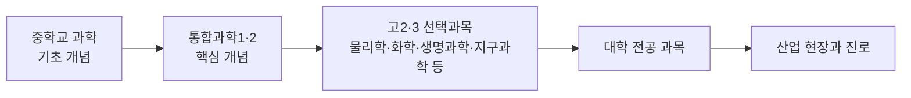

# 부록 2. 중학교–고등학교–대학–산업 연계 지도

> 각 단원의 개념이 **중학교에서 어떻게 시작되어**, 고2·3 선택과목과 **대학 전공**을 거쳐 **실제 산업과 진로**로 이어지는지를 한 장의 표로 정리했다.
> 단원 이름을 누르면 해당 단원으로 이동한다. 중학교 연계 코드는 2022 개정 교육과정 중학교 1~3학년군 성취기준이다.

---

## 통합과학1

### 1단원. 과학의 기초

| 단원 | 🔙 중학교 연계 | 🎓 고2·3 선택과목 | 🎓 대학 과목 | 🏭 산업 사례 | 💼 관련 진로 |
|---|---|---|---|---|---|
| [1-1 시간과 공간](../통합과학1/1단원_과학의_기초/1-1_시간과_공간.md) | [9과02-01], [9과11-02], [9과15-01], [9과15-02], [9과19-01] | 물리학, 역학과 에너지, 행성우주과학, 지구과학 | 일반물리학(상대성 이론), 천문학, 측지학 | 위성 항법(GPS·KPS), 라이다·자율주행, 국가 표준시, 반도체 미세 공정 | 측정 과학자, 위성 항법·측량 엔지니어, 천문학자, 자율주행 센서 엔지니어, 반도체 계측 엔지니어 |
| [1-2 기본량과 단위](../통합과학1/1단원_과학의_기초/1-2_기본량과_단위.md) | [9과19-01], [9과05-02], [9과03-01], [9과14-02], [9과08-01], [9과06-01] | 화학, 물리학, 전자기와 양자, 융합과학 탐구 | 일반물리학·일반화학(차원 분석), 계측공학, 양자 전기 표준(키블 저울) | 항공우주 단위 관리, 제약·의료 용량 단위, 반도체·통신 접두어, 국가 측정 표준 | 측정 표준 연구원, 항공우주 시스템 엔지니어, 약사·임상 연구원, 품질·계측 엔지니어 |
| [1-3 측정과 어림, 측정 표준](../통합과학1/1단원_과학의_기초/1-3_측정과_어림.md) | [9과01-01], [9과08-01], [9과19-02], [9과14-02], [9과03-01] | 융합과학 탐구, 확률과 통계(수학) | 일반물리실험(오차·불확도), 통계학, 계측공학, 품질경영 | 반도체 계측·교정, 법정계량, 국제 상호 인정과 무역, 의료·식품 | 측정·교정 엔지니어, 반도체 계측 엔지니어, 품질 관리 전문가, 표준 전문가, 계량 검사 공무원 |
| [1-4 정보와 신호: 아날로그에서 디지털로](../통합과학1/1단원_과학의_기초/1-4_정보와_신호.md) | [9과10-04], [9과10-03], [9과20-01], [9과14-02], [9과01-02] | 물리학, 전자기와 양자, 융합과학 탐구, 정보 | 신호와 시스템, 디지털 신호 처리, 정보 이론, 통신공학 | 이동 통신·광통신, 지진 조기 경보·재난 문자, 디지털 헬스케어, 메모리 반도체 | 통신 엔지니어, 신호 처리 엔지니어, 데이터 과학자, 의료기기 엔지니어, 정보 보안 전문가 |

### 2단원. 물질과 규칙성

| 단원 | 🔙 중학교 연계 | 🎓 고2·3 선택과목 | 🎓 대학 과목 | 🏭 산업 사례 | 💼 관련 진로 |
|---|---|---|---|---|---|
| [2-1 빛의 스펙트럼과 우주 초기 원소](../통합과학1/2단원_물질과_규칙성/2-1_스펙트럼과_우주_초기_원소.md) | [9과10-03] [9과10-04] [9과11-02] [9과15-01] [9과15-03] [9과07-02] | 물리학, 전자기와 양자, 지구과학, 행성우주과학 | 일반물리학, 양자역학, 천체물리학, 분석화학(기기분석) | 천문 분광 관측(한국천문연구원), 원자 방출·흡수 분광 분석(중금속 검사), 반도체 식각 플라스마 발광 분광, 환경 위성 분광 관측 | 천문학자, 분석화학자, 반도체 공정·장비 엔지니어, 광학 엔지니어, 원격 탐사 연구원 |
| [2-2 별의 진화와 원소의 생성](../통합과학1/2단원_물질과_규칙성/2-2_별의_진화와_원소의_생성.md) | [9과15-02] [9과15-01] [9과07-02] [9과07-01] [9과09-01] [9과11-02] [9과16-03] | 지구과학, 행성우주과학, 지구시스템과학 | 천체물리학, 핵물리학, 지구화학, 행성과학 | 핵융합 연구(KSTAR·ITER), 중이온 가속기, 달 탐사선 감마선 분광기, 소행성 시료 귀환 | 천체물리학자, 핵융합·원자력 연구원, 가속기 과학자, 행성과학자, 지구화학자 |
| [2-3 원소의 주기성과 화학 결합의 이유](../통합과학1/2단원_물질과_규칙성/2-3_원소의_주기성과_화학_결합.md) | [9과11-01] [9과11-02] [9과11-03] [9과11-04] [9과14-01] [9과16-01] | 화학, 전자기와 양자 | 일반화학, 무기화학, 양자화학 | 리튬·나트륨 이온 전지(1족), 염소 소독·표백(17족), 반도체 식각용 할로젠 가스, 18족 공정 가스(Ar 용접, He MRI 냉각, 엑시머 레이저) | 2차전지 연구원, 반도체 공정 엔지니어, 특수 가스·소재 연구원, 수처리 엔지니어, 화학 안전 관리자 |
| [2-4 이온 결합과 공유 결합](../통합과학1/2단원_물질과_규칙성/2-4_이온_결합과_공유_결합.md) | [9과11-01], [9과11-02], [9과11-04], [9과14-01], [9과14-02] | 화학, 물질과 에너지, 화학 반응의 세계 | 일반화학, 물리화학, 재료과학 | 2차전지 전해질의 이온 전도, 소금물 전기 분해 공업, 반도체 초순수 전기 전도도 관리, 생리 식염수·전해질 검사 | 2차전지 연구원, 화학 공정 엔지니어, 수처리 엔지니어, 임상병리사, 재료 분석 연구원 |
| [2-5 지각과 생명체 구성 물질의 규칙성](../통합과학1/2단원_물질과_규칙성/2-5_지각과_생명체_구성_물질.md) | [9과09-02], [9과09-03], [9과11-01], [9과11-02], [9과13-01], [9과21-02] | 지구과학, 지구시스템과학, 생명과학, 세포와 물질대사, 생물의 유전 | 광물학·결정학, 생화학, 분자생물학, 구조생물학, 생물정보학 | 유리·세라믹·시멘트·광섬유(규산염), 바이오의약품·단백질 공학, DNA 분석·유전자 감식 | 세라믹·유리 소재 엔지니어, 지질학자, 바이오의약품 연구원, 단백질 공학자, 법유전학 전문가 |
| [2-6 물질의 전기적 성질과 소재](../통합과학1/2단원_물질과_규칙성/2-6_물질의_전기적_성질.md) | [9과14-01], [9과14-02], [9과14-03], [9과09-02], [9과11-03] | 물리학, 전자기와 양자, 물질과 에너지 | 고체물리학, 반도체공학, 전자재료·재료공학 | 반도체(웨이퍼·도핑·메모리), 디스플레이(OLED·투명 전극), 전선·절연 소재, 초전도(MRI·KSTAR) | 반도체 공정 엔지니어, 소자·회로 설계자, 디스플레이 연구원, 신소재 연구원, 전력 설비 엔지니어 |

### 3단원. 시스템과 상호작용

| 단원 | 🔙 중학교 연계 | 🎓 고2·3 선택과목 | 🎓 대학 과목 | 🏭 산업 사례 | 💼 관련 진로 |
|---|---|---|---|---|---|
| [3-1 지구시스템의 구성과 상호작용](../통합과학1/3단원_시스템과_상호작용/3-1_지구시스템.md) | [9과07-01] [9과07-02] [9과09-01] [9과17-01] [9과18-01] [9과18-03] [9과12-02] | 지구과학, 지구시스템과학, 기후변화와 환경생태, 행성우주과학 | 지구시스템과학, 생지화학, 대기과학·기후학, 해양학 | 기상위성과 수치예보, 조력 발전, 탄소 포집·저장(CCS), 지구관측 위성 빅데이터 | 예보관·기상 연구원, 해양 연구원, 위성 자료 분석가, 기후 컨설턴트, 신재생 에너지 엔지니어 |
| [3-2 판구조론과 지권의 변화](../통합과학1/3단원_시스템과_상호작용/3-2_판구조론과_지권의_변화.md) | [9과09-01] [9과09-03] [9과09-05] [9과22-01] [9과22-02] | 지구과학, 지구시스템과학, 기후변화와 환경생태 | 지진학, 지구물리학, 지질학, 화산학 | 지진 조기경보, 내진·면진·제진 설계, 지열 발전, 화산재와 항공 운항 | 지진·화산 연구원, 구조 엔지니어, 지열·자원 엔지니어, 재난 안전 전문가, 항공 기상 전문가 |
| [3-3 중력과 운동](../통합과학1/3단원_시스템과_상호작용/3-3_중력과_운동.md) | [9과05-02] [9과05-03] [9과19-01] [9과19-02] [9과15-04] | 물리학, 역학과 에너지, 행성우주과학 | 일반물리학, 고전역학, 궤도역학·천체역학 | 위성 궤도 설계(저궤도·정지궤도), 위성 항법(GPS·KPS), 놀이기구 설계·무중력 비행, 스포츠·탄도 | 위성 궤도 설계 엔지니어, 위성 항법 엔지니어, 기계 설계 엔지니어, 스포츠 과학자, 물리학자 |
| [3-4 운동량과 충격량](../통합과학1/3단원_시스템과_상호작용/3-4_운동량과_충격량.md) | [9과05-01] [9과05-03] [9과19-01] [9과19-02] | 물리학, 역학과 에너지 | 일반물리학(운동량 보존, 충격량 적분), 동역학 | 자동차 충돌 안전(크럼플 존·에어백·KNCAP), 스포츠 보호 장비, 포장 공학(낙하 시험), 항공우주(로켓 추진) | 자동차 안전 엔지니어, 스포츠 과학자, 포장 엔지니어, 항공우주 엔지니어 |
| [3-5 생명 시스템과 물질대사 (세포막·효소)](../통합과학1/3단원_시스템과_상호작용/3-5_생명_시스템과_물질대사.md) | [9과02-01], [9과02-02], [9과04-01], [9과13-01], [9과12-01], [9과12-02], [9과13-05], [9과16-06] | 생명과학, 세포와 물질대사 | 세포생물학, 생화학(효소 반응 속도론), 화학공학, 식품공학 | 효소 산업(세제·발효·바이오에탄올), 혈당 측정기, 혈액 투석, 역삼투 정수·해수 담수화, 지질 나노 입자 약물 전달 | 효소·발효 연구원, 의공학 엔지니어, 수처리 엔지니어, 제약 연구원, 임상병리사 |
| [3-6 유전자와 단백질](../통합과학1/3단원_시스템과_상호작용/3-6_유전자와_단백질.md) | [9과02-01], [9과21-02], [9과21-04], [9과02-03] | 생명과학, 생물의 유전, 세포와 물질대사 | 분자생물학, 유전학, 생명공학, 생물정보학 | 재조합 인슐린 등 바이오의약품, mRNA 백신, PCR 분자 진단, 유전자 가위(CRISPR) | 바이오의약품 연구원, 백신·신약 연구원, 분자 진단 연구원, 유전 상담사, 생물정보학자 |

---

## 통합과학2

### 4단원. 변화와 다양성

| 단원 | 🔙 중학교 연계 | 🎓 고2·3 선택과목 | 🎓 대학 과목 | 🏭 산업 사례 | 💼 관련 진로 |
|---|---|---|---|---|---|
| [4-1 지질시대의 환경 변화와 생물다양성](../통합과학2/4단원_변화와_다양성/4-1_지질시대와_생물다양성.md) | [9과09-01], [9과09-03], [9과09-05], [9과02-03] | 지구과학, 지구시스템과학, 생명과학, 기후변화와 환경생태 | 지질학·층서학·고생물학, 지구화학(방사성 연대 측정), 고기후학 | 석유·가스 탐사의 미화석 분석, 지질도 제작, 빙하 코어·해저 퇴적물 고기후 연구, 세계지질공원 보존 | 석유·자원 지질학자, 고생물학자, 지반·지질 조사 기술자, 고기후 과학자, 자연사 박물관 학예사 |
| [4-2 진화와 생물다양성](../통합과학2/4단원_변화와_다양성/4-2_진화와_생물다양성.md) | [9과02-03], [9과02-04], [9과02-05], [9과21-02], [9과21-04] | 생명과학, 생물의 유전, 지구과학, 기후변화와 환경생태 | 진화생물학, 집단유전학, 분자진화학·생물정보학, 보전생물학 | 항생제 내성과 신약 개발, 품종 개량, 종자 은행(스발바르, 백두대간 시드볼트), 유전자원·나고야 의정서, 생태 복원 | 신약·항생제 연구원, 감염 관리 전문가, 식물 육종가·종자 연구원, 생물자원·보전 연구원, 생태 복원 기술자 |
| [4-3 산화와 환원](../통합과학2/4단원_변화와_다양성/4-3_산화와_환원.md) | [9과16-01] [9과16-02] [9과16-03] [9과11-04] [9과12-01] [9과12-02] [9과13-05] | 화학, 화학 반응의 세계, 생명과학, 세포와 물질대사 | 일반화학, 전기화학, 생화학, 부식공학 | 제철(고로·수소환원제철), 2차 전지, 부식 방지(도금·희생 양극), 반도체 산화막·세정 | 금속·제철 엔지니어, 배터리 연구원, 부식 방지 엔지니어, 반도체 공정 엔지니어, 식품공학자 |
| [4-4 산과 염기, 중화 반응](../통합과학2/4단원_변화와_다양성/4-4_산과_염기_중화_반응.md) | [9과11-04] [9과16-01] [9과16-02] [9과16-06] [9과09-02] | 화학, 화학 반응의 세계, 생명과학 | 일반화학, 분석화학, 생화학, 환경공학 | 수처리 pH 조절, 제산제·제약, 배연 탈황·토양 개량, 반도체 세정액과 폐수 중화 | 수처리·환경 엔지니어, 제약 연구원·약사, 토양 연구원, 반도체 공정 엔지니어, 분석화학 연구원 |
| [4-5 물질 변화와 에너지 출입](../통합과학2/4단원_변화와_다양성/4-5_물질_변화와_에너지_출입.md) | [9과03-01] [9과03-03] [9과04-04] [9과16-06] [9과12-02] [9과17-03] | 물질과 에너지, 역학과 에너지, 지구과학, 세포와 물질대사 | 일반화학, 물리화학(열역학), 대기과학, 생체 에너지학 | 손난로·발열 도시락·냉각 팩, 냉매·히트 펌프, 석회·시멘트, 빙축열·상변화 물질(PCM) | 화학공학자, 냉동공조 엔지니어, 소재 연구원, 기상 연구원, 식품 물류 전문가 |

### 5단원. 환경과 에너지

| 단원 | 🔙 중학교 연계 | 🎓 고2·3 선택과목 | 🎓 대학 과목 | 🏭 산업 사례 | 💼 관련 진로 |
|---|---|---|---|---|---|
| [5-1 생태계 구성 요소와 상호 관계](../통합과학2/5단원_환경과_에너지/5-1_생태계_구성_요소.md) | [9과02-02], [9과02-03], [9과02-05], [9과12-01], [9과12-02] | 생명과학, 세포와 물질대사, 기후변화와 환경생태 | 일반생물학, 생태학, 식물생리학(광주기) | 생태 조사·환경영향평가(eDNA), 스마트팜·식물 공장, 생물 계절 관측·농업 기상, 생태 복원 | 생태 조사원·환경영향평가 전문가, 스마트팜 엔지니어, 산림·생태 복원 기술자, 농업 기상 연구원 |
| [5-2 생태계 평형](../통합과학2/5단원_환경과_에너지/5-2_생태계_평형.md) | [9과12-02], [9과12-03], [9과13-05], [9과02-03], [9과02-05] | 생명과학, 기후변화와 환경생태, 세포와 물질대사 | 생태학, 개체군생태학·수리생태학, 보전생물학, 미생물학(질소 순환) | 생물학적 방제(천적), 수산 자원 관리(TAC), 멸종위기종 복원·생태 통로, 외래종 조기 발견 | 생태학자·보전생물학자, 친환경 농업 연구원, 수산 자원 연구원, 생태 데이터 분석가 |
| [5-3 지구온난화와 기후변화](../통합과학2/5단원_환경과_에너지/5-3_지구온난화와_기후변화.md) | [9과17-01], [9과17-02], [9과18-03], [9과03-02], [9과22-01] | 지구과학, 지구시스템과학, 기후변화와 환경생태, 역학과 에너지 | 대기과학, 기후역학, 해양학(ENSO), 환경공학, 기후경제학 | 기후 모델링·기상 예보, CCUS, 기후 리스크 금융·배출권 거래제, 사막화 방지·조림 | 기상 예보관·기후 과학자, CCUS 엔지니어, 기후 리스크 분석가, 온실가스 관리 전문가, 국제 개발 협력 전문가 |
| [5-4 태양 에너지와 에너지 전환](../통합과학2/5단원_환경과_에너지/5-4_태양_에너지와_에너지_전환.md) | [9과07-02], [9과03-02], [9과12-01], [9과17-02], [9과18-03], [9과04-04], [9과19-04] | 전자기와 양자, 물리학, 지구과학, 세포와 물질대사, 행성우주과학 | 현대물리(E=mc²), 천체물리학, 대기과학, 플라스마 물리 | 핵융합 연구(KSTAR·ITER), 우주 기상 예보, 인공 광합성·바이오 에너지, 기상·기후 수치 예보 | 핵융합 연구원, 우주 기상 연구원, 기상·기후 예보관, 바이오 에너지 연구원 |
| [5-5 발전기와 전기 에너지](../통합과학2/5단원_환경과_에너지/5-5_발전기와_전기_에너지.md) | [9과14-04], [9과14-02], [9과14-03], [9과19-04], [9과16-06], [9과04-04] | 물리학, 전자기와 양자, 역학과 에너지 | 전자기학(패러데이·렌츠 법칙), 전기기기, 전력공학(송전 손실·HVDC), 원자력공학 | 발전기·터빈 제조, 초고압 송전·HVDC·스마트 그리드, 원전 운영·해체, 회생 제동·무선 충전 | 발전 설비 엔지니어, 전력 계통 엔지니어, 원자력 엔지니어, 전기차 구동계 엔지니어, 에너지 정책 연구원 |
| [5-6 에너지 효율과 신재생 에너지](../통합과학2/5단원_환경과_에너지/5-6_에너지_효율과_신재생_에너지.md) | [9과19-04], [9과14-03], [9과03-01], [9과16-06], [9과17-01], [9과01-03] | 물리학, 역학과 에너지, 화학 반응의 세계, 기후변화와 환경생태 | 열역학(카르노 효율), 신재생에너지공학, 반도체 물리(태양 전지), 전기화학(연료 전지) | 태양광 셀·모듈, 해상풍력, ESS·스마트 그리드, 에너지소비효율등급제, 수소 경제 | 태양광 연구원, 풍력 엔지니어, 전력·ESS 엔지니어, 에너지 효율 진단사, 수소·연료 전지 연구원, 탄소중립 정책 전문가 |

### 6단원. 과학과 미래 사회

| 단원 | 🔙 중학교 연계 | 🎓 고2·3 선택과목 | 🎓 대학 과목 | 🏭 산업 사례 | 💼 관련 진로 |
|---|---|---|---|---|---|
| [6-1 감염병과 과학의 유용성](../통합과학2/6단원_과학과_미래_사회/6-1_감염병과_과학의_유용성.md) | [9과22-01] [9과22-02] [9과01-01] [9과02-01] [9과21-02] | 생명과학, 생물의 유전, 세포와 물질대사, 확률과 통계 | 역학(SIR 모형), 진단 통계(민감도·특이도), 분자생물학·면역학 | 체외 진단 기기(PCR·신속항원), 백신·바이오의약품, 하수 감시, 원헬스 | 임상병리사, 진단 기기 연구원, 역학 조사관, 백신 연구원, 수의사 |
| [6-2 빅데이터와 과학기술사회](../통합과학2/6단원_과학과_미래_사회/6-2_빅데이터와_과학기술사회.md) | [9과22-01] [9과09-05] [9과17-04] [9과01-02] [9과19-01] | 데이터 과학, 인공지능 기초, 확률과 통계, 지구과학, 생물의 유전 | 데이터과학·통계학, 생물정보학, 대기과학(수치예보), 프라이버시 기술 | 기상 예보 산업, 바이오헬스 데이터, 스마트 교통, 예지 정비·전력 수요 예측 | 데이터 과학자, 생물정보학자, 기상 예보관, 정보보호 전문가 |
| [6-3 인공지능 로봇과 사물인터넷](../통합과학2/6단원_과학과_미래_사회/6-3_인공지능_로봇과_사물인터넷.md) | [9과01-02] [9과20-01] [9과20-02] [9과14-04] [9과23-01] | 정보, 인공지능 기초, 인공지능 수학, 물리학, 생명과학 | 기계학습, 로봇공학·제어공학, 임베디드 시스템 | 스마트 제조, 스마트팜, 의료·돌봄 로봇, 재난 로봇, 스마트 그리드 | AI 엔지니어, 로봇 공학자, IoT·임베디드 개발자, 스마트 제조 엔지니어 |
| [6-4 과학기술과 윤리](../통합과학2/6단원_과학과_미래_사회/6-4_과학기술과_윤리.md) | [9과01-03] [9과01-02] [9과21-05] [9과22-01] [9과02-05] | 과학의 역사와 문화, 융합과학 탐구, 생명과학, 기후변화와 환경생태, 인공지능 기초 | 생명윤리, 과학기술학(STS), 위험 분석, AI 윤리 | 연구윤리 심의(IRB), AI 신뢰성 검증, 규제 과학, 기술 영향 평가·과학 소통 | 연구윤리 전문가, 생명윤리 연구자, AI 윤리 전문가, 과학 정책 연구원, 과학 저널리스트 |

---

## 진로별로 찾아보기

관심 있는 분야와 관련된 단원을 모아 보았다.

| 관심 분야 | 관련 단원 |
|---|---|
| 반도체·전자 | [1-4 정보와 신호: 아날로그에서 디지털로](../통합과학1/1단원_과학의_기초/1-4_정보와_신호.md) [2-1 빛의 스펙트럼과 우주 초기 원소](../통합과학1/2단원_물질과_규칙성/2-1_스펙트럼과_우주_초기_원소.md) [2-3 원소의 주기성과 화학 결합의 이유](../통합과학1/2단원_물질과_규칙성/2-3_원소의_주기성과_화학_결합.md) [2-4 이온 결합과 공유 결합](../통합과학1/2단원_물질과_규칙성/2-4_이온_결합과_공유_결합.md) [2-6 물질의 전기적 성질과 소재](../통합과학1/2단원_물질과_규칙성/2-6_물질의_전기적_성질.md) [4-3 산화와 환원](../통합과학2/4단원_변화와_다양성/4-3_산화와_환원.md) |
| 2차전지·에너지 소재 | [2-3 원소의 주기성과 화학 결합의 이유](../통합과학1/2단원_물질과_규칙성/2-3_원소의_주기성과_화학_결합.md) [2-4 이온 결합과 공유 결합](../통합과학1/2단원_물질과_규칙성/2-4_이온_결합과_공유_결합.md) [4-3 산화와 환원](../통합과학2/4단원_변화와_다양성/4-3_산화와_환원.md) [5-6 에너지 효율과 신재생 에너지](../통합과학2/5단원_환경과_에너지/5-6_에너지_효율과_신재생_에너지.md) |
| 자동차·기계·로봇 | [3-3 중력과 운동](../통합과학1/3단원_시스템과_상호작용/3-3_중력과_운동.md) [3-4 운동량과 충격량](../통합과학1/3단원_시스템과_상호작용/3-4_운동량과_충격량.md) [5-5 발전기와 전기 에너지](../통합과학2/5단원_환경과_에너지/5-5_발전기와_전기_에너지.md) [6-3 인공지능 로봇과 사물인터넷](../통합과학2/6단원_과학과_미래_사회/6-3_인공지능_로봇과_사물인터넷.md) |
| 항공우주·천문 | [1-1 시간과 공간](../통합과학1/1단원_과학의_기초/1-1_시간과_공간.md) [2-1 빛의 스펙트럼과 우주 초기 원소](../통합과학1/2단원_물질과_규칙성/2-1_스펙트럼과_우주_초기_원소.md) [2-2 별의 진화와 원소의 생성](../통합과학1/2단원_물질과_규칙성/2-2_별의_진화와_원소의_생성.md) [3-3 중력과 운동](../통합과학1/3단원_시스템과_상호작용/3-3_중력과_운동.md) [3-4 운동량과 충격량](../통합과학1/3단원_시스템과_상호작용/3-4_운동량과_충격량.md) |
| 바이오·의약 | [2-5 지각과 생명체 구성 물질의 규칙성](../통합과학1/2단원_물질과_규칙성/2-5_지각과_생명체_구성_물질.md) [3-5 생명 시스템과 물질대사 (세포막·효소)](../통합과학1/3단원_시스템과_상호작용/3-5_생명_시스템과_물질대사.md) [3-6 유전자와 단백질](../통합과학1/3단원_시스템과_상호작용/3-6_유전자와_단백질.md) [4-2 진화와 생물다양성](../통합과학2/4단원_변화와_다양성/4-2_진화와_생물다양성.md) [6-1 감염병과 과학의 유용성](../통합과학2/6단원_과학과_미래_사회/6-1_감염병과_과학의_유용성.md) |
| 의료·보건 | [1-2 기본량과 단위](../통합과학1/1단원_과학의_기초/1-2_기본량과_단위.md) [2-4 이온 결합과 공유 결합](../통합과학1/2단원_물질과_규칙성/2-4_이온_결합과_공유_결합.md) [3-5 생명 시스템과 물질대사 (세포막·효소)](../통합과학1/3단원_시스템과_상호작용/3-5_생명_시스템과_물질대사.md) [6-1 감염병과 과학의 유용성](../통합과학2/6단원_과학과_미래_사회/6-1_감염병과_과학의_유용성.md) |
| 화학·소재 공정 | [2-4 이온 결합과 공유 결합](../통합과학1/2단원_물질과_규칙성/2-4_이온_결합과_공유_결합.md) [2-5 지각과 생명체 구성 물질의 규칙성](../통합과학1/2단원_물질과_규칙성/2-5_지각과_생명체_구성_물질.md) [4-3 산화와 환원](../통합과학2/4단원_변화와_다양성/4-3_산화와_환원.md) [4-4 산과 염기, 중화 반응](../통합과학2/4단원_변화와_다양성/4-4_산과_염기_중화_반응.md) [4-5 물질 변화와 에너지 출입](../통합과학2/4단원_변화와_다양성/4-5_물질_변화와_에너지_출입.md) |
| 에너지·전력 | [2-2 별의 진화와 원소의 생성](../통합과학1/2단원_물질과_규칙성/2-2_별의_진화와_원소의_생성.md) [5-4 태양 에너지와 에너지 전환](../통합과학2/5단원_환경과_에너지/5-4_태양_에너지와_에너지_전환.md) [5-5 발전기와 전기 에너지](../통합과학2/5단원_환경과_에너지/5-5_발전기와_전기_에너지.md) [5-6 에너지 효율과 신재생 에너지](../통합과학2/5단원_환경과_에너지/5-6_에너지_효율과_신재생_에너지.md) |
| 환경·기후 | [3-1 지구시스템의 구성과 상호작용](../통합과학1/3단원_시스템과_상호작용/3-1_지구시스템.md) [4-1 지질시대의 환경 변화와 생물다양성](../통합과학2/4단원_변화와_다양성/4-1_지질시대와_생물다양성.md) [4-4 산과 염기, 중화 반응](../통합과학2/4단원_변화와_다양성/4-4_산과_염기_중화_반응.md) [5-1 생태계 구성 요소와 상호 관계](../통합과학2/5단원_환경과_에너지/5-1_생태계_구성_요소.md) [5-2 생태계 평형](../통합과학2/5단원_환경과_에너지/5-2_생태계_평형.md) [5-3 지구온난화와 기후변화](../통합과학2/5단원_환경과_에너지/5-3_지구온난화와_기후변화.md) |
| 지구·자원·재난 안전 | [3-1 지구시스템의 구성과 상호작용](../통합과학1/3단원_시스템과_상호작용/3-1_지구시스템.md) [3-2 판구조론과 지권의 변화](../통합과학1/3단원_시스템과_상호작용/3-2_판구조론과_지권의_변화.md) [4-1 지질시대의 환경 변화와 생물다양성](../통합과학2/4단원_변화와_다양성/4-1_지질시대와_생물다양성.md) [6-2 빅데이터와 과학기술사회](../통합과학2/6단원_과학과_미래_사회/6-2_빅데이터와_과학기술사회.md) |
| 생태·농업·식품 | [3-5 생명 시스템과 물질대사 (세포막·효소)](../통합과학1/3단원_시스템과_상호작용/3-5_생명_시스템과_물질대사.md) [4-2 진화와 생물다양성](../통합과학2/4단원_변화와_다양성/4-2_진화와_생물다양성.md) [4-5 물질 변화와 에너지 출입](../통합과학2/4단원_변화와_다양성/4-5_물질_변화와_에너지_출입.md) [5-1 생태계 구성 요소와 상호 관계](../통합과학2/5단원_환경과_에너지/5-1_생태계_구성_요소.md) [5-2 생태계 평형](../통합과학2/5단원_환경과_에너지/5-2_생태계_평형.md) |
| 데이터·AI·정보통신 | [1-4 정보와 신호: 아날로그에서 디지털로](../통합과학1/1단원_과학의_기초/1-4_정보와_신호.md) [6-2 빅데이터와 과학기술사회](../통합과학2/6단원_과학과_미래_사회/6-2_빅데이터와_과학기술사회.md) [6-3 인공지능 로봇과 사물인터넷](../통합과학2/6단원_과학과_미래_사회/6-3_인공지능_로봇과_사물인터넷.md) [6-4 과학기술과 윤리](../통합과학2/6단원_과학과_미래_사회/6-4_과학기술과_윤리.md) |
| 측정·품질·표준 | [1-1 시간과 공간](../통합과학1/1단원_과학의_기초/1-1_시간과_공간.md) [1-2 기본량과 단위](../통합과학1/1단원_과학의_기초/1-2_기본량과_단위.md) [1-3 측정과 어림, 측정 표준](../통합과학1/1단원_과학의_기초/1-3_측정과_어림.md) |
| 과학 정책·윤리·소통 | [6-1 감염병과 과학의 유용성](../통합과학2/6단원_과학과_미래_사회/6-1_감염병과_과학의_유용성.md) [6-4 과학기술과 윤리](../통합과학2/6단원_과학과_미래_사회/6-4_과학기술과_윤리.md) |
