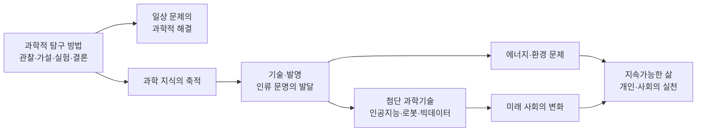

# 중1-1. 과학과 인류의 지속가능한 삶 — 묻고, 실험하고, 함께 미래를 만드는 과학
<!-- next: m3-07, m3-08, 5-6, 6-3, 6-4 -->

> [!NOTE]
> **성취기준**
> - **[9과01-01]** 과학적 탐구 방법을 이해하고, 일상생활의 문제에 대한 과학적 해결 방안을 제안할 수 있다.
> - **[9과01-02]** 과학의 발전이 인류 문명에 미친 영향을 이해하고, 인공지능 등 첨단 과학기술이 가져올 미래 사회의 변화를 조사하여 발표할 수 있다.
> - **[9과01-03]** 인류의 지속가능한 삶을 위한 과학기술의 중요성과 역할에 대해 토의하고, 개인과 사회 차원의 활동 방안을 찾아 실천할 수 있다.

**학습 목표**

1. 관찰·문제 인식·가설 설정·탐구 설계·수행·자료 해석·결론 도출로 이어지는 과학적 탐구 과정을 설명할 수 있다.
2. 조작 변인, 통제 변인, 종속 변인을 구별하여 공정한 실험을 설계하고, 일상생활의 문제에 대한 해결 방안을 제안할 수 있다.
3. 과학의 발전이 농업, 의학, 교통, 통신 등 인류 문명에 미친 영향을 사례로 설명할 수 있다.
4. 인공지능 등 첨단 과학기술의 활용 사례를 조사하고, 미래 사회의 변화를 예측하여 발표할 수 있다.
5. 지속가능한 삶의 의미를 알고, 과학기술의 역할과 개인·사회 차원의 실천 방안을 토의하고 실천할 수 있다.

**이 단원의 학습 사다리**

| 단계 | 무엇을 하나? |
|---|---|
| STEP 1. 이전 학습 다시 보기 | 초등학교 「기후변화와 우리 생활」, 「자원과 에너지」와 탐구 경험을 꺼내 본다 |
| STEP 2. 기초 다지기 | 관찰과 추리, 측정, 표와 그래프, 사실과 의견을 구별한다 |
| STEP 3. 핵심 개념 | 탐구 과정 → 변인 통제 → 생활 문제 해결 → 과학과 문명 → 첨단 기술과 미래 → 지속가능한 삶 |
| STEP 4. 오개념 바로잡기 | "실험 한 번이면 결론이 난다?" 같은 착각을 바로잡는다 |
| STEP 5. 다음 단계로 | 중3 「과학과 나의 미래」, 통합과학 「과학기술과 윤리」로 이어지는 길을 본다 |
| STEP 6. 생활·산업·진로 | 적정기술, 스마트 농업, 신재생 에너지, 과학 커뮤니케이터 |

---

## 🗺️ 단원 들어가기

아침에 일어나 스마트폰 알람을 끄고, 정수기 물을 마시고, 버스를 타고 학교에 온다. 이 짧은 아침 동안 우리는 몇 가지 과학기술의 도움을 받았을까? 알람 시계를 움직이는 반도체, 물을 깨끗하게 거르는 필터, 버스를 움직이는 엔진이나 전동기, 버스 도착 시간을 알려 주는 위치 정보 서비스까지, 모두 누군가가 **궁금해하고, 실험하고, 확인한 결과**이다.

그런데 과학기술은 좋은 것만 가져왔을까? 화석 연료를 태워 편리해진 만큼 공기가 더러워지고 지구가 더워졌다. 플라스틱은 가볍고 튼튼하지만 바다를 떠돈다. 그렇다면 문제를 일으킨 과학기술로 문제를 다시 해결할 수는 없을까?

이 단원에서는 과학자가 문제를 푸는 방법(**과학적 탐구**)을 배우고, 과학이 인류 문명을 어떻게 바꾸어 왔는지 살펴본 뒤, **지금의 우리와 미래 세대가 함께 잘 사는 방법**을 과학으로 찾아본다. 이 단원은 앞으로 배울 모든 과학 단원의 '사용 설명서'와 같다.

---

## STEP 1. 🔙 이전 학습 다시 보기

### 연계표

| 이전 단원·성취기준 | 그때 배운 것 | 이 단원에서 확장되는 것 |
|---|---|---|
| 초등학교 3~4학년군 「기후변화와 우리 생활」 | 날씨와 기후는 다르며, 기후가 변하면 우리 생활과 생물에 영향을 준다. 생활 속에서 탄소를 줄이는 실천을 해 본다 | 기후변화를 **인류가 함께 풀어야 할 과학 관련 쟁점**으로 보고, 과학기술의 역할과 개인·사회의 실천 방안을 토의한다 |
| 초등학교 5~6학년군 「자원과 에너지」 | 에너지는 여러 형태로 있고 다른 형태로 바뀐다. 자원과 에너지는 한정되어 있어 아껴 써야 한다 | 에너지 문제를 해결하는 **과학기술(신재생 에너지, 효율 향상)** 과 지속가능한 발전의 의미를 배운다 |
| 초등학교 과학 시간의 여러 실험 | 예상하고, 관찰하고, 결과를 기록하는 경험을 했다. 실험할 때 "같게 할 것"과 "다르게 할 것"이 있었다 | 이 경험을 **가설 설정, 변인 통제, 자료 해석**이라는 과학적 탐구 방법으로 정리한다 |

### 준비 운동 (사전 진단)

**Q1.** 다음 중 '관찰'에 해당하는 것과 '추리(생각해서 짐작한 것)'에 해당하는 것을 구별하시오.
ㄱ. 운동장 바닥이 젖어 있다. ㄴ. 밤사이 비가 왔을 것이다. ㄷ. 하늘에 회색 구름이 많다.

**Q2.** 식물이 자라는 데 햇빛이 필요한지 알아보려고 한다. 두 화분에서 **다르게 해야 할 것**과 **같게 해야 할 것**을 각각 하나씩 쓰시오.

**Q3.** 에너지를 아끼는 생활 습관을 두 가지 쓰시오.

**Q4.** "기후변화는 먼 나라의 일이라 우리 생활과는 관계없다." 이 말에 동의하는가? 이유를 한 문장으로 쓰시오.

정답 및 해설

**Q1.** 관찰: ㄱ, ㄷ / 추리: ㄴ — 눈으로 보고 확인한 것은 관찰이다. "비가 왔을 것이다"는 젖은 바닥을 보고 생각해 낸 것이므로 추리이다. 누군가 물청소를 했을 수도 있다.

**Q2.** 다르게 할 것: 햇빛(한 화분은 밝은 곳, 다른 화분은 어두운 곳). 같게 할 것: 물의 양, 흙의 종류, 화분 크기, 식물의 종류와 크기, 온도 등.

**Q3.** 예: 쓰지 않는 전등 끄기, 플러그 뽑기, 가까운 거리는 걷거나 자전거 타기, 냉난방 온도 적절히 맞추기 등.

**Q4.** 동의하지 않는다. 예: 기후가 변하면 폭염·폭우가 잦아지고 농작물 수확과 생물의 분포가 바뀌어 우리 생활에도 직접 영향을 준다.

---

## STEP 2. 🧱 기초 다지기

### ① 관찰과 추리는 다르다

- **관찰(observation)**: 감각 기관이나 도구(돋보기, 온도계, 저울 등)로 대상의 특징을 있는 그대로 알아내는 것이다.
- **추리(inference)**: 관찰한 사실과 이미 알고 있는 지식을 바탕으로 보이지 않는 원인이나 결과를 짐작하는 것이다.

| 관찰 | 추리 |
|---|---|
| 우유 팩이 부풀어 있다 | 우유가 상했을 것이다 |
| 화분의 잎이 아래로 처졌다 | 물이 부족한 것 같다 |
| 교실 창문 안쪽에 물방울이 맺혔다 | 바깥이 교실보다 춥다 |

> [!TIP]
> 💡 **비유** — 관찰은 "CCTV 화면", 추리는 "탐정의 추리"이다. CCTV는 본 것만 보여 주고, 탐정은 단서를 모아 범인을 짐작한다. 탐정의 추리가 맞는지는 **새로운 증거(실험)** 로 확인해야 한다.

### ② 측정과 단위: 숫자로 말하기

"물이 꽤 뜨겁다"보다 "물의 온도가 $60\ ^\circ\mathrm{C}$이다"가 훨씬 정확하다. 과학에서는 길이(m), 질량(kg), 시간(s), 온도(°C) 같은 **단위**를 붙여 측정값을 나타낸다. 같은 것을 여러 번 측정하면 값이 조금씩 다를 수 있으므로 **여러 번 측정하여 평균**을 구하는 것이 좋다.

예를 들어 공이 바닥에 닿을 때까지 걸린 시간을 세 번 재었더니 1.2초, 1.4초, 1.3초였다면 평균은 $(1.2+1.4+1.3)\div 3 = 1.3$초이다.

### ③ 표와 그래프로 정리하기

측정한 결과는 **표**로 정리하고, 변화의 경향을 한눈에 보려면 **그래프**로 나타낸다.

| 그래프 종류 | 언제 쓰나? | 예 |
|---|---|---|
| 꺾은선 그래프 | 시간에 따라 값이 연속적으로 변할 때 | 하루 동안의 기온 변화 |
| 막대그래프 | 여러 항목의 크기를 비교할 때 | 반별 재활용 쓰레기 양 |
| 원그래프 | 전체에서 각 부분이 차지하는 비율을 볼 때 | 우리 집 쓰레기 종류별 비율 |

### ④ 사실과 의견을 구별하기

- **사실**: 관찰이나 측정으로 확인할 수 있는 것 (예: "이 지역의 여름 평균 기온이 10년 전보다 올랐다.")
- **의견**: 사람의 생각이나 판단 (예: "에어컨 사용을 법으로 금지해야 한다.")

과학 관련 문제를 토의할 때에는 **사실(근거)을 바탕으로 의견을 말하는 것**이 중요하다. 근거 없는 의견은 설득력이 약하다.

---

## STEP 3. 📘 핵심 개념

### ① 과학적 탐구란 무엇인가 — 탐구의 과정

**과학적 탐구(scientific inquiry)** 는 자연 현상에 대한 궁금증을 증거를 바탕으로 해결해 가는 과정이다. 탐구의 순서는 상황에 따라 조금씩 달라지지만, 대표적인 흐름은 다음과 같다.

| 단계 | 하는 일 | 예: "왜 우리 반 화분만 시들까?" |
|---|---|---|
| 관찰·문제 인식 | 현상을 보고 궁금한 점을 탐구할 수 있는 질문으로 만든다 | 창가 화분은 시들고 복도 쪽 화분은 싱싱하다. "햇빛이 너무 강하면 식물이 시들까?" |
| **가설(hypothesis)** 설정 | 문제에 대한 잠정적인 답을 세운다. 실험으로 확인할 수 있어야 한다 | "햇빛을 오래 받은 화분은 흙이 빨리 말라 시들 것이다." |
| 탐구 설계 | 무엇을 바꾸고, 무엇을 같게 하고, 무엇을 측정할지 정한다 | 같은 식물 두 화분을 창가와 그늘에 두고, 물 주는 양은 같게 하며, 3일마다 흙의 수분과 잎 상태를 기록 |
| 탐구 수행 | 계획대로 실험·관찰하고 결과를 기록한다 | 2주 동안 관찰 일지 작성 |
| 자료 해석 | 표·그래프로 정리하고 규칙을 찾는다 | 창가 화분의 흙이 더 빨리 말랐고 잎이 먼저 처졌다 |
| 결론 도출 | 가설이 맞는지 판단한다. 틀리면 가설을 고쳐 다시 탐구한다 | 가설이 지지되었다. "창가 화분은 물을 더 자주 주자." |
| 의사소통 | 결과를 발표하고 다른 사람의 의견을 듣는다 | 과학 시간에 발표, 다른 반도 같은 결과가 나오는지 확인 |

> [!IMPORTANT]
> 가설은 "정답"이 아니라 **실험으로 확인해 볼 수 있는 잠정적인 답**이다. 실험 결과가 가설과 다르게 나와도 실패가 아니다. 그 결과가 새로운 가설을 세우는 출발점이 된다.

#### 두 가지 탐구 방법

| 구분 | 귀납적 탐구 | 연역적 탐구 (가설 검증) |
|---|---|---|
| 출발점 | 여러 번의 관찰 | 문제와 가설 |
| 과정 | 많은 사례를 관찰하고 공통점(규칙)을 찾는다 | 가설을 세우고 실험으로 맞는지 확인한다 |
| 예 | 여러 지역의 새를 관찰해 "씨앗을 먹는 새는 부리가 짧고 굵다"는 규칙을 찾는다 | "소금물에서는 달걀이 뜰 것이다"라는 가설을 세우고 농도를 바꾸어 실험한다 |

#### 과학사 속 탐구 — 플레밍과 푸른곰팡이

1928년 영국의 과학자 플레밍은 세균을 기르던 접시에 우연히 푸른곰팡이가 자란 것을 발견했다. 그런데 곰팡이 주변에만 세균이 자라지 않았다(**관찰**). 플레밍은 "곰팡이가 세균을 죽이는 물질을 만드는 것은 아닐까?"라고 생각했고(**가설**), 곰팡이를 기른 액체로 세균을 처리해 보는 **실험**을 하였다. 이 물질이 **페니실린**이며, 이후 다른 과학자들이 대량 생산 방법을 개발하면서 수많은 생명을 구하는 항생제가 되었다.

이 이야기는 **우연한 관찰도 준비된 탐구자에게는 큰 발견이 된다**는 것과, 과학 지식이 여러 사람의 협력으로 완성된다는 것을 보여 준다.

#### 예제 1

다음은 민지의 탐구 과정이다. ㉠~㉣이 탐구 과정의 어느 단계인지 쓰시오.

㉠ 겨울에 패딩 점퍼를 입으면 따뜻한 것을 보고, "공기층이 많은 옷이 열을 덜 빼앗길까?" 하고 궁금해졌다.
㉡ "공기층이 두꺼운 천으로 감싼 물병은 물이 천천히 식을 것이다."라고 생각했다.
㉢ 같은 온도의 물을 담은 물병 세 개를 얇은 천, 두꺼운 솜, 아무것도 없는 상태로 두고 20분 뒤 온도를 쟀다.
㉣ 두꺼운 솜으로 감싼 물병의 온도가 가장 적게 내려갔으므로 생각이 맞았다고 판단했다.

**풀이**
㉠ 관찰·문제 인식, ㉡ 가설 설정, ㉢ 탐구 설계와 수행, ㉣ 자료 해석과 결론 도출

> [!TIP]
> 💡 **요령** — 가설 문장은 "~하면 ~할 것이다" 꼴로 쓰면 무엇을 바꾸고(앞부분) 무엇을 측정할지(뒷부분)가 저절로 드러난다.

### ② 공정한 실험의 비밀 — 변인 통제

실험 결과에 영향을 줄 수 있는 요인을 **변인(variable)** 이라고 한다.

| 변인 | 뜻 | 예: "물의 온도가 높을수록 설탕이 빨리 녹을까?" |
|---|---|---|
| **조작 변인** | 실험에서 일부러 다르게 하는 변인 | 물의 온도 (10 °C, 30 °C, 50 °C) |
| **통제 변인** | 결과에 영향을 줄 수 있어 같게 유지하는 변인 | 물의 양, 설탕의 양과 알갱이 크기, 젓는 방법과 속도, 컵의 종류 |
| **종속 변인** | 조작 변인 때문에 달라지는 결과로, 측정하는 값 | 설탕이 다 녹는 데 걸린 시간 |

조작 변인 이외의 조건을 모두 같게 하는 것을 **변인 통제**라고 한다. 변인을 통제해야 결과의 차이가 **오직 조작 변인 때문**이라고 말할 수 있다.

<!-- fig:m1-01-variables -->

> [!TIP]
> 💡 **비유** — 달리기 시합에서 한 사람은 내리막길, 다른 사람은 오르막길을 달린다면 누가 더 빠른지 알 수 없다. 공정한 시합을 하려면 **길(통제 변인)** 을 같게 하고 **달리는 사람(조작 변인)** 만 달라야 한다.

#### 대조 실험

조작 변인을 처리한 집단(**실험군**)과 처리하지 않은 집단(**대조군**)을 함께 두고 비교하는 실험을 **대조 실험**이라고 한다. 예를 들어 새 비료의 효과를 알아보려면 비료를 준 화분(실험군)과 주지 않은 화분(대조군)을 같은 조건에서 비교해야 한다.

#### 예제 2

준호는 "운동화 바닥의 무늬가 깊을수록 덜 미끄러질 것이다."라는 가설을 세웠다. 실험을 설계할 때 (1) 조작 변인, (2) 종속 변인, (3) 통제 변인 두 가지를 쓰시오.

**풀이**
(1) 조작 변인: 운동화 바닥 무늬의 깊이
(2) 종속 변인: 미끄러지는 정도 (예: 경사판을 기울였을 때 운동화가 미끄러지기 시작하는 각도, 또는 운동화를 끌 때 필요한 힘)
(3) 통제 변인: 운동화의 질량, 바닥면의 재질, 경사판의 재질, 운동화 속에 넣은 추의 무게, 측정 방법 등

#### 반복 실험과 많은 표본

실험은 한 번만 하면 우연에 따라 결과가 달라질 수 있다. 그래서 **여러 번 반복**하거나 **표본을 많이** 사용하여 평균을 구한다.

#### 예제 3

물의 온도에 따른 설탕이 녹는 시간을 세 번씩 측정하였다.

| 물의 온도 | 1회 | 2회 | 3회 |
|---|---|---|---|
| 10 °C | 62초 | 58초 | 60초 |
| 30 °C | 41초 | 39초 | 43초 |
| 50 °C | 22초 | 25초 | 19초 |

(1) 각 온도에서 평균 시간을 구하시오. (2) 이 실험의 결론을 쓰시오.

**풀이**
(1) 10 °C: $(62+58+60)\div3 = 60$초, 30 °C: $(41+39+43)\div3 = 41$초, 50 °C: $(22+25+19)\div3 = 22$초
(2) 물의 온도가 높을수록 설탕이 녹는 데 걸리는 시간이 짧다. 즉 설탕이 더 빨리 녹는다.

### ③ 일상생활의 문제를 과학으로 해결하기

과학적 탐구 방법은 실험실에서만 쓰는 것이 아니다. 생활 속 불편함을 **탐구할 수 있는 문제**로 바꾸면 과학적으로 해결 방안을 찾을 수 있다.

| 생활 속 불편함 | 탐구 문제로 바꾸기 | 해결 방안 예 |
|---|---|---|
| 겨울에 안경에 김이 서린다 | 안경 렌즈에 무엇을 바르면 김이 덜 서릴까? | 주방 세제, 비누, 전용 김 서림 방지제 등을 바른 렌즈를 비교하여 효과가 좋은 방법 찾기 |
| 급식실 음식물 쓰레기가 많다 | 어떤 반찬이 가장 많이 남을까? 배식량을 바꾸면 줄어들까? | 반찬별 남은 양을 일주일간 측정하고 결과를 영양 선생님과 공유 |
| 교실이 너무 건조하다 | 젖은 수건이나 화분이 교실 습도를 높일까? | 습도계로 조건별 습도 변화를 측정 |
| 자전거 바퀴에서 소리가 난다 | 기름을 어디에 칠하면 소리가 줄어들까? | 부위별로 하나씩 기름칠하고 소리를 비교 |

#### 문제 해결의 흐름

1. **문제 정의**: 무엇이 불편한지 구체적으로 쓴다.
2. **원인 추리**: 그 원인을 여러 가지로 생각해 본다.
3. **가설과 실험**: 원인 하나씩 확인하는 실험을 설계한다(변인 통제).
4. **해결 방안 제안**: 결과를 근거로 방안을 제안한다.
5. **평가와 개선**: 실제로 적용해 보고, 효과가 부족하면 다시 고친다.

> [!NOTE]
> 과학 탐구는 하루 만에 끝나지 않는 경우가 많다. 실제 과학자들도 하나의 문제를 몇 달, 몇 년 동안 탐구한다. 이 단원의 탐구 활동처럼 **스스로 발견한 문제를 일정 기간 동안 꾸준히 탐구**해 보는 경험이 중요하다.

### ④ 과학의 발전이 인류 문명에 미친 영향

과학적 탐구로 얻은 **과학 지식**은 새로운 **기술**과 **발명품**을 낳았고, 기술은 다시 과학 연구를 돕는 도구가 되었다. 이 순환이 인류 문명을 크게 바꾸었다.

| 분야 | 과학과 기술의 발전 | 인류 문명에 미친 영향 |
|---|---|---|
| 농업·식량 | 농사 시기를 알기 위한 천체 관측, 품종 개량, 20세기 초 공기 중의 질소로 비료를 만드는 방법 개발 | 식량 생산이 크게 늘어 많은 인구를 먹여 살릴 수 있게 되었다 |
| 기록·인쇄 | 고려의 금속 활자(현존하는 가장 오래된 금속 활자 인쇄본 『직지』, 1377년), 15세기 유럽의 활판 인쇄 | 지식이 빠르게 퍼지고 교육이 확대되었다 |
| 관측 도구 | 17세기 망원경으로 천체 관측(갈릴레이), 현미경으로 생물 관찰(훅, 레이우엔훅) | 우주관이 바뀌고, 세포와 미생물의 세계가 열렸다 |
| 동력·교통 | 18세기 증기 기관 개량, 이후 내연 기관·전동기, 비행기 | 산업 혁명이 일어나 공장에서 물건을 대량 생산하고, 먼 곳까지 빠르게 이동하게 되었다 |
| 전기·통신 | 전기와 자기에 대한 연구, 전화·라디오, 반도체와 컴퓨터, 인터넷 | 밤에도 활동하고, 지구 반대편과 실시간으로 소통하게 되었다 |
| 의학 | 종두법(제너, 1796년), 세균의 발견, 항생제(페니실린), 백신 | 감염병으로 인한 사망이 크게 줄고 평균 수명이 늘었다 |

우리나라 조상들도 과학을 생활에 활용했다. 조선 세종 때 만든 **측우기**(1441년)는 비의 양을 측정하여 농사에 활용한 기구이며, 해시계(앙부일구)와 물시계(자격루)로 시간을 측정했다.

<!-- fig:m1-01-science-timeline -->

#### 과학은 다른 교과와 연결된다

| 연결 교과 | 사례 |
|---|---|
| 수학 | 측정값을 그래프로 나타내고 규칙을 식으로 표현한다. 천문 관측 자료로 달력을 만든다 |
| 기술·공학 | 과학 원리를 이용해 다리, 건물, 기계를 설계한다 |
| 예술 | 빛과 색에 대한 이해가 그림의 원근법과 색채 표현에 쓰인다. 악기의 소리는 진동과 관련 있다 |
| 사회 | 과학기술의 발전이 산업 구조와 생활 방식을 바꾼다 |

#### 예제 4

다음 발명·발견을 영향을 미친 분야와 바르게 연결하시오.
(가) 현미경 (나) 증기 기관 (다) 백신 (라) 활판 인쇄
ㄱ. 감염병 예방 ㄴ. 지식의 확산 ㄷ. 공장의 대량 생산 ㄹ. 세포와 미생물의 발견

**풀이** (가)–ㄹ, (나)–ㄷ, (다)–ㄱ, (라)–ㄴ

> [!WARNING]
> 과학기술의 발전은 **편리함과 함께 새로운 문제**도 가져왔다. 증기 기관과 공장은 생산을 늘렸지만 화석 연료 사용으로 대기 오염과 기후변화의 원인이 되었다. 비료와 농약은 식량을 늘렸지만 지나치게 쓰면 토양과 물을 오염시킨다. 과학기술의 영향은 **두 얼굴**을 함께 보아야 한다.

### ⑤ 첨단 과학기술과 미래 사회의 변화

오늘날에는 과학기술이 매우 빠르게 발전하여 우리 생활을 바꾸고 있다. 이 단원에서는 기술의 **작동 원리보다는 어디에 어떻게 활용되는지**에 초점을 맞추어 살펴본다.

| 첨단 과학기술 | 무엇을 할 수 있나? | 활용 사례 |
|---|---|---|
| **인공지능(AI, artificial intelligence)** | 많은 자료를 학습하여 사람처럼 판단·예측·대화한다 | 번역, 음성 비서, 의료 영상 판독 보조, 날씨 예측 보조 |
| **사물인터넷(IoT, Internet of Things)** | 사물에 센서와 통신 기능을 달아 서로 정보를 주고받는다 | 스마트 홈(외출 중 보일러 켜기), 스마트 농장, 스마트 가로등 |
| **빅데이터(big data)** | 아주 많은 양의 자료를 모아 분석한다 | 교통량 분석으로 신호 조절, 감염병 확산 예측 |
| 로봇 | 사람 대신 위험하거나 반복적인 일을 한다 | 물류 창고 로봇, 수술 보조 로봇, 재난 현장 탐사 로봇 |
| 자율 주행 | 센서와 인공지능으로 스스로 길을 찾아 운전한다 | 자율 주행 버스 시범 운행, 배달 로봇 |
| 3D 프린팅 | 설계도대로 재료를 한 층씩 쌓아 물체를 만든다 | 맞춤형 의수·의족, 건축 모형 |
| 가상·증강 현실 | 가상의 공간을 체험하거나 현실에 정보를 겹쳐 보여 준다 | 가상 과학 실험, 문화재 체험, 수술 연습 |
| 생명공학 | 생물의 특성을 이용해 의약품·식량을 개발한다 | 새로운 백신, 병에 강한 작물 |

#### 미래 사회는 어떻게 변할까?

| 생활 영역 | 예측되는 변화 | 생각해 볼 점 |
|---|---|---|
| 일과 직업 | 반복적인 일은 기계가 맡고, 새로운 직업이 생긴다 | 사라지는 직업의 사람들은 어떻게 도울까? |
| 교육 | 인공지능이 학생마다 맞춤형 학습을 도와준다 | 스스로 생각하는 힘은 어떻게 기를까? |
| 건강 | 몸에 붙인 기기가 건강 상태를 실시간으로 알려 준다 | 건강 정보는 누가 보관하고 보호할까? |
| 교통 | 자율 주행으로 사고와 정체가 줄어들 수 있다 | 사고가 나면 책임은 누구에게 있을까? |

> [!IMPORTANT]
> 첨단 과학기술은 **유용성과 한계**를 함께 가진다. 인공지능은 편리하지만 잘못된 정보를 그럴듯하게 만들 수 있고, 개인 정보가 유출될 위험도 있다. 미래 사회를 예측할 때는 **좋은 점과 함께 해결해야 할 문제**도 반드시 생각해야 한다.

#### 예제 5

다음 사례에 공통으로 활용된 첨단 과학기술을 쓰시오.
- 비닐하우스의 온도·습도 센서가 측정값을 스마트폰으로 보내고, 기준보다 온도가 높으면 자동으로 창문이 열린다.
- 냉장고가 안에 든 식품을 확인하고 우유가 떨어지면 알려 준다.

**풀이** 사물인터넷(IoT). 사물에 달린 센서가 정보를 수집하고 인터넷으로 주고받아 자동으로 작동하거나 사람에게 알려 준다.

#### 조사·발표하는 방법

1. **주제 정하기**: 관심 있는 첨단 기술 하나를 고른다. (예: 의료용 인공지능)
2. **자료 수집**: 공공 기관, 연구 기관, 신문 기사 등 **믿을 수 있는 자료**를 찾고 출처를 적는다.
3. **정리**: 기술의 활용 사례, 좋은 점, 문제점, 미래 모습을 표로 정리한다.
4. **표현**: 미래 생활의 모습을 글, 그림, 포스터, 짧은 영상 등으로 표현한다.
5. **발표와 질문**: 발표 후 친구들의 질문에 근거를 들어 답한다.

> [!TIP]
> 💡 **요령** — 인터넷 자료는 "누가 썼는가? 언제 썼는가? 근거가 있는가?" 세 가지를 확인하자. 출처가 없는 자료나 광고성 글은 사실과 의견이 섞여 있을 수 있다.

### ⑥ 인류의 지속가능한 삶과 과학기술의 역할

**지속가능한 발전(sustainable development)** 은 **미래 세대가 필요한 것을 누릴 수 있는 능력을 해치지 않으면서 현재 세대의 필요를 채우는 발전**이다. 쉽게 말해, 지금 우리가 잘 살면서도 후손들이 쓸 자원과 환경을 남겨 두는 것이다.

> [!TIP]
> 💡 **비유** — 마을 공동 우물을 생각해 보자. 오늘 우리 가족이 물을 마음껏 퍼서 우물이 말라 버리면 내일은 아무도 물을 마시지 못한다. 우물에 물이 다시 차오르는 속도만큼만 퍼 쓰는 것, 그것이 지속가능한 삶이다.

#### 인류가 직면한 에너지·환경 문제

| 문제 | 원인 | 영향 |
|---|---|---|
| 기후변화 | 화석 연료 사용 등으로 대기 중 온실 기체(이산화 탄소 등)가 늘어남 | 지구 평균 기온 상승(산업화 이전보다 약 1 °C 넘게 상승), 폭염·폭우·가뭄 증가, 해수면 상승 |
| 에너지 자원 고갈 | 석유·석탄·천연가스는 만들어지는 데 매우 오랜 시간이 걸림 | 언젠가 고갈되며, 자원을 둘러싼 갈등이 생길 수 있다 |
| 플라스틱 쓰레기 | 일회용품 사용 증가, 잘 분해되지 않는 성질 | 바다 생물이 삼키거나 걸리는 피해, 잘게 부서진 미세 플라스틱 문제 |
| 대기 오염·미세 먼지 | 자동차 배기가스, 공장, 화력 발전 등 | 호흡기 질환, 시야 악화 |
| 생물다양성 감소 | 서식지 파괴, 환경 오염, 기후변화 | 생태계가 불안정해지고 식량·의약품 자원이 줄어든다 |

#### 과학기술은 어떤 역할을 할까?

| 과학기술의 역할 | 사례 |
|---|---|
| 문제를 **정확히 알아낸다** | 인공위성과 관측소로 기온·해수면·빙하를 측정하여 기후변화를 확인한다 |
| 에너지 문제를 **해결한다** | 태양광·풍력 등 **신재생 에너지**, 에너지 효율이 높은 전등(LED)과 가전제품, 전기차 |
| 자원을 **아껴 쓰고 되살린다** | 재활용 기술, 자연에서 분해되는 생분해성 소재, 빗물 재이용 시설 |
| 피해를 **줄이고 대비한다** | 가뭄에 강한 작물 개발, 홍수 예측 시스템, 폭염 경보 |
| 어려운 이웃을 **돕는다** | **적정기술**: 그 지역의 환경과 형편에 맞게 만든, 쉽고 값싼 기술 (예: 굴려서 물을 옮기는 원통형 물통, 휴대용 정수 빨대) |

2015년 국제연합(UN)은 2030년까지 전 세계가 함께 이루어야 할 **지속가능발전목표(SDGs)** 17개를 정하였다. 빈곤과 굶주림 없애기, 깨끗한 물과 위생, 깨끗한 에너지, 기후변화 대응, 해양·육상 생태계 보호 등이 포함되어 있으며, 많은 목표가 과학기술 없이는 이루기 어렵다.

> [!WARNING]
> 과학기술만으로 모든 문제가 해결되지는 않는다. 아무리 효율 좋은 전등을 만들어도 사람들이 불을 켜 두고 다니면 소용이 없다. 기술은 **사람들의 선택과 실천, 사회의 제도**와 함께할 때 효과를 낸다.

#### 예제 6

다음 중 '지속가능한 발전'의 뜻에 가장 가까운 것은?
① 자원을 최대한 빨리 개발하여 지금 세대가 풍요롭게 산다.
② 환경을 보호하기 위해 모든 개발을 멈춘다.
③ 미래 세대의 필요를 해치지 않는 범위에서 현재 세대의 필요를 채운다.
④ 과학기술이 발전하면 환경 문제는 저절로 해결되므로 걱정할 필요가 없다.

**풀이** 정답 ③. ①은 미래 세대를 고려하지 않았고, ②는 현재 세대의 필요를 무시했으며, ④는 사람의 실천과 사회의 노력을 빠뜨렸다.

### ⑦ 개인과 사회 차원의 실천, 그리고 과학적으로 의견 말하기

지속가능한 삶은 **개인의 실천**과 **사회의 노력**이 함께 이루어져야 한다.

| 차원 | 실천 방안 | 관련된 과학 |
|---|---|---|
| 개인 | 텀블러·장바구니 사용, 분리배출, 대중교통·자전거 이용, 대기 전력 차단, 음식 남기지 않기 | 자원 순환, 에너지 절약 |
| 학교 | 학교 텃밭, 급식 잔반 줄이기 캠페인, 옥상 태양광, 교실 적정 온도 지키기 | 탐구 활동으로 효과를 측정할 수 있다 |
| 지역 사회 | 재활용 선별 시설, 공공 자전거, 도시 숲 조성, 빗물 저장 시설 | 도시 열섬 완화, 물 순환 |
| 국가·국제 | 탄소 배출을 줄이는 정책(우리나라는 2050년까지 탄소 중립을 목표로 함), 신재생 에너지 확대, 국제 협약 | 기후 관측, 에너지 기술 |

**탄소 중립**은 배출하는 온실 기체의 양과 흡수하거나 없애는 양을 같게 만들어, 배출량에서 흡수량을 뺀 **순배출량**을 '0'으로 만드는 것을 말한다. 온실 기체를 전혀 배출하지 않는다는 뜻은 아니다.

#### 과학 관련 쟁점에 대해 의견 말하기

과학 관련 쟁점이란 과학기술과 관련되어 있으면서 사람마다 의견이 다를 수 있는 사회 문제이다. 예를 들어 "학교에서 일회용 컵 사용을 전면 금지해야 할까?" 같은 문제이다. 이런 문제를 토의할 때는 다음 틀을 사용해 보자.

| 단계 | 내용 | 예 |
|---|---|---|
| 주장 | 나의 의견 | 학교 매점에서 일회용 컵을 쓰지 않아야 한다 |
| 근거 | 과학적 사실이나 자료 | 일회용 컵은 재활용이 어려운 경우가 많고, 하루에 우리 학교에서만 수백 개가 버려진다(조사 자료) |
| 예상 반론 | 반대 의견 | 텀블러를 씻는 것이 불편하고 위생이 걱정된다 |
| 반론에 대한 답 | 해결 방안 | 교실에 컵 세척 공간을 마련하고, 세척 방법을 안내한다 |

#### 예제 7

어느 학교에서 교실 30개의 전등을 쉬는 시간마다 끄기로 하였다. 교실 하나의 전등이 1시간 동안 사용하는 전기 에너지를 1 kWh라고 가정하고, 쉬는 시간이 하루 6번, 한 번에 10분이라면 하루에 절약되는 전기 에너지는 몇 kWh인가? (수치는 설명을 위해 가정한 값이다.)

**풀이**
하루에 전등을 끄는 시간은 $6 \times 10 = 60$분 $= 1$시간이다.
교실 하나에서 $1\ \mathrm{kWh}$, 교실 30개에서 $30 \times 1 = 30\ \mathrm{kWh}$를 절약한다.
작은 실천도 **여러 사람이 함께, 오래** 하면 큰 효과가 된다.

---

## STEP 4. ⚠️ 오개념 바로잡기

| 흔한 오개념 | 올바른 개념 | 왜 그럴까? |
|---|---|---|
| 실험을 한 번 해서 결과가 나오면 결론을 내려도 된다 | 실험은 **여러 번 반복**하고, 다른 사람도 같은 결과를 얻는지 확인해야 한다 | 한 번의 결과는 우연이나 측정 실수 때문일 수 있다 |
| 가설과 다른 결과가 나오면 실험이 실패한 것이다 | 가설이 틀렸다는 것을 알게 된 것도 **중요한 결과**이다 | 틀린 가설을 고치는 과정에서 과학 지식이 발전한다 |
| 실험에서 여러 조건을 한꺼번에 바꾸면 더 빨리 답을 알 수 있다 | 조작 변인은 **한 번에 하나만** 바꾸어야 한다 | 여러 조건을 함께 바꾸면 결과가 어느 조건 때문인지 알 수 없다 |
| 과학 지식은 한 번 정해지면 절대 바뀌지 않는다 | 과학 지식은 **새로운 증거가 나오면 바뀔 수 있다** | 망원경 관측으로 지구 중심의 우주관이 바뀐 것처럼, 과학은 증거에 따라 고쳐 나간다 |
| 과학기술은 언제나 좋은 결과만 가져온다 | 과학기술은 **이로움과 해로움**을 함께 가져올 수 있다 | 화석 연료는 산업을 발전시켰지만 기후변화의 원인이 되었다 |
| 환경 문제는 과학기술이 발전하면 저절로 해결된다 | 과학기술과 함께 **개인의 실천과 사회의 제도**가 필요하다 | 좋은 기술도 사람들이 사용하지 않거나 잘못 쓰면 효과가 없다 |
| 인공지능이 알려 주는 정보는 항상 정확하다 | 인공지능도 **틀린 정보를 만들 수 있으므로** 확인이 필요하다 | 인공지능은 학습한 자료에 따라 답을 만들기 때문에 자료가 틀리거나 부족하면 답도 틀릴 수 있다 |

---

## STEP 5. 🎓 다음 단계로 한 걸음 더

> [!CAUTION]
> 이 절은 **중학교 1학년 교육과정 범위 밖의 심화 내용**으로 평가 대상이 아니다. 이 단원에서 배운 탐구 방법과 '과학과 사회'의 관점이 중3, 통합과학, 선택과목에서 어떻게 이어지는지 미리 보여 주기 위한 내용이다.

### 다음 학년·과목과의 연결

| 학년·과목 | 단원 | 이어지는 내용 |
|---|---|---|
| 중학교 3학년 | 「재해·재난과 안전」 | 과학적 원리를 이용하여 재해·재난의 원인을 분석하고 대비·대처 방안을 세운다 |
| 중학교 3학년 | 「과학과 나의 미래」 | 과학 관련 직업과 미래 사회의 변화를 조사하고, 나의 진로와 과학 학습을 연결한다 |
| 통합과학2 | 「에너지 효율과 신재생 에너지」 | 에너지 전환과 보존, 에너지 효율의 의미, 신재생 에너지 기술로 지속가능한 발전을 탐색한다 |
| 통합과학2 | 「인공지능 로봇과 사물인터넷」 | 첨단 과학기술이 인간 삶과 환경 개선에 활용되는 사례와 유용성·한계를 예측한다 |
| 통합과학2 | 「과학기술과 윤리」 | 과학 관련 사회적 쟁점(SSI)과 과학 윤리의 중요성을 논증한다 |

### ① 탐구는 더 정교해진다 — 오차와 신뢰도

중학교에서는 "여러 번 측정해 평균을 낸다" 정도로 다루지만, 고등학교 통합과학의 「측정과 어림, 측정 표준」에서는 측정값에는 항상 **오차**가 있고, 측정 도구의 눈금에 따라 **유효 숫자**가 정해진다는 것을 배운다. 대학의 과학 실험에서는 측정값이 얼마나 퍼져 있는지를 **표준 편차**라는 통계 값으로 나타내고, 두 실험 결과의 차이가 우연인지 아닌지를 수학적으로 판단한다.

### ② 과학 관련 사회적 쟁점(SSI)과 과학 윤리

통합과학2에서는 이 단원의 '과학적으로 의견 말하기'를 더 깊이 발전시킨다. 예를 들어 유전자 편집 기술, 인공지능의 판단, 개인 정보를 활용한 빅데이터처럼 **과학적으로 가능하더라도 해도 되는지**를 따져야 하는 문제를 다룬다. 이때 연구 부정행위(자료 조작, 표절)를 하지 않는 **연구 윤리**와, 기술을 사용하는 사람이 지켜야 할 **기술 윤리**를 배운다.

### ③ 에너지를 '효율'로 따지기

중학교 1학년에서는 "에너지를 아끼자"는 실천을 배웠다면, 통합과학2에서는 에너지가 전환될 때 전체 양은 보존되지만 일부가 **쓸모없는 열**로 빠져나간다는 것을 배우고, 이를 **에너지 효율**이라는 비율로 나타낸다.

$$
\text{에너지 효율}(\%) = \frac{\text{유용하게 사용된 에너지}}{\text{공급한 에너지}} \times 100
$$

예를 들어 100의 전기 에너지를 공급했을 때 빛 에너지로 20이 나온다면 효율은 20 %이다. 효율이 높은 기기를 쓰면 같은 일을 하면서 에너지를 덜 쓸 수 있다.

### 지금 vs 다음 단계

| 구분 | 지금 (중1) | 다음 단계 (중3·통합과학·선택과목) |
|---|---|---|
| 탐구 방법 | 가설, 변인 통제, 평균 구하기 | 오차와 유효 숫자, 디지털 탐구 도구로 실시간 자료 수집, 통계적 분석 |
| 첨단 과학기술 | 활용 사례를 조사·발표 | 유용성과 한계를 예측하고 윤리적 쟁점을 논증 |
| 지속가능성 | 에너지·환경 문제와 생활 속 실천 | 에너지 효율 계산, 신재생 에너지 발전 원리, 기후변화의 과학적 원인 분석 |
| 의견 말하기 | 근거를 들어 의견 제시 | 과학 관련 사회적 쟁점(SSI)에 대한 논증과 토론 |

---

## STEP 6. 🏭 생활·산업·진로 연결

### 사례 1. 적정기술 — 꼭 필요한 곳에 꼭 맞는 기술

- **원리** 첨단 기술이 아니더라도 그 지역의 환경, 경제 형편, 문화에 맞게 만든 기술이 사람들의 삶을 크게 바꿀 수 있다.
- **어디에 쓰이나** 물이 귀한 지역에서 많은 물을 굴려서 옮기는 원통형 물통, 오염된 물을 걸러 마시는 휴대용 정수 장치, 전기가 없는 곳의 태양광 랜턴 등이 있다.
- **탐구와의 연결** 적정기술을 개발할 때도 "이 지역 사람들에게 무엇이 불편한가?"라는 **문제 인식**에서 출발하여, 시제품을 만들고 실제로 사용해 보며 고쳐 나가는 **탐구 과정**을 거친다.

### 사례 2. 스마트 농업 — 데이터로 농사짓기

- **원리** 사물인터넷 센서가 온도, 습도, 햇빛, 흙 속 수분을 측정하고, 자료를 분석하여 물과 비료를 필요한 만큼만 준다.
- **어디에 쓰이나** 스마트 온실, 건물 안에서 층층이 작물을 기르는 수직 농장 등이 있다.
- **지속가능성과의 연결** 물과 비료를 아끼고 기후변화로 날씨가 불안정해져도 안정적으로 식량을 생산하는 데 도움을 준다.

### 사례 3. 신재생 에너지와 에너지 절약 기술

- **원리** 햇빛, 바람, 물의 흐름처럼 다시 채워지는 에너지원을 이용하면 화석 연료 사용을 줄일 수 있다.
- **어디에 쓰이나** 학교·아파트 옥상의 태양광 패널, 바닷가와 산의 풍력 발전기, 에너지를 적게 쓰도록 설계한 건물 등이 있다.

### 사례 4. 시민 과학 — 누구나 과학자가 될 수 있다

- 시민들이 스마트폰 앱으로 주변의 새, 곤충, 식물을 사진으로 찍어 올리면 과학자들이 이 자료를 모아 생물의 분포 변화를 연구한다.
- 학생들이 학교 주변의 미세 먼지나 소음을 측정하여 지도로 만드는 활동도 시민 과학의 한 예이다. 이 단원의 탐구 활동이 실제 과학 연구에 기여할 수도 있다.

### 관련 진로와 학과

| 진로 | 하는 일 | 관련 학과 |
|---|---|---|
| 연구원(과학자) | 가설을 세우고 실험하여 새로운 지식을 만든다 | 물리학, 화학, 생명과학, 지구과학 계열 |
| 환경 공학자 | 대기·물·폐기물 처리 기술을 개발한다 | 환경공학, 화학공학 |
| 에너지 공학자 | 신재생 에너지 설비와 에너지 절약 기술을 설계한다 | 에너지공학, 전기공학, 기계공학 |
| 인공지능·데이터 전문가 | 인공지능 모델을 만들고 빅데이터를 분석한다 | 컴퓨터공학, 통계학, 인공지능학 |
| 과학 커뮤니케이터·과학 교사 | 과학 지식을 쉽고 정확하게 전달한다 | 과학교육, 과학 관련 학과 |

---

## 🔬 탐구 활동 — 주변에서 탐구할 문제를 발견하고 탐구 계획서 작성하기

### 활동 A. 우리 생활 속 탐구 문제 찾고 계획서 쓰기 (모둠 활동)

**목표** 생활 속에서 탐구할 문제를 스스로 발견하고, 변인을 통제한 탐구 계획서를 작성한다.

**준비물** 활동지, 필기도구, (필요하면) 온도계·습도계·초시계·저울·자 등 측정 도구, 스마트폰 카메라

**과정**
1. 모둠별로 학교와 집에서 불편했던 점이나 궁금했던 점을 10개 이상 적는다. (예: "왜 급식실 창문에만 물방울이 많이 맺힐까?", "어떤 컵에 담은 음료가 가장 오래 차가울까?")
2. 그중 **일정 기간 동안 측정하여 답을 찾을 수 있는 문제** 하나를 고른다. 너무 크거나(예: "지구온난화를 막는 방법") 측정할 수 없는 문제는 작게 바꾼다.
3. 가설을 "~하면 ~할 것이다" 꼴로 쓴다.
4. 조작 변인, 통제 변인, 종속 변인을 정하고 실험 방법과 일정을 쓴다.
5. 다른 모둠과 계획서를 바꾸어 읽고, "변인이 잘 통제되었는가?", "측정 방법이 구체적인가?"를 점검해 준다.
6. 계획을 고친 뒤 1~2주 동안 탐구를 수행하고 결과를 발표한다.

**탐구 계획서 양식**

| 항목 | 내용 |
|---|---|
| 탐구 문제 | |
| 가설 | |
| 조작 변인 | |
| 통제 변인 | |
| 종속 변인(측정할 것과 방법) | |
| 준비물 | |
| 실험 과정과 일정 | |
| 예상 결과 | |
| 안전 수칙 | |

**결과 기록 표 (예시: 컵 종류에 따른 음료의 온도 변화)**

| 시간(분) | 종이컵(°C) | 유리컵(°C) | 보온 텀블러(°C) |
|---|---|---|---|
| 0 | | | |
| 10 | | | |
| 20 | | | |
| 30 | | | |

**생각해 보기**
1. 우리 모둠의 결과는 가설을 지지하는가? 그렇지 않다면 가설을 어떻게 고칠 수 있을까?
2. 실험 과정에서 통제하지 못한 변인이 있었다면 무엇이고, 결과에 어떤 영향을 주었을까?
3. 탐구 결과를 바탕으로 생활 속 문제에 대한 해결 방안을 하나 제안해 보자.

> [!WARNING]
> **안전 수칙** 뜨거운 물이나 가열 도구를 쓰는 탐구는 반드시 선생님의 허락과 지도 아래 한다. 음식이나 약품을 맛보지 않으며, 전기 제품을 분해하지 않는다. 학교 밖에서 조사할 때는 보호자에게 알리고 두 명 이상 함께 다닌다.

### 활동 B. 미래 사회 모습 예측하여 발표하기

1. 모둠별로 첨단 과학기술 하나(인공지능, 사물인터넷, 로봇, 자율 주행, 3D 프린팅 등)를 고른다.
2. 그 기술이 현재 어디에 쓰이는지 믿을 수 있는 자료를 조사하고 출처를 기록한다.
3. 20년 뒤 우리 생활의 하루를 글이나 네 컷 그림으로 표현한다.
4. **좋은 점 2가지, 걱정되는 점 2가지, 걱정을 줄이는 방법 1가지**를 함께 발표한다.

---

## ✅ 개념 확인 문제

### 기본

**1.** 다음은 과학적 탐구 과정의 일부이다. 순서대로 바르게 나열한 것은?
ㄱ. 가설 설정 ㄴ. 결론 도출 ㄷ. 관찰과 문제 인식 ㄹ. 탐구 설계와 수행 ㅁ. 자료 해석

① ㄱ–ㄷ–ㄹ–ㅁ–ㄴ ② ㄷ–ㄱ–ㄹ–ㅁ–ㄴ ③ ㄷ–ㄹ–ㄱ–ㅁ–ㄴ ④ ㄷ–ㄱ–ㅁ–ㄹ–ㄴ

정답 및 해설

**정답 ②**

현상을 관찰하고 문제를 인식한 뒤(ㄷ), 잠정적인 답인 가설을 세우고(ㄱ), 실험을 설계·수행하여(ㄹ), 얻은 자료를 해석하고(ㅁ), 결론을 내린다(ㄴ).

**2.** "물의 양이 많을수록 같은 불꽃으로 가열할 때 끓는 데 걸리는 시간이 길어질 것이다."라는 가설을 확인하는 실험에서 조작 변인과 종속 변인을 각각 쓰시오.

정답 및 해설

**정답** 조작 변인: 물의 양 / 종속 변인: 물이 끓는 데 걸리는 시간

일부러 다르게 하는 것은 물의 양이고, 그 결과로 달라져서 측정하는 것은 끓는 데 걸리는 시간이다. 불꽃의 세기, 처음 물의 온도, 그릇의 종류는 통제 변인이다.

**3.** 다음 중 첨단 과학기술과 그 활용 사례를 **잘못** 짝 지은 것은?
① 인공지능 – 외국어 자동 번역 ② 사물인터넷 – 외출 중 스마트폰으로 집 안 보일러 켜기 ③ 3D 프린팅 – 맞춤형 의수 제작 ④ 빅데이터 – 돋보기로 곤충 관찰하기

정답 및 해설

**정답 ④**

빅데이터는 아주 많은 양의 자료를 모아 분석하는 기술이다. 돋보기로 곤충을 관찰하는 것은 빅데이터와 관계없다.

**4.** 빈칸에 알맞은 말을 쓰시오.
"미래 세대가 필요한 것을 누릴 수 있는 능력을 해치지 않으면서 현재 세대의 필요를 채우는 발전을 ( ㄱ )(이)라고 한다. 2015년 국제연합은 2030년까지 이루어야 할 17개의 ( ㄴ )을/를 정하였다."

정답 및 해설

**정답** ㄱ: 지속가능한 발전, ㄴ: 지속가능발전목표(SDGs)

**5.** 다음 중 '관찰'이 **아닌** 것은?
① 비커 속 물의 온도가 25 °C이다. ② 나뭇잎의 가장자리가 톱니 모양이다. ③ 개미가 줄을 지어 가는 것은 먹이를 찾았기 때문이다. ④ 소금 결정은 정육면체 모양이다.

정답 및 해설

**정답 ③**

③은 개미가 줄을 지어 가는 것을 보고 그 이유를 짐작한 것이므로 **추리**이다. 나머지는 감각이나 도구로 직접 확인한 관찰이다.

### 응용

**6.** 수진이는 "소금물의 농도가 진할수록 달걀이 잘 뜰 것이다."라는 가설을 확인하기 위해 다음과 같이 실험을 설계하였다. 이 설계의 **문제점**을 찾고 바르게 고치시오.

| 비커 | 물의 양 | 소금의 양 | 달걀 |
|---|---|---|---|
| A | 200 mL | 10 g | 작은 달걀 |
| B | 200 mL | 30 g | 큰 달걀 |
| C | 300 mL | 50 g | 중간 달걀 |

정답 및 해설

**정답** 조작 변인(소금물의 농도) 외에 **달걀의 크기와 물의 양이 함께 달라졌다**. 달걀이 뜨는 정도가 농도 때문인지 달걀 때문인지 알 수 없다.

고친 설계: 세 비커의 물의 양을 모두 200 mL로 같게 하고, 소금의 양만 10 g, 30 g, 50 g으로 다르게 한다. 달걀은 **같은 달걀 하나를 차례로** 넣어 보거나, 크기와 질량이 같은 달걀을 사용한다.

**7.** 다음은 같은 양의 뜨거운 물을 세 종류의 컵에 담고 시간에 따른 온도를 측정한 결과이다.

| 시간(분) | 종이컵(°C) | 유리컵(°C) | 보온 텀블러(°C) |
|---|---|---|---|
| 0 | 80 | 80 | 80 |
| 10 | 62 | 66 | 78 |
| 20 | 50 | 56 | 76 |

(1) 20분 동안 온도가 가장 적게 내려간 컵과 그 온도 변화량을 쓰시오. (2) 종이컵과 유리컵의 20분 동안 온도 변화량의 차이를 구하시오. (3) 이 결과를 바탕으로 "따뜻한 차를 오래 따뜻하게 마시는 방법"을 제안하시오.

정답 및 해설

**정답** (1) 보온 텀블러, $4\ ^\circ\mathrm{C}$ (2) $6\ ^\circ\mathrm{C}$ (3) 보온 텀블러에 담아 마신다.

(1) 보온 텀블러: $80 - 76 = 4\ ^\circ\mathrm{C}$로 가장 적다.
(2) 종이컵: $80 - 50 = 30\ ^\circ\mathrm{C}$, 유리컵: $80 - 56 = 24\ ^\circ\mathrm{C}$, 차이는 $30 - 24 = 6\ ^\circ\mathrm{C}$이다.
(3) 온도가 가장 천천히 내려간 보온 텀블러를 사용하는 것이 좋다. 이처럼 측정 자료를 **근거로** 해결 방안을 제안하는 것이 과학적 해결 방법이다.

**8.** 다음 (가)~(다)의 사례를 '과학기술이 지속가능한 삶에 기여하는 역할'에 따라 바르게 분류하시오.
(가) 인공위성으로 북극 바다 얼음의 면적 변화를 측정한다. (나) 가뭄에 강한 벼 품종을 개발한다. (다) 옥상에 태양광 패널을 설치하여 전기를 만든다.
ㄱ. 문제를 정확히 알아낸다. ㄴ. 에너지 문제를 해결한다. ㄷ. 피해를 줄이고 대비한다.

정답 및 해설

**정답** (가)–ㄱ, (나)–ㄷ, (다)–ㄴ

(가)는 기후변화의 상태를 측정하여 문제를 알아내는 것이고, (나)는 기후변화로 인한 가뭄 피해에 대비하는 것이며, (다)는 화석 연료 대신 신재생 에너지를 이용하는 것이다.

### 융합·서술형

**9. [사회 연계]** 어느 도시에서 "모든 시내버스를 전기 버스로 바꾸자."라는 의견이 나왔다. 이 의견에 대한 나의 주장을 정하고, (1) 과학적 근거 한 가지, (2) 예상되는 반론 한 가지, (3) 반론에 대한 해결 방안 한 가지를 들어 서술하시오.

정답 및 해설

**예시 답안 (찬성의 경우)**
주장: 시내버스를 전기 버스로 바꾸어야 한다.
(1) 근거: 전기 버스는 달리는 동안 배기가스를 내뿜지 않으므로 도심의 대기 오염을 줄일 수 있다. 또 전기를 신재생 에너지로 만들면 온실 기체 배출도 줄일 수 있다.
(2) 예상 반론: 전기 버스는 값이 비싸고 충전 시설이 부족하며, 전기를 화력 발전으로 만들면 온실 기체 감소 효과가 줄어든다.
(3) 해결 방안: 노선별로 단계적으로 바꾸고, 차고지에 충전 시설을 먼저 갖추며, 신재생 에너지 발전 비율을 함께 높인다.

**채점 포인트** ① 주장이 분명함 ② 과학적 사실에 근거함 ③ 반론을 예상하고 해결 방안을 제시함 (반대 의견도 근거가 타당하면 정답으로 인정한다.)

**10. [기술·공학 연계]** 우리 학교 급식실에서 음식물 쓰레기가 많이 나온다는 문제를 과학적 탐구 방법으로 해결하려고 한다. (1) 탐구 문제와 가설을 쓰고, (2) 조작 변인·종속 변인·통제 변인을 포함한 실험(조사) 계획을 세운 뒤, (3) 예상되는 결과를 바탕으로 해결 방안을 제안하시오.

정답 및 해설

**예시 답안**
(1) 탐구 문제: 배식할 때 학생이 반찬 양을 스스로 고르면 음식물 쓰레기가 줄어들까? 가설: 학생이 반찬 양을 스스로 고르면 남기는 음식의 양이 줄어들 것이다.
(2) 조작 변인: 배식 방법(정해진 양 배식 / 학생이 양을 고르는 배식). 종속 변인: 하루 동안 버려진 음식물의 질량(kg). 통제 변인: 같은 학년, 같은 식단 기간, 같은 저울과 측정 시각. 두 방법을 각각 1주일씩 시행하여 하루 평균을 비교한다.
(3) 학생이 양을 고르는 배식에서 음식물 쓰레기가 줄었다면, 이 방법을 전교로 확대하고 결과를 학교 게시판에 공유하여 참여를 늘린다.

**채점 포인트** ① 측정 가능한 문제와 "~하면 ~할 것이다" 꼴의 가설 ② 세 가지 변인을 바르게 구분 ③ 결과에 근거한 해결 방안

---

## 📝 한눈에 정리

### 핵심 요약

- 과학적 탐구는 **관찰·문제 인식 → 가설 설정 → 탐구 설계·수행 → 자료 해석 → 결론 도출 → 의사소통**의 흐름으로 이루어진다.
- **가설**은 실험으로 확인할 수 있는 잠정적인 답이며, 틀린 가설도 새로운 탐구의 출발점이 된다.
- 공정한 실험을 하려면 **조작 변인은 하나만** 바꾸고 나머지 조건(**통제 변인**)은 같게 하며, 결과(**종속 변인**)를 측정한다.
- 실험은 **반복**하여 평균을 구하고, 결과를 표와 그래프로 정리하여 해석한다.
- 생활 속 불편함을 탐구 문제로 바꾸면 **측정 자료를 근거로** 해결 방안을 제안할 수 있다.
- 과학 지식은 기술과 발명을 낳아 **농업, 의학, 교통, 통신** 등 인류 문명을 크게 바꾸었지만, 환경 문제 같은 새로운 문제도 가져왔다.
- 인공지능, 사물인터넷, 빅데이터 등 **첨단 과학기술**은 미래 사회를 바꾸며 유용성과 한계를 함께 가진다.
- **지속가능한 발전**은 미래 세대의 필요를 해치지 않으면서 현재 세대의 필요를 채우는 발전이며, 과학기술과 **개인·사회의 실천**이 함께 필요하다.

### 핵심 용어

| 용어 | 뜻 |
|---|---|
| 과학적 탐구 | 자연 현상에 대한 궁금증을 증거를 바탕으로 해결해 가는 과정 |
| 관찰 | 감각 기관이나 도구로 대상의 특징을 있는 그대로 알아내는 것 |
| 추리 | 관찰한 사실과 지식을 바탕으로 보이지 않는 원인이나 결과를 짐작하는 것 |
| 가설 | 탐구 문제에 대한 잠정적인 답 |
| 조작 변인 | 실험에서 일부러 다르게 하는 변인 |
| 통제 변인 | 실험에서 같게 유지하는 변인 |
| 종속 변인 | 조작 변인에 따라 달라지는 결과로, 측정하는 값 |
| 대조 실험 | 조작 변인을 처리한 집단과 처리하지 않은 집단을 비교하는 실험 |
| 인공지능 | 많은 자료를 학습하여 사람처럼 판단·예측하는 기술 |
| 사물인터넷 | 사물에 센서와 통신 기능을 달아 서로 정보를 주고받게 하는 기술 |
| 지속가능한 발전 | 미래 세대의 필요를 해치지 않으면서 현재 세대의 필요를 채우는 발전 |
| 적정기술 | 그 지역의 환경과 형편에 맞게 만든, 쉽고 값싼 기술 |

### 다음 단원으로

이 단원에서 익힌 탐구 방법은 이제부터 배울 모든 단원의 도구가 된다. 다음 단원 「생물의 구성과 다양성」에서는 현미경이라는 도구로 생물의 가장 작은 단위인 **세포**를 관찰하고, 지구에 사는 수많은 생물을 **분류**하며, 지속가능한 삶을 위해 왜 **생물다양성**을 지켜야 하는지 탐구한다.
