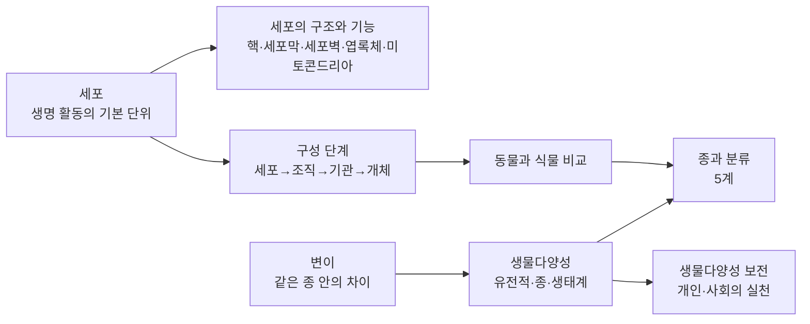
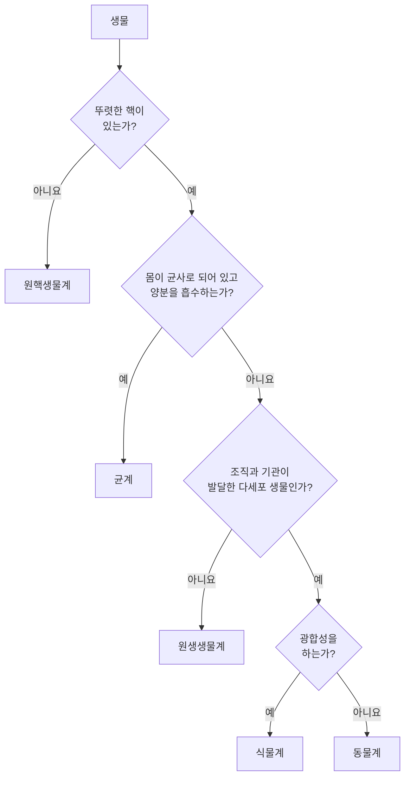

# 중1-2. 생물의 구성과 다양성 — 작은 세포에서 거대한 생명의 그물까지
<!-- next: 3-5, 4-2, bio-1, bio-3, cell-1 -->

> [!NOTE]
> **성취기준**
> - **[9과02-01]** 세포는 생명 활동이 일어나는 기본 단위임을 이해하고, 세포의 구조와 기능의 관계를 추론할 수 있다.
> - **[9과02-02]** 생물의 유기적 구성 단계를 이해하고, 동물과 식물을 비교하여 분석할 수 있다.
> - **[9과02-03]** 생물다양성을 이해하고, 변이와 생물다양성의 관계를 추론할 수 있다.
> - **[9과02-04]** 종의 개념과 분류 체계를 이해하고, 생물을 계 수준에서 분류할 수 있다.
> - **[9과02-05]** 생물다양성 보전의 필요성을 이해하고, 생물다양성 유지를 위한 방안을 조사하고 실천할 수 있다.

**학습 목표**

1. 세포가 생명 활동의 기본 단위임을 알고, 세포벽·세포막·핵·엽록체·미토콘드리아의 기능을 설명할 수 있다.
2. 적혈구, 신경세포, 상피세포 등 세포의 모양과 기능의 관계를 추론할 수 있다.
3. 동물과 식물의 구성 단계(세포 → 조직 → … → 개체)를 비교하여 설명할 수 있다.
4. 생물다양성의 세 가지 의미를 알고, 변이가 생물다양성과 어떤 관계가 있는지 추론할 수 있다.
5. 생물학적 종의 개념과 분류 체계를 이해하고, 생물을 5계로 분류할 수 있다.
6. 생물다양성이 줄어드는 원인과 보전의 필요성을 알고, 개인·사회 차원의 보전 방안을 조사하고 실천할 수 있다.

**이 단원의 학습 사다리**

| 단계 | 무엇을 하나? |
|---|---|
| STEP 1. 이전 학습 다시 보기 | 초등학교 「다양한 생물과 우리 생활」, 「생물과 환경」을 다시 꺼내 본다 |
| STEP 2. 기초 다지기 | 현미경 사용법, 크기의 단위, 분류의 기준 세우기를 익힌다 |
| STEP 3. 핵심 개념 | 세포 구조 → 세포의 모양과 기능 → 구성 단계 → 생물다양성과 변이 → 종과 5계 → 보전 |
| STEP 4. 오개념 바로잡기 | "식물 세포에는 미토콘드리아가 없다?" 같은 착각을 바로잡는다 |
| STEP 5. 다음 단계로 | 통합과학 「생명 시스템과 물질대사」, 「진화와 생물다양성」, 생명과학으로 이어진다 |
| STEP 6. 생활·산업·진로 | 종자 은행, 생물 자원과 신약, 생태 복원, 관련 진로 |

---

## 🗺️ 단원 들어가기

우리 몸은 몇 개의 '벽돌'로 지어져 있을까? 사람의 몸은 수십조 개(약 37조 개로 추정)의 아주 작은 **세포**로 이루어져 있다. 그런데 연못 속 짚신벌레는 단 하나의 세포로 먹고, 움직이고, 자손을 남긴다. 세포 하나가 어떻게 생명을 유지할 수 있을까?

또 지구에는 지금까지 이름이 붙은 생물만 해도 약 200만 종 가까이 있고, 아직 발견되지 않은 생물은 훨씬 많을 것으로 짐작된다. 과학자들은 이 엄청나게 많은 생물을 어떻게 정리할까? 그리고 왜 "생물의 종류가 많은 것이 중요하다"고 말할까?

이 단원에서는 **가장 작은 생명의 단위(세포)** 에서 출발하여, 세포가 모여 몸을 이루는 방법, 생물이 서로 다른 이유, 생물을 무리 짓는 방법, 그리고 생물다양성을 지키는 방법까지 차례로 올라가 본다.

---

## STEP 1. 🔙 이전 학습 다시 보기

### 연계표

| 이전 단원·성취기준 | 그때 배운 것 | 이 단원에서 확장되는 것 |
|---|---|---|
| 초등학교 3~4학년군 「다양한 생물과 우리 생활」 | 곰팡이, 버섯, 짚신벌레, 해캄, 세균처럼 눈에 잘 띄지 않는 생물이 있고, 이들이 우리 생활에 이롭거나 해로운 영향을 준다 | 이 생물들을 **원핵생물계, 원생생물계, 균계**로 분류하고, 세포의 구조(핵의 유무 등)로 그 차이를 설명한다 |
| 초등학교 3~4학년군 「생물과 환경」 | 생물은 서로, 그리고 햇빛·물·온도 같은 환경과 영향을 주고받는다. 생물은 환경에 적응하여 산다 | 환경에 따라 다른 특징이 살아남아 **변이와 생물다양성**이 생긴다는 것을 추론하고, 생물다양성 보전 방안을 찾는다 |
| 초등학교 과학 시간의 관찰 경험 | 돋보기나 현미경으로 작은 생물을 관찰하고, 특징에 따라 생물을 무리 지어 보았다 | 현미경으로 **세포**를 관찰하고, 과학적인 **분류 체계(종~계)** 로 생물을 분류한다 |

### 준비 운동 (사전 진단)

**Q1.** 다음 중 광합성을 하여 스스로 양분을 만드는 생물을 모두 고르시오.
ㄱ. 해캄 ㄴ. 버섯 ㄷ. 강아지풀 ㄹ. 곰팡이

**Q2.** 곰팡이와 버섯은 식물일까, 아닐까? 그렇게 생각한 이유를 쓰시오.

**Q3.** 사막에 사는 선인장의 잎이 가시 모양인 까닭을 '환경'과 관련지어 쓰시오.

**Q4.** 생물을 '다리가 있는 것'과 '다리가 없는 것'으로 나누었다. 이처럼 생물을 나눌 때 기준으로 알맞지 **않은** 것은? ① 날개가 있는가? ② 귀여운가? ③ 알을 낳는가?

정답 및 해설

**Q1. ㄱ, ㄷ** — 해캄과 강아지풀은 초록색 엽록체가 있어 광합성을 한다. 버섯과 곰팡이는 광합성을 하지 못하고 다른 생물이나 죽은 생물에서 양분을 얻는다.

**Q2.** 식물이 아니다. 광합성을 하지 못하고, 뿌리·줄기·잎이 없으며, 주로 균사로 이루어져 있다. 이 단원에서 이들을 **균계**로 분류한다.

**Q3.** 물이 부족한 사막에서 잎을 가시처럼 가늘게 만들면 물이 덜 빠져나가 살아남기에 유리하다.

**Q4. ②** — '귀엽다'는 사람마다 다르게 판단하므로 분류 기준이 될 수 없다. 분류 기준은 누가 보아도 같은 결과가 나오는 **객관적인 특징**이어야 한다.

---

## STEP 2. 🧱 기초 다지기

### ① 현미경: 작은 세계를 보는 창

세포는 대부분 너무 작아서 맨눈으로 볼 수 없다. 그래서 **광학 현미경**을 사용한다.

| 부분 | 하는 일 |
|---|---|
| 접안렌즈 | 눈을 대고 보는 렌즈 |
| 대물렌즈 | 관찰할 물체(표본) 가까이 있는 렌즈 |
| 재물대 | 표본(프레파라트)을 올려놓는 곳 |
| 조동 나사·미동 나사 | 재물대(또는 경통)를 움직여 초점을 맞춘다 |
| 조리개·반사경(또는 전등) | 빛의 양을 조절한다 |

$$
\text{현미경의 배율} = \text{접안렌즈의 배율} \times \text{대물렌즈의 배율}
$$

예를 들어 접안렌즈가 10배, 대물렌즈가 40배이면 배율은 $10 \times 40 = 400$배이다.

> [!TIP]
> 💡 **요령** — 처음에는 **낮은 배율**로 관찰할 대상을 찾은 뒤 높은 배율로 바꾼다. 배율을 높이면 더 크게 보이지만 보이는 범위가 좁아지고 어두워진다. 확대 지도를 볼 때 처음부터 골목을 찾지 않고 도시 전체를 먼저 보는 것과 같다.

<!-- fig:m1-02-microscope -->

### ② 아주 작은 크기의 단위

| 단위 | 관계 | 예 |
|---|---|---|
| 밀리미터(mm) | 1 mm = 1 m의 1000분의 1 | 개미의 몸길이는 수 mm |
| 마이크로미터(μm) | 1 μm = 1 mm의 1000분의 1 | 사람 적혈구의 지름은 약 7~8 μm |

### ③ 분류의 기준 세우기

생물을 무리 짓는 것을 **분류(classification)** 라고 한다. 분류할 때는 **누가 하더라도 같은 결과가 나오는 기준**을 써야 한다.

| 좋은 기준 (객관적) | 좋지 않은 기준 (주관적) |
|---|---|
| 광합성을 하는가? | 예쁜가? |
| 척추(등뼈)가 있는가? | 무서운가? |
| 몸이 하나의 세포로 되어 있는가? | 유용한가? |

### ④ 구조와 기능은 짝을 이룬다

생물에서 **모양(구조)** 은 **하는 일(기능)** 과 밀접한 관련이 있다. 새의 부리 모양은 먹이에 따라 다르고, 사람의 앞니는 납작하여 음식을 자르기 좋고 어금니는 넓적하여 갈기 좋다. 이 생각은 STEP 3에서 세포를 이해하는 열쇠가 된다.

---

## STEP 3. 📘 핵심 개념

### ① 세포는 생명 활동의 기본 단위이다

모든 생물은 하나 이상의 **세포(cell)** 로 이루어져 있다. 세포는 양분을 분해하여 에너지를 얻고, 필요한 물질을 만들고, 자라고, 새로운 세포를 만든다. 즉 **생명 활동이 일어나는 기본 단위**이다.

- **단세포 생물**: 몸이 세포 하나로 이루어진 생물 (예: 짚신벌레, 아메바, 대장균, 효모)
- **다세포 생물**: 몸이 많은 세포로 이루어진 생물 (예: 사람, 개, 소나무, 버섯)

1665년 영국의 훅은 자신이 설계한 현미경으로 얇게 자른 코르크를 관찰하고 작은 방처럼 보이는 구조를 '세포(cell, 작은 방)'라고 불렀다. 이후 많은 과학자의 관찰이 쌓여 **모든 생물은 세포로 이루어져 있다**는 사실이 밝혀졌다.

#### 세포의 구조와 기능

| 구조 | 기능 | 동물 세포 | 식물 세포 |
|---|---|---|---|
| **핵(nucleus)** | 유전 물질이 있어 생명 활동을 조절한다. 세포의 '본부' | 있다 | 있다 |
| **세포막(cell membrane)** | 세포를 둘러싸는 얇은 막. 세포 안팎으로 물질이 드나드는 것을 조절한다 | 있다 | 있다 |
| **미토콘드리아(mitochondria)** | 양분을 분해하여 생명 활동에 필요한 에너지를 만든다 | 있다 | 있다 |
| **세포벽(cell wall)** | 세포막 바깥을 둘러싼 단단한 벽. 세포를 보호하고 모양을 유지한다 | 없다 | 있다 |
| **엽록체(chloroplast)** | 초록색 색소가 있어 광합성으로 양분을 만든다 | 없다 | 있다(주로 잎·줄기의 초록색 부분) |

> [!TIP]
> 💡 **비유 — 세포는 작은 학교이다**
> - 핵 = **교장실**: 학교 운영 계획(유전 정보)을 보관하고 지시를 내린다.
> - 세포막 = **교문과 경비실**: 들어오고 나가는 사람(물질)을 확인하고 조절한다.
> - 미토콘드리아 = **급식실·발전실**: 에너지를 만들어 모두가 활동할 수 있게 한다.
> - 세포벽 = **학교 담장**: 단단하게 바깥을 둘러싸 모양을 지킨다(식물 학교에만 있다).
> - 엽록체 = **학교 텃밭의 태양광 주방**: 햇빛으로 직접 양분을 만든다(식물 학교에만 있다).

> [!IMPORTANT]
> 식물 세포에도 **미토콘드리아가 있다.** 식물은 엽록체에서 양분을 만들고, 미토콘드리아에서 그 양분을 분해하여 에너지를 얻는다. 동물과 식물 세포의 차이는 **세포벽과 엽록체의 유무**이다.

<!-- fig:m1-02-cell-compare -->

#### 예제 1

현미경으로 세포 A와 B를 관찰하였다. A에는 핵, 세포막, 세포벽, 엽록체가 보였고, B에는 핵과 세포막은 보였으나 세포벽과 엽록체는 보이지 않았다. (1) A와 B는 각각 동물 세포와 식물 세포 중 무엇인가? (2) A가 B보다 모양이 반듯하고 일정한 까닭은?

**풀이**
(1) A: 식물 세포 (세포벽과 엽록체가 있다), B: 동물 세포
(2) A에는 단단한 **세포벽**이 있어 세포의 모양이 일정하게 유지된다. 동물 세포는 세포벽이 없어 모양이 둥글거나 불규칙하다.

#### ✔ 바로 확인

1. (O/X) 식물 세포에도 미토콘드리아가 있다.
2. 빈칸: 식물 세포에는 있고 동물 세포에는 없는 구조는 (    )과 (    )이다.
3. 짝짓기: (가) 핵 (나) 세포막 (다) 엽록체 — ㄱ. 광합성으로 양분을 만든다 ㄴ. 생명 활동을 조절한다 ㄷ. 물질의 출입을 조절한다
4. 고르기: 짚신벌레, 소나무, 대장균, 버섯 중 단세포 생물을 모두 고르시오.

정답

1. O — 엽록체에서 만든 양분을 미토콘드리아에서 분해하여 에너지를 얻는다.
2. 세포벽, 엽록체
3. (가)–ㄴ, (나)–ㄷ, (다)–ㄱ
4. 짚신벌레, 대장균 — 소나무와 버섯은 많은 세포로 이루어진 다세포 생물이다.

### ② 세포의 모양은 하는 일에 맞추어져 있다

다세포 생물의 몸에는 여러 종류의 세포가 있고, 세포마다 **모양이 다르다.** 각 세포의 모양은 그 세포가 하는 일을 하기에 알맞게 되어 있다.

| 세포 | 모양(구조) | 하는 일(기능) | 구조와 기능의 관계 추론 |
|---|---|---|---|
| **적혈구** | 가운데가 오목한 원반 모양, 크기가 작다. 사람의 다 자란 적혈구에는 핵이 없다 | 온몸에 산소를 운반한다 | 넓은 표면으로 산소를 잘 주고받고, 작고 잘 휘어져 가는 혈관도 지날 수 있다 |
| **신경세포** | 세포체에서 가지처럼 뻗은 돌기, 매우 길게 뻗은 돌기가 있다(1 m 가까이 되는 것도 있다) | 자극을 받아들이고 신호를 전달한다 | 긴 돌기 덕분에 먼 곳까지 빠르게 신호를 보내고, 여러 가지 돌기로 많은 세포와 연결된다 |
| **상피세포** | 납작하거나 기둥 모양으로 빈틈없이 붙어 있다 | 몸의 겉면이나 기관의 안쪽 면을 덮어 보호한다 | 빈틈없이 붙어 있어 병균이나 해로운 물질이 쉽게 들어오지 못한다 |
| 근육세포 | 가늘고 길다 | 수축하여 몸을 움직인다 | 길쭉한 모양이라 길이 방향으로 줄어들며(수축하며) 힘을 낸다. 늘어날 때는 스스로 힘을 내지 않는다 |
| 식물의 뿌리털 세포 | 바깥쪽으로 털처럼 길게 뻗어 있다 | 흙 속의 물과 무기 양분을 흡수한다 | 흙과 닿는 면적이 넓어 물을 많이 흡수한다 |
| 식물의 공변세포 | 두 개가 짝을 이룬 반달(콩팥) 모양 | 사이에 있는 기공을 열고 닫는다 | 모양이 바뀌며 기공의 크기를 조절한다 |

<!-- fig:m1-02-cell-shapes -->

> [!TIP]
> 💡 **비유** — 택배 트럭은 짐칸이 넓고, 소방차는 긴 사다리가 있고, 구급차는 침대가 들어간다. **하는 일에 맞게 모양이 다른 것**처럼 세포도 맡은 일에 맞는 모양을 하고 있다.

#### 예제 2

어떤 세포는 길이가 매우 길고, 한쪽 끝에는 나뭇가지 같은 짧은 돌기가 많으며 다른 쪽 끝으로 긴 돌기가 뻗어 있다. 이 세포가 하는 일을 추론하시오.

**풀이** 신경세포이다. 짧은 돌기로 여러 곳에서 신호를 받아들이고, 긴 돌기로 멀리 떨어진 다른 세포에 신호를 전달하기에 알맞은 모양이다.

#### ✔ 바로 확인

1. 짝짓기: (가) 적혈구 (나) 신경세포 (다) 상피세포 — ㄱ. 빈틈없이 붙어 있다 ㄴ. 가운데가 오목한 원반 모양이다 ㄷ. 길게 뻗은 돌기가 있다
2. (O/X) 뿌리털 세포가 털처럼 길게 뻗어 있으면 흙과 닿는 면적이 넓어 물을 많이 흡수할 수 있다.
3. 빈칸: 잎에서 기공을 열고 닫는, 반달 모양 두 개가 짝을 이룬 세포는 (    )세포이다.

정답

1. (가)–ㄴ, (나)–ㄷ, (다)–ㄱ
2. O — 모양(구조)이 하는 일(기능)에 알맞다.
3. 공변

### ③ 세포에서 개체까지 — 생물의 구성 단계

다세포 생물에서는 세포가 모여 더 큰 단위를 이루고, 각 단위가 서로 협력하여 하나의 생명체를 이룬다. 이를 **생물의 유기적 구성 단계**라고 한다. '유기적'이란 각 부분이 **서로 긴밀하게 연결되어 하나의 전체로 작용한다**는 뜻이다.

| 단계 | 뜻 | 동물의 예 | 식물의 예 |
|---|---|---|---|
| 세포 | 생명 활동의 기본 단위 | 근육세포, 상피세포 | 표피 세포, 공변세포 |
| **조직(tissue)** | 모양과 기능이 비슷한 세포의 모임 | 근육 조직, 상피 조직, 신경 조직, 결합 조직 | 표피 조직, 물관·체관 같은 통도 조직 |
| **조직계(tissue system)** | 여러 조직이 모여 일정한 기능을 하는 단계 (식물에만 있다) | — | 표피 조직계, 관다발 조직계, 기본 조직계 |
| **기관(organ)** | 여러 조직(조직계)이 모여 특정한 일을 하는 단위 | 위, 심장, 폐, 뇌 | 뿌리, 줄기, 잎(영양 기관), 꽃, 열매(생식 기관) |
| **기관계(organ system)** | 관련된 일을 함께하는 기관의 모임 (동물에만 있다) | 소화계, 순환계, 호흡계, 배설계, 신경계 | — |
| 개체 | 독립하여 살아가는 하나의 생물 | 사람, 고양이 | 해바라기, 소나무 |

$$
\text{동물: 세포} \rightarrow \text{조직} \rightarrow \text{기관} \rightarrow \text{기관계} \rightarrow \text{개체}
$$

$$
\text{식물: 세포} \rightarrow \text{조직} \rightarrow \text{조직계} \rightarrow \text{기관} \rightarrow \text{개체}
$$

<!-- fig:m1-02-organization-levels -->

#### 동물과 식물은 왜 구성 단계가 다를까?

| 비교 | 동물 | 식물 |
|---|---|---|
| 특별한 단계 | **기관계**가 있다 | **조직계**가 있다 |
| 생활 방식 | 스스로 움직여 먹이를 찾고, 먹은 것을 소화하고 온몸에 운반해야 한다 | 한곳에 뿌리 내리고 광합성으로 양분을 만든다 |
| 까닭 추론 | 소화·순환·호흡·배설처럼 여러 기관이 함께 해야 하는 복잡한 일이 많아 기관들이 **기관계**로 협력한다 | 기관의 종류가 비교적 적고 구조가 단순하여, 기관을 이루기 전에 조직들이 **조직계**로 묶인다 |

> [!TIP]
> 💡 **비유 — 학교의 구성** 학생 한 명(세포) → 같은 반 친구들(조직) → 한 학년(기관) → 학년들이 협력하는 학생회 활동(기관계) → 학교 전체(개체). 각 단계가 따로 놀지 않고 서로 연결되어야 학교가 잘 돌아간다. 이것이 '유기적'의 뜻이다.

#### 예제 3

다음 중 구성 단계가 **같은 것끼리** 짝 지은 것은?
① 위 – 소화계 ② 심장 – 잎 ③ 근육 조직 – 관다발 조직계 ④ 적혈구 – 폐

**풀이** 정답 ②. 심장과 잎은 모두 **기관**이다. ①은 기관과 기관계, ③은 조직과 조직계, ④는 세포와 기관이다.

#### 예제 4

어떤 생물의 구성 단계에 '기관계'는 없고 '조직계'가 있다. 이 생물은 동물과 식물 중 무엇인가? 이 생물의 기관 두 가지를 예로 드시오.

**풀이** 식물이다. 기관의 예: 뿌리, 줄기, 잎, 꽃, 열매 중 두 가지.

#### ✔ 바로 확인

1. 빈칸: 동물의 구성 단계는 세포 → 조직 → 기관 → (    ) → 개체이다.
2. 다음은 각각 어느 구성 단계인가? (가) 심장 (나) 순환계 (다) 근육 조직 (라) 잎
3. (O/X) 조직계는 동물과 식물 모두에 있다.

정답

1. 기관계
2. (가) 기관 (나) 기관계 (다) 조직 (라) 기관
3. X — 조직계는 식물에만, 기관계는 동물에만 있다.

### ④ 생물다양성과 변이

#### 생물다양성의 세 가지 의미

**생물다양성(biodiversity)** 은 일정한 지역에 사는 생물의 다양한 정도를 말하며, 다음 세 가지를 모두 포함한다.

| 구분 | 뜻 | 예 |
|---|---|---|
| **유전적 다양성** | 같은 종 안에서 개체들의 유전적 특징이 다양한 정도 | 무당벌레 날개의 무늬와 색이 개체마다 다르다. 바지락 껍데기 무늬가 제각각이다 |
| **종 다양성** | 일정한 지역에 사는 생물 종의 다양한 정도. 종의 수가 많고 각 종이 고르게 분포할수록 높다 | 숲에는 운동장보다 훨씬 많은 종이 산다 |
| **생태계 다양성** | 숲, 갯벌, 사막, 초원, 강, 바다 등 생태계의 다양한 정도 | 우리나라에는 산림, 하천, 습지, 갯벌, 바다 생태계가 있다 |

<!-- fig:m1-02-biodiversity-levels -->

#### 예제 5 — 종 다양성은 '수'와 '고르기'를 함께 본다

두 지역 A, B에서 조사한 식물의 개체 수이다. 어느 지역의 종 다양성이 더 높은가?

| 지역 | 민들레 | 토끼풀 | 질경이 | 강아지풀 | 합계 |
|---|---|---|---|---|---|
| A | 25 | 25 | 25 | 25 | 100 |
| B | 85 | 5 | 5 | 5 | 100 |

**풀이** 두 지역 모두 종의 수는 4종, 전체 개체 수는 100으로 같다. 그러나 A는 네 종이 25씩 **고르게** 분포하고, B는 민들레 한 종이 85를 차지한다. 따라서 **A 지역의 종 다양성이 더 높다.**

#### 변이: 같은 종 안의 차이

같은 종의 생물이라도 개체마다 생김새나 특징이 조금씩 다르다. 이러한 차이를 **변이(variation)** 라고 한다. 사람마다 키, 얼굴 모양, 피부색, 혈액형이 다른 것, 같은 품종의 고양이라도 털 무늬가 다른 것이 변이이다.

#### 변이와 생물다양성은 어떤 관계일까?

1. 한 종의 생물 집단 안에는 다양한 **변이**가 있다.
2. 생물이 사는 **환경**은 지역마다 다르고, 시간이 지나면 변하기도 한다.
3. 어떤 환경에서는 그 환경에 **알맞은 변이를 가진 개체**가 더 많이 살아남아 자손을 남긴다.
4. 이 과정이 **오랜 세월 동안** 되풀이되면, 원래 같은 종이었던 집단들이 서로 다른 특징을 갖게 되고, 결국 **새로운 종**이 생길 수 있다.
5. 그 결과 지구에는 매우 다양한 생물이 살게 되었다. → **생물다양성**

| 사례 | 변이 | 환경 | 결과 |
|---|---|---|---|
| 갈라파고스 제도의 핀치 | 부리의 모양과 크기가 다양했다 | 섬마다 먹이(딱딱한 씨앗, 곤충, 선인장 꽃 등)가 달랐다 | 섬마다 먹이에 알맞은 부리를 가진 여러 종의 핀치가 살게 되었다 |
| 여우 | 몸 크기, 귀의 크기, 털 색깔이 다양했다 | 북극은 춥고 하얀 눈이 많고, 사막은 덥고 모래가 많다 | 북극여우는 귀가 작고 털이 희며, 사막여우는 귀가 크고 털이 모래색이다 |

<!-- fig:m1-02-variation-finch -->

> [!IMPORTANT]
> 변이가 많은 집단은 환경이 갑자기 바뀌어도 그 환경에서 살아남을 수 있는 개체가 있을 가능성이 높다. 그래서 **유전적 다양성이 높으면 그 종이 멸종할 위험이 낮아진다.** 변이는 생물다양성의 출발점이다.

#### 예제 6

어느 지역의 감자 밭에 모두 같은 품종의 감자만 심었다. 그런데 감자에 병을 일으키는 미생물이 퍼지자 밭 전체의 감자가 큰 피해를 입었다. 이 사례를 '변이'와 '유전적 다양성'으로 설명하시오.

**풀이** 같은 품종만 심으면 개체 사이의 **변이가 거의 없어 유전적 다양성이 낮다.** 그래서 한 가지 병에 약한 성질을 모든 감자가 똑같이 가지고 있어 한꺼번에 피해를 입었다. 여러 품종을 함께 심었다면 병에 강한 감자가 살아남았을 것이다.

#### ✔ 바로 확인

1. 짝짓기: (가) 무당벌레의 무늬가 개체마다 다르다 (나) 숲에는 운동장보다 훨씬 많은 종이 산다 (다) 우리나라에는 산림, 갯벌, 바다가 있다 — ㄱ. 종 다양성 ㄴ. 생태계 다양성 ㄷ. 유전적 다양성
2. (O/X) 두 지역의 종의 수가 같으면 종 다양성도 항상 같다.
3. 빈칸: 같은 종의 개체 사이에 나타나는 특징의 차이를 (    )라고 한다.
4. (O/X) 유전적 다양성이 높은 종은 환경이 갑자기 바뀌면 멸종할 위험이 더 높다.

정답

1. (가)–ㄷ, (나)–ㄱ, (다)–ㄴ
2. X — 각 종이 얼마나 고르게 분포하는지도 함께 본다.
3. 변이
4. X — 바뀐 환경에서 살아남을 수 있는 개체가 있을 가능성이 높아 멸종 위험이 낮아진다.

### ⑤ 종의 개념과 5계 분류 체계

#### 종이란 무엇인가 — 생물학적 종

**종(species)** 은 생물을 분류하는 기본 단위이다. 이 단원에서는 **생물학적 종 개념**을 다룬다.

> [!IMPORTANT]
> **종**: 자연 상태에서 서로 짝짓기를 하여 **생식 능력이 있는 자손**을 낳을 수 있는 생물 무리

| 예 | 같은 종인가? | 까닭 |
|---|---|---|
| 진돗개와 푸들 | 같은 종 | 생김새는 달라도 짝짓기하여 생식 능력이 있는 강아지를 낳는다 |
| 말과 당나귀 | 다른 종 | 짝짓기하면 노새가 태어나지만, 노새는 대부분 생식 능력이 없다 |
| 사자와 호랑이 | 다른 종 | 동물원처럼 사람이 만든 환경에서 라이거·타이곤이 태어나기도 하지만, 자연 상태에서는 사는 곳과 습성이 달라 서로 짝짓기하지 않는다 |

#### 분류 체계: 종에서 계까지

생물은 비슷한 종끼리 묶어 **속**, 비슷한 속끼리 묶어 **과**, 이렇게 점점 큰 무리로 묶는다.

$$
\text{종} < \text{속} < \text{과} < \text{목} < \text{강} < \text{문} < \text{계}
$$

| 분류 단계 | 사람 | 호랑이 |
|---|---|---|
| 계 | 동물계 | 동물계 |
| 문 | 척삭동물문 | 척삭동물문 |
| 강 | 포유강 | 포유강 |
| 목 | 영장목 | 식육목 |
| 과 | 사람과 | 고양이과 |
| 속 | 사람속 | 표범속 |
| 종 | 사람 | 호랑이 |

같은 단계에 함께 묶이는 단계가 낮을수록(종에 가까울수록) 생물 사이의 관계가 가깝다. 사람과 호랑이는 '강'까지 같으므로 포유류라는 공통점이 있지만, '목'부터 다르다.

<!-- fig:m1-02-taxonomy-nested -->

> [!TIP]
> 💡 **비유 — 주소 체계** "대한민국(계) → ○○도(문) → ○○시(강) → ○○구(목) → ○○동(과) → ○○아파트(속) → 101호(종)". 큰 단위에서 작은 단위로 갈수록 범위가 좁아지고, 같은 아파트에 사는 이웃이 같은 도에 사는 사람보다 훨씬 가깝다.

#### 5계 분류

이 단원에서는 생물을 가장 큰 단위인 **계(kingdom)** 수준에서 다섯 무리로 나누는 **5계 분류 체계**를 다룬다.

| 계 | 핵막 (뚜렷한 핵) | 세포 수 | 광합성 | 특징 | 예 |
|---|---|---|---|---|---|
| **원핵생물계** | 없다 | 단세포 | 하는 것도 있다 | 유전 물질이 막으로 싸여 있지 않다. 크기가 매우 작다 | 대장균, 젖산균, 폐렴균, 남세균 |
| **원생생물계** | 있다 | 단세포 또는 다세포 | 하는 것도 있다 | 핵이 있는 생물 중 동물·식물·균계에 속하지 않는 생물. 다세포라도 조직이 발달하지 않았다 | 짚신벌레, 아메바, 유글레나, 해캄, 미역, 김 |
| **균계** | 있다 | 대부분 다세포(효모는 단세포) | 하지 않는다 | 몸이 가는 실 모양의 균사로 되어 있는 것이 많고, 다른 생물이나 죽은 생물에서 양분을 흡수한다 | 버섯, 곰팡이, 효모 |
| **식물계** | 있다 | 다세포 | 한다 | 세포벽이 있고, 대부분 땅에서 살며 뿌리·줄기·잎 같은 기관이 발달한 것이 많다 | 이끼, 고사리, 소나무, 벼, 장미 |
| **동물계** | 있다 | 다세포 | 하지 않는다 | 세포벽이 없고, 대부분 움직일 수 있으며 다른 생물을 먹어 양분을 얻는다 | 해파리, 지렁이, 거미, 개구리, 사람 |

#### 5계로 분류하는 순서도

> [!NOTE]
> 이 순서도는 대표적인 생물을 가려내는 **간단한 길잡이**이다. 효모처럼 균사가 없는 단세포 균류나, 이끼처럼 기관이 뚜렷하지 않은 식물은 이 질문만으로는 맞는 계를 찾기 어렵다. 실제 분류는 더 많은 특징을 함께 따진다.

> [!WARNING]
> 미역, 김, 다시마는 바다에서 광합성을 하지만 **식물계가 아니라 원생생물계**이다. 뿌리·줄기·잎 같은 기관이 발달하지 않았기 때문이다. 또 버섯은 땅에 붙어 자라지만 광합성을 하지 않으므로 식물계가 아니라 **균계**이다.

<!-- sim:kingdom-sort -->

#### 예제 7

다음 생물을 5계로 분류하시오.
대장균, 표고버섯, 짚신벌레, 고사리, 해파리, 김, 푸른곰팡이, 남세균

**풀이**
- 원핵생물계: 대장균, 남세균 (핵막이 없다)
- 원생생물계: 짚신벌레, 김 (핵이 있지만 조직이 발달하지 않았다)
- 균계: 표고버섯, 푸른곰팡이 (균사로 되어 있고 광합성을 하지 않는다)
- 식물계: 고사리 (광합성, 조직·기관 발달)
- 동물계: 해파리 (광합성을 하지 않고 다른 생물을 먹는다)

#### ✔ 바로 확인

1. 빈칸: 종 < 속 < (    ) < 목 < 강 < (    ) < 계
2. (O/X) 말과 당나귀 사이에서 태어난 노새는 대부분 생식 능력이 없으므로 말과 당나귀는 다른 종이다.
3. 다음 생물은 5계 중 어디에 속하는가? (가) 김 (나) 남세균 (다) 효모
4. 사람과 호랑이는 분류 단계 중 어느 단계까지 같은가?

정답

1. 과, 문
2. O
3. (가) 원생생물계 (나) 원핵생물계 (다) 균계
4. 강(포유강) — '목'부터 영장목과 식육목으로 다르다.

### ⑥ 생물다양성 보전의 필요성과 실천

#### 왜 생물다양성을 지켜야 할까?

| 필요성 | 설명 | 예 |
|---|---|---|
| 생태계의 안정 | 종이 다양하면 먹이 관계가 그물처럼 복잡하게 얽혀, 한 종이 사라져도 다른 종이 대신할 수 있어 생태계가 쉽게 무너지지 않는다 | 먹이가 한 가지뿐인 동물은 그 먹이가 사라지면 함께 위험해진다 |
| 생물 자원 | 사람은 생물에서 식량, 옷감, 목재, 의약품을 얻는다 | 버드나무 껍질에서 진통제(아스피린)의 원료 물질을 찾았고, 푸른곰팡이에서 항생제를 얻었다 |
| 깨끗한 환경 | 식물은 산소를 만들고, 숲과 습지는 물을 깨끗하게 하며 홍수를 줄인다. 곤충은 꽃가루받이를 돕는다 | 벌이 줄어들면 과일과 채소의 수확량이 줄어든다 |
| 휴식과 문화 | 자연은 휴식, 여가, 교육, 예술의 원천이 된다 | 생태 공원, 습지 탐방 |

> [!TIP]
> 💡 **비유 — 그물과 줄** 한 줄로 매단 물건은 줄 하나만 끊어져도 떨어지지만, 촘촘한 그물에 올려 둔 물건은 몇 가닥이 끊어져도 떨어지지 않는다. 종이 다양한 생태계는 **촘촘한 그물**과 같다.

#### 생물다양성이 줄어드는 원인

| 원인 | 설명 | 예 |
|---|---|---|
| 서식지 파괴 | 숲을 베거나 습지·갯벌을 메워 생물이 살 곳이 사라진다. 도로가 서식지를 조각내기도 한다 | 도로 때문에 이동하던 동물이 차에 치이는 사고 |
| 외래 생물의 유입 | 원래 살지 않던 생물이 들어와 천적 없이 크게 늘어나 토종 생물을 위협한다 | 황소개구리, 뉴트리아, 큰입배스, 가시박 |
| 무분별한 남획 | 필요 이상으로 마구 잡거나 채취한다 | 멸종 위기에 놓인 고래, 희귀 식물 |
| 환경 오염 | 쓰레기, 폐수, 농약 등이 생물에게 해를 준다 | 바다 생물이 플라스틱을 삼키는 피해 |
| 기후변화 | 기온이 오르며 생물이 살기 알맞은 지역이 바뀐다 | 높은 산의 추운 곳에 사는 식물이 살 곳을 잃는다 |

#### 생물다양성을 지키는 방법

| 차원 | 보전 방안 |
|---|---|
| 개인 | 쓰레기 줄이기, 야생 동식물을 함부로 잡거나 꺾지 않기, 기르던 동물을 자연에 버리지 않기, 친환경 제품 사용, 생태 지도 만들기·시민 과학 참여 |
| 사회·국가 | 국립 공원·습지 보호 지역 지정, 멸종 위기 생물 지정과 복원(예: 지리산의 반달가슴곰 복원 사업), 동물이 지나다니는 **생태 통로** 설치, 생태계 교란 생물 관리, 종자 은행 운영 |
| 국제 | 1992년 국제 회의에서 채택된 **생물다양성 협약** 등 여러 나라가 함께 생물다양성을 지키기로 약속하였다. 멸종 위기 동식물의 국제 거래를 규제한다 |

> [!NOTE]
> 생물다양성 보전은 **지속가능한 삶**과 이어져 있다. 이 책 「과학과 인류의 지속가능한 삶」에서 배운 것처럼, 지금 세대가 생물 자원을 다 써 버리지 않아야 미래 세대도 그 혜택을 누릴 수 있다.

#### 예제 8

다음 (가)~(다)는 생물다양성 보전 방안이다. 각각이 해결하려는 생물다양성 감소의 원인을 쓰시오.
(가) 산을 가로지르는 도로 위에 동물이 건너다닐 수 있는 다리 모양의 통로를 만든다.
(나) 하천에 사는 큰입배스를 잡아 수를 줄인다.
(다) 일정한 기간에는 특정 물고기를 잡지 못하게 한다.

**풀이** (가) 서식지 파괴(서식지가 조각나는 것), (나) 외래 생물의 유입, (다) 남획

#### ✔ 바로 확인

1. 짝짓기: (가) 생태 통로 설치 (나) 큰입배스 잡아내기 (다) 특정 기간 물고기 잡기 금지 — ㄱ. 남획 ㄴ. 서식지가 조각남 ㄷ. 외래 생물의 유입
2. (O/X) 종이 다양한 생태계는 한 종이 사라져도 쉽게 무너지지 않는다.
3. 생물다양성을 지키기 위해 개인이 할 수 있는 일을 한 가지 쓰시오.

정답

1. (가)–ㄴ, (나)–ㄷ, (다)–ㄱ
2. O — 먹이 관계가 그물처럼 얽혀 다른 종이 그 역할을 대신할 수 있다.
3. 예: 기르던 동물을 자연에 버리지 않기, 야생 동식물을 함부로 잡거나 꺾지 않기, 쓰레기 줄이기

---

## STEP 4. ⚠️ 오개념 바로잡기

| 흔한 오개념 | 올바른 개념 | 왜 그럴까? |
|---|---|---|
| 식물 세포에는 미토콘드리아가 없다 | 식물 세포에도 **미토콘드리아가 있다** | 식물도 엽록체에서 만든 양분을 미토콘드리아에서 분해하여 에너지를 얻어야 살 수 있다 |
| 식물 세포에는 세포막이 없고 세포벽만 있다 | 식물 세포는 **세포벽 안쪽에 세포막이 있다** | 세포벽은 모양을 지키고, 세포막은 물질의 출입을 조절한다. 하는 일이 다르다 |
| 큰 생물일수록 세포의 크기가 크다 | 큰 생물은 대부분 **세포의 수가 많은 것**이다 | 코끼리와 생쥐의 같은 종류의 세포는 크기가 크게 다르지 않다 |
| 버섯과 곰팡이는 식물이다 | 버섯과 곰팡이는 **균계**에 속한다 | 광합성을 하지 않고, 뿌리·줄기·잎이 없으며 균사로 되어 있다 |
| 미역이나 김은 바다에 사는 식물이다 | 미역과 김은 **원생생물계**에 속한다 | 광합성은 하지만 조직과 기관이 발달하지 않았다 |
| 생김새가 다르면 다른 종이다 | 종은 **생식 능력이 있는 자손을 낳을 수 있는지**로 구분한다 | 진돗개와 푸들은 생김새가 매우 달라도 같은 종이다 |
| 종의 수만 많으면 종 다양성이 높다 | 종 다양성은 종의 수와 함께 **각 종이 얼마나 고르게 분포하는지**도 함께 본다 | 한 종이 대부분을 차지하면 그 종에 문제가 생겼을 때 생태계 전체가 흔들린다 |

---

## STEP 5. 🎓 다음 단계로 한 걸음 더

> [!CAUTION]
> 이 절은 **중학교 1학년 교육과정 범위 밖의 심화 내용**으로 평가 대상이 아니다. 이 단원의 세포, 구성 단계, 생물다양성, 분류가 중2·중3, 통합과학, 선택과목에서 어떻게 깊어지는지 맛보기로 보여 주기 위한 내용이다.

### 다음 학년·과목과의 연결

| 학년·과목 | 단원 | 이어지는 내용 |
|---|---|---|
| 중학교 2학년 | 「식물과 에너지」, 「동물과 에너지」 | 엽록체의 광합성, 미토콘드리아의 호흡, 소화계·순환계·호흡계·배설계의 구조와 기능 |
| 중학교 3학년 | 「생식과 유전」 | 세포 분열, 핵 속의 염색체와 유전자, 변이가 생기는 까닭 |
| 통합과학1 | 「생명 시스템과 물질대사」 | 세포막을 통한 선택적 물질 출입, 세포 안에서 효소가 돕는 화학 반응 |
| 통합과학2 | 「진화와 생물다양성」 | 변이와 **자연선택**에 의한 진화, 생물다양성 보전 방안 |
| 생명과학 | 「생명 시스템의 구성」, 「생명의 연속성과 다양성」 | 세포에서 개체까지의 구성, 염색체·DNA·유전자, 역과 계 수준의 분류 |
| 세포와 물질대사 | 「세포」 | 다양한 세포 소기관의 구조와 기능, 원핵세포와 진핵세포의 차이 |

### ① 세포 속에는 더 많은 구조가 있다

중1에서는 다섯 가지 구조만 배웠지만, 세포 속에는 더 많은 구조(**세포 소기관**)가 있다. 단백질을 만드는 **리보솜**, 물질을 운반하고 가공하는 **소포체**와 **골지체**, 식물 세포에서 물과 여러 물질을 저장하는 커다란 **액포** 등이다. 고등학교 「세포」에서는 이 소기관들이 공장의 생산 라인처럼 **물질의 합성과 분비**를 위해 협력하는 모습을 배우고, 전자 현미경으로 세포를 들여다보는 방법도 배운다.

### ② 변이에서 진화로 — 자연선택

STEP 3에서 "환경에 알맞은 변이를 가진 개체가 더 많이 살아남아 자손을 남긴다"고 했다. 통합과학2의 「진화와 생물다양성」에서는 이것을 **자연선택(natural selection)** 이라고 부르고, 다윈이 제안한 진화의 원리로 정리한다.

| 단계 | 자연선택에 의한 진화 |
|---|---|
| 과잉 생산 | 생물은 살아남을 수 있는 수보다 많은 자손을 낳는다 |
| 변이 | 자손들 사이에는 변이가 있다 |
| 생존 경쟁과 선택 | 환경에 유리한 변이를 가진 개체가 더 많이 살아남는다 |
| 유전과 누적 | 유리한 변이가 자손에게 전해지고, 오랜 세월 쌓여 새로운 종이 생긴다 |

### ③ 5계에서 3역으로

생물학이 발달하면서 과학자들은 세포 속 유전 물질을 비교하여 생물 사이의 관계를 더 정확히 알게 되었다. 그 결과 계보다 더 큰 단위인 **역(domain)** 을 두어 생물을 **세균역, 고세균역, 진핵생물역**의 세 무리로 나누는 체계가 제안되었다. 5계의 원핵생물계가 세균역과 고세균역 두 무리로 나뉘고, 나머지 네 계는 모두 진핵생물역에 들어간다. 고등학교 「생명과학」에서 이 내용을 배운다.

### 지금 vs 다음 단계

| 구분 | 지금 (중1) | 다음 단계 (통합과학·선택과목) |
|---|---|---|
| 세포 구조 | 세포벽, 세포막, 핵, 엽록체, 미토콘드리아 | 리보솜, 소포체, 골지체, 액포 등 여러 세포 소기관과 그 협력 |
| 세포막 | 물질의 출입을 조절한다 | 선택적 투과, 확산과 삼투 |
| 변이와 다양성 | 변이가 생물다양성의 바탕이 된다 | 유전자 수준의 변이 원인, 자연선택에 의한 진화 |
| 종 | 생물학적 종 개념 | 여러 가지 종 개념, 새로운 종이 생기는 과정 |
| 분류 | 5계 | 3역 체계, 계통수로 보는 생물 사이의 유연관계 |

---

## STEP 6. 🏭 생활·산업·진로 연결

### 사례 1. 종자 은행 — 미래를 위한 씨앗 금고

- **원리** 유전적 다양성이 높을수록 병이나 기후변화에 강한 품종을 찾아낼 가능성이 높다. 그래서 여러 품종의 씨앗을 낮은 온도에서 오래 보관해 둔다.
- **어디에 쓰이나** 노르웨이 북극 지역의 국제 종자 저장고처럼 세계 여러 나라가 씨앗을 맡겨 보관하는 시설이 있으며, 우리나라에도 국립 수목원 등에서 야생 식물의 씨앗을 보관하는 시설을 운영한다.

### 사례 2. 생물 자원과 의학 — 신약 개발에서 세포 진단까지

- **원리** 생물은 저마다 다양한 물질을 만들어 낸다. 이 중에는 병을 치료하는 데 쓸 수 있는 물질이 있다.
- **어디에 쓰이나** 푸른곰팡이의 페니실린처럼 미생물, 식물, 해양 생물에서 의약품의 원료를 찾는다. 생물다양성이 줄어들면 아직 발견하지 못한 '미래의 약'도 함께 사라질 수 있다.
- **세포 관찰과의 연결** 병원 진단 검사실에서는 혈액 속 적혈구와 백혈구의 모양과 수를 현미경으로 관찰하여 질병을 찾아낸다. 세포의 모양을 보면 그 세포가 건강한지 알 수 있기 때문이다.

### 사례 3. 생태 복원과 생태 통로

- **원리** 사라진 서식지를 되살리고 조각난 서식지를 연결하면 생물이 다시 모여든다.
- **어디에 쓰이나** 하천의 콘크리트를 걷어 내고 물풀과 모래톱을 되살리는 하천 복원, 산과 산 사이 도로 위에 놓은 생태 통로, 멸종 위기종을 번식시켜 자연으로 돌려보내는 복원 사업이 있다.

### 관련 진로와 학과

| 진로 | 하는 일 | 관련 학과 |
|---|---|---|
| 생명과학 연구원 | 세포와 생물을 연구하여 생명 현상의 원리를 밝힌다 | 생명과학, 생물학, 분자생물학 |
| 생태학자·생물 분류학자 | 생물을 조사·분류하고 새로운 종을 찾아 기록한다 | 생물학, 생태학, 산림자원학 |
| 임상병리사 | 혈액·조직의 세포를 관찰하고 검사하여 진단을 돕는다 | 임상병리학 |
| 환경·생태 복원 전문가 | 훼손된 서식지를 되살리고 보전 계획을 세운다 | 환경생태공학, 조경학 |
| 종자·식물 육종 연구원 | 다양한 품종을 보존하고 새 품종을 개발한다 | 식물자원학, 원예학, 농학 |

---

## 🔬 탐구 활동

### 활동 A. 세포 관찰하기

**목표** 현미경으로 동물 세포와 식물 세포를 관찰하고, 두 세포의 공통점과 차이점을 찾는다.

**준비물** 광학 현미경, 받침 유리, 덮개 유리, 양파, 검정말(또는 시금치 잎 뒷면 표피), 면봉, 아세트산 카민 용액(또는 메틸렌 블루 용액), 핀셋, 스포이트, 거름종이, 칼

**과정**
1. **양파 표피 세포**: 양파 비늘잎 안쪽의 얇은 표피를 핀셋으로 벗겨 받침 유리 위에 펴고, 아세트산 카민 용액을 한 방울 떨어뜨린 뒤 덮개 유리를 덮는다. 덮개 유리는 한쪽 끝부터 비스듬히 덮어 공기 방울이 생기지 않게 한다.
2. **입안 상피세포**: 면봉으로 볼 안쪽을 가볍게 긁어 받침 유리에 문지른 뒤, 메틸렌 블루 용액을 떨어뜨리고 덮개 유리를 덮는다.
3. **검정말 잎 세포**: 검정말 잎 하나를 떼어 받침 유리에 올리고 물을 한 방울 떨어뜨린 뒤 덮개 유리를 덮는다(염색하지 않는다).
4. 낮은 배율에서 세포를 찾은 다음 높은 배율로 바꾸어 관찰하고 그림으로 기록한다.

<!-- fig:m1-02-slide-prep -->

**결과 기록 표**

| 관찰 대상 | 세포의 모양 | 핵 | 세포벽 | 엽록체 | 배율 |
|---|---|---|---|---|---|
| 양파 표피 세포 | | | | | |
| 입안 상피세포 | | | | | |
| 검정말 잎 세포 | | | | | |

**생각해 보기**
1. 양파 표피 세포와 검정말 잎 세포는 모두 식물 세포인데, 양파 표피 세포에서 엽록체가 보이지 않는 까닭은 무엇일까? (힌트: 양파 비늘잎은 햇빛을 받는 부분인가?)
2. 세포를 염색하는 까닭은 무엇일까?
3. 식물 세포는 벽돌을 쌓은 것처럼 반듯하게 배열되어 있고 입안 상피세포는 둥글고 불규칙하다. 이 차이를 세포의 구조와 관련지어 설명해 보자.

> [!WARNING]
> **안전 수칙** 칼은 몸 바깥쪽 방향으로 사용한다. 염색약이 피부나 옷, 눈에 묻지 않도록 주의하고, 묻었을 때는 즉시 물로 씻는다. 면봉은 한 사람이 한 번만 사용하고 사용 후 정해진 곳에 버린다. 받침 유리와 덮개 유리가 깨지지 않도록 조심히 다룬다.

### 활동 B. 생물다양성 보전 놀이 활동하기 (모둠 활동)

**목표** 놀이를 통해 생물다양성이 줄어드는 원인과 보전의 필요성을 이해하고, 실천 방안을 찾는다.

**준비물** 생물 카드(식물, 초식 동물, 육식 동물, 분해자 등 학교 주변 생물 20~30장), 털실, 사건 카드(서식지 파괴, 외래 생물 유입, 오염, 남획, 기후변화, 보전 활동 등)

**과정**
1. 모둠원이 생물 카드를 한 장씩 들고 둥글게 선다. 먹고 먹히는 관계에 있는 사람끼리 털실을 연결하여 **먹이 그물**을 만든다.
2. 사회자가 사건 카드를 한 장씩 뽑는다. (예: "하천이 오염되어 물고기가 사라졌다.") 해당 생물 카드를 든 사람은 털실을 놓는다.
3. 털실이 느슨해진 사람(먹이를 잃은 생물)도 이어서 털실을 놓는다. 그물이 어떻게 무너지는지 관찰한다.
4. '보전 활동' 카드가 나오면 사라졌던 생물이 다시 털실을 잡을 수 있다.
5. 처음 시작한 생물 종의 수를 바꾸어(10종, 20종) 놀이를 반복하고 결과를 비교한다.

**결과 기록 표**

| 처음 종의 수 | 사건 카드 3장 뒤 남은 종의 수 | 사건 카드 5장 뒤 남은 종의 수 |
|---|---|---|
| 10종 | | |
| 20종 | | |

**생각해 보기**
1. 처음 종의 수가 많을 때와 적을 때, 먹이 그물이 무너지는 정도는 어떻게 달랐는가?
2. 우리 학교(마을)에서 생물다양성을 해치는 원인은 무엇이 있을까?
3. 우리 반이 한 달 동안 실천할 수 있는 생물다양성 보전 활동 계획을 세워 보자.

---

## ✅ 개념 확인 문제

### 기본

**1.** 세포의 구조와 그 기능을 **잘못** 짝 지은 것은?
① 핵 – 유전 물질이 있어 생명 활동을 조절한다.
② 세포막 – 세포 안팎으로 물질이 드나드는 것을 조절한다.
③ 미토콘드리아 – 광합성으로 양분을 만든다.
④ 세포벽 – 식물 세포의 모양을 유지하고 보호한다.

정답 및 해설

**정답 ③**

광합성으로 양분을 만드는 것은 **엽록체**이다. 미토콘드리아는 양분을 분해하여 생명 활동에 필요한 에너지를 만든다.

**2.** 접안렌즈의 배율이 15배, 대물렌즈의 배율이 40배인 현미경으로 세포를 관찰하였다. 이 현미경의 배율은 몇 배인가?

정답 및 해설

**정답** 600배

배율 = 접안렌즈 배율 × 대물렌즈 배율 = $15 \times 40 = 600$배

**3.** 다음은 식물의 구성 단계를 나타낸 것이다. (가)에 알맞은 단계와 그 예를 하나 쓰시오.
세포 → 조직 → ( 가 ) → 기관 → 개체

정답 및 해설

**정답** 조직계. 예: 표피 조직계, 관다발 조직계, 기본 조직계 중 하나

조직계는 식물에만 있는 구성 단계이다. 동물에는 조직계 대신 기관과 개체 사이에 기관계가 있다.

**4.** 생물학적 종의 개념에 따라 판단할 때, 말과 당나귀가 서로 **다른 종**인 까닭을 쓰시오.

정답 및 해설

**정답** 말과 당나귀 사이에서 태어난 노새는 대부분 **생식 능력이 없기** 때문이다.

종은 자연 상태에서 짝짓기하여 생식 능력이 있는 자손을 낳을 수 있는 무리이다.

**5.** 다음 생물 중 **균계**에 속하는 것을 모두 고르시오.
ㄱ. 효모 ㄴ. 미역 ㄷ. 느타리버섯 ㄹ. 대장균 ㅁ. 털곰팡이

정답 및 해설

**정답 ㄱ, ㄷ, ㅁ**

효모, 버섯, 곰팡이는 핵이 있고 광합성을 하지 않으며 양분을 흡수하는 균계이다. 미역은 원생생물계, 대장균은 원핵생물계이다.

### 응용

**6.** 다음은 세 종류의 세포 A~C의 특징이다.

| 세포 | 특징 |
|---|---|
| A | 가운데가 오목한 원반 모양이며, 작고 잘 휘어진다 |
| B | 납작한 세포들이 빈틈없이 붙어 있다 |
| C | 길게 뻗은 돌기와 여러 개의 짧은 돌기가 있다 |

A~C의 이름을 쓰고, 각 세포의 모양이 하는 일에 알맞은 까닭을 한 가지씩 쓰시오.

정답 및 해설

**정답**
- A: **적혈구** — 원반 모양이라 표면이 넓어 산소를 주고받기 좋고, 작고 잘 휘어져 가는 혈관을 지날 수 있어 온몸에 산소를 운반하기에 알맞다.
- B: **상피세포** — 빈틈없이 붙어 있어 몸의 표면이나 기관의 안쪽을 덮어 보호하기에 알맞다.
- C: **신경세포** — 긴 돌기로 먼 곳까지 신호를 전달하고, 짧은 돌기로 여러 곳에서 신호를 받아들이기에 알맞다.

**7.** 두 연못 A, B에 사는 생물을 조사하였다.

| 연못 | 붕어 | 송사리 | 우렁이 | 물방개 | 소금쟁이 |
|---|---|---|---|---|---|
| A | 20 | 20 | 20 | 20 | 20 |
| B | 60 | 10 | 10 | 10 | 10 |

(1) 두 연못에 사는 종의 수와 전체 개체 수를 각각 비교하시오. (2) 종 다양성이 더 높은 연못을 고르고 그 까닭을 쓰시오.

정답 및 해설

**정답** (1) 두 연못 모두 5종, 100마리로 같다. (2) **A 연못**

(1) A: $20 \times 5 = 100$마리, B: $60 + 10 \times 4 = 100$마리. 종의 수도 5종으로 같다.
(2) A 연못은 다섯 종이 고르게 분포하지만, B 연못은 붕어가 전체의 $60 \div 100 = 60\,\%$를 차지한다. 종의 수가 같을 때는 **고르게 분포할수록** 종 다양성이 높다.

**8.** 어느 섬에 사는 같은 종의 딱정벌레 집단에는 몸 색깔이 밝은 개체와 어두운 개체가 섞여 있었다. 이 섬에 화산이 폭발하여 땅이 검은 화산재로 덮인 뒤 오랜 시간이 지났다. 새가 딱정벌레를 잡아먹는다고 할 때, 딱정벌레 집단에서 일어날 변화를 **변이**와 **환경**을 넣어 추론하시오.

정답 및 해설

**예시 답안**
딱정벌레 집단에는 몸 색깔의 **변이**가 있었다. 땅이 검게 변한 **환경**에서는 어두운 색 개체가 새의 눈에 덜 띄어 더 많이 살아남아 자손을 남긴다. 이 과정이 되풀이되면 집단에서 **어두운 색 개체의 비율이 점점 높아질 것**이다.

**채점 포인트** ① 원래 집단에 변이가 있었음 ② 바뀐 환경에서 유리한 변이를 가진 개체가 더 많이 살아남음 ③ 집단의 특징이 변함

### 융합·서술형

**9. [사회·환경 연계]** 어느 지역 하천에 사람이 기르다 버린 외래 거북과 외래 물고기가 크게 늘어나 토종 물고기와 개구리가 줄어들고 있다. (1) 이 현상이 생물다양성에 미치는 영향을 쓰고, (2) 이 문제를 줄이기 위한 방안을 **개인 차원**과 **사회 차원**에서 각각 한 가지씩 제안하시오.

정답 및 해설

**예시 답안**
(1) 외래 생물은 천적이 거의 없어 빠르게 늘어나며 토종 생물을 잡아먹거나 먹이와 서식지를 빼앗는다. 그 결과 토종 생물이 줄어들어 **종 다양성이 낮아지고**, 먹이 그물이 단순해져 생태계가 불안정해진다.
(2) 개인 차원: 기르던 동물을 자연에 함부로 버리지 않고, 끝까지 책임지고 기르거나 정해진 기관에 맡긴다.
사회 차원: 생태계를 교란하는 외래 생물을 지정하여 수입·판매를 관리하고, 하천에서 외래 생물을 잡아 수를 줄이는 활동을 정기적으로 실시한다.

**채점 포인트** ① 토종 생물 감소와 종 다양성 감소를 연결 ② 개인·사회 차원을 구분한 구체적 방안

**10. [기술·의학 연계]** 식물은 동물과 달리 '기관계' 대신 '조직계'라는 구성 단계를 가진다. (1) 동물과 식물의 생활 방식의 차이를 들어 이 차이가 생긴 까닭을 추론하고, (2) 사람의 '소화계'에 속하는 기관 두 가지를 쓴 뒤, 이 기관들이 왜 기관계로 묶이는지 설명하시오.

정답 및 해설

**예시 답안**
(1) 동물은 스스로 움직여 먹이를 찾아 먹고, 먹은 것을 소화·흡수하여 온몸으로 운반하고, 노폐물을 내보내는 등 여러 기관이 함께 해야 하는 복잡한 일이 많다. 그래서 관련된 기관들이 **기관계**로 협력한다. 식물은 한곳에 뿌리를 내리고 광합성으로 양분을 직접 만들기 때문에 기관의 종류가 비교적 적고 구조가 단순하여, 조직들이 먼저 **조직계**로 묶인 뒤 기관을 이룬다.
(2) 위, 작은창자(이 밖에 입, 식도, 큰창자, 간 등). 이 기관들은 음식물을 잘게 분해하고 흡수하는 **소화**라는 하나의 일을 함께 나누어 하므로 소화계로 묶인다.

**채점 포인트** ① 동물과 식물의 생활 방식 차이 ② 기관계는 관련된 일을 함께하는 기관의 모임임을 설명

### 실력 다지기

**11.** 접안렌즈 10배, 대물렌즈 10배로 양파 표피를 관찰하였더니 시야의 지름을 따라 세포가 16개 늘어서 보였다. 접안렌즈는 그대로 두고 대물렌즈만 40배로 바꾸었다.
(1) 바꾼 뒤 현미경의 배율은 몇 배인가? (2) 바꾼 뒤 시야의 지름을 따라 보이는 세포는 몇 개인가? (3) 바꾼 뒤 시야의 밝기는 어떻게 되는가?

정답 및 해설

**정답** (1) 400배 (2) 4개 (3) 어두워진다.

(1) 처음 배율은 $10 \times 10 = 100$배, 바꾼 뒤 배율은 $10 \times 40 = 400$배이다.
(2) 배율이 $400 \div 100 = 4$배가 되면 세포 하나가 4배 길게 보이므로, 같은 크기의 시야 지름에 들어가는 세포 수는 $16 \div 4 = 4$개이다.
(3) 배율을 높이면 보이는 범위가 좁아지고 어두워지므로 조리개나 전등으로 빛의 양을 늘린다.

**12.** 탐구 활동에서 세 가지 세포 A~C를 관찰하여 기록하였다.

| 세포 | 모양 | 핵 | 세포벽 | 엽록체 |
|---|---|---|---|---|
| A | 벽돌처럼 반듯하게 배열 | 있음 | 있음 | 있음 |
| B | 벽돌처럼 반듯하게 배열 | 있음 | 있음 | 없음 |
| C | 둥글고 불규칙함 | 있음 | 없음 | 없음 |

(1) A~C는 각각 양파 표피 세포, 입안 상피세포, 검정말 잎 세포 중 무엇인가? (2) A와 B가 반듯한 모양인 까닭을 쓰시오. (3) B는 식물 세포인데도 엽록체가 없다. 그 까닭을 추론하시오.

정답 및 해설

**정답** (1) A: 검정말 잎 세포, B: 양파 표피 세포, C: 입안 상피세포 (2) 단단한 세포벽이 있어 모양이 일정하게 유지된다. (3) 양파 비늘잎은 땅속에 있어 햇빛을 받지 않아 광합성을 하지 않기 때문이다.

(1) 세포벽이 없는 C는 동물 세포인 입안 상피세포이다. 세포벽이 있는 A, B 중 엽록체가 있는 A가 광합성을 하는 검정말 잎 세포이다.
(3) 엽록체는 주로 햇빛을 받는 잎·줄기의 초록색 부분에 있다. 식물 세포라고 해서 모든 세포에 엽록체가 있는 것은 아니다.

**13.** 다음은 네 동물의 분류 단계 일부이다.

| 동물 | 목 | 과 | 속 |
|---|---|---|---|
| 호랑이 | 식육목 | 고양이과 | 표범속 |
| 사자 | 식육목 | 고양이과 | 표범속 |
| 고양이 | 식육목 | 고양이과 | 고양이속 |
| 개 | 식육목 | 개과 | 개속 |

(1) 호랑이와 가장 가까운 동물은 무엇인가? (2) 고양이와 개는 어느 단계까지 같은가? (3) 호랑이와 가까운 순서대로 사자, 고양이, 개를 나열하고 그 까닭을 쓰시오.

정답 및 해설

**정답** (1) 사자 (2) 목(식육목) (3) 사자 > 고양이 > 개

(1) 사자는 호랑이와 '속'까지 같다.
(3) 함께 묶이는 단계가 낮을수록(종에 가까울수록) 가깝다. 사자는 속까지, 고양이는 과까지, 개는 목까지 호랑이와 같다.

**14.** 처음 보는 생물 X~Z의 특징이다. 각 생물이 속하는 계를 쓰고 판단 근거를 쓰시오.

- X: 뚜렷한 핵이 있다. 바다에 살며 광합성을 한다. 여러 세포로 되어 있지만 뿌리·줄기·잎 같은 기관이 없다.
- Y: 뚜렷한 핵이 있다. 몸이 가는 실 모양으로 되어 있고, 죽은 나무에서 양분을 흡수한다.
- Z: 핵막이 없다. 세포 하나로 되어 있고 광합성을 한다.

정답 및 해설

**정답** X: 원생생물계, Y: 균계, Z: 원핵생물계

X: 핵이 있고 광합성을 하지만 조직과 기관이 발달하지 않았으므로 식물계가 아니라 원생생물계이다(미역·김과 같다).
Y: 균사로 되어 있고 양분을 흡수하므로 균계이다.
Z: 핵막이 없으므로 광합성 여부와 상관없이 원핵생물계이다(남세균과 같다).

### 도전

**15.** 어느 섬의 핀치 집단은 크기가 다양한 씨앗을 먹고 살았다. 몇 년 동안 큰 가뭄이 들자 작고 부드러운 씨앗을 맺는 풀이 거의 사라지고, 크고 딱딱한 씨앗만 많이 남았다. 다음은 가뭄 전과 몇 년 뒤 집단에서 부리 두께에 따른 개체의 비율이다.

| 부리 두께 | 얇다 | 중간 | 두껍다 |
|---|---|---|---|
| 가뭄 전 | 30 % | 50 % | 20 % |
| 가뭄 몇 년 뒤 | 10 % | 45 % | 45 % |

(1) 표에서 알 수 있는 변화를 쓰시오. (2) 이런 변화가 일어난 까닭을 **변이**와 **환경**을 넣어 설명하시오. (3) 만약 가뭄 전 집단에 부리가 두꺼운 개체가 하나도 없었다면 어떻게 되었을지 예측하고, 이를 유전적 다양성과 관련지어 쓰시오.

정답 및 해설

**예시 답안**
(1) 부리가 두꺼운 개체의 비율은 20 %에서 45 %로 늘고, 얇은 개체의 비율은 30 %에서 10 %로 줄었다.
(2) 원래 집단에는 부리 두께의 **변이**가 있었다. 가뭄으로 크고 딱딱한 씨앗만 남은 **환경**에서는 두꺼운 부리를 가진 개체가 씨앗을 깨 먹기 쉬워 더 많이 살아남아 자손을 남겼다. 그래서 집단에서 두꺼운 부리의 비율이 높아졌다.
(3) 딱딱한 씨앗을 잘 먹는 개체가 없으므로 많은 개체가 먹이를 구하지 못해 집단의 수가 크게 줄고, 심하면 그 섬에서 사라질 수도 있다. 변이가 다양할수록(유전적 다양성이 높을수록) 환경이 바뀌어도 살아남는 개체가 있을 가능성이 커서 멸종 위험이 낮아진다.

**채점 포인트** ① 표의 비율 변화를 정확히 읽음 ② 처음부터 있던 변이 중 바뀐 환경에 유리한 개체가 더 많이 살아남았다고 설명함(가뭄 때문에 부리가 두꺼워졌다고 쓰면 감점) ③ 변이가 없을 때의 결과를 유전적 다양성과 연결함

**16.** 두 산 A와 B 사이에 큰 도로가 생긴 뒤, 두 산을 오가던 고라니가 차에 치이는 사고가 늘었다. 그래서 도로 위에 생태 통로를 만들었다.

| 시기 | 한 해 동안 이 도로에서 차에 치인 고라니 수 |
|---|---|
| 도로가 생기기 전 | 0마리 |
| 도로가 생긴 뒤 첫해 | 18마리 |
| 생태 통로를 만든 뒤 첫해 | 5마리 |

(1) 도로가 생물다양성을 줄이는 원인 중 무엇에 해당하는지 쓰고, 고라니에게 어떤 영향을 주는지 설명하시오. (2) 생태 통로를 만든 뒤 사고는 몇 마리 줄었으며, 약 몇 % 줄었는가? (소수 첫째 자리에서 반올림) (3) 생태 통로를 만든 뒤에도 사고가 남아 있다. 사고를 더 줄이기 위한 방안을 사회 차원과 개인 차원에서 한 가지씩 제안하시오.

정답 및 해설

**정답** (1) 서식지 파괴(서식지가 조각남) (2) 13마리, 약 72 % (3) 예시 답안 참고

(1) 도로가 숲을 둘로 나누어 고라니의 서식지가 조각났다. 고라니가 먹이와 짝을 찾아 이동하다 차에 치이고, 이동하지 못하면 작은 무리로 나뉘어 살게 된다.
(2) $18 - 5 = 13$마리, $13 \div 18 \times 100 \approx 72.2$이므로 약 72 % 줄었다.
(3) 사회 차원: 도로 양옆에 울타리를 쳐서 고라니가 생태 통로로 건너가도록 유도한다, 야생 동물 출몰 표지판과 속도 제한을 둔다. 개인 차원: 야생 동물 주의 구간에서 천천히 운전하도록 가족에게 알린다, 생태 통로 주변에 쓰레기를 버리지 않는다.

**채점 포인트** ① 서식지 조각남과 고라니의 이동을 연결 ② 감소량과 감소율 계산 ③ 사회·개인 차원을 구분한 구체적 방안

---

## 📝 한눈에 정리

### 핵심 요약

- **세포**는 생명 활동이 일어나는 기본 단위이며, 모든 생물은 하나 이상의 세포로 이루어져 있다.
- 핵(생명 활동 조절), 세포막(물질 출입 조절), 미토콘드리아(에너지 생성)는 동물과 식물 세포에 모두 있고, **세포벽과 엽록체는 식물 세포에만** 있다.
- 적혈구, 신경세포, 상피세포처럼 세포는 **하는 일에 알맞은 모양**을 가진다.
- 동물은 **세포 → 조직 → 기관 → 기관계 → 개체**, 식물은 **세포 → 조직 → 조직계 → 기관 → 개체**의 구성 단계를 가진다.
- **생물다양성**은 유전적 다양성, 종 다양성, 생태계 다양성을 모두 포함한다.
- 같은 종 안의 차이인 **변이**가 환경에 따라 다르게 살아남는 과정이 오랜 세월 쌓이면 생물다양성이 생긴다.
- **종**은 자연 상태에서 짝짓기하여 생식 능력이 있는 자손을 낳을 수 있는 무리이며, 생물은 **종 < 속 < 과 < 목 < 강 < 문 < 계**로 분류한다.
- 생물은 **원핵생물계, 원생생물계, 균계, 식물계, 동물계**의 5계로 분류할 수 있다.
- 서식지 파괴, 외래 생물, 남획, 오염, 기후변화로 줄어드는 생물다양성을 **개인·사회·국제적 노력**으로 지켜야 한다.

### 핵심 용어

| 용어 | 뜻 |
|---|---|
| 세포 | 생물을 구성하며 생명 활동이 일어나는 기본 단위 |
| 핵 | 유전 물질이 있어 세포의 생명 활동을 조절하는 구조 |
| 세포막 | 세포를 둘러싸며 물질의 출입을 조절하는 얇은 막 |
| 세포벽 | 식물 세포의 세포막 바깥을 둘러싸 모양을 유지하는 단단한 벽 |
| 엽록체 | 광합성을 하여 양분을 만드는 초록색 구조 |
| 미토콘드리아 | 양분을 분해하여 생명 활동에 필요한 에너지를 만드는 구조 |
| 조직 | 모양과 기능이 비슷한 세포의 모임 |
| 기관계 | 관련된 일을 함께하는 기관의 모임(동물) |
| 조직계 | 여러 조직이 모여 일정한 기능을 하는 단계(식물) |
| 변이 | 같은 종의 개체 사이에 나타나는 특징의 차이 |
| 생물다양성 | 유전적 다양성, 종 다양성, 생태계 다양성을 포함한 생물의 다양한 정도 |
| 종 | 자연 상태에서 짝짓기하여 생식 능력이 있는 자손을 낳을 수 있는 생물 무리 |

### 다음 단원으로

이 단원에서는 세포가 생명 활동의 기본 단위이며, 세포막을 통해 물질이 끊임없이 드나든다는 것을 배웠다. 다음 단원 「열」에서는 눈에 보이지 않는 **입자의 움직임**으로 온도와 열을 설명한다. 생물이 체온을 유지하고, 생태계마다 기온이 다른 까닭을 이해하는 데에도 열의 개념이 바탕이 된다.
