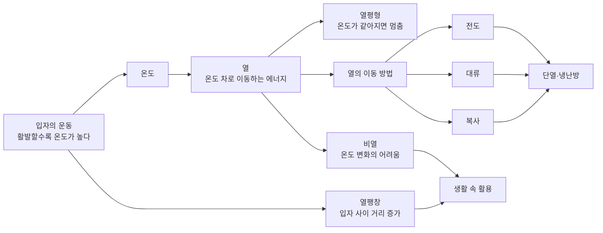

# 중1-3. 열 — 입자의 움직임으로 읽는 따뜻함과 차가움
<!-- next: m1-04, m1-06, phy-1, mech-2, 5-6 -->

> [!NOTE]
> **성취기준**
> - **[9과03-01]** 온도와 열평형 과정을 물질을 구성하는 입자들의 배치나 움직임 등으로 설명할 수 있다.
> - **[9과03-02]** 열은 전도, 대류, 복사로 전달됨을 알고, 열전달 과정을 모형 등을 사용하여 다양하게 표현할 수 있다.
> - **[9과03-03]** 물질에 따라 비열과 열팽창 정도가 다름을 알고, 이러한 성질이 일상생활에서 유용하게 활용됨을 인식할 수 있다.

**학습 목표**

1. 온도를 물질을 구성하는 입자의 움직임으로 설명하고, 열이 온도가 높은 곳에서 낮은 곳으로 이동함을 알 수 있다.
2. 온도가 다른 두 물체가 열평형에 도달하는 과정을 시간–온도 그래프와 입자 모형으로 설명할 수 있다.
3. 전도, 대류, 복사의 차이를 입자 모형과 비유로 표현하고, 단열과 냉난방에 적용할 수 있다.
4. 비열의 뜻을 알고, 물질에 따라 비열이 다르기 때문에 나타나는 현상을 설명할 수 있다.
5. 열팽창을 입자 사이의 거리로 설명하고, 물질에 따라 열팽창 정도가 다른 성질이 생활에 활용되는 예를 찾을 수 있다.

**이 단원의 학습 사다리**

| 단계 | 무엇을 하나? |
|---|---|
| STEP 1. 이전 학습 다시 보기 | 초등학교 「열과 우리 생활」의 온도 측정과 열의 이동을 다시 꺼내 본다 |
| STEP 2. 기초 다지기 | 입자, 에너지, 시간–온도 그래프 읽기, 비례 관계를 디딤돌로 놓는다 |
| STEP 3. 핵심 개념 | 온도와 입자 운동 → 열평형 → 전도·대류·복사 → 단열 → 비열 → 열팽창 |
| STEP 4. 오개념 바로잡기 | "철은 원래 차갑다?", "열팽창하면 입자가 커진다?" 같은 착각을 바로잡는다 |
| STEP 5. 다음 단계로 | 「물질의 상태 변화」, 「기체의 성질」, 역학과 에너지 「열과 에너지」로 이어진다 |
| STEP 6. 생활·산업·진로 | 단열 건축, 바이메탈, 열화상 카메라, 냉각 기술 |

---

## 🗺️ 단원 들어가기

한겨울 아침, 같은 교실에 있던 철로 된 의자 다리와 나무 책상을 손으로 만지면 철이 훨씬 차갑게 느껴진다. 둘은 같은 교실에 밤새 있었으니 온도가 같을 텐데, 왜 다르게 느껴질까?

여름 해수욕장에서 한낮의 모래는 발을 데일 만큼 뜨겁지만 바닷물은 시원하다. 같은 햇빛을 받았는데 왜 온도가 다를까? 또 철길의 레일 사이에는 왜 일부러 작은 틈을 남겨 둘까?

이 모든 질문의 답은 눈에 보이지 않는 **입자의 움직임**에 있다. 이 단원에서는 온도와 열을 입자로 설명하고, 열이 이동하는 세 가지 방법과 물질마다 다른 열의 성질(비열, 열팽창)을 배운다.

---

## STEP 1. 🔙 이전 학습 다시 보기

### 연계표

| 이전 단원·성취기준 | 그때 배운 것 | 이 단원에서 확장되는 것 |
|---|---|---|
| 초등학교 5~6학년군 「열과 우리 생활」 — 온도 측정 | 온도는 차갑거나 따뜻한 정도를 숫자로 나타낸 것이며, 온도계로 측정한다 | 온도를 **입자 운동의 활발한 정도**로 설명한다 |
| 초등학교 5~6학년군 「열과 우리 생활」 — 열의 이동 | 온도가 다른 두 물체가 닿으면 따뜻한 쪽에서 차가운 쪽으로 열이 이동하여 온도가 변한다 | 열의 이동을 입자 모형으로 설명하고, 온도가 같아진 상태인 **열평형**을 시간–온도 그래프로 분석한다 |
| 초등학교 5~6학년군 「열과 우리 생활」 — 고체·액체·기체에서 열의 이동 | 고체에서는 열이 물질을 따라 이동하고, 액체와 기체에서는 데워진 물질이 위로 올라가며 열이 이동한다. 단열하면 열의 이동을 줄일 수 있다 | 이를 **전도, 대류**로 정리하고, 물질 없이 열이 전달되는 **복사**를 새로 배운다 |

### 준비 운동 (사전 진단)

**Q1.** 뜨거운 국에 금속 숟가락을 넣어 두면 잠시 뒤 숟가락 손잡이까지 뜨거워진다. 열은 어느 쪽에서 어느 쪽으로 이동했는가?

**Q2.** 주전자에 물을 끓일 때 가열하는 곳은 아래쪽이다. 그런데도 위쪽 물까지 데워지는 까닭은?

**Q3.** 차가운 음료수 캔을 손으로 잡고 있으면 손은 차가워지고 음료수는 미지근해진다. 이때 열은 어디에서 어디로 이동했는가?

정답 및 해설

**Q1.** 뜨거운 국 → 숟가락의 국에 담긴 부분 → 숟가락 손잡이. 열은 온도가 높은 곳에서 낮은 곳으로 이동한다.

**Q2.** 아래쪽에서 데워진 물이 위로 올라가고, 위쪽의 차가운 물이 아래로 내려오면서 물 전체가 고르게 데워지기 때문이다. 이 단원에서 이것을 **대류**라고 부른다.

**Q3.** 손 → 음료수 캔. '차가움'이 손으로 이동한 것이 아니라 **열이 손에서 캔으로** 이동하여 손의 온도가 내려간 것이다.

---

## STEP 2. 🧱 기초 다지기

### ① 모든 물질은 움직이는 입자로 이루어져 있다

물, 공기, 쇠, 우리 몸까지 모든 물질은 눈에 보이지 않을 만큼 아주 작은 **입자(particle)** 로 이루어져 있다. 이 입자들은 가만히 있지 않고 **끊임없이 움직인다.** 고체의 입자는 제자리에서 떨고(진동하고), 액체와 기체의 입자는 이리저리 돌아다닌다.

| 상태 | 입자의 배치 | 입자의 움직임 |
|---|---|---|
| 고체 | 규칙적으로 촘촘하게 배열 | 제자리에서 진동한다 |
| 액체 | 비교적 가깝지만 불규칙하게 배열 | 서로 자리를 바꾸며 움직인다 |
| 기체 | 매우 멀리 떨어져 있다 | 빠르게 자유롭게 날아다닌다 |

(물질의 상태와 입자 배치는 다음 단원 「물질의 상태 변화」에서 자세히 배운다.)

### ② 에너지: 일을 하거나 변화를 일으키는 능력

**에너지(energy)** 는 물체를 움직이거나 온도를 바꾸는 등 변화를 일으킬 수 있는 능력이다. 움직이는 입자는 **운동 에너지**를 가지며, 입자가 빠르게 움직일수록 운동 에너지가 크다. 이 단원에서 배우는 **열**도 에너지의 한 형태이다.

### ③ 시간–온도 그래프 읽기

| 그래프 모양 | 뜻 |
|---|---|
| 오른쪽 위로 올라가는 선 | 시간이 지날수록 온도가 올라간다 |
| 오른쪽 아래로 내려가는 선 | 시간이 지날수록 온도가 내려간다 |
| 가로로 평평한 선 | 온도가 변하지 않는다 |
| 기울기가 가파른 선 | 온도가 빠르게 변한다 |

### ④ 비례와 반비례

- **비례**: 한 양이 2배, 3배가 되면 다른 양도 2배, 3배가 된다. (예: 물의 양이 2배이면 데우는 데 필요한 열도 2배)
- **반비례**: 한 양이 2배가 되면 다른 양은 $\frac{1}{2}$배가 된다. (예: 같은 질량에 같은 열을 줄 때 비열이 2배인 물질은 온도 변화가 $\frac{1}{2}$배)

---

## STEP 3. 📘 핵심 개념

### ① 온도: 입자 운동이 활발한 정도

**온도(temperature)** 는 물체의 차갑고 따뜻한 정도를 숫자로 나타낸 것이다. 입자의 관점에서 보면 온도는 **물질을 구성하는 입자들이 얼마나 활발하게 움직이는지**를 나타낸다.

- 온도가 **높다** → 입자의 움직임이 **활발하다**(빠르다).
- 온도가 **낮다** → 입자의 움직임이 **둔하다**(느리다).

우리가 흔히 쓰는 온도의 단위는 **섭씨온도**(°C)이다. 1기압에서 물이 어는 온도를 0 °C, 끓는 온도를 100 °C로 정하고 그 사이를 100등분하였다.

| 상황 | 입자의 움직임 |
|---|---|
| 얼음물 속의 물 (약 0 °C) | 느리게 움직인다 |
| 사람의 체온 (약 36.5 °C) | 얼음물보다 활발하다 |
| 끓는 물 (약 100 °C) | 매우 활발하게 움직인다 |

<!-- fig:m1-03-particle-temperature -->

> [!TIP]
> 💡 **비유 — 운동장의 학생들** 수업 시간에는 학생들이 자리에 앉아 조금씩 움직이고(낮은 온도), 쉬는 시간에는 이리저리 뛰어다닌다(높은 온도). 학생의 수는 같아도 **움직임의 활발함**이 다르다. 온도는 이 '활발함'을 나타내는 숫자이다.

#### 온도는 왜 손으로 재면 안 될까?

한 손은 찬물에, 다른 손은 따뜻한 물에 1분 동안 담갔다가 두 손을 함께 미지근한 물에 넣으면, 찬물에 있던 손은 따뜻하다고 느끼고 따뜻한 물에 있던 손은 차갑다고 느낀다. **감각은 사람과 상황에 따라 달라지므로** 정확한 온도는 온도계로 측정해야 한다.

<!-- fig:m1-03-hand-sense -->

#### 예제 1

같은 양의 물이 담긴 비커 A(20 °C)와 B(60 °C)가 있다. 두 비커에 같은 양의 잉크를 동시에 떨어뜨렸을 때 잉크가 더 빨리 퍼지는 비커와 그 까닭을 입자의 움직임으로 설명하시오.

**풀이** B. 온도가 높은 B의 물 입자가 더 활발하게 움직여 잉크 입자와 더 많이, 더 세게 부딪치므로 잉크가 더 빨리 퍼진다.

### ② 열과 열평형

#### 열: 온도 차이 때문에 이동하는 에너지

온도가 다른 두 물체가 접촉하면 **온도가 높은 물체에서 낮은 물체로** 에너지가 이동한다. 이렇게 온도 차이 때문에 이동하는 에너지를 **열(heat)** 이라고 한다.

- 열을 **잃은** 물체 → 입자 운동이 둔해져 온도가 **내려간다.**
- 열을 **얻은** 물체 → 입자 운동이 활발해져 온도가 **올라간다.**

#### 입자 모형으로 보는 열의 이동

뜨거운 물체의 활발한 입자가 차가운 물체의 둔한 입자와 부딪치면, 활발한 입자는 조금 느려지고 둔한 입자는 조금 빨라진다. 이런 충돌이 수없이 일어나며 두 물체 입자의 움직임이 점점 비슷해진다.

> [!TIP]
> 💡 **비유 — 당구공** 빠르게 굴러가는 당구공이 천천히 굴러가는 공에 부딪치면, 빠른 공은 느려지고 느린 공은 빨라진다. 열의 이동은 이런 충돌이 셀 수 없이 많이 일어나는 것과 같다.

#### 열평형: 온도가 같아지면 열의 이동이 멈춘다

열이 계속 이동하면 결국 두 물체의 온도가 같아진다. 이처럼 **온도가 다른 두 물체가 접촉한 뒤 시간이 지나 온도가 같아진 상태**를 **열평형(thermal equilibrium)** 이라고 한다. 열평형 상태에서는 두 물체의 입자 운동의 활발한 정도가 같아지므로 **겉으로 보기에 더 이상 열이 이동하지 않는다.**

<!-- sim:heat-equilibrium -->

#### 예제 2 — 시간–온도 그래프로 보는 열평형

80 °C의 물 200 g이 든 작은 컵을 20 °C의 물 300 g이 든 큰 그릇에 넣고 2분마다 온도를 측정하였다. (열은 두 물 사이에서만 이동한다고 가정한다.)

| 시간(분) | 0 | 2 | 4 | 6 | 8 | 10 |
|---|---|---|---|---|---|---|
| 작은 컵의 물(°C) | 80 | 62 | 53 | 47 | 44 | 44 |
| 큰 그릇의 물(°C) | 20 | 32 | 38 | 42 | 44 | 44 |

(1) 열평형에 도달한 시각과 그때의 온도는? (2) 처음부터 열평형까지 각 물의 온도 변화량은? (3) 시간에 따라 두 물의 온도 변화가 점점 느려지는 까닭은?

**풀이**
(1) 8분, 44 °C. 이후 두 물의 온도가 같게 유지된다.
(2) 작은 컵의 물: $80 - 44 = 36\ ^\circ\mathrm{C}$ 내려갔다. 큰 그릇의 물: $44 - 20 = 24\ ^\circ\mathrm{C}$ 올라갔다.
(3) 두 물의 온도 차이가 처음에는 $60\ ^\circ\mathrm{C}$로 크지만 점점 줄어든다. **온도 차이가 작을수록 열이 천천히 이동**하기 때문에 그래프의 기울기가 점점 완만해진다.

> [!IMPORTANT]
> 두 물의 온도 변화량(36 °C, 24 °C)이 다른 까닭은 물의 양이 다르기 때문이다. 작은 컵의 물이 **잃은 열**과 큰 그릇의 물이 **얻은 열**은 같다. 양이 많은 물은 같은 열을 얻어도 온도가 덜 변한다. 열은 사라지지 않고 **한쪽에서 다른 쪽으로 옮겨 갈 뿐**이다.

#### 예제 3

80 °C의 물 100 g과 20 °C의 물 100 g을 섞었다. 열이 바깥으로 빠져나가지 않는다면 열평형 온도는 몇 °C일까?

**풀이** 같은 물질, 같은 양이므로 뜨거운 물이 내려가는 온도와 차가운 물이 올라가는 온도가 같다. 따라서 두 온도의 한가운데인 $(80 + 20) \div 2 = 50\ ^\circ\mathrm{C}$이다.

#### 생활 속 열평형

| 사례 | 열평형으로 설명하기 |
|---|---|
| 체온계를 겨드랑이에 몇 분 동안 끼워 둔다 | 체온계와 몸이 열평형을 이룰 때까지 기다려야 정확한 체온이 나온다 |
| 수박을 차가운 계곡물에 담가 둔다 | 열이 수박에서 계곡물로 이동하여 수박이 시원해진다 |
| 생선을 얼음 위에 올려 둔다 | 열이 생선에서 얼음으로 이동하여 생선이 신선하게 유지된다 |
| 냉장고 속 음식은 시간이 지나면 냉장고 안과 온도가 같아진다 | 음식과 냉장고 안 공기가 열평형을 이룬다 |

### ③ 열의 이동 1 — 전도

**전도(conduction)** 는 고체에서 입자의 움직임이 **이웃한 입자에 차례로 전달되어** 열이 이동하는 방식이다. 입자 자체는 제자리에서 진동할 뿐 멀리 이동하지 않는다.

- 예: 프라이팬 손잡이가 뜨거워진다, 뜨거운 국에 담근 숟가락이 뜨거워진다, 찜질팩을 대면 배가 따뜻해진다.

물질에 따라 열이 전도되는 정도가 다르다.

| 열이 잘 전도되는 물질 | 열이 잘 전도되지 않는 물질 |
|---|---|
| 구리, 알루미늄, 철 등 금속 | 나무, 플라스틱, 유리, 스타이로폼, 천, 공기 |
| 이용: 냄비·프라이팬의 바닥 | 이용: 냄비 손잡이, 주방 장갑, 보온재 |

대체로 금속 > 유리 > 나무·플라스틱 > 공기 순으로 열이 잘 전도된다. 금속 중에서는 구리가 알루미늄이나 철보다 열을 잘 전도한다.

> [!TIP]
> 💡 **신체 비유 — 어깨동무 줄** 학생들이 어깨동무를 하고 한 줄로 서 있다. 맨 앞 학생이 몸을 흔들면 옆 학생에게, 그 옆 학생에게 차례로 흔들림이 전해진다. **아무도 자리를 옮기지 않았는데** 흔들림(에너지)이 줄 끝까지 전달된다. 이것이 전도이다.

#### 겨울에 철이 나무보다 차갑게 느껴지는 까닭

교실에 함께 있던 철과 나무는 **온도가 같다.** 그러나 손이 철에 닿으면 열이 손에서 철로 **빠르게 전도되어** 손의 온도가 빨리 내려가므로 더 차갑게 느낀다. 나무는 열이 잘 전도되지 않아 손의 열을 천천히 빼앗는다. 우리 손은 온도 자체보다 **열이 빠져나가는 빠르기**를 느끼는 것이다.

### ④ 열의 이동 2 — 대류

**대류(convection)** 는 액체나 기체에서 **입자가 직접 이동하면서** 열이 이동하는 방식이다.

1. 아래쪽 액체(기체)가 데워지면 입자 운동이 활발해져 입자 사이가 멀어지고, 같은 부피에 든 입자 수가 줄어 가벼워진다.
2. 가벼워진 따뜻한 물질은 **위로 올라가고**, 위쪽의 차가운 물질은 **아래로 내려온다.**
3. 이 순환이 되풀이되며 전체가 고르게 데워진다.

| 대류 이용 사례 | 설치 위치와 까닭 |
|---|---|
| 난로, 온풍기 | **아래쪽**에 둔다. 데워진 공기가 위로 올라가고 차가운 공기가 내려오며 방 전체가 따뜻해진다 |
| 에어컨 | **위쪽**에 둔다. 차가운 공기가 아래로 내려가고 따뜻한 공기가 올라오며 방 전체가 시원해진다 |
| 냄비로 물 끓이기 | 바닥을 가열하면 물이 돌면서 전체가 데워진다 |
| 바닷가의 바람 | 낮에 데워진 육지 위 공기가 올라가고, 그 자리로 바다 위 시원한 공기가 불어 들어온다 |

<!-- fig:m1-03-convection-room -->

> [!TIP]
> 💡 **신체 비유 — 물건을 들고 직접 걸어가기** 교실 뒤에 있는 학생이 물건을 **직접 들고 걸어가서** 앞에 전해 준다. 전도는 '손에서 손으로 전달', 대류는 '사람이 직접 이동'이다.

#### 예제 4

겨울철 거실을 빨리 따뜻하게 하려면 전기난로를 바닥에 둘까, 천장 가까이 둘까? 까닭과 함께 쓰시오.

**풀이** 바닥에 둔다. 난로가 데운 공기는 가벼워져 위로 올라가고, 위쪽의 차가운 공기가 내려와 다시 데워지는 **대류**가 일어나 방 전체가 고르게 따뜻해진다. 천장 가까이 두면 데워진 공기가 위쪽에만 머물러 아래쪽은 잘 따뜻해지지 않는다.

### ⑤ 열의 이동 3 — 복사

**복사(radiation)** 는 열이 물질의 도움 없이 **직접 전달되는** 방식이다. 전도와 대류는 입자가 있어야 하지만, 복사는 입자가 거의 없는 우주 공간도 지나갈 수 있다.

- 예: 태양의 열이 우주 공간을 지나 지구에 도달한다, 모닥불이나 난로 앞에 서면 얼굴이 따뜻하다, 햇빛 아래 세워 둔 자동차 안이 뜨거워진다.
- 모든 물체는 온도에 따라 복사로 에너지를 내보낸다. **열화상 카메라**는 물체가 내보내는 복사를 감지하여 온도 분포를 색깔로 보여 준다.
- 검은색이나 어두운 색 물체는 복사를 잘 흡수하고, 흰색이나 반짝이는 물체는 복사를 잘 반사한다. 그래서 여름에는 밝은 색 옷이 시원하다.

> [!TIP]
> 💡 **신체 비유 — 공 던지기** 멀리 있는 친구에게 공을 **던지면** 중간에 아무도 없어도 공이 바로 전달된다. 복사는 중간에 전달해 줄 입자가 없어도 에너지가 곧바로 날아가는 방식이다.

#### 세 가지 열의 이동 방법 비교

| 구분 | 전도 | 대류 | 복사 |
|---|---|---|---|
| 주로 일어나는 곳 | 고체 | 액체, 기체 | 물질이 없어도 된다(진공 포함) |
| 열이 이동하는 방법 | 이웃한 입자에 움직임이 차례로 전달된다 | 입자가 직접 이동하며 순환한다 | 물질 없이 직접 전달된다 |
| 신체 비유 | 어깨동무 줄의 흔들림 | 물건을 들고 걸어가기 | 공 던지기 |
| 생활 예 | 프라이팬 손잡이가 뜨거워짐 | 난로는 아래, 에어컨은 위 | 햇볕, 난로 앞의 따뜻함 |

<!-- fig:m1-03-heat-transfer -->

#### 예제 5

캠핑장에서 모닥불에 냄비를 올려 국을 끓이고 있다. 다음 현상은 각각 열의 이동 방법 중 무엇인가?
(가) 모닥불 앞에 앉은 사람의 얼굴이 따뜻해진다. (나) 냄비 바닥의 국이 데워져 위로 올라간다. (다) 냄비에 걸쳐 둔 쇠 국자 손잡이가 뜨거워진다.

**풀이** (가) 복사, (나) 대류, (다) 전도

### ⑥ 열의 이동을 막는 단열과 냉난방

**단열(insulation)** 은 열의 이동을 막는 것이다. 단열하려면 전도, 대류, 복사를 **모두** 줄여야 한다.

| 단열 사례 | 막는 열의 이동 | 원리 |
|---|---|---|
| 보온병의 두 겹 벽 사이 진공 | 전도, 대류 | 입자가 거의 없어 전도와 대류가 일어나기 어렵다 |
| 보온병 안쪽의 반짝이는 은색 면 | 복사 | 복사를 반사하여 열이 빠져나가거나 들어오는 것을 줄인다 |
| 보온병 마개 | 대류 | 공기가 드나드는 것을 막는다 |
| 이중창, 삼중창 유리 | 전도, 대류 | 유리 사이의 공기층(또는 기체층)이 열의 전도를 줄인다 |
| 벽 속 스타이로폼 단열재, 오리털 점퍼 | 전도, 대류 | 작은 공기 방이 많아 공기가 잘 움직이지 못하고 열도 잘 전도되지 않는다 |
| 아이스박스 | 전도, 대류 | 공기가 갇힌 스타이로폼 벽이 바깥의 열이 들어오는 것을 막는다 |
| 응급 담요(은박 담요) | 복사 | 몸에서 나가는 복사를 반사하여 체온을 지킨다 |

> [!IMPORTANT]
> 공기는 열을 잘 전도하지 않지만 자유롭게 움직이면 대류로 열을 옮긴다. 그래서 단열재는 공기를 **작은 공간에 가두어 움직이지 못하게** 만든다. 털옷, 오리털, 스타이로폼이 따뜻한 비밀이 바로 '갇힌 공기'이다.

<!-- fig:m1-03-thermos -->

#### 예제 6

보온병에 뜨거운 물을 담아 두면 오랫동안 식지 않는다. 보온병의 구조 중 (1) 전도를 막는 부분, (2) 복사를 막는 부분을 쓰시오.

**풀이** (1) 두 겹 벽 사이의 진공 (2) 벽 안쪽의 은색으로 반짝이는 면

### ⑦ 비열: 물질마다 온도가 변하는 정도가 다르다

같은 불꽃으로 같은 질량의 물과 식용유를 가열하면 식용유의 온도가 훨씬 빨리 올라간다. 같은 열을 받아도 **물질에 따라 온도가 변하는 정도가 다르기** 때문이다.

**비열(specific heat)** 은 **어떤 물질 1 kg의 온도를 1 °C 높이는 데 필요한 열량**이다. 열의 양(**열량**)은 kcal(킬로칼로리)나 J(줄) 단위로 나타낸다.

- 물 1 kg의 온도를 1 °C 높이는 데 약 1 kcal(약 4.2 kJ)의 열량이 필요하다. → 물의 비열은 약 $1\ \mathrm{kcal/(kg\cdot{}^\circ C)}$
- **비열이 큰 물질**: 온도를 바꾸기 어렵다. 천천히 데워지고 천천히 식는다.
- **비열이 작은 물질**: 온도가 쉽게 변한다. 빨리 데워지고 빨리 식는다.

| 물질 | 비열 (kcal/(kg·°C)) | 비고 |
|---|---|---|
| 물 | 1.00 | 주변 물질 중 매우 크다 |
| 에탄올 | 약 0.58 | |
| 식용유 | 약 0.4~0.5 | 종류에 따라 조금씩 다르다 |
| 알루미늄 | 약 0.21 | |
| 모래 | 약 0.19 | 상태에 따라 다르다 |
| 철 | 약 0.11 | |
| 구리 | 약 0.09 | |

<!-- fig:m1-03-specific-heat-graph -->

> [!TIP]
> 💡 **비유 — 물을 채우는 그릇** 비열은 '온도 1 °C를 올리려면 채워야 하는 열의 양'이다. 바닥이 넓은 큰 그릇(비열이 큰 물질)은 물을 많이 부어야 수면이 1 cm 올라가고, 좁은 컵(비열이 작은 물질)은 조금만 부어도 수면이 쑥 올라간다. 같은 양의 물(열)을 부으면 좁은 컵의 수면(온도)이 더 많이 변한다.

#### 필요한 열량은 무엇에 비례할까?

같은 물질이라도 양이 많을수록, 온도를 많이 올릴수록 열이 더 많이 필요하다. 물체가 얻거나 잃는 열량은 **비열, 질량, 온도 변화에 각각 비례**한다. (이 관계를 식으로 계산하는 것은 STEP 5에서 맛보기로 다룬다.)

#### 예제 7

(1) 물 1 kg의 온도를 10 °C 높이는 데 필요한 열을 기준으로 하면, 물 2 kg의 온도를 10 °C 높이는 데에는 몇 배의 열이 필요할까? (2) 물 1 kg과 같은 질량의 식용유의 온도를 10 °C 높이는 데에는 몇 배의 열이 필요할까? (식용유의 비열은 물의 $\frac{1}{2}$이라고 가정한다.)

**풀이**
(1) 2배. 같은 물질을 같은 온도만큼 높일 때 필요한 열은 질량에 비례한다.
(2) $\frac{1}{2}$배. 질량과 온도 변화가 같을 때 필요한 열은 비열에 비례하므로, 비열이 물의 절반인 식용유는 열도 절반만 필요하다.

#### 예제 8

같은 질량의 물과 식용유에 같은 양의 열을 가했더니 물의 온도는 10 °C 올라갔다. 식용유의 온도는 몇 °C 올라갔을까? (식용유의 비열은 물의 $\frac{1}{2}$이라고 가정한다.)

**풀이** 같은 열량, 같은 질량에서 온도 변화는 비열에 **반비례**한다. 식용유의 비열이 물의 $\frac{1}{2}$이므로 온도 변화는 2배인 $20\ ^\circ\mathrm{C}$이다.

#### 생활 속 비열

| 현상·활용 | 비열로 설명하기 |
|---|---|
| 한낮의 해변: 모래는 뜨겁고 바닷물은 시원하다 | 모래는 비열이 작아 빨리 뜨거워지고, 물은 비열이 커서 온도가 천천히 오른다 |
| 바닷가 지역은 내륙보다 하루와 계절의 기온 차가 작다 | 비열이 큰 바닷물이 천천히 데워지고 천천히 식어 주변 기온 변화를 줄인다 |
| 낮에는 바다에서 육지로 바람이 분다(해풍) | 비열이 작은 육지가 빨리 데워져 육지 위 공기가 올라가고, 바다 위 공기가 그 자리로 불어온다 |
| 찜질팩, 보온 물주머니에 물을 넣는다 | 비열이 큰 물은 열을 많이 저장하고 천천히 식는다 |
| 자동차 엔진의 냉각수 | 비열이 큰 물(냉각수)이 엔진의 열을 많이 흡수한다 |
| 사람의 체온이 잘 변하지 않는다 | 몸의 많은 부분을 차지하는 물의 비열이 커서 체온이 쉽게 변하지 않는다 |
| 뚝배기의 찌개가 오래 따뜻하다 | 열량은 질량에도 비례하므로, 두껍고 무거운 뚝배기는 열을 많이 저장했다가 천천히 내보낸다 |
| 프라이팬은 금속으로 만든다 | 비열이 작고 열을 잘 전도해 빨리 뜨거워진다 |

### ⑧ 열팽창: 물질마다 늘어나는 정도가 다르다

물질의 온도가 높아지면 **입자 운동이 활발해져 입자 사이의 거리가 멀어지므로** 부피가 늘어난다. 이를 **열팽창(thermal expansion)** 이라고 한다. 온도가 낮아지면 반대로 입자 사이의 거리가 가까워져 부피가 줄어든다(수축).

> [!IMPORTANT]
> 열팽창은 **입자 자체가 커지는 것이 아니다.** 입자의 수와 크기는 그대로이고, **입자 사이의 거리**가 멀어지는 것이다. 그래서 열팽창해도 질량은 변하지 않는다.

<!-- fig:m1-03-expansion -->

> [!TIP]
> 💡 **신체 비유 — 팔 벌리고 춤추기** 학생들이 가만히 서 있으면 좁은 공간에도 들어갈 수 있지만, 신나게 팔을 휘두르며 춤을 추면 서로 부딪치지 않으려고 간격이 넓어져 차지하는 공간이 커진다. 사람 수와 몸의 크기는 그대로이다.

#### 물질에 따라 열팽창 정도가 다르다

- 같은 온도만큼 변할 때 대체로 **기체 > 액체 > 고체** 순으로 많이 팽창한다.
- 고체끼리도 다르다. 같은 온도 변화에서 알루미늄은 철보다 약 2배 정도 많이 늘어나고, 보통 유리는 철보다 덜 늘어나며, 내열 유리는 보통 유리보다 훨씬 덜 늘어난다.

| 활용·현상 | 열팽창으로 설명하기 |
|---|---|
| 철로 레일 사이의 틈 | 여름에 레일이 늘어나 휘어지지 않도록 틈을 둔다 |
| 다리의 이음매(신축 이음 장치) | 온도에 따라 다리 상판이 늘어나고 줄어드는 것을 받아 준다 |
| 여름에 전깃줄이 더 처진다 | 전깃줄이 늘어나 길어진다. 그래서 겨울에 끊어지지 않도록 여유 있게 설치한다 |
| 꽉 닫힌 유리병의 금속 뚜껑을 뜨거운 물에 담그면 잘 열린다 | 금속 뚜껑이 유리병보다 더 많이 팽창하여 헐거워진다 |
| 알코올 온도계 | 온도가 오르면 액체가 팽창하여 가는 관을 따라 올라간다 |
| 내열 유리 그릇 | 열팽창이 작아 갑자기 뜨거워지거나 차가워져도 잘 깨지지 않는다 |
| 치아 충전재 | 치아와 열팽창 정도가 비슷한 재료를 써야 뜨겁거나 찬 음식을 먹어도 틈이 생기지 않는다 |
| 철근 콘크리트 건물 | 철근과 콘크리트는 열팽창 정도가 비슷하여 온도가 변해도 서로 잘 떨어지지 않는다 |

#### 바이메탈

열팽창 정도가 **다른 두 금속**을 붙여 만든 것을 **바이메탈(bimetal)** 이라고 한다. 가열하면 더 많이 늘어나는 금속이 바깥쪽이 되도록 **덜 늘어나는 금속 쪽으로 휘어진다.** 식으면 원래대로 돌아온다. 이 성질을 이용해 온도에 따라 전기 회로를 자동으로 끊거나 연결하는 장치(전기 주전자, 다리미, 전기장판의 온도 조절 장치 등)를 만든다.

<!-- fig:m1-03-bimetal -->

#### 예제 9

알루미늄과 철을 붙여 만든 바이메탈을 가열하였다. 알루미늄이 철보다 열팽창 정도가 크다면 바이메탈은 어느 쪽으로 휘어지는가?

**풀이** **철 쪽**으로 휘어진다. 알루미늄이 더 많이 늘어나므로 알루미늄이 휘어진 바깥쪽(더 긴 쪽)이 되고, 덜 늘어나는 철이 안쪽이 된다.

---

## STEP 4. ⚠️ 오개념 바로잡기

| 흔한 오개념 | 올바른 개념 | 왜 그럴까? |
|---|---|---|
| 철은 원래 나무보다 차갑다 | 같은 곳에 오래 있었다면 **온도는 같다** | 철은 열을 잘 전도하여 손의 열을 빨리 빼앗으므로 더 차갑게 **느껴질** 뿐이다 |
| 차가운 물체에서 '차가움(냉기)'이 이동한다 | 이동하는 것은 **열**이며, 언제나 온도가 높은 곳에서 낮은 곳으로 이동한다 | 얼음을 쥐면 손의 열이 얼음으로 이동하여 손의 온도가 내려간다 |
| 열과 온도는 같은 것이다 | 온도는 입자 운동의 활발한 정도, 열은 **온도 차이로 이동하는 에너지**이다 | 온도가 같은 컵의 물과 욕조의 물도 식을 때 내놓는 열의 양은 크게 다르다 |
| 열평형이 되면 입자의 움직임이 멈춘다 | 열평형에서도 입자는 계속 움직이며, **두 물체의 입자 운동 정도가 같아질 뿐**이다 | 입자는 언제나 움직이고 있다. 온도가 같아져 열의 이동이 겉으로 멈춘 것처럼 보인다 |
| 열팽창하면 입자의 크기가 커진다 | **입자 사이의 거리**가 멀어져 부피가 커진다 | 입자의 크기와 수는 변하지 않으므로 질량도 변하지 않는다 |
| 비열이 큰 물질은 빨리 뜨거워진다 | 비열이 큰 물질은 **온도가 잘 변하지 않는다** | 비열은 1 °C를 올리는 데 필요한 열량이므로, 클수록 많은 열이 필요하다 |
| 털옷은 스스로 열을 만들어 따뜻하다 | 털옷은 열을 만들지 않고 **몸의 열이 빠져나가는 것을 막는다** | 털 사이에 갇힌 공기가 전도와 대류를 줄인다 |

---

## STEP 5. 🎓 다음 단계로 한 걸음 더

> [!CAUTION]
> 이 절은 **중학교 1학년 교육과정 범위 밖의 심화 내용**으로 평가 대상이 아니다. 이 단원의 온도, 열, 비열, 열팽창이 다음 단원과 고등학교 과목에서 어떻게 이어지고 깊어지는지 맛보기로 보여 주기 위한 내용이다.

### 다음 학년·과목과의 연결

| 학년·과목 | 단원 | 이어지는 내용 |
|---|---|---|
| 중학교 1학년 | 「물질의 상태 변화」 | 상태가 변할 때 열을 흡수하거나 방출하며, 그동안 온도가 일정하게 유지되는 까닭 |
| 중학교 1학년 | 「기체의 성질」 | 기체의 온도가 높아지면 부피가 늘어나는 관계(기체의 열팽창)를 입자 모형으로 해석 |
| 통합과학2 | 「에너지 효율과 신재생 에너지」 | 에너지가 전환될 때 열이 발생하며, 버려지는 열 때문에 에너지 효율이 낮아짐 |
| 물리학 | 「힘과 에너지」 | 열의 형태로 에너지가 전환되면서 일어나는 열전달, 상태 변화, 기상 현상 |
| 역학과 에너지 | 「열과 에너지」 | 유체에서의 열전달과 단열 설계, 비열과 잠열의 정량적 이해, 열역학 제1법칙, 열기관과 열효율 |

### ① 서로 다른 물질을 섞을 때의 열평형 계산

중학교에서는 "열량은 비열, 질량, 온도 변화에 각각 비례한다"는 관계까지 배운다. 고등학교 「역학과 에너지」에서는 비열을 정량적으로 다루며, 이 관계를 식으로 쓴다.

$$
\text{열량} = \text{비열} \times \text{질량} \times \text{온도 변화}
$$

예를 들어 물(비열 $1\ \mathrm{kcal/(kg\cdot{}^\circ C)}$) 2 kg의 온도를 20 °C에서 50 °C로 높이는 데 필요한 열량은 $1 \times 2 \times 30 = 60\ \mathrm{kcal}$이다.

예제 2에서 "잃은 열 = 얻은 열"이라고 했다. 고등학교에서는 이것을 서로 다른 물질에도 적용한다. 뜨거운 물체 1과 차가운 물체 2가 열평형 온도 $T$가 되었다면,

$$
c_1 m_1 (t_1 - T) = c_2 m_2 (T - t_2)
$$

($c$: 비열, $m$: 질량, $t_1$, $t_2$: 처음 온도) 예를 들어 100 °C로 가열한 철 덩어리를 물에 넣어 열평형 온도를 측정하면, 이 식으로 철의 비열을 알아낼 수 있다. 또 물체 전체의 온도를 1 °C 높이는 데 필요한 열량을 **열용량**(= 비열 × 질량)이라고 부른다.

### ② 절대 온도 — 입자 운동이 가장 둔한 온도

온도가 입자 운동의 활발한 정도라면, 온도를 계속 낮추면 어떻게 될까? 이론적으로 입자 운동이 가장 둔해지는 온도가 약 $-273\ ^\circ\mathrm{C}$이며, 이 온도를 0으로 하는 온도를 **절대 온도**(단위: K, 켈빈)라고 한다.

$$
T(\mathrm{K}) = t(^\circ\mathrm{C}) + 273
$$

기체의 성질과 열역학에서는 섭씨온도 대신 절대 온도를 사용한다.

### ③ 물의 특별한 열팽창

대부분의 액체는 온도가 낮아질수록 부피가 줄어들지만, 물은 약 4 °C보다 낮아지면 오히려 부피가 늘어나고, 얼음이 되면 부피가 더 커진다. 그래서 겨울에 호수는 위에서부터 얼고, 얼음 아래 4 °C 근처의 물에서 물고기가 겨울을 날 수 있다. 이 현상은 물 분자의 특별한 결합 방식 때문이며, 고등학교 「화학」에서 배운다.

### ④ 열과 일은 서로 바뀐다 — 열역학

마찰로 손이 따뜻해지는 것처럼 일은 열로 바뀌고, 자동차 엔진처럼 열을 이용해 일을 할 수도 있다. 「역학과 에너지」에서는 기체에 가한 열이 내부 에너지 증가와 외부에 한 일로 나뉜다는 **열역학 제1법칙**을 배우며, 이는 에너지 보존 법칙의 다른 표현이다. 또 열이 저절로는 차가운 곳에서 뜨거운 곳으로 가지 않는다는 비가역 현상을 **엔트로피**로 설명한다.

### 지금 vs 다음 단계

| 구분 | 지금 (중1) | 다음 단계 (고등학교 물리학·역학과 에너지) |
|---|---|---|
| 온도 | 입자 운동의 활발한 정도, 섭씨온도 | 분자 운동 에너지와의 관계, 절대 온도(K) |
| 열평형 | 시간–온도 그래프, 같은 물질의 간단한 경우 | 서로 다른 물질의 열량 보존 계산, 열용량 |
| 열의 이동 | 전도·대류·복사를 입자 모형과 비유로 표현 | 유체의 열전달, 건축물 단열 설계 |
| 비열 | 비열의 뜻과 생활 속 현상 | 비열과 잠열의 정량적 분석 |
| 열팽창 | 입자 사이 거리 증가, 바이메탈 | 기체의 압력·부피·온도 관계, 이상 기체 법칙 |
| 에너지 | 열은 이동하는 에너지 | 열역학 제1법칙, 열기관과 열효율, 엔트로피 |

---

## STEP 6. 🏭 생활·산업·진로 연결

### 사례 1. 단열 건축 — 에너지를 아끼는 집

- **원리** 겨울에는 실내의 열이 밖으로, 여름에는 바깥의 열이 안으로 들어오지 않게 막으면 냉난방 에너지를 크게 줄일 수 있다.
- **어디에 쓰이나** 벽 속 단열재, 이중·삼중 유리창, 틈새를 막는 문풍지, 햇빛을 반사하는 밝은 색 지붕 등이 있다. 단열이 잘된 건물은 냉난방에 쓰는 화석 연료를 줄여 「과학과 인류의 지속가능한 삶」에서 배운 탄소 배출 줄이기에도 도움이 된다.

### 사례 2. 바이메탈과 온도 조절 장치

- **원리** 두 금속의 열팽창 정도 차이로 바이메탈이 휘어지며 전기 회로를 끊거나 연결한다.
- **어디에 쓰이나** 전기 주전자는 물이 끓어 바이메탈이 휘어지면 저절로 전원이 꺼진다. 다리미, 전기장판, 일부 화재 경보 장치에도 쓰인다.

### 사례 3. 열화상 카메라

- **원리** 모든 물체는 온도에 따라 복사로 에너지를 내보내며, 열화상 카메라는 이를 감지하여 온도를 색으로 보여 준다.
- **어디에 쓰이나** 건물에서 열이 새는 곳 찾기, 전기 설비의 과열 점검, 공항·병원의 발열 확인, 야간 구조 활동, 야생 동물 관찰 등에 쓰인다.

### 사례 4. 전자 기기의 냉각

- **원리** 스마트폰과 컴퓨터의 부품은 작동할 때 열이 나며, 너무 뜨거워지면 성능이 떨어지거나 고장 난다. 열을 잘 전도하는 금속판으로 열을 옮기고(전도), 팬으로 공기를 흘려보내 식힌다(대류).
- **어디에 쓰이나** 컴퓨터의 방열판과 냉각 팬, 대형 데이터 센터의 냉각 시설, 자동차 엔진의 냉각수(비열이 큰 물 이용) 등이 있다.

### 관련 진로와 학과

| 진로 | 하는 일 | 관련 학과 |
|---|---|---|
| 건축 설비·에너지 엔지니어 | 건물의 단열과 냉난방 설비를 설계한다 | 건축공학, 건축설비공학, 에너지공학 |
| 기계·열 시스템 엔지니어 | 엔진, 냉장고, 에어컨 같은 열 기계를 설계한다 | 기계공학 |
| 전자 기기 열 설계 엔지니어 | 반도체와 전자 기기의 열을 효율적으로 식히는 구조를 만든다 | 전자공학, 기계공학, 재료공학 |
| 신소재 연구원 | 열팽창이 작은 소재, 단열 성능이 높은 소재를 개발한다 | 재료공학, 신소재공학, 화학공학 |
| 기상·해양 연구원 | 바다와 육지의 비열 차이, 대기의 대류로 날씨와 기후를 연구한다 | 대기과학, 해양학, 지구과학 |

---

## 🔬 탐구 활동

### 활동 A. 열화상 카메라를 이용하여 물체에서 열의 전도 비교하기

**목표** 여러 가지 물질로 된 막대에서 열이 전도되는 빠르기를 열화상 카메라로 비교한다.

**준비물** 길이와 굵기가 같은 구리·알루미늄·철·유리 막대(또는 같은 크기의 금속·플라스틱·나무 숟가락), 뜨거운 물(약 70 °C), 스타이로폼 컵(또는 단열 용기), 열화상 카메라(또는 스마트폰용 열화상 장치), 초시계, 집게, 면장갑

**과정**
1. 막대들을 같은 깊이로 뜨거운 물이 담긴 단열 용기에 동시에 세운다.
2. 30초마다 3분 동안 열화상 카메라로 막대들을 촬영한다.
3. 각 막대에서 '따뜻한 색'이 위로 올라온 높이를 비교하여 기록한다.

<!-- fig:m1-03-conduction-rods -->

**결과 기록 표**

| 막대 | 30초 | 1분 | 2분 | 3분 | 열이 전도되는 빠르기 순위 |
|---|---|---|---|---|---|
| 구리 | | | | | |
| 알루미늄 | | | | | |
| 철 | | | | | |
| 유리 | | | | | |

**생각해 보기**
1. 열이 가장 빨리 전도된 막대는 무엇이며, 그 물질은 생활에서 어디에 쓰이면 좋을까?
2. 막대의 길이와 굵기, 물에 담그는 깊이를 같게 한 까닭은 무엇일까? (변인 통제)
3. 열화상 카메라로 막대의 온도를 볼 수 있는 것은 열의 이동 방법 중 무엇과 관련 있을까?

### 활동 B. 온도 센서를 이용하여 여러 가지 액체의 비열 비교하기

**목표** 같은 조건에서 같은 질량의 물과 식용유를 데우며 온도 변화를 측정하여 비열을 비교한다.

**준비물** 같은 크기의 시험관 2개(또는 작은 금속 컵 2개), 물, 식용유, 전자저울, 온도 센서 2개와 기록 장치(또는 디지털 온도계), 큰 비커에 담은 따뜻한 물(약 60 °C, 물중탕용), 스탠드, 초시계

**과정**
1. 두 시험관에 물과 식용유를 **같은 질량**(예: 각 30 g)씩 담는다. 처음 온도가 같은지 확인한다.
2. 온도 센서를 각 시험관에 넣고, 두 시험관을 **동시에** 같은 따뜻한 물이 담긴 큰 비커에 같은 깊이로 담근다(물중탕).
3. 30초마다 5분 동안 두 액체의 온도를 기록하고 시간–온도 그래프를 그린다.

<!-- fig:m1-03-specific-heat-lab -->

**결과 기록 표**

| 시간(분) | 0 | 1 | 2 | 3 | 4 | 5 |
|---|---|---|---|---|---|---|
| 물(°C) | | | | | | |
| 식용유(°C) | | | | | | |

**생각해 보기**
1. 같은 시간 동안 온도가 더 많이 올라간 액체는? 이 결과로 두 액체의 비열을 비교해 보자.
2. 물중탕으로 가열하면 두 액체가 같은 시간 동안 받는 열이 비슷해진다. 그렇게 한 까닭은?
3. 이 결과를 이용해 "해변의 모래는 뜨겁고 바닷물은 시원한 까닭"을 설명해 보자.

> [!WARNING]
> **안전 수칙** 뜨거운 물과 가열 장치는 화상과 화재의 위험이 있으므로 반드시 선생님의 지도 아래 다루고, 보안경과 면장갑을 착용한다. **식용유는 불꽃으로 직접 가열하지 않는다**(과열되면 불이 붙을 수 있다). 뜨거운 시험관은 집게로 잡고, 실험이 끝난 막대와 기구는 충분히 식힌 뒤 정리한다. 전기 기구 근처에 물을 흘리지 않는다.

---

## ✅ 개념 확인 문제

### 기본

**1.** 온도에 대한 설명으로 옳은 것을 **모두** 고르시오.
ㄱ. 온도는 물체의 차갑고 따뜻한 정도를 숫자로 나타낸 것이다.
ㄴ. 온도가 높을수록 물질을 구성하는 입자의 움직임이 활발하다.
ㄷ. 손으로 만져 보면 정확한 온도를 알 수 있다.

정답 및 해설

**정답 ㄱ, ㄴ**

ㄷ. 감각은 사람과 상황에 따라 다르게 느껴지므로 정확한 온도는 온도계로 측정해야 한다.

**2.** 온도가 다른 두 물체가 접촉한 뒤 시간이 지나 온도가 같아진 상태를 무엇이라고 하는가? 또 이 상태에서 두 물체의 입자 운동은 어떠한가?

정답 및 해설

**정답** 열평형. 두 물체의 입자 운동의 활발한 정도가 같아진다.

입자는 계속 움직이지만 두 물체의 입자 운동 정도가 같아져 겉으로 보기에 열의 이동이 멈춘다.

**3.** 다음 현상과 관련된 열의 이동 방법을 바르게 연결하시오.
(가) 햇볕을 쬐면 몸이 따뜻해진다. (나) 냄비 손잡이가 뜨거워진다. (다) 에어컨을 위쪽에 설치한다.

정답 및 해설

**정답** (가) 복사, (나) 전도, (다) 대류

**4.** 빈칸에 알맞은 말을 쓰시오.
"어떤 물질 1 kg의 온도를 1 °C 높이는 데 필요한 열량을 ( ㄱ )(이)라고 한다. ( ㄱ )이/가 큰 물질일수록 온도가 ( ㄴ ) 변한다."

정답 및 해설

**정답** ㄱ: 비열, ㄴ: 천천히(적게)

비열이 큰 물질은 같은 열을 받아도 온도가 잘 변하지 않는다.

**5.** 물체를 가열하여 열팽창이 일어날 때 변하는 것과 변하지 않는 것을 다음에서 골라 쓰시오.
입자의 크기, 입자의 수, 입자 사이의 거리, 물체의 부피, 물체의 질량

정답 및 해설

**정답** 변하는 것: 입자 사이의 거리, 물체의 부피 / 변하지 않는 것: 입자의 크기, 입자의 수, 물체의 질량

입자 운동이 활발해져 입자 사이의 거리가 멀어지므로 부피가 늘어난다. 입자의 크기와 수는 그대로이므로 질량도 변하지 않는다.

### 응용

**6.** 90 °C의 물이 든 컵 A를 10 °C의 물이 든 그릇 B에 넣었더니 시간에 따라 온도가 다음과 같이 변하였다. (열은 A와 B 사이에서만 이동한다.)

| 시간(분) | 0 | 2 | 4 | 6 | 8 |
|---|---|---|---|---|---|
| A(°C) | 90 | 63 | 48 | 42 | 42 |
| B(°C) | 10 | 28 | 38 | 42 | 42 |

(1) 열평형 온도와 열평형에 도달한 시각을 쓰시오. (2) A와 B의 온도 변화량을 각각 구하시오. (3) A와 B 중 물의 양이 더 많은 쪽은? 그 까닭은?

정답 및 해설

**정답** (1) 42 °C, 6분 (2) A: 48 °C 내려감, B: 32 °C 올라감 (3) B

(2) A: $90 - 42 = 48\ ^\circ\mathrm{C}$, B: $42 - 10 = 32\ ^\circ\mathrm{C}$
(3) A가 잃은 열과 B가 얻은 열은 같다. 같은 물이라면 양이 많을수록 같은 열을 얻어도 온도가 덜 변하므로, 온도 변화가 더 작은 **B의 물의 양이 더 많다.** (양의 비는 A : B = 32 : 48 = 2 : 3이다.)

**7.** 질량이 같은 물질 A, B, C에 같은 양의 열을 가하였더니 온도 변화가 각각 5 °C, 20 °C, 10 °C였다. (1) 비열이 가장 큰 물질과 가장 작은 물질을 쓰시오. (2) B와 C의 비열은 각각 A의 비열의 몇 배인가?

정답 및 해설

**정답** (1) 가장 큰 것: A, 가장 작은 것: B (2) B: $\frac{1}{4}$배, C: $\frac{1}{2}$배

(1) 같은 열량, 같은 질량에서 온도 변화는 비열에 반비례한다. 온도 변화가 가장 작은 A의 비열이 가장 크고, 가장 큰 B의 비열이 가장 작다.
(2) B는 A보다 온도 변화가 $20 \div 5 = 4$배이므로 비열은 $\frac{1}{4}$배, C는 $10 \div 5 = 2$배이므로 비열은 $\frac{1}{2}$배이다.

**8.** 구리와 철을 붙여 만든 바이메탈이 있다. 구리의 열팽창 정도가 철보다 크다. (1) 바이메탈을 가열하면 어느 쪽으로 휘어지는가? (2) 이 바이메탈을 이용해 '온도가 너무 높아지면 전기가 끊기는 장치'를 만들려면 바이메탈이 휘어질 때 회로가 어떻게 되도록 설치해야 하는가?

정답 및 해설

**정답** (1) 철 쪽 (2) 바이메탈이 휘어질 때 접점에서 **떨어지도록** 설치한다.

(1) 구리가 더 많이 늘어나 바깥쪽이 되므로 덜 늘어나는 철 쪽으로 휜다.
(2) 평소에는 바이메탈이 접점에 닿아 전류가 흐르다가, 온도가 높아져 바이메탈이 휘어지면 접점에서 떨어져 회로가 끊기도록 한다. 식으면 다시 펴져 접점에 닿는다.

**9.** 다음 중 열팽창으로 설명할 수 **없는** 것은?
① 여름에는 전깃줄이 겨울보다 더 처진다.
② 철로의 레일과 레일 사이에 틈을 둔다.
③ 바닷가 지역은 내륙보다 하루 동안의 기온 차가 작다.
④ 꽉 닫힌 유리병의 금속 뚜껑을 뜨거운 물에 담그면 쉽게 열린다.

정답 및 해설

**정답 ③**

③은 비열이 큰 바닷물이 천천히 데워지고 천천히 식기 때문에 나타나는 현상으로 **비열**로 설명한다. 나머지는 온도가 높아지면 물체가 늘어나는 열팽창으로 설명한다.

### 융합·서술형

**10. [기술·환경 연계]** 겨울철 학교 교실의 난방 에너지를 줄이려고 한다. (1) 교실에서 열이 빠져나가는 경로를 전도, 대류, 복사로 나누어 하나씩 쓰고, (2) 각각을 줄이는 방법을 제안하시오. (3) 이런 노력이 지속가능한 삶에 어떤 도움이 되는지 쓰시오.

정답 및 해설

**예시 답안**
(1)·(2)
- 전도: 차가운 바깥과 닿은 유리창과 벽을 통해 열이 빠져나간다. → 이중창이나 단열 필름을 붙이고, 벽에 단열재를 보강한다.
- 대류: 창문과 문틈으로 따뜻한 공기가 빠져나가고 찬 공기가 들어온다. → 문풍지로 틈을 막고, 환기는 짧고 효과적으로 한다. 난방기는 바닥 가까이 둔다.
- 복사: 창문을 통해 열이 바깥으로 빠져나간다. → 밤에는 두꺼운 커튼이나 블라인드를 친다.
(3) 난방에 쓰는 에너지가 줄어들면 화석 연료 사용과 온실 기체 배출이 줄어 기후변화를 늦추는 데 도움이 된다.

**채점 포인트** ① 세 가지 이동 방법을 바르게 구분 ② 각각에 알맞은 방법 제안 ③ 에너지 절약과 지속가능성의 연결

**11. [지구과학 연계]** 맑은 여름날 바닷가에서는 낮에 바다에서 육지 쪽으로 바람이 분다. 이 현상을 **비열**과 **대류**를 함께 사용하여 순서대로 설명하시오.

정답 및 해설

**예시 답안**
① 낮에 햇빛을 받으면 비열이 작은 육지가 비열이 큰 바다보다 빨리 데워진다.
② 데워진 육지 위의 공기는 입자 운동이 활발해져 가벼워지므로 위로 올라간다.
③ 올라간 공기의 빈자리로 바다 위의 상대적으로 시원한 공기가 이동해 온다. 그래서 바다에서 육지 쪽으로 바람이 분다.
④ 이처럼 공기가 직접 이동하며 순환하는 것이 대류이다.

**채점 포인트** ① 육지와 바다의 비열 차이로 온도 차이가 생김 ② 데워진 공기가 올라가는 대류 ③ 바람의 방향(바다 → 육지)

(밤에 바람의 방향이 바뀌는 까닭은 중학교 3학년 「날씨와 기후변화」 등에서 더 자세히 다룬다.)

---

## 📝 한눈에 정리

### 핵심 요약

- **온도**는 물질을 구성하는 입자 운동이 활발한 정도이다. 온도가 높을수록 입자의 움직임이 활발하다.
- **열**은 온도 차이 때문에 온도가 높은 곳에서 낮은 곳으로 이동하는 에너지이다.
- 열이 이동하여 두 물체의 온도가 같아진 상태를 **열평형**이라고 하며, 한 물체가 잃은 열과 다른 물체가 얻은 열은 같다.
- **전도**는 고체에서 이웃한 입자에 움직임이 차례로 전달되는 방식, **대류**는 액체·기체에서 입자가 직접 이동하는 방식, **복사**는 물질 없이 열이 직접 전달되는 방식이다.
- **단열**은 전도·대류·복사를 막아 열의 이동을 줄이는 것이다(보온병, 이중창, 갇힌 공기).
- **비열**은 물질 1 kg의 온도를 1 °C 높이는 데 필요한 열량이며, 물은 비열이 매우 커서 온도가 잘 변하지 않는다.
- 열량은 비열, 질량, 온도 변화에 각각 비례한다.
- **열팽창**은 입자 운동이 활발해져 입자 사이의 거리가 멀어져 부피가 늘어나는 현상이며, 물질에 따라 정도가 다르다.
- 열팽창 정도가 다른 성질은 철로의 틈, 다리 이음매, **바이메탈**, 내열 유리 등에 활용된다.

### 핵심 용어

| 용어 | 뜻 |
|---|---|
| 온도 | 물체의 차갑고 따뜻한 정도. 입자 운동이 활발한 정도 |
| 열 | 온도 차이 때문에 높은 곳에서 낮은 곳으로 이동하는 에너지 |
| 열평형 | 온도가 다른 두 물체가 접촉하여 온도가 같아진 상태 |
| 전도 | 이웃한 입자에 움직임이 차례로 전달되어 열이 이동하는 방식 |
| 대류 | 액체나 기체의 입자가 직접 이동하며 열이 이동하는 방식 |
| 복사 | 물질의 도움 없이 열이 직접 전달되는 방식 |
| 단열 | 열의 이동을 막는 것 |
| 열량 | 이동한 열의 양. 단위는 kcal, J |
| 비열 | 어떤 물질 1 kg의 온도를 1 °C 높이는 데 필요한 열량 |
| 열팽창 | 온도가 높아질 때 입자 사이의 거리가 멀어져 부피가 늘어나는 현상 |
| 바이메탈 | 열팽창 정도가 다른 두 금속을 붙여 만든 것 |

### 다음 단원으로

이 단원에서 열을 얻거나 잃으면 입자의 움직임과 입자 사이의 거리가 변한다는 것을 배웠다. 다음 단원 「물질의 상태 변화」에서는 열의 출입이 더 커져 입자의 배치 자체가 바뀌는 현상, 즉 얼음이 녹고 물이 끓는 **상태 변화**를 입자 모형으로 탐구한다.
