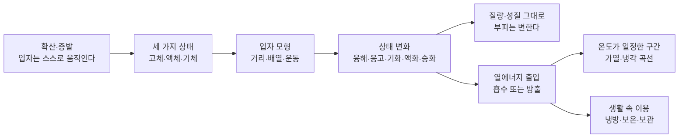
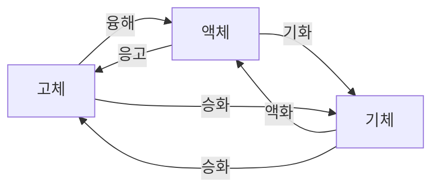

# 중1-4. 물질의 상태 변화 — 보이지 않는 입자들의 춤

<!-- prev: m1-03 -->
<!-- next: m1-06, m2-01, matter-1, matter-2, mech-2 -->

> [!NOTE]
> **성취기준**
> - **[9과04-01]** 확산 및 증발 현상을 관찰하여 물질을 구성하는 입자가 운동하고 있음을 추론할 수 있다.
> - **[9과04-02]** 물질의 세 가지 상태의 특징을 설명하고, 이를 입자 모형으로 표현할 수 있다.
> - **[9과04-03]** 여러 가지 물질의 상태 변화를 관찰하고, 이를 입자 모형으로 설명할 수 있다.
> - **[9과04-04]** 물질의 상태 변화와 열에너지 출입 관계를 이해하고, 이를 실생활에 적용하여 과학의 유용성을 인식할 수 있다.

**학습 목표**

1. 확산과 증발 현상을 관찰하고, 이를 근거로 물질을 이루는 입자가 스스로 끊임없이 움직이고 있음을 추론할 수 있다.
2. 고체·액체·기체의 특징을 입자 사이의 거리, 배열, 운동으로 비교하고 입자 모형으로 그릴 수 있다.
3. 융해, 응고, 기화, 액화, 승화를 구분하고, 상태가 변할 때 부피는 변하지만 질량과 물질의 성질은 변하지 않는 이유를 입자 모형으로 설명할 수 있다.
4. 상태 변화가 일어나는 동안 온도가 일정하게 유지되는 까닭을 열에너지의 흡수·방출로 설명할 수 있다.
5. 상태 변화와 열에너지 출입을 이용하는 생활 속 사례를 찾아 과학의 유용성을 설명할 수 있다.

**이 단원의 학습 사다리**

| 단계 | 무엇을 하나? |
|---|---|
| STEP 1. 이전 학습 다시 보기 | 초등학교 '물의 상태 변화'와 중1 「열」의 입자 운동을 다시 꺼낸다 |
| STEP 2. 기초 다지기 | 입자, 모형, 질량과 부피의 차이를 디딤돌로 놓는다 |
| STEP 3. 핵심 개념 | 확산·증발 → 세 가지 상태 → 상태 변화의 종류 → 질량·부피 → 열에너지 출입 → 생활 속 이용 |
| STEP 4. 오개념 바로잡기 | "물이 끓을 때 생기는 거품은 공기다?" 같은 착각을 바로잡는다 |
| STEP 5. 다음 단계로 | 녹는점·끓는점(중2), 분자 사이의 힘과 잠열(고등학교 선택과목) |
| STEP 6. 생활·산업·진로 | 냉장고·에어컨, 얼음 축열, 동결 건조 식품 |

---

## 🗺️ 단원 들어가기

교실 문을 열자마자 복도에서 누군가 먹는 떡볶이 냄새가 난다. 떡볶이는 복도에 있는데, 냄새는 어떻게 교실 안까지 들어왔을까? 아무도 냄새를 들고 오지 않았는데 말이다.

여름에 차가운 음료수 캔을 꺼내 두면 캔 표면에 물방울이 맺힌다. 캔이 새는 것도 아닌데 이 물은 어디에서 왔을까? 겨울에 빨래를 밖에 널어 두면 꽁꽁 얼었다가도 결국 마른다. 얼음이 녹지도 않았는데 물은 어디로 사라졌을까?

이 단원에서는 이 모든 현상을 **눈에 보이지 않는 작은 입자들이 움직이고 있다**는 생각 하나로 설명해 본다. 입자의 거리, 배열, 움직임이 바뀌면 물질의 상태가 바뀌고, 그때마다 열에너지가 들어오거나 나간다.

---

## STEP 1. 🔙 이전 학습 다시 보기

### 연계 개념표

| 이전 단원·성취기준 | 그때 배운 것 | 이 단원에서 확장되는 것 |
|---|---|---|
| 초등학교 3∼4학년군 '물의 상태 변화' | 물은 얼음(고체), 물(액체), 수증기(기체)로 상태가 바뀐다. 물이 얼면 부피가 늘어나고 무게는 그대로이다 | 물뿐 아니라 **여러 가지 물질**의 상태 변화를 다루고, 그 이유를 **입자 모형**으로 설명한다 |
| 초등학교 3∼4학년군 '물의 상태 변화' | 증발과 끓음은 물이 수증기로 변하는 현상이다. 차가운 컵 표면에 물방울이 맺힌다(응결) | 증발을 **입자가 운동한다는 증거**로 해석하고, 응결(액화) 때 열에너지가 방출됨을 안다 |
| 중1 「열」 [9과03-01] | 온도는 입자 운동의 활발한 정도이다. 온도가 다른 두 물체는 열평형에 도달한다 | 열에너지를 받으면 입자 운동이 활발해지고, 충분히 활발해지면 **입자 배열이 바뀌어 상태가 변한다** |
| 중1 「열」 [9과03-03] | 물질은 열을 받으면 부피가 늘어난다(열팽창) | 상태가 변할 때는 열팽창보다 훨씬 큰 부피 변화가 일어난다 |

### 준비 운동 (사전 진단)

**Q1.** 물 100 g을 얼리면 얼음의 무게는 100 g보다 (늘어난다 / 그대로이다 / 줄어든다).

**Q2.** 얼음물이 든 컵 바깥에 맺힌 물방울은 컵 안의 물이 새어 나온 것이다. (O / X)

**Q3.** 온도가 높은 물질일수록 입자의 움직임이 어떠한가?

정답 및 해설

**Q1. 그대로이다** — 물이 얼음이 되어도 물을 이루는 입자의 수는 변하지 않으므로 무게(질량)는 같다. 다만 부피는 늘어난다.

**Q2. X** — 공기 중의 수증기가 차가운 컵 표면에서 열을 빼앗겨 물방울로 변한 것이다. 빈 컵에 얼음만 넣어도 물방울이 맺힌다.

**Q3.** 더 활발하다(빠르다). 중1 「열」에서 배운 대로 온도는 입자 운동의 활발한 정도를 나타낸다.

---

## STEP 2. 🧱 기초 다지기

### ① 물질은 아주 작은 입자로 이루어져 있다

모래성은 멀리서 보면 하나의 덩어리지만 가까이 보면 수많은 모래알로 이루어져 있다. 모든 물질도 마찬가지로 눈에 보이지 않을 만큼 아주 작은 **입자(particle)** 로 이루어져 있다고 생각한다. 입자는 너무 작아서 가장 좋은 광학 현미경으로도 직접 볼 수 없다.

- 같은 물질은 같은 종류의 입자로 이루어진다. 입자와 입자 사이에는 빈 공간이 있다(그 사이에는 공기조차 없다).
- 입자 사이에는 서로 끌어당기는 힘이 작용한다. 이 힘이 강할수록 입자들이 서로 붙어 있으려 한다.

> [!TIP]
> 💡 **비유** — 입자 사이의 끌어당기는 힘은 '손잡기'와 같다. 친구들이 손을 꽉 잡고 있으면 자리를 벗어나기 어렵고(고체), 손을 느슨하게 잡으면 자리를 바꿀 수 있고(액체), 손을 놓으면 자유롭게 흩어진다(기체).

### ② 모형: 보이지 않는 것을 보이게 그리는 방법

입자를 직접 볼 수 없으므로 과학자는 **모형(model)** 을 쓴다. 모형은 실제 대상을 단순하게 나타내어 현상을 설명하고 예측하는 도구이다. 지구본이 지구의 모형이듯, 이 단원에서는 입자를 작은 동그라미(●)로 그리는 **입자 모형**을 쓴다.

입자 모형을 그릴 때 지킬 약속은 다음과 같다.

| 약속 | 이유 |
|---|---|
| 같은 물질의 입자는 같은 크기·모양으로 그린다 | 상태가 변해도 입자 자체는 변하지 않는다 |
| 상태가 변해도 입자의 개수는 같게 그린다 | 질량이 변하지 않는다 |
| 입자 사이의 거리와 배열을 다르게 그린다 | 상태에 따라 달라지는 것은 입자의 거리·배열·운동이다 |
| 운동은 입자 옆에 화살표나 떨림 표시로 나타낸다 | 입자는 늘 움직이고 있다 |

### ③ 질량과 부피는 다르다

- **질량(mass)**: 물질이 가지고 있는 고유한 양. 단위 g, kg. 저울로 무게를 재어 확인한다. 입자의 종류와 개수가 같으면 질량도 같다.
- **부피(volume)**: 물질이 차지하는 공간의 크기. 단위 $\mathrm{mL}$, $\mathrm{cm^3}$, $\mathrm{L}$. 입자 사이의 거리가 멀어지면 부피가 커진다.

> [!TIP]
> 💡 **비유** — 학생 30명(질량)이 교실 한쪽에 모여 서 있을 때와 운동장에 흩어져 있을 때를 생각해 보자. 사람 수는 같지만 차지하는 공간(부피)은 크게 다르다.

### ④ 열에너지와 입자 운동

중1 「열」에서 배운 것처럼, 물질이 **열에너지를 흡수**하면 입자 운동이 활발해지고, **열에너지를 방출**하면 입자 운동이 둔해진다. 이 단원에서는 여기에 한 가지를 더한다. 흡수한 열에너지는 입자 운동을 빠르게 하는 데 쓰이기도 하고, **입자 사이의 끌어당기는 힘을 끊어 배열을 바꾸는 데** 쓰이기도 한다.

---

## STEP 3. 📘 핵심 개념

### ① 입자는 스스로 움직인다 — 확산과 증발 [9과04-01]

#### 확산: 섞지 않아도 퍼져 나간다

물이 든 비커에 잉크 한 방울을 조심스럽게 떨어뜨리고 가만히 두면, 휘젓지 않아도 잉크가 점점 퍼져 나가 결국 물 전체가 고르게 물든다. 이처럼 물질을 이루는 입자가 스스로 운동하여 퍼져 나가는 현상을 **확산(diffusion)** 이라고 한다.

| 생활 속 확산 | 무엇이 퍼지나? |
|---|---|
| 방 한쪽에서 뿌린 향수 냄새가 방 전체에 퍼진다 | 향수 입자가 공기 중으로 |
| 복도의 떡볶이 냄새가 교실까지 들어온다 | 음식 냄새 입자가 공기 중으로 |
| 녹차 티백을 넣으면 물이 점점 초록색이 된다 | 녹차 성분 입자가 물속으로 |
| 물이 든 컵 바닥에 넣은 각설탕이 녹으면, 젓지 않아도 시간이 지나 윗부분까지 달아진다 | 설탕 입자가 물속으로 |
| 모기향 연기가 방 전체로 퍼진다 | 모기향 성분 입자가 공기 중으로 |

확산은 다음과 같은 특징이 있다.

- **기체 속에서가 액체 속에서보다 빠르다.** 기체는 입자 사이가 멀어서 다른 입자에 덜 부딪히며 퍼질 수 있기 때문이다.
- **온도가 높을수록 빠르다.** 찬물보다 따뜻한 물에서 잉크가 더 빨리 퍼진다. 온도가 높을수록 입자 운동이 활발하기 때문이다.

> [!IMPORTANT]
> 아무도 섞지 않았는데 잉크가 퍼진다는 것은 **입자가 스스로 끊임없이 움직이고 있다**는 증거이다. 입자가 가만히 있다면 잉크는 떨어진 자리에 그대로 머물러 있어야 한다.

#### 증발: 끓지 않아도 액체가 사라진다

젖은 빨래는 햇볕이 없는 그늘에서도, 물이 끓는 온도가 아닌데도 마른다. 이처럼 **액체 표면에서 입자가 기체가 되어 날아가는 현상**을 **증발(evaporation)** 이라고 한다.

액체 속 입자들은 모두 똑같은 빠르기로 움직이지 않는다. 그중 표면 가까이에서 특히 활발하게 움직이는 입자가 주변 입자들이 끌어당기는 힘을 이기고 공기 중으로 튀어 나간다. 이것이 증발이다.

| 증발이 잘 일어나는 조건 | 예 | 입자로 보면 |
|---|---|---|
| 온도가 높을 때 | 여름에 빨래가 빨리 마른다 | 활발하게 움직이는 입자가 많아진다 |
| 바람이 불 때 | 바람 부는 날 빨래가 잘 마른다 | 튀어 나간 입자를 바람이 치워 준다 |
| 공기가 건조할 때(습도가 낮을 때) | 장마철에는 빨래가 잘 안 마른다 | 공기 중 수증기가 적어 다시 돌아오는 입자가 적다 |
| 표면적이 넓을 때 | 빨래를 펴서 널면 빨리 마른다 | 표면에 있는 입자 수가 많아진다 |

> [!TIP]
> 💡 **비유** — 증발은 운동장 가장자리에 있는 학생 중 가장 힘이 넘치는 학생이 담을 넘어 나가는 것과 같다. 날이 더우면(온도↑) 힘이 넘치는 학생이 많아지고, 담 길이가 길면(표면적↑) 넘어갈 기회가 많아진다.

#### 예제 1

다음 실험 결과를 보고 알 수 있는 사실을 쓰시오.

| 비커 | 물의 온도 | 잉크가 고르게 퍼지는 데 걸린 시간 |
|---|---|---|
| A | 10 °C | 약 30분 |
| B | 60 °C | 약 5분 |

**풀이** 온도가 높은 B에서 확산이 더 빨리 일어났다. 따라서 **온도가 높을수록 물 입자의 운동이 활발하여 잉크 입자와 더 활발하게 섞인다.** 그리고 두 비커 모두 휘젓지 않았는데 잉크가 퍼졌으므로 입자가 스스로 운동하고 있음을 알 수 있다.

### ② 물질의 세 가지 상태와 입자 모형 [9과04-02]

우리 주변의 물질은 대부분 **고체(solid)**, **액체(liquid)**, **기체(gas)** 중 하나의 상태로 존재한다. 같은 물이라도 얼음, 물, 수증기처럼 상태가 다를 수 있다.

#### 겉으로 보이는 특징

| 구분 | 고체 | 액체 | 기체 |
|---|---|---|---|
| 모양 | 일정하다 | 담는 그릇에 따라 변한다 | 담는 그릇을 가득 채운다 |
| 부피 | 일정하다 | 일정하다 | 그릇에 따라 변한다 |
| 흐르는 성질 | 없다 | 있다 | 있다 |
| 눌러서 부피 줄이기 | 거의 안 된다 | 거의 안 된다 | 잘 된다 |
| 예 | 얼음, 철, 나무, 소금 | 물, 식용유, 우유, 수은 | 수증기, 산소, 이산화 탄소 |

#### 입자 모형으로 보는 세 가지 상태

| 비교 기준 | 고체 | 액체 | 기체 |
|---|---|---|---|
| 입자 사이의 거리 | 매우 가깝다 | 가깝다(고체보다 조금 멀다) | 매우 멀다 |
| 입자 배열 | 규칙적이다 | 불규칙적이다 | 매우 불규칙적이다 |
| 입자의 운동 | 제자리에서 떨기만 한다 | 자리를 바꾸며 움직인다 | 자유롭게 빠르게 날아다닌다 |
| 입자 사이의 끌어당기는 힘 | 매우 강하다 | 강하다 | 거의 없다 |

입자 모형을 글로 그려 보면 다음과 같다.

- **고체**: 상자 안에 동그라미가 바둑판처럼 빈틈없이 줄지어 있고, 각 동그라미 옆에 작은 떨림 표시가 있다.
- **액체**: 동그라미들이 서로 닿을 듯 가깝게 있지만 줄이 흐트러져 있고, 짧은 화살표로 이리저리 미끄러지는 모습이다.
- **기체**: 같은 크기의 상자 안에 동그라미가 몇 개만 멀리 떨어져 흩어져 있고, 각각 긴 화살표로 여러 방향으로 날아간다.

> [!TIP]
> 💡 **비유** — 고체는 '수업 시간에 자리에 앉은 학생들'(자리 고정, 몸만 꼼지락), 액체는 '쉬는 시간 교실 안 학생들'(서로 가까이 붙어 자리를 바꿈), 기체는 '점심시간 운동장의 학생들'(멀리 흩어져 마음대로 뛰어다님)이다.

이 입자 모형으로 겉보기 특징이 설명된다.

- 고체의 모양이 일정한 까닭: 입자가 강하게 끌어당겨 제자리를 지키기 때문이다.
- 액체가 흐르는 까닭: 입자가 서로 가까이 있으면서도 자리를 바꿀 수 있기 때문이다.
- 기체를 눌러 부피를 줄일 수 있는 까닭: 입자 사이에 빈 공간이 매우 넓기 때문이다. 주사기에 공기를 넣고 입구를 막은 채 누르면 피스톤이 들어가지만, 물을 넣으면 거의 들어가지 않는다.

### ③ 여러 가지 물질의 상태 변화 [9과04-03]

물질이 한 상태에서 다른 상태로 바뀌는 것을 **상태 변화(change of state)** 라고 한다. 상태 변화에는 다섯 가지 이름이 있다.

| 상태 변화 | 방향 | 생활 속 예 |
|---|---|---|
| **융해(melting)** | 고체 → 액체 | 아이스크림이 녹는다, 양초의 촛농이 생긴다, 버터가 프라이팬에서 녹는다 |
| **응고(freezing, solidification)** | 액체 → 고체 | 물이 얼음이 된다, 촛농이 굳는다, 용암이 식어 암석이 된다 |
| **기화(vaporization)** | 액체 → 기체 | 젖은 빨래가 마른다(증발), 물이 끓는다(끓음), 손에 바른 소독용 알코올이 사라진다 |
| **액화(condensation)** | 기체 → 액체 | 차가운 컵 표면에 물방울이 맺힌다, 이른 아침 풀잎에 이슬이 맺힌다, 욕실 거울이 뿌옇게 흐려진다 |
| **승화(sublimation)** | 고체 → 기체, 기체 → 고체 | 드라이아이스가 작아진다, 언 빨래가 마른다, 추운 날 유리창에 성에가 생긴다, 서리가 내린다 |

> [!NOTE]
> 승화는 두 방향을 모두 가리킨다. 고체가 바로 기체가 되는 것(드라이아이스)도, 기체가 바로 고체가 되는 것(서리, 성에)도 승화이다.

다섯 가지 상태 변화를 세 가지 상태 사이의 화살표로 정리하면 다음과 같다.

#### 기화의 두 가지 방법: 증발과 끓음

| 구분 | 증발 | 끓음 |
|---|---|---|
| 일어나는 곳 | 액체의 **표면**에서만 | 액체의 표면과 **내부** 모두에서 |
| 일어나는 온도 | 어느 온도에서나 | 특정한 온도(물은 1기압에서 100 °C)에서 |
| 빠르기 | 느리다 | 빠르다 |
| 모습 | 눈에 띄지 않게 조금씩 | 액체 속에서 기포가 생겨 올라온다 |
| 예 | 빨래가 마른다 | 냄비 속 물이 부글부글 끓는다 |

물이 끓을 때 생기는 **기포는 수증기**이다. 물속 입자들이 내부에서 기체가 되어 모인 것이다.

> [!WARNING]
> 주전자 입구에서 보이는 하얀 김은 수증기가 **아니다**. 수증기는 눈에 보이지 않는 기체이다. 하얀 김은 수증기가 차가운 공기를 만나 다시 액화한 **아주 작은 물방울**이다. 주전자 입구 바로 앞의 투명한 부분이 진짜 수증기이다.

#### 입자 모형으로 보는 상태 변화

| 상태 변화 | 입자 사이의 거리 | 입자 배열 | 입자 운동 |
|---|---|---|---|
| 융해 (고체 → 액체) | 조금 멀어진다(물은 예외) | 규칙적 → 불규칙적 | 활발해진다 |
| 기화 (액체 → 기체) | 매우 멀어진다 | 불규칙적 → 매우 불규칙적 | 매우 활발해진다 |
| 승화 (고체 → 기체) | 매우 멀어진다 | 규칙적 → 매우 불규칙적 | 매우 활발해진다 |
| 응고, 액화, 승화(기체 → 고체) | 위와 반대로 가까워진다 | 더 규칙적으로 | 둔해진다 |

#### 예제 2

다음 현상과 관련된 상태 변화의 이름을 쓰시오.
(1) 추운 겨울날 창문 안쪽에 성에가 끼었다.
(2) 냉동실에 넣어 둔 물이 얼었다.
(3) 안경을 쓰고 따뜻한 실내에 들어가니 안경알이 뿌옇게 흐려졌다.
(4) 옷장에 넣어 둔 고체 방충제가 점점 작아졌다.

**풀이** (1) 승화(기체 → 고체): 실내 공기의 수증기가 차가운 유리에서 바로 얼음 알갱이가 되었다. (2) 응고 (3) 액화: 따뜻한 공기 속 수증기가 차가운 안경알에 닿아 물방울이 되었다. (4) 승화(고체 → 기체)

### ④ 상태가 변해도 질량과 성질은 그대로, 부피는 변한다 [9과04-03]

#### 질량은 변하지 않는다

양초를 녹이기 전과 녹여 굳힌 뒤의 질량을 재거나, 지퍼 백에 얼음을 넣고 꽉 닫은 뒤 녹기 전과 녹은 뒤의 질량을 재면 **질량이 같다.**

- 까닭: 상태가 변할 때 입자의 **배열과 거리만 바뀌고, 입자의 종류와 개수는 변하지 않기 때문이다.**

> [!WARNING]
> 뚜껑을 열어 둔 채로 물을 끓이면 질량이 줄어든다. 질량이 사라진 것이 아니라 수증기가 되어 **공기 중으로 빠져나갔기** 때문이다. 질량을 비교할 때는 물질이 빠져나가거나 들어오지 않게 막아야 한다. 또 공기 중에서 기체의 질량을 저울로 잴 때는 공기가 떠받치는 힘(부력)이 측정값에 영향을 줄 수 있다.

#### 물질의 성질은 변하지 않는다

얼음을 녹인 물도 물이고, 수증기를 식혀 얻은 물도 물이다. 초콜릿을 따뜻하게 녹였다가 다시 굳혀도 여전히 초콜릿 맛이 난다. 상태 변화에서는 **입자 자체가 바뀌지 않으므로 물질의 고유한 성질도 바뀌지 않는다.** 이런 변화를 **물리 변화**라고 부르며, 성질이 다른 새 물질이 생기는 화학 변화는 중3 「화학 반응의 규칙성」에서 배운다.

#### 부피는 변한다

| 상태 변화 | 대부분의 물질 | 물 |
|---|---|---|
| 고체 → 액체(융해) | 부피가 조금 늘어난다 | 부피가 **줄어든다** |
| 액체 → 고체(응고) | 부피가 조금 줄어든다 | 부피가 **늘어난다**(약 9%) |
| 액체 → 기체(기화) | 부피가 매우 크게 늘어난다 | 부피가 매우 크게 늘어난다 |

- 촛농이 굳으면 가운데가 오목하게 들어간다. 양초(파라핀)가 응고하면서 부피가 줄어들기 때문이다.
- 물이 가득 든 유리병을 얼리면 병이 깨질 수 있다. 물은 얼면서 부피가 늘어나기 때문이다. 겨울철 수도관이 터지는 것도 같은 까닭이다.
- 물이 수증기가 되면 부피가 약 1700배로 늘어난다(1기압, 100 °C 기준). 다른 액체도 기체가 되면 부피가 크게 늘어난다. 지퍼 백에 소독용 알코올을 조금 넣고 뜨거운 물에 담그면 봉지가 크게 부푼다.

> [!IMPORTANT]
> **물은 특별하다.** 대부분의 물질은 고체일 때 입자가 가장 촘촘하지만, 물은 얼음이 될 때 입자들이 빈 공간이 많은 규칙적인 구조로 배열된다. 그래서 얼음은 물보다 부피가 크고 물에 뜬다. 겨울에 호수가 위에서부터 얼고, 얼음 아래의 물고기가 살아남을 수 있는 것도 이 덕분이다.

#### 예제 3

질량 50 g인 얼음을 지퍼 백에 넣고 완전히 밀봉한 뒤 모두 녹였다.
(1) 녹은 물의 질량은 몇 g인가?
(2) 얼음일 때와 물일 때 중 부피가 더 큰 것은?

**풀이** (1) **50 g**. 입자의 개수가 변하지 않으므로 질량은 그대로이다. (2) **얼음**일 때가 더 크다. 물은 다른 물질과 달리 얼음이 될 때 부피가 늘어나므로, 녹으면 부피가 줄어든다.

### ⑤ 상태 변화와 열에너지 출입 [9과04-04]

#### 열에너지를 흡수하는 상태 변화, 방출하는 상태 변화

| 열에너지를 **흡수**하는 상태 변화 | 열에너지를 **방출**하는 상태 변화 |
|---|---|
| 융해 (고체 → 액체) | 응고 (액체 → 고체) |
| 기화 (액체 → 기체) | 액화 (기체 → 액체) |
| 승화 (고체 → 기체) | 승화 (기체 → 고체) |
| 입자 운동이 활발해지고, 입자 사이가 멀어진다 | 입자 운동이 둔해지고, 입자 사이가 가까워진다 |
| 주위의 온도가 **낮아진다** | 주위의 온도가 **높아진다** |

규칙은 간단하다. **입자 사이가 멀어지려면(고체 → 액체 → 기체 방향) 열에너지가 필요하고, 가까워질 때(기체 → 액체 → 고체 방향)는 열에너지가 나온다.** 상태 변화에 쓰이는 이 열에너지를 각각 융해열, 기화열, 응고열, 액화열 등으로 부르기도 한다.

> [!TIP]
> 💡 **비유** — 서로 꼭 붙은 자석 여러 개를 떼어 놓으려면 힘(에너지)을 써야 한다. 반대로 떨어진 자석들이 다시 '착' 붙을 때는 에너지가 소리와 열로 나온다. 입자 사이의 끌어당기는 힘을 끊는 것(융해·기화)과 다시 붙는 것(응고·액화)도 이와 비슷하다.

#### 가열 곡선: 상태 변화하는 동안 온도가 일정하다

얼음을 비커에 넣고 일정한 세기로 계속 가열하면서 시간에 따른 온도를 재면 다음과 같은 결과를 얻는다. 시간을 가로축, 온도를 세로축으로 그린 그래프를 **가열 곡선(heating curve)** 이라고 한다.

| 구간 | 그래프 모양 | 물질의 상태 | 흡수한 열에너지가 하는 일 |
|---|---|---|---|
| A–B | 오른쪽 위로 올라간다(−20 °C → 0 °C) | 고체(얼음) | 입자 운동을 활발하게 하여 **온도를 높인다** |
| B–C | **수평**(0 °C 유지) | 고체 + 액체 | 입자 배열을 무너뜨리는 데 쓰인다(**융해**) |
| C–D | 오른쪽 위로 올라간다(0 °C → 100 °C) | 액체(물) | 입자 운동을 활발하게 하여 온도를 높인다 |
| D–E | **수평**(100 °C 유지), B–C보다 훨씬 길다 | 액체 + 기체 | 입자 사이를 멀리 떼어 놓는 데 쓰인다(**기화**) |

가열 곡선의 수평 구간은 두 상태가 함께 있는 동안 나타난다. 이때도 계속 열을 가하는데 온도가 오르지 않는 까닭은 다음과 같다.

> [!IMPORTANT]
> 상태 변화가 일어나는 동안 흡수한 열에너지는 입자 운동을 빠르게 하는 데(온도를 높이는 데) 쓰이지 않고, **입자 사이의 끌어당기는 힘을 이기고 입자 배열을 바꾸는 데 모두 쓰인다.** 그래서 상태 변화가 끝날 때까지 **온도가 일정하게 유지된다.**

- 기화 구간(D–E)이 융해 구간(B–C)보다 긴 까닭: 액체에서 기체로 될 때는 입자를 아주 멀리 떼어 놓아야 하므로 훨씬 많은 열에너지가 필요하기 때문이다.
- 끓고 있는 물에 불을 더 세게 해도 물의 온도는 100 °C보다 높아지지 않는다(1기압에서). 더 빨리 끓어 없어질 뿐이다.

#### 냉각 곡선: 굳는 동안에도 온도가 일정하다

반대로 액체 상태의 물질을 식히면서 온도를 재어 그린 그래프를 **냉각 곡선(cooling curve)** 이라고 한다. 액체 팔미트산(녹는 온도 약 63 °C인 고체 물질)을 식히면 온도가 내려가다가 굳기 시작하는 온도에서 **한동안 일정하게 유지**되고, 다 굳은 뒤에 다시 내려간다.

- 까닭: 응고하면서 입자들이 서로 끌어당겨 규칙적으로 배열될 때 **열에너지를 방출**한다. 이 열에너지가 주위로 빠져나가는 열을 채워 주므로 온도가 내려가지 않는다.
- 같은 물질이라면 녹기 시작하는 온도(가열 곡선)와 굳기 시작하는 온도(냉각 곡선)가 같다. 물은 0 °C에서 녹고 0 °C에서 언다.

> [!NOTE]
> 상태 변화가 일어나는 온도는 물질마다 다르다. 이 온도들이 '물질을 구별하는 특성'이 된다는 것은 중2 「물질의 특성」에서 녹는점, 끓는점, 어는점이라는 이름으로 자세히 배운다. 이 단원에서는 '각 상태 변화가 일어나는 온도'라는 데 주목하자.

#### 예제 4

다음은 어떤 고체 물질을 일정한 세기로 가열하면서 1분마다 온도를 잰 결과이다.

| 시간(분) | 0 | 1 | 2 | 3 | 4 | 5 | 6 | 7 |
|---|---|---|---|---|---|---|---|---|
| 온도(°C) | 30 | 40 | 50 | 54 | 54 | 54 | 60 | 68 |

(1) 이 물질이 녹고 있는 온도는 몇 °C인가?
(2) 3~5분 동안 열을 계속 가했는데 온도가 변하지 않은 까닭은?

**풀이** (1) **54 °C**. 온도가 일정하게 유지되는 구간이 융해가 일어나는 구간이다.
(2) 흡수한 열에너지가 온도를 높이는 데 쓰이지 않고 **고체의 규칙적인 입자 배열을 무너뜨려 액체로 바꾸는 데** 쓰였기 때문이다.

### ⑥ 열에너지 출입을 생활에 이용하기 [9과04-04]

상태 변화의 열에너지 출입은 우리 생활 곳곳에서 '공짜 냉방기'와 '공짜 난방기' 역할을 한다.

#### 열에너지를 흡수하는 상태 변화의 이용 — 주위가 시원해진다

| 사례 | 상태 변화 | 원리 |
|---|---|---|
| 더운 날 마당에 물을 뿌리면 시원해진다 | 기화(증발) | 물이 증발하면서 땅과 공기의 열을 흡수한다 |
| 땀이 나면 체온이 내려간다 | 기화(증발) | 피부의 땀이 증발하면서 몸의 열을 흡수한다 |
| 손에 소독용 알코올을 바르면 시원하다 | 기화(증발) | 알코올이 빠르게 증발하면서 손의 열을 흡수한다 |
| 음료수 상자에 얼음을 넣어 차갑게 보관한다 | 융해 | 얼음이 녹으면서 음료수의 열을 흡수한다 |
| 아이스크림 포장에 드라이아이스를 넣는다 | 승화 | 드라이아이스가 승화하면서 주위의 열을 흡수한다 |
| 에어컨·냉장고 안쪽이 차가워진다 | 기화 | 관 속의 냉매가 기화하면서 내부의 열을 흡수한다 |

#### 열에너지를 방출하는 상태 변화의 이용 — 주위가 따뜻해진다

| 사례 | 상태 변화 | 원리 |
|---|---|---|
| 추운 날 과수원에 물을 뿌려 냉해를 막는다 | 응고 | 물이 얼면서 열을 방출해 과일 꽃눈의 온도가 너무 낮아지지 않게 한다 |
| 에어컨 실외기에서 뜨거운 바람이 나온다 | 액화 | 관 속의 기체 냉매가 액화하면서 열을 방출한다 |
| 100 °C 수증기에 데면 100 °C 물에 덴 것보다 더 심하게 다친다 | 액화 | 수증기가 피부에서 액화하면서 많은 열을 방출한다 |
| 손난로(액체가 굳는 종류)를 누르면 따뜻해진다 | 응고 | 속의 액체가 고체로 굳으면서 열을 방출한다 |

> [!TIP]
> 💡 **기억 요령** — "멀어지면 빼앗고, 가까워지면 내준다." 입자 사이가 멀어지는 변화(융해·기화·승화)는 주위의 열을 **빼앗아** 시원하게 하고, 가까워지는 변화(응고·액화·승화)는 열을 **내주어** 따뜻하게 한다.

#### 냉장고와 에어컨의 원리

냉장고와 에어컨은 **냉매**라는 물질이 관을 따라 돌면서 상태 변화를 되풀이하는 장치이다.

1. 냉장고 안쪽(또는 실내기) 관에서 액체 냉매가 **기화**하며 내부의 열을 흡수한다 → 안쪽이 차가워진다.
2. 기체 냉매를 압축기로 압축해 바깥쪽(냉장고 뒤나 실외기) 관으로 보낸다.
3. 바깥쪽 관에서 기체 냉매가 **액화**하며 열을 방출한다 → 바깥이 따뜻해진다. 액체가 된 냉매는 다시 안쪽으로 들어가 1번부터 반복한다.

즉, 냉장고는 '차가움을 만드는' 장치가 아니라 **상태 변화를 이용해 안쪽의 열을 바깥으로 옮기는** 장치이다.

#### 예제 5

여름철 외출할 때 시원한 물을 마시려고 물병을 젖은 수건으로 감싸 그늘에 두었다. 물병의 물이 시원하게 유지되는 까닭을 상태 변화와 열에너지로 설명하시오.

**풀이** 젖은 수건의 물이 **증발(기화)** 하면서 주위, 즉 물병과 물병 속 물의 **열에너지를 흡수**한다. 그래서 물병 속 물의 온도가 낮게 유지된다. 바람이 잘 통하는 그늘에 두면 증발이 더 잘 일어나 더 시원하다.

---

## STEP 4. ⚠️ 오개념 바로잡기

| 흔한 오개념 | 올바른 개념 | 왜 그럴까? |
|---|---|---|
| 물이 끓을 때 생기는 기포는 공기(산소)이다 | 끓을 때 생기는 큰 기포는 **수증기**이다 | 물속 입자들이 내부에서 기화하여 모인 것이다. 가열 초기에 생기는 작은 기포는 물에 녹아 있던 공기일 수 있다 |
| 주전자에서 나오는 하얀 김은 수증기이다 | 하얀 김은 수증기가 액화한 **작은 물방울**이다 | 수증기는 투명한 기체라서 보이지 않는다 |
| 얼음이 녹으면 질량이 줄어든다 | 상태가 변해도 **질량은 변하지 않는다** | 입자의 개수와 종류가 그대로이고 배열만 바뀐다 |
| 상태가 변하면 입자의 크기가 변한다 | 입자의 크기는 변하지 않고 **입자 사이의 거리**가 변한다 | 기체의 부피가 큰 것은 입자가 커서가 아니라 입자 사이가 멀어서이다 |
| 끓는 물에 불을 더 세게 하면 물의 온도가 더 올라간다 | 끓는 동안 물의 온도는 **일정하다**(1기압에서 100 °C) | 더 받은 열에너지는 기화에 쓰여 더 빨리 끓어 없어질 뿐이다 |
| 컵 바깥의 물방울은 컵 안의 물이 스며 나온 것이다 | 공기 중의 **수증기가 액화**한 것이다 | 빈 컵에 얼음만 넣어도 물방울이 맺히고, 물방울에서 음료 맛이 나지 않는다 |
| 증발은 물이 끓는 온도에서만 일어난다 | 증발은 **어느 온도에서나** 액체 표면에서 일어난다 | 빨래는 겨울에도 마르고, 언 빨래도 승화하여 마른다 |

---

## STEP 5. 🎓 다음 단계로 한 걸음 더

> [!CAUTION]
> 이 절은 **중학교 1학년 교육과정 범위 밖의 심화 내용**으로 평가 대상이 아니다. "이 개념이 앞으로 어디까지 이어지는가"를 맛보기로 보여 주기 위한 내용이다.

### 다음 학년·과목과의 연결

| 학년·과목 | 단원 | 이어지는 내용 |
|---|---|---|
| 중1 | 「기체의 성질」 | 기체 입자의 운동으로 압력을 설명하고, 압력·온도에 따른 기체의 부피 변화를 입자 모형으로 해석한다 |
| 중2 | 「물질의 특성」 | 녹는점·끓는점·어는점이 물질마다 일정한 '물질의 특성'임을 배우고, 이를 이용해 물질을 구별하고 혼합물을 분리한다 |
| 중2 | 「물질의 구성」 | 입자의 정체가 원자와 분자임을 배우고, 원소 기호와 분자식으로 나타낸다 |
| 고등학교 진로 선택 | 물질과 에너지 「물질의 세 가지 상태」 | 분자 사이의 상호작용으로 액체가 존재하는 이유와 끓는점 차이를 설명한다. 온도와 압력에 따라 상태가 달라짐을 배운다 |
| 고등학교 진로 선택 | 물질과 에너지 「용액의 성질」 | 물의 특별한 성질(얼음이 물에 뜨는 까닭)을 수소 결합으로 설명하고, 소금물이 잘 얼지 않는 까닭을 배운다 |
| 고등학교 진로 선택 | 역학과 에너지 「열과 에너지」 | 상태 변화에 필요한 열(잠열)을 수치로 계산한다 |

### ① 녹는점과 끓는점은 물질의 '지문'이다 (중2)

이 단원에서는 '상태 변화가 일어나는 온도'라고 불렀던 것에 중2에서는 정확한 이름이 붙는다. 순수한 물질은 1기압에서 녹는점과 끓는점이 정해져 있고, 물질의 양과 관계없다. 예를 들어 1기압에서 물의 끓는점은 100 °C, 에탄올은 약 78 °C이다. 그래서 끓는점을 재면 어떤 물질인지 알아낼 수 있다.

### ② 끓는 온도는 압력에 따라 달라진다

높은 산 위에서는 물이 100 °C보다 낮은 온도에서 끓는다. 에베레스트산 꼭대기에서는 약 70 °C에서 끓기 때문에 밥이 설익는다. 반대로 압력솥은 내부 압력을 높여 물이 약 120 °C에서 끓게 하므로 음식이 빨리 익는다. 고등학교 「물질의 세 가지 상태」에서는 온도와 압력에 따라 물질이 어떤 상태로 존재하는지를 한 장의 그래프(상평형 그림)로 나타낸다.

### ③ 상태 변화에 필요한 열을 수치로 (잠열)

고등학교 「열과 에너지」에서는 상태 변화에 드는 열을 **잠열(latent heat)** 이라 부르고 계산한다. 예를 들어 0 °C 얼음 1 g을 0 °C 물로 녹이는 데 약 334 J, 100 °C 물 1 g을 100 °C 수증기로 바꾸는 데 약 2260 J이 필요하다. 이 단원의 가열 곡선에서 기화 구간이 융해 구간보다 훨씬 길었던 까닭이 바로 이 숫자 차이(약 7배)이다.

### 지금 vs 다음 단계

| 구분 | 중1 「물질의 상태 변화」 | 중2 「물질의 특성」 | 고등학교 「물질의 세 가지 상태」·「열과 에너지」 |
|---|---|---|---|
| 입자 | 동그라미 입자 모형 | 녹는점·끓는점은 물질마다 다르다 | 분자, 분자 간 상호작용, 수소 결합 |
| 상태 변화 온도 | 상태 변화가 일어나는 온도 | 녹는점·끓는점·어는점(물질의 특성) | 압력에 따른 변화, 상평형 그림 |
| 열에너지 | 흡수·방출을 정성적으로 | 가열 곡선으로 물질 구별 | 잠열을 J 단위로 계산 |
| 물의 특별함 | 얼면 부피가 늘어난다 | 밀도 비교로 얼음이 뜨는 까닭 | 수소 결합으로 설명 |

---

## STEP 6. 🏭 생활·산업·진로 연결

### 사례 1. 냉방과 냉동 — 기화와 액화를 이용한 열 옮기기

- **원리** 냉매가 차가운 쪽에서 기화하며 열을 흡수하고, 뜨거운 쪽에서 액화하며 열을 방출한다(STEP 3 ⑥).
- **어디에 쓰이나** 가정용 냉장고·에어컨뿐 아니라 백신과 식품을 차갑게 운반하는 냉동 트럭, 대형 물류 창고, 실내 아이스링크에도 같은 원리가 쓰인다. 반대로 열을 실내로 옮기면 난방기(히트 펌프)가 된다.

### 사례 2. 얼음 축열 냉방 — 밤에 얼리고 낮에 녹이기

- **원리** 물이 얼 때 열을 방출하고, 얼음이 녹을 때 많은 열을 흡수한다.
- **어디에 쓰이나** 일부 큰 건물은 전기 사용이 적은 밤에 큰 탱크의 물을 얼려 두었다가, 더운 낮에 그 얼음이 녹으며 흡수하는 열을 이용해 건물을 시원하게 한다. 전기 사용이 한낮에 몰리는 것을 줄일 수 있다.

### 사례 3. 동결 건조 — 얼린 뒤 승화시키기

- **원리** 낮은 압력에서 얼음이 액체를 거치지 않고 바로 수증기로 승화한다.
- **어디에 쓰이나** 음식을 얼린 뒤 압력을 낮춰 얼음을 승화시키면, 모양과 영양 성분을 거의 그대로 유지한 채 물기만 뺄 수 있다. 즉석 국·커피 알갱이, 우주 식량, 일부 의약품 보관에 쓰인다.

### 관련 진로와 학과

| 진로 | 하는 일 | 관련 학과 |
|---|---|---|
| 냉동공조 엔지니어 | 냉장고·에어컨·건물 냉난방 시스템 설계 | 기계공학, 에너지공학 |
| 식품 공학자 | 동결 건조, 냉동 보관 등 식품 가공·저장 기술 개발 | 식품공학, 식품영양학 |
| 화학 공정 엔지니어 | 증류·결정화 등 상태 변화를 이용한 물질 생산 | 화학공학, 화학 |

---

## 🔬 탐구 활동 — 확산 관찰과 냉각 곡선 그리기

### 활동 A. 온도에 따른 확산 빠르기 비교하기

**목표** 확산 현상을 관찰하여 입자가 스스로 운동하고 있음을 추론하고, 온도에 따라 입자 운동이 어떻게 달라지는지 알아본다.

**준비물** 같은 크기의 투명한 비커 2개, 찬물, 따뜻한 물(약 50 °C), 스포이트, 잉크(또는 식용 색소), 온도계, 초시계, 흰 종이

**과정**
1. 두 비커에 찬물과 따뜻한 물을 같은 양씩 담고 온도를 재어 기록한다.
2. 비커 뒤에 흰 종이를 세워 색 변화를 잘 보이게 한다.
3. 물이 잔잔해지면 두 비커에 동시에 잉크를 한 방울씩 조심스럽게 떨어뜨린다. **휘젓지 않는다.**
4. 1분마다 잉크가 퍼진 모습을 관찰하고, 물 전체가 고르게 물들 때까지 걸린 시간을 잰다.

**결과 기록**

| 비커 | 물의 온도(°C) | 1분 뒤 모습 | 3분 뒤 모습 | 고르게 퍼지는 데 걸린 시간 |
|---|---|---|---|---|
| 찬물 | | | | |
| 따뜻한 물 | | | | |

**생각해 보기**
1. 휘젓지 않았는데 잉크가 퍼진 까닭을 입자의 운동으로 설명해 보자.
2. 어느 비커에서 더 빨리 퍼졌는가? 그 까닭을 온도와 입자 운동의 관계로 설명해 보자.
3. 잉크 대신 향수를 방 한쪽에서 뿌리면, 물속에서보다 빨리 퍼질까 느리게 퍼질까? 그렇게 생각한 까닭은?

### 활동 B. 팔미트산의 냉각 곡선 그리기

**목표** 액체 물질이 식으면서 굳을 때 온도 변화를 측정하여 냉각 곡선을 그리고, 응고하는 동안 온도가 일정한 까닭을 열에너지 방출로 설명한다.

**준비물** 팔미트산, 시험관, 비커, 물, 가열 장치, 온도계(또는 온도 센서), 스탠드, 초시계, 보안경, 실험용 장갑, 그래프 용지(또는 데이터 기록 앱)

**과정**
1. 팔미트산을 시험관의 $\frac{1}{3}$ 정도 넣고, 뜨거운 물이 든 비커에 담가 완전히 녹인다(물중탕).
2. 온도계를 시험관에 꽂고 시험관을 비커에서 꺼내 스탠드에 고정한다.
3. 30초마다 온도를 재고, 물질의 모습(액체/액체와 고체/고체)을 함께 기록한다.
4. 온도가 약 40 °C로 내려갈 때까지 측정하고, 가로축을 시간, 세로축을 온도로 하여 그래프를 그린다.
5. 여러 모둠의 데이터를 공유 플랫폼에 모아 그래프 모양을 비교한다.

**결과 기록**

| 시간(초) | 0 | 30 | 60 | 90 | 120 | 150 | 180 | 210 | 240 | … |
|---|---|---|---|---|---|---|---|---|---|---|
| 온도(°C) | | | | | | | | | | |
| 모습 | | | | | | | | | | |

**생각해 보기**
1. 그래프에서 온도가 일정하게 유지된 구간은 몇 °C였는가? 그때 시험관 속 물질의 모습은 어떠했는가?
2. 그 구간에서 열이 계속 빠져나가는데도 온도가 내려가지 않은 까닭은 무엇인가?
3. 팔미트산의 양을 두 배로 하면 온도가 일정한 구간의 온도와 길이는 각각 어떻게 될지 예상해 보자.

> [!WARNING]
> **안전 수칙** 보안경과 실험용 장갑을 반드시 착용한다. 가열 장치와 뜨거운 물에 화상을 입지 않도록 주의하고, 시험관을 직접 불꽃에 가열하지 않고 물중탕으로 가열한다. 실험이 끝난 팔미트산은 하수구에 버리지 말고 교사의 지시에 따라 처리한다.

---

## ✅ 개념 확인 문제

### 기본

**1.** 다음 중 확산 현상이 **아닌** 것은?
① 꽃밭 근처를 지나면 꽃향기가 난다.
② 물에 떨어뜨린 잉크가 휘젓지 않아도 퍼진다.
③ 숟가락으로 저어서 설탕을 물에 빨리 녹인다.
④ 방에 피운 모기향 냄새가 방 전체로 퍼진다.

정답 및 해설

**정답 ③**

확산은 입자가 **스스로 운동하여** 퍼져 나가는 현상이다. ③은 숟가락으로 저어서 섞는 것이므로 확산이 아니다. 저어 주지 않아도 설탕은 결국 퍼지지만, 젓는 것은 사람이 섞어 주는 것이다.

**2.** 다음은 고체, 액체, 기체의 입자 모형을 비교한 것이다. ㄱ~ㄷ에 알맞은 말을 쓰시오.

| 구분 | 고체 | 액체 | 기체 |
|---|---|---|---|
| 입자 배열 | ( ㄱ ) | 불규칙적이다 | 매우 불규칙적이다 |
| 입자 사이의 거리 | 매우 가깝다 | 가깝다 | ( ㄴ ) |
| 입자 운동 | ( ㄷ ) | 자리를 바꾸며 움직인다 | 자유롭게 빠르게 움직인다 |

정답 및 해설

**정답** ㄱ: 규칙적이다, ㄴ: 매우 멀다, ㄷ: 제자리에서 떨기만 한다

**3.** 다음 현상과 상태 변화의 이름을 바르게 짝 지으시오.
(1) 고드름이 녹아 물이 떨어진다. (2) 이른 아침 풀잎에 이슬이 맺혔다. (3) 드라이아이스가 점점 작아진다. (4) 녹인 초콜릿을 틀에 부어 굳혔다.

정답 및 해설

**정답** (1) 융해 (2) 액화 (3) 승화 (4) 응고

(2)는 공기 중 수증기가 밤사이 차가워진 풀잎에서 물방울이 된 것이다.

**4.** 밀봉한 지퍼 백에 양초 조각 20 g을 넣고 뜨거운 물에 담가 모두 녹였다. 녹은 촛농의 질량과 부피는 처음과 비교하여 각각 어떻게 되는가?

정답 및 해설

**정답** 질량은 **20 g으로 같고**, 부피는 **조금 늘어난다.**

상태가 변해도 입자의 개수는 그대로이므로 질량은 변하지 않는다. 양초는 대부분의 물질처럼 고체에서 액체가 될 때 입자 사이가 조금 멀어지므로 부피가 늘어난다(물과 반대).

**5.** 다음 중 열에너지를 **방출**하는 상태 변화를 모두 고르시오.
ㄱ. 융해 ㄴ. 응고 ㄷ. 기화 ㄹ. 액화

정답 및 해설

**정답 ㄴ, ㄹ**

입자 사이가 가까워지는 상태 변화(응고, 액화, 기체에서 고체로 되는 승화)는 열에너지를 방출한다.

### 응용

**6.** 다음은 고체 물질 X를 일정한 세기로 가열하면서 온도를 잰 결과이다.

| 시간(분) | 0 | 2 | 4 | 6 | 8 | 10 | 12 |
|---|---|---|---|---|---|---|---|
| 온도(°C) | 20 | 50 | 80 | 80 | 80 | 95 | 110 |

옳은 설명을 **모두** 고르시오.
ㄱ. 4분~8분 동안 X는 열에너지를 흡수하지 않는다.
ㄴ. 4분~8분 동안 X는 고체와 액체가 함께 있다.
ㄷ. X가 녹는 동안의 온도는 80 °C이다.

정답 및 해설

**정답 ㄴ, ㄷ**

ㄱ. 계속 가열하고 있으므로 열에너지를 **흡수한다.** 흡수한 열에너지가 온도를 높이지 않고 입자 배열을 바꾸는 데(융해) 쓰이므로 온도가 일정한 것이다. 따라서 틀렸다.
ㄴ. 온도가 일정한 구간은 융해가 일어나는 동안이므로 고체와 액체가 함께 있다.
ㄷ. 온도가 일정하게 유지된 80 °C가 녹는 온도이다.

**7.** 겨울철 장독대 근처 항아리에 물을 담아 두면, 항아리 속 김치가 얼지 않는다고 한다. 이 까닭을 상태 변화와 열에너지 출입으로 설명하시오.

정답 및 해설

**정답** 기온이 낮아지면 항아리 속 물이 **얼면서(응고) 열에너지를 방출**한다. 이 열이 주위에 공급되어 주변 온도가 크게 낮아지지 않으므로 김치가 어는 것을 늦출 수 있다.

과수원에 물을 뿌려 냉해를 막는 것과 같은 원리이다.

**8.** 같은 질량의 물을 담은 그릇 A, B, C를 다음 조건에 두었다. 물이 가장 빨리 줄어드는 것과 그 까닭을 쓰시오.
- A: 25 °C, 바람 없음, 좁은 컵에 담음
- B: 25 °C, 선풍기 바람, 넓은 접시에 담음
- C: 25 °C, 바람 없음, 넓은 접시에 담음

정답 및 해설

**정답 B**

온도가 같으므로 다른 조건을 비교한다. 표면적이 넓을수록(B, C가 A보다), 바람이 불수록(B가 C보다) 증발이 잘 일어난다. B는 표면적이 넓어 표면에서 튀어 나가는 입자가 많고, 바람이 날아간 수증기 입자를 치워 주므로 증발이 가장 빠르다.

**9.** 다음은 물이 얼음이 될 때의 입자 모형에 대한 학생들의 설명이다. 옳게 말한 학생을 **모두** 고르시오.
- 민준: 얼음이 되면 입자의 크기가 커져서 부피가 늘어나.
- 서연: 얼음이 되면 입자 배열이 규칙적으로 바뀌어.
- 지호: 얼음이 되어도 입자의 개수는 그대로라서 질량이 같아.

정답 및 해설

**정답 서연, 지호**

민준: 상태가 변해도 입자의 크기는 변하지 않는다. 물이 얼 때 부피가 늘어나는 것은 입자들이 **빈 공간이 많은 규칙적인 구조**로 배열되어 입자 사이가 평균적으로 멀어지기 때문이다.

### 융합·서술형

**10. [생활 연계]** 여름철 실내에서 냉방기를 켜지 않고 시원하게 지내는 방법으로 '젖은 수건 걸어 두기'와 '얼음 그릇 앞에 선풍기 틀기'가 있다. (1) 각 방법에서 일어나는 상태 변화와 열에너지 출입을 쓰고, (2) 두 방법 모두 습도가 높은 장마철에 효과가 줄어드는지 판단하여 그 까닭을 쓰시오.

정답 및 해설

**예시 답안**
(1) 젖은 수건: 물이 **증발(기화)** 하면서 주위의 열에너지를 **흡수**한다. 얼음 그릇: 얼음이 **녹으면서(융해)** 주위 공기의 열에너지를 **흡수**하고, 선풍기가 차가워진 공기를 몸 쪽으로 보낸다.
(2) 젖은 수건 방법은 효과가 크게 줄어든다. 공기 중에 수증기가 많으면 증발이 잘 일어나지 않기 때문이다. 얼음이 녹는 것은 습도와 큰 관계가 없으므로 얼음 그릇 방법은 상대적으로 효과가 유지된다. (오히려 습한 공기 속 수증기가 차가운 그릇 표면에서 액화할 수 있다.)

**채점 포인트** ① 기화와 융해를 구분 ② 두 변화 모두 열에너지 흡수 ③ 습도가 증발에 미치는 영향

**11. [산업 연계]** 동결 건조 식품을 만드는 공장에서는 음식을 먼저 꽁꽁 얼린 뒤, 압력을 낮춘 통 속에 넣어 물기를 뺀다. (1) 이 과정에서 얼음은 어떤 상태 변화를 하는지 쓰고, (2) 음식을 뜨거운 바람으로 말리는 방법과 비교하여 동결 건조의 장점을 입자 모형과 관련지어 서술하시오.

정답 및 해설

**예시 답안**
(1) 얼음이 액체를 거치지 않고 바로 수증기가 되는 **승화**가 일어난다.
(2) 뜨거운 바람으로 말리면 온도가 높아져 음식의 모양이 쭈그러들거나 맛과 향을 내는 성분이 함께 날아가거나 변할 수 있다. 동결 건조는 음식이 언 상태로 고정된 채 얼음 입자만 빠져나가므로 **음식의 모양이 유지되고**, 물이 빠져나간 자리가 빈 공간으로 남아 **물을 부으면 빨리 원래대로 돌아온다.**

**채점 포인트** ① 승화를 정확히 씀 ② 낮은 온도에서 물기를 뺀다는 점 ③ 모양·성분 유지 또는 빠른 복원

---

## 📝 한눈에 정리

### 핵심 요약

- **확산**과 **증발**은 물질을 이루는 입자가 스스로 끊임없이 운동한다는 증거이다. 온도가 높을수록 입자 운동이 활발하다.
- 확산은 기체 속에서가 액체 속에서보다 빠르고, 증발은 온도가 높고 바람이 불고 건조하고 표면적이 넓을수록 잘 일어난다.
- 고체는 입자가 **규칙적으로 가깝게** 배열되어 제자리에서 떨고, 액체는 **불규칙적으로 가깝게** 있으며 자리를 바꾸고, 기체는 **매우 멀리 떨어져** 자유롭게 움직인다.
- 상태 변화: **융해**(고→액), **응고**(액→고), **기화**(액→기), **액화**(기→액), **승화**(고↔기).
- 상태가 변해도 입자의 종류와 개수가 그대로이므로 **질량과 성질은 변하지 않고**, 입자 사이의 거리가 변하므로 **부피는 변한다.** 물은 얼면 부피가 늘어나는 예외이다.
- 융해·기화·승화(고→기)는 열에너지를 **흡수**하고, 응고·액화·승화(기→고)는 열에너지를 **방출**한다.
- 상태 변화가 일어나는 동안에는 출입하는 열에너지가 입자 배열을 바꾸는 데 쓰이므로 **온도가 일정하다**(가열 곡선·냉각 곡선의 수평 구간).
- 열에너지 흡수는 냉방(땀, 물 뿌리기, 냉장고)에, 방출은 보온(과수원 물 뿌리기, 손난로)에 이용된다.

### 핵심 용어

| 용어 | 뜻 |
|---|---|
| 입자 | 물질을 이루는 눈에 보이지 않는 아주 작은 알갱이 |
| 입자 모형 | 입자를 동그라미 등으로 단순하게 나타내어 현상을 설명하는 모형 |
| 확산 | 입자가 스스로 운동하여 퍼져 나가는 현상 |
| 증발 | 액체 표면에서 입자가 기체가 되어 날아가는 현상. 어느 온도에서나 일어난다 |
| 끓음 | 액체의 표면과 내부에서 모두 기화가 일어나는 현상 |
| 융해 / 응고 | 고체가 액체로 / 액체가 고체로 변하는 현상 |
| 기화 / 액화 | 액체가 기체로 / 기체가 액체로 변하는 현상 |
| 승화 | 고체가 바로 기체로, 또는 기체가 바로 고체로 변하는 현상 |
| 가열 곡선 | 물질을 가열하면서 시간에 따른 온도 변화를 나타낸 그래프 |
| 냉각 곡선 | 물질을 냉각하면서 시간에 따른 온도 변화를 나타낸 그래프 |
| 냉매 | 냉장고·에어컨 관 속을 돌며 기화와 액화를 되풀이하여 열을 옮기는 물질 |

### 다음 단원으로

이 단원에서 입자 모형으로 고체·액체·기체를 설명하고, 열에너지에 따라 입자 배열이 바뀌는 모습을 살펴보았다. 다음 물질 단원인 「기체의 성질」에서는 그중 **기체 입자**에 초점을 맞추어, 날아다니는 입자들이 벽에 부딪혀 만드는 **압력**과, 압력·온도에 따라 기체의 부피가 어떻게 변하는지를 같은 입자 모형으로 해석해 본다.
