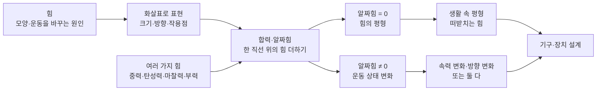

# 중1-5. 힘의 작용 — 밀고 당기는 모든 것의 규칙

<!-- next: m1-06, m3-04, 3-3, 3-4, phy-1, mech-1 -->

> [!NOTE]
> **성취기준**
> - **[9과05-01]** 물체에 작용하는 힘을 화살표를 이용하여 나타내고, 힘의 평형을 이루는 조건을 설명할 수 있다.
> - **[9과05-02]** 중력, 탄성력, 마찰력, 부력을 이해하고, 각 힘의 특징을 크기와 방향으로 설명할 수 있다.
> - **[9과05-03]** 알짜힘이 0이 아닐 때 물체의 운동 상태가 변함을 알고, 그 예를 조사하여 분류할 수 있다.
> - **[9과05-04]** 다양한 사례에서 작용하는 힘과 힘의 평형 관계를 설명하고, 일상생활에서 힘의 특징을 이용한 기구나 장치를 설계할 수 있다.

**학습 목표**

1. 힘의 뜻을 알고, 물체에 작용하는 힘을 크기와 방향을 가진 화살표로 나타낼 수 있다.
2. 한 직선 위에서 작용하는 여러 힘의 합력을 구하고, 힘의 평형을 이루는 조건을 설명할 수 있다.
3. 중력, 탄성력, 마찰력, 부력의 특징을 크기와 방향으로 설명하고, 질량과 무게를 구별할 수 있다.
4. 알짜힘이 0이 아닐 때 물체의 운동 상태가 변함을 알고, 그 예를 '속력 변화', '방향 변화', '둘 다 변화'로 분류할 수 있다.
5. 바닥에 놓인 물체 등 여러 사례에서 힘의 평형을 설명하고, 힘의 특징을 이용한 기구나 장치를 설계할 수 있다.

**이 단원의 학습 사다리**

| 단계 | 무엇을 하나? |
|---|---|
| STEP 1. 이전 학습 다시 보기 | 초등학교 '힘과 우리 생활'에서 배운 밀기·당기기, 무게 재기를 다시 꺼낸다 |
| STEP 2. 기초 다지기 | 힘이 하는 일, 힘의 단위 N, 속력의 뜻을 디딤돌로 놓는다 |
| STEP 3. 핵심 개념 | 화살표 → 합력과 평형 → 중력·탄성력·마찰력·부력 → 알짜힘과 운동 → 생활 속 평형과 장치 설계 |
| STEP 4. 오개념 바로잡기 | "움직이는 물체에는 항상 운동 방향으로 힘이 작용한다?" 같은 착각을 바로잡는다 |
| STEP 5. 다음 단계로 | 가속도 법칙, 작용 반작용, 비스듬한 힘의 합성, 부력의 크기(중3·통합과학·물리학) |
| STEP 6. 생활·산업·진로 | 엘리베이터와 건축 구조, 타이어와 브레이크, 선박과 잠수함, 놀이 기구 |

---

## 🗺️ 단원 들어가기

줄다리기를 하는데 두 팀 모두 온 힘을 다해 당기고 있는데도 줄이 꼼짝하지 않는다. 힘이 이렇게 많이 작용하는데 왜 아무 일도 일어나지 않을까? 그러다 한쪽 팀이 조금 더 세게 당기는 순간, 줄이 그쪽으로 끌려가기 시작한다.

책상 위에 놓인 필통은 가만히 있다. 지구가 필통을 아래로 끌어당기는데 왜 떨어지지 않을까? 축구공을 차면 굴러가다 결국 멈추는데, 공을 멈추게 한 것은 누구일까? 무거운 배는 어떻게 물에 뜰까?

이 단원에서는 이 질문들을 **힘의 크기와 방향**, 그리고 여러 힘을 합친 **알짜힘**이라는 생각으로 풀어 본다.

---

## STEP 1. 🔙 이전 학습 다시 보기

### 연계 개념표

| 이전 단원·성취기준 | 그때 배운 것 | 이 단원에서 확장되는 것 |
|---|---|---|
| 초등학교 3∼4학년군 '힘과 우리 생활' | 물체를 밀거나 당기면 물체의 모양이나 움직임이 변한다 | 힘을 **크기와 방향을 가진 화살표**로 나타내고, 단위 N(뉴턴)으로 크기를 잰다 |
| 초등학교 3∼4학년군 '힘과 우리 생활' | 용수철저울로 물체의 무게를 잰다. 무거운 물체일수록 용수철이 많이 늘어난다 | 무게는 **중력의 크기**이고, 용수철이 늘어나는 길이는 힘의 크기에 **비례**한다(탄성력) |
| 초등학교 3∼4학년군 '힘과 우리 생활' | 수평 잡기, 지레 같은 도구를 이용하면 힘을 편리하게 쓸 수 있다 | 여러 힘이 함께 작용할 때 **힘의 평형** 조건을 따지고, 힘의 특징을 이용한 장치를 설계한다 |
| 초등학교 5∼6학년군 '물체의 운동' | 속력은 일정한 시간 동안 물체가 이동한 거리이다 | 힘을 받은 물체의 **속력과 운동 방향**이 어떻게 변하는지 분류한다 |

### 준비 운동 (사전 진단)

**Q1.** 다음 중 힘이 작용하여 생긴 변화가 **아닌** 것은?
① 찰흙을 눌러 납작해졌다. ② 굴러가던 공이 손에 잡혀 멈췄다. ③ 얼음이 햇볕에 녹았다. ④ 날아오던 공을 배트로 쳐서 방향이 바뀌었다.

**Q2.** 용수철저울에 추 1개를 매달았더니 용수철이 2 cm 늘어났다. 같은 추 2개를 매달면 몇 cm 늘어날까?

**Q3.** 달에 가면 우리 몸의 무게는 지구에서와 같다. (O / X)

정답 및 해설

**Q1. ③** — 얼음이 녹은 것은 열에너지를 흡수해 상태가 변한 것이다(중1 「물질의 상태 변화」). ①은 모양, ②는 속력, ④는 운동 방향이 힘에 의해 변했다.

**Q2. 4 cm** — 매단 무게가 2배가 되면 늘어난 길이도 2배가 된다.

**Q3. X** — 무게는 행성이나 위성이 끌어당기는 힘의 크기이다. 달은 지구보다 약하게 끌어당기므로 무게가 약 $\frac{1}{6}$로 줄어든다. 하지만 몸을 이루는 물질의 양(질량)은 그대로이다.

---

## STEP 2. 🧱 기초 다지기

### ① 힘이란 무엇인가

과학에서 **힘(force)** 은 **물체의 모양이나 운동 상태를 변하게 하는 원인**이다.

| 힘이 하는 일 | 예 |
|---|---|
| 모양을 바꾼다 | 고무공을 누르면 찌그러진다, 찰흙을 빚는다, 용수철을 당기면 늘어난다 |
| 운동 상태를 바꾼다 | 정지한 공을 차면 굴러간다, 달리는 자전거가 브레이크로 멈춘다, 날아오는 공을 치면 방향이 바뀐다 |
| 둘 다 바꾼다 | 테니스공을 라켓으로 치면 공이 찌그러지면서 튕겨 나간다 |

> [!NOTE]
> 일상에서 "힘이 세다", "힘이 없다"처럼 쓰는 말은 체력이나 능력을 뜻할 때가 많다. 과학에서 말하는 힘은 '**다른 물체를 밀거나 당겨서 변화를 일으키는 작용**'이다. 그래서 힘은 언제나 **두 물체 사이**에서 작용한다. "누가 무엇에게 힘을 주는가?"를 늘 따져 보자.

### ② 힘의 단위 N(뉴턴)

힘의 크기는 **N(뉴턴)** 이라는 단위로 나타낸다. 영국의 과학자 뉴턴의 이름을 딴 것이다.

- 지구에서 질량 약 100 g인 물체(사과 한 개 정도)를 손바닥 위에 올려놓았을 때 손이 받는 힘이 약 1 N이다.
- 힘의 크기는 **용수철저울**로 잴 수 있다. 용수철이 늘어난 정도로 힘의 크기를 읽는다.

### ③ 속력: 얼마나 빠른가

힘을 받은 물체의 운동을 이야기하려면 '빠르기'를 나타낼 말이 필요하다. **속력(speed)** 은 물체가 일정한 시간 동안 이동한 거리이다.

$$
\text{속력} = \frac{\text{이동 거리}}{\text{걸린 시간}} \qquad \text{단위: } \mathrm{m/s}
$$

- 10초 동안 50 m를 달린 학생의 속력은 $50 \div 10 = 5\ \mathrm{m/s}$이다.
- 이 단원에서는 속력이 '빨라졌는지, 느려졌는지, 그대로인지'와 '운동 방향이 바뀌었는지'만 따지면 된다.

### ④ 운동 상태 = 속력 + 운동 방향

물체의 **운동 상태**는 속력과 운동 방향 두 가지로 정해진다. 둘 중 **하나라도 바뀌면 운동 상태가 변한 것**이다.

> [!TIP]
> 💡 **비유** — 내비게이션이 "시속 50 km로 동쪽"이라고 알려 주듯, 운동 상태는 '얼마나 빠르게'와 '어느 쪽으로'를 함께 말해야 완성된다. 속력이 같아도 방향이 바뀌면 다른 운동 상태이다.

---

## STEP 3. 📘 핵심 개념

### ① 힘을 화살표로 나타내기 [9과05-01]

힘은 크기와 방향을 함께 가지므로 **화살표**로 나타내면 편리하다.

| 화살표의 요소 | 나타내는 것 |
|---|---|
| 화살표의 **시작점** | 힘이 작용하는 점(작용점) |
| 화살표의 **방향** | 힘의 방향 |
| 화살표의 **길이** | 힘의 크기 (길이가 2배면 힘도 2배) |

**예** 1 cm를 2 N으로 약속하면, 상자를 오른쪽으로 6 N의 힘으로 미는 것은 상자에서 시작해 오른쪽을 향하는 3 cm 길이의 화살표로 나타낸다.

> [!TIP]
> 💡 **요령** — 화살표를 그리기 전에 먼저 '몇 cm = 몇 N'의 약속(축척)을 정한다. 지도에서 '1 cm = 1 km'로 정하는 것과 같다.

#### 예제 1

1 cm를 10 N으로 약속하였다. 다음 힘을 나타내는 화살표의 방향과 길이를 쓰시오.
(1) 수레를 앞쪽으로 30 N의 힘으로 민다. (2) 공을 위쪽으로 15 N의 힘으로 들어 올린다.

**풀이** (1) 앞쪽 방향, $30 \div 10 = 3$ cm (2) 위쪽 방향, $15 \div 10 = 1.5$ cm

### ② 여러 힘을 합치기 — 합력과 힘의 평형 [9과05-01]

한 물체에 여러 힘이 동시에 작용할 때, 이 힘들을 모두 합친 하나의 힘을 **합력**이라고 하고, 물체에 실제로 작용하는 합력을 **알짜힘(net force)** 이라고 한다. 중학교에서는 **한 직선 위에 나란하게 작용하는 힘**만 합친다.

| 경우 | 합력의 크기 | 합력의 방향 | 예 |
|---|---|---|---|
| 두 힘이 **같은 방향** | 두 힘의 크기를 **더한다** | 두 힘과 같은 방향 | 두 사람이 같은 쪽으로 수레를 민다 |
| 두 힘이 **반대 방향** | 큰 힘에서 작은 힘을 **뺀다** | **큰 힘**의 방향 | 줄다리기 |
| 크기가 같고 반대 방향 | 0 | 없음 | 비긴 줄다리기 |

#### 힘의 평형

한 물체에 작용하는 힘들의 합력이 **0**일 때, 이 힘들은 **평형을 이룬다**고 한다. 두 힘이 평형을 이루는 조건은 다음 세 가지이다.

> [!IMPORTANT]
> **두 힘의 평형 조건**
> 1. 두 힘의 **크기가 같다.**
> 2. 두 힘의 **방향이 반대이다.**
> 3. 두 힘이 **같은 물체에, 같은 직선 위에서** 작용한다.

- 힘의 평형을 이루는 물체는 **운동 상태가 변하지 않는다.** 정지해 있던 물체는 계속 정지해 있다.
- 줄다리기에서 줄이 움직이지 않는 것은 힘이 작용하지 않아서가 아니라, 양쪽 힘이 평형을 이루어 **알짜힘이 0**이기 때문이다.

#### 예제 2

줄다리기에서 왼쪽 팀은 왼쪽으로 600 N, 오른쪽 팀은 오른쪽으로 650 N의 힘으로 줄을 당긴다.
(1) 줄에 작용하는 알짜힘의 크기와 방향은? (2) 오른쪽 팀에서 50 N의 힘으로 당기던 학생 한 명이 빠지면 어떻게 될까?

**풀이** (1) 반대 방향이므로 $650 - 600 = 50\ \mathrm{N}$, **오른쪽** 방향. 줄은 오른쪽으로 끌려가기 시작한다.
(2) 오른쪽 팀이 $650 - 50 = 600\ \mathrm{N}$이 되어 양쪽 힘이 같아진다. 알짜힘이 0이므로 **힘의 평형**을 이룬다.

#### 예제 3

상자를 철수는 오른쪽으로 20 N, 영희도 오른쪽으로 30 N의 힘으로 밀고, 민수는 왼쪽으로 40 N의 힘으로 민다. 상자에 작용하는 알짜힘은? (마찰은 생각하지 않는다.)

**풀이** 오른쪽 힘의 합: $20 + 30 = 50\ \mathrm{N}$. 왼쪽 힘: $40\ \mathrm{N}$. 알짜힘 $= 50 - 40 = 10\ \mathrm{N}$, **오른쪽** 방향.

### ③ 중력 — 지구가 끌어당기는 힘 [9과05-02]

손에서 놓은 공은 떨어지고, 던져 올린 공도 결국 땅으로 돌아온다. 질량을 가진 물체 사이에 서로 끌어당기는 힘이 작용하는데, 지구가 물체를 끌어당기는 힘을 **중력(gravity)** 이라고 한다.

| 특징 | 내용 |
|---|---|
| 방향 | **지구 중심 방향**(우리가 서 있는 곳에서는 연직 아래 방향) |
| 크기 | 물체의 **질량이 클수록 크다**(질량에 비례) |
| 작용 | 물체에 닿지 않아도, 떨어져 있어도 작용한다 |
| 다른 천체 | 달·화성 같은 다른 천체도 물체를 끌어당기며, 그 크기는 천체마다 다르다 |

지구는 둥글기 때문에 '아래'의 방향은 지구 어디에서나 **지구 중심**을 향한다. 그래서 지구 반대편 사람들도 떨어지지 않고 서 있을 수 있다.

#### 무게와 질량은 다르다

| 구분 | 질량(mass) | 무게(weight) |
|---|---|---|
| 뜻 | 물체가 가진 **고유한 양** | 물체에 작용하는 **중력의 크기** |
| 단위 | g, kg | N(뉴턴) |
| 장소에 따라 | **변하지 않는다** | 변한다(달에서는 지구의 약 $\frac{1}{6}$) |
| 측정 도구 | 윗접시저울, 양팔저울(기준 물체와 비교) | 용수철저울, 체중계 |

지구에서 질량 1 kg인 물체의 무게는 약 9.8 N이다.

$$
\text{지구에서의 무게(N)} = 9.8 \times \text{질량(kg)}
$$

> [!WARNING]
> 일상에서 "몸무게가 50 kg이다"라고 말하지만, 과학적으로 50 kg은 **질량**이다. 이 사람의 지구에서의 무게는 $9.8 \times 50 = 490\ \mathrm{N}$이다.

> [!TIP]
> 💡 **비유** — 질량은 '가방 속에 든 책의 양', 무게는 '그 가방을 메었을 때 어깨가 느끼는 무게감'이다. 달에 가도 가방 속 책은 그대로지만(질량 같음), 어깨는 훨씬 가볍게 느낀다(무게 감소).

#### 예제 4

질량 60 kg인 우주 비행사가 있다.
(1) 지구에서 이 사람의 무게는? (2) 달에서의 질량과 무게는? (달의 중력은 지구의 $\frac{1}{6}$로 계산한다.)

**풀이** (1) $9.8 \times 60 = 588\ \mathrm{N}$
(2) 질량은 장소와 관계없으므로 **60 kg** 그대로이다. 무게는 $588 \times \frac{1}{6} = 98\ \mathrm{N}$이다.

> [!NOTE]
> 양팔저울은 양쪽 접시에 같은 중력이 작용하므로 달에서도 지구와 같은 값을 가리킨다. 그래서 양팔저울로는 **질량**을 잰다. 용수철저울은 달에서 더 적게 늘어나므로 **무게**를 잰다.

### ④ 탄성력 — 원래 모양으로 돌아가려는 힘 [9과05-02]

용수철을 당기면 늘어나고, 손을 놓으면 원래 길이로 돌아간다. 이처럼 힘을 받아 모양이 변했다가 힘을 없애면 원래 모양으로 돌아가는 성질을 **탄성**이라고 하고, 이런 성질을 가진 물체를 **탄성체**라고 한다. 모양이 변한 탄성체가 원래 모양으로 돌아가려는 힘을 **탄성력(elastic force)** 이라고 한다.

| 특징 | 내용 |
|---|---|
| 방향 | 탄성체를 변형시킨 힘과 **반대 방향** (늘이면 줄어드는 쪽, 누르면 늘어나는 쪽) |
| 크기 | 탄성체를 변형시킨 힘의 크기와 **같다.** 변형된 정도(늘어나거나 줄어든 길이)가 클수록 크다 |
| 예 | 용수철, 고무줄, 트램펄린, 활시위, 침대 매트리스, 볼펜 속 용수철 |

#### 용수철이 늘어난 길이는 힘에 비례한다

용수철에 추를 하나씩 더 매달며 늘어난 길이를 재면 다음과 같은 결과를 얻는다.

| 매단 추의 무게(N) | 0 | 1 | 2 | 3 | 4 |
|---|---|---|---|---|---|
| 늘어난 길이(cm) | 0 | 2 | 4 | 6 | 8 |

- 무게가 2배, 3배가 되면 늘어난 길이도 2배, 3배가 된다. **용수철이 늘어난 길이는 매단 물체의 무게(용수철에 작용한 힘)에 비례한다.**
- 그래프로 그리면 원점을 지나는 **직선**이 된다. 용수철저울은 이 성질을 이용해 눈금을 고르게 새긴 도구이다.
- 단, 너무 큰 힘을 주면 용수철이 늘어난 채로 돌아오지 않는다(**탄성 한계**). 이때부터는 비례 관계가 성립하지 않는다.

> [!TIP]
> 💡 **비유** — 탄성력은 '원래 자리를 그리워하는 힘'이다. 많이 끌려갈수록(많이 늘어날수록) 더 세게 돌아가려 한다.

#### 예제 5

위 표의 용수철에 어떤 물체를 매달았더니 10 cm 늘어났다. 이 물체의 무게는 몇 N인가? (탄성 한계를 넘지 않았다.)

**풀이** 1 N에 2 cm씩 늘어나므로, 10 cm 늘어났다면 $10 \div 2 = 5\ \mathrm{N}$이다.

### ⑤ 마찰력 — 미끄러짐을 방해하는 힘 [9과05-02]

바닥에 놓인 상자를 밀면 잘 밀리지 않고, 굴러가던 공도 결국 멈춘다. 두 물체가 닿아 있는 면에서 **물체의 운동을 방해하는 힘**을 **마찰력(friction)** 이라고 한다.

| 특징 | 내용 |
|---|---|
| 방향 | 물체가 운동하는(또는 운동하려는) 방향과 **반대 방향** |
| 크기 ① | 접촉면이 **거칠수록** 크다 (얼음판 < 아스팔트 < 모래밭) |
| 크기 ② | 물체가 접촉면을 **누르는 힘이 클수록**(물체가 무거울수록) 크다 |
| 크기 ③ | 같은 물체라면 접촉면의 넓이와는 거의 관계없다 |

#### 마찰력이 필요한 곳, 줄여야 하는 곳

| 마찰력을 **크게** 하는 경우 | 마찰력을 **작게** 하는 경우 |
|---|---|
| 운동화 밑창에 울퉁불퉁한 무늬를 만든다 | 기계의 회전 부분에 윤활유를 바른다 |
| 눈길에서 자동차 바퀴에 체인을 감는다 | 스키·스케이트 날을 매끄럽게 한다 |
| 겨울철 빙판길에 모래를 뿌린다 | 무거운 짐 아래에 바퀴를 단다 |
| 계단 끝에 미끄럼 방지 패드를 붙인다 | 미끄럼틀 표면을 매끄럽게 만든다 |
| 자전거 브레이크 고무가 바퀴를 꽉 잡는다 | 서랍 레일에 작은 구슬(볼 베어링)을 넣는다 |

> [!IMPORTANT]
> 마찰력은 운동을 '방해'만 하는 것이 아니다. 우리가 걸을 수 있는 것도 발바닥과 땅 사이의 마찰력 덕분이다. 마찰력이 전혀 없는 빙판에서는 앞으로 걸어 나가기 어렵고, 연필로 글씨를 쓸 수도, 못이 박혀 있을 수도 없다.

#### 예제 6

같은 나무 도막을 다음과 같이 끌 때, 마찰력이 가장 큰 경우는?
(가) 매끄러운 유리판 위에서 나무 도막 1개를 끈다. (나) 사포 위에서 나무 도막 1개를 끈다. (다) 사포 위에서 나무 도막 2개를 포개어 끈다.

**풀이** **(다)**. 접촉면이 거친 사포에서 마찰력이 크고, 나무 도막을 포개면 면을 누르는 힘이 커지므로 마찰력이 더 커진다.

### ⑥ 부력 — 액체나 기체가 떠받치는 힘 [9과05-02]

수영장에 들어가면 몸이 가볍게 느껴지고, 물속에서는 무거운 친구도 쉽게 들어 올릴 수 있다. 액체나 기체 속에 있는 물체를 **위쪽으로 밀어 올리는 힘**을 **부력(buoyant force)** 이라고 한다.

| 특징 | 내용 |
|---|---|
| 방향 | 중력과 **반대 방향**(위쪽) |
| 크기 | 물체가 액체에 **잠긴 부피가 클수록** 크다 |
| 측정 | 부력의 크기 = (공기 중에서 잰 무게) − (물속에서 잰 무게) |
| 예 | 배, 구명조끼, 튜브, 열기구, 헬륨 풍선, 물속에서 가벼워지는 몸 |

- 물체를 물에 조금씩 더 담글수록 용수철저울의 눈금이 줄어든다. 잠긴 부피가 커질수록 부력이 커지기 때문이다.
- 물체가 **완전히 잠긴 뒤에는** 더 깊이 넣어도 눈금이 변하지 않는다. 잠긴 부피가 더 늘지 않기 때문이다.
- 물에 뜬 물체는 부력과 중력이 **평형**을 이룬다. 배가 뜨는 것도, 구명조끼가 몸을 띄우는 것도 이 때문이다.

#### 예제 7

어떤 돌을 용수철저울에 매달아 공기 중에서 재니 12 N, 물속에 완전히 담가 재니 8 N이었다.
(1) 돌이 받는 부력의 크기와 방향은? (2) 이 돌을 물속에서 두 배 깊이로 내려도 완전히 잠긴 상태라면 저울의 눈금은?

**풀이** (1) $12 - 8 = 4\ \mathrm{N}$, **위쪽** 방향. (2) 완전히 잠긴 뒤에는 잠긴 부피가 같으므로 부력도 같다. 눈금은 그대로 **8 N**이다.

#### 네 가지 힘 한눈에 비교

| 힘 | 방향 | 크기를 결정하는 것 | 닿아야 작용하나? |
|---|---|---|---|
| 중력 | 지구 중심 방향(아래) | 물체의 질량 | 아니다 |
| 탄성력 | 변형시킨 힘의 반대 방향 | 변형된 정도 | 그렇다 |
| 마찰력 | 운동(하려는) 방향의 반대 | 접촉면의 거칠기, 누르는 힘 | 그렇다 |
| 부력 | 중력의 반대 방향(위) | 잠긴 부피 | 그렇다(액체·기체에 잠겨야) |

### ⑦ 알짜힘이 0이 아니면 운동 상태가 변한다 [9과05-03]

> [!IMPORTANT]
> - 물체에 작용하는 **알짜힘이 0**이면 물체의 운동 상태는 **변하지 않는다.**
> - 물체에 작용하는 **알짜힘이 0이 아니면** 물체의 운동 상태(속력이나 운동 방향)가 **변한다.**

알짜힘이 0이 아닐 때 운동 상태가 변하는 모습은 세 가지로 나눌 수 있다.

| 분류 | 알짜힘의 방향 | 사례 |
|---|---|---|
| **속력만** 변한다 | 운동 방향과 **같은 방향** → 빨라진다 | 미끄럼틀을 내려오는 아이, 페달을 밟아 빨라지는 자전거, 떨어지는 사과 |
| | 운동 방향과 **반대 방향** → 느려진다 | 브레이크를 밟은 자동차, 굴러가다 멈추는 공, 비탈길을 올라가며 느려지는 수레 |
| **운동 방향만** 변한다 | 운동 방향에 **수직** | 일정한 빠르기로 도는 회전목마, 줄에 매달아 일정한 빠르기로 돌리는 공 |
| **속력과 방향이 모두** 변한다 | 운동 방향과 **비스듬한 방향** | 비스듬히 던져 올린 공, 골대 앞에서 휘어지며 떨어지는 축구공, 그네, 바이킹 |

> [!TIP]
> 💡 **요령** — 알짜힘의 방향이 운동 방향과 '같으면 가속, 반대면 감속, 직각이면 방향만, 비스듬하면 둘 다'라고 기억하자.

#### 예제 8

다음 운동을 '속력만 변함', '방향만 변함', '속력과 방향이 모두 변함'으로 분류하시오.
(1) 정지해 있다가 출발하는 버스 (2) 볼링 핀에 부딪혀 방향이 꺾이며 느려진 볼링공 (3) 일정한 빠르기로 도는 대관람차의 칸 (4) 수평으로 던져 포물선을 그리며 떨어지는 공

**풀이** (1) 속력만 변함 (2) 속력과 방향이 모두 변함 (3) 방향만 변함 (4) 속력과 방향이 모두 변함

> [!NOTE]
> 알짜힘이 0이면 정지한 물체는 계속 정지해 있다. 그렇다면 움직이던 물체는 어떨까? 마찰력과 공기 저항이 없는 곳에서는 **같은 빠르기로 같은 방향으로 계속** 움직인다. 일상에서 움직이던 물체가 결국 멈추는 것은 힘이 '떨어져서'가 아니라 마찰력이라는 **반대 방향의 힘**이 작용했기 때문이다.

### ⑧ 생활 속 힘의 평형과 장치 설계 [9과05-04]

#### 바닥에 놓인 물체 — 떠받치는 힘

책상 위의 책에는 중력이 아래로 작용한다. 그런데도 책이 정지해 있으므로, 알짜힘이 0이어야 한다. 그렇다면 위쪽으로 작용하는 힘이 있어야 한다. 이것이 **책상(바닥)이 물체를 떠받치는 힘**이다.

- 책상이 책을 떠받치는 힘은 위쪽, 크기는 책의 무게와 같다.
- 떠받치는 힘은 바닥이 아주 조금 눌려 원래대로 돌아가려는 성질(탄성) 때문에 생긴다. 트램펄린 위에 서 있으면 쉽게 느낄 수 있다.

| 상황 | 작용하는 힘 | 평형 관계 |
|---|---|---|
| 책상 위에 놓인 책 | 중력(아래), 책상이 떠받치는 힘(위) | 두 힘의 크기가 같다 |
| 천장에 매달린 전등 | 중력(아래), 줄이 당기는 힘(위) | 두 힘의 크기가 같다 |
| 용수철에 매달려 정지한 추 | 중력(아래), 탄성력(위) | 두 힘의 크기가 같다 |
| 물에 떠 있는 배 | 중력(아래), 부력(위) | 두 힘의 크기가 같다 |
| 밀어도 움직이지 않는 무거운 상자 | 미는 힘(앞), 마찰력(뒤) / 중력(아래), 떠받치는 힘(위) | 가로 방향과 세로 방향에서 각각 평형 |
| 하늘에 떠 정지한 열기구 | 중력(아래), 부력(위) | 두 힘의 크기가 같다 |

> [!WARNING]
> 무거운 상자를 10 N으로 밀었는데 움직이지 않았다면, 마찰력도 **10 N**이다. "마찰력이 미는 힘보다 커서 안 움직인다"는 틀린 말이다. 마찰력이 미는 힘보다 크다면 상자는 미는 사람 쪽으로 움직여야 한다. 정지한 물체에서 마찰력은 미는 힘과 **크기가 같게** 맞추어 작용한다.

#### 예제 9

질량 2 kg인 상자가 바닥에 놓여 있다.
(1) 상자에 작용하는 중력의 크기는? (2) 바닥이 상자를 떠받치는 힘의 크기와 방향은? (3) 상자를 오른쪽으로 5 N으로 밀었는데 움직이지 않았다. 마찰력의 크기와 방향은?

**풀이** (1) $9.8 \times 2 = 19.6\ \mathrm{N}$
(2) 상자가 정지해 있으므로 중력과 평형을 이룬다. **19.6 N, 위쪽**
(3) 움직이지 않으므로 미는 힘과 평형을 이룬다. **5 N, 왼쪽**

#### 힘의 특징을 이용한 기구와 장치

| 이용한 힘 | 기구·장치 | 어떻게 이용하나? |
|---|---|---|
| 중력 | 다림추(수직 확인), 물시계, 미끄럼틀 | 중력 방향이 항상 아래쪽인 점, 아래로 끌어당기는 점 |
| 탄성력 | 용수철저울, 트램펄린, 자동차 완충 장치, 집게, 활 | 변형된 정도에 따라 힘이 커지는 점, 원래대로 돌아가는 점 |
| 마찰력 | 브레이크, 미끄럼 방지 장갑, 볼 베어링 | 운동을 멈추게 하는 점, 마찰을 줄여 잘 굴러가게 하는 점 |
| 부력 | 구명조끼, 낚시찌, 튜브, 열기구 | 잠긴 부피가 클수록 부력이 커지는 점 |

#### 장치 설계 절차

1. **문제 정하기**: 해결하고 싶은 생활 속 불편함을 정한다. (예: 계단에서 무거운 짐을 옮기기 힘들다.)
2. **힘 분석하기**: 어떤 힘이 작용하는지 화살표로 그리고, 줄이거나 키워야 할 힘을 찾는다.
3. **아이디어 내기**: 네 가지 힘 중 무엇을 어떻게 이용할지 정한다.
4. **설계도 그리기·만들기**: 재료와 크기를 정해 시제품을 만든다.
5. **시험하고 고치기**: 실제로 써 보고 문제점을 찾아 개선한다.

#### 예제 10

비 오는 날 우산꽂이에서 우산을 꺼낼 때 다른 우산이 함께 딸려 나와 불편하다. 힘의 특징을 이용해 해결 방법을 하나 제안하시오.

**풀이(예시)** 우산꽂이의 칸마다 **고무 패킹**을 달아 우산과 칸 사이의 **마찰력**을 조절한다. 우산을 세게 당기면 빠지지만 옆 우산과 부딪혀도 쉽게 딸려 나오지 않는다. 또는 칸 아래에 **용수철**을 달아 우산을 살짝 밀어 올리면(탄성력), 꺼낼 우산만 손잡이가 높아져 쉽게 잡을 수 있다.

---

## STEP 4. ⚠️ 오개념 바로잡기

| 흔한 오개념 | 올바른 개념 | 왜 그럴까? |
|---|---|---|
| 정지한 물체에는 힘이 작용하지 않는다 | 정지한 물체에도 여러 힘이 작용하며, 그 **알짜힘이 0**일 뿐이다 | 책상 위의 책에는 중력과 떠받치는 힘이 함께 작용한다 |
| 움직이는 물체에는 항상 운동 방향으로 힘이 작용한다 | 알짜힘이 0이면 움직이던 물체는 **같은 빠르기로 계속** 움직인다 | 위로 던진 공이 올라가는 동안 받는 힘은 중력(아래)뿐이다. 그래서 점점 느려진다 |
| 질량과 무게는 같은 것이다 | 질량은 물질의 양(kg), 무게는 중력의 크기(N)이다 | 달에서 질량은 그대로이지만 무게는 약 $\frac{1}{6}$이 된다 |
| 밀어도 안 움직이는 것은 마찰력이 미는 힘보다 크기 때문이다 | 정지해 있으면 마찰력과 미는 힘의 **크기가 같다** | 마찰력이 더 크면 상자가 반대쪽으로 움직여야 한다 |
| 무거운 물체는 물에 가라앉고 가벼운 물체는 뜬다 | 뜨고 가라앉음은 **부력과 중력의 크기 비교**로 정해진다 | 수만 톤의 배도 잠긴 부피가 커서 큰 부력을 받아 뜬다. 작은 쇠못은 가라앉는다 |
| 마찰력은 항상 나쁜 힘이다 | 마찰력이 있어야 걷고, 멈추고, 물건을 잡을 수 있다 | 빙판에서 걷기 어려운 것은 마찰력이 작기 때문이다 |
| 중력은 공중에 있는 물체에만 작용한다 | 중력은 땅 위·물속·공중 어디서나 작용한다 | 바닥 위 물체도 중력을 받지만 떠받치는 힘과 평형을 이루어 정지해 있다 |

---

## STEP 5. 🎓 다음 단계로 한 걸음 더

> [!CAUTION]
> 이 절은 **중학교 1학년 교육과정 범위 밖의 심화 내용**으로 평가 대상이 아니다. "이 개념이 앞으로 어디까지 이어지는가"를 맛보기로 보여 주기 위한 내용이다.

### 다음 학년·과목과의 연결

| 학년·과목 | 단원 | 이어지는 내용 |
|---|---|---|
| 중1 | 「기체의 성질」 | 일정한 면적에 작용하는 힘인 **압력**을 배우고, 기체 입자의 충돌로 생기는 힘을 설명한다 |
| 중3 | 「운동과 에너지」 | 속력이 일정하게 변하는 운동, 자유 낙하에서 중력에 의해 속력이 1초마다 9.8 m/s씩 증가함을 배운다. 힘이 한 일과 에너지로 이어진다 |
| 통합과학1 | 「중력과 운동」 | 낙하하는 물체와 지구 주위를 도는 인공위성이 모두 중력에 의해 지구 중심 방향으로 가속되는 운동임을 배운다 |
| 통합과학1 | 「운동량과 충격량」 | 알짜힘이 0이면 가속되지 않는다는 **관성**을 배우고, 힘을 받는 시간까지 고려한 충격량으로 안전장치를 설명한다 |
| 물리학(일반 선택) | 「힘과 에너지」 | 뉴턴 운동 법칙(관성·가속도·작용 반작용), 돌림힘과 평형, 운동량 보존을 정량적으로 다룬다 |
| 역학과 에너지(진로 선택) | 「시공간과 운동」 | 비스듬히 던진 물체의 운동, 원운동, 행성의 운동을 힘으로 분석한다 |

### ① 알짜힘이 클수록 운동 상태가 빨리 변한다 — 가속도 법칙

이 단원에서는 '알짜힘이 0이 아니면 운동 상태가 변한다'까지만 배웠다. 고등학교 물리학에서는 **얼마나 빨리** 변하는지를 식으로 나타낸다. 1초 동안 속도가 변하는 정도를 **가속도** $a$라 하면, 알짜힘 $F$, 질량 $m$과 다음 관계가 있다.

$$
F = ma
$$

같은 힘이면 질량이 큰 물체일수록 운동 상태가 덜 변한다. 빈 수레보다 짐을 가득 실은 수레를 출발시키기 어려운 까닭이다.

### ② 작용과 반작용 — 힘은 언제나 쌍으로

STEP 2에서 '힘은 두 물체 사이에서 작용한다'고 했다. 물리학에서는 A가 B에 힘을 주면 B도 A에 **크기가 같고 방향이 반대인 힘**을 준다는 **작용 반작용 법칙**을 배운다. 벽을 밀면 벽도 나를 밀고, 로켓이 가스를 뒤로 밀면 가스가 로켓을 앞으로 민다.

이것은 이 단원의 '힘의 평형'과 헷갈리기 쉽다. **힘의 평형은 한 물체에 작용하는 두 힘**, **작용 반작용은 서로 다른 두 물체에 각각 작용하는 두 힘**이다. 책상 위 책에서 '중력'과 '책상이 떠받치는 힘'은 평형 관계이지, 작용 반작용 관계가 아니다. 이 떠받치는 힘은 고등학교에서 **수직 항력**이라고 부른다.

### ③ 비스듬한 힘의 합성

이 단원에서는 한 직선 위의 힘만 더했다. 고등학교에서는 두 힘이 비스듬하게 작용할 때 두 화살표로 평행사변형을 그려 그 대각선으로 합력을 구한다. 이렇게 크기와 방향을 함께 다루는 양을 **벡터**라고 한다.

### ④ 부력의 크기는 얼마일까 — 아르키메데스 원리

이 단원에서는 '잠긴 부피가 클수록 부력이 크다'고 배웠다. 더 정확히는 **부력의 크기는 물체가 밀어낸 액체의 무게와 같다**(아르키메데스 원리). 그래서 같은 부피라도 물보다 무거운 바닷물에서 부력이 조금 더 크다.

### 지금 vs 다음 단계

| 구분 | 중1 「힘의 작용」 | 중3·통합과학 | 고등학교 물리학 |
|---|---|---|---|
| 힘의 합성 | 한 직선 위의 힘을 더하고 뺀다 | 알짜힘과 관성 | 비스듬한 힘을 벡터로 합성 |
| 힘과 운동 | 알짜힘 ≠ 0이면 운동 상태 변화(분류) | 속력 변화 그래프, 자유 낙하, 충격량 | $F = ma$로 가속도 계산 |
| 중력 | 무게 = 9.8 × 질량 | 중력에 의한 낙하·원운동 | 만유인력, 행성의 운동 |
| 평형 | 두 힘의 평형 | 관성 법칙 | 돌림힘까지 고려한 평형, 작용 반작용 |

---

## STEP 6. 🏭 생활·산업·진로 연결

### 사례 1. 건물과 다리 — 힘의 평형을 설계하는 일

- **원리** 건물의 기둥과 바닥은 그 위에 놓인 모든 것의 무게(중력)와 같은 크기의 힘으로 떠받쳐야 무너지지 않는다.
- **어디에 쓰이나** 건축 구조 기술자는 사람·가구·눈·바람이 만드는 힘을 계산하여, 각 기둥과 보가 견뎌야 할 힘이 평형을 이루도록 설계한다. 엘리베이터도 줄이 당기는 힘과 중력의 관계로 운동을 조절한다.

### 사례 2. 타이어와 브레이크 — 마찰력 다루기

- **원리** 마찰력은 접촉면이 거칠수록, 누르는 힘이 클수록 커진다.
- **어디에 쓰이나** 타이어 표면의 홈 무늬는 빗길에서 물을 빼내 타이어와 도로 사이의 마찰력을 지킨다. 브레이크는 패드로 바퀴의 원판을 꽉 눌러 마찰력으로 차를 멈춘다. 반대로 기계 속 볼 베어링과 윤활유는 마찰을 줄여 에너지 낭비와 마모를 막는다.

### 사례 3. 배와 잠수함 — 부력과 중력의 균형

- **원리** 물에 뜬 물체는 부력과 중력이 평형을 이룬다.
- **어디에 쓰이나** 커다란 배는 속이 빈 넓은 선체로 많은 부피가 물에 잠기게 하여 큰 부력을 얻는다. 잠수함은 내부 탱크에 바닷물을 채우거나 빼내 무게를 조절하여 가라앉거나 떠오른다.

### 사례 4. 놀이 기구와 스포츠 — 운동 상태를 바꾸는 힘

- 롤러코스터와 바이킹은 중력을 이용해 속력과 방향을 계속 바꾸고, 마지막에는 마찰 브레이크로 멈춘다.
- 장대높이뛰기의 장대, 트램펄린, 다이빙대는 탄성력을 이용해 몸을 높이 튀어 오르게 한다.

### 관련 진로와 학과

| 진로 | 하는 일 | 관련 학과 |
|---|---|---|
| 건축 구조 기술자 | 건물·다리가 견딜 힘을 계산하고 설계 | 건축공학, 토목공학 |
| 기계·자동차 엔지니어 | 브레이크, 완충 장치, 기계 부품 설계 | 기계공학, 자동차공학 |
| 조선 해양 엔지니어 | 배와 잠수함의 부력·안정성 설계 | 조선해양공학 |
| 놀이 기구 설계자 | 안전하고 짜릿한 운동 설계 | 기계공학, 산업디자인 |
| 스포츠 과학자 | 선수 동작과 운동 용품의 힘 분석 | 체육학, 스포츠과학 |

---

## 🔬 탐구 활동 — 용수철의 탄성력과 물속에서의 부력 측정하기

### 활동 A. 용수철의 탄성력 측정하기

**목표** 용수철에 매단 물체의 무게와 용수철이 늘어난 길이의 관계를 알아본다.

**준비물** 용수철, 스탠드, 자, 무게가 같은 추 5개(예: 하나에 0.5 N), 그래프 용지(또는 데이터 기록 앱)

**과정**
1. 스탠드에 용수철을 매달고, 아무것도 매달지 않았을 때 용수철 끝의 위치를 자로 기록한다.
2. 추를 1개씩 늘려 가며 매달고, 용수철이 처음보다 늘어난 길이를 잰다.
3. 가로축을 추의 무게(N), 세로축을 늘어난 길이(cm)로 하여 그래프를 그린다.
4. 모르는 물체를 매달아 늘어난 길이를 재고, 그래프로 그 물체의 무게를 알아낸다.

**결과 기록**

| 추의 무게(N) | 0 | 0.5 | 1.0 | 1.5 | 2.0 | 2.5 |
|---|---|---|---|---|---|---|
| 늘어난 길이(cm) | 0 | | | | | |

**생각해 보기**
1. 추의 무게가 2배가 되면 늘어난 길이는 어떻게 되는가? 그래프 모양은 어떠한가?
2. 추가 정지해 있을 때 추에 작용하는 두 힘은 무엇이며, 두 힘은 어떤 관계인가?
3. 용수철저울의 눈금 간격이 고른 까닭을 설명해 보자.

### 활동 B. 물속에서 부력 측정하기

**목표** 물체가 물에 잠긴 부피에 따라 부력의 크기가 어떻게 달라지는지 알아본다.

**준비물** 용수철저울, 실, 물을 담은 큰 비커(또는 수조), 추(또는 돌)

**과정**
1. 물체를 용수철저울에 매달아 공기 중에서의 무게를 잰다.
2. 물체를 물에 $\frac{1}{3}$, $\frac{2}{3}$, 완전히 잠기게 넣으면서 각각 저울의 눈금을 읽는다.
3. 완전히 잠긴 상태에서 더 깊이 넣어(바닥에 닿지 않게) 눈금을 다시 읽는다.
4. 각 경우의 부력 = (공기 중 무게) − (물속 눈금)을 계산한다.

**결과 기록**

| 잠긴 정도 | 0 | $\frac{1}{3}$ | $\frac{2}{3}$ | 완전히 | 완전히(더 깊이) |
|---|---|---|---|---|---|
| 저울 눈금(N) | | | | | |
| 부력(N) | 0 | | | | |

**생각해 보기**
1. 잠긴 부피가 커질수록 부력은 어떻게 변했는가?
2. 완전히 잠긴 뒤 깊이를 바꾸었을 때 부력은 변했는가? 그 까닭은?
3. 활동 결과를 이용해 구명조끼가 몸을 물에 뜨게 하는 원리를 설명해 보자.

> [!WARNING]
> **안전 수칙** 추를 매달 때 용수철을 탄성 한계 이상으로 당기지 않는다. 추가 떨어져 발을 다치지 않게 스탠드를 안정된 곳에 둔다. 바닥에 흘린 물은 미끄러지지 않도록 바로 닦는다.

### 활동 C (확장). 장난감이나 놀이 기구에서 힘의 작용 탐구하기

모둠별로 장난감(요요, 팽이, 고무줄 동력 자동차, 물로켓 등)이나 놀이 기구(그네, 시소, 미끄럼틀, 트램펄린)를 하나 골라, 작용하는 힘을 화살표로 그리고 운동 상태가 어떻게 변하는지 분류하여 포스터로 발표한다. 마지막으로 그 원리를 이용한 새로운 장난감을 설계해 본다.

---

## ✅ 개념 확인 문제

### 기본

**1.** 1 cm를 5 N으로 약속하고 힘을 화살표로 나타낼 때, 왼쪽으로 작용하는 20 N의 힘은 어떻게 그리는가?

정답 및 해설

**정답** 작용점에서 **왼쪽**을 향하는 **4 cm** 길이의 화살표

$20 \div 5 = 4$ cm이다.

**2.** 한 물체에 오른쪽으로 8 N, 왼쪽으로 3 N, 오른쪽으로 5 N의 힘이 한 직선 위에서 작용한다. 알짜힘의 크기와 방향을 구하시오.

정답 및 해설

**정답** 10 N, 오른쪽

오른쪽 힘의 합 $8 + 5 = 13\ \mathrm{N}$에서 왼쪽 힘 $3\ \mathrm{N}$을 빼면 $10\ \mathrm{N}$이고, 방향은 더 큰 쪽인 오른쪽이다.

**3.** 지구에서 질량이 30 kg인 물체가 있다. (1) 지구에서의 무게와 (2) 달에서의 질량, (3) 달에서의 무게를 구하시오. (달의 중력은 지구의 $\frac{1}{6}$로 계산한다.)

정답 및 해설

**정답** (1) 294 N (2) 30 kg (3) 49 N

(1) $9.8 \times 30 = 294\ \mathrm{N}$ (2) 질량은 장소에 따라 변하지 않는다. (3) $294 \div 6 = 49\ \mathrm{N}$

**4.** 다음 설명에 해당하는 힘의 이름을 쓰시오.
(1) 접촉면에서 물체의 운동을 방해하며, 운동 방향과 반대 방향으로 작용한다.
(2) 변형된 물체가 원래 모양으로 돌아가려는 힘이다.
(3) 물속의 물체를 위쪽으로 밀어 올리는 힘이다.

정답 및 해설

**정답** (1) 마찰력 (2) 탄성력 (3) 부력

### 응용

**5.** 어떤 용수철에 무게 2 N인 추를 매달았더니 3 cm 늘어났다. 이 용수철에 무게를 모르는 물체를 매달았더니 12 cm 늘어났다. 물체의 무게는? (탄성 한계를 넘지 않았다.)

정답 및 해설

**정답** 8 N

늘어난 길이는 무게에 비례한다. 12 cm는 3 cm의 4배이므로 무게도 2 N의 4배인 $8\ \mathrm{N}$이다.

**6.** 공기 중에서 무게가 15 N인 금속 덩어리를 용수철저울에 매달아 물에 완전히 담갔더니 눈금이 9 N을 가리켰다. 옳은 설명을 **모두** 고르시오.
ㄱ. 금속 덩어리가 받는 부력은 6 N이다.
ㄴ. 금속 덩어리를 절반만 물에 담그면 눈금은 9 N보다 작아진다.
ㄷ. 물속에서 금속 덩어리의 질량은 줄어든다.

정답 및 해설

**정답 ㄱ**

ㄱ. $15 - 9 = 6\ \mathrm{N}$이다.
ㄴ. 절반만 담그면 잠긴 부피가 줄어 부력이 작아지므로 눈금은 9 N보다 **커진다.** 틀렸다.
ㄷ. 질량은 변하지 않는다. 부력이 위로 떠받쳐 저울 눈금이 줄었을 뿐이다. 틀렸다.

**7.** 다음 운동 중 '운동 방향만 변하는 운동'을 고르시오.
① 높은 곳에서 떨어지는 공 ② 일정한 빠르기로 원 궤도를 도는 인공위성 ③ 출발하는 지하철 ④ 비스듬히 차올린 축구공

정답 및 해설

**정답 ②**

①과 ③은 속력만 변하고, ④는 속력과 방향이 모두 변한다. ②는 일정한 빠르기로 돌기 때문에 속력은 그대로이고 방향만 계속 바뀐다.

**8.** 무게가 50 N인 상자를 바닥에 놓고 오른쪽으로 20 N의 힘으로 밀었더니 움직이지 않았다. 다음 힘의 크기와 방향을 쓰시오.
(1) 바닥이 상자를 떠받치는 힘 (2) 상자에 작용하는 마찰력 (3) 상자에 작용하는 알짜힘

정답 및 해설

**정답** (1) 50 N, 위쪽 (2) 20 N, 왼쪽 (3) 0

상자가 정지해 있으므로 세로 방향에서는 중력(아래 50 N)과 떠받치는 힘이, 가로 방향에서는 미는 힘(오른쪽 20 N)과 마찰력이 각각 평형을 이룬다. 따라서 알짜힘은 0이다.

### 융합·서술형

**9. [생활 연계]** 민지는 "위로 던진 공이 올라가는 동안에는 손이 준 힘이 공에 위쪽으로 계속 작용하고, 그 힘이 다 떨어지면 공이 떨어지기 시작한다."라고 말했다. 민지의 생각에서 잘못된 점을 찾고, 공이 올라가는 동안 작용하는 힘과 공의 운동 상태 변화를 바르게 설명하시오. (공기 저항은 무시한다.)

정답 및 해설

**예시 답안**
공이 손을 떠난 뒤에는 손이 더 이상 공에 닿아 있지 않으므로 손이 주는 힘은 작용하지 않는다. 공이 올라가는 동안 공에 작용하는 힘은 **아래쪽으로 작용하는 중력뿐**이다. 알짜힘(중력)의 방향이 운동 방향(위)과 반대이므로 공의 **속력이 점점 줄어들고**, 속력이 0이 된 뒤에는 중력 방향인 아래로 떨어지면서 속력이 점점 빨라진다.

**채점 포인트** ① 손을 떠난 뒤 손의 힘은 없음 ② 작용하는 힘은 중력(아래)뿐 ③ 운동 방향과 반대인 알짜힘 → 속력 감소

**10. [설계 연계]** 노인이나 어린이가 겨울철 빙판길에서 미끄러지지 않도록 돕는 장치를 설계하려고 한다. (1) 빙판길에서 잘 미끄러지는 까닭을 힘으로 설명하고, (2) 이 단원에서 배운 힘 중 하나 이상을 이용한 장치를 제안하여 그 원리를 쓰시오.

정답 및 해설

**예시 답안**
(1) 얼음 표면은 매끄러워 신발과 얼음 사이의 **마찰력이 작다.** 걸을 때 발로 땅을 미는 힘을 마찰력이 받쳐 주지 못해 발이 미끄러진다.
(2) 신발 바닥에 끼울 수 있는 **작은 금속 돌기가 달린 덧신**을 제안한다. 돌기가 얼음에 박혀 접촉면을 거칠게 만들어 마찰력을 키운다. 또 지팡이 끝에 **용수철과 고무 패드**를 달면, 지팡이를 짚을 때 용수철이 충격을 받아 주고(탄성력), 고무 패드가 미끄러지지 않게 마찰력을 키워 준다.

**채점 포인트** ① 마찰력이 작다는 원인 분석 ② 힘의 특징(접촉면의 거칠기 등)을 이용한 구체적 장치 ③ 원리 설명

---

## 📝 한눈에 정리

### 핵심 요약

- **힘**은 물체의 모양이나 운동 상태를 변하게 하는 원인이며, 단위는 N이다. 힘은 작용점·방향·크기를 나타내는 **화살표**로 표현한다.
- 한 직선 위의 두 힘은 같은 방향이면 더하고, 반대 방향이면 큰 힘에서 작은 힘을 뺀다. 물체에 작용하는 합력이 **알짜힘**이다.
- **힘의 평형**: 한 물체에 작용하는 두 힘이 크기가 같고 방향이 반대이며 같은 직선 위에 있을 때 알짜힘이 0이 된다.
- **중력**은 지구 중심 방향, 질량에 비례한다. **무게**(N)는 중력의 크기이며 장소에 따라 변하고, **질량**(kg)은 변하지 않는다. 지구에서 무게 = 9.8 × 질량.
- **탄성력**은 변형시킨 힘과 반대 방향이며, 용수철이 늘어난 길이는 작용한 힘에 비례한다.
- **마찰력**은 운동(하려는) 방향과 반대이며, 접촉면이 거칠수록·누르는 힘이 클수록 크다.
- **부력**은 중력과 반대 방향(위)이며, 잠긴 부피가 클수록 크다. 부력 = 공기 중 무게 − 물속 무게.
- **알짜힘이 0이 아니면** 운동 상태가 변한다: 속력만, 방향만, 또는 둘 다.
- 바닥에 놓인 물체에서는 **중력과 바닥이 떠받치는 힘**이 평형을 이룬다. 힘의 특징을 이용해 생활 속 기구와 장치를 설계할 수 있다.

### 핵심 용어

| 용어 | 뜻 |
|---|---|
| 힘 | 물체의 모양이나 운동 상태를 변하게 하는 원인. 단위 N |
| 알짜힘 | 한 물체에 작용하는 모든 힘을 합한 힘 |
| 힘의 평형 | 한 물체에 작용하는 힘들의 합력이 0인 상태 |
| 중력 | 지구가 물체를 지구 중심 방향으로 끌어당기는 힘 |
| 무게 | 물체에 작용하는 중력의 크기. 단위 N |
| 질량 | 물체가 가진 고유한 양. 장소에 따라 변하지 않는다. 단위 kg |
| 탄성력 | 변형된 물체가 원래 모양으로 돌아가려는 힘 |
| 탄성 한계 | 탄성체가 원래 모양으로 돌아올 수 있는 최대한의 변형 정도 |
| 마찰력 | 접촉면에서 물체의 운동을 방해하는 힘 |
| 부력 | 액체나 기체가 그 속의 물체를 위로 밀어 올리는 힘 |
| 운동 상태 | 물체의 속력과 운동 방향 |
| 떠받치는 힘 | 바닥이나 받침이 물체를 위로 밀어 받치는 힘 |

### 다음 단원으로

이 단원에서는 물체를 밀고 당기는 힘의 크기와 방향을 따져 보았다. 다음 단원 「기체의 성질」에서는 같은 크기의 힘이라도 **넓은 면에 작용하느냐, 좁은 면에 작용하느냐**에 따라 효과가 달라진다는 **압력**을 배우고, 눈에 보이지 않는 기체 입자들이 벽에 부딪히며 만드는 힘으로 기체의 성질을 설명해 본다.
