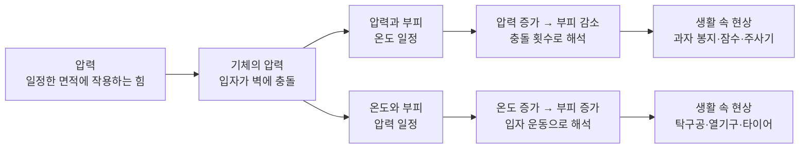

# 중1-6. 기체의 성질 — 보이지 않는 입자들이 미는 힘

<!-- prev: m1-03, m1-04, m1-05 -->
<!-- next: m3-02, matter-1, mech-2 -->

> [!NOTE]
> **성취기준**
> - **[9과06-01]** 압력의 의미를 알고, 기체의 압력을 입자의 운동으로 설명할 수 있다.
> - **[9과06-02]** 기체의 압력과 부피 관계를 실험 결과로부터 알아내고, 이를 입자 모형으로 해석할 수 있다.
> - **[9과06-03]** 기체의 온도와 부피 관계를 실험 결과로부터 알아내고, 이를 입자 모형으로 해석할 수 있다.

**학습 목표**

1. 압력의 의미를 생활 속 예로 설명하고, 같은 힘이라도 힘을 받는 면적에 따라 압력이 달라짐을 설명할 수 있다.
2. 기체의 압력을 기체 입자가 일정한 면적에 충돌하여 가하는 힘으로 설명할 수 있다.
3. 온도가 일정할 때 기체의 압력과 부피 관계를 실험 결과에서 찾고, 입자 모형으로 해석할 수 있다.
4. 압력이 일정할 때 기체의 온도와 부피 관계를 실험 결과에서 찾고, 입자 모형으로 해석할 수 있다.
5. 기체의 압력·온도와 부피의 관계가 나타나는 생활 속 현상을 찾아 설명할 수 있다.

**이 단원의 학습 사다리**

| 단계 | 무엇을 하나? |
|---|---|
| STEP 1. 이전 학습 다시 보기 | 초등학교 '여러 가지 기체', 중1 「열」·「물질의 상태 변화」·「힘의 작용」을 다시 꺼낸다 |
| STEP 2. 기초 다지기 | 기체 입자 모형, 변인 통제, 그래프 읽기를 디딤돌로 놓는다 |
| STEP 3. 핵심 개념 | 압력의 의미 → 기체의 압력 → 압력과 부피 → 온도와 부피 → 생활 속 현상 |
| STEP 4. 오개념 바로잡기 | "기체를 데우면 입자가 커져서 부피가 늘어난다?" 같은 착각을 바로잡는다 |
| STEP 5. 다음 단계로 | 보일 법칙, 샤를 법칙, 절대 온도, 이상 기체 방정식(고등학교 선택과목) |
| STEP 6. 생활·산업·진로 | 타이어와 에어 쿠션, 잠수와 항공, 열기구, 기상 관측 |

---

## 🗺️ 단원 들어가기

과자 봉지를 들고 높은 산에 올라가면 봉지가 빵빵하게 부푼다. 봉지 속 공기의 양은 그대로인데 왜 부피가 커졌을까? 찌그러진 탁구공을 뜨거운 물에 넣으면 다시 동그랗게 펴진다. 공 속에 아무것도 넣지 않았는데 무엇이 공을 밀어냈을까?

눈 위를 맨발로 걸으면 푹푹 빠지지만, 넓적한 설피나 스키를 신으면 빠지지 않는다. 몸무게는 똑같은데 왜 다를까?

이 단원에서는 이 질문들을 **압력**, 그리고 앞 단원 「물질의 상태 변화」에서 배운 **기체 입자의 운동**으로 풀어 본다. 기체 입자는 눈에 보이지 않지만, 쉬지 않고 날아다니며 벽에 부딪힌다. 그 수많은 충돌이 바로 기체가 미는 힘의 정체이다.

---

## STEP 1. 🔙 이전 학습 다시 보기

### 연계 개념표

| 이전 단원·성취기준 | 그때 배운 것 | 이 단원에서 확장되는 것 |
|---|---|---|
| 초등학교 3∼4학년군 '여러 가지 기체' | 공기는 공간을 차지하고 무게가 있다. 주사기 입구를 막고 피스톤을 누르면 공기의 부피가 줄어든다 | 기체의 부피가 **압력**에 따라 어떻게 변하는지 실험 결과로 찾고, 그 까닭을 **입자 모형**으로 해석한다 |
| 중1 「열」 [9과03-01], [9과03-03] | 온도는 입자 운동의 활발한 정도이다. 물질은 가열하면 부피가 늘어난다(열팽창) | 기체는 온도에 따라 부피가 특히 크게 변하며, 그 까닭을 입자 운동과 충돌로 설명한다 |
| 중1 「물질의 상태 변화」 [9과04-02] | 기체 입자는 서로 멀리 떨어져 있고 자유롭게 빠르게 움직인다 | 기체 입자가 벽에 부딪히는 것이 **기체의 압력**임을 안다 |
| 중1 「힘의 작용」 [9과05-01], [9과05-04] | 힘은 크기와 방향을 가지며 단위는 N이다. 바닥은 물체를 떠받치는 힘을 준다 | 같은 힘이라도 **힘을 받는 면적**에 따라 효과가 다르다는 압력의 개념으로 확장한다 |

### 준비 운동 (사전 진단)

**Q1.** 공기를 넣고 입구를 막은 주사기의 피스톤을 누르면 피스톤이 들어간다. 물을 넣고 입구를 막으면 어떻게 될까?

**Q2.** 기체 입자 사이의 거리는 고체·액체와 비교하여 어떠한가?

**Q3.** 공기가 든 고무풍선을 냉동실에 넣어 두면 풍선의 크기는 (커진다 / 그대로이다 / 작아진다).

정답 및 해설

**Q1.** 피스톤이 거의 들어가지 않는다. 액체는 입자 사이가 가까워 눌러도 부피가 거의 줄지 않지만, 기체는 입자 사이에 빈 공간이 넓어 잘 눌린다.

**Q2.** 매우 멀다. 그래서 기체는 담는 그릇을 가득 채우고, 눌러서 부피를 줄일 수 있다.

**Q3. 작아진다** — 온도가 낮아지면 기체의 부피가 줄어든다. 그 까닭을 이 단원에서 입자 모형으로 설명한다.

---

## STEP 2. 🧱 기초 다지기

### ① 기체 입자 모형 다시 보기

「물질의 상태 변화」에서 기체 입자에 대해 배운 내용을 정리해 보자.

| 기체 입자의 성질 | 그래서 나타나는 현상 |
|---|---|
| 입자 사이의 거리가 매우 멀고, 빈 공간이 넓다 | 눌러서 부피를 쉽게 줄일 수 있다 |
| 입자가 모든 방향으로 자유롭게, 빠르게 움직인다 | 그릇을 가득 채우고, 냄새가 빨리 퍼진다(확산) |
| 입자 사이에 끌어당기는 힘이 거의 없다 | 일정한 모양과 부피가 없다 |
| 온도가 높을수록 입자 운동이 활발하다 | 뜨거운 곳에서 확산이 빠르다 |

이 단원에서 하나를 더한다. 움직이는 기체 입자는 **그릇의 벽에 끊임없이 부딪힌다.** 입자 하나가 부딪힐 때 벽을 미는 힘은 아주 작지만, 셀 수 없이 많은 입자가 계속 부딪히므로 그 힘이 모이면 무시할 수 없을 만큼 커진다.

> [!TIP]
> 💡 **비유** — 우산 위로 떨어지는 빗방울 하나는 거의 느껴지지 않지만, 소나기가 쏟아지면 우산을 누르는 힘이 확실히 느껴진다. 기체 입자들의 충돌은 '보이지 않는 소나기'와 같다. 다만 기체 입자의 충돌은 위에서만이 아니라 **모든 방향**에서 일어난다.

### ② 변인 통제: 한 번에 하나씩만 바꾸기

기체의 부피는 압력, 온도, 기체의 양에 따라 모두 달라진다. 그래서 어떤 관계를 알아보려면 **알아보려는 것 하나만 바꾸고 나머지는 똑같이 유지**해야 한다. 이것을 **변인 통제**라고 한다.

| 실험 | 바꾸는 것(조작 변인) | 측정하는 것(종속 변인) | 같게 유지하는 것(통제 변인) |
|---|---|---|---|
| 압력과 부피 관계 | 압력 | 부피 | 온도, 기체의 양 |
| 온도와 부피 관계 | 온도 | 부피 | 압력, 기체의 양 |

### ③ 그래프로 관계 읽기

두 양의 관계는 그래프로 그리면 한눈에 보인다.

- 한쪽이 커질 때 다른 쪽도 커지면, 그래프는 **오른쪽 위로 올라간다.**
- 한쪽이 커질 때 다른 쪽이 작아지면, 그래프는 **오른쪽 아래로 내려간다.**
- 여러 모둠의 데이터를 함께 그려 보면, 실험 오차를 넘어선 '공통된 경향'을 찾기 쉽다.

---

## STEP 3. 📘 핵심 개념

### ① 압력이란 무엇인가 [9과06-01]

같은 사람이 눈 위를 걸어도 운동화를 신으면 푹 빠지고, 스키나 설피를 신으면 거의 빠지지 않는다. 사람의 무게, 즉 눈을 누르는 힘은 같은데 결과가 다르다. 차이는 **힘을 받는 면적**이다.

**압력(pressure)** 은 **일정한 면적에 수직으로 작용하는 힘의 크기**이다.

$$
\text{압력} = \frac{\text{힘의 크기}}{\text{힘을 받는 면적}} \qquad \text{단위: } \mathrm{N/m^2} = \mathrm{Pa}\ (\text{파스칼})
$$

- 같은 힘이라도 **면적이 좁을수록 압력이 크다.**
- 같은 면적이라면 **힘이 클수록 압력이 크다.**

| 압력을 **크게** 이용하는 예 (면적을 좁게) | 압력을 **작게** 이용하는 예 (면적을 넓게) |
|---|---|
| 칼날을 날카롭게 갈면 잘 썰린다 | 눈길에서 설피나 스키를 신는다 |
| 압정·못·주삿바늘의 끝이 뾰족하다 | 무거운 굴착기·탱크는 넓은 무한궤도 바퀴를 단다 |
| 하이힐 굽에 밟히면 운동화에 밟힐 때보다 아프다 | 가방끈을 넓게 만들어 어깨가 덜 아프다 |
| 스케이트 날이 얇다 | 갯벌에서 널빤지를 깔고 걷는다 |

> [!TIP]
> 💡 **비유** — 같은 양의 버터를 빵에 바를 때, 넓은 면에 펴 바르면 얇게 발리고 한 점에 모으면 두껍게 쌓인다. 힘도 마찬가지로 넓은 면에 '펴 바르면' 압력이 작아지고, 좁은 면에 '모으면' 압력이 커진다.

#### 예제 1

무게가 같은 벽돌을 바닥에 놓을 때, (가) 가장 넓은 면이 바닥에 닿게 놓는 경우와 (나) 가장 좁은 면이 바닥에 닿게 세워 놓는 경우 중 바닥이 받는 압력이 더 큰 것은?

**풀이** **(나)**. 두 경우 모두 바닥을 누르는 힘(벽돌의 무게)은 같지만, (나)는 힘을 받는 면적이 좁으므로 압력이 크다. 모래 위에 놓으면 (나)가 더 깊이 박힌다.

#### 예제 2

무게가 500 N인 학생이 눈 위에 서 있다. 두 발바닥이 눈에 닿는 면적이 $0.05\ \mathrm{m^2}$일 때와, 스키를 신어 닿는 면적이 $0.5\ \mathrm{m^2}$일 때 눈이 받는 압력을 각각 구하시오.

**풀이**
- 운동화: $500 \div 0.05 = 10000\ \mathrm{Pa}$
- 스키: $500 \div 0.5 = 1000\ \mathrm{Pa}$

면적이 10배로 넓어지자 압력은 $\frac{1}{10}$로 줄었다. 그래서 스키를 신으면 눈에 덜 빠진다.

### ② 기체의 압력 — 입자들의 충돌 [9과06-01]

풍선을 불면 고무가 사방으로 팽팽하게 늘어난다. 풍선 안에서 무엇이 고무를 밀고 있을까? 바로 **기체 입자**이다.

> [!IMPORTANT]
> **기체의 압력**은 기체 입자가 운동하면서 **일정한 면적의 벽에 충돌하여 가하는 힘**이다.

- 기체 입자는 모든 방향으로 운동하므로, 기체의 압력은 **모든 방향으로 작용한다.** 그래서 풍선은 한쪽만 볼록해지지 않고 둥글게 부푼다.
- 일정한 면적에 **입자가 더 자주 충돌할수록**, 그리고 **더 세게 충돌할수록** 기체의 압력이 커진다.

| 기체의 압력이 커지는 경우 | 입자로 보면 |
|---|---|
| 같은 그릇에 기체를 더 많이 넣는다 | 입자 수가 많아져 벽에 충돌하는 횟수가 늘어난다 |
| 기체의 부피를 줄인다(눌러 압축한다) | 입자 사이가 가까워져 벽에 충돌하는 횟수가 늘어난다 |
| 부피가 일정한 그릇 속 기체의 온도를 높인다 | 입자 운동이 빨라져 더 자주, 더 세게 충돌한다 |

#### 생활 속 기체의 압력

| 현상 | 기체의 압력으로 설명하기 |
|---|---|
| 풍선, 축구공, 자전거 타이어가 팽팽하다 | 안의 기체 입자가 벽을 안에서 밖으로 민다 |
| 에어백·에어 매트가 몸을 받쳐 준다 | 안에 가득 찬 기체 입자가 사방으로 민다 |
| 탄산음료 뚜껑을 열면 '칙' 소리가 난다 | 병 속에 갇혀 있던 압력이 높은 기체가 빠져나온다 |
| 공기를 뺀 페트병이 찌그러진다 | 병 안에서 미는 기체 입자보다 바깥 공기 입자가 미는 힘이 더 크다 |
| 빨대로 음료수를 마신다 | 빨대 안 공기를 빨아들이면, 컵 속 음료 표면을 누르는 바깥 공기가 음료를 밀어 올린다 |

> [!NOTE]
> 우리 주위의 공기도 기체이므로 압력을 가진다. 이를 **대기압**이라고 하며, 해수면에서 약 1013 hPa(헥토파스칼)이다. 우리 몸 안의 공기와 액체도 바깥으로 비슷한 크기의 압력을 내고 있어서, 우리는 평소에 대기압을 느끼지 못한다. 대기압과 날씨의 관계는 중3 「날씨와 기후변화」에서 배운다.

#### 예제 3

입구를 막은 빈 페트병을 산꼭대기에서 닫고 산 아래로 내려왔더니 병이 찌그러졌다. 그 까닭을 기체 입자의 충돌로 설명하시오.

**풀이** 산 아래는 산꼭대기보다 공기가 많아 대기압이 크다. 병 바깥에서 병에 충돌하는 공기 입자의 힘이 병 안에서 충돌하는 입자의 힘보다 커지므로, 병이 안쪽으로 눌려 찌그러진다.

### ③ 기체의 압력과 부피 관계 — 실험으로 찾기 [9과06-02]

#### 실험 결과

입구를 막은 주사기 안에 공기를 넣고, 온도를 일정하게 유지하면서 피스톤에 가하는 압력을 바꾸어 부피를 측정하였다. (압력 센서로 측정. 1 kPa = 1000 Pa)

| 압력(kPa) | 100 | 125 | 150 | 200 | 250 |
|---|---|---|---|---|---|
| 부피(mL) | 60 | 48 | 40 | 30 | 24 |

이 결과를 가로축을 압력, 세로축을 부피로 하여 그래프로 그리면, 점들이 **오른쪽 아래로 내려가는 곡선**을 이룬다.

> [!IMPORTANT]
> **온도와 기체의 양이 일정할 때, 기체에 가하는 압력이 커지면 기체의 부피는 작아지고, 압력이 작아지면 부피는 커진다.**

#### 입자 모형으로 해석하기

피스톤을 눌러 부피가 줄어들 때 기체 입자에게 무슨 일이 일어나는지 비교해 보자.

| 비교 기준 | 압력이 작을 때 (부피 큼) | 압력이 클 때 (부피 작음) |
|---|---|---|
| 입자의 수 | 같다 | 같다 |
| 입자의 크기 | 같다 | 같다 |
| 입자의 운동 빠르기 | 같다 (온도가 같으므로) | 같다 |
| 입자 사이의 거리 | 멀다 | **가깝다** |
| 일정한 면적의 벽에 충돌하는 횟수 | 적다 | **많다** |
| 기체가 벽을 미는 압력 | 작다 | **크다** |

- 바깥에서 피스톤을 세게 누르면 기체의 부피가 줄어든다. 부피가 줄면 같은 수의 입자가 좁은 공간에 모이므로 **벽에 충돌하는 횟수가 늘어나** 기체의 압력이 커진다.
- 기체의 압력이 바깥에서 누르는 압력과 같아지는 곳에서 피스톤이 멈춘다.
- 이 과정에서 **입자의 수와 크기, 운동 빠르기는 변하지 않는다.** 바뀌는 것은 입자 사이의 거리와 충돌 횟수이다.

> [!TIP]
> 💡 **비유** — 같은 수의 학생이 넓은 강당에서 뛰어다니면 벽에 부딪히는 일이 드물지만, 좁은 교실에서 똑같이 뛰어다니면 벽에 자주 부딪힌다. 학생 수(입자 수)와 뛰는 빠르기(온도)는 같아도, 공간이 좁아지면 벽이 받는 충돌이 많아진다.

#### 예제 4

위 실험에서 압력을 100 kPa에서 200 kPa로 높였을 때 다음은 각각 어떻게 되는지 쓰시오.
(1) 주사기 속 공기의 부피 (2) 주사기 속 공기 입자의 수 (3) 주사기 벽에 공기 입자가 충돌하는 횟수 (4) 공기 입자의 크기

**풀이** (1) 줄어든다(60 mL → 30 mL) (2) 변하지 않는다 (3) 많아진다 (4) 변하지 않는다

### ④ 압력과 부피 관계가 나타나는 생활 속 현상 [9과06-02]

| 현상 | 압력의 변화 | 부피의 변화 |
|---|---|---|
| 높은 산에 올라가면 과자 봉지가 부푼다 | 위로 갈수록 대기압이 작아진다 | 봉지 속 기체의 부피가 커진다 |
| 비행기가 높이 날면 기내의 과자 봉지가 부푼다 | 기내 압력이 지상보다 낮게 유지된다 | 봉지 속 기체의 부피가 커진다 |
| 잠수부가 내뱉은 공기 방울은 올라갈수록 커진다 | 수면에 가까워질수록 물의 압력이 작아진다 | 공기 방울의 부피가 커진다 |
| 공기 침대·에어 쿠션 운동화를 누르면 줄어든다 | 몸무게가 누르는 압력이 커진다 | 안의 공기 부피가 줄어든다 |
| 주사기 입구를 막고 피스톤을 누른다 | 누르는 압력이 커진다 | 공기 부피가 줄어든다 |
| 깊은 바다에서 끌어올린 물고기의 부레가 부푼다 | 바깥 물의 압력이 작아진다 | 부레 속 기체의 부피가 커진다 |

> [!WARNING]
> 잠수부가 깊은 물속에서 숨을 참은 채 빠르게 올라오면 위험하다. 올라오는 동안 바깥 압력이 작아져 폐 속 공기의 부피가 커지기 때문이다. 그래서 잠수부는 천천히 숨을 내쉬며 올라오도록 훈련받는다.

### ⑤ 기체의 온도와 부피 관계 — 실험으로 찾기 [9과06-03]

#### 실험 결과

입구를 막은 주사기(피스톤이 자유롭게 움직임) 안에 공기를 넣고, 바깥 압력을 일정하게 유지하면서 주사기를 담근 물의 온도를 바꾸어 공기의 부피를 측정하였다.

| 온도(°C) | 0 | 20 | 40 | 60 | 80 |
|---|---|---|---|---|---|
| 부피(mL) | 54.6 | 58.6 | 62.6 | 66.6 | 70.6 |

이 결과를 가로축을 온도, 세로축을 부피로 하여 그래프로 그리면, 점들이 **오른쪽 위로 올라가는 직선**을 이룬다. 온도가 20 °C 높아질 때마다 부피가 거의 같은 양만큼 늘어난다.

> [!IMPORTANT]
> **압력과 기체의 양이 일정할 때, 기체의 온도가 높아지면 기체의 부피는 커지고, 온도가 낮아지면 부피는 작아진다.**

#### 입자 모형으로 해석하기

| 비교 기준 | 온도가 낮을 때 | 온도가 높을 때 |
|---|---|---|
| 입자의 수 | 같다 | 같다 |
| 입자의 크기 | 같다 | 같다 |
| 입자의 운동 빠르기 | 느리다 | **빠르다** |
| 입자가 벽에 충돌하는 세기와 횟수 | 약하고 적다 | **세고 많다** |
| 입자 사이의 거리(부피) | 가깝다(작다) | **멀다(크다)** |

- 온도가 높아지면 입자 운동이 활발해져, 입자가 피스톤에 **더 세게, 더 자주** 충돌한다. 그러면 피스톤이 바깥쪽으로 밀려나 **부피가 커진다.**
- 부피가 커지면 충돌 횟수가 다시 줄어들어, 기체의 압력이 바깥 압력과 같아지는 곳에서 피스톤이 멈춘다. 그래서 압력은 처음과 같은데 부피만 커진 상태가 된다.
- 이때도 **입자의 수와 크기는 변하지 않는다.** 입자가 '커져서' 부피가 늘어나는 것이 아니다.

> [!TIP]
> 💡 **비유** — 같은 인원이 강강술래를 할 때, 천천히 돌면 손을 잡고 작은 원을 그리지만 빠르게 뛰며 돌면 바깥으로 쏠려 원이 커진다. 사람 수(입자 수)는 같고, 움직임이 활발해지자 차지하는 공간(부피)이 넓어진 것이다.

#### 예제 5

위 실험에서 주사기를 0 °C 물에서 80 °C 물로 옮겼을 때 다음은 각각 어떻게 되는지 쓰시오.
(1) 공기의 부피 (2) 공기 입자의 운동 빠르기 (3) 공기 입자의 수 (4) 공기의 질량

**풀이** (1) 커진다(54.6 mL → 70.6 mL, 16.0 mL 증가) (2) 빨라진다 (3) 변하지 않는다 (4) 변하지 않는다(입자의 수가 같으므로)

### ⑥ 온도와 부피 관계가 나타나는 생활 속 현상 [9과06-03]

| 현상 | 온도의 변화 | 부피의 변화 |
|---|---|---|
| 찌그러진 탁구공을 뜨거운 물에 넣으면 펴진다 | 공 속 공기의 온도가 높아진다 | 공기의 부피가 커져 공을 밀어 편다 |
| 열기구 속 공기를 가열하면 열기구가 떠오른다 | 열기구 속 공기의 온도가 높아진다 | 공기의 부피가 커져 일부가 빠져나가고 열기구가 가벼워진다 |
| 여름철 한낮에는 자동차 타이어가 팽팽해진다 | 타이어 속 공기의 온도가 높아진다 | 공기가 바깥으로 밀어 타이어가 부푼다 |
| 고무풍선을 냉동실에 넣으면 쪼그라든다 | 풍선 속 공기의 온도가 낮아진다 | 공기의 부피가 작아진다 |
| 뜨거운 국을 담고 랩을 씌우면 랩이 볼록해진다 | 그릇 속 공기의 온도가 높다 | 공기의 부피가 커져 랩을 민다 |
| 뜨거운 음식을 담고 닫은 밀폐 용기가 식으면 뚜껑이 안 열린다 | 용기 속 공기의 온도가 낮아진다 | 공기의 부피가 줄려고 하여 안쪽 압력이 작아지고, 바깥 공기가 뚜껑을 누른다 |
| 빈 페트병의 뚜껑을 닫고 냉장고에 넣으면 찌그러진다 | 병 속 공기의 온도가 낮아진다 | 공기의 부피가 작아진다 |

#### 압력과 온도, 두 관계 한눈에 비교

| 구분 | 압력과 부피 | 온도와 부피 |
|---|---|---|
| 일정하게 유지하는 것 | 온도, 기체의 양 | 압력, 기체의 양 |
| 관계 | 압력↑ → 부피↓ | 온도↑ → 부피↑ |
| 그래프 모양 | 오른쪽 아래로 내려가는 곡선 | 오른쪽 위로 올라가는 직선 |
| 입자 운동 빠르기 | 변하지 않는다 | 온도가 높을수록 빠르다 |
| 바뀌는 것 | 입자 사이의 거리, 충돌 횟수 | 입자 운동 빠르기, 충돌 세기, 입자 사이의 거리 |
| 변하지 않는 것 | 입자의 수, 크기, 질량 | 입자의 수, 크기, 질량 |
| 생활 속 예 | 높은 산의 과자 봉지, 잠수부의 공기 방울 | 탁구공 펴기, 열기구, 여름철 타이어 |

---

## STEP 4. ⚠️ 오개념 바로잡기

| 흔한 오개념 | 올바른 개념 | 왜 그럴까? |
|---|---|---|
| 기체를 데우면 입자가 커져서 부피가 늘어난다 | 입자의 크기는 그대로이고 **입자 운동이 활발해져 입자 사이의 거리가 멀어진다** | 입자 자체는 변하지 않는다. 바뀌는 것은 운동과 거리이다 |
| 기체를 압축하면 입자의 수가 줄어든다 | 입자의 수는 그대로이고 **입자 사이의 거리만 가까워진다** | 막힌 주사기에서는 입자가 빠져나가지 않는다. 질량도 같다 |
| 기체의 압력은 아래쪽으로만 작용한다 | 기체의 압력은 **모든 방향**으로 작용한다 | 입자가 모든 방향으로 움직이며 충돌하므로 풍선이 둥글게 부푼다 |
| 압력이 크다는 것은 힘이 크다는 것이다 | 압력은 **일정한 면적에 작용하는 힘**이다 | 같은 힘이라도 면적이 좁으면 압력이 크고, 넓으면 작다 |
| 기체를 차갑게 하면 입자가 멈춘다 | 온도가 낮아지면 입자 운동이 **느려질 뿐** 계속 움직인다 | 냉동실의 풍선도 쪼그라들 뿐 납작해지지 않는다 |
| 빨대로 음료를 마실 때 입이 음료를 끌어당긴다 | 빨대 속 압력이 낮아지면 **바깥 대기압이 음료를 밀어 올린다** | 기체는 끌어당기는 것이 아니라 충돌로 미는 힘을 낸다 |
| 기체 입자 사이에는 공기가 차 있다 | 기체 입자 사이는 **빈 공간**이다 | 공기 자체가 기체 입자들의 모임이다 |

---

## STEP 5. 🎓 다음 단계로 한 걸음 더

> [!CAUTION]
> 이 절은 **중학교 1학년 교육과정 범위 밖의 심화 내용**으로 평가 대상이 아니다. "이 개념이 앞으로 어디까지 이어지는가"를 맛보기로 보여 주기 위한 내용이다. 중학교에서는 수식으로 양적 관계를 계산하지 않고 입자 모형으로 정성적으로 설명하는 데 주안점을 둔다.

### 다음 학년·과목과의 연결

| 학년·과목 | 단원 | 이어지는 내용 |
|---|---|---|
| 중3 | 「날씨와 기후변화」 | 기압의 개념과 크기, 고기압·저기압과 바람, 높이에 따른 기압 변화와 구름의 생성 |
| 고등학교 진로 선택 | 물질과 에너지 「물질의 세 가지 상태」 | 기체의 온도·압력·부피·몰수의 관계를 하나로 묶은 **이상 기체 방정식**, 혼합 기체의 부분 압력 |
| 고등학교 진로 선택 | 역학과 에너지 「열과 에너지」 | 이상 기체의 온도·압력·부피 관계, 기체에 가한 열과 일, 열기관 |

### ① 숫자로 보는 압력과 부피 — 보일 법칙

STEP 3 ③의 실험 결과에서 압력과 부피를 곱해 보자.

| 압력(kPa) | 100 | 125 | 150 | 200 | 250 |
|---|---|---|---|---|---|
| 부피(mL) | 60 | 48 | 40 | 30 | 24 |
| 압력 × 부피 | 6000 | 6000 | 6000 | 6000 | 6000 |

곱이 늘 일정하다. 즉, 압력이 2배가 되면 부피는 $\frac{1}{2}$이 된다. 이를 **보일 법칙**이라 하며, 고등학교에서는 $PV = k$(일정)로 나타낸다.

### ② 숫자로 보는 온도와 부피 — 샤를 법칙과 절대 온도

STEP 3 ⑤의 실험에서 온도가 1 °C 오를 때마다 부피는 0 °C 때 부피의 약 $\frac{1}{273}$씩 늘어난다(54.6 mL의 $\frac{1}{273}$은 0.2 mL, 20 °C마다 4.0 mL). 그래프의 직선을 왼쪽으로 늘리면 약 −273 °C에서 부피가 0이 되는 곳을 만난다. 이 온도를 0으로 삼는 온도 눈금을 **절대 온도**(단위 K, 켈빈)라고 하며, 절대 온도를 쓰면 부피는 절대 온도에 비례한다. 이것이 **샤를 법칙**이다. 실제 기체는 그 전에 액체가 되므로 부피가 0이 되지는 않는다.

### ③ 모두 합치면 — 이상 기체 방정식

고등학교 「물질의 세 가지 상태」에서는 압력 $P$, 부피 $V$, 기체의 양(몰수) $n$, 절대 온도 $T$를 한 식으로 묶는다.

$$
PV = nRT
$$

($R$은 기체 상수) 이 식 하나로 보일 법칙과 샤를 법칙, 그리고 '기체를 더 넣으면 부피가 커진다'는 관계가 모두 설명된다. 또 「열과 에너지」에서는 기체 입자의 평균 운동 에너지가 절대 온도에 비례한다는 사실과, 기체가 피스톤을 밀며 하는 '일'을 배운다.

### 지금 vs 다음 단계

| 구분 | 중1 「기체의 성질」 | 고등학교 「물질의 세 가지 상태」·「열과 에너지」 |
|---|---|---|
| 압력 | 일정한 면적에 작용하는 힘, 입자 충돌 | 기체 분자 운동론으로 압력을 유도 |
| 압력과 부피 | 압력↑ → 부피↓ (정성적) | 보일 법칙 $PV = k$ (정량적 계산) |
| 온도와 부피 | 온도↑ → 부피↑ (정성적) | 샤를 법칙 $V \propto T$, 절대 온도 |
| 종합 | 입자 모형으로 해석 | 이상 기체 방정식, 부분 압력, 열역학 |

---

## STEP 6. 🏭 생활·산업·진로 연결

### 사례 1. 타이어와 에어 쿠션 — 기체의 압력으로 받치기

- **원리** 밀폐된 기체는 누르면 부피가 줄면서 압력이 커져 되밀어 낸다.
- **어디에 쓰이나** 자동차·자전거 타이어, 에어 쿠션 운동화, 포장용 에어캡, 공기 침대는 기체의 압력으로 무게를 받치고 충격을 흡수한다. 타이어는 온도에 따라 압력이 달라지므로 계절마다 공기압을 점검하는 것이 좋다.

### 사례 2. 잠수와 항공 — 압력 변화에 대비하기

- **원리** 바깥 압력이 변하면 몸속이나 용기 속 기체의 부피가 변한다.
- **어디에 쓰이나** 잠수부는 천천히 올라오며 폐 속 공기가 팽창하는 것에 대비한다. 비행기는 높은 하늘에서도 승객이 숨 쉴 수 있도록 기내 압력을 조절한다. 비행기가 오르내릴 때 귀가 먹먹한 것은 귓속 공기와 바깥 공기의 압력 차이 때문이다.

### 사례 3. 열기구와 기상 관측 — 온도와 부피 관계

- **원리** 기체를 가열하면 부피가 커진다.
- **어디에 쓰이나** 열기구는 버너로 공기를 데워 떠오른다. 기상 관측용 풍선(라디오존데)은 하늘 높이 올라갈수록 바깥 압력이 작아져 점점 크게 부풀다가 결국 터진다. 그동안 매달린 장비가 기온·습도·기압을 측정해 보낸다.

### 사례 4. 압축 공기를 이용한 기계

- **원리** 기체는 압축할 수 있고, 압축된 기체는 큰 압력으로 밀어낸다.
- **어디에 쓰이나** 버스 문, 공사장의 공기 드릴, 공장의 공압 로봇 팔은 압축 공기로 움직인다. 소화기와 스프레이도 압축된 기체가 내용물을 밀어낸다.

### 관련 진로와 학과

| 진로 | 하는 일 | 관련 학과 |
|---|---|---|
| 기상 연구원·예보관 | 기압과 기온 자료로 날씨 분석·예측 | 대기과학, 지구과학 |
| 항공 엔지니어 | 기내 압력 조절, 항공기 설계 | 항공우주공학, 기계공학 |
| 화학 공정 엔지니어 | 기체를 압축·저장·반응시키는 공정 설계 | 화학공학, 화학 |
| 해양·잠수 전문가 | 수중 탐사, 잠수 장비 운용 | 해양학, 해양공학 |
| 자동화 설비 엔지니어 | 압축 공기로 움직이는 기계 설계 | 기계공학, 메카트로닉스 |

---

## 🔬 탐구 활동 — 기체의 압력과 부피, 온도와 부피 관계를 실험으로 알아보기

### 활동 A. 압력과 부피 관계 알아보기

**목표** 온도가 일정할 때 기체에 가하는 압력에 따라 부피가 어떻게 변하는지 측정하고, 입자 모형으로 해석한다.

**준비물** 눈금이 있는 주사기(약 60 mL), 압력 센서와 연결관(또는 고무마개와 무게가 같은 책 여러 권), 데이터 기록 앱, 그래프 용지

**과정**
1. 주사기에 공기를 60 mL 넣고 압력 센서에 연결한다(공기가 새지 않게 단단히 연결한다).
2. 피스톤을 천천히 눌러 부피를 5 mL씩 줄이면서 각 부피에서 압력을 기록한다. 피스톤을 누른 뒤 잠시 기다려 온도가 처음과 같아지면 읽는다.
3. 센서가 없으면, 주사기 입구를 막고 세워 피스톤 위에 같은 책을 1권, 2권, 3권…씩 올리며 부피를 읽는다(책 수가 많을수록 압력이 크다).
4. 가로축을 압력(또는 책 수), 세로축을 부피로 하여 그래프를 그린다.
5. 모둠별 데이터를 공유 플랫폼에 올려 그래프 모양을 비교한다.

**결과 기록**

| 부피(mL) | 60 | 55 | 50 | 45 | 40 | 35 | 30 |
|---|---|---|---|---|---|---|---|
| 압력(kPa) | | | | | | | |

**생각해 보기**
1. 압력이 커질 때 부피는 어떻게 변했는가? 그래프 모양은 어떠한가?
2. 피스톤을 누른 뒤 잠시 기다려서 읽은 까닭은 무엇일까? (변인 통제와 관련지어 보자.)
3. 부피가 줄었을 때 주사기 속 입자의 수, 크기, 충돌 횟수는 각각 어떻게 되었을지 입자 모형으로 그려 보자.

### 활동 B. 온도와 부피 관계 알아보기

**목표** 압력이 일정할 때 기체의 온도에 따라 부피가 어떻게 변하는지 측정하고, 입자 모형으로 해석한다.

**준비물** 눈금이 있는 유리 주사기(또는 피스톤이 잘 움직이는 주사기), 고무마개, 비커 4개, 얼음물·찬물·따뜻한 물·뜨거운 물(약 0~70 °C), 온도계(또는 온도 센서), 보안경, 면장갑

**과정**
1. 주사기에 공기를 약 30 mL 넣고 입구를 고무마개로 막는다.
2. 주사기의 공기가 든 부분이 완전히 잠기도록 얼음물에 담그고, 2~3분 뒤 물의 온도와 공기의 부피를 기록한다. 피스톤을 살짝 움직였다 놓아 걸림이 없게 한다.
3. 같은 방법으로 찬물, 따뜻한 물, 뜨거운 물로 옮겨 가며 온도와 부피를 기록한다.
4. 가로축을 온도, 세로축을 부피로 하여 그래프를 그리고, 다른 모둠의 그래프와 비교한다.

**결과 기록**

| 물의 온도(°C) | | | | |
|---|---|---|---|---|
| 공기의 부피(mL) | | | | |

**생각해 보기**
1. 온도가 높아질 때 부피는 어떻게 변했는가? 그래프 모양은 어떠한가?
2. 이 실험에서 압력을 일정하게 유지하기 위해 피스톤을 어떻게 다루었는가?
3. 뜨거운 물에서 부피가 커진 까닭을 입자의 운동과 충돌로 설명해 보자.

> [!WARNING]
> **안전 수칙** 뜨거운 물을 다룰 때는 보안경과 면장갑을 착용하고, 비커를 옮길 때 넘어지지 않게 조심한다. 유리 주사기는 깨지기 쉬우므로 떨어뜨리지 않는다. 압력 실험에서 피스톤을 너무 세게 누르면 연결관이 빠지며 피스톤이 튀어나올 수 있으므로 천천히 누른다.

---

## ✅ 개념 확인 문제

### 기본

**1.** 다음 중 압력을 **작게** 하려고 면적을 넓힌 예를 모두 고르시오.
ㄱ. 눈길에서 설피를 신는다. ㄴ. 압정 끝을 뾰족하게 만든다. ㄷ. 무거운 굴착기에 넓은 무한궤도를 단다. ㄹ. 칼날을 날카롭게 간다.

정답 및 해설

**정답 ㄱ, ㄷ**

ㄴ, ㄹ은 힘을 받는 면적을 좁혀 압력을 **크게** 하는 예이다.

**2.** 무게가 600 N인 상자를 바닥에 놓았다. 바닥에 닿는 면적이 $0.3\ \mathrm{m^2}$일 때 바닥이 받는 압력은 몇 Pa인가?

정답 및 해설

**정답** 2000 Pa

압력 $= 600 \div 0.3 = 2000\ \mathrm{Pa}$이다.

**3.** 기체의 압력이 생기는 까닭을 '입자'라는 말을 넣어 한 문장으로 쓰시오.

정답 및 해설

**정답(예시)** 기체 **입자**가 끊임없이 운동하면서 일정한 면적의 벽에 충돌하여 힘을 가하기 때문이다.

**4.** 온도가 일정할 때 입구를 막은 주사기의 피스톤을 눌러 공기의 부피를 줄였다. 다음 중 **변하지 않는** 것을 모두 고르시오.
ㄱ. 입자의 수 ㄴ. 입자 사이의 거리 ㄷ. 입자의 크기 ㄹ. 벽에 충돌하는 횟수 ㅁ. 공기의 질량

정답 및 해설

**정답 ㄱ, ㄷ, ㅁ**

입자 사이의 거리는 가까워지고(ㄴ), 벽에 충돌하는 횟수는 많아진다(ㄹ).

**5.** 압력이 일정할 때 기체의 온도를 높이면 기체의 부피는 어떻게 되는가? 그 까닭을 입자의 운동으로 쓰시오.

정답 및 해설

**정답** 부피가 커진다.

온도가 높아지면 입자 운동이 활발해져 입자가 벽에 더 세게, 더 자주 충돌하므로 벽(피스톤)을 바깥으로 밀어내 입자 사이의 거리가 멀어지기 때문이다.

### 응용

**6.** 다음 현상을 '압력과 부피 관계'와 '온도와 부피 관계' 중 어느 것으로 설명할 수 있는지 분류하시오.
(1) 잠수부가 내뱉은 공기 방울이 수면에 가까워질수록 커진다.
(2) 여름철 한낮에 자전거 타이어가 팽팽해진다.
(3) 높은 산에 올라가니 밀봉된 과자 봉지가 부풀었다.
(4) 찌그러진 탁구공을 뜨거운 물에 넣었더니 펴졌다.

정답 및 해설

**정답** 압력과 부피: (1), (3) / 온도와 부피: (2), (4)

(1)은 물의 압력, (3)은 대기압이 작아져 부피가 커진 것이다. (2), (4)는 온도가 높아져 기체의 부피가 커진 것이다.

**7.** 다음은 같은 양의 기체를 서로 다른 조건에 둔 입자 모형에 대한 설명이다. (가)와 (나) 중 온도가 더 높은 것을 고르고 그 근거를 쓰시오. (압력은 같다.)
- (가) 그릇의 부피가 크고, 입자 옆에 그린 화살표가 길다.
- (나) 그릇의 부피가 작고, 입자 옆에 그린 화살표가 짧다.

정답 및 해설

**정답 (가)**

압력이 같을 때 온도가 높을수록 입자 운동이 빠르고(화살표가 길고) 부피가 크다. 두 그림에서 입자의 수와 크기는 같아야 한다.

**8.** 다음은 온도가 일정할 때 주사기 속 공기에 가한 압력과 부피를 측정한 결과이다.

| 압력(kPa) | 100 | 120 | 160 | 200 |
|---|---|---|---|---|
| 부피(mL) | 48 | 40 | ( ㄱ ) | 24 |

ㄱ에 들어갈 값으로 가장 알맞은 것은? ① 20 mL ② 30 mL ③ 36 mL ④ 44 mL
그리고 그렇게 판단한 근거를 실험 결과의 경향으로 쓰시오.

정답 및 해설

**정답 ②**

압력이 커질수록 부피가 작아지는 경향이므로, 160 kPa에서의 부피는 120 kPa일 때(40 mL)보다 작고 200 kPa일 때(24 mL)보다 커야 한다. 이 범위에 드는 값은 ② 30 mL와 ③ 36 mL인데, 표의 다른 값들을 보면 압력이 커질수록 부피가 줄어드는 정도가 점점 작아진다. 실제로 이 표는 압력이 2배(100 → 200 kPa)가 될 때 부피가 절반(48 → 24 mL)이 되는 규칙을 따르며, 160 kPa에서는 30 mL가 된다. (이 수치 관계는 STEP 5의 보일 법칙에서 다룬다. 중1에서는 '24보다 크고 40보다 작다'는 경향을 찾는 것이 핵심이다.)

### 융합·서술형

**9. [생활 연계]** 뜨거운 국을 밀폐 용기에 담아 뚜껑을 닫아 두었더니, 식은 뒤에 뚜껑이 잘 열리지 않았다. (1) 이 현상을 용기 속 공기의 온도와 입자 운동으로 설명하고, (2) 뚜껑을 쉽게 여는 방법을 한 가지 제안하여 그 원리를 쓰시오.

정답 및 해설

**예시 답안**
(1) 국이 식으면 용기 속 공기의 온도가 낮아져 입자 운동이 느려진다. 입자가 뚜껑에 충돌하는 세기와 횟수가 줄어 용기 **안쪽의 압력이 작아지고**, 바깥 공기 입자가 뚜껑을 누르는 힘이 더 커서 뚜껑이 용기에 꽉 눌린다.
(2) 용기를 따뜻한 물에 잠시 담가 안쪽 공기의 온도를 높이면 입자 운동이 활발해져 안쪽 압력이 커지므로 뚜껑이 쉽게 열린다. 또는 뚜껑 가장자리를 살짝 들어 바깥 공기가 들어가게 하면 안팎의 압력이 같아진다.

**채점 포인트** ① 온도 하강 → 입자 운동 둔화 ② 안쪽 압력 < 바깥 압력 ③ 원리에 맞는 해결 방법

**10. [과학·기술 연계]** 기상 관측용 풍선은 지상에서 출발할 때는 지름이 약 2 m 정도이지만, 높이 올라가면 훨씬 크게 부풀다가 결국 터진다. 높이 올라갈수록 기온도 낮아지는데, 풍선이 점점 커지는 까닭을 '압력과 부피', '온도와 부피' 두 관계를 모두 고려하여 서술하시오.

정답 및 해설

**예시 답안**
높이 올라갈수록 기온이 낮아지므로, '온도와 부피' 관계만 보면 풍선 속 기체의 입자 운동이 느려져 부피가 **줄어드는** 효과가 있다. 그러나 동시에 높이 올라갈수록 바깥 공기가 적어져 대기압이 크게 작아지므로, '압력과 부피' 관계에 따라 부피가 **커지는** 효과가 있다. 바깥 공기 입자가 풍선을 누르는 힘이 크게 줄어드는 효과가 온도가 낮아지는 효과보다 크기 때문에 풍선은 점점 커지고, 고무가 견딜 수 있는 크기를 넘으면 터진다.

**채점 포인트** ① 기온 하강 → 부피 감소 효과 ② 대기압 감소 → 부피 증가 효과 ③ 압력 감소의 효과가 더 커서 부피가 증가함

---

## 📝 한눈에 정리

### 핵심 요약

- **압력**은 일정한 면적에 수직으로 작용하는 힘이다(압력 = 힘 ÷ 면적, 단위 Pa). 같은 힘이라도 면적이 좁을수록 압력이 크다.
- **기체의 압력**은 기체 입자가 운동하면서 일정한 면적의 벽에 충돌하여 가하는 힘이며, **모든 방향**으로 작용한다.
- 입자가 벽에 **더 자주, 더 세게** 충돌할수록 기체의 압력이 크다.
- 온도와 기체의 양이 일정할 때 **압력이 커지면 부피는 작아진다.** 부피가 줄면 입자 사이가 가까워져 충돌 횟수가 늘어나기 때문이다.
- 압력과 기체의 양이 일정할 때 **온도가 높아지면 부피는 커진다.** 입자 운동이 활발해져 더 세게, 더 자주 충돌하며 벽을 밀어내기 때문이다.
- 두 경우 모두 **입자의 수와 크기, 질량은 변하지 않는다.** 바뀌는 것은 입자 사이의 거리와 운동, 충돌이다.
- 생활 속 예: 높은 산의 과자 봉지·잠수부의 공기 방울(압력과 부피), 찌그러진 탁구공·열기구·여름철 타이어(온도와 부피).

### 핵심 용어

| 용어 | 뜻 |
|---|---|
| 압력 | 일정한 면적에 수직으로 작용하는 힘의 크기 |
| 파스칼(Pa) | 압력의 단위. $1\ \mathrm{Pa} = 1\ \mathrm{N/m^2}$ |
| 기체의 압력 | 기체 입자가 일정한 면적의 벽에 충돌하여 가하는 힘 |
| 대기압 | 지구를 둘러싼 공기가 누르는 압력. 해수면에서 약 1013 hPa |
| 충돌 횟수 | 일정한 시간 동안 일정한 면적의 벽에 입자가 부딪히는 횟수 |
| 변인 통제 | 실험에서 알아보려는 변인 외의 조건을 같게 유지하는 것 |
| 조작 변인 | 실험에서 일부러 바꾸는 조건 |
| 종속 변인 | 조작 변인에 따라 달라져 측정하는 값 |
| 입자 모형 | 입자를 동그라미 등으로 나타내어 현상을 설명하는 모형 |

### 다음 단원으로

이 단원에서는 눈에 보이지 않는 기체 입자의 운동과 충돌로 압력과 부피 변화를 설명하였다. 기체의 압력은 하늘에서도 중요하다. 중3 「날씨와 기후변화」에서는 지구를 둘러싼 공기가 누르는 **기압**이 장소와 높이에 따라 어떻게 달라지는지, 그 차이가 바람과 날씨를 어떻게 만드는지 배운다. 또 고등학교 「물질의 세 가지 상태」에서는 이 단원에서 경향으로만 찾았던 관계를 수식으로 정확히 다룬다.
