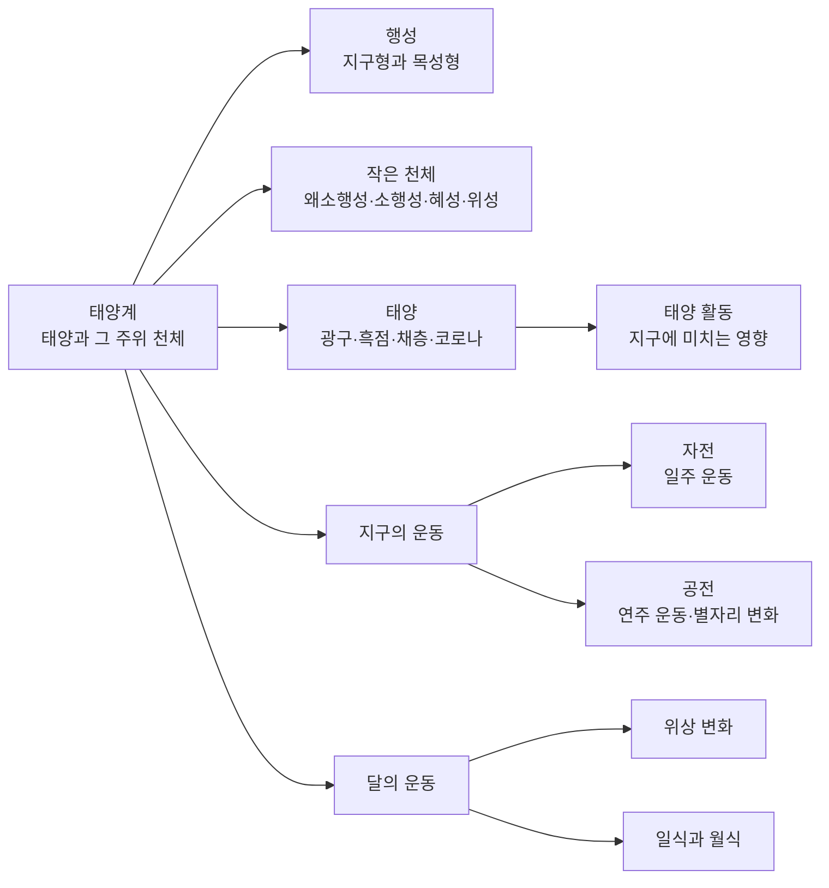

# 중1-7. 태양계 — 우리 동네 우주와 밤하늘의 규칙
<!-- next: m2-08, 2-2, 3-1, earth-3, astro-1, astro-2 -->

> [!NOTE]
> **성취기준**
> - **[9과07-01]** 태양계를 구성하는 천체의 특징을 알고, 행성을 목성형 행성과 지구형 행성으로 구분할 수 있다.
> - **[9과07-02]** 태양의 표면과 대기에서 일어나는 현상을 알고, 태양의 활동이 지구에 미치는 영향을 추론할 수 있다.
> - **[9과07-03]** 지구 자전에 의한 천체의 겉보기 운동과 지구 공전에 의한 별자리 변화를 이해하고, 밤하늘 천체에 호기심을 가진다.
> - **[9과07-04]** 달을 관측하여 달의 위상변화 원리를 이해하고, 일식과 월식을 설명할 수 있다.

**학습 목표**

1. 태양계를 이루는 태양, 행성, 왜소행성, 소행성, 위성, 혜성의 특징을 간단히 말할 수 있다.
2. 질량, 반지름, 밀도, 위성 수, 고리의 유무를 근거로 행성을 지구형 행성과 목성형 행성으로 구분할 수 있다.
3. 태양의 표면(광구)과 대기에서 볼 수 있는 현상을 알고, 태양 활동이 활발할 때 지구에 나타나는 일을 추론할 수 있다.
4. 지구의 자전으로 천체의 일주 운동이, 지구의 공전으로 태양의 연주 운동과 계절별 별자리 변화가 생기는 것을 설명할 수 있다.
5. 태양–지구–달의 위치 관계로 달의 위상 변화와 일식·월식을 설명할 수 있다.

**이 단원의 학습 사다리**

| 단계 | 무엇을 하나? |
|---|---|
| STEP 1. 이전 학습 다시 보기 | 초등학교에서 본 밤하늘, 지구의 자전·공전, 계절을 다시 꺼내 본다 |
| STEP 2. 기초 다지기 | 천체, 겉보기 운동, 각도, 규모를 느끼는 법을 디딤돌로 놓는다 |
| STEP 3. 핵심 개념 | 태양계 가족 → 두 종류의 행성 → 태양의 얼굴 → 하루·1년의 하늘 → 달과 식 |
| STEP 4. 오개념 바로잡기 | "달의 모양은 지구 그림자 때문이다?" 같은 착각을 바로잡는다 |
| STEP 5. 다음 단계로 | 별과 우주, 원소의 기원, 케플러 법칙, 우주 탐사로 이어지는 길 |
| STEP 6. 생활·산업·진로 | 우주 날씨 예보, 위성 항법, 천문대와 우주 탐사 |

---

## 🗺️ 단원 들어가기

해가 진 뒤 서쪽 하늘에 유난히 밝게 빛나는 '별'을 본 적이 있는가? 사람들은 이것을 '개밥바라기'나 '저녁별'이라고 불렀다. 그런데 이것은 사실 별이 아니라 **금성**이라는 행성이다. 별은 스스로 빛을 내지만, 금성은 햇빛을 반사할 뿐이다.

한밤중에 하늘을 오래 바라보면 별들이 천천히 움직인다. 겨울밤의 오리온자리는 여름밤에는 보이지 않는다. 달은 며칠마다 모양이 바뀌고, 드물게는 한낮에 해가 사라지는 일식이 일어난다. 이 모든 일은 제각각 일어나는 것처럼 보이지만, 사실은 **지구가 돌고(자전), 태양 주위를 돌고(공전), 달이 지구 주위를 돈다(공전)** 는 몇 가지 규칙으로 설명된다.

이 단원에서는 먼저 우리가 사는 '우주 동네'인 태양계의 구성원을 만나고, 그 중심인 태양을 자세히 들여다본 뒤, 지구와 달의 움직임으로 밤하늘의 변화를 풀어 본다.

---

## STEP 1. 🔙 이전 학습 다시 보기

### 연계 개념표

| 이전 단원 | 그때 배운 것 | 이 단원에서 확장되는 것 |
|---|---|---|
| 초등학교 3~4학년 「밤하늘 관찰」 | 달, 별, 별자리를 관찰하고, 행성과 별이 다르다는 것을 알았다 | 태양계 천체를 종류별로 나누고, 행성을 두 무리로 구분한다 |
| 초등학교 5~6학년 「지구의 운동」 | 지구가 하루에 한 바퀴 자전하고, 1년에 한 바퀴 태양 주위를 공전한다. 낮과 밤이 생긴다. 달의 모양이 약 30일 주기로 바뀐다 | 자전으로 생기는 **일주 운동**, 공전으로 생기는 **연주 운동**을 우주에서 바라보는 관점으로 설명한다. 달의 위상 변화와 일식·월식의 원리를 다룬다 |
| 초등학교 5~6학년 「계절의 변화」 | 태양의 남중 고도가 계절마다 달라지고, 그 까닭은 지구 자전축이 기울어진 채 공전하기 때문이다 | 계절마다 밤하늘에 보이는 **별자리가 달라지는 까닭**을 지구의 공전으로 설명한다 |
| 중학교 1학년 「힘의 작용」 | 지구가 물체를 끌어당기는 힘이 중력이다 | 태양계 천체가 흩어지지 않고 태양 주위를 도는 까닭을 맛보기로 생각해 본다(STEP 5) |

### 준비 운동 (사전 진단)

**Q1.** 지구는 하루에 한 바퀴씩 어느 방향으로 자전할까? (서쪽 → 동쪽 / 동쪽 → 서쪽)

**Q2.** 별과 행성의 가장 큰 차이는 무엇일까?

**Q3.** 달은 스스로 빛을 낸다. (O / X)

**Q4.** 여름철 밤하늘과 겨울철 밤하늘에 보이는 별자리가 다른 까닭을 한 문장으로 말해 보자.

정답 및 해설

**Q1. 서쪽 → 동쪽** — 지구가 서에서 동으로 돌기 때문에 태양과 별은 거꾸로 동쪽에서 떠서 서쪽으로 지는 것처럼 보인다.

**Q2.** 별은 스스로 빛을 내고, 행성은 스스로 빛을 내지 못하고 별(태양)의 빛을 반사한다. 또 행성은 별 주위를 돈다.

**Q3. X** — 달은 햇빛을 반사하여 밝게 보인다. 그래서 햇빛을 받는 부분의 모양에 따라 달의 모양이 바뀐다.

**Q4.** 지구가 태양 주위를 공전하므로, 계절마다 밤(태양 반대쪽)에 바라보는 방향이 달라지기 때문이다. 이 단원 STEP 3의 ④에서 자세히 다룬다.

---

## STEP 2. 🧱 기초 다지기

### ① 천체란 무엇일까?

**천체(celestial body)** 는 우주에 있는 모든 물체를 말한다. 태양, 달, 별, 행성, 혜성 모두 천체이다. 천체는 스스로 빛을 내는지에 따라 크게 둘로 나눌 수 있다.

| 구분 | 예 | 우리 눈에 보이는 까닭 |
|---|---|---|
| 스스로 빛을 내는 천체 | 태양, 밤하늘의 별 | 자신이 내는 빛이 우리 눈에 들어온다 |
| 빛을 반사하는 천체 | 행성, 달, 소행성, 혜성 | 태양 빛이 반사되어 우리 눈에 들어온다 |

> [!TIP]
> 💡 **비유** — 별은 '켜진 전등', 행성과 달은 '전등 빛을 받아 반짝이는 거울'이다. 전등(태양)이 어느 쪽에 있느냐에 따라 거울의 밝은 부분이 달라진다. 이 생각은 STEP 3의 달의 위상 변화에서 다시 쓰인다.

### ② 실제 운동과 겉보기 운동

달리는 기차 안에서 창밖을 보면 가만히 있는 나무와 건물이 뒤로 달려가는 것처럼 보인다. 실제로 움직이는 것은 기차(나)인데, 바깥 물체가 반대 방향으로 움직이는 것처럼 보이는 것이다.

- **실제 운동**: 천체가 실제로 움직이는 것 (예: 지구의 자전, 지구와 달의 공전)
- **겉보기 운동(apparent motion)**: 관측자가 움직이기 때문에 천체가 움직이는 것처럼 보이는 것 (예: 태양이 동쪽에서 떠서 서쪽으로 지는 것)

> [!IMPORTANT]
> 겉보기 운동의 방향은 **관측자(지구)가 실제로 움직이는 방향과 반대**이다. 지구가 서 → 동으로 돌면, 하늘의 천체는 동 → 서로 움직이는 것처럼 보인다.

### ③ 하늘에서의 위치는 '각도'로 말한다

하늘에 있는 천체까지의 거리는 눈으로 알 수 없으므로, 천체의 위치나 이동 정도는 **각도**로 나타낸다.

- 한 바퀴는 $360^\circ$이다.
- 하루(24시간)에 한 바퀴 돈다면 1시간에 $360^\circ \div 24 = 15^\circ$씩 돈다.
- 1년(약 365일)에 한 바퀴 돈다면 하루에 약 $360^\circ \div 365 \approx 1^\circ$씩 돈다.

손을 쭉 뻗었을 때 주먹 하나의 폭이 하늘에서 약 $10^\circ$ 정도이다. 밤하늘에서 별이 얼마나 움직였는지 어림할 때 쓸 수 있다.

### ④ 우주의 크기를 느끼는 방법 — 축소 모형

태양계는 너무 커서 그대로 그릴 수 없다. 그래서 크기를 같은 비율로 줄인 **축소 모형**으로 생각한다.

| 실제 | 축소 모형 (태양 지름을 약 1.4 m로 줄이면) |
|---|---|
| 태양 지름 약 140만 km | 큰 짐볼 하나 정도(약 1.4 m) |
| 지구 지름 약 1만 3천 km | 구슬 하나 정도(약 1.3 cm) |
| 목성 지름 약 14만 km | 축구공보다 조금 작은 공(약 14 cm) |

> [!TIP]
> 💡 태양이 짐볼만 하다면 지구는 구슬만 하다. 지구가 얼마나 작은지, 태양이 얼마나 큰지 느낄 수 있다.

---

## STEP 3. 📘 핵심 개념

### ① 태양계의 가족들 — 태양계를 구성하는 천체 [9과07-01]

**태양계(solar system)** 는 태양과, 태양의 중력에 붙잡혀 그 주위를 도는 모든 천체로 이루어진 집단이다. 태양계에서 스스로 빛을 내는 천체는 태양 하나뿐이다.

| 천체 | 간단한 특징 | 예 |
|---|---|---|
| **태양(Sun)** | 태양계의 중심. 스스로 빛을 내는 별. 태양계 전체 질량의 대부분(99% 이상)을 차지한다 | 태양 |
| **행성(planet)** | 태양 주위를 공전하고, 충분히 커서 둥근 모양이며, 자기 궤도 주변에서 가장 큰 천체 | 수성, 금성, 지구, 화성, 목성, 토성, 천왕성, 해왕성 |
| **왜소행성(dwarf planet)** | 태양 주위를 돌고 둥근 모양이지만, 궤도 주변에 비슷한 크기의 천체가 많아 행성으로 보지 않는 천체 | 명왕성, 세레스, 에리스 |
| **소행성(asteroid)** | 행성보다 훨씬 작고 모양이 불규칙한 암석 천체. 대부분 화성과 목성 궤도 사이(소행성대)에 모여 있다 | 소행성대의 수많은 천체 |
| **위성(satellite)** | 행성(또는 왜소행성 등) 주위를 도는 천체 | 달(지구의 위성), 목성·토성의 여러 위성 |
| **혜성(comet)** | 얼음과 먼지로 이루어진 작은 천체. 태양에 가까워지면 얼음이 기체로 변하고 먼지와 함께 뿜어져 나오면서 태양 반대쪽으로 긴 **꼬리**가 생긴다 | 핼리 혜성 |

> [!NOTE]
> 명왕성은 오랫동안 아홉 번째 행성으로 불렸지만, 2006년 국제천문연맹(IAU)이 행성의 조건을 정하면서 **왜소행성**으로 분류가 바뀌었다. 명왕성 궤도 근처에서 비슷한 크기의 천체가 계속 발견되었기 때문이다. 과학 지식은 새로운 관측에 따라 고쳐질 수 있다.

> [!TIP]
> 💡 **비유** — 태양계를 '학교'로 생각해 보자. 태양은 교장 선생님(중심이고 가장 크다), 행성은 각 반의 반장(자기 구역에서 가장 크다), 왜소행성은 반장만큼 크지만 비슷한 친구들이 많아 반장이 되지 못한 학생, 위성은 반장을 따라다니는 친구, 혜성은 가끔 교실 앞을 길게 지나가는 손님이다.

#### 행성의 순서 외우기

태양에서 가까운 순서로 **수 – 금 – 지 – 화 – 목 – 토 – 천 – 해** 이다.

| 행성 | 한 줄 특징 (생활 속 연결) |
|---|---|
| 수성 | 태양에 가장 가깝고 가장 작은 행성. 대기가 거의 없어 표면에 운석 구덩이가 많다 |
| 금성 | 두꺼운 이산화 탄소 대기 때문에 표면 온도가 매우 높다. 새벽·저녁 하늘에서 아주 밝게 보인다 |
| 지구 | 액체 상태의 물과 생명체가 있는 행성. 위성(달)이 1개 있다 |
| 화성 | 표면이 붉게 보이는 행성. 극지방에 얼음이 있고, 과거에 물이 흘렀던 흔적이 있다 |
| 목성 | 태양계에서 가장 큰 행성. 표면에 줄무늬와 거대한 소용돌이(대적점)가 보인다 |
| 토성 | 뚜렷하고 아름다운 고리가 있다. 밀도가 물보다 작다 |
| 천왕성 | 청록색으로 보이고, 자전축이 거의 누운 채로 공전한다 |
| 해왕성 | 태양에서 가장 먼 행성. 파랗게 보인다 |

<!-- fig:m1-07-solar-system-layout -->

#### 예제 1

다음 설명에 해당하는 천체의 종류를 쓰시오.
(1) 지구 주위를 약 한 달에 한 바퀴씩 돈다.
(2) 태양에 가까워질 때 태양 반대쪽으로 꼬리가 생긴다.
(3) 화성과 목성 궤도 사이에 많이 모여 있는, 모양이 불규칙한 작은 암석 천체이다.

**풀이**
(1) 행성 주위를 도는 천체이므로 **위성**(달)이다.
(2) 얼음과 먼지로 이루어져 태양 가까이에서 꼬리가 생기는 **혜성**이다.
(3) 소행성대에 모여 있는 **소행성**이다.

#### ✔ 바로 확인

1. (O/X) 태양계에서 스스로 빛을 내는 천체는 태양 하나뿐이다.
2. 빈칸: 소행성은 대부분 (    ) 궤도와 (    ) 궤도 사이의 소행성대에 모여 있다.
3. 혜성의 꼬리는 태양 쪽과 태양 반대쪽 중 어느 쪽을 향하는가?
4. 명왕성은 지금 어떤 천체로 분류되는가?

정답

1. O — 행성, 위성, 혜성 등은 햇빛을 반사할 뿐이다.
2. 화성, 목성
3. 태양 반대쪽 — 태양에 가까워질 때 뿜어져 나온 기체와 먼지가 태양 반대쪽으로 길게 늘어진다.
4. 왜소행성 — 궤도 주변에 비슷한 크기의 천체가 많아 행성의 조건을 만족하지 못한다.

### ② 지구형 행성과 목성형 행성 [9과07-01]

8개의 행성은 특징이 비슷한 것끼리 두 무리로 나눌 수 있다. 나누는 기준은 **질량, 반지름, 밀도, 위성 수, 고리의 유무, 표면 상태** 등이다.

- **지구형 행성(terrestrial planet)**: 수성, 금성, 지구, 화성
- **목성형 행성(Jovian planet)**: 목성, 토성, 천왕성, 해왕성

| 구분 | 지구형 행성 | 목성형 행성 |
|---|---|---|
| 질량 | 작다 | 크다 |
| 반지름 | 작다 | 크다 |
| 평균 밀도 | 크다 (약 $3.9 \sim 5.5\ \mathrm{g/cm^3}$) | 작다 (약 $0.7 \sim 1.6\ \mathrm{g/cm^3}$) |
| 위성 수 | 없거나 적다 | 많다 |
| 고리 | 없다 | 있다 |
| 표면 | 단단한 암석 표면이 있다 | 주로 기체로 되어 있어 단단한 표면이 없다 |
| 태양으로부터 거리 | 가깝다 (소행성대 안쪽) | 멀다 (소행성대 바깥쪽) |

#### 행성 자료로 직접 구분해 보기

아래 표는 지구를 1로 했을 때 각 행성의 질량과 반지름, 그리고 평균 밀도를 나타낸 것이다(값은 반올림한 어림값이다).

| 행성 | 질량 (지구 = 1) | 반지름 (지구 = 1) | 평균 밀도 ($\mathrm{g/cm^3}$) | 고리 |
|---|---|---|---|---|
| 수성 | 0.06 | 0.38 | 5.4 | 없음 |
| 금성 | 0.82 | 0.95 | 5.2 | 없음 |
| 지구 | 1 | 1 | 5.5 | 없음 |
| 화성 | 0.11 | 0.53 | 3.9 | 없음 |
| 목성 | 318 | 11.2 | 1.3 | 있음 |
| 토성 | 95 | 9.4 | 0.7 | 있음 |
| 천왕성 | 15 | 4.0 | 1.3 | 있음 |
| 해왕성 | 17 | 3.9 | 1.6 | 있음 |

> [!IMPORTANT]
> 목성형 행성은 질량이 크지만 **밀도는 작다.** 크기(부피)가 질량보다 훨씬 더 크게 늘어났기 때문이다. 목성형 행성은 수소, 헬륨 같은 가벼운 기체가 주성분이고, 지구형 행성은 암석과 금속이 주성분이다. 토성은 밀도가 물(약 $1\ \mathrm{g/cm^3}$)보다 작다.

> [!TIP]
> 💡 **비유** — 지구형 행성은 '작고 꽉 찬 쇠구슬', 목성형 행성은 '크고 가벼운 솜사탕 풍선'이다. 풍선은 쇠구슬보다 훨씬 크지만, 같은 부피로 비교하면 훨씬 가볍다.

<!-- fig:m1-07-planet-groups -->

#### 예제 2

어떤 행성 X는 반지름이 지구의 약 4배이고, 평균 밀도가 약 $1.3\ \mathrm{g/cm^3}$이며, 고리가 있다. 행성 X는 지구형 행성과 목성형 행성 중 어느 쪽일까? 그렇게 판단한 근거를 두 가지 쓰시오.

**풀이** **목성형 행성**이다. 근거: ① 반지름이 지구보다 훨씬 크다. ② 밀도가 작다(지구형은 약 3.9 이상). ③ 고리가 있다. (실제로 천왕성의 자료이다.)

#### ✔ 바로 확인

1. (O/X) 목성형 행성은 질량이 크므로 평균 밀도도 크다.
2. 다음 행성을 지구형 행성과 목성형 행성으로 나누시오: 화성, 토성, 금성, 해왕성
3. 본문의 행성 자료 표에서 평균 밀도가 물(약 $1\ \mathrm{g/cm^3}$)보다 작은 행성은?

정답

1. X — 질량은 크지만 부피가 훨씬 더 커서 밀도는 작다.
2. 지구형: 화성, 금성 / 목성형: 토성, 해왕성
3. 토성 — 평균 밀도가 약 $0.7\ \mathrm{g/cm^3}$이다.

### ③ 태양의 표면과 대기 — 우리에게 가장 가까운 별 [9과07-02]

태양은 지구에서 가장 가까운 별이다. 태양은 뜨거운 기체 덩어리이며, 우리가 보는 밝고 둥근 면을 **광구(photosphere)** 라고 한다. 광구의 온도는 약 6000 °C이다.

> [!WARNING]
> **절대로 맨눈이나 망원경으로 태양을 직접 보지 않는다.** 아주 짧은 시간이라도 눈을 크게 다칠 수 있다. 태양은 반드시 **태양 필터**를 단 망원경이나 태양 관측 안경, 또는 흰 종이에 상을 비추는 **투영법**으로 관측한다.

#### 광구에서 볼 수 있는 현상

| 현상 | 모습 | 까닭 |
|---|---|---|
| **흑점(sunspot)** | 광구에 보이는 어두운 점 | 주위보다 온도가 낮아(약 4000 °C) 상대적으로 어둡게 보인다 |
| **쌀알 무늬(granulation)** | 광구 전체에 쌀알을 뿌려 놓은 듯한 무늬 | 광구 아래에서 뜨거운 기체가 올라오고 식은 기체가 내려가는 **대류** 때문에 생긴다 |

흑점을 며칠 동안 관측하면 흑점의 위치가 한쪽 방향으로 조금씩 이동한다. 이것은 **태양이 자전한다**는 증거이다.

> [!TIP]
> 💡 쌀알 무늬는 된장찌개가 끓을 때 냄비 표면에 생기는 울퉁불퉁한 무늬와 비슷하다. 아래에서 뜨거운 국물이 올라오고 식은 국물이 내려가기 때문이다. 중1 「열」에서 배운 대류가 태양에서도 일어난다.

#### 태양의 대기에서 볼 수 있는 현상

태양의 대기는 광구보다 훨씬 어둡기 때문에 평소에는 밝은 광구에 가려 잘 보이지 않는다. 달이 광구를 완전히 가리는 **개기 일식** 때 잘 관측된다.

| 현상 | 모습과 특징 |
|---|---|
| **채층(chromosphere)** | 광구 바로 위의 얇은 대기층. 개기 일식 때 붉은색으로 보인다 |
| **코로나(corona)** | 채층 바깥으로 넓게 퍼진 대기. 개기 일식 때 진주색(흰색)으로 보이며, 온도가 100만 °C 이상으로 매우 높다 |
| **홍염(prominence)** | 광구에서 고온의 기체가 대기로 솟아오르는 현상. 불꽃이나 고리 모양으로 보인다 |
| **플레어(flare)** | 흑점 부근에서 매우 짧은 시간에 많은 에너지가 폭발적으로 방출되는 현상 |

또 태양에서는 전기를 띤 입자들이 우주 공간으로 끊임없이 흘러나가는데, 이것을 **태양풍(solar wind)** 이라고 한다.

<!-- fig:m1-07-sun-features -->

#### 태양 활동과 지구

흑점 수는 해마다 달라지는데, 약 **11년**을 주기로 늘었다 줄었다를 반복한다. **흑점 수가 많을 때를 태양 활동이 활발한 시기**로 본다.

| 태양 활동이 활발할 때 태양에서는 | 지구에서는 |
|---|---|
| 흑점 수가 많아진다 | 지구 자기장이 크게 흔들리는 **자기 폭풍**이 일어나 나침반 바늘이 흔들릴 수 있다 |
| 홍염과 플레어가 자주 일어난다 | 무선 통신(단파 통신)이 잘 안 되는 **델린저 현상**이 생길 수 있다 |
| 코로나가 커진다 | 극지방에서 **오로라**가 더 자주, 더 넓은 지역에서 나타난다 |
| 태양풍이 강해진다 | 인공위성이 고장 나거나, 위성 위치 확인 시스템(GPS)의 오차가 커질 수 있다 |
| | 송전 시설에 이상 전류가 흘러 정전이 일어날 수 있다 |

> [!IMPORTANT]
> 태양 활동의 영향은 '전기를 띤 입자와 강한 빛(에너지)이 지구로 더 많이 날아온다'는 한 가지로 이해하면 쉽다. 이 입자들이 지구 자기장과 대기를 흔들어 통신·전력·위성에 영향을 준다.

#### 예제 3

어느 해에 오로라가 평소보다 훨씬 자주 관측되고, 비행기 무선 통신에 장애가 여러 번 일어났다. 이 시기에 태양을 관측했다면 흑점 수는 평소보다 어떠했을지 추론하고, 그 까닭을 쓰시오.

**풀이** 흑점 수가 **평소보다 많았을** 것이다. 오로라 증가와 통신 장애는 태양 활동이 활발할 때 태양풍이 강해지고 플레어가 자주 일어나서 생기는 현상이며, 태양 활동이 활발할 때 흑점 수가 많기 때문이다.

#### ✔ 바로 확인

1. 빈칸: 우리 눈에 보이는 태양의 밝고 둥근 표면을 (    )(이)라고 한다.
2. (O/X) 흑점이 어둡게 보이는 것은 주위보다 온도가 낮기 때문이다.
3. 짝짓기: (가) 쌀알 무늬 (나) 코로나 (다) 플레어 — ㄱ. 흑점 부근에서 에너지가 폭발적으로 나온다 ㄴ. 광구 아래의 대류 때문에 생긴다 ㄷ. 개기 일식 때 진주색으로 보이는 바깥 대기
4. 흑점 수가 많은 해에는 오로라가 평소보다 (많이 / 적게) 나타난다.

정답

1. 광구
2. O — 흑점도 약 4000 °C로 뜨겁지만 약 6000 °C인 광구보다 차갑다.
3. (가)–ㄴ, (나)–ㄷ, (다)–ㄱ
4. 많이 — 흑점 수가 많을 때 태양 활동이 활발해 태양풍이 강해진다.

### ④ 지구의 자전과 공전 — 하루의 하늘, 1년의 하늘 [9과07-03]

이 소절에서는 **우주에서 지구를 내려다보는 관점**으로 생각한다. 지구 밖에서 보면 지구는 팽이처럼 돌면서(자전), 동시에 태양 주위를 큰 원을 그리며 돈다(공전).

| 운동 | 방향 | 주기 | 하늘에서 생기는 겉보기 운동 |
|---|---|---|---|
| **자전(rotation)** | 서 → 동 | 하루 | 천체의 **일주 운동** (동 → 서, 1시간에 $15^\circ$) |
| **공전(revolution)** | 서 → 동 | 1년 | 태양의 **연주 운동** (별자리 사이를 서 → 동, 하루에 약 $1^\circ$), 계절별 별자리 변화 |

#### 지구의 자전과 일주 운동

지구가 자전축을 중심으로 하루에 한 바퀴 서에서 동으로 자전하기 때문에, 태양·달·별은 하루에 한 바퀴 동에서 서로 도는 것처럼 보인다. 이것을 **일주 운동(diurnal motion)** 이라고 한다.

- 일주 운동의 속도: $360^\circ \div 24\ \text{시간} = 15^\circ$/시간
- 북쪽 하늘의 별: **북극성**을 중심으로 **시계 반대 방향**으로 원을 그리며 돈다. 북극성은 지구 자전축을 북쪽으로 늘인 방향 근처에 있어서 거의 움직이지 않는 것처럼 보인다.
- 동쪽 하늘의 별은 떠오르고, 남쪽 하늘의 별은 동에서 서로 지나가며, 서쪽 하늘의 별은 진다.

| 하늘의 방향 | 별의 움직임 |
|---|---|
| 동쪽 | 비스듬히 떠오른다 |
| 남쪽 | 동쪽에서 서쪽으로 지나간다 |
| 서쪽 | 비스듬히 진다 |
| 북쪽 | 북극성을 중심으로 시계 반대 방향으로 돈다 |

> [!TIP]
> 💡 **비유** — 회전 놀이 기구(회전목마)를 타고 있으면 주변의 구경꾼들이 내가 도는 반대 방향으로 지나가는 것처럼 보인다. 지구는 거대한 회전목마이고, 우리는 거기에 탄 승객이다.

<!-- fig:m1-07-diurnal-motion -->

#### 예제 4

밤 9시에 북쪽 하늘의 어떤 별을 관측했다. 같은 날 밤 12시(자정)에 이 별은 북극성을 중심으로 어느 방향으로 몇 도 이동해 있을까?

**풀이** 걸린 시간은 3시간이다. 일주 운동은 1시간에 $15^\circ$이므로 $15^\circ \times 3 = 45^\circ$이다. 따라서 북극성을 중심으로 **시계 반대 방향으로 $45^\circ$** 이동해 있다.

#### 지구의 공전과 태양의 연주 운동

지구가 태양 주위를 1년에 한 바퀴 공전하면, 지구에서 볼 때 태양은 별자리를 배경으로 **서에서 동으로** 하루에 약 $1^\circ$씩 이동하여, 1년 뒤 제자리로 돌아오는 것처럼 보인다. 이것을 태양의 **연주 운동(annual motion)** 이라고 한다.

- 태양이 별자리 사이를 지나가는 길을 **황도(ecliptic)** 라 하고, 황도 위에 있는 12개의 별자리를 **황도 12궁**이라고 한다.
- 태양이 어떤 별자리 쪽에 있을 때, 그 별자리는 태양과 함께 낮에 떠 있으므로 **밤에 볼 수 없다.**
- 한밤중에 남쪽 하늘에 보이는 별자리는 **태양의 반대쪽에 있는 별자리**이다.

> [!TIP]
> 💡 **비유** — 운동장 한가운데 모닥불(태양)이 있고, 운동장 둘레 벽에 그림(별자리)이 걸려 있다. 내가 모닥불 둘레를 걸으면 모닥불 너머로 보이는 벽의 그림이 계속 바뀐다. 모닥불 쪽 그림은 불빛 때문에 보이지 않고, 모닥불을 등지면(밤) 반대쪽 벽의 그림이 보인다.

<!-- fig:m1-07-annual-motion -->

#### 계절별 별자리

지구가 공전하면서 밤에 바라보는 방향이 계절마다 달라진다. 그래서 계절마다 한밤중에 남쪽 하늘에 잘 보이는 별자리가 달라진다.

| 계절 | 한밤중 남쪽 하늘의 대표 별자리 |
|---|---|
| 봄 | 사자자리, 처녀자리 |
| 여름 | 전갈자리, 궁수자리 |
| 가을 | 페가수스자리, 물병자리 |
| 겨울 | 오리온자리, 쌍둥이자리 |

같은 시각에 별자리를 관측하면, 별자리는 하루에 약 $1^\circ$씩, 한 달에 약 $30^\circ$씩 서쪽으로 옮겨 가 있다. 그래서 같은 별은 매일 약 4분씩 일찍 뜬다.

<!-- fig:m1-07-seasonal-constellations -->

#### 예제 5

오늘 밤 10시에 정남쪽 하늘에 있던 별자리는, 한 달 뒤 밤 10시에는 어디쯤 있을까?

**풀이** 지구의 공전 때문에 같은 시각의 별자리는 하루에 약 $1^\circ$씩 서쪽으로 이동한다. 한 달(약 30일)이면 약 $30^\circ$ 서쪽으로 옮겨 가 있다. 즉, **정남쪽에서 서쪽으로 약 $30^\circ$** 기울어진 곳에 있다.

> [!NOTE]
> 일주 운동(자전 때문, 1시간에 $15^\circ$)과 별자리의 계절 변화(공전 때문, 하루에 약 $1^\circ$)는 원인이 다르다. 하룻밤 동안 별이 움직이는 것은 자전 때문이고, 같은 시각에 보이는 별자리가 계절마다 바뀌는 것은 공전 때문이다.

#### ✔ 바로 확인

1. 별의 일주 운동으로 별은 1시간에 몇 도씩 움직이는가?
2. (O/X) 북쪽 하늘의 별은 북극성을 중심으로 시계 방향으로 돈다.
3. 「지구의 공전과 태양의 연주 운동」 그림에서 12월 무렵 태양은 궁수자리 쪽에 보인다. 한 달 뒤에는 어느 별자리 쪽에 보이는가?
4. 한밤중에 남쪽 하늘에 보이는 별자리는 태양과 (같은 쪽 / 반대쪽)에 있다.

정답

1. $15^\circ$ — $360^\circ \div 24$시간이다.
2. X — 시계 반대 방향으로 돈다.
3. 염소자리 — 지구가 공전하여 태양이 보이는 방향이 서에서 동으로 약 $30^\circ$ 옮겨 간다.
4. 반대쪽 — 한밤중에는 태양을 등지고 하늘을 보기 때문이다.

### ⑤ 달의 위상 변화 [9과07-04]

달은 스스로 빛을 내지 못하고 햇빛을 반사한다. 달은 지구 주위를 약 한 달에 한 바퀴 공전하므로, **태양–지구–달의 위치 관계가 날마다 바뀐다.** 그래서 지구에서 보이는 달의 밝은 부분의 모양이 달라지는데, 이것을 **달의 위상(phase)** 이라고 한다.

> [!IMPORTANT]
> 달은 언제나 **절반**이 햇빛을 받아 밝다. 다만 지구에서 그 밝은 절반 중 **얼마만큼이 보이느냐**가 위치에 따라 달라질 뿐이다.

| 위상 | 태양–지구–달의 위치 | 지구에서 보이는 모양 (우리나라에서) | 잘 보이는 때 |
|---|---|---|---|
| **삭(new moon)** | 태양–달–지구 순서로 일직선 | 보이지 않는다 | — |
| 초승달 | 삭에서 며칠 뒤 | 오른쪽이 가늘게 밝다 | 초저녁 서쪽 하늘 |
| **상현달** | 태양–지구–달이 직각 | 오른쪽 반원이 밝다 | 저녁(해 질 무렵) 남쪽 하늘 |
| **보름달(망, full moon)** | 태양–지구–달 순서로 일직선 | 둥근 원 전체가 밝다 | 밤새도록 (해 질 때 떠서 해 뜰 때 진다) |
| **하현달** | 태양–지구–달이 직각 (상현의 반대쪽) | 왼쪽 반원이 밝다 | 새벽(해 뜰 무렵) 남쪽 하늘 |
| 그믐달 | 삭이 되기 며칠 전 | 왼쪽이 가늘게 밝다 | 새벽 동쪽 하늘 |

- 위상 변화의 순서: 삭 → 초승달 → 상현달 → 보름달 → 하현달 → 그믐달 → 삭
- 삭에서 다음 삭까지(또는 보름달에서 다음 보름달까지) 약 **29.5일**이 걸린다. 음력의 한 달이 이 주기를 바탕으로 한다.
- 달은 지구 주위를 서 → 동으로 공전하므로, 같은 시각에 관측하면 달은 매일 약 $13^\circ$씩 서쪽에서 동쪽으로 이동해 있다. 그래서 달은 매일 약 50분씩 늦게 뜬다.

> [!TIP]
> 💡 **기억법** — 상현달은 오른쪽이 밝고, 하현달은 왼쪽이 밝다. 달이 커지는 쪽(초승달 → 보름달)은 **오른쪽부터** 차오르고, 작아지는 쪽(보름달 → 그믐달)은 **오른쪽부터** 이지러진다. 음력 날짜로 기억해도 좋다: 음력 1일 무렵 삭, 7~8일 무렵 상현, 15일 무렵 보름, 22~23일 무렵 하현.

> [!TIP]
> 💡 **생활 속 예** — 추석과 정월 대보름은 음력 15일 무렵이라 보름달이 뜬다. 그래서 추석 밤에는 둥근 달을 보며 소원을 빈다.

<!-- sim:moon-phases -->

#### 예제 6

그림과 같이 해가 진 직후 남쪽 하늘에서 오른쪽 반이 밝은 달을 보았다.
(1) 이 달의 이름은?
(2) 약 7일 뒤 같은 시각에 볼 수 있는 달의 위상은?

<!-- fig:m1-07-q-moon-sunset-sky -->

**풀이**
(1) 오른쪽 반원이 밝고, 해 질 무렵 남쪽 하늘에 보이므로 **상현달**이다.
(2) 위상 변화 주기는 약 29.5일이므로 약 7일 뒤면 위상이 4분의 1 정도 진행된다. 상현달 다음은 **보름달**이다. (이때 보름달은 해 질 무렵 동쪽 하늘에서 떠오른다.)

#### ✔ 바로 확인

1. (O/X) 달은 언제나 절반이 햇빛을 받아 밝다.
2. 빈칸: 삭에서 다음 삭까지는 약 (    )일이 걸린다.
3. 빈칸: 삭 → 초승달 → (    ) → 보름달 → (    ) → 그믐달
4. 해 질 무렵 남쪽 하늘에 오른쪽 반원이 밝은 달이 보였다. 이 달의 이름은?

정답

1. O — 지구에서 그 밝은 절반이 얼마나 보이느냐가 달라질 뿐이다.
2. 29.5
3. 상현달, 하현달
4. 상현달

### ⑥ 일식과 월식 [9과07-04]

태양, 지구, 달이 **일직선**에 놓이면 한 천체가 다른 천체를 가리거나, 그림자 속에 들어가는 일이 생긴다. 이것이 **식(eclipse)** 현상이다.

| 구분 | **일식(solar eclipse)** | **월식(lunar eclipse)** |
|---|---|---|
| 위치 | 태양 – **달** – 지구 (달이 가운데) | 태양 – **지구** – 달 (지구가 가운데) |
| 일어나는 까닭 | 달이 태양을 가린다 | 달이 지구의 그림자 속에 들어간다 |
| 달의 위상 | 삭일 때 | 망(보름달)일 때 |
| 가려지는 방향 | 태양의 **오른쪽(서쪽)** 부터 가려진다 | 달의 **왼쪽(동쪽)** 부터 가려진다 |
| 관측할 수 있는 곳 | 달의 그림자가 닿는 **좁은 지역** | 달이 떠 있는 **밤인 지역 어디서나** |
| 종류 | 개기 일식, 부분 일식 (금환 일식) | 개기 월식, 부분 월식 |

- **개기 일식**: 달이 태양을 완전히 가린다. 낮인데도 하늘이 어두워지고, 평소에 보기 어려운 **채층과 코로나**가 보인다.
- **개기 월식**: 달 전체가 지구의 그림자에 들어간다. 이때 달은 완전히 사라지지 않고 **붉은빛**을 띤다. 지구 대기를 지나며 꺾인 붉은빛이 달에 닿기 때문이다.

<!-- fig:m1-07-eclipses -->

> [!NOTE]
> 태양의 지름은 달의 약 400배이지만, 지구에서 태양까지의 거리도 달까지의 거리의 약 400배이다. 그래서 하늘에서 태양과 달은 **거의 같은 크기로 보이고**, 달이 태양을 딱 맞게 가리는 개기 일식이 일어날 수 있다.

> [!TIP]
> 💡 **비유** — 일식은 '손바닥으로 전등을 가리는 것', 월식은 '내 몸 그림자 속으로 친구가 들어오는 것'이다. 손바닥 그림자는 좁은 곳에만 생기지만, 친구가 내 그림자에 들어간 모습은 방 안의 누구나 볼 수 있다.

> [!NOTE]
> 삭이나 망은 매달 돌아오는데 일식과 월식은 매달 일어나지 않는다. 달이 지구 주위를 도는 길이 지구가 태양 주위를 도는 길과 약간 기울어져 있어서, 대부분의 달에는 세 천체가 정확히 일직선이 되지 않기 때문이다.

#### 예제 7

다음 날 밤에 월식이 있다는 뉴스를 보았다. (1) 그날 밤 달의 위상은 무엇일까? (2) 월식이 진행될 때 달은 어느 쪽부터 가려질까?

**풀이**
(1) 월식은 태양–지구–달이 일직선으로 놓일 때, 즉 **망(보름달)** 일 때 일어난다.
(2) 달은 지구 그림자를 서 → 동으로 지나가므로, 달의 동쪽인 **왼쪽부터** 가려진다.

#### ✔ 바로 확인

1. 일식이 일어날 때 태양, 지구, 달 중 가운데에 놓이는 천체는?
2. (O/X) 월식은 그 시각에 달이 떠 있는 지역(밤인 지역)이면 어디서나 볼 수 있다.
3. 개기 월식 때 달은 완전히 사라지지 않고 어떤 빛을 띠는가?
4. 일식이 진행될 때 태양은 (오른쪽 / 왼쪽)부터 가려진다.

정답

1. 달 — 태양–달–지구 순서이다.
2. O — 일식은 달 그림자가 닿는 좁은 지역에서만 보인다.
3. 붉은빛 — 지구 대기를 지나며 꺾인 붉은빛이 달에 닿는다.
4. 오른쪽(서쪽) — 달이 서에서 동으로 움직이며 태양을 가린다.

---

## STEP 4. ⚠️ 오개념 바로잡기

| 흔한 오개념 | 올바른 개념 | 왜 그럴까? |
|---|---|---|
| 달의 모양이 바뀌는 것은 지구 그림자가 달을 가리기 때문이다 | 달의 위상은 **태양–지구–달의 위치에 따라 밝은 부분이 보이는 정도**가 달라지기 때문이다 | 지구 그림자가 달을 가리는 것은 월식이다. 월식은 보름달일 때만 드물게 일어난다 |
| 목성형 행성은 크니까 밀도도 크다 | 목성형 행성은 질량은 크지만 **밀도는 작다** | 가벼운 기체가 주성분이고 부피가 매우 커서 같은 부피로 비교하면 가볍다 |
| 흑점은 태양에서 타 버린 검은 부분이다 | 흑점은 **주위보다 온도가 낮아** 어둡게 보이는 부분이다 | 흑점도 약 4000 °C로 매우 뜨겁지만, 더 밝은 광구 옆에 있어서 어둡게 보인다 |
| 별은 실제로 동에서 서로 하늘을 돌아다닌다 | 별의 일주 운동은 **지구 자전 때문에 생기는 겉보기 운동**이다 | 기차를 탄 사람에게 바깥 나무가 뒤로 가는 것처럼 보이는 것과 같다 |
| 하룻밤 사이 별이 움직이는 것도, 계절마다 별자리가 바뀌는 것도 모두 자전 때문이다 | 하룻밤의 움직임은 **자전**, 계절별 별자리 변화는 **공전** 때문이다 | 자전은 1시간에 $15^\circ$, 공전에 의한 변화는 하루에 약 $1^\circ$이다 |
| 일식은 지구 어디서나 동시에 볼 수 있다 | 일식은 **달의 그림자가 닿는 좁은 지역**에서만 볼 수 있다 | 달은 지구보다 작아 그림자도 지구의 일부만 덮는다. 월식은 밤인 지역 어디서나 볼 수 있다 |
| 명왕성은 너무 작아서 태양계에서 쫓겨났다 | 명왕성은 여전히 태양계 천체이며 **왜소행성**으로 분류가 바뀌었을 뿐이다 | 행성의 조건(궤도 주변에서 가장 큰 천체)을 만족하지 못했기 때문이다 |

---

## STEP 5. 🎓 다음 단계로 한 걸음 더

> [!CAUTION]
> 이 절은 **중학교 1학년 교육과정 범위 밖의 심화 내용**으로 평가 대상이 아니다. 지금 배운 태양계 개념이 앞으로 어디까지 이어지는지 맛보기로 보여 주기 위한 내용이다. 특히 관측자의 위도(고위도·중위도·저위도)에 따라 일주 운동이 달라지는 모습은 중학교에서 다루지 않는다.

### 다음 학년·과목과의 연결

| 학년·과목 | 단원 | 이어지는 내용 |
|---|---|---|
| 중학교 2학년 | 「별과 우주」 | 태양계 밖의 별까지의 거리(연주 시차), 별의 밝기와 색, 우리은하와 우주 |
| 고등학교 통합과학1 | 「별의 진화와 원소의 생성」 | 태양계의 재료가 되는 원소가 별 속에서 만들어지는 과정 |
| 고등학교 통합과학1 | 「지구시스템의 구성과 상호작용」 | 지구시스템이 태양계라는 더 큰 시스템의 한 부분임을 배운다 |
| 일반 선택 지구과학 | 「태양계 천체와 별과 우주의 진화」 | 식 현상과 행성의 겉보기 운동을 3차원 모형으로 분석한다 |
| 진로 선택 행성우주과학 | 「우주탐사와 행성계」, 「태양과 별의 관측」 | 케플러 법칙, 소천체 탐사, 외계 행성, 태양 활동 감시 |

### ① 행성은 왜 태양 주위를 돌까? — 중력과 케플러 법칙

중1 「힘의 작용」에서 지구가 물체를 끌어당기는 힘(중력)을 배웠다. 태양도 행성을 중력으로 끌어당긴다. 행성은 앞으로 나아가려 하고, 태양은 끌어당기기 때문에 행성은 태양 주위를 계속 돈다. 고등학교 「행성우주과학」에서는 이 운동을 **케플러의 세 가지 법칙**으로 정리한다.

- 행성은 태양을 한 초점으로 하는 **타원** 궤도를 돈다.
- 태양에 가까울 때는 빠르게, 멀 때는 느리게 움직인다.
- 태양에서 멀수록 공전 주기가 길다. (수성은 약 88일, 지구는 1년, 해왕성은 약 165년)

### ② 행성의 겉보기 운동 — 화성이 거꾸로 간다?

별자리를 배경으로 행성을 여러 날 관측하면, 행성은 보통 서 → 동으로 이동하다가 가끔 반대로(동 → 서) 움직이는 것처럼 보인다. 이것을 **역행**이라고 한다. 지구와 화성이 서로 다른 속도로 태양 주위를 돌기 때문에 생기는 겉보기 운동으로, 고등학교 「지구과학」에서 모형으로 분석한다. 이 단원에서 배운 '관측자가 움직이면 천체가 움직이는 것처럼 보인다'는 생각의 확장이다.

### ③ 태양은 어떻게 빛을 낼까? — 별과 원소

태양의 중심부에서는 수소 원자핵이 합쳐져 헬륨이 되는 **핵융합 반응**이 일어나며 막대한 에너지가 나온다. 이 에너지가 광구까지 전달되어 빛으로 나온다. 통합과학1 「별의 진화와 원소의 생성」에서는 별 속에서 탄소, 산소 같은 원소가 만들어지고, 그 원소가 다시 태양계와 지구, 우리 몸의 재료가 되었다는 것을 배운다.

### ④ 우주 날씨와 우주 위험

진로 선택 「태양과 별의 관측」, 「우주탐사와 행성계」에서는 태양 활동을 감시하는 시스템과, 지구에 다가오는 소행성 같은 **우주 위험**을 감시하는 기술을 다룬다. 이 단원에서 '태양 활동이 지구에 미치는 영향'을 추론한 것이 실제로 '우주 날씨 예보'라는 기술로 이어진다.

### 지금 vs 다음 단계

| 구분 | 중학교 1학년 (지금) | 고등학교 지구과학·행성우주과학 |
|---|---|---|
| 행성 분류 | 지구형 vs 목성형 (질량·반지름·밀도·위성·고리) | 행성과 소천체의 정의, 탐사 자료 분석, 외계 행성 |
| 행성의 운동 | 태양 주위를 공전한다 | 케플러 법칙, 타원 궤도, 겉보기 운동(순행·역행) |
| 태양 | 흑점, 쌀알 무늬, 채층, 코로나, 홍염, 플레어 | 태양의 내부 구조, 핵융합, 스펙트럼 관측, 태양 활동 감시 |
| 지구의 운동 | 우주에서 보는 관점으로 자전·공전 설명 | 위도에 따른 일주 운동, 천구 좌표계 |
| 식 현상 | 일식·월식이 일어나는 위치 관계 | 식이 일어나는 조건과 주기, 3차원 모형 분석 |

---

## STEP 6. 🏭 생활·산업·진로 연결

### 사례 1. 우주 날씨 예보

- **원리** 태양 활동이 활발해지면 강한 빛과 전기를 띤 입자가 지구로 날아와 통신, 항법, 전력망에 영향을 준다(STEP 3의 ③).
- **어디에 쓰이나** 여러 나라의 기상·전파 관련 기관은 태양을 계속 관측하여 '우주 기상(우주 날씨)' 정보를 알린다. 극지방을 지나는 항공기는 통신 장애에 대비해 항로를 바꾸기도 하고, 인공위성 운영자는 위성을 보호하는 조치를 한다.

### 사례 2. 위성 항법과 인공위성

- **원리** 스마트폰 지도 앱은 지구 주위를 도는 여러 위성에서 오는 신호로 위치를 계산한다(GPS 등). 태양 활동이 강하면 신호가 지나는 대기 상층부가 흔들려 위치 오차가 커질 수 있다.
- **어디에 쓰이나** 자동차 내비게이션, 드론 배송, 농기계 자율 주행, 선박 항해 등.

### 사례 3. 달력과 생활

- **원리** 양력은 지구의 공전(1년), 음력은 달의 위상 변화(약 29.5일)를 바탕으로 만든 달력이다.
- **어디에 쓰이나** 설날·추석 같은 명절, 바닷가의 물때(밀물·썰물)표, 어민들의 조업 계획.

### 사례 4. 천문대와 우주 탐사

- 우리나라에는 국립·시립 천문대와 여러 과학관이 있어, 망원경으로 달의 운석 구덩이, 목성의 위성, 토성의 고리를 직접 볼 수 있다.
- 우리나라는 달 궤도를 도는 탐사선 **다누리**를 보내 달을 관측해 왔다. 탐사선이 보내온 자료는 앞으로 더 먼 우주 탐사의 바탕이 된다.

### 관련 진로와 학과

| 진로 | 하는 일 | 관련 학과 |
|---|---|---|
| 천문학자 | 망원경과 탐사선 자료로 태양계와 별을 연구한다 | 천문학, 천문우주학, 물리학 |
| 우주 기상 연구원 | 태양 활동을 관측하고 지구에 미칠 영향을 예보한다 | 천문우주학, 대기과학, 전파공학 |
| 항공우주 엔지니어 | 인공위성과 탐사선을 설계하고 운영한다 | 항공우주공학, 기계공학, 전자공학 |
| 과학관 해설사·천문대 연구원 | 시민에게 천체를 보여 주고 설명한다 | 지구과학교육, 천문학 |

---

## 🔬 탐구 활동

### 활동 A. 모형을 이용하여 달의 위상 변화 관찰하기

**목표** 전등(태양), 공(달), 관측자의 머리(지구)를 이용하여 달의 위상이 바뀌는 원리를 직접 확인한다.

**준비물** 스탠드 전등(또는 손전등), 막대에 꽂은 흰 스타이로폼 공, 어두운 교실, 기록지

**과정**
1. 교실을 어둡게 하고 전등을 교실 한쪽 벽 쪽에 켜 둔다. 전등이 태양 역할을 한다.
2. 관측자는 교실 가운데에 서서 공을 팔 길이만큼 앞으로 들어 올린다. 관측자의 머리가 지구, 공이 달이다.
3. 공이 전등 쪽에 있을 때부터 시작하여 제자리에서 시계 반대 방향으로 $45^\circ$씩 몸을 돌리며 공의 밝은 부분 모양을 관찰한다.
4. 각 위치에서 보이는 공의 모양을 그림이나 말로 기록하고, 해당하는 달의 이름을 붙인다.

**결과 기록**

| 공의 위치 (전등과의 관계) | 보이는 밝은 부분의 모양 | 달의 이름 |
|---|---|---|
| 전등 쪽 (관측자와 전등 사이) | | |
| 전등에서 $90^\circ$ 왼쪽 | | |
| 전등 반대쪽 | | |
| 전등에서 $90^\circ$ 오른쪽 | | |

**생각해 보기**
1. 공의 절반은 항상 밝았을까? 그런데도 모양이 바뀌어 보인 까닭은?
2. 공이 관측자 머리의 그림자 속에 들어가는 위치는 어디인가? 이 현상은 실제 하늘에서 무엇에 해당할까?
3. 공이 전등을 가리는 위치는 어디인가? 이때 공은 어떻게 보이는가?

> [!WARNING]
> **안전 수칙** 어두운 교실에서는 천천히 움직이고 책상 모서리에 부딪히지 않도록 주의한다. 전등이 뜨거워질 수 있으니 직접 만지지 않는다.

### 활동 B. 태양계 천체 자료 수집 및 분석하기 (+ 망원경 관측)

1. 모둠별로 천문 관련 기관의 누리집이나 천체 관측 앱에서 8개 행성의 질량, 반지름, 밀도, 위성 수, 고리 유무 자료를 모은다(값은 출처를 함께 적는다).
2. 반지름을 가로축, 밀도를 세로축으로 하는 그래프를 그리고, 점들이 두 무리로 나뉘는지 확인한다.
3. 두 무리에 이름을 붙이고, 각 무리의 공통점을 표로 정리하여 다른 모둠과 공유한다.
4. 가능하면 지역 천문대에서 망원경으로 달과 행성을 관측하고, 본 것을 자료와 비교한다.

> [!WARNING]
> **안전 수칙** 태양 관측은 반드시 교사의 지도 아래 **태양 필터를 단 망원경**이나 투영법으로 한다. 밤 관측 때는 보호자나 교사와 함께하고, 어두운 곳에서 발밑을 조심한다.

---

## ✅ 개념 확인 문제

### 기본

**1.** 다음 중 지구형 행성으로만 짝 지은 것은?
① 수성, 목성 ② 금성, 화성 ③ 지구, 토성 ④ 천왕성, 해왕성

정답 및 해설

**정답 ②**

지구형 행성은 수성, 금성, 지구, 화성이고, 목성형 행성은 목성, 토성, 천왕성, 해왕성이다.

**2.** 태양의 광구에서 볼 수 있는 어두운 점으로, 주위보다 온도가 낮은 부분을 무엇이라고 하는가?

정답 및 해설

**정답** 흑점

흑점은 주위보다 온도가 낮아(약 4000 °C) 어둡게 보인다. 흑점의 위치 이동으로 태양이 자전한다는 것을 알 수 있다.

**3.** 북쪽 하늘의 별이 북극성을 중심으로 2시간 동안 회전한 각도와 방향을 쓰시오.

정답 및 해설

**정답** 시계 반대 방향으로 $30^\circ$

일주 운동은 1시간에 $15^\circ$이므로 $15^\circ \times 2 = 30^\circ$이다. 북쪽 하늘의 별은 북극성을 중심으로 시계 반대 방향으로 돈다.

**4.** 다음 빈칸에 알맞은 말을 쓰시오.
"일식은 태양 – ( ㄱ ) – 지구 순서로 일직선에 놓일 때 일어나고, 이때 달의 위상은 ( ㄴ )이다. 월식은 태양 – ( ㄷ ) – 달 순서로 일직선에 놓일 때 일어나고, 이때 달의 위상은 ( ㄹ )이다."

정답 및 해설

**정답** ㄱ: 달, ㄴ: 삭, ㄷ: 지구, ㄹ: 망(보름달)

**5.** 태양 활동이 활발할 때 지구에서 나타날 수 있는 현상이 **아닌** 것은?
① 오로라가 자주 나타난다. ② 무선 통신 장애가 생긴다. ③ 자기 폭풍이 일어난다. ④ 달의 위상 변화 주기가 짧아진다.

정답 및 해설

**정답 ④**

달의 위상 변화는 태양–지구–달의 위치 관계로 생기며, 태양 활동과 관계없이 약 29.5일 주기로 일어난다. ①~③은 태양풍과 플레어가 강해져 생기는 현상이다.

### 응용

**6.** 표는 행성 A, B의 특징이다.

| 행성 | 반지름 (지구 = 1) | 평균 밀도 ($\mathrm{g/cm^3}$) | 위성 수 | 고리 |
|---|---|---|---|---|
| A | 0.53 | 3.9 | 2개 | 없음 |
| B | 9.4 | 0.7 | 많음 | 있음 |

A와 B를 각각 지구형 행성과 목성형 행성 중 어디에 속하는지 쓰고, B가 물에 뜰 수 있을 만큼 밀도가 작은 까닭을 성분과 관련지어 설명하시오.

정답 및 해설

**정답** A: 지구형 행성(화성), B: 목성형 행성(토성)

A는 반지름이 작고 밀도가 크며 고리가 없으므로 지구형 행성이다. B는 반지름이 크고 밀도가 작으며 위성이 많고 고리가 있으므로 목성형 행성이다. B는 수소, 헬륨처럼 가벼운 기체가 주성분이어서 부피에 비해 질량이 작으므로 밀도가 물(약 $1\ \mathrm{g/cm^3}$)보다 작다.

**7.** 오늘 밤 9시에 오리온자리가 정남쪽 하늘에 보였다.
(1) 같은 날 밤 11시에 오리온자리는 어느 쪽으로 몇 도 이동해 있을까?
(2) 한 달 뒤 밤 9시에 오리온자리는 어느 쪽으로 약 몇 도 이동해 있을까?
(3) (1)과 (2)의 원인이 되는 지구의 운동을 각각 쓰시오.

정답 및 해설

**정답** (1) 서쪽으로 $30^\circ$ (2) 서쪽으로 약 $30^\circ$ (3) (1) 자전, (2) 공전

(1) 일주 운동은 1시간에 $15^\circ$, 2시간이면 $30^\circ$이며 별은 동에서 서로 움직인다.
(2) 같은 시각의 별자리는 하루에 약 $1^\circ$씩 서쪽으로 이동하므로, 약 30일이면 약 $30^\circ$이다.
(3) 하룻밤 동안의 움직임은 자전, 같은 시각에 보이는 위치가 날마다 바뀌는 것은 공전 때문이다. 두 값이 비슷하게 $30^\circ$로 나왔지만 원인과 걸린 시간이 전혀 다르다는 점에 주의한다.

**8.** 새벽에 해가 뜨기 직전, 남쪽 하늘에서 왼쪽 반원이 밝은 달을 보았다. 이 달의 이름을 쓰고, 이 달이 보인 날로부터 약 1주일 뒤에는 어떤 위상이 되는지 쓰시오.

정답 및 해설

**정답** 하현달, 약 1주일 뒤 삭(달이 거의 보이지 않음)

왼쪽 반원이 밝고 새벽에 남쪽 하늘에 보이므로 하현달이다. 위상은 하현달 → 그믐달 → 삭 순서로 바뀌며, 하현에서 삭까지 약 1주일이 걸린다.

### 융합·서술형

**9. [역사·생활 연계]** 옛날 사람들은 일식을 매우 불길한 일로 여겼지만, 월식보다 일식을 직접 본 사람은 훨씬 적었다고 한다. 일식과 월식의 원리를 이용하여 그 까닭을 서술하시오.

정답 및 해설

**예시 답안**
일식은 달이 태양을 가려서 생기므로 **달의 그림자가 지구 표면에 닿는 좁은 지역**에서만 볼 수 있다. 반면 월식은 달이 지구의 그림자 속에 들어가서 생기므로, 그 시각에 **달이 떠 있는 곳(밤인 지역) 어디서나** 볼 수 있다. 따라서 한 지역에서 평생 사는 사람은 일식보다 월식을 볼 기회가 훨씬 많다.

**채점 포인트** ① 일식·월식 때 세 천체의 위치 ② 그림자가 닿는 범위의 차이 ③ 관측 가능 지역의 넓이 비교

**10. [산업·진로 연계]** 어느 우주 기상 담당자가 "최근 태양 흑점 수가 크게 늘었으니, 다음 몇 달 동안 위성 위치 확인 시스템과 극지방 항공 통신에 주의해야 한다."라고 발표했다. 이 발표의 과학적 근거를 흑점 수, 태양 활동, 지구에 미치는 영향의 순서로 서술하시오.

정답 및 해설

**예시 답안**
흑점 수가 많다는 것은 태양 활동이 활발하다는 뜻이다. 태양 활동이 활발하면 플레어와 홍염이 자주 일어나고 태양풍이 강해져, 전기를 띤 입자와 강한 에너지가 지구로 더 많이 온다. 이것이 지구 자기장과 대기 상층부를 흔들어 자기 폭풍, 무선 통신 장애(델린저 현상), 위성 신호 오차, 인공위성 고장을 일으킬 수 있다. 따라서 위성 항법과 통신에 주의해야 한다는 발표는 과학적 근거가 있다.

**채점 포인트** ① 흑점 수 증가 = 태양 활동 활발 ② 플레어·태양풍 강화 ③ 통신·위성·자기장에 미치는 영향

### 실력 다지기

**11.** 한 학생이 "행성은 클수록(반지름이 클수록) 평균 밀도도 크다."라는 가설을 세웠다. 본문의 「행성 자료로 직접 구분해 보기」 표를 이용하여 (1) 이 가설이 맞지 않는 예를 두 행성을 비교하여 들고, (2) 큰 행성의 밀도가 오히려 작은 까닭을 행성을 이루는 성분과 관련지어 쓰시오.

정답 및 해설

**정답** (1) 예: 목성은 반지름이 지구의 11.2배로 훨씬 크지만 평균 밀도는 $1.3\ \mathrm{g/cm^3}$로 지구($5.5\ \mathrm{g/cm^3}$)보다 작다. (2) 목성형 행성은 수소, 헬륨 같은 가벼운 기체가 주성분이고, 지구형 행성은 암석과 금속이 주성분이기 때문이다.

해설 표에서 반지름이 큰 쪽(목성·토성·천왕성·해왕성)은 모두 밀도가 $0.7 \sim 1.6\ \mathrm{g/cm^3}$로 작고, 반지름이 작은 쪽(수성·금성·지구·화성)은 $3.9 \sim 5.5\ \mathrm{g/cm^3}$로 크다. 따라서 가설과 반대 경향이 나타난다.

**채점 포인트** ① 표의 수치를 근거로 한 반례 ② 성분(가벼운 기체 / 암석·금속)의 차이

**12.** 그림과 같이 오늘 밤 9시에 어떤 별이 정남쪽 하늘의 A에 있었다.
(1) 같은 날 밤 이 별이 정남쪽에서 서쪽으로 $45^\circ$ 옮겨 간 B에 있는 시각은?
(2) 같은 별은 매일 약 4분씩 일찍 뜬다. 15일 뒤 이 별이 정남쪽에 오는 시각은 약 몇 시인가?

<!-- fig:m1-07-q-south-sky-star -->

정답 및 해설

**정답** (1) 밤 12시(자정) (2) 약 밤 8시

(1) 일주 운동은 1시간에 $15^\circ$이므로 $45^\circ \div 15^\circ = 3$시간 뒤, 즉 밤 12시이다.
(2) 15일 동안 $4\text{분} \times 15 = 60\text{분}$, 즉 1시간 일찍 정남쪽에 온다. 따라서 약 밤 8시이다. (1)은 자전, (2)는 공전 때문에 생기는 변화이다.

**13.** 어느 날 해가 진 직후 서쪽 하늘에 가는 초승달이 보였다.
(1) 약 12일 뒤 해 질 무렵에 볼 수 있는 달의 위상과, 그 달이 보이는 하늘의 방향을 쓰시오.
(2) 이 기간 동안 월식이 일어날 수 있는 때는 언제인지 위상으로 답하고, 그 까닭을 태양–지구–달의 위치로 설명하시오.

정답 및 해설

**정답** (1) 보름달(망), 동쪽 하늘 (2) 보름달(망)일 때

(1) 초승달은 삭에서 며칠 지난 달이다. 위상은 약 29.5일 주기로 삭 → 초승달 → 상현달 → 보름달로 바뀌므로, 초승달에서 약 12일 뒤에는 보름달 무렵이 된다. 보름달은 해 질 때 동쪽에서 떠서 해 뜰 때 진다.
(2) 월식은 태양–지구–달 순서로 일직선에 놓여 달이 지구의 그림자 속에 들어갈 때 일어나며, 이 배치는 망(보름달)일 때이다.

**채점 포인트** ① 위상의 순서와 주기 ② 보름달이 해 질 무렵 동쪽에서 뜸 ③ 월식 때의 위치 관계

**14.** 표와 그래프는 어느 지역 관측소가 2년마다 기록한 한 해 동안의 평균 흑점 수이다(가상의 자료).

| 관측 시작 후 | 2년째 | 4년째 | 6년째 | 8년째 | 10년째 | 12년째 | 14년째 | 16년째 |
|---|---|---|---|---|---|---|---|---|
| 평균 흑점 수 | 10 | 60 | 110 | 70 | 25 | 8 | 40 | 100 |

(1) 이 기간 중 극지방에서 오로라가 가장 자주 관측되었을 것으로 예상되는 해는?
(2) 흑점 수가 약 11년 주기로 변한다고 할 때, 6년째 다음에 흑점 수가 가장 많아지는 때는 대략 몇 년째인가?
(3) 12년째에 인공위성 운영자가 걱정할 일이 6년째보다 적었을 것인지 판단하고 까닭을 쓰시오.

<!-- fig:m1-07-q-sunspot-graph -->

정답 및 해설

**정답** (1) 6년째 (2) 약 17년째 (3) 적었을 것이다.

(1) 흑점 수가 가장 많은 6년째에 태양 활동이 가장 활발하여 태양풍이 강하고 오로라가 자주 나타난다.
(2) $6 + 11 = 17$년째 무렵이다. 표에서도 12년째에 가장 적었다가 14년째, 16년째로 갈수록 다시 늘고 있다.
(3) 12년째는 흑점 수가 8로 가장 적어 태양 활동이 약하다. 태양풍과 플레어가 약해 인공위성 고장이나 위성 신호 오차 같은 영향이 6년째보다 적었을 것이다.

### 도전

**15.** 12월 무렵 한밤중에 남쪽 하늘을 보면 쌍둥이자리와 오리온자리가 잘 보인다. 「지구의 공전과 태양의 연주 운동」 그림을 참고하여 답하시오.
(1) 12월 무렵 태양은 어느 별자리 쪽에 있는가?
(2) 6개월 뒤 한밤중 남쪽 하늘에서 잘 보이는 별자리 하나를 그림에서 찾아 쓰시오.
(3) 한 학생이 "6월 무렵에 쌍둥이자리가 보이지 않는 것은 그 별자리가 지구에서 멀어졌기 때문이다."라고 말했다. 이 말의 잘못을 지적하고 바르게 고쳐 쓰시오.

정답 및 해설

**정답** (1) 궁수자리 (2) 궁수자리(또는 전갈자리) (3) 별자리가 멀어진 것이 아니라, 6월 무렵에는 지구에서 볼 때 태양이 쌍둥이자리 쪽에 있어 그 별자리가 낮에 태양과 함께 떠 있으므로 밤에 볼 수 없는 것이다.

해설
1단계: 한밤중 남쪽 하늘의 별자리는 태양의 반대쪽에 있다. 12월에 쌍둥이자리가 한밤중에 보이므로 태양은 그 반대쪽인 궁수자리 쪽에 있다.
2단계: 6개월 동안 지구는 공전 궤도의 절반을 돌아 반대편으로 간다. 그러면 태양은 쌍둥이자리 쪽에 보이고, 한밤중에는 그 반대쪽인 궁수자리·전갈자리 쪽을 보게 된다.
3단계: 별자리는 지구 공전 궤도보다 훨씬 멀리 있어 거리가 거의 변하지 않는다. 보이고 안 보이는 것은 지구가 공전하면서 태양과 별자리의 방향 관계가 바뀌기 때문이다.

**채점 포인트** ① 한밤중에 보이는 별자리 = 태양 반대쪽 ② 6개월 뒤 지구 위치가 반대가 됨 ③ 보이지 않는 까닭을 '태양과 같은 방향'으로 설명

**16.** 탐구 활동 A(전등, 공, 관측자의 머리)를 하던 한 모둠이 그림과 같이 공을 전등 반대쪽에 두었더니 공이 매번 관측자 머리의 그림자 속에 들어가 둥근 보름달 모양을 볼 수 없었다. 이 모둠은 "보름달은 매달 지구 그림자에 가려진다."라고 결론 내렸다.
(1) 이 결론이 실제 하늘과 맞지 않는 까닭을 쓰시오.
(2) 모형에서 실제와 다르게 된 원인을 찾아, 실험 방법을 어떻게 고치면 좋을지 제안하시오.

<!-- fig:m1-07-q-lamp-model -->

정답 및 해설

**예시 답안**
(1) 실제로는 보름달이 매달 뜨지만 월식은 매달 일어나지 않는다. 매달 지구 그림자에 가려진다면 보름달마다 월식이 일어나야 하므로 결론이 관측 사실과 맞지 않는다.
(2) 실제 달이 지구 주위를 도는 길은 지구가 태양 주위를 도는 길에 대해 약간 기울어져 있어, 대부분의 망에서는 세 천체가 정확히 일직선이 되지 않는다. 그런데 모형에서는 공을 전등–머리와 같은 높이에서 돌려 매번 정확히 일직선이 되었다. 공을 머리보다 조금 높게(또는 낮게) 들고 돌리면, 전등 반대쪽에서도 공이 머리 그림자를 비켜 가서 둥근 보름달 모양을 볼 수 있다. 공이 머리 높이를 지나는 위치에서만 그림자에 들어가므로 월식이 드물게 일어나는 까닭도 함께 보여 줄 수 있다.

**채점 포인트** ① 보름달은 매달 있지만 월식은 드묾을 근거로 반박 ② 달의 궤도가 기울어져 있다는 점 ③ 높이를 달리하는 개선 방법

**17.** 하늘에서 태양과 달이 거의 같은 크기로 보이는 것은, 태양의 지름이 달의 약 400배이고 태양까지의 거리도 달까지 거리의 약 400배이기 때문이다.
(1) 만약 달이 지금보다 지구에서 조금 더 멀리 있다면, 달은 하늘에서 태양보다 크게 보일까, 작게 보일까?
(2) 이때 태양–달–지구가 정확히 일직선이 되면 어떤 모습의 일식이 보일지 예상하고, 개기 일식 때와 비교하여 관측하기 어려워지는 태양 대기 현상을 쓰시오.

정답 및 해설

**정답** (1) 작게 보인다. (2) 달이 태양의 가운데만 가리고 가장자리가 고리처럼 밝게 남는 일식(금환 일식)이 보인다. 밝은 광구가 다 가려지지 않으므로 채층과 코로나를 관측하기 어려워진다.

해설
1단계: 같은 물체도 멀리 있을수록 작게 보인다. 지금은 지름과 거리의 비가 거의 같아 두 천체가 같은 크기로 보이는데, 달이 더 멀어지면 달이 태양보다 작게 보인다.
2단계: 작게 보이는 달은 태양을 완전히 덮지 못해 둘레에 밝은 광구가 고리 모양으로 남는다.

<!-- fig:m1-07-q-annular-size -->

3단계: 채층과 코로나는 광구보다 훨씬 어두워서 광구가 완전히 가려지는 개기 일식 때에만 잘 보인다. 광구가 조금이라도 남으면 그 밝은 빛에 가려 잘 보이지 않는다.

**채점 포인트** ① 거리와 겉보기 크기의 관계 ② 가장자리가 남는 일식 모습 ③ 채층·코로나가 광구에 가려 보이기 어려움

---

## 📝 한눈에 정리

### 핵심 요약

- 태양계는 태양과 그 주위를 도는 행성, 왜소행성, 소행성, 위성, 혜성 등으로 이루어진다.
- 행성은 **지구형**(수성·금성·지구·화성: 작고, 밀도 크고, 고리 없음)과 **목성형**(목성·토성·천왕성·해왕성: 크고, 밀도 작고, 위성 많고, 고리 있음)으로 나눈다.
- 태양의 광구에는 **흑점**(온도가 낮아 어두움)과 **쌀알 무늬**(대류)가 있고, 대기에는 **채층, 코로나, 홍염, 플레어**가 있다.
- 흑점 수가 많을 때 태양 활동이 활발하며, 이때 지구에서는 자기 폭풍, 통신 장애, 오로라 증가, 위성 고장 등이 나타날 수 있다.
- 지구의 **자전**(서 → 동, 하루) 때문에 천체가 동 → 서로 1시간에 $15^\circ$씩 **일주 운동**한다.
- 지구의 **공전**(서 → 동, 1년) 때문에 태양이 별자리 사이를 서 → 동으로 **연주 운동**하고, 계절마다 밤하늘의 별자리가 바뀐다.
- 달의 위상은 태양–지구–달의 위치 관계로 바뀌며(삭 → 초승 → 상현 → 망 → 하현 → 그믐), 주기는 약 29.5일이다.
- **일식**은 태양–달–지구(삭), **월식**은 태양–지구–달(망)로 일직선이 될 때 일어난다.

### 핵심 용어

| 용어 | 뜻 |
|---|---|
| 태양계 | 태양과 태양의 중력에 붙잡혀 그 주위를 도는 천체의 집단 |
| 왜소행성 | 태양 주위를 돌고 둥글지만 궤도 주변에서 가장 큰 천체가 아니어서 행성이 아닌 천체 |
| 지구형 행성 | 질량·반지름이 작고 밀도가 크며 암석 표면을 가진 행성 |
| 목성형 행성 | 질량·반지름이 크고 밀도가 작으며 고리와 많은 위성을 가진 행성 |
| 광구 | 우리 눈에 보이는 태양의 밝은 표면 |
| 흑점 | 광구에서 주위보다 온도가 낮아 어둡게 보이는 부분 |
| 코로나 | 태양의 가장 바깥 대기. 개기 일식 때 진주색으로 보인다 |
| 플레어 | 흑점 부근에서 에너지가 폭발적으로 방출되는 현상 |
| 일주 운동 | 지구 자전 때문에 천체가 하루에 한 바퀴 동에서 서로 도는 것처럼 보이는 운동 |
| 연주 운동 | 지구 공전 때문에 태양이 1년에 한 바퀴 별자리 사이를 서에서 동으로 이동하는 것처럼 보이는 운동 |
| 위상 | 지구에서 보이는 달의 밝은 부분의 모양 |
| 일식·월식 | 달이 태양을 가리는 현상 / 달이 지구 그림자에 들어가는 현상 |

### 다음 단원으로

이 단원에서 지구를 '태양계의 지구형 행성' 하나로 바라보았다. 중학교 2학년 「지권의 변화」에서는 그 지구형 행성의 단단한 겉과 속, 즉 지구를 이루는 층과 암석을 들여다보고, 「별과 우주」에서는 태양계 밖으로 나가 별과 은하의 세계를 탐구한다.
