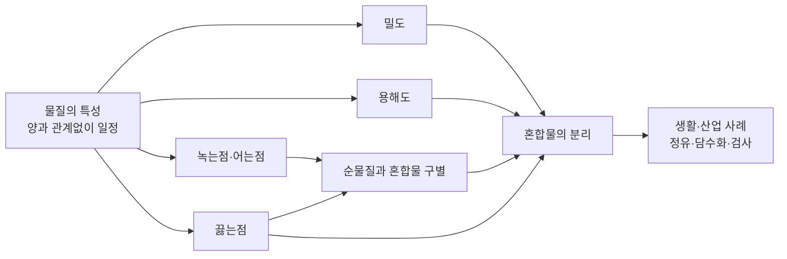

# 중2-1. 물질의 특성 — 물질마다 가진 고유한 '지문'
<!-- prev: m1-04, m1-06 -->
<!-- next: m2-04, m3-01, matter-1, matter-2 -->

> [!NOTE]
> **성취기준**
> - **[9과08-01]** 물질의 특성의 의미를 알고, 실험을 통해 밀도, 용해도, 녹는점, 끓는점 등을 설명할 수 있다.
> - **[9과08-02]** 물질의 특성을 근거로 우리 주변의 물질을 순물질과 혼합물로 분류할 수 있다.
> - **[9과08-03]** 물질의 특성을 이용하여 혼합물이 분리되는 원리를 이해하고, 이를 이용한 사례를 주변에서 찾을 수 있다.

**학습 목표**

1. 물질의 특성이 무엇인지 알고, 물질의 양에 따라 달라지는 성질과 구별할 수 있다.
2. 실험 결과를 이용하여 밀도, 용해도, 녹는점(어는점), 끓는점을 구하거나 설명할 수 있다.
3. 끓는점·녹는점의 측정 결과를 근거로 물질을 순물질과 혼합물로 분류할 수 있다.
4. 밀도, 용해도, 끓는점 차이 등을 이용하여 혼합물을 분리하는 원리를 설명할 수 있다.
5. 혼합물을 분리하는 원리가 쓰이는 사례를 생활과 산업에서 찾을 수 있다.

**이 단원의 학습 사다리**

| 단계 | 무엇을 하나? |
|---|---|
| STEP 1. 이전 학습 다시 보기 | 초등학교 「물체와 물질」, 중1 「물질의 상태 변화」, 「기체의 성질」을 다시 꺼내 본다 |
| STEP 2. 기초 다지기 | 질량과 부피, 나눗셈으로 '1당 얼마'를 구하는 법, 그래프 읽기를 디딤돌로 놓는다 |
| STEP 3. 핵심 개념 | 물질의 특성 → 밀도 → 용해도 → 녹는점·끓는점 → 순물질과 혼합물 → 혼합물의 분리 |
| STEP 4. 오개념 바로잡기 | "무거운 물체는 밀도가 크다?" 같은 착각을 바로잡는다 |
| STEP 5. 다음 단계로 | 원소와 화합물, 분자 사이의 힘, 용액의 끓는점 오름으로 이어지는 길 |
| STEP 6. 생활·산업·진로 | 정유 공장, 바닷물 담수화, 도핑 검사, 재활용 선별 |

---

## 🗺️ 단원 들어가기

금은방 주인은 반지가 진짜 금인지 어떻게 알아낼까? 색깔이 금색이라고 다 금은 아니다. 금색 페인트를 칠한 쇠고리도 금색이기 때문이다. 크기로도 알 수 없다. 반지는 작고 금괴는 크지만 둘 다 금이다.

물질을 확실하게 알아보려면, **양이 많든 적든, 모양이 어떻든 그 물질이라면 언제나 같은 값**을 갖는 성질을 찾아야 한다. 사람에게 지문이 있듯, 물질에도 '지문'이 있다. 이 단원에서는 그 지문인 **밀도, 용해도, 녹는점, 끓는점**을 알아보고, 이것으로 물질을 구별하고 섞여 있는 물질을 나누는 방법까지 배워 본다.

---

## STEP 1. 🔙 이전 학습 다시 보기

### 연계 개념표

| 이전 단원 | 그때 배운 것 | 이 단원에서 확장되는 것 |
|---|---|---|
| 초등학교 3~4학년 「물체와 물질」 | 물체는 여러 가지 물질로 만들어지고, 물질마다 성질(단단함, 물에 뜨는 정도 등)이 다르다 | 물질을 구별하는 성질을 **수치로 나타내는 물질의 특성**으로 정리한다 |
| 중학교 1학년 「물질의 상태 변화」 [9과04] | 고체·액체·기체 사이의 상태 변화, 상태가 변해도 물질의 종류는 그대로이고, 상태 변화 때 열에너지를 흡수하거나 방출한다 | 상태 변화가 일어나는 온도인 **녹는점·끓는점**이 물질마다 일정한 특성임을 배운다 |
| 중학교 1학년 「기체의 성질」 [9과06] | 기체의 부피는 압력과 온도에 따라 변한다 | 기체의 밀도와 **기체의 용해도**가 온도·압력에 따라 달라지는 것을 다룬다 |
| 중학교 1학년 「열」 [9과03] | 같은 열을 받아도 물질마다 온도 변화가 다르다(비열) | 비열도 물질마다 다른 값이므로 물질을 구별하는 데 쓸 수 있음을 안다 |

### 준비 운동 (사전 진단)

**Q1.** 물 100 g과 물 1 g은 같은 온도(100 °C)에서 끓는다. (O / X)

**Q2.** 얼음이 녹아 물이 되면 다른 물질로 바뀐 것일까?

**Q3.** 다음 중 물질의 양에 따라 달라지는 것을 모두 고르시오.
ㄱ. 질량 ㄴ. 부피 ㄷ. 색깔 ㄹ. 끓는점

**Q4.** 탄산음료 뚜껑을 열면 거품이 생기는 까닭을 말해 보자.

정답 및 해설

**Q1. O** — 끓는점은 물질의 양과 관계없다(1기압일 때). 다만 양이 많으면 끓는점에 도달하는 데 시간이 더 오래 걸린다.

**Q2.** 아니다. 상태 변화는 입자의 배열만 달라질 뿐 물질의 종류는 바뀌지 않는다(중1 「물질의 상태 변화」).

**Q3. ㄱ, ㄴ** — 질량과 부피는 양이 많아지면 커진다. 색깔과 끓는점은 양과 관계없다.

**Q4.** 뚜껑을 열면 병 속 압력이 낮아져 물에 녹아 있던 이산화 탄소가 더 이상 녹아 있지 못하고 빠져나오기 때문이다. 이 단원 STEP 3의 ③에서 '기체의 용해도'로 다시 다룬다.

---

## STEP 2. 🧱 기초 다지기

### ① 질량과 부피

- **질량(mass)**: 물질의 고유한 양. 윗접시저울이나 전자저울로 잰다. 단위는 g, kg.
- **부피(volume)**: 물질이 차지하는 공간의 크기. 단위는 $\mathrm{cm^3}$, mL, L. ($1\ \mathrm{mL} = 1\ \mathrm{cm^3}$)

모양이 불규칙한 고체의 부피는 **물이 든 눈금실린더에 넣고 늘어난 물의 부피**로 잰다.

$$
\text{고체의 부피} = \text{넣은 뒤 눈금} - \text{넣기 전 눈금}
$$

> [!TIP]
> 💡 눈금실린더의 눈금은 액체 표면이 오목하게 휜 부분의 **가장 아래쪽**에 눈높이를 맞추어 읽는다.

### ② '1당 얼마'를 구하는 나눗셈

마트에서 과자 두 봉지를 비교할 때 "1 g당 얼마인가?"를 계산하면 어느 쪽이 싼지 알 수 있다. 과학에서도 같은 방법을 쓴다.

| 생활 | 과학 |
|---|---|
| 가격 ÷ 무게 = 1 g당 가격 | 질량 ÷ 부피 = $1\ \mathrm{cm^3}$당 질량 (**밀도**) |
| 거리 ÷ 시간 = 1초당 거리 (속력) | 녹은 용질의 양 ÷ 용매 100 g 기준 (**용해도**) |

이렇게 나누어 '같은 기준'으로 바꾸면 **양이 달라도 비교**할 수 있다. 이것이 물질의 특성을 만드는 핵심 아이디어이다.

### ③ 용액의 말 정리

설탕을 물에 녹여 설탕물을 만들 때를 생각하자.

| 용어 | 뜻 | 설탕물에서 |
|---|---|---|
| **용질(solute)** | 녹는 물질 | 설탕 |
| **용매(solvent)** | 녹이는 물질 | 물 |
| **용액(solution)** | 용질이 용매에 골고루 섞인 것 | 설탕물 |
| **포화 용액** | 일정한 온도에서 용질이 최대로 녹아 있어 더 이상 녹지 않는 용액 | 바닥에 설탕이 녹지 않고 남은 설탕물 |

### ④ 온도–시간 그래프 읽기

물질을 가열하거나 냉각하면서 일정한 시간마다 온도를 재어 그래프를 그리면, **온도가 변하지 않고 평평하게 유지되는 구간**이 나타날 수 있다. 중1 「물질의 상태 변화」에서 배웠듯이, 이 구간에서는 공급된 열이 온도를 올리는 데 쓰이지 않고 상태를 바꾸는 데 쓰인다. 이 평평한 구간의 온도가 곧 녹는점이나 끓는점이다.

---

## STEP 3. 📘 핵심 개념

### ① 물질의 특성이란? [9과08-01]

**물질의 특성(characteristic property)** 은 다른 물질과 구별되는 그 물질만의 고유한 성질이다. 물질의 특성은 다음 두 조건을 만족한다.

1. **특정한 조건(온도, 압력 등)에서 항상 일정한 값**을 가진다.
2. **물질의 양에 따라 달라지지 않는다.**

| 물질의 특성인 것 | 물질의 특성이 아닌 것 |
|---|---|
| 밀도, 용해도, 녹는점(어는점), 끓는점 | 질량, 부피, 길이 (양에 따라 달라진다) |
| 겉보기 성질: 색, 냄새, 맛, 손촉감, 결정 모양 (보조 정보로 쓴다) | 온도 (같은 물질도 온도는 얼마든지 달라질 수 있다) |

> [!IMPORTANT]
> 색, 냄새 같은 겉보기 성질도 물질을 구별하는 단서가 되지만, 서로 다른 물질이 비슷한 색이나 냄새를 가질 수 있다(설탕과 소금은 둘 다 흰색이다). 그래서 **수치로 나타낼 수 있는 밀도, 용해도, 녹는점, 끓는점**이 물질을 구별하는 더 확실한 정보가 된다. 한 가지 특성만으로 구별이 어려우면 여러 특성을 함께 비교한다.

> [!TIP]
> 💡 **비유** — 사람을 구별할 때 '키'나 '옷 색깔'은 바뀔 수 있지만 '지문'은 평생 같다. 물질의 질량·부피는 키나 옷처럼 바뀌지만, 밀도·녹는점·끓는점은 지문처럼 그 물질이면 언제나 같다.

### ② 밀도 — 같은 부피일 때 얼마나 무거운가 [9과08-01]

**밀도(density)** 는 물질의 단위 부피당 질량이다.

$$
\text{밀도} = \frac{\text{질량}}{\text{부피}} \qquad \text{단위: } \mathrm{g/cm^3},\ \mathrm{g/mL},\ \mathrm{kg/m^3}
$$

- 같은 물질이면 질량이 2배가 될 때 부피도 2배가 되므로, 밀도는 **양과 관계없이 일정**하다.
- 가로축을 부피, 세로축을 질량으로 하여 그래프를 그리면 원점을 지나는 직선이 되고, **기울기가 밀도**이다. 기울기가 가파를수록 밀도가 크다.

| 물질 (약 20 °C, 1기압) | 밀도 ($\mathrm{g/cm^3}$) |
|---|---|
| 금 | 19.3 |
| 수은 | 13.6 |
| 구리 | 8.96 |
| 철 | 7.87 |
| 알루미늄 | 2.70 |
| 물 | 약 1.00 |
| 얼음 (0 °C) | 0.92 |
| 식용유 | 약 0.9 |
| 에탄올 | 0.79 |
| 공기 | 약 0.0012 |

#### 뜨고 가라앉음은 밀도로 정해진다

서로 섞이지 않는 물질을 함께 넣으면 **밀도가 작은 물질은 위로 뜨고, 밀도가 큰 물질은 아래로 가라앉는다.**

| 현상 | 밀도로 설명하기 |
|---|---|
| 얼음이 물에 뜬다 | 얼음(0.92)이 물(1.00)보다 밀도가 작다 |
| 기름이 물 위에 뜬다 | 식용유(약 0.9)가 물보다 밀도가 작다 |
| 헬륨 풍선이 하늘로 올라간다 | 헬륨이 공기보다 밀도가 작다 |
| 쇠못은 물에 가라앉는다 | 철(7.87)이 물보다 밀도가 크다 |
| 수은 위에는 쇠못이 뜬다 | 철(7.87)이 수은(13.6)보다 밀도가 작다 |

> [!NOTE]
> **온도와 압력에 따른 밀도** — 대부분의 물질은 온도가 높아지면 부피가 늘어나 밀도가 작아진다. 특히 **기체**는 온도와 압력에 따라 부피가 크게 변하므로(중1 「기체의 성질」), 기체의 밀도를 말할 때는 온도와 압력을 반드시 함께 밝힌다. 열기구가 뜨는 까닭은 풍선 안 공기를 데워 밀도를 작게 만들었기 때문이다.

#### 예제 1 — 금속 조각의 정체 찾기

어떤 금속 조각의 질량이 54 g이다. 물 30 mL가 든 눈금실린더에 넣었더니 눈금이 50 mL가 되었다. 이 금속은 무엇일까? (위 표를 이용한다.)

**풀이**
- 부피: $50 - 30 = 20\ \mathrm{mL} = 20\ \mathrm{cm^3}$
- 밀도: $\dfrac{54\ \mathrm{g}}{20\ \mathrm{cm^3}} = 2.7\ \mathrm{g/cm^3}$

밀도가 $2.7\ \mathrm{g/cm^3}$이므로 **알루미늄**으로 추정할 수 있다.

#### 예제 2 — 질량이 다른 같은 물질

같은 물질로 된 쇠구슬 A(질량 15.7 g, 부피 2 $\mathrm{cm^3}$)와 쇠구슬 B(질량 47.1 g, 부피 6 $\mathrm{cm^3}$)의 밀도를 비교하시오.

**풀이**
- A: $15.7 \div 2 = 7.85\ \mathrm{g/cm^3}$
- B: $47.1 \div 6 = 7.85\ \mathrm{g/cm^3}$

질량과 부피는 B가 3배 크지만 **밀도는 같다.** 밀도는 물질의 양과 관계없는 물질의 특성이다.

> [!TIP]
> 💡 **생활 속 예** — 옛 그리스의 아르키메데스가 왕관이 순금인지 확인하려고 왕관과 같은 질량의 금덩이를 물에 넣어 넘치는 물의 양(부피)을 비교했다는 이야기가 전해진다. 질량이 같은데 부피가 다르면 밀도가 다른 것이므로, 다른 금속이 섞였다는 뜻이다.

### ③ 용해도 — 얼마나 많이 녹을 수 있는가 [9과08-01]

**용해도(solubility)** 는 일정한 온도에서 **용매 100 g에 최대로 녹을 수 있는 용질의 g 수**이다. 즉, 용매 100 g으로 포화 용액을 만들 때 녹아 있는 용질의 양이다.

- 용해도는 **용질과 용매의 종류**, **온도**에 따라 달라진다.
- 같은 온도, 같은 용매에서는 용질마다 일정한 값을 가지므로 물질의 특성이다.

#### 고체의 용해도와 온도

대부분의 고체는 **온도가 높을수록 용해도가 커진다.** 그러나 그 정도는 물질마다 다르다.

| 온도 (°C) | 질산 칼륨 (g/물 100 g) | 염화 나트륨 (g/물 100 g) |
|---|---|---|
| 20 | 약 32 | 약 36 |
| 40 | 약 64 | 약 36 |
| 60 | 약 110 | 약 37 |
| 80 | 약 169 | 약 38 |

온도에 따른 용해도를 그래프로 나타낸 것을 **용해도 곡선**이라고 한다. 질산 칼륨은 곡선이 가파르게 올라가고(온도에 따라 용해도가 크게 변함), 염화 나트륨은 거의 평평하다(온도에 따라 거의 변하지 않음).

#### 예제 3 — 냉각할 때 석출되는 양

60 °C의 물 100 g에 질산 칼륨 80 g을 모두 녹인 뒤 20 °C로 식혔다. 결정으로 나오는(석출되는) 질산 칼륨은 몇 g일까? (20 °C에서 질산 칼륨의 용해도는 32이다.)

**풀이**
- 60 °C에서 용해도는 약 110이므로 80 g은 모두 녹는다.
- 20 °C에서는 물 100 g에 최대 32 g만 녹아 있을 수 있다.
- 석출되는 양: $80 - 32 = 48\ \mathrm{g}$

#### 예제 4 — 용매의 양이 다를 때

20 °C의 물 50 g에 질산 칼륨은 최대 몇 g까지 녹을까?

**풀이** 용해도는 물 100 g 기준이다. 물이 절반(50 g)이면 녹을 수 있는 양도 절반이다.
$32 \times \dfrac{50}{100} = 16\ \mathrm{g}$

#### 기체의 용해도

기체의 용해도는 고체와 반대로 **온도가 높을수록 작아지고**, **압력이 높을수록 커진다.**

| 조건 | 기체의 용해도 | 생활 속 예 |
|---|---|---|
| 온도 ↑ | 작아진다 | 미지근한 탄산음료는 김이 빨리 빠진다. 여름철 수온이 오르면 물속 산소가 줄어 물고기가 수면 가까이 올라온다 |
| 압력 ↓ | 작아진다 | 탄산음료 뚜껑을 열면 거품이 생긴다 |
| 압력 ↑ | 커진다 | 탄산음료는 높은 압력으로 이산화 탄소를 녹여 만든다 |

> [!TIP]
> 💡 **비유** — 따뜻한 물속의 기체 입자는 '들떠서 밖으로 나가고 싶은 아이들'이고, 높은 압력은 '문을 꽉 누르고 있는 손'이다. 뚜껑(압력)을 열면 아이들이 우르르 빠져나온다.

### ④ 녹는점, 어는점, 끓는점 [9과08-01]

- **녹는점(melting point)**: 고체가 녹아 액체로 변하는 동안 일정하게 유지되는 온도
- **어는점(freezing point)**: 액체가 얼어 고체로 변하는 동안 일정하게 유지되는 온도
- **끓는점(boiling point)**: 액체가 끓어 기체로 변하는 동안 일정하게 유지되는 온도

> [!IMPORTANT]
> 순수한 물질에서 **녹는점과 어는점은 같다.** 물은 0 °C에서 녹고 0 °C에서 언다. 같은 온도를 '데울 때'는 녹는점, '식힐 때'는 어는점이라고 부를 뿐이다.

#### 실험 — 고체 물질의 녹는점 측정

팔미트산(고체 지방산의 한 종류) 조각을 시험관에 넣고 물중탕으로 천천히 가열하면서 1분마다 온도를 잰다.

| 시간 (분) | 0 | 1 | 2 | 3 | 4 | 5 | 6 | 7 |
|---|---|---|---|---|---|---|---|---|
| 온도 (°C) | 40 | 50 | 58 | 63 | 63 | 63 | 68 | 74 |

- 3~5분 동안 온도가 약 63 °C로 일정하다. 이때 고체와 액체가 함께 있으며 녹고 있다.
- 팔미트산의 양을 2배로 늘려 실험하면 **평평한 구간이 더 길어지지만, 그 온도(약 63 °C)는 같다.**

#### 여러 물질의 녹는점과 끓는점 (1기압)

| 물질 | 녹는점 (°C) | 끓는점 (°C) | 실온(약 20 °C)에서의 상태 |
|---|---|---|---|
| 물 | 0 | 100 | 액체 |
| 에탄올 | 약 −114 | 약 78 | 액체 |
| 수은 | 약 −39 | 약 357 | 액체 |
| 팔미트산 | 약 63 | — | 고체 |
| 염화 나트륨 | 약 801 | — | 고체 |
| 철 | 약 1538 | — | 고체 |
| 질소 | 약 −210 | 약 −196 | 기체 |

> [!TIP]
> 💡 녹는점과 끓는점을 알면 어떤 온도에서 물질의 **상태**를 알 수 있다. 녹는점보다 낮으면 고체, 녹는점과 끓는점 사이면 액체, 끓는점보다 높으면 기체이다. 겨울철 북극 지방에서 수은 온도계 대신 알코올 온도계를 쓰는 까닭은, 수은은 약 −39 °C에서 얼지만 에탄올은 훨씬 낮은 온도에서도 액체이기 때문이다.

#### 끓는점과 압력

끓는점은 **외부 압력**에 따라 달라진다. 압력이 낮으면 끓는점이 낮아지고, 압력이 높으면 끓는점이 높아진다. 그래서 끓는점을 말할 때는 압력을 함께 밝힌다(보통 1기압 기준).

| 상황 | 압력 | 물의 끓는점 | 결과 |
|---|---|---|---|
| 높은 산 위에서 밥 짓기 | 낮다 | 100 °C보다 낮다 | 쌀이 설익기 쉽다 |
| 압력솥으로 밥 짓기 | 높다 | 100 °C보다 높다 | 높은 온도에서 빨리 익는다 |

#### 예제 5 — 미지의 액체 구별하기

무색투명한 두 액체 A, B를 같은 조건(1기압)에서 가열했더니 A는 약 78 °C에서, B는 100 °C에서 온도가 일정하게 유지되며 끓었다. A와 B는 각각 무엇으로 추정할 수 있을까? A의 양을 절반으로 줄이면 끓는점은 어떻게 될까?

**풀이** A는 끓는점이 약 78 °C인 **에탄올**, B는 100 °C인 **물**로 추정할 수 있다. A의 양을 줄여도 끓는점은 **약 78 °C로 같다.** 다만 끓기 시작할 때까지 걸리는 시간이 짧아진다.

### ⑤ 순물질과 혼합물 [9과08-02]

- **순물질(pure substance)**: 한 가지 물질로만 이루어진 물질. 예: 물, 산소, 금, 에탄올, 염화 나트륨
- **혼합물(mixture)**: 두 가지 이상의 순물질이 섞여 있는 물질. 예: 소금물, 공기, 우유, 흙탕물, 탄산음료, 합금(청동, 땜납)

혼합물은 다시 성분이 고르게 섞였는지에 따라 나눌 수 있다.

| 종류 | 뜻 | 예 |
|---|---|---|
| 균일 혼합물 | 성분이 고르게 섞여 어느 부분이나 같아 보인다 | 소금물, 공기, 사이다, 합금 |
| 불균일 혼합물 | 성분이 고르지 않게 섞여 있다 | 흙탕물, 우유, 화강암, 미숫가루 탄 물 |

#### 순물질과 혼합물을 구별하는 기준 — 물질의 특성

겉모습만으로는 구별하기 어렵다. 맑은 물과 소금물은 둘 다 무색투명하다. 이때 **녹는점·끓는점·밀도** 같은 물질의 특성을 측정하면 구별할 수 있다.

| 비교 | 순물질 | 혼합물 |
|---|---|---|
| 끓는점·녹는점 | **일정하다.** 끓거나 녹는 동안 온도가 일정하게 유지된다 | **일정하지 않다.** 끓거나 녹는 동안 온도가 계속 변한다 |
| 밀도 | 일정하다 | 섞인 비율에 따라 달라진다 |
| 성분비 | 한 가지 물질이므로 해당 없음 | 섞는 비율을 마음대로 바꿀 수 있다 |
| 성분의 성질 | — | 각 성분 물질의 성질을 그대로 가지고 있다 (소금물은 짜다) |

#### 가열 곡선으로 비교하기

| 시간 (분) | 0 | 2 | 4 | 6 | 8 | 10 |
|---|---|---|---|---|---|---|
| 물 (°C) | 20 | 60 | 98 | 100 | 100 | 100 |
| 소금물 (°C) | 20 | 58 | 96 | 102 | 103 | 104 |

- 물은 100 °C에서 온도가 일정하게 유지되며 끓는다 → **순물질**
- 소금물은 100 °C보다 높은 온도에서 끓기 시작하고, 끓는 동안에도 온도가 조금씩 계속 올라간다 → **혼합물**. 물이 증발하면서 소금물이 점점 진해지기 때문이다.

> [!IMPORTANT]
> 혼합물은 성분 순물질과 비교하여 **끓는점은 높아지고, 어는점은 낮아지는** 경우가 많다.
> - 바닷물은 0 °C보다 낮은 온도에서 언다.
> - 겨울철 눈 덮인 도로에 염화 칼슘을 뿌리면 눈이 녹은 물이 잘 얼지 않는다.
> - 자동차 냉각수에 부동액을 섞으면 추운 날에도 얼지 않는다.
> - 땜납(여러 금속의 합금)은 성분 금속보다 낮은 온도에서 녹아 전자 부품을 붙이기 좋다.

#### 예제 6 — 분류해 보기

다음 물질을 순물질과 혼합물로 분류하시오.
산소, 공기, 증류수, 바닷물, 금, 18K 금반지, 에탄올, 우유

**풀이**
- 순물질: 산소, 증류수, 금, 에탄올
- 혼합물: 공기(질소·산소 등), 바닷물(물·소금 등), 18K 금반지(금과 다른 금속의 합금), 우유

> [!TIP]
> 💡 '24K'는 순금(순물질)에 가깝고, '18K'는 금에 다른 금속을 섞은 합금(혼합물)이다. 금에 다른 금속을 섞으면 더 단단해져 반지로 쓰기 좋다. 혼합물을 만들면 순물질에는 없는 쓸모 있는 성질을 얻을 수도 있다.

### ⑥ 혼합물의 분리 [9과08-03]

혼합물 속 각 성분은 자신의 특성을 그대로 가지고 있다. 따라서 **성분 물질 사이의 특성 차이**를 이용하면 혼합물을 분리할 수 있다.

| 이용하는 특성 차이 | 분리 방법 | 예 |
|---|---|---|
| 밀도 | 뜨고 가라앉음, 분별 깔때기 | 물과 식용유, 볍씨 고르기, 사금 채취 |
| 용해도 | 거름, 재결정 | 소금과 모래, 질산 칼륨에 섞인 소량의 염화 나트륨 |
| 끓는점 | 증류 | 물과 에탄올, 바닷물에서 순수한 물 얻기, 원유 분리 |
| 용매를 따라 이동하는 속도 | 크로마토그래피 | 사인펜 잉크의 색소, 시금치 잎의 색소 |

#### (1) 밀도 차를 이용한 분리

- **고체 혼합물**: 두 고체를 모두 녹이지 않고, 밀도가 두 고체의 중간인 액체에 넣는다. 밀도가 작은 고체는 뜨고, 큰 고체는 가라앉는다.
  - **볍씨 고르기**: 소금물에 볍씨를 넣으면 속이 찬 좋은 볍씨는 가라앉고, 쭉정이는 뜬다.
  - **사금 채취**: 강가의 모래를 쟁반에 담아 물속에서 흔들면, 밀도가 큰 금은 바닥에 남고 가벼운 모래는 씻겨 나간다.
  - **플라스틱 재활용**: 잘게 부순 플라스틱을 물에 넣어 뜨는 것과 가라앉는 것을 나눈다.
- **액체 혼합물**: 서로 섞이지 않는 두 액체는 층을 이룬다. **분별 깔때기**에 넣고 잠시 두었다가 마개를 열고 꼭지를 돌려 아래층 액체를 먼저 받아 낸다.
  - 물과 식용유: 식용유가 위층, 물이 아래층
  - 바다에 기름이 유출되면 기름이 물 위에 뜨므로 **오일펜스**로 막고 걷어 낸다.

> [!TIP]
> 💡 혈액을 빠르게 회전시키는 기계(원심 분리기)에 넣으면, 밀도가 큰 혈구는 아래로, 밀도가 작은 혈장은 위로 나뉜다. 병원 검사실에서 쓰는 밀도 차 분리이다.

#### (2) 용해도 차를 이용한 분리

- **거름**: 물에 녹는 물질과 녹지 않는 물질의 혼합물은 물에 넣어 녹인 뒤 거름종이로 거른다. 예: 소금과 모래 → 물에 녹여 거르면 모래는 거름종이에 남고, 거른 소금물을 증발시키면 소금을 얻는다.
- **재결정(recrystallization)**: 온도에 따른 용해도 차이를 이용하여, 높은 온도에서 녹인 뒤 냉각하여 순수한 결정을 얻는 방법이다.

#### 예제 7 — 재결정으로 순수한 질산 칼륨 얻기

질산 칼륨 50 g과 염화 나트륨 5 g이 섞인 혼합물을 80 °C 물 100 g에 모두 녹인 뒤 20 °C로 식혔다. 어떤 물질이 몇 g 석출될까? (20 °C 용해도: 질산 칼륨 32, 염화 나트륨 36)

**풀이**
- 질산 칼륨: 50 g 중 32 g만 녹아 있을 수 있으므로 $50 - 32 = 18\ \mathrm{g}$이 석출된다.
- 염화 나트륨: 5 g은 용해도 36보다 훨씬 적으므로 모두 녹아 있다.

따라서 **순수한 질산 칼륨 18 g**이 결정으로 나온다. 이것을 걸러 내면 염화 나트륨이 섞이지 않은 질산 칼륨을 얻는다.

> [!NOTE]
> 약품이나 반도체 재료처럼 매우 순수한 물질이 필요할 때 재결정을 여러 번 반복하기도 한다. 천일염은 반대로 바닷물을 햇볕과 바람으로 증발시켜 소금을 얻는 방법이다.

#### (3) 끓는점 차를 이용한 분리 — 증류

**증류(distillation)** 는 액체 혼합물을 가열하여 나오는 기체를 다시 냉각하여 순수한 액체를 얻는 방법이다. **끓는점이 낮은 물질이 먼저 끓어 나온다.**

- **물과 에탄올**: 가열하면 끓는점이 낮은 에탄올(약 78 °C)이 먼저 많이 나오고, 이후 온도가 더 올라가 물(100 °C)이 나온다. 우리 조상은 '소줏고리'라는 증류 기구로 술을 증류하여 소주를 만들었다.
- **바닷물의 증류**: 바닷물을 끓여 나오는 수증기를 식히면 소금이 없는 물을 얻는다. 배 위나 섬에서 먹는 물을 얻는 데 쓰인다.
- **원유의 분리**: 원유는 끓는점이 다른 여러 물질의 혼합물이다. 원유를 가열하여 높은 탑(증류탑)에 넣으면, 끓는점이 낮은 물질일수록 탑의 위쪽에서, 끓는점이 높은 물질일수록 아래쪽에서 나온다.

| 증류탑의 위치 | 나오는 물질 (위에서부터) | 끓는점 |
|---|---|---|
| 맨 위 | 석유 가스(LPG) | 가장 낮다 |
| ↓ | 휘발유 | ↓ |
| ↓ | 등유 | ↓ |
| ↓ | 경유 | ↓ |
| ↓ | 중유 | ↓ |
| 맨 아래 | 아스팔트 등 찌꺼기 | 가장 높다 |

> [!TIP]
> 💡 **비유** — 증류탑은 '키 높이별 문이 달린 탑'과 같다. 가벼운 학생(끓는점이 낮은 물질)은 꼭대기 층까지 올라가서 나가고, 무거운 학생(끓는점이 높은 물질)은 아래층에서 일찍 나간다.

#### (4) 크로마토그래피

**크로마토그래피(chromatography)** 는 혼합물을 이루는 성분이 **용매를 따라 이동하는 속도가 다른 것**을 이용하여 분리하는 방법이다. 성분마다 용매에 녹는 정도와 종이에 달라붙는 정도가 달라서, 같은 조건(같은 용매, 같은 종이)에서는 성분마다 이동하는 정도가 일정하다. 그래서 이 이동 정도도 성분을 구별하는 단서가 된다.

- 거름종이 아래쪽에 사인펜으로 점을 찍고, 종이 끝을 물에 담그면 물이 종이를 타고 올라가면서 잉크 속 색소들이 서로 다른 높이로 분리된다.
- 장점: 아주 적은 양의 혼합물도 분리할 수 있고, 성분이 비슷한 혼합물도 분리할 수 있으며, 방법이 간단하다.
- 쓰임: 운동선수의 **도핑 검사**, 식품 속 남은 농약 검사, 범죄 현장의 잉크·혈액 분석, 꽃과 잎의 색소 분석

#### 예제 8 — 분리 방법 고르기

다음 혼합물을 분리하는 데 알맞은 방법과 이용하는 특성을 쓰시오.
(1) 물과 에탄올 (2) 물과 식용유 (3) 소금과 모래 (4) 검은색 사인펜 잉크의 색소

**풀이**
(1) 증류 — 끓는점 차 (2) 분별 깔때기 — 밀도 차(서로 섞이지 않음) (3) 물에 녹여 거른 뒤 증발 — 물에 대한 용해도 차 (4) 크로마토그래피 — 용매를 따라 이동하는 속도 차

---

## STEP 4. ⚠️ 오개념 바로잡기

| 흔한 오개념 | 올바른 개념 | 왜 그럴까? |
|---|---|---|
| 무거운 물체는 밀도가 크다 | 밀도는 **같은 부피일 때의 질량**이다. 무거운 물체라도 부피가 매우 크면 밀도는 작을 수 있다 | 큰 통나무는 무겁지만 물에 뜨고, 작은 쇠못은 가볍지만 가라앉는다 |
| 물질의 양이 많으면 끓는점이 높아진다 | 끓는점은 **양과 관계없이 일정**하다. 양이 많으면 끓는점에 도달하는 **시간**이 길어질 뿐이다 | 가열 곡선에서 평평한 구간의 높이(온도)는 같고 길이(시간)만 달라진다 |
| 설탕을 많이 넣고 오래 저으면 얼마든지 녹는다 | 일정한 온도에서 녹을 수 있는 양에는 **한계(용해도)** 가 있다 | 저으면 빨리 녹을 뿐, 녹을 수 있는 최대량은 늘지 않는다 |
| 기체도 고체처럼 따뜻할수록 잘 녹는다 | 기체는 **온도가 낮을수록, 압력이 높을수록** 잘 녹는다 | 따뜻한 탄산음료에서 김이 빨리 빠지는 것으로 확인할 수 있다 |
| 투명하고 깨끗해 보이면 순물질이다 | 소금물, 사이다, 공기처럼 **투명한 혼합물**도 많다 | 겉모습이 아니라 끓는점·녹는점이 일정한지로 구별해야 한다 |
| 혼합물이 되면 성분 물질의 성질이 사라진다 | 혼합물 속 각 성분은 **자기 성질을 그대로** 가진다 | 소금물이 짠맛을 내고, 그래서 성질 차이로 다시 분리할 수 있다 |
| 증류하면 끓는점이 높은 물질이 먼저 나온다 | 끓는점이 **낮은** 물질이 먼저 기체가 되어 나온다 | 물과 에탄올을 증류하면 에탄올이 먼저 많이 나온다 |

---

## STEP 5. 🎓 다음 단계로 한 걸음 더

> [!CAUTION]
> 이 절은 **중학교 2학년 교육과정 범위 밖의 심화 내용**으로 평가 대상이 아니다. 이 단원에서 배운 물질의 특성이 앞으로 어디까지 이어지는지 맛보기로 보여 주기 위한 내용이다.

### 다음 학년·과목과의 연결

| 학년·과목 | 단원 | 이어지는 내용 |
|---|---|---|
| 중학교 2학년 | 「물질의 구성」 | 순물질을 이루는 원소와 원자, 분자. 순물질은 다시 한 가지 원소로 된 물질과 두 가지 이상의 원소가 결합한 물질로 나뉜다 |
| 중학교 3학년 | 「화학 반응의 규칙성」 | 혼합물과 달리 화합물은 성분 원소가 **일정한 질량비**로 결합한다(일정 성분비 법칙) |
| 진로 선택 물질과 에너지 | 「물질의 세 가지 상태」 | 물질마다 끓는점이 다른 까닭을 분자 사이의 힘으로 설명한다 |
| 진로 선택 물질과 에너지 | 「용액의 성질」 | 용액의 농도에 따라 끓는점이 오르고 어는점이 내려가는 정도를 수식으로 다룬다 |

### ① 왜 물질마다 끓는점이 다를까? — 입자 사이의 힘

중1 「물질의 상태 변화」에서 액체가 기체가 되려면 입자들이 서로 끌어당기는 힘을 이겨 내야 한다고 배웠다. 입자 사이에 끌어당기는 힘이 **강한 물질일수록** 떼어 내는 데 더 많은 에너지가 필요하므로 **끓는점이 높다.** 고등학교 「물질의 세 가지 상태」에서는 이 힘의 종류(분산력, 수소 결합 등)를 배우고, 물이 비슷한 크기의 다른 분자보다 끓는점이 유난히 높은 까닭을 설명한다.

### ② 소금물은 왜 더 높은 온도에서 끓을까? — 끓는점 오름과 어는점 내림

이 단원에서 "혼합물은 끓는점이 높아지고 어는점이 낮아진다"를 현상으로 배웠다. 고등학교 「용액의 성질」에서는 이것을 **끓는점 오름**, **어는점 내림**이라 부르고, 녹아 있는 용질 입자의 수(농도)에 비례한다는 관계를 식으로 다룬다. 겨울철 도로의 제설제, 자동차 부동액 설계가 바로 이 원리를 정량적으로 이용한 것이다.

### ③ 순물질을 더 나누면? — 원소와 화합물

순물질인 물을 전기로 분해하면 수소와 산소가 생긴다. 반면 수소와 산소는 더 이상 다른 물질로 나뉘지 않는다. 이처럼 순물질은 **원소**와 **화합물**로 나눌 수 있다. 혼합물은 물리적 방법(증류, 거름 등)으로 분리되지만, 화합물은 화학 반응으로만 성분 원소로 나눌 수 있다. 이 구분은 「물질의 구성」, 「화학 반응의 규칙성」에서 본격적으로 배운다.

### 지금 vs 다음 단계

| 구분 | 중학교 2학년 (지금) | 고등학교 물질과 에너지 |
|---|---|---|
| 끓는점 | 물질마다 다르다는 사실, 압력에 따라 달라진다 | 분자 사이의 힘으로 끓는점의 차이를 설명 |
| 혼합물의 끓는점·어는점 | 순물질보다 끓는점↑, 어는점↓ (정성적) | 농도에 비례하는 끓는점 오름·어는점 내림 (정량적) |
| 용해도·용액 | 용매 100 g에 녹는 최대 g 수, 용해도 곡선 | 몰랄 농도 같은 농도 표현, 농도에 따른 증기압·끓는점·어는점 변화, 삼투 현상 |
| 혼합물 분리 | 밀도·용해도·끓는점 차, 크로마토그래피의 원리 | 분리 장비의 원리와 정밀 분석, 산업 공정 설계 |

---

## STEP 6. 🏭 생활·산업·진로 연결

### 사례 1. 정유 공장 — 원유를 쓸모 있게 나누기

- **원리** 원유는 끓는점이 다른 여러 물질의 혼합물이다. 증류탑에서 끓는점 차이를 이용해 나눈다(STEP 3의 ⑥).
- **어디에 쓰이나** 석유 가스는 가정용 연료, 휘발유는 자동차, 등유는 난방, 경유는 트럭·선박, 아스팔트는 도로 포장에 쓰인다. 플라스틱과 합성 섬유의 원료도 여기서 얻는다.

### 사례 2. 바닷물에서 먹는 물 얻기 — 해수 담수화

- **원리** 바닷물을 증류하거나, 바닷물의 소금은 통과하지 못하고 물만 통과하는 아주 촘촘한 막에 높은 압력으로 바닷물을 밀어 순수한 물을 얻는다.
- **어디에 쓰이나** 물이 부족한 섬 지역, 사막 국가, 큰 배와 잠수함 등에서 먹는 물을 얻는다.

### 사례 3. 도핑 검사와 식품 안전 검사

- **원리** 크로마토그래피는 아주 적은 양의 혼합물도 성분별로 나눌 수 있다. 나눈 성분을 표준 물질과 비교하여 어떤 물질이 들어 있는지 확인한다.
- **어디에 쓰이나** 운동선수의 금지 약물 검사, 농산물에 남은 농약 검사, 수돗물 수질 검사, 의약품 품질 관리

### 사례 4. 재활용 선별장 — 밀도로 플라스틱 나누기

- **원리** 플라스틱은 종류마다 밀도가 다르다. 잘게 부순 플라스틱을 물에 넣으면 물보다 밀도가 작은 것은 뜨고 큰 것은 가라앉는다.
- **어디에 쓰이나** 페트병 몸체와 뚜껑·라벨을 분리하여 같은 종류끼리 재활용한다. 분리가 잘 되어야 재활용 품질이 높아진다.

### 관련 진로와 학과

| 진로 | 하는 일 | 관련 학과 |
|---|---|---|
| 화학 공학자 | 증류탑, 분리 공정을 설계하고 운영한다 | 화학공학, 화학 |
| 분석 화학자·검사원 | 크로마토그래피 등으로 성분을 분석한다 (도핑·식품·환경 검사) | 화학, 식품공학, 약학 |
| 수처리·환경 엔지니어 | 담수화 시설, 정수장, 폐수 처리 시설을 운영한다 | 환경공학, 화학공학 |
| 재료 공학자 | 합금과 고순도 재료를 개발한다 | 신소재공학, 금속공학 |

---

## 🔬 탐구 활동 — 혼합물 분리 실험을 설계하고 수행하기

### 활동 A. 섞여 버린 재료 되찾기 (모둠 설계 실험)

**목표** 혼합물을 이루는 순물질의 특성을 조사하고, 그 차이를 이용하여 효과적인 분리 방법을 설계·수행한다.

**상황** 실험실 선반에서 떨어진 통들이 섞여, **모래 + 소금 + 쇳가루 + 스타이로폼 알갱이**의 혼합물이 생겼다. 각 성분을 되찾아 보자.

**준비물** 혼합물 시료, 비커, 물, 막대자석(비닐로 감싼 것), 거름종이와 깔때기, 증발 접시, 알코올램프 또는 핫플레이트, 거름 장치용 스탠드, 전자저울, 숟가락

**과정**
1. 모둠별로 각 성분의 특성(밀도, 물에 대한 용해도, 자석에 붙는지 등)을 조사하여 표로 정리한다.
2. 어떤 순서로 분리할지 토의하여 실험 계획을 세우고 다른 모둠과 공유한다. (예: 자석으로 쇳가루 분리 → 물에 넣어 뜨는 스타이로폼 건지기 → 거름으로 모래 분리 → 거른 액을 증발시켜 소금 얻기)
3. 계획대로 분리하고, 각 성분의 질량을 잰다.
4. 처음 넣은 양과 비교하여 얼마나 되찾았는지 계산한다.

**결과 기록**

| 성분 | 분리 방법 | 이용한 특성 | 처음 질량 (g) | 되찾은 질량 (g) |
|---|---|---|---|---|
| 쇳가루 | | | | |
| 스타이로폼 | | | | |
| 모래 | | | | |
| 소금 | | | | |

**생각해 보기**
1. 분리 순서를 바꾸면 결과가 어떻게 달라질까? (예: 물을 먼저 넣으면?)
2. 되찾은 질량이 처음보다 적거나 많은 까닭은 무엇일까?
3. 다른 모둠의 결과와 비교하여 가장 효과적인 방법은 무엇이었는지 토의해 보자.

> [!WARNING]
> **안전 수칙** 가열할 때는 보안경을 쓰고, 증발 접시가 식기 전에 맨손으로 만지지 않는다. 증발 막바지에 소금이 튈 수 있으므로 얼굴을 가까이 대지 않는다. 쇳가루가 자석에 직접 붙지 않도록 자석을 비닐로 감싼다.

### 활동 B. 사인펜 잉크 크로마토그래피

1. 거름종이를 길게 자르고, 아래 끝에서 약 2 cm 위에 연필로 선을 긋는다.
2. 선 위에 검은색, 갈색 등 여러 사인펜으로 작은 점을 찍는다.
3. 비커에 물을 1 cm 정도 붓고, 점이 물에 잠기지 않도록 종이를 걸어 둔다.
4. 물이 종이 위쪽까지 올라가면 꺼내어 말리고, 각 잉크가 몇 가지 색으로 나뉘었는지 기록한다.
5. 같은 색으로 보이는 두 사인펜이 같은 성분인지 결과로 판단해 보자.

---

## ✅ 개념 확인 문제

### 기본

**1.** 다음 중 물질의 특성이 **아닌** 것은?
① 밀도 ② 끓는점 ③ 부피 ④ 용해도

정답 및 해설

**정답 ③**

부피는 물질의 양에 따라 달라지므로 물질의 특성이 아니다. 밀도, 끓는점, 용해도는 일정한 조건에서 양과 관계없이 일정하다.

**2.** 질량이 79 g이고 부피가 10 $\mathrm{cm^3}$인 금속의 밀도를 구하시오.

정답 및 해설

**정답** $7.9\ \mathrm{g/cm^3}$

$79 \div 10 = 7.9\ \mathrm{g/cm^3}$ (철의 밀도에 가깝다.)

**3.** 20 °C에서 물 200 g에 염화 나트륨은 최대 몇 g 녹을 수 있는가? (20 °C에서 염화 나트륨의 용해도는 36이다.)

정답 및 해설

**정답** 72 g

용해도는 물 100 g 기준이므로 물 200 g에는 $36 \times 2 = 72\ \mathrm{g}$까지 녹을 수 있다.

**4.** 다음 빈칸에 알맞은 말을 쓰시오.
"순물질은 끓는 동안 온도가 ( ㄱ )하지만, 혼합물은 끓는 동안 온도가 ( ㄴ ). 물과 에탄올의 혼합물은 ( ㄷ ) 차이를 이용한 ( ㄹ )(으)로 분리한다."

정답 및 해설

**정답** ㄱ: 일정, ㄴ: 계속 변한다(올라간다), ㄷ: 끓는점, ㄹ: 증류

**5.** 다음 물질 중 혼합물을 모두 고르시오.
ㄱ. 공기 ㄴ. 증류수 ㄷ. 탄산음료 ㄹ. 금(24K) ㅁ. 흙탕물

정답 및 해설

**정답 ㄱ, ㄷ, ㅁ**

공기(질소·산소 등), 탄산음료(물·설탕·이산화 탄소 등), 흙탕물(물·흙)은 혼합물이다. 증류수와 순금은 순물질이다.

### 응용

**6.** 표는 세 물체 A, B, C의 질량과 부피이다.

| 물체 | 질량 (g) | 부피 ($\mathrm{cm^3}$) |
|---|---|---|
| A | 27 | 10 |
| B | 54 | 20 |
| C | 18 | 20 |

(1) 같은 물질로 이루어졌다고 볼 수 있는 것을 고르시오. (2) 물에 뜨는 것을 고르시오. (물의 밀도는 $1\ \mathrm{g/cm^3}$이다.)

정답 및 해설

**정답** (1) A와 B (2) C

밀도: A $= 27 \div 10 = 2.7$, B $= 54 \div 20 = 2.7$, C $= 18 \div 20 = 0.9\ \mathrm{g/cm^3}$
(1) 밀도가 같은 A와 B는 같은 물질로 볼 수 있다(밀도 외의 다른 특성도 확인하면 더 확실하다).
(2) 물보다 밀도가 작은 C만 물에 뜬다.

**7.** 80 °C의 물 100 g에 질산 칼륨 100 g을 모두 녹였다. 이 용액을 40 °C로 식혔을 때와 20 °C로 식혔을 때 석출되는 질산 칼륨의 양을 각각 구하시오. (용해도: 40 °C에서 64, 20 °C에서 32)

정답 및 해설

**정답** 40 °C: 36 g, 20 °C: 68 g

- 40 °C: $100 - 64 = 36\ \mathrm{g}$
- 20 °C: $100 - 32 = 68\ \mathrm{g}$

온도를 더 많이 낮출수록 녹아 있을 수 있는 양이 줄어 더 많이 석출된다.

**8.** 무색투명한 액체 X를 1기압에서 가열하면서 온도를 쟀더니, 약 101 °C에서 끓기 시작하여 끓는 동안 온도가 102 °C, 103 °C로 계속 올라갔다. X를 끓인 뒤 바닥에 흰 고체가 남았다. X는 순물질과 혼합물 중 무엇인지 쓰고, 근거를 두 가지 제시하시오.

정답 및 해설

**정답** 혼합물

근거 ① 끓는 동안 온도가 일정하지 않고 계속 올라갔다. 순물질은 끓는 동안 온도가 일정하다. ② 액체가 증발한 뒤 다른 물질(흰 고체)이 남았다. 즉 두 가지 이상의 물질이 섞여 있었다. (소금물처럼 물에 고체가 녹아 있는 혼합물로 추정할 수 있다.)

### 융합·서술형

**9. [생활·환경 연계]** 여름철 수온이 크게 오르면 양식장의 물고기가 수면 가까이 몰려 입을 뻐끔거리거나 떼죽음을 당하기도 한다. 이 현상을 기체의 용해도와 관련지어 설명하고, 양식장에서 할 수 있는 대책을 한 가지 제시하시오.

정답 및 해설

**예시 답안**
기체의 용해도는 온도가 높을수록 작아진다. 수온이 오르면 물에 녹아 있을 수 있는 산소의 양이 줄어들어, 물고기가 숨쉬기 어려워지므로 산소가 상대적으로 많은 수면 쪽으로 몰려든다. 대책으로는 공기 방울을 넣는 장치를 돌려 물에 산소를 공급하거나, 그늘막을 설치하거나 차가운 물을 공급하여 수온을 낮추는 방법이 있다.

**채점 포인트** ① 온도↑ → 기체의 용해도↓ ② 녹아 있는 산소량 감소 ③ 타당한 대책

**10. [산업 연계]** 정유 공장의 증류탑에서는 원유를 가열하여 탑 아래쪽에 넣는다. (1) 탑 꼭대기에서 얻는 물질과 맨 아래에서 얻는 물질의 끓는점을 비교하고, (2) 이 분리 방법이 이용하는 물질의 특성과 그 원리를 설명하시오.

정답 및 해설

**예시 답안**
(1) 꼭대기에서 얻는 석유 가스는 끓는점이 가장 낮고, 맨 아래에서 얻는 아스팔트 등은 끓는점이 가장 높다.
(2) 끓는점 차이를 이용한 증류이다. 원유는 끓는점이 다른 여러 물질의 혼합물이며, 각 성분은 자신의 끓는점을 그대로 가진다. 탑은 위로 갈수록 온도가 낮으므로, 끓는점이 낮은 물질은 기체 상태로 높이 올라간 뒤 액체로 되어 나오고, 끓는점이 높은 물질은 아래쪽에서 일찍 액체가 되어 나온다.

**채점 포인트** ① 끓는점 비교 ② 증류·끓는점 차 ③ 혼합물 속 성분이 자신의 특성을 유지함

---

## 📝 한눈에 정리

### 핵심 요약

- **물질의 특성**은 일정한 조건에서 항상 일정한 값을 가지며 물질의 양에 따라 달라지지 않아, 물질을 구별하는 정보가 된다.
- **밀도** = 질량 ÷ 부피. 밀도가 작은 물질은 뜨고, 큰 물질은 가라앉는다. 기체의 밀도는 온도·압력에 따라 크게 변한다.
- **용해도**는 일정한 온도에서 용매 100 g에 최대로 녹는 용질의 g 수이다. 고체는 대개 온도↑ → 용해도↑, 기체는 온도↑ → 용해도↓, 압력↑ → 용해도↑.
- **녹는점(=어는점)**, **끓는점**은 상태 변화가 일어나는 동안 일정하게 유지되는 온도이다. 끓는점은 외부 압력에 따라 달라진다.
- **순물질**은 녹는점·끓는점이 일정하고, **혼합물**은 일정하지 않으며 대개 끓는점이 높아지고 어는점이 낮아진다.
- 혼합물은 성분의 특성 차이로 분리한다: 밀도 차(분별 깔때기), 용해도 차(거름, 재결정), 끓는점 차(증류), 이동 속도 차(크로마토그래피).
- 분리 원리는 정유, 담수화, 도핑·식품 검사, 재활용 등 생활과 산업 곳곳에 쓰인다.

### 핵심 용어

| 용어 | 뜻 |
|---|---|
| 물질의 특성 | 양과 관계없이 일정한 조건에서 일정한 값을 가지는, 그 물질만의 성질 |
| 밀도 | 단위 부피당 질량 (질량 ÷ 부피) |
| 용해도 | 일정한 온도에서 용매 100 g에 최대로 녹는 용질의 g 수 |
| 포화 용액 | 용질이 최대로 녹아 더 이상 녹지 않는 용액 |
| 녹는점·어는점 | 고체가 녹는(액체가 어는) 동안 일정하게 유지되는 온도 |
| 끓는점 | 액체가 끓는 동안 일정하게 유지되는 온도 |
| 순물질 | 한 가지 물질로 이루어진 물질 |
| 혼합물 | 두 가지 이상의 순물질이 섞여 있는 물질 |
| 재결정 | 온도에 따른 용해도 차를 이용해 순수한 고체를 얻는 방법 |
| 증류 | 끓는점 차를 이용해 액체 혼합물을 분리하는 방법 |
| 크로마토그래피 | 성분이 용매를 따라 이동하는 속도 차로 혼합물을 분리하는 방법 |

### 다음 단원으로

이 단원에서 물질을 '특성'으로 구별하고 나누어 보았다. 그렇다면 순물질은 무엇으로 이루어져 있을까? 「물질의 구성」에서는 순물질을 이루는 원소와 원자, 분자의 세계로 들어가 보고, 다음 단원 「지권의 변화」에서는 광물을 색·조흔색·굳기 같은 특성으로 구별하며 이 단원의 생각을 지구 물질에 적용해 본다.
